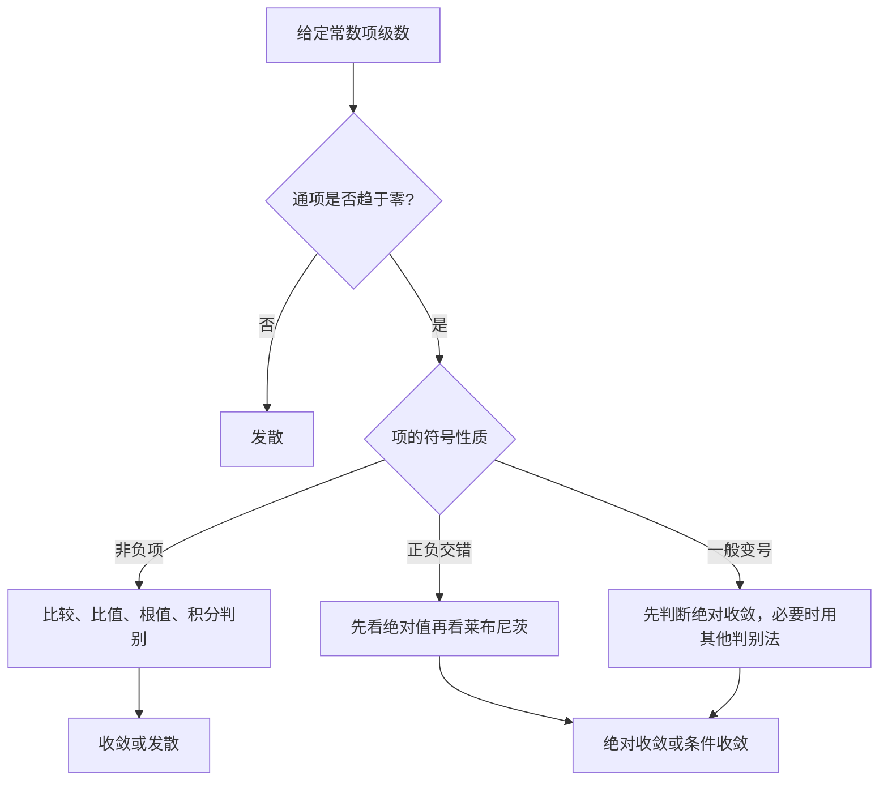

<Callout type="info" title="本记来源与整理范围">

对应原书 **第 54—59 页**，逐页整理 **必记 1—7**：常数项级数的定义与性质、审敛法、16 条常用结论、幂级数的收敛域及运算、7 组基本展开式。原资料第 55 页的审敛框架图已改写为可检索的判别表与流程；第 59 页虽然目录标为下一记起始页，但正文仍属第 11 记，所列 **2016、2021、2022 年真题**均已纳入。包含原书例题与 **4 道标注年份的真题、5 道补充自测题**。

本记仅适用于 **数学一、数学三**。对于收敛与发散，除非特别指出，一律指实数项级数的通常意义。

</Callout>

<Cards>
  <Card title="常数项级数">部分和、通项必要条件、正项级数及交错级数的判别。</Card>
  <Card title="高频性质">绝对收敛、条件收敛、加括号与子级数，共 16 条归纳。</Card>
  <Card title="幂级数工具">阿贝尔定理、收敛半径、端点、逐项求导与积分。</Card>
  <Card title="求和与展开">几何级数、对数、指数、正弦余弦及三道幂级数真题。</Card>
</Cards>

## 必记 1｜常数项级数的定义：先看部分和

给定数列 $\{u_n\}$，定义第 $n$ 个部分和

$$
S_n=\sum_{k=1}^{n}u_k.
$$

常数项级数 $\sum_{n=1}^{\infty}u_n$ **收敛**，当且仅当 $S_n$ 收敛到某个有限数 $S$，此时记作

$$
\sum_{n=1}^{\infty}u_n=S=\lim_{n\to\infty}S_n.
$$

<Callout type="idea" title="望远镜级数：差分项累加">

对任意数列 $\{u_n\}$，

$$
\sum_{n=1}^{N}(u_{n+1}-u_n)=u_{N+1}-u_1.
$$

因此，$\sum_{n=1}^{\infty}(u_{n+1}-u_n)$ **收敛当且仅当** $\lim_{n\to\infty}u_n$ 为有限数；若极限为 $L$，和为 $L-u_1$。注意：这是一条关于**差分级数**的结论，不能误写为“原级数收敛当且仅当通项极限存在”。

</Callout>

### 原书例 1｜单调有界数列构造的正项级数

**题型：解答题**

来源:原书第54页例1, 科目:高等数学, 考点:正项级数比较判别, 难度:中等

已知 $\{a_n\}$ **单调递增、有上界**，且 $a_n>0$。判断

$$
\sum_{n=1}^{\infty}\left(1-\frac{a_n}{a_{n+1}}\right)
$$

的敛散性，并说明理由。

<Accordions>
  <Accordion title="查看答案与解析">

**结论：收敛。**

由于 $0<a_1\le a_n\le a_{n+1}$，所以

$$
0\le 1-\frac{a_n}{a_{n+1}}
=\frac{a_{n+1}-a_n}{a_{n+1}}
\le\frac{a_{n+1}-a_n}{a_1}.
$$

对右端从 $n=1$ 到 $N$ 求和：

$$
\sum_{n=1}^{N}\frac{a_{n+1}-a_n}{a_1}
=\frac{a_{N+1}-a_1}{a_1}
\le\frac{M-a_1}{a_1},
$$

其中 $M$ 为一个上界。原级数的部分和非减且有上界，因此收敛。

**方法提炼：**将 $1-a_n/a_{n+1}$ 改写为“**相邻差分 / 正分母**”，再用分母下界进行比较。这一论证不依赖对数近似，适用于题设全部情况。

  </Accordion>
</Accordions>

### 2016 年真题｜迭代数列与差分级数

**题型：解答题** · **分值：10**

来源:原书2016年真题, 科目:高等数学, 考点:迭代收敛与绝对收敛, 难度:较难

设函数 $f(x)$ 在 $\mathbb R$ 上可导，$f(0)=1$，且对一切 $x\in\mathbb R$ 有

$$
0<f'(x)<\frac12.
$$

数列 $\{x_n\}$ 满足 $x_{n+1}=f(x_n)$（$n=1,2,\ldots$）。证明：

（1）级数 $\displaystyle\sum_{n=1}^{\infty}(x_{n+1}-x_n)$ **绝对收敛**；

（2）$\displaystyle\lim_{n\to\infty}x_n$ 存在，且其值严格位于 $(0,2)$。

<Accordions>
  <Accordion title="查看答案与解析">

**第（1）问：以相邻两次迭代之差为研究对象。**

由拉格朗日中值定理，对 $n\ge2$ 有

$$
|x_{n+1}-x_n|
=|f(x_n)-f(x_{n-1})|
<\frac12|x_n-x_{n-1}|,
$$

当两次自变量相等时，左边本身为零，所需的非严格估计依然成立。递推得

$$
|x_{n+1}-x_n|\le\left(\frac12\right)^{n-1}|x_2-x_1|.
$$

因此

$$
\sum_{n=1}^{\infty}|x_{n+1}-x_n|
\le |x_2-x_1|\sum_{n=1}^{\infty}\left(\frac12\right)^{n-1}
=2|x_2-x_1|<\infty.
$$

**第（2）问：先证存在，再精确定位。**

由（1）及望远镜关系，

$$
x_n=x_1+\sum_{k=1}^{n-1}(x_{k+1}-x_k),
$$

故 $x_n\to L$（有限）。可导函数连续，对迭代式取极限得 $L=f(L)$。

设 $g(x)=f(x)-x$。由 $f(0)=1$，得 $g(0)=1>0$。又由中值定理，存在 $\xi\in(0,2)$ 满足

$$
f(2)-f(0)=2f'(\xi)<1,
$$

故 $f(2)<2$，即 $g(2)<0$。连续性与介值定理保证 $(0,2)$ 中存在不动点 $\alpha$；同时

$$
g'(x)=f'(x)-1<-\frac12<0,
$$

故该不动点唯一。于是 $L=\alpha\in(0,2)$，即

$$
\boxed{0<\lim_{n\to\infty}x_n<2}.
$$

<Callout type="idea" title="真题套路">

迭代题若给出 $|f'|\le q<1$，优先比较 **相邻迭代之差**，得到几何级数控制；证明极限存在后，再利用 **不动点方程 $L=f(L)$** 找到极限或界定范围。

</Callout>

  </Accordion>
</Accordions>

## 必记 2｜常数项级数的基本性质

| 性质 | 准确结论 | 考场提醒 |
| --- | --- | --- |
| 非零常数倍 | $k\ne0$ 时，$\sum u_n$ 与 $\sum ku_n$ 同敛散 | $k=0$ 是例外，零级数总收敛 |
| 线性组合 | 两个级数均收敛，则它们的和、差均收敛 | 一个收敛、一个发散，则和、差必发散；两个都发散，不能确定 |
| 有限项扰动 | 改变、删除或增加有限项，不改变敛散性 | 可能改变级数的和 |
| 合并相邻项 | 收敛级数按顺序合并有限长度的相邻项，所得级数仍收敛 | 反向推理不成立；不能随意重排项 |
| 收敛必要条件 | $\sum u_n$ 收敛 $\Rightarrow u_n\to0$ | $u_n\to0$ **不足以推出**收敛 |

**加括号的逻辑：**若原级数收敛，则任何按原顺序、逐组包含有限个项的分组级数收敛到相同的和；若分组级数发散，则原级数一定发散。但分组收敛不保证原级数收敛，例如

$$
1-1+1-1+\cdots
$$

按 $(1-1)+(1-1)+\cdots$ 分组后每项为零，原级数的部分和却在 $1$ 与 $0$ 间振荡。

<Callout type="warn" title="必要条件的逆命题错误">

调和级数 $\sum_{n=1}^{\infty}\frac1n$ 的通项趋于零，但级数发散。遇到 $u_n\not\to0$ 可以立即判发散；遇到 $u_n\to0$ 仍需进一步审敛。

</Callout>

## 必记 3｜常数项级数审敛法：先识别符号，再选工具

原书第 55 页的思维框架将常数项级数分为 **正项级数、交错级数、任意项级数**；以下按实际做题逻辑细化。

### 1. 正项级数（$u_n\ge0$）

此时部分和单调非减：

$$
\sum_{n=1}^{\infty}u_n\text{ 收敛}
\iff \{S_n\}\text{ 有上界}.
$$

<Tabs items={['比较判别', '比值与根值', '积分判别']}>
  <Tab value="比较判别">

  **直接比较：**若最终满足 $0\le u_n\le v_n$，则

  - $\sum v_n$ 收敛 $\Rightarrow\sum u_n$ 收敛；
  - $\sum u_n$ 发散 $\Rightarrow\sum v_n$ 发散。

  **极限比较：**若 $u_n,v_n>0$ 且

  $$
  \lim_{n\to\infty}\frac{u_n}{v_n}=c\in(0,+\infty),
  $$

  则二者同敛散。若比值为零，只能从“$\sum v_n$ 收敛”推出“$\sum u_n$ 收敛”；若比值为无穷大，只能从“$\sum v_n$ 发散”推出“$\sum u_n$ 发散”。

  </Tab>
  <Tab value="比值与根值">

  对最终为正的 $u_n$，若

  $$
  \rho=\lim_{n\to\infty}\frac{u_{n+1}}{u_n},
  $$

  则 $\rho<1$ 时收敛，$\rho>1$ 或 $\rho=+\infty$ 时发散，$\rho=1$ 时**不能判定**。

  根值法以 $\sqrt[n]{u_n}$ 的极限或上极限代替相邻项比值；小于 $1$ 收敛，大于 $1$ 发散，等于 $1$ 待定。

  例如 $\sum n^{-2}$ 收敛而 $\sum n^{-1}$ 发散，两者的相邻项比值极限均为 $1$。

  </Tab>
  <Tab value="积分判别">

  若 $f$ 在 $[1,\infty)$ 上**正、连续、单调不增**，且 $u_n=f(n)$，则

  $$
  \sum_{n=1}^{\infty}f(n)
  \quad\text{与}\quad
  \int_1^{\infty}f(x)\,\mathrm dx
  $$

  同敛散。由此得到

  $$
  \sum_{n=1}^{\infty}\frac1{n^p}
  \begin{cases}
  \text{收敛},&p>1,\\
  \text{发散},&p\le1.
  \end{cases}
  $$

  以及 $\sum_{n=2}^{\infty}\frac1{n(\ln n)^p}$ 当且仅当 $p>1$ 收敛。

  </Tab>
</Tabs>

### 2. 交错级数与条件收敛

对标准交错级数 $\sum_{n=1}^{\infty}(-1)^{n-1}a_n$（$a_n\ge0$），若 $a_n$ 最终单调不增且 $a_n\to0$，则由 **莱布尼茨判别法**可知级数收敛，并有余项估计

$$
|S-S_N|\le a_{N+1}.
$$

若 $\sum a_n$ 同时收敛，则原级数**绝对收敛**；若 $\sum a_n$ 发散，但交错级数本身收敛，则为**条件收敛**。

<Callout type="warn" title="不要把交错与收敛画等号">

莱布尼茨判别法要求 **正数项趋零 + 最终单调**，仅有“正负号交替”并不足够；而 $\sum |u_n|$ 发散，也不表示 $\sum u_n$ 一定发散。

</Callout>

### 3. 一般变号级数

优先检查 $\sum|u_n|$。若其收敛，则 $\sum u_n$ 必收敛；若其发散，仍需判断原级数，可以使用符号分解、分部求和或 Dirichlet / Abel 判别法（进阶补充）。不要对所有变号级数直接套莱布尼茨法。

## 必记 4｜常数项级数的 16 条高频结论

原书 16 条结论按用途整理如下，编号仍与原书对应。

### A. 正项级数与受控乘积（原书 1—6）

设 $u_n>0$，且 $\sum_{n=1}^{\infty}u_n$ 收敛。

1. **平方仍收敛**：$\sum u_n^2$ 收敛。因为 $u_n\to0$，最终有 $0<u_n\le1$，从而 $u_n^2\le u_n$。
2. 若 $v_n>0$ 且 $\sum v_n$ 也收敛，则 **$\sum u_nv_n$ 收敛**，因为 $v_n$ 有界。
3. 若 $v_n\to L\in\mathbb R$，则 **$\sum u_nv_n$ 绝对收敛**，因为 $|v_n|$ 有界。该结论比原书“收敛”略强。
4. 下列两级数均收敛：

   $$
   \sum_{n=1}^{\infty}\sqrt{u_nu_{n+1}},
   \qquad
   \sum_{n=1}^{\infty}\frac{\sqrt{u_n}}{n}.
   $$

   第一个由 $2\sqrt{ab}\le a+b$ 证明；第二个由柯西—施瓦茨不等式

   $$
   \sum_{n=1}^{N}\frac{\sqrt{u_n}}n
   \le\left(\sum_{n=1}^{N}u_n\right)^{1/2}
   \left(\sum_{n=1}^{N}\frac1{n^2}\right)^{1/2}
   $$

   证明。
5. **正项子级数收敛**：$\sum u_{2n}$ 和 $\sum u_{2n+1}$ 都收敛。改变起始项不影响结论。
6. 若 $\sum_{n=1}^{\infty}u_n^2$ 收敛（此处 $u_n$ 可以为任意实数），则

   $$
   \sum_{n=1}^{\infty}\frac{u_n}{n}
   $$

   **绝对收敛**，由柯西—施瓦茨不等式控制 $\sum|u_n|/n$。

### B. 级数之间的加减与正负部分（原书 7—10）

7. **一收一散，和差必散**：若 $\sum u_n$ 收敛、$\sum v_n$ 发散，则 $\sum(u_n+v_n)$、$\sum(u_n-v_n)$ 都发散；反之两者角色互换亦然。
8. **双发散，相加减不确定**：例如 $\sum 1$ 与 $\sum(-1)$ 都不满足通项趋零，前者减自身给零级数（收敛），相加仍发散。
9. 写

   $$
   u_n^+=\frac{|u_n|+u_n}{2},\qquad
   u_n^-=\frac{|u_n|-u_n}{2}.
   $$

   则 $u_n=u_n^+-u_n^-$ 且 $|u_n|=u_n^++u_n^-$。因此

   $$
   \boxed{\sum u_n\text{ 绝对收敛}
   \iff\sum u_n^+\text{ 与 }\sum u_n^-\text{ 均收敛}}.
   $$

10. 若 $\sum u_n$ **条件收敛**，则 $\sum u_n^+$ 与 $\sum u_n^-$ **都发散到 $+\infty$**。否则由 $\sum u_n$ 收敛及其中一个正负部分收敛，可推出另一个也收敛，与条件收敛矛盾。

### C. 分组、逆命题与标准判别级数（原书 11—16）

11. 原级数 $\sum u_n$ 收敛 $\Rightarrow$ **两两分组级数**

    $$
    \sum_{n=1}^{\infty}(u_{2n-1}+u_{2n})
    $$

    收敛，逆命题一般不成立。
12. 如果两两分组级数收敛，并且 $u_n\to0$，则原级数**也收敛**。因为偶数部分和收敛，奇数部分和仅与相邻偶数部分和相差一项趋零量。
13. $\sum u_n$ 收敛，并**不保证** $\sum|u_n|$、$\sum u_n^2$ 或 $\sum u_nu_{n+1}$ 收敛。例如取 $u_n=(-1)^{n-1}/\sqrt n$，则原级数收敛，后三者分别与 $\sum1/\sqrt n$、$\sum1/n$、$-\sum1/\sqrt{n(n+1)}$ 同型而发散。
14. **$p$ 级数**：$\displaystyle\sum_{n=1}^{\infty}\frac1{n^p}$ 当且仅当 $p>1$ 收敛；当 $p\le1$ 发散。
15. **对数型级数**：$\displaystyle\sum_{n=2}^{\infty}\frac1{n(\ln n)^p}$ 当且仅当 $p>1$ 收敛；当 $p\le1$ 发散。
16. **交错 $p$ 级数**：

    $$
    \sum_{n=1}^{\infty}\frac{(-1)^{n-1}}{n^p}
    \begin{cases}
    \text{绝对收敛},&p>1,\\
    \text{条件收敛},&0<p\le1,\\
    \text{发散},&p\le0.
    \end{cases}
    $$

    其中 $p\le0$ 为原书未列的自然补充：此时通项不趋于零。

<Accordions>
  <Accordion title="为什么“级数收敛”不一定推出“平方级数收敛”？">

  **要注意条件是“正项级数”而不是任意项级数。**任意收敛级数可利用符号抵消。例如 $u_n=(-1)^{n-1}/\sqrt n$，则 $\sum u_n$ 由莱布尼茨法收敛，但 $\sum u_n^2=\sum 1/n$ 发散。

  </Accordion>
  <Accordion title="两两分组收敛加上通项趋零，为何可以推出原级数收敛？">

  设 $T_N=\sum_{n=1}^{N}(u_{2n-1}+u_{2n})=S_{2N}\to S$。又 $S_{2N-1}=S_{2N}-u_{2N}\to S$。奇偶部分和具有相同极限，所以整个部分和数列趋于 $S$。

  </Accordion>
  <Accordion title="绝对收敛与条件收敛如何一步区分？">

  先求 $\sum|u_n|$ 的敛散性：绝对值级数收敛即为绝对收敛；若绝对值级数发散，则还要判断 $\sum u_n$ 本身，收敛才称条件收敛。**绝对值级数发散不能直接给原级数贴“条件收敛”标签。**

  </Accordion>
</Accordions>

## 必记 5｜幂级数收敛半径、收敛区间与收敛域

### 1. 阿贝尔定理：由一点控制内外

对 $\sum_{n=0}^{\infty}a_nx^n$：

- 若在 $x=x_0\ne0$ **收敛**，则在 $|x|<|x_0|$ 内 **绝对收敛**；
- 若在 $x=x_0$ **发散**，则在 $|x|>|x_0|$ 处 **发散**。

由此，幂级数存在半径 $R\in[0,+\infty]$，满足 $|x|<R$ 时绝对收敛，$|x|>R$ 时发散；**$x=\pm R$ 端点必须分别判断**（当 $0<R<+\infty$ 时）。对于中心为 $x_0$ 的幂级数 $\sum a_n(x-x_0)^n$，把 $|x|$ 换成 $|x-x_0|$ 即可。

<Callout type="idea" title="条件收敛点一定在有限半径的边界上">

实幂级数若在某个点**条件收敛**，它只能位于 $|x-x_0|=R$，不可能在收敛开区间内部。反过来，端点可以绝对收敛、条件收敛或发散。

</Callout>

### 2. 标准幂级数：先求 $R$，再判端点

对 $\sum_{n=0}^{\infty}a_nx^n$，若从某项起 $a_n\ne0$，且极限存在，令

$$
\rho=\lim_{n\to\infty}\left|\frac{a_{n+1}}{a_n}\right|.
$$

则

$$
\boxed{
R=\begin{cases}
\dfrac1\rho,&0<\rho<+\infty,\\
+\infty,&\rho=0,\\
0,&\rho=+\infty.
\end{cases}}
$$

若上述比值不存在或系数常有零值，可使用更普遍的 **柯西—阿达马公式**：

$$
R=\frac1{\displaystyle\limsup_{n\to\infty}\sqrt[n]{|a_n|}},
\qquad \frac10:=+\infty,\quad \frac1{+\infty}:=0.
$$

其中 $0<R<+\infty$ 时 **收敛区间**为 $(-R,R)$（不含端点），**收敛域**是将检验后收敛的端点加入所得集合。两者不是同一个概念。

### 3. 非标准形式：先看整个通项

例如 $\sum a_nx^{2n}$ 或 $\sum a_nx^{2n+1}$。它们是**缺项幂级数**，不宜不加检查地按“指数每次增加 $1$”处理。

<Steps>
  <Step>

  ### 写出完整通项

  令 $u_n(x)$ 表示带有 $x$ 的完整第 $n$ 项；先构造 $\sum|u_n(x)|$。

  </Step>
  <Step>

  ### 使用比值、根值或替元

  可以计算

  $$
  L(x)=\lim_{n\to\infty}\left|\frac{u_{n+1}(x)}{u_n(x)}\right|,
  $$

  或令 $t=x^2$ 化成标准形式；遇到比值为 $1$ 的点，不能立刻定性。

  </Step>
  <Step>

  ### 解出开区间

  通常由 $L(x)<1$ 得到绝对收敛范围；需要说明“$L(x)>1$ 发散”，而 $L(x)=1$ 待定。

  </Step>
  <Step>

  ### 单独代入各端点

  把每个端点代入**原通项**，用比较法、莱布尼茨法等分别判断，最后写完整收敛域。

  </Step>
</Steps>

**典型警惕：**$\sum_{n=1}^{\infty}(-1)^{n-1}x^n/n$ 在 $x=1$ 条件收敛，在 $x=-1$ 却变为负调和级数而发散，两个端点结论不同。

## 必记 6｜幂级数和函数的性质与运算

设

$$
S(x)=\sum_{n=0}^{\infty}a_n(x-x_0)^n,
\qquad |x-x_0|<R.
$$

### 1. 定义域、连续性与端点

- $S(x)$ 的**定义域**为原幂级数的实际收敛域。
- $S(x)$ 在 $|x-x_0|<R$ 内连续，并且可任意阶求导。
- 若在有限端点处原级数收敛，则 $S$ 在该端点从收敛区间内部**单侧连续**（阿贝尔连续性定理）。未收敛的端点不能直接代入和函数公式。

例如 $\sum_{n=1}^{\infty}(-1)^{n-1}x^n/n=\ln(1+x)$ 在 $x=1$ 收敛，可从左侧极限得到和为 $\ln2$，但不能把 $x=-1$ 也加入收敛域。

### 2. 逐项求导与逐项积分

在收敛开区间内部，

$$
\boxed{S'(x)=\sum_{n=1}^{\infty}na_n(x-x_0)^{n-1}}
$$

以及

$$
\boxed{\int_{x_0}^{x}S(t)\,\mathrm dt
=\sum_{n=0}^{\infty}\frac{a_n}{n+1}(x-x_0)^{n+1}}.
$$

因此若已求出 $S'$，可以用 $S(x)=S(x_0)+\int_{x_0}^{x}S'(t)\,\mathrm dt$ 恢复原函数，再用 $S(x_0)=a_0$ 确定积分常数。

<Callout type="warn" title="“墙头草定理”的准确说法">

幂级数经过有限次**逐项求导或逐项积分**，**收敛中心和收敛半径不变**，但两端点的收敛性可能改变。**开收敛区间**不变，不代表**完整收敛域**不变。不要未经检验就把求导后的结果延续到端点。

</Callout>

### 3. 指标平移与对齐

例如在 $|x|<1$ 内，

$$
\sum_{n=1}^{\infty}(n-1)x^{n-1}
=\sum_{k=0}^{\infty}k x^k
=\frac{x}{(1-x)^2}.
$$

指标平移只改变**求和指标的名字**，不能改变每项的数值；操作后要检查首项和最低幂次。

<Tabs items={['求和：先求导', '求和：先积分']}>
  <Tab value="求和：先求导">

  由几何级数 $\sum_{n=0}^{\infty}x^n=(1-x)^{-1}$，逐项求导得

  $$
  \sum_{n=1}^{\infty}nx^{n-1}=\frac1{(1-x)^2},\qquad |x|<1.
  $$

  再乘 $x$，得到 $\sum_{n=1}^{\infty}nx^n=x/(1-x)^2$。

  </Tab>
  <Tab value="求和：先积分">

  从 $\sum_{n=0}^{\infty}x^n=1/(1-x)$ 两边积分：

  $$
  \sum_{n=0}^{\infty}\frac{x^{n+1}}{n+1}
  =\int_0^x\frac1{1-t}\,\mathrm dt
  =-\ln(1-x),\quad |x|<1.
  $$

  之后仍需独立检验 $x=\pm1$ 处的敛散性。

  </Tab>
</Tabs>

## 必记 7｜幂级数求和与展开的参照级数

原书第 58 页列出 6 个基础展开式及 3 个常用变式，整理如下。

| 函数与展开式 | 实数范围内的收敛域 |
| --- | --- |
| $\displaystyle\frac1{1-x}=\sum_{n=0}^{\infty}x^n$ | $(-1,1)$ |
| $\displaystyle\frac1{1+x}=\sum_{n=0}^{\infty}(-1)^nx^n$ | $(-1,1)$ |
| $\displaystyle\ln(1+x)=\sum_{n=0}^{\infty}\frac{(-1)^n}{n+1}x^{n+1}$ | $(-1,1]$ |
| $\displaystyle e^x=\sum_{n=0}^{\infty}\frac{x^n}{n!}$ | $\mathbb R$ |
| $\displaystyle\sin x=\sum_{n=0}^{\infty}\frac{(-1)^n x^{2n+1}}{(2n+1)!}$ | $\mathbb R$ |
| $\displaystyle\cos x=\sum_{n=0}^{\infty}\frac{(-1)^n x^{2n}}{(2n)!}$ | $\mathbb R$ |

**常用变式：**

$$
\sum_{n=1}^{\infty}x^n=\frac{x}{1-x},\qquad |x|<1;
$$

$$
\sum_{n=1}^{\infty}nx^{n-1}=\frac1{(1-x)^2},\qquad |x|<1;
$$

$$
\sum_{n=1}^{\infty}\frac{x^n}{n}=-\ln(1-x),\qquad -1\le x<1.
$$

<Callout type="idea" title="将复杂系数还原为参照级数">

常见信号：分母含 $n$ 或 $n+1$ 考虑**积分**，分子含 $n$ 考虑**求导**；遇到 $2n+1$ 考虑从 $\arctan x$、$\operatorname{artanh}x$ 或积分型几何级数出发；遇到 $x^{2n}$ 先令 $t=x^2$。先做开区间运算，端点回到原级数判断。

</Callout>

### 2016 年真题｜含 $(n+1)(2n+1)$ 的幂级数

**题型：解答题** · **分值：10**

来源:原书2016年真题, 科目:高等数学, 考点:幂级数求和与端点, 难度:较难

求幂级数

$$
S(x)=\sum_{n=0}^{\infty}\frac{x^{2n+2}}{(n+1)(2n+1)}
$$

的**收敛域**与**和函数**。

<Accordions>
  <Accordion title="查看答案与解析">

**第一步：求收敛域。** 对非零 $x$，相邻项绝对值之比为

$$
\left|\frac{u_{n+1}(x)}{u_n(x)}\right|
=x^2\frac{(n+1)(2n+1)}{(n+2)(2n+3)}\longrightarrow x^2.
$$

故 $|x|<1$ 时绝对收敛，$|x|>1$ 时发散。$x=\pm1$ 时通项为 $1/[(n+1)(2n+1)]\sim1/(2n^2)$，均收敛。因此**收敛域为 $[-1,1]$**。

**第二步：求和。** 将系数拆分为

$$
\frac1{(n+1)(2n+1)}
=\frac2{2n+1}-\frac1{n+1}.
$$

当 $|x|<1$ 时，

$$
\begin{aligned}
S(x)
&=2\sum_{n=0}^{\infty}\frac{x^{2n+2}}{2n+1}
-\sum_{n=0}^{\infty}\frac{x^{2n+2}}{n+1}\\
&=x\ln\frac{1+x}{1-x}+\ln(1-x^2)\\
&=\boxed{(1+x)\ln(1+x)+(1-x)\ln(1-x)}.
\end{aligned}
$$

其中在 $x=0$ 时按原式取 $S(0)=0$，上述最后一式也直接成立。

**第三步：端点。** 原级数在端点收敛，利用从内侧趋向端点的连续性，得到

$$
\boxed{S(1)=S(-1)=2\ln2}.
$$

最终完整答案为

$$
\boxed{S(x)=(1+x)\ln(1+x)+(1-x)\ln(1-x),\quad -1<x<1}
$$

并附上端点值 $S(\pm1)=2\ln2$（按连续延拓理解 $0\ln0=0$）。

**检验：** $S(x)=x^2+x^4/6+O(x^6)$，与级数前两项一致。

  </Accordion>
</Accordions>

### 2021 年真题｜指数级数与幂级数叠加

**题型：解答题** · **分值：10**

来源:原书2021年真题, 科目:高等数学, 考点:函数项级数与求和, 难度:较难

设

$$
u_n(x)=e^{-nx}+\frac{x^{n+1}}{n(n+1)},\qquad n=1,2,\ldots.
$$

求级数 $\displaystyle\sum_{n=1}^{\infty}u_n(x)$ 的收敛域与和函数。

<Accordions>
  <Accordion title="查看答案与解析">

**第一步：两部分分别分析。**

- $\sum_{n=1}^{\infty}e^{-nx}$ 是公比 $e^{-x}$ 的几何级数，恰在 $x>0$ 时收敛，和为 $1/(e^x-1)$。
- $\sum_{n=1}^{\infty}\dfrac{x^{n+1}}{n(n+1)}$ 在 $|x|<1$ 绝对收敛；在 $x=\pm1$ 也因与 $1/n^2$ 比较而绝对收敛。

因此两部分同时收敛的范围是 $(0,1]$。对于 $x\le0$，指数项 $e^{-nx}$ 不趋于零，且多项式项不能抵消它（$x<0$ 时后者至多指数增长如 $|x|^{n+1}/n^2$，当 $|x|>1$ 时仍需比较底数；若 $|x|\le1$ 则其趋零；对 $x<-1$，不能仅凭此分拆论断，见下文严谨检验）。对于 $x>1$，第二项不趋于零而第一项趋零。故**收敛域为**

$$
\boxed{(0,1]}.
$$

**严谨排除负半轴：**若 $x<0$，$e^{-nx}=e^{|x|n}$；第二项与指数项之比绝对值为

$$
\frac{|x|^{n+1}}{n(n+1)e^{|x|n}}
=\frac{|x|}{n(n+1)}\left(|x|e^{-|x|}\right)^n\longrightarrow0
$$

（因为 $t e^{-t}<1$ 对 $t>0$ 恒成立），所以 $u_n(x)$ 与 $e^{|x|n}$ 同阶，不可能趋零。$x=0$ 时 $u_n(0)=1$，同样发散。

**第二步：求和函数。** 对 $0<x<1$，先用

$$
\frac1{n(n+1)}=\frac1n-\frac1{n+1},
$$

然后使用 $\sum_{n=1}^{\infty}x^n/n=-\ln(1-x)$：

$$
\begin{aligned}
\sum_{n=1}^{\infty}\frac{x^{n+1}}{n(n+1)}
&=x\sum_{n=1}^{\infty}\frac{x^n}{n}
-\sum_{n=1}^{\infty}\frac{x^{n+1}}{n+1}\\
&=-x\ln(1-x)+\ln(1-x)+x\\
&=x+(1-x)\ln(1-x).
\end{aligned}
$$

故

$$
\boxed{S(x)=\frac1{e^x-1}+x+(1-x)\ln(1-x),\qquad 0<x<1}.
$$

**第三步：检验 $x=1$。** 有

$$
\sum_{n=1}^{\infty}\frac1{n(n+1)}=1,
$$

因此

$$
\boxed{S(1)=\frac1{e-1}+1}.
$$

这个值也等于 $x\to1^-$ 时和函数的极限，因为 $(1-x)\ln(1-x)\to0$。

  </Accordion>
</Accordions>

### 2022 年真题｜奇次分母与交错端点

**题型：解答题** · **分值：10**

来源:原书2022年真题, 科目:高等数学, 考点:缺项幂级数与反正切, 难度:较难

求幂级数

$$
S(x)=\sum_{n=0}^{\infty}\frac{(-4)^n+1}{4^n(2n+1)}x^{2n}
$$

的收敛域及和函数。

<Accordions>
  <Accordion title="查看答案与解析">

**第一步：拆成两种参照级数。**

$$
S(x)=\sum_{n=0}^{\infty}\frac{(-1)^nx^{2n}}{2n+1}
+\sum_{n=0}^{\infty}\frac{(x^2/4)^n}{2n+1}.
$$

第一部分在 $|x|<1$ 绝对收敛，在 $x=\pm1$ 交错收敛；第二部分在 $|x|<2$ 绝对收敛。故 $x=\pm1$ 时总级数收敛，而当 $|x|>1$ 时第一部分的通项不趋零，第二部分无法抵消第一部分，所以

$$
\boxed{\text{收敛域 }[-1,1]}.
$$

在 $x=\pm1$ 处，级数**条件收敛**（绝对值项与调和级数同阶）；在 $|x|<1$ 时绝对收敛。

**第二步：求和函数。** 对 $0<|x|<1$，

$$
\sum_{n=0}^{\infty}\frac{(-1)^nx^{2n}}{2n+1}=\frac{\arctan x}{x},
$$

以及

$$
\sum_{n=0}^{\infty}\frac{(x^2/4)^n}{2n+1}
=\frac1x\ln\frac{2+x}{2-x}.
$$

所以

$$
\boxed{S(x)=\frac{\arctan x}{x}
+\frac1x\ln\frac{2+x}{2-x},\qquad 0<|x|<1}.
$$

当 $x=0$ 时，原级数仅有 $n=0$ 项，故 $\boxed{S(0)=2}$；上式在 $0$ 处的极限也为 $2$。

**第三步：两个端点。** 由 $\sum_{n=0}^{\infty}(-1)^n/(2n+1)=\pi/4$，且

$$
\sum_{n=0}^{\infty}\frac{4^{-n}}{2n+1}
=\ln3,
$$

得到

$$
\boxed{S(-1)=S(1)=\frac\pi4+\ln3}.
$$

**额外检查：** $S(x)$ 为偶函数，所得表达式也为偶函数；在 $x=0$ 附近，$S(x)=2-\frac14x^2+O(x^4)$，与原通项相符。

  </Accordion>
</Accordions>

## 迁移训练｜5 道补充自测题

以下题目为根据本记方法**自行编写的练习**，不是原书真题；用于检查判别过程和端点意识。

**题型：解答题**

来源:本记原创自测, 科目:高等数学, 考点:绝对与条件收敛, 难度:基础

判断级数

$$
\sum_{n=1}^{\infty}\left(\frac{(-1)^{n-1}}{\sqrt n}+\frac1{n^{3/2}}\right)
$$

是绝对收敛、条件收敛还是发散。

<Accordions>
  <Accordion title="查看答案与解析">

交错部分 $\sum(-1)^{n-1}/\sqrt n$ 由莱布尼茨判别法收敛；正项部分 $\sum1/n^{3/2}$ 由 $p$ 级数判别收敛，所以原级数收敛。

但令 $a_n=(-1)^{n-1}/\sqrt n$、$b_n=1/n^{3/2}$。若 $\sum|a_n+b_n|$ 收敛，则由 $|a_n|\le|a_n+b_n|+|b_n|$ 可推出 $\sum|a_n|$ 收敛，和调和型级数 $\sum1/\sqrt n$ 发散矛盾。

因此原级数 **$\boxed{\text{条件收敛}}$**。

  </Accordion>
</Accordions>

**题型：解答题**

来源:本记原创自测, 科目:高等数学, 考点:两两分组与必要条件, 难度:基础

设 $u_{2n-1}=1$，$u_{2n}=-1$（$n\ge1$）。判断 $\sum u_n$ 与 $\sum_{n=1}^{\infty}(u_{2n-1}+u_{2n})$ 的敛散性。

<Accordions>
  <Accordion title="查看答案与解析">

原级数是 $1-1+1-1+\cdots$，它的部分和 $S_{2n-1}=1$，$S_{2n}=0$，所以**发散**。但每个分组项 $u_{2n-1}+u_{2n}=0$，分组级数等于零级数，**收敛且和为零**。这说明“加括号后收敛”不意味着原级数收敛，也说明第 12 条结论中的 $u_n\to0$ 是必要的补充条件。

  </Accordion>
</Accordions>

**题型：解答题**

来源:本记原创自测, 科目:高等数学, 考点:比较判别法, 难度:中等

判断正项级数

$$
\sum_{n=1}^{\infty}\frac{\sqrt{n+1}-\sqrt n}{n}
$$

的敛散性。

<Accordions>
  <Accordion title="查看答案与解析">

将分子有理化：

$$
\frac{\sqrt{n+1}-\sqrt n}{n}
=\frac1{n(\sqrt{n+1}+\sqrt n)}
\sim\frac1{2n^{3/2}}.
$$

由于 $\sum n^{-3/2}$ 收敛，由极限比较判别法知原级数 **$\boxed{\text{收敛}}$**。

  </Accordion>
</Accordions>

**题型：解答题**

来源:本记原创自测, 科目:高等数学, 考点:非标准幂级数求和, 难度:中等

求级数

$$
\sum_{n=0}^{\infty}(n+1)x^{2n}
$$

的收敛域和和函数。

<Accordions>
  <Accordion title="查看答案与解析">

令 $t=x^2$，在 $|t|<1$（对实数 $x$ 即 $|x|<1$）时，几何级数逐项求导得

$$
\sum_{n=0}^{\infty}(n+1)t^n=\frac1{(1-t)^2}.
$$

故

$$
\boxed{S(x)=\frac1{(1-x^2)^2},\qquad x\in(-1,1)}.
$$

当 $x=\pm1$ 时通项为 $n+1$，不趋零；$|x|>1$ 时通项同样不趋零。因此收敛域为 **$(-1,1)$**，两个端点均发散。

  </Accordion>
</Accordions>

**题型：解答题**

来源:本记原创自测, 科目:高等数学, 考点:幂级数端点判别, 难度:中等

求级数

$$
\sum_{n=1}^{\infty}\frac{(-1)^{n-1}x^n}{n}
$$

的收敛域和和函数，并区分端点的收敛类型。

<Accordions>
  <Accordion title="查看答案与解析">

在 $|x|<1$ 内，利用 $\ln(1+x)$ 的麦克劳林级数得到

$$
\boxed{S(x)=\ln(1+x)}.
$$

当 $x=1$ 时为交错调和级数，**条件收敛**，和为 $\ln2$；当 $x=-1$ 时变成 $-\sum_{n=1}^{\infty}1/n$，**发散**。因此

$$
\boxed{\text{收敛域 }(-1,1]}
$$

且 $|x|<1$ 内绝对收敛，$x=1$ 条件收敛。这个例子说明相同收敛半径下两端点结果可以不同。

  </Accordion>
</Accordions>

## 本记复盘｜判别关键词速查

| 题目线索 | 首选操作 | 必须检查 |
| --- | --- | --- |
| $u_{n+1}-u_n$ | 望远镜求和 | 数列本身是否存在有限极限 |
| $u_n\ge0$ | 比较、根值、比值或积分法 | 比值为 $1$ 时不能判定 |
| $(-1)^na_n$ | 先判绝对收敛，再试莱布尼茨法 | $a_n\to0$ 且最终单调 |
| $\sum u_n$ 收敛 | 必有 $u_n\to0$ | 逆命题不成立 |
| 两两加括号 | 观察偶数部分和 | 反推原级数需要 $u_n\to0$ |
| $\sum a_nx^n$ | 比值法或根值法求半径 | 两端点需分别代入 |
| $\sum a_nx^{2n}$ | 把完整通项用于比值法，或设 $t=x^2$ | 不要漏掉指数步长 $2$ |
| 幂级数求导/积分 | 几何、对数等参照级数 | 开区间可操作，端点重新检验 |
| 系数含 $n$、$n+1$、$2n+1$ | 求导、积分、指标平移 | 首项与积分常数 |
| 两类函数项级数相加 | 先看各自收敛区间，再检查交集与可能的抵消 | 区间外须验证总通项不趋零，不要凭交集武断定域 |

<Callout type="success" title="第 11 记整理范围确认">

已逐页核对原书 **第 54—59 页**，完整覆盖 **必记 1—7、原书 16 条常数项级数结论、标准展开式及第 59 页的三道幂级数真题**。补充原书未给出推导的参考解答，明确幂级数端点和条件收敛的区别；原书第 55 页图片中的审敛框架已转换为文字、表格与 Mermaid 流程。

</Callout>
