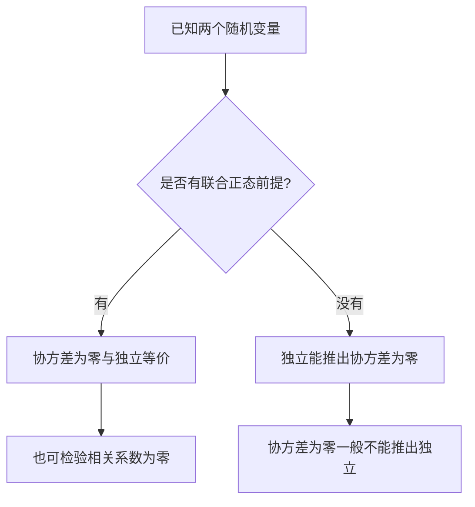

<Callout type="info" title="本记来源与校订说明">

对应原书 **第 103—105 页**，按原有 **必记 1—7** 完整整理：数学期望、方差、协方差、相关系数、切比雪夫不等式、大数定律、中心极限定理。原书在第 105 页以手写框图总结后两类极限定理；这里将框图转为可以直接复习与计算的文字、公式和判别流程。本记原页**没有独立真题题干**，练习部分均为明确标识的**原创巩固题**，不冒充历年真题。

**需要特别校准的两个简写：**&#x2060;原书“大数定律”仅写“独立”作为前提，事实上还需相应矩条件或其他足够条件；“中心极限定理”把有限样本的和写作服从正态分布，应区分**渐近正态近似**与**正态总体求和的精确正态分布**。下文保留原书所要强调的考点，并明确修正适用条件。

</Callout>

<Cards>
  <Card title="必记 1｜数学期望">六类计算：一维、函数、二维函数各分离散与连续。</Card>
  <Card title="必记 2｜方差">定义、反算、平移与缩放、和差方差。</Card>
  <Card title="必记 3｜协方差">从 $E(XY)$ 反算协方差；双线性与独立性。</Card>
  <Card title="必记 4｜相关系数">四种零相关判据、取值范围、完全线性相关。</Card>
  <Card title="必记 5｜切比雪夫不等式">两种事件形式与概率上、下界。</Card>
  <Card title="必记 6｜大数定律">样本均值、样本原点矩依概率收敛。</Card>
  <Card title="必记 7｜中心极限定理">标准化、正态近似、指数与正态样本对照。</Card>
</Cards>

## 必记 1｜数学期望：必须会的六种计算

数学期望反映随机变量取值的平均水平。计算前首先判断**离散/连续**，然后判断求的是**随机变量本身**还是**其函数**，最后判断涉及**一个变量**还是**两个变量**。原书“共六种情况”正是这三组的交叉分类。

### 1. 六种情形一张表

| 类型 | 已知条件 | 必须掌握的计算式 |
| --- | --- | --- |
| ① 一维离散 | $P(X=x_i)=p_i$ | $E(X)=\sum_i x_i p_i$ |
| ② 一维连续 | $X$ 的密度为 $f_X(x)$ | $E(X)=\int_{-\infty}^{+\infty}x f_X(x)\,\mathrm dx$ |
| ③ 一维离散函数 | $Y=g(X)$ | $E[g(X)]=\sum_i g(x_i)p_i$ |
| ④ 一维连续函数 | $Y=g(X)$ | $E[g(X)]=\int_{-\infty}^{+\infty}g(x)f_X(x)\,\mathrm dx$ |
| ⑤ 二维离散函数 | $P(X=x_i,Y=y_j)=p_{ij}$ | $E[g(X,Y)]=\sum_i\sum_j g(x_i,y_j)p_{ij}$ |
| ⑥ 二维连续函数 | 联合密度为 $f_{X,Y}(x,y)$ | $E[g(X,Y)]=\iint_{\mathbb R^2}g(x,y)f_{X,Y}(x,y)\,\mathrm dx\,\mathrm dy$ |

<Callout type="warn" title="存在性的条件不能省略">

上述无穷求和或广义积分，通常需要相应绝对可积条件，例如 $\sum_i |x_i|p_i<\infty$、$\int |g(x)|f_X(x)\,\mathrm dx<\infty$。对有限取值、积分区域有界且函数有界的常规考题，通常容易保证存在；遇到重尾分布、奇点或无限区域时应单独检查。

</Callout>

### 2. 基本运算性质：线性不要求独立

对于常数 $a,b,c$ 以及期望存在的随机变量，

$$
\boxed{E(c)=c,\qquad E[E(X)]=E(X),\qquad E(aX+bY+c)=aE(X)+bE(Y)+c.}
$$

原书列出的 $E(CX)=CE(X)$、$E(X+C)=E(X)+C$、$E(X\pm Y)=E(X)\pm E(Y)$，均是这条线性性质的特例。

但乘积公式需要另行判断：

$$
X\perp Y\quad\Longrightarrow\quad E(XY)=E(X)E(Y),
$$

其中 $X\perp Y$ 表示独立，且期望需要存在。**反向不能一般成立**；$E(XY)=E(X)E(Y)$ 只说明零协方差。

<Steps>
  <Step>

  ### 第一步：看到 $E[g(X)]$，不必先求 $g(X)$ 的分布

  直接在 $X$ 的原分布中代入 $g(x)$。例如 $X\sim U(0,1)$ 时，$E(X^2)=\int_0^1x^2\,\mathrm dx=1/3$。

  </Step>
  <Step>

  ### 第二步：看到 $E[g(X,Y)]$，先写出联合分布的求和或积分域

  离散型逐格加权；连续型在联合密度**非零区域**上积分。不规则区域需要特别注意积分上下限。

  </Step>
  <Step>

  ### 第三步：有独立性才能将 $E(XY)$ 拆为 $E(X)E(Y)$

  若题目没有给出独立，就从联合分布直接求 $E(XY)$，再代入协方差公式。

  </Step>
</Steps>

### 3. 原创示例｜离散联合分布的“逐格求期望”

设 $(X,Y)$ 只能取 $0,1$，联合分布律为：

| $X\backslash Y$ | $0$ | $1$ | 行和 |
| --- | ---: | ---: | ---: |
| $0$ | $0.2$ | $0.1$ | $0.3$ |
| $1$ | $0.3$ | $0.4$ | $0.7$ |
| 列和 | $0.5$ | $0.5$ | $1$ |

于是

$$
E(X)=0\times0.3+1\times0.7=0.7,\qquad E(Y)=0\times0.5+1\times0.5=0.5,
$$

而 $XY$ 仅在 $(X,Y)=(1,1)$ 时等于 $1$，故

$$
\boxed{E(XY)=0.4,\qquad E(XY)-E(X)E(Y)=0.4-0.35=0.05.}
$$

因此两者**不独立**；不需要先求 $XY$ 的单独分布律。

### 4. 原创示例｜非矩形积分区域

设联合密度

$$
f_{X,Y}(x,y)=\begin{cases}2,&0<y<x<1,\\0,&\text{其他} .\end{cases}
$$

计算 $E(X),E(Y),E(XY)$：

$$
\begin{aligned}
E(X)&=\int_0^1\!\int_0^x 2x\,\mathrm dy\,\mathrm dx=\frac23,\\
E(Y)&=\int_0^1\!\int_0^x 2y\,\mathrm dy\,\mathrm dx=\frac13,\\
E(XY)&=\int_0^1\!\int_0^x 2xy\,\mathrm dy\,\mathrm dx=\frac14.
\end{aligned}
$$

<Callout type="idea" title="在二维题中最实用的积分顺序">

先观察密度非零区域：这里固定 $x\in(0,1)$，$y$ 从 $0$ 到 $x$。**不要把三角形积分域误写成 $0<x<1,0<y<1$**；那样会连归一化条件都改变。

</Callout>

## 必记 2｜方差：定义、反算与和差

### 1. 定义、计算公式、反算公式

$$
\boxed{D(X)=E\bigl[(X-E(X))^2\bigr]=E(X^2)-[E(X)]^2.}
$$

由此立刻得到原书特别强调的“反算公式”：

$$
\boxed{E(X^2)=D(X)+[E(X)]^2.}
$$

将期望和二阶矩配合，往往比直接展开平方后计算分布简单。

### 2. 原书列出的全部性质

$$
\begin{gathered}
D(c)=0,\qquad D(X+c)=D(X),\\
D(cX)=c^2D(X),\qquad D(-X)=D(X),\\
\boxed{D(X\pm Y)=D(X)+D(Y)\pm2\operatorname{Cov}(X,Y).}
\end{gathered}
$$

**正号对应和，负号对应差**。若 $X,Y$ 独立，则 $\operatorname{Cov}(X,Y)=0$，故

$$
D(X+Y)=D(X-Y)=D(X)+D(Y).
$$

更一般地，即使不独立，只要**不相关**，上式也成立。

<Tabs items={['线性组合通式', '两种常见误区']}>
  <Tab value="线性组合通式">

  对任意实数 $a,b$，

  $$
  \boxed{D(aX+bY)=a^2D(X)+b^2D(Y)+2ab\operatorname{Cov}(X,Y).}
  $$

  例如 $D(X)=2,D(Y)=3,\operatorname{Cov}(X,Y)=1$，则

  $$
  D(2X-3Y)=4\times2+9\times3-12\times1=23.
  $$

  </Tab>
  <Tab value="两种常见误区">

  - **不能**写 $D(X+Y)=D(X)+D(Y)$，除非先证零协方差（独立只是更强的充分条件）。
  - **不能**写 $D(X-Y)=D(X)-D(Y)$；方差中的 $(-Y)$ 仍贡献 $+D(Y)$，只改变协方差项的符号。

  </Tab>
</Tabs>

<Callout type="info" title="方差存在的前提">

方差公式以 $E(X^2)<\infty$ 为通常的充分条件。计算方差为零等价于随机变量几乎处处等于一个常数；方差非负，负值往往意味着计算或代入错误。

</Callout>

## 必记 3｜协方差：判断相关性的中转站

### 1. 从 $E(XY)$ 反算

$$
\boxed{\operatorname{Cov}(X,Y)=E\bigl[(X-E X)(Y-E Y)\bigr]=E(XY)-E(X)E(Y).}
$$

原书将其列为“重点”，因为联合分布与相关系数的综合题往往先求 $E(X),E(Y),E(XY)$。

### 2. 五条原书性质与一条通用形式

| 性质 | 正确结论 |
| --- | --- |
| 同一变量 | $\operatorname{Cov}(X,X)=D(X)$ |
| 对称性 | $\operatorname{Cov}(X,Y)=\operatorname{Cov}(Y,X)$ |
| 与常数 | $\operatorname{Cov}(X,c)=0$ |
| 数乘 | $\operatorname{Cov}(aX,bY)=ab\operatorname{Cov}(X,Y)$ |
| 对加法分配 | $\operatorname{Cov}(X_1+X_2,Y)=\operatorname{Cov}(X_1,Y)+\operatorname{Cov}(X_2,Y)$ |
| 独立推出零协方差 | $X\perp Y\Rightarrow\operatorname{Cov}(X,Y)=0$ |

合并线性性质可得

$$
\boxed{\operatorname{Cov}(aX+bY,cX+dY)=acD(X)+bdD(Y)+(ad+bc)\operatorname{Cov}(X,Y).}
$$

这在考查 $U=X+Y$、$V=X-Y$ 是否不相关时尤其高频：

$$
\operatorname{Cov}(X+Y,X-Y)=D(X)-D(Y).
$$

<Accordions>
  <Accordion title="为什么 $\operatorname{Cov}(X+Y,X-Y)$ 中的交叉项消失？">

  由双线性和对称性，

  $$
  \begin{aligned}
  \operatorname{Cov}(X+Y,X-Y)
  &=\operatorname{Cov}(X,X)-\operatorname{Cov}(X,Y)\\
  &\quad+\operatorname{Cov}(Y,X)-\operatorname{Cov}(Y,Y)\\
  &=D(X)-D(Y).
  \end{aligned}
  $$

  此式**不要求 $X,Y$ 独立**。

  </Accordion>
  <Accordion title="协方差等于零，为什么不能直接判独立？">

  协方差为零只排除了线性相关性，并没有排除非线性函数依赖。例如 $X\sim U(-1,1)$ 且 $Y=X^2$，则 $E(X)=0$、$E(XY)=E(X^3)=0$，所以 $\operatorname{Cov}(X,Y)=0$；但 $Y$ 由 $X$ 完全确定，显然并不独立。

  </Accordion>
</Accordions>

## 必记 4｜相关系数：四种零相关判据与完全相关

### 1. 定义与反算

只在 $0<D(X),D(Y)<\infty$ 时，定义皮尔逊相关系数

$$
\boxed{\rho_{XY}=\frac{\operatorname{Cov}(X,Y)}{\sqrt{D(X)}\sqrt{D(Y)}}=\frac{E(XY)-E(X)E(Y)}{\sqrt{D(X)D(Y)}}.}
$$

反算公式：

$$
\boxed{\operatorname{Cov}(X,Y)=\rho_{XY}\sqrt{D(X)D(Y)}.}
$$

### 2. 考前要记住的四类等价条件

在方差均**严格为正且有限**的条件下，下列说法等价：

$$
\boxed{\rho_{XY}=0\ \Longleftrightarrow\ \operatorname{Cov}(X,Y)=0\ \Longleftrightarrow\ E(XY)=E(X)E(Y)\ \Longleftrightarrow\ D(X+Y)=D(X)+D(Y).}
$$

最后一项也可以等价地写成 $D(X-Y)=D(X)+D(Y)$：**两者满足其中一个，就可推出协方差为零，从而另一个也成立。**

<Callout type="warn" title="四个充要条件的边界：方差为零时相关系数无定义">

若 $D(X)=0$ 或 $D(Y)=0$，仍可能有 $\operatorname{Cov}(X,Y)=0$、$E(XY)=E(X)E(Y)$，但**相关系数 $\rho_{XY}$ 的分母为零，不能说 $\rho_{XY}=0$**。原书四条件连写是针对相关系数有定义的情形。

</Callout>

### 3. 相关系数的范围及完全线性相关

$$
\boxed{-1\le\rho_{XY}\le1,\qquad \rho_{XY}=\rho_{YX},\qquad \rho_{XX}=1\ (D(X)>0).}
$$

由柯西—施瓦茨不等式的取等条件（假设两方差均非零），

$$
\boxed{|\rho_{XY}|=1\ \Longleftrightarrow\ P(X=aY+b)=1\text{ 对某些 }a\ne0,b.}
$$

其中 $a>0$ 时 $\rho_{XY}=1$；$a<0$ 时 $\rho_{XY}=-1$。反过来，若 $X=aY+b$ 几乎处处，则 $X,Y$ 完全线性相关。

<Callout type="idea" title="如何判断正负号">

在表达式 $X=aY+b$ 中，**斜率 $a$ 的正负**决定相关系数的正负，与截距 $b$ 无关。例如 $Y=-2X+3$ 时相关系数为 $-1$，虽然 $E(Y)$ 可能为正。

</Callout>

### 4. 独立与不相关：一般情形和二维正态情形必须区分

一般只可写

$$
X\perp Y\Longrightarrow \operatorname{Cov}(X,Y)=0,
$$

而**当且仅当已知 $(X,Y)$ 服从二维联合正态分布**时，

$$
\boxed{X\perp Y\ \Longleftrightarrow\ \operatorname{Cov}(X,Y)=0\ \Longleftrightarrow\ \rho_{XY}=0.}
$$

“$X$ 和 $Y$ 各自都是正态分布”**不自动保证联合正态**；不能凭两个边缘正态就套用这个充要条件。

### 5. 原创综合示例｜三角形联合密度的相关系数

继续使用必记 1 的联合密度 $f(x,y)=2$（$0<y<x<1$）。先求二阶矩：

$$
E(X^2)=\int_0^1\!\int_0^x2x^2\,\mathrm dy\,\mathrm dx=\frac12,
\qquad
E(Y^2)=\int_0^1\!\int_0^x2y^2\,\mathrm dy\,\mathrm dx=\frac16.
$$

因此

$$
D(X)=\frac12-\frac49=\frac1{18},\qquad
D(Y)=\frac16-\frac19=\frac1{18},
$$

$$
\operatorname{Cov}(X,Y)=\frac14-\frac23\cdot\frac13=\frac1{36}.
$$

最后得到

$$
\boxed{\rho_{XY}=\frac{1/36}{\sqrt{1/18}\sqrt{1/18}}=\frac12.}
$$

这个例子串联原书必记 1—4：**先算期望和 $E(XY)$，再算方差，最后计算相关系数。**

## 必记 5｜切比雪夫不等式：一个变量的偏离概率

设 $E(X)=\mu$，$D(X)=\sigma^2<\infty$，$\varepsilon>0$。原书要求同时记住的两个形式为：

$$
\boxed{P\{|X-\mu|\ge\varepsilon\}\le\frac{\sigma^2}{\varepsilon^2},}
$$

$$
\boxed{P\{|X-\mu|<\varepsilon\}\ge 1-\frac{\sigma^2}{\varepsilon^2}.}
$$

第一式控制**偏离均值至少 $\varepsilon$** 的概率；第二式控制**落在均值附近的开区间**的概率。后一式由前一式取对立事件得到。

<Tabs items={['证明一遍', '考试计算法', '易错提醒']}>
  <Tab value="证明一遍">

  因为 $(X-\mu)^2\ge0$，由马尔可夫不等式，

  $$
  \begin{aligned}
  P(|X-\mu|\ge\varepsilon)
  &=P((X-\mu)^2\ge\varepsilon^2)\\
  &\le\frac{E[(X-\mu)^2]}{\varepsilon^2}
  =\frac{\sigma^2}{\varepsilon^2}.
  \end{aligned}
  $$

  </Tab>
  <Tab value="考试计算法">

  例如 $E(X)=3,D(X)=4$，求 $P(-2<X<8)$ 的下界。

  先改写事件：$-2<X<8\iff |X-3|<5$。取 $\varepsilon=5$，得到

  $$
  \boxed{P(-2<X<8)\ge1-\frac4{25}=\frac{21}{25}.}
  $$

  </Tab>
  <Tab value="易错提醒">

  - $\varepsilon$ 是**半宽度**，不是区间长度。
  - 期望 $\mu$ 是区间中心；不对称区间不能不加处理直接代入。
  - 若 $\sigma^2/\varepsilon^2>1$，上界虽仍正确却不能提供有用信息；概率的有效上界可以写为 $\min\{1,\sigma^2/\varepsilon^2\}$。
  - 原书特别提示“只有一个随机变量”：**可先把样本均值 $\overline X$ 或和 $S_n$ 看成一个随机变量，再套用。**

  </Tab>
</Tabs>

### 推广到样本均值（为大数定律铺路）

若 $X_1,\ldots,X_n$ 相互独立且同分布，$E(X_i)=\mu$，$D(X_i)=\sigma^2$，则

$$
E(\overline X_n)=\mu,\qquad D(\overline X_n)=\frac{\sigma^2}{n}.
$$

因而

$$
\boxed{P\{|\overline X_n-\mu|\ge\varepsilon\}\le\frac{\sigma^2}{n\varepsilon^2}\longrightarrow0.}
$$

这个计算同时给出了切比雪夫不等式与大数定律之间的直接联系。

## 必记 6｜大数定律：平均值的依概率收敛

### 1. 原书公式的严谨版本

原书写出“独立随机变量的均值接近期望均值”和“$k$ 次样本原点矩趋向 $E(X^k)$”，其核心是**依概率收敛**，不是说每个有限 $n$ 都等于期望。

依概率收敛的含义为：

$$
Z_n\xrightarrow{P}c
\quad\Longleftrightarrow\quad
\forall\varepsilon>0,\ P(|Z_n-c|\ge\varepsilon)\longrightarrow0.
$$

对于独立同分布 $X_1,X_2,\ldots$，如果 $E|X_1|<\infty$，则有（辛钦大数定律）

$$
\boxed{\overline X_n=\frac1n\sum_{i=1}^nX_i\xrightarrow{P}\mu=E(X_1).}
$$

若进一步对某个正整数 $k$ 有 $E|X_1|^k<\infty$，则将大数定律用于新随机变量 $X_i^k$：

$$
\boxed{A_{k,n}=\frac1n\sum_{i=1}^n X_i^k\xrightarrow{P}E(X_1^k).}
$$

这正是原书针对“从总体 $X$ 抽得简单随机样本”的考查形式。

### 2. 非同分布时的一个常用充分条件

独立而不必同分布的 $X_1,\ldots,X_n$，若存在统一常数 $M$ 使 $D(X_i)\le M$，则由切比雪夫不等式有

$$
\begin{aligned}
P\left(\left|\frac1n\sum_{i=1}^n(X_i-E X_i)\right|\ge\varepsilon\right)
&\le\frac{\sum_{i=1}^nD(X_i)}{n^2\varepsilon^2}\\
&\le\frac{M}{n\varepsilon^2}\longrightarrow0.
\end{aligned}
$$

因此

$$
\boxed{\frac1n\sum_{i=1}^nX_i-\frac1n\sum_{i=1}^nE(X_i)\xrightarrow{P}0.}
$$

<Callout type="warn" title="原书“只要独立”属于省略条件的记忆简写">

**仅有相互独立，不足以保证大数定律。**&#x2060;例如取相互独立的 $X_i\sim N(0,i^2)$，则其均值方差

$$
D\left(\frac1n\sum_{i=1}^n X_i\right)=\frac1{n^2}\sum_{i=1}^ni^2=\frac{(n+1)(2n+1)}{6n}\longrightarrow+\infty.
$$

该均值仍为正态、期望为 $0$，却不会依概率趋于 $0$。复习原书时应补上**独立同分布且矩存在**，或**独立且方差统一有界**等足够条件。

</Callout>

### 3. 统计中最常用的三个结论

设 $X_1,\ldots,X_n$ 为来自总体 $X$ 的简单随机样本，且所需矩存在。

| 样本统计量 | 依概率收敛的目标 |
| --- | --- |
| 样本均值 $\overline X_n=\frac1n\sum_iX_i$ | $\overline X_n\xrightarrow{P}E(X)$ |
| 二阶样本原点矩 $A_{2,n}=\frac1n\sum_i X_i^2$ | $A_{2,n}\xrightarrow{P}E(X^2)$ |
| 用 $1/n$ 定义的样本离差平方均值 $\frac1n\sum_i(X_i-\overline X_n)^2$ | $\xrightarrow{P}D(X)$（需二阶矩有限） |

最后一行由

$$
\frac1n\sum_{i=1}^n(X_i-\overline X_n)^2=\frac1n\sum_{i=1}^nX_i^2-\overline X_n^2
$$

以及大数定律、连续映射定理推出。注意：分母为 $n$ 的样本离差平方均值与无偏样本方差（分母为 $n-1$）**不是同一个有限样本统计量**，但在适当条件下具有相同的依概率极限。

## 必记 7｜中心极限定理：和的分布渐近正态

### 1. 一句话区分本记两大极限定理

<Cards>
  <Card title="大数定律解决什么？">平均值接近常数 $\mu$ 的问题：$\overline X_n\xrightarrow{P}\mu$。</Card>
  <Card title="中心极限定理解决什么？">标准化后的随机波动近似正态：$\frac{S_n-n\mu}{\sigma\sqrt n}\xrightarrow{d}N(0,1)$。</Card>
</Cards>

### 2. 独立同分布、有限正方差的经典版本

若 $X_1,X_2,\ldots$ 相互独立且同分布，满足

$$
E(X_i)=\mu,\qquad 0<D(X_i)=\sigma^2<\infty,
$$

令 $S_n=\sum_{i=1}^nX_i$，则

$$
\boxed{\frac{S_n-n\mu}{\sigma\sqrt n}\xrightarrow{d}N(0,1).}
$$

等价地，当 $n$ 充分大时，

$$
\boxed{S_n\ \overset{\mathrm{approx}}{\sim}\ N(n\mu,n\sigma^2),\qquad
\overline X_n\ \overset{\mathrm{approx}}{\sim}\ N\left(\mu,\frac{\sigma^2}{n}\right).}
$$

这里**均值是 $n\mu$，方差是 $n\sigma^2$，标准差才是 $\sqrt n\sigma$**。若原变量不是正态，不能把“近似”直接写成“严格服从”。

<Callout type="warn" title="原书黑板上的反例：指数分布的和不是精确正态">

原书第 105 页手写标注：独立且服从指数分布 $E(4)$ 的样本，其和不能直接写为“精确服从”正态。这里约定 $E(4)$ 指**率参数为 $4$** 的指数分布，即密度 $4e^{-4x}$（$x>0$）。则

$$
E(X_i)=\frac14,\qquad D(X_i)=\frac1{16}.
$$

有限 $n$ 时 $S_n$ **精确服从 Gamma 分布**（形状参数 $n$、率参数 $4$），不是正态；只有 $n$ 较大时，可用

$$
\boxed{S_n\ \overset{\mathrm{approx}}{\sim}\ N\left(\frac n4,\frac n{16}\right).}
$$

部分教材以“均值/尺度”为指数参数，记号可能不同，计算时以题目密度或分布函数约定为准。

</Callout>

### 3. 原书另一个例子：正态变量的和确实精确正态

若 $X_i$ **相互独立**且 $X_i\sim N(\mu,\sigma^2)$，那么对任意正整数 $n$，

$$
\boxed{S_n=\sum_{i=1}^nX_i\sim N(n\mu,n\sigma^2).}
$$

这是正态分布关于**独立线性组合封闭**的性质，**不是只能在 $n\to\infty$ 时才成立**。因此要区分：

| 原变量 | 样本和分布结论 | 是否要求 $n$ 大 |
| --- | --- | --- |
| 独立同分布、有限正方差的非正态变量 | $S_n$ 渐近近似 $N(n\mu,n\sigma^2)$ | 近似质量随 $n$ 和分布特征变化 |
| 相互独立的正态变量 | $S_n$ 精确服从 $N(\sum_i\mu_i,\sum_i\sigma_i^2)$ | **不要求** |

### 4. 原创示例｜二项分布的正态近似

设独立伯努利试验成功概率 $p=0.4$，重复 $100$ 次，成功次数 $S\sim B(100,0.4)$。有

$$
E(S)=100\times0.4=40,\qquad D(S)=100\times0.4\times0.6=24.
$$

欲估计 $P(S\ge45)$，对离散变量应用连续性校正，

$$
\begin{aligned}
P(S\ge45)
&\approx P\left(N(40,24)\ge44.5\right)\\
&=1-\Phi\left(\frac{44.5-40}{\sqrt{24}}\right)\\
&\approx1-\Phi(0.919)\approx0.179.
\end{aligned}
$$

这里 $\Phi$ 表示**标准正态分布函数**；连续性校正用于二项分布等整数计数变量，若题目要求“中心极限定理近似”，应明确结果是近似值。

### 5. 考场标准化流程

<Steps>
  <Step>

  ### 明确要求的是和 $S_n$ 还是平均值 $\overline X_n$

  先列出 $\mu=E(X_i)$ 与 $\sigma^2=D(X_i)$，避免把方差错当标准差。

  </Step>
  <Step>

  ### 分别求目标量的均值与方差

  $E(S_n)=n\mu$，$D(S_n)=n\sigma^2$；$E(\overline X_n)=\mu$，$D(\overline X_n)=\sigma^2/n$。

  </Step>
  <Step>

  ### 标准化并转换为标准正态概率

  用 $(S_n-n\mu)/(\sigma\sqrt n)$ 或 $\sqrt n(\overline X_n-\mu)/\sigma$；必要时配合 $\Phi(-z)=1-\Phi(z)$。

  </Step>
  <Step>

  ### 在最终答案上标明“精确”还是“近似”

  正态样本和为精确结论；一般有限方差同分布样本的正态分布为大样本近似。离散计数题酌情加连续性校正。

  </Step>
</Steps>

## 原创巩固练习｜第 20 记

<Callout type="info" title="练习说明">

本记原书三页仅给出公式与手写梳理图，未含可以直接转录的完整真题。因此下列题目均根据原书必记 1—7 **原创编写**，用于检验六种期望计算、和差方差、零相关、概率界、样本矩及极限定理的适用条件。

</Callout>

**题型：单选题**

来源:本记原创自测, 科目:概率论, 考点:二维离散型函数期望, 难度:基础

设随机变量 $(X,Y)$ 的联合分布律为：$P(0,0)=0.2$，$P(0,1)=0.1$，$P(1,0)=0.3$，$P(1,1)=0.4$。则 $E(XY)$ 为（ ）。

**A.** $0.25$

**B.** $0.35$

**C.** $0.40$

**D.** $0.50$

<Accordions>
  <Accordion title="查看答案与解析">

**参考答案：** C

由二维离散变量函数的期望公式，$E(XY)=\sum_{x,y}xyP(X=x,Y=y)$。只有 $(1,1)$ 对期望有非零贡献，因此 $E(XY)=1\times1\times0.4=0.4$。故选第三项。

  </Accordion>
</Accordions>

**题型：单选题**

来源:本记原创自测, 科目:概率论, 考点:二维连续型期望, 难度:中等

设 $f(x,y)=2$（$0<y<x<1$），其余为 $0$，则 $E(XY)$ 为（ ）。

**A.** $\frac16$

**B.** $\frac14$

**C.** $\frac13$

**D.** $\frac12$

<Accordions>
  <Accordion title="查看答案与解析">

**参考答案：** B

$$
E(XY)=\int_0^1\!\int_0^x2xy\,\mathrm dy\,\mathrm dx
=\int_0^1 x^3\,\mathrm dx=\frac14.
$$

积分区域是三角形而不是整个单位正方形。

  </Accordion>
</Accordions>

**题型：多选题**

来源:本记原创自测, 科目:概率论, 考点:数学期望性质, 易错

设 $X,Y$ 的相关期望存在。下列结论中一定成立的有（ ）。

**A.** $E(2X-3Y+1)=2E(X)-3E(Y)+1$

**B.** $E(XY)=E(X)E(Y)$

**C.** $E\bigl[(X-E X)+(Y-E Y)\bigr]=0$

**D.** $E(X^2)=[E(X)]^2$

<Accordions>
  <Accordion title="查看答案与解析">

**参考答案：** A、C

第一、第三项直接来自期望的线性性，不需要 $X,Y$ 独立。第二项要有独立等额外条件才可直接使用；第四项漏掉 $D(X)$，只有方差为零时才成立。

  </Accordion>
</Accordions>

**题型：单选题**

来源:本记原创自测, 科目:概率论, 考点:线性组合方差, 难度:中等

已知 $D(X)=2$，$D(Y)=3$，$\operatorname{Cov}(X,Y)=1$，则 $D(2X-3Y)$ 等于（ ）。

**A.** $11$

**B.** $19$

**C.** $23$

**D.** $35$

<Accordions>
  <Accordion title="查看答案与解析">

**参考答案：** C

$$
D(2X-3Y)=4D(X)+9D(Y)-12\operatorname{Cov}(X,Y)=8+27-12=23.
$$

差的方差不是两个方差的差，且交叉项的系数为 $2\times2\times(-3)=-12$。

  </Accordion>
</Accordions>

**题型：填空题**

来源:本记原创自测, 科目:概率论, 考点:协方差反算, 难度:基础

若 $E(X)=2$，$E(Y)=-1$，$E(XY)=-1$，则 $\operatorname{Cov}(X,Y)=$ $\underline{\qquad}$。

<Accordions>
  <Accordion title="查看答案与解析">

**参考答案：** $1$

由定义，$\operatorname{Cov}(X,Y)=E(XY)-E(X)E(Y)=-1-[2\times(-1)]=1$。

  </Accordion>
</Accordions>

**题型：单选题**

来源:本记原创自测, 科目:概率论, 考点:相关系数, 难度:基础

已知 $D(X)=4,D(Y)=9,\operatorname{Cov}(X,Y)=-3$，则 $\rho_{XY}=$（ ）。

**A.** $-1$

**B.** $-\frac12$

**C.** $\frac12$

**D.** $1$

<Accordions>
  <Accordion title="查看答案与解析">

**参考答案：** B

$$
\rho_{XY}=\frac{-3}{\sqrt4\sqrt9}=-\frac36=-\frac12.
$$

相关系数为无量纲量，永远在 $[-1,1]$ 内。

  </Accordion>
</Accordions>

**题型：判断题**

来源:本记原创自测, 科目:概率论, 考点:不相关与独立, 易错

设 $X\sim U(-1,1)$，$Y=X^2$。由于 $\operatorname{Cov}(X,Y)=0$，所以 $X,Y$ 相互独立。

<Accordions>
  <Accordion title="查看答案与解析">

**参考答案：** 错误

**错误。**$E(X)=E(X^3)=0$，故 $\operatorname{Cov}(X,Y)=E(X^3)-E(X)E(X^2)=0$；但是 $Y=X^2$ 由 $X$ 唯一确定，二者不独立。本例还满足 $D(X)>0$、$D(Y)>0$，相关系数有定义且等于 $0$。

  </Accordion>
</Accordions>

**题型：解答题**

来源:本记原创自测, 科目:概率论, 考点:完全线性相关, 难度:中等

设 $D(X)=4$，$Y=-2X+3$。求 $D(Y)$、$\operatorname{Cov}(X,Y)$ 和 $\rho_{XY}$。

<Accordions>
  <Accordion title="查看答案与解析">

由方差与协方差的性质，

$$
D(Y)=(-2)^2D(X)=16,
$$

$$
\operatorname{Cov}(X,Y)=\operatorname{Cov}(X,-2X+3)=-2D(X)=-8.
$$

故

$$
\boxed{\rho_{XY}=\frac{-8}{\sqrt4\sqrt{16}}=-1.}
$$

由于 $Y$ 是 $X$ 的严格递减仿射函数，相关系数为 $-1$ 而不是仅仅“小于零”。

  </Accordion>
</Accordions>

**题型：单选题**

来源:本记原创自测, 科目:概率论, 考点:切比雪夫不等式, 难度:基础

已知 $E(X)=3,D(X)=4$。由切比雪夫不等式直接得到的 $P(-2<X<8)$ 的**最优通用下界**为（ ）。

**A.** $\frac45$

**B.** $\frac{21}{25}$

**C.** $\frac9{10}$

**D.** $1$

<Accordions>
  <Accordion title="查看答案与解析">

**参考答案：** B

$-2<X<8$ 等价于 $|X-3|<5$，所以

$$
P(-2<X<8)\ge1-\frac{D(X)}{5^2}=1-\frac4{25}=\frac{21}{25}.
$$

此处是**可保证的下界**，并非实际概率一定等于该数。

  </Accordion>
</Accordions>

**题型：解答题**

来源:本记原创自测, 科目:概率论, 考点:样本均值与切比雪夫, 难度:中等

设 $X_1,\ldots,X_{100}$ 独立同分布且 $P(X_i=1)=0.3$，$P(X_i=0)=0.7$，令 $\overline X=\frac1{100}\sum_{i=1}^{100}X_i$。用切比雪夫不等式求 $P(|\overline X-0.3|\ge0.1)$ 的上界。

<Accordions>
  <Accordion title="查看答案与解析">

因为 $X_i\sim B(1,0.3)$，

$$
E(X_i)=0.3,\qquad D(X_i)=0.3\times0.7=0.21.
$$

由独立性，$D(\overline X)=0.21/100=0.0021$。因此

$$
\boxed{P(|\overline X-0.3|\ge0.1)\le\frac{0.0021}{0.1^2}=0.21.}
$$

这是普适上界，实际二项尾概率可以远小于此数。

  </Accordion>
</Accordions>

**题型：单选题**

来源:本记原创自测, 科目:概率论, 考点:样本原点矩大数定律, 难度:基础

设 $X_1,X_2,\ldots$ 独立同分布于 $U(-1,1)$，则 $\frac1n\sum_{i=1}^nX_i^4$ 依概率收敛于（ ）。

**A.** $0$

**B.** $\frac13$

**C.** $\frac15$

**D.** $\frac12$

<Accordions>
  <Accordion title="查看答案与解析">

**参考答案：** C

由大数定律，对 $X_i^4$ 求均值的极限为 $E(X^4)$。均匀分布的密度为 $1/2$（$-1<x<1$），所以

$$
E(X^4)=\frac12\int_{-1}^1x^4\,\mathrm dx=\frac15.
$$

因此所求依概率极限为 $1/5$。

  </Accordion>
</Accordions>

**题型：判断题**

来源:本记原创自测, 科目:概率论, 考点:大数定律成立条件, 易错

只要 $X_1,X_2,\ldots$ 相互独立，就必有 $\frac1n\sum_{i=1}^n(X_i-E X_i)\xrightarrow{P}0$。

<Accordions>
  <Accordion title="查看答案与解析">

**参考答案：** 错误

**错误。**&#x2060;独立本身不足以保证该结论。例如相互独立的 $X_i\sim N(0,i^2)$，均值的方差为

$$
\frac{\sum_{i=1}^ni^2}{n^2}=\frac{(n+1)(2n+1)}{6n}\to+\infty,
$$

且均值为正态变量，对任何固定 $\varepsilon>0$，落在 $(-\varepsilon,\varepsilon)$ 的概率趋于 $0$。可用独立且方差统一有界等条件保证结论。

  </Accordion>
</Accordions>

**题型：解答题**

来源:本记原创自测, 科目:概率论, 考点:指数分布中心极限定理, 难度:中等

设 $X_1,\ldots,X_{64}$ 独立且密度均为 $f(x)=4e^{-4x}$（$x>0$），令 $S_{64}=\sum_{i=1}^{64}X_i$。用中心极限定理估计 $P(S_{64}\ge18)$，并写明该近似是否为精确分布。

<Accordions>
  <Accordion title="查看答案与解析">

单个变量 $E(X_i)=1/4$，$D(X_i)=1/16$。因此

$$
E(S_{64})=16,\qquad D(S_{64})=4,\qquad \sqrt{D(S_{64})}=2.
$$

由中心极限定理，

$$
\begin{aligned}
P(S_{64}\ge18)&\approx P\left(Z\ge\frac{18-16}{2}\right)\\
&=1-\Phi(1)\approx0.1587,
\end{aligned}
$$

其中 $Z\sim N(0,1)$。**有限个指数变量的和精确服从 Gamma 分布而非正态**，以上为近似值。

  </Accordion>
</Accordions>

**题型：多选题**

来源:本记原创自测, 科目:概率论, 考点:正态样本和, 难度:中等

设 $X_1,\ldots,X_{16}$ 相互独立且都服从 $N(1,9)$，令 $S_{16}=\sum_{i=1}^{16}X_i$。下列结论正确的有（ ）。

**A.** $E(S_{16})=16$

**B.** $D(S_{16})=144$

**C.** $S_{16}$ 只有近似服从 $N(16,144)$，不是精确服从

**D.** $\frac{S_{16}-16}{12}\sim N(0,1)$

<Accordions>
  <Accordion title="查看答案与解析">

**参考答案：** A、B、D

独立正态变量之和仍精确正态，故

$$
S_{16}\sim N(16\times1,16\times9)=N(16,144).
$$

其标准差是 $12$，所以标准化后精确服从标准正态分布。第三项把精确结论误说成近似，故错误。

  </Accordion>
</Accordions>

**题型：解答题**

来源:本记原创自测, 科目:概率论, 考点:二项分布正态近似, 难度:中等

独立重复某试验 $100$ 次，每次成功概率为 $0.4$。记成功次数为 $S$，利用中心极限定理与连续性校正近似计算 $P(S\ge45)$。

<Accordions>
  <Accordion title="查看答案与解析">

$S\sim B(100,0.4)$，$E(S)=40$，$D(S)=24$。利用正态近似并将 $45$ 校正为 $44.5$：

$$
\begin{aligned}
P(S\ge45)&\approx 1-\Phi\left(\frac{44.5-40}{\sqrt{24}}\right)\\
&=1-\Phi(0.91856\ldots)\approx0.179.
\end{aligned}
$$

若不使用连续性校正，则会得到不同的近似值；两者都不是二项分布尾概率的精确求和。

  </Accordion>
</Accordions>

**题型：解答题**

来源:本记原创自测, 科目:概率论, 考点:协方差与正态独立, 难度:较难

设 $(X,Y)$ 为联合正态随机向量，且 $D(X)=D(Y)=2$、$\operatorname{Cov}(X,Y)=1$。令 $U=X+Y$，$V=X-Y$。求 $D(U),D(V)$，判断 $U,V$ 是否独立。

<Accordions>
  <Accordion title="查看答案与解析">

先求方差：

$$
D(U)=2+2+2\times1=6,\qquad D(V)=2+2-2\times1=2.
$$

再求协方差：

$$
\operatorname{Cov}(U,V)=\operatorname{Cov}(X+Y,X-Y)=D(X)-D(Y)=0.
$$

$(U,V)$ 是联合正态向量的线性变换，仍联合正态；因此由零协方差可推出独立。答案为

$$
\boxed{D(U)=6,\qquad D(V)=2,\qquad U\perp V.}
$$

如果题目不提供**联合正态**，仅凭协方差为零一般不能判定独立。

  </Accordion>
</Accordions>

## 考前速查｜第 20 记公式与适用条件

| 题目关键词 | 第一反应 | 必记公式 / 条件 |
| --- | --- | --- |
| 一维函数期望 | 直接代入原分布，不先求新分布 | $E[g(X)]=\sum g(x_i)p_i$ 或 $\int g(x)f_X(x)\,\mathrm dx$ |
| 二维函数期望 | 联合分布逐格或二重积分 | $E[g(X,Y)]=\sum_{i,j}g(x_i,y_j)p_{ij}$ 或 $\iint g f$ |
| 线性期望 | 不要求独立 | $E(aX+bY)=aE(X)+bE(Y)$ |
| 方差反算 | 先算二阶矩 | $D(X)=E(X^2)-[E(X)]^2$ |
| 和差的方差 | 检查协方差 | $D(X\pm Y)=D(X)+D(Y)\pm2\operatorname{Cov}(X,Y)$ |
| 协方差反算 | 先求三个期望 | $\operatorname{Cov}(X,Y)=E(XY)-E(X)E(Y)$ |
| 零相关 | 四等价条件（方差非零） | $\rho=0\Leftrightarrow\operatorname{Cov}=0\Leftrightarrow E(XY)=E X E Y\Leftrightarrow D(X+Y)=D X+D Y$ |
| 相关系数绝对值为 $1$ | 几乎处处仿射关系 | $\vert \rho\vert =1\Leftrightarrow P(X=aY+b)=1$，$a\ne0$ |
| 零相关推出独立 | 需联合正态 | 联合正态下 $\rho=0\Leftrightarrow X\perp Y$ |
| 切比雪夫不等式 | 平方偏差 / 方差除以阈值平方 | $P(\vert X-EX\vert \ge\varepsilon)\le D(X)/\varepsilon^2$ |
| 大数定律 | 样本平均接近常数 | 独立同分布且一阶绝对矩存在：$\overline X_n\xrightarrow{P}\mu$ |
| 样本原点矩 | 视 $X_i^k$ 为新样本 | $A_{k,n}\xrightarrow{P}E(X^k)$，需相应矩存在 |
| 中心极限定理 | 标准化后趋于正态 | $(S_n-n\mu)/(\sigma\sqrt n)\xrightarrow{d}N(0,1)$ |
| 独立正态变量求和 | 正态精确封闭 | $\sum X_i\sim N(\sum\mu_i,\sum\sigma_i^2)$ |

<Callout type="success" title="第 20 记整理与来源核对记录">

- **原书覆盖**：第 **103—105 页**的全部 **必记 1—7**；其中第 105 页两块手写框图的知识点已逐条文字化，分别放入“大数定律”和“中心极限定理”。
- **知识结构**：保留原书数学期望“六种情况”及方差、协方差、相关系数的核心性质，补充可操作的三步计算流程、综合示例和公式速查表。
- **重要校准**：明确相关系数只在两方差严格为正且有限时有定义；零相关一般不推出独立，联合正态才可双向判定；大数定律并非“只要独立就成立”；中心极限定理给出渐近正态而非有限样本精确正态；指数分布与正态分布的求和结论已经分开处理。
- **新增练习**：共 **16 道原创练习**，包含选择、判断、填空和解答，均带结构化正确答案或逐步解析；原书该记没有独立真题，因此没有虚构真题来源。

</Callout>
