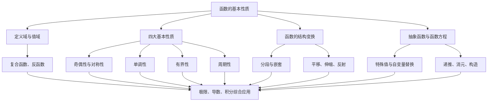
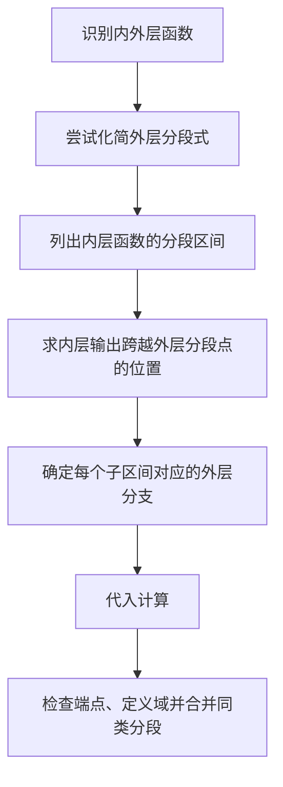
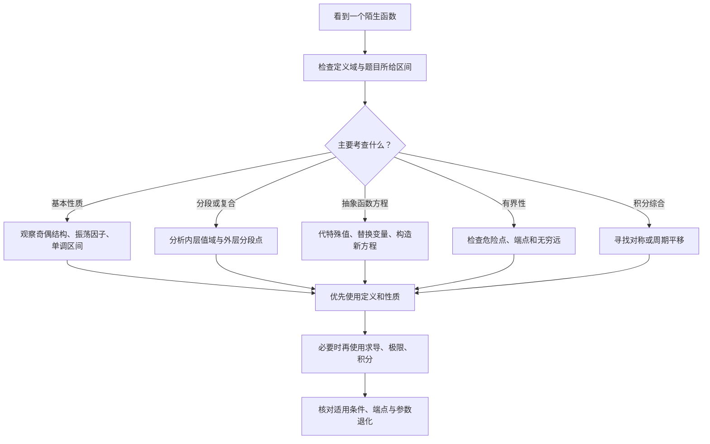

## 考点概览

| 题目来源          | 核心考点            | 学习价值 |
| ------------- | --------------- | ---- |
| 1987年真题       | 奇偶性、有界性、单调性、周期性 | 极高   |
| 1992年真题       | 分段函数自变量替换       | 高    |
| 1997年真题       | 分段复合函数          | 极高   |
| 1990年真题       | 函数嵌套与值域         | 高    |
| 2004年真题       | 开区间函数有界性        | 极高   |
| 张宇1000题       | 平移递推、反函数、函数方程   | 极高   |
| 李林880题        | 复合单调性、根式有理化、有界性 | 极高   |
| 李正元练习题        | 无界与无穷大的区别       | 高    |
| 张宇8套卷第1套第12题  | 对称性与积分抵消        | 极高   |
| 汤家凤八套卷第1套第2题  | 周期性与变限积分        | 极高   |
| 李永乐六套卷第4套第19题 | 周期性与积分正交        | 极高   |
| 李林六套卷第6套第17题  | 函数方程与导数综合       | 极高   |

## 一、本节的知识体系与命题本质

函数的基本性质表面上属于高数的基础知识，但实际上贯穿了考研数学一的整个知识体系。

命题重点是从陌生函数的结构中识别奇偶性、单调性、有界性、周期性，并利用这些性质简化计算。

本节需要建立五种核心思维：

1. **定义域思维：** 先判断函数在哪里有意义，再谈函数性质。
2. **结构思维：** 不急于展开计算，先观察函数的组成形式。
3. **对称思维：** 通过替换自变量，建立函数值之间的联系。
4. **局部与整体思维：** 区分某一点、某个区间和整个定义域上的性质。
5. **反例思维：** 对于错误的全称命题，只需要找到一个反例。

尤其需要掌握的是：**利用函数性质减少计算，而不是每次都依赖求导、求极限和复杂的代数运算。**

## 二、基础知识：定义域、值域与复合函数

### 2.1 定义域是所有函数性质的前提

函数由定义域和对应法则共同确定，不能只看函数表达式。

例如：

$$
f(x)=\sqrt{x^2}
$$

正确的化简是

$$
f(x)=|x|
$$

而不是 $f(x)=x$。

虽然

$$
\frac{x^2-1}{x-1}=x+1
$$

但左边的定义域不包含 $x=1$，右边则可以包含。因此二者并不是定义域完全相同的函数。

常见定义域限制如下：

| 函数结构                       | 必须满足的条件                           |
| -------------------------- | --------------------------------- |
| $\dfrac1{g(x)}$        | $g(x)\ne0$                    |
| $\sqrt{g(x)}$          | $g(x)\ge0$                    |
| $\dfrac1{\sqrt{g(x)}}$ | $g(x)>0$                      |
| $\ln g(x)$             | $g(x)>0$                      |
| $\arcsin g(x)$         | $\lvert g(x)\rvert \le1$                |
| $\arccos g(x)$         | $\lvert g(x)\rvert \le1$                |
| $\tan g(x)$            | $g(x)\ne k\pi+\dfrac{\pi}{2}$ |
| $f(g(x))$              | $x\in D_g,\ g(x)\in D_f$      |

如果多个限制同时出现，应取所有条件的交集。

### 2.2 复合函数的本质

设

$$
y=f(g(x))
$$

可以将其理解为两个连续的映射过程：

$$
x\xrightarrow{g}u\xrightarrow{f}y
$$

内层函数决定输入什么，外层函数决定如何处理这个输入。

因此，复合函数的定义域为

$$
D_{f\circ g} =\{x\in D_g:g(x)\in D_f\}
$$

**基础例题**

求函数

$$
F(x)=\ln(1-x^2)
$$

的定义域。

由于外层对数函数要求自变量大于零，因此

$$
1-x^2>0
$$

解得

$$
\boxed{D_F=(-1,1)}
$$

这里的核心操作不是机械地记忆复合函数定义域公式，而是把外层函数的限制转化为内层函数必须满足的条件。

## 三、函数的四大基本性质

### 3.1 奇偶性

**定义与直观理解**

设函数定义域关于原点对称。

如果对定义域内任意 $x$，都有

$$
f(-x)=f(x)
$$

则 $f(x)$ 是偶函数，其图像关于 $y$ 轴对称。

如果

$$
f(-x)=-f(x)
$$

则 $f(x)$ 是奇函数，其图像关于原点中心对称。

判断奇偶性的第一步不是代入 $-x$，而是检查定义域是否关于原点对称。

例如：

$$
f(x)=x^2,\qquad x\in[0,+\infty)
$$

它既不是奇函数，也不是偶函数。

**常见函数的奇偶性**

| 奇函数              | 偶函数              |
| ---------------- | ---------------- |
| $x^{2n+1}$   | $x^{2n}$     |
| $\sin x$     | $\cos x$     |
| $\tan x$     | $\lvert x\rvert $      |
| $\arcsin x$  | $\cosh x$    |
| $\arctan x$  | $e^{x^2}$    |
| $e^x-e^{-x}$ | $e^x+e^{-x}$ |

恒等于零的函数，在对称定义域上既是奇函数也是偶函数。

**四则运算规律**

在相应运算有意义且定义域对称的条件下：

| 运算        | 奇偶性 |
| --------- | --- |
| 奇函数 ± 奇函数 | 奇   |
| 偶函数 ± 偶函数 | 偶   |
| 奇函数 × 奇函数 | 偶   |
| 偶函数 × 偶函数 | 偶   |
| 奇函数 × 偶函数 | 奇   |
| 奇函数 ÷ 奇函数 | 偶   |
| 偶函数 ÷ 偶函数 | 偶   |
| 奇函数 ÷ 偶函数 | 奇   |
| 偶函数 ÷ 奇函数 | 奇   |

注意，奇函数与偶函数相加，一般不能直接确定奇偶性。

**复合函数的奇偶性**

在复合函数有定义且定义域关于原点对称的前提下：

| 外层函数 $f$ | 内层函数 $g$ | $f(g(x))$ |
| ------------ | ------------ | ------------- |
| 奇            | 奇            | 奇             |
| 偶            | 奇            | 偶             |
| 奇            | 偶            | 偶             |
| 偶            | 偶            | 偶             |
| 任意           | 偶            | 偶             |

其中最值得记忆的是：

**内偶则整体为偶；内奇则整体继承外层奇偶性（外层具有奇偶性时）。**

证明非常简单。若 $g$ 为偶函数，则

$$
f(g(-x))=f(g(x))
$$

与外层函数本身是否为奇函数、偶函数没有关系。

**奇偶分解公式**

任何定义在对称区间上的函数，都可以唯一分解为一个奇函数和一个偶函数之和：

$$
\boxed{ f(x)= \frac{f(x)-f(-x)}2+ \frac{f(x)+f(-x)}2 }
$$

其中

$$
f_o(x)=\frac{f(x)-f(-x)}2
$$

为奇函数部分，

$$
f_e(x)=\frac{f(x)+f(-x)}2
$$

为偶函数部分。

这一公式在抽象函数、函数方程、对称积分中十分重要。

**奇偶性与导数、积分的联系**

在相应导数存在的条件下：

$$
\text{奇函数}\xrightarrow{\text{求导}}\text{偶函数}
$$

$$
\text{偶函数}\xrightarrow{\text{求导}}\text{奇函数}
$$

求导一次改变奇偶性，求导两次恢复原有奇偶性。

对于变上限积分

$$
F(x)=\int_0^x f(t)\,\mathrm dt
$$

若 $f$ 连续，则：

$$
f\text{ 为奇函数}\Longrightarrow F\text{ 为偶函数}
$$

$$
f\text{ 为偶函数}\Longrightarrow F\text{ 为奇函数}
$$

注意这里的积分下限是 $0$。如果将下限改为任意常数，必须重新考虑积分常数对奇偶性的影响。

对称区间上的积分性质：

$$
\boxed{\int_{-a}^{a}f(x)\,\mathrm dx=0}
$$

当 $f$ 为可积奇函数时成立。

当 $f$ 为可积偶函数时，

$$
\boxed{\int_{-a}^{a}f(x)\,\mathrm dx =2\int_0^a f(x)\,\mathrm dx}
$$

这些性质不只是积分章节的计算技巧，本质上都是函数对称性的直接应用。

### 3.2 单调性

**定义**

对于区间 $I$ 内任意 $x_1<x_2$，若

$$
f(x_1)<f(x_2)
$$

则称函数在 $I$ 上严格单调增加。

若

$$
f(x_1)>f(x_2)
$$

则称函数在 $I$ 上严格单调减少。

单调性描述的是整个区间上的大小关系，而不是某一点的变化趋势。

**利用导数判断单调性**

设函数在区间上可导。

| 导数条件               | 函数性质   |
| ------------------ | ------ |
| $f'(x)>0$      | 严格单调增加 |
| $f'(x)<0$      | 严格单调减少 |
| $f'(x)\ge0$    | 单调不减   |
| $f'(x)\le0$    | 单调不增   |
| $f'(x)\equiv0$ | 常值函数   |

需要注意：

$$
f'(x)>0
$$

是严格单调增加的充分条件，而不是必要条件。

例如

$$
f(x)=x^3
$$

在整个实数轴上严格增加，但

$$
f'(0)=0
$$

只要导数非负且不存在一段非退化区间使导数恒为零，也能保证严格递增。

**复合函数的单调性**

| 内层 | 外层 | 复合函数 |
| -- | -- | ---- |
| 增  | 增  | 增    |
| 减  | 减  | 增    |
| 增  | 减  | 减    |
| 减  | 增  | 减    |

可以概括为：

**同增同减得增，一增一减得减。**

但有一个非常重要的前提：内层函数的值域必须落在外层函数的相应单调区间内。

例如

$$
f(x)=\sin(x^2)
$$

不能因为 $x^2$ 在正半轴上递增，就直接认为 $f(x)$ 在正半轴递增，因为外层正弦函数在整个正半轴并不单调。

**奇偶性与单调性的关系**

非恒定偶函数不可能在整个关于原点对称的区间上单调。

例如

$$
f(x)=x^2
$$

在负半轴递减，在正半轴递增。

更一般地，若偶函数在 $(0,a)$ 上递增，则在 $(-a,0)$ 上递减。

若奇函数在 $(0,a)$ 上递增，则在 $(-a,0)$ 上也递增。若要进一步推出它在整个 $(-a,a)$ 上递增，还需要保证跨越原点时的大小关系，例如函数在原点连续。

### 3.3 有界性

有界性是本节最容易与后续极限知识混合考查的内容。

**定义**

若存在常数 $M>0$，使得对区间 $I$ 中任意 $x$，都有

$$
|f(x)|\le M
$$

则称函数在 $I$ 上有界。

本质上就是函数图像可以完全被限制在两条水平直线之间：

$$
-M\le f(x)\le M
$$

注意，有界性总是相对于某个指定区间而言。

例如：

$$
f(x)=\frac1x
$$

在 $(1,+\infty)$ 上有界，但在 $(0,1)$ 上无界。

**证明有界性的常用方法**

| 方法        | 适用情形         |
| --------- | ------------ |
| 直接放缩      | 三角函数、指数函数、分式 |
| 闭区间连续函数定理 | 闭区间上连续       |
| 端点极限判别    | 开区间或存在奇点     |
| 周期性       | 连续周期函数       |
| 单调性与端点值   | 单调函数         |
| 局部与无穷远分区  | 整个实数轴上的函数    |

**证明无界性的基本方法**

只需要构造一个点列 $\{x_n\}$，使得

$$
|f(x_n)|\to+\infty
$$

就可以证明函数无界。

这是考研选择题中非常高效的方法，尤其适用于包含 $\sin x$、$\cos x$ 的振荡函数。

**有界与无穷大的区别**

函数无界，并不意味着函数趋于无穷大。

无界只要求函数值可以任意大；无穷大则要求自变量充分接近极限位置时，所有相应的函数值的绝对值都充分大。

因此：

$$
\text{无穷大}\Longrightarrow\text{在相应邻域内无界}
$$

但逆命题不成立。

典型反例：

$$
f(x)=x\sin x
$$

它在实数轴上无界，但当 $x\to+\infty$ 时不是无穷大。

**开区间有界性的重要判别**

若 $f$ 在有限开区间 $(a,b)$ 内连续，并且

$$
\lim_{x\to a^+}f(x),\qquad \lim_{x\to b^-}f(x)
$$

均存在且有限，那么 $f$ 在 $(a,b)$ 上有界。

这是一个非常实用的充分条件，而不是必要条件。

例如：

$$
f(x)=\sin\frac1x,\qquad x\in(0,1)
$$

虽然在 $x=0$ 处右极限不存在，但仍然有界。

因此，端点极限不存在时，不能立刻断定函数无界，还要检查是否属于有界振荡。

### 3.4 周期性

若存在常数 $T>0$，使得对定义域内所有 $x$，平移后的自变量仍在定义域内，并且

$$
f(x+T)=f(x)
$$

则称 $T$ 为函数的一个周期。

**常用周期公式**

| 函数                   | 最小正周期（$a\ne0$）        |
| -------------------- | ------------------------- |
| $\sin(ax+b)$     | $\dfrac{2\pi}{\lvert a\rvert }$ |
| $\cos(ax+b)$     | $\dfrac{2\pi}{\lvert a\rvert }$ |
| $\tan(ax+b)$     | $\dfrac{\pi}{\lvert a\rvert }$  |
| $\lvert \sin(ax+b)\rvert $ | $\dfrac{\pi}{\lvert a\rvert }$  |
| $\sin^2(ax+b)$   | $\dfrac{\pi}{\lvert a\rvert }$  |
| $\cos^2(ax+b)$   | $\dfrac{\pi}{\lvert a\rvert }$  |

如果 $T$ 是 $f(x)$ 的一个周期，则

$$
f(ax+b)
$$

以

$$
\frac{T}{|a|}
$$

为一个周期。

如果内层函数 $g(x)$ 以 $T$ 为周期，那么在复合有定义时，$f(g(x))$ 也以 $T$ 为周期，但最小正周期可能变小。

**反周期性**

如果

$$
f(x+T)=-f(x)
$$

再次平移 $T$，则

$$
f(x+2T)=-f(x+T)=f(x)
$$

所以

$$
\boxed{2T\text{ 是 }f\text{ 的一个周期}}
$$

注意，不能直接说 $2T$ 一定是最小正周期。

**周期性的重要推论**

连续周期函数一定有界。

证明思路是：在一个完整周期对应的闭区间上，连续函数必定有界；而其他区间的函数值只是这一区间的重复。

反过来，有界函数不一定是周期函数，例如

$$
f(x)=\arctan x
$$

此外，周期函数不一定有界，例如

$$
f(x)=\tan x
$$

所以使用“周期函数必有界”这个推论时，必须补充适当的连续性或一个周期内有界的条件。

一个定义在实数轴上的非恒定周期函数不可能全局单调。如果周期函数在 $+\infty$ 处具有有限极限，那么它必为常值函数。

证明：设其周期为 $T$，且

$$
\lim_{x\to+\infty}f(x)=L
$$

固定任意 $x$，有

$$
f(x)=f(x+nT)
$$

令 $n\to\infty$，便得到

$$
f(x)=L
$$

这个结论可以直接用于极限与周期性的综合选择题。

**两个周期函数相加、相乘**

若 $f(x)$、$g(x)$ 的正周期分别为 $T_1,T_2$，并且

$$
\frac{T_1}{T_2}\in\mathbb Q
$$

则可以找到正整数 $m,n$，使得

$$
mT_1=nT_2=T
$$

那么 $T$ 是两函数之和、差、积的一个周期。

例如：

$$
f(x)=\sin 2x+\cos 3x
$$

两个三角函数的最小正周期分别为

$$
T_1=\pi,\qquad T_2=\frac{2\pi}{3}
$$

因此 $2\pi$ 是原函数的一个周期，本题中也是最小正周期。

需要注意，公共周期未必就是最小正周期；两个函数的周期比为无理数时，也不能仅凭这一条件对它们的和、积作出普遍判断。

## 四、题型一：函数基本性质的综合判断

### 母题1：1987年真题

**重要程度：★★★★★**

设

$$
f(x)=|x\sin x|e^{\cos x}, \qquad x\in\mathbb R
$$

判断它属于哪一类函数：

A. 有界函数

B. 单调函数

C. 周期函数

D. 偶函数

<Steps>

<Step>

### 第一步：观察结构，优先判断奇偶性 [!toc]

由于

$$
x,\quad \sin x
$$

均为奇函数，所以 $x\sin x$ 为偶函数。

进一步，

$$
|x\sin x|,\quad e^{\cos x}
$$

都是偶函数。

因此

$$
f(-x)=f(x)
$$

故选 D。

在考场上，如果已经确认是单选题，到这里就可以结束。但为了掌握这一类题目，需要理解其他选项为什么错误。

</Step>

<Step>

### 第二步：构造特殊点列，判断有界性 [!toc]

观察到函数中存在一个可能不断增大的因子 $|x|$，以及两个振荡因子。

为了证明无界，应当让振荡因子取固定的非零值。

取

$$
x_n=2n\pi+\frac{\pi}{2}
$$

则

$$
\sin x_n=1,\qquad \cos x_n=0
$$

所以

$$
f(x_n)=x_n\to+\infty
$$

故函数无界。

</Step>

<Step>

### 第三步：利用特殊点判断单调性 [!toc]

$$
f(0)=0,\qquad f\left(\frac{\pi}{2}\right)=\frac{\pi}{2}, \qquad f(\pi)=0
$$

函数值先增后减，因此不是单调函数。

这里完全没有必要求导。

</Step>

<Step>

### 第四步：利用性质之间的联系否定周期性 [!toc]

由于 $f(x)$ 在实数轴上连续，如果它是周期函数，则一定有界。

但已经证明它无界，因此它不具有周期性。

</Step>

</Steps>

**母题总结**

这道题建立了一种非常重要的解题顺序：

$$
\boxed{ \text{奇偶性} \longrightarrow \text{有界性} \longrightarrow \text{周期性与单调性} }
$$

对周期因子与增长因子相乘的函数，要重点构造特殊点列，而不是盲目求极限。

**变式1：张宇1000题第一章第1题**

设

$$
f(x)=x^2\tan x\,e^{\cos x}
$$

判断其基本性质。

与1987年真题相比，本题将 $\sin x$ 换成了 $\tan x$。

首先检查定义域：

$$
D=\mathbb R\setminus \left\{\frac{\pi}{2}+k\pi:k\in\mathbb Z\right\}
$$

定义域关于原点对称。

由于

$$
x^2\text{ 为偶函数},\qquad \tan x\text{ 为奇函数}
$$

且 $e^{\cos x}$ 为偶函数，所以

$$
f(-x)=-f(x)
$$

因此为奇函数。

本题与1987年真题还有一个关键区别：它并不是实数轴上的连续函数，所以不能单纯依靠无界性否定周期性。

**如何严格否定其周期性？**

假设 $T>0$ 是一个周期。由于定义域中的缺失点必须在平移后保持不变，必有

$$
T=k\pi,\qquad k\in\mathbb N^+
$$

再固定 $x=\pi/4$，根据周期性应有

$$
f\left(\frac{\pi}{4}+2nT\right) =f\left(\frac{\pi}{4}\right)
$$

但实际上，

$$
f\left(\frac{\pi}{4}+2nT\right) =\left(\frac{\pi}{4}+2nT\right)^2e^{\sqrt2/2} \to+\infty
$$

矛盾。

这才是完整的周期性否定方法。

**变式2：李林880题第一章第3题**

设

$$
f(x)=\sqrt{x^2+x+1}-\sqrt{x^2-x+1}
$$

判断其奇偶性、有界性，并求负无穷处的极限。

<Tabs items={["方法一：利用结构对称性", "方法二：根式有理化判断有界性"]} defaultIndex={0}>

<Tab value="方法一：利用结构对称性">

观察两项根式，代入 $-x$ 后恰好互换：

$$
f(-x)=\sqrt{x^2-x+1}-\sqrt{x^2+x+1}
$$

所以

$$
\boxed{f(-x)=-f(x)}
$$

即为奇函数。

此类题目的通用结构是

$$
F(x)=g(x)-g(-x)
$$

必为奇函数。

而

$$
G(x)=g(x)+g(-x)
$$

必为偶函数。

</Tab>

<Tab value="方法二：根式有理化判断有界性">

$$
\begin{aligned} f(x) &=\frac{2x} {\sqrt{x^2+x+1}+\sqrt{x^2-x+1}} \end{aligned}
$$

当 $x\ne0$ 时，分母提出 $|x|$：

$$
f(x)= \frac{2x/|x|} {\sqrt{1+\frac1x+\frac1{x^2}} +\sqrt{1-\frac1x+\frac1{x^2}}}
$$

于是

$$
\lim_{x\to+\infty}f(x)=1
$$

由奇偶性也可以直接得到

$$
\lim_{x\to-\infty}f(x)=-1
$$

函数连续且两端极限有限，所以全局有界。

</Tab>

</Tabs>

**更快的有界性证明**

将原式写为

$$
f(x)= \sqrt{\left(x+\frac12\right)^2+\frac34} - \sqrt{\left(x-\frac12\right)^2+\frac34}
$$

利用

$$
\sqrt{u^2+\frac34}>|u|
$$

可得

$$
\begin{aligned} &\sqrt{x^2+x+1}+\sqrt{x^2-x+1}\\ &>\left|x+\frac12\right| +\left|x-\frac12\right|\\ &\ge2|x| \end{aligned}
$$

因此

$$
\boxed{|f(x)|<1}
$$

这个方法不依赖无穷远极限，直接给出了函数的整体范围限制。

<Callout type="warn" title="必须掌握的陷阱">

$$
\sqrt{x^2}=|x|
$$

特别是 $x\to-\infty$ 时，

$$
\sqrt{x^2}=-x
$$

这不仅是本节的考点，也是后续根式极限、渐近线题目的高频错误来源。

</Callout>

**变式3：李正元练习题第一章第5题**

设

$$
f(x)=x\sin x
$$

判断函数是否有界，是否在正无穷处趋于无穷大。

应当构造三类特殊点列：

$$
x_n=2n\pi+\frac{\pi}{2}
$$

则

$$
f(x_n)=x_n\to+\infty
$$

取

$$
y_n=2n\pi+\frac{3\pi}{2}
$$

则

$$
f(y_n)=-y_n\to-\infty
$$

取

$$
z_n=n\pi
$$

则

$$
f(z_n)=0
$$

所以原函数无界，但在 $x\to+\infty$ 时既不具有有限极限，也不是无穷大。

这个母题可以推广到大量振荡型函数，例如

$$
x^2\cos x,\qquad \frac{\sin x}{x}\quad(x\to+\infty), \qquad \frac{\sin(1/x)}{x}\quad(x\to0)
$$

它们分别对应不同的振幅变化。真正需要观察的是：**振荡因子的大小如何变化，以及控制振幅的因子趋向什么。**

## 五、题型二：复合函数的单调性

### 母题2：李林880题第一章第2题

设

$$
f(x)=\cos(\sin x)
$$

$$
g(x)=\sin(\cos x)
$$

判断在区间

$$
x\in\left(0,\frac{\pi}{2}\right)
$$

上两函数的单调性。

<Tabs items={["方法一：内外层单调性分析", "方法二：链式法则"]} defaultIndex={0}>

<Tab value="方法一：内外层单调性分析">

对于 $f(x)$：

内层

$$
u=\sin x
$$

严格递增，且

$$
u\in(0,1)
$$

外层

$$
y=\cos u
$$

在 $(0,1)$ 上严格递减。

因此

$$
f(x)\text{ 严格递减}
$$

对于 $g(x)$：

内层

$$
u=\cos x
$$

严格递减，且

$$
u\in(0,1)
$$

外层

$$
y=\sin u
$$

在 $(0,1)$ 上严格递增。

因此

$$
g(x)\text{ 严格递减}
$$

所以两者均严格递减。

</Tab>

<Tab value="方法二：链式法则">

$$
f'(x)=-\sin(\sin x)\cos x
$$

在题目给定区间内，两因子 $\sin(\sin x)$、$\cos x$ 均为正数。

因此

$$
f'(x)<0
$$

同理，

$$
g'(x)=-\cos(\cos x)\sin x<0
$$

两函数均严格递减。

</Tab>

</Tabs>

**解题方法选择**

当内外层函数的单调性容易直接观察时，使用复合单调性更快。

当内层函数的值域跨越了外层函数的不同单调区间时，应优先使用求导法或进一步分段。

**创新变式：复合函数跨越单调区间**

判断

$$
F(x)=\cos(x^2)
$$

在

$$
(0,\sqrt{2\pi})
$$

上的单调性。

内层 $x^2$ 严格增加，但其值域为

$$
(0,2\pi)
$$

而余弦函数在此区间上并非全程单调。

外层的单调性变化点为

$$
u=\pi
$$

所以应当解出

$$
x^2=\pi
$$

即

$$
x=\sqrt{\pi}
$$

最终得到：

$$
\begin{cases} \text{严格递减}, &0<x<\sqrt{\pi},\\ \text{严格递增}, &\sqrt{\pi}<x<\sqrt{2\pi}. \end{cases}
$$

**通用方法**

对于

$$
F(x)=f(g(x))
$$

若已知外层函数在 $u=a$ 处改变单调性，应寻找

$$
\boxed{g(x)=a}
$$

的所有解，并以这些点和内层函数自身的单调性变化点作为分段依据。

这一思想与后面的复合函数极值、分段函数求导完全相通。

## 六、题型三：分段函数、复合函数与嵌套函数

### 母题3：1992年真题

设

$$
f(x)= \begin{cases} x^2,&x\le0,\\ x^2+x,&x>0. \end{cases}
$$

求 $f(-x)$。

<Callout type="warn" title="常见错误">

直接将每段表达式中的 $x$ 替换为 $-x$，但保留原来的分段区间。

这是错误的，因为原来的分段条件约束的是函数的输入，而现在的输入已经变为 $-x$。

</Callout>

**标准方法**

先将原函数写为

$$
f(t)= \begin{cases} t^2,&t\le0,\\ t^2+t,&t>0. \end{cases}
$$

令

$$
t=-x
$$

当 $x<0$ 时，$t>0$，故

$$
f(-x)=(-x)^2-x=x^2-x
$$

当 $x\ge0$ 时，$t\le0$，故

$$
f(-x)=(-x)^2=x^2
$$

所以

$$
\boxed{ f(-x)= \begin{cases} x^2-x,&x<0,\\ x^2,&x\ge0. \end{cases} }
$$

**本题真正考查什么？**

不是简单的代入，而是**分段条件如何随自变量变换而改变**。

如果

$$
f(t)= \begin{cases} A(t),&t\le a,\\ B(t),&t>a, \end{cases}
$$

那么

$$
f(g(x))= \begin{cases} A(g(x)),&g(x)\le a,\\ B(g(x)),&g(x)>a. \end{cases}
$$

必须重新求解关于 $x$ 的分段条件。

### 母题4：1997年真题

设

$$
g(x)= \begin{cases} 2-x,&x\le0,\\ x+2,&x>0, \end{cases}
$$

$$
f(x)= \begin{cases} x^2,&x<0,\\ -x,&x\ge0. \end{cases}
$$

求 $g(f(x))$。

<Tabs items={["方法一：逐段判断", "方法二：识别绝对值结构"]} defaultIndex={0}>

<Tab value="方法一：逐段判断">

当 $x<0$ 时，

$$
f(x)=x^2>0
$$

因此外层取正半轴分支：

$$
g(f(x))=f(x)+2=x^2+2
$$

当 $x\ge0$ 时，

$$
f(x)=-x\le0
$$

因此外层取非正半轴分支：

$$
g(f(x))=2-f(x)=2+x
$$

所以

$$
\boxed{ g(f(x))= \begin{cases} x^2+2,&x<0,\\ x+2,&x\ge0. \end{cases} }
$$

</Tab>

<Tab value="方法二：识别绝对值结构">

观察外层函数，可以将其直接化简为

$$
g(t)=2+|t|
$$

所以

$$
g(f(x))=2+|f(x)|
$$

此时只需要计算内层函数的绝对值即可。

这种方法明显更简洁。

</Tab>

</Tabs>

**通用解题流程**

**创新变式：分段点隐藏在内层函数中**

设

$$
f(t)= \begin{cases} t+1,&t\le0,\\ t^2,&t>0. \end{cases}
$$

求

$$
F(x)=f(x^2-1)
$$

如果仅凭外层原来的分段点 $0$ 对 $x$ 分段，就会出错。

正确的方法是解

$$
x^2-1\le0
$$

得到

$$
-1\le x\le1
$$

所以

$$
\boxed{ F(x)= \begin{cases} x^2,&|x|\le1,\\ (x^2-1)^2,&|x|>1. \end{cases} }
$$

进一步观察：由于内层函数 $x^2-1$ 为偶函数，因此无须计算完整表达式，也能直接知道 $F(x)$ 为偶函数。

这就是将复合函数与奇偶性结合起来解决综合题。

### 母题5：1990年真题

设

$$
f(x)= \begin{cases} 1,&|x|\le1,\\ 0,&|x|>1. \end{cases}
$$

求

$$
f(f(x))
$$

**关键突破口：值域**

原函数的值域为

$$
R_f=\{0,1\}
$$

因此外层函数实际上只有两种可能的输入：

$$
f(0)=1,\qquad f(1)=1
$$

于是

$$
\boxed{f(f(x))\equiv1}
$$

**进一步推广：函数的多次复合**

设

$$
f^{\circ n}(x) =\underbrace{f\circ f\circ\cdots\circ f}_{n\text{ 次}}(x)
$$

本题可以得到

$$
f^{\circ n}(x)=1,\qquad n\ge2
$$

因为进入状态 $1$ 后，后续每次复合都保持不变。

这是函数迭代中的不动点思想：

$$
f(a)=a
$$

则 $a$ 为函数 $f$ 的不动点。

**创新变式：函数迭代的交替现象**

设

$$
g(x)= \begin{cases} 0,&x\ge1,\\ 1,&x<1. \end{cases}
$$

则

$$
g(0)=1,\qquad g(1)=0
$$

与1990年真题不同，状态不再稳定，而是在 $0$ 和 $1$ 之间来回交替。

因此

$$
g^{\circ3}(x)=g(x)
$$

一般地，对于 $n\ge1$，

$$
g^{\circ(n+2)}(x)=g^{\circ n}(x)
$$

这类新题并不需要引入额外理论，只需要先确定值域，再分析有限个函数值之间的转移关系。

注意：多次复合的周期性与原函数关于自变量的周期性是不同概念。

## 七、题型四：反函数与分段反函数

### 7.1 反函数的基础知识

若函数

$$
y=f(x)
$$

将定义域 $D$ 内的不同自变量映射为不同函数值，则可以从 $y$ 唯一确定 $x$。

这个逆向映射称为反函数：

$$
x=f^{-1}(y)
$$

反函数满足

$$
f^{-1}(f(x))=x
$$

$$
f(f^{-1}(y))=y
$$

原函数的定义域与反函数的值域相同，原函数的值域与反函数的定义域相同。

**重要性质**

严格单调函数一定存在定义在其值域上的反函数。

原函数严格递增，反函数也严格递增；原函数严格递减，反函数也严格递减。

原函数与反函数的图像关于直线

$$
y=x
$$

对称。

如果奇函数在对称定义域上存在反函数，那么其反函数也是奇函数。

对于反函数求导，在原函数连续严格单调、在相应点可导且导数非零等适当条件下，有

$$
\boxed{ (f^{-1})'(x) =\frac1{f'(f^{-1}(x))} }
$$

注意，

$$
f^{-1}(x)\ne\frac1{f(x)}
$$

反函数不是函数的倒数。

### 母题6：张宇1000题第一章第3题

设

$$
f(x)= \begin{cases} 1-2x^2,&x<-1,\\ x^3,&-1\le x\le2,\\ 12x-16,&x>2. \end{cases}
$$

求反函数。

<Steps>

<Step>

### 第一步：判断反函数是否存在 [!toc]

三段函数分别严格递增，且相邻分段的函数值能够正确衔接。

所以原函数在整个实数轴上严格递增，存在反函数。

</Step>

<Step>

### 第二步：求出每一段的值域 [!toc]

| 原函数定义域             | 原函数表达式       | 对应值域               |
| ------------------ | ------------ | ------------------ |
| $(-\infty,-1)$ | $1-2x^2$ | $(-\infty,-1)$ |
| $[-1,2]$       | $x^3$    | $[-1,8]$       |
| $(2,+\infty)$  | $12x-16$ | $(8,+\infty)$  |

**最关键的是第三列，因为它将成为反函数的分段区间。**

</Step>

<Step>

### 第三步：逐段反解自变量 [!toc]

第一段：

$$
y=1-2x^2
$$

得到

$$
x=\pm\sqrt{\frac{1-y}{2}}
$$

但原来的定义域要求 $x<-1$，所以必须取负号：

$$
x=-\sqrt{\frac{1-y}{2}}
$$

第二段：

$$
y=x^3
$$

得到

$$
x=\sqrt[3]{y}
$$

第三段：

$$
y=12x-16
$$

得到

$$
x=\frac{y+16}{12}
$$

最终交换变量名称：

$$
\boxed{ f^{-1}(x)= \begin{cases} -\sqrt{\dfrac{1-x}{2}},&x<-1,\\[2mm] \sqrt[3]{x},&-1\le x\le8,\\[2mm] \dfrac{x+16}{12},&x>8. \end{cases} }
$$

</Step>

</Steps>

<Callout type="warn" title="最常见的两个错误">

第一，分段反函数继续使用原函数的分段点 $-1,2$，而没有改成值域端点 $-1,8$。

第二，开平方时没有根据原函数自变量的范围选择正负号。

此外，不能仅仅因为每一段都严格单调，就认定整体存在反函数。还需要检查不同分段的值域是否发生重叠。

</Callout>

## 八、题型五：开区间与全局有界性

### 母题7：2004年真题

**重要程度：★★★★★**

设

$$
f(x)= \frac{|x|\sin(x-2)} {x(x-1)(x-2)^2}
$$

判断函数在哪一个区间上有界：

A. $(-1,0)$

B. $(0,1)$

C. $(1,2)$

D. $(2,3)$

这道题的价值很高，因为它将函数性质、绝对值、无穷小、极限和间断点结合在一起。

<Steps>

<Step>

### 第一步：寻找危险点 [!toc]

分母包含

$$
x,\qquad x-1,\qquad (x-2)^2
$$

所以重点检查

$$
\boxed{x=0,\quad x=1,\quad x=2}
$$

但分母为零，并不意味着函数在该点附近一定无界。

必须检查分子能否抵消分母的趋零速度。

</Step>

<Step>

### 第二步：处理 $x=0$ [!toc]

利用

$$
\frac{|x|}{x}= \begin{cases} -1,&x<0,\\ 1,&x>0 \end{cases}
$$

当 $x<0$ 时，

$$
f(x)= -\frac{\sin(x-2)} {(x-1)(x-2)^2}
$$

它可以连续延拓到闭区间 $[-1,0]$，因此在 $(-1,0)$ 上有界。

事实上，

$$
\lim_{x\to0^-}f(x) =-\frac{\sin2}{4}
$$

而

$$
\lim_{x\to0^+}f(x) =\frac{\sin2}{4}
$$

左右极限不同，但均为有限值。

这说明：**函数在某点发生跳跃间断，不代表它在该点附近无界。**

</Step>

<Step>

### 第三步：处理 $x=1$ [!toc]

当 $x\to1$ 时，

$$
\sin(x-2)\to-\sin1\ne0
$$

而

$$
x-1\to0
$$

所以函数的绝对值趋于无穷大。

因此在 $(0,1)$、$(1,2)$ 上均无界。

</Step>

<Step>

### 第四步：处理 $x=2$ [!toc]

当 $x\to2$ 时，

$$
\sin(x-2)\sim x-2
$$

所以

$$
f(x) \sim\frac1{(x-1)(x-2)} \sim\frac1{x-2}
$$

仍然发散。

因此在 $(2,3)$ 上无界。

最终答案：

$$
\boxed{\text{A}}
$$

</Step>

</Steps>

### 8.1 建立“趋零阶数比较”模型

对于函数

$$
F(x)=\frac{g(x)}{h(x)}
$$

如果当 $x\to a$ 时，

$$
g(x)\sim A(x-a)^m
$$

$$
h(x)\sim B(x-a)^n
$$

其中 $A,B\ne0$，则

$$
F(x)\sim\frac AB(x-a)^{m-n}
$$

由此得到：

| 分子分母阶数关系   | 函数在 $a$ 附近的行为 |
| ---------- | ----------------- |
| $m>n$  | 趋于零，局部有界          |
| $m=n$  | 趋于非零有限常数，局部有界     |
| $m<n$ | 绝对值趋于无穷大，局部无界     |

2004年真题在 $x=2$ 附近，就是分子一阶、分母二阶，因此约去一个趋零因子后，仍然无界。

这一模型在第一模块后续的无穷小比较、极限计算与间断点题目中会反复出现。

**变式：李林880题第一章第36题**

设

$$
f(x)= \begin{cases} \dfrac{(x^3-1)\sin x}{|x|(1+x^2)},&x\ne0,\\ 0,&x=0. \end{cases}
$$

判断是否在整个实数轴上有界。

本题的重要性在于：它在原点不连续，而且在无穷远处不具有极限，但仍然全局有界。

<Tabs items={["方法一：局部与整体分区", "方法二：直接放缩，更适合考场"]} defaultIndex={0}>

<Tab value="方法一：局部与整体分区">

在 $x=0$ 附近，

$$
\sin x\sim x
$$

因此

$$
f(x)\sim-\frac{x}{|x|}
$$

从而

$$
\lim_{x\to0^-}f(x)=1,\qquad \lim_{x\to0^+}f(x)=-1
$$

原点附近有界。

在无穷远处，

$$
\frac{x^3-1}{|x|(1+x^2)}
$$

分别趋于 $1$ 和 $-1$。

再利用

$$
|\sin x|\le1
$$

可知函数在无穷远处有界。

剩余的中间部分可以分解成两个闭区间，利用连续函数有界定理即可。

因此全局有界。

</Tab>

<Tab value="方法二：直接放缩，更适合考场">

当 $|x|\le1$ 且 $x\ne0$ 时，

$$
|\sin x|\le|x|
$$

于是

$$
|f(x)| \le \frac{|x^3-1|}{1+x^2} \le2
$$

当 $|x|\ge1$ 时，

$$
|\sin x|\le1
$$

并且

$$
|x^3-1|\le |x|^3+1
$$

所以

$$
|f(x)| \le\frac{|x|^3+1}{|x|(1+x^2)} \le1
$$

综上，

$$
\boxed{|f(x)|\le2}
$$

故函数全局有界。

</Tab>

</Tabs>

<Callout type="idea" title="高分思维：分区域选择不同放缩">

本题最有价值的技巧是：

在零点附近使用

$$
|\sin x|\le|x|
$$

在无穷远处使用

$$
|\sin x|\le1
$$

也就是

$$
\boxed{|\sin x|\le\min\{1,|x|\}}
$$

不要强行用同一个不等式控制所有区域。

</Callout>

## 九、题型六：抽象函数的对称性

普通的奇偶性是关于原点或 $y$ 轴的对称，考研还经常将对称中心、对称轴平移到其他位置。

### 9.1 一般化的对称公式

**关于直线 $x=a$ 对称**

等价于

$$
\boxed{f(a+x)=f(a-x)}
$$

也可以写为

$$
\boxed{f(x)=f(2a-x)}
$$

**关于点 $(a,b)$ 中心对称**

等价于

$$
\boxed{f(a+x)+f(a-x)=2b}
$$

也可以写为

$$
\boxed{f(x)+f(2a-x)=2b}
$$

上述关系要求相应的定义域也关于 $a$ 对称。

**常见函数关系的识别**

| 已知关系                | 几何含义                |
| ------------------- | ------------------- |
| $f(x)=f(-x)$    | 关于 $y$ 轴对称      |
| $f(x)+f(-x)=0$  | 关于原点对称              |
| $f(x)=f(2-x)$   | 关于 $x=1$ 对称     |
| $f(x)+f(2-x)=0$ | 关于 $(1,0)$ 中心对称 |
| $f(x)+f(4-x)=6$ | 关于 $(2,3)$ 中心对称 |
| $f(x+T)=f(x)$   | 平移周期性               |
| $f(x+T)=-f(x)$  | 平移反号                |

**最值得掌握的转换方法**

若

$$
f(a+x)+f(a-x)=2b
$$

令

$$
g(x)=f(a+x)-b
$$

则

$$
g(-x)=-g(x)
$$

从而将一般中心对称转化为熟悉的奇函数问题。

### 9.2 两个对称关系推出周期性

假设函数在实数轴上满足

$$
f(2a-x)=f(x)
$$

$$
f(2b-x)=f(x)
$$

即存在两条不同的对称轴 $x=a$、$x=b$。

连续进行两次对称变换：

$$
x\longmapsto2a-x \longmapsto2b-(2a-x)
$$

得到

$$
x+2(b-a)
$$

所以

$$
f(x+2(b-a))=f(x)
$$

因此，当 $a\ne b$ 时，

$$
\boxed{2|b-a|\text{ 是函数的一个周期}}
$$

这个结论揭示了一个非常重要的几何事实：两次关于平行轴的反射可以合成为一次平移。

**综合变式**

设函数 $f$ 为偶函数，并满足

$$
f(x)+f(2-x)=0
$$

求函数的一个周期。

由于

$$
f(2-x)=f(x-2)
$$

所以

$$
f(x)=-f(x-2)
$$

即

$$
f(x+2)=-f(x)
$$

再次平移得到

$$
f(x+4)=f(x)
$$

故 $4$ 为函数的一个周期。

这类题的关键是将反射关系与平移关系相互转换。

## 十、题型七：对称性与积分综合

### 母题8：张宇8套卷第1套第12题

**重要程度：★★★★★**

设连续函数 $f(x)$ 在 $[0,2]$ 上满足

$$
f(x)+f(2-x)=0
$$

求

$$
I=\int_0^\pi f(1+\cos x)\,\mathrm dx
$$

<Steps>

<Step>

### 第一步：识别隐藏的中心对称 [!toc]

已知关系说明 $f$ 关于点 $(1,0)$ 中心对称。

而被积函数中的自变量恰好为

$$
1+\cos x
$$

如果能够找到变换，使其变为

$$
1-\cos x
$$

就可以使用题目条件。

</Step>

<Step>

### 第二步：寻找积分区间的对称变换 [!toc]

在积分区间 $[0,\pi]$ 上，令

$$
x=\pi-t
$$

由于

$$
\cos(\pi-t)=-\cos t
$$

所以

$$
I=\int_0^\pi f(1-\cos t)\,\mathrm dt
$$

将积分变量重新记作 $x$，两式相加：

$$
2I= \int_0^\pi \left[ f(1+\cos x)+f(1-\cos x) \right]\mathrm dx
$$

注意

$$
(1+\cos x)+(1-\cos x)=2
$$

因此根据题设，

$$
f(1+\cos x)+f(1-\cos x)=0
$$

于是

$$
\boxed{I=0}
$$

</Step>

</Steps>

**这道题最值得学习的不是答案**

即使完全不知道 $f(x)$ 的具体表达式，也可以求出积分。

原因在于积分结果由函数整体的对称结构决定，而不取决于其具体形状。

**10.1 通用的区间对称积分公式**

设 $F$ 在 $[a,b]$ 上可积，则

$$
\boxed{ \int_a^bF(x)\,\mathrm dx =\int_a^bF(a+b-x)\,\mathrm dx }
$$

因此

$$
\boxed{ \int_a^bF(x)\,\mathrm dx = \frac12\int_a^b [F(x)+F(a+b-x)]\,\mathrm dx }
$$

若

$$
F(x)+F(a+b-x)=C
$$

那么

$$
\boxed{ \int_a^bF(x)\,\mathrm dx =\frac{C(b-a)}2 }
$$

这比单纯记忆“奇函数在对称区间上的积分为零”更加普适。

**创新变式：加入非零对称中心**

设 $f$ 在 $[0,4]$ 上连续，满足

$$
f(x)+f(4-x)=6
$$

计算

$$
I=\int_0^\pi f(2+2\cos x)\,\mathrm dx
$$

利用 $x\mapsto\pi-x$，得到

$$
I=\int_0^\pi f(2-2\cos x)\,\mathrm dx
$$

两式相加：

$$
2I=\int_0^\pi6\,\mathrm dx=6\pi
$$

故

$$
\boxed{I=3\pi}
$$

若未来考研将对称轴、对称中心、三角函数乃至积分区间改成新的形式，仍然应当使用相同的方法寻找成对的函数输入。

## 十一、题型八：周期函数与积分的结构性质

### 母题9：汤家凤八套卷第1套第2题

设连续函数 $f(x)$ 以 $T>0$ 为周期，并且

$$
F(x)=\int_a^xf(t)\,\mathrm dt+bx
$$

也以 $T$ 为周期，求 $b$。

<Steps>

<Step>

### 第一步：将周期性翻译成数学等式 [!toc]

题目要求

$$
F(x+T)=F(x)
$$

因此直接计算

$$
\begin{aligned} F(x+T)-F(x) &=\int_x^{x+T}f(t)\,\mathrm dt+bT \end{aligned}
$$

</Step>

<Step>

### 第二步：利用周期函数的积分性质 [!toc]

周期函数在任意一个长度为 $T$ 的区间上的积分相同：

$$
\boxed{ \int_x^{x+T}f(t)\,\mathrm dt =\int_0^Tf(t)\,\mathrm dt }
$$

因此

$$
F(x+T)-F(x) =\int_0^Tf(t)\,\mathrm dt+bT
$$

令其等于零，得到

$$
\boxed{ b=-\frac1T\int_0^Tf(t)\,\mathrm dt }
$$

</Step>

</Steps>

**为什么这是充要条件？**

一方面，若 $F$ 以 $T$ 为周期，则上式必须成立。

另一方面，只要 $b$ 满足上式，对任意 $x$ 都有

$$
F(x+T)-F(x)=0
$$

所以 $F$ 确实以 $T$ 为周期。

**深层理解：周期函数的平均值**

令

$$
\bar f=\frac1T\int_0^Tf(t)\,\mathrm dt
$$

称其为一个周期内的平均值。

那么

$$
f(x)-\bar f
$$

就是一个周期内积分为零的周期函数。

并且

$$
\boxed{ \int_0^xf(t)\,\mathrm dt=\bar f x+P(x) }
$$

其中 $P(x)$ 是以 $T$ 为周期的函数。

因此，周期函数的积分可以分解成：

$$
\text{线性增长部分} + \text{周期振荡部分}
$$

这就是本题的本质。参数 $b$ 的作用是恰好抵消线性增长部分。

**重要推论**

设连续函数 $f$ 以 $T$ 为周期，则

$$
F(x)=\int_0^xf(t)\,\mathrm dt
$$

以 $T$ 为周期的充要条件是

$$
\boxed{ \int_0^Tf(t)\,\mathrm dt=0 }
$$

而且，

$$
\boxed{ \lim_{x\to+\infty} \frac1x\int_0^xf(t)\,\mathrm dt = \frac1T\int_0^Tf(t)\,\mathrm dt }
$$

因为周期部分 $P(x)$ 有界，从而

$$
\frac{P(x)}x\to0
$$

这是周期性、变限积分和极限之间的重要联系。

### 母题10：李永乐六套卷第4套第19题

**重要程度：★★★★★，综合难度较高**

设 $f(x)$ 在实数轴上连续，以

$$
T=\frac{2\pi}{3}
$$

为周期。

第一问：证明

$$
\int_0^{2\pi}f(x)\cos x\,\mathrm dx=0
$$

第二问：计算

$$
\int_0^{2\pi} \left( \frac{e^{\cos3x}\cos x}{2+\sin^23x} +\frac1{2+\cos x} \right)\mathrm dx
$$

**第一问：利用周期分段消去积分**

令

$$
I=\int_0^{2\pi}f(x)\cos x\,\mathrm dx
$$

由于 $2\pi=3T$，按周期长度拆分：

$$
I= \int_0^T+ \int_T^{2T}+ \int_{2T}^{3T}
$$

这里每一项的被积函数均为 $f(x)\cos x$。

分别平移变量，使三个积分的区间统一为 $[0,T]$。

由于

$$
f(x+T)=f(x+2T)=f(x)
$$

因此

$$
\begin{aligned} I=\int_0^Tf(x) \big[ &\cos x+\cos(x+T)\\ &+\cos(x+2T) \big]\mathrm dx \end{aligned}
$$

又因为

$$
\cos x+ \cos\left(x+\frac{2\pi}{3}\right) +\cos\left(x+\frac{4\pi}{3}\right)=0
$$

所以

$$
\boxed{I=0}
$$

**第二问：识别第一问的结论**

令

$$
g(x)=\frac{e^{\cos3x}}{2+\sin^23x}
$$

由于

$$
g\left(x+\frac{2\pi}{3}\right)=g(x)
$$

所以直接应用第一问，

$$
\int_0^{2\pi}g(x)\cos x\,\mathrm dx=0
$$

原式只剩下

$$
J=\int_0^{2\pi}\frac{\mathrm dx}{2+\cos x}
$$

由对称性，

$$
J=2\int_0^\pi\frac{\mathrm dx}{2+\cos x}
$$

令

$$
t=\tan\frac x2
$$

则

$$
\cos x=\frac{1-t^2}{1+t^2}
$$

$$
\mathrm dx=\frac2{1+t^2}\,\mathrm dt
$$

于是

$$
J=4\int_0^\infty\frac{\mathrm dt}{t^2+3}
$$

最终

$$
\boxed{J=\frac{2\pi}{\sqrt3}}
$$

因此原积分为

$$
\boxed{\frac{2\pi}{\sqrt3}}
$$

**11.1 将母题推广到任意整数频率**

若 $f(x)$ 以

$$
T=\frac{2\pi}{n}
$$

为周期，其中 $n\ge2$ 为整数，则当整数 $m$ 不是 $n$ 的倍数时，

$$
\boxed{ \int_0^{2\pi}f(x)\cos mx\,\mathrm dx=0 }
$$

同样有

$$
\boxed{ \int_0^{2\pi}f(x)\sin mx\,\mathrm dx=0 }
$$

证明方法完全相同：将积分区间划分为 $n$ 个周期，然后利用等间隔三角函数值的和为零。

这是更高阶的周期函数正交性思想。考研中不必专门学习傅里叶级数，但应当能够利用周期分段与平移完成证明。

**迁移练习**

计算

$$
\int_0^{2\pi}e^{\sin4x}\cos3x\,\mathrm dx
$$

由于

$$
e^{\sin4x}
$$

以 $\pi/2$ 为周期，且 $3$ 不是 $4$ 的倍数，因此不需要计算原函数，直接得到

$$
\boxed{0}
$$

但如果将 $\cos3x$ 换成 $\cos8x$，上述消去结论便不能直接使用，因为 $8$ 是 $4$ 的倍数。

**必须检查适用条件，不能看到周期函数与三角函数相乘就认定积分为零。**

## 十二、题型九：平移递推与函数延拓

平移递推的核心是利用局部信息确定整个函数。

### 母题11：张宇1000题第一章第2题

设 $f(x)$ 在实数轴上有定义，且

$$
f(x)=x(x^2-4),\qquad x\in[0,2]
$$

对任意实数 $x$，满足

$$
f(x)=-\frac12f(x+2)
$$

求 $f(x)$ 在 $[-2,0)$ 上的表达式。

<Steps>

<Step>

### 第一步：判断平移方向 [!toc]

已知区间为

$$
[0,2]
$$

目标区间为

$$
[-2,0)
$$

当 $x\in[-2,0)$ 时，

$$
x+2\in[0,2)
$$

所以只需要将目标区间向右平移两个单位。

</Step>

<Step>

### 第二步：将自变量送入已知区间 [!toc]

$$
\begin{aligned} f(x) &=-\frac12f(x+2)\\ &=-\frac12(x+2)[(x+2)^2-4]\\ &=-\frac12x(x+2)(x+4) \end{aligned}
$$

所以

$$
\boxed{ f(x)=-\frac12x(x+2)(x+4), \qquad -2\le x<0 }
$$

</Step>

</Steps>

**12.1 乘法型平移递推的一般形式**

若

$$
f(x+h)=qf(x),\qquad q\ne0
$$

则反复迭代得到

$$
\boxed{f(x+nh)=q^nf(x)}
$$

以及

$$
\boxed{f(x-nh)=q^{-n}f(x)}
$$

其中 $n$ 为正整数。

| 参数条件            | 函数平移后的行为   |
| --------------- | ---------- |
| $q=1$       | 周期性        |
| $q=-1$      | 反周期性       |
| $\lvert q\rvert >1$   | 向右平移时振幅放大  |
| $0<\lvert q\rvert <1$ | 向右平移时振幅衰减  |
| $q<0$       | 每次平移伴随符号改变 |

这里假定 $h>0$。

如果 $f$ 在整个实数轴上满足上述递推关系，且不是零函数，那么当 $|q|\ne1$ 时，一定无界。

证明：取一点 $x_0$ 使得 $f(x_0)\ne0$，根据 $|q|$ 的大小，分别令 $n\to+\infty$ 或沿反向平移，即可使函数值的绝对值无限增大。

这是平移递推与有界性结合的典型命题方式。

### 母题12：张宇1000题第一章第4题

设

$$
f(x)=f(x-\pi)+\sin x
$$

并且

$$
f(x)=x,\qquad x\in[0,\pi)
$$

求 $f(x)$ 在 $[\pi,3\pi)$ 上的表达式。

**情况一：$\pi\le x<2\pi$**

此时

$$
x-\pi\in[0,\pi)
$$

所以

$$
f(x)=x-\pi+\sin x
$$

**情况二：$2\pi\le x<3\pi$**

此时平移一次尚未进入已知区间，因此必须继续递推：

$$
\begin{aligned} f(x) &=f(x-\pi)+\sin x\\ &=f(x-2\pi)+\sin(x-\pi)+\sin x\\ &=x-2\pi \end{aligned}
$$

最后得到

$$
\boxed{ f(x)= \begin{cases} x-\pi+\sin x,&\pi\le x<2\pi,\\ x-2\pi,&2\pi\le x<3\pi. \end{cases} }
$$

**12.2 进一步挖掘：隐藏的周期性**

这道题还有一个比原题更重要的推论。

由

$$
f(x)=f(x-\pi)+\sin x
$$

以及

$$
f(x-\pi)=f(x-2\pi)+\sin(x-\pi)
$$

可以直接得到

$$
\begin{aligned} f(x) &=f(x-2\pi)+\sin(x-\pi)+\sin x\\ &=f(x-2\pi) \end{aligned}
$$

因此

$$
\boxed{2\pi\text{ 是 }f(x)\text{ 的一个周期}}
$$

如果题目进一步要求计算

$$
f\left(2027\pi+\frac{\pi}{2}\right)
$$

则不需要递推2027次，而是先利用周期性：

$$
\begin{aligned} f\left(2027\pi+\frac{\pi}{2}\right) &=f\left(\pi+\frac{\pi}{2}\right)\\ &=\frac{\pi}{2}-1 \end{aligned}
$$

**12.3 加法型递推的一般公式**

如果

$$
f(x)=f(x-h)+g(x)
$$

则

$$
\boxed{ f(x)=f(x-nh)+ \sum_{k=0}^{n-1}g(x-kh) }
$$

如果满足

$$
\sum_{k=0}^{n-1}g(x-kh)\equiv0
$$

那么

$$
f(x)=f(x-nh)
$$

从而 $nh$ 是函数的一个周期。

如果和式为非零常数，则函数每平移 $nh$ 个单位，就增加或减少一个固定值，这时应进一步研究线性增长与周期振荡的分解。

## 十三、题型十：函数方程与自变量互换

抽象函数方程是本节最值得深入掌握的内容之一。

它不是某个固定计算公式，而是一种通过自变量替换构造新方程的思想。

### 母题13：张宇1000题

设

$$
af(x)+f\left(\frac1x\right)=ax
$$

其中 $x\ne0$，且 $a^2\ne1$。

求 $f(x)$。

<Steps>

<Step>

### 第一步：识别自变量变换 [!toc]

原方程中同时出现

$$
f(x),\qquad f\left(\frac1x\right)
$$

观察到

$$
\frac1{1/x}=x
$$

所以将 $x$ 替换为 $1/x$，就能得到一个含有相同两个未知函数值的新方程。

</Step>

<Step>

### 第二步：构造方程组 [!toc]

$$
\begin{cases} af(x)+f(1/x)=ax,\\ f(x)+af(1/x)=a/x. \end{cases}
$$

将第一式乘以 $a$，减去第二式，得到

$$
(a^2-1)f(x)=a^2x-\frac ax
$$

由于

$$
a^2-1\ne0
$$

所以

$$
\boxed{ f(x)=\frac{a^2x-a/x}{a^2-1} }
$$

</Step>

<Step>

### 第三步：检查答案 [!toc]

所得表达式必须满足原方程，而不能只满足消元后的方程。

尤其在参数取特殊值时，必须单独讨论。

</Step>

</Steps>

**13.1 一般化模型：二次变换回到原处**

设变换 $\varphi(x)$ 满足

$$
\varphi(\varphi(x))=x
$$

这样的变换常称为对合变换。

考研中常见的包括：

| 自变量变换                          | 再变换一次           |
| ------------------------------ | --------------- |
| $x\mapsto-x$               | $-(-x)=x$   |
| $x\mapsto a-x$             | $a-(a-x)=x$ |
| $x\mapsto1/x$              | $1/(1/x)=x$ |
| $x\mapsto a/x$，$a\ne0$ | $a/(a/x)=x$ |

设函数满足

$$
Af(x)+Bf(\varphi(x))=g(x)
$$

再次替换，得到

$$
Af(\varphi(x))+Bf(x)=g(\varphi(x))
$$

联立消元：

$$
\boxed{ f(x)= \frac{Ag(x)-Bg(\varphi(x))} {A^2-B^2} }
$$

其适用条件为：

$$
A^2\ne B^2
$$

并且相关自变量变换必须始终落在定义域内。

**变式：李林880题第一章第16题**

设

$$
af(x)+bf\left(\frac1x\right)=\frac cx
$$

其中

$$
|a|\ne|b|
$$

求 $f(x)$，并证明其为奇函数。

直接应用上述一般公式，得到

$$
\boxed{ f(x)=\frac{c}{a^2-b^2} \left(\frac ax-bx\right) }
$$

由于 $x$ 和 $1/x$ 均为奇函数，因此

$$
f(-x)=-f(x)
$$

故 $f(x)$ 为奇函数。

**进一步提高：参数退化问题**

假如题目允许

$$
a^2=b^2
$$

就不能使用前面的消元公式。

例如

$$
f(x)+f(-x)=2x
$$

左边必为偶函数，而右边为非零奇函数，因此在实数轴上不可能恒成立。

又如

$$
f(x)+f(-x)=2x^2
$$

只确定了函数的偶部：

$$
f_e(x)=x^2
$$

其一般解为

$$
\boxed{f(x)=x^2+h(x)}
$$

其中 $h(x)$ 是任意奇函数。

所以当消元系数为零时，可能出现无解，也可能出现无穷多个解。

**参数条件通常不是多余信息，而是决定函数方程能否唯一求解的关键。**

## 十四、题型十一：函数方程与导数综合

### 母题14：李林六套卷第6套第17题

**重要程度：★★★★★**

这道模拟题将函数方程、导数定义、极值、拐点结合在一起，是本节最值得重点研究的综合题之一。

设 $f(x)$ 在 $(0,+\infty)$ 上有定义，满足

$$
f'(1)=1
$$

对任意 $x,y>0$，有

$$
f(xy)=\frac{f(x)}y+\frac{f(y)}x
$$

求：

（Ⅰ）函数 $f(x)$ 的表达式；

（Ⅱ）函数的极值及拐点。

**第一问：求函数表达式**

<Steps>

<Step>

### 第一步：特殊值代入 [!toc]

令

$$
x=y=1
$$

则

$$
f(1)=2f(1)
$$

因此

$$
\boxed{f(1)=0}
$$

</Step>

<Step>

### 第二步：构造辅助函数 [!toc]

原方程右侧出现 $1/x,1/y$，说明直接求导并不是最自然的方法。

将等式两边同乘 $xy$：

$$
xyf(xy)=xf(x)+yf(y)
$$

令

$$
g(x)=xf(x)
$$

则

$$
\boxed{g(xy)=g(x)+g(y)}
$$

原来复杂的函数方程已经转化成标准的乘法转加法型函数方程。

同时，

$$
g(1)=0
$$

$$
g'(1)=f(1)+f'(1)=1
$$

</Step>

<Step>

### 第三步：利用一点可导推出处处可导 [!toc]

这里存在本题最关键的逻辑陷阱。

题目仅给出 $f'(1)$ 存在，未给出 $f(x)$ 在整个正半轴可导。因此，不能未经证明直接对函数方程两边求导。

正确做法是利用导数定义。

固定 $x>0$，则

$$
\begin{aligned} g'(x) &=\lim_{h\to0} \frac{g(x+h)-g(x)}h \end{aligned}
$$

由于

$$
x+h=x\left(1+\frac hx\right)
$$

根据函数方程，

$$
g(x+h)=g(x)+g\left(1+\frac hx\right)
$$

于是

$$
\begin{aligned} g'(x) &=\lim_{h\to0}\frac{g(1+h/x)}h\\ &=\frac1x \lim_{h\to0} \frac{g(1+h/x)-g(1)}{h/x}\\ &=\frac1xg'(1)\\ &=\frac1x \end{aligned}
$$

这一步同时证明了 $g$ 在任意 $x>0$ 处可导。

</Step>

<Step>

### 第四步：积分求出函数 [!toc]

$$
g'(x)=\frac1x
$$

因此

$$
g(x)=\ln x+C
$$

由 $g(1)=0$，可得

$$
C=0
$$

所以

$$
g(x)=\ln x
$$

最终

$$
\boxed{f(x)=\frac{\ln x}{x}}
$$

</Step>

</Steps>

**第二问：求极值和拐点**

求一阶导数：

$$
f'(x)=\frac{1-\ln x}{x^2}
$$

令

$$
f'(x)=0
$$

得到

$$
x=e
$$

求二阶导数：

$$
f''(x)=\frac{2\ln x-3}{x^3}
$$

令

$$
f''(x)=0
$$

得到

$$
x=e^{3/2}
$$

符号变化如下：

| 区间                      | $f'(x)$ | $f''(x)$ | 函数行为      |
| ----------------------- | ----------- | ------------ | --------- |
| $(0,e)$             | 正           | 负            | 递增，二阶导数为负 |
| $(e,e^{3/2})$       | 负           | 负            | 递减，二阶导数为负 |
| $(e^{3/2},+\infty)$ | 负           | 正            | 递减，二阶导数为正 |

因此唯一极大值为

$$
\boxed{f(e)=\frac1e}
$$

没有极小值。

拐点为

$$
\boxed{ \left(e^{3/2},\frac{3}{2e^{3/2}}\right) }
$$

**14.1 三类经典函数方程**

本题可以进一步推广为以下三类经典模型。

**第一类：加法型**

$$
f(x+y)=f(x)+f(y)
$$

若 $f$ 在原点可导，且

$$
f'(0)=k
$$

则

$$
\boxed{f(x)=kx}
$$

证明：

$$
f(0)=0
$$

并且

$$
\begin{aligned} f'(x) &=\lim_{h\to0} \frac{f(x+h)-f(x)}h\\ &=\lim_{h\to0}\frac{f(h)}h\\ &=f'(0)=k \end{aligned}
$$

**第二类：乘法转加法型**

$$
f(xy)=f(x)+f(y), \qquad x,y>0
$$

若 $f'(1)=k$，则

$$
\boxed{f(x)=k\ln x}
$$

这是李林六套卷母题经过辅助函数变换后的标准形式。

**第三类：加法转乘法型**

$$
f(x+y)=f(x)f(y)
$$

若

$$
f(0)=1,\qquad f'(0)=k
$$

则

$$
\boxed{f(x)=e^{kx}}
$$

因为

$$
\begin{aligned} f'(x) &=\lim_{h\to0} \frac{f(x+h)-f(x)}h\\ &=f(x)\lim_{h\to0}\frac{f(h)-1}h\\ &=kf(x) \end{aligned}
$$

解微分方程即可。

**核心总结**

| 函数方程                                      | 在适当可导条件下的标准解 |
| ----------------------------------------- | ------------ |
| $f(x+y)=f(x)+f(y)$                    | $kx$     |
| $f(xy)=f(x)+f(y)$                     | $k\ln x$ |
| $f(x+y)=f(x)f(y)$，$f(0)=1$        | $e^{kx}$ |
| $f(xy)=f(x)f(y)$，$x,y>0,\ f(1)=1$ | $x^k$    |

不能省略连续性、可导性等正则条件，直接凭函数方程断定只有这些标准解。

在考研中，题目往往提供某一点的导数，可以通过函数方程推导其他各点的导数。

## 十五、进一步综合：函数性质与导数、积分、连续性

**15.1 李林880题第一章第34题：二重积分的奇偶性**

设 $f(x)$ 为实数轴上的连续奇函数，判断

$$
F(x)=\int_a^x\mathrm du \int_0^u tf(t)\,\mathrm dt
$$

的奇偶性。

第一层：

$$
t f(t)
$$

为奇函数乘奇函数，因此为偶函数。

第二层：

$$
G(u)=\int_0^u tf(t)\,\mathrm dt
$$

为奇函数。

第三层：

$$
H(x)=\int_0^xG(u)\,\mathrm du
$$

为偶函数。

于是

$$
F(x)=H(x)-H(a)
$$

偶函数减去常数仍为偶函数。

所以

$$
\boxed{F(x)\text{ 为偶函数}}
$$

**一般积分下限的准确结论**

如果

$$
F(x)=\int_a^xf(t)\,\mathrm dt
$$

那么

$$
F(x)=\int_0^xf(t)\,\mathrm dt-\int_0^af(t)\,\mathrm dt
$$

因此：

| 被积函数 | 下限为 $0$ | 下限为任意 $a$ |
| ---- | ----------- | ------------- |
| 奇函数  | 偶函数         | 仍为偶函数         |
| 偶函数  | 奇函数         | 一般不再是奇函数      |

第二行中，只有当

$$
\int_0^af(t)\,\mathrm dt=0
$$

时，变限积分函数仍为奇函数。

这是一个非常容易被考查的条件细节。

**15.2 李正元练习题第一章第3题：绝对值与连续性的关系**

命题：

“$f(x)$ 在 $x=a$ 处连续”是“$|f(x)|$ 在 $x=a$ 处连续”的什么条件？

**正向推导**

由于绝对值函数连续，因此若 $f(x)$ 连续，则

$$
|f(x)|
$$

也连续。

**逆向判断**

取

$$
f(x)= \begin{cases} -1,&x<a,\\ 1,&x\ge a \end{cases}
$$

则 $f(x)$ 在 $x=a$ 处间断，但

$$
|f(x)|\equiv1
$$

为连续函数。

因此答案为

$$
\boxed{\text{充分但非必要条件}}
$$

本题揭示了复合函数的一种特殊现象：外层函数可能消除内层函数的不连续性。

例如

$$
f(x)\text{ 间断}
$$

并不能推出

$$
f^2(x),\quad |f(x)|,\quad g(f(x))
$$

一定间断。

## 十六、本节所有题型的统一解题框架

前面讲解了大量母题，但它们最终可以归纳为少数几种结构识别方法。

| 题目特征             | 首选突破口   | 核心操作                 |
| ---------------- | ------- | -------------------- |
| 出现 $f(-x)$   | 奇偶性     | 自变量反射                |
| 出现 $f(a-x)$  | 平移对称    | 寻找对称中心               |
| 出现 $f(x+T)$  | 周期与递推   | 多次平移                 |
| 出现 $f(1/x)$  | 可逆替换    | 联立方程组                |
| 出现 $f(xy)$   | 函数方程    | 特殊值、构造辅助函数           |
| 出现 $f(x+y)$  | 加法型函数方程 | 特殊值、导数定义             |
| 出现 $f(f(x))$ | 值域与迭代   | 有限状态分析               |
| 出现分段复合函数         | 外层分段点   | 反解内层不等式              |
| 出现分段反函数          | 原函数值域   | 逐段反解                 |
| 出现三角函数乘增长因子      | 有界性     | 构造特殊点列               |
| 分母趋于零            | 局部有界性   | 比较趋零阶数               |
| 全实数轴上的有界性        | 局部与整体   | 检查奇点、两端和中间区间         |
| 周期函数与变限积分        | 周期平均值   | 作差 $F(x+T)-F(x)$ |
| 对称函数与定积分         | 区间反射    | 换元后两式相加              |
| 周期函数乘三角函数积分      | 周期正交性   | 按周期分段、统一积分区间         |

**考场上的思维决策树**

## 十七、高频错误命题与反例库

考研数学一的选择题经常通过删去定理的某个条件来设置陷阱。掌握下面这些反例，比机械背诵大量结论更加有效。

| 错误命题                              | 反例或原因                                   |
| --------------------------------- | --------------------------------------- |
| 偶函数一定有界                           | $f(x)=x^2$                          |
| 奇函数一定满足 $f(0)=0$              | 必须先保证 $0$ 属于定义域，例如 $1/x$ 在原点无定义 |
| 周期函数一定有界                          | $f(x)=\tan x$                       |
| 有界函数一定具有极限                        | $f(x)=\sin x$                       |
| 无界函数一定趋于无穷大                       | $f(x)=x\sin x$                      |
| 开区间连续函数一定有界                       | $f(x)=1/x,\ x\in(0,1)$              |
| 闭区间上的有界函数一定连续                     | 阶跃函数                                    |
| 严格递增函数的导数一定大于零                    | $f(x)=x^3$ 在原点导数为零                  |
| 可导函数的导数非负就一定严格递增                  | 常值函数                                    |
| 两个递增函数的乘积一定递增                     | $f(x)=g(x)=x$，在实数轴上乘积为 $x^2$    |
| 函数存在反函数就一定严格单调                    | 不连续的单射函数可以不单调                           |
| 内层函数间断，复合函数一定间断                   | 外层为常值函数即可消除间断                           |
| $\lvert f(x)\rvert $ 连续推出 $f(x)$ 连续 | 符号跳跃函数                                  |
| $f(x+T)=-f(x)$ 推出 $T$ 为周期 | 应推出 $2T$ 为周期                        |
| 根式有理化时 $\sqrt{x^2}=x$         | 正确结果为 $\lvert x\rvert $                       |

还应记住以下几组充分条件：

$$
\text{闭区间连续} \Longrightarrow\text{有界}
$$

$$
\text{实数轴上连续且周期} \Longrightarrow\text{有界}
$$

$$
\text{有限极限存在} \Longrightarrow\text{相应邻域内有界}
$$

$$
\text{严格单调} \Longrightarrow\text{存在反函数}
$$

以上结论的逆命题一般不成立。

## 十八、原创综合训练：检验是否真正掌握本节

以下为原创迁移训练，先独立作答，再查看解析。

**第1题：基本性质综合 ★★**

设

$$
f(x)=x^3\sin x\cos^2x
$$

判断其奇偶性、有界性、单调性和周期性。

<Accordions>

<Accordion title="查看解析">

$x^3$ 与 $\sin x$ 都是奇函数，$\cos^2x$ 为偶函数，因此原函数为偶函数。

取

$$
x_n=2n\pi+\frac{\pi}{4}
$$

则

$$
f(x_n)=\frac{\sqrt2}{4}x_n^3 \to+\infty
$$

因此无界。

它在实数轴上连续，所以不是周期函数。又是非恒定偶函数，因此不是全局单调函数。

答案：偶函数、无界、非单调、非周期。

</Accordion>

</Accordions>

**第2题：复合函数 ★★**

设

$$
f(x)= \begin{cases} 2x+1,&x\le1,\\ x^2,&x>1 \end{cases}
$$

求

$$
f(x^2)
$$

并判断奇偶性。

<Accordions>

<Accordion title="查看解析">

由

$$
x^2\le1 \Longleftrightarrow |x|\le1
$$

可得

$$
\boxed{ f(x^2)= \begin{cases} 2x^2+1,&|x|\le1,\\ x^4,&|x|>1 \end{cases} }
$$

由于内层 $x^2$ 为偶函数，因此复合函数为偶函数。

</Accordion>

</Accordions>

**第3题：有界性的端点判别 ★★★**

判断函数

$$
f(x)=\frac{\sin^2(x-1)} {(x-1)^2(x-2)}
$$

在 $(0,1)$、$(1,2)$、$(2,3)$ 上是否有界。

<Accordions>

<Accordion title="查看解析">

在 $x=1$ 附近，

$$
\sin^2(x-1)\sim(x-1)^2
$$

所以

$$
\lim_{x\to1}f(x)=-1
$$

在 $x=2$ 附近，分子不趋于零，而分母趋于零，因此无界。

最终仅在 $(0,1)$ 上有界。

</Accordion>

</Accordions>

**第4题：函数方程消元 ★★★**

设

$$
2f(x)+3f(1-x)=x
$$

求 $f(x)$。

<Accordions>

<Accordion title="查看解析">

令 $x\mapsto1-x$，得到

$$
2f(1-x)+3f(x)=1-x
$$

联立方程组：

$$
\begin{cases} 2f(x)+3f(1-x)=x,\\ 3f(x)+2f(1-x)=1-x. \end{cases}
$$

消元得到

$$
\boxed{f(x)=\frac35-x}
$$

</Accordion>

</Accordions>

**第5题：平移对称与周期 ★★★**

设 $f(x)$ 为奇函数，且

$$
f(x)+f(4-x)=2
$$

证明

$$
f(x)-\frac x2
$$

是周期函数。

<Accordions>

<Accordion title="查看解析">

利用奇偶性，

$$
f(4-x)=-f(x-4)
$$

所以

$$
f(x)-f(x-4)=2
$$

即

$$
f(x+4)=f(x)+2
$$

令

$$
g(x)=f(x)-\frac x2
$$

则

$$
\begin{aligned} g(x+4) &=f(x)+2-\frac{x+4}{2}\\ &=f(x)-\frac x2\\ &=g(x) \end{aligned}
$$

所以 $4$ 是 $g(x)$ 的一个周期。

此题考查了奇偶性、反射关系、平移递推以及消去线性增长部分四种方法的综合。

</Accordion>

</Accordions>

**第6题：对称积分 ★★★**

设连续函数满足

$$
f(x)+f(2-x)=4
$$

求

$$
I=\int_0^\pi f(1+\cos x)\sin x\,\mathrm dx
$$

<Accordions>

<Accordion title="查看解析">

令 $x=\pi-t$，由于

$$
\sin(\pi-t)=\sin t
$$

因此

$$
I=\int_0^\pi f(1-\cos x)\sin x\,\mathrm dx
$$

两式相加：

$$
2I=4\int_0^\pi\sin x\,\mathrm dx=8
$$

所以

$$
\boxed{I=4}
$$

相比张宇模拟题，本题增加了权函数 $\sin x$。只要权函数在反射变换下保持不变，原来的对称抵消方法仍然成立。

</Accordion>

</Accordions>

**第7题：周期积分与极限 ★★★★**

设连续函数 $f(x)$ 以 $2$ 为周期，且

$$
\int_0^2f(t)\,\mathrm dt=6
$$

求

$$
\lim_{x\to+\infty} \frac1x\int_0^xf(t)\,\mathrm dt
$$

并判断

$$
F(x)=\int_0^xf(t)\,\mathrm dt-3x
$$

是否为周期函数。

<Accordions>

<Accordion title="查看解析">

一个周期内的平均值为

$$
\bar f=\frac12\int_0^2f(t)\,\mathrm dt=3
$$

所以

$$
\boxed{ \lim_{x\to+\infty} \frac1x\int_0^xf(t)\,\mathrm dt=3 }
$$

并且

$$
\begin{aligned} F(x+2)-F(x) &=\int_x^{x+2}f(t)\,\mathrm dt-6\\ &=6-6\\ &=0 \end{aligned}
$$

故 $F(x)$ 以 $2$ 为周期。

</Accordion>

</Accordions>

**第8题：抽象函数方程与导数 ★★★★★**

设 $f(x)$ 在实数轴上有定义，满足

$$
f(x+y)=f(x)+f(y)+2xy
$$

且

$$
f'(0)=3
$$

求 $f(x)$，并判断其单调性与最小值。

<Accordions>

<Accordion title="查看解析">

令 $x=y=0$，得到

$$
f(0)=0
$$

注意到

$$
(x+y)^2-x^2-y^2=2xy
$$

因此可以构造

$$
g(x)=f(x)-x^2
$$

则

$$
\begin{aligned} g(x+y) &=f(x+y)-(x+y)^2\\ &=f(x)+f(y)-x^2-y^2\\ &=g(x)+g(y) \end{aligned}
$$

又

$$
g'(0)=f'(0)=3
$$

利用加法型函数方程的结论，

$$
g(x)=3x
$$

所以

$$
\boxed{f(x)=x^2+3x}
$$

进一步，

$$
f'(x)=2x+3
$$

因此在

$$
\left(-\infty,-\frac32\right)
$$

上严格递减，在

$$
\left(-\frac32,+\infty\right)
$$

上严格递增。

最小值为

$$
\boxed{ f\left(-\frac32\right)=-\frac94 }
$$

这道题最重要的突破口是识别函数方程中的附加项 $2xy$ 来源于平方展开。通过减去一个适当的函数，可以将非标准函数方程化为标准函数方程。

这与李林六套卷第17题中构造 $g(x)=xf(x)$ 的本质完全一致。

</Accordion>

</Accordions>

## 十九、考前必背核心公式

熟记以下公式及其适用条件。

**1. 奇偶分解**

$$
\boxed{ f_e(x)=\frac{f(x)+f(-x)}2 }
$$

$$
\boxed{ f_o(x)=\frac{f(x)-f(-x)}2 }
$$

**2. 一般对称关系**

$$
\boxed{f(a+x)=f(a-x)}
$$

$$
\boxed{f(a+x)+f(a-x)=2b}
$$

**3. 反周期推出周期**

$$
\boxed{ f(x+T)=-f(x) \Longrightarrow f(x+2T)=f(x) }
$$

**4. 周期函数的周期积分**

$$
\boxed{ \int_a^{a+T}f(x)\,\mathrm dx =\int_0^Tf(x)\,\mathrm dx }
$$

**5. 对称区间积分**

$$
\boxed{ \int_a^bf(x)\,\mathrm dx = \frac12\int_a^b [f(x)+f(a+b-x)]\,\mathrm dx }
$$

**6. 周期平均值与积分分解**

$$
\boxed{ \bar f=\frac1T\int_0^Tf(t)\,\mathrm dt }
$$

$$
\boxed{ \int_0^xf(t)\,\mathrm dt=\bar f x+P(x) }
$$

其中 $P(x)$ 为 $T$ 周期函数。

**7. 加法型平移递推**

$$
\boxed{ f(x)=f(x-nh)+ \sum_{k=0}^{n-1}g(x-kh) }
$$

**8. 对合函数方程**

$$
Af(x)+Bf(\varphi(x))=g(x)
$$

若 $\varphi(\varphi(x))=x$，且 $A^2\ne B^2$，则

$$
\boxed{ f(x)= \frac{Ag(x)-Bg(\varphi(x))} {A^2-B^2} }
$$

**9. 经典函数方程**

在相应的定义域及可导性条件下：

$$
f(x+y)=f(x)+f(y) \Longrightarrow f(x)=kx
$$

$$
f(xy)=f(x)+f(y) \Longrightarrow f(x)=k\ln x
$$

$$
f(x+y)=f(x)f(y),\quad f(0)=1 \Longrightarrow f(x)=e^{kx}
$$

**10. 常用放缩**

$$
\boxed{|\sin x|\le\min\{1,|x|\}}
$$

$$
\boxed{\sqrt{x^2}=|x|}
$$

$$
\boxed{|a+b|\le|a|+|b|}
$$

这些公式既可以用于函数有界性，也可以用于后续的极限、积分和不等式证明。

## 二十、复习优先级与掌握标准

按基础、强化、综合三个层次安排复习。

| 层次  | 必须掌握的内容         | 推荐重点题目             |
| --- | --------------- | ------------------ |
| 基础层 | 奇偶性、有界性、单调性、周期性 | 1987年真题、李正元第5题     |
| 基础层 | 分段复合函数、嵌套函数     | 1992、1997、1990年真题  |
| 基础层 | 复合单调性、反函数       | 李林880第2题、张宇1000第3题 |
| 强化层 | 有界性的端点判别        | 2004年真题、李林880第36题  |
| 强化层 | 平移递推与函数延拓       | 张宇1000第2、4题        |
| 强化层 | 函数方程、自变量互换      | 张宇1000题、李林880第16题  |
| 综合层 | 对称性与积分          | 张宇8套卷第1套第12题       |
| 综合层 | 周期平均值与变限积分      | 汤家凤八套卷第1套第2题       |
| 综合层 | 周期函数正交积分        | 李永乐六套卷第4套第19题      |
| 综合层 | 函数方程与导数定义       | 李林六套卷第6套第17题       |

**本节掌握程度自测**

完成学习后，应当能够独立做到：

- 不求导也能快速判断常见函数的奇偶性及部分单调性。
- 能够构造特殊点列证明函数无界或极限不存在。
- 能够区分局部有界、整体有界与趋于无穷大。
- 能够正确处理分段复合函数的新增分段点。
- 能够根据原函数值域求分段反函数。
- 能够将一般中心对称转换为奇函数问题。
- 能够通过反射关系和平移递推发现周期性。
- 能够利用自变量替换求解抽象函数方程。
- 能够利用某一点的可导性证明函数在其他点可导。
- 能够利用对称性消去复杂积分。
- 能够计算周期函数的平均值及其积分的长期行为。
- 能够独立完成前面的八道原创综合变式。

## 二十一、全节最终总结

第一模块第一节的知识点看起来很多，但真正贯穿其中的核心思想可以浓缩为四个动作：

**第一，观察结构。** 判断函数由哪些基本函数组成，是否隐藏着绝对值、奇偶分解、对称性或周期性。

**第二，替换自变量。** 尝试 $-x$、$a-x$、$1/x$、$x+T$ 等变换，将陌生函数值与已知函数值联系起来。

**第三，构造辅助函数。** 当原始关系不够标准时，通过乘、除、加、减适当函数，将其转化为奇偶函数、周期函数或经典函数方程。

**第四，利用性质简化计算。** 能用对称性解决的积分就不要强行求原函数，能用特殊点列判断的有界性就不要盲目求导，能利用值域解决的复合函数就不必机械地展开所有分段。

优先反复研究以下四道母题：

| 母题            | 应形成的核心能力         |
| ------------- | ---------------- |
| 1987年真题       | 函数性质综合判断与反例构造    |
| 2004年真题       | 局部有界性与奇点分析       |
| 李永乐六套卷第4套第19题 | 周期结构与积分简化        |
| 李林六套卷第6套第17题  | 函数方程、辅助函数构造与导数定义 |

这四道题分别代表了函数的性质、局部行为、整体结构以及抽象函数方程。

**本节真正的学习目标，不是看到一个函数就立即求导或求极限，而是先问：它具有什么结构？哪些性质能够直接使用？能否通过一次巧妙的变换，将复杂问题转化为已经掌握的基本模型？**

建立这种思维方式后，后续学习极限、中值定理、导数应用、积分及微分方程时，都会明显受益。
