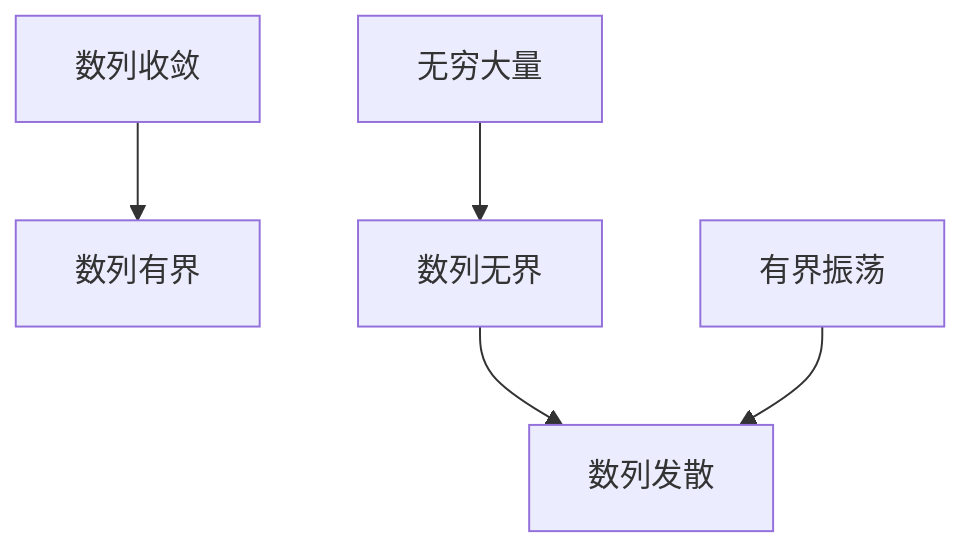
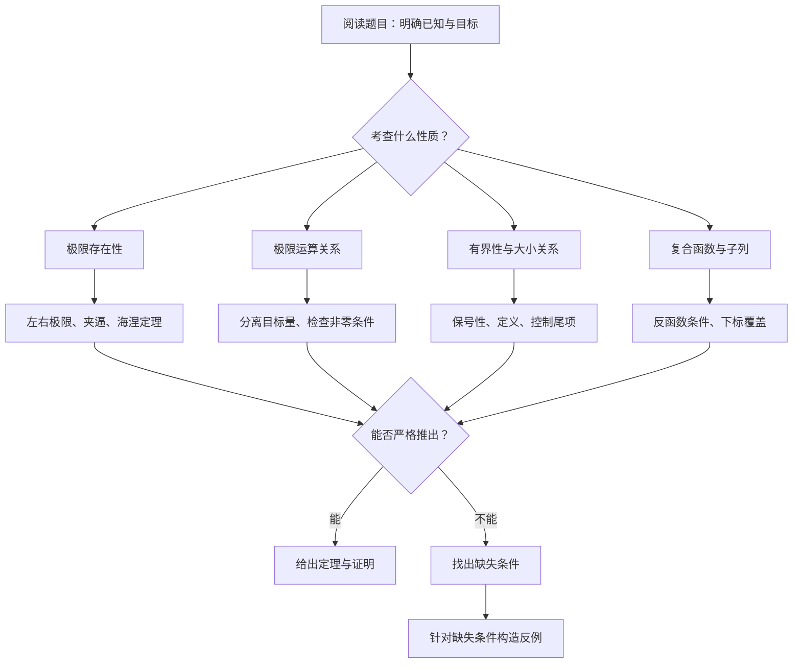
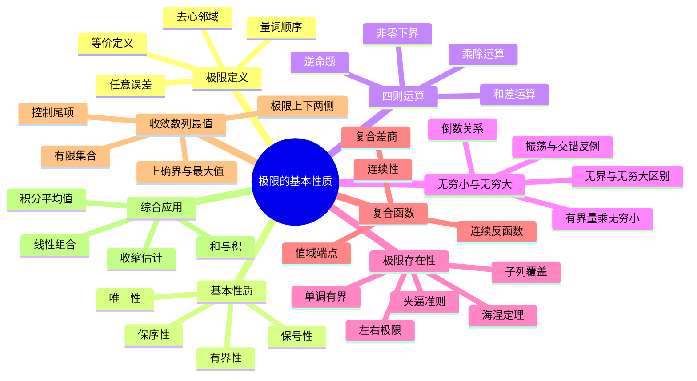

本节与下一节“函数极限的计算”、第四节“数列极限的计算”有很大的区别。

极限计算主要考查如何求出一个极限的值，而本节主要考查：

- 根据已知的极限条件，究竟能够推出哪些结论？
- 一个极限存在，需要满足什么条件？
- 极限不存在、发散、无界、无穷大量之间有什么区别？
- 极限运算法则能否反过来使用？
- 能否通过部分子列、复合函数的收敛性判断原数列的收敛性？
- 如何利用极限性质构造反例、证明不等式和判断数列最值？

**本节的核心不是计算能力，而是对数学条件的精确理解和逻辑推理能力。** 许多看似简单的选择题，真正的难点就在于一个条件、一个量词或者一个推理方向的改变。

## 考点概览

**1. 真题考点分布**

| 真题    | 核心考点       | 应掌握的方法      |
| ----- | ---------- | ----------- |
| 1988年 | 极限运算法则的逆命题 | 非零条件、构造反例   |
| 1993年 | 无界与无穷大量    | 振荡函数、海涅定理   |
| 1998年 | 乘积极限与因子性质  | 倒数法、交错数列    |
| 1999年 | 收敛定义的等价形式  | 量词分析、误差调整   |
| 2014年 | 极限的保号性     | 固定误差与动态误差   |
| 2015年 | 数列与子列的关系   | 下标覆盖、子列反证   |
| 2022年 | 收敛数列的最值    | 极限控制尾项、有限集合 |

**2. 补充题库的重点内容**

| 资料          | 代表性考点                      |
| ----------- | -------------------------- |
| 张宇1000题     | 发散数列的复合变换、左右极限、收缩不等式、无穷大乘积 |
| 李林880题      | 极限逆运算、保号性、无界性、反三角函数、夹逼准则   |
| 李正元练习题      | 振荡函数、无穷大判别、极限性质与积分证明       |
| 李林六套卷第1套第2题 | 指数复合极限的充分必要条件              |

## 第一部分：基础知识体系

### 一、极限的本质与定义

**1. 数列极限的直观理解**

设数列为

$$
a_1,a_2,\ldots,a_n,\ldots
$$

若随着 $n\to\infty$，数列中的项越来越接近某个固定实数 $A$，则称数列收敛于 $A$，记作

$$
\lim_{n\to\infty}a_n=A.
$$

例如

$$
a_n=1+\frac{(-1)^n}{n}.
$$

虽然数列不断在 $1$ 的上下两侧振荡，但是振荡幅度越来越小，因此

$$
\lim_{n\to\infty}a_n=1.
$$

注意，收敛不要求单调，不要求每一项都比前一项更接近极限，也不要求数列真正取到极限值。

**2. 数列极限的严格定义**

$$
\boxed{ \forall\varepsilon>0,\ \exists N\in\mathbb N^+, \quad n\ge N\Rightarrow |a_n-A|<\varepsilon }
$$

理解这个定义，必须抓住四个关键词。

| 表达式                                  | 含义           |
| ------------------------------------ | ------------ |
| $\forall\varepsilon>0$           | 任意给定的正误差     |
| $\exists N$                      | 可以根据误差选择起始下标 |
| $n\ge N$                         | 从某一项开始       |
| $\lvert a_n-A\rvert<\varepsilon$ | 此后所有项都满足精度要求 |

极限研究的是数列的**尾部行为**。因此，改变、删除或者增加有限个首项，不影响数列的收敛性及其极限值。

**3. 函数极限的严格定义**

当 $x\to x_0$ 时，

$$
\lim_{x\to x_0}f(x)=A
$$

的严格定义为

$$
\forall\varepsilon>0,\ \exists\delta>0,
$$

使得

$$
0<|x-x_0|<\delta \Rightarrow |f(x)-A|<\varepsilon.
$$

特别注意这里是

$$
0<|x-x_0|.
$$

也就是说，极限不考察 $x=x_0$ 这一点的函数值。

例如

$$
f(x)= \begin{cases} x^2,&x\ne0,\\ 100,&x=0. \end{cases}
$$

虽然 $f(0)=100$，但是

$$
\lim_{x\to0}f(x)=0.
$$

因此：

$$
\boxed{ \lim_{x\to x_0}f(x)=A \quad\not\Rightarrow\quad f(x_0)=A }
$$

只有补充函数在该点连续，才能将两者联系起来。

**4. 极限定义的否定形式**

这是抽象概念题和反例构造的理论基础。

若要证明 $a_n$ 不收敛于指定的 $A$，则只需要证明

$$
\exists\varepsilon_0>0,\ \forall N,\  \exists n\ge N,
$$

使得

$$
|a_n-A|\ge\varepsilon_0.
$$

直观上就是：无论从多么靠后的地方开始，总能找到偏离 $A$ 足够远的项。

注意，这只能说明数列不收敛于 $A$。要证明数列发散，还需要排除所有可能的有限极限，或者采用更方便的子列判别法。

### 二、极限的四大基本性质

**1. 唯一性**

若极限存在，则极限值唯一。

$$
\lim a_n=A,\qquad \lim a_n=B \Rightarrow A=B.
$$

它的主要应用是子列反证、递推数列极限的确定以及多个极限表达式之间的关系推导。

**2. 有界性**

收敛数列必有界：

$$
a_n\to A \Rightarrow \exists M>0,\ \forall n,\ |a_n|\le M.
$$

证明：由收敛性可知，当 $n$ 充分大时，

$$
|a_n-A|<1.
$$

所以

$$
|a_n|\le |A|+1.
$$

剩余的有限个首项也有界，故整个数列有界。

但是逆命题不成立：

$$
\boxed{\text{收敛}\Rightarrow\text{有界}}
$$

$$
\boxed{\text{有界}\not\Rightarrow\text{收敛}}
$$

典型反例为

$$
a_n=(-1)^n.
$$

对于函数极限，需要强调的是**局部有界性**：

$$
\lim_{x\to x_0}f(x)=A
$$

只能保证 $f(x)$ 在 $x_0$ 的某个去心邻域内有界，而不能保证函数在整个定义域内有界。

**3. 保号性**

若

$$
\lim_{n\to\infty}a_n=A>0,
$$

则存在 $N$，当 $n\ge N$ 时，

$$
a_n>0.
$$

更强的结论是

$$
a_n>\frac A2.
$$

若 $A<0$，则最终有

$$
a_n<\frac A2<0.
$$

统一表示为：

$$
\boxed{ a_n\to A\ne0 \Rightarrow |a_n|>\frac{|A|}{2} \quad(n\text{充分大}) }
$$

同时，$a_n$ 最终与 $A$ 同号。

这一性质不仅用于判断正负，还用于保证分母不为零、对数有定义以及倒数极限存在。

**4. 保序性**

若

$$
a_n\to A,\qquad b_n\to B,
$$

且最终满足

$$
a_n\le b_n,
$$

则

$$
A\le B.
$$

特别需要区分以下两个方向。

| 已知条件                  | 能够推出                |
| --------------------- | ------------------- |
| $a_n<b_n$ 最终成立   | $A\le B$        |
| $A<B$            | $a_n<b_n$ 最终成立 |
| $a_n\le b_n$ 最终成立 | 不一定有 $A<B$     |
| $A=B$             | 无法判断最终谁大谁小          |

例如

$$
a_n=\frac1n,\qquad b_n=\frac2n.
$$

虽然每一项都有 $a_n<b_n$，但二者极限都是零。

**记忆方法：严格不等式取极限可能变弱；极限之间存在严格大小关系，可以传递到充分靠后的项。**

### 三、极限的四则运算及其逆命题

若

$$
\lim f(x)=A,\qquad \lim g(x)=B,
$$

且 $A,B$ 都是有限实数，则有

$$
\lim[f(x)\pm g(x)]=A\pm B,
$$

$$
\lim[f(x)g(x)]=AB,
$$

当 $B\ne0$ 时，

$$
\lim\frac{f(x)}{g(x)}=\frac AB.
$$

这些是正向运算法则，但在考试中经常反过来问。

**极限逆运算判断表**

| 已知条件                       | 能否推出另一因子或另一项收敛     |
| -------------------------- | ------------------ |
| $f$ 与 $f+g$ 均收敛    | 一定能                |
| $f$ 与 $f-g$ 均收敛    | 一定能                |
| $f\to A\ne0,\ fg\to B$ | 一定能                |
| $f\to0,\ fg\to B$      | 不一定                |
| $f+g$ 与 $f-g$ 均收敛  | 一定能推出 $f,g$ 收敛 |
| $f,g$ 均发散              | 无法直接判断和、差、积、商      |

这里最容易出题的就是乘法和除法，因为它们涉及非零条件。

**一个更重要的推广**

若

$$
u_n+v_n\to A,\qquad u_n-v_n\to B,
$$

则

$$
u_n=\frac{(u_n+v_n)+(u_n-v_n)}2 \to\frac{A+B}{2},
$$

$$
v_n=\frac{(u_n+v_n)-(u_n-v_n)}2 \to\frac{A-B}{2}.
$$

因此，两个数列均发散时，它们的和与差不可能同时收敛。

这一推理可以进一步推广到线性方程组：若两个数列的两组独立线性组合都收敛，就可以通过解方程组推出原数列收敛。

### 四、无穷小量、无穷大量、有界与发散

这是本节最容易混淆的一组概念。

**1. 无穷小量**

若

$$
\lim\alpha(x)=0,
$$

则称 $\alpha(x)$ 为该变化过程中的无穷小量。

例如，当 $x\to0$ 时，

$$
x,\quad \sin x,\quad \ln(1+x)
$$

都是无穷小量。

无穷小量不是一个特别小的固定非零常数，而是极限为零的变量。

**2. 无穷大量**

若

$$
\lim |f(x)|=+\infty,
$$

则称 $f(x)$ 为无穷大量。

它包括三种情况：趋于正无穷、趋于负无穷，以及绝对值趋于无穷但正负号不断变化。

例如

$$
a_n=(-1)^n n
$$

是无穷大量，因为

$$
|a_n|=n\to+\infty.
$$

但是它既不趋于正无穷，也不趋于负无穷。

**3. 各类数列的对比**

| 数列                | 有界 | 收敛 | 无穷大量 |
| ----------------- | -- | -- | ---- |
| $1/n$         | 是  | 是  | 否    |
| $1+1/n$       | 是  | 是  | 否    |
| $(-1)^n$      | 是  | 否  | 否    |
| $n$           | 否  | 否  | 是    |
| $(-1)^nn$     | 否  | 否  | 是    |
| $n[1+(-1)^n]$ | 否  | 否  | 否    |

这些例子应该熟练掌握，因为它们可以直接作为大量选择题的反例。

**4. 无界与无穷大量的本质区别**

无界数列的定义：

$$
\forall M>0,\ \exists n,\quad |a_n|>M.
$$

无穷大量的定义：

$$
\forall M>0,\ \exists N,\  \forall n\ge N,\quad |a_n|>M.
$$

二者的区别在于：

**无界：总能找到很大的项。**

**无穷大量：从某一项开始，所有项都足够大。**

所以有如下逻辑关系：

图中的单向箭头都不能无条件反过来使用。

**5. 无穷小量与无穷大量的倒数关系**

当有关倒数在充分靠后的项或相应去心邻域内有定义时，

$$
\boxed{ |f(x)|\to+\infty \iff \frac1{f(x)}\to0 }
$$

这是判断无穷大量最有用的基本公式之一。

**6. 常用运算性质**

| 运算          | 结果   |
| ----------- | ---- |
| 无穷小量 + 无穷小量 | 无穷小量 |
| 无穷小量 × 有界量  | 无穷小量 |
| 无穷小量 × 无穷小量 | 无穷小量 |
| 无穷大量 × 无穷大量 | 无穷大量 |
| 无穷大量 + 有界量  | 无穷大量 |
| 无穷大量 + 无穷大量 | 不确定  |
| 无穷大量 ÷ 无穷大量 | 不确定  |
| 无穷小量 × 无穷大量 | 不确定  |
| 非零无穷小量的倒数   | 无穷大量 |

其中最重要的是：

$$
\boxed{\text{无穷小}\times\text{有界量}=\text{无穷小}}
$$

例如

$$
\lim_{x\to0}x^2\sin\frac1x=0.
$$

这里 $\sin(1/x)$ 本身没有极限，但它有界，因此不会妨碍整个乘积趋于零。

### 五、极限存在的判别工具

| 判别工具   | 适用情形         | 核心条件     |
| ------ | ------------ | -------- |
| 左右极限判别 | 函数在有限点处的极限   | 左右极限相等   |
| 夹逼准则   | 振荡因子、根式、复杂求和 | 上下界趋于同一值 |
| 单调有界准则 | 递推数列         | 单调且有界    |
| 子列判别   | 数列振荡、发散      | 不同子列极限不同 |
| 海涅定理   | 函数极限不存在的证明   | 构造不同趋近路径 |
| 收敛定义   | 抽象极限证明       | 控制任意固定误差 |

夹逼准则的核心形式为

$$
u_n\le a_n\le v_n,
$$

且

$$
u_n\to A,\qquad v_n\to A,
$$

则

$$
a_n\to A.
$$

在证明型题目中，最实用的形式是

$$
\boxed{ 0\le |a_n-A|\le b_n,\quad b_n\to0 \Rightarrow a_n\to A }
$$

它将复杂的极限问题转化为寻找一个简单、可控制的误差上界。

## 第二部分：核心题型与历年真题精讲

### 题型一：极限运算法则的逆命题

**重要程度：★★★★★**

这是1988年、1998年真题以及李林880题、李正元练习题共同涉及的核心题型。

**母题1：1988年真题——乘积极限的逆推**

设

$$
\lim_{x\to x_0}f(x),\qquad \lim_{x\to x_0}f(x)g(x)
$$

都存在，判断

$$
\lim_{x\to x_0}g(x)
$$

是否一定存在。

**答案：不一定存在。**

<Steps>

<Step>

### 第一步：识别题型 [!toc]

已知一个因子的极限和乘积的极限，要求判断另一个因子的极限。

自然想到

$$
g(x)=\frac{f(x)g(x)}{f(x)}.
$$

但是商的极限法则要求分母的极限不为零。

题目没有给出这个条件。

</Step>

<Step>

### 第二步：按照缺失条件构造反例 [!toc]

令

$$
f(x)=x,\qquad g(x)=\sin\frac1x,
$$

当 $x\to0$ 时，

$$
f(x)\to0.
$$

又因为

$$
\left|x\sin\frac1x\right|\le |x|,
$$

由夹逼准则，

$$
f(x)g(x)\to0.
$$

但是

$$
\lim_{x\to0}\sin\frac1x
$$

不存在。

因此原命题错误。

</Step>

<Step>

### 第三步：修正原命题 [!toc]

若补充

$$
\lim_{x\to x_0}f(x)=A\ne0,
$$

以及

$$
\lim_{x\to x_0}f(x)g(x)=B,
$$

则由商的极限法则，

$$
\boxed{ \lim_{x\to x_0}g(x)=\frac BA }
$$

成立。

</Step>

</Steps>

**深入推广：当一个因子趋于零时**

假设

$$
f(x)\to0,\qquad f(x)g(x)\to0.
$$

那么 $g(x)$ 可能出现各种不同情况。

| 取 $f(x)=x$，$x\to0$        | $g(x)$ 的性质 |
| --------------------------------- | -------------- |
| $g(x)=x$                      | 趋于零            |
| $g(x)=1$                      | 趋于非零常数         |
| $g(x)=\sin(1/x)$              | 有界但发散          |
| $g(x)=1/\sqrt{\lvert x\rvert }$         | 无穷大量           |
| $g(x)=\sin(1/x)/\sqrt{\lvert x\rvert }$ | 无界但不是无穷大量      |

这些情形都满足乘积趋于零。

这说明，当一个因子趋于零时，它可能把另一个因子的许多不同性质掩盖掉。

**母题2：1998年真题——乘积趋于零**

设数列 $\{x_n\}$、$\{y_n\}$ 满足

$$
\lim_{n\to\infty}x_ny_n=0.
$$

判断下列命题。

A. 若 $x_n$ 发散，则 $y_n$ 发散。

B. 若 $x_n$ 无界，则 $y_n$ 必有界。

C. 若 $x_n$ 有界，则 $y_n$ 必为无穷小。

D. 若 $1/x_n$ 为无穷小，则 $y_n$ 必为无穷小。

**正确答案：D。**

**D选项：正向证明**

将目标量单独表示出来：

$$
y_n=(x_ny_n)\frac1{x_n}.
$$

已知

$$
x_ny_n\to0,\qquad \frac1{x_n}\to0,
$$

因此

$$
y_n\to0.
$$

**A选项：构造一大一小**

取

$$
x_n=n,\qquad y_n=\frac1{n^2}.
$$

则

$$
x_ny_n=\frac1n\to0,
$$

但是 $x_n$ 发散，$y_n$ 收敛。

**B选项：构造交错增长**

采用李正元练习题中给出的更有代表性的非零反例：

$$
x_n= \begin{cases} n,&n\text{为偶数},\\ 1/n^2,&n\text{为奇数}, \end{cases}
$$

$$
y_n= \begin{cases} 1/n^2,&n\text{为偶数},\\ n,&n\text{为奇数}. \end{cases}
$$

于是

$$
x_ny_n=\frac1n\to0.
$$

但是两个数列分别在偶数项和奇数项上趋于正无穷，因此二者都无界。

这是一个非常重要的反例模型：**两个变量轮流变大、轮流变小，使各自的总体性质与乘积的性质完全不同。**

**C选项：有界不代表远离零**

取

$$
x_n=\frac1n,\qquad y_n=1.
$$

则

$$
x_ny_n\to0,
$$

但 $y_n$ 不是无穷小量。

**母题的进一步推广**

若已知

$$
x_ny_n\to0,
$$

怎样的条件能保证 $y_n\to0$？

事实上，只要存在常数 $c>0$，使得 $n$ 充分大时

$$
|x_n|\ge c,
$$

就足够了。

因为

$$
|y_n| =\frac{|x_ny_n|}{|x_n|} \le\frac1c|x_ny_n|\to0.
$$

这比要求 $x_n\to A\ne0$ 或要求 $x_n$ 为无穷大量更加一般。

**真正的关键不是** $x_n$ **自身是否收敛，而是它是否最终与零保持一定距离。**

**题型一标准解题流程**

遇到已知和、差、积、商的极限，要求反推某个变量的极限时，先把目标变量单独表示出来，再检查四则运算法则的条件。尤其要检查分母是否最终非零、倒数是否有界。若条件不足，优先考虑无穷小量、振荡量或奇偶交错数列来构造反例。

### 题型二：无界、无穷大量与振荡函数的判断

**重要程度：★★★★★**

**母题3：1993年真题——增长与振荡的叠加**

当 $x\to0$ 时，判断

$$
f(x)=\frac1{x^2}\sin\frac1x
$$

属于以下哪种情况：

A. 无穷小量。

B. 无穷大量。

C. 有界，但不是无穷小量。

D. 无界，但不是无穷大量。

**正确答案：D。**

**直观分析**

函数由两个因子组成：

$$
\underbrace{\frac1{x^2}}_{\text{不断增长的振幅}} \cdot \underbrace{\sin\frac1x}_{\text{不断振荡的因子}}.
$$

当 $x\to0$ 时，振幅不断扩大，但正弦函数仍然会反复经过零点。

因此，函数既能够出现任意大的值，也能够在无穷多个趋近于零的点上取零。

**标准证明**

首先证明无界。取

$$
x_n=\frac1{2n\pi+\pi/2}.
$$

则 $x_n\to0$，并且

$$
\sin\frac1{x_n}=1.
$$

所以

$$
f(x_n)=\left(2n\pi+\frac\pi2\right)^2 \to+\infty.
$$

故 $f(x)$ 在零点的任意去心邻域内无界。

接下来证明它不是无穷大量。取

$$
y_n=\frac1{n\pi}.
$$

则 $y_n\to0$，但是

$$
f(y_n)=0.
$$

所以

$$
|f(x)|\not\to+\infty.
$$

证毕。

**母题推广：带参数的振荡函数**

设

$$
F_\alpha(x)=|x|^\alpha\sin\frac1x, \qquad x\to0.
$$

根据参数 $\alpha$ 的取值判断性质。

| 参数范围           | 函数性质      |
| -------------- | --------- |
| $\alpha>0$ | 无穷小量      |
| $\alpha=0$ | 有界但极限不存在  |
| $\alpha<0$ | 无界但不是无穷大量 |

这类题的关键是分辨振幅与振荡因子各自的变化趋势。

如果将函数改为

$$
G_\alpha(x)=|x|^\alpha \left(2+\sin\frac1x\right),
$$

因为

$$
1\le2+\sin\frac1x\le3,
$$

结论就发生了变化。

当 $\alpha<0$ 时，

$$
G_\alpha(x)\ge |x|^\alpha\to+\infty.
$$

此时它真正成为了无穷大量。

**创新题的关键变化：振荡因子是否具有严格的正下界，是否会经过零点。**

这也是为什么

$$
\frac{\sin(1/x)}{x^2}
$$

不是无穷大量，而

$$
\frac{2+\sin(1/x)}{x^2}
$$

是无穷大量。

**补充题：李林880题——两个无穷大量的运算**

设 $x\to+\infty$ 时，$f(x)$、$g(x)$ 都是无穷大量。

判断

$$
f-g,\qquad f+g,\qquad \frac gf,\qquad \frac{f+g}{fg}
$$

的性质。

前三者均不能得到确定结论，而第四个表达式一定是无穷小量。

因为

$$
\frac{f+g}{fg} =\frac1f+\frac1g.
$$

由于

$$
\frac1f\to0,\qquad \frac1g\to0,
$$

所以

$$
\boxed{\lim\frac{f+g}{fg}=0}.
$$

这种题没有必要讨论复杂的增长速度，只需把无穷大量转换成无穷小量。

<Callout type="warn" title="易错补充：张宇1000题中的条件缺失问题">

张宇1000题数列极限部分的题目 `math-a9077b-013` 中涉及如下命题：

若

$$
x_ny_n\to+\infty,\qquad x_n\to0,
$$

且 $x_n\ne0$，是否一定有

$$
y_n\to+\infty?
$$

严格来说，不能。

取

$$
x_n=\frac{(-1)^n}{n},\qquad y_n=(-1)^nn^2.
$$

则

$$
x_ny_n=n\to+\infty,
$$

但 $y_n$ 正负交替，并不趋于正无穷。

正确的结论是

$$
|y_n|\to+\infty.
$$

若要推出 $y_n\to+\infty$，还必须增加 $x_n$ 最终为正的条件。

应以补足条件后的数学结论为准。

</Callout>

### 题型三：极限定义的等价形式与充分必要条件

**重要程度：★★★★☆**

**母题4：1999年真题——误差范围的改变**

已知命题 $P$：

对于任意

$$
\varepsilon\in(0,1),
$$

总存在正整数 $N$，当 $n\ge N$ 时，恒有

$$
|x_n-a|\le2\varepsilon.
$$

问 $P$ 是数列 $x_n\to a$ 的什么条件？

**答案：充分必要条件。**

这道题考查的不是背诵定义，而是能否识别数学上等价的表达形式。

**必要性**

若

$$
x_n\to a,
$$

则对于任意 $\varepsilon\in(0,1)$，可以将标准定义中的误差选为 $2\varepsilon$。

于是存在 $N$，使得

$$
|x_n-a|<2\varepsilon.
$$

自然满足

$$
|x_n-a|\le2\varepsilon.
$$

**充分性**

反过来，假设题设条件成立。

对于标准极限定义中的任意误差 $\eta>0$，取

$$
\varepsilon=\min\left\{\frac\eta4,\frac12\right\}.
$$

则

$$
0<\varepsilon<1.
$$

根据题设，存在 $N$，使得当 $n\ge N$ 时，

$$
|x_n-a|\le2\varepsilon \le\frac\eta2<\eta.
$$

因此

$$
x_n\to a.
$$

**等价定义的统一识别方法**

假设题目将标准定义改为

$$
|x_n-a|\le\varphi(\varepsilon).
$$

不要只看它是否和教材中的定义完全相同，而要判断右侧是否能够取到任意小的正数。

如果允许的误差可以任意接近零，就能够反推出收敛。

| 条件中的误差                      | 是否可构成等价定义 |
| --------------------------- | --------- |
| $2\varepsilon$          | 可以        |
| $\varepsilon^2$         | 可以        |
| $\sqrt\varepsilon$      | 可以        |
| $1/k,\ k\in\mathbb N^+$ | 可以        |
| $\varepsilon+1$         | 不可以       |
| 固定误差 $0.001$            | 不可以       |

例如，若只知道存在 $N$，使得

$$
|x_n-a|<0.001,\qquad n\ge N,
$$

则只能说明数列尾项在 $a$ 的一个固定小邻域内。

数列

$$
x_n=a+0.0001(-1)^n
$$

满足该条件，却仍然发散。

**量词顺序是更深层的考点**

标准定义为

$$
\forall\varepsilon>0,\ \exists N.
$$

如果将量词顺序改成

$$
\exists N,\ \forall\varepsilon>0,
$$

并且要求所有 $n\ge N$ 都满足

$$
|x_n-a|<\varepsilon,
$$

那么就能推出

$$
x_n=a,\qquad n\ge N.
$$

也就是说，数列最终恒等于 $a$。

这显然比普通收敛更强。

遇到抽象定义题时，**优先检查量词，其次检查误差，最后检查作用范围。**

### 题型四：极限保号性与收敛速度

**重要程度：★★★★★**

**母题5：2014年真题——固定误差与变化误差**

设

$$
\lim_{n\to\infty}a_n=a\ne0.
$$

判断当 $n$ 充分大时，以下哪个结论一定成立。

A. $\displaystyle |a_n|>\frac{|a|}{2}$。

B. $\displaystyle |a_n|<\frac{|a|}{2}$。

C. $\displaystyle a_n>a-\frac1n$。

D. $\displaystyle a_n<a+\frac1n$。

**正确答案：A。**

**A选项的证明**

因为 $a\ne0$，所以可以选取固定正误差

$$
\varepsilon=\frac{|a|}{2}.
$$

由收敛定义知，当 $n$ 充分大时，

$$
|a_n-a|<\frac{|a|}{2}.
$$

由反三角不等式，

$$
|a_n|\ge |a|-|a_n-a|.
$$

因此

$$
|a_n|>\frac{|a|}{2}.
$$

**C、D选项为什么不成立？**

收敛只保证

$$
|a_n-a|\to0,
$$

并不保证其趋于零的速度快于 $1/n$。

例如取

$$
a_n=a-\frac1{\sqrt n}.
$$

虽然

$$
a_n\to a,
$$

但是当 $n>1$ 时，

$$
\frac1{\sqrt n}>\frac1n,
$$

故

$$
a_n<a-\frac1n.
$$

C错误。

同理取

$$
a_n=a+\frac1{\sqrt n},
$$

就能否定D。

**深层理解：为什么不能取 $\varepsilon=1/n$？**

在数列极限的定义中，逻辑顺序是先选定一个正数 $\varepsilon$，再根据它确定 $N$。

而 $1/n$ 本身随着 $n$ 不断变化，不能直接当作预先给定的固定误差使用。

$$
\boxed{ a_n\to a \quad\not\Rightarrow\quad |a_n-a|<\frac1n\text{最终成立} }
$$

**补充母题：张宇1000题——怎样真正控制收敛速度？**

设存在固定常数 $0<k<1$，满足

$$
|x_{n+1}-a|\le k|x_n-a|.
$$

证明 $x_n\to a$。

反复利用已知条件：

$$
\begin{aligned} |x_n-a| &\le k|x_{n-1}-a|\\ &\le k^2|x_{n-2}-a|\\ &\le\cdots\\ &\le k^{n-1}|x_1-a|. \end{aligned}
$$

由于

$$
k^{n-1}\to0,
$$

由夹逼准则可得

$$
\boxed{x_n\to a}.
$$

更进一步，这道题不仅能够证明收敛，而且明确给出了误差的上界：

$$
|x_n-a|\le Ck^n.
$$

这是指数级衰减，比任何固定正幂次的 $1/n^p$ 都快。

因此本题中可以推出，对任意 $p>0$，

$$
n^p|x_n-a|\to0.
$$

这就是普通收敛条件与带有定量误差控制的收敛条件之间的区别。

### 题型五：子列与原数列的收敛性

**重要程度：★★★★★**

**1. 子列的基本定义**

从数列 $\{a_n\}$ 中按照原有顺序抽取无限多个项，得到

$$
a_{n_1},a_{n_2},\ldots,a_{n_k},\ldots,
$$

其中

$$
n_1<n_2<\cdots<n_k<\cdots,
$$

称为原数列的子列。

若

$$
a_n\to A,
$$

则任何子列都满足

$$
a_{n_k}\to A.
$$

**2. 子列判断的三大原则**

| 已知条件                 | 结论         |
| -------------------- | ---------- |
| 原数列收敛                | 所有子列收敛于同一值 |
| 存在两个子列收敛到不同值         | 原数列发散      |
| 存在一个收敛子列             | 不能保证原数列收敛  |
| 存在有限组覆盖全部尾项的子列，且极限相同 | 原数列收敛      |

**母题6：2015年真题——下标覆盖问题**

判断以下命题：

A. 若 $x_n\to a$，则 $x_{2n}\to a$、$x_{2n+1}\to a$。

B. 若 $x_{2n}\to a$、$x_{2n+1}\to a$，则 $x_n\to a$。

C. 若 $x_n\to a$，则 $x_{3n}\to a$、$x_{3n+1}\to a$。

D. 若 $x_{3n}\to a$、$x_{3n+1}\to a$，则 $x_n\to a$。

**错误的命题为D。**

**A、C：原数列推子列**

这是子列收敛的基本性质，直接成立。

**B：奇偶项覆盖所有下标**

奇数项与偶数项覆盖所有充分大的正整数下标。

对于任意 $\varepsilon>0$，两个子列分别从某项开始都落入

$$
(a-\varepsilon,a+\varepsilon).
$$

由于不存在遗漏的下标类型，所以原数列的全部充分靠后的项也都落入该区间。

因此 $x_n\to a$。

**D：遗漏模3余2的下标**

取

$$
x_{3n}=a,\qquad x_{3n+1}=a,\qquad x_{3n+2}=a+1.
$$

则前两个子列都趋于 $a$，但第三个子列趋于 $a+1$。

因此原数列发散。

**3. 一般化判据**

设 $m\ge2$ 是固定整数，则

$$
\boxed{ x_n\to a \iff \forall r\in\{0,1,\ldots,m-1\}, \quad x_{mn+r}\to a }
$$

即模 $m$ 的全部余数类必须被覆盖。

**创新变式：非标准子列覆盖**

假设

$$
a_{2n}\to A,\qquad a_{4n+1}\to A,\qquad a_{4n+3}\to A.
$$

能否推出 $a_n\to A$？

可以。

因为 $2n$ 覆盖所有偶数下标，而 $4n+1$、$4n+3$ 覆盖所有奇数下标。

所以这三组子列覆盖了全部充分大的正整数下标。

但是如果删掉 $a_{4n+3}\to A$ 这一条件，就无法再推出原数列收敛。

**遇到这种题，不要数子列的数量，而要检查下标集合是否覆盖整个数列的尾部。**

### 题型六：函数极限的存在性——左右极限与海涅定理

**重要程度：★★★★★**

**1. 左右极限判别**

在有限点 $x_0$ 处，

$$
\lim_{x\to x_0}f(x)=A
$$

成立的充分必要条件是

$$
\lim_{x\to x_0^-}f(x) = \lim_{x\to x_0^+}f(x) =A.
$$

当题目出现绝对值、分段函数、符号函数、$e^{1/x}$、$\arctan(1/x)$ 时，应优先考虑左右极限。

**补充母题：张宇1000题——两个发散因子的乘积**

求

$$
\lim_{x\to0} \frac{|\sin x|}{x} \arctan\frac1x.
$$

当 $x\to0^+$ 时，

$$
\frac{|\sin x|}{x}\to1, \qquad \arctan\frac1x\to\frac\pi2.
$$

故右极限为 $\pi/2$。

当 $x\to0^-$ 时，

$$
\frac{|\sin x|}{x}\to-1, \qquad \arctan\frac1x\to-\frac\pi2.
$$

故左极限仍为 $\pi/2$。

因此

$$
\boxed{ \lim_{x\to0} \frac{|\sin x|}{x}\arctan\frac1x =\frac\pi2 }
$$

这里两个因子的双侧极限都不存在，但乘积的极限存在。

**2. 海涅定理（归结原则）**

函数极限

$$
\lim_{x\to x_0}f(x)=A
$$

存在，当且仅当对于任意满足

$$
x_n\to x_0,\qquad x_n\ne x_0
$$

且位于函数定义域内的数列，都有

$$
f(x_n)\to A.
$$

它在考研中的主要作用是证明函数极限不存在。

只需要构造两列自变量，都趋向同一个目标点，但对应的函数值趋向不同的极限，就能否定函数极限的存在性。

**补充母题：李林880题——含振荡因子的指数极限**

判断

$$
\lim_{x\to+\infty} \left(1+\frac{\sin x}{x}\right)^x
$$

是否存在。

看到这个表达式，很容易机械地使用重要极限，写成 $e^{\sin x}$，却没有进一步判断是否收敛。

先取对数：

$$
\begin{aligned} \ln F(x) &=x\ln\left(1+\frac{\sin x}{x}\right)\\ &=\sin x+O\left(\frac1x\right). \end{aligned}
$$

于是

$$
F(x)=e^{\sin x+o(1)}.
$$

由于 $\sin x$ 不收敛，需要构造两列点。

取

$$
x_n=n\pi,
$$

则

$$
F(x_n)=1.
$$

再取

$$
y_n=2n\pi+\frac\pi2,
$$

则

$$
F(y_n)= \left(1+\frac1{y_n}\right)^{y_n}\to e.
$$

两条路径得到不同的极限值。

因此原极限不存在。

**迁移规律**

含有 $\sin x$、$\cos x$、$\sin(1/x)$ 等不断振荡的因子时，优先令它们取

$$
0,\qquad 1,\qquad -1
$$

这些特殊值，以构造趋近路径。

如果振荡因子能够被趋于零的振幅完全压制，则使用夹逼准则；如果振荡始终保留，则使用海涅定理或子列判别。

### 题型七：复合函数极限的正向与逆向推理

**重要程度：★★★★★｜模拟题重点强化方向**

这一类题是张宇1000题、李林880题和李林六套卷中非常值得重视的内容。它将极限性质与函数的连续性、单调性、反函数、导数定义结合起来，特别适合改造成综合选择题。

**1. 复合函数极限的正向法则**

若

$$
u(x)\to a,
$$

且 $F(t)$ 在 $t=a$ 处连续，那么

$$
\boxed{\lim F(u(x))=F(a)}.
$$

例如

$$
a_n\to A \Rightarrow e^{a_n}\to e^A.
$$

如果 $A>0$，则还有

$$
\ln a_n\to\ln A.
$$

需要注意：如果外层函数在 $a$ 处仅仅具有极限，但不连续，则还需要考虑内层函数是否反复取到 $a$。

例如

$$
F(t)= \begin{cases} 1,&t\ne0,\\ 2,&t=0. \end{cases}
$$

虽然

$$
\lim_{t\to0}F(t)=1,
$$

但取 $u(x)\equiv0$，就有

$$
F(u(x))\equiv2.
$$

因此不能随意将一个极限代入另一个极限。

**2. 复合函数极限的逆命题**

若

$$
F(a_n)\to B,
$$

能否推出 $a_n$ 收敛？

答案取决于外层函数是否保留了足够的信息。

| 外层函数            | 已知条件                                 | 能否推出 $a_n$ 收敛 |
| --------------- | ------------------------------------ | ----------------- |
| $e^x$       | $e^{a_n}\to B>0$                 | 能                 |
| $e^x$       | $e^{a_n}\to0$                    | 不能推出有限收敛          |
| $x^2$       | $a_n^2\to B>0$                   | 不一定               |
| $x^2$       | $a_n^2\to0$                      | 能                 |
| $\arctan x$ | $\arctan a_n\to B,\ \lvert B\rvert <\pi/2$ | 能                 |
| $\arctan x$ | $\arctan a_n\to\pi/2$            | 不能推出有限收敛          |
| $\sin x$    | $\sin a_n\to B$                  | 不一定               |

一般而言，若外层函数有连续反函数，而且复合函数的极限落在该反函数的定义域内，就可以使用反函数将极限反推回去。

$$
F(a_n)\to B \Rightarrow a_n=F^{-1}(F(a_n)) \to F^{-1}(B).
$$

**不能只检查外层函数是否严格单调，还要检查极限值是否落在反函数的有效范围内。**

**母题7：张宇1000题——发散数列经过函数变换**

已知数列 $\{a_n\}$ 发散，且

$$
b_n=a_ne^{a_n}.
$$

判断当 $a_n>0$ 或 $a_n<0$ 时，$\{b_n\}$ 的收敛性。

令

$$
F(x)=xe^x.
$$

则

$$
F'(x)=e^x(x+1).
$$

**情况一：所有 $a_n>0$**

在 $[0,+\infty)$ 上，

$$
F'(x)>0.
$$

而且

$$
F(0)=0,\qquad \lim_{x\to+\infty}F(x)=+\infty.
$$

所以 $F$ 在该区间上存在连续反函数，值域为 $[0,+\infty)$。

假设 $b_n\to B$，则 $B\ge0$。

于是

$$
a_n=F^{-1}(b_n)\to F^{-1}(B).
$$

这与 $a_n$ 发散矛盾。

故

$$
\boxed{a_n>0\text{且发散}\Rightarrow b_n\text{发散}}.
$$

**情况二：所有 $a_n<0$**

在负半轴上，

$$
F'(x)=e^x(x+1)
$$

会变号，且

$$
\lim_{x\to-\infty}xe^x=0.
$$

因此无法保证变换后的数列仍然发散。

例如，取

$$
a_n=-n,
$$

则

$$
b_n=-ne^{-n}\to0.
$$

也可以令

$$
a_{2n}=-1,\qquad a_{2n-1}=-n.
$$

于是

$$
b_{2n}=-\frac1e,
$$

而

$$
b_{2n-1}=-ne^{-n}\to0.
$$

故 $b_n$ 发散。

这说明当 $a_n<0$ 时，变换后的数列可能收敛，也可能发散。

**补充母题：李林880题——反函数存在仍然不够**

判断命题：

若

$$
\arctan x_n
$$

收敛，则 $x_n$ 必收敛。

容易误认为反正切函数严格单调，因此可以直接反推。

实际上取

$$
x_n=n,
$$

就有

$$
\arctan x_n\to\frac\pi2.
$$

但是 $x_n$ 发散。

问题在于

$$
\frac\pi2
$$

不属于反正切函数的值域

$$
\left(-\frac\pi2,\frac\pi2\right).
$$

无法在该极限值处连续地应用反函数 $\tan x$。

这也解释了为什么 $xe^x$ 在非负半轴上的变换，与反正切函数在全实数上的变换有不同的结论。

### 题型八：复合差商极限的充分必要条件

**重要程度：★★★★★｜分类模拟题核心母题**

**母题8：李林六套卷第1套第2题**

设 $a,b,k$ 均为非零常数，判断条件

$$
P:\quad \lim_{x\to a} \frac{f(x)-b}{x-a}=k
$$

与条件

$$
Q:\quad \lim_{x\to a} \frac{e^{f(x)}-e^b}{x-a}=ke^b
$$

的关系。

**答案：充分必要条件。**

这一道模拟题与李林880题第1章的 `math-0ed1ba-038` 有直接联系。880题考查正向推导，而六套卷进一步考查逆向推理。

**方法一：复合函数拆分法**

**证明充分性：$P\Rightarrow Q$**

已知

$$
\frac{f(x)-b}{x-a}\to k.
$$

因为

$$
f(x)-b= \frac{f(x)-b}{x-a}(x-a),
$$

故

$$
f(x)\to b.
$$

由指数函数在 $b$ 处的导数定义，

$$
\lim_{t\to b} \frac{e^t-e^b}{t-b}=e^b.
$$

所以

$$
\begin{aligned} \lim_{x\to a} \frac{e^{f(x)}-e^b}{x-a} &= \lim_{x\to a} \frac{e^{f(x)}-e^b}{f(x)-b} \frac{f(x)-b}{x-a}\\ &=e^bk. \end{aligned}
$$

充分性成立。

若某些点满足 $f(x)=b$，中间的差商可在该处按导数值 $e^b$ 作连续延拓。

**证明必要性：$Q\Rightarrow P$**

已知

$$
\frac{e^{f(x)}-e^b}{x-a}\to ke^b.
$$

于是

$$
e^{f(x)}-e^b\to0.
$$

即

$$
e^{f(x)}\to e^b.
$$

利用对数函数在正数处的连续性，

$$
f(x)=\ln(e^{f(x)})\to b.
$$

再将差商拆分：

$$
\begin{aligned} \frac{f(x)-b}{x-a} &= \frac{f(x)-b}{e^{f(x)}-e^b} \frac{e^{f(x)}-e^b}{x-a}\\ &\to e^{-b}\cdot ke^b\\ &=k. \end{aligned}
$$

必要性成立。

所以

$$
\boxed{P\iff Q}.
$$

**方法二：无穷小展开法**

由

$$
e^{b+h}-e^b=e^bh+o(h)
$$

可知，当 $f(x)\to b$ 时，

$$
e^{f(x)}-e^b =e^b[f(x)-b]+o(f(x)-b).
$$

若

$$
f(x)-b=k(x-a)+o(x-a),
$$

则立即有

$$
e^{f(x)}-e^b =ke^b(x-a)+o(x-a).
$$

反方向则利用对数函数的局部展开。

**母题的统一推广**

设外层函数 $F(t)$ 在 $b$ 处可导，且

$$
F'(b)\ne0.
$$

已经知道

$$
f(x)\to b.
$$

那么

$$
\boxed{ \lim_{x\to a}\frac{f(x)-b}{x-a}=k }
$$

与

$$
\boxed{ \lim_{x\to a} \frac{F(f(x))-F(b)}{x-a} =kF'(b) }
$$

等价。

证明的核心是

$$
F(f(x))-F(b) =[f(x)-b]\left[F'(b)+o(1)\right].
$$

由于 $F'(b)\ne0$，可以正向乘过去，也可以反向除回来。

如果没有提前知道 $f(x)\to b$，则逆推时还必须证明这一点，通常需要连续反函数或者额外的取值范围限制。

**外层函数导数为零时会怎样？**

考虑

$$
F(t)=t^2,\qquad b=0.
$$

如果

$$
\lim_{x\to0}\frac{f(x)}x=k,
$$

则

$$
\frac{f(x)^2}{x} =x\left(\frac{f(x)}x\right)^2 \to0.
$$

正向推理成立。

但反过来，

$$
\frac{f(x)^2}{x}\to0
$$

不能推出 $f(x)/x\to k$。

例如取

$$
f(x)=|x|^{3/4}.
$$

那么

$$
\frac{f(x)^2}{x} =\frac{|x|^{3/2}}x\to0,
$$

但

$$
\left|\frac{f(x)}x\right| =|x|^{-1/4}\to+\infty.
$$

这说明外层函数的一阶导数为零时，可能掩盖内层函数的一阶信息。

**这一类题的标准识别策略**

看到

$$
\frac{F(f(x))-F(b)}{x-a}
$$

时，首先想到将它拆成

$$
\frac{F(f(x))-F(b)}{f(x)-b} \cdot \frac{f(x)-b}{x-a}.
$$

然后检查内层函数是否趋于 $b$、外层函数在 $b$ 处是否可导，以及外层导数是否为零。

这套方法将在第二模块的导数定义、复合函数求导、微分与泰勒公式中反复使用。

### 题型九：收敛数列的最大值与最小值

**重要程度：★★★★★｜2022年真题重点**

**1. 首先区分有界、上界和最大值**

设

$$
a_n=1-\frac1n.
$$

则

$$
a_n\to1,
$$

而且所有项都满足

$$
a_n<1.
$$

因此 $1$ 是数列的一个上界，也是最小上界，但它不是最大值，因为不存在任何一项等于 $1$。

| 概念  | 是否必须由某项取到 |
| --- | --------- |
| 上界  | 不需要       |
| 下界  | 不需要       |
| 上确界 | 不需要       |
| 下确界 | 不需要       |
| 最大值 | 必须        |
| 最小值 | 必须        |

收敛数列一定有界，但不一定有最大值或最小值。

**母题9：2022年真题——收敛数列最值的存在性**

已知

$$
a_n=\sqrt[n]{n}-\frac{(-1)^n}{n}, \qquad n=1,2,\ldots
$$

判断该数列是否存在最大值和最小值。

**答案：既有最大值，又有最小值。**

这道题最有价值的地方在于，不需要求出具体哪一项最大或最小。

<Steps>

<Step>

### 第一步：求极限 [!toc]

由于

$$
\sqrt[n]{n} =e^{\frac{\ln n}{n}}\to1,
$$

且

$$
\left|\frac{(-1)^n}{n}\right| =\frac1n\to0,
$$

所以

$$
\boxed{a_n\to1}.
$$

</Step>

<Step>

### 第二步：寻找位于极限上下两侧的项 [!toc]

计算首项：

$$
a_1=1-(-1)=2>1.
$$

再计算第二项：

$$
a_2=\sqrt2-\frac12<1.
$$

因为

$$
\sqrt2<\frac32.
$$

因此找到两个数列项，满足

$$
a_2<1<a_1.
$$

</Step>

<Step>

### 第三步：利用极限控制全部尾项 [!toc]

取

$$
\varepsilon= \frac12\min\{a_1-1,1-a_2\}>0.
$$

由于 $a_n\to1$，存在充分大的 $N>2$，使得当 $n\ge N$ 时，

$$
1-\varepsilon<a_n<1+\varepsilon.
$$

根据误差的选择，

$$
a_2<1-\varepsilon <1+\varepsilon<a_1.
$$

所以所有充分靠后的项都满足

$$
a_2<a_n<a_1.
$$

</Step>

<Step>

### 第四步：将无限问题转化为有限问题 [!toc]

由于所有尾项都被限制在已知的两项之间，因此最大值和最小值一定可以从

$$
a_1,a_2,\ldots,a_{N-1}
$$

这些有限个数中取得。

有限集合一定有最大值与最小值，因此原数列也有最大值和最小值。

</Step>

</Steps>

**2. 收敛数列最值的完整判据**

设

$$
a_n\to A.
$$

则

$$
\boxed{ \{a_n\}\text{有最大值} \iff \exists p,\ a_p\ge A }
$$

以及

$$
\boxed{ \{a_n\}\text{有最小值} \iff \exists q,\ a_q\le A }
$$

证明可以分为三种情况。

对于最大值，若存在 $a_p>A$，就可以利用收敛性将所有充分靠后的项限制在 $a_p$ 下方，然后在有限个首项中取得最大值；若没有任何项大于 $A$，但存在一项等于 $A$，则 $A$ 本身就是最大值。

若所有项均小于 $A$，假设最大值为 $M<A$，由

$$
a_n\le M
$$

取极限得到

$$
A\le M,
$$

产生矛盾。因此没有最大值。

最小值的证明完全类似。

**3. 四种最值情形**

| 数列               | 极限 | 最大值 | 最小值 |
| ---------------- | -- | --- | --- |
| $1+(-1)^n/n$ | 1  | 有   | 有   |
| $1+1/n$      | 1  | 有   | 无   |
| $1-1/n$      | 1  | 无   | 有   |
| 恒等于 $1$      | 1  | 有   | 有   |

这里有一个值得额外掌握的结论：

$$
\boxed{\text{任意收敛实数列，至少存在最大值与最小值中的一个。}}
$$

原因很简单：任选一个数列项 $a_1$，必然满足 $a_1\ge A$ 或 $a_1\le A$，由上面的判据即可得到结论。

所以收敛数列不可能既没有最大值，又没有最小值。

这条推论对于类似2022年真题的创新选择题尤其有用。

**4. 向一般函数推广**

设 $f(x)$ 在 $[0,+\infty)$ 上连续，且

$$
\lim_{x\to+\infty}f(x)=A.
$$

如果存在 $x_1\ge0$，使得

$$
f(x_1)>A,
$$

那么 $f(x)$ 在整个 $[0,+\infty)$ 上一定能取到最大值。

因为极限可以控制区间的尾部，而剩余的部分是一个闭区间，可以应用连续函数的最大最小值定理。

这与2022年真题具有完全相同的结构：

$$
\boxed{ \text{控制尾部} + \text{将候选区域缩小} + \text{利用有限性或闭区间性质} }
$$

它是一种非常重要的综合证明思想。

## 第三部分：综合题与创新题的解题方法

在掌握前面九种母题之后，需要进一步学习如何将不同的极限性质组合起来。

### 十、综合模型一：根据两个发散数列的运算反推收敛性

**代表题：李林880题**

设数列 $\{a_n\}$、$\{b_n\}$ 均发散。若

$$
\lim_{n\to\infty}(a_n+b_n)
$$

存在，问

$$
\lim_{n\to\infty}(a_n-b_n)
$$

是否存在？

**解法：反证法与线性组合**

假设两个极限均存在，分别为 $A,B$。

由

$$
a_n= \frac12[(a_n+b_n)+(a_n-b_n)],
$$

可得

$$
a_n\to\frac{A+B}{2}.
$$

这与 $a_n$ 发散矛盾。

故

$$
\boxed{\lim_{n\to\infty}(a_n-b_n)\text{不存在}}.
$$

**创新推广：两组线性组合**

设

$$
\alpha x_n+\beta y_n\to A,
$$

$$
\gamma x_n+\delta y_n\to B.
$$

能否推出 $x_n,y_n$ 均收敛？

关键在于

$$
\begin{vmatrix} \alpha&\beta\\ \gamma&\delta \end{vmatrix} =\alpha\delta-\beta\gamma.
$$

若

$$
\alpha\delta-\beta\gamma\ne0,
$$

则可以求解得到

$$
x_n\to \frac{\delta A-\beta B}{\alpha\delta-\beta\gamma},
$$

$$
y_n\to \frac{\alpha B-\gamma A}{\alpha\delta-\beta\gamma}.
$$

若行列式为零，则两组条件可能实际上只提供了一条独立信息，不能保证原数列收敛。

这就是将线性代数的基本思想用于极限逆运算。

### 十一、综合模型二：和趋于固定值、积也趋于固定值

**原创综合母题**

设

$$
x_n+y_n\to3,\qquad x_ny_n\to2.
$$

是否一定有 $x_n,y_n$ 均收敛？

容易想到方程

$$
t^2-3t+2=0,
$$

其两个根为 $1,2$。

但不能直接认为

$$
x_n\to1,\qquad y_n\to2.
$$

因为两个数列可能轮流交换。

例如

$$
x_n= \begin{cases} 1,&n\text{为奇数},\\ 2,&n\text{为偶数}, \end{cases}
$$

$$
y_n= \begin{cases} 2,&n\text{为奇数},\\ 1,&n\text{为偶数}. \end{cases}
$$

那么始终有

$$
x_n+y_n=3,\qquad x_ny_n=2,
$$

但二者都发散。

**增加大小关系后会怎样？**

若增加条件

$$
x_n\ge y_n,
$$

则

$$
(x_n-y_n)^2 =(x_n+y_n)^2-4x_ny_n\to1.
$$

由于 $x_n-y_n\ge0$，故

$$
x_n-y_n\to1.
$$

于是

$$
x_n\to\frac{3+1}{2}=2,
$$

$$
y_n\to\frac{3-1}{2}=1.
$$

**更深层的推广**

若

$$
x_n+y_n\to2A,\qquad x_ny_n\to A^2,
$$

则即使没有大小关系，也能够推出

$$
x_n\to A,\qquad y_n\to A.
$$

因为

$$
(x_n-y_n)^2\to0,
$$

从而

$$
x_n-y_n\to0.
$$

再结合和的极限即可。

**核心思想：平方能够消除符号信息，但当平方趋于零时，原变量必然趋于零；当平方趋于非零值时，仍需要判断符号或者交换振荡。**

### 十二、综合模型三：两个单调数列相互逼近

**代表题：李林880题**

设 $\{x_n\}$ 单调减少，$\{y_n\}$ 单调增加，且

$$
x_n-y_n\to0.
$$

证明二者均收敛于同一个有限值。

**解法一：利用单调性和有界性**

令

$$
d_n=x_n-y_n.
$$

因为 $x_n$ 单调减少，$y_n$ 单调增加，所以 $d_n$ 单调不增。

又因为

$$
d_n\to0,
$$

故必有

$$
d_n\ge0.
$$

即

$$
x_n\ge y_n.
$$

进一步，由单调性，

$$
y_1\le y_n\le x_n\le x_1.
$$

因此两个数列都有界。

由单调有界准则，存在有限极限

$$
x_n\to A,\qquad y_n\to B.
$$

最后由

$$
x_n-y_n\to0
$$

得到

$$
A-B=0.
$$

所以

$$
\boxed{A=B}.
$$

**解题思想**

已知两个数列之差趋于零，并不能单独保证两个数列收敛。

例如

$$
x_n=n+\frac1n,\qquad y_n=n,
$$

就有

$$
x_n-y_n\to0,
$$

但二者均发散。

真正使原题成立的是两个数列沿相反的单调方向运动，并相互限制对方的取值范围。

这一思想可以用于区间套、根的逼近、递推数列和迭代算法等问题。

### 十三、综合模型四：极限性质与定积分结合

这是李正元练习题中尤其值得学习的一类证明题。

**代表题1：利用极限保号性证明积分趋于无穷**

设 $f(x)$ 在 $[0,+\infty)$ 上连续，且

$$
\lim_{x\to+\infty}f(x)=A>0.
$$

证明

$$
\lim_{x\to+\infty}\int_0^xf(t)\,dt=+\infty.
$$

**证明**

由极限的保号性，存在 $M>0$，当 $t\ge M$ 时，

$$
f(t)>\frac A2>0.
$$

于是当 $x>M$ 时，

$$
\begin{aligned} \int_0^xf(t)\,dt &=\int_0^Mf(t)\,dt +\int_M^xf(t)\,dt\\ &\ge \int_0^Mf(t)\,dt +\frac A2(x-M). \end{aligned}
$$

其中第一项为固定常数，第二项趋于正无穷。

因此

$$
\boxed{\lim_{x\to+\infty}\int_0^xf(t)\,dt=+\infty}.
$$

本题的核心不是计算积分，而是利用非零极限得到一个严格的正下界。

**代表题2：由函数极限推导积分平均值极限**

设 $f(x)$ 在 $[0,+\infty)$ 上连续，且

$$
\lim_{x\to+\infty}f(x)=A.
$$

证明

$$
\lim_{n\to\infty}\int_0^1f(nx)\,dx=A.
$$

这道题对应李正元练习题第1章的 `math-461806-035`，原题要求 $A\ne0$，实际上证明并不需要这个限制。

<Steps>

<Step>

### 第一步：变量替换 [!toc]

令 $t=nx$，则

$$
\int_0^1f(nx)\,dx =\frac1n\int_0^nf(t)\,dt.
$$

</Step>

<Step>

### 第二步：将积分误差拆分 [!toc]

任给 $\varepsilon>0$，由 $f(t)\to A$，存在 $M>0$，使得当 $t\ge M$ 时，

$$
|f(t)-A|<\frac\varepsilon2.
$$

因此，当 $n>M$ 时，

$$
\begin{aligned} \left|\frac1n\int_0^nf(t)\,dt-A\right| &\le\frac1n\int_0^M|f(t)-A|\,dt\\ &\quad+\frac1n\int_M^n|f(t)-A|\,dt. \end{aligned}
$$

令

$$
C=\int_0^M|f(t)-A|\,dt.
$$

则

$$
\left|\frac1n\int_0^nf(t)\,dt-A\right| \le\frac Cn+\frac\varepsilon2.
$$

当 $n$ 充分大时，

$$
\frac Cn<\frac\varepsilon2.
$$

因此总误差小于 $\varepsilon$。

故

$$
\boxed{\lim_{n\to\infty}\int_0^1f(nx)\,dx=A}.
$$

</Step>

</Steps>

**推广：数列的算术平均值极限**

如果

$$
a_n\to A,
$$

那么

$$
\boxed{ \frac{a_1+a_2+\cdots+a_n}{n}\to A }
$$

称为塞萨罗平均收敛性质。

它与上一道积分题的证明思想完全一致：将有限个首项与充分靠后的项分开，首项的影响在平均过程中逐渐消失，尾项则由极限性质控制。

但逆命题不成立。例如

$$
a_n=(-1)^n
$$

发散，而其算术平均值趋于零。

## 第四部分：反例构造体系

本节的选择题有一个重要特点：证明一个普遍命题往往需要比较完整的理论推导，但否定一个普遍命题只需要找到一个有效反例。

因此，应建立自己的常用反例库。

### 十四、必须熟练掌握的12类反例

| 反例                       | 主要用于否定             |
| ------------------------ | ------------------ |
| $a_n=(-1)^n$         | 有界必收敛              |
| $a_n=n$              | 发散必有界、复合函数收敛必反推    |
| $a_n=(-1)^nn$        | 无穷大量必趋于正或负无穷       |
| $a_n=n[1+(-1)^n]$    | 无界必为无穷大量           |
| $a_n=1/n$            | 收敛数列一定有最小值         |
| $a_n=-1/n$           | 收敛数列一定有最大值         |
| $a_n=A\pm1/\sqrt n$  | 收敛误差一定小于 $1/n$ |
| $a_n=(-1)^n/n$       | 收敛必单调、趋零必最终同号      |
| $f(x)=\sin(1/x)$     | 有界函数在某点必有极限        |
| $f(x)=x\sin(1/x)$    | 乘积极限存在则因子极限存在      |
| $f(x)=\sin(1/x)/x^2$ | 无界函数必为无穷大量         |
| $a_n=n,\ b_n=-n$     | 两个发散量的和必发散         |

### 十五、反例应当怎样构造？

| 题目缺失的条件     | 优先尝试的反例                             |
| ----------- | ----------------------------------- |
| 分母极限非零      | 让分母趋于零                              |
| 最终同号        | 乘上 $(-1)^n$                     |
| 单调性         | 构造奇偶振荡                              |
| 有界性         | 使用 $n$、$1/x$                |
| 收敛速度        | 使用 $1/\sqrt n$、$1/\ln(n+1)$ |
| 子列覆盖完整性     | 给遗漏的下标另设一个值                         |
| 外层函数单射性     | 使用平方、绝对值、三角函数                       |
| 反函数极限点合法性   | 使用 $\arctan n$、$e^{-n}$     |
| 极限点的连续性     | 单独修改该点函数值                           |
| 两个变量之间的相互限制 | 构造奇偶交错增长                            |

构造反例并不是随机猜测函数。最有效的策略是：**找出原命题缺少的关键条件，然后专门让这个条件失效，同时保持其他已知条件成立。**

## 第五部分：本节高频陷阱总结

### 十六、容易混淆的20个结论

| 命题                | 正误          |
| ----------------- | ----------- |
| 收敛数列一定有界          | 正确          |
| 有界数列一定收敛          | 错误          |
| 单调数列一定收敛          | 错误          |
| 单调有界数列一定收敛        | 正确          |
| 无界数列一定发散          | 正确          |
| 发散数列一定无界          | 错误          |
| 无穷大量一定无界          | 正确          |
| 无界量一定是无穷大量        | 错误          |
| 两个发散数列的和一定发散      | 错误          |
| 两个发散数列的积一定发散      | 错误          |
| 无穷小量乘有界量是无穷小量     | 正确          |
| 无穷小量乘无界量一定发散      | 错误          |
| 非零无穷小量的倒数是无穷大量    | 正确，倒数需最终有定义 |
| 两个无穷大量的和一定是无穷大量   | 错误          |
| 两个无穷大量的积一定是无穷大量   | 正确          |
| 原数列收敛，则任意子列收敛     | 正确          |
| 存在一个收敛子列，则原数列收敛   | 错误          |
| 两个子列具有不同极限，则原数列发散 | 正确          |
| 收敛数列一定同时具有最大值和最小值 | 错误          |
| 收敛数列至少具有最大值和最小值之一 | 正确          |

### 十七、做题时最值得注意的五个细节

**第一，极限为零与恒等于零不是同一个概念。**

$$
a_n\to0
$$

不代表 $a_n=0$，也不代表最终为零。

**第二，极限存在与函数连续不是同一个概念。**

函数在一点连续还需要该点函数值存在且等于极限。

**第三，无穷大量不一定具有固定符号。**

$$
|a_n|\to+\infty
$$

不能直接改写为 $a_n\to+\infty$。

**第四，严格不等式取极限可能退化成非严格不等式。**

$$
a_n<b_n
$$

并不保证

$$
\lim a_n<\lim b_n.
$$

**第五，复合函数的收敛性不能无条件反推。**

既要检查外层函数是否具有适用的连续反函数，也要检查反函数的定义域是否包含复合函数的极限值。

## 第六部分：考场解题策略

### 十八、题型识别与方法选择

| 题目出现的关键词                  | 第一反应        | 主要方法     |
| ------------------------- | ----------- | -------- |
| 极限存在，能否推出另一极限存在           | 检查逆运算       | 四则运算、反证法 |
| 无界、无穷大、发散                 | 区分量词        | 定义、构造子列  |
| 任意误差、充分必要条件               | 检查误差能否任意小   | 极限定义     |
| $n$充分大、非零极限           | 检查保号性       | 固定误差     |
| $1/n$、$1/n^2$ 等误差 | 是否涉及收敛速度    | 反例、阶数比较  |
| $a_{2n},a_{3n+1}$ 等 | 检查下标覆盖      | 子列判别     |
| 含绝对值、分段函数                 | 判断左右方向      | 左右极限     |
| 振荡因子                      | 是否被无穷小量压制   | 夹逼或海涅定理  |
| $F(a_n)$ 收敛           | 是否能逆变换      | 连续反函数    |
| 收敛数列最大最小值                 | 是否有项越过极限    | 控制尾项     |
| 递推数列                      | 是否单调有界或误差收缩 | 单调有界、夹逼  |
| 极限条件与积分结合                 | 拆分固定区间与尾部   | 保号性、积分估计 |

**统一决策流程**

考试时遇到抽象概念选择题，不建议先代入一堆复杂函数。应先判断命题的逻辑结构，再决定采用直接证明、反证法还是反例法。

## 第七部分：强化训练与创新题自测

下面的题目为基于本节真题母题和练习题考点设计的原创迁移训练，并非历年真题。建议先独立判断，再查看解析。

**训练1：非零下界与逆运算**

已知

$$
a_nb_n\to2, \qquad |a_n|\ge1.
$$

判断：$b_n$ 必有界，且必收敛。

<Accordions>

<Accordion title="查看答案与解析">

**答案：必有界，但不一定收敛。**

因为

$$
|b_n|\le |a_nb_n|,
$$

所以 $b_n$ 有界。

但取

$$
a_n=(-1)^n,\qquad b_n=2(-1)^n,
$$

则 $a_nb_n=2$，而 $b_n$ 发散。

</Accordion>

</Accordions>

**训练2：平方极限与原数列**

已知

$$
a_n^2\to4.
$$

以下附加条件中，哪些能够保证 $a_n$ 收敛？

A. $a_n$ 有界。

B. $a_n$ 最终为正。

C. $a_n$ 最终为负。

D. $|a_n|\to2$。

<Accordions>

<Accordion title="查看答案与解析">

**答案：B、C。**

A与D仍然无法排除

$$
a_n=2(-1)^n.
$$

当最终为正时，$a_n\to2$；最终为负时，$a_n\to-2$。

</Accordion>

</Accordions>

**训练3：无穷大量与振荡因子**

判断

$$
f(x)=\frac{1+\sin(1/x)}{|x|}, \qquad x\to0
$$

是否为无穷大量。

<Accordions>

<Accordion title="查看答案与解析">

**答案：不是，但在零点附近无界。**

取正弦因子为 $-1$ 的趋近路径，函数值恒为零；取正弦因子为 $1$ 的趋近路径，函数值趋于正无穷。

注意，分子非负不意味着分子具有严格的正下界。

</Accordion>

</Accordions>

**训练4：子列与下标覆盖**

已知

$$
a_{2n}\to1,\qquad a_{3n}\to1.
$$

能否推出 $a_n\to1$？

<Accordions>

<Accordion title="查看答案与解析">

**答案：不能。**

可以构造

$$
a_n= \begin{cases} 1,&n\text{能被2或3整除},\\ 2,&\text{其他情况}. \end{cases}
$$

此时两个已知子列都趋于 $1$，但是 $a_{6n+1}=2$。

</Accordion>

</Accordions>

**训练5：极限保号性**

已知

$$
a_n\to0,\qquad a_n>0.
$$

能否推出

$$
a_n<\frac1{\sqrt n}
$$

最终成立？

<Accordions>

<Accordion title="查看答案与解析">

**答案：不能。**

取

$$
a_n=\frac1{\sqrt[4]n}.
$$

它收敛于零，但始终比 $1/\sqrt n$ 衰减得更慢。

</Accordion>

</Accordions>

**训练6：复合函数逆推**

已知

$$
\ln(1+f(x))\to0,\qquad x\to0.
$$

且对数在相应去心邻域内有定义。判断 $f(x)$ 是否为无穷小量。

<Accordions>

<Accordion title="查看答案与解析">

**答案：是。**

利用指数函数的连续性，

$$
1+f(x) =e^{\ln(1+f(x))}\to1.
$$

所以

$$
f(x)\to0.
$$

</Accordion>

</Accordions>

**训练7：复合差商与局部信息**

已知

$$
\lim_{x\to0}\frac{\ln(1+f(x))}{x}=3.
$$

求

$$
\lim_{x\to0}\frac{f(x)}x.
$$

<Accordions>

<Accordion title="查看答案与解析">

**答案：3。**

先由已知条件得到

$$
\ln(1+f(x))\to0,
$$

故 $f(x)\to0$。

令

$$
u(x)=\ln(1+f(x)),
$$

则

$$
f(x)=e^{u(x)}-1.
$$

因此利用

$$
e^u-1=u+o(u)
$$

得到

$$
\boxed{\lim_{x\to0}\frac{f(x)}x=3}.
$$

这道题是李林六套卷复合差商母题的直接迁移。

</Accordion>

</Accordions>

**训练8：数列最值**

设

$$
a_n=1+\frac{(-1)^n}{n}+\frac1{n^2}.
$$

判断数列是否有最大值和最小值。

<Accordions>

<Accordion title="查看答案与解析">

**答案：都有。**

首先

$$
a_n\to1.
$$

取

$$
a_2=1+\frac12+\frac14=\frac74>1,
$$

$$
a_3=1-\frac13+\frac19=\frac79<1.
$$

根据收敛数列最值判据，即可确定最大值和最小值都存在。

</Accordion>

</Accordions>

**训练9：乘积趋于无穷的综合判断**

已知

$$
a_nb_n\to+\infty,\qquad |a_n|\le M.
$$

证明 $b_n$ 为无穷大量。

<Accordions>

<Accordion title="查看答案与解析">

不妨取 $M>0$。

因为

$$
|a_nb_n|\le M|b_n|,
$$

所以

$$
|b_n|\ge\frac{|a_nb_n|}{M}.
$$

由于右侧趋于正无穷，故

$$
|b_n|\to+\infty.
$$

但是不能保证 $b_n\to+\infty$，除非进一步限制 $a_n$ 最终为正。

</Accordion>

</Accordions>

**训练10：绝对值极限与充分必要条件**

设 $f(x)$ 在零点附近有定义。

证明

$$
\lim_{x\to0}\frac{|f(x)|}{x}
$$

存在且有限，是

$$
\lim_{x\to0}\frac{f(x)}x=0
$$

的充分必要条件。

这道题也对应张宇1000题中的 `math-1364b7-041`，可作为本节综合自测。

**充分性：**

若

$$
\lim_{x\to0}\frac{|f(x)|}{x}=L,
$$

由于右侧极限必须非负、左侧极限必须非正，因此两者相等时只能有

$$
L=0.
$$

于是

$$
\left|\frac{f(x)}x\right| =\left|\frac{|f(x)|}{x}\right|\to0.
$$

故

$$
\frac{f(x)}x\to0.
$$

**必要性：**

若 $f(x)/x\to0$，则

$$
\left|\frac{|f(x)|}{x}\right| =\left|\frac{f(x)}x\right|\to0.
$$

因此原极限存在且等于零。

证毕。

## 第八部分：本节考前速记与题库复习路线

### 十九、必须掌握的核心公式

极限的有界性：

$$
a_n\to A\Rightarrow \{a_n\}\text{有界}.
$$

极限的保号性：

$$
a_n\to A\ne0 \Rightarrow |a_n|>\frac{|A|}{2}\quad\text{最终成立}.
$$

无穷小量乘有界量：

$$
\alpha_n\to0,\quad |b_n|\le M \Rightarrow \alpha_nb_n\to0.
$$

无穷大量与倒数：

$$
|a_n|\to+\infty \iff \frac1{a_n}\to0.
$$

乘积极限逆运算：

$$
a_n\to A\ne0,\quad a_nb_n\to B \Rightarrow b_n\to\frac BA.
$$

夹逼准则：

$$
0\le |a_n-A|\le c_n\to0 \Rightarrow a_n\to A.
$$

子列收敛性：

$$
a_n\to A\Rightarrow a_{n_k}\to A.
$$

复合函数极限：

$$
a_n\to A,\quad F\text{在}A\text{处连续} \Rightarrow F(a_n)\to F(A).
$$

收敛数列最值判据：

$$
a_n\to A,\quad \exists p,\ a_p\ge A \iff \text{存在最大值}.
$$

$$
a_n\to A,\quad \exists q,\ a_q\le A \iff \text{存在最小值}.
$$

### 二十、重点复习题型

优先完成真题，再进行同类强化和综合证明训练。

| 优先级 | 来源 | 训练目标 |
| --- | ------- | ---------- |
| S | 真题及核心例题 | 极限逆运算 |
| S | 真题及核心例题 | 1998年乘积反例 |
| S | 真题及核心例题 | 1993年振荡无界 |
| S | 真题及核心例题 | 1999年收敛定义 |
| S | 真题及核心例题 | 2014年保号性 |
| S | 真题及核心例题 | 2015年子列判别 |
| S | 真题及核心例题 | 2022年数列最值 |
| S | 李林六套卷 | 复合差商等价条件 |
| A | 张宇1000题 | 左右极限 |
| A | 张宇1000题 | 绝对值极限 |
| A | 张宇1000题 | 收缩不等式 |
| A | 张宇1000题 | 无穷大乘积、符号陷阱 |
| A | 张宇1000题 | 复合函数与发散 |
| A | 李林880题 | 极限逆运算 |
| A | 李林880题 | 保号性 |
| A | 李林880题 | 无界与无穷大 |
| A | 李林880题 | 单调数列综合 |
| A | 李林880题 | 反三角函数与收敛性 |
| A | 李林880题 | 极限存在性 |
| A | 李林880题 | 复合差商 |
| B | 李正元练习题 | 振荡函数 |
| B | 李正元练习题 | 幂指函数的无穷大判别 |
| B | 李正元练习题 | 保号性与积分 |
| B | 李正元练习题 | 极限与积分平均值 |

其中S级是本节必须掌握的母题，A级用于强化条件判断及解题方法，B级用于拓展综合应用能力。

## 第九部分：本节知识体系思维导图

### 二十一、怎样才算真正掌握这一节？

学完本节，应当能够在不翻阅教材的情况下完成以下能力自检。

- 能够准确写出极限定义及其否定形式。
- 能够区分有界、无界、收敛、发散和无穷大量。
- 能够判断极限运算法则是否可以逆用。
- 能够针对错误命题快速构造反例。
- 能够区分固定误差与变化误差。
- 能够利用海涅定理证明函数极限不存在。
- 能够判断若干子列是否覆盖原数列尾部。
- 能够利用连续反函数反推原变量的极限。
- 能够证明复合差商极限的充分必要关系。
- 能够判断收敛数列的最大值和最小值是否存在。
- 能够将极限保号性应用于积分与不等式证明。
- 能够独立解决上述真题母题及其参数化变式。

### 全节总结

本节所有题型，最终可以归结为五种核心数学思想。

| 核心思想 | 实际作用                |
| ---- | ------------------- |
| 控制误差 | 理解定义、证明收敛、判断保号性     |
| 检查条件 | 正确使用定理，防止逆命题错误      |
| 分离变量 | 从和、差、积、商或复合关系中提取目标量 |
| 构造反例 | 否定错误命题、识别条件缺失       |
| 控制尾部 | 将无限问题转化为有限问题或简单估计   |

如果说下一节的极限计算训练的是运算技巧，那么这一节训练的就是数学判断力。

**面对未来考研数学一的创新题，最重要的不是见过完全相同的题目，而是能够迅速识别它所依赖的极限性质，检查定理的适用条件，并在条件不足时准确构造反例。**

掌握这一点之后，本节的知识还会自然迁移到后面的导数定义、微分中值定理、积分不等式证明、递推数列以及无穷级数的敛散性判断中。
