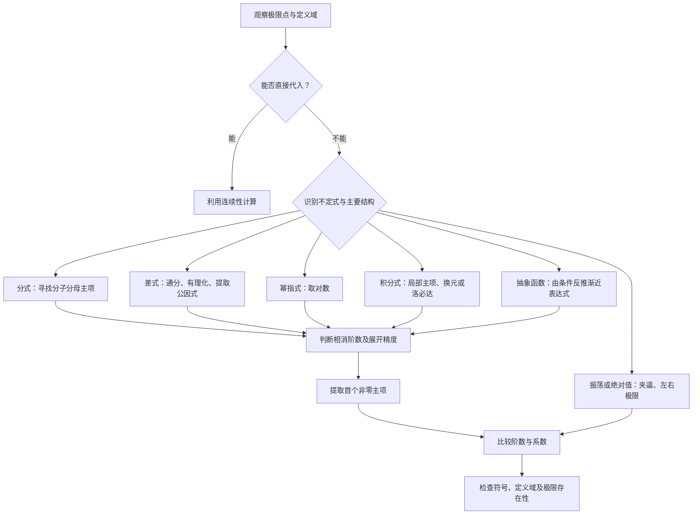
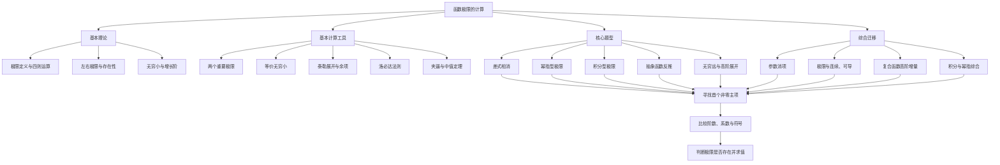

## 考点与学习目标

函数极限的计算可归纳为七个模型：

| 模型  | 核心内容                | 学习优先级 |
| --- | ------------------- | ----- |
| 模型一 | 差式合并、有理化、通分与相消阶数    | ★★★★★ |
| 模型二 | 幂指型极限、取对数与高阶抵消      | ★★★★★ |
| 模型三 | 积分型与复合型极限、局部主项及尺度变换 | ★★★★★ |
| 模型四 | 隐含条件与抽象函数的极限反推      | ★★★★★ |
| 模型五 | 多项三角表达式的高阶复合展开      | ★★★★☆ |
| 模型六 | 教材高质量变式、结构代换与二次抵消   | ★★★★★ |
| 模型七 | 真题延伸、参数消项与原创综合题     | ★★★★☆ |

**1. 本节真正需要掌握什么？**

函数极限表面上有大量公式和技巧，但其计算本质上可以归纳为一个核心问题：

**寻找函数在极限点附近真正起决定作用的部分，并分析各部分之间的数量级关系。**

例如，当 $x\to0$ 时，

$$
\sin x=x-\frac{x^3}{6}+o(x^3).
$$

如果计算

$$
\lim_{x\to0}\frac{\sin x}{x},
$$

只需要知道 $\sin x$ 的一阶主项。

但是，如果计算

$$
\lim_{x\to0}\frac{x-\sin x}{x^3},
$$

一阶主项已经抵消，真正决定极限的是三阶项。

如果计算

$$
\lim_{x\to0} \frac{\sin x-x+\frac{x^3}{6}}{x^5},
$$

则必须进一步研究五阶项。

这三个问题使用的是同一个函数，但要求的近似精度完全不同。

因此，本节最重要的能力并不是背诵更多极限公式，而是：

- 识别极限的结构及不定式类型。
- 判断哪些项会抵消、哪些项需要保留。
- 主动选择最简单的等价变形。
- 确定泰勒展开的精度。
- 将陌生表达式拆解成已经掌握的基本模型。
- 在抽象函数、积分、参数以及复合函数中寻找隐藏的主项。

## 二、函数极限的基础知识体系

### 2.1 函数极限的本质与直观理解

设

$$
\lim_{x\to a}f(x)=A.
$$

它表示当 $x$ 无限接近 $a$，但不等于 $a$ 时，$f(x)$ 无限接近 $A$。

严格定义为：

$$
\forall\varepsilon>0,\quad \exists\delta>0,
$$

使得当

$$
0<|x-a|<\delta
$$

时，有

$$
|f(x)-A|<\varepsilon.
$$

计算题中，通常不需要直接使用定义证明，但必须理解它带来的三个重要结论。

**第一，极限不取决于极限点处的函数值。**

即使 $f(a)$ 不存在，或者 $f(a)\neq A$，也不影响上述极限。

**第二，双侧极限要求左右两侧具有相同的趋近结果。**

$$
\lim_{x\to a}f(x)=A \iff \lim_{x\to a^-}f(x) = \lim_{x\to a^+}f(x)=A.
$$

**第三，任何有限极限都可以转化为常数与无穷小之和。**

$$
\lim_{x\to a}f(x)=A \iff f(x)=A+o(1).
$$

进一步地，如果

$$
\lim_{x\to a}\frac{f(x)}{(x-a)^n}=c,
$$

那么

$$
f(x)=c(x-a)^n+o((x-a)^n).
$$

这种表达方式是解决抽象函数极限、高阶相消和参数反推题的重要工具。

### 2.2 七种不定式及其处理策略

所谓不定式，是指仅凭各部分的极限，不能直接判断整个表达式的极限。

| 不定式                         | 首选处理方法            | 转化目标                                        |
| --------------------------- | ----------------- | ------------------------------------------- |
| $\frac00$               | 等价无穷小、泰勒、因式分解、洛必达 | 主项之比                                        |
| $\frac{\infty}{\infty}$ | 提取最高阶项、洛必达、倒数换元   | 增长阶比较                                       |
| $\infty-\infty$         | 通分、有理化、提取公因式      | 分式或有限差式                                     |
| $0\cdot\infty$          | 等价替换、乘积化商         | $\frac00$ 或 $\frac{\infty}{\infty}$ |
| $1^\infty$              | 取对数               | $v(x)\ln u(x)$                          |
| $0^0$                   | 取对数               | $v(x)\ln u(x)$                          |
| $\infty^0$              | 取对数               | $v(x)\ln u(x)$                          |

必须注意，不定式并不表示极限不存在。

例如，同样是 $\frac00$ 型，当 $x\to0^+$ 时，

$$
\frac{x^2}{x}\to0,\qquad \frac{x}{x}\to1,\qquad \frac{x}{x^2}\to+\infty.
$$

不定式意味着：**还需要分析趋近速度。**

### 2.3 统一思想：主项分析法

当 $x\to0$ 时，若

$$
f(x)=ax^m+o(x^m),
$$

$$
g(x)=bx^n+o(x^n),
$$

其中 $a,b\neq0$，则

$$
\frac{f(x)}{g(x)} =\frac abx^{m-n}(1+o(1)).
$$

因此：

| 主项阶数关系     | 极限结果            |
| ---------- | --------------- |
| $m>n$  | $0$         |
| $m=n$  | $\frac ab$  |
| $m<n$ | 绝对值趋于无穷，符号需另行判断 |

例如，

$$
\lim_{x\to0}\frac{e^{x^2}-1}{1-\cos x}
$$

只需要判断

$$
e^{x^2}-1\sim x^2,
$$

$$
1-\cos x\sim\frac{x^2}{2}.
$$

故

$$
\boxed{ \lim_{x\to0} \frac{e^{x^2}-1}{1-\cos x}=2 }
$$

这里完全不需要求导，也不需要写出高阶泰勒公式。

**求极限的过程，在很大程度上就是寻找首个非零主项的过程。**

## 三、必须熟练掌握的基本计算工具

### 3.1 两个重要极限

第一个重要极限：

$$
\boxed{\lim_{x\to0}\frac{\sin x}{x}=1}
$$

要求三角函数使用弧度制。

常见推广为：

$$
\lim_{x\to0}\frac{\sin ax}{bx} =\frac ab,\qquad b\neq0.
$$

以及

$$
\lim_{x\to0}\frac{\tan x}{x}=1,
$$

$$
\lim_{x\to0}\frac{\arcsin x}{x}=1,
$$

$$
\lim_{x\to0}\frac{\arctan x}{x}=1.
$$

第二个重要极限：

$$
\boxed{\lim_{x\to0}(1+x)^{1/x}=e}
$$

等价形式为

$$
\lim_{x\to\infty} \left(1+\frac1x\right)^x=e.
$$

最重要的推广是：若 $u(x)\to0$，且

$$
u(x)v(x)\to A,
$$

其中 $A$ 为有限实数，则

$$
\boxed{ [1+u(x)]^{v(x)}\to e^A }
$$

因为

$$
v(x)\ln(1+u(x)) \sim v(x)u(x).
$$

这一结论几乎是所有标准 $1^\infty$ 型极限的基础。

### 3.2 常用等价无穷小

以下公式均以 $u\to0$ 为前提。

| 函数表达式                | 等价无穷小             |
| -------------------- | ----------------- |
| $\sin u$         | $u$           |
| $\tan u$         | $u$           |
| $\arcsin u$      | $u$           |
| $\arctan u$      | $u$           |
| $1-\cos u$       | $\frac12u^2$  |
| $e^u-1$          | $u$           |
| $a^u-1$          | $u\ln a$      |
| $\ln(1+u)$       | $u$           |
| $(1+u)^\alpha-1$ | $\alpha u$    |
| $\sqrt{1+u}-1$   | $\frac12u$    |
| $\ln\cos u$      | $-\frac12u^2$ |
| $\tan u-\sin u$  | $\frac12u^3$  |
| $u-\sin u$       | $\frac16u^3$  |
| $\tan u-u$       | $\frac13u^3$  |
| $u-\arctan u$    | $\frac13u^3$  |
| $\arcsin u-u$    | $\frac16u^3$  |
| $e^u-1-u$        | $\frac12u^2$  |
| $\ln(1+u)-u$     | $-\frac12u^2$ |

其中 $a>0,\ a\neq1$，$\alpha\neq0$。

不要将右侧的 $u$ 局限理解成 $x$。只要内部表达式趋于零，就可以应用。

例如，

$$
\ln(1+x\sin x)\sim x\sin x\sim x^2,
$$

$$
1-\cos(x^2)\sim\frac{x^4}{2},
$$

$$
e^{\sin^2x}-1\sim\sin^2x\sim x^2.
$$

这叫作**复合等价无穷小**。

### 3.3 等价无穷小替换的正确使用方法

假设

$$
f(x)\sim g(x),\qquad h(x)\sim k(x).
$$

那么在相关分母非零的条件下，可以得到

$$
f(x)h(x)\sim g(x)k(x),
$$

$$
\frac{f(x)}{h(x)} \sim \frac{g(x)}{k(x)}.
$$

乘除结构通常可以直接作等价替换。

但是，加减结构必须考虑误差与相消。

例如，

$$
\lim_{x\to0} \frac{\sin x-x}{x^3}.
$$

错误做法是直接利用 $\sin x\sim x$，得到

$$
\frac{x-x}{x^3}=0.
$$

正确做法是

$$
\sin x=x-\frac{x^3}{6}+o(x^3),
$$

所以

$$
\boxed{ \lim_{x\to0} \frac{\sin x-x}{x^3} =-\frac16 }
$$

**加减项什么时候可以替换？**

若

$$
f=F+o(F),\qquad g=G+o(G),
$$

则

$$
f-g=F-G+o(F)+o(G).
$$

只有当舍弃的误差比最终保留的主项更高阶时，替换才是安全的。

例如，

$$
\sin x+\tan x\sim 2x,
$$

因为没有一阶相消。

而

$$
\sin x-\tan x\sim-\frac{x^3}{2},
$$

不能只使用一阶等价量。

**因此，“加减不能等价替换”是一个便于记忆的防错原则，而严格本质是：替换所产生的误差不能影响最终主项。**

### 3.4 常用泰勒展开式

以下公式均在 $x\to0$ 时成立。

| 函数    | 常用泰勒展开                                                            |
| ----- | ----------------------------------------------------------------- |
| 指数函数  | $e^x=1+x+\frac{x^2}{2}+\frac{x^3}{6}+\frac{x^4}{24}+o(x^4)$   |
| 对数函数  | $\ln(1+x)=x-\frac{x^2}{2}+\frac{x^3}{3}-\frac{x^4}{4}+o(x^4)$ |
| 正弦函数  | $\sin x=x-\frac{x^3}{6}+\frac{x^5}{120}+o(x^5)$               |
| 余弦函数  | $\cos x=1-\frac{x^2}{2}+\frac{x^4}{24}+o(x^4)$                |
| 正切函数  | $\tan x=x+\frac{x^3}{3}+\frac{2x^5}{15}+o(x^5)$               |
| 反正切函数 | $\arctan x=x-\frac{x^3}{3}+\frac{x^5}{5}+o(x^5)$              |
| 反正弦函数 | $\arcsin x=x+\frac{x^3}{6}+\frac{3x^5}{40}+o(x^5)$            |
| 平方根函数 | $\sqrt{1+x}=1+\frac x2-\frac{x^2}{8}+\frac{x^3}{16}+o(x^3)$   |
| 倒数函数  | $\frac1{1+x}=1-x+x^2-x^3+x^4+o(x^4)$                          |

一般幂函数展开为

$$
\begin{aligned} (1+x)^\alpha ={}&1+\alpha x +\frac{\alpha(\alpha-1)}{2}x^2\\ &+\frac{\alpha(\alpha-1)(\alpha-2)}{6}x^3 +o(x^3). \end{aligned}
$$

泰勒公式的适用前提是函数具有所需阶数的局部可导性。对于题目中的抽象函数，不能因为常见初等函数能够展开，就擅自假设抽象函数也存在高阶导数。

**泰勒展开到底展开到几阶？**

这是本节最重要的实战问题之一。

假设需要计算

$$
\lim_{x\to0}\frac{F(x)}{x^4}.
$$

通常只需要把 $F(x)$ 中影响结果的部分计算到四阶。

但是，对于内部复合结构，要根据外部乘除关系调整精度。

例如，

$$
\lim_{x\to0}\frac{x\sin x-x^2}{x^4},
$$

虽然分母是四阶，但由于分子中 $\sin x$ 还要乘以 $x$，所以只需展开

$$
\sin x=x-\frac{x^3}{6}+o(x^3).
$$

于是

$$
x\sin x-x^2 =-\frac{x^4}{6}+o(x^4).
$$

再例如，

$$
\lim_{x\to0} \frac{e^{x^2}-1-x^2}{x^4},
$$

只需要将指数函数对于内部变量 $u=x^2$ 展开到二阶：

$$
e^{x^2} =1+x^2+\frac{x^4}{2}+o(x^4).
$$

因此，

$$
\boxed{\text{所需展开精度由最终目标和复合结构共同决定。}}
$$

### 3.5 洛必达法则

在符合条件的情况下，

$$
\lim_{x\to a}\frac{f(x)}{g(x)} = \lim_{x\to a}\frac{f'(x)}{g'(x)}.
$$

适用条件包括：原式属于 $0/0$ 型或 $\infty/\infty$ 型；函数在相应去心邻域内可导，分母导数不为零；导数之比具有相应的有限或无穷极限。

特别注意：

**洛必达是分子分母分别求导，而不是对整个分式求导。**

例如，

$$
\lim_{x\to0}\frac{\ln(1+x)-x}{x^2}
$$

可以计算为

$$
\begin{aligned} \lim_{x\to0} \frac{\frac1{1+x}-1}{2x} &=\lim_{x\to0} \frac{-x}{2x(1+x)}\\ &=-\frac12. \end{aligned}
$$

什么时候优先用洛必达？

当原式求导后，结构明显变得简单时；例如变上限积分、对数函数与幂函数之比。

什么时候优先用泰勒？

当题目涉及多个差式、高阶相消、复合三角函数、幂指型极限或者反复求导会造成表达式膨胀时。

对于抽象函数，仅知道某点可导，不代表它在附近每一点都可导，因此不能随意使用洛必达。

另外，导数之比极限不存在，并不能据此断定原极限不存在。

### 3.6 夹逼定理及振荡因子的处理

若

$$
g(x)\le f(x)\le h(x),
$$

且两侧均趋于 $A$，则

$$
f(x)\to A.
$$

最常见的推论是：

$$
\boxed{\text{无穷小量}\times\text{有界量}\to0}
$$

例如，

$$
\lim_{x\to0}x^2\sin\frac1x=0.
$$

由于

$$
\left|x^2\sin\frac1x\right|\le x^2.
$$

但是，如果有界振荡因子前面的系数并不趋于零，就不能直接判断极限存在。

例如，

$$
\lim_{x\to+\infty} \left(1+\frac{\sin x}{x}\right)^x
$$

取对数后得到

$$
x\ln\left(1+\frac{\sin x}{x}\right) =\sin x+o(1),
$$

而 $\sin x$ 不收敛，因此原极限不存在。这也是李林880题综合题中出现的典型辨析模型。

### 3.7 无穷远处的增长速度

当 $x\to+\infty$，对任意正常数 $p,q$ 及 $a>1$，有

$$
\boxed{ (\ln x)^p\ll x^q\ll a^x }
$$

即

$$
\frac{(\ln x)^p}{x^q}\to0,\qquad \frac{x^q}{a^x}\to0.
$$

其中符号 $\ll$ 表示左侧与右侧之比趋于零。

常用结论：

$$
\lim_{x\to+\infty}\frac{\ln x}{x}=0,
$$

$$
\lim_{x\to0^+}x^\alpha\ln x=0, \qquad\alpha>0.
$$

对于无穷远处包含 $\frac1x$ 的表达式，经常使用倒数换元：

$$
t=\frac1x.
$$

将无穷远极限变为 $t\to0$ 时的局部泰勒问题。

必须注意：

$$
x\to+\infty\implies t\to0^+,
$$

$$
x\to-\infty\implies t\to0^-.
$$

换元不能丢掉趋近方向。

## 四、考场上的极限计算决策体系

面对一道陌生的函数极限题，不要立即开始求导或机械展开，而应该先识别表达式的整体结构。

下面这张表可以作为日常做题时的方法检索表。

| 看到的典型结构                    | 应立即想到的方法                     |
| -------------------------- | ---------------------------- |
| $\sqrt A-\sqrt B$      | 根式有理化                        |
| $\frac1A-\frac1B$      | 先通分                          |
| $e^A-e^B$              | 提取 $e^B$，研究 $A-B$    |
| $\ln A-\ln B$          | 合并为 $\ln\frac AB$        |
| $\sin A-\sin B$        | 和差化积或中值定理                    |
| $\arctan A-\arctan B$  | 中值定理或反正切差角公式                 |
| $A^B$                  | 转化为 $e^{B\ln A}$         |
| $A^B-C$                | 转化为指数函数的差式                   |
| $x^nF(1/x)$            | 令 $t=1/x$，研究 $n$ 阶主项 |
| $\int_0^x f(t)\,dt$   | 被积函数主项或洛必达                   |
| $\int_0^x f(x,t)\,dt$ | 优先考虑 $t=xu$              |
| 已知含 $f(x)$ 的极限         | 反推 $f(x)$ 的主项            |
| $f(a+u)-f(a)$          | 导数定义或一点泰勒展开                  |
| $\sin(1/x)$ 与无穷小相乘     | 夹逼定理                         |
| 绝对值、分段函数、$e^{1/x}$     | 分别研究左右极限                     |

## 五、模型一：差式先合并——有理化、通分与相消阶数

这是函数极限计算最基础、同时也是最容易因错误替换而丢分的一类题目。

### 5.1 差式相消的四个基本结构

**结构一：倒数差**

$$
\frac1{A(x)}-\frac1{B(x)} =\frac{B(x)-A(x)}{A(x)B(x)}.
$$

若

$$
A(x)\sim ax,\qquad B(x)\sim ax,
$$

那么

$$
A(x)B(x)\sim a^2x^2.
$$

此时能否得到有限非零极限，取决于 $B(x)-A(x)$ 的二阶主项。

**结构二：根式差**

$$
\sqrt{A}-\sqrt{B} =\frac{A-B}{\sqrt A+\sqrt B}.
$$

特别地，若 $A,B\to1$，则

$$
\sqrt A-\sqrt B =\frac{A-B}{2+o(1)}.
$$

当 $A-B$ 在去心邻域内非零时，可以进一步写为

$$
\sqrt A-\sqrt B\sim\frac{A-B}{2}.
$$

**结构三：指数差**

$$
e^A-e^B=e^B(e^{A-B}-1).
$$

若 $A,B\to c$，且 $A-B\to0$，则

$$
e^A-e^B=e^c[1+o(1)](A-B).
$$

这说明指数函数的差式往往无需分别展开两个指数，只需要研究指数之差。

**结构四：对数差**

$$
\ln A-\ln B =\ln\left(1+\frac{A-B}{B}\right).
$$

当 $A,B\to c>0$ 时，

$$
\ln A-\ln B =\left(\frac1c+o(1)\right)(A-B).
$$

这四种结构背后存在统一规律：**当两个输入趋向同一个值时，外层函数的差主要由内层变量的差决定。**

### 5.2 母题一：无穷大差式与二阶消项

**来源：2020年考研数学一。**

求

$$
I=\lim_{x\to0} \left( \frac1{e^x-1} -\frac1{\ln(1+x)} \right).
$$

<Steps>

<Step>

### 第一步：识别题型 [!toc]

因为

$$
e^x-1\sim x,\qquad \ln(1+x)\sim x,
$$

所以两个倒数均具有 $1/x$ 型奇性，属于无穷大差式。

不能分别用等价无穷小替换成 $1/x$，否则会丢掉决定结果的常数项。

</Step>

<Step>

### 第二步：通分 [!toc]

$$
I=\lim_{x\to0} \frac{\ln(1+x)-(e^x-1)} {(e^x-1)\ln(1+x)}.
$$

分母显然满足

$$
(e^x-1)\ln(1+x)\sim x^2.
$$

因此分子必须研究到二阶。

</Step>

<Step>

### 第三步：研究相消后的主项 [!toc]

$$
\ln(1+x) =x-\frac{x^2}{2}+o(x^2),
$$

$$
e^x-1 =x+\frac{x^2}{2}+o(x^2).
$$

相减得到

$$
\ln(1+x)-(e^x-1) =-x^2+o(x^2).
$$

故

$$
I=\lim_{x\to0} \frac{-x^2+o(x^2)}{x^2+o(x^2)}.
$$

最终得到

$$
\boxed{I=-1}.
$$

</Step>

</Steps>

**深层推广：倒数的局部展开**

若

$$
f(x)=ax+bx^2+o(x^2), \qquad a\neq0,
$$

则

$$
\begin{aligned} \frac1{f(x)} &=\frac1{ax} \left(1+\frac ba x+o(x)\right)^{-1}\\ &=\frac1{ax}-\frac b{a^2}+o(1). \end{aligned}
$$

因此有非常实用的结论：

$$
\boxed{ \frac1{ax+bx^2+o(x^2)} =\frac1{ax}-\frac b{a^2}+o(1) }
$$

由此可以快速得到

$$
\frac1{e^x-1} =\frac1x-\frac12+o(1),
$$

$$
\frac1{\ln(1+x)} =\frac1x+\frac12+o(1).
$$

两式相减直接得到 $-1$。

1987年数学二真题是这一模型的基础版本：

$$
\lim_{x\to0} \left(\frac1x-\frac1{e^x-1}\right) =\boxed{\frac12}.
$$

以后看到两个具有相同 $1/x$ 奇性的函数相减，就应当立即想到二阶主项。

### 5.3 母题二：根式差与三阶相消

**来源：1999年考研数学二；张宇1000题基础部分也收录了分母符号相反的变式。**

求

$$
I=\lim_{x\to0} \frac{\sqrt{1+\tan x}-\sqrt{1+\sin x}} {x\ln(1+x)-x^2}.
$$

<Steps>

<Step>

### 第一步：不要直接展开整个根式 [!toc]

如果分别展开两个根式，需要处理多项复合三角函数，计算量较大。

更简单的方法是先有理化：

$$
\sqrt{1+\tan x}-\sqrt{1+\sin x} = \frac{\tan x-\sin x} {\sqrt{1+\tan x}+\sqrt{1+\sin x}}.
$$

由于分母趋于2，只需研究

$$
\tan x-\sin x.
$$

</Step>

<Step>

### 第二步：利用三角恒等变形 [!toc]

$$
\begin{aligned} \tan x-\sin x &=\sin x\left(\frac1{\cos x}-1\right)\\ &=\frac{\sin x(1-\cos x)}{\cos x}\\ &\sim x\cdot\frac{x^2}{2}. \end{aligned}
$$

因此，

$$
\sqrt{1+\tan x}-\sqrt{1+\sin x} \sim\frac{x^3}{4}.
$$

</Step>

<Step>

### 第三步：计算分母主项 [!toc]

$$
\begin{aligned} x\ln(1+x)-x^2 &=x[\ln(1+x)-x]\\ &\sim x\left(-\frac{x^2}{2}\right)\\ &=-\frac{x^3}{2}. \end{aligned}
$$

因此

$$
\boxed{I=-\frac12}.
$$

</Step>

</Steps>

**这道题应该学到什么？**

有理化的目的不是机械地消除根号，而是**把外层函数的差转化为更容易分析的内层函数差**。

其余常见推广包括

$$
\sqrt[3]A-\sqrt[3]B =\frac{A-B}{A^{2/3}+(AB)^{1/3}+B^{2/3}},
$$

以及在 $A,B\to c>0$ 时，

$$
A^\alpha-B^\alpha = [\alpha c^{\alpha-1}+o(1)](A-B).
$$

张宇1000题基础部分 则给出另一种根式相消：

$$
\lim_{x\to0} \frac{\sqrt{1+2x}-\sqrt[3]{1+3x}} {\ln(1+x^2)}.
$$

两个根式分别展开：

$$
\sqrt{1+2x}=1+x-\frac{x^2}{2}+o(x^2),
$$

$$
\sqrt[3]{1+3x}=1+x-x^2+o(x^2).
$$

一阶相消，二阶剩下

$$
\frac{x^2}{2}.
$$

故极限为

$$
\boxed{\frac12}.
$$

当根式次数不同时，直接泰勒展开通常比强行有理化更简单。

### 5.4 母题三：复合函数差与中值定理

**来源：2008年考研数学一、数学二。**

求

$$
I=\lim_{x\to0} \frac{[\sin x-\sin(\sin x)]\sin x}{x^4}.
$$

这道题有很强的代表性，因为考研常常通过增加函数嵌套层数来掩盖基本模型。

<Tabs items={["方法一：引入中间变量", "方法二：中值定理处理复合差"]} defaultIndex={0}>

<Tab value="方法一：引入中间变量">

令

$$
u=\sin x.
$$

则

$$
\sin x-\sin(\sin x)=u-\sin u.
$$

又因为

$$
u-\sin u\sim\frac{u^3}{6},
$$

所以

$$
u-\sin u\sim\frac{x^3}{6}.
$$

乘上外部的 $\sin x\sim x$，得到

$$
[\sin x-\sin(\sin x)]\sin x \sim\frac{x^4}{6}.
$$

故

$$
\boxed{I=\frac16}.
$$

</Tab>

<Tab value="方法二：中值定理处理复合差">

由拉格朗日中值定理，

$$
\sin x-\sin(\sin x)
$$

可以理解为函数

$$
F(u)=u-\sin u
$$

在 $u=\sin x$ 处的取值。利用 $F(u)$ 的局部展开即可，不必将所有内外层分别展开。

对于更加一般的复合差

$$
F(u(x))-F(v(x)),
$$

若 $u(x),v(x)\to a$，且 $F'$ 在 $a$ 附近连续，则

$$
F(u)-F(v)=F'(\xi)(u-v),
$$

其中 $\xi$ 介于 $u,v$ 之间。

由于 $\xi\to a$，所以

$$
\boxed{ F(u)-F(v) =[F'(a)+o(1)](u-v) }
$$

当 $F'(a)\neq0$ 时，外层函数的差可以直接化为内层差的等价量。

当 $F'(a)=0$ 时，则必须继续研究高阶项，不能得到有效的非零主项。

</Tab>

</Tabs>

**适用条件中的重要区别**

如果只知道 $F$ 在 $a$ 点可导，则有

$$
F(a+u)=F(a)+F'(a)u+o(u).
$$

但是不能无条件断定

$$
F(u)-F(v)\sim F'(a)(u-v).
$$

因为当 $u,v$ 十分接近时，两处的一阶余项可能比 $u-v$ 更大。这一点在后面的抽象函数题中尤其重要。

### 5.5 母题四：反正切差与无穷远处的微小增量

**来源：2018年考研数学二。**

求

$$
I=\lim_{x\to+\infty} x^2[\arctan(x+1)-\arctan x].
$$

<Tabs items={["方法一：拉格朗日中值定理", "方法二：反正切差角公式"]} defaultIndex={0}>

<Tab value="方法一：拉格朗日中值定理">

存在 $\xi\in(x,x+1)$，使得

$$
\arctan(x+1)-\arctan x =\frac1{1+\xi^2}.
$$

于是

$$
I=\lim_{x\to+\infty} \frac{x^2}{1+\xi^2}.
$$

由于

$$
1<\frac{\xi}{x}<1+\frac1x,
$$

由夹逼定理，

$$
\frac{\xi}{x}\to1.
$$

因此

$$
\boxed{I=1}.
$$

</Tab>

<Tab value="方法二：反正切差角公式">

当 $x$ 充分大且为正时，

$$
\arctan(x+1)-\arctan x =\arctan\frac1{1+x(x+1)}.
$$

利用 $\arctan u\sim u$，

$$
\arctan(x+1)-\arctan x \sim\frac1{x^2}.
$$

同样得到结果1。

</Tab>

</Tabs>

**李林880题综合变式**

补充变式：

设 $a>0$，若

$$
\lim_{x\to+\infty} x^a\ln\frac{\arctan(x+1)}{\arctan x}=b
$$

为非零有限常数，求 $a,b$。

由前面的母题，

$$
\arctan(x+1)-\arctan x\sim\frac1{x^2}.
$$

因此

$$
\begin{aligned} \ln\frac{\arctan(x+1)}{\arctan x} &=\ln\left( 1+ \frac{\arctan(x+1)-\arctan x} {\arctan x} \right)\\ &\sim\frac{2}{\pi x^2}. \end{aligned}
$$

原式等价于

$$
\frac2\pi x^{a-2}.
$$

要使极限为非零有限常数，必须有

$$
\boxed{a=2,\qquad b=\frac2\pi}.
$$

这就是从直接计算极限，到利用极限反推未知阶数的自然迁移。

### 5.6 母题五：多重差式与先提取公因式

**来源：2026年考研数学一、数学二。**

求

$$
I=\lim_{x\to0} \left[ \frac1x- \frac{\ln(1+x)}{x\sin x} \right].
$$

先合并：

$$
I=\lim_{x\to0} \frac{\sin x-\ln(1+x)}{x\sin x}.
$$

分母

$$
x\sin x\sim x^2.
$$

分子

$$
\sin x=x+o(x^2),
$$

$$
\ln(1+x)=x-\frac{x^2}{2}+o(x^2).
$$

因此

$$
\sin x-\ln(1+x) =\frac{x^2}{2}+o(x^2).
$$

故

$$
\boxed{I=\frac12}.
$$

可以看出，2020年数学一和这道题虽然形式不同，但都是先把两个具有相同奇性的表达式合并，再寻找相消后的主项。

**模型一小结**

| 题目结构    | 本质       | 最佳工具    |
| ------- | -------- | ------- |
| 倒数相减    | 相同奇性抵消   | 通分      |
| 根式相减    | 外层差转为内层差 | 有理化     |
| 指数相减    | 指数增量     | 提取公因式   |
| 对数相减    | 比值的增量    | 对数合并    |
| 复合函数相减  | 输入变量间的差  | 换元或中值定理 |
| 无穷远反三角差 | 导数决定局部增量 | 中值定理    |

## 六、模型二：幂指型极限——取对数与高阶抵消

幂指型极限是历年考研函数极限题中的重要模型，也是最容易与泰勒展开、差式、积分和未知参数组合的题型。

### 6.1 幂指型极限的统一理论

设

$$
y(x)=u(x)^{v(x)},\qquad u(x)>0.
$$

则

$$
y(x)=e^{v(x)\ln u(x)}.
$$

令

$$
H(x)=v(x)\ln u(x).
$$

那么

$$
\boxed{ \lim u(x)^{v(x)} =\lim e^{H(x)} }
$$

因此：

| $H(x)$ 的极限      | 原幂指函数的极限      |
| ------------------- | ------------- |
| $A\in\mathbb R$ | $e^A$     |
| $0$             | $1$       |
| $+\infty$       | $+\infty$ |
| $-\infty$       | $0$       |
| 持续振荡且不具有扩展实数极限      | 不存在           |

注意，标准重要极限并不是幂指型极限的唯一形式。

对于 $0^0$ 或 $\infty^0$ 型，不能写成 $e^{v(u-1)}$，因为底数并不趋于1。

### 6.2 母题六：分式底数与指数增长

**来源：2010年考研数学一。**

求

$$
I=\lim_{x\to+\infty} \left[\frac{x^2}{(x-a)(x+b)}\right]^x.
$$

<Tabs items={["方法一：取对数", "方法二：拆成两个重要极限"]} defaultIndex={0}>

<Tab value="方法一：取对数">

底数可以改写为

$$
\frac1{(1-\frac ax)(1+\frac bx)}.
$$

令

$$
H(x)= -x\ln\left(1-\frac ax\right) -x\ln\left(1+\frac bx\right).
$$

利用 $\ln(1+u)=u+o(u)$，

$$
-x\ln\left(1-\frac ax\right)\to a,
$$

$$
-x\ln\left(1+\frac bx\right)\to-b.
$$

所以

$$
H(x)\to a-b.
$$

故

$$
\boxed{I=e^{a-b}}.
$$

</Tab>

<Tab value="方法二：拆成两个重要极限">

$$
\begin{aligned} I &=\lim_{x\to+\infty} \left(1-\frac ax\right)^{-x} \left(1+\frac bx\right)^{-x}\\ &=e^ae^{-b}\\ &=e^{a-b}. \end{aligned}
$$

当底数是多项乘除组合时，取对数能够把乘除关系转换为加减关系，经常比通分更简单。

</Tab>

</Tabs>

### 6.3 母题七：底数中隐藏的一阶增量

**来源：2011年考研数学一。**

求

$$
I=\lim_{x\to0} \left[ \frac{\ln(1+x)}x \right]^{\frac1{e^x-1}}.
$$

<Steps>

<Step>

### 第一步：识别 $1^\infty$ 型 [!toc]

$$
\frac{\ln(1+x)}x\to1,
$$

而

$$
\frac1{e^x-1}
$$

的绝对值趋于无穷，因此应该取对数。

</Step>

<Step>

### 第二步：寻找底数与1的差 [!toc]

$$
\begin{aligned} \frac{\ln(1+x)}x-1 &=\frac{\ln(1+x)-x}{x}\\ &=-\frac x2+o(x). \end{aligned}
$$

所以

$$
\frac{\ln(1+x)}x =1-\frac x2+o(x).
$$

</Step>

<Step>

### 第三步：计算对数极限 [!toc]

$$
\begin{aligned} H(x) &=\frac{\ln\left[\frac{\ln(1+x)}x\right]} {e^x-1}\\ &=\frac{-\frac x2+o(x)} {x+o(x)}\\ &\to-\frac12. \end{aligned}
$$

因此

$$
\boxed{I=e^{-1/2}}.
$$

</Step>

</Steps>

**题型迁移**

李正元练习题第一章选择题第1题：

$$
\lim_{x\to0} \left(\frac{\sin x}{x}\right)^{1/x^2}.
$$

由于

$$
\frac{\sin x}{x} =1-\frac{x^2}{6}+o(x^2),
$$

所以

$$
\boxed{I=e^{-1/6}}.
$$

张宇1000题中有两个对应变式：

$$
\lim_{x\to0} \left(\frac{\arctan x}{x}\right)^{1/\tan^2x} =\boxed{e^{-1/3}},
$$

$$
\lim_{x\to0} \left(\frac{\arcsin x}{x}\right)^{1/\sin^2x} =\boxed{e^{1/6}}.
$$

它们并不是三种不同题型，而是同一个公式：

如果

$$
u(x)=1+ax^n+o(x^n),
$$

并且

$$
x^nv(x)\to b,
$$

那么

$$
\boxed{u(x)^{v(x)}\to e^{ab}}.
$$

### 6.4 母题八：$0^0$ 型与对数增长阶

**来源：2010年考研数学三；张宇1000题强化部分有直接推广。**

求

$$
I=\lim_{x\to+\infty} \left(x^{1/x}-1\right)^{1/\ln x}.
$$

<Steps>

<Step>

### 第一步：判断底数趋于多少 [!toc]

$$
x^{1/x}=e^{\frac{\ln x}{x}}\to1.
$$

因此

$$
x^{1/x}-1\to0^+.
$$

同时

$$
\frac1{\ln x}\to0.
$$

这是 $0^0$ 型，而不是 $1^\infty$ 型。

</Step>

<Step>

### 第二步：取对数 [!toc]

$$
H(x) =\frac{\ln(x^{1/x}-1)}{\ln x}.
$$

注意

$$
x^{1/x}-1 =e^{\frac{\ln x}{x}}-1 \sim\frac{\ln x}{x}.
$$

所以存在 $\varepsilon(x)\to0$，使得

$$
x^{1/x}-1 =\frac{\ln x}{x}(1+\varepsilon(x)).
$$

取对数：

$$
\ln(x^{1/x}-1) =\ln\ln x-\ln x+\ln(1+\varepsilon(x)).
$$

故

$$
H(x)= \frac{\ln\ln x}{\ln x} -1+ \frac{o(1)}{\ln x}.
$$

由于

$$
\frac{\ln\ln x}{\ln x}\to0,
$$

因此

$$
H(x)\to-1.
$$

最后得到

$$
\boxed{I=e^{-1}}.
$$

</Step>

</Steps>

**推广母题**

对于固定的 $a>0$ 和实常数 $b$，

$$
\lim_{x\to+\infty} \left(x^{a/x}-1\right)^{b/\ln x}.
$$

因为

$$
x^{a/x}-1\sim\frac{a\ln x}{x},
$$

所以

$$
\ln(x^{a/x}-1) =\ln a+\ln\ln x-\ln x+o(1).
$$

原极限为

$$
\boxed{e^{-b}}.
$$

这就解释了张宇1000题强化部分：

$$
\lim_{x\to+\infty} \left(x^{2/x}-1\right)^{2/\ln x} =\boxed{e^{-2}}.
$$

它考查的不是标准第二重要极限，而是**对数变换后的增长阶比较**。

### 6.5 母题九：高阶相消的幂指型极限

**来源：2016年考研数学二、数学三。**

求

$$
I=\lim_{x\to0} (\cos2x+2x\sin x)^{1/x^4}.
$$

这是非常重要的高阶模型。

<Steps>

<Step>

### 第一步：根据指数反推所需精度 [!toc]

指数为

$$
\frac1{x^4},
$$

说明需要寻找底数相对于1的四阶主项。

如果底数存在非零二阶项，指数与底数增量的乘积就可能趋于无穷，而不是有限值。

</Step>

<Step>

### 第二步：展开底数 [!toc]

$$
\cos2x =1-2x^2+\frac23x^4+o(x^4),
$$

$$
2x\sin x =2x^2-\frac13x^4+o(x^4).
$$

相加以后，二阶项恰好抵消：

$$
\cos2x+2x\sin x =1+\frac13x^4+o(x^4).
$$

</Step>

<Step>

### 第三步：应用统一公式 [!toc]

$$
\ln(\cos2x+2x\sin x) =\frac13x^4+o(x^4).
$$

故

$$
\frac{\ln(\cos2x+2x\sin x)}{x^4} \to\frac13.
$$

得到

$$
\boxed{I=e^{1/3}}.
$$

这类题目的困难不在取对数，而在**底数内部的低阶项相消**。

</Step>

</Steps>

### 6.6 母题十：幂指表达式减去常数

**来源：2025年考研数学一。**

求

$$
I=\lim_{x\to0^+} \frac{x^x-1}{\ln x\ln(1-x)}.
$$

**第一步：识别指数增量**

$$
x^x=e^{x\ln x}.
$$

由于

$$
x\ln x\to0,
$$

有

$$
x^x-1 =e^{x\ln x}-1 \sim x\ln x.
$$

另一方面，

$$
\ln(1-x)\sim-x.
$$

因此

$$
I=\lim_{x\to0^+} \frac{x\ln x}{-x\ln x}.
$$

所以

$$
\boxed{I=-1}.
$$

如果幂指表达式的极限是1，题目却进一步要求它与1的差，那么应该直接研究指数增量。

**通用结论**

当 $H(x)\to0$ 时，

$$
\boxed{e^{H(x)}-1\sim H(x)}
$$

当 $H(x)\to A$ 时，

$$
e^{H(x)}-e^A =e^A[e^{H(x)-A}-1],
$$

因此

$$
\boxed{ e^{H(x)}-e^A =[e^A+o(1)](H(x)-A) }
$$

例如李林880题基础计算题中的变式：

$$
\lim_{x\to0} \frac{(1+x)^{3/x}-e^3}{x}.
$$

设

$$
H(x)=\frac3x\ln(1+x).
$$

展开得到

$$
H(x)=3-\frac32x+o(x).
$$

所以

$$
(1+x)^{3/x}-e^3 =e^3\left(-\frac32x+o(x)\right).
$$

故

$$
\boxed{-\frac32e^3}.
$$

这属于标准 $1^\infty$ 型极限的二次加工。

### 6.7 高质量模拟题：对数化解乘积的高阶抵消

**来源：李永乐六套卷，模拟四第11题，数学一。**

求

$$
I=\lim_{x\to0} \frac{ (1+2x)^{1/2} (1+3x)^{1/3} (1-8x)^{1/4}-1 }{e^x-1-x}.
$$

**常规思路的困难**

如果分别展开三个根式，再进行乘法，会产生许多交叉项。

但是，三个幂函数相乘，可以通过取对数把乘法变为加法。

设

$$
F(x)= (1+2x)^{1/2} (1+3x)^{1/3} (1-8x)^{1/4}.
$$

则

$$
\ln F(x) =\frac12\ln(1+2x) +\frac13\ln(1+3x) +\frac14\ln(1-8x).
$$

分别展开到二阶：

$$
\frac12\ln(1+2x)=x-x^2+o(x^2),
$$

$$
\frac13\ln(1+3x) =x-\frac32x^2+o(x^2),
$$

$$
\frac14\ln(1-8x) =-2x-8x^2+o(x^2).
$$

相加得到

$$
\ln F(x) =-\frac{21}{2}x^2+o(x^2).
$$

于是

$$
F(x)-1 =e^{\ln F(x)}-1 \sim-\frac{21}{2}x^2.
$$

分母

$$
e^x-1-x\sim\frac{x^2}{2}.
$$

故

$$
\boxed{I=-21}.
$$

**方法升华**

即使原题不是明显的 $1^\infty$ 型，只要出现多个幂函数的乘积，也可以使用对数化简。

一般地，

$$
P(x)=\prod_{i=1}^n(1+a_ix)^{b_i}.
$$

取对数有

$$
\ln P(x) =x\sum_{i=1}^na_ib_i -\frac{x^2}{2}\sum_{i=1}^na_i^2b_i +o(x^2).
$$

如果

$$
\sum_{i=1}^na_ib_i=0,
$$

那么一阶项自动抵消，二阶系数就决定了 $P(x)-1$ 的主项。

这是一类非常适合考研命制创新题的结构。

### 6.8 高质量模拟题：多层幂指与对数混合

**来源：汤家凤八套卷，第六套第11题，数学一。**

求

$$
I=\lim_{x\to0^+} \left(\frac{x^{2x}+1}{2}\right)^{ \frac{x}{(1-\sqrt{\cos x})\ln x} }.
$$

初看非常复杂，但每一个部分都属于熟悉的基本模型。

先研究底数增量：

$$
\frac{x^{2x}+1}{2}-1 =\frac{e^{2x\ln x}-1}{2} \sim x\ln x.
$$

再研究指数中的根式：

$$
1-\sqrt{\cos x} =\frac{1-\cos x}{1+\sqrt{\cos x}} \sim\frac{x^2}{4}.
$$

因此取对数后，

$$
\begin{aligned} H(x) &=\frac{x}{(1-\sqrt{\cos x})\ln x} \ln\left(\frac{x^{2x}+1}{2}\right)\\ &\sim\frac{x\cdot x\ln x} {\frac14x^2\ln x}\\ &=4. \end{aligned}
$$

故

$$
\boxed{I=e^4}.
$$

综合题并不意味着需要新的数学理论，而是要求把多个基础结构正确地连接起来。

## 七、模型三：积分型与复合型极限——局部主项及尺度变换

这是数学一尤其值得强化的题型，因为它可以同时考查函数极限、变上限积分、等价无穷小、泰勒展开和抽象函数的性质。

### 7.1 积分局部主项公式

若当 $t\to0$ 时，

$$
f(t)=ct^n+o(t^n),
$$

其中 $n$ 为非负整数，则在函数局部可积的条件下，

$$
\boxed{ \int_0^x f(t)\,dt =\frac{c}{n+1}x^{n+1}+o(x^{n+1}) }
$$

直观地说：**积分会使幂函数的阶数增加1，并将系数除以新的阶数。**

例如，

$$
\sin t\sim t \implies \int_0^x\sin t\,dt\sim\frac{x^2}{2}.
$$

又例如，

$$
e^{t^2}-1\sim t^2 \implies \int_0^x(e^{t^2}-1)\,dt \sim\frac{x^3}{3}.
$$

如果

$$
f(t)\sim ct^\alpha,\qquad \alpha>-1,
$$

则在 $x\to0^+$ 时、相关积分存在的条件下，

$$
\int_0^x f(t)\,dt \sim\frac{c}{\alpha+1}x^{\alpha+1}.
$$

**为什么积分后仍然可以保留等价关系？**

若

$$
f(t)=ct^n+r(t), \qquad r(t)=o(t^n),
$$

那么对任意 $\varepsilon>0$，当 $t$ 足够接近0时，

$$
|r(t)|\le\varepsilon|t|^n.
$$

于是

$$
\left|\int_0^x r(t)\,dt\right| \le\frac{\varepsilon}{n+1}|x|^{n+1}.
$$

因此

$$
\int_0^x r(t)\,dt=o(x^{n+1}).
$$

这就是积分主项公式的理论依据。

更加一般地，若 $f(t)\sim g(t)$，且 $g(t)$ 在相应单侧邻域保持固定符号、相关积分存在，则通常可得

$$
\int_0^x f(t)\,dt \sim \int_0^x g(t)\,dt.
$$

如果 $g(t)$ 剧烈变号，造成积分本身发生严重相消，则不能不加条件地进行这种替换。

### 7.2 母题十一：标准变上限积分极限

**来源：2016年考研数学一。**

求

$$
I=\lim_{x\to0} \frac{\int_0^x t\ln(1+t\sin t)\,dt} {1-\cos(x^2)}.
$$

<Tabs items={["方法一：积分主项法", "方法二：洛必达法则"]} defaultIndex={0}>

<Tab value="方法一：积分主项法">

首先研究被积函数：

$$
t\sin t\sim t^2,
$$

$$
\ln(1+t\sin t)\sim t^2.
$$

因此

$$
t\ln(1+t\sin t)\sim t^3.
$$

积分后得到

$$
\int_0^x t\ln(1+t\sin t)\,dt \sim\frac{x^4}{4}.
$$

分母

$$
1-\cos(x^2)\sim\frac{x^4}{2}.
$$

故

$$
\boxed{I=\frac12}.
$$

</Tab>

<Tab value="方法二：洛必达法则">

由变上限积分求导公式，

$$
\frac{d}{dx}\int_0^x f(t)\,dt=f(x).
$$

因此

$$
\begin{aligned} I &=\lim_{x\to0} \frac{x\ln(1+x\sin x)} {2x\sin(x^2)}\\ &=\frac12 \lim_{x\to0} \frac{\ln(1+x\sin x)}{\sin(x^2)}\\ &=\frac12. \end{aligned}
$$

</Tab>

</Tabs>

**应该优先选择哪种方法？**

对于这种单一变上限积分，洛必达通常非常快。

但是积分主项法的通用性更强，特别是当题目中出现双重积分、参数积分或高阶相消时。

### 7.3 母题十二：双重变上限积分

**来源：2002年考研数学三。**

求

$$
I=\lim_{x\to0} \frac{ \displaystyle\int_0^x \left[\int_0^{u^2}\arctan(1+t)\,dt\right]du }{x(1-\cos x)}.
$$

<Steps>

<Step>

### 第一步：分析最内层积分 [!toc]

由于

$$
\arctan(1+t)\to\frac\pi4,
$$

所以

$$
\int_0^{u^2}\arctan(1+t)\,dt \sim\frac\pi4u^2.
$$

</Step>

<Step>

### 第二步：再处理外层积分 [!toc]

$$
\int_0^x \left[\int_0^{u^2}\arctan(1+t)\,dt\right]du \sim\frac\pi4\cdot\frac{x^3}{3} =\frac{\pi x^3}{12}.
$$

</Step>

<Step>

### 第三步：处理分母 [!toc]

$$
x(1-\cos x)\sim\frac{x^3}{2}.
$$

故

$$
\boxed{I=\frac\pi6}.
$$

</Step>

</Steps>

**通用规律**

如果

$$
f(t)\sim ct^n,
$$

那么

$$
\int_0^{x^m}f(t)\,dt \sim\frac{c}{n+1}x^{m(n+1)}.
$$

而对于二重嵌套积分，

$$
\int_0^x \left[\int_0^{u^m}f(t)\,dt\right]du
$$

其主项为

$$
\boxed{ \frac{c\,x^{m(n+1)+1}} {(n+1)[m(n+1)+1]} }
$$

这里可取 $m$ 为正整数、$n$ 为非负整数，并假设相关积分存在。

多重积分题的基本策略是从最内层开始，逐层向外传递数量级。

### 7.4 含参数的积分：必须掌握尺度变换

普通变上限积分为

$$
\int_0^x f(t)\,dt.
$$

但是考研题中经常出现

$$
\int_0^x F(x,t)\,dt.
$$

这时，被积函数同时含有外部变量 $x$ 和内部积分变量 $t$。

例如，

$$
\int_0^x(x-t)^2t\,dt.
$$

虽然积分上限趋于零，但不能把 $t$ 简单替换成 $x$。

最重要的换元是

$$
\boxed{t=xu}.
$$

于是

$$
dt=x\,du,
$$

积分区间由 $0$ 到 $x$ 变为固定区间 $0$ 到 $1$。

因此

$$
\boxed{ \int_0^x F(x,t)\,dt =x\int_0^1F(x,xu)\,du }
$$

这就是积分的尺度变换。

其优点是把变量趋近问题转化为固定区间上的参数问题，更便于统一提取 $x$ 的幂次。

### 7.5 母题十三：抽象函数与特殊积分换元

**来源：1994年考研数学三。**

设 $f(x)$ 可导，且 $f(0)=0$，定义

$$
F(x)=\int_0^x t^{n-1}f(x^n-t^n)\,dt,
$$

其中 $n$ 为正整数，求

$$
\lim_{x\to0}\frac{F(x)}{x^{2n}}.
$$

<Steps>

<Step>

### 第一步：寻找特殊微分结构 [!toc]

观察

$$
x^n-t^n
$$

的关于 $t$ 的导数为

$$
-nt^{n-1}.
$$

而原积分中恰好存在 $t^{n-1}\,dt$。

令

$$
u=x^n-t^n,
$$

则

$$
du=-nt^{n-1}\,dt.
$$

所以

$$
\begin{aligned} F(x) &=-\frac1n\int_{x^n}^0f(u)\,du\\ &=\frac1n\int_0^{x^n}f(u)\,du. \end{aligned}
$$

</Step>

<Step>

### 第二步：利用一点可导性 [!toc]

由于 $f(0)=0$，且 $f$ 在0处可导，

$$
f(u)=f'(0)u+o(u).
$$

积分得到

$$
\int_0^{x^n}f(u)\,du =\frac{f'(0)}2x^{2n}+o(x^{2n}).
$$

因此

$$
F(x)=\frac{f'(0)}{2n}x^{2n}+o(x^{2n}).
$$

故

$$
\boxed{ \lim_{x\to0}\frac{F(x)}{x^{2n}} =\frac{f'(0)}{2n} }
$$

注意，即使 $f'(0)=0$，上述等式仍然成立，此时结果为0。

</Step>

</Steps>

**这道题的解题核心**

不应该看到积分就立刻求导，而应该先寻找被积函数是否具有隐含的换元结构。

典型特征是

$$
g'(t)f(g(t)).
$$

这类结构通常可以通过换元直接消去复杂复合关系。

### 7.6 母题十四：含根式核函数的积分

**来源：2017年考研数学二、数学三。**

求

$$
I=\lim_{x\to0^+} \frac{\displaystyle\int_0^x\sqrt{x-t}\,e^t\,dt} {\sqrt{x^3}}.
$$

<Steps>

<Step>

### 第一步：固定积分区间 [!toc]

令

$$
t=xu.
$$

因为 $x>0$，所以

$$
\sqrt{x-t}=\sqrt{x}\sqrt{1-u}.
$$

同时

$$
dt=x\,du.
$$

分子化为

$$
x^{3/2}\int_0^1\sqrt{1-u}\,e^{xu}\,du.
$$

因此

$$
I=\lim_{x\to0^+} \int_0^1\sqrt{1-u}\,e^{xu}\,du.
$$

</Step>

<Step>

### 第二步：利用一致估计或夹逼 [!toc]

当 $u\in[0,1]$ 时，

$$
1\le e^{xu}\le e^x.
$$

因此

$$
\int_0^1\sqrt{1-u}\,du \le \int_0^1\sqrt{1-u}\,e^{xu}\,du \le e^x\int_0^1\sqrt{1-u}\,du.
$$

两侧趋于同一个值，于是

$$
I=\int_0^1\sqrt{1-u}\,du.
$$

计算得到

$$
\boxed{I=\frac23}.
$$

</Step>

</Steps>

**高阶推广**

对于非负整数 $m,n$，当 $x\to0^+$ 时，

$$
\int_0^x t^m(x-t)^n\,dt =x^{m+n+1} \int_0^1u^m(1-u)^n\,du.
$$

其中

$$
\int_0^1u^m(1-u)^n\,du =\frac{m!n!}{(m+n+1)!}.
$$

因此

$$
\boxed{ \int_0^x t^m(x-t)^n\,dt =\frac{m!n!}{(m+n+1)!}x^{m+n+1} }
$$

对于复杂的参数积分，能够快速识别并计算这种多项式核积分，会非常有帮助。

### 7.7 母题十五：积分内部的高阶相消

**来源：李永乐六套卷，模拟二第1题，数学一。**

求

$$
I=\lim_{x\to0} \frac{\displaystyle\int_0^x [\cos(xt)-\cos(x^2)]\,dt}{x^5}.
$$

这是一个很好的数学一综合训练题。

<Steps>

<Step>

### 第一步：观察双变量结构 [!toc]

被积函数中的两个余弦，其自变量分别为

$$
xt,\qquad x^2.
$$

应先使用尺度变换：

$$
t=xu.
$$

则原式化为

$$
I=\lim_{x\to0} \frac{\displaystyle \int_0^1[\cos(x^2u)-\cos(x^2)]\,du} {x^4}.
$$

</Step>

<Step>

### 第二步：展开余弦差 [!toc]

对于 $u\in[0,1]$，

$$
\cos(x^2u) =1-\frac{x^4u^2}{2}+O(x^8),
$$

$$
\cos(x^2) =1-\frac{x^4}{2}+O(x^8).
$$

因此

$$
\cos(x^2u)-\cos(x^2) =\frac{x^4}{2}(1-u^2)+O(x^8).
$$

这里的余项对 $u\in[0,1]$ 可以一致控制。

</Step>

<Step>

### 第三步：提取主项 [!toc]

$$
I=\frac12\int_0^1(1-u^2)\,du.
$$

故

$$
\boxed{I=\frac13}.
$$

</Step>

</Steps>

**张宇1000题强化变式**

计算：

$$
\lim_{x\to0} \frac{\int_0^x[e^{(t-x)^2}-1]\sin t\,dt} {x^2(e^{x^2}-1)}.
$$

令 $t=xu$，则

$$
e^{(t-x)^2}-1 =x^2(u-1)^2+O(x^4),
$$

$$
\sin t=xu+O(x^3).
$$

乘以 $dt=x\,du$，分子的主项为

$$
x^4\int_0^1u(1-u)^2\,du.
$$

而

$$
x^2(e^{x^2}-1)\sim x^4.
$$

因此极限为

$$
\begin{aligned} \int_0^1u(1-u)^2\,du &=\int_0^1(u-2u^2+u^3)\,du\\ &=\frac12-\frac23+\frac14\\ &=\boxed{\frac1{12}}. \end{aligned}
$$

这两道题共享完全相同的方法：固定积分区间，提取参数的幂次，再计算剩余的普通定积分。

### 7.8 母题十六：无穷远处的积分平均值

**来源：2014年考研数学一、数学二、数学三。**

求

$$
I=\lim_{x\to+\infty} \frac{\displaystyle\int_1^x \left[t^2(e^{1/t}-1)-t\right]dt} {x^2\ln(1+\frac1x)}.
$$

<Steps>

<Step>

### 第一步：研究被积函数在无穷远处的极限 [!toc]

$$
e^{1/t} =1+\frac1t+\frac1{2t^2} +o\left(\frac1{t^2}\right).
$$

因此

$$
t^2(e^{1/t}-1)-t =\frac12+o(1).
$$

这表明，被积函数趋于常数 $\frac12$。

</Step>

<Step>

### 第二步：研究分母的增长阶 [!toc]

$$
x^2\ln\left(1+\frac1x\right)\sim x.
$$

于是

$$
I=\lim_{x\to+\infty} \frac1x\int_1^x \left[t^2(e^{1/t}-1)-t\right]dt.
$$

利用积分平均值极限，得到

$$
\boxed{I=\frac12}.
$$

</Step>

</Steps>

**必须掌握的积分平均值定理**

如果 $f(t)\to A$（当 $t\to+\infty$），且 $f$ 在任意有限积分区间可积，那么

$$
\boxed{ \lim_{x\to+\infty} \frac1x\int_a^x f(t)\,dt=A }
$$

直观理解：区间越来越长，前面有限区间的贡献逐渐被稀释，后面大部分区间的函数值接近 $A$。

若 $f$ 连续，还可以直接使用洛必达法则：

$$
\lim_{x\to+\infty} \frac{\int_a^x f(t)\,dt}{x} =A.
$$

李正元练习题第一章证明题 的结论

$$
\lim_{n\to\infty}\int_0^1f(nx)\,dx=A
$$

同样可以令 $t=nx$，得到

$$
\int_0^1f(nx)\,dx =\frac1n\int_0^n f(t)\,dt\to A.
$$

它实际上把数列极限、积分换元和函数极限联系起来了。

### 7.9 母题十七：积分与倒数差式的综合题

**来源：2021年考研数学一、数学二。**

求

$$
I=\lim_{x\to0} \left[ \frac{1+\int_0^x e^{t^2}\,dt}{e^x-1} -\frac1{\sin x} \right].
$$

<Tabs items={["方法一：通分并控制局部精度", "方法二：拆成已经掌握的母题"]} defaultIndex={0}>

<Tab value="方法一：通分并控制局部精度">

令

$$
J(x)=\int_0^x e^{t^2}\,dt.
$$

由于

$$
e^{t^2}=1+t^2+o(t^2),
$$

所以

$$
J(x)=x+\frac{x^3}{3}+o(x^3).
$$

原式通分：

$$
I=\lim_{x\to0} \frac{[1+J(x)]\sin x-(e^x-1)} {(e^x-1)\sin x}.
$$

分母满足

$$
(e^x-1)\sin x\sim x^2.
$$

因此分子只需要保留到二阶。

$$
[1+J(x)]\sin x =(1+x+o(x))(x+o(x^2)).
$$

所以

$$
[1+J(x)]\sin x =x+x^2+o(x^2).
$$

再减去

$$
e^x-1=x+\frac{x^2}{2}+o(x^2),
$$

得到

$$
\frac{x^2}{2}+o(x^2).
$$

故

$$
\boxed{I=\frac12}.
$$

</Tab>

<Tab value="方法二：拆成已经掌握的母题">

原式可以写为

$$
\frac{J(x)}{e^x-1} +\left(\frac1{e^x-1}-\frac1x\right) +\left(\frac1x-\frac1{\sin x}\right).
$$

其中

$$
\frac{J(x)}{e^x-1}\to1,
$$

$$
\frac1{e^x-1}-\frac1x\to-\frac12,
$$

$$
\frac1x-\frac1{\sin x}\to0.
$$

所以

$$
I=1-\frac12+0=\boxed{\frac12}.
$$

**这里的方法二更值得学习。** 遇到综合题，不一定要把所有部分混在一起展开，也可以主动拆成几个熟悉的子问题。

</Tab>

</Tabs>

## 八、模型四：隐含条件与抽象函数的极限反推

这一模型与前面几类有明显区别。

前面的题目通常给出具体函数，要求计算极限；这一模型则是给出一个已经存在的极限，要求反推未知函数的性质、局部表达式、函数值或导数值。

### 8.1 抽象函数极限的四个信息层次

| 已知条件                       | 可以得到的结论                                          |
| -------------------------- | ------------------------------------------------ |
| $\lim_{x\to a}f(x)=A$ | $f(x)=A+o(1)$                                |
| $f$ 在 $a$ 处连续      | $f(x)=f(a)+o(1)$                             |
| $f$ 在 $a$ 处可导      | $f(a+h)=f(a)+f'(a)h+o(h)$                    |
| $f$ 在 $a$ 处具有二阶导数  | $f(a+h)=f(a)+f'(a)h+\frac12f''(a)h^2+o(h^2)$ |

特别注意以下四个量是不同层次的信息：

$$
\lim_{x\to a}f(x),
$$

$$
f(a),
$$

$$
f'(a),
$$

$$
\lim_{x\to a}f'(x).
$$

不能将它们混为一谈。

解决抽象函数题的第一步，就是将文字条件准确翻译成数学表达式。

### 8.2 母题十八：极限与连续、可导的逻辑辨析

**来源：2022年考研数学一。**

设

$$
\lim_{x\to1}\frac{f(x)}{\ln x}=1,
$$

则下列结论哪一个必然成立？

A. $f(1)=0$

B. $\displaystyle\lim_{x\to1}f(x)=0$

C. $f'(1)=1$

D. $\displaystyle\lim_{x\to1}f'(x)=1$

<Steps>

<Step>

### 第一步：从已知极限提取信息 [!toc]

由于

$$
\frac{f(x)}{\ln x}\to1,
$$

而

$$
\ln x\to0,
$$

所以

$$
f(x)=\frac{f(x)}{\ln x}\ln x\to0.
$$

因此B必然正确。

</Step>

<Step>

### 第二步：为什么不能推出A？ [!toc]

原极限只研究 $x\neq1$ 时的函数值。

例如定义

$$
f(x)= \begin{cases} \ln x,&x\neq1,\\ 7,&x=1. \end{cases}
$$

仍然满足

$$
\lim_{x\to1}\frac{f(x)}{\ln x}=1,
$$

但是

$$
f(1)=7.
$$

所以A不一定成立。

</Step>

<Step>

### 第三步：为什么不能推出C？ [!toc]

如果不能确定函数在1处连续，自然也不能保证它在1处可导。

如果额外给出 $f(1)=0$，则可以推出

$$
\begin{aligned} f'(1) &=\lim_{x\to1}\frac{f(x)-f(1)}{x-1}\\ &=\lim_{x\to1} \frac{f(x)}{\ln x} \frac{\ln x}{x-1}\\ &=1. \end{aligned}
$$

但原题没有给出这一条件。

</Step>

<Step>

### 第四步：为什么不能推出D？ [!toc]

即使 $f'(1)=1$，也不代表导函数在1处连续。

例如

$$
f(x)= \begin{cases} \ln x+(x-1)^2\sin\frac1{(x-1)^2}, &x\neq1,\\ 0,&x=1. \end{cases}
$$

仍满足原题条件，但是其导函数包含无界振荡项

$$
-\frac2{x-1}\cos\frac1{(x-1)^2},
$$

因此 $f'(x)$ 在 $x\to1$ 时没有有限极限。

正确答案为

$$
\boxed{\mathrm B}.
$$

</Step>

</Steps>

**这道题的学习价值**

考研数学一经常通过极限、连续、可导之间的逻辑关系命制选择题。

尤其要记住：

$$
\boxed{\text{可导}\implies\text{连续}\implies\text{极限存在}}
$$

反向一般不成立。

而导函数连续又是比函数可导更强的条件。

### 8.3 母题十九：根式极限反推抽象函数

**来源：2016年考研数学三。**

已知

$$
\lim_{x\to0} \frac{\sqrt{1+f(x)\sin2x}-1}{e^{3x}-1}=2,
$$

求

$$
\lim_{x\to0}f(x).
$$

<Callout type="warn" title="常见错误">

直接写

$$
\sqrt{1+f(x)\sin2x}-1 \sim\frac12f(x)\sin2x.
$$

这样做之前，必须先确定

$$
f(x)\sin2x\to0.
$$

题目未给出这一条件。

</Callout>

<Steps>

<Step>

### 第一步：从已知极限反推根式趋于1 [!toc]

因为

$$
e^{3x}-1\to0,
$$

且原比值趋于2，所以

$$
\sqrt{1+f(x)\sin2x}-1\to0.
$$

因此

$$
\sqrt{1+f(x)\sin2x}\to1.
$$

从而

$$
f(x)\sin2x\to0.
$$

此时才具备使用根式等价无穷小的条件。

</Step>

<Step>

### 第二步：有理化并分离未知函数 [!toc]

记原分式为 $A(x)$，则

$$
A(x)= \frac{f(x)\sin2x} {(e^{3x}-1) [\sqrt{1+f(x)\sin2x}+1]}.
$$

整理得到

$$
f(x)= A(x) \frac{e^{3x}-1}{\sin2x} [\sqrt{1+f(x)\sin2x}+1].
$$

各部分极限分别为

$$
A(x)\to2,
$$

$$
\frac{e^{3x}-1}{\sin2x}\to\frac32,
$$

$$
\sqrt{1+f(x)\sin2x}+1\to2.
$$

因此

$$
\boxed{\lim_{x\to0}f(x)=6}.
$$

</Step>

</Steps>

**李正元练习题变式**

第一章填空题第2题：

$$
\lim_{x\to0} \frac{\sqrt{1+f(x)\tan x}-1}{e^{2x}-1}=3.
$$

同样的方法可以得到

$$
\lim_{x\to0}f(x) =3\cdot2\cdot2 =\boxed{12}.
$$

**通用反推模型**

若

$$
\lim_{x\to0} \frac{\sqrt{1+f(x)u(x)}-1}{v(x)} =A,
$$

并且

$$
v(x)\to0,\qquad \frac{v(x)}{u(x)}\to B,
$$

则在相关表达式有定义、分母非零的条件下，

$$
\boxed{\lim_{x\to0}f(x)=2AB}.
$$

这一反推结构不仅适用于平方根，还适用于指数函数、对数函数和反三角函数。

### 8.4 母题二十：抽象复合函数与一点可导性

**来源：2022年考研数学二。**

已知函数 $f(x)$ 在 $x=1$ 处可导，且

$$
\lim_{x\to0} \frac{f(e^{x^2})-3f(1+\sin^2x)}{x^2} =2,
$$

求 $f'(1)$。

<Steps>

<Step>

### 第一步：利用有限极限确定点值 [!toc]

因为

$$
e^{x^2}\to1,\qquad 1+\sin^2x\to1,
$$

而 $f$ 在1处可导，从而连续，所以分子趋于

$$
f(1)-3f(1)=-2f(1).
$$

原分母趋于零，且原商具有有限极限，因此分子必须趋于零。

于是

$$
\boxed{f(1)=0}.
$$

</Step>

<Step>

### 第二步：将一点可导翻译成局部线性展开 [!toc]

$$
f(1+h)=f(1)+f'(1)h+o(h).
$$

由于

$$
e^{x^2}-1=x^2+o(x^2),
$$

所以

$$
f(e^{x^2}) =f(1)+f'(1)x^2+o(x^2).
$$

同理，

$$
\sin^2x=x^2+o(x^2),
$$

从而

$$
f(1+\sin^2x) =f(1)+f'(1)x^2+o(x^2).
$$

</Step>

<Step>

### 第三步：代回原式 [!toc]

利用 $f(1)=0$，

$$
\begin{aligned} &f(e^{x^2})-3f(1+\sin^2x)\\ &=-2f'(1)x^2+o(x^2). \end{aligned}
$$

因此

$$
-2f'(1)=2.
$$

所以

$$
\boxed{f'(1)=-1}.
$$

</Step>

</Steps>

**为什么不推荐使用洛必达？**

题目只给出 $f$ 在 $x=1$ 处可导，而没有说明它在1的某个邻域内处处可导。

因此不能擅自对

$$
f(e^{x^2})-3f(1+\sin^2x)
$$

使用链式法则。

这一点很重要：**已知一点可导时，优先使用导数定义或一点泰勒展开，而不是直接求导。**

### 8.5 母题二十一：由极限证明可导性

**来源：2025年考研数学二、数学三。**

设函数 $f(x)$ 在 $x=0$ 处连续，且

$$
\lim_{x\to0} \frac{xf(x)-e^{2\sin x}+1} {\ln(1+x)+\ln(1-x)} =-3.
$$

证明 $f(x)$ 在0处可导，并求 $f'(0)$。

<Steps>

<Step>

### 第一步：由已知极限还原分子主项 [!toc]

分母为

$$
\begin{aligned} \ln(1+x)+\ln(1-x) &=\ln(1-x^2)\\ &=-x^2+o(x^2). \end{aligned}
$$

因此原条件等价于

$$
xf(x)-e^{2\sin x}+1 =3x^2+o(x^2).
$$

</Step>

<Step>

### 第二步：展开已知初等函数 [!toc]

由于

$$
2\sin x=2x+o(x^2),
$$

所以

$$
e^{2\sin x} =1+2x+2x^2+o(x^2).
$$

代回得

$$
xf(x)-2x-2x^2 =3x^2+o(x^2).
$$

即

$$
xf(x)=2x+5x^2+o(x^2).
$$

当 $x\neq0$ 时，两边除以 $x$：

$$
\boxed{f(x)=2+5x+o(x)}.
$$

</Step>

<Step>

### 第三步：利用连续性确定函数值 [!toc]

由上式，

$$
\lim_{x\to0}f(x)=2.
$$

又因为题目已经给出 $f$ 在0处连续，所以

$$
f(0)=2.
$$

</Step>

<Step>

### 第四步：证明差商极限存在 [!toc]

$$
\begin{aligned} \lim_{x\to0} \frac{f(x)-f(0)}x &=\lim_{x\to0} \frac{5x+o(x)}x\\ &=5. \end{aligned}
$$

根据导数定义，$f(x)$ 在0处可导，并且

$$
\boxed{f'(0)=5}.
$$

</Step>

</Steps>

**统一解题模板**

如果已知

$$
\lim_{x\to0} \frac{xf(x)-g(x)}{x^2}=A,
$$

并且

$$
g(x)=c_1x+c_2x^2+o(x^2),
$$

那么

$$
xf(x)-g(x)=Ax^2+o(x^2).
$$

即

$$
f(x)=c_1+(A+c_2)x+o(x).
$$

若 $f$ 在0处连续，则

$$
\boxed{ f(0)=c_1,\qquad f'(0)=A+c_2 }
$$

它不仅可以计算导数，还能够证明可导性。

### 8.6 张宇1000题综合变式：从幂指极限反推未知函数

**来源：张宇1000题强化部分。**

设

$$
\lim_{x\to0} \left[\cos x+\frac{f(x)}x\right]^{1/x^2} =e^{-1},
$$

求

$$
\lim_{x\to0}\frac{f(x)}{\sin^3x}.
$$

<Steps>

<Step>

### 第一步：把幂指极限反向转化为指数极限 [!toc]

令

$$
B(x)=\cos x+\frac{f(x)}x.
$$

按实数幂的通常定义，相关底数在所考虑的去心邻域内为正。

由题设，

$$
B(x)^{1/x^2}\to e^{-1}.
$$

取对数：

$$
\frac{\ln B(x)}{x^2}\to-1.
$$

因此

$$
\ln B(x)=-x^2+o(x^2).
$$

于是

$$
B(x)=e^{-x^2+o(x^2)} =1-x^2+o(x^2).
$$

</Step>

<Step>

### 第二步：分离未知函数 [!toc]

$$
\frac{f(x)}x =B(x)-\cos x.
$$

又因为

$$
\cos x=1-\frac{x^2}{2}+o(x^2),
$$

所以

$$
\frac{f(x)}x =-\frac{x^2}{2}+o(x^2).
$$

因此

$$
f(x)=-\frac{x^3}{2}+o(x^3).
$$

最终

$$
\boxed{ \lim_{x\to0}\frac{f(x)}{\sin^3x} =-\frac12 }
$$

这类题目的关键在于：通常的幂指极限是由底数主项求极限；本题则是反过来，由幂指极限恢复底数的主项。

</Step>

</Steps>

### 8.7 隐含中值点的极限

**来源：2014年考研数学二。**

设

$$
f(x)=\arctan x.
$$

若

$$
f(x)=xf'(\xi),
$$

求

$$
\lim_{x\to0}\frac{\xi^2}{x^2}.
$$

由中值定理，$\xi$ 介于0与 $x$ 之间，因此 $\xi\to0$。

因为

$$
f'(\xi)=\frac1{1+\xi^2},
$$

所以

$$
\arctan x=\frac{x}{1+\xi^2}.
$$

整理：

$$
\xi^2=\frac{x-\arctan x}{\arctan x}.
$$

因此

$$
\begin{aligned} \lim_{x\to0}\frac{\xi^2}{x^2} &=\lim_{x\to0} \frac{x-\arctan x}{x^2\arctan x}\\ &=\lim_{x\to0} \frac{\frac13x^3+o(x^3)}{x^3+o(x^3)}\\ &=\boxed{\frac13}. \end{aligned}
$$

这是极限计算与微分中值定理的交叉模型。

知道 $\xi$ 介于0和 $x$ 之间，只能得到其相对位置的范围；要确定更精确的比例，就必须利用题设等式并分析高阶主项。

## 九、模型五：多项三角表达式与高阶复合展开

### 9.1 母题二十二：无穷远处的三角函数相消

**来源：2023年考研数学三。**

求

$$
I=\lim_{x\to+\infty} x^2\left( 2-x\sin\frac1x-\cos\frac1x \right).
$$

<Steps>

<Step>

### 第一步：倒数换元 [!toc]

令

$$
t=\frac1x\to0^+.
$$

则

$$
x\sin\frac1x=\frac{\sin t}{t}.
$$

原式变为

$$
I=\lim_{t\to0^+} \frac{2-\frac{\sin t}{t}-\cos t}{t^2}.
$$

</Step>

<Step>

### 第二步：展开到所需精度 [!toc]

$$
\frac{\sin t}{t} =1-\frac{t^2}{6}+o(t^2),
$$

$$
\cos t=1-\frac{t^2}{2}+o(t^2).
$$

因此

$$
\begin{aligned} 2-\frac{\sin t}{t}-\cos t &=\frac{t^2}{6}+\frac{t^2}{2}+o(t^2)\\ &=\frac23t^2+o(t^2). \end{aligned}
$$

所以

$$
\boxed{I=\frac23}.
$$

</Step>

</Steps>

**更快的结构拆分法**

将分子拆成

$$
\left(1-\frac{\sin t}{t}\right) +(1-\cos t).
$$

于是

$$
I= \lim_{t\to0^+}\frac{t-\sin t}{t^3} + \lim_{t\to0^+}\frac{1-\cos t}{t^2}.
$$

两个基本极限分别为

$$
\frac16,\qquad\frac12.
$$

故

$$
I=\frac16+\frac12=\frac23.
$$

这说明看似复杂的多项三角表达式，有时只需要重新分组。

### 9.2 高质量模拟题：混合根式与反三角函数

**来源：汤家凤八套卷，第二套第11题，数学一。**

求

$$
\begin{aligned} I=\lim_{x\to+\infty} &\ln(e^{x^2}+2x-1)\\ &\cdot\left( \sqrt{1+\frac1x} +\sqrt{1-\frac1x} -2x\arctan\frac1x \right). \end{aligned}
$$

<Steps>

<Step>

### 第一步：先处理增长最快的部分 [!toc]

$$
\begin{aligned} \ln(e^{x^2}+2x-1) &=x^2+\ln[1+(2x-1)e^{-x^2}]\\ &=x^2+o(1). \end{aligned}
$$

因此

$$
\ln(e^{x^2}+2x-1)\sim x^2.
$$

</Step>

<Step>

### 第二步：倒数换元 [!toc]

令

$$
t=\frac1x.
$$

只需计算

$$
I=\lim_{t\to0^+} \frac{\sqrt{1+t}+\sqrt{1-t} -2\frac{\arctan t}{t}}{t^2}.
$$

</Step>

<Step>

### 第三步：利用对称性减少计算 [!toc]

$$
\sqrt{1+t} =1+\frac t2-\frac{t^2}{8}+o(t^2),
$$

$$
\sqrt{1-t} =1-\frac t2-\frac{t^2}{8}+o(t^2).
$$

相加后，奇数阶项抵消：

$$
\sqrt{1+t}+\sqrt{1-t} =2-\frac{t^2}{4}+o(t^2).
$$

另一方面，

$$
2\frac{\arctan t}{t} =2-\frac23t^2+o(t^2).
$$

所以

$$
\begin{aligned} I&=-\frac14+\frac23\\ &=\boxed{\frac5{12}}. \end{aligned}
$$

</Step>

</Steps>

<Callout type="idea" title="重要技巧：利用奇偶性控制泰勒展开">

若

$$
F(x)=a_0+a_1x+a_2x^2+a_3x^3+\cdots,
$$

那么

$$
F(x)+F(-x) =2a_0+2a_2x^2+\cdots,
$$

而

$$
F(x)-F(-x) =2a_1x+2a_3x^3+\cdots.
$$

也就是说，对称和只保留偶数阶项，对称差只保留奇数阶项。

这是高阶泰勒题中非常实用的简化方法。

</Callout>

## 十、模型六：高质量教材变式——结构代换与二次抵消

这一部分选取李林880题中具有较强迁移价值的题目。它们不仅能够巩固历年真题模型，还能够训练处理陌生组合结构的能力。

### 10.1 加权幂指极限与几何平均

**来源：李林880题。**

设 $a,b,c>0$，求

$$
I=\lim_{x\to+\infty} \left( \frac{a^{1/x}+b^{1/x}+c^{1/x}}3 \right)^x.
$$

利用

$$
a^{1/x} =e^{\frac{\ln a}{x}} =1+\frac{\ln a}{x} +o\left(\frac1x\right).
$$

同理展开 $b^{1/x},c^{1/x}$。

于是底数为

$$
1+\frac{\ln a+\ln b+\ln c}{3x} +o\left(\frac1x\right).
$$

因此

$$
\begin{aligned} I &=\exp\left( \frac{\ln a+\ln b+\ln c}{3} \right)\\ &=\boxed{(abc)^{1/3}}. \end{aligned}
$$

**一般化结论**

设

$$
a_i>0,\qquad \sum_{i=1}^nw_i=1,
$$

其中 $w_i$ 为固定实常数。则

$$
\boxed{ \lim_{t\to0} \left(\sum_{i=1}^nw_ia_i^t\right)^{1/t} =\prod_{i=1}^na_i^{w_i} }
$$

因为底数趋于1，所以在充分小的邻域内为正。

李正元练习题第一章填空题第3题中的结构

$$
\lim_{x\to0} [\delta K^{-x}+(1-\delta)L^{-x}]^{-1/x}
$$

正是这一公式的直接应用，答案为

$$
\boxed{K^\delta L^{1-\delta}}.
$$

<Callout type="warn" title="容易忽略的陷阱">

权重之和必须等于1，才能形成标准的底数趋于1的结构。

例如李正元练习题中的

$$
\lim_{x\to0^+} \left(\frac{2^x+3^x}{3}\right)^{1/x},
$$

底数趋于 $\frac23$，并非1。

因此

$$
\frac1x\ln\left(\frac{2^x+3^x}{3}\right) \to-\infty,
$$

原极限为

$$
\boxed{0}.
$$

</Callout>

### 10.2 四阶根式差与展开精度

**来源：李林880题。**

求

$$
I=\lim_{x\to0} \frac{(\cos x-e^{x^2})\sin(x^2)} {\frac{x^2}{2}+1-\sqrt{1+x^2}}.
$$

<Steps>

<Step>

### 第一步：分析分子阶数 [!toc]

$$
\cos x=1-\frac{x^2}{2}+o(x^2),
$$

$$
e^{x^2}=1+x^2+o(x^2).
$$

因此

$$
\cos x-e^{x^2} =-\frac32x^2+o(x^2).
$$

又因为

$$
\sin(x^2)\sim x^2,
$$

所以分子等价于

$$
-\frac32x^4.
$$

</Step>

<Step>

### 第二步：研究分母的二次相消 [!toc]

$$
\sqrt{1+x^2} =1+\frac{x^2}{2}-\frac{x^4}{8}+o(x^4).
$$

因此

$$
\frac{x^2}{2}+1-\sqrt{1+x^2} =\frac{x^4}{8}+o(x^4).
$$

故

$$
\boxed{I=-12}.
$$

</Step>

</Steps>

**分母的非泰勒解法**

令 $u=x^2$，则

$$
1+\frac u2-\sqrt{1+u} = \frac{\left(1+\frac u2\right)^2-(1+u)} {1+\frac u2+\sqrt{1+u}}.
$$

分子化简为

$$
\frac{u^2}{4}.
$$

因此

$$
1+\frac u2-\sqrt{1+u} \sim\frac{u^2}{8}.
$$

即

$$
1+\frac{x^2}{2}-\sqrt{1+x^2} \sim\frac{x^4}{8}.
$$

当根式泰勒展开比较繁琐时，有理化依然是非常有价值的工具。

### 10.3 高难度母题：双层指数的二次抵消

**来源：李林880题。**

求

$$
I=\lim_{x\to+\infty} x^2 \left[ e^{(1+1/x)^x} -(1+1/x)^{ex} \right].
$$

这道题很适合用来检验是否真正掌握了函数极限，而不是只会机械展开。

<Steps>

<Step>

### 第一步：统一外层函数 [!toc]

令

$$
t=\frac1x, \qquad u(t)=\frac{\ln(1+t)}t.
$$

则

$$
u(t)=1-\frac t2+\frac{t^2}{3}+o(t^2).
$$

因此

$$
(1+t)^{1/t}=e^{u(t)},
$$

$$
(1+t)^{e/t}=e^{eu(t)}.
$$

原式变为

$$
I=\lim_{t\to0^+} \frac{e^{e^{u(t)}}-e^{eu(t)}}{t^2}.
$$

</Step>

<Step>

### 第二步：先研究内层变量的差 [!toc]

两个外层指数的输入均趋于 $e$。

所以真正重要的是

$$
e^{u(t)}-eu(t).
$$

令

$$
h=u(t)-1.
$$

则

$$
h=-\frac t2+o(t).
$$

于是

$$
\begin{aligned} e^u-eu &=ee^h-e(1+h)\\ &=e(e^h-1-h). \end{aligned}
$$

利用二阶标准等价量，

$$
e^h-1-h\sim\frac{h^2}{2},
$$

得到

$$
e^u-eu \sim\frac e2h^2 \sim\frac e8t^2.
$$

</Step>

<Step>

### 第三步：处理外层指数差 [!toc]

由于

$$
e^u\to e,\qquad eu\to e,
$$

根据指数差式公式，

$$
e^{e^u}-e^{eu} \sim e^e(e^u-eu).
$$

因此

$$
e^{e^u}-e^{eu} \sim\frac{e^{e+1}}8t^2.
$$

最终

$$
\boxed{I=\frac{e^{e+1}}8}.
$$

</Step>

</Steps>

**深层思维：高阶复合函数不要从外到内暴力展开**

这道题的突破口是发现

$$
e^{u}-eu =e[e^{u-1}-1-(u-1)].
$$

其内部就是最普通的二阶相消模型：

$$
e^h-1-h\sim\frac12h^2.
$$

解决复杂复合极限的最佳顺序通常是：

先统一外层函数，再比较内层差，最后对内层差使用基本等价量。

### 10.4 综合模拟母题：抽象函数、积分与二阶可导性

**来源：李林六套卷，第一套第17题，数学一。**

设 $f''(x)$ 在 $x=0$ 处连续，且

$$
f'(0)=0,\qquad f''(0)=1.
$$

求

$$
I=\lim_{x\to0} \frac{\displaystyle \int_0^x \left\{f(t)-f[\ln(1+t)]\right\}dt} {x^4}.
$$

这是本节最值得深入研究的综合模拟题之一。

**为什么直接二阶泰勒展开可能不够？**

由题设，

$$
f(t)=f(0)+\frac12t^2+o(t^2).
$$

以及

$$
f(\ln(1+t)) =f(0)+\frac12\ln^2(1+t)+o(t^2).
$$

相减后，两个二阶余项之差仍然只能保证是 $o(t^2)$。

但是，需要得到被积函数的三阶主项。

**二阶泰勒余项可能比目标三阶项更大，因此不能简单地分别展开后相减。**

**正确方法：中值定理**

对 $f(t)-f(\ln(1+t))$ 使用拉格朗日中值定理。

存在介于 $t$ 与 $\ln(1+t)$ 之间的 $\xi_t$，使得

$$
f(t)-f(\ln(1+t)) =f'(\xi_t)[t-\ln(1+t)].
$$

由于

$$
\ln(1+t)\sim t,
$$

且 $\xi_t$ 介于两者之间，所以

$$
\frac{\xi_t}{t}\to1.
$$

又因为

$$
f'(0)=0,\qquad f''(0)=1,
$$

根据导数定义，

$$
f'(\xi_t)=\xi_t+o(\xi_t)\sim t.
$$

同时

$$
t-\ln(1+t)\sim\frac{t^2}{2}.
$$

因此

$$
f(t)-f(\ln(1+t)) \sim\frac{t^3}{2}.
$$

积分后，

$$
\int_0^x [f(t)-f(\ln(1+t))]dt \sim\frac{x^4}{8}.
$$

所以

$$
\boxed{I=\frac18}.
$$

**这道题真正考查什么？**

它同时综合了五个知识点：一点可导性的定义、拉格朗日中值定理、复合函数差式、余项精度控制、积分主项公式。

尤其重要的是，题目并没有给出三阶导数，因此不能使用三阶泰勒展开。

这类题目往往是区分“掌握公式”与“掌握数学方法”的关键。

## 十一、模型七：参数消项与创新综合题

这一模型也与第一模块第六节“极限中参数的确定”存在交叉。本节主要学习如何根据极限的目标阶数反向确定相消条件。

### 11.1 原创母题：四阶幂指极限

**来源：原创真题变式。**

设 $a\neq0$，若

$$
I=\lim_{x\to0} [\cos(ax)+bx\sin(ax)]^{1/x^4}
$$

存在且为非零有限实数，求 $b$ 和该极限。

<Steps>

<Step>

### 第一步：展开底数 [!toc]

$$
\cos(ax) =1-\frac{a^2}{2}x^2 +\frac{a^4}{24}x^4+o(x^4),
$$

$$
bx\sin(ax) =abx^2-\frac{a^3b}{6}x^4+o(x^4).
$$

相加：

$$
\begin{aligned} B(x)=1 &+\left(ab-\frac{a^2}{2}\right)x^2\\ &+\left(\frac{a^4}{24}-\frac{a^3b}{6}\right)x^4\\ &+o(x^4). \end{aligned}
$$

</Step>

<Step>

### 第二步：根据非零有限极限确定必要条件 [!toc]

取对数：

$$
H(x)=\frac{\ln B(x)}{x^4}.
$$

要使原极限存在且非零有限，就必须使 $H(x)$ 趋于有限实数。

如果二阶系数

$$
ab-\frac{a^2}{2}
$$

不等于零，那么 $H(x)$ 将以 $1/x^2$ 的速度发散。

原幂指极限只能趋于0或正无穷。

因此必须满足

$$
ab-\frac{a^2}{2}=0.
$$

由于 $a\neq0$，

$$
\boxed{b=\frac a2}.
$$

</Step>

<Step>

### 第三步：求相消后的四阶系数 [!toc]

将 $b=\frac a2$ 代入：

$$
\frac{a^4}{24}-\frac{a^3b}{6} =\frac{a^4}{24}-\frac{a^4}{12} =-\frac{a^4}{24}.
$$

因此

$$
B(x)=1-\frac{a^4}{24}x^4+o(x^4).
$$

所以

$$
\frac{\ln B(x)}{x^4} \to-\frac{a^4}{24}.
$$

最终得到

$$
\boxed{ b=\frac a2,\qquad I=e^{-a^4/24} }.
$$

</Step>

</Steps>

**条件变化时应如何判断？**

| 参数关系                   | 原极限               |
| ---------------------- | ----------------- |
| $ab>\frac{a^2}{2}$ | $+\infty$     |
| $ab<\frac{a^2}{2}$ | $0$           |
| $ab=\frac{a^2}{2}$ | $e^{-a^4/24}$ |

这就是“存在”“有限”“非零”三个条件的区别。

如果题目仅要求极限为有限实数，那么趋于0的情况也应当纳入。

### 11.2 原创创新题：积分与幂指的组合

下面给出一道原创变式，将本节的积分尺度变换、高阶相消、幂指极限结合起来。

求

$$
I=\lim_{x\to0^+} \left[ 1+\frac1x \int_0^x(e^{xt}-1-xt)\,dt \right]^{1/x^4}.
$$

<Steps>

<Step>

### 第一步：判断底数增量 [!toc]

设

$$
U(x)=\frac1x \int_0^x(e^{xt}-1-xt)\,dt.
$$

令 $t=xu$，则

$$
U(x)=\int_0^1 (e^{x^2u}-1-x^2u)\,du.
$$

</Step>

<Step>

### 第二步：处理二阶相消 [!toc]

对 $u\in[0,1]$，

$$
e^{x^2u}-1-x^2u =\frac{x^4u^2}{2}+O(x^6).
$$

因此

$$
\begin{aligned} U(x) &=\frac{x^4}{2}\int_0^1u^2\,du+O(x^6)\\ &=\frac{x^4}{6}+O(x^6). \end{aligned}
$$

</Step>

<Step>

### 第三步：使用幂指极限公式 [!toc]

$$
I= \lim_{x\to0^+} [1+U(x)]^{1/x^4}.
$$

所以

$$
\boxed{I=e^{1/6}}.
$$

这道题虽然形式上比基础题复杂，但不需要学习任何新的公式。只需要把已经掌握的三个母题串联起来。

</Step>

</Steps>

## 十二、函数极限计算的进阶方法总结

### 12.1 余项传播规律

考研极限中的高阶错误，往往来源于没有正确处理 $o$ 和 $O$。

当 $x\to0$ 时，常用规律如下。

| 运算                              | 结果                      |
| ------------------------------- | ----------------------- |
| $o(x^m)+o(x^m)$             | $o(x^m)$            |
| $x^n o(x^m)$                | $o(x^{m+n})$        |
| $o(x^m)o(x^n)$              | $o(x^{m+n})$        |
| $\frac{o(x^m)}{x^n}$        | $o(x^{m-n})$        |
| $u(x)=O(x^m),\ r(u)=o(u^n)$ | $r(u(x))=o(x^{mn})$ |
| $\int_0^x o(t^n)\,dt$      | $o(x^{n+1})$        |

最后一条要求局部可积，且通常取 $n$ 为非负整数。

最应该警惕的是：

$$
o(x^2)-o(x^2)=o(x^2),
$$

不能擅自写成 $o(x^3)$。

即使低阶显式项已经相消，也不代表余项会自动提升一个阶数。

### 12.2 复合函数的阶数传播

假设

$$
u(x)\sim ax^m,
$$

$$
F(t)-F(0)\sim bt^n,
$$

其中 $a,b\neq0$，且 $m,n$ 为正整数。

则

$$
\boxed{ F(u(x))-F(0)\sim ba^nx^{mn} }
$$

也就是说，复合结构的阶数通常相乘。

例如，

$$
1-\cos(\sin x)\sim\frac{x^2}{2},
$$

$$
1-\cos(1-\cos x) \sim\frac12\left(\frac{x^2}{2}\right)^2 =\frac{x^4}{8},
$$

$$
e^{(x-\sin x)^2}-1 \sim(x-\sin x)^2 \sim\frac{x^6}{36}.
$$

掌握这一规律以后，面对多层嵌套函数，可以先在脑中迅速确定主阶，再计算系数。

### 12.3 不同运算对无穷小阶数的影响

假设 $f(x)$ 是 $x$ 的 $m$ 阶无穷小，$g(x)$ 是 $x$ 的 $n$ 阶无穷小。

| 结构                          | 通常的阶数                     |
| --------------------------- | ------------------------- |
| $f(x)g(x)$              | $m+n$                 |
| $\frac{f(x)}{g(x)}$     | $m-n$                 |
| $f(x)+g(x)$             | 不发生首项相消时为 $\min(m,n)$ |
| $f(x)-g(x)$             | 不发生首项相消时为 $\min(m,n)$ |
| $f(g(x))$               | $mn$                  |
| $\int_0^x f(t)\,dt$    | $m+1$                 |
| $\int_0^{x^k}f(t)\,dt$ | $k(m+1)$              |
| $f(x)^k$                | $km$                  |

涉及积分时，假定相关积分存在并且具有通常的幂函数渐近主项。

对于导数，不能简单认为求导一定使阶数减少1。

例如

$$
f(x)=x+x^2\sin\frac1{x^2}\sim x,
$$

但是在 $x\neq0$ 时，其导数包含

$$
-\frac2x\cos\frac1{x^2},
$$

所以不能推出 $f'(x)\sim1$。

这也是为什么不能随意对等价无穷小关系的两边求导。

## 十三、考研函数极限计算的十大易错陷阱

| 易错点                              | 正确处理              |
| -------------------------------- | ----------------- |
| 1. 在相减结构中直接进行低阶等价替换              | 先判断是否存在主项相消       |
| 2. 泰勒展开精度不足                      | 根据最终目标倒推需要保留的阶数   |
| 3. 无条件使用洛必达                      | 先确认不定式及可导条件       |
| 4. 所有幂指型都使用第二重要极限                | 统一取对数，再根据底数性质分析   |
| 5. 忽略幂指函数底数的正性                   | 先确认实数幂和对数有定义      |
| 6. 认为极限存在就代表连续                   | 必须比较极限值与函数值       |
| 7. 将一点可导视为导函数连续                  | 使用一点泰勒或导数定义       |
| 8. 将变限积分中的 $t$ 直接替换成 $x$ | 使用积分主项或尺度换元       |
| 9. 忽略绝对值与单侧趋近                    | 分别计算左右极限          |
| 10. 只判断阶数，不检查系数与符号               | 最终检查正负、奇偶性及极限是否存在 |

<Callout type="warn" title="特别提醒：以下结论都是错误的">

$$
f\sim g\implies f-g\sim0.
$$

$$
f\sim g\implies f'\sim g'.
$$

$$
\lim f(x)=A\implies f(a)=A.
$$

$$
f'(a)\text{存在} \implies \lim_{x\to a}f'(x)=f'(a).
$$

以及：

$$
\lim\frac{f'}{g'}\text{不存在} \implies \lim\frac fg\text{不存在}.
$$

这些错误结论很容易被改编成考研数学一的选择题。

</Callout>

## 十四、分层自测训练

先独立计算，再查看答案与方法提示。

### 14.1 第一层：基本模型训练

**第1题｜张宇1000题，基础部分**

$$
\lim_{x\to+\infty} x(2^{1/x}-3^{1/x}).
$$

**第2题｜2015年考研数学一、数学三**

$$
\lim_{x\to0}\frac{\ln\cos x}{x^2}.
$$

**第3题｜2019年考研数学二**

$$
\lim_{x\to0}(x+2^x)^{2/x}.
$$

**第4题｜2022年考研数学二、数学三**

$$
\lim_{x\to0} \left(\frac{1+e^x}{2}\right)^{\cot x}.
$$

**第5题｜李正元练习题，计算题第1题第4问**

$$
\lim_{x\to0} \frac{\cos x-x^2\cos x-1}{\sin(x^2)}.
$$

**第6题｜李林880题，基础填空题第3题**

$$
\lim_{x\to0} \frac{e^{x^2}-e^{2-2\cos x}}{e^{x^4}-1}.
$$

<Accordions>

<Accordion title="查看答案与方法">

| 题号 | 答案               | 核心提示                              |
| -- | ---------------- | --------------------------------- |
| 1  | $\ln\frac23$ | 指数展开到一阶                           |
| 2  | $-\frac12$   | $\ln\cos x=\ln[1+(\cos x-1)]$ |
| 3  | $e^2\cdot4$  | 底数增量为 $(1+\ln2)x$             |
| 4  | $\sqrt e$    | 底数增量为 $\frac x2$              |
| 5  | $-\frac32$   | 分子两项均为二阶                          |
| 6  | $\frac1{12}$ | 先研究两个指数之差                         |

要求：每道题能够在不依赖反复求导的情况下完成。

</Accordion>

</Accordions>

### 14.2 第二层：相消与积分综合

**第7题｜2026年考研数学三**

$$
\lim_{x\to0} \frac1x \left( \frac{\sqrt{1+x^2}}{\sin x} -\frac1{\tan x} \right).
$$

**第8题｜分类模拟题**

$$
\lim_{x\to0} \left( 1+\frac1{x^2} -\frac1{x^3}\ln\frac{2+x}{2-x} \right).
$$

**第9题｜汤家凤八套卷，第一套第11题**

$$
\lim_{x\to0} \frac{(\cos2x)^{1/\sin x}-1} {\sin2x-\arcsin x}.
$$

**第10题｜张宇1000题，强化部分**

$$
\lim_{x\to0} \frac1x\int_0^x(1+\sin2t)^{1/t}\,dt.
$$

**第11题｜2005年考研数学二**

设 $f(x)$ 连续，且 $f(0)\neq0$，求

$$
\lim_{x\to0} \frac{\displaystyle\int_0^x(x-t)f(t)\,dt} {\displaystyle x\int_0^xf(x-t)\,dt}.
$$

**第12题｜汤家凤八套卷，第一套第17题**

$$
\lim_{x\to0} \left[ \frac{\displaystyle\int_0^x e^{\arctan t}\cos t\,dt}{\ln^2(1+x)} -\frac1x \right].
$$

<Accordions>

<Accordion title="查看答案与方法">

| 题号 | 答案                  | 核心提示                                          |
| -- | ------------------- | --------------------------------------------- |
| 7  | $1$             | 通分为 $\frac{\sqrt{1+x^2}-\cos x}{x\sin x}$ |
| 8  | $\frac{11}{12}$ | 对数的对称差，只保留奇数阶项                                |
| 9  | $-2$            | 幂指表达式减1，研究指数增量                                |
| 10 | $e^2$           | 先求被积函数极限，再使用积分平均值                             |
| 11 | $\frac12$       | 令 $t=xu$，利用连续性                            |
| 12 | $\frac32$       | 积分展开到二阶，分母展开到三阶                               |

其中第12题尤其值得再做一次。

因为

$$
e^{\arctan t}\cos t=1+t+O(t^2),
$$

故

$$
\int_0^x e^{\arctan t}\cos t\,dt =x+\frac{x^2}{2}+O(x^3).
$$

另一方面，

$$
\ln^2(1+x)=x^2-x^3+O(x^4).
$$

因此

$$
\begin{aligned} \frac{\int_0^xe^{\arctan t}\cos t\,dt} {\ln^2(1+x)} &=\frac1x \frac{1+\frac x2+O(x^2)} {1-x+O(x^2)}\\ &=\frac1x+\frac32+O(x). \end{aligned}
$$

减去 $\frac1x$，得到

$$
\boxed{\frac32}.
$$

</Accordion>

</Accordions>

### 14.3 第三层：原创迁移与综合创新

**第13题｜多层复合与相消**

$$
\lim_{x\to0} \frac{ e^{1-\cos x}-1-(1-\cos x) }{x^4}.
$$

**第14题｜抽象函数反推**

设 $f(x)$ 在0处连续，且

$$
\lim_{x\to0} \frac{xf(x)-\sin x-x^2}{x^3}=2.
$$

求

$$
f(0),\qquad f'(0),\qquad \lim_{x\to0} \frac{f(x)-f(0)-f'(0)x}{x^2}.
$$

**第15题｜参数与幂指极限**

若

$$
\lim_{x\to0} \left[ \frac{\sin x}{x}+ax^2 \right]^{1/x^4}
$$

为非零有限实数，求 $a$ 及该极限。

**第16题｜积分中的幂指结构**

$$
\lim_{x\to0^+} \left( \frac1x\int_0^x e^{t^2}\,dt \right)^{1/x^2}.
$$

**第17题｜抽象函数与局部增量**

设 $f$ 在0的某邻域可导，且

$$
f'(0)=0,\qquad f''(0)=2,
$$

求

$$
\lim_{x\to0} \frac{f(\tan x)-f(\sin x)}{x^4}.
$$

**第18题｜振荡与幂指型陷阱**

判断下列极限是否存在：

$$
\lim_{x\to0} \left( 1+x^2\sin\frac1x \right)^{1/x^2}.
$$

<Accordions>

<Accordion title="查看答案与方法">

| 题号 | 答案                            | 核心提示                        |
| -- | ----------------------------- | --------------------------- |
| 13 | $\frac18$                 | 令 $u=1-\cos x$，研究指数二阶增量 |
| 14 | $1,\ 1,\ \frac{11}{6}$    | 由极限直接恢复 $f(x)$ 的二阶展开    |
| 15 | $a=\frac16,\ I=e^{1/120}$ | 消去二阶项，保留四阶项                 |
| 16 | $e^{1/3}$                 | 积分平均值保留二阶增量                 |
| 17 | $1$                       | 中值定理结合 $f'(t)\sim2t$    |
| 18 | 不存在                           | 取对数后仍有非衰减振荡                 |

其中第17题的关键在于：

$$
f(\tan x)-f(\sin x) =f'(\xi)(\tan x-\sin x),
$$

且

$$
\xi\sim x,\qquad f'(\xi)\sim2x,
$$

$$
\tan x-\sin x\sim\frac{x^3}{2}.
$$

因此分子等价于 $x^4$，极限为1。

这正是前面李林模拟题所训练的核心方法。即使更换所有初等函数，只要保留相同的抽象结构，解题方法就不会改变。

</Accordion>

</Accordions>

## 十五、本节核心题目复习路线

按计算方法及综合程度安排复习。

| 学习阶段 | 训练目标 |
| ----- | -------------- |
| 基础差式 | 通分、有理化、二阶及三阶相消 |
| 基础幂指 | 取对数、指数增量 |
| 进阶幂指 | 对数增长阶、高阶相消 |
| 基础积分 | 积分主项、尺度变换 |
| 综合积分 | 抽象函数、无穷远处、积分差式 |
| 抽象函数 | 反推主项、连续与可导 |
| 高难度综合 | 结构识别、中值定理、复合展开 |
| 参数与迁移 | 一般化公式、阶数反推 |

配套练习的优先选择如下。

| 练习册 | 推荐练习 | 主要价值 |
| ------- | --------------------------------------- | ----------------- |
| 张宇1000题 | 相关基础与强化题 | 基础技巧、高阶组合、反推极限 |
| 李林880题 | 相关基础与强化题 | 多层相消、无穷远积分、抽象函数 |
| 李正元练习题 | 相关基础与强化题 | 基本概念、幂指极限、抽象函数与证明 |
| 分类模拟题 | 李永乐模拟四11题、模拟二1题 | 对数线性化、积分尺度变换 |
| 分类模拟题 | 汤家凤第一套11、17题，第二套11题，第六套11题 | 多模型综合及高阶展开 |
| 分类模拟题 | 李林第一套17题 | 中值定理、抽象函数、积分综合 |

## 十六、本节知识体系思维导图

## 十七、最终掌握标准

面对陌生极限题，应能完成以下自检。

- [ ] 能够判断极限的趋近方向和定义域。
- [ ] 能够识别原式属于哪种不定式。
- [ ] 能够判断哪些低阶项会发生相消。
- [ ] 能够准确确定每个函数需要展开到几阶。
- [ ] 能够在等价无穷小、泰勒、洛必达、中值定理之间选择更简单的方法。
- [ ] 能够将幂指型表达式统一转换成指数增量。
- [ ] 能够通过换元和局部主项处理含参数的积分。
- [ ] 能够从一个已知极限反推出抽象函数的局部表达式。
- [ ] 能够根据有限、非零等条件反推出参数的消项关系。
- [ ] 能够解释每一步近似为什么合法，并处理没有极限的特殊情况。

### 本节最值得记住的五个核心公式

**第一：局部主项公式。**

$$
f(x)=ax^m+o(x^m)
$$

**第二：复合函数差式公式。** 当 $u,v\to a$，且外层函数的导数在 $a$ 附近连续时，

$$
F(u)-F(v) =[F'(a)+o(1)](u-v).
$$

**第三：幂指极限公式。**

$$
u(x)^{v(x)}=e^{v(x)\ln u(x)}.
$$

**第四：积分主项公式。**

$$
f(t)=ct^n+o(t^n)
$$

$$
\Longrightarrow \int_0^x f(t)\,dt =\frac{c}{n+1}x^{n+1}+o(x^{n+1}).
$$

**第五：一点可导性的局部表达式。**

$$
f(a+h)=f(a)+f'(a)h+o(h).
$$

**本节最终结论：函数极限计算的核心是结构变形、精度控制、主项提取和数量级比较。**

真正掌握本节，并不是记住二十多道母题的答案，而是能够在面对未来考研数学一的新题时，识别它是否属于差式相消、指数增量、复合函数、积分尺度变换或抽象函数反推中的一种，或者是其中几种模型的组合。

一旦具备这种识别与分解能力，即使考题增加了函数嵌套层数、更换了初等函数、引入未知参数或与积分和导数结合，也能够利用已有知识独立建立解题过程。
