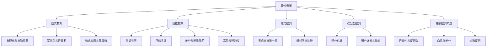
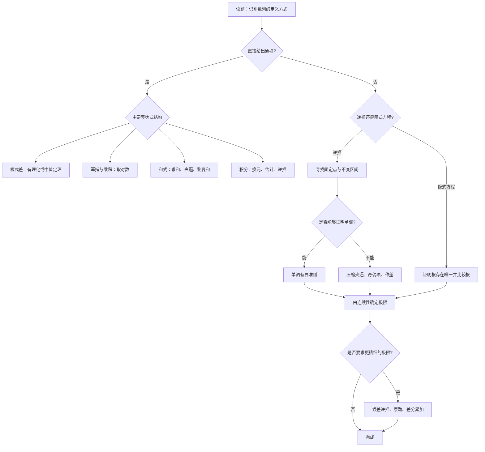

## 一、数列极限的知识体系

**1. 本节整体框架**

数列极限与上一节函数极限计算最大的区别在于：函数极限往往已经给出了明确的表达式，而数列极限可能只给出相邻项的关系、方程的零点、不断增长的求和项或者含参积分。

因此，本节实际上包含三个层次的问题：

- **收敛性问题：** 数列的极限是否存在？
- **极限值问题：** 如果存在，极限是多少？
- **渐近性问题：** 数列以怎样的速度趋向极限？

第三个层次尤其值得重视。很多强化题与综合题，第一问只要求证明数列收敛，第二问则要求计算相邻项的比值、差值或者含有 $n$ 的更复杂极限。

**2. 考研数一题型与重要程度**

| 题型       | 复习优先级 | 核心方法      |
| -------- | ----- | --------- |
| 递推数列收敛证明 | ★★★★★ | 单调有界、固定点  |
| 和式数列极限   | ★★★★★ | 夹逼、定积分定义  |
| 递推数列渐近速度 | ★★★★★ | 泰勒展开、差分累加 |
| 数列与积分综合  | ★★★★★ | 积分估计、分部积分 |
| 幂指数列极限   | ★★★★★ | 取对数、主项展开  |
| 抽象命题与反例  | ★★★★☆ | 子数列、连续反函数 |
| 隐式零点数列   | ★★★★☆ | 零点定理、单调性  |
| 相邻项差商    | ★★★★☆ | 微分中值定理    |
| 连乘积与高次根式 | ★★★★☆ | 裂项、取对数、夹逼 |
| 高阶线性递推   | ★★★☆☆ | 作差降阶、等比数列 |

## 二、基础概念与核心定理

### 2.1 数列极限的本质

如果对于任意 $\varepsilon>0$，总存在正整数 $N$，使得当 $n>N$ 时，

$$
|a_n-A|<\varepsilon,
$$

则称数列 $\{a_n\}$ 收敛于 $A$，记为

$$
\lim_{n\to\infty}a_n=A.
$$

直观理解：无论在 $A$ 周围画出多么狭窄的范围，只要 $n$ 足够大，数列后面的所有项都必须进入这个范围，并且不再离开。

重点在于“后面的所有项”，而不是偶尔有一些项接近 $A$。

例如：

$$
a_n=\frac{(-1)^n}{n}\to0,
$$

虽然不断振荡，但振荡幅度越来越小，所以收敛。

而

$$
b_n=(-1)^n
$$

始终在 $1$ 和 $-1$ 之间振荡，因此发散。

### 2.2 收敛、有界、无界与无穷大量

这几个概念在选择题中经常混淆。

| 数列                | 有界性 | 收敛情况    |
| ----------------- | --- | ------- |
| $\dfrac1n$    | 有界  | 收敛于0    |
| $(-1)^n$      | 有界  | 振荡发散    |
| $n$           | 无界  | 趋于正无穷   |
| $(-1)^nn$     | 无界  | 绝对值趋于无穷 |
| $n[1+(-1)^n]$ | 无界  | 不趋于无穷   |

必须掌握以下逻辑关系：

$$
\text{收敛}\Longrightarrow\text{有界}.
$$

$$
\text{无界}\Longrightarrow\text{发散}.
$$

$$
\text{无穷大量}\Longrightarrow\text{无界}.
$$

但这三条命题的逆命题均不成立。

特别注意，**无界不等于无穷大量，有界也不等于收敛。**

### 2.3 夹逼准则

如果当 $n$ 充分大时，

$$
b_n\leq a_n\leq c_n,
$$

并且

$$
\lim_{n\to\infty}b_n =\lim_{n\to\infty}c_n=A,
$$

那么

$$
\boxed{\lim_{n\to\infty}a_n=A}.
$$

最常用的特殊形式是

$$
|a_n-A|\leq b_n,\qquad b_n\to0.
$$

由此直接得到 $a_n\to A$。

**夹逼的本质**

当原数列结构复杂、难以直接计算时，不再追求它的精确表达式，而是找到足够简单、足够接近的上下界。

夹逼尤其适用于：

| 题目特征   | 常用估计方式                |
| ------ | --------------------- |
| 含三角振荡项 | $\lvert \sin x\rvert \leq1$ |
| 高次根式   | 最大项控制                 |
| 多项和    | 统一分母或统一误差             |
| 递推数列   | 几何级数控制误差              |
| 含参积分   | 利用被积函数大小关系            |
| 指数项    | 固定常数的指数衰减             |

### 2.4 单调有界准则

这是递推数列证明题最核心的定理。

$$
\boxed{ \begin{aligned} &\text{单调不减且有上界}\Longrightarrow\text{收敛},\\ &\text{单调不增且有下界}\Longrightarrow\text{收敛}. \end{aligned}}
$$

直观上，一个数列始终向同一个方向运动，又不可能无限远离，就必然趋向某个有限位置。

应用时，必须分别证明两个条件：单调性与对应方向的有界性。

例如，单调递减并且有上界，并不足以保证收敛，因为

$$
x_n=-n
$$

就是反例。

### 2.5 子数列判别法

若 $a_n\to A$，则它的每一个子数列都收敛于 $A$。

特别地：

$$
a_{2n}\to A,\qquad a_{2n-1}\to A
$$

是整个数列收敛于 $A$ 的充要条件。

因此，当题目出现 $(-1)^n$、交替递推或者周期性振荡时，优先考虑奇偶项。

如果能够找到两个子数列满足

$$
a_{n_k}\to A,\qquad a_{m_k}\to B, \qquad A\ne B,
$$

就可以直接证明原数列发散。

### 2.6 数列极限与函数极限的关系

若

$$
\lim_{x\to+\infty}f(x)=A,
$$

则

$$
\lim_{n\to\infty}f(n)=A.
$$

进一步，若 $x_n\to a$，而

$$
\lim_{x\to a}f(x)=L,
$$

并且 $x_n$ 最终不等于 $a$，则

$$
f(x_n)\to L.
$$

如果 $f$ 在 $a$ 处连续，则不必要求 $x_n\ne a$，直接有

$$
f(x_n)\to f(a).
$$

这就是为什么大量数列极限最终都可以转化为上一节的函数极限计算。

但逆命题不一定成立。例如：

$$
\sin(n\pi)=0,
$$

而

$$
\lim_{x\to+\infty}\sin(\pi x)
$$

不存在。

**洛必达法则不能直接对整数下标** $n$ **求导。** 必须先构造适当的连续变量函数，再检查洛必达法则的适用条件。

### 2.7 算术平均极限定理

若

$$
a_n\to A,
$$

则

$$
\boxed{\frac1n\sum_{k=1}^na_k\to A}.
$$

这也称为 Cesàro 平均定理。

它的直观含义是：虽然前面有限项可能与 $A$ 相差很远，但随着项数增加，前面有限项在平均值中的影响逐渐消失。

例如：

$$
\lim_{n\to\infty} \frac1n\sum_{k=1}^n\frac{k}{k+1}=1.
$$

不过逆命题不成立：

$$
a_n=(-1)^n
$$

本身发散，但其算术平均趋于0。

这个定理后面还会用于求递推数列的收敛速度。

## 三、题型一：显式数列的结构化计算

### 3.1 基本方法与识别特征

如果直接给出了 $a_n$ 的表达式，首先识别是否属于以下结构。

| 表达式特征             | 优先方法          |
| ----------------- | ------------- |
| 两个根式相减            | 共轭有理化         |
| 两个高次幂相减           | 因式分解、二项式展开    |
| 含 $1/n$ 的复杂函数 | 令 $t=1/n$ |
| 底数与指数同时变化         | 取对数           |
| 两个非常接近的函数值相减      | 中值定理          |
| 有限和式具有规律          | 求和公式、裂项       |
| 大量高次幂之和再开根        | 最大项夹逼         |

### 3.2 母题1：根式差的极限

**来源：1990考研数学三。**

求

$$
\lim_{n\to\infty} \left(\sqrt{n+3\sqrt n}-\sqrt{n-\sqrt n}\right).
$$

<Steps>

<Step>

### 第一步：识别结构 [!toc]

两个根式都趋于正无穷，是 $\infty-\infty$ 型未定式。

不能分别取极限。

</Step>

<Step>

### 第二步：有理化 [!toc]

$$
\begin{aligned} a_n &=\frac{(n+3\sqrt n)-(n-\sqrt n)} {\sqrt{n+3\sqrt n}+\sqrt{n-\sqrt n}}\\ &=\frac{4\sqrt n} {\sqrt{n+3\sqrt n}+\sqrt{n-\sqrt n}}\\ &=\frac4{\sqrt{1+\frac3{\sqrt n}} +\sqrt{1-\frac1{\sqrt n}}}. \end{aligned}
$$

因此

$$
\boxed{\lim_{n\to\infty}a_n=2}.
$$

</Step>

</Steps>

**母题推广**

若

$$
u_n\sim v_n\sim w_n>0,
$$

则在差值最终非零时，

$$
\boxed{ \sqrt{u_n}-\sqrt{v_n} \sim\frac{u_n-v_n}{2\sqrt{w_n}} }.
$$

进一步，当 $\alpha\ne0$ 时，在适当的正值条件下，由中值定理可以得到

$$
u_n^\alpha-v_n^\alpha \sim\alpha w_n^{\alpha-1}(u_n-v_n).
$$

这比单纯记住平方根有理化更有迁移价值。

**李林880变式**

求

$$
\lim_{n\to\infty} \left(\sqrt{1+2+\cdots+n} -\sqrt{1+2+\cdots+(n-1)}\right).
$$

来源：李林880第一章 第Ⅱ问。

先求和，再有理化：

$$
\begin{aligned} a_n &=\sqrt{\frac{n(n+1)}2} -\sqrt{\frac{n(n-1)}2}\\ &=\frac{n} {\sqrt{\frac{n(n+1)}2} +\sqrt{\frac{n(n-1)}2}}\\ &\to\frac1{\sqrt2}. \end{aligned}
$$

所以答案为

$$
\boxed{\frac{\sqrt2}{2}}.
$$

### 3.3 母题2：幂指型数列极限

**来源：1994考研数学二。**

求

$$
\lim_{n\to\infty} \tan^n\left(\frac\pi4+\frac2n\right).
$$

这是典型的 $1^\infty$ 型。

设

$$
a_n=\tan^n\left(\frac\pi4+\frac2n\right).
$$

取对数：

$$
\ln a_n=n\ln\tan\left(\frac\pi4+\frac2n\right).
$$

令

$$
g(t)=\ln\tan\left(\frac\pi4+t\right).
$$

则

$$
g(0)=0,
$$

$$
g'(t)= \frac{\sec^2(\frac\pi4+t)} {\tan(\frac\pi4+t)},
$$

从而 $g'(0)=2$。

因此

$$
g(t)=2t+o(t).
$$

取 $t=2/n$，得到

$$
\ln a_n =n\left(\frac4n+o\left(\frac1n\right)\right) \to4.
$$

所以

$$
\boxed{\lim_{n\to\infty}a_n=e^4}.
$$

**幂指型万能公式**

当 $u_n\to0$，且 $1+u_n>0$ 最终成立时，

$$
(1+u_n)^{v_n} =\exp\left[v_n\ln(1+u_n)\right].
$$

由于

$$
\ln(1+u_n)=u_n+o(u_n),
$$

若 $v_nu_n\to A$，则

$$
\boxed{(1+u_n)^{v_n}\to e^A}.
$$

| $v_nu_n$ 的极限 | 原幂式的极限        |
| ---------------- | ------------- |
| $0$          | $1$       |
| $A$ 为有限数     | $e^A$     |
| $+\infty$    | $+\infty$ |
| $-\infty$    | $0$       |

特别常用的形式：

$$
\boxed{ \lim_{n\to\infty} \left(1+\frac an+o\left(\frac1n\right)\right)^n=e^a }.
$$

**张宇1000题变式**

求

$$
\lim_{n\to\infty} \left(\frac4\pi\arctan\frac n{n+1}\right)^n.
$$

来源：张宇1000题第二章，基础部分第1题。

因为

$$
\frac n{n+1}=1-\frac1{n+1},
$$

在 $x=1$ 处展开反正切函数：

$$
\arctan\frac n{n+1} =\frac\pi4-\frac1{2(n+1)} +o\left(\frac1n\right).
$$

因此

$$
\frac4\pi\arctan\frac n{n+1} =1-\frac2{\pi(n+1)} +o\left(\frac1n\right).
$$

套用标准结论：

$$
\boxed{e^{-2/\pi}}.
$$

这类题目真正考查的是：**能否迅速找到底数相对于1的首个非零增量。**

### 3.4 幂指型的进阶：极限值已知，再求误差

李正元练习题第一章选择题第7题考查：

$$
\left(1+\frac1n\right)^n-e
$$

与 $1/n$ 的阶数关系。

仅知道

$$
\left(1+\frac1n\right)^n\to e
$$

无法回答这个问题，必须提高展开精度。

因为

$$
n\ln\left(1+\frac1n\right) =1-\frac1{2n}+O(n^{-2}),
$$

所以

$$
\begin{aligned} \left(1+\frac1n\right)^n &=e\exp\left(-\frac1{2n}+O(n^{-2})\right)\\ &=e-\frac e{2n}+O(n^{-2}). \end{aligned}
$$

因此

$$
\boxed{ \left(1+\frac1n\right)^n-e \sim-\frac e{2n} }.
$$

它与 $1/n$ 同阶，但不等价。

这个结论还可以进一步用于求

$$
\lim_{n\to\infty} n\left[\left(1+\frac1n\right)^n-e\right] =-\frac e2.
$$

遇到“两个已经知道极限相同的量相减”，必须继续寻找下一阶主项。

### 3.5 母题3：高次根式与最大项原则

**来源：张宇1000题第二章基础部分第5题、李正元练习题第一章对应填空题。**

计算

$$
\lim_{n\to\infty}(1+2^n+3^n)^{1/n}.
$$

因为

$$
3^n\leq1+2^n+3^n\leq3\cdot3^n,
$$

所以

$$
3\leq(1+2^n+3^n)^{1/n} \leq3\cdot3^{1/n}.
$$

由夹逼准则，

$$
\boxed{3}.
$$

**一般结论**

对于固定的非负常数 $a_1,\ldots,a_m$，

$$
\boxed{ \lim_{n\to\infty} \left(a_1^n+\cdots+a_m^n\right)^{1/n} =\max_{1\leq k\leq m}a_k }.
$$

所以，当 $0\leq x\leq\pi/2$ 时，

$$
\lim_{n\to\infty} \sqrt[n]{\sin^nx+\cos^nx} =\max\{\sin x,\cos x\}.
$$

即

$$
\boxed{ \begin{cases} \cos x,&0\leq x\leq\pi/4,\\ \sin x,&\pi/4<x\leq\pi/2. \end{cases}}
$$

**创新推广：项数也在变化**

若 $a_{n,k}\geq0$，并且

$$
M_n=\max_{1\leq k\leq m_n}a_{n,k},
$$

则

$$
M_n\leq \left(\sum_{k=1}^{m_n}a_{n,k}^n\right)^{1/n} \leq m_n^{1/n}M_n.
$$

只要

$$
m_n^{1/n}\to1,\qquad M_n\to M,
$$

原极限仍然为 $M$。

因此，例如

$$
\lim_{n\to\infty} \sqrt[n]{1+\frac1{2^2}+\cdots+\frac1{n^2}} =1.
$$

但如果项数按指数速度增长，就不能无条件使用最大项原则。

### 3.6 连乘积的两种主要处理方法

第一种是寻找消去关系。

例如李林880拓展题：

$$
P_n=(1+x)(1+x^2)\cdots(1+x^{2^n}), \qquad |x|<1.
$$

乘以 $1-x$，不断使用平方差公式：

$$
(1-x)P_n=1-x^{2^{n+1}}.
$$

所以

$$
\boxed{P_n\to\frac1{1-x}}.
$$

第二种是取对数，将连乘转化为求和。

尤其是几何平均形式：

$$
\sqrt[n]{\prod_{k=1}^n a_{n,k}} =\exp\left(\frac1n\sum_{k=1}^n\ln a_{n,k}\right).
$$

这又会自然转化为下一类重要题型：黎曼和。

## 四、题型二：和式数列极限——夹逼与定积分定义

这是本节必须熟练掌握的核心内容之一，也是数列极限与一元积分学结合的主要考查方式。

### 4.1 和式极限的三个解题方向

面对

$$
S_n=\sum_{k=1}^na_{n,k},
$$

不要立即展开每一项，而应该依次判断能否使用以下方法：

| 方法   | 适用情形                        |
| ---- | --------------------------- |
| 直接求和 | 等差、等比、幂和、裂项相消               |
| 统一夹逼 | 分母主项相同、各项存在统一估计             |
| 黎曼和  | 含有 $k/n$，项数与 $n$ 同阶 |

**常用求和公式**

$$
\sum_{k=1}^nk=\frac{n(n+1)}2,
$$

$$
\sum_{k=1}^nk^2 =\frac{n(n+1)(2n+1)}6,
$$

$$
\sum_{k=1}^nk^3 =\frac{n^2(n+1)^2}4.
$$

常见裂项公式：

$$
\frac1{k(k+1)} =\frac1k-\frac1{k+1},
$$

$$
\frac1{4k^2-1} =\frac12\left(\frac1{2k-1}-\frac1{2k+1}\right).
$$

### 4.2 母题4：裂项相消与幂指极限

**来源：2019考研数学三；张宇1000题强化部分也收录了该模型。**

求

$$
\lim_{n\to\infty} \left( \frac1{1\cdot2}+\frac1{2\cdot3} +\cdots+\frac1{n(n+1)} \right)^n.
$$

利用裂项公式：

$$
\begin{aligned} \sum_{k=1}^n\frac1{k(k+1)} &=\sum_{k=1}^n \left(\frac1k-\frac1{k+1}\right)\\ &=1-\frac1{n+1}. \end{aligned}
$$

所以原式为

$$
\lim_{n\to\infty} \left(1-\frac1{n+1}\right)^n =\boxed{e^{-1}}.
$$

**解题启示**

如果外面还有 $n$ 次方，就不能仅仅求括号里面的极限。

必须求出它距离1的误差：

$$
1-\frac1{n+1}.
$$

正是这个看似很小的误差，在 $n$ 次幂的作用下产生了最终答案。

### 4.3 母题5：和式的统一夹逼

**来源：1995考研数学二；李林880第一章收录同类题目。**

求

$$
\lim_{n\to\infty} \sum_{k=1}^n\frac{k}{n^2+n+k}.
$$

**分析**

对于所有 $1\leq k\leq n$，分母的主项都是 $n^2$，因此直觉上

$$
\frac{k}{n^2+n+k}\approx\frac{k}{n^2}.
$$

但由于求和项数越来越多，需要严格说明近似误差不会累积。

**标准解法**

由

$$
n^2+n+1\leq n^2+n+k\leq n^2+2n,
$$

可得

$$
\frac{k}{n^2+2n} \leq\frac{k}{n^2+n+k} \leq\frac{k}{n^2+n+1}.
$$

求和：

$$
\frac{n(n+1)}{2(n^2+2n)} \leq S_n \leq\frac{n(n+1)}{2(n^2+n+1)}.
$$

两边都趋于 $1/2$，故

$$
\boxed{\lim_{n\to\infty}S_n=\frac12}.
$$

<Callout type="warn" title="一个非常重要的陷阱">

对于固定的 $k$，若

$$
a_{n,k}\sim b_{n,k},
$$

不一定能够推出

$$
\sum_{k=1}^na_{n,k} \sim\sum_{k=1}^nb_{n,k}.
$$

例如取

$$
a_{n,k}=1+\frac kn,\qquad b_{n,k}=1.
$$

对于每个固定的 $k$，有

$$
a_{n,k}\sim b_{n,k}.
$$

但

$$
\frac{\sum_{k=1}^na_{n,k}} {\sum_{k=1}^nb_{n,k}} =\frac{n+(n+1)/2}{n} \to\frac32\ne1.
$$

原因在于 $k$ 的取值范围也随 $n$ 增长。

**因此，变项数求和中的近似必须具有统一性。**

</Callout>

### 4.4 黎曼和的本质

对于在 $[a,b]$ 上连续的函数 $f(x)$，将区间等分为 $n$ 份：

$$
\Delta x=\frac{b-a}{n}.
$$

取右端点

$$
x_k=a+\frac{k(b-a)}n.
$$

则

$$
\boxed{ \lim_{n\to\infty} \frac{b-a}{n} \sum_{k=1}^n f\left(a+\frac{k(b-a)}n\right) =\int_a^bf(x)\,\mathrm dx }.
$$

直观理解：每一项 $f(x_k)\Delta x$ 对应一个小矩形的有向面积。随着矩形越来越窄，它们的面积之和趋于定积分。

**考研中最常用的形式**

$$
\boxed{ \lim_{n\to\infty} \frac1n\sum_{k=1}^nf\left(\frac kn\right) =\int_0^1f(x)\,\mathrm dx }.
$$

其他形式：

| 和式形式                                                   | 对应定积分                                                |
| ------------------------------------------------------ | ---------------------------------------------------- |
| $\dfrac1n\displaystyle\sum_{k=1}^{2n}f(k/n)$      | $\displaystyle\int_0^2f(x)\,\mathrm dx$         |
| $\dfrac1n\displaystyle\sum_{k=n+1}^{2n}f(k/n)$    | $\displaystyle\int_1^2f(x)\,\mathrm dx$         |
| $\dfrac1n\displaystyle\sum_{k=1}^nf(2k/n)$        | $\dfrac12\displaystyle\int_0^2f(x)\,\mathrm dx$ |
| $\dfrac1n\displaystyle\sum_{k=1}^nf((2k-1)/(2n))$ | $\displaystyle\int_0^1f(x)\,\mathrm dx$         |

**标准解题步骤**

第一步，提取 $1/n$ 或者相应的区间宽度。

第二步，把所有与 $k$ 有关的部分尽量转化为 $k/n$。

第三步，根据求和上下限确定积分区间。

第四步，检查被积函数的连续性或可积性。

第五步，计算定积分。

### 4.5 母题6：加权黎曼和

**来源：2017考研数学一。**

求

$$
\lim_{n\to\infty} \sum_{k=1}^n\frac{k}{n^2} \ln\left(1+\frac kn\right).
$$

<Steps>

<Step>

### 第一步：识别 $k/n$ 结构 [!toc]

$$
\frac{k}{n^2}=\frac1n\cdot\frac kn.
$$

因此

$$
S_n=\frac1n\sum_{k=1}^n \frac kn\ln\left(1+\frac kn\right).
$$

令

$$
f(x)=x\ln(1+x).
$$

它在 $[0,1]$ 上连续，所以

$$
\lim_{n\to\infty}S_n =\int_0^1x\ln(1+x)\,\mathrm dx.
$$

</Step>

<Step>

### 第二步：分部积分 [!toc]

$$
\begin{aligned} I &=\left[\frac{x^2}2\ln(1+x)\right]_0^1 -\frac12\int_0^1\frac{x^2}{1+x}\,\mathrm dx\\ &=\frac12\ln2 -\frac12\int_0^1 \left(x-1+\frac1{1+x}\right)\,\mathrm dx\\ &=\frac12\ln2-\frac12\left(\ln2-\frac12\right). \end{aligned}
$$

所以

$$
\boxed{I=\frac14}.
$$

</Step>

</Steps>

**为什么这是一道重要母题？**

它代表了一大类含有 $k^p/n^{p+1}$ 的极限：

$$
\boxed{ \lim_{n\to\infty} \sum_{k=1}^n \frac{k^p}{n^{p+1}}f\left(\frac kn\right) =\int_0^1x^pf(x)\,\mathrm dx }
$$

其中要求右侧函数满足相应的黎曼可积条件，例如在整个区间连续。

一旦识别出

$$
\frac{k^p}{n^{p+1}} =\frac1n\left(\frac kn\right)^p,
$$

题目就转化为了普通积分计算。

### 4.6 母题7：含扰动分母的黎曼和

**来源：1998考研数学一。**

求

$$
\lim_{n\to\infty} \sum_{k=1}^n \frac{\sin\frac{k\pi}{n}}{n+\frac1k}.
$$

**第一步：提取 $1/n$**

$$
S_n=\frac1n\sum_{k=1}^n \frac{\sin(k\pi/n)}{1+\frac1{nk}}.
$$

与标准黎曼和相比，多出了一个扰动因子

$$
\frac1{1+\frac1{nk}}.
$$

由于 $1\leq k\leq n$，有

$$
0<\frac1{nk}\leq\frac1n.
$$

同时

$$
\sin\frac{k\pi}{n}\geq0.
$$

于是

$$
\frac1{1+\frac1n} \cdot\frac1n\sum_{k=1}^n \sin\frac{k\pi}{n} \leq S_n \leq\frac1n\sum_{k=1}^n \sin\frac{k\pi}{n}.
$$

由黎曼和，

$$
\frac1n\sum_{k=1}^n\sin\frac{k\pi}{n} \to\int_0^1\sin(\pi x)\,\mathrm dx =\frac2\pi.
$$

所以

$$
\boxed{\lim_{n\to\infty}S_n=\frac2\pi}.
$$

**进阶方法：统一误差估计**

令

$$
R_n=\frac1n\sum_{k=1}^n\sin\frac{k\pi}{n}.
$$

则

$$
\begin{aligned} |S_n-R_n| &\leq\frac1n\sum_{k=1}^n \frac1{nk+1}\\ &\leq\frac1n\sum_{k=1}^n\frac1n\\ &=\frac1n\to0. \end{aligned}
$$

这个方法比非负项夹逼更通用，因为即使分子发生变号，也可以使用绝对值估计。

**一般结论**

如果

$$
S_n=\frac1n\sum_{k=1}^n \left[f\left(\frac kn\right)+r_{n,k}\right],
$$

且存在 $\varepsilon_n\to0$，使得对所有 $1\leq k\leq n$ 都有

$$
|r_{n,k}|\leq\varepsilon_n,
$$

那么

$$
\boxed{S_n\to\int_0^1f(x)\,\mathrm dx}
$$

只要 $f$ 满足相应的可积条件。

这是处理考研创新型黎曼和的重要工具。

### 4.7 母题8：端点无定义的黎曼和

**来源：2025考研数学二。**

求

$$
\lim_{n\to\infty} \frac1{n^2}\sum_{k=1}^{n-1} k\ln\frac kn.
$$

化为

$$
S_n=\frac1n\sum_{k=1}^{n-1} \frac kn\ln\frac kn.
$$

自然想到

$$
f(x)=x\ln x.
$$

但 $\ln0$ 无定义，能否使用定积分定义？

由于

$$
\lim_{x\to0^+}x\ln x=0,
$$

可以补充定义

$$
f(x)= \begin{cases} x\ln x,&x>0,\\ 0,&x=0. \end{cases}
$$

这样 $f$ 在 $[0,1]$ 上连续。

又由于 $f(1)=0$，补入第 $n$ 项不改变和式，因此

$$
\begin{aligned} \lim_{n\to\infty}S_n &=\int_0^1x\ln x\,\mathrm dx\\ &=\left[\frac{x^2}2\ln x-\frac{x^2}4\right]_0^1\\ &=-\frac14. \end{aligned}
$$

答案为

$$
\boxed{-\frac14}.
$$

**端点问题必须分类讨论**

| 函数             | $x\to0^+$ 时的情况 | 处理方式      |
| -------------- | ------------------ | --------- |
| $x\ln x$   | 趋于0                | 连续延拓      |
| $\sin x/x$ | 趋于1                | 连续延拓      |
| $\ln x$    | 趋于负无穷              | 广义积分与额外估计 |
| $x^{-1/2}$ | 趋于正无穷              | 广义积分与额外估计 |
| $1/x$      | 趋于正无穷              | 相应广义积分发散  |

不能因为某个广义积分收敛，就直接认定任意对应的黎曼和一定收敛到该积分。对于无界被积函数，还需要检查取样方式并进行端点误差控制。

### 4.8 综合模拟题：黎曼和嵌套变限积分

**来源：张宇8套卷第6套第1题。**

求

$$
\lim_{n\to\infty} \frac1n\sum_{i=1}^n \int_1^{i/n}\frac{\sin x}{x}\,\mathrm dx.
$$

这道题很适合数一，因为它将数列极限、变限积分以及二重积分联系起来。

**第一步：把整个变限积分视为函数**

令

$$
F(y)=\int_1^y\frac{\sin x}{x}\,\mathrm dx.
$$

利用

$$
\lim_{x\to0}\frac{\sin x}{x}=1
$$

进行连续延拓，可知 $F$ 在 $[0,1]$ 上连续。

于是原极限为

$$
I=\int_0^1F(y)\,\mathrm dy.
$$

<Tabs items={["解法一：交换积分次序", "解法二：分部积分，更简洁"]} defaultIndex={0}>

<Tab value="解法一：交换积分次序">

$$
\begin{aligned} I &=\int_0^1\mathrm dy \int_1^y\frac{\sin x}{x}\,\mathrm dx\\ &=-\int_0^1\mathrm dy \int_y^1\frac{\sin x}{x}\,\mathrm dx\\ &=-\int_0^1\mathrm dx \int_0^x\frac{\sin x}{x}\,\mathrm dy\\ &=-\int_0^1\sin x\,\mathrm dx\\ &=\cos1-1. \end{aligned}
$$

</Tab>

<Tab value="解法二：分部积分，更简洁">

$$
F'(y)=\frac{\sin y}{y}.
$$

于是

$$
\begin{aligned} I &=[yF(y)]_0^1-\int_0^1yF'(y)\,\mathrm dy\\ &=-\int_0^1\sin y\,\mathrm dy\\ &=\boxed{\cos1-1}. \end{aligned}
$$

这道题完全不需要先求出 $\sin x/x$ 的原函数。

</Tab>

</Tabs>

**可以直接迁移的公式**

若 $g$ 在 $[0,1]$ 上连续，则

$$
\boxed{ \int_0^1\left(\int_0^xg(t)\,\mathrm dt\right)\mathrm dx =\int_0^1(1-t)g(t)\,\mathrm dt }.
$$

以及

$$
\boxed{ \int_0^1\left(\int_1^xg(t)\,\mathrm dt\right)\mathrm dx =-\int_0^1tg(t)\,\mathrm dt }.
$$

### 4.9 综合模拟题：非标准区间与积分对称性

**来源：汤家凤八套卷第8套第11题。**

求

$$
\lim_{n\to\infty} \sum_{i=1}^{2n} \frac{i+n\sin^3(\frac{\pi i}{n})+2}{n^2} \left(1+\cos\frac{\pi i}{n}\right)^2.
$$

首先，常数项 $2/n^2$ 的全部贡献满足

$$
0\leq \sum_{i=1}^{2n}\frac2{n^2} \left(1+\cos\frac{\pi i}{n}\right)^2 \leq\frac{16}{n}\to0.
$$

其余部分是 $[0,2]$ 上的黎曼和。

所以原极限为

$$
I=\int_0^2 [x+\sin^3(\pi x)] (1+\cos\pi x)^2\,\mathrm dx.
$$

令

$$
w(x)=(1+\cos\pi x)^2.
$$

由于

$$
w(2-x)=w(x),
$$

以及

$$
\sin^3[\pi(2-x)]=-\sin^3(\pi x),
$$

所以

$$
\int_0^2\sin^3(\pi x)w(x)\,\mathrm dx=0.
$$

另一方面，利用区间中点对称性：

$$
\int_0^2xw(x)\,\mathrm dx =\int_0^2(2-x)w(x)\,\mathrm dx.
$$

两式相加可得

$$
\int_0^2xw(x)\,\mathrm dx =\int_0^2w(x)\,\mathrm dx.
$$

因此

$$
\begin{aligned} I&=\int_0^2(1+\cos\pi x)^2\,\mathrm dx\\ &=2+0+1\\ &=\boxed{3}. \end{aligned}
$$

这类综合题的难点通常不在黎曼和本身，而在转化为积分之后能否识别周期性、对称性与奇偶性。

## 五、题型三：递推数列的收敛性与极限值

这是本节最重要的部分。建议将本部分的方法练到能够独立完成证明题，而不仅仅是看懂答案。

### 5.1 固定点与递推数列

考虑

$$
x_{n+1}=f(x_n).
$$

如果已经知道

$$
x_n\to L
$$

并且 $f$ 在 $L$ 处连续，则

$$
x_{n+1}\to L,\qquad f(x_n)\to f(L).
$$

从而

$$
\boxed{L=f(L)}.
$$

满足这一方程的 $L$，称为递推函数 $f$ 的固定点或不动点。

但要特别强调：

**固定点方程给出的是可能的极限值，不是收敛性证明。**

例如，

$$
x_{n+1}=2-x_n,\qquad x_1=0.
$$

固定点方程为

$$
L=2-L,
$$

得到 $L=1$。

但实际数列为

$$
0,2,0,2,\ldots
$$

显然不收敛。

### 5.2 递推数列的三种基本运动方式

| 递推关系的特点     | 数列行为 | 主要方法      |
| ----------- | ---- | --------- |
| 从同一侧不断接近固定点 | 单调收敛 | 单调有界      |
| 在固定点两侧交替接近  | 振荡收敛 | 压缩夹逼、奇偶子列 |
| 逐渐远离固定点     | 可能发散 | 差分、误差分析   |

递推数列并不一定单调，因此单调有界准则并不是唯一的解决方法。

### 5.3 方法一：直接比较相邻项

最基本的标准证明结构是：

$$
\boxed{ \text{确定不变区间} \longrightarrow \text{证明单调性} \longrightarrow \text{证明有界性} \longrightarrow \text{解固定点方程} }.
$$

所谓不变区间，就是找到一个区间 $I$，使得

$$
x_n\in I\Longrightarrow x_{n+1}=f(x_n)\in I.
$$

确定不变区间的作用包括保证递推式有意义、确定单调方向，以及排除不合理的固定点。

### 5.4 母题9：根式递推数列

**来源：1996考研数学一。**

设

$$
x_1=10,\qquad x_{n+1}=\sqrt{6+x_n}.
$$

证明数列收敛，并求极限。

<Steps>

<Step>

### 第一步：预判可能的固定点 [!toc]

假设存在极限 $L$，则应满足

$$
L=\sqrt{6+L}.
$$

平方得到

$$
L^2-L-6=0,
$$

即

$$
(L-3)(L+2)=0.
$$

由于根式非负，候选极限为3。

这里是为了帮助寻找界，并不是已经完成了证明。

</Step>

<Step>

### 第二步：寻找不变区间 [!toc]

当 $x>3$ 时，

$$
\sqrt{6+x}>3.
$$

由于 $x_1>3$，归纳可得

$$
x_n>3.
$$

</Step>

<Step>

### 第三步：证明单调性 [!toc]

对于 $x>3$，

$$
x^2-(6+x)=(x-3)(x+2)>0.
$$

因此

$$
\sqrt{6+x}<x.
$$

所以

$$
3<x_{n+1}<x_n.
$$

数列单调递减且以下界3为界，必然收敛。

</Step>

<Step>

### 第四步：确定极限 [!toc]

设

$$
\lim_{n\to\infty}x_n=L\geq3.
$$

由连续性，

$$
L=\sqrt{6+L}.
$$

所以

$$
\boxed{L=3}.
$$

</Step>

</Steps>

**迁移模型**

对于

$$
x_{n+1}=\sqrt{a+x_n}, \qquad a>0,\quad x_1>0,
$$

正固定点为

$$
r=\frac{1+\sqrt{1+4a}}2.
$$

当 $x_1>r$ 时，数列递减趋于 $r$；当 $0<x_1<r$ 时，数列递增趋于 $r$；当 $x_1=r$ 时，数列为常数。

结论统一为

$$
\boxed{ x_n\to\frac{1+\sqrt{1+4a}}2 }.
$$

### 5.5 母题10：从第二项开始单调

**来源：2002考研数学二。**

设

$$
0<x_1<3,\qquad x_{n+1}=\sqrt{x_n(3-x_n)}.
$$

证明数列收敛并求极限。

这道题的关键在于初值可能大于 $3/2$，不能直接认定数列从第一项开始递增。

<Steps>

<Step>

### 第一步：研究递推函数的值域 [!toc]

$$
x(3-x)=\frac94-\left(x-\frac32\right)^2.
$$

因此当 $0<x<3$ 时，

$$
0<\sqrt{x(3-x)}\leq\frac32.
$$

从而

$$
0<x_n\leq\frac32,\qquad n\geq2.
$$

</Step>

<Step>

### 第二步：比较相邻项 [!toc]

对于 $0<x_n\leq3/2$，

$$
\begin{aligned} x_{n+1}^2-x_n^2 &=x_n(3-x_n)-x_n^2\\ &=x_n(3-2x_n)\geq0. \end{aligned}
$$

所以

$$
x_{n+1}\geq x_n.
$$

数列从第二项起单调不减且有上界，故收敛。

</Step>

<Step>

### 第三步：求固定点 [!toc]

$$
L=\sqrt{L(3-L)}
$$

推出

$$
L=0\quad\text{或}\quad L=\frac32.
$$

又由于

$$
L\geq x_2>0,
$$

排除零根，因此

$$
\boxed{L=\frac32}.
$$

</Step>

</Steps>

**解题启示**

数列极限与有限个初始项无关。

遇到递推函数具有明显的最大值或最小值时，应该先研究它的值域，把数列限制到更小的不变区间内。

### 5.6 方法二：利用递推函数的单调性传递

如果

$$
x_{n+1}=f(x_n),
$$

且 $f$ 在数列所在区间上单调不减，那么只需要比较 $x_1$ 与 $x_2$，就可以确定整个数列的单调方向。

例如，若

$$
x_2\geq x_1,
$$

则

$$
x_3=f(x_2)\geq f(x_1)=x_2.
$$

以此类推，

$$
x_{n+1}\geq x_n.
$$

如果 $f$ 可导，也可以利用拉格朗日中值定理：

$$
x_{n+1}-x_n =f'(\xi_n)(x_n-x_{n-1}).
$$

所以当 $f'(\xi_n)\geq0$ 时，相邻差的符号保持不变。

**张宇1000题母题**

设

$$
x_{n+1}=2\ln(1+x_n),
$$

且 $a>0$ 是方程

$$
a=2\ln(1+a)
$$

的唯一正根，已知 $x_1>a$，数列单调递减。

证明收敛并求极限。

因为

$$
f(x)=2\ln(1+x)
$$

严格递增，所以若 $x_n>a$，则

$$
x_{n+1}=f(x_n)>f(a)=a.
$$

由归纳法，

$$
x_n>a.
$$

已知单调递减，故收敛。

设极限为 $L$，则

$$
L\geq a>0,\qquad L=2\ln(1+L).
$$

所以

$$
\boxed{L=a}.
$$

这类题目告诉我们，即使固定点无法用初等函数写出来，也不影响证明收敛。

### 5.7 母题11：指数型隐式递推

**来源：2018考研数学一；李林880题收录等价的递推形式。**

设 $x_1>0$，且

$$
x_ne^{x_{n+1}}=e^{x_n}-1.
$$

证明数列收敛，并求极限。

**常规思路**

将递推式变形为

$$
e^{x_{n+1}} =\frac{e^{x_n}-1}{x_n}.
$$

此处有两个指数不等式可以使用：

$$
e^t>1+t,\qquad t\ne0,
$$

$$
1-e^{-t}<t,\qquad t>0.
$$

但本题还有一个更直接、非常值得掌握的解法。

**推荐解法：拉格朗日中值定理**

若 $x_n>0$，对指数函数在 $[0,x_n]$ 上使用拉格朗日中值定理，存在

$$
\xi_n\in(0,x_n),
$$

使得

$$
\frac{e^{x_n}-1}{x_n}=e^{\xi_n}.
$$

由题设，

$$
e^{x_{n+1}}=e^{\xi_n}.
$$

因为指数函数严格递增，

$$
x_{n+1}=\xi_n.
$$

所以立即得到

$$
\boxed{0<x_{n+1}<x_n}.
$$

递推数列正项递减，故收敛。

设 $x_n\to L\geq0$，对原递推式取极限：

$$
Le^L=e^L-1.
$$

整理：

$$
L=1-e^{-L}.
$$

但对于 $L>0$，

$$
1-e^{-L}<L.
$$

所以唯一的非负解为

$$
\boxed{L=0}.
$$

**母题识别方法**

当递推式出现

$$
\frac{f(x_n)-f(a)}{x_n-a}
$$

时，优先想到拉格朗日中值定理。

如果该差商又等于 $f'(x_{n+1})$，且 $f'$ 严格单调，那么有机会直接推出

$$
x_{n+1}\in(a,x_n)
$$

或相应的反向区间。

这是一种将微分中值定理转化为递推数列位置关系的方法。

### 5.8 方法三：利用全局不等式

有些题目根本没有明确给出 $x_{n+1}=f(x_n)$，而是给出相邻项之间的不等式。

此时的思路是：找出与该不等式结构相同的、对任意变量成立的基本不等式。

### 母题12：含对数的递推不等式

**来源：2013考研数学二。**

设

$$
\ln x_n+\frac1{x_{n+1}}<1.
$$

证明数列收敛，并求极限。

首先研究

$$
f(x)=\ln x+\frac1x,\qquad x>0.
$$

因为

$$
f'(x)=\frac{x-1}{x^2},
$$

所以 $f(x)$ 在 $x=1$ 处取得最小值1。

于是

$$
\boxed{\ln x+\frac1x\geq1}.
$$

代入 $x_n$，与原不等式比较：

$$
\ln x_n+\frac1{x_{n+1}} <1 \leq\ln x_n+\frac1{x_n}.
$$

消去相同部分：

$$
\frac1{x_{n+1}}<\frac1{x_n}.
$$

由于所有项为正，

$$
x_{n+1}>x_n.
$$

另一方面，由原不等式可知

$$
\ln x_n<1,
$$

即

$$
x_n<e.
$$

因此数列递增且有上界，极限 $L$ 存在，并且 $L\geq x_1>0$。

对不等式取极限，

$$
\ln L+\frac1L\leq1.
$$

结合全局不等式，

$$
\ln L+\frac1L\geq1.
$$

只能取等号，因此

$$
\boxed{L=1}.
$$

**李林880对应母题**

设正项数列满足

$$
x_{n+1}<2-\frac1{x_n}.
$$

求极限。

利用

$$
x+\frac1x\geq2,\qquad x>0,
$$

得到

$$
x_{n+1}<2-\frac1{x_n}\leq x_n.
$$

因此递减。

又由于 $x_{n+1}>0$，所以

$$
2-\frac1{x_n}>0,
$$

推出

$$
x_n>\frac12.
$$

于是数列收敛于某个 $L\geq1/2$。

取极限：

$$
L\leq2-\frac1L.
$$

整理：

$$
(L-1)^2\leq0.
$$

从而

$$
\boxed{L=1}.
$$

这两道题是同一种思想：**利用全局不等式确定单调性，再利用取等条件锁定极限。**

注意，严格不等式经过取极限只能得到非严格不等式。

例如

$$
0<\frac1n
$$

不能推出 $0<0$。

### 5.9 方法四：压缩夹逼法

若存在固定点 $a$，并且存在常数 $0<q<1$，使得

$$
|x_{n+1}-a|\leq q|x_n-a|,
$$

则反复迭代：

$$
|x_n-a| \leq q^{n-1}|x_1-a|.
$$

由于

$$
q^{n-1}\to0,
$$

所以

$$
\boxed{x_n\to a}.
$$

这个方法的优势在于，不需要数列本身单调。

**张宇1000题母题**

设

$$
x_{n+1}=f(x_n),\qquad f(a)=a,
$$

且

$$
|f'(x)|\leq q<1.
$$

证明 $x_n\to a$。

由拉格朗日中值定理，

$$
x_{n+1}-a =f(x_n)-f(a) =f'(\xi_n)(x_n-a),
$$

于是

$$
|x_{n+1}-a|\leq q|x_n-a|.
$$

根据前述夹逼方法，

$$
\boxed{x_n\to a}.
$$

如果导数条件只在某个区间上成立，则需要额外保证递推项和固定点都处于该区间。

<Callout type="warn" title="常见错误">

仅有

$$
|f'(x)|<1
$$

不一定能够直接找到统一的 $q<1$。

例如，

$$
x_{n+1}=\ln(1+x_n),\qquad x_n>0.
$$

虽然

$$
f'(x)=\frac1{1+x}<1,
$$

但当 $x\to0^+$ 时，$f'(x)\to1$，不存在覆盖整个正半轴的统一压缩系数 $q<1$。

该数列确实收敛，但它的速度远慢于一般的几何级数衰减。

</Callout>

### 5.10 方法五：奇偶子数列

当递推函数 $f(x)$ 单调递减时，相邻项可能交替出现在固定点两侧。

这时可以研究二次迭代：

$$
x_{n+2}=f(f(x_n)).
$$

因为两个单调递减函数复合后单调不减，往往可以分别证明奇数项与偶数项单调有界。

设

$$
x_{2n}\to A,\qquad x_{2n-1}\to B.
$$

若 $f$ 连续，则

$$
A=f(B),\qquad B=f(A).
$$

只有进一步证明 $A=B$，才能说明整个数列收敛。

**补充母题：交替倒数递推**

设

$$
x_1>0,\qquad x_{n+1}=\frac1{1+x_n}.
$$

先求固定点：

$$
L=\frac1{1+L}
$$

得到

$$
L=\frac{\sqrt5-1}{2}.
$$

但这还不能证明收敛。

注意到

$$
0<x_{n+1}<1,
$$

从而

$$
\frac12<x_{n+2}<1.
$$

在 $[1/2,1]$ 上，

$$
|f'(x)|=\frac1{(1+x)^2}\leq\frac49<1.
$$

所以从第三项起可以使用压缩夹逼法，得到

$$
\boxed{x_n\to\frac{\sqrt5-1}{2}}.
$$

这说明有时不必繁琐地分析奇偶项，缩小区间后直接压缩更简单。

### 5.11 方法六：二阶递推的作差降阶

**来源：李林880。**

设

$$
x_1=1,\quad x_2=2,
$$

$$
x_{n+2}=\frac12(3x_{n+1}-x_n).
$$

求极限。

这里同时含有连续三个数列项。直接令其极限为 $L$，只能得到

$$
L=\frac12(3L-L)=L,
$$

无法确定任何信息。

观察系数之和为1，因此令

$$
d_n=x_{n+1}-x_n.
$$

则

$$
\begin{aligned} d_{n+1} &=x_{n+2}-x_{n+1}\\ &=\frac12(x_{n+1}-x_n)\\ &=\frac12d_n. \end{aligned}
$$

由于 $d_1=1$，可得

$$
d_n=\left(\frac12\right)^{n-1}.
$$

累加恢复原数列：

$$
\begin{aligned} x_n &=x_1+\sum_{k=1}^{n-1}d_k\\ &=1+\sum_{k=0}^{n-2}\left(\frac12\right)^k\\ &=3-2^{2-n}. \end{aligned}
$$

因此

$$
\boxed{x_n\to3}.
$$

**一般结论**

若

$$
x_{n+2}=px_{n+1}+qx_n,\qquad p+q=1,
$$

则

$$
d_{n+1}=-qd_n.
$$

当 $|q|<1$ 时，

$$
\boxed{ \lim_{n\to\infty}x_n =x_1+\frac{x_2-x_1}{1+q} }.
$$

例如

$$
x_{n+2}=\frac{x_n+x_{n+1}}2,\qquad x_1=1,\quad x_2=2,
$$

其相邻差是公比为 $-1/2$ 的等比数列，因此

$$
\boxed{\lim_{n\to\infty}x_n=\frac53}.
$$

这里数列本身交替振荡，但仍然收敛。

## 六、题型四：递推数列的渐近速度

如果说前面的内容解决了“数列是否收敛、收敛到哪里”的问题，那么本部分解决的就是“以多快的速度收敛”。

这是最适合命制强化题、综合题以及创新题的方向之一。

### 6.1 误差数列的基本思想

设

$$
x_{n+1}=f(x_n),\qquad x_n\to a,
$$

且

$$
f(a)=a.
$$

定义误差

$$
e_n=x_n-a.
$$

则

$$
e_{n+1}=f(a+e_n)-f(a).
$$

因为 $e_n\to0$，可以在固定点 $a$ 处进行泰勒展开：

$$
e_{n+1} =f'(a)e_n +\frac{f''(a)}{2!}e_n^2 +\frac{f^{(3)}(a)}{3!}e_n^3+\cdots.
$$

由此便能判断数列的收敛速度。

| 固定点附近的情况                              | 误差特点              |
| ------------------------------------- | ----------------- |
| $0<\lvert f'(a)\rvert <1$                   | 相邻误差比的绝对值趋于小于1的常数 |
| $f'(a)=0,\ f''(a)\ne0$            | 二次收敛              |
| $f'(a)=f''(a)=0,\ f^{(3)}(a)\ne0$ | 三次收敛              |
| $f'(a)=1$                         | 一阶变化抵消，需要研究高阶差分   |
| $f'(a)=-1$                        | 可能交替振荡，需要进一步分析    |

这些结论均应在数列已经收敛、相关导数存在且误差比有定义的前提下使用。

### 6.2 母题13：递推数列与幂指极限

**来源：2006考研数学一。**

设

$$
0<x_1<\pi,\qquad x_{n+1}=\sin x_n.
$$

第一问证明数列收敛，并求极限。

第二问计算

$$
\lim_{n\to\infty} \left(\frac{x_{n+1}}{x_n}\right)^{1/x_n^2}.
$$

**第一问：收敛性**

当 $0<x<\pi$ 时，

$$
0<\sin x<x.
$$

于是

$$
0<x_{n+1}<x_n.
$$

数列单调递减且有下界0，所以收敛。

设极限为 $L$，则

$$
L=\sin L,\qquad 0\leq L<\pi.
$$

唯一可能的极限为

$$
\boxed{L=0}.
$$

**第二问：寻找底数相对于1的误差**

$$
\frac{x_{n+1}}{x_n} =\frac{\sin x_n}{x_n}.
$$

根据泰勒展开，

$$
\sin x_n =x_n-\frac{x_n^3}6+o(x_n^3).
$$

所以

$$
\frac{x_{n+1}}{x_n} =1-\frac{x_n^2}6+o(x_n^2).
$$

因此

$$
\left[ 1-\frac{x_n^2}6+o(x_n^2) \right]^{1/x_n^2} \to\boxed{e^{-1/6}}.
$$

**这道真题真正值得掌握的地方**

递推关系告诉我们

$$
x_n-x_{n+1}\sim\frac{x_n^3}{6}.
$$

而

$$
\frac{x_{n+1}}{x_n} =1-\frac{x_n-x_{n+1}}{x_n}.
$$

所以后一问实际上只需要知道相邻项之差的首个非零主项。

遇到类似递推题，重点寻找以下三个量：

$$
x_{n+1}-x_n,
$$

$$
\frac{x_{n+1}}{x_n},
$$

$$
\frac{x_{n+1}-x_n}{x_n^p}.
$$

它们之间经常可以相互转化。

### 6.3 母题14：相邻项差值的高阶展开

**来源：李正元练习题。**

设

$$
x_1>0,\qquad x_{n+1}=\ln(1+x_n).
$$

求

$$
\lim_{n\to\infty}x_n
$$

以及

$$
\lim_{n\to\infty} \frac{x_nx_{n+1}}{x_n-x_{n+1}}.
$$

首先利用

$$
0<\ln(1+x)<x,\qquad x>0,
$$

得到

$$
0<x_{n+1}<x_n.
$$

由单调有界准则，数列收敛。

固定点方程

$$
L=\ln(1+L)
$$

只有非负解0，所以 $x_n\to0$。

对于第二问，

$$
x_{n+1} =x_n-\frac{x_n^2}2+o(x_n^2).
$$

因此

$$
x_n-x_{n+1}\sim\frac{x_n^2}2,
$$

并且

$$
x_nx_{n+1}\sim x_n^2.
$$

所以

$$
\boxed{ \lim_{n\to\infty} \frac{x_nx_{n+1}}{x_n-x_{n+1}}=2 }.
$$

**精度选择原则**

这道题分子只需要展开到一阶，但分母必须展开到二阶。

绝不能使用

$$
\ln(1+x_n)\sim x_n
$$

直接进行减法，否则最重要的二阶项就被丢掉了。

### 6.4 进一步推广：如何求 $nx_n$？

**来源：原创强化题。**

仍设

$$
x_{n+1}=\ln(1+x_n),\qquad x_1>0.
$$

求

$$
\lim_{n\to\infty}nx_n.
$$

已经知道 $x_n\to0$，并且

$$
x_n-x_{n+1}\sim\frac{x_n^2}2.
$$

但是这还不能直接求出 $nx_n$。

关键是考察倒数的相邻差：

$$
\begin{aligned} \frac1{x_{n+1}}-\frac1{x_n} &=\frac{x_n-x_{n+1}}{x_nx_{n+1}}\\ &\to\frac12. \end{aligned}
$$

令

$$
u_n=\frac1{x_n}.
$$

则

$$
u_{n+1}-u_n\to\frac12.
$$

把所有相邻差相加：

$$
u_n=u_1+\sum_{k=1}^{n-1}(u_{k+1}-u_k).
$$

两边除以 $n$，根据算术平均极限定理，

$$
\frac{u_n}{n}\to\frac12.
$$

即

$$
\frac1{nx_n}\to\frac12.
$$

所以

$$
\boxed{\lim_{n\to\infty}nx_n=2}.
$$

因此不只是知道 $x_n\to0$，而且知道

$$
\boxed{x_n\sim\frac2n}.
$$

### 6.5 进阶工具：Stolz 定理

Stolz 定理也常被称为数列形式的洛必达法则。

若 $b_n$ 严格递增且趋于正无穷，并且

$$
\lim_{n\to\infty} \frac{a_{n+1}-a_n}{b_{n+1}-b_n}=A,
$$

则

$$
\boxed{ \lim_{n\to\infty}\frac{a_n}{b_n}=A }.
$$

这里采用的是分母趋于正无穷的常用版本。

特别地，当 $b_n=n$ 时，

$$
a_{n+1}-a_n\to A \Longrightarrow\frac{a_n}{n}\to A.
$$

例如：

$$
\begin{aligned} \lim_{n\to\infty} \frac{1^p+2^p+\cdots+n^p}{n^{p+1}} &=\lim_{n\to\infty} \frac{(n+1)^p}{(n+1)^{p+1}-n^{p+1}}\\ &=\frac1{p+1}, \end{aligned}
$$

其中 $p>-1$。

Stolz 定理可以作为强化阶段的辅助工具，但不是考研数一通常要求直接掌握的基本定理。正式证明题中，优先使用教材内的夹逼准则、差分累加或者自行证明所需的特殊结论。

### 6.6 核心推广：递推数列渐近速度公式

这是本节非常值得掌握的一个强化结论。

假设

$$
x_n>0,\qquad x_n\to0,
$$

并且

$$
x_n-x_{n+1}\sim c x_n^p, \qquad c>0,\quad p>1.
$$

那么

$$
\boxed{ n x_n^{p-1}\to\frac1{c(p-1)} }.
$$

等价地，

$$
\boxed{ x_n\sim \left[\frac1{c(p-1)n}\right]^{1/(p-1)} }.
$$

**为什么成立？**

由已知关系，

$$
\frac{x_n-x_{n+1}}{x_n} \sim cx_n^{p-1}\to0.
$$

因此

$$
\frac{x_{n+1}}{x_n}\to1.
$$

定义

$$
u_n=\frac1{x_n^{p-1}}.
$$

利用拉格朗日中值定理，存在介于 $x_{n+1}$ 与 $x_n$ 之间的 $\xi_n$，使

$$
u_{n+1}-u_n =(p-1)\xi_n^{-p}(x_n-x_{n+1}).
$$

由于 $\xi_n/x_n\to1$，所以

$$
u_{n+1}-u_n\to c(p-1).
$$

再利用差分累加与算术平均定理，

$$
\frac{u_n}{n}\to c(p-1).
$$

即

$$
n x_n^{p-1} \to\frac1{c(p-1)}.
$$

证毕。

**几类经典递推的收敛速度**

| 递推关系与初值条件                                   | 相邻差主项         | 渐近结论                       |
| ------------------------------------------- | ------------- | -------------------------- |
| $x_{n+1}=\ln(1+x_n),\ x_1>0$           | $x_n^2/2$ | $x_n\sim2/n$           |
| $x_{n+1}=\sin x_n,\ 0<x_1<\pi$        | $x_n^3/6$ | $x_n\sim\sqrt{3/n}$    |
| $x_{n+1}=\arctan x_n,\ x_1>0$          | $x_n^3/3$ | $x_n\sim\sqrt{3/(2n)}$ |
| $x_{n+1}=2x_n-\tan x_n,\ 0<x_1<\pi/4$ | $x_n^3/3$ | $x_n\sim\sqrt{3/(2n)}$ |
| $x_{n+1}=(x_n+\arctan x_n)/2,\ x_1>0$  | $x_n^3/6$ | $x_n\sim\sqrt{3/n}$    |

**回到2006数一真题进行创新变式**

若仍然有

$$
x_{n+1}=\sin x_n,\qquad 0<x_1<\pi,
$$

但题目改为求

$$
\lim_{n\to\infty}nx_n^2,
$$

怎么办？

因为

$$
x_n-x_{n+1}\sim\frac{x_n^3}6,
$$

取 $p=3,\ c=1/6$，即可得到

$$
\boxed{ \lim_{n\to\infty}nx_n^2=3 }.
$$

进而

$$
\boxed{\lim_{n\to\infty}\sqrt n\,x_n=\sqrt3}.
$$

这就是掌握母题之后的迁移能力：即使问题从幂指极限变成了含 $n$ 的渐近极限，仍然可以找到统一的解题入口。

### 6.7 母题15：三次收敛与固定点误差

**来源：李林六套卷第4套第3题。**

设

$$
x_0=1,\qquad x_{n+1}=x_n+\cos x_n,
$$

以及

$$
x_n+y_n=\frac\pi2.
$$

求

$$
\lim_{n\to\infty} \frac{y_{n+1}}{(\frac\pi2-x_n)^3}.
$$

<Steps>

<Step>

### 第一步：不要直接展开 $x_n$ [!toc]

设误差

$$
e_n=\frac\pi2-x_n.
$$

则

$$
\begin{aligned} e_{n+1} &=\frac\pi2-x_n-\cos x_n\\ &=e_n-\sin e_n. \end{aligned}
$$

因为

$$
0<e_0<\frac\pi2
$$

并且在这个区间内

$$
0<t-\sin t<t,
$$

所以

$$
0<e_{n+1}<e_n.
$$

数列收敛。设其极限为 $E$，则

$$
E=E-\sin E.
$$

结合 $0\leq E\leq e_0<\pi/2$，得到

$$
E=0.
$$

</Step>

<Step>

### 第二步：研究误差递推 [!toc]

由于 $y_{n+1}=e_{n+1}$，原式等于

$$
\lim_{n\to\infty} \frac{e_n-\sin e_n}{e_n^3}.
$$

利用泰勒公式

$$
\sin t=t-\frac{t^3}6+o(t^3),
$$

可得

$$
\boxed{\frac16}.
$$

</Step>

</Steps>

**与2006数一真题比较**

| 递推形式                        | 渐近关系                       |
| --------------------------- | -------------------------- |
| $x_{n+1}=\sin x_n$     | $x_{n+1}\sim x_n$     |
| $e_{n+1}=e_n-\sin e_n$ | $e_{n+1}\sim e_n^3/6$ |

虽然两个递推式都出现了正弦函数，但收敛速度完全不同。

前者是一阶主项保留，需要研究相邻差，属于较慢的多项式速度收敛；后者一阶主项消失，每次迭代将误差压缩到原误差的三次方量级，属于三次收敛。

**先判断泰勒展开的首个非零项，再判断收敛速度。**

### 6.8 母题16：牛顿迭代与二次收敛

**来源：张宇1000题第二章基础部分第4题，第二问为补充推广。**

设

$$
x_0>0,\qquad x_{n+1}=\frac12\left(x_n+\frac a{x_n}\right), \quad a>0.
$$

求数列极限，并进一步研究误差。

由基本不等式，

$$
x_{n+1}\geq\sqrt a.
$$

因此从第一项迭代之后，

$$
x_n\geq\sqrt a.
$$

同时

$$
x_{n+1}-x_n =\frac{a-x_n^2}{2x_n}\leq0.
$$

故数列最终单调递减且有下界，收敛于

$$
\boxed{\sqrt a}.
$$

进一步计算

$$
\begin{aligned} x_{n+1}-\sqrt a &=\frac{x_n^2+a-2\sqrt a\,x_n}{2x_n}\\ &=\frac{(x_n-\sqrt a)^2}{2x_n}. \end{aligned}
$$

令

$$
e_n=x_n-\sqrt a.
$$

则

$$
\boxed{e_{n+1}=\frac{e_n^2}{2x_n}}.
$$

当初始值不等于固定点时，

$$
\boxed{ \lim_{n\to\infty}\frac{e_{n+1}}{e_n^2} =\frac1{2\sqrt a} }.
$$

这就是典型的二次收敛。

相比泰勒展开，此处直接通过代数恒等变形便得到了精确的误差递推式。

### 6.9 隐式递推中的高阶误差

**来源：张宇1000题第二章强化部分。**

已知

$$
0<x_n<\frac\pi2,
$$

且

$$
\cos x_{n+1}-x_{n+1}=\cos x_n.
$$

证明数列收敛，并求

$$
\lim_{n\to\infty}\frac{x_{n+1}}{x_n^2}.
$$

<Steps>

<Step>

### 第一步：证明收敛 [!toc]

由原式

$$
x_{n+1}=\cos x_{n+1}-\cos x_n>0.
$$

所以

$$
\cos x_{n+1}>\cos x_n.
$$

由于余弦函数在 $(0,\pi/2)$ 上严格递减，

$$
x_{n+1}<x_n.
$$

因此数列递减且有下界0。取极限后有

$$
\cos L-L=\cos L,
$$

所以 $L=0$。

</Step>

<Step>

### 第二步：先确定两个相邻项的阶数关系 [!toc]

利用中值定理，存在 $\xi_n\in(x_{n+1},x_n)$，使

$$
x_{n+1} =\sin\xi_n(x_n-x_{n+1}).
$$

故

$$
0<x_{n+1}<x_n^2.
$$

从而

$$
\frac{x_{n+1}}{x_n}\to0.
$$

</Step>

<Step>

### 第三步：再求精确的二阶主项 [!toc]

原递推式可写为

$$
x_{n+1} =(1-\cos x_n)-(1-\cos x_{n+1}).
$$

于是

$$
\frac{x_{n+1}}{x_n^2} =\frac{1-\cos x_n}{x_n^2} -\frac{1-\cos x_{n+1}}{x_{n+1}^2} \left(\frac{x_{n+1}}{x_n}\right)^2.
$$

第一项趋于 $1/2$，第二项趋于0。

所以

$$
\boxed{ \lim_{n\to\infty}\frac{x_{n+1}}{x_n^2}=\frac12 }.
$$

本题的核心技巧是：**先判断两个无穷小的阶数关系，再决定泰勒展开中哪些项可以忽略。**

</Step>

</Steps>

## 七、题型五：隐式零点数列

### 7.1 隐式数列的特点

隐式数列通常不给出

$$
x_{n+1}=f(x_n),
$$

而是告诉你 $x_n$ 是方程

$$
F_n(x)=0
$$

的某个根。

这类题目往往需要证明以下内容：

$$
\text{根存在} \longrightarrow \text{根唯一} \longrightarrow \text{比较相邻根} \longrightarrow \text{确定极限}.
$$

证明根存在，主要使用零点定理；证明根唯一，主要使用严格单调性。

### 7.2 母题17：由等比和定义的零点数列

**来源：2012考研数学二。**

证明方程

$$
x+x^2+\cdots+x^n=1,\qquad n>1,
$$

在 $(1/2,1)$ 内有唯一实根 $x_n$，并求

$$
\lim_{n\to\infty}x_n.
$$

<Steps>

<Step>

### 第一步：构造函数并证明根存在唯一 [!toc]

令

$$
F_n(x)=\sum_{k=1}^nx^k-1.
$$

计算端点值：

$$
F_n\left(\frac12\right)=-2^{-n}<0,
$$

$$
F_n(1)=n-1>0.
$$

由零点定理，至少存在一个根。

同时

$$
F_n'(x)=1+2x+\cdots+nx^{n-1}>0
$$

在该区间成立，所以根唯一。

</Step>

<Step>

### 第二步：比较相邻根 [!toc]

由于

$$
F_{n+1}(x)=F_n(x)+x^{n+1},
$$

所以

$$
F_{n+1}(x_n)=x_n^{n+1}>0.
$$

又因为

$$
F_{n+1}(x_{n+1})=0,
$$

且 $F_{n+1}$ 严格递增，故

$$
x_{n+1}<x_n.
$$

因此

$$
\frac12<x_{n+1}<x_n.
$$

数列单调递减且有下界，极限 $L$ 存在。

</Step>

<Step>

### 第三步：利用原方程求极限 [!toc]

根据等比数列求和公式，

$$
\frac{x_n(1-x_n^n)}{1-x_n}=1.
$$

整理得到

$$
2x_n-1=x_n^{n+1}.
$$

又因为

$$
0<x_n\leq x_2<1,
$$

所以

$$
0<x_n^{n+1}\leq x_2^{n+1}\to0.
$$

故

$$
\boxed{L=\frac12}.
$$

</Step>

</Steps>

<Callout type="warn" title="非常重要的易错点">

不能仅根据

$$
0<x_n<1
$$

就认为 $x_n^n\to0$。

反例：

$$
x_n=1-\frac1n.
$$

虽然 $x_n<1$，但

$$
x_n^n\to e^{-1}\ne0.
$$

必须找到一个与 $n$ 无关的固定常数 $q<1$，使

$$
0\leq x_n\leq q.
$$

或者通过其他方法确定指数的渐近行为。

</Callout>

### 7.3 隐式零点的通用比较规则

若 $F_{n+1}(x)$ 严格递增，且

$$
F_{n+1}(x_{n+1})=0,
$$

则：

$$
F_{n+1}(x_n)>0 \Longrightarrow x_n>x_{n+1},
$$

$$
F_{n+1}(x_n)<0 \Longrightarrow x_n<x_{n+1}.
$$

如果 $F_{n+1}$ 严格递减，则方向相反。

这个方法可以应用于多项式、指数方程、对数方程、变限积分方程等各种隐式数列。

### 7.4 李林880强化题：隐式数列趋于无穷

设 $x_n\geq1$ 是方程

$$
x_n(1+\ln x_n)=n
$$

的正实根，求

$$
\lim_{n\to\infty} \frac{x_n\ln n}{n}.
$$

来源：李林880第一章综合题。

由原方程知 $x_n\to+\infty$。否则 $x_n$ 存在有界子列，等式左侧在该子列上有界，而右侧趋于正无穷，产生矛盾。

利用

$$
n=x_n(1+\ln x_n),
$$

两边取对数：

$$
\ln n=\ln x_n+\ln(1+\ln x_n).
$$

因此

$$
\begin{aligned} \frac{x_n\ln n}{n} &=\frac{\ln n}{1+\ln x_n}\\ &=\frac{\ln x_n+\ln(1+\ln x_n)} {1+\ln x_n}\\ &\to1. \end{aligned}
$$

故

$$
\boxed{x_n\sim\frac n{\ln n}}.
$$

这里完全没有必要求出方程的显式根。直接利用原方程构造目标表达式，就能获得渐近关系。

## 八、题型六：数列与积分的综合问题

数一中的数列极限经常与定积分、变限积分、分部积分及微分中值定理交叉考查。

### 8.1 母题18：离散和与连续积分之差

**来源：2011考研数学一。**

第一问证明

$$
\frac1{n+1} <\ln\left(1+\frac1n\right) <\frac1n.
$$

第二问证明数列

$$
a_n=1+\frac12+\cdots+\frac1n-\ln n
$$

收敛。

**第一问：单位区间上的积分估计**

因为 $1/x$ 在正半轴上严格递减，所以当 $n<x<n+1$ 时，

$$
\frac1{n+1}<\frac1x<\frac1n.
$$

积分得

$$
\frac1{n+1} <\int_n^{n+1}\frac{\mathrm dx}{x} <\frac1n.
$$

即

$$
\boxed{ \frac1{n+1} <\ln\left(1+\frac1n\right) <\frac1n }.
$$

**第二问：相邻作差**

$$
\begin{aligned} a_{n+1}-a_n &=\frac1{n+1}-\ln(n+1)+\ln n\\ &=\frac1{n+1}-\ln\left(1+\frac1n\right)\\ &<0. \end{aligned}
$$

所以 $a_n$ 递减。

再利用

$$
\int_k^{k+1}\frac{\mathrm dx}{x} \leq\frac1k,
$$

累加得到

$$
\ln n \leq1+\frac12+\cdots+\frac1{n-1}.
$$

因此

$$
a_n\geq\frac1n>0.
$$

由单调有界准则，

$$
\boxed{\{a_n\}\text{收敛}}.
$$

其极限称为欧拉–马歇罗尼常数 $\gamma$，但这道真题只要求证明收敛，不要求求出具体数值。

### 8.2 一般化：1999数二真题模型

设 $f(x)$ 在 $[0,+\infty)$ 上连续、非负且单调不增。

定义

$$
a_n=\sum_{k=1}^nf(k)-\int_1^nf(x)\,\mathrm dx.
$$

证明 $a_n$ 收敛。

由于

$$
f(k+1)\leq\int_k^{k+1}f(x)\,\mathrm dx \leq f(k),
$$

有

$$
a_{n+1}-a_n =f(n+1)-\int_n^{n+1}f(x)\,\mathrm dx \leq0.
$$

并且

$$
\int_1^nf(x)\,\mathrm dx \leq\sum_{k=1}^{n-1}f(k).
$$

所以

$$
a_n\geq f(n)\geq0.
$$

由单调有界准则得证。

从几何意义上看，对于递减函数，每个单位区间上的曲线面积始终介于左端点矩形面积和右端点矩形面积之间。

**证明离散和减连续积分收敛，优先计算相邻项之差。**

**李林880对应推广**

令

$$
H_n=1+\frac12+\cdots+\frac1n.
$$

利用同样的积分估计，可以得到

$$
\ln(n+1)\leq H_n\leq1+\ln n.
$$

所以

$$
\boxed{H_n\sim\ln n}.
$$

以及

$$
\boxed{ H_n=\ln n+\gamma+o(1) }.
$$

注意 $H_n$ 和 $\ln n$ 都发散，但它们的差却收敛，这是典型的 $\infty-\infty$ 型结构。

### 8.3 母题19：含参积分与相邻项比值

**来源：2019考研数学一。**

设

$$
a_n=\int_0^1x^n\sqrt{1-x^2}\,\mathrm dx.
$$

证明数列单调递减，并证明

$$
a_n=\frac{n-1}{n+2}a_{n-2}, \qquad n\geq2.
$$

进一步求

$$
\lim_{n\to\infty}\frac{a_n}{a_{n-1}}.
$$

**第一问：利用被积函数的大小关系**

由于当 $0<x<1$ 时，

$$
x^{n+1}<x^n,
$$

所以

$$
0<a_{n+1}<a_n.
$$

接下来推导递推关系。

将被积函数拆成

$$
x^{n-1}\cdot x\sqrt{1-x^2}.
$$

取

$$
u=x^{n-1},
$$

$$
\mathrm dv=x\sqrt{1-x^2}\,\mathrm dx.
$$

则

$$
v=-\frac13(1-x^2)^{3/2}.
$$

分部积分得到

$$
\begin{aligned} a_n &=\frac{n-1}{3} \int_0^1x^{n-2}(1-x^2)^{3/2}\,\mathrm dx\\ &=\frac{n-1}{3} \int_0^1x^{n-2}(1-x^2)\sqrt{1-x^2}\,\mathrm dx\\ &=\frac{n-1}{3}(a_{n-2}-a_n). \end{aligned}
$$

整理：

$$
\boxed{ a_n=\frac{n-1}{n+2}a_{n-2} }.
$$

**第二问：不要尝试求复杂通项**

已经知道

$$
0<a_n<a_{n-1}<a_{n-2}.
$$

所以

$$
\frac{a_n}{a_{n-2}} \leq\frac{a_n}{a_{n-1}} \leq1.
$$

代入递推公式：

$$
\frac{n-1}{n+2} \leq\frac{a_n}{a_{n-1}} \leq1.
$$

两边都趋于1，故

$$
\boxed{ \lim_{n\to\infty}\frac{a_n}{a_{n-1}}=1 }.
$$

**可迁移的通用结论**

若 $\{a_n\}$ 是正项单调不增数列，且对于某个固定整数 $m\geq2$，

$$
\frac{a_n}{a_{n-m}}\to1,
$$

则

$$
\boxed{\frac{a_n}{a_{n-1}}\to1}.
$$

这类题目只需要利用单调性，将容易计算的跨项比值转化为相邻项比值的界。

### 8.4 张宇1000题强化：Wallis积分与幂指极限

设

$$
a_n=\int_0^{+\infty}\frac{\mathrm dx}{(1+x^2)^n}, \qquad n\geq2.
$$

计算

$$
\lim_{n\to\infty} \left(\frac{a_{n+1}}{a_n}\right)^{\ln(1+e^{2n})}.
$$

来源：张宇1000题第二章强化部分。

令

$$
x=\tan t,
$$

则

$$
a_n=\int_0^{\pi/2}\cos^{2n-2}t\,\mathrm dt.
$$

利用 Wallis 积分递推公式，

$$
I_m=\frac{m-1}{m}I_{m-2},
$$

可得

$$
\frac{a_{n+1}}{a_n} =\frac{2n-1}{2n} =1-\frac1{2n}.
$$

又因为

$$
\ln(1+e^{2n}) =2n+\ln(1+e^{-2n}) \sim2n.
$$

所以

$$
\boxed{ \lim_{n\to\infty} \left(1-\frac1{2n}\right)^{\ln(1+e^{2n})} =e^{-1} }.
$$

这道题组合了广义积分、三角换元、积分递推以及幂指极限。其解题核心仍然是先找出相邻比值的精确表达式。

### 8.5 高次幂积分的集中效应

一个值得掌握的补充模型：

如果 $f$ 在 $[0,1]$ 上连续，则

$$
\boxed{ \lim_{n\to\infty} (n+1)\int_0^1x^nf(x)\,\mathrm dx=f(1) }.
$$

直观上，随着 $n$ 增大，$x^n$ 在远离1的地方越来越小，积分的主要贡献越来越集中在 $x=1$ 附近。

**证明思路**

因为

$$
(n+1)\int_0^1x^n\,\mathrm dx=1,
$$

所以

$$
\begin{aligned} &(n+1)\int_0^1x^nf(x)\,\mathrm dx-f(1)\\ &=(n+1)\int_0^1x^n[f(x)-f(1)]\,\mathrm dx. \end{aligned}
$$

利用 $f$ 在1处的连续性，将积分区间分成

$$
[0,1-\delta]
$$

和

$$
[1-\delta,1].
$$

在第一段上，$x^n$ 的积分贡献按指数速度衰减；在第二段上，$f(x)-f(1)$ 可以任意小。

由夹逼思想即可得证。

例如：

$$
\lim_{n\to\infty} n\int_0^1x^n\cos x\,\mathrm dx =\boxed{\cos1}.
$$

这类题目不需要反复分部积分，而应抓住被积函数的主要贡献区域。

### 8.6 模拟题：变限积分定义递推函数

**来源：汤家凤八套卷第7套第17题。**

设

$$
\varphi(x)=\int_0^xte^{-t^2}\,\mathrm dt,
$$

$$
x_{n+1}=\varphi(x_n),\qquad x_1>0.
$$

证明 $\varphi$ 单调递增，且

$$
0<\varphi(x)<x,\qquad x>0,
$$

进一步证明数列收敛并求极限。

首先

$$
\varphi'(x)=xe^{-x^2}>0,\qquad x>0.
$$

所以 $\varphi$ 严格递增，又由 $\varphi(0)=0$，可知 $\varphi(x)>0$。

令

$$
h(x)=x-\varphi(x).
$$

则

$$
h'(x)=1-xe^{-x^2}.
$$

由于 $xe^{-x^2}$ 的最大值为

$$
\frac1{\sqrt{2e}}<1,
$$

所以

$$
h'(x)>0.
$$

结合 $h(0)=0$，得到

$$
0<\varphi(x)<x.
$$

于是

$$
0<x_{n+1}<x_n.
$$

数列收敛于 $L\geq0$。

由连续性，

$$
L=\varphi(L).
$$

如果 $L>0$，则 $\varphi(L)<L$，矛盾。

因此

$$
\boxed{L=0}.
$$

**补充创新问**

求

$$
\lim_{n\to\infty}\frac{x_{n+1}}{x_n^2}.
$$

直接计算递推函数：

$$
\varphi(x)=\frac12(1-e^{-x^2}).
$$

所以

$$
\frac{x_{n+1}}{x_n^2} =\frac{1-e^{-x_n^2}}{2x_n^2} \to\boxed{\frac12}.
$$

这又是一类二次收敛模型。

## 九、题型七：相邻项差商与微分中值定理

这类题目经常出现在模拟卷的选择题和填空题中。表面是数列极限，实际上考查的是导数定义以及微分中值定理。

### 9.1 双变量差商极限

若

$$
u_n\to a,\qquad v_n\to a, \qquad u_n\ne v_n,
$$

且 $f$ 在 $a$ 的邻域内可导，$f'$ 在 $a$ 处连续，则

$$
\boxed{ \lim_{n\to\infty} \frac{f(u_n)-f(v_n)}{u_n-v_n} =f'(a) }.
$$

因为由拉格朗日中值定理，

$$
\frac{f(u_n)-f(v_n)}{u_n-v_n} =f'(\xi_n),
$$

其中 $\xi_n$ 介于 $u_n$ 与 $v_n$ 之间。

由夹逼准则，

$$
\xi_n\to a.
$$

再利用 $f'$ 在 $a$ 处连续，即可得到结论。

**柯西中值定理推广**

若 $f,g$ 在 $a$ 附近可导，其导函数在 $a$ 处连续，且 $g'(a)\ne0$，则

$$
\boxed{ \lim_{n\to\infty} \frac{f(u_n)-f(v_n)}{g(u_n)-g(v_n)} =\frac{f'(a)}{g'(a)} }.
$$

这一公式在 $u_n$ 与 $v_n$ 都趋于同一点时十分有效。

注意：两个移动点之间的差商极限，与固定一点的导数定义并不完全相同。仅有 $f$ 在 $a$ 处可导，并不足以保证上述双变量差商结论成立。

### 9.2 母题20：级数部分和与柯西中值定理

**来源：李林六套卷第1套第4题。**

设

$$
a_n>0,\qquad S_n=\sum_{k=1}^na_k,
$$

且

$$
\sum_{n=1}^{\infty}a_n=1.
$$

求

$$
\lim_{n\to\infty} \frac{e^{S_n}-e^{S_{n-1}}} {S_n^e-S_{n-1}^e}.
$$

由级数收敛的定义，

$$
S_n\to1,\qquad S_{n-1}\to1.
$$

又因为 $a_n>0$，

$$
S_n-S_{n-1}=a_n>0.
$$

所以可以应用柯西中值定理：

$$
\frac{e^{S_n}-e^{S_{n-1}}} {S_n^e-S_{n-1}^e} =\frac{e^{\xi_n}}{e\xi_n^{e-1}},
$$

其中

$$
S_{n-1}<\xi_n<S_n.
$$

由夹逼定理，

$$
\xi_n\to1.
$$

因此

$$
\boxed{ \lim_{n\to\infty} \frac{e^{S_n}-e^{S_{n-1}}} {S_n^e-S_{n-1}^e} =1 }.
$$

**为什么不推荐分别进行泰勒展开？**

因为 $S_n-1$ 和 $S_{n-1}-1$ 可能非常接近，两者的一阶项相减之后又会产生新的抵消。

微分中值定理可以直接保留精确的相邻差 $S_n-S_{n-1}$，避免展开误差超过真正的主项。

**识别口诀**

当看到

$$
f(x_{n+1})-f(x_n)
$$

或者

$$
\frac{f(x_{n+1})-f(x_n)} {g(x_{n+1})-g(x_n)}
$$

时，先考虑中值定理，再考虑泰勒展开。

## 十、题型八：抽象数列命题与反例

这类题目主要考查对收敛条件的准确理解。计算量很小，但逻辑要求很高。

### 10.1 母题21：单调有界函数与复合数列

**来源：2008考研数学一。**

设 $f(x)$ 在实数域内单调有界，$\{x_n\}$ 为数列。判断以下命题：

| 命题                             | 是否正确 |
| ------------------------------ | ---- |
| $x_n$ 收敛，则 $f(x_n)$ 收敛 | 不一定  |
| $x_n$ 单调，则 $f(x_n)$ 收敛 | 正确   |
| $f(x_n)$ 收敛，则 $x_n$ 收敛 | 不一定  |
| $f(x_n)$ 单调，则 $x_n$ 收敛 | 不一定  |

第二条正确的原因很简单：单调函数与单调数列复合之后仍然单调，又因为 $f$ 有界，所以复合数列单调有界。

**第一条为什么错误？**

因为题目没有要求 $f$ 连续。

取

$$
f(x)= \begin{cases} 0,&x<0,\\ 1,&x\geq0, \end{cases}
$$

以及

$$
x_n=\frac{(-1)^n}{n}.
$$

显然 $x_n\to0$，但 $f(x_n)$ 在0与1之间振荡，不收敛。

**后两条为什么错误？**

取

$$
f(x)=\arctan x,\qquad x_n=n.
$$

虽然

$$
f(x_n)\to\frac\pi2
$$

而且单调，但 $x_n\to+\infty$，并不收敛于有限数值。

本题提醒我们，单调性、有界性、连续性是完全不同的条件，不能相互替代。

### 10.2 母题22：复合函数极限与反函数连续性

**来源：2022考研数学一。**

设

$$
-\frac\pi2\leq x_n\leq\frac\pi2.
$$

讨论以下两个数列的收敛性：

$$
\cos(\sin x_n),
$$

$$
\sin(\cos x_n).
$$

**第一种复合形式**

$$
\cos(\sin x).
$$

由于正弦是奇函数、余弦是偶函数，

$$
\cos(\sin(-x))=\cos(\sin x).
$$

所以该复合函数无法区分正负 $x$。

例如

$$
x_n=(-1)^n\frac\pi4.
$$

则

$$
\cos(\sin x_n) =\cos\frac{\sqrt2}{2}
$$

是常数。

但 $x_n$ 不收敛，甚至 $\sin x_n$ 也不收敛。

**第二种复合形式**

$$
\sin(\cos x_n).
$$

由于

$$
0\leq\cos x_n\leq1,
$$

而正弦函数在 $[0,1]$ 上严格递增，具有连续反函数。

若

$$
\sin(\cos x_n)\to A,
$$

则

$$
\cos x_n =\arcsin[\sin(\cos x_n)] \to\arcsin A.
$$

所以 $\cos x_n$ 必收敛。

然而余弦是偶函数，仍然不能保证 $x_n$ 本身收敛。

因此正确结论为：

$$
\boxed{ \sin(\cos x_n)\text{收敛} \Longrightarrow\cos x_n\text{收敛} }
$$

但不一定能推出 $x_n$ 收敛。

**一般定理**

若 $f$ 在闭区间 $[a,b]$ 上连续且严格单调，且 $x_n\in[a,b]$，那么

$$
\boxed{ f(x_n)\text{收敛} \Longleftrightarrow x_n\text{收敛} }.
$$

这里闭区间条件很重要：它保证复合数列的极限仍然位于 $f$ 的值域中。

### 10.3 母题23：发散数列经过函数变换

**来源：2024考研数学二。**

已知 $a_n\ne0$，且 $\{a_n\}$ 发散，以下哪个数列一定发散？

| 表达式                    | 是否一定发散 |
| ---------------------- | ------ |
| $a_n+1/a_n$        | 否      |
| $a_n-1/a_n$        | 否      |
| $e^{a_n}+e^{-a_n}$ | 否      |
| $e^{a_n}-e^{-a_n}$ | 是      |

前三个可以分别构造反例。

对于第一项，令 $a_n$ 在2和 $1/2$ 之间交替，则

$$
a_n+\frac1{a_n}=\frac52.
$$

对于第二项，令 $a_n=(-1)^n$，则

$$
a_n-\frac1{a_n}=0.
$$

对于第三项，同样取 $a_n=(-1)^n$，则

$$
e^{a_n}+e^{-a_n}=e+e^{-1}.
$$

对于第四项，令

$$
f(x)=e^x-e^{-x}.
$$

有

$$
f'(x)=e^x+e^{-x}>0.
$$

而且 $f$ 将整个实数域连续、严格递增地映射到整个实数域。

如果 $f(a_n)$ 收敛，那么由连续反函数，

$$
a_n=f^{-1}(f(a_n))
$$

也必然收敛，与题设矛盾。

所以第四项一定发散。

<Callout type="warn" title="需要特别防止的错误">

“连续且严格单调”不一定保证发散数列经过函数变换后仍然发散。

例如

$$
a_n=n,\qquad f(x)=\arctan x.
$$

问题在于 $\pi/2$ 不属于 $\arctan x$ 的值域。

所以使用反函数推出原数列收敛时，必须保证复合数列的极限位于反函数的定义域内，或者能够对反函数进行适当的连续延拓。

</Callout>

### 10.4 母题24：凸函数与数列发散

**来源：2007考研数学一。**

设

$$
f''(x)>0,\qquad x>0,
$$

并令

$$
u_n=f(n).
$$

已知

$$
u_1<u_2.
$$

证明数列发散。

由拉格朗日中值定理，存在 $\xi\in(1,2)$，使

$$
f'(\xi)=f(2)-f(1)>0.
$$

又因为

$$
f''(x)>0,
$$

所以 $f'(x)$ 严格递增。

当 $x\geq2$ 时，

$$
f'(x)\geq f'(\xi)>0.
$$

从而

$$
f(n)-f(2)\geq(n-2)f'(\xi).
$$

右侧趋于正无穷，因此

$$
\boxed{u_n\to+\infty}.
$$

**离散形式的理解**

令

$$
d_n=u_{n+1}-u_n.
$$

凸性意味着相邻差 $d_n$ 严格递增。

由于 $d_1>0$，所以

$$
d_n\geq d_1>0.
$$

累加得到

$$
u_n\geq u_1+(n-1)d_1\to+\infty.
$$

如果将条件改为 $u_1>u_2$，则不能确定其收敛性。

例如

$$
f(x)=e^{-x}
$$

满足条件，并且 $f(n)\to0$。

而

$$
f(x)=(x-4)^2
$$

也满足条件，但 $f(n)\to+\infty$。

## 十一、解决陌生数列极限的统一决策流程

前面虽然讲了很多母题，但实际做题时不需要逐个回忆，而应该先识别题目的数学结构。

### 11.1 看到题目特征时应当产生的条件反射

| 题目中的信号                                       | 首先想到的方法     |
| -------------------------------------------- | ----------- |
| $\sqrt{A_n}-\sqrt{B_n}$                  | 有理化         |
| $a_n^{b_n}$，底数趋于1                        | 取对数         |
| $\sqrt[n]{a^n+b^n}$                      | 最大项夹逼       |
| $\sum_{k=1}^n f(k/n)/n$                 | 定积分定义       |
| $\prod_{k=1}^na_{n,k}$                 | 寻找消去关系或取对数  |
| $x_{n+1}=f(x_n)$                        | 不变区间、固定点    |
| $x_{n+1}<f(x_n)$                       | 基本不等式、单调有界  |
| $\lvert f'(x)\rvert \leq q<1$                      | 中值定理、压缩夹逼   |
| $x_{n+2}=px_{n+1}+qx_n$                | 作差或特征根      |
| $\dfrac{x_{n+1}}{x_n^p}$                | 泰勒展开、误差阶数   |
| $nx_n^p$                                 | 倒数幂差分、差分累加  |
| $F_n(x_n)=0$                             | 零点存在唯一性     |
| $\sum f(k)-\int f(x)\,\mathrm dx$       | 相邻作差、矩形积分估计 |
| $f(x_{n+1})-f(x_n)$                     | 微分中值定理      |
| $\dfrac{a_n}{a_{n-1}}$，其中 $a_n$ 是积分 | 积分递推与夹逼     |
| 由 $f(x_n)$ 的收敛反推 $x_n$               | 单射性、连续反函数   |

## 十二、常见陷阱与反例库

抽象选择题的训练不能只记正确命题，也应该积累反例。

| 错误认识                                         | 典型反例或修正方法                    |
| -------------------------------------------- | ---------------------------- |
| 有界数列必收敛                                      | $(-1)^n$                 |
| 发散数列必无界                                      | $(-1)^n$                 |
| 无界数列必为无穷大量                                   | $n[1+(-1)^n]$            |
| 相邻项之差趋于0，数列必收敛                               | $\ln n$                  |
| 相邻项之比趋于1，数列必收敛                               | $n$                      |
| 固定点唯一，递推数列必收敛                                | $x_{n+1}=2-x_n,\ x_1=0$ |
| 两个数列均发散，则其和必发散                               | $a_n=n,\ b_n=-n$         |
| 两个数列均发散，则其积必发散                               | $a_n=b_n=(-1)^n$         |
| $0<x_n<1$，则 $x_n^n\to0$             | $x_n=1-1/n$              |
| $x_n^2$ 收敛，则 $x_n$ 收敛                | $x_n=(-1)^n$             |
| $f(x_n)$ 收敛且 $f$ 严格单调，则 $x_n$ 收敛 | $f(x)=\arctan x,\ x_n=n$ |
| 底数趋于1，幂式必趋于1                                 | $(1+1/n)^n\to e$         |
| 变项数和式可以直接逐项取极限                               | $\sum_{k=1}^n1/n=1$     |
| 两个等价无穷小可以随意进行减法替换                            | $\sin x-x\sim-x^3/6$     |
| 严格不等式取极限后仍然严格                                | $0<1/n$，极限相等             |
| 有固定点就一定可以直接代入递推式                             | 必须先证明收敛                      |
| 函数在极限点可导，就一定能使用移动双点差商公式                      | 通常还需要导函数连续等条件                |

**补充条件与反例**

阅读过程中，有几处需要特别注意，不能机械照搬原解析。

**第一处：李林六套卷第1套第4题的通用差商结论。** 若通用条件只要求 $F,G$ 在极限点附近可导。为了严格保证双变量差商极限，加入导函数在极限点连续的条件更稳妥。题中的指数函数和幂函数均满足这些条件。

**第二处：张宇1000题强化部分第1题。** 原题中“若 $x_n$ 为非零无穷小量且 $x_ny_n\to+\infty$，则 $y_n\to+\infty$”缺少 $x_n$ 最终为正的条件。反例为

$$
x_n=\frac{(-1)^n}{n},\qquad y_n=(-1)^nn^2.
$$

此时

$$
x_ny_n=n\to+\infty,
$$

但 $y_n$ 不趋于正无穷。

**第三处：李林880拓展递推题。** 若初始值 $x_0=0$，递推数列恒等于0，题目第二问中的比值将没有定义。因此第二问必须排除零初值，或者明确采用连续延拓后的表达式。这类定义域问题在综合题中很容易被忽略。

## 十三、精选训练题：检验是否真正掌握本节

先独立完成练习，再核对答案与切入点。

### 13.1 基础巩固

**第1题｜根式有理化**

$$
\lim_{n\to\infty} (\sqrt{n^2+3n}-\sqrt{n^2-n}).
$$

**第2题｜幂指极限**

$$
\lim_{n\to\infty} \left(1+\sin\frac2n\right)^n.
$$

**第3题｜最大项夹逼**

$$
\lim_{n\to\infty} \sqrt[n]{2^n+5^n+7^n}.
$$

**第4题｜裂项相消**

$$
\lim_{n\to\infty} \sum_{k=1}^n\frac1{4k^2-1}.
$$

**第5题｜黎曼和**

$$
\lim_{n\to\infty} \sum_{k=1}^n\frac{n}{n^2+k^2}.
$$

**第6题｜非标准区间**

$$
\lim_{n\to\infty} \frac1n\sum_{k=1}^{2n} \frac1{1+k/n}.
$$

**第7题｜变限积分型黎曼和**

$$
\lim_{n\to\infty} \frac1n\sum_{k=1}^n \int_0^{k/n}e^t\,\mathrm dt.
$$

<Accordions>

<Accordion title="基础题答案">

| 题号 | 答案          | 核心切入点                                               |
| -- | ----------- | --------------------------------------------------- |
| 1  | $2$     | 有理化后分母提出 $n$                                    |
| 2  | $e^2$   | $n\sin(2/n)\to2$                                |
| 3  | $7$     | 最大项控制                                               |
| 4  | $1/2$   | 裂项相消                                                |
| 5  | $\pi/4$ | $\displaystyle\int_0^1\frac{\mathrm dx}{1+x^2}$ |
| 6  | $\ln3$  | 积分区间为 $[0,2]$                                   |
| 7  | $e-2$   | $\displaystyle\int_0^1(e^x-1)\,\mathrm dx$     |

</Accordion>

</Accordions>

### 13.2 强化训练

**第8题｜单调有界与误差变换**

设

$$
0<x_1<1,\qquad x_{n+1}=x_n(2-x_n).
$$

证明数列收敛，并求

$$
\lim_{n\to\infty}x_n, \qquad \lim_{n\to\infty} \frac{1-x_{n+1}}{(1-x_n)^2}.
$$

**第9题｜递推渐近速度**

设

$$
x_1>0,\qquad x_{n+1}=\arctan x_n.
$$

证明数列收敛，并求

$$
\lim_{n\to\infty}nx_n^2.
$$

**第10题｜隐式零点数列**

设 $x_n\in(0,1)$ 为方程

$$
x^n+x=1
$$

的唯一根，证明

$$
x_n\to1.
$$

**第11题｜连乘积与黎曼和**

证明

$$
\lim_{n\to\infty} \frac1n\sqrt[n]{n(n+1)\cdots(2n-1)} =\frac4e.
$$

此题来自李正元练习题第一章证明题。

**第12题｜积分递推与幂指极限**

设

$$
a_n=\int_0^1x^n|\ln x|\,\mathrm dx.
$$

求

$$
\lim_{n\to\infty}(n^2a_n)^n.
$$

此题来自张宇1000题数列极限强化部分。

**第13题｜二阶递推**

设

$$
x_1=1,\qquad x_2=3,
$$

$$
x_{n+2}=\frac34x_{n+1}+\frac14x_n.
$$

求数列极限。

<Accordions>

<Accordion title="强化题答案">

| 题号 | 答案           | 核心切入点                          |
| -- | ------------ | ------------------------------ |
| 8  | $1,\ 1$  | $1-x_{n+1}=(1-x_n)^2$     |
| 9  | $3/2$    | $x_n-x_{n+1}\sim x_n^3/3$ |
| 10 | $1$      | 若极限小于1，则 $x_n^n\to0$，产生矛盾  |
| 11 | $4/e$    | 取对数后化为黎曼和                      |
| 12 | $e^{-2}$ | $a_n=1/(n+1)^2$            |
| 13 | $13/5$   | 相邻差公比为 $-1/4$              |

</Accordion>

</Accordions>

### 13.3 创新综合题精讲

**第14题：递推数列与幂指、渐近速度综合**

设

$$
x_1>0,\qquad x_{n+1}=\frac{x_n}{1+x_n^2}.
$$

求

$$
\text{(Ⅰ)}\quad\lim_{n\to\infty}x_n,
$$

$$
\text{(Ⅱ)}\quad \lim_{n\to\infty}nx_n^2,
$$

$$
\text{(Ⅲ)}\quad \lim_{n\to\infty} \left(\frac{x_{n+1}}{x_n}\right)^n.
$$

这是一道补充原创综合题，集中考查本节的三个层次。

**第一问：证明收敛。**

因为

$$
0<\frac{x_n}{1+x_n^2}<x_n,
$$

所以数列正项递减，有极限 $L\geq0$。

固定点方程为

$$
L=\frac L{1+L^2}.
$$

从而 $L^3=0$，即

$$
\boxed{L=0}.
$$

**第二问：构造倒数平方差分。**

$$
\begin{aligned} \frac1{x_{n+1}^2}-\frac1{x_n^2} &=\frac{(1+x_n^2)^2-1}{x_n^2}\\ &=2+x_n^2\\ &\to2. \end{aligned}
$$

因此利用差分累加与算术平均定理，

$$
\frac1{nx_n^2}\to2.
$$

所以

$$
\boxed{nx_n^2\to\frac12}.
$$

**第三问：利用第二问结论。**

$$
\left(\frac{x_{n+1}}{x_n}\right)^n =(1+x_n^2)^{-n}.
$$

取对数：

$$
-n\ln(1+x_n^2)\sim-nx_n^2\to-\frac12.
$$

故

$$
\boxed{e^{-1/2}}.
$$

本题也可以通过一般渐近公式解决第二问，因为

$$
x_n-x_{n+1} =\frac{x_n^3}{1+x_n^2} \sim x_n^3.
$$

但是直接构造倒数平方的相邻差更加简洁。

## 十四、核心公式速记

以下是复习本节时最值得反复默写的公式。

**14.1 基础计算公式**

$$
\sqrt{u}-\sqrt{v} =\frac{u-v}{\sqrt u+\sqrt v}.
$$

$$
(1+u_n)^{v_n} =e^{v_n\ln(1+u_n)}.
$$

$$
u_n\to0,\quad u_nv_n\to A \Longrightarrow (1+u_n)^{v_n}\to e^A.
$$

$$
\sqrt[n]{a_1^n+\cdots+a_m^n} \to\max\{a_1,\ldots,a_m\}.
$$

其中最后一式要求 $a_i$ 为固定非负常数。

**14.2 黎曼和公式**

$$
\boxed{ \frac1n\sum_{k=1}^nf(k/n) \to\int_0^1f(x)\,\mathrm dx }.
$$

$$
\boxed{ \frac1{n^{p+1}} \sum_{k=1}^nk^p \to\frac1{p+1} },\qquad p>-1.
$$

**14.3 递推数列公式**

$$
x_{n+1}=f(x_n),\quad x_n\to L \Longrightarrow L=f(L),
$$

要求 $f$ 在 $L$ 处连续。

$$
|x_{n+1}-L|\leq q|x_n-L|, \quad 0<q<1
$$

推出

$$
|x_n-L|\leq q^{n-1}|x_1-L|\to0.
$$

**14.4 渐近速度公式**

$$
x_n-x_{n+1}\sim cx_n^2 \Longrightarrow nx_n\to\frac1c.
$$

$$
x_n-x_{n+1}\sim cx_n^3 \Longrightarrow nx_n^2\to\frac1{2c}.
$$

一般地，

$$
\boxed{ x_n-x_{n+1}\sim cx_n^p \Longrightarrow nx_n^{p-1}\to\frac1{c(p-1)} }
$$

其中必须满足

$$
x_n>0,\qquad x_n\to0,\qquad c>0,\qquad p>1.
$$

**14.5 本节最重要的泰勒展开**

当 $x\to0$ 时，

$$
\ln(1+x)=x-\frac{x^2}2+\frac{x^3}3+o(x^3),
$$

$$
e^x=1+x+\frac{x^2}2+\frac{x^3}6+o(x^3),
$$

$$
\sin x=x-\frac{x^3}6+o(x^3),
$$

$$
\tan x=x+\frac{x^3}3+o(x^3),
$$

$$
\arctan x=x-\frac{x^3}3+o(x^3),
$$

$$
1-\cos x=\frac{x^2}2+o(x^2).
$$

特别要记住它们与一次项相减后剩余的主项：

$$
x-\ln(1+x)\sim\frac{x^2}2,
$$

$$
e^x-1-x\sim\frac{x^2}2,
$$

$$
x-\sin x\sim\frac{x^3}6,
$$

$$
\tan x-x\sim\frac{x^3}3,
$$

$$
x-\arctan x\sim\frac{x^3}3.
$$

**14.6 常用不等式**

| 不等式                              | 适用条件                |
| -------------------------------- | ------------------- |
| $0<\ln(1+x)<x$              | $x>0$           |
| $\ln x\leq x-1$              | $x>0$           |
| $e^x\geq1+x$                 | $x\in\mathbb R$ |
| $0<\sin x<x$                | $0<x<\pi$      |
| $\sin x<x<\tan x$           | $0<x<\pi/2$    |
| $0<\arctan x<x$             | $x>0$           |
| $x+1/x\geq2$                 | $x>0$           |
| $\ln x+1/x\geq1$             | $x>0$           |
| $\dfrac{x}{1+x}<\ln(1+x)<x$ | $x>0$           |

这些不等式主要用于证明递推数列的正性、单调性、有界性以及排除多余的固定点。

## 十五、推荐训练顺序

按照母题及其变式集中训练。

**第一阶段：掌握基本方法**

| 来源 | 训练目标 |
| ------ | ------- |
| 1990数三 | 有理化 |
| 1994数二 | 幂指极限 |
| 1995数二 | 和式统一夹逼 |
| 2012数二 | 标准黎曼和 |
| 1996数一 | 递推收敛证明 |
| 2002数二 | 不变区间 |
| 2019数三 | 裂项与幂指结合 |

**第二阶段：重点突破数一真题**

| 来源 | 训练目标 |
| ------ | -------- |
| 1998数一 | 扰动型黎曼和 |
| 2006数一 | 递推与泰勒展开 |
| 2007数一 | 凸性与发散 |
| 2008数一 | 抽象命题 |
| 2011数一 | 积分不等式与收敛 |
| 2017数一 | 加权黎曼和 |
| 2018数一 | 指数型递推 |
| 2019数一 | 含参积分递推 |
| 2022数一 | 连续反函数 |

这9道数学一真题应该作为本节的主要训练对象。

**第三阶段：拓展新题与综合题**

| 推荐练习 | 训练目标 |
| --- | --- |
| 2012数二 | 隐式零点数列 |
| 2013数二 | 递推不等式 |
| 李正元、原创 | 渐近速度 |
| 李林880 | 二阶递推 |
| 2025数二 | 端点连续延拓 |
| 张宇1000题 | 隐式递推、高阶差分 |
| 张宇1000题 | 积分递推与幂指 |
| 李林六套卷第1套第4题 | 相邻项差商 |
| 李林六套卷第4套第3题 | 三次收敛 |
| 张宇8套卷第6套第1题 | 黎曼和与变限积分 |
| 汤家凤八套卷第7套第17题 | 积分递推 |
| 汤家凤八套卷第8套第11题 | 黎曼和与对称性 |

## 十六、本节掌握程度自查

完成学习后，建议用以下标准检查自己。能看懂解析不等于已经掌握，必须能够独立识别并证明。

- [ ] 能够区分有界、收敛、发散、无界和无穷大量。
- [ ] 能够熟练处理有理化、幂指、裂项相消以及高次根式。
- [ ] 能够将非标准求和形式转化为黎曼和。
- [ ] 能够处理变项数求和中的统一误差估计。
- [ ] 能够正确处理被积函数的端点间断问题。
- [ ] 能够独立证明递推数列的不变区间、单调性和有界性。
- 知道何时使用压缩夹逼，而不是强行证明数列单调。
- [ ] 能够处理隐式方程定义的零点数列。
- [ ] 能够利用中值定理处理相邻项差商。
- [ ] 能够用泰勒展开求相邻项之差的高阶主项。
- [ ] 能够通过倒数或倒数幂的差分计算 $nx_n^p$ 型极限。
- [ ] 能够处理离散和与连续积分之差的收敛性。
- [ ] 能够推导含参积分的递推公式，并用夹逼计算相邻比值。
- [ ] 能够利用典型反例判断抽象数列命题。
- [ ] 能够独立完成2017、2018、2019年数学一的本节相关真题。

## 十七、本节最终总结

数列极限的全部解题方法，可以归纳为五个核心思想。

**第一，结构变换。** 将根式差、幂指式、连乘积等复杂结构转化为已经熟悉的函数极限。

**第二，整体估计。** 当求和项数随 $n$ 增长时，不能孤立地研究某一项，而要研究整个和式的量级、统一误差与定积分结构。

**第三，先证明存在，再计算数值。** 对于递推数列与隐式数列，固定点方程只能提供候选答案，收敛性必须单独建立。

**第四，由极限值进一步研究误差。** 一旦知道数列趋于某个固定点，就围绕该点进行泰勒展开、相邻差分与误差变换，从而求出更精确的渐近关系。

**第五，连续性与单调性的逻辑必须严格。** 许多数列命题并不需要复杂计算，而需要判断条件是否足够，并利用反例识别错误推理。

在面向考研数学一的复习中，尤其建议把以下三道母题作为本节的核心：

| 核心母题                           | 代表的能力          |
| ------------------------------ | -------------- |
| 2006数一：$x_{n+1}=\sin x_n$ | 递推收敛、高阶展开、幂指极限 |
| 2017数一：加权对数和式                  | 黎曼和识别与积分计算     |
| 2019数一：含参积分数列                  | 积分递推、单调性与夹逼    |

再结合原创强化题

$$
x_{n+1}=\ln(1+x_n), \qquad nx_n\to2,
$$

掌握递推数列的渐近速度分析。

当你面对一道从未见过的数列极限题时，应该首先问自己三个问题：

$$
\boxed{ \begin{gathered} \text{这个数列是如何定义的？}\\ \text{它为什么收敛，又收敛到哪里？}\\ \text{决定最终答案的首个非零主项是什么？} \end{gathered} }
$$

能够稳定回答这三个问题，就基本掌握了《第一模块》第四节从基础计算到高阶综合题的核心方法。
