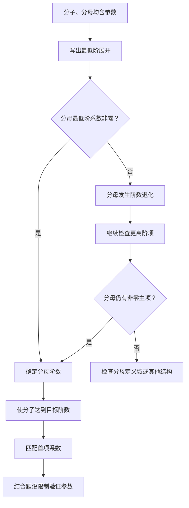
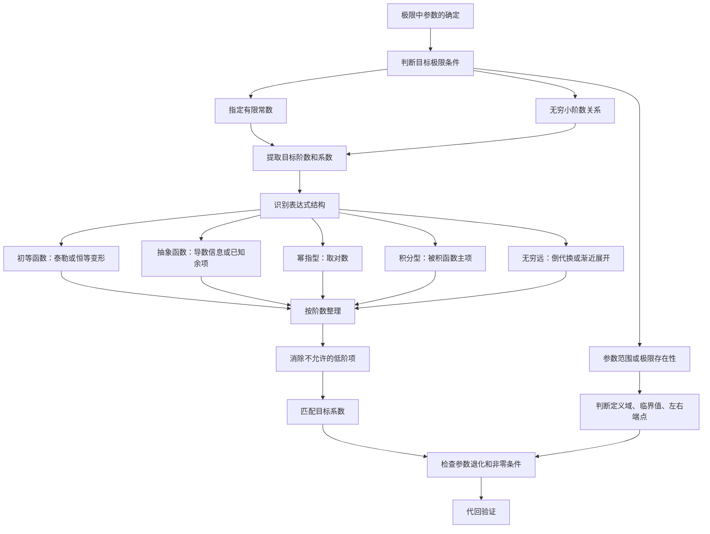

本节是前面**函数极限的计算、数列极限、无穷小量的比较**三个知识点的综合应用，同时也是后续学习泰勒公式、微分中值定理、变限积分和函数局部性质的重要基础。

## 一、本节的知识体系与核心思想

极限中参数的确定，与普通极限计算的最大区别在于：

**普通极限计算是已知函数的结构，求它的极限；参数极限是已知极限的性质，反过来确定函数必须具有怎样的局部结构。**

例如，已知

$$
\lim_{x\to0} \frac{e^x-1-ax}{x^2}=b.
$$

普通极限计算关注的是结果，而参数题需要首先回答：

- 为什么分子中的一次项必须消失？
- 为什么一定要展开到二阶？
- 如果一次项没有消失，极限会怎样？
- 如果二次项也消失了，又意味着什么？

本节几乎所有题目，都可以归纳到以下知识体系中。

| 核心题型      | 本质           | 主要工具      | 重要程度  |
| --------- | ------------ | --------- | ----- |
| 已知极限值反求参数 | 低阶消项、指定系数    | 泰勒公式      | ★★★★★ |
| 等价无穷小反求参数 | 阶数和首项系数匹配    | 泰勒、恒等变形   | ★★★★★ |
| 分子分母均含参数  | 阶数退化、分类讨论    | 渐近展开      | ★★★★★ |
| 抽象函数中的参数  | 函数局部信息匹配     | 导数定义、泰勒公式 | ★★★★★ |
| 幂指型极限中的参数 | 将幂指关系转化为乘除关系 | 取对数、指数展开  | ★★★★★ |
| 变限积分中的参数  | 积分主阶与系数匹配    | 积分估计、洛必达  | ★★★★★ |
| 无穷远处的参数   | 消除发散项、保留常数项  | 倒代换、渐近展开  | ★★★★  |
| 参数取值范围    | 比较衰减或增长速度    | 幂次、对数阶数   | ★★★★  |
| 左右极限中的参数  | 两侧渐近结构一致     | 分段、绝对值    | ★★★★  |
| 高阶综合消项    | 多参数线性约束      | 高阶泰勒、奇偶性  | ★★★★  |

最需要建立的思维方式是：

$$
\boxed{ \text{识别目标阶数} \longrightarrow \text{消去低阶项} \longrightarrow \text{匹配首项系数} \longrightarrow \text{验证成立条件} }
$$

下面从这个统一原理出发，逐步建立各种题型的解题方法。

## 二、必须掌握的基础原理

### 2.1 无穷小的阶数与首项系数

假设当 $x\to0$ 时，

$$
f(x)=Ax^m+o(x^m),\qquad A\ne0.
$$

那么：

- $m$ 决定函数趋近于零的速度；
- $A$ 决定该函数的首项系数；
- $o(x^m)$ 表示相对于 $x^m$ 可以忽略的误差。

例如，

$$
x-\sin x=\frac16x^3+o(x^3).
$$

因此，$x-\sin x$ 是关于 $x$ 的三阶无穷小，其首项系数为 $\frac16$。

一般地，若

$$
f(x)=Ax^m+o(x^m),
$$

$$
g(x)=Bx^n+o(x^n),
$$

其中 $A B\ne0$，且 $m,n$ 为正整数，则

$$
\frac{f(x)}{g(x)} =\frac ABx^{m-n}(1+o(1)).
$$

由此可以得到本节最基本的判断表。

| 条件                 | 两个无穷小的关系                 |
| ------------------ | ------------------------ |
| $m>n$          | $f$ 是 $g$ 的高阶无穷小 |
| $m=n,\ A=B$    | 等价无穷小                    |
| $m=n,\ A\ne B$ | 同阶但非等价无穷小                |
| $m<n$         | $f$ 是 $g$ 的低阶无穷小 |

如果涉及非整数次幂，则还要检查定义域，必要时使用单侧极限或者 $|x|$。

### 2.2 严格区分五种命题要求

这是参数题最容易混淆的地方。

设

$$
F(x)=c_0+c_1x+\cdots+c_mx^m+o(x^m).
$$

不同的题目要求，对参数施加的约束完全不同。

| 题目条件                                               | 对系数的要求                      |
| -------------------------------------------------- | --------------------------- |
| $F(x)=O(x^m)$                                  | $c_0=\cdots=c_{m-1}=0$ |
| $F(x)=o(x^m)$                                  | $c_0=\cdots=c_m=0$      |
| $F(x)$ 与 $x^m$ 同阶                          | 低阶系数全为零，且 $c_m\ne0$     |
| $F(x)\sim x^m$                                 | 低阶系数全为零，且 $c_m=1$       |
| $\displaystyle\lim_{x\to0}\frac{F(x)}{x^m}=L$ | 低阶系数全为零，且 $c_m=L$       |

尤其注意：

$$
F(x)=O(x^3)
$$

并不意味着 $F(x)$ 一定是三阶无穷小，也可能是四阶、五阶甚至恒等于零。

而

$$
F(x)=o(x^3)
$$

表示它相对于 $x^3$ 可以忽略，但不保证它一定是四阶无穷小。

例如 $F(x)=|x|^{7/2}$ 就满足 $F(x)=o(x^3)$。

### 2.3 本节最重要的统一定理：渐近系数匹配

设

$$
F(x)=\sum_{j=0}^{m}c_jx^j+o(x^m).
$$

则

$$
\lim_{x\to0}\frac{F(x)}{x^m}=L
$$

存在且为有限值的充要条件是

$$
\boxed{ \begin{cases} c_0=c_1=\cdots=c_{m-1}=0,\\ c_m=L. \end{cases} }
$$

**为什么低阶项必须消失？**

假如存在某个最低的非零系数 $c_r$，且 $r<m$，那么

$$
\frac{F(x)}{x^m} =x^{r-m}(c_r+o(1)).
$$

由于 $r-m<0$，该式的绝对值趋于无穷大，不可能具有有限极限。

所以所有低于 $m$ 阶的项必须消失。消完之后，只剩

$$
\frac{F(x)}{x^m}=c_m+o(1)\to c_m.
$$

这就是整个第六节最根本的数学依据。

### 2.4 等价无穷小可以转化为差值问题

当 $g(x)$ 在去心邻域内非零时，

$$
\boxed{ f(x)\sim g(x) \iff f(x)-g(x)=o(g(x)). }
$$

证明非常简单：

$$
\frac{f(x)-g(x)}{g(x)} =\frac{f(x)}{g(x)}-1.
$$

因此，如果已知

$$
f(x)\sim 3x^4,
$$

就等价于

$$
f(x)=3x^4+o(x^4).
$$

这个转换十分重要。以后看到“等价无穷小”，可以直接把它理解成一种带有指定误差精度的局部近似。

## 三、必须熟练掌握的泰勒公式

### 3.1 高频公式表

以下公式均在 $x\to0$ 时成立。

| 函数                | 泰勒展开                                                                        |
| ----------------- | --------------------------------------------------------------------------- |
| $e^x$         | $1+x+\frac{x^2}{2}+\frac{x^3}{6}+\frac{x^4}{24}+\frac{x^5}{120}+o(x^5)$ |
| $\ln(1+x)$    | $x-\frac{x^2}{2}+\frac{x^3}{3}-\frac{x^4}{4}+\frac{x^5}{5}+o(x^5)$      |
| $\sin x$      | $x-\frac{x^3}{6}+\frac{x^5}{120}+o(x^5)$                                |
| $\cos x$      | $1-\frac{x^2}{2}+\frac{x^4}{24}+o(x^5)$                                 |
| $\tan x$      | $x+\frac{x^3}{3}+\frac{2x^5}{15}+o(x^5)$                                |
| $\arcsin x$   | $x+\frac{x^3}{6}+\frac{3x^5}{40}+o(x^5)$                                |
| $\arctan x$   | $x-\frac{x^3}{3}+\frac{x^5}{5}+o(x^5)$                                  |
| $\frac1{1+x}$ | $1-x+x^2-x^3+x^4+o(x^4)$                                                |
| $\frac1{1-x}$ | $1+x+x^2+x^3+x^4+o(x^4)$                                                |

对于固定实数 $\alpha$，还有非常重要的广义二项式展开：

$$
\begin{aligned} (1+x)^\alpha ={}&1+\alpha x +\frac{\alpha(\alpha-1)}{2}x^2\\ &+\frac{\alpha(\alpha-1)(\alpha-2)}{6}x^3 +o(x^3). \end{aligned}
$$

其常见特例为

$$
\sqrt{1+x} =1+\frac x2-\frac{x^2}{8} +\frac{x^3}{16}+o(x^3),
$$

$$
\frac1{\sqrt{1+x}} =1-\frac x2+\frac{3x^2}{8} -\frac{5x^3}{16}+o(x^3).
$$

### 3.2 四组最容易混淆的三阶等价无穷小

建议将下面四个公式放在一起记忆：

$$
\boxed{x-\sin x\sim\frac{x^3}{6}}
$$

$$
\boxed{\arcsin x-x\sim\frac{x^3}{6}}
$$

$$
\boxed{\tan x-x\sim\frac{x^3}{3}}
$$

$$
\boxed{x-\arctan x\sim\frac{x^3}{3}}
$$

很多题目看起来复杂，实质上只是这些标准三阶无穷小的线性组合。

### 3.3 如何判断泰勒公式应该展开到几阶？

这是比背公式更重要的技能。

| 题目结构                                | 展开策略                                 |
| ----------------------------------- | ------------------------------------ |
| 分母明确为 $x^m$                     | 分子通常展开至 $m$ 阶                    |
| 指定与 $ax^m$ 等价                   | 展开至 $m$ 阶                        |
| 两个函数作差且阶数未知                         | 展开至第一个非零项                            |
| 已知误差为 $o(x^m)$                  | 必须检查包括 $m$ 阶在内的全部系数              |
| 出现 $x^{-m}$                     | 至少展开至 $m$ 阶，才能提取常数项              |
| 出现 $\int_0^x f(t)\,\mathrm dt$ | 若目标为 $m$ 阶，优先检查被积函数的 $m-1$ 阶 |
| 出现 $x\to\infty$                 | 换成 $t=1/x\to0$，保留足以确定目标项的精度      |

例如，

$$
\lim_{x\to0}\frac{x-\sin x}{x^3}.
$$

由于分母是三阶，如果只写

$$
\sin x=x+o(x),
$$

根本无法得出结论。必须进一步得到

$$
\sin x=x-\frac{x^3}{6}+o(x^3).
$$

### 3.4 参数可能为零时，不要随便使用等价符号

例如，对于未知参数 $a$，直接写

$$
\ln(1+ax)\sim ax
$$

实际上隐含了 $a\ne0$。

如果 $a=0$，两边恒为零，等价无穷小的比值就没有定义。

因此含参题中更严谨、更安全的表达是

$$
\boxed{\ln(1+ax)=ax+O(x^2)}
$$

或者

$$
\sin(ax)=ax-\frac{a^3x^3}{6}+o(x^3).
$$

对于任意固定实数 $a$，这些展开式都成立，包括 $a=0$ 的情况。

这条原则在2024年数学一真题中尤其重要。

## 四、题型一：低阶消项与指定极限值

这是本节最基础、最重要的母题类型。

### 母题1：2015年数学一真题

**来源：核心题目007。**

设

$$
f(x)=x+a\ln(1+x)+b\sin x,
$$

$$
g(x)=kx^3.
$$

若当 $x\to0$ 时，$f(x)$ 与 $g(x)$ 为等价无穷小，求 $a,b,k$。

**题型识别**

看到以下特征，就应该立即想到泰勒系数匹配：

题目包含多个初等函数的线性组合；未知参数出现在各个函数之前；比较对象明确是三阶无穷小；要求等价，而非仅仅同阶。

因此目标是让分子的一阶、二阶项消失，同时保留非零的三阶项。

**标准解法**

第一步，展开到三阶：

$$
\ln(1+x) =x-\frac{x^2}{2}+\frac{x^3}{3}+o(x^3),
$$

$$
\sin x=x-\frac{x^3}{6}+o(x^3).
$$

第二步，代入并按照幂次整理：

$$
\begin{aligned} f(x) ={}&(1+a+b)x-\frac a2x^2\\ &+\left(\frac a3-\frac b6\right)x^3 +o(x^3). \end{aligned}
$$

由于

$$
f(x)\sim kx^3,
$$

所以

$$
f(x)=kx^3+o(x^3),\qquad k\ne0.
$$

第三步，比较各阶系数：

$$
\begin{cases} 1+a+b=0,\\ -\dfrac a2=0,\\ \dfrac a3-\dfrac b6=k. \end{cases}
$$

由第二式得

$$
a=0.
$$

代入第一式：

$$
b=-1.
$$

最后得到

$$
k=\frac16.
$$

故

$$
\boxed{a=0,\quad b=-1,\quad k=\frac16}.
$$

代回原式可得 $f(x)=x-\sin x\sim x^3/6$，验证成立。

**更快的思路：利用奇偶性消项**

观察

$$
x,\quad \sin x
$$

均为奇函数，泰勒展开中没有二次项。

整个表达式的二次项只能来自

$$
a\ln(1+x).
$$

为了使二次项消失，立即可以判断 $a=0$。

剩下

$$
x+b\sin x
$$

要成为三阶无穷小，必须 $b=-1$。

最后使用熟悉的结论：

$$
x-\sin x\sim\frac{x^3}{6}.
$$

不需要完整地展开每一项，就可以迅速得到答案。

**迁移技巧：当若干函数的线性组合需要消项时，先寻找只由某一个函数贡献的幂次。利用奇偶性，往往可以直接确定部分参数。**

### 母题2：李正元练习题——复合函数的参数匹配

**来源：李正元练习题第五章《一元函数的泰勒公式及其应用》。**

已知

$$
\lim_{x\to0} \frac{\ln(1-2x+3x^2)+ax+bx^2}{x^2}=6.
$$

求 $a,b$。

**解题关键**

这不是简单的 $\ln(1+x)$，而是

$$
\ln(1+u),\qquad u=-2x+3x^2.
$$

必须先判断内部变量 $u$ 的阶数。

因为

$$
u=O(x),
$$

所以要保留到 $u^2$ 项。

**解答**

$$
\ln(1+u)=u-\frac{u^2}{2}+o(u^2).
$$

而

$$
u^2=4x^2+o(x^2).
$$

因此

$$
\begin{aligned} \ln(1-2x+3x^2) &=-2x+3x^2-\frac{4x^2}{2}+o(x^2)\\ &=-2x+x^2+o(x^2). \end{aligned}
$$

原极限化为

$$
\lim_{x\to0} \left[ \frac{a-2}{x}+b+1+o(1) \right]=6.
$$

极限存在且有限，要求

$$
a-2=0.
$$

极限等于6，又要求

$$
b+1=6.
$$

所以

$$
\boxed{a=2,\qquad b=5}.
$$

**通用结论：复合对数的二阶展开**

若

$$
u(x)=px+qx^2+o(x^2),
$$

则

$$
\boxed{ \ln(1+u(x)) =px+\left(q-\frac{p^2}{2}\right)x^2+o(x^2). }
$$

同理，

$$
\boxed{ e^{u(x)} =1+px+\left(q+\frac{p^2}{2}\right)x^2+o(x^2). }
$$

这样的公式可以大幅提高复合函数参数题的计算速度。

## 五、题型二：等价无穷小的阶数与系数匹配

### 母题3：2023年数学一真题

**来源：核心题目008。你的分类模拟题中，李林六套卷第一套第1题也收录了相同数学结构的题目。**

已知当 $x\to0$ 时，

$$
f(x)=ax+bx^2+\ln(1+x)
$$

与

$$
g(x)=e^{x^2}-\cos x
$$

是等价无穷小，求 $ab$。

<Steps>

<Step>

### 第一步：先分析不含参数的一边 [!toc]

对于这类题，不要急着计算含参表达式。先确定比较对象的阶数和系数。

$$
e^{x^2}=1+x^2+o(x^2),
$$

$$
\cos x=1-\frac{x^2}{2}+o(x^2).
$$

相减：

$$
g(x)=\frac32x^2+o(x^2).
$$

即

$$
g(x)\sim\frac32x^2.
$$

</Step>

<Step>

### 第二步：根据目标阶数展开含参函数 [!toc]

$$
\begin{aligned} f(x) &=ax+bx^2+x-\frac{x^2}{2}+o(x^2)\\ &=(a+1)x+\left(b-\frac12\right)x^2+o(x^2). \end{aligned}
$$

</Step>

<Step>

### 第三步：先消项，再匹配系数 [!toc]

由于 $f\sim g$，所以

$$
\begin{cases} a+1=0,\\ b-\dfrac12=\dfrac32. \end{cases}
$$

解得

$$
a=-1,\qquad b=2.
$$

故

$$
\boxed{ab=-2}.
$$

</Step>

</Steps>

**对照训练：张宇1000题强化部分**

**来源：第1章《函数极限与连续》。**

将上题的比较对象换成

$$
g(x)=1-\cos x.
$$

其他条件不变，求 $ab$。

此时

$$
g(x)\sim\frac{x^2}{2}.
$$

因此参数方程变成

$$
a+1=0,\qquad b-\frac12=\frac12.
$$

得到

$$
a=-1,\qquad b=1,
$$

$$
\boxed{ab=-1}.
$$

**两道题背后的统一母题**

设

$$
ax+bx^2+\ln(1+x)\sim Cx^2, \qquad C\ne0.
$$

那么必有

$$
\boxed{a=-1,\qquad b=C+\frac12}.
$$

以后右侧无论换成指数函数、三角函数、根式还是积分，只需要求出 $C$，便能直接确定参数。

这就是从一道题上升到一类题的过程。

### 母题4：2009年数学一真题——两边均含未知参数

**来源：核心题目003。**

当 $x\to0$ 时，

$$
f(x)=x-\sin ax,
$$

$$
g(x)=x^2\ln(1-bx)
$$

是等价无穷小，求 $a,b$。

**分析**

右侧也包含未知参数，不能未经判断直接认定

$$
g(x)\sim-bx^3.
$$

如果 $b=0$，则 $g(x)\equiv0$，等价关系无意义。因此必须 $b\ne0$。

**解答**

右侧展开：

$$
g(x)=-bx^3+O(x^4).
$$

左侧展开：

$$
\begin{aligned} f(x) &=x-\left(ax-\frac{a^3x^3}{6}+O(x^5)\right)\\ &=(1-a)x+\frac{a^3}{6}x^3+O(x^5). \end{aligned}
$$

因为右侧是三阶无穷小，所以左侧一次项必须消失：

$$
1-a=0\quad\Longrightarrow\quad a=1.
$$

此时

$$
f(x)\sim\frac16x^3.
$$

根据首项系数相等，

$$
-b=\frac16.
$$

最终

$$
\boxed{a=1,\qquad b=-\frac16}.
$$

<Callout type="warn" title="易错点：同阶与等价的区别">

如果本题只要求同阶无穷小，那么答案将变为

$$
a=1,\qquad b\ne0.
$$

不需要进一步确定 $b$ 的具体数值。

这说明读题时必须准确识别题目到底给出了多强的条件。

</Callout>

### 母题5：李林880——有理函数中的参数消项

**来源：李林880第一章。**

当 $x\to0$ 时，

$$
e^x-\frac{1+ax^2}{1+bx}
$$

与 $x^3$ 是同阶无穷小，求 $a,b$。

**方法选择**

有两种常见思路：

直接展开分式，或者先通分再展开。

本题更推荐先通分，因为这样可以减少乘法和分式展开的计算量。

$$
e^x-\frac{1+ax^2}{1+bx} = \frac{e^x(1+bx)-1-ax^2}{1+bx}.
$$

由于

$$
1+bx\to1,
$$

分母不会改变无穷小的阶数。

只需要研究

$$
N(x)=e^x(1+bx)-1-ax^2.
$$

展开至三阶：

$$
\begin{aligned} N(x) ={}&(1+b)x+ \left(\frac12+b-a\right)x^2\\ &+\left(\frac16+\frac b2\right)x^3+o(x^3). \end{aligned}
$$

令低阶项消失：

$$
\begin{cases} 1+b=0,\\ \dfrac12+b-a=0. \end{cases}
$$

解得

$$
b=-1,\qquad a=-\frac12.
$$

还没有结束，因为题目要求的是**同阶无穷小**。

必须检验三阶系数非零：

$$
\frac16+\frac b2 =\frac16-\frac12 =-\frac13\ne0.
$$

因此

$$
e^x-\frac{1+ax^2}{1+bx} \sim-\frac13x^3.
$$

答案为

$$
\boxed{a=-\frac12,\qquad b=-1}.
$$

这个例子说明，同阶无穷小的题目不能只完成低阶消项，还需要检查目标阶的系数是否意外消失。

## 六、题型三：分子分母均含参数——阶数退化与分类讨论

这一类比前面的基本消项更加灵活，也是容易出现创新选择题的地方。

### 6.1 核心原理

设

$$
F(x)=a_1x+a_2x^2+\cdots,
$$

$$
G(x)=b_1x+b_2x^2+\cdots.
$$

如果已知

$$
\lim_{x\to0}\frac{F(x)}{G(x)}=L\ne0,
$$

则分子和分母必须具有相同的首个非零阶数，且首项系数之比为 $L$。

问题在于，$a_1,b_1$ 本身可能是未知参数，也可能等于零。

因此不能不加判断地写出

$$
\lim_{x\to0}\frac{F(x)}{G(x)} =\frac{a_1}{b_1}.
$$

必须先检查 $b_1\ne0$ 是否成立。

### 母题6：1994年数学一真题

**来源：核心题目017。**

若

$$
\lim_{x\to0} \frac{a\tan x+b(1-\cos x)} {c\ln(1-2x)+d(1-e^{-x^2})}=2,
$$

且

$$
a^2+c^2\ne0,
$$

问参数之间必然满足怎样的关系？

<Steps>

<Step>

### 第一步：判断分子与分母的可能阶数 [!toc]

利用

$$
\tan x=x+O(x^3),
$$

$$
1-\cos x=\frac{x^2}{2}+O(x^4),
$$

得到分子

$$
N(x)=ax+\frac b2x^2+O(x^3).
$$

另一方面，

$$
\ln(1-2x)=-2x-2x^2+O(x^3),
$$

$$
1-e^{-x^2}=x^2+O(x^4).
$$

因此分母

$$
D(x)=-2cx+(d-2c)x^2+O(x^3).
$$

</Step>

<Step>

### 第二步：分类讨论 [!toc]

**情况一：**$c\ne0$**。**

分母是一阶无穷小。

因为商的极限为2，所以分子也必须是一阶无穷小。

此时

$$
\lim_{x\to0}\frac{N(x)}{D(x)} =\frac{a}{-2c}=2.
$$

得到

$$
a=-4c.
$$

**情况二：**$c=0$**。**

题设

$$
a^2+c^2\ne0
$$

意味着 $a\ne0$。

于是分子是一阶无穷小，而分母若 $d\ne0$，则为二阶无穷小。

此时商的绝对值趋于无穷大，不可能趋于2；若 $d=0$，分母恒为零，同样不成立。

故这种情况应当排除。

综上，

$$
\boxed{a=-4c}.
$$

</Step>

</Steps>

**命题人为什么特意给出 $a^2+c^2\ne0$？**

因为它排除了分子、分母同时退化为高阶无穷小的可能性。

倘若删去该条件，那么还存在一个有效分支：

$$
a=c=0,\qquad d\ne0.
$$

此时

$$
\frac{b(1-\cos x)} {d(1-e^{-x^2})}\to\frac b{2d}.
$$

要使极限等于2，只需要

$$
b=4d.
$$

所以删去限制条件后，完整的参数解集将包含两个分支：

$$
\begin{cases} c\ne0,\\ a=-4c, \end{cases}
$$

或者

$$
\begin{cases} a=c=0,\\ d\ne0,\\ b=4d. \end{cases}
$$

这正是此类题最重要的命题变化：**参数可以改变表达式的阶数，进而改变解题分支。**

### 6.2 分类讨论的一般决策流程

对于商的极限为零的题目，分子阶数可以高于分母；只有目标是非零有限常数时，才要求两者严格同阶。

## 七、题型四：抽象函数、泰勒近似与高阶外推

本类型没有明确的初等函数表达式，考查的是你是否真正理解泰勒公式，而不是只会背几个展开式。

### 7.1 抽象函数的展开公式

若 $f$ 在 $x_0$ 处可导，则

$$
f(x_0+h)=f(x_0)+f'(x_0)h+o(h).
$$

若具有二阶导数，可使用相应的二阶佩亚诺型泰勒公式：

$$
f(x_0+h) =f(x_0)+f'(x_0)h +\frac{f''(x_0)}2h^2+o(h^2).
$$

对于固定常数 $k$，有

$$
\begin{aligned} f(x_0+kh) ={}&f(x_0)+kf'(x_0)h\\ &+\frac{k^2f''(x_0)}2h^2+o(h^2). \end{aligned}
$$

这里真正需要注意的是：自变量乘以 $k$，第 $j$ 阶系数就会乘以 $k^j$。

例如，

$$
f(2h) =f(0)+2f'(0)h+2f''(0)h^2+o(h^2).
$$

二阶项不是简单地乘以2，而是乘以 $2^2=4$。

### 母题7：2002年数学一真题

**来源：核心题目012。**

设 $f(x)$ 在 $x=0$ 的某邻域内具有一阶连续导数，且

$$
f(0)\ne0,\qquad f'(0)\ne0.
$$

若

$$
af(h)+bf(2h)-f(0)=o(h),
$$

求 $a,b$。

**解答**

分别作一阶展开：

$$
f(h)=f(0)+f'(0)h+o(h),
$$

$$
f(2h)=f(0)+2f'(0)h+o(h).
$$

因此

$$
\begin{aligned} &af(h)+bf(2h)-f(0)\\ ={}&(a+b-1)f(0) +(a+2b)f'(0)h+o(h). \end{aligned}
$$

题目要求整个表达式是 $o(h)$，所以常数项和一次项都必须为零：

$$
\begin{cases} (a+b-1)f(0)=0,\\ (a+2b)f'(0)=0. \end{cases}
$$

根据题设两个函数值均非零，得到

$$
\begin{cases} a+b=1,\\ a+2b=0. \end{cases}
$$

解得

$$
\boxed{a=2,\qquad b=-1}.
$$

**进一步理解：题设的非零条件有什么用？**

若

$$
f(0)=0,
$$

那么常数项自动消失，只剩

$$
(a+2b)f'(0)=0.
$$

只要 $f'(0)\ne0$，就仅能推出

$$
a+2b=0.
$$

此时参数不再唯一。

同样，如果 $f'(0)=0$，一次项自动消失，对参数的约束也会减少。

这类题的关键不仅是展开，而且是理解：

$$
\boxed{\text{导数非零条件保证对应阶数的约束不会退化。}}
$$

### 母题8：2002年数学二真题——二阶外推

**来源：核心题目013。**

设 $f$ 具有二阶连续导数，并且

$$
f(0)f'(0)f''(0)\ne0.
$$

确定 $\lambda_1,\lambda_2,\lambda_3$，使得

$$
\lambda_1f(h)+\lambda_2f(2h) +\lambda_3f(3h)-f(0)=o(h^2).
$$

并证明其唯一性。

**解答**

对于 $k=1,2,3$，

$$
f(kh)=f(0)+kf'(0)h +\frac{k^2}{2}f''(0)h^2+o(h^2).
$$

按不同阶数收集系数，得到

$$
\begin{cases} \lambda_1+\lambda_2+\lambda_3=1,\\ \lambda_1+2\lambda_2+3\lambda_3=0,\\ \lambda_1+4\lambda_2+9\lambda_3=0. \end{cases}
$$

联立解得

$$
\boxed{\lambda_1=3,\quad\lambda_2=-3,\quad\lambda_3=1}.
$$

对应的系数行列式为

$$
\begin{vmatrix} 1&1&1\\ 1&2&3\\ 1&4&9 \end{vmatrix}=2\ne0.
$$

因此解唯一。代回后三阶系数条件中的零至二阶项全部抵消，满足要求。

### 7.2 通用模型：矩条件

若遇到

$$
\sum_{i=1}^{n}\lambda_i f(k_ih)-f(0)=o(h^m),
$$

并且相关导数均非零，则根据泰勒公式可直接得到

$$
\boxed{ \begin{cases} \displaystyle\sum_{i=1}^n\lambda_i=1,\\[4pt] \displaystyle\sum_{i=1}^n k_i\lambda_i=0,\\[4pt] \displaystyle\sum_{i=1}^n k_i^2\lambda_i=0,\\ \qquad\vdots\\ \displaystyle\sum_{i=1}^n k_i^m\lambda_i=0. \end{cases} }
$$

这个模型可以用于构造高阶近似、证明误差阶数，也可以与线性代数的方程组、行列式知识结合。

### 7.3 创新拓展：利用函数值近似导数

假设 $f$ 具有二阶连续导数，希望利用

$$
af(0)+bf(h)+cf(2h)
$$

构造 $f'(0)h$ 的高阶近似，即满足

$$
af(0)+bf(h)+cf(2h) =hf'(0)+o(h^2).
$$

将右侧目标与各阶系数匹配：

$$
\begin{cases} a+b+c=0,\\ b+2c=1,\\ b+4c=0. \end{cases}
$$

解得

$$
a=-\frac32,\qquad b=2,\qquad c=-\frac12.
$$

因此

$$
\boxed{ \frac{-3f(0)+4f(h)-f(2h)}{2h} =f'(0)+o(h). }
$$

这说明参数消项不只是用于求极限，还可以用于构造导数的高精度近似公式。

如果进一步具有足够的三阶光滑性，则误差可以提升至 $O(h^2)$。

### 母题9：李永乐六套卷——由已知极限反推抽象函数

**来源：分类模拟题，李永乐六套卷第五套第11题。**

设 $f(x)$ 在零点附近有定义，且

$$
\lim_{x\to0} \frac{f(x)\tan x-\sin4x}{x^3}=0.
$$

求

$$
\lim_{x\to0}\frac{f(x)-4}{x^2}.
$$

**为什么这是一道值得重点掌握的综合题？**

因为题目没有给出 $f(x)$ 可导、二阶可导或者连续的条件，不能擅自对 $f(x)$ 使用泰勒公式。

应该利用已知极限反过来提取 $f(x)$ 的局部信息。

<Tabs items={["解法一：直接构造所求表达式", "解法二：提取函数的局部展开"]} defaultIndex={0}>

<Tab value="解法一：直接构造所求表达式">

将所求极限改写为

$$
\frac{f(x)-4}{x^2} =\frac{f(x)\tan x-4\tan x}{x^2\tan x}.
$$

进一步凑出已知条件：

$$
\begin{aligned} \frac{f(x)-4}{x^2} ={}& \frac{f(x)\tan x-\sin4x}{x^2\tan x}\\ &+\frac{\sin4x-4\tan x}{x^2\tan x}. \end{aligned}
$$

第一项等于

$$
\frac{f(x)\tan x-\sin4x}{x^3} \cdot\frac{x}{\tan x}\to0.
$$

第二项中，

$$
\sin4x=4x-\frac{32}{3}x^3+o(x^3),
$$

$$
4\tan x=4x+\frac43x^3+o(x^3).
$$

因此

$$
\sin4x-4\tan x=-12x^3+o(x^3).
$$

又因为

$$
x^2\tan x\sim x^3,
$$

所以第二项趋于 $-12$。

故所求极限为

$$
\boxed{-12}.
$$

</Tab>

<Tab value="解法二：提取函数的局部展开">

已知条件等价于

$$
f(x)\tan x-\sin4x=o(x^3).
$$

因此

$$
f(x)=\frac{\sin4x}{\tan x}+o(x^2).
$$

计算右侧可得

$$
\frac{\sin4x}{\tan x} =4-12x^2+o(x^2).
$$

从而

$$
f(x)=4-12x^2+o(x^2).
$$

立即得到

$$
\lim_{x\to0}\frac{f(x)-4}{x^2}=-12.
$$

</Tab>

</Tabs>

<Callout type="warn" title="易错点">

由此可以推出

$$
\lim_{x\to0}f(x)=4,
$$

但不能直接推出 $f(0)=4$，因为题目没有给出零点处的连续性。

也不能未经条件验证就声称 $f''(0)=-24$。

一个函数具有二阶佩亚诺型展开，并不必然意味着其普通意义下的二阶导数存在。

</Callout>

## 八、题型五：幂指型极限中的参数

### 8.1 统一方法：取对数

对于

$$
F(x)=A(x)^{B(x)},
$$

只要在所研究的去心邻域内 $A(x)>0$，就可以写成

$$
F(x)=e^{B(x)\ln A(x)}.
$$

因此真正决定原极限的是

$$
U(x)=B(x)\ln A(x).
$$

| 对数部分的极限                     | 原幂式极限                |
| --------------------------- | -------------------- |
| $U(x)\to L\in\mathbb R$ | $F(x)\to e^L$    |
| $U(x)\to+\infty$        | $F(x)\to+\infty$ |
| $U(x)\to-\infty$        | $F(x)\to0$       |
| $U(x)\to0$              | $F(x)\to1$       |

特别地，当题目给定

$$
\lim A(x)^{B(x)}=C>0
$$

时，等价于

$$
\lim B(x)\ln A(x)=\ln C.
$$

**两个需要熟练掌握的结论**

若 $u(x)\to0$，则

$$
e^{u(x)}-1=u(x)+O(u(x)^2).
$$

若 $u(x)\to0$，$v(x)u(x)\to L\in\mathbb R$，则

$$
(1+u(x))^{v(x)}\to e^L.
$$

前者适合处理“幂函数减1”，后者适合处理经典 $1^\infty$ 型极限。

### 母题10：2018年数学一真题

**来源：核心题目023。**

若

$$
\lim_{x\to0} \left(\frac{1-\tan x}{1+\tan x}\right)^{1/\sin kx} =e,
$$

求 $k$。

<Steps>

<Step>

### 第一步：检查定义域 [!toc]

当 $x$ 充分接近零时，底数为正。

指数为 $1/\sin kx$，所以必须 $k\ne0$。

</Step>

<Step>

### 第二步：取对数 [!toc]

$$
\lim_{x\to0} \frac{\ln(1-\tan x)-\ln(1+\tan x)} {\sin kx}=1.
$$

注意：右边是 $\ln e=1$，不是 $e$。

</Step>

<Step>

### 第三步：提取主项 [!toc]

令 $u=\tan x$。

$$
\ln(1-u)-\ln(1+u) =-2u+O(u^3).
$$

由于 $\tan x\sim x$，所以

$$
\ln(1-\tan x)-\ln(1+\tan x) =-2x+o(x).
$$

而

$$
\sin kx\sim kx.
$$

因此对数极限为

$$
-\frac2k.
$$

根据题设，

$$
-\frac2k=1.
$$

故

$$
\boxed{k=-2}.
$$

</Step>

</Steps>

**通用推广**

若目标极限改为 $C>0$，则参数需要满足

$$
-\frac2k=\ln C.
$$

当 $C\ne1$ 时，

$$
\boxed{k=-\frac2{\ln C}}.
$$

而当 $C=1$ 时，不存在满足条件的有限非零实数 $k$。

这就是原真题的一种自然创新方向。

### 母题11：2024年数学一真题

**来源：核心题目021。**

若

$$
\lim_{x\to0} \frac{(1+ax^2)^{\sin x}-1}{x^3}=6,
$$

求 $a$。

**题型识别**

这里不是传统的 $1^\infty$ 型极限，因为指数 $\sin x\to0$。

但只要出现变量指数，仍然可以优先考虑指数化：

$$
(1+ax^2)^{\sin x} =e^{\sin x\ln(1+ax^2)}.
$$

**解答**

令

$$
u(x)=\sin x\ln(1+ax^2).
$$

对于任意固定实数 $a$，

$$
\ln(1+ax^2)=ax^2+O(x^4).
$$

又有

$$
\sin x=x+O(x^3).
$$

相乘得到

$$
u(x)=ax^3+O(x^5).
$$

因此

$$
e^{u(x)}-1=u(x)+O(u(x)^2) =ax^3+o(x^3).
$$

原极限即为

$$
a=6.
$$

故

$$
\boxed{a=6}.
$$

**高度可迁移的结论**

若

$$
u(x)=Ax^m+o(x^m),
$$

$$
v(x)=Bx^n+o(x^n),
$$

其中 $AB\ne0$，$m,n$ 为正整数，那么

$$
\boxed{ (1+u(x))^{v(x)}-1 \sim ABx^{m+n}. }
$$

直观上，底数偏差的阶数和指数的阶数相加，首项系数相乘。

证明为

$$
\begin{aligned} (1+u)^v-1 &=e^{v\ln(1+u)}-1\\ &\sim v\ln(1+u)\\ &\sim vu. \end{aligned}
$$

但必须先确认 $v\ln(1+u)\to0$，不能无条件使用这一结论。

### 母题12：2018年数学二真题——幂指极限与高阶消项结合

**来源：核心题目024。**

若

$$
\lim_{x\to0}(e^x+ax^2+bx)^{1/x^2}=1,
$$

求 $a,b$。

**解答**

令

$$
H(x)=e^x+ax^2+bx.
$$

由于 $H(x)\to1$，所以

$$
H(x)^{1/x^2}\to1
$$

等价于

$$
\frac{\ln H(x)}{x^2}\to0.
$$

又因为

$$
\ln H(x) =(H(x)-1)(1+o(1)),
$$

故进一步等价于

$$
\frac{H(x)-1}{x^2}\to0.
$$

即

$$
e^x-1+ax^2+bx=o(x^2).
$$

展开：

$$
(1+b)x+\left(a+\frac12\right)x^2 +o(x^2)=o(x^2).
$$

因此

$$
\begin{cases} 1+b=0,\\ a+\dfrac12=0. \end{cases}
$$

得到

$$
\boxed{a=-\frac12,\qquad b=-1}.
$$

**一般性结论**

如果 $H(x)\to1$，$m$ 为正整数，则

$$
\boxed{ H(x)^{1/x^m}\to C>0 \iff H(x)=1+(\ln C)x^m+o(x^m). }
$$

这是幂指型参数题与泰勒系数匹配之间最直接的桥梁。

尤其当 $C=1$ 时，条件简化为

$$
H(x)-1=o(x^m).
$$

## 九、题型六：变限积分中的参数确定

这类题特别值得数学一考生重视，因为它将函数极限、无穷小比较、定积分、变上限积分函数等多个知识点联系起来。

### 9.1 基础定理：积分提高一个阶数

若当 $t\to0$ 时，

$$
f(t)=At^m+o(t^m),
$$

其中 $m$ 是非负整数，$f$ 在零点附近可积，则

$$
\boxed{ \int_0^x f(t)\,\mathrm dt =\frac{A}{m+1}x^{m+1}+o(x^{m+1}). }
$$

例如，

$$
\sin t\sim t \quad\Longrightarrow\quad \int_0^x\sin t\,\mathrm dt\sim\frac{x^2}{2}.
$$

$$
1-\cos t\sim\frac{t^2}{2} \quad\Longrightarrow\quad \int_0^x(1-\cos t)\,\mathrm dt \sim\frac{x^3}{6}.
$$

如果积分上限是 $g(x)\to0$，还可以推广为

$$
\boxed{ \int_0^{g(x)} f(t)\,\mathrm dt =\frac{A}{m+1}[g(x)]^{m+1} +o([g(x)]^{m+1}). }
$$

例如，

$$
\int_0^{x^2}\sin t\,\mathrm dt \sim\frac{x^4}{2}.
$$

所以积分本身提高一个关于积分上限的阶数，但如果积分上限还有复合关系，则需要继续换算成关于 $x$ 的阶数。

<Callout type="warn" title="适用条件与易错点">

不能无条件地认为

$$
f(t)\sim g(t) \Longrightarrow \int_0^x f(t)\,\mathrm dt \sim\int_0^x g(t)\,\mathrm dt.
$$

在一般情形下，还应考虑可积性、比较函数的符号及积分是否发生严重抵消。

考研中常见的 $At^m$ 型主项不存在这种复杂的抵消问题，因此上述幂函数积分公式可以放心使用。

</Callout>

### 母题13：1987年数学一真题

**来源：核心题目015。**

求正的常数 $a,b$，使得

$$
\lim_{x\to0} \frac{\displaystyle\int_0^x \frac{t^2}{\sqrt{a+t^2}}\,\mathrm dt} {bx-\sin x}=1.
$$

<Steps>

<Step>

### 第一步：确定积分的主阶 [!toc]

由于 $a>0$，

$$
\frac1{\sqrt{a+t^2}} =\frac1{\sqrt a}+O(t^2).
$$

因此

$$
\frac{t^2}{\sqrt{a+t^2}} =\frac{t^2}{\sqrt a}+O(t^4).
$$

积分后得到

$$
I(x)=\frac{x^3}{3\sqrt a}+O(x^5).
$$

所以分子是三阶无穷小。

</Step>

<Step>

### 第二步：确定分母必须消掉哪些项 [!toc]

$$
\begin{aligned} bx-\sin x &=bx-\left(x-\frac{x^3}{6}+O(x^5)\right)\\ &=(b-1)x+\frac{x^3}{6}+O(x^5). \end{aligned}
$$

如果 $b\ne1$，分母是一阶无穷小，分子是三阶无穷小，商必然趋于0。

这与题目要求极限为1矛盾。

所以

$$
b=1.
$$

</Step>

<Step>

### 第三步：比较同阶系数 [!toc]

此时

$$
\lim_{x\to0} \frac{I(x)}{x-\sin x} =\frac{1/(3\sqrt a)}{1/6} =\frac2{\sqrt a}.
$$

根据题设，

$$
\frac2{\sqrt a}=1.
$$

解得

$$
a=4.
$$

因此

$$
\boxed{a=4,\qquad b=1}.
$$

</Step>

</Steps>

**另一种方法：洛必达法则**

对原式使用洛必达法则：

$$
\lim_{x\to0} \frac{\displaystyle\frac{x^2}{\sqrt{a+x^2}}} {b-\cos x}.
$$

如果 $b\ne1$，极限显然为0，故 $b=1$。

代入后，

$$
\begin{aligned} \lim_{x\to0} \frac{x^2}{\sqrt{a+x^2}(1-\cos x)} &=\frac2{\sqrt a}\\ &=1. \end{aligned}
$$

仍得 $a=4$。

**如何选择方法？**

当积分上下限比较简单、被积函数容易提取首项时，泰勒展开最能体现阶数匹配的本质。

当分子为变上限积分、分母求导后明显简化时，洛必达法则可能更快。

但一定要检查洛必达的适用条件，不能将“分子分母都含参数”自动理解成可以随意求导。

### 母题14：张宇1000题——复合上限与等价匹配

**来源：张宇1000题第1章。**

若当 $x\to0$ 时，

$$
a\int_0^{x^2}\cos(t^2)\,\mathrm dt
$$

与

$$
\sin x-b\ln(1+x)
$$

是等价无穷小，求 $a,b$。

左侧由于

$$
\cos(t^2)=1+O(t^4),
$$

所以

$$
a\int_0^{x^2}\cos(t^2)\,\mathrm dt =ax^2+O(x^{10}).
$$

等价条件排除了 $a=0$。

右侧展开：

$$
\begin{aligned} \sin x-b\ln(1+x) &=(1-b)x+\frac b2x^2+o(x^2). \end{aligned}
$$

要使右侧成为二阶无穷小，必须

$$
b=1.
$$

然后匹配二阶系数：

$$
a=\frac12.
$$

因此

$$
\boxed{a=\frac12,\qquad b=1}.
$$

### 母题15：张宇1000题——指数差、高阶复合与积分

**来源：张宇1000题第1章。**

已知

$$
\int_0^x(e^{t\cos t^2}-e^t)\,\mathrm dt \sim ax^b.
$$

求 $a,b$。

这道题具有很好的综合训练价值，因为直接分别展开两个指数函数至五阶非常繁琐。

**最优思路：先提取公因子**

$$
e^{t\cos t^2}-e^t =e^t\left[e^{t(\cos t^2-1)}-1\right].
$$

而

$$
\cos t^2-1\sim-\frac{t^4}{2}.
$$

所以

$$
t(\cos t^2-1)\sim-\frac{t^5}{2}.
$$

使用 $e^u-1\sim u$，得到

$$
e^{t\cos t^2}-e^t\sim-\frac12t^5.
$$

积分使阶数由五阶提高至六阶：

$$
\int_0^x(e^{t\cos t^2}-e^t)\,\mathrm dt \sim-\frac1{12}x^6.
$$

所以

$$
\boxed{a=-\frac1{12},\qquad b=6}.
$$

**通用技巧：两个指数作差**

当 $u(x)-v(x)\to0$ 且 $u(x)-v(x)$ 在去心邻域非零时，

$$
\boxed{ e^{u(x)}-e^{v(x)} \sim e^{v(x)}[u(x)-v(x)]. }
$$

来源是恒等式

$$
e^u-e^v=e^v(e^{u-v}-1).
$$

同理，当 $u,v>0$，且 $u/v\to1$ 时，可以利用

$$
\ln u-\ln v=\ln\left(1+\frac{u-v}{v}\right)
$$

提取对数差的主项。

这些变形比盲目进行高阶泰勒展开更加高效，也是难题中非常重要的降维技巧。

### 母题16：李林六套卷——含绝对值的变限积分

**来源：分类模拟题，李林六套卷第二套第17题。**

问是否存在常数 $k$，使得

$$
\int_0^{2x}|t-x|\sin t\,\mathrm dt \sim k|x|^3,\qquad x\to0?
$$

若存在，求 $k$。

**难点分析**

本题存在三个同时变化的因素：积分上限 $2x$、绝对值内部的分界点 $t=x$、趋近于零的方向。

如果直接按照 $x>0$ 计算，再把结果机械地用于 $x<0$，很容易产生符号错误。

**推荐方法：尺度换元**

令

$$
t=xu,\qquad \mathrm dt=x\,\mathrm du.
$$

注意这里无论 $x$ 为正还是为负，换元后的积分区间都是 $[0,2]$，而且

$$
|t-x|=|x||u-1|.
$$

于是

$$
\begin{aligned} I(x) &=\int_0^{2x}|t-x|\sin t\,\mathrm dt\\ &=|x|x\int_0^2|u-1|\sin(xu)\,\mathrm du. \end{aligned}
$$

当 $x\to0$ 时，在固定区间 $0\le u\le2$ 上有一致展开

$$
\sin(xu)=xu+O(|x|^3).
$$

因此

$$
I(x)=|x|x^2\int_0^2|u-1|u\,\mathrm du +O(|x|^5).
$$

计算积分：

$$
\begin{aligned} \int_0^2|u-1|u\,\mathrm du &=\int_0^1(1-u)u\,\mathrm du\\ &\quad+\int_1^2(u-1)u\,\mathrm du\\ &=\frac16+\frac56=1. \end{aligned}
$$

由于

$$
|x|x^2=|x|^3,
$$

得到

$$
I(x)=|x|^3+O(|x|^5).
$$

所以存在符合条件的 $k$，且

$$
\boxed{k=1}.
$$

**深入变式：如果比较对象改为 $kx^3$ 呢？**

此时

$$
\frac{I(x)}{x^3} \sim\frac{|x|^3}{x^3}.
$$

右极限为1，左极限为 $-1$。

因此不存在固定非零常数 $k$，使 $I(x)$ 与 $kx^3$ 在双侧极限下等价。

**本题需要掌握的通用换元技巧**

对于类似

$$
\int_0^{cx}|t-ax|^p f(t)\,\mathrm dt
$$

的表达式，优先考虑

$$
t=xu.
$$

换元可以把变化的积分区间固定下来，同时将关于 $x$ 的尺度和绝对值提取到积分号外。

这是处理积分型极限创新题的重要方法。

## 十、题型七：参数取值范围——幂次和增长速度

### 10.1 核心原理

当 $x\to0^+$ 时，

$$
\lim_{x\to0^+}x^\alpha= \begin{cases} 0,&\alpha>0,\\ 1,&\alpha=0,\\ +\infty,&\alpha<0. \end{cases}
$$

但当 $x\to+\infty$ 时，情况恰好相反：

$$
\lim_{x\to+\infty}x^\alpha= \begin{cases} +\infty,&\alpha>0,\\ 1,&\alpha=0,\\ 0,&\alpha<0. \end{cases}
$$

此外，对于任意固定的正数 $p,q$，

$$
\lim_{x\to+\infty} \frac{(\ln x)^q}{x^p}=0.
$$

以及

$$
\lim_{x\to0^+} x^p|\ln x|^q=0.
$$

即：**任意正幂的增长或衰减速度最终都可以压过固定次幂的对数。**

**参数范围题的解题流程**

首先把复杂表达式化为幂次或幂次与对数的乘积；然后将极限条件转化为指数的不等式；最后单独检查临界参数。

其中临界值检查是最容易漏掉的环节。

### 母题17：2014年数学二真题

**来源：核心题目019。**

当 $x\to0^+$ 时，若

$$
[\ln(1+2x)]^\alpha
$$

与

$$
(1-\cos x)^{1/\alpha}
$$

都是比 $x$ 高阶的无穷小，求 $\alpha$ 的取值范围。

**第一个条件**

因为

$$
\ln(1+2x)\sim2x,
$$

所以

$$
\frac{[\ln(1+2x)]^\alpha}{x} \sim2^\alpha x^{\alpha-1}.
$$

要使其趋于零，必须

$$
\alpha-1>0,
$$

即

$$
\alpha>1.
$$

**第二个条件**

因为

$$
1-\cos x\sim\frac{x^2}{2},
$$

所以

$$
\frac{(1-\cos x)^{1/\alpha}}{x} \sim2^{-1/\alpha}x^{2/\alpha-1}.
$$

要使其趋于零，必须

$$
\frac2\alpha-1>0.
$$

结合已经得到的 $\alpha>1$，可知

$$
\alpha<2.
$$

所以最终答案为

$$
\boxed{\alpha\in(1,2)}.
$$

**边界值为什么不能取？**

当 $\alpha=1$ 时，第一个无穷小与 $x$ 同阶。

当 $\alpha=2$ 时，第二个无穷小与 $x$ 同阶。

题目要求的是高阶无穷小，因此两个端点都应排除。

### 母题18：双端点同时成立的参数范围

**真题原型：2011年数学二**

**来源：核心题目018。**

设

$$
F(x)= \frac{\displaystyle\int_0^x\ln(1+t^2)\,\mathrm dt}{x^a}, \qquad x>0,
$$

且

$$
\lim_{x\to0^+}F(x) =\lim_{x\to+\infty}F(x)=0.
$$

求 $a$ 的范围。

**零点附近的分析**

由于

$$
\ln(1+t^2)\sim t^2,
$$

故

$$
\int_0^x\ln(1+t^2)\,\mathrm dt \sim\frac{x^3}{3}.
$$

因此

$$
F(x)\sim\frac13x^{3-a}.
$$

要使其趋于零，必须

$$
a<3.
$$

**无穷远处的分析**

设

$$
I(x)=\int_0^x\ln(1+t^2)\,\mathrm dt.
$$

分部积分得到

$$
I(x)=x\ln(1+x^2)-2x+2\arctan x.
$$

所以当 $x\to+\infty$ 时，

$$
I(x)\sim2x\ln x.
$$

因此

$$
F(x)\sim2x^{1-a}\ln x.
$$

根据幂函数和对数函数的增长关系，

$$
a>1
$$

时极限为零。

当 $a=1$ 时，表达式仍然以 $\ln x$ 的速度发散。

所以

$$
\boxed{1<a<3}.
$$

**模拟题变式：李林六套卷第四套第17题**

将积分上限由 $x$ 改为 $x^2$：

$$
F(x)= \frac{\displaystyle\int_0^{x^2}\ln(1+t^2)\,\mathrm dt}{x^a}.
$$

同样要求在 $0^+$ 和 $+\infty$ 两端都趋于零。

当 $x\to0^+$ 时，

$$
\int_0^{x^2}\ln(1+t^2)\,\mathrm dt \sim\frac{x^6}{3},
$$

因此要求

$$
a<6.
$$

当 $x\to+\infty$ 时，

$$
\begin{aligned} \int_0^{x^2}\ln(1+t^2)\,\mathrm dt &\sim2x^2\ln(x^2)\\ &=4x^2\ln x. \end{aligned}
$$

因此要求

$$
a>2.
$$

最终答案为

$$
\boxed{2<a<6}.
$$

### 10.2 这两道题的统一推广

设 $p,q>0$，

$$
F(x)=\frac{\displaystyle\int_0^{x^p} \ln(1+t^q)\,\mathrm dt}{x^a}.
$$

要求

$$
\lim_{x\to0^+}F(x) =\lim_{x\to+\infty}F(x)=0.
$$

当 $x\to0^+$ 时，

$$
\ln(1+t^q)\sim t^q.
$$

于是

$$
F(x)\sim \frac{x^{p(q+1)-a}}{q+1}.
$$

所以

$$
a<p(q+1).
$$

当 $x\to+\infty$ 时，

$$
\int_0^R\ln(1+t^q)\,\mathrm dt \sim qR\ln R.
$$

取 $R=x^p$，得到

$$
F(x)\sim pqx^{p-a}\ln x.
$$

所以

$$
a>p.
$$

因此一般答案为

$$
\boxed{p<a<p(q+1)}.
$$

原真题对应 $p=1,q=2$，模拟题对应 $p=2,q=2$。

这种一般化思维能够帮助你应对未来改变积分上限、被积函数幂次的创新题，而不需要重新记忆每一道题的具体答案。

## 十一、题型八：无穷远处的参数与高阶渐近修正

### 11.1 基本思想

当 $x\to+\infty$ 时，可以令

$$
t=\frac1x\to0^+.
$$

从而将无穷远处的展开转化为熟悉的零点泰勒展开。

但是需要特别注意：

当两个很大的量相减时，知道它们具有相同的最高阶主项，通常不足以确定差值极限。

例如，

$$
x+1\sim x,
$$

但

$$
(x+1)-x=1.
$$

不能因为两者等价，就把差值直接认为是零。

### 母题19：2018年数学三真题

**来源：核心题目020。**

已知

$$
\lim_{x\to+\infty} \left[(ax+b)e^{1/x}-x\right]=2.
$$

求 $a,b$。

**解答**

当 $x\to+\infty$ 时，

$$
e^{1/x}=1+\frac1x+O\left(\frac1{x^2}\right).
$$

所以

$$
\begin{aligned} (ax+b)e^{1/x}-x &=(ax+b)\left[ 1+\frac1x+O\left(\frac1{x^2}\right) \right]-x\\ &=(a-1)x+(a+b)+O\left(\frac1x\right). \end{aligned}
$$

首先要消掉发散项：

$$
a-1=0.
$$

然后匹配常数项：

$$
a+b=2.
$$

故

$$
\boxed{a=1,\qquad b=1}.
$$

<Callout type="warn" title="最常见的错误">

只使用

$$
e^{1/x}\to1,
$$

错误地将原式近似为

$$
ax+b-x.
$$

这样就会得到错误答案 $b=2$。

原因是

$$
ax\cdot\frac1x=a
$$

恰好贡献了一个不可忽略的常数项。

**凡是大因子乘以趋于1的函数，再与大项相减，必须检查小的修正项是否会被大因子放大。**

</Callout>

### 母题20：李林880拓展题——参数指数与两大项相减

**来源：李林880第一章。**

设 $a>0$，且 $a\ne1$。若

$$
\lim_{x\to+\infty} x^P\left(a^{1/x}-a^{1/(x+1)}\right)
$$

存在且有限，求 $P$ 的取值范围。

**解题关键：先作差，再提取首项**

$$
\begin{aligned} a^{1/x}-a^{1/(x+1)} &=a^{1/(x+1)} \left[ a^{1/x-1/(x+1)}-1 \right]\\ &=a^{1/(x+1)} \left[ e^{\ln a/[x(x+1)]}-1 \right]. \end{aligned}
$$

因为

$$
a^{1/(x+1)}\to1,
$$

且

$$
e^{\ln a/[x(x+1)]}-1 \sim\frac{\ln a}{x(x+1)},
$$

所以

$$
a^{1/x}-a^{1/(x+1)} \sim\frac{\ln a}{x^2}.
$$

从而

$$
x^P\left(a^{1/x}-a^{1/(x+1)}\right) \sim(\ln a)x^{P-2}.
$$

因为 $a\ne1$，所以 $\ln a\ne0$。

最终：

| 参数条件      | 极限          |
| --------- | ----------- |
| $P<2$ | $0$     |
| $P=2$ | $\ln a$ |
| $P>2$ | 绝对值趋于无穷大    |

因此

$$
\boxed{P\le2}.
$$

如果题目要求极限存在且非零，那么就只有

$$
\boxed{P=2}.
$$

如果取消 $a\ne1$ 的限制，那么 $a=1$ 将使原式恒为零，任何实数 $P$ 都满足条件。

这再次体现出参数退化对于解集的影响。

### 母题21：2020年数学三真题——重要数列极限的精确误差

**来源：张宇1000题和李正元练习题中均有相关训练。**

已知

$$
\left(1+\frac1n\right)^n-e \sim\frac b{n^a},
$$

求 $a,b$。

**基础与进阶的区别**

基础阶段只需要知道

$$
\left(1+\frac1n\right)^n\to e.
$$

强化阶段还应该知道它以多快的速度趋于 $e$，误差的首项系数是多少。

**解答**

先计算指数：

$$
\begin{aligned} n\ln\left(1+\frac1n\right) &=n\left( \frac1n-\frac1{2n^2} +O\left(\frac1{n^3}\right) \right)\\ &=1-\frac1{2n}+O\left(\frac1{n^2}\right). \end{aligned}
$$

然后还原：

$$
\begin{aligned} \left(1+\frac1n\right)^n &=e\exp\left[ -\frac1{2n}+O\left(\frac1{n^2}\right) \right]\\ &=e\left[ 1-\frac1{2n} +O\left(\frac1{n^2}\right) \right]. \end{aligned}
$$

因此

$$
\left(1+\frac1n\right)^n-e \sim-\frac e{2n}.
$$

所以

$$
\boxed{a=1,\qquad b=-\frac e2}.
$$

**建议掌握的一般化公式**

对于固定实数 $c\ne0$，

$$
\boxed{ \left(1+\frac cn\right)^n-e^c \sim-\frac{c^2e^c}{2n}. }
$$

进一步展开到二阶，还可以得到

$$
\begin{aligned} \left(1+\frac cn\right)^n =e^c\bigg[ 1-\frac{c^2}{2n} +\left(\frac{c^3}{3}+\frac{c^4}{8}\right) \frac1{n^2} +O\left(\frac1{n^3}\right) \bigg]. \end{aligned}
$$

这一结论不仅能处理参数极限，还可以用于数列误差比较、级数敛散性的进一步判断。

### 母题22：李林880综合拓展——积分平均与无穷远消项

**来源：李林880第一章。**

已知 $a>-1$，且 $a\ne0$，若

$$
\lim_{x\to+\infty} \frac1x\int_1^x \left[ (t+a)^{1+1/t} -t^{1+1/(t+a)} \right]\mathrm dt=1,
$$

求 $a$。

这道题是本节比较有代表性的综合难题。它同时包含幂指变形、无穷远处泰勒展开、两个大项相消以及积分平均。

<Steps>

<Step>

### 第一步：识别积分平均结构 [!toc]

对于连续函数 $h(t)$，如果

$$
\lim_{t\to+\infty}h(t)=L,
$$

那么

$$
\boxed{ \lim_{x\to+\infty}\frac1x\int_1^x h(t)\,\mathrm dt=L. }
$$

因此只要研究被积函数在无穷远处的极限即可。

</Step>

<Step>

### 第二步：将幂指函数拆为乘积 [!toc]

$$
(t+a)^{1+1/t} =(t+a)e^{\ln(t+a)/t}.
$$

利用

$$
e^u=1+u+O(u^2),
$$

得到

$$
\begin{aligned} (t+a)^{1+1/t} &=(t+a)\left[ 1+\frac{\ln(t+a)}t +O\left(\frac{\ln^2t}{t^2}\right) \right]\\ &=t+a+\ln(t+a)+o(1). \end{aligned}
$$

同理，

$$
\begin{aligned} t^{1+1/(t+a)} &=te^{\ln t/(t+a)}\\ &=t+\frac t{t+a}\ln t+o(1)\\ &=t+\ln t+o(1). \end{aligned}
$$

</Step>

<Step>

### 第三步：消去公共发散项 [!toc]

两者相减：

$$
\begin{aligned} h(t) &=a+\ln(t+a)-\ln t+o(1)\\ &=a+\ln\left(1+\frac at\right)+o(1). \end{aligned}
$$

所以

$$
h(t)\to a.
$$

根据积分平均结论，

$$
\lim_{x\to+\infty} \frac1x\int_1^x h(t)\,\mathrm dt=a.
$$

由题设得

$$
\boxed{a=1}.
$$

</Step>

</Steps>

**这类难题应该如何拆解？**

复杂题的表面形式通常并不意味着需要新的定理。本题可以拆成三个已经掌握的模块：

$$
\underbrace{\text{积分平均}}_{\text{消去积分结构}} \longrightarrow \underbrace{\text{指数展开}}_{\text{消去变量指数}} \longrightarrow \underbrace{\text{常数阶匹配}}_{\text{确定参数}}.
$$

未来遇到更加复杂的综合极限，也应该优先尝试逐层拆解函数结构，而不是直接对整体进行多次求导。

## 十二、题型九：双侧极限、绝对值和参数匹配

### 12.1 核心条件

双侧极限存在且有限的充要条件为

$$
\boxed{ \lim_{x\to0^-}f(x) =\lim_{x\to0^+}f(x)=L\in\mathbb R. }
$$

含有下列结构时，应当优先考虑左右极限是否不同。

| 特殊结构                     | 右极限             | 左极限              |
| ------------------------ | --------------- | ---------------- |
| $\frac{\lvert x\rvert }{x}$    | $1$         | $-1$         |
| $\arctan\frac1x$     | $\frac\pi2$ | $-\frac\pi2$ |
| $(1+\lvert x\rvert )^{1/x}$    | $e$         | $e^{-1}$     |
| $\frac{\sqrt{x^2}}x$ | $1$         | $-1$         |
| $e^{-\lvert x\rvert /x}$       | $e^{-1}$    | $e$          |

许多含参的双侧极限题，实质上就是通过改变参数抵消左右两侧的差异。

### 母题23：2021年数学三真题

**来源：核心题目027。**

若

$$
\lim_{x\to0} \left[ a\arctan\frac1x+(1+|x|)^{1/x} \right]
$$

存在，求 $a$。

**右极限**

当 $x\to0^+$ 时，

$$
\arctan\frac1x\to\frac\pi2,
$$

且

$$
(1+|x|)^{1/x}=(1+x)^{1/x}\to e.
$$

所以

$$
L_+=\frac{a\pi}{2}+e.
$$

**左极限**

当 $x\to0^-$ 时，

$$
\arctan\frac1x\to-\frac\pi2.
$$

令 $t=-x\to0^+$，则

$$
(1+|x|)^{1/x} =(1+t)^{-1/t}\to e^{-1}.
$$

所以

$$
L_-=-\frac{a\pi}{2}+e^{-1}.
$$

**匹配左右极限**

令

$$
L_+=L_-,
$$

即

$$
\frac{a\pi}{2}+e =-\frac{a\pi}{2}+e^{-1}.
$$

解得

$$
\boxed{a=\frac{e^{-1}-e}{\pi}}.
$$

如果进一步要求公共极限，可以将左右极限相加，得到

$$
\boxed{L=\frac{e+e^{-1}}2}.
$$

### 12.2 通用的双侧消项模型

若

$$
F(x)=aG(x)+H(x),
$$

并且 $G,H$ 均具有有限左右极限，分别记为

$$
G_+,G_-,H_+,H_-,
$$

那么双侧极限存在等价于

$$
a(G_+-G_-)=H_--H_+.
$$

若 $G_+\ne G_-$，便有唯一解

$$
\boxed{ a=\frac{H_--H_+}{G_+-G_-}. }
$$

若 $G_+=G_-$，则要进一步判断 $H_+=H_-$ 是否成立，从而确定参数解是任意实数还是不存在。

这一模型还可以直接迁移到下一节的分段函数连续性与间断点问题。

## 十三、高阶综合消项与创新题

前面的题型已经覆盖本节的主要命题结构。对于难度较高的数学一题目，命题人往往会增加参数数量、提高展开阶数，或者利用奇偶性和复合函数制造消项。

### 母题24：五阶泰勒与多个参数

**来源：核心题目028，原创综合变式。**

设 $a,b,c$ 为实数，若

$$
\lim_{x\to0} \frac{x+a\ln(1+x)+b\arctan x+c\sin x}{x^5}
$$

存在且为非零有限常数，求 $a,b,c$ 及该极限。

**常规解法**

分别展开：

$$
\ln(1+x) =x-\frac{x^2}{2}+\frac{x^3}{3} -\frac{x^4}{4}+\frac{x^5}{5}+o(x^5),
$$

$$
\arctan x =x-\frac{x^3}{3}+\frac{x^5}{5}+o(x^5),
$$

$$
\sin x =x-\frac{x^3}{6}+\frac{x^5}{120}+o(x^5).
$$

整理分子：

$$
\begin{aligned} N(x) ={}&(1+a+b+c)x-\frac a2x^2\\ &+\left(\frac a3-\frac b3-\frac c6\right)x^3\\ &-\frac a4x^4\\ &+\left(\frac a5+\frac b5+\frac c{120}\right)x^5 +o(x^5). \end{aligned}
$$

为了使极限有限，低阶项必须全部消失：

$$
\begin{cases} 1+a+b+c=0,\\ -\dfrac a2=0,\\ \dfrac a3-\dfrac b3-\dfrac c6=0,\\ -\dfrac a4=0. \end{cases}
$$

解得

$$
a=0,\qquad b=1,\qquad c=-2.
$$

五次项系数为

$$
\frac15-\frac2{120} =\frac{11}{60}\ne0.
$$

所以

$$
\boxed{a=0,\qquad b=1,\qquad c=-2},
$$

所求极限为

$$
\boxed{\frac{11}{60}}.
$$

**更高效的方法：识别约束之间的联系**

观察到 $x,\arctan x,\sin x$ 都是奇函数，二次项和四次项只能来自对数函数。

因此，只需要令

$$
a=0,
$$

便可以同时消去全部偶次项。

剩下的表达式为

$$
x+b\arctan x+c\sin x.
$$

令一次项与三次项分别为零：

$$
\begin{cases} 1+b+c=0,\\ 2b+c=0. \end{cases}
$$

立刻得到

$$
b=1,\qquad c=-2.
$$

最后仅计算五次项即可。

**应对高阶创新题的重要规律**

参数的个数不一定等于需要消去的幂次数目，因为不同幂次的约束可能并不独立。

例如本题的二阶、四阶约束都等价于 $a=0$。

这和线性代数中的方程组是否含有独立方程是同一个道理。

### 母题25：综合创新题——要求极限为指定的非零常数

**来源：根据2024年数学一真题和幂指消项模型构造的补充变式。**

设

$$
\lim_{x\to0} \frac{(1+ax+bx^2)^{1/x}-e^2}{x}=3e^2,
$$

求 $a,b$。

这道题的难点在于，不能只计算幂式本身的极限，还需要计算它相对于极限值的下一阶误差。

<Steps>

<Step>

### 第一步：利用整体极限确定 $a$ [!toc]

由题设可知

$$
(1+ax+bx^2)^{1/x}\to e^2.
$$

取对数：

$$
\frac{\ln(1+ax+bx^2)}x\to2.
$$

由于

$$
\ln(1+ax+bx^2)=ax+o(x),
$$

可得

$$
a=2.
$$

</Step>

<Step>

### 第二步：进一步提取一阶误差 [!toc]

为了计算原式中除以 $x$ 后的极限，对数部分需要保留到二阶：

$$
\ln(1+ax+bx^2) =ax+\left(b-\frac{a^2}{2}\right)x^2+o(x^2).
$$

代入 $a=2$，得到

$$
\frac{\ln(1+2x+bx^2)}x =2+(b-2)x+o(x).
$$

还原指数：

$$
\begin{aligned} (1+2x+bx^2)^{1/x} &=e^2e^{(b-2)x+o(x)}\\ &=e^2[1+(b-2)x+o(x)]. \end{aligned}
$$

因此

$$
\lim_{x\to0} \frac{(1+2x+bx^2)^{1/x}-e^2}{x} =e^2(b-2).
$$

由题设，

$$
e^2(b-2)=3e^2.
$$

解得

$$
\boxed{a=2,\qquad b=5}.
$$

</Step>

</Steps>

**从这道题掌握二次反推**

第一层极限确定函数趋向哪里，第二层极限确定函数以什么速度趋近该值。

遇到更高难度的题目，还可能要求第三层修正，从而继续确定更多参数。

其本质仍然是渐近系数匹配。

## 十四、本节补充技巧与高频结论

以下归纳几类特殊结构及常用结论。

### 14.1 三角恒等式优先于高阶展开

**2011年数学二真题，核心题目004：**

确定 $3\sin x-\sin3x$ 的首个非零项。

利用三倍角公式：

$$
\sin3x=3\sin x-4\sin^3x.
$$

所以

$$
3\sin x-\sin3x=4\sin^3x\sim4x^3.
$$

不需要作泰勒展开就能确定阶数与系数。

### 14.2 多个趋于1的因子相乘

**2013年数学二真题，核心题目005：**

$$
1-\cos x\cos2x\cos3x\sim7x^2.
$$

一般地，

$$
\boxed{ 1-\prod_{j=1}^n\cos(c_jx) =\frac{x^2}{2}\sum_{j=1}^n c_j^2+O(x^4). }
$$

若至少一个 $c_j\ne0$，则右侧的二阶项就是非零主项。

其依据是：各个因子的二次项相乘至少产生四阶误差，不会影响最终的二阶系数。

### 14.3 含负幂的参数题

**来源：李正元练习题，核心题目011。**

已知

$$
\lim_{x\to0} \left(x^{-3}\sin3x+ax^{-2}+b\right)=0.
$$

由于

$$
x^{-3}\sin3x =\frac3{x^2}-\frac92+O(x^2),
$$

所以

$$
\frac{3+a}{x^2}+b-\frac92+O(x^2)\to0.
$$

首先消除负幂项，然后匹配常数项：

$$
\boxed{a=-3,\qquad b=\frac92}.
$$

遇到负幂，可以先将各项展开后按负幂、常数项、正幂的顺序整理，也可以通分，将其转化为标准的参数消项问题。

### 14.4 加权幂式极限

**来源：李正元练习题，核心题目026。**

设 $K,L,\delta$ 均为正数，求

$$
\lim_{x\to0} \left[\delta K^{-x}+(1-\delta)L^{-x}\right]^{-1/x}.
$$

由于

$$
K^{-x}=1-x\ln K+o(x),
$$

$$
L^{-x}=1-x\ln L+o(x),
$$

所以括号内等于

$$
1-x[\delta\ln K+(1-\delta)\ln L]+o(x).
$$

取对数再还原：

$$
\boxed{ K^\delta L^{1-\delta}. }
$$

注意，不需要额外假设 $\delta<1$。只要底数在零点附近趋于1，就可以保证充分接近零时的底数为正。

推广至有限多个正数 $a_i$：

若

$$
a_i>0,\qquad \sum_{i=1}^n w_i=1,
$$

其中 $w_i$ 为固定实数，则

$$
\boxed{ \lim_{x\to0} \left(\sum_{i=1}^n w_i a_i^x\right)^{1/x} =\prod_{i=1}^n a_i^{w_i}. }
$$

## 十五、考场上如何快速识别题型并选择解法

真正做题时，不应该看到极限就机械地使用泰勒公式，而应该根据结构选取最简单的处理方式。

| 看到的题目特征                   | 第一反应                     |
| ------------------------- | ------------------------ |
| 分母为 $x^n$，极限为指定常数     | 分子展开到 $n$ 阶          |
| 若干函数相加，系数中含未知参数           | 按幂次建立消项方程                |
| 要求比 $x^n$ 高阶          | 包括第 $n$ 阶在内的系数全部消失   |
| 要求同阶无穷小                   | 消掉低阶项，检查首项非零             |
| 要求等价无穷小                   | 阶数相同、首项系数相同              |
| 分子分母都含参                   | 检查首项系数能否为零               |
| $af(x)+bf(2x)+cf(3x)$ | 抽象函数泰勒展开                 |
| 没有给出 $f$ 的可导条件        | 利用题设提取局部信息，不擅自展开 $f$ |
| $A(x)^{B(x)}$         | 取对数或指数化                  |
| $e^u-e^v$             | 提取公因子 $e^v$          |
| $\ln u-\ln v$         | 合并为对数商                   |
| $3\sin x-\sin3x$      | 检查三倍角恒等式                 |
| 根式之差                      | 优先考虑有理化                  |
| 变限积分                      | 被积函数主项、积分提高阶数            |
| 积分含 $\lvert t-x\rvert $         | 尝试 $t=xu$ 固定积分区间     |
| 无穷远处的大项相减                 | 倒代换并保留常数阶                |
| 求参数取值范围                   | 化为幂次不等式                  |
| 两个端点均要求满足                 | 分别求条件，最后取交集              |
| 出现绝对值或符号变化                | 检查左右极限                   |

### 15.1 本节统一决策树

## 十六、本节最常见的十二个陷阱

| 错误做法                            | 正确思路                   |
| ------------------------------- | ---------------------- |
| 把 $o(x^n)$ 理解成 $n$ 阶    | 它表示比 $x^n$ 更高阶     |
| 把 $O(x^n)$ 理解成严格同阶          | 它只提供量级上界               |
| 同阶无穷小强制系数相等                     | 同阶只要求比值趋于非零有限常数        |
| 消掉低阶项就结束                        | 检查目标阶系数及极限数值           |
| 直接写 $\sin(ax)\sim ax$       | 未知 $a$ 可能为零，优先写展开式 |
| 在相减结构中随意等价替换                    | 应保留足够精度或先恒等变形          |
| 认为两个等价量之差必然为零                   | 只能推出差是更高阶的量            |
| 分母首项含参时直接作除法                    | 检查参数取零后的阶数退化           |
| $1^\infty$ 型直接判断极限为1        | 研究指数与对数的乘积             |
| $x\to\infty$ 时只保留最高阶        | 根据目标保留常数或更低阶修正         |
| 参数范围题不检查端点                      | 临界值通常需要单独讨论            |
| 双侧极限中直接用 $x$ 代替 $\lvert x\rvert $ | 分左右极限或保留符号结构           |

<Callout type="warn" title="一个特别重要的错误辨析">

虽然

$$
\sin x\sim x,\qquad \tan x\sim x,
$$

但是不能推出

$$
\tan x-\sin x\sim x-x.
$$

正确的计算为

$$
\begin{aligned} \tan x-\sin x &=\left(x+\frac{x^3}{3}\right) -\left(x-\frac{x^3}{6}\right)+o(x^3)\\ &=\frac{x^3}{2}+o(x^3). \end{aligned}
$$

因此

$$
\boxed{\tan x-\sin x\sim\frac{x^3}{2}}.
$$

也可以直接利用

$$
\tan x-\sin x =\frac{\sin x(1-\cos x)}{\cos x}
$$

得到相同结论。

这正是等价替换与泰勒展开之间最重要的区别之一。

</Callout>

## 十七、分层专项训练

以下练习分为基础、强化和综合创新三组。先独立完成，再查看答案。

### A组：基础消项训练

**A1｜1996年数学二真题**

若

$$
e^x-(ax^2+bx+1)=o(x^2),
$$

求 $a,b$。

**A2｜1994年数学二真题**

若

$$
\lim_{x\to0} \frac{\ln(1+x)-ax-bx^2}{x^2}=2,
$$

求 $a,b$。

**A3｜2026年数学二真题**

若

$$
ax^2+bx+\arcsin x \sim\sqrt[3]{1+x^2}-1,
$$

求 $a,b$。

**A4｜李林880**

要求

$$
\arctan x-(ax+bx^2+cx^3)=o(x^3),
$$

求 $a,b,c$。

**A5｜补充变式**

若

$$
e^x-1-ax-bx^2\sim cx^3,
$$

求 $a,b,c$。

### B组：强化综合训练

**B1｜2006年数学二真题**

求 $A,B,C$，使得

$$
e^x(1+Bx+Cx^2)=1+Ax+o(x^3).
$$

**B2｜张宇1000题**

若

$$
\frac12\ln\frac{1+x}{1-x}-\arctan x \sim ax^b,
$$

求 $ab$。

**B3｜李林880**

若

$$
(1+ax^2)^{1/3}-1\sim\cos x-1,
$$

求 $a$。

**B4｜补充变式**

若

$$
\lim_{x\to0} \frac{(1+ax+bx^2)^{1/x^2}}{e}=1,
$$

求 $a,b$。

**B5｜补充变式**

若

$$
\lim_{x\to0} \frac{\displaystyle\int_0^x(e^{at}-1)\,\mathrm dt}{x^2}=3,
$$

求 $a$。

**B6｜补充变式**

设

$$
F(x)=\frac{a\sin x+b(1-\cos x)}{c\tan x+dx^2},
$$

且

$$
\lim_{x\to0}F(x)=2.
$$

求所有可能的参数关系。

### C组：创新题与高阶训练

**C1｜高阶三角消项**

设

$$
\lim_{x\to0} \frac{\sin x+a\arctan x+bx}{x^5}
$$

存在且非零，求 $a,b$ 及极限。

**C2｜抽象函数局部信息**

已知

$$
f(x)e^x=1+x+3x^2+o(x^2),
$$

求

$$
\lim_{x\to0}\frac{f(x)-1}{x^2}.
$$

**C3｜双端点积分参数**

设

$$
F(x)= \frac{\displaystyle\int_0^{x^3}\ln(1+t^4)\,\mathrm dt} {x^\alpha}.
$$

若

$$
\lim_{x\to0^+}F(x) =\lim_{x\to+\infty}F(x)=0,
$$

求 $\alpha$ 的取值范围。

**C4｜数列二阶渐近修正**

若

$$
\lim_{n\to\infty}n^2 \left[ \left(1+\frac1n\right)^n-e+\frac an \right]=b,
$$

求 $a,b$。

**C5｜绝对值与双侧匹配**

已知

$$
\lim_{x\to0} \left[ (1+2|x|)^{1/x} +a\frac{|x|}{x} \right]
$$

存在，求 $a$ 及极限值。

**C6｜幂指型与高阶消项**

已知

$$
\lim_{x\to0} \frac{(1+x+ax^2)^{1/x}-e}{x^2}=b,
$$

求 $a,b$。

<Accordions>

<Accordion title="专项训练答案与关键提示">

| 题号 | 答案                                                  | 核心突破口                    |
| -- | --------------------------------------------------- | ------------------------ |
| A1 | $a=\frac12,\ b=1$                               | 一、二阶系数均消失                |
| A2 | $a=1,\ b=-\frac52$                              | 消一次项，二次系数等于2             |
| A3 | $a=\frac13,\ b=-1$                              | 根式二阶主项为 $\frac13x^2$ |
| A4 | $a=1,\ b=0,\ c=-\frac13$                        | 反正切三阶泰勒                  |
| A5 | $a=1,\ b=\frac12,\ c=\frac16$                   | 指数函数前三阶系数                |
| B1 | $A=\frac13,\ B=-\frac23,\ C=\frac16$            | 乘积展开至三阶                  |
| B2 | $ab=2$                                          | 两个反函数型展开的一次项相消           |
| B3 | $a=-\frac32$                                    | 二项式展开                    |
| B4 | $a=0,\ b=1$                                     | 对数极限等于1                  |
| B5 | $a=6$                                           | 积分提高一个阶数                 |
| B6 | 见下方解析                                               | 首项退化分类                   |
| C1 | $a=-\frac12,\ b=-\frac12,\ L=-\frac{11}{120}$   | 奇函数的一、三阶消项               |
| C2 | $\frac52$                                       | 除以 $e^x$ 或构造分子       |
| C3 | $\alpha\in(3,15)$                               | 两端分别比较幂次                 |
| C4 | $a=\frac e2,\ b=\frac{11e}{24}$                 | 对数还原至二阶误差                |
| C5 | $a=\frac{e^{-2}-e^2}{2},\ L=\frac{e^2+e^{-2}}2$ | 左右极限匹配                   |
| C6 | $a=\frac12,\ b=-\frac e6$                       | 对数展开至三阶                  |

**B6解析：处理完整的参数退化**

分子展开为

$$
a\sin x+b(1-\cos x) =ax+\frac b2x^2+O(x^3).
$$

分母展开为

$$
c\tan x+dx^2=cx+dx^2+O(x^3).
$$

若 $c\ne0$，则

$$
\frac ac=2,
$$

得到

$$
a=2c.
$$

若 $c=0$，为了使分母有定义且非零，必须 $d\ne0$。

此时分母为二阶无穷小，所以分子必须消掉一次项，即 $a=0$。

然后

$$
\frac b{2d}=2,
$$

得 $b=4d$。

完整解集为

$$
\boxed{ \begin{cases} c\ne0,\ a=2c,\ b,d\text{ 任意}; \end{cases} }
$$

或者

$$
\boxed{ \begin{cases} a=c=0,\\ d\ne0,\ b=4d. \end{cases} }
$$

**C4解析：误差必须保留至二阶**

利用

$$
n\ln\left(1+\frac1n\right) =1-\frac1{2n}+\frac1{3n^2} +O(n^{-3}),
$$

得到

$$
\begin{aligned} \left(1+\frac1n\right)^n &=e\left[ 1-\frac1{2n} +\frac1{3n^2}+\frac1{8n^2} +O(n^{-3}) \right]\\ &=e-\frac e{2n} +\frac{11e}{24n^2}+O(n^{-3}). \end{aligned}
$$

因此首先需要

$$
a=\frac e2
$$

消除一阶误差，然后得到

$$
b=\frac{11e}{24}.
$$

**C6解析：目标阶数倒推展开精度**

令

$$
u=x+ax^2.
$$

则

$$
\begin{aligned} \ln(1+u) &=u-\frac{u^2}{2}+\frac{u^3}{3}+o(x^3)\\ &=x+\left(a-\frac12\right)x^2 +\left(\frac13-a\right)x^3+o(x^3). \end{aligned}
$$

所以

$$
\frac{\ln(1+x+ax^2)}x =1+\left(a-\frac12\right)x +\left(\frac13-a\right)x^2+o(x^2).
$$

题目要求幂式减去 $e$ 后除以 $x^2$ 的极限有限，因此一次误差必须消失：

$$
a-\frac12=0.
$$

此时

$$
\frac{\ln(1+x+ax^2)}x =1-\frac{x^2}{6}+o(x^2).
$$

还原指数：

$$
(1+x+ax^2)^{1/x} =e-\frac e6x^2+o(x^2).
$$

因此

$$
\boxed{a=\frac12,\qquad b=-\frac e6}.
$$

</Accordion>

</Accordions>

## 十九、复习安排

**第一轮：数学一核心真题**

| 推荐顺序 | 真题 | 训练目标 |
| ---- | -------- | --------- |
| 1 | 2015年数学一 | 多参数低阶消项 |
| 2 | 2023年数学一 | 等价无穷小系数匹配 |
| 3 | 2009年数学一 | 两边含参 |
| 4 | 1994年数学一 | 参数退化分类 |
| 5 | 2002年数学一 | 抽象函数展开 |
| 6 | 2018年数学一 | 幂指型参数 |
| 7 | 2024年数学一 | 复合幂函数与阶数 |
| 8 | 1987年数学一 | 变限积分主项 |

以上八道数学一真题，应当达到不看解析即可独立完成，并且能够解释每一个消项条件的程度。

**第二轮：其他卷种真题补足题型**

| 真题 | 补充价值 |
| -------- | ------------------ |
| 1996年数学二 | $o(x^n)$ 的精确含义 |
| 2013年数学二 | 乘积展开 |
| 2002年数学二 | 高阶抽象函数外推 |
| 2006年数学二 | 乘积中的多参数消项 |
| 2011年数学二 | 双端点积分 |
| 2014年数学二 | 参数取值范围 |
| 2018年数学三 | 无穷远常数阶消项 |
| 2018年数学二 | 幂指极限为1 |
| 2020年数学三 | 数列极限的渐近误差 |
| 2021年数学三 | 双侧极限一致性 |

**第三轮：高质量模拟题**

推荐以下四道模拟题：

| 模拟题           | 训练价值    | 建议                     |
| ------------- | ------- | ---------------------- |
| 李林六套卷第一套第1题   | 等价无穷小   | 与2023年数学一真题结构重复，快速检查即可 |
| 李林六套卷第二套第17题  | 含绝对值积分  | 重点掌握尺度换元               |
| 李林六套卷第四套第17题  | 双端点积分参数 | 掌握上限改变后的阶数迁移           |
| 李永乐六套卷第五套第11题 | 反推抽象函数  | 重点掌握已知余项与目标表达式的构造      |

其中第二套第17题和第五套第11题最值得反复研究，因为它们不是简单更换数字，而是训练不同于基本系数匹配的解题思路。

**第四轮：专项练习题**

| 题库 | 章节 |
| ------- | ----------------- |
| 张宇1000题 | 第1章 函数极限与连续 |
| 李林880 | 第1章 函数、极限、连续 |
| 李正元练习题 | 第1章 函数极限与连续 |
| 李正元练习题 | 第5章 一元函数的泰勒公式及其应用 |

张宇1000题适合训练积分与复合函数；李林880适合训练有理式消项、指数参数和综合渐近；李正元第五章适合训练复合对数与参数匹配。

## 二十、最终掌握标准

完成本节后，建议以如下标准自测，而不是单纯统计做过多少题。

- [ ] 能够严格区分等价、同阶、高阶、低阶无穷小及 $O$、$o$ 的含义。
- [ ] 能够根据目标分母确定泰勒展开所需的精度。
- 熟练掌握常见初等函数至少到三阶的展开，并掌握常用五阶展开。
- [ ] 能够利用奇偶性、恒等式和公因子减少计算。
- [ ] 能够处理分子分母同时含参时的阶数退化。
- [ ] 能够对抽象函数建立逐阶消项方程。
- [ ] 能够从已知极限反推抽象函数的局部表达式。
- [ ] 能够将幂指型极限转化为普通的系数匹配。
- [ ] 能够准确判断变限积分的阶数和首项系数。
- [ ] 能够处理含绝对值的积分与双侧极限。
- [ ] 能够求解无穷远处的渐近修正和双端点参数范围。
- [ ] 能够解释为什么某些参数需要非零、为什么某些端点不能取到。
- [ ] 能够独立完成高阶多参数综合题。

## 二十一、本节核心知识速记

如果将整个第六节压缩成最重要的数学结论，就是下面八条。

**第一，有限极限的本质是低阶消项。**

$$
\frac{F(x)}{x^n}\to L \iff F(x)=Lx^n+o(x^n).
$$

**第二，等价无穷小的本质是阶数和系数完全匹配。**

$$
f\sim g\iff f-g=o(g).
$$

**第三，同阶无穷小必须检查首项系数非零。**

$$
f(x)=Cx^n+o(x^n),\qquad C\ne0.
$$

**第四，抽象函数的尺度变化决定各阶系数。**

$$
f(kx)=\sum_{j=0}^n \frac{k^jf^{(j)}(0)}{j!}x^j+o(x^n).
$$

上述公式需要相应的泰勒展开条件。

**第五，幂指型极限优先转化为对数。**

$$
A(x)^{B(x)}=e^{B(x)\ln A(x)},\qquad A(x)>0.
$$

**第六，幂函数主项经过积分，阶数提高一阶。**

$$
f(t)\sim Ct^n \Longrightarrow \int_0^x f(t)\,\mathrm dt \sim\frac{C}{n+1}x^{n+1}.
$$

其中 $C\ne0$，$n$ 为非负整数，且满足相应可积条件。

**第七，含参题必须检查阶数退化。**

$$
ax+bx^2+o(x^2)
$$

的阶数取决于 $a,b$ 是否为零，而不是由表达式外观决定。

**第八，双侧极限和参数范围必须检查边界。**

$$
L_-=L_+,
$$

而多个条件同时成立时，应取参数范围的交集。

**本节总结**

极限中参数的确定，表面上考查各种初等函数、抽象函数、积分和幂指极限，实际上始终围绕一个统一问题：

**如何通过改变参数，控制函数的渐近展开，使不符合要求的项消失，并使剩余的首个非零项具有题目所指定的阶数和系数。**

真正熟练之后，无论题目更换函数、增加参数、改变积分上限、提高泰勒展开阶数，还是与导数、数列、连续性等知识结合，你都应该能够沿着同一套思路进行分析：

$$
\boxed{ \text{识别结构} \longrightarrow \text{确定精度} \longrightarrow \text{逐阶消项} \longrightarrow \text{系数匹配} \longrightarrow \text{条件验证} }
$$

其中，1994年数学一真题的参数退化、2002年数学一真题的抽象函数、2024年数学一真题的复合幂指型，以及李林模拟题的含绝对值积分，是本节最值得用于培养迁移能力的代表性题目。

掌握这一套思想，也就为后续的泰勒定理证明题、变限积分极限、渐近线、函数连续性与可导性，以及微分方程中的局部性质分析打下了坚实基础。
