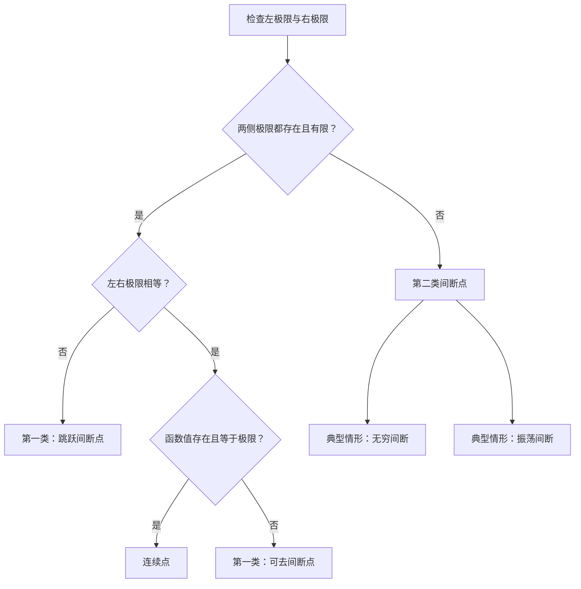
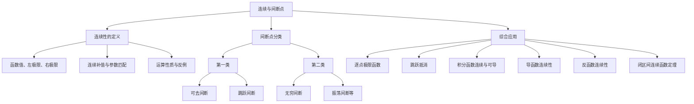

## 一、本节知识体系与考研命题逻辑

连续与间断点看起来是一个比较简单的章节，但它实际上是连接**函数极限、导数、积分、中值定理**的重要枢纽。

这一节的核心，并不是单纯记住四种间断点的名称，而是掌握如何根据函数的局部行为，准确判断函数的性质。

本节重点包括以下题型：

| 题型            | 核心解题工具     | 学习优先级 |
| ------------- | ---------- | ----- |
| 连续补值          | 极限等于函数值    | ★★★★★ |
| 连续性确定参数       | 左右极限匹配     | ★★★★★ |
| 间断点分类与计数      | 定义域、单侧极限   | ★★★★★ |
| 绝对值、指数、幂指型间断点 | 分侧讨论、局部等价  | ★★★★★ |
| 逐点极限函数的连续性    | 先求极限函数，再判断 | ★★★★★ |
| 连续性命题辨析       | 充分必要条件、反例  | ★★★★  |
| 变上限积分与连续性     | 积分平均值、导数定义 | ★★★★★ |
| 导函数的连续性       | 分点求导、振荡控制  | ★★★★  |
| 反函数与连续性       | 单调性、反函数求导  | ★★★   |

其中最值得深入研究的是三个综合模型：

- **奇点定位—局部展开—间断点分类。**
- **逐点极限—分段表达式—连续性判断。**
- **原函数间断—积分平滑—导数连续性。**

这三个模型涵盖了本节大部分中高难度题目。

## 二、基础知识：从本质理解连续性

### 2.1 什么叫函数在一点连续？

设函数 $f(x)$ 在 $x_0$ 的某个邻域内有定义。如果

$$
\boxed{\lim_{x\to x_0}f(x)=f(x_0)}
$$

则称 $f(x)$ 在 $x=x_0$ 处连续。

直观上，连续意味着：当自变量发生充分小的变化时，函数值也只发生很小的变化。

令

$$
\Delta x=x-x_0,\qquad \Delta y=f(x_0+\Delta x)-f(x_0)
$$

那么连续性也可以表示为

$$
\lim_{\Delta x\to0}\Delta y=0.
$$

严格的定义是：对于任意 $\varepsilon>0$，都存在 $\delta>0$，使得当

$$
|x-x_0|<\delta
$$

时，有

$$
|f(x)-f(x_0)|<\varepsilon.
$$

**连续性的三个必要条件**

判断 $f(x)$ 在 $x_0$ 处连续，必须同时检查：

1. $f(x_0)$ 存在；
2. $\displaystyle\lim_{x\to x_0}f(x)$ 存在且有限；
3. 极限值等于函数值。

任何一个条件不满足，都不能称为连续。

在具体解题时，最重要的是下面这个等价关系：

$$
\boxed{ f(x)\text{ 在 }x_0\text{ 连续} \iff f(x_0-0)=f(x_0)=f(x_0+0) }
$$

其中左右极限记作

$$
L_-=\lim_{x\to x_0^-}f(x),\qquad L_+=\lim_{x\to x_0^+}f(x).
$$

以后遇到复杂的分段函数，始终把这三个量分开计算。

### 2.2 函数值与极限的本质区别

考虑以下函数：

$$
f(x)= \begin{cases} \dfrac{\sin x}{x},&x\ne0,\\ a,&x=0. \end{cases}
$$

无论 $a$ 取什么值，都有

$$
\lim_{x\to0}f(x)=1.
$$

但是

$$
f(0)=a.
$$

因此：

- $a=1$：连续；
- $a\ne1$：可去间断。

这说明，**改变某一点的函数值，不会改变该点处的极限，却可能改变该点的连续性。**

极限描述的是点附近的行为，函数值描述的是点本身的取值，连续性要求两者相互吻合。

这一思想将在后面的积分函数可导性题目中发挥重要作用。

### 2.3 连续函数的运算性质

设 $f(x),g(x)$ 在 $x_0$ 处连续，则下列函数也在 $x_0$ 处连续：

| 运算                       | 结论或条件                         |
| ------------------------ | ----------------------------- |
| $f(x)\pm g(x)$       | 连续                            |
| $f(x)g(x)$           | 连续                            |
| $\dfrac{f(x)}{g(x)}$ | 当 $g(x_0)\ne0$ 时连续        |
| $\lvert f(x)\rvert$  | 连续                            |
| $[f(x)]^n$（正整数次幂）    | 连续                            |
| $g(f(x))$            | $g$ 在 $f(x_0)$ 处连续时成立 |

特别注意复合函数连续性的条件：

$$
\begin{aligned} &f(x)\text{ 在 }x_0\text{ 连续},\\ &g(u)\text{ 在 }u=f(x_0)\text{ 连续} \end{aligned}
$$

才能推出

$$
g(f(x))\text{ 在 }x_0\text{ 连续}.
$$

并不是要求 $g$ 在 $x_0$ 处连续。

**初等函数连续性定理**

基本初等函数在其定义域内连续，初等函数在其定义区间内连续。

这是考研间断点题目中快速定位候选点的理论依据。

例如

$$
f(x)=\frac{\ln|x|}{x-1}
$$

不必研究每一个实数点的连续性，只需要检查

$$
x=0,\qquad x=1.
$$

因为在其他点附近，函数由正常的连续初等函数通过合法运算构成。

不过，**连续函数的运算性质通常不能直接反推**。两个间断函数的和或积可能连续，一个间断函数取绝对值之后也可能连续。

### 2.4 连续函数的局部性质

**局部有界性**

若 $f(x)$ 在 $x_0$ 连续，则存在 $x_0$ 的某个邻域，使得其中的函数值有界。

反之不成立，例如 $\sin(1/x)$ 在零点附近有界，但没有极限。

**局部保号性**

若 $f(x)$ 在 $x_0$ 连续，且

$$
f(x_0)>0,
$$

那么存在充分小的邻域，使得其中

$$
f(x)>0.
$$

若 $f(x_0)<0$，结论类似。

一个非常重要的推论是：

$$
f(x_0)\ne0 \Longrightarrow \frac1{f(x)} \text{ 在 }x_0\text{ 附近有定义且在 }x_0\text{ 连续}.
$$

这为连续性逆向证明提供了工具。

### 2.5 闭区间上连续函数的重要性质

这些定理在第三模块的证明题中还会进一步使用，本节先建立联系。

| 定理      | 适用条件与结论                                    |
| ------- | ------------------------------------------ |
| 有界性定理   | 在闭区间上连续，则在该区间有界                            |
| 最大最小值定理 | 在闭区间上连续，则一定能取得最大值和最小值                      |
| 介值定理    | 连续函数可以取得两个函数值之间的任意值                        |
| 零点定理    | 在 $[a,b]$ 连续且 $f(a)f(b)<0$，则存在内部零点 |

要特别注意闭区间条件。例如

$$
f(x)=\frac1x,\qquad x\in(0,1)
$$

虽然在开区间内连续，却无上界。

另外，零点定理保证的是零点的存在性，不保证唯一性。若需要证明零点唯一，通常还要结合严格单调性。

## 三、间断点的完整分类体系

### 3.1 四种典型间断点

间断点最重要的分类依据，不是函数值，而是**左右极限是否存在且有限**。

| 类型    | 左右极限情况           | 典型函数在 $0$ 处的表现      |
| ----- | ---------------- | ----------------------- |
| 可去间断点 | 都有限且相等，但函数值缺失或不等 | $\dfrac{\sin x}{x}$ |
| 跳跃间断点 | 都有限但不相等          | $\dfrac{x}{\lvert x\rvert }$  |
| 无穷间断点 | 至少一侧趋于无穷         | $\dfrac1x$          |
| 振荡间断点 | 至少一侧因振荡而没有极限     | $\sin\dfrac1x$      |

其中：

$$
\boxed{ \text{第一类间断点} = \text{可去间断点}+\text{跳跃间断点} }
$$

$$
\boxed{ \text{第二类间断点} = \text{至少一侧不存在有限极限的间断点} }
$$

无穷间断与振荡间断是考研中最常见的第二类间断点。

### 3.2 四种间断点的直观理解

**可去间断点：曲线在局部只缺少一个正确的点。**

例如

$$
f(x)=\frac{x^2-1}{x-1},\qquad x\ne1.
$$

约分后得到

$$
f(x)=x+1,\qquad x\ne1.
$$

虽然曲线的其他部分是一条直线，但在 $x=1$ 处仍然缺少一个点。补充定义

$$
f(1)=2
$$

就能使函数连续。

**跳跃间断点：左右两边无法连接到同一个高度。**

例如

$$
f(x)=\frac{x}{|x|}.
$$

左右极限分别为

$$
L_-=-1,\qquad L_+=1.
$$

无论怎样定义 $f(0)$，都不可能同时满足两侧的连续性要求。

**无穷间断点：至少一侧函数值趋于无穷。**

例如

$$
f(x)=\frac1{x^2}.
$$

两侧都趋于正无穷，因此不存在有限极限。

**振荡间断点：函数在该点附近反复变化，无法趋近确定值。**

例如

$$
f(x)=\sin\frac1x.
$$

选取两组趋于零的正数：

$$
x_n=\frac1{2n\pi+\pi/2},
$$

$$
y_n=\frac1{2n\pi+3\pi/2}.
$$

则

$$
f(x_n)=1,\qquad f(y_n)=-1.
$$

由此证明其右极限不存在。

这也是利用海涅定理证明极限不存在的一种标准方法。

### 3.3 最容易混淆的五个问题

| 错误认识            | 正确认识             |
| --------------- | ---------------- |
| 左右极限不相等就是第二类间断  | 若两侧都有限，则是第一类跳跃间断 |
| 函数在该点没有定义就是无穷间断 | 可能是任意一种间断点       |
| 函数值存在就不是间断点     | 函数值存在仍可能间断       |
| 约分之后连续，原函数也连续   | 约分不能自动扩大原定义域     |
| 一侧极限有限就属于第一类间断  | 第一类要求两侧都具有有限极限   |

还要注意，不能把所有定义域外的点都称为间断点。例如 $\ln x$ 在 $x=-2$ 附近根本没有实数函数值，不能将每一个负数都计为间断点。

考研中常讨论的是函数有定义的邻域中出现的奇点、孤立缺失点及适当的定义域边界。闭区间端点的连续性则通过相应的单侧极限判断。

## 四、间断点题目的通用解题方法

### 4.1 第一步：找全候选间断点

这是许多复杂间断点计数题的决定性步骤。

| 函数结构                      | 优先检查的位置                |
| ------------------------- | ---------------------- |
| $\dfrac{P(x)}{Q(x)}$  | $Q(x)=0$           |
| $\ln\lvert u(x)\rvert $         | $u(x)=0$           |
| $\tan u(x)$           | $\cos u(x)=0$      |
| $\dfrac1{\tan u(x)}$  | 正切零点及正切无定义点            |
| $e^{1/u(x)}$          | $u(x)=0$           |
| $u(x)^{v(x)}$         | 底数定义域异常点、指数异常点         |
| 分段函数                      | 所有分段交界点                |
| $\lfloor u(x)\rfloor$ | $u(x)$ 取整数的位置及其他奇点 |
| 逐点极限函数                    | 求出极限表达式后检查分界点          |
| 变上限积分作分母                  | 积分函数的零点                |

绝对值函数本身是连续函数，因此绝对值内部为零并不必然产生间断点。但绝对值出现在分母中，或者与同阶无穷小相除时，就要特别留意。

### 4.2 第二步：保留定义域并化简

例如

$$
\frac{x^2-x}{|x|(x^2-1)} =\frac{x}{|x|(x+1)}.
$$

虽然右侧表达式在 $x=1$ 可以计算，但左侧原式不能。

所以应写成

$$
\frac{x^2-x}{|x|(x^2-1)} = \frac{x}{|x|(x+1)}, \qquad x\ne-1,0,1.
$$

**先记录定义域，再进行化简。**

### 4.3 第三步：利用局部化分析

在考察 $x=a$ 时，令

$$
h=x-a,\qquad h\to0.
$$

将复杂表达式转化成几个简单因素的乘积。

例如

$$
f(x)\sim C\frac{h^m}{|h|^n}, \qquad C\ne0,
$$

其中 $m,n$ 为非负整数。

此时：

| 条件                      | 极限情况              |
| ----------------------- | ----------------- |
| $m>n$               | 趋于零               |
| $m=n$，且 $m$ 为偶数 | 两侧都趋于 $C$     |
| $m=n$，且 $m$ 为奇数 | 两侧分别趋于 $-C,C$ |
| $m<n$              | 至少一侧趋于无穷          |

再结合函数在该点是否有定义，便可以完成连续性和间断点分类。

这是一套非常高效的**阶数与符号联合判定法**。

### 4.4 必须熟练掌握的局部极限工具

当 $h\to0$ 时：

$$
\sin h\sim h,\qquad \tan h\sim h,
$$

$$
\ln(1+h)\sim h,\qquad e^h-1\sim h,
$$

$$
1-\cos h\sim\frac{h^2}{2},
$$

$$
h-\arcsin h\sim-\frac{h^3}{6},
$$

$$
e^h-1-h\sim\frac{h^2}{2}.
$$

对于任意 $p>0$，还有

$$
\lim_{h\to0}|h|^p\ln|h|=0,
$$

$$
\lim_{h\to0^+}h^{-p}e^{-1/h}=0.
$$

这些体现了常见的增长速度关系：

$$
\text{对数增长慢于幂函数，幂函数增长慢于指数函数}.
$$

此外，下面三个具有方向性的模型必须记熟：

| 表达式                                | $x\to0^-$     | $x\to0^+$    |
| ---------------------------------- | ----------------- | ---------------- |
| $\dfrac{x}{\lvert x\rvert }$             | $-1$          | $1$          |
| $e^{1/x}$                      | $0$           | $+\infty$    |
| $\arctan\dfrac1x$              | $-\dfrac\pi2$ | $\dfrac\pi2$ |
| $\dfrac{e^{1/x}-1}{e^{1/x}+1}$ | $-1$          | $1$          |
| $\dfrac1{1+e^{1/x}}$           | $1$           | $0$          |

复杂间断点问题往往只是这几种基本结构的叠加、抵消或复合。

## 五、题型一：连续补值与参数确定

这一题型将上一节《极限中参数的确定》与本节的连续性定义结合起来。

### 5.1 母题：连续、可去间断与参数分类

**2003年考研数学二真题**

设

$$
f(x)= \begin{cases} \dfrac{\ln(1+ax^3)}{x-\arcsin x},&x<0,\\[6pt] 6,&x=0,\\[6pt] \dfrac{e^{ax}+x^2-ax-1}{x\sin\frac{x}{4}},&x>0. \end{cases}
$$

求：

（1）$a$ 为何值时，$f(x)$ 在 $x=0$ 处连续？

（2）$a$ 为何值时，$x=0$ 是 $f(x)$ 的可去间断点？

**题型识别**

看到三个分段以及两个不同的问法，就应当立即写出：

$$
\begin{cases} L_-=L_+=6,&\text{连续},\\ L_-=L_+\ne6,&\text{可去间断}. \end{cases}
$$

先求极限，再讨论参数，不要一开始就把两侧极限都等于6。

<Steps>

<Step>

### 第一步：计算左极限 [!toc]

分母存在一阶项抵消，需要展开到三阶。

$$
\arcsin x=x+\frac{x^3}{6}+o(x^3).
$$

因此

$$
x-\arcsin x=-\frac{x^3}{6}+o(x^3).
$$

同时

$$
\ln(1+ax^3)=ax^3+o(x^3).
$$

所以

$$
L_-= \lim_{x\to0^-} \frac{ax^3+o(x^3)} {-\frac16x^3+o(x^3)} =-6a.
$$

这里使用泰勒展开而不是直接写 $\ln(1+ax^3)\sim ax^3$，还能避免 $a=0$ 时的等价关系失效问题。

</Step>

<Step>

### 第二步：计算右极限 [!toc]

因为

$$
e^{ax}=1+ax+\frac{a^2x^2}{2}+o(x^2),
$$

所以

$$
e^{ax}+x^2-ax-1 =\left(1+\frac{a^2}{2}\right)x^2+o(x^2).
$$

分母满足

$$
x\sin\frac{x}{4}\sim\frac{x^2}{4}.
$$

故

$$
L_+=4+2a^2.
$$

</Step>

<Step>

### 第三步：建立匹配方程 [!toc]

若要求左右极限相等，则

$$
-6a=4+2a^2.
$$

化简得到

$$
a^2+3a+2=0,
$$

即

$$
(a+1)(a+2)=0.
$$

分别检验：

| 参数         | 左极限       | 函数值 | 右极限          | 结论   |
| ---------- | --------- | --- | ------------ | ---- |
| $a=-1$ | 6         | 6   | 6            | 连续   |
| $a=-2$ | 12        | 6   | 12           | 可去间断 |
| 其他 $a$ | $-6a$ | 6   | $4+2a^2$ | 跳跃间断 |

因此答案为

$$
\boxed{a=-1\text{ 时连续}}
$$

$$
\boxed{a=-2\text{ 时可去间断}}
$$

</Step>

</Steps>

**从这道题提炼通用方法**

对于

$$
f(x)= \begin{cases} P(x,a),&x<x_0,\\ c,&x=x_0,\\ Q(x,a),&x>x_0, \end{cases}
$$

先分别求出

$$
L_-(a),\qquad L_+(a).
$$

然后按题意列条件：

| 题目要求     | 对应的数学条件                  |
| -------- | ------------------------ |
| 连续       | $L_-=L_+=c$        |
| 可去间断     | $L_-=L_+\ne c$，均有限 |
| 跳跃间断     | $L_-\ne L_+$，均有限   |
| 第一类间断    | 两侧均有限，但原函数不连续            |
| 第二类间断    | 至少一侧没有有限极限               |
| 可以通过补值连续 | 两侧有限且相等                  |

这比记住任何一道具体题目的参数答案都重要。

### 5.2 进阶母题：通过消除低阶项获得可去间断点

**李永乐六套卷·模拟三·第1题**

设

$$
f(x)=\frac{e^{ax}-(1+x)^b-x}{x^3}, \qquad x>-1,\quad x\ne0.
$$

若 $x=0$ 是可去间断点，求 $ab$。

**识别关键**

分母是三阶无穷小，要使商的极限有限，分子至少要达到三阶。

因此：

**消除分子中所有低于三阶的非零项。**

利用泰勒公式：

$$
e^{ax} =1+ax+\frac{a^2}{2}x^2 +\frac{a^3}{6}x^3+o(x^3),
$$

$$
\begin{aligned} (1+x)^b ={}&1+bx+\frac{b(b-1)}2x^2\\ &+\frac{b(b-1)(b-2)}6x^3+o(x^3). \end{aligned}
$$

相减得到

$$
\begin{aligned} N(x) ={}&(a-b-1)x\\ &+\frac{a^2-b(b-1)}2x^2\\ &+\frac{a^3-b(b-1)(b-2)}6x^3\\ &+o(x^3). \end{aligned}
$$

若一次项不为零，商将出现 $1/x^2$ 型发散；若一次项为零但二次项不为零，则出现 $1/x$ 型发散。

因此必须满足

$$
\begin{cases} a-b-1=0,\\ a^2-b(b-1)=0. \end{cases}
$$

将 $a=b+1$ 代入，得到

$$
(b+1)^2=b(b-1),
$$

即

$$
3b+1=0.
$$

所以

$$
b=-\frac13,\qquad a=\frac23.
$$

最终

$$
\boxed{ab=-\frac29}.
$$

若继续检查三阶项，可得

$$
\lim_{x\to0}f(x)=\frac29.
$$

原函数在零点没有定义，故确实属于可去间断点。

**推广：泰勒系数匹配法**

对于一般形式

$$
f(x)= \frac{c_0+c_1x+c_2x^2+\cdots+c_mx^m+o(x^m)} {x^m}, \qquad x\ne0,
$$

若要求在零点存在有限极限，则必须满足

$$
\boxed{c_0=c_1=\cdots=c_{m-1}=0}.
$$

此时

$$
\lim_{x\to0}f(x)=c_m.
$$

若进一步要求补值后连续，还要令

$$
f(0)=c_m.
$$

这套方法不仅能处理连续性，也能处理无穷小阶数、极限参数确定以及高阶导数问题。

### 5.3 母题：无穷大量相减后的连续补值

**张宇1000题·第一章·第019题**

设

$$
f(x)=\frac{e^x+xe^x}{e^x-1}-\frac1x.
$$

若要补充定义，使函数在 $x=0$ 处连续，求 $f(0)$。

<Tabs items={["方法一：先通分，再展开", "方法二：分别保留常数项"]} defaultIndex={0}>

<Tab value="方法一：先通分，再展开">

$$
f(x)= \frac{xe^x+x^2e^x-e^x+1} {x(e^x-1)}.
$$

分母满足

$$
x(e^x-1)=x^2+o(x^2).
$$

而分子可以写成

$$
1+(x+x^2-1)e^x.
$$

展开到二阶：

$$
\begin{aligned} 1+(x+x^2-1)e^x &=1+(x+x^2-1) \left(1+x+\frac{x^2}{2}+o(x^2)\right)\\ &=\frac32x^2+o(x^2). \end{aligned}
$$

故

$$
\lim_{x\to0}f(x)=\frac32.
$$

连续补值为

$$
\boxed{f(0)=\frac32}.
$$

</Tab>

<Tab value="方法二：分别保留常数项">

利用

$$
e^x-1=x\left(1+\frac x2+O(x^2)\right)
$$

以及

$$
e^x(1+x)=1+2x+O(x^2),
$$

得到

$$
\frac{e^x(1+x)}{e^x-1} =\frac1x \frac{1+2x+O(x^2)} {1+\frac x2+O(x^2)}.
$$

根据

$$
\frac1{1+u}=1-u+O(u^2),
$$

可得

$$
\frac{e^x(1+x)}{e^x-1} =\frac1x+\frac32+O(x).
$$

减去 $1/x$，得到同样的极限。

</Tab>

</Tabs>

**需要吸收的思想**

遇到

$$
\frac{A(x)}{B(x)}-\frac{C(x)}{D(x)}
$$

这种无穷大量相减结构时，不能根据各项分别趋于无穷，就断言函数存在无穷间断点。

通常优先考虑通分，或者精确展开到抵消后的首个非零项。

## 六、题型二：间断点的分类与计数

这是本节最典型、最应当熟练掌握的一类考研选择题。

### 6.1 基础母题：一个函数同时出现三种间断点

**李正元练习题·第一章·第008题**

设

$$
f(x)=\frac{x^2-x}{|x|(x^2-1)}.
$$

讨论其间断点及类型。

<Steps>

<Step>

### 第一步：保留原始定义域 [!toc]

分母为零的点是

$$
x=-1,\quad x=0,\quad x=1.
$$

因此

$$
D_f=\mathbb R\setminus\{-1,0,1\}.
$$

</Step>

<Step>

### 第二步：约分 [!toc]

$$
\begin{aligned} f(x) &=\frac{x(x-1)} {|x|(x-1)(x+1)}\\ &=\frac{x}{|x|}\cdot\frac1{x+1}. \end{aligned}
$$

等价地，

$$
f(x)= \begin{cases} -\dfrac1{x+1},&x<0,\ x\ne-1,\\[5pt] \dfrac1{x+1},&x>0,\ x\ne1. \end{cases}
$$

</Step>

<Step>

### 第三步：逐点分析 [!toc]

在 $x=1$ 处：

$$
\lim_{x\to1}f(x)=\frac12.
$$

原函数无定义，因此是可去间断点。

在 $x=0$ 处：

$$
\lim_{x\to0^-}f(x)=-1, \qquad \lim_{x\to0^+}f(x)=1.
$$

因此是跳跃间断点。

在 $x=-1$ 处：

$$
\lim_{x\to-1^-}f(x)=+\infty, \qquad \lim_{x\to-1^+}f(x)=-\infty.
$$

因此是无穷间断点。

</Step>

</Steps>

**汇总**

| 位置       | 左极限           | 右极限           | 类型 |
| -------- | ------------- | ------------- | -- |
| $-1$ | $+\infty$ | $-\infty$ | 无穷 |
| $0$  | $-1$      | $1$       | 跳跃 |
| $1$  | $\frac12$ | $\frac12$ | 可去 |

所以共有两个第一类间断点，一个第二类间断点。

**真题迁移：2010年考研数学二**

题目改为

$$
f(x)=\frac{x^2-x}{x^2-1} \sqrt{1+\frac1{x^2}}.
$$

由于

$$
\sqrt{1+\frac1{x^2}} =\frac{\sqrt{1+x^2}}{|x|},
$$

所以

$$
f(x)= \frac{x}{|x|} \frac{\sqrt{1+x^2}}{x+1}.
$$

新的因子 $\sqrt{1+x^2}$ 处处连续且非零，因此不会改变上述三个点的间断类型。

结论仍然是：

$$
\boxed{ -1\text{ 无穷},\quad 0\text{ 跳跃},\quad 1\text{ 可去} }
$$

这两道题实际上是同一道母题的不同外观。

### 6.2 母题：无穷多个候选间断点如何计数？

**2009年考研数学真题**

求函数

$$
f(x)=\frac{x-x^3}{\sin\pi x}
$$

的可去间断点个数。

<Steps>

<Step>

### 第一步：寻找分母零点 [!toc]

$$
\sin\pi x=0 \iff x=k,\qquad k\in\mathbb Z.
$$

因此候选间断点有无穷多个。

但这并不意味着可去间断点有无穷多个。

</Step>

<Step>

### 第二步：寻找分子与分母的公共零点 [!toc]

$$
x-x^3=x(1-x)(1+x).
$$

分子只在

$$
x=-1,0,1
$$

三个点为零。

其他整数点处分子趋于非零常数，而分母趋于零，因而为无穷间断点。

</Step>

<Step>

### 第三步：比较公共零点的阶数 [!toc]

对于 $a\in\{-1,0,1\}$，使用洛必达法则：

$$
\lim_{x\to a}\frac{x-x^3}{\sin\pi x} = \frac{1-3a^2}{\pi\cos\pi a}.
$$

分别得到

$$
L_{-1}=\frac2\pi,\qquad L_0=\frac1\pi,\qquad L_1=\frac2\pi.
$$

三个极限均存在且有限，因此答案为

$$
\boxed{3}.
$$

</Step>

</Steps>

**推广：零点重数判定法**

设在 $x=a$ 附近

$$
P(x)=(x-a)^mp(x),
$$

$$
Q(x)=(x-a)^nq(x),
$$

且

$$
p(a)q(a)\ne0,\qquad n>0.
$$

则在去心邻域内

$$
\frac{P(x)}{Q(x)} =(x-a)^{m-n}\frac{p(x)}{q(x)}.
$$

分类规律如下：

| 分子与分母的消失阶数 | 结论        |
| ---------- | --------- |
| $m>n$  | 极限为0，可去   |
| $m=n$  | 极限有限非零，可去 |
| $m<n$ | 无穷间断      |

注意：如果含绝对值，就还要检查符号，不能只比较阶数。

### 6.3 母题：指数函数产生的跳跃与无穷间断

**2005年考研数学二真题**

设

$$
f(x)=\frac1{e^{\frac{x}{x-1}}-1}.
$$

判断 $x=0$ 和 $x=1$ 的间断类型。

**分析 $x=0$**

当 $x\to0$ 时，

$$
\frac{x}{x-1}\sim-x.
$$

利用

$$
e^u-1\sim u,
$$

得到

$$
f(x)\sim-\frac1x.
$$

所以

$$
L_-=+\infty,\qquad L_+=-\infty.
$$

属于第二类无穷间断点。

**分析 $x=1$**

此时不能使用 $e^u-1\sim u$，因为指数 $u$ 并不趋于零。

必须左右分别讨论：

当 $x\to1^-$ 时，

$$
\frac{x}{x-1}\to-\infty,
$$

从而

$$
e^{\frac{x}{x-1}}\to0, \qquad f(x)\to-1.
$$

当 $x\to1^+$ 时，

$$
\frac{x}{x-1}\to+\infty,
$$

从而

$$
e^{\frac{x}{x-1}}\to+\infty, \qquad f(x)\to0.
$$

两侧有限但不相等，因此属于第一类跳跃间断点。

答案：

$$
\boxed{ x=0\text{ 为第二类间断点}, \quad x=1\text{ 为第一类间断点} }
$$

**解题方法：内外层逐级分析**

对于指数复合结构，先求指数的极限，再求指数函数的极限，最后求整个表达式的极限。

例如

$$
u(x)\to+\infty
$$

并不能直接推出整个函数趋于无穷，因为外层还可能是

$$
\frac1{1+e^{u(x)}}\to0.
$$

这是考研常用的迷惑方式。

### 6.4 母题：对数、绝对值与指数增长综合

**2020年考研数学真题**

设

$$
f(x)= \frac{e^{1/x}\ln|1+x|} {(e^x-1)(x-2)}.
$$

求第二类间断点的个数。

<Steps>

<Step>

### 第一步：寻找全部候选点 [!toc]

由各个子表达式的定义条件得到：

$$
\ln|1+x|\Longrightarrow x=-1,
$$

$$
e^{1/x}\Longrightarrow x=0,
$$

$$
e^x-1=0\Longrightarrow x=0,
$$

$$
x-2=0\Longrightarrow x=2.
$$

所以只需要研究

$$
\boxed{x=-1,0,2}.
$$

</Step>

<Step>

### 第二步：逐点局部分析 [!toc]

在 $x=-1$ 处，

$$
\ln|1+x|\to-\infty,
$$

而其他因子均趋于有限非零值，所以

$$
f(x)\to-\infty.
$$

属于第二类间断点。

在 $x=2$ 处，分子趋于

$$
e^{1/2}\ln3\ne0,
$$

而分母中的 $x-2\to0$，所以也是无穷间断点。

在 $x=0$ 处，需要重点处理：

$$
f(x)= \frac{\ln(1+x)}{e^x-1} \cdot\frac{e^{1/x}}{x-2}.
$$

其中

$$
\frac{\ln(1+x)}{e^x-1}\to1.
$$

故在零点附近

$$
f(x)\sim-\frac12e^{1/x}.
$$

于是

$$
\lim_{x\to0^-}f(x)=0,
$$

$$
\lim_{x\to0^+}f(x)=-\infty.
$$

尽管左极限有限，但右极限无穷，仍是第二类间断点。

最终答案：

$$
\boxed{3}.
$$

</Step>

</Steps>

**这一类题的考试技巧**

如果题目只问第二类间断点个数，一旦证明某个候选点的一侧趋于无穷，就已经足够完成分类。

不必为了形式完整，在选择题中耗费大量时间计算另一侧极限。

## 七、题型三：幂指函数的连续性与间断点

幂指函数是连续性与间断点的综合考查模型。

统一的处理方式是：

$$
\boxed{ u(x)^{v(x)} =\exp\big(v(x)\ln u(x)\big) }
$$

前提是在所考察的去心邻域或单侧邻域内，$u(x)>0$。

设

$$
H(x)=v(x)\ln u(x).
$$

则原函数的极限完全由 $H(x)$ 决定。

| 指数 $H(x)$ 的极限   | 原函数极限         |
| ------------------- | ------------- |
| $A\in\mathbb R$ | $e^A$     |
| $+\infty$       | $+\infty$ |
| $-\infty$       | $0$       |

### 7.1 重点真题：底数为零与指数无定义同时出现

**2024年考研数学二真题**

设

$$
f(x)=|x|^{\frac1{(1-x)(x-2)}}.
$$

求第一类间断点的个数。

<Steps>

<Step>

### 第一步：寻找候选点 [!toc]

底数为零的位置：

$$
x=0.
$$

指数分母为零的位置：

$$
x=1,\quad x=2.
$$

因此研究三点即可。

令

$$
H(x)=\frac{\ln|x|}{(1-x)(x-2)}.
$$

在原定义域内

$$
f(x)=e^{H(x)}.
$$

</Step>

<Step>

### 第二步：分析 $x=0$ [!toc]

此时

$$
\ln|x|\to-\infty,
$$

$$
(1-x)(x-2)\to-2.
$$

所以

$$
H(x)\to+\infty,
$$

从而

$$
f(x)\to+\infty.
$$

因此 $0$ 是无穷间断点。

</Step>

<Step>

### 第三步：分析 $x=1$ [!toc]

令 $h=x-1$，则

$$
\ln|x|=\ln(1+h)\sim h.
$$

同时

$$
(1-x)(x-2) =(-h)(h-1) =h(1-h).
$$

因此

$$
\lim_{x\to1}H(x) = \lim_{h\to0} \frac{\ln(1+h)}{h(1-h)} =1.
$$

所以

$$
\lim_{x\to1}f(x)=e.
$$

原函数在 $1$ 无定义，故是可去间断点。

</Step>

<Step>

### 第四步：分析 $x=2$ [!toc]

由于

$$
\ln|x|\to\ln2>0,
$$

所以只需要判断分母符号。

当 $x\to2^-$ 时，

$$
(1-x)(x-2)\to0^+,
$$

从而

$$
H(x)\to+\infty,\qquad f(x)\to+\infty.
$$

当 $x\to2^+$ 时，

$$
H(x)\to-\infty,\qquad f(x)\to0.
$$

因此 $2$ 是第二类间断点。

最终答案为

$$
\boxed{1}.
$$

</Step>

</Steps>

**这道题的价值**

同一个幂指表达式，在三个候选点附近分别表现为：

$$
+\infty,\qquad e,\qquad 0\text{ 与 }+\infty.
$$

这说明不能根据原式的外观判断间断类型，必须进行逐点局部分析。

### 7.2 同源进阶题：张宇1000题

**张宇1000题·第一章·第060题**

求

$$
f(x)=|x-1|^{\frac1{x(2-x)}}
$$

的第二类间断点个数。

同样考察

$$
H(x)=\frac{\ln|x-1|}{x(2-x)}.
$$

候选点为 $0,1,2$。

当 $x\to0$ 时，

$$
H(x)\sim\frac{-x}{2x}=-\frac12.
$$

因此

$$
\lim_{x\to0}f(x)=e^{-1/2}.
$$

所以 $0$ 可去。

当 $x\to1$ 时，

$$
\frac1{x(2-x)}\to1>0, \qquad |x-1|\to0,
$$

故

$$
\lim_{x\to1}f(x)=0.
$$

而原式在 $x=1$ 处为 $0^1=0$，因此此处连续。

当 $x\to2$ 时，令 $h=x-2$，则

$$
H(x)= \frac{\ln(1+h)}{-(2+h)h} \to-\frac12.
$$

所以 $2$ 也是可去间断点。

答案：

$$
\boxed{0}.
$$

**与2024年真题对比**

| 函数                                             | $x=0$ | $x=1$ | $x=2$ |
| ---------------------------------------------- | --------- | --------- | --------- |
| $\displaystyle \lvert x\rvert ^{\frac1{(1-x)(x-2)}}$ | 无穷        | 可去        | 无穷        |
| $\displaystyle \lvert x-1\rvert ^{\frac1{x(2-x)}}$   | 可去        | 连续        | 可去        |

尤其注意：

**底数为零不一定意味着函数无定义。**

当指数为正数时，零底数完全可能对应一个连续点；当指数为负数时，则需要警惕无穷间断。

### 7.3 母题：幂指商与标准极限因子的提取

**2013年考研数学三真题｜张宇1000题第021题**

设

$$
f(x)=\frac{|x|^x-1}{x(x+1)\ln|x|}.
$$

求可去间断点个数。

首先保留原定义域：

$$
x\ne-1,0,1.
$$

令

$$
u=x\ln|x|.
$$

则

$$
|x|^x=e^u.
$$

原式化为

$$
f(x)= \frac{e^u-1}{u}\cdot\frac1{x+1}.
$$

注意当 $x\to-1,0,1$ 时，都有

$$
u=x\ln|x|\to0.
$$

所以标准极限因子

$$
\frac{e^u-1}{u}\to1.
$$

于是分类只取决于剩下的

$$
\frac1{x+1}.
$$

得到

$$
\lim_{x\to0}f(x)=1,
$$

$$
\lim_{x\to1}f(x)=\frac12.
$$

而 $x=-1$ 为无穷间断点。

因此

$$
\boxed{2}.
$$

这种把复杂函数拆解成“趋于非零常数的标准因子”和“决定奇点性质的剩余因子”的方法，值得反复训练。

## 八、题型四：逐点极限函数的连续性

这是本节最容易出现思维错误的题型之一，也是2024年真题和多份模拟题共同关注的方向。

典型题目给出

$$
f(x)=\lim_{n\to\infty}f_n(x),
$$

要求讨论 $f(x)$ 的连续性。

这类题有两个不同的极限过程：

$$
\lim_{n\to\infty}f_n(x)
$$

以及

$$
\lim_{x\to x_0}f(x).
$$

必须先完成第一个极限，求出 $f(x)$ 的表达式，再研究第二个极限。

不能擅自交换极限顺序。

### 8.1 基础模型：指数项的分段极限

$$
\lim_{n\to\infty}x^{2n} = \begin{cases} 0,&|x|<1,\\ 1,&|x|=1,\\ +\infty,&|x|>1. \end{cases}
$$

若多出一个因子 $n$，则

$$
\lim_{n\to\infty}nx^{2n} = \begin{cases} 0,&|x|<1,\\ +\infty,&|x|\ge1. \end{cases}
$$

这里利用了指数衰减快于多项式增长。

进一步，一般地，对于 $p>0$，

$$
\lim_{n\to\infty}n^p|x|^n = \begin{cases} 0,&|x|<1,\\ +\infty,&|x|\ge1. \end{cases}
$$

因此看到 $x^{2n}$、$nx^{2n}$ 等结构，应自然联想到 $|x|=1$ 这一临界位置。

### 8.2 重点真题：逐点极限的经典母题

**2024年考研数学三真题**

设

$$
f(x)= \lim_{n\to\infty} \frac{1+x}{1+nx^{2n}}.
$$

判断 $f(x)$ 在 $x=\pm1$ 处是否连续。

<Steps>

<Step>

### 第一步：固定 $x$，求数列极限 [!toc]

当 $|x|<1$ 时，

$$
nx^{2n}\to0,
$$

故

$$
f(x)=1+x.
$$

当 $|x|>1$ 时，

$$
nx^{2n}\to+\infty,
$$

故

$$
f(x)=0.
$$

当 $x=1$ 时，

$$
f(1)=\lim_{n\to\infty}\frac2{1+n}=0.
$$

当 $x=-1$ 时，

$$
f(-1)=0.
$$

所以

$$
\boxed{ f(x)= \begin{cases} 1+x,&|x|<1,\\ 0,&|x|\ge1. \end{cases} }
$$

</Step>

<Step>

### 第二步：重新考察函数极限 [!toc]

在 $x=-1$ 处：

$$
\lim_{x\to-1^-}f(x)=0,
$$

$$
\lim_{x\to-1^+}f(x) =\lim_{x\to-1^+}(1+x)=0.
$$

因为 $f(-1)=0$，所以连续。

在 $x=1$ 处：

$$
\lim_{x\to1^-}f(x)=2,
$$

$$
\lim_{x\to1^+}f(x)=0.
$$

所以 $x=1$ 是跳跃间断点。

最终结论：

$$
\boxed{ f(x)\text{ 在 }-1\text{ 处连续，在 }1\text{ 处间断} }
$$

</Step>

</Steps>

**与1998年真题比较**

1998年数学三曾考查

$$
g(x)=\lim_{n\to\infty} \frac{1+x}{1+x^{2n}}.
$$

这道题和2024年真题几乎具有相同的结构。

不同之处在于：

$$
g(1)=1,\qquad f(1)=0.
$$

然而两者在 $x=1$ 处的左右极限均为

$$
L_-=2,\qquad L_+=0.
$$

所以两道题在 $1$ 处均为跳跃间断。

**单点函数值发生变化，并不一定改变间断点的类型。** 对于跳跃间断，只要左右极限不等，无论如何修改该点函数值都不能恢复连续性。

### 8.3 模拟题：逐点极限与振荡间断结合

**李林六套卷·第二套·第1题**

设

$$
f(x)=\lim_{n\to\infty} \frac{2x^{2n}-1}{x^{2n}+1} \sin\frac1x.
$$

求第一类间断点个数。

<Steps>

<Step>

### 第一步：先记录原定义域 [!toc]

因为含有

$$
\sin\frac1x,
$$

所以 $x=0$ 无定义。

即使求完数列极限，也不能自动补上原点。

</Step>

<Step>

### 第二步：求极限函数 [!toc]

根据 $|x|$ 的大小讨论：

$$
f(x)= \begin{cases} -\sin\dfrac1x,&0<|x|<1,\\[5pt] \dfrac12\sin\dfrac1x,&|x|=1,\\[5pt] 2\sin\dfrac1x,&|x|>1. \end{cases}
$$

</Step>

<Step>

### 第三步：检查三个特殊点 [!toc]

在 $x=-1$ 处，

$$
L_-=-2\sin1,\qquad L_+=\sin1.
$$

左右极限有限但不等，因此是跳跃间断点。

在 $x=1$ 处，

$$
L_-=-\sin1,\qquad L_+=2\sin1.
$$

也是跳跃间断点。

在 $x=0$ 附近，

$$
f(x)=-\sin\frac1x.
$$

函数不断振荡，没有有限单侧极限，所以属于第二类间断点。

最终答案：

$$
\boxed{2}.
$$

</Step>

</Steps>

**迁移思考**

假如将题目中的

$$
\sin\frac1x
$$

换成

$$
x\sin\frac1x,
$$

那么 $x=0$ 附近的函数将受到因子 $x$ 的控制，极限变为0。

此时 $0$ 就成为可去间断点，而 $\pm1$ 仍为跳跃间断点。

第一类间断点的个数将变为

$$
\boxed{3}.
$$

这就是将原来的振荡间断点转化为可去间断点的典型手段：**利用趋于零的因子压制振荡幅度。**

### 8.4 高阶练习：逐点极限与连续性确定参数

**张宇1000题·第一章·第061题**

设

$$
f(x)=\lim_{n\to\infty} \frac{x^{n+1}+(1+\cos\pi x)\sin ax} {x^n+(1+\cos\pi x)}.
$$

若要求 $f(x)$ 在整个实数轴上连续，求 $a$ 的最小正值。

这道题将极限函数、三角函数、参数匹配三个考点结合起来。

记

$$
c(x)=1+\cos\pi x.
$$

当 $|x|<1$ 时，

$$
x^n\to0,\qquad c(x)>0,
$$

所以

$$
f(x)=\sin ax.
$$

当 $|x|>1$ 时，分子分母同时除以 $x^n$：

$$
f(x)=\lim_{n\to\infty} \frac{x+c(x)x^{-n}\sin ax} {1+c(x)x^{-n}}=x.
$$

即使 $x<-1$，由于 $x^{-n}\to0$，结论也成立。

当 $x=\pm1$ 时，

$$
c(\pm1)=0,
$$

故

$$
f(1)=1,\qquad f(-1)=-1.
$$

综上，

$$
f(x)= \begin{cases} \sin ax,&|x|<1,\\ x,&|x|\ge1. \end{cases}
$$

要求在 $1$ 连续，必须有

$$
\sin a=1.
$$

要求在 $-1$ 连续，必须有

$$
\sin(-a)=-1.
$$

两个条件等价。

所以

$$
a=\frac\pi2+2k\pi,\qquad k\in\mathbb Z.
$$

最小正值为

$$
\boxed{a=\frac\pi2}.
$$

**逐点极限题的固定模板**

遇到类似题目，遵循以下顺序：

1. 记录原表达式的定义条件。
2. 寻找决定数列极限行为的临界点。
3. 分区间计算固定 $x$ 时的数列极限。
4. 将临界点单独代入原式。
5. 写出完整的极限函数。
6. 最后根据左右极限及函数值判断连续性。

做到这六步，就不会因为数列极限与函数极限的混淆而失分。

## 九、题型五：连续性的抽象命题与反例

这一部分主要考查逻辑，而非计算。

李正元练习题中的选择题，以及汤家凤模拟卷的命题判断题，都具有很好的训练价值。

### 9.1 连续性运算能否反推？

**1995年考研数学二真题｜李正元练习题第002题同源模型**

已知 $f(x)$ 在 $a$ 处连续，且

$$
f(a)\ne0,
$$

而 $\varphi(x)$ 在 $a$ 处间断。

判断下列函数是否必然在 $a$ 处间断：

$$
\varphi(f(x)),
$$

$$
f(\varphi(x)),
$$

$$
[\varphi(x)]^2,
$$

$$
\frac{\varphi(x)}{f(x)}.
$$

**正确结论**

只有

$$
\boxed{\frac{\varphi(x)}{f(x)}}
$$

一定在 $a$ 处间断。

**证明方法：反证法与可逆运算**

假设

$$
q(x)=\frac{\varphi(x)}{f(x)}
$$

在 $a$ 处连续。

因为 $f(x)$ 在 $a$ 连续且非零，所以

$$
\varphi(x)=q(x)f(x)
$$

在 $a$ 处也应该连续。

这与题设矛盾。

因此商函数必然间断。

**其他选项的反例**

以 $a=0$ 为例，取

$$
\varphi(x)= \begin{cases} -1,&x<0,\\ 1,&x\ge0. \end{cases}
$$

显然 $\varphi(x)$ 在零点跳跃。

但

$$
\varphi^2(x)\equiv1
$$

处处连续。

若再取

$$
f(x)\equiv1,
$$

则两个复合函数均为常函数，因此连续。

**最重要的推广**

若 $f(x)$ 在 $a$ 处连续，且 $\varphi(x)$ 在 $a$ 处间断，那么

$$
\boxed{f(x)+\varphi(x)\text{ 必间断}}.
$$

若进一步有 $f(a)\ne0$，则

$$
\boxed{f(x)\varphi(x)\text{ 必间断}},
$$

$$
\boxed{\frac{\varphi(x)}{f(x)}\text{ 必间断}}.
$$

原因都是可以通过连续运算恢复出原来的间断函数。

若取消 $f(a)\ne0$ 的条件，乘积未必间断。

例如

$$
f(x)=x,\qquad \varphi(x)= \begin{cases} -1,&x<0,\\ 1,&x\ge0, \end{cases}
$$

则

$$
f(x)\varphi(x)=|x|
$$

连续。

### 9.2 绝对值连续是否意味着原函数连续？

**李正元练习题·第一章·第003题**

若 $f(x)$ 在 $a$ 处连续，则由

$$
\big||f(x)|-|f(a)|\big| \le|f(x)-f(a)|
$$

可知 $|f(x)|$ 在 $a$ 处连续。

但反过来不成立。

例如

$$
f(x)= \begin{cases} -1,&x<a,\\ 1,&x\ge a, \end{cases}
$$

则 $f(x)$ 间断，而

$$
|f(x)|\equiv1
$$

连续。

所以

$$
f\text{ 连续}\Longrightarrow |f|\text{ 连续}
$$

是充分非必要条件。

**一个值得掌握的加强结论**

若已知

$$
f(a)=0,
$$

则

$$
|f(x)|\text{ 在 }a\text{ 连续}
$$

能够推出

$$
f(x)\text{ 在 }a\text{ 连续}.
$$

因为

$$
|f(x)-f(a)|=|f(x)|\to0.
$$

因此在增加 $f(a)=0$ 这一条件后，二者变成充要关系。

这正是未来创新选择题可能采用的变式思路：**改变一个关键条件，使原本错误的逆命题成立。**

### 9.3 两个间断函数的和与积

**李正元练习题·第一章·第006题**

若 $f(x),g(x)$ 在 $x_0$ 处都间断，则它们的和、积是否一定间断？

答案是不确定。

构造基本跳跃函数

$$
s(x)= \begin{cases} -1,&x<x_0,\\ 1,&x\ge x_0. \end{cases}
$$

利用它就能构造多种情况。

| 取法                 | 和函数           | 积函数            |
| ------------------ | ------------- | -------------- |
| $f=s,\ g=-s$   | $0$，连续    | $-1$，连续    |
| $f=s,\ g=s$    | $2s$，间断   | $1$，连续     |
| $f=2+s,\ g=-s$ | $2$，连续    | $-1-2s$，间断 |
| $f=s,\ g=s+2$  | $2s+2$，间断 | $1+2s$，间断  |

四种情况均可能发生。

不要将“连续函数的和与积连续”这一命题错误地理解为“间断函数的和与积间断”。

### 9.4 模拟题：连续、可导与邻域连续的区别

**汤家凤八套卷·第二套·第1题**

判断以下命题的正误：

① 若 $f(x)$ 在 $a$ 处连续，则 $f(x)$ 在 $a$ 的某个邻域内连续。

② 若 $f(x)$ 在 $a$ 处可导，则 $f(x)$ 在 $a$ 的某个邻域内连续。

③ 若 $f(x)$ 在 $a$ 的邻域内连续，在去心邻域内可导，且

$$
\lim_{x\to a}f'(x)=A,
$$

则 $f'(a)=A$。

④ 若左导数和右导数均存在，则 $f(x)$ 在 $a$ 处连续，但不一定可导。

**命题①与②：错误**

考虑函数

$$
f(x)= \begin{cases} x^2,&x\in\mathbb Q,\\ 0,&x\notin\mathbb Q. \end{cases}
$$

因为

$$
0\le f(x)\le x^2,
$$

所以

$$
\lim_{x\to0}f(x)=0=f(0).
$$

故它在零点连续。

同时

$$
\left|\frac{f(x)-f(0)}x\right| \le|x|\to0,
$$

因此

$$
f'(0)=0.
$$

然而在任何非零点 $a$，取有理数序列与无理数序列趋于 $a$，会分别得到函数值极限 $a^2$ 与0。

所以它在所有非零点都不连续。

由此同时否定①和②。

**命题③：正确**

由拉格朗日中值定理，对于充分接近 $a$ 的 $x\ne a$，存在介于 $x$ 和 $a$ 之间的 $\xi$，满足

$$
\frac{f(x)-f(a)}{x-a}=f'(\xi).
$$

当 $x\to a$ 时，$\xi\to a$。

因此

$$
f'(a) =\lim_{x\to a}f'(\xi) =A.
$$

**命题④：正确**

左右导数存在，分别保证左右连续。

因为

$$
f(a+h)-f(a) =h\cdot\frac{f(a+h)-f(a)}h,
$$

当差商趋于有限值、$h\to0$ 时，乘积趋于0。

但左右导数可能不相等，例如

$$
f(x)=|x-a|
$$

在 $a$ 处连续，左导数为 $-1$，右导数为1，因此不可导。

最终正确命题为③④，共两个。

**应当建立的逻辑链条**

$$
\boxed{ f'\text{ 在 }a\text{ 连续} \Longrightarrow f\text{ 在 }a\text{ 可导} \Longrightarrow f\text{ 在 }a\text{ 连续} }
$$

反向推导通常不成立。

还要将“某一点连续”与“某个区间内处处连续”严格区分。

## 十、题型六：跳跃间断的抵消

这类题目很有综合性，因为它不再要求单个函数连续，而是要求若干个函数经过运算后连续。

### 10.1 建立跳跃量的思想

对于左右极限都有限的函数，定义它在 $a$ 处的跳跃量为

$$
J_f(a)=f(a+0)-f(a-0).
$$

那么

$$
J_{f+g}(a)=J_f(a)+J_g(a),
$$

$$
J_{\lambda f}(a)=\lambda J_f(a).
$$

因此若要求

$$
f(x)+g(x)
$$

在 $a$ 处连续，首先必须满足

$$
J_f(a)+J_g(a)=0.
$$

即两个函数的跳跃恰好抵消。

但这只是左右极限相等的条件，还需要检查抵消后的共同极限是否等于函数值。

### 10.2 真题母题：多个分界点的跳跃抵消

**2018年考研数学二真题**

设

$$
f(x)= \begin{cases} -1,&x<0,\\ 1,&x\ge0, \end{cases}
$$

$$
g(x)= \begin{cases} 2-ax,&x\le-1,\\ x,&-1<x<0,\\ x-b,&x\ge0. \end{cases}
$$

若 $f(x)+g(x)$ 在整个实数轴上连续，求 $a,b$。

令

$$
H(x)=f(x)+g(x).
$$

将两个分段函数合并为

$$
H(x)= \begin{cases} 1-ax,&x\le-1,\\ x-1,&-1<x<0,\\ x+1-b,&x\ge0. \end{cases}
$$

在 $x=-1$ 处连续要求

$$
1+a=-2,
$$

故

$$
a=-3.
$$

在 $x=0$ 处连续要求

$$
-1=1-b,
$$

故

$$
b=2.
$$

所以

$$
\boxed{a=-3,\qquad b=2}.
$$

注意原函数 $f(x)$ 明显在零点不连续，但两者相加后完全可以连续。

### 10.3 进阶母题：指数跳跃与绝对值跳跃抵消

**李林880题**

设

$$
f(x)= \frac{2+e^{1/x}}{1+e^{2/x}} +\frac{\sin x}{|x|}.
$$

判断 $x=0$ 的间断类型。

当 $x\to0^-$ 时，

$$
e^{1/x}\to0,
$$

所以第一项趋于2，第二项趋于 $-1$。

故

$$
L_-=2-1=1.
$$

当 $x\to0^+$ 时，令 $u=e^{1/x}$，则 $u\to+\infty$。

于是

$$
\frac{2+u}{1+u^2}\to0.
$$

而第二项趋于1。

故

$$
L_+=0+1=1.
$$

两侧极限均为1，但原函数无定义，因此

$$
\boxed{x=0\text{ 是可去间断点}}.
$$

从跳跃量角度理解：

$$
J_1=0-2=-2,
$$

$$
J_2=1-(-1)=2.
$$

两者之和恰好为0。

以后看到多个含 $e^{1/x}$、$x/|x|$、$\arctan(1/x)$ 的项相加，不要分别判断各项间断后立即下结论，应考虑跳跃是否相互抵消。

## 十一、题型七：取整函数与振荡函数的特殊间断点

### 11.1 取整函数的基本性质

取整函数记为

$$
\lfloor x\rfloor,
$$

它表示不超过 $x$ 的最大整数。

其最重要的不等式是

$$
\boxed{x-1<\lfloor x\rfloor\le x}.
$$

定义小数部分

$$
r(x)=x-\lfloor x\rfloor,
$$

则

$$
0\le r(x)<1.
$$

在整数 $k$ 处，

$$
\lim_{x\to k^-}\lfloor x\rfloor=k-1,
$$

$$
\lim_{x\to k^+}\lfloor x\rfloor=k.
$$

因此取整函数在每一个整数点都有跳跃间断。

### 11.2 模拟题母题：取整振荡被无穷小控制

**李永乐六套卷·模拟六·第2题**

设

$$
f(x)= \begin{cases} x\left\lfloor\dfrac1x\right\rfloor,&x\ne0,\\ 0,&x=0. \end{cases}
$$

判断零点的间断类型。

利用

$$
\left\lfloor\frac1x\right\rfloor =\frac1x-r\left(\frac1x\right),
$$

得到

$$
f(x)=1-xr\left(\frac1x\right).
$$

由于

$$
0\le r\left(\frac1x\right)<1,
$$

所以

$$
|f(x)-1|\le|x|\to0.
$$

由夹逼定理，

$$
\lim_{x\to0}f(x)=1.
$$

然而

$$
f(0)=0.
$$

因此

$$
\boxed{x=0\text{ 为可去间断点}}.
$$

**重要推广**

如果题目要求讨论

$$
g(x)=x\left\lfloor\frac1x\right\rfloor
$$

的全部间断点，而不仅仅是零点，那么还要考察

$$
\frac1x=k,\qquad k\in\mathbb Z\setminus\{0\}.
$$

即

$$
x=\frac1k.
$$

这些点附近取整部分发生跳跃，并且乘子 $x$ 趋于非零值，故均为跳跃间断点。

原点则为可去间断点。

这说明一个函数可能在某点连续补值之后，仍然在该点的任何邻域内存在无穷多个间断点。

### 11.3 振荡函数的三个等级

考虑

$$
f(x)=|x|^\alpha\sin\frac1x,\qquad x\ne0.
$$

讨论 $x=0$。

| 参数             | 零点附近的行为        |
| -------------- | -------------- |
| $\alpha>0$ | 振幅趋于0，极限为0     |
| $\alpha=0$ | 振幅不变，无极限       |
| $\alpha<0$ | 振幅无界，且持续振荡，无极限 |

当 $\alpha>0$ 时，

$$
\left||x|^\alpha\sin\frac1x\right| \le|x|^\alpha\to0.
$$

若未定义 $f(0)$，则原点是可去间断点。

当 $\alpha\le0$ 时，原点是第二类间断点。

需要特别注意：$\alpha<0$ 时函数虽然无界，但并不具有趋于 $+\infty$ 或 $-\infty$ 的单侧极限。这属于无界振荡，不应简单将“无界”与“趋于无穷”完全等同。

## 十二、题型八：变上限积分与连续性

这一部分是本节中最值得数一考生深入掌握的综合考点。

它将连续性与后面的定积分、微积分基本定理、导数定义连接起来。

### 12.1 核心公式：局部积分平均值

设 $f(x)$ 在 $a$ 附近可积，且

$$
\lim_{x\to a}f(x)=L.
$$

则

$$
\boxed{ \lim_{h\to0} \frac1h\int_a^{a+h}f(t)\,\mathrm dt=L }
$$

如果 $f(x)$ 在 $a$ 处连续，那么

$$
L=f(a).
$$

因此常见的公式为

$$
\boxed{ \lim_{x\to a} \frac{\displaystyle\int_a^x f(t)\,\mathrm dt}{x-a} =f(a) }
$$

适用条件是 $f$ 在 $a$ 处连续，并在附近可积。

这一公式可以通过积分中值定理、洛必达法则或积分估值来理解。

其中积分估值法具有更广泛的适用性：

$$
\begin{aligned} &\left| \frac1h\int_a^{a+h}f(t)\,\mathrm dt-L \right|\\ ={}& \left| \frac1h\int_a^{a+h}[f(t)-L]\,\mathrm dt \right|. \end{aligned}
$$

当 $h$ 足够小时，除可能的单点 $a$ 外，被积函数的绝对值可以任意小，因此积分平均值趋于0。

这里最重要的结论是：

**积分平均值能够反映被积函数在附近的极限，却不受该点单独赋值的影响。**

### 12.2 基础真题：积分函数的连续补值

**2006年考研数学二真题**

设

$$
f(x)= \begin{cases} \dfrac1{x^3}\displaystyle\int_0^x\sin(t^2)\,\mathrm dt, &x\ne0,\\[6pt] a,&x=0. \end{cases}
$$

若 $f(x)$ 在 $0$ 处连续，求 $a$。

<Tabs items={["方法一：洛必达法则", "方法二：被积函数的主项分析"]} defaultIndex={0}>

<Tab value="方法一：洛必达法则">

$$
\begin{aligned} a &=\lim_{x\to0} \frac{\int_0^x\sin(t^2)\,\mathrm dt}{x^3}\\ &=\lim_{x\to0} \frac{\sin(x^2)}{3x^2}\\ &=\frac13. \end{aligned}
$$

因此

$$
\boxed{a=\frac13}.
$$

</Tab>

<Tab value="方法二：被积函数的主项分析">

由于

$$
\sin(t^2)=t^2+O(t^6),
$$

所以

$$
\int_0^x\sin(t^2)\,\mathrm dt =\frac{x^3}{3}+O(x^7).
$$

两边除以 $x^3$，得到

$$
f(x)=\frac13+O(x^4).
$$

所以补值为 $1/3$。

</Tab>

</Tabs>

**一般性推广**

设 $m$ 为非负整数，且

$$
f(t)=ct^m+o(t^m),\qquad c\ne0.
$$

在局部可积的条件下，有

$$
\boxed{ \int_0^x f(t)\,\mathrm dt =\frac{c}{m+1}x^{m+1} +o(x^{m+1}) }
$$

即积分后无穷小阶数增加一阶。

如果题目给出变上限积分除以 $x^n$，就可以直接比较 $m+1$ 与 $n$ 的大小，判断极限是零、有限非零常数，还是无穷。

### 12.3 重点练习：积分作分母时，如何寻找全部零点？

**李林880题·第一章·第012题**

设

$$
f(x)= \frac{(x^2-x)|x+1|e^{-1/x}} {\displaystyle\int_1^x t^2\sin t\,\mathrm dt}, \qquad x\in[-\pi,\pi].
$$

求第一类间断点的个数。

这是一道非常值得精讲的综合题，涉及积分函数的零点、奇偶性、单调性、绝对值及指数增长。

<Steps>

<Step>

### 第一步：寻找积分分母的全部零点 [!toc]

令

$$
H(x)=\int_1^x t^2\sin t\,\mathrm dt.
$$

显然

$$
H(1)=0.
$$

因为 $t^2\sin t$ 是奇函数，所以

$$
H(-1) =-\int_{-1}^1t^2\sin t\,\mathrm dt =0.
$$

但仅仅找到两个零点还不够，必须证明没有其他零点。

利用

$$
H'(x)=x^2\sin x.
$$

可得：

$$
H'(x)<0,\qquad x\in(-\pi,0),
$$

$$
H'(x)>0,\qquad x\in(0,\pi).
$$

因此 $H(x)$ 在负半轴区间严格递减，在正半轴区间严格递增。

结合

$$
H(-1)=H(1)=0,
$$

可知在题目给定区间内，分母的零点恰好是

$$
x=-1,\qquad x=1.
$$

再考虑 $e^{-1/x}$ 的定义域，最终候选点为

$$
\boxed{-1,0,1}.
$$

</Step>

<Step>

### 第二步：分析 $x=1$ [!toc]

因为

$$
H'(1)=\sin1\ne0,
$$

故

$$
H(x)\sim\sin1(x-1).
$$

分子满足

$$
(x^2-x)|x+1|e^{-1/x} \sim\frac2e(x-1).
$$

因此

$$
\lim_{x\to1}f(x)=\frac2{e\sin1}.
$$

所以 $1$ 为可去间断点。

</Step>

<Step>

### 第三步：分析 $x=-1$ [!toc]

令 $h=x+1$。

由于

$$
H'(-1)=-\sin1,
$$

所以

$$
H(x)\sim-\sin1\cdot h.
$$

分子满足

$$
(x^2-x)|x+1|e^{-1/x} \sim2e|h|.
$$

于是

$$
f(x)\sim-\frac{2e}{\sin1}\frac{|h|}{h}.
$$

从而

$$
L_-=\frac{2e}{\sin1}, \qquad L_+=-\frac{2e}{\sin1}.
$$

所以 $-1$ 为跳跃间断点。

</Step>

<Step>

### 第四步：分析 $x=0$ [!toc]

注意

$$
H(0)=-\int_0^1t^2\sin t\,\mathrm dt<0.
$$

且

$$
(x^2-x)|x+1|\sim-x.
$$

当 $x\to0^+$ 时，指数衰减使得

$$
xe^{-1/x}\to0.
$$

因此

$$
L_+=0.
$$

当 $x\to0^-$ 时，

$$
(-x)e^{-1/x}\to+\infty.
$$

由于分母趋于负常数，所以

$$
L_-=-\infty.
$$

因此 $0$ 为第二类间断点。

最终第一类间断点共有

$$
\boxed{2}.
$$

</Step>

</Steps>

**这道题应当提炼出的方法**

以后遇到

$$
f(x)=\frac{P(x)}{\int_a^x g(t)\,\mathrm dt}
$$

时，不要急着计算积分。

优先令

$$
H(x)=\int_a^x g(t)\,\mathrm dt,
$$

然后利用

$$
H(a)=0,\qquad H'(x)=g(x)
$$

以及奇偶性、周期性、单调性等性质寻找零点。

在零点 $b$ 附近，若

$$
H'(b)\ne0,
$$

则直接使用

$$
H(x)\sim H'(b)(x-b).
$$

这样往往可以完全绕开复杂积分的计算。

### 12.4 重点模型：积分具有平滑作用

**李林880题**

设

$$
f(x)=\lim_{s\to+\infty} \frac{x+2^{sx}}{1+2^{sx}},
$$

$$
F(x)=\int_{-1}^x f(t)\,\mathrm dt.
$$

判断 $F(x)$ 在 $x=0$ 处的连续性与可导性。

<Steps>

<Step>

### 第一步：求出被积函数 [!toc]

根据 $x$ 的符号：

当 $x<0$ 时，

$$
2^{sx}\to0, \qquad f(x)=x.
$$

当 $x>0$ 时，

$$
2^{sx}\to+\infty, \qquad f(x)=1.
$$

当 $x=0$ 时，

$$
f(0)=\frac12.
$$

因此

$$
f(x)= \begin{cases} x,&x<0,\\ \dfrac12,&x=0,\\ 1,&x>0. \end{cases}
$$

被积函数在零点存在跳跃间断。

</Step>

<Step>

### 第二步：计算积分函数 [!toc]

注意单点函数值不影响定积分。

当 $x\le0$ 时，

$$
F(x)=\int_{-1}^x t\,\mathrm dt =\frac{x^2-1}{2}.
$$

当 $x>0$ 时，

$$
\begin{aligned} F(x) &=\int_{-1}^0t\,\mathrm dt+\int_0^x1\,\mathrm dt\\ &=-\frac12+x. \end{aligned}
$$

故

$$
F(x)= \begin{cases} \dfrac{x^2-1}{2},&x\le0,\\[5pt] x-\dfrac12,&x>0. \end{cases}
$$

</Step>

<Step>

### 第三步：讨论连续性 [!toc]

$$
F(0)=-\frac12.
$$

而左右极限都为 $-1/2$。

所以 $F(x)$ 在零点连续。

</Step>

<Step>

### 第四步：讨论可导性 [!toc]

左导数为

$$
F'_-(0) =\lim_{h\to0^-}\frac{h^2/2}{h} =0.
$$

右导数为

$$
F'_+(0) =\lim_{h\to0^+}\frac{h}{h} =1.
$$

左右导数不相等，所以不可导。

答案为

$$
\boxed{F(x)\text{ 在零点连续但不可导}}.
$$

</Step>

</Steps>

**一般定理：被积函数与积分函数的关系**

设

$$
F(x)=\int_a^x f(t)\,\mathrm dt.
$$

在局部正常定积分可积的条件下，若 $f$ 在某个邻域有界，且

$$
|f(x)|\le M,
$$

则

$$
\begin{aligned} |F(x)-F(x_0)| &=\left|\int_{x_0}^x f(t)\,\mathrm dt\right|\\ &\le M|x-x_0|. \end{aligned}
$$

因此 $F(x)$ 连续。

如果 $f$ 在 $x_0$ 处的左右极限存在且有限，则

$$
\boxed{F'_-(x_0)=f(x_0-0)}
$$

$$
\boxed{F'_+(x_0)=f(x_0+0)}
$$

所以：

| 被积函数 $f$ 在 $x_0$ 的情况 | 积分函数 $F$ 的性质          |
| ---------------------------- | ------------------------- |
| 连续                           | 可导，且 $F'(x_0)=f(x_0)$ |
| 可去间断                         | 仍然可导，导数等于共同极限             |
| 跳跃间断                         | 连续，但不可导                   |
| 有界振荡间断                       | 连续，可导性需要进一步分析             |

最容易误判的是最后一种。

例如

$$
f(x)=\sin\frac1x,\qquad x\ne0,
$$

并补充 $f(0)=0$。

虽然 $f$ 在零点振荡间断，但令

$$
F(x)=\int_0^x f(t)\,\mathrm dt,
$$

可以证明

$$
F'(0)=0.
$$

对于 $x>0$，作代换 $u=1/t$，得到

$$
F(x)=\int_{1/x}^{+\infty}\frac{\sin u}{u^2}\,\mathrm du.
$$

分部积分可得

$$
F(x)=O(x^2).
$$

结合奇偶性，对 $x<0$ 也成立。

于是

$$
F'(0)=\lim_{x\to0}\frac{F(x)}x=0.
$$

这说明：**被积函数不连续，甚至没有极限，也不一定导致积分函数不可导。**

## 十三、题型九：导函数的连续性

这一部分主要建立从连续到可导，再从可导到导数连续的层次。

### 13.1 三层性质的区别

对于函数 $f(x)$，分别讨论：

$$
f(x)\text{ 是否连续},
$$

$$
f(x)\text{ 是否可导},
$$

$$
f'(x)\text{ 是否连续}.
$$

它们的判断标准完全不同。

| 性质          | 判断依据                                                         |
| ----------- | ------------------------------------------------------------ |
| $f$ 连续  | $\displaystyle\lim_{x\to a}f(x)=f(a)$                   |
| $f$ 可导  | 差商极限存在且有限                                                    |
| $f'$ 连续 | $f'(a)$ 存在且 $\displaystyle\lim_{x\to a}f'(x)=f'(a)$ |

不能因为函数可导，就直接判断导函数连续。

### 13.2 基础真题：导函数连续性的标准流程

**1995年考研数学二真题**

设

$$
f(x)= \begin{cases} x\arctan\dfrac1{x^2},&x\ne0,\\ 0,&x=0. \end{cases}
$$

讨论 $f'(x)$ 在 $x=0$ 处的连续性。

<Steps>

<Step>

### 第一步：用定义求特殊点的导数 [!toc]

$$
\begin{aligned} f'(0) &=\lim_{x\to0}\frac{f(x)-f(0)}x\\ &=\lim_{x\to0}\arctan\frac1{x^2}\\ &=\frac\pi2. \end{aligned}
$$

因此原函数在零点可导。

</Step>

<Step>

### 第二步：求普通点的导数 [!toc]

当 $x\ne0$ 时，

$$
f'(x) =\arctan\frac1{x^2} -\frac{2x^2}{1+x^4}.
$$

</Step>

<Step>

### 第三步：判断导数的极限 [!toc]

$$
\lim_{x\to0}f'(x) =\frac\pi2-0 =\frac\pi2.
$$

这恰好等于 $f'(0)$。

因此

$$
\boxed{f'(x)\text{ 在零点连续}}.
$$

</Step>

</Steps>

**标准操作顺序**

分段函数的导数连续性题，通常需要：

1. 使用导数定义求分界点的导数。
2. 使用求导公式求其他点的导数。
3. 求导函数在分界点附近的极限。
4. 将该极限与分界点导数进行比较。

### 13.3 重点真题：振荡型导数与参数阈值

**2015年考研数学二真题**

设

$$
f(x)= \begin{cases} x^\alpha\cos\dfrac1{x^\beta},&x>0,\\ 0,&x\le0, \end{cases}
$$

其中

$$
\alpha>0,\qquad\beta>0.
$$

求 $f'(x)$ 在 $x=0$ 处连续的充要条件。

这是非常典型的参数阈值问题。

**第一层：原函数连续性**

由于

$$
|f(x)|\le x^\alpha,\qquad x>0,
$$

而 $\alpha>0$，所以

$$
\lim_{x\to0^+}f(x)=0.
$$

左极限也为0，因此 $f$ 在零点连续。

**第二层：原函数可导性**

根据导数定义，

$$
f'_+(0) =\lim_{x\to0^+} x^{\alpha-1}\cos\frac1{x^\beta}.
$$

左导数为0。

要使右差商趋于0，必须满足

$$
\alpha-1>0.
$$

故

$$
\boxed{f'(0)\text{ 存在}\iff\alpha>1}.
$$

此时

$$
f'(0)=0.
$$

当 $\alpha=1$ 时，差商振荡；当 $\alpha<1$ 时，可以选择余弦值为1的序列，使差商无界。因此条件不仅充分，而且必要。

**第三层：导函数连续性**

当 $x>0$ 时，

$$
\begin{aligned} f'(x) ={}&\alpha x^{\alpha-1} \cos\frac1{x^\beta}\\ &+\beta x^{\alpha-\beta-1} \sin\frac1{x^\beta}. \end{aligned}
$$

第一项趋于0要求

$$
\alpha-1>0.
$$

第二项趋于0要求

$$
\alpha-\beta-1>0.
$$

由于 $\beta>0$，第二个条件可以保证第一个条件成立。

因此

$$
\boxed{\alpha-\beta>1}.
$$

为了证明必要性，可以选取满足

$$
\frac1{x_n^\beta}=\frac\pi2+2n\pi
$$

的序列，使余弦项恰好为0，正弦项恰好为1。

此时

$$
f'(x_n)=\beta x_n^{\alpha-\beta-1}.
$$

当 $\alpha-\beta-1=0$ 时，该值为 $\beta\ne0$；当指数小于0时，该值趋于无穷。

两种情况都不可能使 $f'(x)\to f'(0)=0$。

**参数阈值总结**

| 性质     | 充要条件                 |
| ------ | -------------------- |
| 原函数连续  | $\alpha>0$       |
| 原函数可导  | $\alpha>1$       |
| 一阶导数连续 | $\alpha>\beta+1$ |

从这张表可以直观看出，求导会增强振荡的影响。尤其对

$$
\cos\frac1{x^\beta}
$$

求导，会额外损失 $\beta+1$ 次幂。

**向高阶导数推广**

对于本题这样的幂函数乘振荡函数模型，可进一步得到如下结论，其中 $k\ge1$ 为整数：

$$
\boxed{ f\in C^k\text{ 于零点附近} \iff \alpha>k(\beta+1) }
$$

这里 $C^k$ 表示具有连续的 $k$ 阶导数。

例如二阶导数连续要求

$$
\alpha>2(\beta+1).
$$

这个推广来自反复使用乘积法则和链式法则：每求一次导数，最强振荡项会额外损失 $\beta+1$ 次幂；临界指数为零时，振荡仍然不能消失。

高阶情况不必作为基础公式死记，但应掌握其推导思想。

## 十四、题型十：反函数的连续性与不可导点

**1996年考研数学二真题｜张宇1000题第003题同源模型**

设

$$
f(x)= \begin{cases} 1-2x^2,&x<-1,\\ x^3,&-1\le x\le2,\\ 12x-16,&x>2. \end{cases}
$$

求反函数 $g(x)$，并讨论其间断点与不可导点。

### 14.1 反函数连续性的理论基础

若 $f(x)$ 在某个区间内连续且严格单调，则其反函数在对应值域内连续。

若进一步满足

$$
f'(x_0)\ne0,
$$

则在相应点可以使用

$$
\boxed{ (f^{-1})'(f(x_0))=\frac1{f'(x_0)} }
$$

但若原函数在某点不可导或导数为零，则必须另行检查反函数的差商。

### 14.2 求反函数

原函数三段均严格递增，且在 $-1$ 和2处连续拼接。

原函数各段的值域分别为

$$
(-\infty,-1),\qquad[-1,8],\qquad(8,+\infty).
$$

所以反函数为

$$
g(x)= \begin{cases} -\sqrt{\dfrac{1-x}{2}},&x<-1,\\[6pt] \sqrt[3]x,&-1\le x\le8,\\[5pt] \dfrac{x+16}{12},&x>8. \end{cases}
$$

### 14.3 判断反函数连续性

在 $x=-1$ 和 $x=8$ 处，左右两段均正确拼接。

反函数在其余各点也连续。

因此

$$
\boxed{g(x)\text{ 没有间断点}}.
$$

### 14.4 判断反函数可导性

在 $x=-1$ 处，

$$
g'_-( -1)=\frac14,\qquad g'_+( -1)=\frac13.
$$

所以不可导。

在 $x=8$ 处，

$$
g'_-(8)=\frac1{3\cdot8^{2/3}} =\frac1{12},
$$

$$
g'_+(8)=\frac1{12}.
$$

所以可导。

在 $x=0$ 处，

$$
\frac{g(h)-g(0)}h =\frac{\sqrt[3]h}{h} =\frac1{|h|^{2/3}}\to+\infty.
$$

因此不存在有限导数。

最终不可导点为

$$
\boxed{x=-1,\quad x=0}.
$$

这类题最重要的陷阱是：原函数的分界点 $x=-1,2$，变为反函数的分界点后，应当使用它们对应的函数值 $-1,8$，不能仍然在 $-1,2$ 两点检查反函数。

## 十五、综合压轴母题：连续性、跳跃抵消、积分与导数

以下综合母题集中考查连续性、跳跃抵消与积分可导性。

### 15.1 综合母题

设 $a,b$ 为实数，

$$
f(x)= \begin{cases} \dfrac{e^{1/x}-1}{e^{1/x}+1} +a\dfrac{\sin x}{|x|},&x\ne0,\\[6pt] b,&x=0. \end{cases}
$$

记

$$
F(x)=\int_0^x f(t)\,\mathrm dt.
$$

求：

（1）讨论 $f(x)$ 在零点的连续性与间断点类型；

（2）求 $F(x)$ 在零点可导的充要条件；

（3）若 $f(x)$ 在零点连续，进一步讨论 $f'(x)$ 在零点的连续性。

### 15.2 第一问：讨论原函数连续性

令

$$
q(x)=\frac{e^{1/x}-1}{e^{1/x}+1}.
$$

则

$$
\lim_{x\to0^-}q(x)=-1,
$$

$$
\lim_{x\to0^+}q(x)=1.
$$

而

$$
\lim_{x\to0^-}\frac{\sin x}{|x|}=-1,
$$

$$
\lim_{x\to0^+}\frac{\sin x}{|x|}=1.
$$

因此

$$
L_-=-1-a,
$$

$$
L_+=1+a.
$$

左右极限相等要求

$$
-1-a=1+a,
$$

即

$$
a=-1.
$$

此时共同极限为0。

再比较函数值 $b$，得到：

| 参数条件               | 连续性或间断类型 |
| ------------------ | -------- |
| $a=-1,\ b=0$   | 连续       |
| $a=-1,\ b\ne0$ | 可去间断     |
| $a\ne-1$       | 跳跃间断     |

### 15.3 第二问：讨论积分函数可导性

根据导数定义，

$$
\frac{F(h)-F(0)}h =\frac1h\int_0^h f(t)\,\mathrm dt.
$$

利用单侧积分平均值性质，

$$
F'_-(0)=L_-=-1-a,
$$

$$
F'_+(0)=L_+=1+a.
$$

因此

$$
F'(0)\text{ 存在} \iff -1-a=1+a.
$$

故

$$
\boxed{a=-1}.
$$

并且此时

$$
F'(0)=0.
$$

注意 $b$ 可以是任意实数。

这正是积分与普通函数连续性之间的重要区别：积分函数的可导性不受被积函数单点赋值的影响。

### 15.4 第三问：讨论导函数连续性

若 $f(x)$ 在零点连续，则已经知道

$$
a=-1,\qquad b=0.
$$

当 $x>0$ 时，

$$
f(x) =1-\frac2{e^{1/x}+1}-\frac{\sin x}{x}.
$$

利用

$$
\frac{\sin x}{x} =1-\frac{x^2}{6}+O(x^4),
$$

得到

$$
f(x) =\frac{x^2}{6}+O(x^4)+O(e^{-1/x}).
$$

同理，当 $x<0$ 时，

$$
f(x) =-\frac{x^2}{6}+O(x^4)+O(e^{1/x}).
$$

由于指数小量比任何正幂都衰减得更快，因此

$$
f(x)=O(x^2).
$$

由导数定义，

$$
f'(0)=\lim_{x\to0}\frac{f(x)}x=0.
$$

接下来还需要检查去心邻域内的导数，不能直接对 $O(x^2)$ 求导。

对于指数项，

$$
q'(x)= -\frac{2e^{1/x}} {x^2(1+e^{1/x})^2}.
$$

其绝对值满足

$$
|q'(x)| =O\left(\frac{e^{-1/|x|}}{x^2}\right) \to0.
$$

而

$$
\left(\frac{\sin x}{x}\right)' =\frac{x\cos x-\sin x}{x^2} =O(x)\to0.
$$

结合左右两侧不同的符号，仍可得到

$$
\lim_{x\to0}f'(x)=0=f'(0).
$$

所以

$$
\boxed{f'(x)\text{ 在零点连续}}.
$$

### 15.5 这道综合题的思想总结

| 问题            | 本质条件          |
| ------------- | ------------- |
| $f$ 是否连续  | 左右极限与单点赋值全部相等 |
| $F$ 是否可导  | 左右积分平均值相等     |
| $f$ 是否可导  | 左右差商相等且有限     |
| $f'$ 是否连续 | 导数极限等于该点导数    |

这四种性质必须分层判断，不能互相替代。

## 十六、闭区间连续函数性质的证明题拓展

以下两个母题体现连续性与证明题之间的联系。

### 16.1 介值定理与加权平均值

**李正元练习题·第一章·第032题**

设 $f(x)$ 在 $(a,b)$ 内连续，

$$
x_1,x_2,\ldots,x_n\in(a,b),
$$

且

$$
\alpha_i>0,\qquad i=1,\ldots,n.
$$

证明存在 $\xi\in(a,b)$，使得

$$
f(\xi)= \frac{\alpha_1f(x_1)+\cdots+\alpha_nf(x_n)} {\alpha_1+\cdots+\alpha_n}.
$$

**证明**

记

$$
m=\min_{1\le i\le n}f(x_i),
$$

$$
M=\max_{1\le i\le n}f(x_i).
$$

令

$$
A=\frac{\sum_{i=1}^n\alpha_if(x_i)} {\sum_{i=1}^n\alpha_i}.
$$

由于各权重为正，因此

$$
m\le A\le M.
$$

又因为最大、最小的样本函数值分别在某个 $x_p,x_q$ 处取得，所以

$$
A
$$

介于 $f(x_p)$ 与 $f(x_q)$ 之间。

根据介值定理，存在介于 $x_p,x_q$ 之间的某点 $\xi$，使得

$$
f(\xi)=A.
$$

证毕。

**方法提炼**

遇到

$$
f(\xi)=\text{若干函数值的平均}
$$

的证明题，应当优先考虑：

$$
\min f(x_i) \le\text{平均值} \le\max f(x_i).
$$

再利用介值定理得到所需函数值的存在性。

### 16.2 最大最小值定理与零点存在性

**李正元练习题·第一章·第033题**

设 $f(x)$ 在 $[a,b]$ 上连续，且对于任意 $x\in[a,b]$，总存在 $y\in[a,b]$，满足

$$
|f(y)|\le\frac12|f(x)|.
$$

证明存在 $\xi\in[a,b]$，使得

$$
f(\xi)=0.
$$

**证明**

因为 $|f(x)|$ 在闭区间上连续，由最值定理，存在 $\xi\in[a,b]$，使得

$$
|f(\xi)|=\min_{x\in[a,b]}|f(x)|.
$$

记最小值为 $m$，显然

$$
m\ge0.
$$

由题设，存在 $y\in[a,b]$，使得

$$
|f(y)|\le\frac m2.
$$

另一方面，$m$ 是最小值，所以

$$
m\le|f(y)|.
$$

因此

$$
0\le m\le\frac m2.
$$

只能有

$$
m=0.
$$

于是

$$
|f(\xi)|=0,
$$

即

$$
\boxed{f(\xi)=0}.
$$

证毕。

**深层理解**

这道题没有端点异号条件，无法直接使用零点定理。

真正的突破口是选取绝对值最小的点，将题设条件与最值性质结合，迫使最小值等于0。

## 十七、强化训练：从已有母题迁移到新题

先独立完成，再核对解析。

**第1题：分段连续与幂指极限**

来源：1997年考研数学二真题。

设

$$
f(x)= \begin{cases} (\cos x)^{1/x^2},&x\ne0,\\ a,&x=0. \end{cases}
$$

若 $f(x)$ 在零点连续，求 $a$。

**提示：** 在零点附近取对数，计算

$$
\frac{\ln\cos x}{x^2}.
$$

<Accordions>

<Accordion title="查看答案与解析">

$$
\ln\cos x=-\frac{x^2}{2}+o(x^2).
$$

所以

$$
\boxed{a=e^{-1/2}}.
$$

</Accordion>

</Accordions>

**第2题：绝对值与对数复合间断点**

来源：2008年考研数学二真题。

讨论

$$
f(x)=\frac{\ln|x|}{|x-1|}\sin x
$$

的间断点。

**提示：** 零点附近提取 $x\ln|x|$，在 $x=1$ 附近提取 $(x-1)/|x-1|$。

<Accordions>

<Accordion title="查看答案与解析">

在 $x=0$ 处，

$$
f(x)=\frac{\sin x}{x} \frac{x\ln|x|}{|x-1|}\to0.
$$

在 $x=1$ 处，

$$
L_-=-\sin1,\qquad L_+=\sin1.
$$

因此

$$
\boxed{0\text{ 可去},\qquad1\text{ 跳跃}}.
$$

</Accordion>

</Accordions>

**第3题：复合幂指函数的奇点定位**

来源：1998年考研数学二真题；李林880题第019题、李正元练习题第028题均收录了相同结构。

求

$$
f(x)=(1+x)^{\frac{x}{\tan(x-\pi/4)}}
$$

在 $(0,2\pi)$ 内的间断点及类型。

**提示：** 不仅要考虑正切函数的零点，还要考虑正切函数本身的无定义点。

<Accordions>

<Accordion title="查看答案与解析">

令

$$
H(x)=\frac{x\ln(1+x)}{\tan(x-\pi/4)}.
$$

当

$$
x=\frac\pi4,\quad\frac{5\pi}4
$$

时，正切函数趋于零，指数在两侧分别趋于正、负无穷，故为无穷间断点。

当

$$
x=\frac{3\pi}4,\quad\frac{7\pi}4
$$

时，正切函数本身无定义，但其倒数在附近趋于0。

于是原函数极限为1，故为可去间断点。

因此第一类与第二类间断点各有两个。

</Accordion>

</Accordions>

**第4题：高质量模拟题综合训练**

来源：汤家凤八套卷·第二套·第2题。

设

$$
f(x)= \frac{\ln|x|}{|x^3-x|} \cdot \frac{1-2^{2/(x-2)}}{1+2^{1/(x-2)}}.
$$

讨论其全部间断点。

**提示：** 令

$$
u=2^{1/(x-2)},
$$

先利用平方差公式化简。

<Accordions>

<Accordion title="查看答案与解析">

$$
\frac{1-u^2}{1+u}=1-u.
$$

因此

$$
f(x)=\frac{\ln|x|}{|x^3-x|} \left(1-2^{1/(x-2)}\right).
$$

候选点为 $-1,0,1,2$。

| 位置       | 左极限                      | 右极限                       | 类型 |
| -------- | ------------------------ | ------------------------- | -- |
| $-1$ | $\frac{1-2^{-1/3}}2$ | $-\frac{1-2^{-1/3}}2$ | 跳跃 |
| $0$  | $-\infty$            | $-\infty$             | 无穷 |
| $1$  | $-\frac14$           | $\frac14$             | 跳跃 |
| $2$  | $\frac{\ln2}{6}$     | $-\infty$             | 无穷 |

故共有两个跳跃间断点、两个第二类间断点。

</Accordion>

</Accordions>

**第5题：原创变式——逐点极限函数的全局连续性**

设

$$
f(x)=\lim_{n\to\infty} \frac{x^2-1+ax^{2n}}{1+x^{2n}}.
$$

求使 $f(x)$ 在整个实数轴上连续的 $a$。

<Accordions>

<Accordion title="查看答案与解析">

分区间计算得到

$$
f(x)= \begin{cases} x^2-1,&|x|<1,\\ \dfrac a2,&|x|=1,\\ a,&|x|>1. \end{cases}
$$

在 $x=\pm1$ 处，内侧极限均为0，外侧极限为 $a$。

连续要求

$$
a=0.
$$

此时端点函数值也为0，因此

$$
\boxed{a=0}.
$$

</Accordion>

</Accordions>

**第6题：原创变式——连续与可导的参数匹配**

设

$$
f(x)= \begin{cases} \dfrac{e^{ax}-1}{x},&x\ne0,\\ b,&x=0. \end{cases}
$$

若 $f(x)$ 在零点可导且

$$
f'(0)=2,
$$

求 $a,b$。

<Accordions>

<Accordion title="查看答案与解析">

可导必连续，因此

$$
b=\lim_{x\to0}\frac{e^{ax}-1}{x}=a.
$$

进一步展开：

$$
\frac{e^{ax}-1}{x} =a+\frac{a^2}{2}x+o(x).
$$

于是

$$
f'(0)=\frac{a^2}{2}=2.
$$

所以

$$
a^2=4.
$$

结合 $b=a$，得到

$$
\boxed{(a,b)=(2,2)\text{ 或 }(-2,-2)}.
$$

这类题应当先用可导推出连续，再通过差商寻找新的参数条件。

</Accordion>

</Accordions>

**第7题：原创变式——积分可导与导数连续**

设

$$
f(x)= \begin{cases} \dfrac{\sin x}{|x|} +\dfrac{2}{1+e^{1/x}},&x\ne0,\\ b,&x=0, \end{cases}
$$

且

$$
F(x)=\int_0^x f(t)\,\mathrm dt.
$$

判断：

（1）$f$ 在零点连续的条件；

（2）$F$ 在零点是否可导；

（3）$F'$ 在零点是否连续。

<Accordions>

<Accordion title="查看答案与解析">

左极限为

$$
L_-=-1+2=1.
$$

右极限为

$$
L_+=1+0=1.
$$

因此：

$$
\boxed{f\text{ 在零点连续}\iff b=1}.
$$

无论 $b$ 为何值，积分函数均在零点可导，且

$$
\boxed{F'(0)=1}.
$$

对于 $x\ne0$，被积函数连续，所以

$$
F'(x)=f(x).
$$

故

$$
\lim_{x\to0}F'(x) =\lim_{x\to0}f(x)=1=F'(0).
$$

因此无论 $b$ 为何值，

$$
\boxed{F'\text{ 在零点连续}}.
$$

这道题说明，被积函数即使存在可去间断点，积分函数仍然可以具有连续导数。

</Accordion>

</Accordions>

## 十八、考试中的反例工具库

如果希望真正掌握抽象选择题，不应当为每一道题重新构造复杂反例。下面这些函数应当熟记。

| 反例函数                                 | 可以否定的错误命题       |
| ------------------------------------ | --------------- |
| $f(x)=\lvert x\rvert $                     | 连续必可导           |
| $f(x)=1/x$                       | 开区间内连续必有界       |
| $f(x)=x/\lvert x\rvert $                   | 有界必存在极限         |
| $f(x)=\sin(1/x)$                 | 有界就不存在第二类间断点    |
| $f(x)=x\sin(1/x)$，补值0            | 振荡函数不能连续        |
| $f(x)=x^2\sin(1/x)$，补值0          | 可导必导数连续         |
| 有理点取 $x^2$，无理点取0                 | 单点可导推出邻域连续      |
| 符号函数的平方                              | 绝对值或平方连续推出原函数连续 |
| 两个相反的跳跃函数                            | 两个间断函数之和必间断     |
| $f_n(x)=x^{2n}$，$x\in[-1,1]$ | 连续函数列的逐点极限必连续   |

这些反例几乎可以覆盖本节绝大部分抽象概念判断。

## 十九、公式、方法与易错点速查

**19.1 核心公式汇总**

| 使用场景     | 核心公式                                                                           |
| -------- | ------------------------------------------------------------------------------ |
| 连续性      | $\displaystyle\lim_{x\to a}f(x)=f(a)$                                     |
| 左右连续     | $f(a-0)=f(a)=f(a+0)$                                                       |
| 连续补值     | $\displaystyle f(a)=\lim_{x\to a}f(x)$                                    |
| 局部线性近似   | $f(a+h)=f(a)+f'(a)h+o(h)$                                                  |
| 导数定义     | $\displaystyle f'(a)=\lim_{h\to0}\frac{f(a+h)-f(a)}h$                     |
| 幂指函数     | $u^v=e^{v\ln u}$，$u>0$                                                 |
| 积分平均值    | $\displaystyle\lim_{h\to0}\frac1h\int_a^{a+h}f(t)\,\mathrm dt=f(a)$，连续情形 |
| 积分函数单侧导数 | $F'_\pm(a)=f(a\pm0)$，单侧极限有限时                                              |
| 反函数求导    | $\displaystyle g'(f(a))=\frac1{f'(a)}$，适用条件满足时                             |
| 取整函数     | $x-1<\lfloor x\rfloor\le x$                                                |
| 跳跃量      | $J_f=f(a+0)-f(a-0)$                                                        |

**19.2 考场解题策略**

| 看到题目的特征          | 第一反应                     |
| ---------------- | ------------------------ |
| 分段函数及未知参数        | 建立左右极限与函数值匹配方程           |
| 分母为零             | 比较分子分母的消失阶数              |
| 含绝对值             | 注意左右符号差异                 |
| 含 $e^{1/x}$  | 将左右极限分开计算                |
| 含 $\ln\lvert x\rvert $ | 判断是否有幂函数因子压制对数增长         |
| 含幂指表达式           | 先化为指数与对数形式               |
| 含 $x^{2n}$   | 按 $\lvert x\rvert <1,=1,>1$ 分类 |
| 含取整函数            | 提取小数部分，使用夹逼              |
| 积分作分母            | 求积分函数零点及其局部阶数            |
| 积分函数可导性          | 使用导数定义和单侧积分平均值           |
| 导数是否连续           | 先求特殊点导数，再求导数极限           |
| 抽象命题             | 检查条件能否反推，必要时构造反例         |

**19.3 最重要的十二个陷阱**

| 陷阱                    | 正确做法            |
| --------------------- | --------------- |
| 忘记分段点的函数值             | 左、右极限与函数值分别计算   |
| 约分后忽略原来缺失的点           | 先记录原定义域         |
| 将所有分母零点判为无穷间断         | 检查分子是否也趋于零      |
| 左右极限不同就判为第二类          | 两侧均有限时属于跳跃间断    |
| 将单侧无穷忽略               | 任意一侧无有限极限就属于第二类 |
| 忽略绝对值带来的符号差异          | 必要时分左右两侧        |
| 错误使用等价无穷小             | 注意等价条件、低阶项抵消    |
| 指数内部趋于无穷就断言原函数发散      | 必须经过外层函数变换      |
| 交换逐点极限与函数极限顺序         | 先求出完整的极限函数      |
| 对间断被积函数直接套 $F'=f$ | 在特殊点使用差商定义      |
| 函数可导就认为导数连续           | 另求导函数的极限        |
| 认为两个间断函数的和一定间断        | 检查跳跃与其他奇异项是否抵消  |

## 二十、分层复习顺序

先掌握代表性母题，再用同类题目检验迁移能力。

**第一轮：基础模型建立**

| 来源 | 训练重点 |
| --------- | ---------- |
| 1992年数三 | 二阶无穷小与连续补值 |
| 2003年数二 | 连续与可去间断的区别 |
| 1990年数二 | 导数定义与可去间断 |
| 2005年数二 | 指数复合与单侧极限 |
| 2008年数二 | 对数与绝对值 |
| 2009年考研数学 | 分母零点与间断点计数 |
| 2010年数二 | 三种间断点综合 |

第一轮完成后，应能独立解决常规连续性、补值与分类问题。

**第二轮：强化与真题迁移**

| 来源 | 训练重点 |
| --------- | ---------- |
| 2018年数二 | 多分界点跳跃抵消 |
| 1995年数二 | 连续性的逆命题 |
| 2013年数三 | 幂指函数标准因子提取 |
| 2020年考研数学 | 复杂奇点计数 |
| 2024年数二 | 幂指函数间断分类 |
| 1998年数三 | 逐点极限模型 |
| 2015年数二 | 极限函数的定义域 |
| 2024年数三 | 逐点极限函数的新变式 |

第二轮完成后，应能够自主识别复杂表达式中的主导结构。

**第三轮：综合创新题**

| 推荐练习      | 训练重点        |
| ---------- | ----------- |
| 综合练习 | 积分零点与间断点分类 |
| 综合练习 | 积分平均值 |
| 综合练习 | 逐点极限与积分函数 |
| 综合练习 | 导函数连续性 |
| 综合练习 | 反函数的连续性与可导性 |
| 综合练习 | 振荡参数与导数连续性 |
| 综合练习 | 连续、积分、导数综合 |
| 张宇1000题019 | 无穷大量抵消      |
| 张宇1000题060 | 幂指函数间断点     |
| 张宇1000题061 | 极限函数与参数连续性  |
| 李林880题012  | 积分分母零点      |
| 李林880题026  | 指数增长与奇点分类   |
| 李正元练习题028  | 五种连续性综合模型   |
| 李永乐模拟三第1题  | 高阶泰勒系数匹配    |
| 汤家凤模拟二第1题  | 抽象命题与反例     |
| 汤家凤模拟二第2题  | 综合间断点计数     |

**端点条件与单侧极限**

**张宇1000题第020题：**&#x2060;题面写函数在 $(1,2)$ 上连续，并要求求出 $f(1)f(2)$。严格来说，仅在开区间上连续不能确定两个端点的函数值。若能连续延拓到 $[1,2]$，才可据此确定端点值。

**李正元练习题第014题：**&#x2060;右段含有 $1-e^{\ln x}$，按现有题面就是 $1-x$，右极限为正无穷，因此不存在满足连续性的有限参数。

## 二十一、本节最终知识框架

**学习掌握程度自检**

完成本节学习之后，应当能够独立做到：

- [ ] 准确区分函数值、左极限与右极限。
- [ ] 熟练判断四种典型间断点。
- [ ] 不遗漏复杂函数的候选间断点。
- [ ] 根据泰勒展开建立连续性参数方程。
- [ ] 熟练处理指数、对数、绝对值与幂指型奇点。
- [ ] 独立求出逐点极限函数的完整分段表达式。
- [ ] 使用反例判断连续性的逆命题。
- [ ] 判断多个函数的跳跃是否发生抵消。
- [ ] 利用积分平均值研究积分函数可导性。
- [ ] 利用导数定义判断特殊点的可导性。
- [ ] 独立分析振荡型函数的导数连续性及参数范围。
- [ ] 将本节知识迁移到中值定理、微分与积分综合题。

**本节最重要的不是记住每一种函数的间断类型，而是建立统一的局部分析能力。**

遇到未来考研数学一的新题，无论题目如何改变外观，都可以回到以下主线：

$$
\boxed{ \begin{gathered} \text{确定原定义域}\\ \downarrow\\ \text{定位候选间断点}\\ \downarrow\\ \text{化简并提取局部主项}\\ \downarrow\\ \text{分别求左右极限}\\ \downarrow\\ \text{比较函数值并分类}\\ \downarrow\\ \text{进一步讨论导数与积分} \end{gathered} }
$$

把这一套流程真正掌握之后，本节的大多数常规题、综合题和创新题，都可以还原为几个已经熟悉的数学模型。
