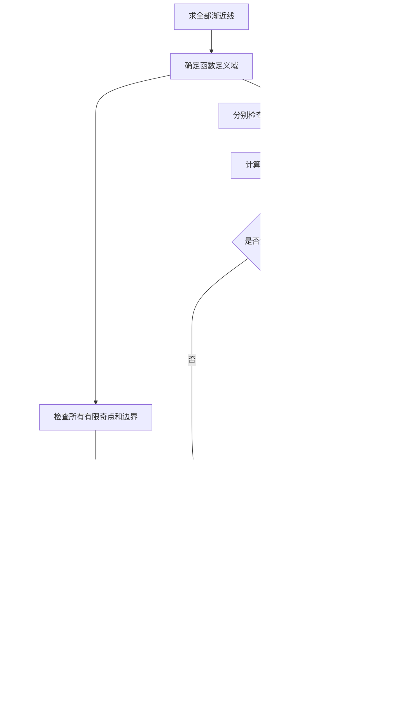

## 一、本节学习内容与考点体系

渐近线表面上是一个几何问题，本质上却是对**极限、等价无穷小、泰勒公式、函数增长速度、定义域以及无穷小余项**的综合考查。

学好这一节，不能仅仅记住求斜率和截距的两个公式，还要建立从函数表达式中识别渐近行为的能力。

| 知识板块         | 核心能力          | 复习优先级 |
| ------------ | ------------- | ----- |
| 铅直渐近线        | 定义域、单侧极限、奇点识别 | 必须掌握  |
| 水平渐近线        | 正负无穷远处的有限极限   | 必须掌握  |
| 斜渐近线         | 一次主项与常数项提取    | 必须掌握  |
| 渐近线条数        | 完整搜索、分方向、去重   | 必须掌握  |
| 渐近线存在性       | 区分有界、等价与差值趋零  | 重点    |
| 含参数渐近线       | 系数匹配、分类讨论     | 重点    |
| 泰勒展开与幂指函数    | 展开阶数控制        | 重点    |
| 参数曲线、隐函数、反函数 | 无穷远分支与几何转换    | 强化    |
| 积分、微分方程综合题   | 提取主项、估计余项     | 综合拔高  |

## 二、渐近线的本质与直观理解

### 2.1 什么是渐近线？

当曲线上的点沿着某个分支无限远离原点，而该点到某条固定直线的距离趋于零时，称这条直线为曲线的渐近线。

这里有两个不可缺少的条件：

1. 曲线上的点必须走向无穷远。
2. 曲线上的点到直线的距离必须趋于零。

例如，函数

$$
f(x)=2x+3+\frac1x
$$

可以分解为

$$
\underbrace{2x+3}_{\text{直线部分}} +\underbrace{\frac1x}_{\text{误差部分}}.
$$

当 $x\to\pm\infty$ 时，

$$
f(x)-(2x+3)=\frac1x\to0.
$$

所以直线

$$
\boxed{y=2x+3}
$$

是其斜渐近线。

**渐近线的核心，就是用一条直线描述曲线在无穷远处的行为，并要求绝对误差趋于零。**

### 2.2 渐近线一定不能与曲线相交吗？

不一定。

例如

$$
f(x)=x+\frac{\sin x}{x}.
$$

当 $x\to\pm\infty$ 时，

$$
\left|f(x)-x\right| =\left|\frac{\sin x}{x}\right| \leq\frac1{|x|}\to0.
$$

因此 $y=x$ 是渐近线。

但当

$$
x=n\pi,\qquad n\in\mathbb Z\setminus\{0\}
$$

时，恰好有 $f(x)=x$。

这意味着曲线可以与渐近线相交无穷多次。

渐近线不是曲线不可跨越的边界，也不要求曲线始终位于它的一侧。

### 2.3 三种渐近线的统一理解

| 类型           | 直线方程                 | 曲线的渐近行为               |
| ------------ | -------------------- | --------------------- |
| 铅直渐近线（垂直渐近线） | $x=c$            | 横坐标趋于有限值，纵坐标趋于无穷      |
| 水平渐近线        | $y=b$            | 横坐标趋于无穷，纵坐标趋于有限值      |
| 斜渐近线         | $y=kx+b,\ k\ne0$ | 横纵坐标均走向无穷，但与某条斜线的距离趋零 |

实际上，水平渐近线可以看成斜率为零的直线渐近线，但在考研题目的分类计数中，水平渐近线和斜渐近线应当分别统计。

## 三、三类渐近线的定义、判定公式及适用条件

### 3.1 铅直渐近线

若下列四种情形中至少有一种成立：

$$
\lim_{x\to c^-}f(x)=+\infty,
$$

$$
\lim_{x\to c^-}f(x)=-\infty,
$$

$$
\lim_{x\to c^+}f(x)=+\infty,
$$

$$
\lim_{x\to c^+}f(x)=-\infty,
$$

那么直线

$$
\boxed{x=c}
$$

就是曲线的铅直渐近线。

这里最重要的关键词是：**至少一个单侧极限为无穷大。**

例如：

$$
f(x)=\frac1x.
$$

虽然

$$
\lim_{x\to0^-}\frac1x=-\infty, \qquad \lim_{x\to0^+}\frac1x=+\infty,
$$

左右极限不同，但不影响 $x=0$ 成为铅直渐近线。

同样，即使函数只有一侧趋于无穷大，另一侧趋于有限值，也可以存在铅直渐近线。

**铅直渐近线的候选点**

| 函数结构                       | 优先检查的位置                      |
| -------------------------- | ---------------------------- |
| $\dfrac{P(x)}{Q(x)}$   | $Q(x)=0$                 |
| $\ln g(x)$             | $g(x)\to0^+$             |
| $\dfrac1{\sqrt{g(x)}}$ | $g(x)\to0^+$             |
| $e^{g(x)}$             | $g(x)\to+\infty$ 的有限点    |
| $\tan g(x)$            | $g(x)\to\dfrac\pi2+n\pi$ |
| 分段函数                       | 分段点及各段定义域边界                  |
| 抽象函数                       | 已知极限、奇点及可能无界的位置              |

必须注意：这些只是**候选点**，不是最终答案。

函数在某点没有定义，不等于在该点存在铅直渐近线；甚至函数在该点有定义，也不妨碍它具有铅直渐近线。

例如

$$
f(x)= \begin{cases} \dfrac1x,&x\ne0,\\ 1,&x=0. \end{cases}
$$

仍然有铅直渐近线 $x=0$。

是否存在铅直渐近线，由点附近的极限行为决定，而不是由该点的函数值决定。

### 3.2 水平渐近线

如果

$$
\lim_{x\to+\infty}f(x)=b
$$

或者

$$
\lim_{x\to-\infty}f(x)=b,
$$

其中 $b$ 为有限实数，那么

$$
\boxed{y=b}
$$

就是曲线在相应方向上的水平渐近线。

正无穷与负无穷需要分别考虑。

例如

$$
f(x)=\arctan x.
$$

因为

$$
\lim_{x\to+\infty}\arctan x=\frac\pi2,
$$

$$
\lim_{x\to-\infty}\arctan x=-\frac\pi2,
$$

所以有两条不同的水平渐近线：

$$
\boxed{y=\frac\pi2,\qquad y=-\frac\pi2}.
$$

而函数

$$
f(x)=\frac1{1+x^2}
$$

在两个方向上均趋于零，所以虽然存在两个趋近方向，却只有一条水平渐近线 $y=0$。

**渐近线条数统计的是不同的直线，而不是趋近方向的数量。**

### 3.3 斜渐近线

这是本节最重要的知识点。

如果

$$
\lim_{x\to+\infty}[f(x)-kx-b]=0, \qquad k\ne0,
$$

那么

$$
\boxed{y=kx+b}
$$

是曲线在正无穷方向的斜渐近线。

负无穷方向完全类似。

**斜率与截距的判定公式**

对于同一个无穷远方向，分别计算

$$
\boxed{k=\lim_{x\to\pm\infty}\frac{f(x)}x}
$$

以及

$$
\boxed{b=\lim_{x\to\pm\infty}[f(x)-kx]}.
$$

只有当 $k$ 为有限非零实数，且 $b$ 为有限实数时，才能确定存在斜渐近线。

这两个条件缺一不可，而且两个极限必须在同一方向上计算。

**公式是如何推导出来的？**

假设

$$
f(x)-(kx+b)\to0.
$$

则可以写成

$$
f(x)=kx+b+o(1).
$$

两边除以 $x$，得到

$$
\frac{f(x)}x =k+\frac bx+\frac{o(1)}x\to k.
$$

因此

$$
k=\lim_{x\to\pm\infty}\frac{f(x)}x.
$$

进一步，由

$$
f(x)-kx=b+o(1)
$$

得到

$$
b=\lim_{x\to\pm\infty}[f(x)-kx].
$$

反过来，如果这两个极限都满足条件，那么

$$
f(x)-kx-b\to0,
$$

故渐近线存在。

这说明求斜率与截距的公式并不是孤立的计算技巧，而是来自渐近线定义的充要判据。

### 3.4 本节最重要的统一公式

对于 $x\to+\infty$ 或 $x\to-\infty$，只要能够将函数写成

$$
\boxed{f(x)=kx+b+o(1)},
$$

就可以直接判断其直线渐近线为

$$
\boxed{y=kx+b}.
$$

其中：

- $k=0$：水平渐近线。
- $k\ne0$：斜渐近线。
- $o(1)$：必须是趋于零的误差。

从应试角度看，**求渐近线就是提取函数在无穷远处的一次项和常数项，并证明剩余项趋于零。**

这也是后面处理高阶泰勒展开、幂指函数、积分函数、微分方程的统一思想。

## 四、重要性质与常见推论

### 4.1 函数等价不代表具有相同的渐近线

这是考研中最值得警惕的逻辑陷阱。

假设

$$
f(x)\sim kx,\qquad x\to+\infty,\quad k\ne0.
$$

只能说明

$$
\lim_{x\to+\infty}\frac{f(x)}x=k,
$$

不能说明 $y=kx$ 是渐近线，也不能保证一定存在斜渐近线。

比较下面五个函数：

| 函数                 | $f(x)/x$ 的极限 | $f(x)-x$ 的极限 | 正无穷方向的渐近线   |
| ------------------ | ---------------- | ---------------- | ----------- |
| $x+\dfrac1x$   | $1$          | $0$          | $y=x$   |
| $x+3+\dfrac1x$ | $1$          | $3$          | $y=x+3$ |
| $x+\ln x$      | $1$          | $+\infty$    | 不存在         |
| $x+\sqrt{x}$   | $1$          | $+\infty$    | 不存在         |
| $x+\sin x$     | $1$          | 不存在              | 不存在         |

这五个函数都满足 $f(x)\sim x$，但是渐近线的情况完全不同。

从无穷小的角度看：

$$
f(x)\sim x \iff f(x)=x+o(x).
$$

而 $y=x$ 是渐近线要求

$$
f(x)=x+o(1).
$$

显然，后者比前者的条件强得多。

### 4.2 导数极限存在，也不能保证渐近线存在

若

$$
\lim_{x\to+\infty}f'(x)=k,
$$

在通常的可导条件下，可以利用洛必达法则或中值定理推出

$$
\lim_{x\to+\infty}\frac{f(x)}x=k.
$$

但是仍然不能保证截距存在。

反例：

$$
f(x)=x+\ln x.
$$

虽然

$$
f'(x)=1+\frac1x\to1,
$$

但

$$
f(x)-x=\ln x\to+\infty.
$$

所以没有斜渐近线。

反过来，曲线存在斜渐近线，也不意味着导数必然趋于渐近线的斜率。

例如

$$
f(x)=x+\frac{\sin x^2}{x}.
$$

由于

$$
f(x)-x\to0,
$$

有斜渐近线 $y=x$。但

$$
f'(x)=1+2\cos x^2-\frac{\sin x^2}{x^2}
$$

在无穷远处不断振荡，不存在极限。

### 4.3 渐近线的唯一性与条数

对于普通函数 $y=f(x)$，在同一个无穷远方向上，至多存在一条非铅直渐近线。

证明：假设 $x\to+\infty$ 时存在两条渐近线

$$
y=k_1x+b_1,\qquad y=k_2x+b_2.
$$

根据定义，

$$
f(x)-k_1x-b_1\to0,
$$

$$
f(x)-k_2x-b_2\to0.
$$

两式相减：

$$
(k_2-k_1)x+b_2-b_1\to0.
$$

因此必有

$$
k_1=k_2,\qquad b_1=b_2.
$$

所以两条直线实际上是同一条。

由此可以推出：

- 普通函数最多有两条水平渐近线。
- 普通函数最多有两条斜渐近线。
- 普通函数的水平渐近线与斜渐近线合计最多两条。
- 铅直渐近线的数量没有统一的有限上界，例如 $y=\tan x$ 有无穷多条铅直渐近线。
- 参数曲线、隐式多分支曲线不一定满足普通函数的两条非铅直渐近线限制。

### 4.4 利用奇偶性快速确定另一端渐近线

假设 $f$ 的定义域关于原点对称，并且正无穷方向存在渐近线

$$
y=kx+b.
$$

那么可以利用奇偶性直接得到负无穷方向的渐近线。

| 函数性质 | 正无穷方向        | 负无穷方向         |
| ---- | ------------ | ------------- |
| 偶函数  | $y=kx+b$ | $y=-kx+b$ |
| 奇函数  | $y=kx+b$ | $y=kx-b$  |

例如偶函数

$$
f(x)=\sqrt{x^2+1}
$$

在正无穷方向有 $y=x$，则负无穷方向一定有 $y=-x$。

奇函数

$$
f(x)=x+\arctan x
$$

有两条斜渐近线：

$$
y=x+\frac\pi2,\qquad y=x-\frac\pi2.
$$

遇到具有明显奇偶性的函数，不必把两个方向完全重复计算。

## 五、考场通用解题流程

当题目要求求全部渐近线或渐近线条数时，统一使用下面的流程。

实际做题时，可以先直接判断水平渐近线。如果函数显然趋于有限值，就不需要再计算斜率。

**常见结构与首选方法**

| 题目特征                | 首选解题方法            |
| ------------------- | ----------------- |
| 有理分式                | 因式分解、多项式除法        |
| 根式相减                | 有理化               |
| 根式与多项式组合            | 提取最高次项、泰勒展开       |
| $xe^{1/x}$ 型    | 一阶泰勒展开            |
| $x\ln(a+1/x)$ 型 | 对数拆分、等价无穷小        |
| $x(1+1/x)^x$ 型  | 取对数、高阶展开          |
| $\ln(1+e^x)$ 型  | 提取占优势的指数项         |
| 含绝对值                | 正负无穷分别处理          |
| 振荡函数                | 检查振幅是否趋于零         |
| 抽象函数极限              | 分离主项与余项           |
| 参数方程                | 寻找曲线的无穷远分支        |
| 变上限积分               | 积分中值定理、泰勒展开、尾积分估计 |
| 微分方程                | 求解或构造线性特解         |

## 六、模型一：铅直、水平渐近线与完整计数

这一模型对应核心题目第1—9题，也是选择题中最基础、最容易因漏项失分的部分。

### 母题1：有定义域缺口不一定有渐近线

**来源：1989年考研数学一、二真题。**

当 $x>0$ 时，判断曲线

$$
y=x\sin\frac1x
$$

的渐近线。

<Steps>

<Step>

### 第一步：检查有限端点 [!toc]

定义域为 $(0,+\infty)$，所以有限候选点只有 $x=0$。

当 $x\to0^+$ 时，虽然

$$
\sin\frac1x
$$

无限振荡，但有

$$
\left|x\sin\frac1x\right|\le x.
$$

由夹逼准则，

$$
\lim_{x\to0^+}x\sin\frac1x=0.
$$

因此 $x=0$ 不是铅直渐近线。

</Step>

<Step>

### 第二步：检查无穷远 [!toc]

当 $x\to+\infty$ 时，

$$
\frac1x\to0.
$$

利用重要极限：

$$
\lim_{x\to+\infty}x\sin\frac1x = \lim_{x\to+\infty} \frac{\sin(1/x)}{1/x}=1.
$$

所以唯一的渐近线为

$$
\boxed{y=1}.
$$

</Step>

</Steps>

**母题提炼：振荡函数乘以无穷小**

若 $g(x)$ 在某点附近有界，而 $h(x)\to0$，则

$$
h(x)g(x)\to0.
$$

因此，对于

$$
x^\alpha\sin\frac1x,\qquad \alpha>0,
$$

当 $x\to0^+$ 时一定趋于零，不会在 $x=0$ 处产生铅直渐近线。

但当 $\alpha<0$ 时，情况更加复杂：函数可能无界振荡，仍然没有通常定义下的单侧无穷极限。

**无界振荡不等于趋于无穷大。**

### 母题2：分母为零与可去间断点

**来源：2012年考研数学一、二、三真题。**

求曲线

$$
y=\frac{x^2+x}{x^2-1}
$$

的渐近线条数。

**解题过程**

原定义域为

$$
D=\mathbb R\setminus\{-1,1\}.
$$

约分得

$$
y=\frac{x(x+1)}{(x-1)(x+1)} =\frac{x}{x-1}, \qquad x\ne\pm1.
$$

检查 $x=-1$：

$$
\lim_{x\to-1}y=\frac12.
$$

因此 $x=-1$ 为可去间断点，不是渐近线。

检查 $x=1$：

$$
\lim_{x\to1^+}y=+\infty,
$$

$$
\lim_{x\to1^-}y=-\infty.
$$

所以有铅直渐近线

$$
x=1.
$$

再将函数改写为

$$
y=1+\frac1{x-1}.
$$

当 $x\to\pm\infty$ 时，$y\to1$。

最终答案：

$$
\boxed{x=1,\qquad y=1}
$$

共两条渐近线。

**母题推广：利用零点阶数判断极点**

对于有理函数

$$
f(x)=\frac{P(x)}{Q(x)},
$$

假设在 $x=c$ 附近，

$$
P(x)=(x-c)^mP_1(x),
$$

$$
Q(x)=(x-c)^nQ_1(x),
$$

其中

$$
P_1(c)Q_1(c)\ne0.
$$

则

$$
f(x)\sim C(x-c)^{m-n}, \qquad C\ne0.
$$

| 零点阶数关系     | 极限行为   | 铅直渐近线 |
| ---------- | ------ | ----- |
| $m<n$ | 发散     | 存在    |
| $m=n$  | 趋于非零常数 | 不存在   |
| $m>n$  | 趋于零    | 不存在   |

这个结论不仅能处理有理函数，也能推广到可以通过等价无穷小确定局部主项的其他函数。

### 母题3：复合函数会消除内部的发散

**来源：1994年考研数学二、三真题。**

求曲线

$$
y=e^{1/x^2} \arctan\frac{x^2+x+1}{(x-1)(x+2)}
$$

的全部渐近线。

<Steps>

<Step>

### 第一步：寻找候选点 [!toc]

从表达式可以找到三个有限奇点：

$$
x=0,\qquad x=1,\qquad x=-2.
$$

</Step>

<Step>

### 第二步：逐一排查 [!toc]

当 $x\to0$ 时，

$$
e^{1/x^2}\to+\infty,
$$

而

$$
\arctan\frac{x^2+x+1}{(x-1)(x+2)} \to-\arctan\frac12\ne0.
$$

因此 $y\to-\infty$，得到铅直渐近线

$$
x=0.
$$

当 $x\to1$ 或 $x\to-2$ 时，反正切内部的有理分式可能发散，但

$$
|\arctan u|\le\frac\pi2.
$$

同时外部指数项在这两个点附近有界，因而整个函数有界。

所以 $x=1,-2$ 都不是铅直渐近线。

</Step>

<Step>

### 第三步：无穷远方向 [!toc]

当 $x\to\pm\infty$ 时，

$$
e^{1/x^2}\to1,
$$

$$
\frac{x^2+x+1}{(x-1)(x+2)}\to1.
$$

故

$$
y\to\arctan1=\frac\pi4.
$$

最终答案：

$$
\boxed{x=0,\qquad y=\frac\pi4}.
$$

</Step>

</Steps>

**应试启示**

判断复合函数时，一定要观察最外层函数。

| 内部变量的行为           | 外层函数            | 最终行为  |
| ----------------- | --------------- | ----- |
| $u\to+\infty$ | $e^u$       | 发散    |
| $u\to+\infty$ | $\ln u$     | 发散    |
| $u\to+\infty$ | $\arctan u$ | 趋于有限值 |
| $u\to+\infty$ | $\sin u$    | 有界振荡  |
| $u\to+\infty$ | $1/u$       | 趋于零   |

内部存在极点，并不意味着完整函数存在极点。

### 母题4：三种渐近线同时存在

**来源：2007年考研数学一、二、三真题。**

求曲线

$$
y=\frac1x+\ln(1+e^x)
$$

的渐近线条数。

这道题非常重要，因为它把铅直渐近线、水平渐近线和斜渐近线放在了同一个函数中。

<Steps>

<Step>

### 第一步：有限奇点 [!toc]

当 $x\to0$ 时，

$$
\ln(1+e^x)\to\ln2,
$$

而 $1/x$ 发散。

所以

$$
\boxed{x=0}
$$

是铅直渐近线。

</Step>

<Step>

### 第二步：负无穷方向 [!toc]

当 $x\to-\infty$ 时，

$$
\frac1x\to0,\qquad e^x\to0.
$$

因此

$$
\lim_{x\to-\infty}y=0,
$$

得到水平渐近线

$$
\boxed{y=0}.
$$

</Step>

<Step>

### 第三步：正无穷方向 [!toc]

当 $x\to+\infty$ 时，不能直接把对数函数判定为发散后就结束。

应当提取占主导地位的指数项：

$$
\begin{aligned} \ln(1+e^x) &=\ln[e^x(1+e^{-x})]\\ &=x+\ln(1+e^{-x}). \end{aligned}
$$

于是

$$
y=x+\frac1x+\ln(1+e^{-x}).
$$

后两项都趋于零，所以有斜渐近线

$$
\boxed{y=x}.
$$

综上：

$$
\boxed{x=0,\qquad y=0,\qquad y=x}.
$$

共三条。

</Step>

</Steps>

**重要通用模型：对数与指数的组合**

对于

$$
f(x)=\ln(A+Be^{cx}), \qquad A,B,c>0,
$$

有

$$
\begin{aligned} x\to+\infty:\quad f(x)&=cx+\ln B+o(1),\\ x\to-\infty:\quad f(x)&=\ln A+o(1). \end{aligned}
$$

因此两条渐近线分别为

$$
\boxed{y=cx+\ln B}
$$

和

$$
\boxed{y=\ln A}.
$$

以后遇到这类题，关键不是使用洛必达法则，而是直接提出增长最快的指数项。

**进阶变式：李林880题**

核心第7题为

$$
y=\frac1{|x|-1}+\ln(1+e^{-x}).
$$

有限奇点为 $x=\pm1$，均产生铅直渐近线。

当 $x\to+\infty$ 时，函数趋于零。

当 $x\to-\infty$ 时，

$$
\ln(1+e^{-x}) =-x+\ln(1+e^x).
$$

于是

$$
y=-x+o(1).
$$

所以共有四条渐近线：

$$
\boxed{x=-1,\quad x=1,\quad y=0,\quad y=-x}.
$$

这就是2007年真题在绝对值与符号方向上的进一步拓展。

## 七、模型二：斜渐近线的快速计算

本节所有斜渐近线计算，都可以归结为三个基本方法：

**直接拆分、计算两个极限、展开到常数阶。**

### 母题5：有理函数的多项式除法

**来源：2005年考研数学一真题。**

求曲线

$$
y=\frac{x^2}{2x+1}
$$

的斜渐近线方程。

<Tabs items={["方法一：多项式除法", "方法二：斜率与截距公式"]} defaultIndex={0}>

<Tab value="方法一：多项式除法">

直接拆分：

$$
\frac{x^2}{2x+1} =\frac x2-\frac14+\frac1{4(2x+1)}.
$$

由于

$$
\frac1{4(2x+1)}\to0, \qquad x\to\pm\infty,
$$

所以

$$
\boxed{y=\frac x2-\frac14}.
$$

这是最简洁的考场解法。

</Tab>

<Tab value="方法二：斜率与截距公式">

先求斜率：

$$
k=\lim_{x\to\pm\infty}\frac{x}{2x+1} =\frac12.
$$

再求截距：

$$
\begin{aligned} b &=\lim_{x\to\pm\infty} \left(\frac{x^2}{2x+1}-\frac x2\right)\\ &=\lim_{x\to\pm\infty} \frac{-x}{2(2x+1)}\\ &=-\frac14. \end{aligned}
$$

所以答案相同。

若题目改为求全部渐近线，还应补充

$$
x=-\frac12.
$$

</Tab>

</Tabs>

**有理函数的通用判定规律**

设

$$
f(x)=\frac{P_m(x)}{Q_n(x)},
$$

其中分子、分母的次数分别为 $m,n$。

| 次数关系        | 无穷远渐近线                 |
| ----------- | ---------------------- |
| $m<n$  | $y=0$              |
| $m=n$   | $y=$ 分子与分母最高次项系数之比 |
| $m=n+1$ | 多项式除法所得的一次商式           |
| $m>n+1$ | 不存在水平或斜渐近线             |

其中最后一种情形仍然可能存在铅直渐近线。

特别地，对于

$$
f(x)=\frac{ax^2+bx+c}{dx+e}, \qquad ad\ne0,
$$

其斜渐近线可以直接写为

$$
\boxed{ y=\frac adx+\frac{bd-ae}{d^2} }.
$$

理解这一公式即可，不必单独死记，因为多项式除法可以快速推导出来。

### 母题6：指数函数乘以一次多项式

**来源：2000年考研数学二真题。**

求曲线

$$
y=(2x-1)e^{1/x}
$$

的斜渐近线。

当 $x\to\pm\infty$ 时，

$$
e^{1/x}=1+\frac1x+o\left(\frac1x\right).
$$

所以

$$
\begin{aligned} y &=(2x-1)\left[ 1+\frac1x+o\left(\frac1x\right) \right]\\ &=2x-1+2-\frac1x+o(1)\\ &=2x+1+o(1). \end{aligned}
$$

故

$$
\boxed{y=2x+1}.
$$

**为什么不能直接把指数项替换成1？**

虽然

$$
e^{1/x}\to1,
$$

但指数项中的 $1/x$ 与外部的 $2x$ 相乘后，会产生常数2。

这恰好决定截距。

因此，在求斜渐近线时，不能只保留决定斜率的最高次项。

**模拟题迁移：张宇8套卷第1套第1题**

求

$$
y=(x+2)e^{1/x}
$$

的全部渐近线。

有限端点：

$$
\lim_{x\to0^+}(x+2)e^{1/x}=+\infty.
$$

所以有 $x=0$。

无穷远处：

$$
\begin{aligned} (x+2)e^{1/x} &=(x+2)\left(1+\frac1x+o(1/x)\right)\\ &=x+3+o(1). \end{aligned}
$$

所以共有两条：

$$
\boxed{x=0,\qquad y=x+3}.
$$

**通用结论**

对于常数 $A,B,C$，有

$$
(Ax+B)e^{C/x} =Ax+(B+AC)+o(1).
$$

因此无穷远方向的直线渐近线为

$$
\boxed{y=Ax+B+AC}.
$$

当 $A\ne0$ 时，它是斜渐近线。

### 母题7：复合函数与一阶导数法

**来源：2023年考研数学一、二真题。**

求曲线

$$
y=x\ln\left(e+\frac1{x-1}\right)
$$

的斜渐近线。

<Tabs items={["方法一：等价无穷小", "方法二：建立更一般的母题公式"]} defaultIndex={0}>

<Tab value="方法一：等价无穷小">

斜率为

$$
k=\lim_{x\to\pm\infty} \ln\left(e+\frac1{x-1}\right)=1.
$$

接着计算截距：

$$
\begin{aligned} y-x &=x\left[ \ln\left(e+\frac1{x-1}\right)-1 \right]\\ &=x\ln\left(1+\frac1{e(x-1)}\right). \end{aligned}
$$

利用

$$
\ln(1+u)\sim u,\qquad u\to0,
$$

有

$$
\begin{aligned} b &=\lim_{x\to\pm\infty} x\ln\left(1+\frac1{e(x-1)}\right)\\ &=\lim_{x\to\pm\infty} \frac{x}{e(x-1)}\\ &=\frac1e. \end{aligned}
$$

故

$$
\boxed{y=x+\frac1e}.
$$

</Tab>

<Tab value="方法二：建立更一般的母题公式">

设函数 $\varphi$ 在 $u=a$ 处可导，并且

$$
f(x)=(Ax+B)\varphi\left(a+\frac Cx\right).
$$

由一阶泰勒展开，

$$
\varphi\left(a+\frac Cx\right) =\varphi(a)+\frac{C\varphi'(a)}x +o\left(\frac1x\right).
$$

两边乘以 $Ax+B$，得到

$$
\begin{aligned} f(x) ={}&A\varphi(a)x+B\varphi(a)\\ &+AC\varphi'(a)+o(1). \end{aligned}
$$

因此直线渐近线为

$$
\boxed{ y=A\varphi(a)x+B\varphi(a)+AC\varphi'(a) }.
$$

这是非常有用的统一公式。它同时覆盖指数、对数、根式、反三角函数等多种复合结构。

</Tab>

</Tabs>

**真题迁移**

| 来源       | 函数                      | 斜渐近线              |
| -------- | ----------------------- | ----------------- |
| 2000年数学二 | $(2x-1)e^{1/x}$     | $y=2x+1$      |
| 2005年数学二 | $x(1+1/x)^{3/2}$    | $y=x+\frac32$ |
| 2017年数学二 | $x[1+\arcsin(2/x)]$ | $y=x+2$       |
| 张宇8套卷第1套 | $(x+2)e^{1/x}$      | $y=x+3$       |

这些题目虽然外表不同，但本质上考查的是同一个知识点：

**可导函数的一阶局部线性近似，被外部的无穷大量放大后产生常数项。**

### 母题8：根式渐近线与正负号问题

**来源：张宇1000题。**

求曲线

$$
y=\frac{x^2+1}{\sqrt{x^2-1}}
$$

的全部渐近线。

<Steps>

<Step>

### 第一步：确定定义域 [!toc]

根式位于分母，因此要求

$$
x^2-1>0.
$$

定义域为

$$
(-\infty,-1)\cup(1,+\infty).
$$

当 $x\to1^+$ 或 $x\to-1^-$ 时，函数均趋于正无穷。

得到两条铅直渐近线：

$$
x=1,\qquad x=-1.
$$

</Step>

<Step>

### 第二步：处理无穷远方向 [!toc]

必须注意：

$$
\sqrt{x^2}=|x|.
$$

因此

$$
\begin{aligned} y &=|x|\frac{1+1/x^2}{\sqrt{1-1/x^2}}\\ &=|x|\left[ 1+\frac{3}{2x^2} +O\left(\frac1{x^4}\right) \right]\\ &=|x|+\frac{3}{2|x|} +O\left(\frac1{|x|^3}\right). \end{aligned}
$$

所以

$$
y=|x|+o(1).
$$

当 $x\to+\infty$ 时，

$$
y=x+o(1).
$$

当 $x\to-\infty$ 时，

$$
y=-x+o(1).
$$

综上，

$$
\boxed{x=\pm1,\qquad y=x,\qquad y=-x}.
$$

共四条渐近线。

</Step>

</Steps>

**通用根式母题**

设

$$
f(x)=\sqrt{Ax^2+Bx+C},\qquad A>0.
$$

则

$$
\begin{aligned} f(x) &=\sqrt A|x| \sqrt{1+\frac{B}{Ax}+\frac{C}{Ax^2}}\\ &=\sqrt A|x| \left[1+\frac{B}{2Ax} +O(x^{-2})\right]. \end{aligned}
$$

因此两端的渐近线分别为

$$
\boxed{ y=\sqrt A\,x+\frac{B}{2\sqrt A} \quad (x\to+\infty) }
$$

以及

$$
\boxed{ y=-\sqrt A\,x-\frac{B}{2\sqrt A} \quad (x\to-\infty) }.
$$

注意，常数 $C$ 不影响这两条斜渐近线，但可能影响函数的定义域。

而奇次根式不同：

$$
\sqrt[3]{x^3}=x.
$$

对于

$$
\sqrt[3]{Ax^3+Bx^2+Cx+D}, \qquad A\ne0,
$$

有

$$
\boxed{ y=\sqrt[3]A\,x+\frac{B}{3(\sqrt[3]A)^2} }
$$

作为两个无穷远方向共有的斜渐近线。

这可以直接解决2025年数学二真题及张宇1000题中的隐式三次曲线题目。

## 八、模型三：判断渐近线是否存在

渐近线存在性是从计算型题目向概念型题目过渡的关键。出题人往往故意设计一个具有线性主项、但余项不能趋于有限值的函数。

### 母题9：振荡项与线性主项

**来源：2014年考研数学一、二、三真题。**

判断下列哪条曲线存在渐近线：

$$
\begin{aligned} \text{A.}\quad &y=x+\sin x,\\ \text{B.}\quad &y=x^2+\sin x,\\ \text{C.}\quad &y=x+\sin\frac1x,\\ \text{D.}\quad &y=x^2+\sin\frac1x. \end{aligned}
$$

**分析选项A**

$$
\frac{x+\sin x}{x}\to1.
$$

如果存在斜渐近线，其斜率只能是1。

但

$$
y-x=\sin x
$$

不存在极限，所以没有斜渐近线。

**分析选项B**

$$
\frac{x^2+\sin x}{x} =x+\frac{\sin x}{x}.
$$

斜率极限不是有限实数，因此没有斜渐近线。

**分析选项C**

$$
y-x=\sin\frac1x\to0.
$$

所以存在斜渐近线

$$
\boxed{y=x}.
$$

**分析选项D**

主项为 $x^2$，增长速度超过任意一次函数，因此没有水平或斜渐近线。

又因为C、D中的正弦项在 $x=0$ 附近有界，所以不存在铅直渐近线；A、B在所有有限实点连续，也没有铅直渐近线。

故选C。

**从母题中建立判断能力**

对于

$$
f(x)=kx+r(x),
$$

不需要反复计算斜率和截距，可以直接研究余项 $r(x)$。

| 余项形式                    | 无穷远行为      | 渐近线                |
| ----------------------- | ---------- | ------------------ |
| $\sin x$            | 等幅振荡       | 无                  |
| $\dfrac{\sin x}{x}$ | 衰减振荡       | $y=kx$         |
| $\sin(1/x)$         | 趋于零        | $y=kx$         |
| $\ln x$             | 缓慢发散       | 无                  |
| $\dfrac{\ln x}{x}$  | 趋于零        | $y=kx$         |
| $b+e^{-x}$          | 趋于 $b$ | $y=kx+b$，正无穷方向 |

上表讨论的是相应的无穷远方向，且这些余项均满足 $r(x)=o(x)$。因此 $k$ 确实是唯一可能的渐近斜率。

### 母题10：幂指函数产生缓慢发散余项

**来源：李永乐六套卷第4套第1题。**

设

$$
f(x)=x^{\frac{x}{x+1}},\qquad x>0.
$$

判断函数的极值以及渐近线情况。

这道题非常适合数学一强化阶段，因为它把对数求导、单调性、幂指函数极限和渐近线存在性结合在一起。

**第一部分：判断极值**

取对数：

$$
g(x)=\ln f(x)=\frac{x\ln x}{x+1}.
$$

求导：

$$
g'(x)=\frac{\ln x+x+1}{(x+1)^2}.
$$

由于

$$
f'(x)=f(x)g'(x),
$$

且 $f(x)>0$，所以 $f'$ 与 $g'$ 同号。

令

$$
h(x)=\ln x+x+1.
$$

有

$$
h'(x)=\frac1x+1>0.
$$

同时

$$
h(0^+)=-\infty,\qquad h(+\infty)=+\infty.
$$

因此 $h(x)$ 恰好有一个零点。

函数先减后增，故存在一个极小值，不存在极大值。

**第二部分：有限端点**

$$
f(x)=\exp\left(\frac{x\ln x}{x+1}\right).
$$

由于

$$
x\ln x\to0,\qquad x\to0^+,
$$

所以

$$
f(x)\to1.
$$

没有铅直渐近线。

**第三部分：无穷远处的斜率**

改写为

$$
f(x)=x\exp\left(-\frac{\ln x}{x+1}\right).
$$

于是

$$
\frac{f(x)}x =\exp\left(-\frac{\ln x}{x+1}\right)\to1.
$$

因此，如果存在斜渐近线，其斜率只能是1。

**第四部分：截距**

$$
f(x)-x =x\left[ \exp\left(-\frac{\ln x}{x+1}\right)-1 \right].
$$

利用 $e^u-1\sim u$，得到

$$
f(x)-x \sim-\frac{x\ln x}{x+1} \sim-\ln x\to-\infty.
$$

所以不存在斜渐近线。

又由于 $f(x)\sim x\to+\infty$，不存在水平渐近线。

最终结论：

$$
\boxed{\text{有一个极小值，没有极大值，没有渐近线。}}
$$

**深层推广**

假设

$$
f(x)=x e^{u(x)},\qquad u(x)\to0.
$$

那么

$$
\frac{f(x)}x\to1.
$$

并且

$$
f(x)-x=xu(x)[1+o(1)].
$$

因此，可以把渐近线问题转化为研究 $xu(x)$：

| $xu(x)$ 的行为 | 结论          |
| --------------- | ----------- |
| 趋于0             | $y=x$   |
| 趋于有限常数 $b$  | $y=x+b$ |
| 趋于无穷大           | 无斜渐近线       |
| 振荡而不收敛          | 无斜渐近线       |

这比记住某一道幂指函数模拟题更重要。

### 母题11：抽象函数与加权余项

**来源：李林880题。**

已知连续函数 $f(x)$ 满足

$$
\lim_{x\to+\infty}e^x[1+x+f(x)]
$$

存在且有限，求其斜渐近线。

**解题过程**

令

$$
R(x)=e^x[1+x+f(x)].
$$

由题意，$R(x)$ 在正无穷附近有界。

所以

$$
1+x+f(x)=e^{-x}R(x).
$$

由于 $e^{-x}\to0$，有界函数乘以无穷小仍是无穷小，因此

$$
e^{-x}R(x)\to0.
$$

即

$$
f(x)=-x-1+o(1).
$$

所以

$$
\boxed{y=-x-1}.
$$

**通用抽象函数模型**

若

$$
\lim_{x\to+\infty} A(x)[f(x)-kx-b]=L,
$$

其中 $L$ 有限，并且

$$
|A(x)|\to+\infty,
$$

则

$$
f(x)-kx-b\to0.
$$

因此

$$
\boxed{y=kx+b}
$$

一定是相应方向的直线渐近线。

这一结论的核心不是知道 $f(x)$ 的具体表达式，而是利用题目条件控制剩余误差。

如果 $A(x)=x$，则还能进一步得到

$$
f(x)=kx+b+\frac Lx+o\left(\frac1x\right).
$$

在综合题中，这种条件既能确定渐近线，又能判断曲线在充分远处位于渐近线的上方还是下方。当 $x\to+\infty$ 且 $L\ne0$ 时，余项符号由 $L$ 决定。

## 九、模型四：高阶泰勒展开与幂指函数

这是本节计算难度最高的部分之一，对极限章节前几节知识的要求较高。

### 9.1 如何确定泰勒展开阶数？

求渐近线时，不是展开得越多越好，而是要精确到常数项。

如果外部乘有 $x^m$，令 $t=1/x$，那么需要研究括号内部直到 $t^m$ 阶，并确保剩余项为 $o(t^m)$。

例如

$$
f(x)=x^mF(1/x),
$$

若

$$
F(t)=a_0+a_1t+\cdots+a_mt^m+o(t^m),
$$

则

$$
f(x)=a_0x^m+a_1x^{m-1} +\cdots+a_{m-1}x+a_m+o(1).
$$

要使其存在直线渐近线，所有高于一次的非零项都必须消失。

| 外部放大因子    | 内部需要的精度         |
| --------- | --------------- |
| $x$   | 展开到 $1/x$   |
| $x^2$ | 展开到 $1/x^2$ |
| $x^3$ | 展开到 $1/x^3$ |
| $x^m$ | 展开到 $1/x^m$ |

这里所说的精度是展开到该阶，并具有足够小的余项，而不是仅仅确定该阶的量级。

### 母题12：幂指函数的斜渐近线

**来源：2020年考研数学二真题。**

求曲线

$$
y=\frac{x^{1+x}}{(1+x)^x}, \qquad x>0
$$

的斜渐近线。

虽然这是一道数学二真题，但其解题方法非常适合数学一的泰勒展开强化训练。

<Steps>

<Step>

### 第一步：整理表达式 [!toc]

$$
y=x\left(1+\frac1x\right)^{-x}.
$$

由第二个重要极限，

$$
\left(1+\frac1x\right)^x\to e.
$$

所以斜率为

$$
k=\frac1e.
$$

但截距尚未确定。

</Step>

<Step>

### 第二步：对幂指部分取对数 [!toc]

令

$$
A(x)=\left(1+\frac1x\right)^{-x}.
$$

则

$$
\ln A(x)=-x\ln\left(1+\frac1x\right).
$$

利用

$$
\ln(1+t)=t-\frac{t^2}{2}+O(t^3),
$$

得到

$$
\begin{aligned} \ln A(x) &=-x\left[ \frac1x-\frac1{2x^2}+O(x^{-3}) \right]\\ &=-1+\frac1{2x}+O(x^{-2}). \end{aligned}
$$

</Step>

<Step>

### 第三步：指数还原 [!toc]

$$
\begin{aligned} A(x) &=\frac1e \exp\left[\frac1{2x}+O(x^{-2})\right]\\ &=\frac1e\left[ 1+\frac1{2x}+O(x^{-2}) \right]. \end{aligned}
$$

最后乘回外部的 $x$：

$$
y=\frac xe+\frac1{2e}+O(x^{-1}).
$$

所以

$$
\boxed{y=\frac xe+\frac1{2e}}.
$$

</Step>

</Steps>

**必须掌握的解题顺序**

对于幂指函数：

$$
u(x)^{v(x)},
$$

先写成

$$
e^{v(x)\ln u(x)},
$$

先展开指数部分，再利用指数函数的泰勒公式还原。

尤其是求渐近线截距时，只算出幂指极限是不够的，还需要它趋近于该极限的速度。

### 母题13：二阶修正项决定截距

**来源：张宇1000题。**

求曲线

$$
y=x^2\left[ \frac{(1+1/x)^x}{e}-1 \right]
$$

的斜渐近线。

<Steps>

<Step>

### 第一步：明确展开精度 [!toc]

外部乘以 $x^2$，因此内部必须展开到 $1/x^2$。

令

$$
t=\frac1x.
$$

则

$$
y=\frac1{t^2} \left[ \frac{(1+t)^{1/t}}e-1 \right].
$$

</Step>

<Step>

### 第二步：取对数 [!toc]

记

$$
E(t)=\ln\frac{(1+t)^{1/t}}e.
$$

有

$$
\begin{aligned} E(t) &=\frac{\ln(1+t)}t-1\\ &=\frac1t\left( t-\frac{t^2}{2}+\frac{t^3}{3} +O(t^4)\right)-1\\ &=-\frac t2+\frac{t^2}{3}+O(t^3). \end{aligned}
$$

</Step>

<Step>

### 第三步：指数还原 [!toc]

因为 $E(t)=O(t)$，所以

$$
e^{E(t)} =1+E(t)+\frac{E(t)^2}{2}+O(t^3).
$$

代入：

$$
\begin{aligned} e^{E(t)} &=1-\frac t2+\frac{t^2}{3} +\frac{t^2}{8}+O(t^3)\\ &=1-\frac t2+\frac{11}{24}t^2 +O(t^3). \end{aligned}
$$

</Step>

<Step>

### 第四步：乘回外部因子 [!toc]

$$
\begin{aligned} y &=\frac1{t^2} \left[-\frac t2+\frac{11}{24}t^2 +O(t^3)\right]\\ &=-\frac1{2t}+\frac{11}{24}+O(t)\\ &=-\frac x2+\frac{11}{24}+O(x^{-1}). \end{aligned}
$$

最终得到

$$
\boxed{y=-\frac x2+\frac{11}{24}}.
$$

</Step>

</Steps>

<Callout type="warn" title="易错点">

如果错误地写成

$$
e^{E(t)}=1+E(t)+o(t^2),
$$

就会漏掉 $E(t)^2/2$ 项，最终将截距错误地算成 $1/3$。

实际上，

$$
\frac{E(t)^2}{2} =\frac{t^2}{8}+O(t^3),
$$

恰好与决定截距的项同阶。

</Callout>

**必备泰勒公式**

以下公式中的 $t\to0$，建议熟练掌握：

$$
e^t=1+t+\frac{t^2}{2}+\frac{t^3}{6} +o(t^3).
$$

$$
\ln(1+t)=t-\frac{t^2}{2}+\frac{t^3}{3} +o(t^3).
$$

$$
(1+t)^\alpha =1+\alpha t+ \frac{\alpha(\alpha-1)}2t^2+o(t^2).
$$

$$
\sin t=t-\frac{t^3}{6}+o(t^3).
$$

$$
\cos t=1-\frac{t^2}{2}+\frac{t^4}{24} +o(t^4).
$$

$$
\arctan t=t-\frac{t^3}{3}+o(t^3).
$$

### 母题14：高阶消项与对称结构

**来源：张宇1000题。**

求

$$
y=x^3\left(e^{1/x}+e^{-1/x}-2\right)
$$

的全部渐近线。

**无穷远方向**

令 $t=1/x$，则

$$
e^t+e^{-t}-2 =t^2+\frac{t^4}{12}+O(t^6).
$$

注意：两个指数式相加后，所有奇次项相互抵消。

于是

$$
\begin{aligned} y &=x^3\left[ \frac1{x^2}+\frac1{12x^4} +O(x^{-6}) \right]\\ &=x+\frac1{12x}+O(x^{-3}). \end{aligned}
$$

因此两端共同具有斜渐近线

$$
y=x.
$$

**有限端点**

当 $x\to0^+$ 时，

$$
x^3e^{1/x}\to+\infty.
$$

当 $x\to0^-$ 时，

$$
x^3e^{-1/x}\to-\infty.
$$

因此 $x=0$ 是铅直渐近线。

最终答案：

$$
\boxed{x=0,\qquad y=x}.
$$

**方法迁移**

类似的对称消项结构包括

$$
e^t+e^{-t}-2\sim t^2,
$$

$$
e^t-e^{-t}-2t\sim\frac{t^3}{3},
$$

$$
\ln(1+t)+\ln(1-t) =\ln(1-t^2)\sim-t^2.
$$

遇到两个或多个具有对称性的函数相加减时，应当先合并、观察消项规律，再决定展开阶数。

## 十、模型五：含参数渐近线的逆向问题

这一类题不一定要求直接求渐近线，而可能给出渐近线存在的条件，让你反求未知参数。

其本质就是利用

$$
f(x)=kx+b+o(1)
$$

进行系数匹配。

### 母题15：李林六套卷第5套第11题

已知常数 $a,b$ 满足

$$
\lim_{x\to+\infty} \left( \sqrt{4x^2+\frac a2x+1}-ax-b \right)=0.
$$

求对应曲线的斜渐近线。

<Steps>

<Step>

### 第一步：匹配一次项系数 [!toc]

由题意，

$$
\sqrt{4x^2+\frac a2x+1} =ax+b+o(1).
$$

两边除以 $x$，再取极限：

$$
2=a.
$$

因此

$$
a=2.
$$

</Step>

<Step>

### 第二步：匹配常数项 [!toc]

将 $a=2$ 代入：

$$
b=\lim_{x\to+\infty} \left(\sqrt{4x^2+x+1}-2x\right).
$$

利用有理化，

$$
\begin{aligned} b &=\lim_{x\to+\infty} \frac{x+1}{\sqrt{4x^2+x+1}+2x}\\ &=\frac14. \end{aligned}
$$

因此

$$
\boxed{a=2,\qquad b=\frac14}
$$

对应的渐近线为

$$
\boxed{y=2x+\frac14}.
$$

</Step>

</Steps>

**解题规律**

题目若给出

$$
\lim_{x\to\infty}[f(x)-ax-b]=0,
$$

则实际上已经告诉你：

$$
a=\lim\frac{f(x)}x,
$$

$$
b=\lim[f(x)-ax].
$$

不要一开始就试图把含两个参数的复杂极限整体计算出来，应该先确定最高阶参数，再确定低阶参数。

**李林六套卷第3套的快速迁移**

已知

$$
\lim_{x\to+\infty} \left(\sqrt[3]{1+ax^3}+x\right)=0.
$$

实际上题目已经直接给出了渐近线定义：

$$
f(x)-(-x)\to0.
$$

因此可以立即写出

$$
\boxed{y=-x}.
$$

若进一步要求参数，则两边除以 $x$：

$$
\sqrt[3]a+1=0,
$$

故 $a=-1$。

这是典型的**识别定义优于机械计算**。

### 母题16：渐近线条数随参数变化（原创强化题）

设

$$
f_a(x)=\frac{x^2+ax+1}{x^2-1}.
$$

讨论渐近线的条数随参数 $a$ 的变化。

**分析**

无论 $a$ 取何值，均有

$$
\lim_{x\to\pm\infty}f_a(x)=1.
$$

所以一定存在水平渐近线 $y=1$。

接着研究两个有限候选点。

当 $x=1$ 时，分子为

$$
P(1)=a+2.
$$

当且仅当 $a=-2$ 时，分子与分母可以约去因子 $x-1$，此时 $x=1$ 不是铅直渐近线。

当 $x=-1$ 时，分子为

$$
P(-1)=2-a.
$$

当且仅当 $a=2$ 时，$x=-1$ 不是铅直渐近线。

所以

$$
\boxed{ N(a)= \begin{cases} 2,&a=\pm2,\\ 3,&a\ne\pm2. \end{cases}}
$$

**分类讨论的通用切入点**

当渐近线的数量与参数有关时，重点寻找以下临界情形：

| 参数临界条件      | 可能发生的变化        |
| ----------- | -------------- |
| 分子、分母具有公共零点 | 铅直渐近线消失        |
| 最高次项系数为零    | 函数增长阶数改变       |
| 斜率为零        | 斜渐近线退化为水平渐近线   |
| 两端斜率和截距均相同  | 两条渐近线重合        |
| 定义域随参数改变    | 某些无穷远分支或有限端点消失 |

## 十一、模型六：参数曲线、隐函数与反函数

这一部分尤其值得数学一考生掌握，因为它容易与平面曲线、参数方程及后续几何应用结合。

### 11.1 参数曲线的渐近线判定

设参数曲线为

$$
\begin{cases} x=\varphi(t),\\ y=\psi(t). \end{cases}
$$

此时不能简单地令 $t\to+\infty$ 就结束，因为参数趋于某个有限值时，曲线同样可能走向无穷远。

**铅直渐近线**

若在某个参数方向上，

$$
\varphi(t)\to c,\qquad |\psi(t)|\to+\infty,
$$

则

$$
\boxed{x=c}.
$$

**水平渐近线**

若

$$
|\varphi(t)|\to+\infty,\qquad \psi(t)\to b,
$$

则

$$
\boxed{y=b}.
$$

**斜渐近线**

当 $|\varphi(t)|\to+\infty$ 时，计算

$$
\boxed{k=\lim\frac{\psi(t)}{\varphi(t)}}
$$

以及

$$
\boxed{b=\lim[\psi(t)-k\varphi(t)]}.
$$

如果两个极限均为有限值，且 $k\ne0$，则

$$
\boxed{y=kx+b}.
$$

参数曲线做题的首要任务是寻找所有可能使曲线走向无穷远的参数位置。

### 母题17：参数趋于有限值时产生斜渐近线

**来源：李林880题。**

设

$$
\begin{cases} x=\dfrac{t}{1+t^3},\\[4pt] y=\dfrac{t^2}{1+t^3}. \end{cases}
$$

求斜渐近线。

<Steps>

<Step>

### 第一步：寻找无穷远分支 [!toc]

分母满足

$$
1+t^3=(t+1)(t^2-t+1).
$$

因为

$$
t^2-t+1>0,
$$

所以唯一的有限奇点是 $t=-1$。

当 $t\to-1$ 时，

$$
|x|\to+\infty,\qquad |y|\to+\infty.
$$

而当 $t\to\pm\infty$ 时，

$$
x\to0,\qquad y\to0.
$$

曲线只是趋向原点，不会产生渐近线。

</Step>

<Step>

### 第二步：求斜率 [!toc]

$$
k=\lim_{t\to-1}\frac yx =\lim_{t\to-1}t=-1.
$$

</Step>

<Step>

### 第三步：求截距 [!toc]

$$
\begin{aligned} b &=\lim_{t\to-1}(y+x)\\ &=\lim_{t\to-1}\frac{t^2+t}{1+t^3}\\ &=\lim_{t\to-1}\frac{t}{t^2-t+1}\\ &=-\frac13. \end{aligned}
$$

故

$$
\boxed{y=-x-\frac13}.
$$

</Step>

</Steps>

**进一步总结：公共分母型参数曲线**

设

$$
x=\frac{P(t)}{R(t)},\qquad y=\frac{Q(t)}{R(t)}.
$$

假设

$$
R(t_0)=0,\qquad P(t_0)\ne0,
$$

且 $R'(t_0)\ne0$，有关函数在该点可导。

那么在 $t\to t_0$ 时，

$$
k=\frac{Q(t_0)}{P(t_0)}.
$$

进一步，

$$
b=\lim_{t\to t_0} \frac{Q(t)-kP(t)}{R(t)}.
$$

利用一阶展开可得

$$
\boxed{ b=\frac{Q'(t_0)-kP'(t_0)}{R'(t_0)} }.
$$

这是处理公共分母型参数曲线的快速方法；分母必须具有一阶零点，若为高阶零点，则需要继续判断消项和展开阶数。

### 母题18：同一条参数曲线的三种渐近线

**来源：汤家凤八套卷第4套第4题。**

设

$$
\begin{cases} x=e^t,\\[3pt] y=\dfrac{t^2+t}{t^2-1}e^{-t}. \end{cases}
$$

求渐近线条数。

首先约分：

$$
y=\frac{t}{t-1}e^{-t}, \qquad t\ne\pm1.
$$

逐个检查参数的临界位置。

| 参数趋向              | 横坐标极限         | 纵坐标极限         | 结论        |
| ----------------- | ------------- | ------------- | --------- |
| $t\to1$       | $e$       | 单侧趋于无穷        | $x=e$ |
| $t\to-1$      | $e^{-1}$  | $e/2$     | 无渐近线      |
| $t\to+\infty$ | $+\infty$ | $0$       | $y=0$ |
| $t\to-\infty$ | $0$       | $+\infty$ | $x=0$ |

所以共有三条渐近线：

$$
\boxed{x=0,\qquad x=e,\qquad y=0}.
$$

注意 $t\to-\infty$ 虽然是参数的无穷远方向，但对应的是曲线的铅直渐近线，而不是斜渐近线。

### 母题19：多个参数奇点与渐近线重合

**来源：核心第26题，原创综合题。**

设

$$
\begin{cases} x=\dfrac{t}{t^2-1},\\[5pt] y=\dfrac{t^2+at+b}{t^2-1}. \end{cases}
$$

求 $t\to1$ 和 $t\to-1$ 时的渐近线，并讨论两条直线重合的条件。

**参数趋于1**

$$
k_+=\lim_{t\to1}\frac{t^2+at+b}{t} =1+a+b.
$$

截距记为 $c_+$：

$$
\begin{aligned} c_+ &=\lim_{t\to1} \frac{t^2+at+b-(1+a+b)t}{t^2-1}\\ &=\lim_{t\to1} \frac{(t-1)(t-b)}{(t-1)(t+1)}\\ &=\frac{1-b}{2}. \end{aligned}
$$

所以

$$
L_+:\quad y=(1+a+b)x+\frac{1-b}{2}.
$$

**参数趋于负1**

同理，

$$
k_-=a-b-1.
$$

$$
\begin{aligned} c_- &=\lim_{t\to-1} \frac{(t+1)(t+b)}{(t-1)(t+1)}\\ &=\frac{1-b}{2}. \end{aligned}
$$

所以

$$
L_-:\quad y=(a-b-1)x+\frac{1-b}{2}.
$$

**判断重合条件**

两条直线截距相同，因此只需要斜率相同：

$$
1+a+b=a-b-1.
$$

解得

$$
\boxed{b=-1}.
$$

此时公共渐近线为

$$
\boxed{y=ax+1}.
$$

若 $a=0$，则进一步退化为水平渐近线 $y=1$。

其余参数方向不会产生新的渐近线，因为当 $t\to\pm\infty$ 时，曲线趋于有限点 $(0,1)$。

这道题将渐近线计算、参数分类、直线重合和水平渐近线退化四个知识点结合在一起，值得作为综合母题重点复习。

### 11.2 反函数渐近线的几何转换

原函数 $y=f(x)$ 与反函数 $y=f^{-1}(x)$ 的图像关于 $y=x$ 对称。

因此原函数的渐近线经过同样的对称变换，就会成为反函数相应分支的渐近线。

| 原函数的渐近线              | 反函数的对应渐近线              |
| -------------------- | ---------------------- |
| $x=c$            | $y=c$              |
| $y=b$            | $x=b$              |
| $y=kx+b,\ k\ne0$ | $y=\dfrac{x-b}{k}$ |

前提是反函数存在，且讨论对应的曲线分支。

### 母题20：不求反函数直接判断渐近线

**来源：2025年考研数学三真题。**

已知 $g(x)$ 是

$$
f(x)=\frac12\ln\frac{3+x}{3-x}
$$

的反函数，求 $g(x)$ 的渐近线。

<Tabs items={["方法一：利用原函数端点", "方法二：直接反解"]} defaultIndex={0}>

<Tab value="方法一：利用原函数端点">

原函数定义域为

$$
(-3,3).
$$

并且

$$
\lim_{x\to3^-}f(x)=+\infty,
$$

$$
\lim_{x\to-3^+}f(x)=-\infty.
$$

又有

$$
f'(x)=\frac3{9-x^2}>0.
$$

因此原函数连续严格递增，其值域为 $\mathbb R$。

于是反函数满足

$$
\lim_{x\to+\infty}g(x)=3,
$$

$$
\lim_{x\to-\infty}g(x)=-3.
$$

故

$$
\boxed{y=3,\qquad y=-3}.
$$

</Tab>

<Tab value="方法二：直接反解">

令

$$
y=\frac12\ln\frac{3+x}{3-x}.
$$

则

$$
e^{2y}=\frac{3+x}{3-x}.
$$

解得

$$
x=3\frac{e^{2y}-1}{e^{2y}+1}.
$$

交换变量，

$$
g(x)=3\frac{e^{2x}-1}{e^{2x}+1}.
$$

直接取两端极限即可。

这种题优先使用第一种方法，通常可以省去繁琐的反函数求解。

</Tab>

</Tabs>

## 十二、模型七：渐近线与积分、微分方程综合

这一部分是数学一综合题的重点拓展方向。题目往往不给出简单的显式函数，而是通过积分、微分方程等形式隐藏函数的线性主项。

### 母题21：含变上限积分的斜渐近线

**来源：张宇8套卷第6套第17题。**

求曲线

$$
y=\frac{1+\displaystyle\int_0^{1/x}e^{t^2}\,dt} {1-e^{1/x}}, \qquad x>0
$$

的斜渐近线。

<Steps>

<Step>

### 第一步：换元统一小量 [!toc]

令

$$
u=\frac1x\to0^+.
$$

则

$$
y=\frac{1+\displaystyle\int_0^u e^{t^2}\,dt} {1-e^u}.
$$

由于分母是一次无穷小，函数整体将表现为 $1/u$，即 $x$ 的量级。

</Step>

<Step>

### 第二步：展开分子 [!toc]

$$
e^{t^2}=1+t^2+O(t^4).
$$

因此

$$
\int_0^u e^{t^2}\,dt =u+\frac{u^3}{3}+O(u^5).
$$

求截距只需要

$$
1+\int_0^u e^{t^2}\,dt =1+u+O(u^3).
$$

</Step>

<Step>

### 第三步：展开分母 [!toc]

$$
\begin{aligned} 1-e^u &=-u-\frac{u^2}{2}+O(u^3)\\ &=-u\left[1+\frac u2+O(u^2)\right]. \end{aligned}
$$

所以

$$
\begin{aligned} y &=-\frac1u \frac{1+u+O(u^3)} {1+u/2+O(u^2)}\\ &=-\frac1u \left[1+\frac u2+O(u^2)\right]\\ &=-\frac1u-\frac12+O(u). \end{aligned}
$$

代回 $u=1/x$：

$$
y=-x-\frac12+O(x^{-1}).
$$

所以

$$
\boxed{y=-x-\frac12}.
$$

</Step>

</Steps>

**通用母题公式**

对于

$$
y=\frac{A+Bu+o(u)} {Cu+Du^2+o(u^2)}, \qquad u=\frac1x,\ C\ne0,
$$

可以通过提取分母中的 $u$ 得到

$$
y=\frac ACx+ \left(\frac BC-\frac{AD}{C^2}\right)+o(1).
$$

故直线渐近线为

$$
\boxed{ y=\frac ACx+\frac{BC-AD}{C^2} }.
$$

这一公式可以统一处理变上限积分、指数、对数、三角函数与无穷小分母相结合的题目。

### 母题22：广义积分的尾项控制

**来源：汤家凤八套卷第3套第14题。**

求曲线

$$
y=(2x+1)\int_0^x e^{-t^2}\,dt
$$

的两条斜渐近线。

<Steps>

<Step>

### 第一步：确定积分的极限 [!toc]

记

$$
F(x)=\int_0^xe^{-t^2}\,dt.
$$

利用高斯积分：

$$
\int_0^{+\infty}e^{-t^2}\,dt =\frac{\sqrt\pi}{2}.
$$

所以

$$
F(+\infty)=\frac{\sqrt\pi}{2}.
$$

又因为被积函数为偶函数，$F(x)$ 为奇函数，因此

$$
F(-\infty)=-\frac{\sqrt\pi}{2}.
$$

正无穷方向的候选斜率为

$$
k_+=\sqrt\pi.
$$

</Step>

<Step>

### 第二步：为什么不能直接写出截距？ [!toc]

仅知道

$$
F(x)\to\frac{\sqrt\pi}{2}
$$

是不够的。

因为

$$
(2x+1)\left(F(x)-\frac{\sqrt\pi}{2}\right)
$$

是无穷大量与无穷小量的乘积，不能直接判断趋于零。

必须估计积分尾项。

当 $x>0$ 时，

$$
\begin{aligned} 0\le\int_x^\infty e^{-t^2}\,dt &\le\frac1x\int_x^\infty te^{-t^2}\,dt\\ &=\frac{e^{-x^2}}{2x}. \end{aligned}
$$

所以

$$
0\le x\int_x^\infty e^{-t^2}\,dt \le\frac12e^{-x^2}\to0.
$$

这就证明了

$$
F(x)=\frac{\sqrt\pi}{2}+o(1/x).
$$

</Step>

<Step>

### 第三步：确定两端渐近线 [!toc]

当 $x\to+\infty$ 时，

$$
y=(2x+1)\frac{\sqrt\pi}{2}+o(1).
$$

故

$$
\boxed{y=\sqrt\pi x+\frac{\sqrt\pi}{2}}.
$$

当 $x\to-\infty$ 时，由奇偶性及同样的尾项估计，

$$
F(x)=-\frac{\sqrt\pi}{2}+o(1/|x|).
$$

故

$$
\boxed{y=-\sqrt\pi x-\frac{\sqrt\pi}{2}}.
$$

</Step>

</Steps>

**必须掌握的深层原理**

广义积分收敛，只能保证尾积分趋于零，不能保证乘上 $x$ 后依旧趋于零。

例如

$$
F(x)=\int_0^x\frac{dt}{(1+t)^2} =1-\frac1{1+x}.
$$

虽然 $F(x)\to1$，但

$$
x[F(x)-1]\to-1.
$$

因此

$$
xF(x)=x-1+o(1),
$$

其斜渐近线是 $y=x-1$，而不是 $y=x$。

这类题目实际上是在考查广义积分的收敛速度。

### 母题23：一阶线性微分方程与渐近线

**来源：2022年考研数学一、三真题。**

设 $y=y(x)$ 满足

$$
y'+\frac1{2\sqrt{x}}y=2+\sqrt{x}, \qquad y(1)=3.
$$

求其渐近线。

<Tabs items={["方法一：标准微分方程解法", "方法二：直接寻找线性特解"]} defaultIndex={0}>

<Tab value="方法一：标准微分方程解法">

这是一阶线性微分方程。

积分因子为

$$
\mu(x)=e^{\int \frac1{2\sqrt{x}}\,dx} =e^{\sqrt{x}}.
$$

原方程化为

$$
(ye^{\sqrt{x}})' =(2+\sqrt{x})e^{\sqrt{x}}.
$$

注意到

$$
(2xe^{\sqrt{x}})' =(2+\sqrt{x})e^{\sqrt{x}}.
$$

所以

$$
ye^{\sqrt{x}}=2xe^{\sqrt{x}}+C.
$$

即

$$
y=2x+Ce^{-\sqrt{x}}.
$$

由 $y(1)=3$ 得

$$
C=e.
$$

所以

$$
y=2x+e^{1-\sqrt{x}}.
$$

当 $x\to+\infty$ 时，

$$
e^{1-\sqrt{x}}\to0.
$$

因此

$$
\boxed{y=2x}.
$$

且当 $x\to0^+$ 时函数趋于有限值 $e$，没有铅直渐近线。

</Tab>

<Tab value="方法二：直接寻找线性特解">

观察到 $y=2x$ 是原方程的特解。

令

$$
z=y-2x.
$$

则

$$
z'+\frac1{2\sqrt{x}}z=0.
$$

解得

$$
z=Ce^{-\sqrt{x}}\to0.
$$

这就已经证明

$$
y-2x\to0.
$$

所以 $y=2x$ 是渐近线。

第二种方法甚至不需要计算初值对应的常数，就能得到无穷远渐近线。

</Tab>

</Tabs>

**一阶线性微分方程的统一理解**

对于

$$
y'+P(x)y=Q(x),
$$

假设存在一次函数特解

$$
y_p=kx+b.
$$

那么通解为

$$
y=kx+b+C e^{-\int_{x_0}^xP(t)\,dt}.
$$

如果

$$
\int_{x_0}^xP(t)\,dt\to+\infty,
$$

则齐次解部分趋于零。

因此所有这些解都具有共同的直线渐近线

$$
\boxed{y=kx+b}.
$$

其中 $k\ne0$ 时为斜渐近线，$k=0$ 时为水平渐近线。

这体现了微分方程中衰减项与长期主导行为的关系。

### 12.1 积分关系与渐近线

李林880题给出

$$
\int_0^x f(t-x)\,dt =x+\frac{x^2}{2}+\ln|1-x|.
$$

换元，

$$
\int_{-x}^0f(u)\,du =x+\frac{x^2}{2}+\ln|1-x|,
$$

再求导得到

$$
f(-x)=1+x-\frac1{1-x}.
$$

因而在求导有效的区间上有

$$
f(s)=-s+1-\frac1{1+s}.
$$

正无穷方向的斜渐近线是

$$
\boxed{y=-x+1}.
$$

注意：当 $x>1$ 时，积分区间 $[-x,0]$ 会跨越 $s=-1$，而形式求得的 $f(s)$ 在该处具有不可积的极点。

限制在 $x<1$ 的有效区间内，则可以严格得到 $s>-1$ 上的表达式，以及正无穷方向的斜渐近线。

这一点说明，做积分综合题时，不能只关注代数运算和求导，还要核对积分的存在条件与求导的适用区间。

## 十三、综合母题：根式、对数、定义域与两端不同渐近线

**来源：李林880题。**

求曲线

$$
y=\sqrt{4x^2+x}\ln\left(2+\frac1x\right)
$$

的全部渐近线。

这道题建议作为本节的核心综合验收题，因为它几乎涵盖了普通显函数渐近线问题的所有主要陷阱。

<Steps>

<Step>

### 第一步：严格确定定义域 [!toc]

根式要求

$$
4x^2+x\ge0,
$$

即

$$
x\le-\frac14 \quad\text{或}\quad x\ge0.
$$

对数要求

$$
2+\frac1x>0.
$$

解得

$$
x<-\frac12 \quad\text{或}\quad x>0.
$$

两者取交集：

$$
\boxed{ D=\left(-\infty,-\frac12\right) \cup(0,+\infty) }.
$$

所以有限候选点只有

$$
x=-\frac12,\qquad x=0.
$$

</Step>

<Step>

### 第二步：求铅直渐近线 [!toc]

当

$$
x\to\left(-\frac12\right)^-
$$

时，

$$
\sqrt{4x^2+x}\to\frac1{\sqrt2},
$$

$$
\ln\left(2+\frac1x\right)\to-\infty.
$$

所以存在铅直渐近线

$$
\boxed{x=-\frac12}.
$$

当 $x\to0^+$ 时，

$$
\sqrt{4x^2+x}\sim\sqrt{x},
$$

并且

$$
\begin{aligned} \ln\left(2+\frac1x\right) &=-\ln x+\ln(1+2x)\\ &\sim-\ln x. \end{aligned}
$$

因此

$$
y\sim-\sqrt{x}\ln x\to0.
$$

所以 $x=0$ 不是铅直渐近线。

</Step>

<Step>

### 第三步：求正无穷方向的斜渐近线 [!toc]

根式展开：

$$
\begin{aligned} \sqrt{4x^2+x} &=2x\sqrt{1+\frac1{4x}}\\ &=2x+\frac14+O(x^{-1}). \end{aligned}
$$

对数展开：

$$
\begin{aligned} \ln\left(2+\frac1x\right) &=\ln2+\ln\left(1+\frac1{2x}\right)\\ &=\ln2+\frac1{2x}+O(x^{-2}). \end{aligned}
$$

两式相乘，保留一次项和常数项：

$$
y=2x\ln2+\frac14\ln2+1+O(x^{-1}).
$$

所以

$$
\boxed{y=2x\ln2+\frac{\ln2}{4}+1}.
$$

</Step>

<Step>

### 第四步：求负无穷方向的斜渐近线 [!toc]

当 $x\to-\infty$ 时，

$$
|x|=-x.
$$

因此

$$
\sqrt{4x^2+x} =-2x-\frac14+O(x^{-1}).
$$

而对数展开形式不变：

$$
\ln\left(2+\frac1x\right) =\ln2+\frac1{2x}+O(x^{-2}).
$$

两式相乘：

$$
y=-2x\ln2-\frac14\ln2-1+O(x^{-1}).
$$

得到

$$
\boxed{y=-2x\ln2-\frac{\ln2}{4}-1}.
$$

</Step>

<Step>

### 第五步：汇总 [!toc]

共有三条渐近线：

$$
\boxed{ \begin{aligned} x&=-\frac12,\\ y&=2x\ln2+\frac{\ln2}{4}+1,\\ y&=-2x\ln2-\frac{\ln2}{4}-1. \end{aligned} }
$$

这道题做完之后，应该能够解释以下四个问题：为什么 $x=0$ 不是渐近线？为什么负无穷需要改变根式符号？为什么对数必须展开到一阶？为什么根式和对数的交叉项能够产生截距中的常数1？

能够独立解释这四点，才算真正掌握了该模型。

</Step>

</Steps>

## 十四、进一步拔高：如何应对未来的综合题与创新题

考研题目的函数形式可以不断变化，但渐近线的本质不会改变。

### 14.1 从局部泰勒展开到无穷远展开

令

$$
t=\frac1x,
$$

则 $x\to\infty$ 转化为 $t\to0$。

在此换元下，

$$
f(x)=kx+b+o(1)
$$

等价于

$$
f(1/t)=\frac kt+b+o(1).
$$

进一步定义

$$
F(t)=t f(1/t).
$$

则

$$
F(t)=k+bt+o(t).
$$

如果 $F(t)$ 能够连续延拓到 $t=0$，并且在该点相应方向可导，那么

$$
\boxed{k=F(0),\qquad b=F'(0)}.
$$

如果 $k\ne0$，就是斜渐近线。

这个结论非常重要，它把无穷远处的渐近线问题转化成了零点附近的函数值与导数问题。

**原创变式**

设

$$
f(x)=x\sqrt{1+\frac1x} \cos\frac1{\sqrt{x}},\qquad x>0.
$$

求斜渐近线。

令 $t=1/x$，则

$$
F(t)=\sqrt{1+t}\cos\sqrt t.
$$

展开：

$$
\sqrt{1+t}=1+\frac t2-\frac{t^2}{8}+O(t^3),
$$

$$
\cos\sqrt t =1-\frac t2+\frac{t^2}{24}+O(t^3).
$$

两式相乘：

$$
F(t)=1-\frac{t^2}{3}+O(t^3).
$$

所以

$$
f(x)=x-\frac1{3x}+O(x^{-2}).
$$

得到

$$
\boxed{y=x}.
$$

这里两个一阶修正项恰好相互抵消，因此截距为零。

### 14.2 渐近线与曲线的位置关系

如果不仅要求求渐近线，还要求判断曲线在渐近线的哪一侧，就必须继续展开到第一个非零余项。

假设

$$
f(x)=kx+b+\frac c{x^m} +o(x^{-m}), \qquad c\ne0.
$$

则

$$
f(x)-(kx+b)\sim\frac c{x^m}.
$$

对于正无穷方向，$c>0$ 表示曲线最终位于渐近线上方，$c<0$ 表示最终位于渐近线下方。

对于负无穷方向，还要考虑 $m$ 的奇偶性。

**典型例题**

$$
f(x)=\sqrt{x^2+2x+3}.
$$

当 $x\to+\infty$ 时，

$$
f(x)=x+1+\frac1x+O(x^{-2}).
$$

所以渐近线为

$$
y=x+1.
$$

而且函数在充分大的正 $x$ 处位于渐近线上方。

实际上，利用

$$
f(x)=\sqrt{(x+1)^2+2}>|x+1|,
$$

还可以直接判断曲线位于两条对应渐近线的上方。

### 14.3 从导数与积分条件逆向构造渐近线

假设 $f$ 在 $[a,+\infty)$ 上连续可导。

如果广义积分

$$
\int_a^\infty[f'(t)-k]\,dt
$$

收敛，那么

$$
\begin{aligned} f(x)-kx &=f(a)-ka+\int_a^x[f'(t)-k]\,dt. \end{aligned}
$$

因此有有限极限

$$
b=f(a)-ka+ \int_a^\infty[f'(t)-k]\,dt.
$$

所以

$$
\boxed{ y=kx+f(a)-ka+ \int_a^\infty[f'(t)-k]\,dt }
$$

是其正无穷方向的直线渐近线。

例如，已知

$$
f'(x)=2+\frac1{1+x^2}, \qquad f(0)=1.
$$

则

$$
f(x)=2x+1+\arctan x.
$$

故两条斜渐近线为

$$
\boxed{y=2x+1+\frac\pi2},
$$

$$
\boxed{y=2x+1-\frac\pi2}.
$$

**更一般的充分条件**

若当 $x$ 充分大时，

$$
|f'(x)-k|\le\frac C{x^p}, \qquad p>1,
$$

则对应的广义积分绝对收敛，从而存在直线渐近线。

但如果只有

$$
f'(x)-k=O(1/x),
$$

就不能保证存在渐近线。

反例仍然是

$$
f(x)=kx+\ln x.
$$

因此，未来如果遇到以导数估计、不等式、积分收敛性为条件的证明题，应当主动想到利用积分控制 $f(x)-kx$ 的极限。

## 十五、必须避免的十二个典型错误

| 错误思路                                  | 正确思路           |
| ------------------------------------- | -------------- |
| 分母为零就一定有铅直渐近线                         | 先判断是否约分，再验证极限  |
| 函数在某点无定义就有渐近线                         | 必须存在相应的无穷远行为   |
| 函数无界就一定趋于无穷                           | 无界振荡不等于无穷极限    |
| 只检查 $x\to+\infty$                 | 正负两个方向分别检查     |
| 两个方向产生同一条线算两次                         | 相同直线只计一次       |
| $f(x)/x\to k$ 就确定斜线               | 必须继续求截距        |
| $f(x)\sim kx$ 就认为 $y=kx$ 是渐近线 | 需要差值趋于零        |
| $f'(x)\to k$ 就认为存在斜渐近线            | 导数极限只提供可能的斜率   |
| $\sqrt{x^2}=x$                    | 应为 $\lvert x\rvert $ |
| 泰勒展开只保留最高次项                           | 应当保留到最终常数阶     |
| 参数曲线只检查 $t\to\infty$              | 还需检查所有有限参数奇点   |
| 广义积分收敛就认为乘以 $x$ 后的尾项趋零            | 必须估计尾项衰减速度     |

## 十六、分层训练题与自我检测

先独立完成，再核对答案与思路。

### 第一层：基础判定

**练习1**

求全部渐近线：

$$
y=\frac{x^2-4}{x^2-x-2}.
$$

<Accordions>

<Accordion title="查看答案与解析">

$$
\boxed{x=-1,\qquad y=1}.
$$

提示：

$$
y=\frac{(x-2)(x+2)}{(x-2)(x+1)}.
$$

$x=2$ 为可去间断点。

</Accordion>

</Accordions>

**练习2**

求全部渐近线：

$$
y=\frac{2e^x+3}{e^x-1}.
$$

<Accordions>

<Accordion title="查看答案与解析">

$$
\boxed{x=0,\qquad y=2,\qquad y=-3}.
$$

提示：三个方向分别检查，不要漏掉负无穷方向。

</Accordion>

</Accordions>

**练习3**

求全部渐近线：

$$
y=(3x-2)e^{2/x}.
$$

<Accordions>

<Accordion title="查看答案与解析">

$$
\boxed{x=0,\qquad y=3x+4}.
$$

提示：一阶指数展开决定截距。

</Accordion>

</Accordions>

**练习4**

判断函数

$$
y=x+\sqrt{x}\sin\frac1x, \qquad x>0
$$

是否存在渐近线。

<Accordions>

<Accordion title="查看答案与解析">

$$
\boxed{y=x}.
$$

提示：当 $x\to+\infty$ 时，

$$
\sqrt{x}\sin\frac1x\sim\frac1{\sqrt{x}}\to0.
$$

在 $x\to0^+$ 时使用夹逼准则。

</Accordion>

</Accordions>

### 第二层：强化计算

**练习5**

求曲线

$$
y=\sqrt{9x^2-6x+5}
$$

的全部渐近线。

<Accordions>

<Accordion title="查看答案与解析">

$$
\boxed{y=3x-1,\qquad y=-3x+1}.
$$

</Accordion>

</Accordions>

**练习6**

求曲线

$$
y=x\ln\left(3+\frac2x\right)
$$

的全部渐近线。

<Accordions>

<Accordion title="查看答案与解析">

$$
\boxed{x=-\frac23,\qquad y=x\ln3+\frac23}.
$$

注意 $x=0$ 附近存在有限的单侧极限，不是铅直渐近线。

</Accordion>

</Accordions>

**练习7**

求曲线

$$
y=x\left(1+\frac2x\right)^x, \qquad x>0
$$

的斜渐近线。

<Accordions>

<Accordion title="查看答案与解析">

$$
\boxed{y=e^2x-2e^2}.
$$

关键展开：

$$
x\ln\left(1+\frac2x\right) =2-\frac2x+O(x^{-2}).
$$

</Accordion>

</Accordions>

**练习8**

求曲线

$$
y=x^2\left(e^{1/x}-1\right)
$$

的全部渐近线。

<Accordions>

<Accordion title="查看答案与解析">

$$
\boxed{x=0,\qquad y=x+\frac12}.
$$

提示：外部为 $x^2$，因此必须将指数函数展开到二阶。

</Accordion>

</Accordions>

### 第三层：综合与创新

**练习9**

求参数曲线

$$
\begin{cases} x=\dfrac{t}{t-2},\\[4pt] y=\dfrac{t^2+1}{t-2} \end{cases}
$$

的全部渐近线。

<Accordions>

<Accordion title="查看答案与解析">

$$
\boxed{x=1,\qquad y=\frac52x+\frac32}.
$$

提示：$t\to2$ 产生斜渐近线，而 $t\to\pm\infty$ 产生铅直渐近线。

</Accordion>

</Accordions>

**练习10**

已知

$$
\lim_{x\to+\infty} x^2\left[f(x)-2x+3\right]=5.
$$

求渐近线，并判断曲线在充分大的 $x$ 处位于渐近线的哪一侧。

<Accordions>

<Accordion title="查看答案与解析">

$$
\boxed{y=2x-3}.
$$

由于

$$
f(x)-(2x-3)\sim\frac5{x^2}>0,
$$

所以曲线最终位于渐近线上方。

</Accordion>

</Accordions>

**练习11**

求曲线

$$
y=(x+2)\int_0^x\frac{dt}{(1+t)^2}, \qquad x>0
$$

的斜渐近线。

<Accordions>

<Accordion title="查看答案与解析">

$$
\boxed{y=x+1}.
$$

提示：不能只将积分替换为其极限1，应保留尾项。

实际上，

$$
y=(x+2)\left(1-\frac1{x+1}\right) =x+1-\frac1{x+1}.
$$

</Accordion>

</Accordions>

**练习12**

已知

$$
y'+y=3x+1,\qquad y(0)=2.
$$

求正无穷方向的斜渐近线。

<Accordions>

<Accordion title="查看答案与解析">

$$
\boxed{y=3x-2}.
$$

提示：先寻找一次函数特解，再判断齐次解是否衰减。

</Accordion>

</Accordions>

## 十七、重点复习题型

按真题、强化练习与模拟题的顺序复习。

**第一优先级：数学一重点真题**

| 来源 | 主要考点 |
| ------------ | ----------- |
| 1989年数学一、二 | 夹逼准则与水平渐近线 |
| 1991年数学一、二 | 指数零分母、铅直与水平 |
| 2007年数学一、二、三 | 三种渐近线完整计数 |
| 2012年数学一、二、三 | 可去间断点与极点 |
| 2005年数学一 | 多项式除法、斜渐近线 |
| 2023年数学一、二 | 对数复合、截距 |
| 2014年数学一、二、三 | 渐近线存在性 |
| 2022年数学一、三 | 微分方程综合 |

**第二优先级：高质量练习题**

| 来源 | 强化价值 |
| ------- | ----------------- |
| 李林880 | 绝对值与两端不同渐近线 |
| 张宇1000题 | 根式、符号与完整计数 |
| 张宇1000题 | 高阶消项与指数增长 |
| 李正元练习题 | 对数余项与全部渐近线 |
| 张宇1000题 | 隐式三次曲线 |
| 李林880 | 抽象函数与余项 |
| 张宇1000题 | 高阶幂指展开 |
| 李林880 | 参数曲线 |
| 李林880 | 根式与对数综合 |
| 原创综合题 | 参数讨论及直线重合 |
| 李林880 | 积分关系、换元求导与积分存在条件 |

其中一道李正元练习题：

$$
y=3x+1+\frac{\ln x}{2x}, \qquad x>0,
$$

虽然形式简单，但很适合检查基本功。同一个对数余项，在 $x\to0^+$ 时发散，而在 $x\to+\infty$ 时趋于零，因此答案为

$$
\boxed{x=0,\qquad y=3x+1}.
$$

**第三优先级：分类模拟题**

| 来源     | 原卷位置    | 主要训练目标      |
| ------ | ------- | ----------- |
| 张宇8套卷  | 第1套第1题  | 指数函数与条数     |
| 张宇8套卷  | 第7套第1题  | 两条不同水平渐近线   |
| 汤家凤八套卷 | 第4套第4题  | 参数曲线完整计数    |
| 李林六套卷  | 第3套第11题 | 识别渐近线定义     |
| 李林六套卷  | 第5套第11题 | 含参数根式、系数匹配  |
| 张宇8套卷  | 第6套第17题 | 变上限积分与泰勒展开  |
| 汤家凤八套卷 | 第3套第14题 | 广义积分与尾项估计   |
| 李永乐六套卷 | 第1套第11题 | 多个参数无穷远分支   |
| 李永乐六套卷 | 第4套第1题  | 极值、幂指函数、存在性 |

其中最值得反复做的综合模拟题，是张宇第6套第17题、李永乐第4套第1题和汤家凤第3套第14题。它们分别代表积分展开、渐近线不存在性和积分尾项估计三个进阶方向。

## 十八、本节考前速记

**1. 三大核心判据**

**铅直渐近线：**

$$
\lim_{x\to c^\pm}f(x)=\pm\infty \quad\Longrightarrow\quad x=c.
$$

**水平渐近线：**

$$
\lim_{x\to\pm\infty}f(x)=b \quad\Longrightarrow\quad y=b.
$$

**斜渐近线：**

$$
k=\lim_{x\to\pm\infty}\frac{f(x)}x\ne0,
$$

$$
b=\lim_{x\to\pm\infty}[f(x)-kx].
$$

当 $k,b$ 都为有限实数时，

$$
y=kx+b.
$$

**2. 五个高频渐近展开**

当 $x\to+\infty$ 或负无穷方向有定义时：

$$
\boxed{xe^{a/x}=x+a+o(1)}
$$

$$
\boxed{x\ln(1+a/x)=a+o(1)}
$$

$$
\boxed{x(1+a/x)^p=x+pa+o(1)}
$$

$$
\boxed{ x(1+a/x)^x =e^ax-\frac{a^2e^a}{2}+o(1) }
$$

以及

$$
\boxed{ \sqrt{Ax^2+Bx+C} =\sqrt A|x|+ \frac{B}{2\sqrt A}\frac{|x|}{x} +o(1) }
$$

其中 $A>0$。

**3. 常见增长速度**

当 $x\to+\infty$，对于任意固定的正数 $p,a$，

$$
1\ll\ln x\ll x^p\ll e^{ax}.
$$

这里 $u\ll v$ 表示 $u/v\to0$。

这条增长速度关系能够帮助解决大量铅直渐近线和无穷远余项问题。

**4. 考场口诀**

> 先看定义域，再查有限点；\
> 无穷分两端，斜率与截距；\
> 展开到常数，余项必须零；\
> 根式防变号，直线要去重。

## 十九、真正掌握本节的验收标准

复习完成后，可以用下表判断自己的掌握程度。

| 掌握情况 | 验收标准                            |
| ---- | ------------------------------- |
| 基础掌握 | 能独立判断三种渐近线，理解定义与公式              |
| 熟练应用 | 能快速解决有理式、指数式、对数式和根式             |
| 强化掌握 | 能判断渐近线不存在的原因，处理参数和高阶展开          |
| 综合掌握 | 能解决参数曲线、反函数、积分及微分方程问题           |
| 迁移能力 | 面对未见过的函数，能自主确定展开阶数、识别无穷远分支、构造余项 |

建议第一轮复习先完成核心真题，第二轮做张宇、李林、李正元的代表性练习题，第三轮集中处理综合模拟题，并将本节训练题作为闭卷验收。

**本节最值得记住的不是某一个计算公式，而是下面这个统一思想：**

$$
\boxed{f(x)=kx+b+o(1)}
$$

求斜渐近线，就是提取一次主项与常数项；判断渐近线是否存在，就是判断能否建立这样的渐近分解；处理综合题，就是通过泰勒展开、等价无穷小、积分估计、微分方程求解等方法，把复杂函数转化为这一基本结构。

掌握这一点，渐近线便不再是一个孤立的考点，而是整个函数极限知识体系在几何问题中的集中应用。
