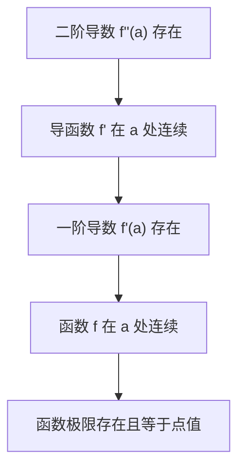
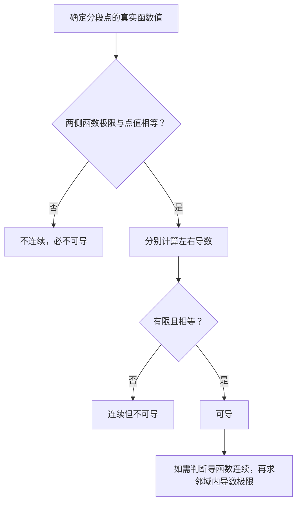

本节看起来只是导数的定义，但实际上是整个一元函数微分学的理论基础，也是考研数学中非常容易设计概念陷阱和创新题目的地方。

**本节最核心的思想：导数就是函数增量中一阶线性变化部分的系数。**

掌握这一思想之后，差商极限、分段函数、抽象函数、绝对值函数、振荡函数、补值函数、变上限积分函数的可导性问题，都可以纳入同一个知识体系。

## 一、考点体系与复习重点

本节可归纳为以下九类考点。

| 核心考点         | 代表性题目            | 重要程度  |
| ------------ | ---------------- | ----- |
| 导数定义与变形差商    | 1987数二、2013数一    | ★★★★★ |
| 可导的充分必要条件    | 1989数二、2001数一    | ★★★★★ |
| 连续、可导与点值的关系  | 2007、2020、2024数一 | ★★★★★ |
| 分段函数与左右导数    | 1999、2016数一      | ★★★★★ |
| 绝对值与复合函数可导性  | 1998、2018数一      | ★★★★★ |
| 振荡函数与无穷小阶数   | 1993数三、李永乐六套卷    | ★★★★★ |
| 高阶可导性与导函数连续性 | 1992、2023数一      | ★★★★★ |
| 补值函数与导数定义    | 2021数一、张宇模拟卷     | ★★★★★ |
| 导数定义与积分综合题   | 2020数二、2026数二三   | ★★★★★ |

对于数学一而言，尤其要重视后三类，因为它们可以与泰勒公式、微分中值定理、变上限积分、参数方程等知识结合，形成综合解答题。

## 二、基础知识：真正理解导数

### 2.1 导数的定义

设函数 $f(x)$ 在点 $x_0$ 的某邻域内有定义，如果极限

$$
\lim_{h\to0}\frac{f(x_0+h)-f(x_0)}{h}
$$

存在且为有限实数，则称 $f(x)$ 在 $x_0$ 处可导，并定义

$$
\boxed{ f'(x_0)=\lim_{h\to0} \frac{f(x_0+h)-f(x_0)}{h} }
$$

令 $x=x_0+h$，得到另一种完全等价的定义：

$$
\boxed{ f'(x_0)=\lim_{x\to x_0} \frac{f(x)-f(x_0)}{x-x_0} }
$$

理解导数定义时，要始终检查四个要素：

- **基点**：$x_0$。
- **自变量增量**：$h=x-x_0$。
- **函数增量**：$f(x_0+h)-f(x_0)$。
- **极限要求**：双侧趋近，且极限是有限实数。

这四个要素缺少任何一个，都可能导致错误地识别导数。

### 2.2 几何意义：割线斜率趋于切线斜率

曲线上两点

$$
P=(x_0,f(x_0)),\qquad Q=(x_0+h,f(x_0+h))
$$

之间的割线斜率为

$$
k_{PQ}=\frac{f(x_0+h)-f(x_0)}h.
$$

当 $h\to0$ 时，如果割线斜率趋于一个有限值，这个值就是切线斜率。

因此曲线在 $P$ 点的切线方程为

$$
\boxed{ y-f(x_0)=f'(x_0)(x-x_0) }
$$

需要特别注意：**存在切线不一定意味着导数存在。**

例如

$$
f(x)=\sqrt[3]{x}
$$

在原点的差商为

$$
\frac{f(x)-f(0)}x =\frac1{x^{2/3}}\to+\infty.
$$

曲线具有竖直切线 $x=0$，但按照考研数学中的通常定义，$f'(0)$ 不存在，因为导数必须是有限实数。

### 2.3 导数定义的本质：一阶线性展开

这是整个章节最重要的公式。

如果 $f(x)$ 在 $x=a$ 处可导，那么

$$
\lim_{h\to0} \left[ \frac{f(a+h)-f(a)}h-f'(a) \right]=0.
$$

因此可以写成

$$
\boxed{ f(a+h)=f(a)+f'(a)h+o(h) }
$$

反过来，如果存在常数 $A$，使得

$$
f(a+h)=f(a)+Ah+o(h),
$$

那么 $f$ 在 $a$ 处可导，并且 $f'(a)=A$。

故有充要条件：

$$
\boxed{ f'(a)=A \iff f(a+h)-f(a)=Ah+o(h) }
$$

这不是必须具有二阶导数才能使用的泰勒公式，只要函数在该点可导就可以使用。

**直观理解**

当 $h$ 很小时，

$$
\underbrace{f(a+h)-f(a)}_{\text{实际函数增量}} = \underbrace{f'(a)h}_{\text{主要线性变化}} + \underbrace{o(h)}_{\text{更高阶误差}}.
$$

导数就是线性主项前面的系数。

例如，如果已经知道

$$
f(1+h)=3+5h+o(h),
$$

那么可以立刻得到

$$
f(1)=3,\qquad f'(1)=5.
$$

不需要知道 $f(x)$ 的具体表达式。

**与微分的关系**

一元函数在一点可导与在该点可微等价。

$$
\Delta y=f'(x_0)\Delta x+o(\Delta x).
$$

其中线性主部

$$
\boxed{\mathrm dy=f'(x_0)\mathrm dx}
$$

就是微分。

但是如果 $f'(x_0)=0$，只能说明

$$
\Delta y=o(\Delta x),
$$

不能写成 $\Delta y\sim\mathrm dy$，因为此时 $\mathrm dy=0$。

### 2.4 导数的局部保号性质

假设

$$
f'(a)>0,
$$

那么根据导数定义的保号性，存在 $\delta>0$，当 $0<|h|<\delta$ 时，

$$
\frac{f(a+h)-f(a)}h>0.
$$

因此

$$
\begin{cases} f(a+h)>f(a),&h>0,\\ f(a+h)<f(a),&h<0. \end{cases}
$$

也就是说，在充分小的邻域内，函数值在基点左侧低于基点，在基点右侧高于基点。

但要注意：

$$
\boxed{ f'(a)>0 \not\Rightarrow f(x)\text{ 在 }a\text{ 的某邻域内单调递增} }
$$

因为一点处的导数只反映该点附近其他函数值与该点函数值的比较，并不能保证邻域内任意两点之间的大小关系。

若进一步知道 $f'$ 在 $a$ 处连续，则由 $f'(a)>0$ 可以推出某邻域内 $f'(x)>0$，从而利用拉格朗日中值定理得到严格单调递增。

这是李正元练习题中的重要概念考点，也是后续导数应用章节的基础。

### 2.5 连续、可导、导函数连续与二阶可导

这几个概念是考研选择题最喜欢混淆的对象。

在有关函数均于相应邻域内有定义的前提下，有如下单向推导关系：

上述箭头一般都不能逆推。

| 函数（在原点考察）             | 连续 | 一阶可导 | 一阶导数连续 | 二阶可导 |
| --------------------- | -- | ---- | ------ | ---- |
| $\lvert x\rvert$  | 是  | 否    | 否      | 否    |
| $x^2\sin\frac1x$  | 是  | 是    | 否      | 否    |
| $x\lvert x\rvert$ | 是  | 是    | 是      | 否    |
| $x^2$             | 是  | 是    | 是      | 是    |

表中振荡函数在原点补值为零。

**为什么可导一定连续？**

因为

$$
f(a+h)-f(a) =h\frac{f(a+h)-f(a)}h.
$$

当 $h\to0$ 时，右侧第一个因子趋零，第二个因子趋于有限值 $f'(a)$，所以

$$
\lim_{h\to0}[f(a+h)-f(a)]=0.
$$

因此

$$
\lim_{x\to a}f(x)=f(a).
$$

**为什么连续不一定可导？**

最简单的反例就是

$$
f(x)=|x|.
$$

它在原点连续，但是

$$
\lim_{x\to0^+}\frac{|x|}{x}=1, \qquad \lim_{x\to0^-}\frac{|x|}{x}=-1.
$$

左右导数不相等，所以不可导。

**一个非常重要的补充定理**

若 $f(x)$ 在 $a$ 处连续，在 $a$ 的某去心邻域内可导，并且

$$
\lim_{x\to a}f'(x)=A
$$

存在，则

$$
\boxed{f'(a)=A}
$$

且导函数在该点连续。

证明：利用拉格朗日中值定理，

$$
\frac{f(a+h)-f(a)}h=f'(a+\theta h), \qquad 0<\theta<1.
$$

令 $h\to0$，即得结论。

这个定理必须有**原函数在基点连续**的条件。缺少这个条件时，即使导函数的极限存在，也不能保证基点处可导。

### 2.6 左导数与右导数

定义

$$
f'_-(a)=\lim_{h\to0^-} \frac{f(a+h)-f(a)}h,
$$

$$
f'_+(a)=\lim_{h\to0^+} \frac{f(a+h)-f(a)}h.
$$

则有本节最基本的充要条件：

$$
\boxed{ f'(a)\text{存在} \iff f'_-(a)=f'_+(a) }
$$

其中两个单侧导数都必须存在且有限。

如果函数定义在闭区间 $[a,b]$ 上，端点通常考察相应的单侧导数。

### 2.7 无穷小阶数与可导性的关系

假设 $f(a)=0$，研究 $h\to0$ 时 $f(a+h)$ 的阶数。

| 已知条件                            | 能否推出可导         |
| ------------------------------- | -------------- |
| $f(a+h)=o(1)$               | 只能保证连续         |
| $f(a+h)=O(h)$               | 不一定            |
| $f(a+h)=o(h)$               | 可导，导数为零        |
| $f(a+h)=Ah+o(h)$            | 可导，导数为 $A$ |
| $f(a+h)=O(\lvert h\rvert ^p),\ p>1$   | 可导，导数为零        |
| $f(a+h)\sim c\lvert h\rvert ,\ c\ne0$ | 不可导            |
| $f(a+h)\sim ch,\ c\ne0$     | 可导，导数为 $c$ |

特别强调一个经常失分的细节：如果只知道去心邻域内

$$
f(a+h)=B+Ah+o(h),
$$

必须额外确认 $f(a)=B$，才能推出 $f'(a)=A$。如果已知连续，则点值匹配自然成立。

**无穷小的阶数决定差商的大小，点值匹配决定这个差商是否真的是导数。**

## 三、题型一：导数定义的识别与变形差商

这是本节最基础，也是其他题型的共同出发点。

### 3.1 标准模型

若已知 $f'(a)$ 存在，则

$$
\boxed{ \lim_{h\to0} \frac{f(a+kh)-f(a)}h=kf'(a) }
$$

进一步，

$$
\boxed{ \lim_{h\to0} \frac{f(a+ph)-f(a+qh)}h =(p-q)f'(a) }
$$

其中 $p,q,k$ 为任意实数。

其本质是：

$$
f(a+ph)=f(a)+pf'(a)h+o(h),
$$

$$
f(a+qh)=f(a)+qf'(a)h+o(h).
$$

两式相减即可。

### 母题1：1987年考研数学二

设 $f(x)$ 在 $x=a$ 处可导，求

$$
\lim_{x\to0} \frac{f(a+x)-f(a-x)}x.
$$

<Tabs items={["方法一：加减基点值", "方法二：一阶展开"]} defaultIndex={0}>

<Tab value="方法一：加减基点值">

$$
\begin{aligned} &\frac{f(a+x)-f(a-x)}x\\ ={}&\frac{f(a+x)-f(a)}x +\frac{f(a-x)-f(a)}{-x}. \end{aligned}
$$

两个部分都趋于 $f'(a)$，所以

$$
\boxed{2f'(a)}
$$

</Tab>

<Tab value="方法二：一阶展开">

$$
f(a+x)=f(a)+f'(a)x+o(x),
$$

$$
f(a-x)=f(a)-f'(a)x+o(x).
$$

因此

$$
f(a+x)-f(a-x)=2f'(a)x+o(x).
$$

结论相同。

</Tab>

</Tabs>

**推广：李林880题基础题**

求

$$
\lim_{\Delta x\to0} \frac{f(x+a\Delta x)-f(x-b\Delta x)} {\Delta x}.
$$

直接使用上述模型，得到

$$
\boxed{(a+b)f'(x)}.
$$

掌握系数相减的原理即可，不必为各种形式分别背公式。

### 3.2 复合增量差商

如果 $f$ 在 $a$ 处可导，并且

$$
u(x)\to0,\qquad \frac{u(x)}{v(x)}\to A,
$$

那么在商有定义的条件下，

$$
\boxed{ \lim_{x\to x_0} \frac{f(a+u(x))-f(a)}{v(x)} =Af'(a) }
$$

核心拆分为

$$
\frac{f(a+u)-f(a)}v = \frac{f(a+u)-f(a)}u\cdot\frac uv.
$$

也可以通过一阶展开处理 $u=0$ 的情形。

**常见增量的主项**

当 $x\to0$ 时：

| 增量                 | 一阶或首个非零主项               |
| ------------------ | ----------------------- |
| $\sin x$       | $x$                 |
| $\tan x$       | $x$                 |
| $e^x-1$        | $x$                 |
| $\ln(1+x)$     | $x$                 |
| $1-\cos x$     | $\frac12x^2$        |
| $x-\sin x$     | $\frac16x^3$        |
| $\sqrt{1+x}-1$ | $\frac12x$          |
| $(1+x)^m-1$    | $mx$，其中 $m\ne0$ |

将第一模块的等价无穷小与导数定义结合，便是这一类题的通用解法。

### 母题2：李正元练习题

设 $f'(1)$ 存在，求

$$
\lim_{x\to0} \frac{f(1+x)+f(1+2\sin x)-2f(1-3\tan x)}x.
$$

**识别题型**

三个函数值的自变量都趋于 $1$，分母趋于零。

因此围绕同一个基点 $a=1$ 展开。

$$
f(1+x)=f(1)+f'(1)x+o(x),
$$

$$
f(1+2\sin x) =f(1)+2f'(1)x+o(x),
$$

$$
f(1-3\tan x) =f(1)-3f'(1)x+o(x).
$$

代入分子，常数项恰好抵消：

$$
\begin{aligned} &f(1+x)+f(1+2\sin x)-2f(1-3\tan x)\\ ={}&(1+2+6)f'(1)x+o(x). \end{aligned}
$$

所以

$$
\boxed{9f'(1)}.
$$

**通用母公式**

若 $f$ 在 $a$ 处可导，且

$$
u_i(x)=k_ix+o(x),\qquad \sum_{i=1}^n c_i=0,
$$

则

$$
\boxed{ \lim_{x\to0} \frac{\displaystyle\sum_{i=1}^n c_if(a+u_i(x))}{x} =f'(a)\sum_{i=1}^n c_ik_i }
$$

这可以解决大量看似复杂的抽象函数差商题。

如果系数之和不为零，则还必须检查 $f(a)$ 是否为零。

### 母题3：李林六套卷第1套第11题

设 $f(x)$ 在 $x=1$ 处连续，且

$$
\lim_{x\to1} \frac{f(x)-5x+2}{\ln x}=1.
$$

求 $f'(1)$。

<Steps>

<Step>

### 第一步：利用极限存在确定点值 [!toc]

由于分母趋零，商趋于有限数，所以分子必须趋于零。

$$
f(1)-5+2=0.
$$

于是

$$
f(1)=3.
$$

</Step>

<Step>

### 第二步：构造标准导数定义 [!toc]

$$
\begin{aligned} f'(1) &=\lim_{x\to1}\frac{f(x)-3}{x-1}\\ &=\lim_{x\to1} \left[ \frac{f(x)-5x+2}{x-1}+5 \right]. \end{aligned}
$$

继续拆分：

$$
\begin{aligned} f'(1) &=\lim_{x\to1} \frac{f(x)-5x+2}{\ln x} \cdot\frac{\ln x}{x-1}+5\\ &=1+5. \end{aligned}
$$

故

$$
\boxed{f'(1)=6}.
$$

这道题不仅计算了导数，还证明了原函数在该点可导。

</Step>

</Steps>

**方法提炼**

更一般地，若 $f$ 在 $a$ 处连续，$\varphi$ 在 $a$ 处可导，并且

$$
\lim_{x\to a} \frac{f(x)-\varphi(x)}{x-a}=L,
$$

则先有

$$
f(a)=\varphi(a),
$$

再有

$$
\boxed{f'(a)=L+\varphi'(a)}.
$$

以后遇到已知一个复杂极限、要求抽象函数导数的题，优先考虑这种拆分方法。

### 母题4：2013年考研数学一

设函数 $y=f(x)$ 由方程

$$
y-x=e^{x(1-y)}
$$

确定，求

$$
\lim_{n\to\infty} n\left[f\left(\frac1n\right)-1\right].
$$

<Steps>

<Step>

### 第一步：发现隐藏的导数 [!toc]

看到 $n\to\infty$ 与 $1/n$，令

$$
h=\frac1n.
$$

令原方程中的 $x=0$，得到

$$
f(0)=1.
$$

因此原式变成

$$
\lim_{n\to\infty} \frac{f(1/n)-f(0)}{1/n}.
$$

如果函数在原点可导，它就等于 $f'(0)$。

</Step>

<Step>

### 第二步：隐函数求导 [!toc]

对原方程两边求导：

$$
y'-1=e^{x(1-y)}(1-y-xy').
$$

令 $x=0,y=1$，得到

$$
y'-1=0.
$$

所以

$$
f'(0)=1.
$$

原极限为

$$
\boxed{1}.
$$

此处隐函数在 $(0,1)$ 附近的可导性也可以由隐函数定理保证。

</Step>

</Steps>

<Callout type="warn" title="重要陷阱：数列差商不能反推可导">

如果已知

$$
\lim_{n\to\infty} n[f(a+1/n)-f(a)]
$$

存在，能否反推出 $f'(a)$ 存在？

不能。

这个极限只考察特定数列 $h_n=1/n$，不代表所有趋于零的增量。

例如取

$$
f(x)= \begin{cases} x\sin\frac{\pi}{x},&x\ne0,\\ 0,&x=0. \end{cases}
$$

有

$$
nf(1/n)=\sin(n\pi)=0,
$$

但

$$
\frac{f(x)-f(0)}x=\sin\frac{\pi}{x}
$$

没有极限，因此不可导。

这个陷阱也出现在李林880题综合题第060题中。

</Callout>

## 四、题型二：判断可导的充分条件与充要条件

这一类题与上一类有一个本质区别：

上一类已经告诉你 $f'(a)$ 存在，现在是要求你根据某个极限反推出 $f'(a)$ 是否存在。

正向推理成立，不意味着逆向推理也成立。

### 4.1 三项检查原则

对于极限

$$
\lim_{h\to0} \frac{f(a+\varphi(h))-f(a)}{\psi(h)}
$$

是否能推出 $f'(a)$ 存在，要检查：

**第一，点值是否正确。** 分子是否减去了真实的 $f(a)$。

**第二，趋近范围是否完整。** 令 $t=\varphi(h)$ 后，是否覆盖零点左右两侧的邻域，而不是仅从一侧或沿某些离散点趋近。

**第三，增量阶数是否匹配。** 检查

$$
\lim_{h\to0}\frac{\varphi(h)}{\psi(h)}
$$

是否为非零有限常数。

在上述条件满足时，可以将原极限与导数定义建立双向等价。

### 母题5：2001年考研数学一

设 $f(0)=0$，下列哪个条件是 $f(x)$ 在原点可导的充要条件？

| 选项 | 极限存在                                                    |
| -- | ------------------------------------------------------- |
| A  | $\displaystyle\lim_{h\to0}\frac{f(1-\cos h)}{h^2}$ |
| B  | $\displaystyle\lim_{h\to0}\frac{f(1-e^h)}h$        |
| C  | $\displaystyle\lim_{h\to0}\frac{f(h-\sin h)}{h^2}$ |
| D  | $\displaystyle\lim_{h\to0}\frac{f(2h)-f(h)}h$      |

**分析A：阶数匹配，但缺少左侧信息**

由于

$$
1-\cos h\sim\frac12h^2,
$$

令

$$
t=1-\cos h\ge0.
$$

原极限等价于

$$
\frac12\lim_{t\to0^+}\frac{f(t)}t.
$$

只说明右导数存在，无法控制左导数。

反例：

$$
f(x)=|x|.
$$

选项中的极限存在，但原点不可导。

所以A不是充分条件。

**分析B：双侧覆盖且阶数匹配**

令

$$
t=1-e^h.
$$

由于

$$
t\sim-h,
$$

且该变量代换在零点附近连续可逆，所以 $h\to0$ 时，$t$ 覆盖零点两侧。

$$
\frac{f(1-e^h)}h =\frac{f(t)}t\cdot\frac th.
$$

其中

$$
\frac th\to-1.
$$

故

$$
\lim_{h\to0}\frac{f(1-e^h)}h \text{存在} \iff \lim_{t\to0}\frac{f(t)}t \text{存在}.
$$

选项B正确。

如果左边极限为 $L$，还有

$$
\boxed{f'(0)=-L}.
$$

**分析C：双侧覆盖，但阶数不匹配**

因为

$$
h-\sin h\sim\frac16h^3.
$$

真实自变量增量是三阶小量，分母却是二阶小量。

取反例

$$
f(t)=|t|^{2/3}.
$$

则

$$
\frac{f(h-\sin h)}{h^2} \to\left(\frac16\right)^{2/3}.
$$

但

$$
\frac{f(t)}t =\frac{|t|^{2/3}}t
$$

不具有有限极限。

因此C错误。

**分析D：两个移动点不能直接代替固定基点**

取

$$
f(x)= \begin{cases} 1,&x\ne0,\\ 0,&x=0. \end{cases}
$$

对于 $h\ne0$，

$$
f(2h)-f(h)=0.
$$

所以题设极限存在，但函数在原点甚至不连续。

因此D不是充分条件。

最终答案：

$$
\boxed{\mathrm B}
$$

**真题迁移**

李林六套卷第6套第3题将正确选项变成

$$
\lim_{x\to0}\frac{f(e^x-1)}x.
$$

李林880题将正确选项变成

$$
\lim_{x\to0} \frac{f(a+x^3)-f(a)}{\tan(x^3)}.
$$

虽然形式不同，但都是同一个模型：**双侧覆盖、真实增量、阶数匹配。**

### 4.2 高难度模拟题：汤家凤八套卷第6套第1题

若有限极限

$$
\lim_{x\to0} \frac{f(|x|^x)-f(1)}{1-\cos(\pi x)}
$$

存在，判断 $f(x)$ 在 $x=1$ 处的连续性与可导性。

这道题比2001年真题更进一步：真实增量与分母不同阶，但仍然可以推出可导。

令

$$
t=|x|^x=e^{x\ln|x|}.
$$

当 $x\to0$ 时，

$$
t-1\sim x\ln|x|.
$$

而

$$
1-\cos(\pi x)\sim\frac{\pi^2x^2}{2}.
$$

构造真正的导数差商：

$$
\begin{aligned} \frac{f(t)-f(1)}{t-1} ={}& \frac{f(|x|^x)-f(1)}{1-\cos(\pi x)} \\ &\cdot \frac{1-\cos(\pi x)} {e^{x\ln|x|}-1}. \end{aligned}
$$

第二项满足

$$
\frac{1-\cos(\pi x)} {e^{x\ln|x|}-1} \sim\frac{\pi^2x}{2\ln|x|} \to0.
$$

第一项趋于有限实数，因此整个差商趋于零。

还需确认 $t$ 的趋近范围：

当 $x\to0^+$ 时，$t\to1^-$；当 $x\to0^-$ 时，$t\to1^+$。该映射在充分小的两侧区间连续且单调，因而覆盖 $1$ 的两侧邻域。

所以

$$
\boxed{f'(1)=0}.
$$

**升级后的阶数判据**

若

$$
Q(h)= \frac{f(a+\varphi(h))-f(a)}{\psi(h)} \to L,
$$

则真实差商为

$$
\frac{f(a+\varphi(h))-f(a)}{\varphi(h)} =Q(h)\frac{\psi(h)}{\varphi(h)}.
$$

假设变量代换覆盖双侧，有：

| $\displaystyle\lim\frac{\psi(h)}{\varphi(h)}$ | 判断结果                       |
| ------------------------------------------------- | -------------------------- |
| 非零有限常数 $C$                                    | 可导，导数为 $CL$，且具有存在性等价关系 |
| $0$                                           | 可导，导数必为零                   |
| 无穷大                                               | 一般不能推出可导                   |
| 不存在                                               | 需要进一步分析                    |

因此，阶数匹配是建立通常的**充要条件**的有效方法，但并不是推出可导的唯一方式。

## 五、题型三：对称差商、点值陷阱与反例构造

### 5.1 对称差商不等于普通导数

标准对称差商为

$$
\frac{f(a+h)-f(a-h)}{2h}.
$$

如果 $f'(a)$ 存在，则

$$
\lim_{h\to0} \frac{f(a+h)-f(a-h)}{2h} =f'(a).
$$

但是反过来不成立。

**为什么不成立？**

从函数奇偶分解的角度，可以把

$$
F(h)=f(a+h)
$$

分解成偶部和奇部：

$$
F_e(h)=\frac{F(h)+F(-h)}2,
$$

$$
F_o(h)=\frac{F(h)-F(-h)}2.
$$

于是对称差商就是

$$
\frac{F_o(h)}h.
$$

它只能检测奇部的线性变化，完全看不到偶部的尖点。

例如

$$
f(x)=|x|
$$

是偶函数，对称差商恒为零，却在原点不可导。

### 母题6：2007年考研数学一、二、三

已知 $f(x)$ 在原点连续，判断以下命题。

| 命题                                              | 正误 |
| ----------------------------------------------- | -- |
| 若 $\lim f(x)/x$ 存在，则 $f(0)=0$           | 正确 |
| 若 $\lim [f(x)+f(-x)]/x$ 存在，则 $f(0)=0$   | 正确 |
| 若 $\lim f(x)/x$ 存在，则 $f'(0)$ 存在         | 正确 |
| 若 $\lim [f(x)-f(-x)]/x$ 存在，则 $f'(0)$ 存在 | 错误 |

表中极限均指 $x\to0$。

前三个命题都可以利用连续性确定点值。第四个命题则是对称差商逆推普通导数的典型错误。

反例 $f(x)=|x|$ 即可。

**深入推广：奇函数的特殊情形**

若已知 $f(x)$ 是奇函数，则

$$
f(0)=0,\qquad f(-x)=-f(x).
$$

因此

$$
\frac{f(x)-f(-x)}{2x} =\frac{f(x)-f(0)}x.
$$

这时对称差商就是普通导数的定义。

所以，对于奇函数，原点处对称差商有限极限存在，确实可以推出原点可导。

**更强的充要条件**

一般地，$f$ 在 $a$ 处可导，当且仅当

$$
\lim_{h\to0} \frac{f(a+h)-f(a-h)}{2h}=A
$$

存在且有限，并且

$$
\lim_{h\to0} \frac{f(a+h)+f(a-h)-2f(a)}{2h}=0.
$$

因为将两式相加，恰好得到

$$
\frac{f(a+h)-f(a)}h.
$$

第一式控制奇部，第二式补足偶部的信息。这是非常适合设计创新题的结构。

### 母题7：2020年与2024年考研数学一

这两年的题目考查了相似的逻辑陷阱：**函数极限与真实点值不是一回事。**

2024年真题给出

$$
\lim_{x\to0}f(x)=0,
$$

判断：

| 选项 | 命题                                            |
| -- | --------------------------------------------- |
| A  | 若 $\lim_{x\to0}f(x)/x=m$，则 $f'(0)=m$ |
| B  | 若 $f'(0)=m$，则 $\lim_{x\to0}f(x)/x=m$ |
| C  | 若 $\lim_{x\to0}f'(x)=m$，则 $f'(0)=m$  |
| D  | 若 $f'(0)=m$，则 $\lim_{x\to0}f'(x)=m$  |

正确答案为B。

**A、C为什么错误？**

构造补值错误的函数：

$$
f(x)= \begin{cases} 0,&x\ne0,\\ 1,&x=0. \end{cases}
$$

显然

$$
\lim_{x\to0}f(x)=0,
$$

$$
\lim_{x\to0}\frac{f(x)}x=0, \qquad \lim_{x\to0}f'(x)=0.
$$

但函数在原点不连续，故不可导。

**B为什么正确？**

如果 $f'(0)=m$，则由可导必连续，

$$
f(0)=\lim_{x\to0}f(x)=0.
$$

从而

$$
\lim_{x\to0}\frac{f(x)}x =\lim_{x\to0}\frac{f(x)-f(0)}x =f'(0)=m.
$$

**D为什么错误？**

取

$$
f(x)= \begin{cases} x^2\sin\frac1x,&x\ne0,\\ 0,&x=0. \end{cases}
$$

有

$$
f'(0)=\lim_{x\to0}x\sin\frac1x=0.
$$

然而当 $x\ne0$ 时，

$$
f'(x)=2x\sin\frac1x-\cos\frac1x.
$$

后一项不断振荡，所以

$$
\lim_{x\to0}f'(x)
$$

不存在。

故D错误。

**2020年真题的迁移**

在已知

$$
\lim_{x\to0}f(x)=0
$$

时，如果 $f$ 在原点可导，则

$$
\lim_{x\to0}\frac{f(x)}{\sqrt{|x|}}=0.
$$

理由是

$$
\frac{f(x)}{\sqrt{|x|}} =\frac{f(x)}x\cdot\frac{x}{\sqrt{|x|}} \to f'(0)\cdot0=0.
$$

但反过来，即使

$$
\lim_{x\to0}\frac{f(x)}{x^2}=0,
$$

也不能仅凭这一条件断定原点可导，因为可能有错误的点值。

如果再加入 $f(0)=0$ 或原点连续，才能推出原点可导且导数为零。

### 5.2 深入专题：两个移动点的差商什么时候能推出可导？

在2001年真题中，

$$
\lim_{h\to0}\frac{f(2h)-f(h)}h
$$

存在不能保证可导。

但是，如果再增加 $f$ 在原点连续，这个结论会发生变化。

**进阶定理：** 若 $f$ 在原点连续，且

$$
\lim_{h\to0}\frac{f(2h)-f(h)}h=L,
$$

则 $f'(0)$ 存在，且

$$
f'(0)=L.
$$

**证明**

令

$$
\varepsilon(h)= \frac{f(2h)-f(h)}h-L,
$$

则 $\varepsilon(h)\to0$。

于是

$$
f(2h)-f(h)=h[L+\varepsilon(h)].
$$

对增量不断减半，构造裂项相消：

$$
\begin{aligned} f(x)-f\left(\frac{x}{2^n}\right) ={}& \sum_{k=1}^{n} \left[ f\left(\frac{x}{2^{k-1}}\right) -f\left(\frac{x}{2^k}\right) \right]\\ ={}& \sum_{k=1}^{n}\frac{x}{2^k} \left[L+\varepsilon\left(\frac{x}{2^k}\right)\right]. \end{aligned}
$$

令 $n\to\infty$，利用原点连续性，

$$
f(x)-f(0) =Lx+ x\sum_{k=1}^{\infty} \frac1{2^k}\varepsilon\left(\frac{x}{2^k}\right).
$$

当 $x\to0$ 时，右侧级数中的误差绝对值不超过

$$
\sup_{0<|t|\le |x|}|\varepsilon(t)| \sum_{k=1}^{\infty}\frac1{2^k} \to0.
$$

因此

$$
\lim_{x\to0}\frac{f(x)-f(0)}x=L.
$$

这一结论说明，考研创新题可能只需要给经典真题增加一个条件，就会改变原来的判断结果。

不能机械记忆“两个移动点的差商一定不能推出可导”，而要分析条件能够提供什么信息。

## 六、题型四：分段函数的连续与可导

### 6.1 标准解题流程

对于

$$
f(x)= \begin{cases} F_-(x),&x<a,\\ c,&x=a,\\ F_+(x),&x>a, \end{cases}
$$

首先必须检查：

$$
\lim_{x\to a^-}F_-(x)=c =\lim_{x\to a^+}F_+(x).
$$

如果不成立，则函数不可导。

如果连续，再检查

$$
\lim_{h\to0^-}\frac{F_-(a+h)-c}{h},
$$

$$
\lim_{h\to0^+}\frac{F_+(a+h)-c}{h}.
$$

二者存在且相等，才能得出可导结论。

若题目只要求可导，可以直接计算左右差商，因为左右差商存在且相等本身已经保证连续。

### 母题8：1994年考研数学二

设

$$
f(x)= \begin{cases} \frac23x^3,&x\le1,\\ x^2,&x>1. \end{cases}
$$

判断 $f'_-(1)$ 与 $f'_+(1)$ 是否存在。

容易产生的错误是直接计算：

$$
\left(\frac23x^3\right)'_{x=1}=2,
$$

$$
(x^2)'_{x=1}=2,
$$

然后认为左右导数相等。

这是错误的。

因为真实点值为

$$
f(1)=\frac23,
$$

所以右导数应由

$$
\begin{aligned} \frac{f(1+h)-f(1)}h &=\frac{(1+h)^2-\frac23}{h}\\ &=\frac1{3h}+2+h \end{aligned}
$$

计算。

当 $h\to0^+$ 时，差商趋于正无穷，所以右导数不存在。

而左导数为

$$
f'_-(1)=2.
$$

故只有左导数存在。

**分支公式在端点的导数，未必等于实际分段函数的单侧导数。** 必须先保证相应分支的函数值能够与真实点值拼接。

### 母题9：1999年考研数学一、二

亦见李林880题。

设

$$
f(x)= \begin{cases} \dfrac{1-\cos x}{\sqrt{x}},&x>0,\\[4pt] x^2g(x),&x\le0, \end{cases}
$$

其中 $g(x)$ 为有界函数。

判断 $f(x)$ 在原点的可导性。

因为 $g(x)$ 有界，存在 $M>0$，使得零点附近

$$
|g(x)|\le M.
$$

首先，

$$
f(0)=0.
$$

右导数为

$$
\begin{aligned} f'_+(0) &=\lim_{x\to0^+} \frac{1-\cos x}{x^{3/2}}\\ &=\lim_{x\to0^+}\frac{\frac12x^2}{x^{3/2}}\\ &=0. \end{aligned}
$$

左侧差商满足

$$
\left|\frac{f(x)}x\right| =|xg(x)|\le M|x|\to0.
$$

根据夹逼定理，

$$
f'_-(0)=0.
$$

因此

$$
\boxed{f'(0)=0}.
$$

**母题规律**

如果函数可以写成

$$
f(a+h)=f(a)+Ah+h^pG(h)
$$

（例如 $p$ 为大于1的整数），且 $G(h)$ 有界，那么

$$
f'(a)=A.
$$

不需要 $G$ 连续，不需要 $G$ 可导，甚至不需要 $G(h)$ 存在极限。

这就是无穷小压制有界振荡的原理。

### 母题10：李正元练习题——确定分段参数

设

$$
f(x)= \begin{cases} x^2\sin\frac1x,&x>0,\\ ax+b,&x\le0, \end{cases}
$$

且在原点可导，求 $a,b$。

第一步，由连续性，

$$
b=f(0)=\lim_{x\to0^+}x^2\sin\frac1x=0.
$$

第二步，由右导数，

$$
f'_+(0) =\lim_{x\to0^+}x\sin\frac1x=0.
$$

左导数为

$$
f'_-(0)=a.
$$

于是

$$
\boxed{a=0,\qquad b=0}.
$$

**参数题的通用规律**

如果要求分段函数：

| 要求          | 通常建立的条件           |
| ----------- | ----------------- |
| 连续          | 两侧零阶项与点值相等        |
| 一阶可导        | 再要求一阶项系数相等        |
| 二阶可导        | 再检查两侧一阶导函数的差商     |
| $n$ 阶可导 | 逐阶检查直至第 $n$ 阶 |

当两侧分支均具有充分光滑的延拓时，可以直接利用泰勒系数的匹配来简化计算。

### 母题11：2016年考研数学一——阶梯函数创新题

设

$$
f(x)= \begin{cases} x,&x\le0,\\[2pt] \dfrac1n,&\dfrac1{n+1}<x\le\dfrac1n, \quad n=1,2,\ldots \end{cases}
$$

判断 $f(x)$ 在原点的可导性。

**为什么这道题容易误判？**

在正半轴上，这是一个阶梯函数。

在原点附近存在无穷多个跳跃间断点，所以容易误以为原点一定不可导。

但导数定义只关心函数增量与原点的距离之比，而不要求附近每一个点都连续。

**左导数**

因为 $x\le0$ 时 $f(x)=x$，所以

$$
f'_-(0)=1.
$$

**右导数**

当

$$
\frac1{n+1}<x\le\frac1n
$$

时，

$$
f(x)=\frac1n.
$$

由上述不等式可得

$$
1\le\frac{f(x)}x<\frac{n+1}{n}.
$$

当 $x\to0^+$ 时，$n\to\infty$。

根据夹逼定理，

$$
\lim_{x\to0^+}\frac{f(x)}x=1.
$$

所以

$$
f'_+(0)=1.
$$

最终

$$
\boxed{f'(0)=1}.
$$

**重要结论**

一点处可导，只要求该点处存在一阶线性近似。

即使函数在任意小邻域内存在无穷多个间断点，只要满足

$$
f(x)=f(0)+Ax+o(x),
$$

它仍然可以在原点可导。

这是真正理解“在一点处可导”与“在一个邻域内可导”的关键。

## 七、题型五：绝对值函数与复合函数的可导性

绝对值是考研数学中制造不可导点最常用的方式之一，但绝对值的出现并不必然导致不可导。

### 7.1 核心定理：$|f(x)|$ 的可导性

假设 $f(x)$ 在 $a$ 处可导。

**情形一：$f(a)\ne0$**

由连续性，$f(x)$ 在 $a$ 附近保持符号。

因此 $|f(x)|$ 在 $a$ 处可导，并且

$$
\boxed{ (|f|)'(a)=\operatorname{sgn}(f(a))f'(a) }
$$

**情形二：$f(a)=0$，但 $f'(a)\ne0$**

利用一阶展开，

$$
f(a+h)=f'(a)h+o(h).
$$

于是

$$
|f(a+h)|=|f'(a)||h|+o(|h|).
$$

故

$$
(|f|)'_+(a)=|f'(a)|,
$$

$$
(|f|)'_-(a)=-|f'(a)|.
$$

两侧不同，因此不可导。

**情形三：$f(a)=0$，且 $f'(a)=0$**

有

$$
f(a+h)=o(h).
$$

于是

$$
\left|\frac{|f(a+h)|}{h}\right| =\frac{|f(a+h)|}{|h|}\to0.
$$

所以 $|f(x)|$ 在 $a$ 处可导，且导数为零。

**总结**

在 $f$ 于 $a$ 处可导的前提下，

$$
\boxed{ |f(x)|\text{在 }a\text{ 处可导} \iff f(a)\ne0\ \text{或}\ f'(a)=0 }
$$

绝对值内函数的一重零点通常产生尖点，高阶零点则可能消除尖点。

### 母题12：1998年考研数学一、二

求函数

$$
f(x)=(x^2-x-2)|x^3-x|
$$

的不可导点个数。

<Steps>

<Step>

### 第一步：寻找候选点 [!toc]

绝对值内部

$$
x^3-x=x(x-1)(x+1).
$$

候选点为

$$
x=-1,\quad x=0,\quad x=1.
$$

其他位置绝对值内部不为零，函数局部由光滑公式确定，不会产生新的不可导点。

</Step>

<Step>

### 第二步：检查外部因子是否消除尖点 [!toc]

因为

$$
x^2-x-2=(x-2)(x+1),
$$

所以在 $x=-1$ 处，绝对值内部与外部因子同时为零。

令 $h=x+1$，则

$$
x^3-x=2h+O(h^2),
$$

$$
x^2-x-2=-3h+O(h^2).
$$

于是

$$
f(-1+h)=O(h^2).
$$

且 $f(-1)=0$，因此

$$
f'(-1)=0.
$$

所以 $x=-1$ 并不是不可导点。

在 $x=0$ 与 $x=1$ 处，外部因子均不为零，绝对值内部均为一重零点，尖点不能被消除。

故不可导点为

$$
\boxed{x=0,\quad x=1}.
$$

共有两个。

</Step>

</Steps>

**通用公式：乘积绝对值模型**

若 $u,v$ 在 $a$ 处均可导，令

$$
F(x)=u(x)|v(x)|.
$$

若 $v(a)=0$，则

$$
F(a+h)=u(a)|v'(a)||h|+o(|h|).
$$

因此

$$
\boxed{ F'(a)\text{存在} \iff u(a)v'(a)=0 }
$$

在该条件下，$F'(a)=0$。

如果 $v(a)\ne0$，则直接去绝对值求导即可。

### 母题13：2018年考研数学一、二、三

核心题库第023题，同时收录于李林880题。

判断下列函数中哪个在原点不可导。

| 函数                          | 原点附近的函数增量主项         | 是否可导 |
| --------------------------- | ------------------- | ---- |
| $\lvert x\rvert \sin\lvert x\rvert $        | $x^2$           | 是    |
| $\lvert x\rvert \sin\sqrt{\lvert x\rvert }$ | $\lvert x\rvert ^{3/2}$   | 是    |
| $\cos\lvert x\rvert $             | $-\frac12x^2$   | 是    |
| $\cos\sqrt{\lvert x\rvert }$      | $-\frac12\lvert x\rvert $ | 否    |

注意，第三、第四个函数的原点函数值均为1，因此表中考察的是函数增量。

重点分析最后一个函数：

$$
f(x)=\cos\sqrt{|x|}.
$$

因为

$$
f(0)=1,
$$

且

$$
\cos\sqrt{|x|}-1\sim-\frac12|x|,
$$

所以

$$
\frac{f(x)-f(0)}x \sim-\frac12\frac{|x|}{x}.
$$

于是

$$
f'_+(0)=-\frac12, \qquad f'_-(0)=\frac12.
$$

左右不相等，所以不可导。

**迁移技巧：复合函数的阶数相乘**

如果外层函数在零点附近的首个非零增量为

$$
F(t)-F(0)\sim ct^m,
$$

内层函数满足

$$
t(x)\sim k|x|^\alpha,
$$

则通常有

$$
F(t(x))-F(0) \sim ck^m|x|^{m\alpha},
$$

这里 $m$ 为正整数，$c,k\ne0$。

因此：

- 当 $m\alpha>1$ 时，函数在原点可导且导数为零。
- 当 $m\alpha=1$ 时，需要重点检查两侧符号，可能形成尖点。
- 当 $m\alpha<1$ 时，在上述非零主项条件下，不存在有限导数。

例如

$$
F(x)=\cos\sqrt[3]{|x|}
$$

的函数增量为

$$
F(x)-1\sim-\frac12|x|^{2/3}.
$$

因此原点不可导。

不要试图在不可导的中间变量上机械套链式法则，而应该直接观察最终函数增量。

### 母题14：张宇8套卷第1套第2题

设 $f(x)$ 可导，

$$
F(x)=f(x)[1-|\ln(1+x)|].
$$

求 $F(x)$ 在原点可导的条件。

**一阶展开法**

已知

$$
f(x)=f(0)+f'(0)x+o(x),
$$

并且

$$
|\ln(1+x)|=|x|+o(|x|).
$$

故

$$
\begin{aligned} F(x) &=[f(0)+f'(0)x+o(x)]\\ &\quad\cdot[1-|x|+o(|x|)]\\ &=f(0)+f'(0)x-f(0)|x|+o(|x|). \end{aligned}
$$

于是

$$
F'_+(0)=f'(0)-f(0),
$$

$$
F'_-(0)=f'(0)+f(0).
$$

要使二者相等，必须且只需

$$
\boxed{f(0)=0}.
$$

这时

$$
\boxed{F'(0)=f'(0)}.
$$

**更一般的结论**

若 $A,B$ 在 $a$ 处可导，且

$$
B(a+h)=B(a)+ch+o(h),
$$

考虑

$$
F(a+h)=A(a+h)[B(a+h)+k|h|].
$$

其中潜在的一阶尖点系数就是

$$
kA(a).
$$

因此在 $k\ne0$ 时，消除该尖点的条件是 $A(a)=0$。

### 7.2 进阶：绝对值乘积不要求原函数连续

李林880题综合题第057题。

设 $f(x)$ 在原点附近有定义，不保证连续，求

$$
F(x)=f(x)|\sin x|
$$

在原点可导的充要条件。

由于

$$
F(0)=0,
$$

所以

$$
\frac{F(x)-F(0)}x =f(x)\frac{|\sin x|}{x}.
$$

当 $x\to0^+$ 时，

$$
\frac{|\sin x|}{x}\to1,
$$

因此

$$
F'_+(0)=\lim_{x\to0^+}f(x).
$$

当 $x\to0^-$ 时，

$$
\frac{|\sin x|}{x}\to-1,
$$

因此

$$
F'_-(0)=-\lim_{x\to0^-}f(x).
$$

故充要条件是两个有限单侧极限存在，且

$$
\boxed{ \lim_{x\to0^+}f(x) =-\lim_{x\to0^-}f(x) }.
$$

例如取

$$
f(x)=\operatorname{sgn}(x),
$$

虽然 $f(x)$ 在原点不连续，但在原点附近有

$$
F(x)=\operatorname{sgn}(x)|\sin x|=\sin x.
$$

所以 $F'(0)=1$。

**整体函数可导，不意味着组成它的每个因子都必须可导或连续。**

### 7.3 2025年考研数学二：绝对值逆向判定

已知 $f(x)$ 连续，以下四个有限极限存在的条件，哪些可以单独推出 $f'(0)$ 存在？

$$
①\quad\lim_{x\to0}\frac{|f(x)|-f(0)}x,
$$

$$
②\quad\lim_{x\to0}\frac{f(x)-|f(0)|}x,
$$

$$
③\quad\lim_{x\to0}\frac{|f(x)|}x,
$$

$$
④\quad\lim_{x\to0}\frac{|f(x)|-|f(0)|}x.
$$

答案是四个条件全部可以。

其中最值得掌握的是③、④。

**条件③**

因为

$$
\frac{|f(x)|}{x} \begin{cases} \ge0,&x>0,\\ \le0,&x<0, \end{cases}
$$

所以如果双侧有限极限存在，那么只能等于零。

即

$$
\lim_{x\to0}\frac{|f(x)|}{|x|}=0.
$$

由连续性可知 $f(0)=0$，进而由夹逼定理，

$$
\lim_{x\to0}\frac{f(x)-f(0)}x=0.
$$

故 $f'(0)=0$。

**条件④**

条件④意味着 $|f(x)|$ 在原点可导。

若 $f(0)\ne0$，利用连续函数的局部保号性，可以去掉绝对值并推出 $f$ 可导。

若 $f(0)=0$，则退化为条件③，仍可推出可导。

对于①、②，由连续性和分子趋零，可以先推出 $f(0)=|f(0)|$，再分别化归到④和标准导数定义。

因此得到一个非常重要的逆向结论：

$$
\boxed{ \begin{gathered} f\text{ 在 }a\text{ 处连续，}\\ |f|\text{ 在 }a\text{ 处可导} \end{gathered} \Longrightarrow f\text{ 在 }a\text{ 处可导} }
$$

反方向一般不成立，例如 $f(x)=x$。

如果去掉连续性条件，也不能普遍反推。例如原点处发生跳跃的符号函数可以具有恒为1的绝对值，却不连续。

## 八、题型六：振荡函数的可导性与导函数连续性

这是本节最重要的进阶专题之一，必须掌握参数化的一般规律，而不是只记住几个固定反例。

### 8.1 振荡函数的三层判定

考虑

$$
f(x)= \begin{cases} |x|^\alpha\sin\frac1{|x|^\beta},&x\ne0,\\ 0,&x=0, \end{cases}
$$

其中 $\alpha,\beta>0$。

这个函数包含两个不同部分：

$$
\underbrace{|x|^\alpha}_{\text{振幅}} \cdot \underbrace{\sin(|x|^{-\beta})}_{\text{振荡}}.
$$

振幅控制函数值大小，振荡相位控制函数变化速度。

**第一层：函数是否连续**

因为

$$
|f(x)|\le |x|^\alpha,
$$

所以只要 $\alpha>0$，就有

$$
\lim_{x\to0}f(x)=0.
$$

**第二层：原点是否可导**

根据定义，

$$
\frac{f(x)-f(0)}x =\operatorname{sgn}(x)|x|^{\alpha-1} \sin(|x|^{-\beta}).
$$

当 $\alpha>1$ 时，振幅趋零，利用夹逼定理得到

$$
f'(0)=0.
$$

当 $\alpha\le1$ 时，选取数列

$$
x_n=\left(2n\pi+\frac\pi2\right)^{-1/\beta},
$$

使得

$$
\sin(x_n^{-\beta})=1.
$$

此时差商等于

$$
x_n^{\alpha-1}.
$$

再选取数列

$$
y_n=(2n\pi)^{-1/\beta},
$$

差商恒为零。

两组数列的差商不能趋于同一个有限值。

因此

$$
\boxed{f'(0)\text{存在}\iff\alpha>1}.
$$

**第三层：导函数是否连续**

当 $x\ne0$ 时，利用乘积法则及链式法则，

$$
\begin{aligned} f'(x) ={}&\alpha\operatorname{sgn}(x) |x|^{\alpha-1}\sin(|x|^{-\beta})\\ &-\beta\operatorname{sgn}(x) |x|^{\alpha-\beta-1} \cos(|x|^{-\beta}). \end{aligned}
$$

第一项趋零的条件是

$$
\alpha>1.
$$

第二项趋零的条件是

$$
\alpha-\beta-1>0.
$$

因此

$$
\boxed{ f'\text{在原点连续} \iff \alpha>\beta+1 }.
$$

必要性同样可以通过选择余弦等于1、正弦等于0的数列证明。

### 8.2 参数结论总表

在 $\alpha,\beta>0$ 的前提下：

| 参数范围                   | 原点性质             |
| ---------------------- | ---------------- |
| $0<\alpha\le1$     | 连续但不可导           |
| $1<\alpha<\beta+1$ | 可导，但导函数在原点附近无界振荡 |
| $\alpha=\beta+1$   | 可导，导函数有界振荡但不连续   |
| $\alpha>\beta+1$   | 可导且导函数连续         |

原点可导但导函数不连续的区域，正是

$$
\boxed{1<\alpha\le\beta+1}.
$$

这一规律可用于原创参数变式。

### 母题15：李永乐六套卷第5套第1题

设

$$
f(x)= \begin{cases} |x|^\lambda\cos\frac1x,&x\ne0,\\ 0,&x=0, \end{cases} \qquad 1<\lambda\le2.
$$

判断原点的可导性与导函数连续性。

由于 $\lambda>1$，

$$
\left|\frac{f(x)}x\right| \le |x|^{\lambda-1}\to0.
$$

故

$$
f'(0)=0.
$$

而当 $x\ne0$ 时，

$$
\begin{aligned} f'(x) ={}&\lambda\operatorname{sgn}(x)|x|^{\lambda-1} \cos\frac1x\\ &+|x|^{\lambda-2}\sin\frac1x. \end{aligned}
$$

因为 $\lambda\le2$，后一项不能趋于零。

当 $\lambda=2$ 时，产生有界振荡；当 $1<\lambda<2$ 时，产生无界振荡。

所以答案是

$$
\boxed{\text{原点可导，但导函数在原点不连续}}.
$$

### 8.3 李正元练习题的参数变式

设

$$
f(x)= \begin{cases} x^\lambda\sin\frac1{x^2},&x\ne0,\\ 0,&x=0, \end{cases}
$$

其中 $\lambda$ 为整数，求导函数在原点连续的条件。

因为振荡相位的指数是2，根据上述规律，

$$
\lambda>2+1=3.
$$

所以

$$
\boxed{\lambda\ge4,\quad\lambda\in\mathbb Z}.
$$

可以通过求导验证：

$$
f'(x) =\lambda x^{\lambda-1}\sin\frac1{x^2} -2x^{\lambda-3}\cos\frac1{x^2}.
$$

导函数连续要求最危险的第二项也趋于零。

### 8.4 更高阶导数的振荡模型

对于上述标准函数

$$
f(x)=|x|^\alpha\sin(|x|^{-\beta}), \qquad x\ne0,
$$

每次对振荡相位求导，都会额外损失 $\beta+1$ 阶。

因此在去心邻域内，第 $n$ 阶导数的最大振荡量级通常是

$$
|x|^{\alpha-n(\beta+1)}.
$$

对于本模型（在原点补值为零），可以进一步得到：

$$
\boxed{ f^{(n)}(0)\text{存在} \iff \alpha>n+(n-1)\beta }
$$

而

$$
\boxed{ f^{(n)}\text{在原点连续} \iff \alpha>n(\beta+1) }
$$

这里 $n$ 为正整数。

其证明思路是逐阶求导，观察第 $n-1$ 阶导数的主导振荡项，再除以 $x$ 判断第 $n$ 阶差商。必要性则通过选择相位使主导三角项取 $1$ 或 $-1$ 的数列完成。

这两条公式适用于上述标准幂振幅、幂相位模型；如果题目出现不同振荡项的抵消或其他结构，不能不加检查地套用。

以二阶导数为例：

$$
f''(0)\text{存在} \iff \alpha>\beta+2,
$$

而

$$
f''\text{连续} \iff \alpha>2\beta+2.
$$

当 $\beta=1$ 时，

$$
f'(0)\text{存在}\iff\alpha>1,
$$

$$
f'\text{连续}\iff\alpha>2,
$$

$$
f''(0)\text{存在}\iff\alpha>3,
$$

$$
f''\text{连续}\iff\alpha>4.
$$

这样便形成了一个完整的光滑性层级，而不必每遇到一种指数重新摸索。

## 九、题型七：高阶导数的存在性与分段拼接

### 9.1 高阶导数必须逐阶定义

二阶导数定义为

$$
f''(a)=\lim_{h\to0} \frac{f'(a+h)-f'(a)}h.
$$

三阶导数定义为

$$
f'''(a)=\lim_{h\to0} \frac{f''(a+h)-f''(a)}h.
$$

依此类推。

这里必须明确：

$$
f''(a)
$$

存在，不仅要求 $f'(a)$ 存在，还要求 $f'$ 在该点的某邻域内有定义，并且它本身在 $a$ 处可导。

### 母题16：1992年考研数学一

设

$$
f(x)=3x^3+x^2|x|,
$$

求 $f^{(n)}(0)$ 存在的最高阶数。

首先去掉绝对值：

$$
f(x)= \begin{cases} 4x^3,&x\ge0,\\ 2x^3,&x<0. \end{cases}
$$

由定义，

$$
f'(0)=0.
$$

非零点处，

$$
f'(x)= \begin{cases} 12x^2,&x>0,\\ 6x^2,&x<0. \end{cases}
$$

再由定义，

$$
f''(0)=\lim_{x\to0}\frac{f'(x)}x=0.
$$

继续求导：

$$
f''(x)= \begin{cases} 24x,&x>0,\\ 12x,&x<0. \end{cases}
$$

第三阶差商的左右极限分别为

$$
24,\qquad12.
$$

因此 $f'''(0)$ 不存在。

答案为

$$
\boxed{n=2}.
$$

**通用模型：分段幂函数**

设

$$
f(x)= \begin{cases} Ax^m,&x\ge0,\\ Bx^m,&x<0, \end{cases}
$$

其中 $m$ 为正整数且 $A\ne B$。

那么函数在原点具有直到第 $m-1$ 阶的导数，且这些导数均为零。

但第 $m$ 阶左右导数分别为

$$
m!A,\qquad m!B.
$$

由于不相等，故

$$
\boxed{ \text{最高存在阶数为 }m-1 }.
$$

在李正元练习题中，另有形式非常相近的函数

$$
f(x)=3x^2+x^2|x|.
$$

同样因为三阶项两侧不匹配，最高可导阶数仍为2，只是其二阶导数在原点为6。

### 母题17：2023年考研数学一、二

这是一道融合参数方程、绝对值、导数连续性和二阶可导性的代表性真题。

设函数 $y=f(x)$ 由

$$
\begin{cases} x=2t+|t|,\\ y=|t|\sin t \end{cases}
$$

确定，判断 $f(x)$、$f'(x)$、$f''(x)$ 在原点的性质。

<Steps>

<Step>

### 第一步：按参数符号消去参数 [!toc]

当 $t<0$ 时，

$$
x=t,\qquad y=-t\sin t.
$$

所以

$$
f(x)=-x\sin x,\qquad x<0.
$$

当 $t\ge0$ 时，

$$
x=3t,\qquad y=t\sin t.
$$

于是

$$
t=\frac x3, \qquad f(x)=\frac x3\sin\frac x3.
$$

所以

$$
f(x)= \begin{cases} -x\sin x,&x<0,\\[3pt] \dfrac x3\sin\dfrac x3,&x\ge0. \end{cases}
$$

</Step>

<Step>

### 第二步：判断一阶可导 [!toc]

在原点两侧，

$$
f(x)= \begin{cases} -x^2+O(x^4),&x\to0^-,\\ \dfrac19x^2+O(x^4),&x\to0^+. \end{cases}
$$

因此

$$
f'(0)=0.
$$

</Step>

<Step>

### 第三步：判断导函数连续性 [!toc]

对非零点求导：

$$
f'(x)= \begin{cases} -\sin x-x\cos x,&x<0,\\[3pt] \dfrac13\sin\dfrac x3+ \dfrac x9\cos\dfrac x3,&x>0. \end{cases}
$$

显然

$$
\lim_{x\to0^-}f'(x) =\lim_{x\to0^+}f'(x)=0=f'(0).
$$

所以 $f'$ 在原点连续。

</Step>

<Step>

### 第四步：判断二阶导数 [!toc]

左侧二阶差商为

$$
\lim_{x\to0^-}\frac{f'(x)}x=-2.
$$

右侧二阶差商为

$$
\lim_{x\to0^+}\frac{f'(x)}x=\frac29.
$$

二者不相等。

所以

$$
\boxed{ f'(x)\text{连续，但 }f''(0)\text{不存在} }.
$$

</Step>

</Steps>

**模拟题迁移：李林六套卷第2套第2题**

参数方程改为

$$
\begin{cases} x=2t-|t|,\\ y=t|e^t-1|. \end{cases}
$$

消去参数后，

$$
f(x)= \begin{cases} \dfrac x3(1-e^{x/3}),&x<0,\\ x(e^x-1),&x\ge0. \end{cases}
$$

两侧二阶主项分别为

$$
-\frac19x^2,\qquad x^2.
$$

于是

$$
f'(0)=0,
$$

导函数在原点连续，但左右二阶差商分别为

$$
-\frac29,\qquad2.
$$

因此二阶导数不存在。

这道模拟题与2023年真题的解题结构几乎完全相同，值得配套练习。

### 9.2 最容易出错的高阶导数结论

若 $f''(0)$ 存在，那么由带佩亚诺余项的泰勒公式，

$$
f(x)=f(0)+f'(0)x+\frac12f''(0)x^2+o(x^2).
$$

因此

$$
\lim_{x\to0} \frac{f(x)-f(0)-f'(0)x}{x^2} =\frac12f''(0).
$$

但是反过来，若上述极限存在，不一定说明二阶导数存在。

例如

$$
f(x)= \begin{cases} x^2+x^3\sin\frac1{x^2},&x\ne0,\\ 0,&x=0. \end{cases}
$$

它满足

$$
f'(0)=0, \qquad \lim_{x\to0}\frac{f(x)}{x^2}=1.
$$

但当 $x\ne0$ 时，

$$
f'(x)=2x+3x^2\sin\frac1{x^2} -2\cos\frac1{x^2}.
$$

于是

$$
\frac{f'(x)-f'(0)}x =2+3x\sin\frac1{x^2} -\frac2x\cos\frac1{x^2}
$$

没有有限极限，故 $f''(0)$ 不存在。

**二阶展开存在，不等于二阶导数存在。**

同样，

$$
\lim_{h\to0} \frac{f(a+h)-2f(a)+f(a-h)}{h^2}
$$

存在，也不能一般地反推 $f''(a)$ 存在。

例如 $f(x)=x|x|$ 的二阶中心差分恒为零，但原点处二阶导数不存在。

## 十、题型八：补值函数与商函数的可导性

补值函数是考研数学非常重要的一类函数。它通常由一个在某点无定义的商，通过补充点值构造连续函数，然后进一步判断可导性。

### 母题18：2021年考研数学一、二、三

设

$$
f(x)= \begin{cases} \dfrac{e^x-1}{x},&x\ne0,\\[4pt] 1,&x=0. \end{cases}
$$

判断函数在原点是否可导、是否取极值。

<Steps>

<Step>

### 第一步：验证连续 [!toc]

因为

$$
\lim_{x\to0}\frac{e^x-1}{x}=1=f(0),
$$

所以连续。

</Step>

<Step>

### 第二步：根据定义求原点导数 [!toc]

$$
\begin{aligned} f'(0) &=\lim_{x\to0}\frac{f(x)-f(0)}x\\ &=\lim_{x\to0} \frac{e^x-1-x}{x^2}. \end{aligned}
$$

利用泰勒展开，

$$
e^x=1+x+\frac12x^2+o(x^2).
$$

得到

$$
\boxed{f'(0)=\frac12}.
$$

由于导数不为零，根据费马定理的必要条件，原点不可能是极值点。

</Step>

</Steps>

**推广**

设

$$
f(x)= \begin{cases} \dfrac{\sin x}{x},&x\ne0,\\ 1,&x=0. \end{cases}
$$

则

$$
f'(0) =\lim_{x\to0}\frac{\sin x-x}{x^2}=0.
$$

进一步，由

$$
f(x)=1-\frac{x^2}{6}+O(x^4),
$$

并结合去心邻域内的导数公式，可得

$$
f''(0)=-\frac13.
$$

对于补值函数，判断一阶导数往往需要比判断连续性多展开一阶。

### 母题19：张宇模拟卷中的商函数证明题

设 $f(0)=0$，定义

$$
g(x)= \begin{cases} \dfrac{f(x)}x,&x\ne0,\\ f'(0),&x=0. \end{cases}
$$

证明：

（1）若 $f''(0)$ 存在，则

$$
g'(0)=\frac12f''(0).
$$

（2）若 $f$ 具有连续的二阶导数，则 $g'(x)$ 连续。

**第一问：利用定义**

$$
\begin{aligned} g'(0) &=\lim_{x\to0}\frac{g(x)-g(0)}x\\ &=\lim_{x\to0}\frac{f(x)-xf'(0)}{x^2}. \end{aligned}
$$

使用二阶泰勒展开，

$$
f(x)=f'(0)x+\frac12f''(0)x^2+o(x^2).
$$

所以

$$
\boxed{g'(0)=\frac12f''(0)}.
$$

也可以直接使用洛必达法则：

$$
\begin{aligned} g'(0) &=\lim_{x\to0}\frac{f'(x)-f'(0)}{2x}\\ &=\frac12f''(0). \end{aligned}
$$

**第二问：证明导函数连续**

当 $x\ne0$ 时，

$$
g'(x)=\frac{xf'(x)-f(x)}{x^2}.
$$

利用洛必达法则，

$$
\begin{aligned} \lim_{x\to0}g'(x) &=\lim_{x\to0}\frac{xf''(x)}{2x}\\ &=\frac12f''(0)\\ &=g'(0). \end{aligned}
$$

所以 $g'$ 在原点连续。

**更深入的观察**

对于原点处的导函数连续性，实际上第一问给出的 $f''(0)$ 存在条件已经足够。

因为

$$
f'(x)=f'(0)+f''(0)x+o(x),
$$

$$
f(x)=f'(0)x+\frac12f''(0)x^2+o(x^2).
$$

于是

$$
\begin{aligned} g'(x) &=\frac{xf'(x)-f(x)}{x^2}\\ &=\frac12f''(0)+o(1). \end{aligned}
$$

因此原点处不必额外要求 $f''$ 连续。

不过，如果需要证明 $g'$ 在整个实数轴上连续，还需要考虑其他点的光滑性，原模拟题的第二问条件足以保证这一点。

### 10.1 补值函数的高阶推广

设 $f$ 具有 $n+1$ 阶连续导数，并定义

$$
g(x)= \begin{cases} \dfrac{f(a+x)-f(a)}x,&x\ne0,\\ f'(a),&x=0. \end{cases}
$$

利用微积分基本定理，

$$
g(x)=\int_0^1 f'(a+tx)\,\mathrm dt.
$$

在足够光滑的条件下求 $n$ 阶导数，

$$
g^{(n)}(x) =\int_0^1t^nf^{(n+1)}(a+tx)\,\mathrm dt.
$$

令 $x=0$，得到

$$
\boxed{ g^{(n)}(0)=\frac{f^{(n+1)}(a)}{n+1} }.
$$

例如

$$
g'(0)=\frac{f''(a)}2,
$$

$$
g''(0)=\frac{f'''(a)}3,
$$

$$
g'''(0)=\frac{f^{(4)}(a)}4.
$$

这说明差商型补值函数会自然地将原函数的高阶导数转化为自身低一阶的导数。

## 十一、题型九：导数定义与变上限积分的综合

这一部分是本节最值得数学一考生深入掌握的解答题模型。

2020年数学二真题、2026年数学二三真题及多种练习题均涉及这一结构。

它们的共同思想是：**先利用原函数在一点处的局部展开，求积分函数的主项，再根据导数定义判定可导性与导函数连续性。**

### 11.1 基础工具：积分提高无穷小阶数

如果

$$
f(t)=a+bt+o(t),
$$

那么

$$
\boxed{ \int_0^x f(t)\,\mathrm dt =ax+\frac b2x^2+o(x^2) }
$$

如果

$$
f(t)=ct^m+o(t^m),
$$

其中 $m$ 为非负整数，则

$$
\boxed{ \int_0^x f(t)\,\mathrm dt =\frac{c}{m+1}x^{m+1}+o(x^{m+1}) }
$$

这一结论对正负 $x$ 均成立。

如果 $m$ 为非整数，则还要注意实数幂的定义域，不能无条件用于负数区间。

特别地，若 $f(0)=0$ 且 $f'(0)=a$，则

$$
f(t)=at+o(t),
$$

故

$$
\int_0^x f(t)\,\mathrm dt =\frac a2x^2+o(x^2).
$$

进一步，

$$
\int_0^x tf(t)\,\mathrm dt =\frac a3x^3+o(x^3).
$$

这些都是后续综合题中的基本公式。

### 母题20：张宇1000题——积分比值极限

设 $f(x)$ 在原点附近可导，且

$$
f(0)=0,\qquad f'(0)\ne0.
$$

求

$$
\lim_{x\to0} \frac{\displaystyle\int_0^{x^2}f(t)\,\mathrm dt} {x^2\displaystyle\int_0^xf(t)\,\mathrm dt}.
$$

设 $a=f'(0)\ne0$。

由导数定义，

$$
f(t)=at+o(t).
$$

因此首先建立统一公式：

$$
\int_0^s f(t)\,\mathrm dt =\frac a2s^2+o(s^2).
$$

令 $s=x^2$，分子为

$$
\frac a2x^4+o(x^4).
$$

令 $s=x$，分母为

$$
x^2\left[\frac a2x^2+o(x^2)\right] =\frac a2x^4+o(x^4).
$$

由于 $a\ne0$，可以约去非零主项，得到

$$
\boxed{1}.
$$

**为什么必须给出 $f'(0)\ne0$？**

如果 $f'(0)=0$，只能知道

$$
f(t)=o(t).
$$

此时不能确定它的首个非零主项究竟是多少阶。

例如取 $f(t)=t^2$，原极限变为

$$
\lim_{x\to0} \frac{x^6/3}{x^5/3} =\lim_{x\to0}x=0.
$$

结果已经改变。

所以题目给出的非零条件不是多余信息，而是为了保证所取主项确实有效。

### 母题21：2020年考研数学二

李正元练习题中也有相应变式。

已知 $f(x)$ 连续，且

$$
\lim_{x\to0}\frac{f(x)}x=1.
$$

定义

$$
g(x)=\int_0^1f(xt)\,\mathrm dt.
$$

求 $g'(x)$，并证明 $g'$ 在原点连续。

这道题是理解积分平滑作用的经典母题。

<Steps>

<Step>

### 第一步：变量代换 [!toc]

由于只知道 $f$ 连续，并不知道它处处可导，所以不能直接写

$$
g'(x)=\int_0^1tf'(xt)\,\mathrm dt.
$$

当 $x\ne0$ 时，令

$$
u=xt,
$$

则

$$
g(x)=\frac1x\int_0^xf(u)\,\mathrm du.
$$

负 $x$ 时同样成立，只要正确保留积分的方向。

</Step>

<Step>

### 第二步：计算非零点处导数 [!toc]

根据微积分基本定理与商法则，

$$
g'(x)= \frac{xf(x)-\displaystyle\int_0^xf(u)\,\mathrm du} {x^2}.
$$

</Step>

<Step>

### 第三步：计算原点导数 [!toc]

由 $f$ 连续，且

$$
\lim_{x\to0}\frac{f(x)}x=1,
$$

可得

$$
f(0)=0,\qquad f(x)=x+o(x).
$$

因此 $g(0)=0$，并且

$$
\int_0^xf(u)\,\mathrm du =\frac12x^2+o(x^2).
$$

故

$$
\begin{aligned} g'(0) &=\lim_{x\to0}\frac{g(x)-g(0)}x\\ &=\lim_{x\to0}\frac1{x^2} \int_0^xf(u)\,\mathrm du\\ &=\frac12. \end{aligned}
$$

</Step>

<Step>

### 第四步：单独证明导函数连续 [!toc]

因为

$$
xf(x)=x^2+o(x^2),
$$

所以

$$
\begin{aligned} \lim_{x\to0}g'(x) &=\lim_{x\to0} \frac{x^2+o(x^2)-\frac12x^2-o(x^2)} {x^2}\\ &=\frac12\\ &=g'(0). \end{aligned}
$$

因此导函数在原点连续。

最终答案：

$$
\boxed{ g'(x)= \begin{cases} \dfrac{xf(x)-\displaystyle\int_0^xf(u)\,\mathrm du} {x^2},&x\ne0,\\[9pt] \dfrac12,&x=0. \end{cases} }
$$

</Step>

</Steps>

**母题推广：积分平均函数**

设 $f(x)$ 在原点附近连续，在原点可导，定义

$$
A(x)=\int_0^1f(tx)\,\mathrm dt.
$$

则

$$
A(0)=f(0),
$$

并且

$$
\boxed{A'(0)=\frac12f'(0)}.
$$

除此之外，$A'$ 在原点连续，即使原函数 $f'$ 在原点不连续，这个结论仍然成立。

这就是积分平均的平滑作用。

### 母题22：张宇1000题与分类模拟题中的加权积分

张宇1000题「积分学计算」中收录了相同结构的选择题，分类模拟题将其扩展为证明题。

设 $f(x)$ 在原点附近连续，在原点可导，且 $f(0)=0$。令

$$
g(x)= \begin{cases} \dfrac1{x^2}\displaystyle\int_0^x tf(t)\,\mathrm dt, &x\ne0,\\[7pt] 0,&x=0. \end{cases}
$$

证明 $g$ 在原点可导，且 $g'$ 在原点连续。

设

$$
a=f'(0).
$$

由定义，

$$
f(t)=at+o(t).
$$

所以

$$
tf(t)=at^2+o(t^2),
$$

进而

$$
\int_0^x tf(t)\,\mathrm dt =\frac a3x^3+o(x^3).
$$

于是

$$
g(x)=\frac a3x+o(x),
$$

故

$$
\boxed{g'(0)=\frac13f'(0)}.
$$

当 $x\ne0$ 时，

$$
g'(x)=\frac{f(x)}x -\frac2{x^3}\int_0^xtf(t)\,\mathrm dt.
$$

令 $x\to0$，得到

$$
\begin{aligned} \lim_{x\to0}g'(x) &=a-\frac{2a}{3}\\ &=\frac a3\\ &=g'(0). \end{aligned}
$$

故 $g'$ 在原点连续。

**统一推广：加权平均函数**

设 $m$ 为非负整数，定义

$$
g_m(x)= \begin{cases} \dfrac1{x^{m+1}}\displaystyle\int_0^x t^mf(t)\,\mathrm dt, &x\ne0,\\[7pt] \dfrac{f(0)}{m+1},&x=0. \end{cases}
$$

通过变量代换，有

$$
g_m(x)=\int_0^1s^mf(xs)\,\mathrm ds.
$$

若 $f$ 在原点附近连续且在原点可导，则

$$
f(xs)=f(0)+f'(0)xs+o(|xs|).
$$

积分后得到

$$
g_m(x) =\frac{f(0)}{m+1} +\frac{f'(0)}{m+2}x+o(x).
$$

因此

$$
\boxed{ g_m'(0)=\frac{f'(0)}{m+2} }.
$$

而对非零点，

$$
g_m'(x)=\frac{f(x)-(m+1)g_m(x)}x.
$$

利用上述展开还可证明

$$
\lim_{x\to0}g_m'(x)=\frac{f'(0)}{m+2}.
$$

所以 $g_m'$ 在原点连续。

记住这一模型，前面的积分平均题与加权积分题就全部统一了。

### 母题23：李永乐六套卷第5套第17题

设 $f(x)$ 在原点附近连续，在原点可导，且 $f(0)=0$。定义

$$
g(x)= \begin{cases} \dfrac1{x^2}\displaystyle\int_0^x(x-t)f(t)\,\mathrm dt, &x\ne0,\\[7pt] 0,&x=0. \end{cases}
$$

求 $g'(0)$，并判断导函数的连续性。

令 $a=f'(0)$，则

$$
f(t)=at+o(t).
$$

所以

$$
\begin{aligned} \int_0^x(x-t)f(t)\,\mathrm dt &=a\int_0^x(x-t)t\,\mathrm dt+o(x^3)\\ &=a\left(\frac{x^3}{2}-\frac{x^3}{3}\right)+o(x^3)\\ &=\frac a6x^3+o(x^3). \end{aligned}
$$

于是

$$
g(x)=\frac a6x+o(x),
$$

故

$$
\boxed{g'(0)=\frac16f'(0)}.
$$

下面考虑导函数连续性。

设

$$
H(x)=\int_0^x(x-t)f(t)\,\mathrm dt.
$$

将其拆成

$$
H(x)=x\int_0^xf(t)\,\mathrm dt -\int_0^xtf(t)\,\mathrm dt.
$$

因此

$$
H'(x)=\int_0^xf(t)\,\mathrm dt.
$$

当 $x\ne0$ 时，

$$
g'(x)=\frac1{x^2}\int_0^xf(t)\,\mathrm dt -\frac2{x^3}H(x).
$$

令 $x\to0$，得

$$
\lim_{x\to0}g'(x) =\frac a2-\frac a3 =\frac a6.
$$

故 $g'$ 在原点连续。

**三种积分母题的对比**

| 函数 $G(x)$，其中 $x\ne0$                     | 原点补值（假设 $f(0)=0$） | $G'(0)$         |
| ------------------------------------------------ | --------------------- | ------------------- |
| $\dfrac1x\int_0^xf(t)\,\mathrm dt$          | $0$               | $\dfrac12f'(0)$ |
| $\dfrac1{x^2}\int_0^xtf(t)\,\mathrm dt$     | $0$               | $\dfrac13f'(0)$ |
| $\dfrac1{x^2}\int_0^x(x-t)f(t)\,\mathrm dt$ | $0$               | $\dfrac16f'(0)$ |

它们本质上分别对应三个权重：

$$
1,\qquad t,\qquad 1-t.
$$

在具有充分光滑性的条件下，积分求导公式可以直接使用；但在题目只提供原函数连续性和一点处可导性的情况下，要优先采用变量代换、积分主项与导数定义。

### 母题24：2026年考研数学二、三

已知 $g(x)$ 连续，令

$$
f(x)=\int_0^{x^2}g(xt)\,\mathrm dt.
$$

求 $f'(x)$，判断 $f'$ 在原点的连续性。

<Steps>

<Step>

### 第一步：避免非法使用 $g'$ [!toc]

题目只给 $g(x)$ 连续，没有给 $g(x)$ 可导。

令

$$
u=xt.
$$

则当 $x\ne0$ 时，

$$
f(x)=\frac1x\int_0^{x^3}g(u)\,\mathrm du.
$$

这个换元是全题的关键。

</Step>

<Step>

### 第二步：求非零点导数 [!toc]

$$
\begin{aligned} f'(x) &=-\frac1{x^2}\int_0^{x^3}g(u)\,\mathrm du +\frac1x\cdot3x^2g(x^3)\\ &=3xg(x^3) -\frac1{x^2}\int_0^{x^3}g(u)\,\mathrm du. \end{aligned}
$$

</Step>

<Step>

### 第三步：求原点导数 [!toc]

由于 $g$ 连续，

$$
\int_0^{x^3}g(u)\,\mathrm du =g(0)x^3+o(x^3).
$$

因此

$$
f(x)=g(0)x^2+o(x^2).
$$

因为 $f(0)=0$，所以

$$
\boxed{f'(0)=0}.
$$

</Step>

<Step>

### 第四步：证明导函数连续 [!toc]

代入非零点导数公式：

$$
\begin{aligned} f'(x) &=3x[g(0)+o(1)]\\ &\quad-\frac{g(0)x^3+o(x^3)}{x^2}\\ &=2g(0)x+o(x). \end{aligned}
$$

故

$$
\lim_{x\to0}f'(x)=0=f'(0).
$$

所以导函数在原点连续。

</Step>

</Steps>

**创新题推广**

设 $m\ge1$ 为整数，

$$
F_m(x)=\int_0^{x^m}g(xt)\,\mathrm dt,
$$

其中 $g$ 连续。

换元得到

$$
F_m(x)=\frac1x\int_0^{x^{m+1}}g(u)\,\mathrm du.
$$

于是

$$
F_m(x)=g(0)x^m+o(x^m).
$$

故

$$
\boxed{ F_m'(0)= \begin{cases} g(0),&m=1,\\ 0,&m\ge2. \end{cases} }
$$

而当 $x\ne0$ 时，

$$
F_m'(x) =(m+1)x^{m-1}g(x^{m+1}) -\frac1{x^2}\int_0^{x^{m+1}}g(u)\,\mathrm du.
$$

从而

$$
F_m'(x)=mg(0)x^{m-1}+o(|x|^{m-1}).
$$

所以 $F_m'$ 在原点连续。

2026年题目只是取了 $m=2$。未来如果把幂次改掉，或者增加一个乘法因子，仍然可以使用相同的母题方法。

## 十二、补充重要题型：利用导数定义证明求导公式

### 母题25：2015年考研数学一、三

利用导数定义证明乘积法则

$$
[u(x)v(x)]'=u'(x)v(x)+u(x)v'(x).
$$

**标准证明**

根据导数定义，

$$
(uv)'(x) =\lim_{h\to0} \frac{u(x+h)v(x+h)-u(x)v(x)}h.
$$

在分子中加减 $u(x+h)v(x)$：

$$
\begin{aligned} &u(x+h)v(x+h)-u(x)v(x)\\ ={}&u(x+h)[v(x+h)-v(x)]\\ &+v(x)[u(x+h)-u(x)]. \end{aligned}
$$

因此

$$
\begin{aligned} (uv)'(x) ={}&\lim_{h\to0} u(x+h)\frac{v(x+h)-v(x)}h\\ &+\lim_{h\to0} v(x)\frac{u(x+h)-u(x)}h. \end{aligned}
$$

由于 $u,v$ 可导，所以它们连续，从而

$$
\boxed{(uv)'=uv'+vu'}.
$$

利用数学归纳法，可以推广到 $n$ 个函数的乘积：

$$
\boxed{ \left(\prod_{j=1}^n u_j(x)\right)' = \sum_{k=1}^n u_k'(x) \prod_{\substack{1\le j\le n\\j\ne k}}u_j(x) }.
$$

注意，该公式不要求每个函数值均不为零。因此证明时不能默认采用对数求导法，因为取对数会引入额外条件。

### 12.1 一阶展开可以统一证明求导法则

例如，对于复合函数 $F(x)=f(g(x))$，若 $g$ 在 $a$ 处可导，$f$ 在 $g(a)$ 处可导，则

$$
g(a+h)=g(a)+g'(a)h+o(h).
$$

记

$$
\Delta u=g(a+h)-g(a).
$$

因为 $\Delta u=O(h)$，所以

$$
\begin{aligned} f(g(a+h)) &=f(g(a))+f'(g(a))\Delta u+o(\Delta u)\\ &=f(g(a))+f'(g(a))g'(a)h+o(h). \end{aligned}
$$

比较一阶项系数，

$$
\boxed{ (f\circ g)'(a)=f'(g(a))g'(a) }.
$$

这一证明也能够避免直接拆差商时出现 $\Delta u=0$ 所带来的除零问题。

因此，一阶展开不仅是求极限的技巧，也是整个求导公式体系的理论基础。

## 十三、本节常见反例库

考研数学选择题经常要求判断一个命题是否恒成立。否定错误命题，只需要找到一个满足前提但不满足结论的反例。

下面这些反例必须做到能够随时调用。

在涉及补值的振荡函数中，默认原点函数值为零。

| 编号 | 反例                             | 主要作用                  |
| -- | ------------------------------ | --------------------- |
| 1  | $f(x)=\lvert x\rvert $               | 连续不一定可导；对称差商存在不一定可导   |
| 2  | $f(x)=\sqrt{\lvert x\rvert }$        | 连续、具有竖直切线，但没有有限导数     |
| 3  | $f(x)=\lvert x\rvert ^{2/3}$         | 高于某个低阶无穷小，不代表可导       |
| 4  | $f(x)=x$                   | 可导不代表 $f(x)=o(x)$ |
| 5  | $f(x)=1$                   | 可导不代表函数值或函数极限为零       |
| 6  | $f(0)=1,\ f(x)=0\ (x\ne0)$ | 函数极限存在不代表连续；点值陷阱      |
| 7  | $f(x)=x\sin(1/x)$          | 一阶有界不代表可导             |
| 8  | $f(x)=x^2\sin(1/x)$        | 可导但导函数有界振荡、不连续        |
| 9  | $f(x)=x^2\sin(1/x^2)$      | 可导但导函数无界振荡            |
| 10 | $f(x)=x\lvert x\rvert $              | 导函数连续但二阶导数不存在         |
| 11 | $f(x)=\lvert x\rvert ^3$             | 二阶连续可导但三阶不可导          |
| 12 | $f(x)=x\sin(\pi/x)$        | 特定数列差商收敛不代表可导         |

**进阶反例：一点导数为正，不一定局部单调**

取

$$
f(x)= \begin{cases} x+x^2\sin\frac1{x^2},&x\ne0,\\ 0,&x=0. \end{cases}
$$

有

$$
f'(0)=1.
$$

但

$$
f'(x)=1+2x\sin\frac1{x^2} -\frac2x\cos\frac1{x^2}.
$$

在原点任意小的邻域内，导数都会出现正值和负值。

因此函数在原点附近不具有单调性。

这类反例能帮助你正确区分一点处的局部增量信息与整个区间的函数性质。

## 十四、本节解题方法总表

考试中不应该看到导数题就直接求导，而应该先识别题目究竟在考查哪一层信息。

| 题目特征                  | 优先方法                | 最重要的检查事项                |
| --------------------- | ------------------- | ----------------------- |
| $f(a+h)-f(a)$     | 导数定义                | 真实基点                    |
| $f(a+ph)-f(a+qh)$ | 加减 $f(a)$ 或一阶展开 | 系数与符号                   |
| $f(a+\varphi(x))$ | 变量代换                | 双侧覆盖与阶数                 |
| $f(a+h)-f(a-h)$   | 对称差商、奇偶分解           | 逆命题不一定成立                |
| 已知 $\lim f(x)$    | 检查真实点值              | 不能自动推出连续                |
| 分段函数                  | 左右导数                | 先检查点值拼接                 |
| 绝对值函数                 | 找零点、观察尖点阶数          | 外部因子是否抵消                |
| 振荡函数                  | 夹逼与数列反证             | 相位求导引入的负幂               |
| 参数方程含绝对值              | 消去参数或分侧求导           | $t$ 与 $x$ 的趋近方向 |
| 补值商函数                 | 增加展开精度              | 连续不等于可导                 |
| 导函数连续性                | 分别求点上导数与邻域导数极限      | 二者必须相等                  |
| 变上限积分                 | 换元、积分主项、微积分基本定理     | 不擅自假设被积函数可导             |
| 高阶导数                  | 逐阶使用定义              | 不能从低阶近似随意反推高阶可导         |

## 十五、综合自测：检验是否真正掌握本节

以下为原创变式，先独立完成，再看答案。

**第1题：复合增量差商**

设 $f'(2)=3$，求

$$
\lim_{x\to0} \frac{f(2+\sin3x)-f(2-2\tan x)}x.
$$

**第2题：可导充要条件**

设 $f(0)=0$，若

$$
\lim_{x\to0} \frac{f(x-\sin x)}{x^3}=2,
$$

判断 $f'(0)$ 是否存在，并求其值。

**第3题：单侧信息陷阱**

设 $f(0)=0$，且

$$
\lim_{x\to0}\frac{f(x^2)}{x^2}=2.
$$

是否可以断定 $f'(0)=2$？

**第4题：绝对值尖点抵消**

求函数

$$
f(x)=(x-1)|x^2-1|
$$

的不可导点个数。

**第5题：复合函数与参数**

讨论

$$
f(x)=\cos(|x|^\alpha),\qquad \alpha>0
$$

在原点可导的充要条件。

**第6题：振荡函数的光滑性**

设

$$
f(x)= \begin{cases} |x|^\alpha\sin\dfrac1{x^2},&x\ne0,\\ 0,&x=0, \end{cases}
$$

其中 $\alpha>0$。

分别求：

（1）$f'(0)$ 存在的条件；

（2）$f'$ 在原点连续的条件；

（3）$f''(0)$ 存在的条件；

（4）$f''$ 在原点连续的条件。

**第7题：分段参数确定**

设

$$
f(x)= \begin{cases} e^x-1,&x>0,\\ ax+bx^2,&x\le0. \end{cases}
$$

求使 $f(x)$ 在原点二阶可导的参数 $a,b$。

**第8题：补值函数**

设

$$
g(x)= \begin{cases} \dfrac{\ln(1+x)}x,&x\ne0,\\ 1,&x=0. \end{cases}
$$

求

$$
g'(0),\qquad g''(0).
$$

**第9题：加权积分**

设 $f$ 在原点附近连续且在原点可导，已知

$$
f(0)=0,\qquad f'(0)=12.
$$

令

$$
g(x)= \begin{cases} \dfrac1{x^3}\displaystyle\int_0^x t^2f(t)\,\mathrm dt, &x\ne0,\\[7pt] 0,&x=0. \end{cases}
$$

求 $g'(0)$，判断 $g'$ 在原点是否连续。

**第10题：抽象函数创新题**

设 $f$ 在原点连续，且

$$
\lim_{h\to0} \frac{f(h)-f(-h)}{2h}=3,
$$

$$
\lim_{h\to0} \frac{f(h)+f(-h)-2f(0)}{|h|}=4.
$$

求左右导数，并判断 $f'(0)$ 是否存在。

<Accordions>

<Accordion title="自测答案与核心思路">

| 题号 | 答案                                | 核心方法                            |
| -- | --------------------------------- | ------------------------------- |
| 1  | $15$                          | 一阶复合增量                          |
| 2  | $f'(0)=12$                    | $x-\sin x\sim x^3/6$        |
| 3  | 不能，只能断定右导数为2                      | $x^2$ 只覆盖正侧                 |
| 4  | 一个，即 $x=-1$                   | $x=1$ 处尖点被外部因子消除            |
| 5  | $\alpha>1/2$                  | 函数增量约为 $-\lvert x\rvert ^{2\alpha}/2$ |
| 6  | 依次为 $\alpha>1,3,4,6$          | 振幅与相位阶数分析                       |
| 7  | $a=1,\ b=1/2$                 | 一阶、二阶拼接                         |
| 8  | $g'(0)=-1/2,\ g''(0)=2/3$     | 补值函数高阶展开                        |
| 9  | $g'(0)=3$，且导函数连续              | 加权平均积分                          |
| 10 | $f'_+(0)=5,\ f'_-(0)=1$，不可导 | 奇偶增量分解                          |

</Accordion>

</Accordions>

**第10题详细解析**

根据已知条件，

$$
f(h)-f(-h)=6h+o(h),
$$

$$
f(h)+f(-h)-2f(0)=4|h|+o(|h|).
$$

将两式相加并除以2：

$$
f(h)-f(0)=3h+2|h|+o(|h|).
$$

当 $h\to0^+$ 时，

$$
\frac{f(h)-f(0)}h\to3+2=5.
$$

当 $h\to0^-$ 时，

$$
\frac{f(h)-f(0)}h\to3-2=1.
$$

故

$$
\boxed{ f'_+(0)=5,\qquad f'_-(0)=1 }
$$

左右导数不相等，因此 $f'(0)$ 不存在。

这道题把对称差商、绝对值尖点、局部一阶展开结合在一起，是非常典型的创新题设计方式。

## 十六、分层复习顺序

按照母题类型进行归纳训练。

| 训练阶段 | 主要训练目标 |
| ---- | ------------ |
| 第一阶段 | 熟练识别导数差商 |
| 第二阶段 | 掌握充分必要条件与反例 |
| 第三阶段 | 分段函数、夹逼与一点可导 |
| 第四阶段 | 绝对值、最大值与复合结构 |
| 第五阶段 | 参数方程、振荡与高阶可导 |
| 第六阶段 | 补值函数与理论证明 |
| 第七阶段 | 积分与导数定义综合题 |

**配套练习题重点**

| 资料来源      | 优先练习内容                              |
| --------- | ----------------------------------- |
| 张宇1000题   | 第4章微分学计算中的绝对值求导；第9章积分学计算中的加权积分函数    |
| 李林880题基础题 | 第1、2、3、4、10、11题；差商极限、分段拼接、绝对值判定     |
| 李林880题综合题 | 抽象条件、阶数与可导性判断 |
| 李正元练习题    | 第二章对称差商、分段参数、振荡函数、高阶可导和积分平均题        |
| 张宇8套卷     | 第1套第2题、第8套第1及第11题，以及补值商函数证明题        |
| 李林六套卷     | 第1套第11题、第2套第2题、第3套第1题、第6套第3题        |
| 李永乐六套卷    | 第5套第1及第17题、第6套第1题                   |
| 汤家凤八套卷    | 第6套第1题，复合增量与特殊变量代换                  |

其中最值得优先做第二遍的真题，是2001年、2007年、2016年、2018年、2020年、2021年、2023年和2024年数学一相关题目，以及2025年绝对值逆向判定、2026年参数积分题。

## 十七、考前速记：必须掌握的十二个结论

**结论1：导数定义**

$$
f'(a)=\lim_{h\to0} \frac{f(a+h)-f(a)}h.
$$

**结论2：导数与一阶展开等价**

$$
f'(a)=A \iff f(a+h)=f(a)+Ah+o(h).
$$

**结论3：左右导数判据**

$$
f'(a)\text{存在} \iff f'_-(a)=f'_+(a)
$$

且二者有限。

**结论4：光滑性层级**

$$
\text{二阶可导} \Rightarrow\text{一阶导数连续} \Rightarrow\text{一阶可导} \Rightarrow\text{连续}.
$$

逆命题一般不成立。

**结论5：复合增量差商**

$$
\lim_{x\to0} \frac{f(a+px)-f(a+qx)}x =(p-q)f'(a).
$$

前提是 $f'(a)$ 已存在。

**结论6：对称差商**

$$
\lim_{h\to0} \frac{f(a+h)-f(a-h)}{2h}=f'(a)
$$

是可导的必要条件，但极限存在本身并不是一般的充分条件。

**结论7：无穷小压制**

$$
f(a+h)-f(a)=O(|h|^\alpha),\quad\alpha>1 \Rightarrow f'(a)=0.
$$

**结论8：绝对值可导性**

当 $f$ 在 $a$ 处可导时，

$$
|f|\text{在 }a\text{ 处可导} \iff f(a)\ne0\ \text{或}\ f'(a)=0.
$$

**结论9：振荡函数**

对于

$$
f(x)=|x|^\alpha\sin(|x|^{-\beta}),
$$

在原点补值为零，且 $\alpha,\beta>0$，有

$$
f'(0)\text{存在}\iff\alpha>1,
$$

$$
f'\text{连续}\iff\alpha>\beta+1.
$$

**结论10：补值商函数**

若 $f''(0)$ 存在，且 $f(0)=0$，定义

$$
g(x)=\frac{f(x)}x,\quad g(0)=f'(0),
$$

则

$$
g'(0)=\frac12f''(0).
$$

**结论11：积分主项**

$$
f(t)=at+o(t) \Rightarrow \int_0^xf(t)\,\mathrm dt =\frac a2x^2+o(x^2).
$$

**结论12：积分平均导数**

若 $f$ 在原点附近连续且在原点可导，则

$$
G(x)=\int_0^1f(tx)\,\mathrm dt
$$

满足

$$
G'(0)=\frac12f'(0),
$$

且 $G'$ 在原点连续。

## 十八、最终总结：用四种思想统一整节知识

学完这一节，不应该仅仅记住导数定义的公式，而应该建立以下四种解题思想。

**第一种：基点思想**

导数必须围绕真实的函数值 $f(a)$ 构造差商。

没有点值信息，就不能随意将函数极限当作函数值。

**第二种：阶数思想**

可导性本质上取决于函数增量在一阶精度下的表现：

$$
\boxed{ f(a+h)-f(a)=Ah+o(h) }
$$

绝对值、振荡函数、分段函数、积分函数，都可以通过主项阶数判断。

**第三种：双侧思想**

普通导数必须同时控制左右两侧。

换元必须检查趋近范围；对称差商必须检查是否遗漏偶部；分段函数必须检查两侧能否平滑拼接。

**第四种：逐阶思想**

函数连续、函数可导、导函数连续、二阶可导是不同层次。

每提高一个层次，就需要增加相应的信息，不能随意逆推。

**本节真正的掌握标准**，是遇到一个形式陌生的函数时，无法直接套用求导公式时，应主动寻找其基点、分析其函数增量的阶数、检查左右趋近方向，并通过导数定义判断其光滑性。

如果能够熟练掌握2001年真题的变量代换、2024年真题的点值陷阱、2016年真题的阶梯函数、2023年真题的高阶拼接，以及积分平均函数的证明模型，本节的主要知识结构就已经建立起来了。这些方法也将贯穿下一节的导数计算、第三节的导数应用，以及第三模块的泰勒中值定理。
