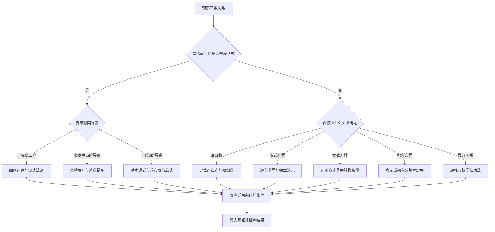

本节的五类核心计算模型：

1. 复合函数、幂指函数与反函数。
2. 隐函数、复合隐函数与积分方程。
3. 参数方程、变上限积分与二阶导数。
4. 高阶导数的结构化计算。
5. 积分函数与反函数的三阶导数综合变式。

## 建立导数计算的整体知识体系

### 一、学习目标

上一节“导数的定义”主要解决的是：

- 导数是否存在？
- 函数是否可导？
- 如何利用定义计算特殊点的导数？
- 导数、连续与可微之间有什么关系？

而本节“导数的计算”主要解决的是：在掌握可导条件的基础上，面对各种复杂的函数关系，如何正确、高效地计算一阶、二阶乃至任意阶导数。

考研中，真正有区分度的求导题，往往不是求一个复杂初等函数的导数，而是考查以下三种能力：

**第一，识别变量之间的依赖关系。**

**第二，发现计算中的抵消、降阶、递推等结构。**

**第三，在无法显式求出函数表达式时，仍然能够获得所需的导数信息。**

例如，已知

$$
y=f(x+y),
$$

虽然无法直接解出 $y$，但仍然可以求出 $y'$ 和 $y''$。

又例如，

$$
f(x)=x^3e^{x^4},
$$

要求 $f^{(2027)}(0)$，显然不能真的求导2027次，而应当转化为泰勒系数问题。

因此，本节最重要的不是计算量，而是**计算路径的选择**。

### 二、题型识别总表

| 题目结构                         | 优先使用的方法   | 核心难点                     |
| ---------------------------- | --------- | ------------------------ |
| $y=f(g(x))$              | 链式法则      | 内外层依赖关系                  |
| $y=u(x)^{v(x)}$          | 对数求导法     | 底数的正值条件                  |
| $y=f(f(x))$，且 $f$ 分段 | 分段判断后复合求导 | 内外层所在区间                  |
| $y=f^{-1}(x)$            | 反函数求导     | 原函数对应点                   |
| $F(x,y)=0$               | 隐函数求导     | 将 $y$ 视为 $x$ 的函数 |
| 多个隐式方程                       | 分别求导并联立   | 多个未知导数                   |
| $x=x(t),y=y(t)$          | 参数方程求导    | 对求导变量的转换                 |
| 变上限、变下限积分                    | 微积分基本定理   | 积分上下限及被积函数的依赖关系          |
| 指定点的高阶导数                     | 泰勒系数提取    | 幂次匹配与阶乘                  |
| 任意点的 $n$ 阶导数             | 通式、莱布尼茨公式 | 识别结构                     |
| 已知 $f'=H(f)$             | 递推与数学归纳法  | 系数和幂指数的变化                |
| 多种结构同时出现                     | 分层计算、逐次代点 | 局部信息传递                   |

## 基础知识与核心公式

### 三、基本求导公式

**1. 常用初等函数**

| 函数              | 导数                           |
| --------------- | ---------------------------- |
| $C$         | $0$                      |
| $x^\alpha$  | $\alpha x^{\alpha-1}$    |
| $e^x$       | $e^x$                    |
| $a^x$       | $a^x\ln a$               |
| $\ln\lvert x\rvert $  | $\dfrac1x$               |
| $\log_a x$  | $\dfrac1{x\ln a}$        |
| $\sin x$    | $\cos x$                 |
| $\cos x$    | $-\sin x$                |
| $\tan x$    | $\sec^2x$                |
| $\cot x$    | $-\csc^2x$               |
| $\arcsin x$ | $\dfrac1{\sqrt{1-x^2}}$  |
| $\arccos x$ | $-\dfrac1{\sqrt{1-x^2}}$ |
| $\arctan x$ | $\dfrac1{1+x^2}$         |

上述公式均应在相应的定义域及可导范围内使用。例如，$\arcsin x$ 的通常求导公式适用于 $|x|<1$。

**2. 四则运算求导**

$$
(u\pm v)'=u'\pm v'
$$

$$
(uv)'=u'v+uv'
$$

$$
\left(\frac uv\right)' =\frac{u'v-uv'}{v^2},\quad v\ne0.
$$

特别需要掌握乘积的二阶导数：

$$
\boxed{(uv)''=u''v+2u'v'+uv''}
$$

以及三阶导数：

$$
(uv)'''=u'''v+3u''v'+3u'v''+uv'''.
$$

这些公式将在隐函数、参数方程和高阶导数中反复出现。

### 四、链式法则：贯穿整个章节的核心

设

$$
y=f(u),\qquad u=g(x).
$$

则

$$
\boxed{\frac{\mathrm dy}{\mathrm dx} =\frac{\mathrm dy}{\mathrm du} \frac{\mathrm du}{\mathrm dx}}
$$

即

$$
\boxed{y'=f'(g(x))g'(x)}.
$$

**1. 直观理解**

如果 $x$ 的变化引起 $u$ 的变化，而 $u$ 的变化又引起 $y$ 的变化，那么整体的瞬时变化率就是各层变化率的乘积。

变量依赖路径为：

$$
x\xrightarrow{g}u\xrightarrow{f}y.
$$

对于多层复合函数，

$$
y=F(f(g(x))),
$$

依次沿依赖路径求导：

$$
y'=F'(f(g(x)))f'(g(x))g'(x).
$$

**2. 二阶链式法则**

对

$$
y'=f'(u)u'
$$

继续使用乘积法则，得到

$$
\boxed{y''=f''(u)(u')^2+f'(u)u''}.
$$

这是本节必须熟练掌握的公式。

二阶导数包含两部分：一部分来自外层函数变化率的变化，另一部分来自内层函数变化率的变化。

**3. 三阶链式法则**

继续求导：

$$
\boxed{ y'''=f'''(u)(u')^3 +3f''(u)u'u'' +f'(u)u''' }
$$

这个公式对于三阶反函数求导、三阶隐函数求导非常有用。

**4. 重要的消项性质**

如果在 $x=x_0$ 处，

$$
u'(x_0)=0,
$$

那么

$$
y'(x_0)=0,
$$

$$
\boxed{y''(x_0)=f'(u(x_0))u''(x_0)}.
$$

若相关三阶导数存在，还可以得到

$$
y'''(x_0)=f'(u(x_0))u'''(x_0).
$$

也就是说，当内层函数的一阶导数为零时，许多高阶复合项会自动消失。

这个性质是综合求导题中非常重要的简化工具。

## 复合函数与幂指函数求导

### 五、题型一：多层复合函数的二阶导数

**母题1：1993年考研数学二真题**

设

$$
y=\sin[f(x^2)],
$$

其中 $f$ 具有二阶导数，求 $y''$。

**识别方法**

这是典型的三层复合函数：

$$
x\longrightarrow x^2 \longrightarrow f(x^2) \longrightarrow \sin[f(x^2)].
$$

不能仅仅对最外层的正弦函数求导，也不能遗漏 $x^2$ 的导数。

**标准解法**

令

$$
u=x^2,\qquad v=f(u).
$$

先计算中间层：

$$
v'=2xf'(x^2),
$$

$$
v''=2f'(x^2)+4x^2f''(x^2).
$$

由于 $y=\sin v$，有

$$
y'=\cos v\cdot v',
$$

$$
y''=-\sin v\cdot(v')^2+\cos v\cdot v''.
$$

代入即得

$$
\boxed{ \begin{aligned} y''={}&2\cos[f(x^2)]f'(x^2)\\ &+4x^2\cos[f(x^2)]f''(x^2)\\ &-4x^2\sin[f(x^2)][f'(x^2)]^2. \end{aligned} }
$$

**母题推广**

对于一般结构

$$
y=F(f(g(x))),
$$

可以先令 $v=f(g(x))$，计算 $v'$、$v''$，再使用

$$
y''=F''(v)(v')^2+F'(v)v''.
$$

这种分层方法比直接对一个很长的表达式连续求导更加可靠。

### 六、题型二：幂指函数与对数求导法

**1. 什么时候需要取对数？**

对于

$$
y=u(x)^{v(x)},
$$

底数和指数均随 $x$ 变化。

这时不能单独使用幂函数求导公式，也不能单独使用指数函数求导公式。

在 $u(x)>0$ 的区间上，两边取自然对数：

$$
\ln y=v(x)\ln u(x).
$$

求导：

$$
\frac{y'}y=v'\ln u+v\frac{u'}u.
$$

于是得到通式：

$$
\boxed{ (u^v)'=u^v \left(v'\ln u+\frac{vu'}u\right) }.
$$

其本质就是

$$
u^v=e^{v\ln u}.
$$

**母题2：2005年考研数学二真题**

设

$$
y=(1+\sin x)^x,
$$

求 $x=\pi$ 处的微分。

在 $x=\pi$ 附近，底数为正，因此可以取对数：

$$
\ln y=x\ln(1+\sin x).
$$

于是

$$
\frac{y'}y =\ln(1+\sin x) +\frac{x\cos x}{1+\sin x}.
$$

所以

$$
y'=(1+\sin x)^x \left[ \ln(1+\sin x) +\frac{x\cos x}{1+\sin x} \right].
$$

代入 $x=\pi$：

$$
y'(\pi)=-\pi.
$$

注意题目要求的是微分，因此

$$
\boxed{\left.\mathrm dy\right|_{x=\pi} =-\pi\,\mathrm dx}.
$$

**2. 幂指函数的二阶导数**

不建议把一阶导数的复杂表达式直接展开求导。

令

$$
L(x)=v(x)\ln u(x), \qquad y=e^{L(x)}.
$$

则

$$
y'=yL',
$$

$$
\boxed{y''=y[(L')^2+L'']}.
$$

进一步，

$$
y'''=y[(L')^3+3L'L''+L'''].
$$

对于幂指函数的高阶导数，先计算对数函数 $L$ 的导数，通常更加简单。

### 七、题型三：分段函数的复合求导

**母题3：2012年考研数学三真题**

设

$$
f(x)= \begin{cases} \ln\sqrt x,&x\ge1,\\ 2x-1,&x<1, \end{cases}
$$

且

$$
y=f(f(x)).
$$

求 $y'(e)$。

<Steps>

<Step>

### 第一步：确定内层函数所在分段 [!toc]

因为 $e>1$，所以

$$
f(e)=\frac12\ln e=\frac12,
$$

$$
f'(e)=\frac1{2e}.
$$

</Step>

<Step>

### 第二步：确定外层函数所在分段 [!toc]

外层函数的自变量是 $f(e)$，而不是 $e$。

由于

$$
f(e)=\frac12<1,
$$

所以

$$
f'(f(e))=f'\left(\frac12\right)=2.
$$

</Step>

<Step>

### 第三步：链式法则 [!toc]

$$
y'(e)=f'(f(e))f'(e) =2\cdot\frac1{2e}.
$$

因此

$$
\boxed{y'(e)=\frac1e}.
$$

</Step>

</Steps>

**更深层的考查：复合函数的分段点**

分段复合函数的潜在不可导点，不仅包括内层函数自身的分段点，还包括使内层函数值恰好等于外层分段点的位置。

假设 $f$ 的分段点为 $a$，那么 $f(f(x))$ 的潜在特殊点至少要检查：

$$
x=a
$$

以及

$$
f(x)=a.
$$

如果外层在对应点不可导，普通链式法则不能直接使用，但复合后的函数仍有可能可导。

例如：

$$
f(u)=|u|,\qquad u=x^2.
$$

虽然 $f$ 在 $u=0$ 不可导，但

$$
f(x^2)=|x^2|=x^2
$$

在 $x=0$ 可导。

因此，**链式法则的充分条件不满足，不代表复合函数一定不可导。**

遇到这种情况，应当回到分段表达式或导数定义。

## 反函数求导

这是反函数与变限积分的常见综合考点。

### 八、反函数求导的基本原理

**1. 反函数的定义**

如果

$$
y=f(x)
$$

在某区间上具有反函数

$$
x=g(y)=f^{-1}(y),
$$

那么

$$
\boxed{f(g(y))=y}
$$

和

$$
\boxed{g(f(x))=x}.
$$

反函数是将原函数的输入和输出交换。

注意：

$$
f^{-1}(x)\ne\frac1{f(x)}.
$$

反函数与倒数函数是完全不同的概念。

**2. 反函数一阶导数**

对恒等式

$$
f(g(y))=y
$$

关于 $y$ 求导：

$$
f'(g(y))g'(y)=1.
$$

所以

$$
\boxed{g'(y)=\frac1{f'(g(y))}}.
$$

如果

$$
f(a)=b,
$$

那么

$$
\boxed{g'(b)=\frac1{f'(a)}}.
$$

其几何意义是：原函数与反函数的图像关于直线 $y=x$ 对称，因此对应点处的有限非零切线斜率互为倒数。

**3. 适用条件**

在常见的考研题目中，使用反函数求导公式需要确认原函数在对应点附近存在连续的反函数，且在对应点可导并满足

$$
f'(a)\ne0.
$$

一个常用的充分条件是：$f$ 在 $a$ 附近具有连续的一阶导数，且

$$
f'(a)\ne0.
$$

此时可以利用导数的局部保号性，保证 $f$ 在附近严格单调，进而存在局部反函数。

需要注意的是，原函数导数不为零不是反函数存在的必要条件，但它是上述有限导数公式的关键条件。

例如，

$$
f(x)=x^3
$$

具有反函数

$$
g(y)=\sqrt[3]y,
$$

但 $f'(0)=0$，且 $g$ 在原点没有有限导数。

### 九、题型四：反函数与变上限积分结合

**母题4：2026年考研数学二、数学三真题**

设

$$
f(x)=\int_1^{x^3}\frac{e^t}{1+t^2}\,\mathrm dt,
$$

且 $g$ 是 $f$ 的反函数，求 $g(0)$ 和 $g'(0)$。

**题型识别**

遇到这种题，最容易犯的错误是直接计算 $f'(0)$。

然而，

$$
g'(0)=\frac1{f'(g(0))},
$$

因此第一步必须确定 $g(0)$。

<Steps>

<Step>

### 第一步：确定原函数的对应点 [!toc]

由于

$$
f(1)=\int_1^1\frac{e^t}{1+t^2}\,\mathrm dt=0,
$$

所以

$$
g(0)=1.
$$

</Step>

<Step>

### 第二步：求原函数的导数 [!toc]

根据变上限积分求导公式：

$$
f'(x) =\frac{e^{x^3}}{1+x^6}\cdot3x^2.
$$

代入 $x=1$：

$$
f'(1)=\frac{3e}{2}.
$$

</Step>

<Step>

### 第三步：计算反函数导数 [!toc]

$$
g'(0)=\frac1{f'(1)} =\frac2{3e}.
$$

所以

$$
\boxed{g(0)=1,\qquad g'(0)=\frac2{3e}}.
$$

</Step>

</Steps>

**同类题：张宇8套卷第3套第11题**

设

$$
f(x)=\int_1^{x^2}\frac{\sin t}{1+t}\,\mathrm dt, \qquad 0<x<\sqrt\pi,
$$

其反函数为 $g$，求 $g'(0)$。

仍然遵循相同的步骤：

$$
f(1)=0\Longrightarrow g(0)=1,
$$

$$
f'(x)=\frac{2x\sin x^2}{1+x^2},
$$

$$
f'(1)=\sin1.
$$

所以

$$
\boxed{g'(0)=\frac1{\sin1}}.
$$

这两道题与2013年数学二真题本质上属于同一个母题。

**通用模型**

设

$$
F(x)=\int_c^{u(x)}h(t)\,\mathrm dt,
$$

其中

$$
u(a)=c,\qquad h(c)u'(a)\ne0,
$$

并满足局部反函数存在的相应条件。

若 $G=F^{-1}$，则

$$
\boxed{ G(0)=a,\qquad G'(0)=\frac1{h(c)u'(a)} }.
$$

根本不需要计算积分的原函数。

### 十、题型五：反函数的二阶和三阶导数

**1. 二阶导数的推导**

从

$$
f'(g(y))g'(y)=1
$$

出发，再求一次导数：

$$
f''(g(y))[g'(y)]^2+f'(g(y))g''(y)=0.
$$

代入

$$
g'(y)=\frac1{f'(g(y))}
$$

得到

$$
\boxed{ g''(y) =-\frac{f''(g(y))}{[f'(g(y))]^3} }.
$$

特别地，若 $f(a)=b$，则

$$
\boxed{ g''(b)=-\frac{f''(a)}{[f'(a)]^3} }.
$$

**2. 三阶导数**

继续对二阶恒等式求导：

$$
\begin{aligned} &f'''(g)(g')^3\\ &+3f''(g)g'g''+f'(g)g'''=0. \end{aligned}
$$

整理可得

$$
\boxed{ g'''(b)= \frac{3[f''(a)]^2-f'(a)f'''(a)} {[f'(a)]^5} }.
$$

公式使用的前提是相应阶数的导数存在且反函数在对应点具有相应的可导性。原函数在附近三阶连续可导且 $f'(a)\ne0$ 是一个充分条件。

| 导数阶数 | 原函数与反函数的对应关系                                                           |
| ---- | ---------------------------------------------------------------------- |
| 一阶   | $\displaystyle g'(b)=\frac1{f'(a)}$                                |
| 二阶   | $\displaystyle g''(b)=-\frac{f''(a)}{[f'(a)]^3}$                   |
| 三阶   | $\displaystyle g'''(b)=\frac{3[f''(a)]^2-f'(a)f'''(a)}{[f'(a)]^5}$ |

建议熟记前两个公式，第三个公式理解其推导过程即可。

**母题5：李正元练习题**

设 $g$ 是 $f$ 的反函数，且

$$
f(a)=3,\qquad f'(a)=1,\qquad f''(a)=2.
$$

求 $g''(3)$。

因为

$$
g(3)=a,
$$

所以

$$
g''(3)=-\frac{f''(a)}{[f'(a)]^3} =-\frac2{1^3}.
$$

故

$$
\boxed{g''(3)=-2}.
$$

**3. 一个重要的迁移：反函数与数列、函数极限**

假设

$$
f(a)=b,\qquad f'(a)=A\ne0,
$$

并且局部反函数 $g$ 存在。

则

$$
\lim_{y\to b}\frac{g(y)-a}{y-b} =\frac1A.
$$

如果题目不直接给出反函数，而是告诉你方程

$$
f(x_t)=t
$$

的局部解 $x_t$，其实就是在暗示

$$
x_t=g(t).
$$

李永乐六套卷第1套第1题便是这种结构。它将反函数求导包装成极限问题，计算对象没有变化，只是题目表达形式发生了变化。

## 隐函数求导

### 十一、隐函数的基本概念

显函数具有明确的形式：

$$
y=f(x).
$$

隐函数则通过一个方程建立 $x$ 与 $y$ 的关系：

$$
F(x,y)=0.
$$

例如

$$
x^2+y^2=1.
$$

在上半圆或下半圆的适当局部区间内，可以将 $y$ 看作 $x$ 的函数。

但求导时没有必要先解出 $y$。

**1. 隐函数求导的本质**

对

$$
x^2+[y(x)]^2=1
$$

关于 $x$ 求导：

$$
2x+2yy'=0.
$$

因此在 $y\ne0$ 处，

$$
y'=-\frac xy.
$$

**核心原则：在隐函数求导过程中，**$y$ **不是常数，而是** $x$ **的函数。**

因此，

$$
\frac{\mathrm d}{\mathrm dx}e^y=e^yy',
$$

$$
\frac{\mathrm d}{\mathrm dx}\sin y =\cos y\cdot y',
$$

$$
\frac{\mathrm d}{\mathrm dx}(xy)=y+xy',
$$

$$
\frac{\mathrm d}{\mathrm dx}(yy') =(y')^2+yy''.
$$

**2. 隐函数的一般求导公式**

若 $F(x,y)$ 满足相应的可微条件，并且

$$
F_y\ne0,
$$

那么由

$$
F_x+F_yy'=0
$$

可得

$$
\boxed{y'=-\frac{F_x}{F_y}}.
$$

若 $F$ 在附近二阶连续可微，再求导可以得到

$$
F_{xx}+2F_{xy}y'+F_{yy}(y')^2+F_yy''=0.
$$

从而

$$
\boxed{ y''=-\frac{ F_{xx}+2F_{xy}y'+F_{yy}(y')^2 }{F_y} }.
$$

数学一的考生还会在多元函数微分学中再次遇到这些公式。

不过，对于本节的一元隐函数求导，通常直接对原方程逐次求导就已经足够。

**3. 隐函数标准解题顺序**

针对求某点处的导数：

$$
\boxed{ y(x_0) \longrightarrow y'(x_0) \longrightarrow y''(x_0) \longrightarrow y'''(x_0) }
$$

先确定函数值，再确定一阶导数，最后利用低阶信息确定高阶导数。

只要题目要求的是某个点的导数值，就没有必要先求出极为复杂的导函数通式。

### 十二、题型六：隐函数的二阶导数

**母题6：1992年考研数学二真题**

设 $y=y(x)$ 由方程

$$
y-xe^y=1
$$

确定，求 $y''(0)$。

<Steps>

<Step>

### 第一步：确定基点 [!toc]

令 $x=0$，得到

$$
y(0)=1.
$$

</Step>

<Step>

### 第二步：求一阶导数 [!toc]

两边求导：

$$
y'-e^y-xe^yy'=0.
$$

整理得

$$
(1-xe^y)y'=e^y.
$$

代入 $x=0,y=1$：

$$
y'(0)=e.
$$

</Step>

<Step>

### 第三步：求二阶导数 [!toc]

对一阶导数等式继续求导：

$$
y''-2e^yy' -xe^y[(y')^2+y'']=0.
$$

令 $x=0$，含 $x$ 的项消失，得到

$$
y''(0)-2e\cdot e=0.
$$

因此

$$
\boxed{y''(0)=2e^2}.
$$

</Step>

</Steps>

**技巧总结**

本题完全没有必要写出

$$
y'=\frac{e^y}{1-xe^y}
$$

之后再利用商法则展开求导。

保留原一阶导数方程进行第二次求导，更容易利用 $x=0$ 使若干项消失。

这是一种非常重要的**定点逐阶计算法**。

### 十三、题型七：复合隐函数求导

**母题7：1994年考研数学二真题**

设

$$
y=f(x+y),
$$

其中 $f$ 二阶可导，且 $f'\ne1$，求 $y''$。

<Steps>

<Step>

### 第一步：识别内层函数 [!toc]

令

$$
u=x+y.
$$

于是

$$
u'=1+y',\qquad u''=y''.
$$

</Step>

<Step>

### 第二步：求一阶导数 [!toc]

由 $y=f(u)$：

$$
y'=f'(u)(1+y').
$$

解得

$$
\boxed{y'=\frac{f'(u)}{1-f'(u)}}.
$$

此时还应主动寻找以下关系：

$$
1+y' =1+\frac{f'(u)}{1-f'(u)} =\frac1{1-f'(u)}.
$$

</Step>

<Step>

### 第三步：求二阶导数 [!toc]

直接对

$$
y'=f'(u)u'
$$

求导：

$$
y''=f''(u)(u')^2+f'(u)u''.
$$

代入 $u'=1+y'$、$u''=y''$：

$$
y''=f''(u)(1+y')^2+f'(u)y''.
$$

因此

$$
(1-f'(u))y''=f''(u)(1+y')^2.
$$

结合前面得到的关系：

$$
\boxed{ y''=\frac{f''(x+y)} {[1-f'(x+y)]^3} }.
$$

</Step>

</Steps>

**推广母题**

如果改为

$$
y=f(ax+by),
$$

其中 $a,b$ 是常数，令 $u=ax+by$。

按照完全相同的方法：

$$
y'=f'(u)(a+by'),
$$

得到

$$
\boxed{ y'=\frac{af'(u)}{1-bf'(u)} }.
$$

进而

$$
u'=a+by'=\frac a{1-bf'(u)},
$$

所以

$$
\boxed{ y''=\frac{a^2f''(u)} {[1-bf'(u)]^3} }.
$$

当三阶导数存在时，还可进一步求得

$$
\boxed{ y'''= \frac{a^3\left[ (1-bf'(u))f'''(u)+3b(f''(u))^2 \right]} {[1-bf'(u)]^5} }.
$$

上述公式均要求相应点的 $1-bf'(u)\ne0$。

这类推广可以直接应对题目中系数、内层结构变化后的新题。

### 十四、题型八：隐函数与复合函数的综合

**母题8：2007年考研数学二真题**

已知 $f(u)$ 具有二阶导数，且

$$
f'(0)=1.
$$

函数 $y=y(x)$ 由

$$
y-xe^{y-1}=1
$$

确定。设

$$
z=f(\ln y-\sin x).
$$

求 $z'(0)$ 与 $z''(0)$。

这道题非常值得掌握，因为它将三个层次的求导结合在一起。

**第一层：计算隐函数的局部信息**

由原方程：

$$
y(0)=1.
$$

求导：

$$
y'-e^{y-1}-xe^{y-1}y'=0.
$$

所以

$$
y'(0)=1.
$$

再次求导：

$$
y''-2e^{y-1}y' -xe^{y-1}[(y')^2+y'']=0.
$$

所以

$$
y''(0)=2.
$$

**第二层：计算中间函数**

令

$$
w=\ln y-\sin x.
$$

则

$$
w(0)=0.
$$

一阶导数：

$$
w'=\frac{y'}y-\cos x,
$$

所以

$$
w'(0)=1-1=0.
$$

二阶导数：

$$
w''=\frac{y''}y-\frac{(y')^2}{y^2}+\sin x,
$$

因此

$$
w''(0)=2-1=1.
$$

**第三层：求外层复合函数导数**

$$
z'=f'(w)w',
$$

$$
z''=f''(w)(w')^2+f'(w)w''.
$$

代入基点：

$$
z'(0)=1\cdot0=0,
$$

$$
z''(0)=f''(0)\cdot0^2+1\cdot1=1.
$$

故

$$
\boxed{z'(0)=0,\qquad z''(0)=1}.
$$

**为什么这道题非常重要？**

题目没有提供 $f''(0)$ 的具体数值，却仍然可以计算二阶导数。

原因就是：

$$
w'(0)=0.
$$

导致 $f''(0)$ 所在的项完全消失。

考研创新题中，常常会提供看起来不充分的条件，实际上需要利用这种消项结构。

可以建立如下局部信息表：

| 函数                   | 函数值        | 一阶导数    | 二阶导数    |
| -------------------- | ---------- | ------- | ------- |
| $y$              | $1$    | $1$ | $2$ |
| $w=\ln y-\sin x$ | $0$    | $0$ | $1$ |
| $z=f(w)$         | $f(0)$ | $0$ | $1$ |

在复杂复合求导题中，这种逐层记录局部信息的方法十分高效。

### 十五、题型九：多方程确定的隐函数

**进阶母题：张宇8套卷第2套第12题**

设 $y=y(x)$、$z=z(x)$ 由方程组

$$
\begin{cases} e^z-xyz=0,\\ xz^2=\ln y \end{cases}
$$

确定，求

$$
\left.\frac{\mathrm dz}{\mathrm dx}\right|_{x=1/2}.
$$

这是数学一非常值得重视的综合结构：多个未知函数同时依赖一个自变量。

<Steps>

<Step>

### 第一步：确定基点 [!toc]

原卷对应点为

$$
x=\frac12,\qquad y=e^2,\qquad z=2.
$$

如何找到该点？

由第二式，

$$
y=e^{xz^2}.
$$

代入第一式，在 $x=1/2$ 时得到

$$
e^z=\frac z2e^{z^2/2}.
$$

显然 $z=2$ 满足方程。又由第一式可知此时 $z>0$。取对数后，定义

$$
H(z)=\ln\frac z2+\frac{z^2}2-z.
$$

因为

$$
H'(z)=\frac1z+z-1>0,
$$

所以正根唯一，即 $z=2$，进而 $y=e^2$。

</Step>

<Step>

### 第二步：分别对两个方程求导 [!toc]

第一个方程：

$$
e^zz'-yz-xzy'-xyz'=0.
$$

第二个方程：

$$
z^2+2xzz'=\frac{y'}y.
$$

</Step>

<Step>

### 第三步：代入基点，联立方程 [!toc]

第一个方程化为

$$
\frac{e^2}{2}z'-y'=2e^2.
$$

第二个方程化为

$$
4+2z'=\frac{y'}{e^2}.
$$

联立消元得到

$$
\boxed{z'=-4}.
$$

</Step>

</Steps>

**一般方法**

若

$$
\begin{cases} F(x,y,z)=0,\\ G(x,y,z)=0, \end{cases}
$$

则在相应可微条件下，

$$
\begin{cases} F_y y'+F_z z'=-F_x,\\ G_y y'+G_z z'=-G_x. \end{cases}
$$

这实际上是一个关于 $y'$、$z'$ 的二元一次方程组。

若

$$
F_yG_z-F_zG_y\ne0,
$$

便可唯一解出两个未知导数。

这个模型还能迁移到多元隐函数求偏导数的问题。

## 变限积分与导数计算

### 十六、变限积分求导的基础公式

**1. 变上限积分**

若 $f(t)$ 连续，

$$
F(x)=\int_a^x f(t)\,\mathrm dt,
$$

则

$$
\boxed{F'(x)=f(x)}.
$$

如果积分上限是复合函数，

$$
F(x)=\int_a^{u(x)}f(t)\,\mathrm dt,
$$

则

$$
\boxed{F'(x)=f(u(x))u'(x)}.
$$

**2. 变下限积分**

$$
F(x)=\int_{u(x)}^a f(t)\,\mathrm dt
$$

则

$$
\boxed{F'(x)=-f(u(x))u'(x)}.
$$

**3. 上下限同时变化**

$$
F(x)=\int_{u(x)}^{v(x)}f(t)\,\mathrm dt.
$$

则

$$
\boxed{ F'(x)=f(v(x))v'(x)-f(u(x))u'(x) }.
$$

口诀是：**上限代入乘上限导数，减去下限代入乘下限导数。**

**4. 二阶导数**

当 $f$ 可导且 $u,v$ 二阶可导时，

$$
\begin{aligned} F''(x)={}&f'(v)(v')^2+f(v)v''\\ &-f'(u)(u')^2-f(u)u''. \end{aligned}
$$

仍然是二阶链式法则，没有新的本质。

### 十七、题型十：积分隐函数求导

**母题9：2010年考研数学三真题**

设 $y=y(x)$ 由方程

$$
\int_0^{x+y}e^{-t^2}\,\mathrm dt =\int_0^x x\sin(t^2)\,\mathrm dt
$$

确定，求 $y'(0)$。

<Steps>

<Step>

### 第一步：确定初值 [!toc]

令 $x=0$：

$$
\int_0^{y(0)}e^{-t^2}\,\mathrm dt=0.
$$

因为

$$
e^{-t^2}>0,
$$

所以积分只有在上下限相同时才为零。

因此

$$
y(0)=0.
$$

</Step>

<Step>

### 第二步：处理右侧积分 [!toc]

右侧的 $x$ 不是积分变量，真正的积分变量是 $t$。

故

$$
\int_0^x x\sin(t^2)\,\mathrm dt =x\int_0^x\sin(t^2)\,\mathrm dt.
$$

应先将 $x$ 提到积分号外。

</Step>

<Step>

### 第三步：对两边求导 [!toc]

左侧：

$$
e^{-(x+y)^2}(1+y').
$$

右侧：

$$
\int_0^x\sin(t^2)\,\mathrm dt +x\sin(x^2).
$$

于是

$$
e^{-(x+y)^2}(1+y') =\int_0^x\sin(t^2)\,\mathrm dt+x\sin(x^2).
$$

代入 $x=0,y=0$：

$$
1+y'(0)=0.
$$

因此

$$
\boxed{y'(0)=-1}.
$$

</Step>

</Steps>

**变式：李林六套卷第2套第11题**

李林模拟题在这道真题的基础上增加了导数定义与数列极限。

设 $y=f(x)$ 由

$$
\int_1^{x+y}e^{-t^2}\,\mathrm dt =x+\int_0^x x\sin(t^2)\,\mathrm dt
$$

确定，求

$$
\lim_{n\to\infty} n\left[f\left(\frac2n\right)-1\right].
$$

首先由原方程确定

$$
f(0)=1.
$$

求导得

$$
\begin{aligned} &e^{-(x+f(x))^2}[1+f'(x)]\\ &=1+\int_0^x\sin(t^2)\,\mathrm dt +x\sin(x^2). \end{aligned}
$$

令 $x=0$，得到

$$
e^{-1}[1+f'(0)]=1.
$$

所以

$$
f'(0)=e-1.
$$

最后识别导数定义：

$$
\begin{aligned} &\lim_{n\to\infty} n\left[f\left(\frac2n\right)-1\right]\\ &=2\lim_{n\to\infty} \frac{f(2/n)-f(0)}{2/n}\\ &=2f'(0). \end{aligned}
$$

因此

$$
\boxed{2(e-1)}.
$$

**这两道题的迁移关系**

真题考查的是积分隐函数求导，而李林模拟题进一步将计算出的导数用于数列极限。

一般地，如果 $f$ 在 $a$ 处可导，那么

$$
\boxed{ \lim_{n\to\infty} n\left[f\left(a+\frac cn\right)-f(a)\right] =cf'(a) }.
$$

如果 $f$ 在 $a$ 处二阶可导，还可以推广到

$$
\boxed{ \begin{aligned} &\lim_{n\to\infty}n^2 \left[ f\left(a+\frac cn\right)-f(a) -\frac cnf'(a) \right]\\ &=\frac{c^2}{2}f''(a). \end{aligned} }
$$

这正是求导、极限和泰勒公式之间的联系。

### 十八、题型十一：被积函数与积分上限同时含有自变量

**重要综合母题：张宇8套卷第1套第18题**

这道12分解答题是整份分类模拟题中非常值得精讲的题目之一。

已知 $g(x)$ 连续，且 $g(0)=0$，设

$$
f(x)=\int_0^x g(x^2t)\,\mathrm dt.
$$

求 $f'(x)$，并判断 $f'(x)$ 在 $x=0$ 处的连续性。

**1. 为什么不能直接使用普通变上限积分公式？**

普通变上限积分

$$
\int_0^x g(t)\,\mathrm dt
$$

的被积函数只依赖积分变量 $t$。

而本题中

$$
g(x^2t)
$$

同时依赖 $x$ 和 $t$。

如果直接写

$$
f'(x)=g(x^3),
$$

就遗漏了被积函数本身随 $x$ 变化的影响。

此外，题目只告诉你 $g$ 连续，并未告诉你 $g$ 可导，因此也不能随意对 $g(x^2t)$ 关于 $x$ 求导。

**2. 正确突破口：换元消除被积函数中的 $x$**

令

$$
u=x^2t.
$$

对于 $x\ne0$：

$$
\mathrm dt=\frac{\mathrm du}{x^2}.
$$

积分上限变为 $x^3$，因此

$$
f(x)=\frac1{x^2}\int_0^{x^3}g(u)\,\mathrm du.
$$

现在被积函数只依赖 $u$，可以使用微积分基本定理。

求导得

$$
\begin{aligned} f'(x) ={}&-\frac2{x^3}\int_0^{x^3}g(u)\,\mathrm du\\ &+\frac1{x^2}g(x^3)\cdot3x^2. \end{aligned}
$$

即

$$
\boxed{ f'(x)=3g(x^3) -\frac2{x^3}\int_0^{x^3}g(u)\,\mathrm du },\qquad x\ne0.
$$

**3. 单独讨论 $x=0$**

因为 $f(0)=0$，由导数定义，

$$
f'(0)=\lim_{x\to0}\frac{f(x)}x.
$$

代入换元后的表达式：

$$
f'(0)= \lim_{x\to0}\frac1{x^3}\int_0^{x^3}g(u)\,\mathrm du.
$$

由于 $g$ 连续，利用积分平均值极限：

$$
\lim_{h\to0}\frac1h\int_0^h g(u)\,\mathrm du =g(0),
$$

所以

$$
\boxed{f'(0)=g(0)=0}.
$$

**4. 判断导函数连续性**

$$
\begin{aligned} \lim_{x\to0}f'(x) &=3g(0)-2g(0)\\ &=g(0)=0. \end{aligned}
$$

因为

$$
\lim_{x\to0}f'(x)=f'(0),
$$

所以 $f'$ 在原点连续。

**5. 推广到一般母题**

对于正整数 $m$，设

$$
F(x)=\int_0^x g(x^mt)\,\mathrm dt,
$$

其中 $g$ 连续。

对于 $x\ne0$，令 $u=x^mt$，则

$$
F(x)=x^{-m}\int_0^{x^{m+1}}g(u)\,\mathrm du.
$$

求导：

$$
\boxed{ \begin{aligned} F'(x)={}&(m+1)g(x^{m+1})\\ &-\frac{m}{x^{m+1}} \int_0^{x^{m+1}}g(u)\,\mathrm du. \end{aligned} }
$$

而

$$
\boxed{F'(0)=g(0)}.
$$

并且 $F'$ 在原点连续。

这道母题真正训练的不是某个积分的计算，而是以下能力：

**题目没有给出可导性时，主动通过代数变形或积分换元，创造能够合法求导的结构。**

这是非常重要的考研综合题思维。

## 参数方程求导

2013年、2020年、2021年及2026年数学一真题均出现了参数方程二阶求导。这是本节对数学一考生尤其重要的内容。

### 十九、参数方程求导的基本原理

设

$$
\begin{cases} x=\varphi(t),\\ y=\psi(t). \end{cases}
$$

其中 $t$ 是参数。

虽然 $x,y$ 都依赖 $t$，但题目要求的通常是

$$
\frac{\mathrm dy}{\mathrm dx},
$$

而不是

$$
\frac{\mathrm dy}{\mathrm dt}.
$$

**1. 一阶导数**

由链式法则：

$$
\frac{\mathrm dy}{\mathrm dt} =\frac{\mathrm dy}{\mathrm dx} \frac{\mathrm dx}{\mathrm dt}.
$$

因此在 $x_t\ne0$ 的正则点，

$$
\boxed{ \frac{\mathrm dy}{\mathrm dx} =\frac{y_t}{x_t} }.
$$

其中

$$
x_t=\frac{\mathrm dx}{\mathrm dt}, \qquad y_t=\frac{\mathrm dy}{\mathrm dt}.
$$

**2. 二阶导数**

二阶导数是对一阶导数关于 $x$ 再求导：

$$
\frac{\mathrm d^2y}{\mathrm dx^2} =\frac{\mathrm d}{\mathrm dx} \left(\frac{y_t}{x_t}\right).
$$

所以

$$
\boxed{ \frac{\mathrm d^2y}{\mathrm dx^2} =\frac1{x_t}\frac{\mathrm d}{\mathrm dt} \left(\frac{y_t}{x_t}\right) }.
$$

展开得到

$$
\boxed{ \frac{\mathrm d^2y}{\mathrm dx^2} =\frac{y_{tt}x_t-y_tx_{tt}}{(x_t)^3} }.
$$

这两个公式都应当掌握。

**3. 三阶及更高阶导数**

引入求导算子：

$$
\boxed{ D_x=\frac1{x_t}D_t }.
$$

那么

$$
y_{xx}=D_x(y_x),
$$

$$
y_{xxx}=D_x(y_{xx}).
$$

一般地，

$$
\frac{\mathrm d^ny}{\mathrm dx^n} =\frac1{x_t}\frac{\mathrm d}{\mathrm dt} \left(\frac{\mathrm d^{n-1}y}{\mathrm dx^{n-1}}\right).
$$

每增加一次关于 $x$ 的求导，都要：

先对 $t$ 求导，再除以 $x_t$。

**4. 必须避免的错误**

以下公式一般不成立：

$$
\frac{\mathrm d^2y}{\mathrm dx^2} =\frac{\mathrm d^2y/\mathrm dt^2} {\mathrm d^2x/\mathrm dt^2}.
$$

同样，也不能简单地写成

$$
\frac{y_{tt}}{(x_t)^2}.
$$

除非具有额外的特殊条件，否则会漏掉 $x_{tt}$ 相关的项。

### 二十、题型十二：存在公共因子的参数方程

**母题10：2013年考研数学一真题**

设

$$
\begin{cases} x=\sin t,\\ y=t\sin t+\cos t. \end{cases}
$$

求

$$
\left.\frac{\mathrm d^2y}{\mathrm dx^2} \right|_{t=\pi/4}.
$$

首先分别求导：

$$
x_t=\cos t,
$$

$$
\begin{aligned} y_t &=\sin t+t\cos t-\sin t\\ &=t\cos t. \end{aligned}
$$

因此

$$
y_x=\frac{t\cos t}{\cos t}=t,
$$

这里要求 $\cos t\ne0$。

接着求二阶导数：

$$
y_{xx} =\frac1{\cos t}\frac{\mathrm d}{\mathrm dt}(t) =\frac1{\cos t}.
$$

代入 $t=\pi/4$：

$$
\boxed{y_{xx}=\sqrt2}.
$$

**同类真题：2021年考研数学一、数学二**

设

$$
\begin{cases} x=2e^t+t+1,\\ y=4(t-1)e^t+t^2. \end{cases}
$$

求 $t=0$ 处的二阶导数。

分别求导：

$$
x_t=2e^t+1,
$$

$$
\begin{aligned} y_t &=4e^t+4(t-1)e^t+2t\\ &=2t(2e^t+1). \end{aligned}
$$

观察到

$$
y_t=2tx_t.
$$

故

$$
y_x=2t,
$$

$$
y_{xx}=\frac2{2e^t+1}.
$$

所以

$$
\boxed{\left.y_{xx}\right|_{t=0}=\frac23}.
$$

**这两道题揭示的命题规律**

命题人经常将参数方程设计得看起来复杂，但第一次求导后出现大量抵消。

因此，遇到参数方程：

**一定先化简一阶导数，再计算二阶导数。**

不要在没有观察结构之前，直接机械展开二阶求导公式。

### 二十一、题型十三：参数曲线中的对数化简

**母题11：2020年考研数学一、数学二真题**

设

$$
\begin{cases} x=\sqrt{1+t^2},\\ y=\ln\left(t+\sqrt{1+t^2}\right). \end{cases}
$$

求 $t=1$ 处的二阶导数。

首先，

$$
x_t=\frac t{\sqrt{1+t^2}}.
$$

再计算 $y_t$：

$$
y_t= \frac{1+\dfrac t{\sqrt{1+t^2}}} {t+\sqrt{1+t^2}}.
$$

分子通分：

$$
1+\frac t{\sqrt{1+t^2}} =\frac{\sqrt{1+t^2}+t}{\sqrt{1+t^2}}.
$$

约分得到

$$
y_t=\frac1{\sqrt{1+t^2}}.
$$

因此

$$
y_x=\frac1t,\qquad t\ne0.
$$

继续求导：

$$
y_{xx} =\frac{-1/t^2}{t/\sqrt{1+t^2}} =-\frac{\sqrt{1+t^2}}{t^3}.
$$

代入 $t=1$：

$$
\boxed{y_{xx}=-\sqrt2}.
$$

**值得记住的辅助公式**

$$
\boxed{ \frac{\mathrm d}{\mathrm dx} \ln(x+\sqrt{1+x^2}) =\frac1{\sqrt{1+x^2}} }.
$$

利用共轭恒等式

$$
(\sqrt{1+x^2}+x)(\sqrt{1+x^2}-x)=1,
$$

还可以得到

$$
\boxed{ \frac{\mathrm d}{\mathrm dx} \ln(\sqrt{1+x^2}-x) =-\frac1{\sqrt{1+x^2}} }.
$$

这两个公式在参数方程、积分计算以及高阶导数题中都很有用。

### 二十二、题型十四：指定参数点的二阶导数

**母题12：2026年考研数学一真题**

设

$$
\begin{cases} x=2\sin^2t,\\ y=t+\cos t, \end{cases} \qquad 0<t<\frac\pi2.
$$

求

$$
\left.\frac{\mathrm d^2y}{\mathrm dx^2} \right|_{t=\pi/4}.
$$

<Tabs items={["方法一：标准二阶参数求导公式", "方法二：利用特殊点的消项性质"]} defaultIndex={0}>

<Tab value="方法一：标准二阶参数求导公式">

计算所需的局部信息：

$$
x_t=2\sin2t,
$$

$$
x_{tt}=4\cos2t,
$$

$$
y_t=1-\sin t,
$$

$$
y_{tt}=-\cos t.
$$

在 $t=\pi/4$ 处：

$$
x_t=2,\qquad x_{tt}=0,
$$

$$
y_t=1-\frac{\sqrt2}{2}, \qquad y_{tt}=-\frac{\sqrt2}{2}.
$$

代入

$$
y_{xx} =\frac{y_{tt}x_t-y_tx_{tt}}{(x_t)^3}.
$$

于是

$$
\begin{aligned} y_{xx} &=\frac{-\dfrac{\sqrt2}{2}\cdot2-0}{2^3}\\ &=-\frac{\sqrt2}{8}. \end{aligned}
$$

答案为

$$
\boxed{-\frac{\sqrt2}{8}}.
$$

</Tab>

<Tab value="方法二：利用特殊点的消项性质">

如果在某个参数点 $t_0$，

$$
x_{tt}(t_0)=0,\qquad x_t(t_0)\ne0,
$$

那么二阶参数导数直接简化为

$$
\boxed{ y_{xx}(t_0)= \frac{y_{tt}(t_0)}{[x_t(t_0)]^2} }.
$$

本题恰好满足这个条件。

</Tab>

</Tabs>

**考场上的选择原则**

如果 $y_t/x_t$ 容易约分，应优先使用逐阶求导。

如果题目只要求一个点的二阶导数，并且不存在明显约分结构，直接计算

$$
x_t,\ x_{tt},\ y_t,\ y_{tt}
$$

在该点的数值，再代入公式，通常更快。

### 二十三、题型十五：参数方程的构造性抵消

**重要母题：李正元练习题**

设

$$
\begin{cases} x=f'(t),\\ y=tf'(t)-f(t), \end{cases}
$$

其中 $f$ 三阶可导且 $f''(t)\ne0$。

求 $y_x,y_{xx},y_{xxx}$。

对参数求导：

$$
x_t=f''(t),
$$

$$
\begin{aligned} y_t&=f'(t)+tf''(t)-f'(t)\\ &=tf''(t). \end{aligned}
$$

所以

$$
\boxed{y_x=t}.
$$

进一步，

$$
\boxed{y_{xx}=\frac1{f''(t)}}.
$$

第三阶：

$$
\begin{aligned} y_{xxx} &=\frac1{f''(t)} \frac{\mathrm d}{\mathrm dt} \left(\frac1{f''(t)}\right)\\ &=-\frac{f'''(t)}{[f''(t)]^3}. \end{aligned}
$$

因此

$$
\boxed{ y_{xxx}=-\frac{f'''(t)}{[f''(t)]^3} }.
$$

**一般化：主动识别构造**

如果参数方程具有形式

$$
\begin{cases} x=h(t),\\ y=th(t)-\displaystyle\int_a^t h(u)\,\mathrm du, \end{cases}
$$

那么

$$
y_t=h(t)+th'(t)-h(t)=th'(t).
$$

由于

$$
x_t=h'(t),
$$

故在 $h'(t)\ne0$ 处，

$$
\boxed{y_x=t},
$$

$$
\boxed{y_{xx}=\frac1{h'(t)}},
$$

$$
\boxed{y_{xxx}=-\frac{h''(t)}{[h'(t)]^3}}.
$$

这里的本质是乘积求导产生的一项恰好被积分求导抵消。

李正元练习题的第二问，以及2013年数学一真题，都可以纳入这个统一模型。

### 二十四、参数方程最容易被忽略的特殊情况

当

$$
x_t(t_0)=0
$$

时，常规参数求导公式无法直接使用。

但不能仅凭这一点就认定 $y(x)$ 不可导。

例如

$$
\begin{cases} x=t^3,\\ y=t^6. \end{cases}
$$

在 $t=0$ 时，

$$
x_t(0)=y_t(0)=0.
$$

但是消去参数后，

$$
y=x^2,
$$

显然

$$
y'(0)=0,\qquad y''(0)=2.
$$

因此，参数求导遇到分母为零时，应重新检查能否消元，或者利用导数定义：

$$
y'(x_0) =\lim_{t\to t_0} \frac{y(t)-y(t_0)}{x(t)-x(t_0)},
$$

前提是参数所确定的局部函数关系和对应极限方向适当。

如果不同参数分支对应同一个 $x$ 却给出不同的 $y$，还要先判断是否存在单值函数 $y(x)$。

这类特殊点是常规计算题向概念综合题转化的重要方向。

## 高阶导数的结构化计算

### 二十五、高阶导数的四种主要方法

高阶导数问题必须先区分题目究竟要求什么。

| 所求对象                             | 优先方法                          |
| -------------------------------- | ----------------------------- |
| $f^{(n)}(x)$                 | 基本通式、莱布尼茨公式                   |
| $f^{(n)}(0)$                 | 麦克劳林系数提取                      |
| $f^{(n)}(a)$                 | 令 $x=a+h$，提取 $h^n$ 系数 |
| 已知 $f'=H(f)$，求 $f^{(n)}$ | 递推与数学归纳法                      |
| 高阶隐函数导数                          | 逐次求导代点或泰勒系数匹配                 |
| 高阶积分函数导数                         | 先求导消去积分，再处理递推                 |

尤其注意：

**求某一点处的高阶导数与求高阶导函数的表达式，是两个不同层次的问题。**

前者往往比后者容易得多。

### 二十六、题型十六：基本高阶导数公式

以下公式要求熟练掌握。

**1. 指数函数**

$$
\boxed{(e^{ax+b})^{(n)}=a^ne^{ax+b}}.
$$

$$
\boxed{(a^x)^{(n)}=a^x(\ln a)^n}, \qquad a>0.
$$

**2. 三角函数**

$$
\boxed{ [\sin(ax+b)]^{(n)} =a^n\sin\left(ax+b+\frac{n\pi}{2}\right) }.
$$

$$
\boxed{ [\cos(ax+b)]^{(n)} =a^n\cos\left(ax+b+\frac{n\pi}{2}\right) }.
$$

三角函数的导数具有四阶循环性：

$$
\sin x\to\cos x\to-\sin x \to-\cos x\to\sin x.
$$

**3. 幂函数**

$$
\boxed{ (x^\alpha)^{(n)} =\alpha(\alpha-1)\cdots(\alpha-n+1)x^{\alpha-n} }.
$$

若 $m$ 为非负整数，

$$
(x^m)^{(n)}= \begin{cases} \dfrac{m!}{(m-n)!}x^{m-n},&n\le m,\\ 0,&n>m. \end{cases}
$$

**4. 倒数函数**

$$
\boxed{ \left(\frac1x\right)^{(n)} =\frac{(-1)^nn!}{x^{n+1}} }.
$$

推广：

$$
\boxed{ \left(\frac1{ax+b}\right)^{(n)} =\frac{(-1)^nn!a^n}{(ax+b)^{n+1}} }.
$$

**5. 对数函数**

对于 $n\ge1$，

$$
\boxed{ (\ln|x|)^{(n)} =\frac{(-1)^{n-1}(n-1)!}{x^n} }.
$$

推广：

$$
\boxed{ [\ln|ax+b|]^{(n)} =\frac{(-1)^{n-1}(n-1)!a^n}{(ax+b)^n} }.
$$

**常见陷阱**

倒数函数的系数是 $n!$，而对数函数的系数是 $(n-1)!$。

这是高阶导数计算中最常见的阶乘错误之一。

### 二十七、题型十七：莱布尼茨公式

**1. 基本公式**

对于具有相应阶导数的 $u,v$：

$$
\boxed{ (uv)^{(n)} =\sum_{k=0}^n\binom nk u^{(k)}v^{(n-k)} }.
$$

其中约定

$$
u^{(0)}=u,\qquad v^{(0)}=v.
$$

这个公式是普通乘积求导法则的推广，系数与二项式展开完全相同。

**2. 最重要的应用结构**

当题目出现

$$
P_m(x)e^{ax}
$$

或者

$$
P_m(x)\sin ax
$$

或者

$$
P_m(x)\ln(1+x),
$$

其中 $P_m$ 是 $m$ 次多项式，那么当求导次数超过 $m$ 时，多项式的高阶导数会全部消失。

因此，即使 $n$ 很大，真正需要计算的也可能只有两三项。

**母题13：2024年考研数学二真题**

设

$$
f(x)=x^2(e^x+1),
$$

求 $f^{(5)}(1)$。

将原函数拆为

$$
f(x)=x^2e^x+x^2.
$$

由于

$$
(x^2)^{(5)}=0,
$$

只需求

$$
(x^2e^x)^{(5)}.
$$

使用莱布尼茨公式，由于 $x^2$ 的三阶及以上导数为零：

$$
\begin{aligned} f^{(5)}(x) ={}&x^2e^x+\binom51 2xe^x\\ &+\binom52 2e^x\\ ={}&(x^2+10x+20)e^x. \end{aligned}
$$

代入 $x=1$：

$$
\boxed{f^{(5)}(1)=31e}.
$$

**母题推广**

设

$$
f(x)=x^2e^{ax}.
$$

对于 $n\ge2$，

$$
\boxed{ \begin{aligned} f^{(n)}(x)=e^{ax}\big[ &a^nx^2+2na^{n-1}x\\ &+n(n-1)a^{n-2} \big]. \end{aligned} }
$$

特别地，

$$
\boxed{ f^{(n)}(0)=n(n-1)a^{n-2} }.
$$

2015年数学二真题

$$
f(x)=x^2 2^x
$$

就是取 $a=\ln2$，因此

$$
\boxed{ f^{(n)}(0) =n(n-1)(\ln2)^{n-2} }.
$$

### 二十八、题型十八：泰勒系数提取法

这是计算指定点高阶导数最重要的技巧。

**1. 基本原理**

若 $f$ 具有适当的 $n$ 阶可导性，可以在 $x=0$ 处作佩亚诺余项形式的展开：

$$
f(x)=f(0)+f'(0)x+\cdots+ \frac{f^{(n)}(0)}{n!}x^n+o(x^n).
$$

因此，假设展开式中 $x^n$ 项的系数为 $a_n$，那么

$$
\boxed{f^{(n)}(0)=n!a_n}.
$$

如果 $f$ 可以展开为收敛的麦克劳林级数，

$$
f(x)=\sum_{k=0}^{\infty}a_kx^k,
$$

则对所有相应的阶数都有

$$
\boxed{f^{(n)}(0)=n![x^n]f(x)}.
$$

这里 $[x^n]f(x)$ 表示展开式中 $x^n$ 的系数。

**2. 必须熟练掌握的级数**

| 函数                 | 麦克劳林展开                                                                |
| ------------------ | --------------------------------------------------------------------- |
| $e^x$          | $\displaystyle\sum_{k=0}^{\infty}\frac{x^k}{k!}$                 |
| $\sin x$       | $\displaystyle\sum_{k=0}^{\infty}\frac{(-1)^kx^{2k+1}}{(2k+1)!}$ |
| $\cos x$       | $\displaystyle\sum_{k=0}^{\infty}\frac{(-1)^kx^{2k}}{(2k)!}$     |
| $\dfrac1{1-x}$ | $\displaystyle\sum_{k=0}^{\infty}x^k$                            |
| $\dfrac1{1+x}$ | $\displaystyle\sum_{k=0}^{\infty}(-1)^kx^k$                      |
| $\ln(1+x)$     | $\displaystyle\sum_{k=1}^{\infty}\frac{(-1)^{k-1}x^k}{k}$        |
| $\ln(1-x)$     | $\displaystyle-\sum_{k=1}^{\infty}\frac{x^k}{k}$                 |
| $\arctan x$    | $\displaystyle\sum_{k=0}^{\infty}\frac{(-1)^kx^{2k+1}}{2k+1}$    |
| $(1+x)^\alpha$ | $\displaystyle\sum_{k=0}^{\infty}\binom{\alpha}{k}x^k$           |

前三个级数对所有实数 $x$ 收敛；其余公式用于零点附近时，统一取 $|x|<1$ 即可满足需要。

### 二十九、泰勒系数法的第一类：次数平移

**母题14：2020年考研数学二真题**

设

$$
f(x)=x^2\ln(1-x),
$$

求 $n\ge3$ 时的 $f^{(n)}(0)$。

利用

$$
\ln(1-x) =-\sum_{k=1}^{\infty}\frac{x^k}{k}.
$$

乘以 $x^2$：

$$
f(x) =-\sum_{k=1}^{\infty}\frac{x^{k+2}}k.
$$

要获得 $x^n$ 项，必须满足

$$
k+2=n.
$$

因此

$$
k=n-2.
$$

对应系数为

$$
-\frac1{n-2}.
$$

最终得到

$$
\boxed{ f^{(n)}(0)=-\frac{n!}{n-2} },\qquad n\ge3.
$$

**对比：2000年考研数学二真题**

如果改为

$$
f(x)=x^2\ln(1+x),
$$

则

$$
f(x)= \sum_{k=1}^{\infty} \frac{(-1)^{k-1}}k x^{k+2}.
$$

同样令 $k=n-2$，得到

$$
\boxed{ f^{(n)}(0)= \frac{(-1)^{n-3}n!}{n-2} },\qquad n\ge3.
$$

两道题唯一的本质差别是对数展开中的符号。

**推广结论**

如果

$$
f(x)=x^m g(x),
$$

那么对于 $n\ge m$，

$$
\boxed{ f^{(n)}(0) =\frac{n!}{(n-m)!}g^{(n-m)}(0) }.
$$

而当 $n<m$ 时，

$$
f^{(n)}(0)=0.
$$

这称为幂次平移结构，也可以直接用莱布尼茨公式证明。

### 三十、泰勒系数法的第二类：幂次筛选

**模拟母题：李永乐六套卷第2套第13题**

设

$$
f(x)=x^3e^{x^4},
$$

求

$$
f^{(2027)}(0).
$$

展开：

$$
e^{x^4} =\sum_{k=0}^{\infty}\frac{x^{4k}}{k!}.
$$

因此

$$
f(x)=\sum_{k=0}^{\infty} \frac{x^{4k+3}}{k!}.
$$

只有指数满足

$$
4k+3=2027
$$

的项才有贡献。

解得

$$
k=506.
$$

因此

$$
[x^{2027}]f(x)=\frac1{506!}.
$$

所以

$$
\boxed{ f^{(2027)}(0)=\frac{2027!}{506!} }.
$$

**一般化结论**

设 $m$ 为非负整数，$p$ 为正整数，

$$
f(x)=x^me^{ax^p}.
$$

则

$$
f(x)= \sum_{k=0}^{\infty}\frac{a^k}{k!}x^{pk+m}.
$$

因此

$$
\boxed{ f^{(n)}(0)= \begin{cases} \dfrac{n!a^{(n-m)/p}} {[(n-m)/p]!}, &n=m+pk,\ k\in\mathbb Z_{\ge0},\\[6pt] 0,&\text{其他情形}. \end{cases} }
$$

当 $a=0,k=0$ 时，级数中的常数系数仍按 $1$ 理解。

这类题的核心不是求导，而是检查目标次数是否出现在展开式中。

**奇偶性的快速判断**

若 $f$ 是零点附近的偶函数，并且相应阶导数存在，则

$$
f^{(2k+1)}(0)=0.
$$

若 $f$ 是零点附近的奇函数，则

$$
f^{(2k)}(0)=0.
$$

高阶导数题中应当养成先观察奇偶性的习惯。

### 三十一、泰勒系数法的第三类：由高阶导数反求参数

**母题15：2016年考研数学一真题**

设

$$
f(x)=\arctan x-\frac{x}{1+ax^2},
$$

且

$$
f'''(0)=1.
$$

求 $a$。

**1. 识别目标**

要求三阶导数在零点的值，意味着只需要确定展开式中 $x^3$ 的系数。

**2. 分别展开**

$$
\arctan x=x-\frac{x^3}{3}+o(x^3).
$$

同时，

$$
\frac1{1+ax^2} =1-ax^2+o(x^2).
$$

因此

$$
\frac{x}{1+ax^2} =x-ax^3+o(x^3).
$$

相减得到

$$
f(x)= \left(a-\frac13\right)x^3+o(x^3).
$$

**3. 比较泰勒系数**

$$
\frac{f'''(0)}{3!} =a-\frac13.
$$

由题设 $f'''(0)=1$：

$$
a-\frac13=\frac16.
$$

所以

$$
\boxed{a=\frac12}.
$$

**母题价值**

这种题还可以改造成求极限参数：

$$
\lim_{x\to0} \frac{\arctan x-\dfrac{x}{1+ax^2}}{x^3} =b.
$$

由同一展开式可以立即得到

$$
a-\frac13=b.
$$

因此，

$$
\boxed{a=b+\frac13}.
$$

这说明第一模块的极限计算、无穷小阶数比较、参数确定，与本节高阶导数计算具有统一的底层结构：**提取局部展开中的首个非零系数。**

### 三十二、泰勒系数法的第四类：先求导简化，再提取系数

**重要练习题：李林880**

设

$$
f(x)=\ln\left(\sqrt{1+x^2}-x\right).
$$

求

$$
f^{(5)}(0).
$$

如果直接对原函数展开，计算过程相对复杂。

但我们在前面的参数方程中已经得到过：

$$
f'(x)=-\frac1{\sqrt{1+x^2}}.
$$

因此

$$
f^{(5)}(0)=(f')^{(4)}(0).
$$

利用二项式展开：

$$
(1+u)^{-1/2} =1-\frac12u+\frac38u^2+O(u^3).
$$

令 $u=x^2$：

$$
f'(x) =-1+\frac12x^2-\frac38x^4+O(x^6).
$$

所以

$$
f^{(5)}(0) =4!\left(-\frac38\right).
$$

最终得到

$$
\boxed{f^{(5)}(0)=-9}.
$$

**进一步推广**

对于

$$
f(x)=\ln(\sqrt{1+x^2}-x),
$$

由于

$$
f'(x)=-(1+x^2)^{-1/2},
$$

有

$$
f'(x) =-\sum_{k=0}^{\infty} \binom{-1/2}{k}x^{2k}.
$$

所以

$$
\boxed{ f^{(2n+1)}(0) =-(2n)!\binom{-1/2}{n} }.
$$

而正偶数阶导数满足

$$
f^{(2n)}(0)=0,\qquad n\ge1.
$$

这道李林练习题并不是孤立的五阶导数计算题，而是一个可以推广到任意阶导数的母题。

**同类技巧：张宇1000题**

设

$$
f(x)=\arctan\frac{1+x}{1-x}.
$$

求 $f^{(2n+1)}(0)$。

由正切加法公式，在零点附近，

$$
f(x)=\frac\pi4+\arctan x.
$$

因此

$$
f(x)=\frac\pi4+ \sum_{k=0}^{\infty}\frac{(-1)^k}{2k+1}x^{2k+1}.
$$

所以

$$
\boxed{ f^{(2n+1)}(0)=(-1)^n(2n)! }.
$$

注意反三角函数恒等变形需要检查主值区间。这里仅需证明零点附近成立，不必推广到整个定义域。

这两道练习题都在训练同一个能力：**高阶求导前，优先通过恒等变形或低阶求导降低函数的复杂度。**

## 递推型高阶导数

### 三十三、题型十九：由微分关系推导任意阶导数

**母题16：1990年考研数学一、数学二真题**

设 $f(x)$ 具有任意阶导数，且

$$
f'(x)=[f(x)]^2.
$$

求 $f^{(n)}(x)$。

<Steps>

<Step>

### 第一步：计算低阶导数，寻找规律 [!toc]

$$
f'=f^2.
$$

继续求导：

$$
f''=2ff'=2f^3.
$$

三阶导数：

$$
f'''=6f^2f'=6f^4.
$$

四阶导数：

$$
f^{(4)}=24f^3f'=24f^5.
$$

观察得到

$$
f^{(n)}=n!f^{n+1}.
$$

</Step>

<Step>

### 第二步：利用数学归纳法证明 [!toc]

当 $n=1$ 时显然成立。

假设

$$
f^{(n)}=n!f^{n+1}.
$$

则

$$
\begin{aligned} f^{(n+1)} &=n!(n+1)f^nf'\\ &=n!(n+1)f^{n+2}\\ &=(n+1)!f^{n+2}. \end{aligned}
$$

因此结论成立：

$$
\boxed{ f^{(n)}(x)=n![f(x)]^{n+1} }.
$$

</Step>

</Steps>

**变式：李正元练习题**

将条件改为

$$
f'(x)=[f(x)]^3.
$$

则

$$
f''=3f^5,
$$

$$
f'''=15f^7,
$$

$$
f^{(4)}=105f^9.
$$

幂指数每次增加2，系数依次乘以奇数。

因此

$$
\boxed{ f^{(n)}(x)=(2n-1)!![f(x)]^{2n+1} }.
$$

其中

$$
(2n-1)!!=1\cdot3\cdot5\cdots(2n-1).
$$

**推广到一般母题**

设

$$
f'=af^p,
$$

其中 $p\ge1$ 为整数，$a$ 为常数，并假设所需阶数的导数存在。

每次对 $f^k$ 求导：

$$
(f^k)'=kf^{k-1}f' =akf^{k+p-1}.
$$

因此每求导一次，幂指数增加 $p-1$。

最终得到

$$
\boxed{ f^{(n)} =a^n \left[ \prod_{j=0}^{n-1}(1+j(p-1)) \right] f^{1+n(p-1)} }.
$$

取 $a=1,p=2$，得到1990年真题。

取 $a=1,p=3$，得到李正元练习题。

**不需要先求微分方程的通解，也不需要除以** $f$**。**

因此，即使 $f$ 在某些点为零，归纳公式仍然适用。

### 三十四、题型二十：积分方程产生的递推关系

**母题17：2016年考研数学二真题**

已知 $f(x)$ 连续，且

$$
f(x)=(x+1)^2+2\int_0^x f(t)\,\mathrm dt.
$$

求 $n\ge2$ 时的 $f^{(n)}(0)$。

<Steps>

<Step>

### 第一步：确定初值 [!toc]

令 $x=0$：

$$
f(0)=1.
$$

</Step>

<Step>

### 第二步：消去积分 [!toc]

因为 $f$ 连续，由微积分基本定理，

$$
f'(x)=2(x+1)+2f(x).
$$

因此

$$
f'(0)=2+2=4.
$$

继续求导：

$$
f''(x)=2+2f'(x).
$$

所以

$$
f''(0)=2+8=10.
$$

</Step>

<Step>

### 第三步：寻找递推关系 [!toc]

从三阶导数开始，

$$
f'''(x)=2f''(x).
$$

一般地，

$$
f^{(n)}(x)=2f^{(n-1)}(x), \qquad n\ge3.
$$

因此

$$
\begin{aligned} f^{(n)}(0) &=2^{n-2}f''(0)\\ &=10\cdot2^{n-2}. \end{aligned}
$$

所以

$$
\boxed{ f^{(n)}(0)=5\cdot2^{n-1} },\qquad n\ge2.
$$

</Step>

</Steps>

**推广模型**

如果

$$
f(x)=P_m(x)+a\int_0^x f(t)\,\mathrm dt,
$$

其中 $P_m(x)$ 是 $m$ 次多项式，那么

$$
f'=P_m'+af.
$$

继续求导：

$$
f^{(n)}=P_m^{(n)}+af^{(n-1)}.
$$

当 $n>m$ 时，

$$
P_m^{(n)}=0,
$$

因此

$$
\boxed{ f^{(n)}=af^{(n-1)} },\qquad n>m.
$$

所以对 $n>m$，

$$
\boxed{ f^{(n)}(0)=a^{n-m}f^{(m)}(0) }.
$$

这种模型实际上连接了微积分基本定理、高阶导数与一阶线性微分方程。

## 综合题与创新题

前面讲解的是单一模型及其变式。真正的难题通常会将多个模型组合起来。

下面重点讲解三类综合方向。

### 三十五、综合模型一：积分函数、反函数与三阶导数

**来源：原创综合题**

设

$$
F(x)=\int_0^{x+x^2}e^{t^2}\,\mathrm dt.
$$

证明 $F$ 在原点附近存在三阶可导的反函数 $G$，并求

$$
G''(0),\qquad G'''(0).
$$

<Tabs items={["方法一：逐层传递导数信息", "方法二：反函数泰勒系数匹配法"]} defaultIndex={0}>

<Tab value="方法一：逐层传递导数信息">

首先，

$$
F(0)=0.
$$

由变上限积分求导，

$$
F'(x)=(1+2x)e^{(x+x^2)^2}.
$$

因此

$$
F'(0)=1\ne0.
$$

又因为 $F$ 在原点附近任意阶连续可导，所以由反函数定理，存在光滑的局部反函数 $G$，且

$$
G(0)=0,\qquad G'(0)=1.
$$

接下来计算 $F''(0)$ 和 $F'''(0)$。

利用

$$
(x+x^2)^2=x^2+2x^3+x^4,
$$

可得

$$
e^{(x+x^2)^2}=1+x^2+O(x^3).
$$

因此

$$
\begin{aligned} F'(x)&=(1+2x)(1+x^2+O(x^3))\\ &=1+2x+x^2+O(x^3). \end{aligned}
$$

比较系数：

$$
F''(0)=2, \qquad F'''(0)=2.
$$

代入反函数二阶导数公式：

$$
G''(0)=-\frac2{1^3}=-2.
$$

代入三阶公式：

$$
G'''(0)=\frac{3\cdot2^2-1\cdot2}{1^5}=10.
$$

所以

$$
\boxed{G''(0)=-2,\qquad G'''(0)=10}.
$$

</Tab>

<Tab value="方法二：反函数泰勒系数匹配法">

这是更有迁移价值的解法。

由

$$
e^{t^2}=1+t^2+O(t^4),
$$

积分得到

$$
\int_0^u e^{t^2}\,\mathrm dt =u+\frac{u^3}{3}+O(u^5).
$$

令 $u=x+x^2$：

$$
F(x)=x+x^2+\frac13x^3+O(x^4).
$$

设其反函数具有展开式

$$
G(y)=y+ay^2+by^3+O(y^4).
$$

利用恒等式

$$
F(G(y))=y.
$$

则

$$
G+G^2+\frac13G^3+O(y^4)=y.
$$

逐项展开：

$$
y+(a+1)y^2+ \left(b+2a+\frac13\right)y^3 +O(y^4)=y.
$$

比较系数：

$$
a+1=0,
$$

$$
b+2a+\frac13=0.
$$

解得

$$
a=-1,\qquad b=\frac53.
$$

所以

$$
G(y)=y-y^2+\frac53y^3+O(y^4).
$$

最终，

$$
G''(0)=2!(-1)=-2,
$$

$$
G'''(0)=3!\cdot\frac53=10.
$$

</Tab>

</Tabs>

**两种方法如何选择？**

只求一阶、二阶导数时，反函数求导公式通常更快。

如果要求三阶、四阶甚至更高阶的局部导数，并且原函数的展开式容易获得，那么泰勒系数匹配法往往更加灵活。

### 三十六、综合模型二：隐函数、绝对值与高阶可导性

**来源：汤家凤八套卷第2套第4题**

设 $y=f(x)$ 由

$$
y+\ln(1+y)+e^{x|x|}=1+x^2
$$

确定，判断 $f'(0)$、$f''(0)$ 是否存在。

这是整份模拟题中很有代表性的概念综合题。

<Steps>

<Step>

### 第一步：确定初值 [!toc]

令 $x=0$：

$$
y+\ln(1+y)=0.
$$

函数

$$
H(y)=y+\ln(1+y)
$$

在 $y>-1$ 上严格递增，并且 $H(0)=0$。

因此

$$
f(0)=0.
$$

</Step>

<Step>

### 第二步：分析绝对值结构 [!toc]

原方程改写为

$$
H(f(x))=1+x^2-e^{x|x|}.
$$

又有

$$
H(y)=2y+O(y^2).
$$

当 $x>0$ 时，

$$
x|x|=x^2.
$$

因此

$$
1+x^2-e^{x^2} =-\frac{x^4}{2}+O(x^6).
$$

于是

$$
f(x)=O(x^4).
$$

当 $x<0$ 时，

$$
x|x|=-x^2.
$$

因此

$$
1+x^2-e^{-x^2} =2x^2-\frac{x^4}{2}+O(x^6).
$$

于是

$$
f(x)=x^2+O(x^4).
$$

</Step>

<Step>

### 第三步：判断一阶导数 [!toc]

左右两侧均有

$$
\lim_{x\to0}\frac{f(x)}x=0.
$$

所以

$$
\boxed{f'(0)=0}.
$$

</Step>

<Step>

### 第四步：判断二阶导数 [!toc]

如果 $f''(0)$ 存在，根据二阶泰勒公式，必有

$$
\lim_{x\to0} \frac{2[f(x)-f(0)-f'(0)x]}{x^2} =f''(0).
$$

然而，右侧极限为

$$
\lim_{x\to0^+}\frac{2f(x)}{x^2}=0,
$$

左侧极限为

$$
\lim_{x\to0^-}\frac{2f(x)}{x^2}=2.
$$

两侧不相等，因此二阶导数不可能存在。

最终得到

$$
\boxed{f'(0)=0,\qquad f''(0)\text{不存在}}.
$$

</Step>

</Steps>

**必须理解的理论区别**

如果 $f''(0)$ 存在，那么

$$
\lim_{x\to0} \frac{2[f(x)-f(0)-f'(0)x]}{x^2} =f''(0).
$$

但反过来，上述极限存在，并不一定能证明二阶导数存在。

例如，

$$
f(x)= \begin{cases} x^3\sin(1/x),&x\ne0,\\ 0,&x=0. \end{cases}
$$

有

$$
f'(0)=0, \qquad \lim_{x\to0}\frac{2f(x)}{x^2}=0.
$$

然而，

$$
f'(x)=3x^2\sin(1/x)-x\cos(1/x),
$$

所以

$$
\frac{f'(x)-f'(0)}x =3x\sin(1/x)-\cos(1/x)
$$

不存在极限。

因此 $f''(0)$ 不存在。

这个反例非常值得记忆，因为它涉及泰勒展开条件与导数存在性的逻辑关系，也是数学一概念题可能考查的陷阱。

### 三十七、综合模型三：隐函数、泰勒展开与参数确定

**来源：李永乐六套卷第3套第2题**

设 $y=y(x)$ 在原点附近二阶可导，且

$$
\int_0^{y(x)}e^{-t^2}\,\mathrm dt =ax+xy(x).
$$

已知

$$
\lim_{x\to0} \frac{y(2x)-2y(x)}{x^2}=4,
$$

并设

$$
y(x)=\lambda_1x+\lambda_2x^2+o(x^2).
$$

求 $\lambda_1,\lambda_2$。

<Steps>

<Step>

### 第一步：由极限获取二阶信息 [!toc]

由积分方程可知

$$
y(0)=0.
$$

根据泰勒展开，

$$
y(2x)=2\lambda_1x+4\lambda_2x^2+o(x^2).
$$

因此

$$
y(2x)-2y(x) =2\lambda_2x^2+o(x^2).
$$

所以

$$
2\lambda_2=4,
$$

即

$$
\lambda_2=2.
$$

</Step>

<Step>

### 第二步：由原方程求一阶导数 [!toc]

$$
e^{-y^2}y'=a+y+xy'.
$$

令 $x=0,y=0$：

$$
y'(0)=a.
$$

</Step>

<Step>

### 第三步：求二阶导数 [!toc]

$$
e^{-y^2}[y''-2y(y')^2] =2y'+xy''.
$$

代入基点：

$$
y''(0)=2y'(0)=2a.
$$

</Step>

<Step>

### 第四步：建立系数对应关系 [!toc]

$$
\lambda_1=y'(0)=a,
$$

$$
\lambda_2=\frac{y''(0)}2=a.
$$

已知 $\lambda_2=2$，所以

$$
\boxed{\lambda_1=\lambda_2=2}.
$$

</Step>

</Steps>

**可以迁移的极限公式**

若 $f$ 在原点二阶可导，且 $f(0)=0$，那么

$$
f(2x)-2f(x) =f''(0)x^2+o(x^2).
$$

因此

$$
\boxed{ \lim_{x\to0} \frac{f(2x)-2f(x)}{x^2} =f''(0) }.
$$

更一般地，

$$
\boxed{ \lim_{x\to0} \frac{f(kx)-kf(x)+(k-1)f(0)}{x^2} =\frac{k(k-1)}2f''(0) }.
$$

这个公式利用了线性项的抵消。

未来遇到类似

$$
f(3x)-3f(2x)+3f(x)-f(0)
$$

的结构，也应当首先考虑泰勒展开，因为其中可能同时消掉常数项、一次项和二次项，只留下三阶主项。

## 公式适用条件与易错点

### 三十八、必须区分的十组问题

| 容易混淆的问题                               | 正确理解                    |
| ------------------------------------- | ----------------------- |
| $f'(x^2)$ 与 $[f(x^2)]'$       | 后者还需乘 $2x$          |
| $f''(u)$ 与 $[f'(u)]^2$        | 二阶导数与一阶导数平方完全不同         |
| $f^{-1}(x)$ 与 $1/f(x)$        | 反函数不是倒数函数               |
| $g'(b)$ 与 $1/f'(b)$           | 应使用原函数对应点 $a=g(b)$  |
| $y_t$ 与 $y_x$                 | 参数导数需要转换自变量             |
| $y_{xx}$ 与 $y_{tt}/x_{tt}$ | 后者一般错误                  |
| $\mathrm dy$ 与 $y'$           | 微分需要保留 $\mathrm dx$ |
| 泰勒系数与高阶导数                             | 相差一个阶乘                  |
| $f'(0)=0$ 与 $f''(0)=0$        | 二者没有必然联系                |
| 高阶导数存在与高阶展开存在                         | 不能不检查条件就反向推断            |

### 三十九、不能盲目使用公式的四种情形

**情形一：分母为零**

例如反函数公式中的

$$
f'(a)=0,
$$

隐函数公式中的

$$
F_y(a,b)=0,
$$

参数求导公式中的

$$
x_t(t_0)=0.
$$

这些都意味着普通公式不能直接使用，而不是必然意味着函数不可导。

**情形二：分段点与绝对值**

应先检查左右导数，或者将函数拆成左右两段进行局部展开。

**情形三：题目只给连续性**

如果只告诉你 $f$ 连续，不能擅自写出 $f'$。

但积分函数

$$
F(x)=\int_a^x f(t)\,\mathrm dt
$$

可以因 $f$ 连续而获得可导性。

**情形四：隐函数存在多个分支**

这是分类模拟题中一处值得特别注意的问题。

汤家凤八套卷第2套第12题给出：

$$
2x+\ln y =\int_1^{x+y}\sin^2\frac{\pi t}{4}\,\mathrm dt.
$$

原卷预期取 $y(0)=1$，由此计算得到

$$
y'(0)=-3.
$$

然而，仅令 $x=0$，并不能保证 $y=1$ 是唯一解。事实上，该方程还存在其他正根，对应其他局部隐函数分支。

因此严格而言，题目需要补充适当的分支条件才能得到唯一答案。

这提醒我们：隐函数求导不能只找到一个满足方程的基点，就未经检查认定它是唯一的。

## 考场解题决策体系

**四十、看到题目后应该怎样思考？**

可以把本节的所有题目归入下面的判断流程。

**四十一、提高计算速度的核心原则**

| 观察到的结构                      | 应当立即想到               |
| --------------------------- | -------------------- |
| $x=0$，方程中有大量 $x$ 因子 | 逐次求导后代点              |
| $u'(0)=0$               | 二阶链式法则消项             |
| $x_{tt}(t_0)=0$        | 参数二阶公式简化             |
| $y_t=h(t)x_t$           | 先约分得到 $y_x=h(t)$ |
| $x^mg(x)$               | 泰勒次数平移               |
| $e^{x^p}$               | 幂次筛选                 |
| 低次多项式乘其他函数                  | 莱布尼茨公式截断             |
| $f'=f^p$                | 幂指数递推                |
| 积分号内存在 $xt$、$x^2t$  | 换元消除外部自变量            |
| 题目只求 $f^{(n)}(0)$       | 尽量不求完整高阶导函数          |
| $f(2x)-2f(x)+f(0)$      | 一次项抵消与二阶系数           |
| 隐函数含绝对值                     | 分侧求导或分侧展开            |

## 原创强化练习与自我检测

以下为原创强化练习。先识别题型，再尝试计算。

### 四十二、第一组：基础公式与结构识别

**第1题：复合函数**

设

$$
y=f(\cos x),
$$

其中 $f$ 二阶可导，求 $y''(0)$。

**第2题：幂指函数**

设

$$
y=(1+x)^{1/x},\qquad x\ne0,
$$

补充定义 $y(0)=e$，求 $y'(0)$。

**第3题：反函数**

设

$$
f(x)=x+x^2+x^3,
$$

其原点附近的反函数为 $g$，求 $g'(0),g''(0),g'''(0)$。

**第4题：隐函数**

设

$$
y=xe^y,
$$

求 $y'(0),y''(0),y'''(0)$。

**第5题：参数方程**

设

$$
\begin{cases} x=e^t+t,\\ y=(t-1)e^t+\dfrac{t^2}{2}. \end{cases}
$$

求 $t=0$ 处的二阶及三阶导数。

### 四十三、第二组：高阶导数与创新变式

**第6题：高阶系数提取**

设

$$
f(x)=x^2\sin(x^3),
$$

求 $f^{(2027)}(0)$。

**第7题：递推型高阶导数**

已知

$$
f'=2f^4,
$$

求 $f^{(n)}(x)$。

**第8题：莱布尼茨公式**

设

$$
f(x)=x^3e^{2x},
$$

求 $n\ge3$ 时的 $f^{(n)}(0)$。

**第9题：积分与反函数**

设

$$
F(x)=\int_0^{x+x^2}\cos t\,\mathrm dt,
$$

其原点附近的反函数为 $G$，求 $G''(0),G'''(0)$。

**第10题：积分函数的可导性**

已知 $g$ 连续，定义

$$
F(x)=\int_0^x g(xt)\,\mathrm dt.
$$

求 $F'(x)$，并判断 $F'$ 在零点的连续性。

<Accordions>

<Accordion title="四十四、参考答案与关键突破口">

| 题号 | 参考答案                                                   | 核心方法               |
| -- | ------------------------------------------------------ | ------------------ |
| 1  | $-f'(1)$                                           | 内层一阶导数为零           |
| 2  | $-e/2$                                             | 取对数后泰勒展开           |
| 3  | $1,-2,6$                                           | 反函数三阶公式            |
| 4  | $1,2,9$                                            | 隐式方程逐次求导           |
| 5  | $1/2,-1/8$                                         | 先化简为 $y_x=t$   |
| 6 | $-\dfrac{2027!}{675!}$ | 非零幂次只能是 $6k+5$ |
| 7  | $\displaystyle2^n\prod_{k=0}^{n-1}(3k+1)f^{3n+1}$ | 递推归纳               |
| 8  | $\displaystyle n(n-1)(n-2)2^{n-3}$                 | 泰勒系数或莱布尼茨公式        |
| 9  | $-2,13$                                            | 积分函数的反函数           |
| 10 | $F'(0)=g(0)$，且导函数在原点连续                             | 换元、导数定义、积分平均值极限    |

</Accordion>

</Accordions>

**第6题的进一步说明**

$$
\sin(x^3) =\sum_{k=0}^{\infty} \frac{(-1)^kx^{6k+3}}{(2k+1)!}.
$$

因此

$$
f(x) =\sum_{k=0}^{\infty} \frac{(-1)^kx^{6k+5}}{(2k+1)!}.
$$

由于 $2027$ 除以6的余数是5，存在对应项：

$$
6k+5=2027 \Longrightarrow k=337.
$$

所以

$$
\boxed{ f^{(2027)}(0)=-\frac{2027!}{675!} }.
$$

这也说明幂次筛选题必须真正解出指数匹配方程，不能仅凭函数形式判断高阶导数是否为零。

**第9题的关键计算**

由于

$$
F(x)=\sin(x+x^2),
$$

因此

$$
F(x)=x+x^2-\frac16x^3+O(x^4).
$$

所以

$$
F'(0)=1,\quad F''(0)=2,\quad F'''(0)=-1.
$$

反函数二阶和三阶公式给出

$$
G''(0)=-2,
$$

$$
G'''(0)=3\cdot2^2-(-1)=13.
$$

**第10题的完整表达式**

对于 $x\ne0$，令 $u=xt$：

$$
F(x)=\frac1x\int_0^{x^2}g(u)\,\mathrm du.
$$

故

$$
\boxed{ F'(x)= \begin{cases} 2g(x^2)-\dfrac1{x^2} \displaystyle\int_0^{x^2}g(u)\,\mathrm du, &x\ne0,\\[8pt] g(0),&x=0. \end{cases} }
$$

再利用 $g$ 在零点的连续性，可以证明

$$
\lim_{x\to0}F'(x)=g(0)=F'(0).
$$

## 重点题型与复习顺序

**四十五、第一优先级：数学一代表性真题**

| 真题         | 核心考点      | 学习价值    |
| ---------- | --------- | ------- |
| 1990年数一、数二 | 高阶导数递推    | 建立归纳型母题 |
| 2013年数一    | 参数方程二阶导数  | 公共因子抵消  |
| 2016年数一    | 三阶导数反求参数  | 泰勒系数匹配  |
| 2020年数一、数二 | 参数方程与对数化简 | 先化简后求导  |
| 2021年数一、数二 | 参数方程二阶导数  | 识别构造性抵消 |
| 2026年数一    | 参数方程定点求导  | 特殊点消项   |

**四十六、第二优先级：具有高度迁移价值的数二、数三真题**

| 真题         | 训练目标        |
| ---------- | ----------- |
| 1992年数二    | 隐函数定点二阶导数   |
| 1993年数二    | 三层复合函数      |
| 1994年数二    | 复合隐函数与分母三次幂 |
| 1996年数二    | 参数方程与积分结合   |
| 2000年数二    | 对数函数高阶导数    |
| 2003年数二    | 参数对应点及变上限积分 |
| 2005年数二    | 幂指函数与微分     |
| 2007年数二    | 隐函数与复合函数综合  |
| 2008年数二    | 参数方程与微分方程结合 |
| 2010年数三    | 积分隐函数       |
| 2012年数三    | 分段复合函数      |
| 2013年数二    | 积分反函数       |
| 2015年数二    | 莱布尼茨公式      |
| 2016年数二    | 积分方程高阶递推    |
| 2020年数二    | 对数展开与系数提取   |
| 2024年数二    | 高阶乘积求导      |
| 2025年数二    | 参数、积分与隐函数结合 |
| 2026年数二、数三 | 反函数与变上限积分   |

**四十七、第三优先级：模拟题与练习题强化**

| 资料            | 重点题目         | 主要训练能力    |
| ------------- | ------------ | --------- |
| 张宇1000题       | 反正切隐函数       | 商法则与结构化简  |
| 张宇1000题       | 反正切高阶导数      | 恒等变形与系数提取 |
| 李林880         | 对数函数五阶导数     | 先求导降阶     |
| 李正元练习题        | 反函数二阶导数      | 局部对应点     |
| 李正元练习题        | 参数方程三阶导数     | 求导算子与构造抵消 |
| 李正元练习题        | $f'=f^3$ | 高阶递推与双阶乘  |
| 张宇8套卷第1套第18题  | 含参积分求导       | 换元及导函数连续性 |
| 张宇8套卷第2套第12题  | 多个隐函数        | 求导后联立方程   |
| 张宇8套卷第3套第11题  | 积分反函数        | 反函数对应点定位  |
| 李林六套卷第2套第11题  | 积分隐函数与极限     | 导数定义的迁移   |
| 李永乐六套卷第2套第13题 | 超高阶导数        | 幂次匹配      |
| 李永乐六套卷第3套第2题  | 隐函数与泰勒系数     | 综合参数确定    |
| 汤家凤八套卷第2套第4题  | 绝对值隐函数       | 高阶可导性判断   |

## 考前核心公式速记

**四十八、必须掌握的十五个核心公式**

| 模型     | 公式                                                                         |
| ------ | -------------------------------------------------------------------------- |
| 一阶复合   | $y'=f'(u)u'$                                                           |
| 二阶复合   | $y''=f''(u)(u')^2+f'(u)u''$                                            |
| 三阶复合   | $y'''=f'''(u)(u')^3+3f''(u)u'u''+f'(u)u'''$                            |
| 幂指函数   | $\displaystyle (u^v)'=u^v\left(v'\ln u+\frac{vu'}u\right)$             |
| 反函数一阶  | $\displaystyle g'(b)=\frac1{f'(a)}$                                    |
| 反函数二阶  | $\displaystyle g''(b)=-\frac{f''(a)}{[f'(a)]^3}$                       |
| 反函数三阶  | $\displaystyle g'''(b)=\frac{3[f''(a)]^2-f'(a)f'''(a)}{[f'(a)]^5}$     |
| 隐函数一阶  | $\displaystyle y'=-\frac{F_x}{F_y}$                                    |
| 隐函数二阶  | $\displaystyle y''=-\frac{F_{xx}+2F_{xy}y'+F_{yy}(y')^2}{F_y}$      |
| 参数一阶   | $\displaystyle y_x=\frac{y_t}{x_t}$                                    |
| 参数二阶   | $\displaystyle y_{xx}=\frac{y_{tt}x_t-y_tx_{tt}}{(x_t)^3}$          |
| 参数高阶   | $\displaystyle D_x=\frac1{x_t}D_t$                                     |
| 变限积分   | $\displaystyle \left[\int_u^v f(t)\,\mathrm dt\right]'=f(v)v'-f(u)u'$ |
| 莱布尼茨公式 | $\displaystyle (uv)^{(n)}=\sum_{k=0}^n\binom nk u^{(k)}v^{(n-k)}$     |
| 泰勒系数   | $\displaystyle f^{(n)}(0)=n![x^n]f(x)$                                 |

上述公式均需要满足前文讲过的相应可导性、非零分母及函数关系等适用条件。

## 方法总结与自检

本节虽然有大量公式，但底层可以归纳为五种思想。

**思想一：沿依赖关系求导**

复合函数、隐函数、参数方程以及反函数，本质上都是链式法则的不同表现形式。

**思想二：不求函数，直接求导数**

隐函数或反函数不一定具有容易写出的显式表达式，但完全可以通过恒等关系获得各阶导数。

**思想三：只求局部信息**

如果题目只要求某点的导数，就优先计算该点的函数值、一阶导数、二阶导数，不必进行不必要的全局化简。

**思想四：用展开系数代替高阶求导**

$$
\boxed{ \text{指定点的高阶导数} \longleftrightarrow \text{泰勒展开系数} }
$$

这是提高计算速度最有效的手段之一，也是极限、无穷小、泰勒公式和幂级数之间的共同桥梁。

**思想五：利用结构降低计算复杂度**

公共因子、乘积抵消、特殊点消项、奇偶性、阶数筛选、递推关系、变量替换，都是求导题的主要突破口。

**本节的掌握标准**

完成学习后，应当能够做到：

- [ ] 不依赖答案，正确识别复合函数的每一层依赖关系。
- [ ] 熟练计算反函数的一阶、二阶及三阶导数。
- [ ] 不解出隐函数表达式，也能计算指定点的高阶导数。
- [ ] 熟练掌握参数方程的二阶、三阶求导。
- [ ] 遇到变限积分，能够正确区分积分变量与求导变量。
- [ ] 遇到数百阶、数千阶导数时，主动使用泰勒系数提取法。
- [ ] 能够利用数学归纳法推导递推型高阶导数。
- [ ] 能够识别绝对值、分段点、零分母与反函数分支问题。
- [ ] 能够独立处理积分、隐函数、反函数和泰勒展开的综合题。
- [ ] 能够解释每个公式为什么成立，以及何时不能使用。

**本节最值得形成的习惯是：先判断函数结构，再确定求导变量，再检查适用条件，最后选择计算量最小的方法。**

从1994年的复合隐函数真题推广到一般的 $y=f(ax+by)$，从1990年的高阶递推真题推广到 $f'=af^p$，从2013年、2021年的参数方程真题识别出统一的抵消结构，并能将反函数与泰勒展开结合起来，是检验方法迁移能力的关键。
