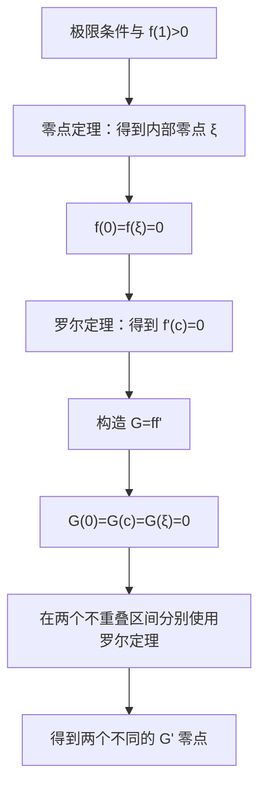

本节是考研一元函数微分学中综合性很强的一节。它向前连接函数极限、无穷小量、导数定义、导数计算，向后连接微分中值定理、泰勒公式、定积分、微分方程及数学证明题。

这一节真正要掌握的，不是简单地求出一阶导数和二阶导数，而是：

**如何将函数的局部变化信息，转化为对函数整体性质、曲线几何特征、方程根的个数、参数范围及不等式的判断。**

## 一、考点体系

**1. 本节的六大核心模型**

| 核心模型       | 本质               | 重要程度  |
| ---------- | ---------------- | ----- |
| 切线、法线与几何约束 | 将几何条件转化为函数值与导数条件 | ★★★★  |
| 单调性、驻点与极值  | 一阶导数的符号分析        | ★★★★★ |
| 凹凸性、拐点与图像  | 二阶导数的符号分析        | ★★★★★ |
| 凸性与导数不等式   | 斜率、切线、弦线之间的关系    | ★★★★★ |
| 方程根数与参数范围  | 单调性、值域、零点定理      | ★★★★★ |
| 最优化与综合应用   | 构造目标函数并确定全局最值    | ★★★★  |

**2. 本节最重要的四条思维主线**

理解函数时，可以分为三个层级：

$$
\boxed{ f(x)\longrightarrow f'(x)\longrightarrow f''(x) }
$$

- $f(x)$：决定函数值、正负性、零点。
- $f'(x)$：决定变化方向、切线斜率、单调性。
- $f''(x)$：决定斜率的变化方向、曲线凹凸性、拐点。
- 更高阶导数：用于处理低阶导数失效的退化情形。

而在实际做题时，常常需要反向思考：

$$
\text{极值}\longrightarrow f'\text{ 的符号}
$$

$$
\text{拐点}\longrightarrow f''\text{ 的符号}
$$

$$
\text{方程有解}\longrightarrow\text{函数值域}
$$

$$
\text{不等式}\longrightarrow\text{辅助函数的单调性}
$$

学会这种双向转换，是解决创新题的基础。

## 二、函数的单调性

**2.1 单调性的本质**

若对区间 $I$ 内任意的 $x_1<x_2$，都有

$$
f(x_1)<f(x_2),
$$

则称 $f(x)$ 在 $I$ 上严格单调递增。

若始终有

$$
f(x_1)>f(x_2),
$$

则称其严格单调递减。

导数的符号之所以能决定单调性，本质上来自拉格朗日中值定理：

$$
f(x_2)-f(x_1)=f'(\xi)(x_2-x_1),
$$

其中

$$
x_1<\xi<x_2.
$$

因为 $x_2-x_1>0$，所以导数符号能够控制函数增量的符号。

**2.2 单调性的重要判别定理**

| 条件                              | 可以推出   |
| ------------------------------- | ------ |
| $f'(x)>0$                   | 严格单调递增 |
| $f'(x)<0$                   | 严格单调递减 |
| $f'(x)\geq0$                | 单调不减   |
| $f'(x)\leq0$                | 单调不增   |
| $f'(x)\equiv0$              | 函数为常数  |
| $f'(x)\geq0$，且不在任何非退化子区间恒为零 | 严格单调递增 |

特别注意：

$$
f'(x)>0 \Longrightarrow f(x)\text{ 严格递增}
$$

但是逆命题不成立。

例如：

$$
f(x)=x^3,\qquad f'(x)=3x^2.
$$

虽然 $f'(0)=0$，但 $f(x)$ 在整个实数轴上严格递增。

所以，**孤立的导数零点并不破坏严格单调性。**

**2.3 求单调区间的标准步骤**

第一步：确定定义域。

第二步：求一阶导数，并尽可能因式分解。

第三步：寻找导数为零的点、导数不存在的点及定义域的分界点。

第四步：划分区间，判断导数符号。

第五步：写出单调区间，并注意能否合并相邻区间。

例如：

$$
f(x)=\frac{x}{1+x^2}.
$$

求导：

$$
f'(x)=\frac{1-x^2}{(1+x^2)^2} =\frac{(1-x)(1+x)}{(1+x^2)^2}.
$$

分母恒正，故只需要判断分子的符号。

| 区间          | $(-\infty,-1)$ | $(-1,1)$ | $(1,+\infty)$ |
| ----------- | ------------------ | ------------ | ----------------- |
| $f'(x)$ | −                  | +            | −                 |
| $f(x)$  | 递减                 | 递增           | 递减                |

由此还可以同时得到极值信息。

**2.4 导数符号的常用化简技巧**

当导数复杂时，不要立即展开所有式子。

| 函数形式     | 优先方法        |
| -------- | ----------- |
| 分式函数     | 提取恒正分母，分析分子 |
| 指数函数乘多项式 | 去掉恒正指数因子    |
| 幂指函数     | 先取对数，再求导    |
| 根式函数     | 利用复合函数的单调性  |
| 含绝对值函数   | 分段讨论        |
| 导数分子仍然复杂 | 构造辅助函数，再求导  |
| 含积分函数    | 优先利用微积分基本定理 |
| 含参数函数    | 尝试分离参数      |

例如：

$$
f(x)=u(x)^{v(x)}>0
$$

在 $u(x)>0$ 的区间内，

$$
\ln f(x)=v(x)\ln u(x),
$$

从而

$$
\frac{f'(x)}{f(x)} =v'(x)\ln u(x)+v(x)\frac{u'(x)}{u(x)}.
$$

由于 $f(x)>0$，只需要判断右边的符号。

## 三、驻点、极值点与最值

**3.1 三个概念必须区分**

**驻点：**

满足

$$
f'(x_0)=0
$$

的点。

**极值点：**

如果在 $x_0$ 的某个邻域内，始终有

$$
f(x)\leq f(x_0),
$$

则 $x_0$ 是局部极大值点。

如果始终有

$$
f(x)\geq f(x_0),
$$

则是局部极小值点。若对邻域内所有异于 $x_0$ 的点均为严格不等式，则称为严格极值。

**最值：**

比较的是整个指定定义域，而不仅仅是某个邻域。

| 概念      | 比较范围   | 是否必须可导 |
| ------- | ------ | ------ |
| 驻点      | 一个点的导数 | 必须     |
| 极值点     | 局部邻域   | 不必须    |
| 最大值、最小值 | 整个指定区间 | 不必须    |

极大值不一定是最大值，极小值也不一定是最小值。

**3.2 费马引理：极值的必要条件**

若 $f(x)$ 在内点 $x_0$ 处取得极值，且在该点可导，则

$$
\boxed{f'(x_0)=0}.
$$

注意两个前提：

- $x_0$ 是内点；
- $f(x)$ 在 $x_0$ 处可导。

因此：

$$
\text{可导内点处取得极值} \Longrightarrow \text{驻点}.
$$

但驻点未必是极值点。

例如：

$$
f(x)=x^3,\qquad f'(0)=0,
$$

而 $x=0$ 不是极值点。

另一方面，

$$
f(x)=|x|
$$

在 $x=0$ 取得极小值，但该点不可导。

**3.3 极值的第一充分条件**

设 $f$ 在 $x_0$ 处连续，且在其两侧某个去心邻域内可导。

| $x_0$ 左侧的 $f'$ | $x_0$ 右侧的 $f'$ | 结论    |
| ---------------------- | ---------------------- | ----- |
| +                      | −                      | 严格极大值 |
| −                      | +                      | 严格极小值 |
| +                      | +                      | 不是极值点 |
| −                      | −                      | 不是极值点 |

这是考试中适用范围很广的极值判别方法。

但必须注意：它是充分条件，不能随意反推。函数取得极值，并不一定意味着其导数在极值点两侧各自始终保持固定符号。

**3.4 极值的第二充分条件**

若

$$
f'(x_0)=0,
$$

且 $f''(x_0)$ 存在，则：

$$
\begin{cases} f''(x_0)>0,&\text{严格极小值},\\ f''(x_0)<0,&\text{严格极大值},\\ f''(x_0)=0,&\text{无法直接判定}. \end{cases}
$$

它的原理可以由带佩亚诺余项的泰勒公式解释：

$$
f(x_0+h)-f(x_0) =\frac{f''(x_0)}2h^2+o(h^2).
$$

因为 $h^2>0$，所以函数增量的符号由 $f''(x_0)$ 决定。

**3.5 高阶导数判别法**

若在适当的泰勒展开条件下，

$$
f'(x_0)=f''(x_0)=\cdots =f^{(n-1)}(x_0)=0,
$$

但

$$
f^{(n)}(x_0)\ne0, \qquad n\ge2,
$$

则

$$
f(x_0+h)-f(x_0) =\frac{f^{(n)}(x_0)}{n!}h^n+o(h^n).
$$

于是：

| 首个非零导数阶数 | 系数符号 | 极值结论  |
| -------- | ---- | ----- |
| 偶数阶      | 正    | 严格极小值 |
| 偶数阶      | 负    | 严格极大值 |
| 奇数阶      | 任意   | 不是极值点 |

这是极值判别与泰勒展开、无穷小量比较的连接点。

**3.6 最本质的判别：直接观察函数增量**

如果已知

$$
f(x)-f(x_0)\sim c(x-x_0)^n, \qquad c\ne0,
$$

便可以直接判断：

$$
\boxed{ \begin{aligned} &n\text{ 为偶数},\ c>0 &&\Rightarrow\text{极小值},\\ &n\text{ 为偶数},\ c<0 &&\Rightarrow\text{极大值},\\ &n\text{ 为奇数} &&\Rightarrow\text{不是极值}. \end{aligned}}
$$

这种方法甚至不必事先知道二阶导数是否存在。

## 四、凹凸性与拐点

**4.1 直观理解**

为了避免不同教材的凹凸术语相反，本文优先使用“凹向上”和“凹向下”，并以二阶导数符号为准。

| 二阶导数           | 曲线形态              | 一阶导数 |
| -------------- | ----------------- | ---- |
| $f''(x)>0$ | 凹向上，形如 $\cup$ | 递增   |
| $f''(x)<0$ | 凹向下，形如 $\cap$ | 递减   |

国内考研高数常用的表述是：

$$
f''(x)>0 \quad\Rightarrow\quad \text{曲线为凹}.
$$

$$
f''(x)<0 \quad\Rightarrow\quad \text{曲线为凸}.
$$

而在凸分析中，前者通常称为凸函数。遇到试题时，应以题目采用的术语为准。

**4.2 拐点的本质**

拐点是连续曲线上凹凸性发生改变的点。

关键不是二阶导数为零，而是曲线两侧的凹凸性不同。

在通常的二阶可导判别情形下：

$$
\boxed{\text{拐点}\quad\longleftarrow\quad f''(x)\text{ 在两侧变号}}
$$

例如：

$$
f(x)=x^3,\qquad f''(x)=6x.
$$

二阶导数在零点左右异号，故 $(0,0)$ 为拐点。

而

$$
f(x)=x^4,\qquad f''(x)=12x^2.
$$

虽然 $f''(0)=0$，但两侧均为正，因此原点不是拐点。

**4.3 极值与拐点的核心区别**

| 对比项     | 极值点                           | 拐点                         |
| ------- | ----------------------------- | -------------------------- |
| 研究对象    | 函数值的局部大小                      | 曲线凹凸性的改变                   |
| 常用导数    | $f'$                      | $f''$                  |
| 判别依据    | $f'$ 在两侧变号                | $f''$ 在两侧变号            |
| 可导时必要条件 | $f'(x_0)=0$               | 若二阶导数存在，则 $f''(x_0)=0$ |
| 输出形式    | 极值点 $x_0$、极值 $f(x_0)$ | 坐标 $(x_0,f(x_0))$      |

极值点与拐点不是同一概念。一般光滑函数的典型情形如下：

| 函数          | 原点是否为极值点 | 原点是否为拐点 |
| ----------- | -------- | ------- |
| $x^2$   | 极小值点     | 否       |
| $-x^2$  | 极大值点     | 否       |
| $x^3$   | 否        | 是       |
| $x^4$   | 极小值点     | 否       |
| $x^5$   | 否        | 是       |
| $x+x^3$ | 否        | 是       |
| $x$     | 无严格极值    | 否       |

**4.4 拐点不一定是二阶导数存在的点**

例如：

$$
f(x)=x|x| =\begin{cases} -x^2,&x<0,\\ x^2,&x\ge0. \end{cases}
$$

当 $x\ne0$ 时，

$$
f''(x)= \begin{cases} -2,&x<0,\\ 2,&x>0. \end{cases}
$$

虽然 $f''(0)$ 不存在，但曲线连续，且两侧凹凸性改变，所以 $(0,0)$ 仍是拐点。

对于尖角处是否允许称为拐点，不同教材存在定义差异，需结合题目约定；上述例子的 $f'(0)$ 存在，不涉及尖角争议。

**4.5 求凹凸区间与拐点的标准流程**

1. 确定定义域。
2. 计算 $f''(x)$。
3. 找出二阶导数为零或不存在的候选点。
4. 划分区间，判断二阶导数符号。
5. 检查候选点是否在曲线上且函数连续。
6. 只有凹凸性确实改变时，才将其判为拐点。
7. 代入函数计算拐点的完整坐标。

## 五、切线、法线与几何条件

**5.1 显函数的切线和法线**

已知曲线 $y=f(x)$，切点为

$$
P(x_0,f(x_0)).
$$

切线斜率：

$$
k_{\text{切}}=f'(x_0).
$$

切线方程：

$$
\boxed{y-f(x_0)=f'(x_0)(x-x_0)}.
$$

当 $f'(x_0)\ne0$ 时，法线方程为

$$
\boxed{ y-f(x_0)=-\frac1{f'(x_0)}(x-x_0) }.
$$

特殊情况：

| 切线                  | 法线                  |
| ------------------- | ------------------- |
| 水平直线 $y=f(x_0)$ | 竖直直线 $x=x_0$    |
| 竖直直线 $x=x_0$    | 水平直线 $y=f(x_0)$ |

**5.2 隐函数的切线和法线**

对于隐函数

$$
F(x,y)=0,
$$

若 $F$ 具有连续的一阶偏导数，且在所讨论的点处 $F_y\ne0$，则

$$
\boxed{y'=-\frac{F_x}{F_y}}.
$$

对于正则点，即 $F_x,F_y$ 不同时为零的点，切线还可以直接写成

$$
\boxed{ F_x(x_0,y_0)(x-x_0) +F_y(x_0,y_0)(y-y_0)=0 }.
$$

该形式尤其适合椭圆、双曲线、圆等隐式曲线。

**5.3 参数方程的切线**

若

$$
\begin{cases} x=\varphi(t),\\ y=\psi(t), \end{cases}
$$

且 $\varphi'(t)\ne0$，则

$$
\boxed{ \frac{\mathrm dy}{\mathrm dx} =\frac{\psi'(t)}{\varphi'(t)} }.
$$

二阶导数为

$$
\boxed{ \frac{\mathrm d^2y}{\mathrm dx^2} =\frac1{\varphi'(t)} \frac{\mathrm d}{\mathrm dt} \left(\frac{\psi'(t)}{\varphi'(t)}\right) }
$$

也就是

$$
\boxed{ y''=\frac{\psi''\varphi'-\psi'\varphi''} {(\varphi')^3} }.
$$

注意分母中是 $(\varphi')^3$，不是平方。

**5.4 极坐标曲线的切线**

对于

$$
r=r(\theta),
$$

利用

$$
x=r\cos\theta,\qquad y=r\sin\theta,
$$

得到

$$
\boxed{ \frac{\mathrm dy}{\mathrm dx} =\frac{r'\sin\theta+r\cos\theta} {r'\cos\theta-r\sin\theta} }.
$$

如果分子、分母同时为零，应回到割线的极限方向，或者利用泰勒展开判断切线。

**5.5 常见几何条件的数学转写**

| 题目条件               | 数学表达式                                     |
| ------------------ | ----------------------------------------- |
| 曲线在某点有水平切线         | $f'(x_0)=0$                           |
| 切线与直线平行            | 两直线斜率相等                                   |
| 两条非竖直直线垂直          | 两斜率之积为 $-1$                           |
| 两条曲线在同一点相切         | $f(x_0)=g(x_0)$，$f'(x_0)=g'(x_0)$ |
| 两曲线具有公切线           | 切线斜率和截距分别相等                               |
| 切线经过原点             | $f(x_0)=x_0f'(x_0)$                   |
| 切线经过定点 $(a,b)$ | $b=f(x_0)+f'(x_0)(a-x_0)$             |
| 切线的横截距             | $x_0-f(x_0)/f'(x_0)$                  |
| 切线的纵截距             | $f(x_0)-x_0f'(x_0)$                   |

其中最值得记住的是切线的两个截距公式，因为它们经常与极限、最值、方程根数结合。

## 六、凹凸性最重要的三大不等式

这一部分是近年来数一证明题特别值得重视的内容。

以下统一讨论 $f''(x)\ge0$ 的情形，即凹向上、数学意义上的凸函数。

**6.1 切线不等式**

如果 $f''(x)\ge0$，则

$$
\boxed{ f(x)\ge f(a)+f'(a)(x-a) }.
$$

几何意义：曲线位于任意切线的上方或切线上。

特别地，取 $a=0$，得到

$$
f(x)\ge f(0)+f'(0)x.
$$

这是证明函数不等式的重要母公式。

**6.2 弦线不等式（Jensen不等式的二点形式）**

对于 $0\le\lambda\le1$，有

$$
\boxed{ f((1-\lambda)a+\lambda b) \le (1-\lambda)f(a)+\lambda f(b) }.
$$

几何意义：曲线位于连接两端点的弦线下方。

取 $\lambda=\frac12$，得到

$$
\boxed{ f\left(\frac{a+b}{2}\right) \le\frac{f(a)+f(b)}2 }.
$$

**6.3 割线斜率不等式**

对于任意 $x_1<x_2<x_3$，有

$$
\boxed{ \frac{f(x_2)-f(x_1)}{x_2-x_1} \le \frac{f(x_3)-f(x_2)}{x_3-x_2} }.
$$

若函数严格凸，则上述不等式严格成立。

在可导条件下，还可以得到

$$
\boxed{ f'(a)\le \frac{f(b)-f(a)}{b-a} \le f'(b) },\qquad a<b.
$$

**6.4 三大不等式的统一理解**

| 曲线性质        | 切线位置 | 弦线位置 | 割线斜率   |
| ----------- | ---- | ---- | ------ |
| $f''>0$ | 切线在下 | 弦线在上 | 由左向右增大 |
| $f''<0$ | 切线在上 | 弦线在下 | 由左向右减小 |

记住：

**二阶导数为正：切线在下，曲线居中，弦线在上。**

**6.5 进一步推论：积分平均值不等式**

如果 $f$ 在 $[a,b]$ 上连续且为凸函数，那么

$$
\boxed{ f\left(\frac{a+b}{2}\right) \le \frac1{b-a}\int_a^b f(x)\,\mathrm dx \le \frac{f(a)+f(b)}2 }.
$$

这称为 Hermite–Hadamard 不等式。

其左侧是函数在区间中点的值，中间是积分平均值，右侧是两个端点的函数值平均。

2022年考研数学一真题考查的正是这一不等式左半部分的充要条件证明，后面会详细讲解。

## 七、题型一：切线、法线与几何约束

### 母题1：两条曲线相切，反求参数

**来源：2010年考研数学二。数一同样适用。**

曲线

$$
y=x^2
$$

与曲线

$$
y=a\ln x,\qquad a\ne0
$$

相切，求 $a$。

**题型识别**

出现“两曲线相切”，首先想到两个条件：

$$
\boxed{\text{同一个点}+\text{同一个切线斜率}}
$$

**标准解法**

设切点横坐标为 $x_0>0$。

由两曲线共点，

$$
x_0^2=a\ln x_0.
$$

由切线斜率相等，

$$
2x_0=\frac a{x_0}.
$$

由第二式得

$$
a=2x_0^2.
$$

代入第一式：

$$
x_0^2=2x_0^2\ln x_0.
$$

由于 $x_0>0$，

$$
\ln x_0=\frac12.
$$

所以

$$
x_0=\sqrt e,\qquad \boxed{a=2e}.
$$

**母题推广**

若改为

$$
y=x^n,\qquad y=a\ln x,\qquad n>0,
$$

同理有

$$
\begin{cases} x_0^n=a\ln x_0,\\ nx_0^{n-1}=a/x_0. \end{cases}
$$

得到

$$
a=nx_0^n,\qquad \ln x_0=\frac1n.
$$

因此

$$
\boxed{a=ne}.
$$

<Callout type="warn" title="易错点">

两条曲线的导数相等，只说明切线平行；还必须满足共点条件才能确定在同一点相切。

如果题目问的是两条曲线有一条公切线，则切点可以不同。此时应设两个切点 $u,v$，建立

$$
\begin{cases} f'(u)=g'(v),\\ f(u)-uf'(u)=g(v)-vg'(v). \end{cases}
$$

不要与同一点相切混淆。

</Callout>

### 母题2：通过极限条件确定切线

**来源：张宇1000题，第5章第026题。**

已知 $f(x)$ 在 $x=0$ 处连续，且

$$
\lim_{x\to0} \frac{[f(x)+1]x^2}{x-\sin x}=2.
$$

求曲线 $y=f(x)$ 在 $(0,f(0))$ 处的切线方程。

**分析**

切线只需要两个数据：

$$
f(0),\qquad f'(0).
$$

不需要求出整个函数。

由

$$
x-\sin x\sim\frac{x^3}{6},
$$

原极限等价于

$$
\lim_{x\to0}\frac{6[f(x)+1]}x=2.
$$

因此

$$
\lim_{x\to0}\frac{f(x)+1}{x} =\frac13.
$$

由于上述极限有限，所以

$$
f(x)+1\to0.
$$

结合连续性，

$$
f(0)=-1.
$$

再利用导数定义：

$$
f'(0) =\lim_{x\to0}\frac{f(x)-f(0)}x =\frac13.
$$

故所求切线为

$$
\boxed{y=\frac x3-1}.
$$

**核心迁移**

遇到抽象函数切线题，优先把已知条件整理为

$$
f(x_0+h)=A+Bh+o(h).
$$

那么在连续性及相应条件下，直接得到

$$
\boxed{f(x_0)=A,\qquad f'(x_0)=B}.
$$

切线方程就是

$$
y=A+B(x-x_0).
$$

### 母题3：极坐标曲线与特殊切点

**来源：李正元练习题，第二章第019题。**

设心形线

$$
r=a(1+\cos\theta),\qquad a>0.
$$

求其在 $\theta=0,\frac\pi2,\pi$ 对应点处的切线。

**标准解法**

化成参数方程：

$$
\begin{cases} x=a(1+\cos\theta)\cos\theta,\\ y=a(1+\cos\theta)\sin\theta. \end{cases}
$$

求导得

$$
x'=-a\sin\theta(1+2\cos\theta),
$$

$$
y'=a(2\cos^2\theta+\cos\theta-1).
$$

当 $\theta=0$ 时，切点为 $(2a,0)$，且

$$
x'=0,\qquad y'=2a.
$$

故切线竖直：

$$
\boxed{x=2a}.
$$

当 $\theta=\frac\pi2$ 时，切点为 $(0,a)$，且

$$
x'=-a,\qquad y'=-a.
$$

故切线斜率为1，

$$
\boxed{y=x+a}.
$$

当 $\theta=\pi$ 时，切点为原点，但

$$
x'=y'=0.
$$

此时不能直接使用导数比值公式。

令

$$
u=\theta-\pi.
$$

由泰勒展开，

$$
x=-\frac a2u^2+O(u^4),
$$

$$
y=-\frac a2u^3+O(u^5).
$$

所以割线斜率满足

$$
\frac yx\to0.
$$

故原点处的切线为

$$
\boxed{y=0}.
$$

**迁移规律**

参数曲线在某点若满足

$$
x-x_0\sim At^m,\qquad y-y_0\sim Bt^n,
$$

其中 $A,B\ne0$，则根据割线方向：

| 阶数关系       | 切线                |
| ---------- | ----------------- |
| $n>m$  | 水平切线              |
| $n<m$ | 竖直切线              |
| $n=m$  | 斜率为 $B/A$ 的切线 |

这也是处理参数曲线尖点的实用方法。

## 八、题型二：极限条件下的极值与拐点判别

这是数一客观题中非常重要的一类。

### 母题4：由函数增量直接判断极值

**来源：1987年考研数学一。**

已知

$$
\lim_{x\to a} \frac{f(x)-f(a)}{(x-a)^2}=-1.
$$

判断 $f(x)$ 在 $x=a$ 处的性质。

**最优解法**

根据极限保号性，当 $x\ne a$ 且充分接近 $a$ 时，

$$
\frac{f(x)-f(a)}{(x-a)^2}<0.
$$

因为

$$
(x-a)^2>0,
$$

所以

$$
f(x)-f(a)<0.
$$

即

$$
f(x)<f(a).
$$

因此 $x=a$ 是严格极大值点。

同时，

$$
\begin{aligned} f'(a) &=\lim_{x\to a}\frac{f(x)-f(a)}{x-a}\\ &=\lim_{x\to a}(x-a) \frac{f(x)-f(a)}{(x-a)^2}\\ &=0. \end{aligned}
$$

最终结论：

$$
\boxed{f'(a)=0,\quad f(a)\text{ 为严格极大值}}.
$$

**本题最重要的陷阱**

不能直接断定

$$
f''(a)=-2.
$$

题目并未保证二阶导数存在。

如果额外给出 $f$ 在 $a$ 处二阶可导，才可以通过泰勒公式读出

$$
f''(a)=-2.
$$

**函数增量的渐近关系可以直接决定极值，却不能在缺少光滑性条件时随意对渐近式求导。**

### 母题5：二阶导数为零，仍然可以取得极值

**来源：1996年考研数学一。**

设 $f(x)$ 有二阶连续导数，

$$
f'(0)=0, \qquad \lim_{x\to0}\frac{f''(x)}{|x|}=1.
$$

判断原点处的极值和拐点性质。

**解题过程**

题设说明

$$
f''(x)\sim |x|.
$$

所以在原点的去心邻域内，

$$
f''(x)>0.
$$

由于二阶导数连续，

$$
f''(0)=0.
$$

但是二阶导数在左右两侧始终为正。

因此 $f'$ 在原点附近严格递增。

结合

$$
f'(0)=0,
$$

得到

$$
\begin{cases} f'(x)<0,&x<0,\\ f'(x)>0,&x>0, \end{cases}
$$

这里的 $x$ 均充分接近0。

所以函数先减后增：

$$
\boxed{x=0\text{ 为严格极小值点}}.
$$

因为 $f''$ 在原点两侧没有变号，所以

$$
\boxed{(0,f(0))\text{ 不是拐点}}.
$$

**同类题的系统归纳**

设 $f'(0)=0$，且下面的渐近关系成立。

| 已知条件                   | 极值性质 | 拐点性质      |
| ---------------------- | ---- | --------- |
| $f'(x)\sim x^3$    | 极小值  | 仅凭此条件无法确定 |
| $f'(x)\sim-x^3$    | 极大值  | 仅凭此条件无法确定 |
| $f'(x)\sim x^2$    | 非极值  | 仅凭此条件无法确定 |
| $f''(x)\sim \lvert x\rvert $ | 极小值  | 非拐点       |
| $f''(x)\sim-\lvert x\rvert $ | 极大值  | 非拐点       |
| $f''(x)\sim x$     | 非极值  | 拐点        |
| $f''(x)\sim-x$     | 非极值  | 拐点        |

这张表可以帮助你避免把 $f'$ 的渐近性质直接当成 $f''$ 的渐近性质。

### 母题6：积分函数、泰勒展开与极值拐点综合

**来源：2025年考研数学一。重点掌握。**

已知

$$
f(x)=\int_0^x e^{t^2}\sin t\,\mathrm dt,
$$

$$
g(x)= \left(\int_0^x e^{t^2}\,\mathrm dt\right)\sin^2x.
$$

判断它们在原点处的极值和拐点性质。

<Tabs items={["方法一：导数法", "方法二：利用泰勒首项"]} defaultIndex={0}>

<Tab value="方法一：导数法">

对于 $f(x)$，

$$
f'(x)=e^{x^2}\sin x.
$$

指数函数恒正，而在原点附近，$\sin x$ 与 $x$ 同号。

所以 $f'(x)$ 由负变正，得到

$$
\boxed{x=0\text{ 是 }f(x)\text{ 的极小值点}}.
$$

进一步，

$$
f''(x)=e^{x^2}(2x\sin x+\cos x).
$$

于是

$$
f''(0)=1>0.
$$

由于 $f''$ 连续，所以原点附近曲线保持凹向上，不是拐点。

对于 $g(x)$，直接连续求导也能解决，但运算较繁琐。更推荐下面的局部展开法。

</Tab>

<Tab value="方法二：利用泰勒首项">

首先，

$$
e^{t^2}\sin t=t+O(t^3).
$$

因此

$$
f(x)=\frac{x^2}{2}+O(x^4).
$$

其首项为正的偶次项，说明 $f$ 在原点取得严格极小值。

另一方面，

$$
\int_0^x e^{t^2}\,\mathrm dt =x+\frac{x^3}{3}+O(x^5),
$$

且

$$
\sin^2x=x^2-\frac{x^4}{3}+O(x^6).
$$

于是

$$
g(x)=x^3+O(x^5).
$$

由于这里涉及的函数都是解析函数，可以逐阶求导，得到

$$
g''(x)=6x+O(x^3).
$$

因此 $g''(x)$ 在原点左右异号。

故

$$
\boxed{(0,0)\text{ 是 }y=g(x)\text{ 的拐点}}.
$$

同时 $g(x)$ 在原点左右异号，所以原点不是 $g(x)$ 的极值点。

</Tab>

</Tabs>

**本题结论**

$x=0$ 是 $f(x)$ 的极值点，$(0,0)$ 是 $y=g(x)$ 的拐点。

**考场思维**

这道真题表面上是积分函数题，本质上考查的是局部模型：

$$
f(x)\sim\frac{x^2}{2}, \qquad g(x)\sim x^3.
$$

如果具备足够的光滑性，复杂函数在某点附近往往可以简化成最基本的多项式模型。

### 模拟母题：导数极限与积分无穷小

**来源：张宇8套卷第2套第1题。**

已知 $f(x)$ 有二阶连续导数，且

$$
\lim_{x\to0} \frac{f'(x)} {\displaystyle\int_0^{x^3}\frac{\sin t}{t}\,\mathrm dt} =-1.
$$

判断原点的极值性质。

由于

$$
\frac{\sin t}{t}\to1,
$$

所以

$$
\int_0^{x^3}\frac{\sin t}{t}\,\mathrm dt \sim x^3.
$$

于是

$$
f'(x)\sim-x^3.
$$

因此，当 $x$ 充分接近0时，

$$
\begin{cases} f'(x)>0,&x<0,\\ f'(x)<0,&x>0. \end{cases}
$$

故

$$
\boxed{x=0\text{ 是严格极大值点}}.
$$

**计算要点：** 保持分子 $f'(x)$ 和积分上限 $x^3$ 不变。

实际上由原题可得

$$
f'(0)=0,\qquad f''(0)=0,
$$

而不是解析中的 $f''(0)=-2$。

此题恰好说明：二阶导数为零不代表无法通过第一充分条件确定极值。

## 九、题型三：隐函数的极值

隐函数极值是数一大题非常经典的考法。2014年、2017年数一均有相应真题。

**9.1 隐函数极值的通用公式**

设

$$
F(x,y)=0
$$

确定了局部可导隐函数 $y=y(x)$，且 $F_y\ne0$。

则

$$
F_x+F_yy'=0,
$$

所以

$$
y'=-\frac{F_x}{F_y}.
$$

二次求导：

$$
F_{xx}+2F_{xy}y' +F_{yy}(y')^2+F_yy''=0.
$$

因此

$$
\boxed{ y''=-\frac{ F_{xx}+2F_{xy}y'+F_{yy}(y')^2 }{F_y} }.
$$

而在驻点处 $y'=0$，公式大幅简化：

$$
\boxed{y''=-\frac{F_{xx}}{F_y}}.
$$

**标准解题策略**

$$
\boxed{ \begin{gathered} F=0\\ F_x=0\\ F_y\ne0 \end{gathered} \quad\longrightarrow\quad \text{驻点候选} }
$$

再使用一阶导数变号或者

$$
y''=-\frac{F_{xx}}{F_y}
$$

判别极值。

### 母题7：隐函数驻点与二阶导数判别

**来源：2014年考研数学一。**

设函数 $y=f(x)$ 由

$$
y^3+xy^2+x^2y+6=0
$$

确定，求其极值。

<Steps>

<Step>

### 第一步：隐式求导 [!toc]

记

$$
F(x,y)=y^3+xy^2+x^2y+6.
$$

则

$$
F_x=y^2+2xy=y(y+2x),
$$

$$
F_y=3y^2+2xy+x^2.
$$

整理分母：

$$
F_y=(x+y)^2+2y^2.
$$

由于原曲线上 $y=0$ 不可能成立，因此

$$
F_y>0.
$$

故隐函数可导，并且

$$
y'=-\frac{y(y+2x)} {3y^2+2xy+x^2}.
$$

</Step>

<Step>

### 第二步：寻找驻点 [!toc]

令 $y'=0$，得到

$$
y(y+2x)=0.
$$

由于 $y\ne0$，所以

$$
y=-2x.
$$

代入原方程：

$$
-8x^3+4x^3-2x^3+6=0.
$$

即

$$
-6x^3+6=0.
$$

所以

$$
x=1,\qquad y=-2.
$$

</Step>

<Step>

### 第三步：判断极值 [!toc]

利用驻点处的二阶导数公式：

$$
y''=-\frac{F_{xx}}{F_y}.
$$

因为

$$
F_{xx}=2y,
$$

所以

$$
y''(1) =-\frac{2(-2)} {3(-2)^2+2(1)(-2)+1} =\frac49>0.
$$

因此

$$
\boxed{x=1\text{ 为极小值点，极小值为 }-2}.
$$

</Step>

</Steps>

**关键技巧**

没有必要求出整个隐函数 $y=f(x)$。

隐函数的价值正在于：即便无法显式解出 $y$，也可以利用隐式关系直接研究其导数与极值。

### 母题8：隐函数的一阶导数符号判别

**来源：2017年考研数学一。**

已知

$$
x^3+y^3-3x+3y-2=0.
$$

求 $y=y(x)$ 的极值。

两边求导：

$$
3x^2+3y^2y'-3+3y'=0.
$$

所以

$$
\boxed{ y'=\frac{1-x^2}{1+y^2} }.
$$

由于分母恒正，导数符号只由 $1-x^2$ 决定。

| 区间       | $(-\infty,-1)$ | $(-1,1)$ | $(1,+\infty)$ |
| -------- | ------------------ | ------------ | ----------------- |
| $y'$ | −                  | +            | −                 |
| $y$  | 递减                 | 递增           | 递减                |

因此：

$$
x=-1\text{ 为极小值点},
$$

$$
x=1\text{ 为极大值点}.
$$

代入原方程。

当 $x=-1$ 时，

$$
y^3+3y=0,
$$

得到唯一实根 $y=0$。

当 $x=1$ 时，

$$
y^3+3y=4,
$$

得到唯一实根 $y=1$。

故

$$
\boxed{ \begin{aligned} &y(-1)=0 &&\text{为极小值},\\ &y(1)=1 &&\text{为极大值}. \end{aligned} }
$$

**与上一道真题的区别**

2014年真题的导数分子同时含 $x,y$，不容易直接判断所有区间的导数符号，因此二阶导数判别更方便。

2017年真题的导数分母恒正，分子只含 $x$，因此一阶导数符号法更方便。

| 隐函数导数的形式          | 推荐方法           |
| ----------------- | -------------- |
| 分母恒正，分子只含 $x$ | 一阶导数符号法        |
| 分子同时含 $x,y$   | 联立驻点方程，再求二阶导数  |
| 分母可能为零            | 检查隐函数分支及不可导点   |
| 驻点处 $y''=0$   | 高阶导数、局部展开或变号判别 |

## 十、题型四：变限积分函数的单调性与极值

**10.1 基本公式**

对于

$$
F(x)=\int_a^{u(x)}f(t)\,\mathrm dt,
$$

有

$$
F'(x)=f(u(x))u'(x).
$$

对于上下限和被积函数都含 $x$ 的积分，在相应连续性和可微条件下，

$$
F(x)=\int_{u(x)}^{v(x)}K(x,t)\,\mathrm dt,
$$

则

$$
\boxed{ \begin{aligned} F'(x)={}&K(x,v(x))v'(x)\\ &-K(x,u(x))u'(x)\\ &+\int_{u(x)}^{v(x)} \frac{\partial K}{\partial x}(x,t)\,\mathrm dt. \end{aligned} }
$$

特别注意积分中的两个角色：

$t$ 是积分变量，而 $x$ 是外部参数。

### 母题9：不必求出原函数的积分极值题

**来源：2010年考研数学一、数学二。重点掌握。**

求

$$
f(x)=\int_1^{x^2}(x^2-t)e^{-t^2}\,\mathrm dt
$$

的单调区间与极值。

<Steps>

<Step>

### 第一步：识别结构 [!toc]

这里不仅积分上限 $x^2$ 含 $x$，而且被积函数也含 $x$。

因此不能简单写成

$$
f'(x)=(x^2-x^2)e^{-x^4}\cdot2x=0.
$$

还必须计算积分内部对 $x$ 的导数。

</Step>

<Step>

### 第二步：求导 [!toc]

利用莱布尼茨公式：

$$
\begin{aligned} f'(x) &=(x^2-x^2)e^{-x^4}\cdot2x\\ &\quad+\int_1^{x^2}2xe^{-t^2}\,\mathrm dt\\ &=2x\int_1^{x^2}e^{-t^2}\,\mathrm dt. \end{aligned}
$$

记

$$
I(x)=\int_1^{x^2}e^{-t^2}\,\mathrm dt.
$$

</Step>

<Step>

### 第三步：判断积分符号 [!toc]

由于

$$
e^{-t^2}>0,
$$

所以积分符号完全由积分方向决定：

$$
I(x) \begin{cases} >0,&|x|>1,\\ =0,&|x|=1,\\ <0,&|x|<1. \end{cases}
$$

</Step>

<Step>

### 第四步：建立符号表 [!toc]

| 区间          | $(-\infty,-1)$ | $(-1,0)$ | $(0,1)$ | $(1,+\infty)$ |
| ----------- | ------------------ | ------------ | ----------- | ----------------- |
| $x$     | −                  | −            | +           | +                 |
| $I(x)$  | +                  | −            | −           | +                 |
| $f'(x)$ | −                  | +            | −           | +                 |
| $f(x)$  | 递减                 | 递增           | 递减          | 递增                |

所以 $\pm1$ 是极小值点，0是极大值点。

</Step>

<Step>

### 第五步：计算极值 [!toc]

$$
f(\pm1)=0.
$$

当 $x=0$ 时，

$$
\begin{aligned} f(0) &=\int_1^0(-t)e^{-t^2}\,\mathrm dt\\ &=\int_0^1te^{-t^2}\,\mathrm dt\\ &=\frac12(1-e^{-1}). \end{aligned}
$$

所以极小值为

$$
\boxed{0},
$$

极大值为

$$
\boxed{\frac{1-e^{-1}}2}.
$$

</Step>

</Steps>

**母题推广**

考虑一般形式

$$
F(x)=\int_a^{u(x)} [u(x)-t]w(t)\,\mathrm dt,
$$

其中 $w(t)>0$ 且连续。

则

$$
\boxed{ F'(x)=u'(x)\int_a^{u(x)}w(t)\,\mathrm dt }.
$$

所以

$$
\boxed{ \operatorname{sgn}F'(x) =\operatorname{sgn}\bigl[u'(x)(u(x)-a)\bigr] }
$$

这里 $\operatorname{sgn}$ 表示符号函数。

此外，

$$
F(x)\ge0,
$$

且等号恰在 $u(x)=a$ 时成立。

你完全可以不求出 $w(t)$ 的原函数，直接确定单调性及部分最值信息。

### 母题10：含绝对值积分的极值

**来源：张宇1000题，第5章第031题。**

设

$$
f(x)=\int_0^1|t(t-x)|\,\mathrm dt, \qquad 0<x<1.
$$

求单调区间和凹凸区间。

**关键步骤：找到积分内部的变号点**

当 $0<t<x$ 时，

$$
t(t-x)<0.
$$

当 $x<t<1$ 时，

$$
t(t-x)>0.
$$

所以

$$
f(x)=\int_0^xt(x-t)\,\mathrm dt +\int_x^1t(t-x)\,\mathrm dt.
$$

直接求导即可：

$$
\begin{aligned} f'(x) &=\int_0^xt\,\mathrm dt-\int_x^1t\,\mathrm dt\\ &=\frac{x^2}2-\frac{1-x^2}2\\ &=x^2-\frac12. \end{aligned}
$$

所以 $f$ 在

$$
\left(0,\frac1{\sqrt2}\right)
$$

上递减，在

$$
\left(\frac1{\sqrt2},1\right)
$$

上递增。

又因为

$$
f''(x)=2x>0,
$$

所以整个定义域上曲线凹向上。

**高级推广：加权绝对偏差**

设

$$
F(x)=\int_a^b w(t)|x-t|\,\mathrm dt,
$$

其中 $w(t)>0$ 且连续。

当 $a<x<b$ 时，

$$
\boxed{ F'(x)=\int_a^xw(t)\,\mathrm dt -\int_x^bw(t)\,\mathrm dt }.
$$

进一步有

$$
\boxed{F''(x)=2w(x)>0}.
$$

因此唯一最小值点满足

$$
\boxed{ \int_a^{x_0}w(t)\,\mathrm dt =\int_{x_0}^bw(t)\,\mathrm dt }.
$$

也就是说，最小值点将总权重平分。

这个结论可以迁移到各种含绝对值积分的最优化新题中。

## 十一、题型五：参数方程、复合函数与凹凸性

### 母题11：根据多项式根的重数快速判断拐点

**来源：2011年考研数学一。**

已知曲线

$$
y=(x-1)(x-2)^2(x-3)^3(x-4)^4.
$$

在下列四点中判断哪个是拐点：

$$
(1,0),\quad(2,0),\quad(3,0),\quad(4,0).
$$

**常规方法**

直接求两次导数，然后逐一代入候选点判断。

但是原多项式次数很高，直接展开非常繁琐。

**高效方法：局部因式分解**

假设一个多项式在 $x=a$ 附近可以写成

$$
P(x)=(x-a)^mH(x),
$$

其中 $H(a)\ne0$。

对于 $m\ge2$，二阶导数的最低阶非零项为

$$
P''(x)\sim m(m-1)H(a)(x-a)^{m-2}.
$$

所以：

- 二重根：二阶导数在该点不为零，不是拐点。
- 三重根：二阶导数具有一次因子，发生变号，是拐点。
- 四重根：二阶导数具有二次因子，不变号，不是拐点。
- 五重根：二阶导数具有三次因子，发生变号，是拐点。

由此立即可以判断

$$
\boxed{(3,0)\text{ 是拐点}}.
$$

对于单重根 $x=1$，上述快速结论不适用，需要另外求二阶导数。令 $P(x)=(x-1)H(x)$，则

$$
P''(1)=2H'(1)=6264\ne0,
$$

故也不是拐点。

**可迁移结论**

对于多项式或具有足够光滑性的局部模型

$$
f(x)=(x-a)^mH(x),\qquad H(a)\ne0,
$$

当 $m\ge2$ 时：

| 根的重数       | 局部极值  | 拐点 |
| ---------- | ----- | -- |
| 偶数重根       | 有严格极值 | 否  |
| 奇数重根，且至少三重 | 无极值   | 是  |

极值究竟是极大值还是极小值，再由 $H(a)$ 的符号决定。

### 母题12：参数方程的单调性、极值与拐点

**来源：李林880题，第二章第052题。**

设

$$
\begin{cases} x=t\ln t,\\ y=\dfrac{\ln t}{t}, \end{cases} \qquad t\ge1.
$$

求函数 $y=y(x)$ 的单调区间、极值、凹凸区间及拐点。

<Steps>

<Step>

### 第一步：确认参数与横坐标的对应关系 [!toc]

$$
\frac{\mathrm dx}{\mathrm dt} =1+\ln t>0.
$$

因此 $x$ 随 $t$ 严格递增。

这意味着可以直接在参数轴上进行导数符号分析，再将结果转换为 $x$ 的区间。

</Step>

<Step>

### 第二步：求一阶导数 [!toc]

$$
\frac{\mathrm dy}{\mathrm dt} =\frac{1-\ln t}{t^2}.
$$

因此

$$
y'=\frac{1-\ln t}{t^2(1+\ln t)}.
$$

分母恒正，故只需判断

$$
1-\ln t.
$$

令其为零，得到

$$
t=e.
$$

对应

$$
x=e,\qquad y=\frac1e.
$$

因此函数在 $(0,e)$ 上递增，在 $(e,+\infty)$ 上递减。

极大值为

$$
\boxed{\frac1e}.
$$

它也是全局最大值；定义域端点 $x=0$ 处的函数值为0，也是全局最小值。

</Step>

<Step>

### 第三步：求二阶导数 [!toc]

$$
y''=\frac1{1+\ln t} \frac{\mathrm d}{\mathrm dt} \left[ \frac{1-\ln t}{t^2(1+\ln t)} \right].
$$

化简得

$$
\boxed{ y''=\frac{2[(\ln t)^2-2]} {t^3(1+\ln t)^3} }.
$$

令分子为零：

$$
\ln t=\sqrt2.
$$

所以

$$
t=e^{\sqrt2}.
$$

因为 $t\ge1$，故不需要考虑 $\ln t=-\sqrt2$。

</Step>

<Step>

### 第四步：判断凹凸性 [!toc]

当

$$
1<t<e^{\sqrt2}
$$

时，$y''<0$，曲线凹向下。

当

$$
t>e^{\sqrt2}
$$

时，$y''>0$，曲线凹向上。

因此唯一拐点为

$$
\boxed{ \left( \sqrt2e^{\sqrt2}, \sqrt2e^{-\sqrt2} \right) }.
$$

</Step>

</Steps>

<Callout type="warn" title="易错点">

题目要求的是函数 $y=y(x)$ 的单调区间，而不是 $y(t)$ 的单调区间。

因此答案必须由参数 $t$ 转回横坐标 $x$。

若 $x'(t)<0$，也不能只看 $y'(t)$ 的符号，必须分析

$$
\frac{\mathrm dy/\mathrm dt}{\mathrm dx/\mathrm dt}.
$$

</Callout>

### 母题13：微分方程与拐点的综合题

**来源：2019年考研数学一。**

设 $y=y(x)$ 满足

$$
y'+xy=e^{-x^2/2},
$$

且

$$
y(0)=0.
$$

求其表达式、凹凸区间及拐点。

<Steps>

<Step>

### 第一步：求解微分方程 [!toc]

这是标准一阶线性微分方程。

积分因子为

$$
\mu(x)=e^{\int x\,\mathrm dx} =e^{x^2/2}.
$$

两边乘以积分因子：

$$
(ye^{x^2/2})'=1.
$$

积分得到

$$
ye^{x^2/2}=x+C.
$$

由 $y(0)=0$，得到 $C=0$。

因此

$$
\boxed{y=xe^{-x^2/2}}.
$$

</Step>

<Step>

### 第二步：计算二阶导数 [!toc]

$$
y'=(1-x^2)e^{-x^2/2},
$$

$$
\boxed{y''=x(x^2-3)e^{-x^2/2}}.
$$

因为指数因子恒正，只需判断

$$
x(x^2-3)
$$

的符号。

| 区间        | $(-\infty,-\sqrt3)$ | $(-\sqrt3,0)$ | $(0,\sqrt3)$ | $(\sqrt3,+\infty)$ |
| --------- | ----------------------- | ----------------- | ---------------- | ---------------------- |
| $y''$ | −                       | +                 | −                | +                      |
| 曲线        | 凹向下                     | 凹向上               | 凹向下              | 凹向上                    |

三个候选点处均发生变号，所以拐点分别为

$$
\boxed{(0,0)},
$$

$$
\boxed{ \left(-\sqrt3,-\sqrt3e^{-3/2}\right) },
$$

$$
\boxed{ \left(\sqrt3,\sqrt3e^{-3/2}\right) }.
$$

</Step>

</Steps>

**综合题的解题习惯**

考研题经常把不同章节组合起来：

$$
\text{微分方程} \longrightarrow \text{函数表达式} \longrightarrow \text{导数} \longrightarrow \text{几何性质}.
$$

但如果题目仅要求判断某个指定点的极值或拐点，有时根本不需要解微分方程。可以直接代入该点，再对微分方程连续求导。

## 十二、题型六：利用导数结构判断函数大小与单调性

这类题最重要的能力是**逆向识别导数公式**。

**12.1 常见导数结构识别表**

| 已知表达式             | 应联想到                |
| ----------------- | ------------------- |
| $ff'$         | $(f^2)'/2$      |
| $f'g-fg'$     | $(f/g)'$        |
| $f'/f$        | $(\ln\lvert f\rvert )'$   |
| $ff''-(f')^2$ | $(\ln\lvert f\rvert )''$  |
| $(f')^2+ff''$ | $(ff')'$        |
| $f'+f$        | $e^{-x}(e^xf)'$ |
| $f'-f$        | $e^x(e^{-x}f)'$ |
| $xf'-f$       | $x^2(f/x)'$     |
| $f-xf'$       | 切线的纵截距              |
| $xf''$        | $(xf'-f)'$      |

这些结构应达到一眼识别的程度。

### 母题14：乘积导数结构

**来源：2017年考研数学一。**

设 $f(x)$ 可导，且

$$
f(x)f'(x)>0.
$$

判断 $f(1),f(-1)$ 或其绝对值的大小关系。

**分析**

题目没有告诉我们 $f'(x)>0$，而是给出了

$$
f(x)f'(x)>0.
$$

立即联想到

$$
[f^2(x)]'=2f(x)f'(x)>0.
$$

因此 $f^2(x)$ 严格递增。

由于 $-1<1$，

$$
f^2(-1)<f^2(1).
$$

即

$$
\boxed{|f(1)|>|f(-1)|}.
$$

**反例意识**

取

$$
f(x)=e^x
$$

满足题设，且 $f(1)>f(-1)$。

但取

$$
f(x)=-e^x
$$

也满足题设，此时 $f(1)<f(-1)$。

所以不能直接确定 $f(1)$ 与 $f(-1)$ 的大小关系。

### 母题15：通过商函数判断交叉乘积

**来源：2000年考研数学一、数学二。**

已知 $f(x),g(x)>0$，且

$$
f'(x)g(x)-f(x)g'(x)<0.
$$

判断相关函数大小关系。

直接构造

$$
H(x)=\frac{f(x)}{g(x)}.
$$

则

$$
H'(x) =\frac{f'g-fg'}{g^2}<0.
$$

所以 $H(x)$ 严格递减。

对于 $a<x<b$，有

$$
\frac{f(a)}{g(a)} > \frac{f(x)}{g(x)} > \frac{f(b)}{g(b)}.
$$

由于 $g>0$，可以安全地交叉相乘，得到

$$
\boxed{f(a)g(x)>f(x)g(a)}
$$

以及

$$
\boxed{f(x)g(b)>f(b)g(x)}.
$$

**同类模拟题**

李林六套卷第2套第3题给出

$$
e<x_1<x_2,
$$

要求比较

$$
x_2\ln x_2,\quad x_1\ln x_1
$$

和

$$
x_1\ln x_2,\quad x_2\ln x_1.
$$

第一组构造

$$
F(x)=x\ln x,
$$

由

$$
F'(x)=1+\ln x>0,
$$

得到

$$
x_2\ln x_2>x_1\ln x_1.
$$

第二组构造

$$
G(x)=\frac{\ln x}{x}.
$$

由于

$$
G'(x)=\frac{1-\ln x}{x^2}<0, \qquad x>e,
$$

所以

$$
\frac{\ln x_1}{x_1}> \frac{\ln x_2}{x_2}.
$$

即

$$
\boxed{x_1\ln x_2<x_2\ln x_1}.
$$

**见到交叉乘积比较，优先考虑移项、相除，构造同一个变量的商函数。**

## 十三、题型七：凹凸性、切线与不等式证明

这是本节最重要的证明题模块之一。

### 母题16：弦线不等式

**来源：2014年考研数学一。**

设 $f(x)$ 具有二阶导数，

$$
g(x)=f(0)(1-x)+f(1)x.
$$

问在什么导数条件下，能够确定 $f(x)$ 和 $g(x)$ 在 $[0,1]$ 上的大小关系。

**识别**

观察到

$$
g(0)=f(0),\qquad g(1)=f(1).
$$

因此 $g(x)$ 就是连接曲线两个端点的弦线。

若

$$
f''(x)\ge0,
$$

则曲线凹向上，位于弦线下方。

故

$$
\boxed{f(x)\le g(x)}.
$$

**证明题标准写法**

任取 $0<x<1$。

在 $[0,x]$ 和 $[x,1]$ 上分别使用拉格朗日中值定理，存在

$$
\xi_1\in(0,x),\qquad \xi_2\in(x,1),
$$

使得

$$
\frac{f(x)-f(0)}x=f'(\xi_1),
$$

$$
\frac{f(1)-f(x)}{1-x}=f'(\xi_2).
$$

因为

$$
f''\ge0,
$$

所以 $f'$ 单调不减。

又由于 $\xi_1<\xi_2$，得到

$$
\frac{f(x)-f(0)}x \le \frac{f(1)-f(x)}{1-x}.
$$

交叉相乘并整理：

$$
f(x)\le(1-x)f(0)+xf(1).
$$

证毕。

<Callout type="warn" title="易错点">

$f'(x)\ge0$ 只能说明函数单调不减，不能判断曲线与弦线的上下关系。

例如 $x^2$ 和 $\sqrt x$ 在 $[0,1]$ 上均严格递增，却分别位于弦线 $y=x$ 的下方和上方。

</Callout>

### 母题17：通过取对数构造凹函数

**来源：张宇1000题，第6章第027题。**

设正值函数 $f(x)$ 二阶可导，并且

$$
[f'(x)]^2>f(x)f''(x).
$$

若函数 $f(x)-x$ 在 $x=0$ 处取得极值1，证明

$$
f(x)\le e^x.
$$

<Steps>

<Step>

### 第一步：利用极值条件确定初值 [!toc]

设

$$
H(x)=f(x)-x.
$$

因为 $H(0)=1$，所以

$$
f(0)=1.
$$

由于 $H$ 在原点取得极值且可导，

$$
H'(0)=0.
$$

所以

$$
f'(0)=1.
$$

</Step>

<Step>

### 第二步：识别导数结构 [!toc]

条件中出现

$$
[f'(x)]^2-f(x)f''(x),
$$

应想到对数函数的二阶导数。

令

$$
G(x)=\ln f(x).
$$

则

$$
G'(x)=\frac{f'(x)}{f(x)},
$$

$$
G''(x) =\frac{ff''-(f')^2}{f^2}<0.
$$

因此 $G$ 严格凹向下。

</Step>

<Step>

### 第三步：使用切线不等式 [!toc]

因为

$$
G(0)=0,\qquad G'(0)=1,
$$

所以在包含原点的定义区间内，

$$
G(x)\le G(0)+G'(0)x=x.
$$

即

$$
\ln f(x)\le x.
$$

两边取指数，得到

$$
\boxed{f(x)\le e^x}.
$$

</Step>

</Steps>

**母题推广**

如果 $f>0$，且

$$
ff''-(f')^2\le0,
$$

那么 $\ln f$ 为凹向下函数。

于是

$$
\ln f(x)\le \ln f(a)+\frac{f'(a)}{f(a)}(x-a).
$$

指数化得到

$$
\boxed{ f(x)\le f(a) \exp\left[\frac{f'(a)}{f(a)}(x-a)\right] }.
$$

如果上述二阶导数条件反向，不等式方向也反向。

### 母题18：积分平均值与凸性的充要条件

**来源：2022年考研数学一。核心证明题。**

设 $f$ 在实数轴上具有二阶连续导数。

证明 $f''(x)\ge0$ 的充分必要条件是对任意不同的实数 $a,b$，都有

$$
f\left(\frac{a+b}{2}\right) \le \frac1{b-a}\int_a^b f(x)\,\mathrm dx.
$$

**题型识别**

题目要求充要条件，因此必须证明两个方向。

$$
f''\ge0 \Longrightarrow \text{积分不等式}
$$

以及

$$
\text{积分不等式} \Longrightarrow f''\ge0.
$$

正向需要把局部导数性质推广到任意区间；反向需要通过缩小区间恢复局部二阶导数信息。

**必要性：由二阶导数推出积分不等式**

不妨设 $a<b$，记

$$
m=\frac{a+b}{2}, \qquad h=\frac{b-a}{2}>0.
$$

由 $f''\ge0$，知道 $f$ 为凹向上函数。

对于 $0\le t\le h$，由中点不等式，

$$
f(m)\le\frac{f(m+t)+f(m-t)}2.
$$

两边对 $t$ 从0到 $h$ 积分：

$$
hf(m)\le \frac12\int_0^h[f(m+t)+f(m-t)]\,\mathrm dt.
$$

通过换元，

$$
\int_0^h[f(m+t)+f(m-t)]\,\mathrm dt =\int_a^bf(x)\,\mathrm dx.
$$

所以

$$
f(m)\le\frac1{2h}\int_a^bf(x)\,\mathrm dx.
$$

代回 $m,h$，即得

$$
\boxed{ f\left(\frac{a+b}{2}\right) \le\frac1{b-a}\int_a^b f(x)\,\mathrm dx }.
$$

**充分性：由积分不等式恢复二阶导数**

任取 $x_0\in\mathbb R$。

令

$$
a=x_0-h,\qquad b=x_0+h.
$$

由题设，

$$
f(x_0) \le \frac1{2h}\int_{-h}^h f(x_0+t)\,\mathrm dt.
$$

整理：

$$
0\le \frac1{2h}\int_{-h}^h [f(x_0+t)-f(x_0)]\,\mathrm dt.
$$

对 $f(x_0+t)$ 作二阶泰勒展开：

$$
f(x_0+t) =f(x_0)+f'(x_0)t +\frac{f''(x_0)}2t^2+o(t^2).
$$

利用对称区间，

$$
\int_{-h}^ht\,\mathrm dt=0,
$$

$$
\int_{-h}^ht^2\,\mathrm dt=\frac{2h^3}{3}.
$$

代入得到

$$
0\le \frac{f''(x_0)}6h^2+o(h^2).
$$

两边除以 $h^2>0$，然后令 $h\to0^+$，得到

$$
0\le\frac{f''(x_0)}6.
$$

于是

$$
\boxed{f''(x_0)\ge0}.
$$

由于 $x_0$ 任意，故 $f''(x)\ge0$ 对所有实数成立。

证毕。

**本题最值得掌握的核心公式**

对于二阶连续可导函数，

$$
\boxed{ \lim_{h\to0^+} \frac{ \displaystyle\frac1{2h} \int_{x_0-h}^{x_0+h}f(x)\,\mathrm dx-f(x_0) }{h^2} = \frac{f''(x_0)}6 }.
$$

更广泛地，只要题目给出任意区间上的不等式，而结论涉及某点处的导数，就应该尝试：

$$
\boxed{ \text{构造对称小区间} \longrightarrow \text{泰勒展开} \longrightarrow \text{除以相应阶数} \longrightarrow \text{取极限} }
$$

这是处理全局条件与局部性质之间充要关系的一种通用方法。

### 母题19：严格单调与割线斜率的充要条件

**来源：2025年考研数学一。重点掌握。**

设 $f(x)$ 在 $(a,b)$ 内可导。

证明：$f'(x)$ 严格单调递增的充要条件是对任意

$$
a<x_1<x_2<x_3<b,
$$

均有

$$
\frac{f(x_2)-f(x_1)}{x_2-x_1} < \frac{f(x_3)-f(x_2)}{x_3-x_2}.
$$

**正向证明**

假设 $f'$ 严格递增。

由拉格朗日中值定理，存在

$$
\xi_1\in(x_1,x_2), \qquad \xi_2\in(x_2,x_3),
$$

使得

$$
\frac{f(x_2)-f(x_1)}{x_2-x_1} =f'(\xi_1),
$$

$$
\frac{f(x_3)-f(x_2)}{x_3-x_2} =f'(\xi_2).
$$

显然

$$
\xi_1<\xi_2.
$$

因此

$$
f'(\xi_1)<f'(\xi_2).
$$

正向证明完成。

**逆向证明**

任取 $a<u<v<b$。

选取充分小的 $h>0$，使得

$$
u-h,u,v,v+h\in(a,b).
$$

由割线斜率条件，

$$
\frac{f(u)-f(u-h)}h < \frac{f(v)-f(u)}{v-u} < \frac{f(v+h)-f(v)}h.
$$

令 $h\to0^+$，得到

$$
f'(u) \le\frac{f(v)-f(u)}{v-u} \le f'(v).
$$

因此

$$
f'(u)\le f'(v).
$$

这只能说明 $f'$ 单调不减，不能直接说明严格递增。

接下来反证。

假设存在 $u<v$，使得

$$
f'(u)=f'(v).
$$

由于 $f'$ 单调不减，所以对于任意 $t\in[u,v]$，

$$
f'(u)\le f'(t)\le f'(v).
$$

于是

$$
f'(t)\equiv f'(u).
$$

这意味着 $f$ 在 $[u,v]$ 上是一次函数或常函数。

那么任取

$$
u<x_1<x_2<x_3<v,
$$

必有

$$
\frac{f(x_2)-f(x_1)}{x_2-x_1} = \frac{f(x_3)-f(x_2)}{x_3-x_2}.
$$

与题设的严格不等式矛盾。

故

$$
\boxed{f'(u)<f'(v)}.
$$

证明了 $f'$ 严格递增。

**本题的真正难点**

严格不等式取极限以后，严格性可能消失。

$$
a_n<b_n
$$

并不必然推出

$$
\lim a_n<\lim b_n.
$$

一般只能推出非严格不等式。

因此遇到要求证明严格单调的题，常采用：

$$
\boxed{ \text{先证明单调不减} \longrightarrow \text{排除局部常值区间} \longrightarrow \text{严格递增} }.
$$

另外，这道题的行列式变式在李林880题拓展部分第103题也出现了。行列式

$$
D= \begin{vmatrix} 1&x_1&f(x_1)\\ 1&x_2&f(x_2)\\ 1&x_3&f(x_3) \end{vmatrix}
$$

可以整理为

$$
\begin{aligned} D={}&(x_2-x_1)(x_3-x_2)\\ &\times\left[ \frac{f(x_3)-f(x_2)}{x_3-x_2} - \frac{f(x_2)-f(x_1)}{x_2-x_1} \right]. \end{aligned}
$$

所以 $D>0$ 与割线斜率严格递增等价。

这说明一道看似线性代数与高数结合的新题，本质上仍然是凹凸性的割线斜率模型。

### 母题20：判断命题的充分性与必要性

**来源：2026年考研数学一。**

设 $f(x)$ 在 $[-1,1]$ 上有定义，考查以下四类命题：

| 命题                           | 判断    |
| ---------------------------- | ----- |
| 原点左侧递减、右侧递增，则原点取得极小值         | 不一定成立 |
| 原点取得极小值，则整个左半区间递减、右半区间递增     | 不一定成立 |
| 曲线凹向上，则与固定右端点相连的割线斜率单调递增（不减） | 成立    |
| 固定右端点的割线斜率递增，则曲线一定凹向上        | 不一定成立 |

**第一个命题的陷阱：缺少连续性**

构造

$$
f(x)= \begin{cases} |x|,&x\ne0,\\ 2,&x=0. \end{cases}
$$

原点左侧递减、右侧递增，但 $f(0)=2$，反而在原点取得严格极大值。

**第二个命题的陷阱：局部性质不能直接推广到整个区间**

例如

$$
f(x)=x^2(1-x^2).
$$

在原点附近 $f(x)>0=f(0)$，所以原点是极小值点。

然而

$$
f'(x)=2x(1-2x^2),
$$

其在正半区间内还会变号。

因此 $f$ 并非在整个 $(0,1)$ 上递增。

更强的反例来自李正元第四章第040题：

$$
f(x)= \begin{cases} 1-x^2\left(2+\sin\frac1x\right),&x\ne0,\\ 1,&x=0. \end{cases}
$$

因为

$$
2+\sin\frac1x\ge1,
$$

所以对所有非零 $x$，

$$
f(x)<1=f(0).
$$

原点显然是严格极大值点。

但

$$
f'(x) =-4x-2x\sin\frac1x+\cos\frac1x.
$$

取

$$
x_n=\frac1{n\pi},
$$

得到

$$
f'(x_n)=(-1)^n-\frac4{n\pi}.
$$

当 $n$ 足够大时，奇数项为负，偶数项为正。

说明导数在任意小的右邻域内都会反复变号；左邻域亦然。

这彻底说明：

**即使函数在某点严格取得极值，也未必存在左右分别单调的邻域。**

**第三、第四个命题的区别**

凸性要求任意三点的割线斜率具有顺序关系。

而第四个命题只比较了以固定右端点 $x=1$ 为公共端点的割线，条件不足。

例如令

$$
\varphi(x)=x-\frac{x^3}{4},
$$

$$
f(x)=(x-1)\varphi(x).
$$

由于

$$
\varphi'(x)=1-\frac34x^2>0
$$

在 $[-1,1]$ 上成立，所以

$$
\frac{f(x)-f(1)}{x-1} =\varphi(x)
$$

严格递增。

但

$$
f''(x)=2-3x^2+\frac32x
$$

并非始终非负，函数并不在整个区间凹向上。

这个反例也值得积累。

## 十四、题型八：含参方程根的个数与参数范围

这一类题与零点定理、函数单调性、极值、值域密切相关，也是导数应用中最容易设计综合创新题的部分。

**14.1 三种核心方法**

| 题目特点        | 优先方法                     |
| ----------- | ------------------------ |
| 方程中参数容易分离   | 分离参数，研究函数值域              |
| 参数影响导数零点    | 直接讨论含参函数的单调性             |
| 方程具有奇偶性或特殊根 | 先利用对称性，再讨论剩余根            |
| 临界情形出现相切    | 联立 $F=0,F_x=0$，再验证根数 |
| 抽象函数至少有几个根  | 零点定理、罗尔定理                |
| 证明恰有几个根     | 存在性与唯一性分别证明              |

其中最通用的是分离参数。

若方程可以化成

$$
a=\varphi(x),
$$

那么：

$$
\boxed{ \text{方程的实根个数} = \text{水平直线 }y=a\text{ 与 }y=\varphi(x) \text{ 的交点个数} }.
$$

必须研究的不仅是极值，还包括定义域、端点函数值、端点极限和单调区间。

### 母题21：参数方程根数的完整分类

**来源：2011年考研数学一。**

讨论方程

$$
k\arctan x-x=0
$$

不同实根的个数。

**方法一：直接讨论导数**

令

$$
F(x)=k\arctan x-x.
$$

首先观察：

$$
F(-x)=-F(x).
$$

所以 $F$ 是奇函数，且

$$
F(0)=0.
$$

非零根必成正负对出现。因此只需要讨论正根。

求导：

$$
F'(x)=\frac{k}{1+x^2}-1 =\frac{k-1-x^2}{1+x^2}.
$$

**情况一：$k\le1$**

当 $x>0$ 时，

$$
F'(x)<0.
$$

所以 $F(x)$ 从 $F(0)=0$ 开始严格递减，没有正根。

根据奇函数的对称性，也没有负根。

故恰有一个实根。

**情况二：$k>1$**

令

$$
r=\sqrt{k-1}.
$$

当 $0<x<r$ 时，

$$
F'(x)>0.
$$

当 $x>r$ 时，

$$
F'(x)<0.
$$

因此 $F$ 先增后减，且

$$
F(r)>F(0)=0.
$$

又因为

$$
\lim_{x\to+\infty}F(x)=-\infty,
$$

由零点定理可知，在 $(r,+\infty)$ 内至少有一个正根。

由严格递减可知，该正根唯一。

奇函数的对称性保证还有唯一一个负根。

因此共有三个不同实根。

最终：

$$
\boxed{ \begin{cases} k\le1,&1\text{ 个不同实根},\\ k>1,&3\text{ 个不同实根}. \end{cases} }
$$

**方法二：分离参数**

首先保留恒有的零根。

当 $x\ne0$ 时，

$$
k=\frac{x}{\arctan x}.
$$

令

$$
\varphi(x)=\frac{x}{\arctan x}, \qquad x>0.
$$

求导得

$$
\varphi'(x) = \frac{\arctan x-\dfrac{x}{1+x^2}} {(\arctan x)^2}.
$$

记

$$
H(x)=\arctan x-\frac{x}{1+x^2}.
$$

则

$$
H'(x)=\frac{2x^2}{(1+x^2)^2}>0,
$$

且 $H(0)=0$。

故 $H(x)>0$，从而 $\varphi'(x)>0$。

又

$$
\lim_{x\to0^+}\varphi(x)=1,
$$

$$
\lim_{x\to+\infty}\varphi(x)=+\infty.
$$

因此

$$
\varphi((0,+\infty))=(1,+\infty).
$$

当且仅当 $k>1$ 时存在唯一正根，再利用对称性和零根，得到相同结果。

<Callout type="warn" title="易错点">

分离参数时除以了 $\arctan x$，所以必须先单独保留 $x=0$。

不要因为除法变形而丢失恒有根。

</Callout>

### 母题22：参数范围、极值点数与重根

**来源：李林880题，第二章第056题。**

设

$$
f(x)=(x-a)\ln x-x.
$$

若 $f(x)$ 有两个极值点，求 $a$ 的取值范围。

<Steps>

<Step>

### 第一步：确定定义域并求导 [!toc]

定义域为 $x>0$。

$$
f'(x) =\ln x-\frac ax =\frac{x\ln x-a}{x}.
$$

因此驻点满足

$$
a=x\ln x.
$$

</Step>

<Step>

### 第二步：研究参数函数 [!toc]

令

$$
g(x)=x\ln x.
$$

则

$$
g'(x)=1+\ln x.
$$

所以 $g(x)$ 在

$$
\left(0,\frac1e\right)
$$

上递减，在

$$
\left(\frac1e,+\infty\right)
$$

上递增。

最小值为

$$
g\left(\frac1e\right)=-\frac1e.
$$

又有

$$
\lim_{x\to0^+}g(x)=0^-,
$$

$$
g(1)=0,\qquad \lim_{x\to+\infty}g(x)=+\infty.
$$

</Step>

<Step>

### 第三步：讨论交点个数 [!toc]

| 参数 $a$      | $g(x)=a$ 的正根个数 | $f$ 的极值点个数 |
| --------------- | ------------------ | -------------- |
| $a<-1/e$    | 0                  | 0              |
| $a=-1/e$    | 1                  | 0              |
| $-1/e<a<0$ | 2                  | 2              |
| $a=0$       | 1                  | 1              |
| $a>0$       | 1                  | 1              |

注意临界情况

$$
a=-\frac1e.
$$

此时水平线与 $g(x)$ 在最低点相切，$f'(x)$ 在该驻点两侧不变号，所以没有极值。

最终

$$
\boxed{-\frac1e<a<0}.
$$

</Step>

</Steps>

**关键结论**

以下两个问题不能混淆：

$$
f'(x)=0\text{ 有几个不同实根}
$$

和

$$
f(x)\text{ 有几个极值点}.
$$

前者统计驻点，后者还需要判断每一个驻点是否真的产生极值。

### 母题23：没有极值点，但存在拐点

**来源：2023年考研数学二。张宇1000题第5章第028题也有相近变式。**

设

$$
f(x)=(x^2+a)e^x.
$$

若 $f(x)$ 没有极值点，但曲线有拐点，求 $a$ 的范围。

<Steps>

<Step>

### 第一步：将没有极值点转化为一阶导数不变号 [!toc]

$$
f'(x) =e^x[(x+1)^2+a-1].
$$

因为 $e^x>0$，导数的符号只由

$$
(x+1)^2+a-1
$$

决定。

当 $a<1$ 时，该二次式有两个不同实根，并且发生变号，产生两个极值点。

当 $a=1$ 时，

$$
f'(x)=e^x(x+1)^2\ge0,
$$

只在 $x=-1$ 取零，不变号，没有极值点。

当 $a>1$ 时，导数恒正，也没有极值点。

因此

$$
\boxed{a\ge1}.
$$

</Step>

<Step>

### 第二步：将存在拐点转化为二阶导数变号 [!toc]

继续求导，

$$
f''(x) =e^x[(x+2)^2+a-2].
$$

二阶导数发生变号，当且仅当括号内二次式有两个不同实根，即

$$
\boxed{a<2}.
$$

取交集：

$$
\boxed{1\le a<2}.
$$

</Step>

</Steps>

**完整推广**

| 参数范围         | 极值点个数 | 拐点个数 |
| ------------ | ----- | ---- |
| $a<1$    | 2     | 2    |
| $a=1$    | 0     | 2    |
| $1<a<2$ | 0     | 2    |
| $a=2$    | 0     | 0    |
| $a>2$    | 0     | 0    |

若张宇1000题变式改为“既没有极值点，也没有拐点”，则答案为

$$
\boxed{a\ge2}.
$$

这种题的本质是同时研究两个导数函数，并取参数条件的交集。

### 模拟母题：存在拐点的参数范围

**来源：张宇8套卷第7套第12题。**

如果曲线

$$
y=e^x+ax^3
$$

有拐点，求 $a$ 的取值范围。

求导：

$$
y''=e^x+6ax.
$$

拐点候选满足

$$
e^x=-6ax.
$$

**情况一：$a=0$**

$$
y''=e^x>0,
$$

不存在拐点。

**情况二：$a>0$**

$$
y'''=e^x+6a>0.
$$

所以 $y''$ 严格递增。

又有

$$
\lim_{x\to-\infty}y''=-\infty,
$$

$$
\lim_{x\to+\infty}y''=+\infty.
$$

因此 $y''$ 恰有一个零点，并且变号。

此时有一个拐点。

**情况三：$a<0$**

对于 $x\le0$，有

$$
y''>0.
$$

因此只需要讨论 $x>0$。

方程化为

$$
-6a=\frac{e^x}{x}.
$$

令

$$
g(x)=\frac{e^x}{x}.
$$

则

$$
g'(x)=\frac{e^x(x-1)}{x^2}.
$$

所以 $g$ 先减后增，最小值为

$$
g(1)=e.
$$

若 $-6a>e$，二阶导数有两个变号零点，曲线有两个拐点。

若 $-6a=e$，二阶导数仅在 $x=1$ 处等于零，但不变号，不是拐点。

因此 $a<0$ 时，有拐点的条件为

$$
a<-\frac e6.
$$

综上：

$$
\boxed{ a\in\left(-\infty,-\frac e6\right) \cup(0,+\infty) }.
$$

这道题要特别注意相切的临界参数不能取到。

### 模拟母题：唯一零点未必意味着相切

以下两道李林模拟题非常适合对照学习。

**李林六套卷第1套第12题**

设

$$
f(x)=\ln x-a\sqrt x,\qquad a>0,
$$

在 $(0,+\infty)$ 内有唯一零点，求 $a$。

令 $t=\sqrt x>0$，则零点方程变为

$$
2\ln t-at=0.
$$

设

$$
H(t)=2\ln t-at.
$$

由于

$$
H'(t)=\frac2t-a,
$$

所以在 $t=2/a$ 处取得唯一最大值。

并且

$$
\lim_{t\to0^+}H(t) =\lim_{t\to+\infty}H(t) =-\infty.
$$

因此仅有一个零点，当且仅当最大值恰好为零：

$$
H(2/a)=2\ln(2/a)-2=0.
$$

所以

$$
\boxed{a=\frac2e}.
$$

**李林六套卷第5套第1题**

若

$$
f(x)=x-\ln x-ax^2,\qquad a\ne0,
$$

有唯一零点，求 $a$ 的范围。

分离参数：

$$
a=g(x)=\frac{x-\ln x}{x^2}.
$$

求导：

$$
g'(x)=\frac{2\ln x-x-1}{x^3}.
$$

令

$$
H(x)=2\ln x-x-1.
$$

则

$$
H'(x)=\frac2x-1.
$$

故 $H$ 在 $x=2$ 处取得最大值

$$
H(2)=2\ln2-3<0.
$$

所以 $g'(x)<0$，且

$$
\lim_{x\to0^+}g(x)=+\infty,
$$

$$
\lim_{x\to+\infty}g(x)=0^+.
$$

因此 $g(x)$ 的值域为 $(0,+\infty)$，每个正参数都对应唯一零点：

$$
\boxed{a>0}.
$$

**两题对照**

| 函数结构           | 唯一零点的原因        |
| -------------- | -------------- |
| 两端均趋向负无穷，且先增后减 | 最大值恰为0，曲线与横轴相切 |
| 函数严格单调，值域包含0   | 单调穿过横轴         |

唯一零点可以来自相切，也可以来自单调穿越。

所以不能一看到“唯一零点”，就机械联立

$$
f(x)=f'(x)=0.
$$

## 十五、题型九：函数不等式与辅助函数构造

**15.1 证明不等式的通用思维**

需要证明

$$
A(x)\ge B(x)
$$

时，最自然的做法是构造

$$
H(x)=A(x)-B(x),
$$

然后证明

$$
H(x)\ge0.
$$

通常依赖以下几种方法：

| 结构        | 方法             |
| --------- | -------------- |
| 在某个点显然取等  | 以等号点作为基点，研究单调性 |
| 两边均为正     | 考虑作商或取对数       |
| 一边为线性函数   | 考虑切线或弦线不等式     |
| 导数仍然难判正负  | 继续构造辅助函数       |
| 对称区间上的表达式 | 先分析奇偶性         |
| 两边含积分     | 考虑对参数求导或积分比较   |

### 母题24：偶函数不等式证明

**来源：2012年考研数学一。**

证明

$$
x\ln\frac{1+x}{1-x}+\cos x \ge1+\frac{x^2}{2}, \qquad -1<x<1.
$$

<Steps>

<Step>

### 第一步：构造差函数 [!toc]

令

$$
H(x)=x\ln\frac{1+x}{1-x} +\cos x-1-\frac{x^2}{2}.
$$

显然

$$
H(0)=0.
$$

又因为

$$
\ln\frac{1+x}{1-x}
$$

是奇函数，所以 $H(x)$ 是偶函数。

因此只需讨论 $0<x<1$。

</Step>

<Step>

### 第二步：求导 [!toc]

$$
H'(x) =\ln\frac{1+x}{1-x} +\frac{2x}{1-x^2} -\sin x-x.
$$

对于 $0<x<1$，

$$
\ln\frac{1+x}{1-x}>0,
$$

$$
\frac{2x}{1-x^2}>2x,
$$

并且

$$
\sin x<x.
$$

故

$$
H'(x)>2x-x-x=0.
$$

所以 $H(x)>H(0)=0$。

由偶性可知原不等式在整个 $(-1,1)$ 上成立，等号仅当 $x=0$ 时成立。

</Step>

</Steps>

**本题的可迁移技巧**

判断导数的正负，不一定需要把复杂表达式化为单一因式。

也可以把每一项分别进行放缩，只要总的下界为0即可。

**15.2 应熟练掌握的基本不等式库**

| 不等式                                  | 适用范围                |
| ------------------------------------ | ------------------- |
| $e^x\ge1+x$                      | $x\in\mathbb R$ |
| $\ln x\le x-1$                   | $x>0$           |
| $\dfrac{x}{1+x}\le\ln(1+x)\le x$ | $x>-1$          |
| $\sin x<x$                      | $x>0$           |
| $1-\cos x\le x^2/2$              | $x\in\mathbb R$ |
| $\arctan x<x$                   | $x>0$           |
| $\dfrac{x}{1+x^2}<\arctan x<x$  | $x>0$           |

这些不等式最好能够独立证明，而不仅仅记住结论。

例如证明

$$
\ln(1+x)\ge\frac{x}{1+x}, \qquad x>-1.
$$

构造

$$
H(x)=\ln(1+x)-\frac{x}{1+x}.
$$

则

$$
H'(x)=\frac{x}{(1+x)^2}.
$$

因此 $H$ 在 $(-1,0)$ 上递减，在 $(0,+\infty)$ 上递增。

又 $H(0)=0$，故

$$
H(x)\ge0.
$$

这也可以直接用于证明

$$
\left(1+\frac1x\right)^x
$$

在 $x>0$ 上严格递增（1991年数学三真题）。

只需令

$$
G(x)=x\ln\left(1+\frac1x\right),
$$

求导得

$$
G'(x)=\ln\left(1+\frac1x\right)-\frac1{x+1}>0.
$$

## 十六、题型十：零点个数与罗尔定理的综合证明

### 母题25：构造导数结构，证明至少有两个不同实根

**来源：2017年考研数学一。重点证明题。**

设 $f$ 在 $[0,1]$ 上具有二阶导数，且

$$
f(1)>0,\qquad \lim_{x\to0^+}\frac{f(x)}x<0.
$$

证明：

（1）$f(x)=0$ 在 $(0,1)$ 内至少有一个实根；

（2）

$$
f(x)f''(x)+[f'(x)]^2=0
$$

在 $(0,1)$ 内至少有两个不同实根。

**第一问：零点定理**

题目给出的极限为有限负数。

由于

$$
\lim_{x\to0^+}\frac{f(x)}x<0,
$$

可知在原点充分小的右邻域内

$$
f(x)<0.
$$

同时由 $f$ 在原点连续，得到

$$
f(0)=0.
$$

取充分小的 $r>0$，使

$$
f(r)<0.
$$

又因为

$$
f(1)>0,
$$

所以由零点定理，存在

$$
\xi\in(r,1),
$$

使

$$
f(\xi)=0.
$$

第一问得证。

**第二问：逆向识别导数**

观察

$$
ff''+(f')^2
$$

恰好为

$$
(ff')'.
$$

因此构造

$$
G(x)=f(x)f'(x).
$$

目标变成证明 $G'(x)=0$ 至少有两个不同的根。

<Steps>

<Step>

### 第三步：制造三个辅助函数零点 [!toc]

已经知道

$$
f(0)=f(\xi)=0.
$$

因此在 $[0,\xi]$ 上对 $f$ 使用罗尔定理，存在

$$
c\in(0,\xi),
$$

使

$$
f'(c)=0.
$$

于是

$$
G(0)=0,
$$

$$
G(c)=0,
$$

$$
G(\xi)=0.
$$

获得三个有严格顺序的零点：

$$
0<c<\xi<1.
$$

</Step>

<Step>

### 第四步：分别使用罗尔定理 [!toc]

在 $[0,c]$ 和 $[c,\xi]$ 上分别对 $G$ 使用罗尔定理。

存在

$$
\eta_1\in(0,c),
$$

$$
\eta_2\in(c,\xi),
$$

满足

$$
G'(\eta_1)=G'(\eta_2)=0.
$$

由于

$$
0<\eta_1<c<\eta_2<\xi<1,
$$

所以 $\eta_1,\eta_2$ 是两个不同实根。

即

$$
\boxed{ f(\eta_i)f''(\eta_i)+[f'(\eta_i)]^2=0, \quad i=1,2 }.
$$

证毕。

</Step>

</Steps>

**解题结构**

**母题推广**

由罗尔定理，如果函数 $F$ 在区间内具有 $n$ 个互异零点，并满足相应的连续性和可导条件，则

$$
F'
$$

至少具有 $n-1$ 个互异零点。

如果进一步满足高阶可导条件，则

$$
F^{(k)}
$$

至少具有 $n-k$ 个互异零点，其中 $k<n$。

反过来，如果能够证明 $F'$ 至多有 $m$ 个不同零点，那么 $F$ 至多有 $m+1$ 个不同零点。

这就是许多根数证明题的理论基础。

## 十七、题型十一：最值与几何最优化

**17.1 极值与最值的处理区别**

求函数在闭区间 $[a,b]$ 上的最值时，如果函数连续，则最大值、最小值必存在。

需要比较以下所有候选值：

$$
\boxed{ \text{驻点函数值} +\text{不可导内点函数值} +\text{端点函数值} }
$$

如果定义域为开区间或无界区间，还需要检查边界极限、无穷远处的极限，以及极值是否真正取到。

**17.2 实际最优化问题的标准步骤**

1. 确定要求最大或最小的目标量。
2. 选择合适的自变量。
3. 利用几何或代数约束消去多余变量。
4. 写出一元目标函数及定义域。
5. 求导确定候选最值点。
6. 验证是全局最值，并确认等号条件能够实现。

### 母题26：椭圆切线截距最值

**来源：张宇1000题，第5章第049题。**

过椭圆

$$
\frac{x^2}{4}+y^2=1
$$

在第一象限内的任意一点作切线。

设切线被两坐标轴截取的线段长度为 $L$，求 $L$ 的最小值及对应切点。

<Steps>

<Step>

### 第一步：设切点 [!toc]

设切点为

$$
(x_0,y_0),\qquad x_0,y_0>0,
$$

则满足

$$
\frac{x_0^2}{4}+y_0^2=1.
$$

椭圆在该点的切线方程为

$$
\frac{x_0x}{4}+y_0y=1.
$$

所以横截距与纵截距分别为

$$
\frac4{x_0},\qquad\frac1{y_0}.
$$

由勾股定理，

$$
L^2=\frac{16}{x_0^2}+\frac1{y_0^2}.
$$

</Step>

<Step>

### 第二步：利用约束条件 [!toc]

令

$$
u=\frac{x_0^2}{4},\qquad v=y_0^2.
$$

则

$$
u+v=1,\qquad u,v>0,
$$

目标函数变为

$$
L^2=\frac4u+\frac1v.
$$

</Step>

</Steps>

<Tabs items={["方法一：柯西不等式", "方法二：一元函数求导"]} defaultIndex={0}>

<Tab value="方法一：柯西不等式">

由柯西不等式，

$$
\left(\frac4u+\frac1v\right)(u+v) \ge(2+1)^2=9.
$$

由于 $u+v=1$，所以

$$
L^2\ge9.
$$

等号成立当且仅当

$$
\frac2u=\frac1v,
$$

即

$$
u=2v.
$$

联立

$$
u+v=1,
$$

得到

$$
u=\frac23,\qquad v=\frac13.
$$

因此

$$
x_0=\frac{2\sqrt6}{3}, \qquad y_0=\frac{\sqrt3}{3}.
$$

最终

$$
\boxed{L_{\min}=3},
$$

对应切点为

$$
\boxed{ \left(\frac{2\sqrt6}{3},\frac{\sqrt3}{3}\right) }.
$$

</Tab>

<Tab value="方法二：一元函数求导">

令

$$
H(u)=\frac4u+\frac1{1-u}, \qquad 0<u<1.
$$

则

$$
H'(u) =-\frac4{u^2}+\frac1{(1-u)^2}.
$$

令其为零，得到

$$
u=\frac23.
$$

又

$$
H''(u)=\frac8{u^3}+\frac2{(1-u)^3}>0.
$$

所以这是唯一全局最小值点。

</Tab>

</Tabs>

**母题推广**

对于一般椭圆

$$
\frac{x^2}{a^2}+\frac{y^2}{b^2}=1, \qquad a,b>0,
$$

第一象限切线截距长度满足

$$
L^2=\frac{a^4}{x_0^2}+\frac{b^4}{y_0^2}.
$$

令

$$
u=\frac{x_0^2}{a^2}, \qquad v=\frac{y_0^2}{b^2},
$$

则

$$
u+v=1,
$$

$$
L^2=\frac{a^2}{u}+\frac{b^2}{v}.
$$

由柯西不等式，

$$
L^2\ge(a+b)^2.
$$

因此

$$
\boxed{L_{\min}=a+b}.
$$

对应切点为

$$
\boxed{ \left( a\sqrt{\frac a{a+b}}, b\sqrt{\frac b{a+b}} \right) }.
$$

这类题通常可以将二维几何优化转化为一元函数最值问题，或者利用柯西不等式快速求解。

### 母题27：函数最值与数列极限综合

**来源：李林880题，第二章第090题。**

设

$$
f_n(x)=nx(1-x)^n, \qquad x\in[0,1],
$$

其中 $n$ 为正整数。

求最大值 $M(n)$ 及

$$
\lim_{n\to\infty}M(n).
$$

<Steps>

<Step>

### 第一步：固定参数 $n$，研究函数最值 [!toc]

$$
f_n'(x) =n(1-x)^{n-1}[1-(n+1)x].
$$

因此唯一内点极大值点为

$$
x_n=\frac1{n+1}.
$$

结合端点函数值均为0，可知该点也是全局最大值点。

于是

$$
\begin{aligned} M(n) &=\frac n{n+1} \left(1-\frac1{n+1}\right)^n\\ &=\left(\frac n{n+1}\right)^{n+1}. \end{aligned}
$$

</Step>

<Step>

### 第二步：求数列极限 [!toc]

$$
\begin{aligned} \lim_{n\to\infty}M(n) &=\lim_{n\to\infty} \left(1-\frac1{n+1}\right)^{n+1}\\ &=e^{-1}. \end{aligned}
$$

故

$$
\boxed{ M(n)=\left(\frac n{n+1}\right)^{n+1} }, \qquad \boxed{\lim_{n\to\infty}M(n)=\frac1e}.
$$

</Step>

</Steps>

**通用思路**

遇到含参数函数的最值与极限综合题，顺序通常是

$$
\boxed{ \text{固定参数} \longrightarrow \text{确定最值点} \longrightarrow \text{表示最值} \longrightarrow \text{对参数取极限} }.
$$

不要在尚未完成最值计算之前，直接让参数趋于无穷。

## 十八、高质量综合母题：积分定义曲线的过定点切线

**来源：原创综合变式。**

这道题同时包含切线方程、变限积分、二阶导数、广义积分、参数范围和零点个数，非常适合作为本节的综合训练。

设 $a>0$，定义

$$
F_a(x)= \int_0^x\frac{t^2-a}{(1+t^2)^2}\,\mathrm dt, \qquad x\ge0.
$$

问曲线 $y=F_a(x)$ 在横坐标 $x>0$ 的点处，有多少条经过原点的切线？按 $a$ 的取值分类。

<Steps>

<Step>

### 18.1 第一步：几何条件代数化 [!toc]

在切点

$$
(x,F_a(x))
$$

处，切线方程为

$$
Y-F_a(x)=F_a'(x)(X-x).
$$

切线经过原点，当且仅当

$$
-F_a(x)=-xF_a'(x).
$$

即

$$
F_a(x)-xF_a'(x)=0.
$$

构造辅助函数

$$
\boxed{H_a(x)=F_a(x)-xF_a'(x)}.
$$

因此题目转化为：

**讨论** $H_a(x)=0$ **的正根个数。**

</Step>

<Step>

### 18.2 第二步：利用二阶导数判断单调性 [!toc]

根据变上限积分求导，

$$
F_a'(x)=\frac{x^2-a}{(1+x^2)^2}.
$$

继续求导：

$$
F_a''(x) =\frac{2x(1+2a-x^2)}{(1+x^2)^3}.
$$

注意辅助函数的导数具有非常简洁的形式：

$$
H_a'(x)=-xF_a''(x).
$$

所以

$$
H_a'(x) =-\frac{2x^2(1+2a-x^2)} {(1+x^2)^3}.
$$

令

$$
c=\sqrt{1+2a}.
$$

则：

| 区间             | $(0,c)$ | $(c,+\infty)$ |
| -------------- | ----------- | ----------------- |
| $F_a''(x)$ | +           | −                 |
| $H_a'(x)$  | −           | +                 |
| $H_a(x)$   | 递减          | 递增                |

又因为

$$
H_a(0)=0,
$$

所以 $H_a(x)<0$ 在 $(0,c]$ 上成立。

因此正零点只能出现在 $(c,+\infty)$ 内，并且至多有一个。

</Step>

<Step>

### 18.3 第三步：利用无穷远极限判断零点存在性 [!toc]

由于

$$
\lim_{x\to+\infty}xF_a'(x)=0,
$$

所以

$$
\lim_{x\to+\infty}H_a(x) = \int_0^{+\infty} \frac{t^2-a}{(1+t^2)^2}\,\mathrm dt.
$$

拆成两项：

$$
\int_0^\infty\frac{t^2}{(1+t^2)^2}\,\mathrm dt -a\int_0^\infty\frac1{(1+t^2)^2}\,\mathrm dt.
$$

利用换元 $t=\tan\theta$，可知

$$
\int_0^\infty\frac{t^2}{(1+t^2)^2}\,\mathrm dt =\int_0^{\pi/2}\sin^2\theta\,\mathrm d\theta =\frac\pi4,
$$

$$
\int_0^\infty\frac1{(1+t^2)^2}\,\mathrm dt =\int_0^{\pi/2}\cos^2\theta\,\mathrm d\theta =\frac\pi4.
$$

因此

$$
\boxed{ \lim_{x\to+\infty}H_a(x) =\frac\pi4(1-a) }.
$$

</Step>

<Step>

### 18.4 第四步：讨论参数 [!toc]

当 $0<a<1$ 时，无穷远极限为正，而 $H_a(c)<0$。

由零点定理和严格递增性，存在唯一正根。

当 $a=1$ 时，无穷远极限为0，但函数从负值开始严格递增并趋向0，有限位置不会取到0。

当 $a>1$ 时，无穷远极限为负，整个正半轴上没有零点。

最终

$$
\boxed{ \begin{cases} 0<a<1,&\text{恰有一条切线},\\ a\ge1,&\text{没有这样的切线}. \end{cases} }
$$

</Step>

</Steps>

**18.5 本题的通用推广**

对于任意可导函数 $f(x)$，曲线切线经过定点 $(a,b)$ 的条件为

$$
f(x)+(a-x)f'(x)=b.
$$

构造

$$
H(x)=f(x)+(a-x)f'(x)-b.
$$

求导得到

$$
\boxed{H'(x)=(a-x)f''(x)}.
$$

于是：

$$
\boxed{ \text{过定点的切线条数问题} \longrightarrow \text{辅助函数的零点个数} \longrightarrow \text{二阶导数的符号分析} }.
$$

这一转换技巧非常重要。未来考研若将切线条数与抽象函数、积分函数、凹凸性结合，都可以优先尝试这个思路。

## 十九、分类模拟题中的高价值陷阱与进阶方法

分类模拟题主要集中在极值与拐点、含参零点、凹凸性不等式、隐函数几何应用等方面。除前面已经讲过的题目外，以下几道也值得重点掌握。

**19.1 张宇8套卷第5套第1题：积分换元后再求导**

已知

$$
\lim_{x\to0}\frac{g(x)}x=-3,
$$

且

$$
f'(x)=\ln(1+x^2) -x\int_0^1g(xt)\,\mathrm dt.
$$

其中 $g$ 在原点邻域连续。

求原点附近的极值、拐点性质。

首先识别换元结构：

$$
x\int_0^1g(xt)\,\mathrm dt =\int_0^xg(u)\,\mathrm du.
$$

所以

$$
f'(x)=\ln(1+x^2)-\int_0^xg(u)\,\mathrm du.
$$

继续求导：

$$
f''(x)=\frac{2x}{1+x^2}-g(x).
$$

因此

$$
\lim_{x\to0}\frac{f''(x)}x =2-(-3)=5.
$$

也就是

$$
f''(x)\sim5x.
$$

所以二阶导数在原点两侧异号。

故

$$
\boxed{(0,f(0))\text{ 是拐点}}.
$$

又由

$$
g(x)=-3x+o(x)
$$

可得

$$
\int_0^xg(u)\,\mathrm du =-\frac32x^2+o(x^2).
$$

从而

$$
f'(x)=\frac52x^2+o(x^2).
$$

所以一阶导数在原点两侧均为正，原点不是极值点。

**核心技巧：** 当积分内部出现 $g(xt)$，且外部存在因子 $x$ 时，要优先考虑换元，恢复标准变限积分。

**19.2 汤家凤八套卷第7套第3题：无需解出微分方程**

已知 $f$ 高阶可导，并满足

$$
f'(x)+x^3f(x)=1-e^{-2x}-2x.
$$

判断原点处的极值与拐点。

令 $x=0$，立即得到

$$
f'(0)=0.
$$

两边求导：

$$
f''+3x^2f+x^3f' =2e^{-2x}-2.
$$

代入 $x=0$，

$$
f''(0)=0.
$$

再求导：

$$
f'''+6xf+6x^2f'+x^3f'' =-4e^{-2x}.
$$

于是

$$
f'''(0)=-4.
$$

因此

$$
f''(x)=-4x+o(x),
$$

所以二阶导数两侧变号。

同时

$$
f'(x)=-2x^2+o(x^2),
$$

一阶导数两侧均为负。

所以原点是拐点，但不是极值点。

这类题只需要确定某点处的局部性质，不必真正求出微分方程的通解。

**19.3 汤家凤八套卷第5套第12题：积分隐函数切线**

已知 $y=y(x)$ 由

$$
\int_{x+1}^{y+3x}e^{-(t-x)^2}\,\mathrm dt=2x
$$

确定，求 $x=0$ 处的切线。

若直接使用莱布尼茨公式，计算比较繁琐。

令

$$
u=t-x,
$$

则原式化为

$$
\int_1^{y+2x}e^{-u^2}\,\mathrm du=2x.
$$

当 $x=0$ 时，由被积函数恒正，

$$
y(0)=1.
$$

两边求导：

$$
e^{-(y+2x)^2}(y'+2)=2.
$$

代入 $x=0,y=1$：

$$
e^{-1}(y'(0)+2)=2.
$$

所以

$$
y'(0)=2e-2.
$$

最终切线方程为

$$
\boxed{y=(2e-2)x+1}.
$$

这道题说明：积分求导之前如果能通过换元消除被积函数中的外部参数，应优先考虑换元。

**19.4 汤家凤八套卷第3套第1题：绝对值函数与拐点判别**

原题条件为 $f$ 二阶可导，且

$$
\lim_{x\to0}\frac{f(x)-x}{x^2}=-2.
$$

令

$$
g(x)=|f(x)|.
$$

根据泰勒展开，可以确定

$$
f(0)=0,\qquad f'(0)=1,\qquad f''(0)=-4.
$$

于是

$$
f(x)=x-2x^2+o(x^2).
$$

所以原点附近，$f(x)$ 与 $x$ 同号。

因此 $g(0)=0$，而其他充分接近原点的 $x$ 满足 $g(x)>0$，故

$$
\boxed{x=0\text{ 是 }g(x)\text{ 的严格极小值点}}.
$$

但是原题还要求判断是否为拐点。

注意以下两个判别条件。

第一，“二阶可导”不等于“二阶连续可导”。不能仅由

$$
f''(0)=-4
$$

就保证 $f''(x)$ 在原点附近始终为负。

第二，$g(x)$ 在原点处具有尖角，不同教材对于尖角是否可以成为拐点存在定义差异。

原模拟卷答案认为原点既是极值点又是拐点，原解析也标注了这一条件缺陷。若要严格推出其拐点结论，应补充相应的邻域凹凸条件，并明确采用允许尖角处成为拐点的定义。

**这道题的重要性不在于记住原卷选项，而在于学会检查定理的适用条件。**

## 二十、从题目关键词到解题方法

建议在考场上建立如下识别系统。

| 看到的条件或目标          | 第一反应                        |
| ----------------- | --------------------------- |
| 极值、驻点             | 一阶导数、费马引理                   |
| 极值点个数             | 一阶导数零点及变号                   |
| 拐点、凹凸区间           | 二阶导数及变号                     |
| 极限给出函数增量          | 提取局部首项                      |
| 极限给出 $f'$     | 利用保号性判断单调性                  |
| 极限给出 $f''$    | 判断凹凸性，再结合 $f'$          |
| 抽象函数在某点相切         | 求 $f(a),f'(a)$          |
| 两曲线相切             | 共点与斜率相等                     |
| 过某定点的切线条数         | 构造切线条件的零点方程                 |
| 隐函数极值             | 联立 $F=0,F_x=0$          |
| 参数方程极值            | $\mathrm dy/\mathrm dx$ |
| 含变限积分             | 微积分基本定理                     |
| 积分内部有绝对值          | 找积分变量的变号点                   |
| 含参方程有解            | 分离参数求值域                     |
| 恰有一个根             | 存在性和唯一性                     |
| 至少有多个根            | 零点定理、罗尔定理                   |
| $ff''-(f')^2$ | $(\ln\lvert f\rvert )''$          |
| $(f')^2+ff''$ | $(ff')'$                |
| 弦线、割线、切线不等式       | 凹凸性                         |
| 对任意小区间成立的不等式      | 泰勒展开与局部极限                   |
| 严格单调的充要条件         | 先证明不减，再排除平坦区间               |

## 二十一、十个必须掌握的反例

反例是考研数学选择题中判断必要条件、充分条件最有力的工具。

| 错误命题                | 反例                                             |
| ------------------- | ---------------------------------------------- |
| 驻点一定是极值点            | $f(x)=x^3$                                 |
| 极值点一定是驻点            | $f(x)=\lvert x\rvert $                               |
| $f''(0)=0$ 必为拐点 | $f(x)=x^4$                                 |
| 拐点一定是驻点             | $f(x)=x+x^3$                               |
| 严格递增意味着导数处处大于0      | $f(x)=x^3$                                 |
| 极小值一定是最小值           | $f(x)=x^3-3x$ 在 $x=1$ 处                |
| 不可导点不能取得最值          | $f(x)=\lvert x\rvert $                               |
| 二阶导数不存在就不能是拐点       | $f(x)=x\lvert x\rvert $                              |
| 二阶可导就一定二阶连续可导       | $f(x)=x^4\sin(1/x)$，补定义 $f(0)=0$       |
| 极值点两侧一定存在单调邻域       | $f(x)=1-x^2(2+\sin(1/x))$，补定义 $f(0)=1$ |

这些反例不需要死记硬背，应理解它们分别破坏了错误命题中的哪个推理条件。

## 二十二、代表性训练题

下面按照基础、强化、综合三个层级安排18道训练题。包括原题与上述母题的推广变式。

建议先独立完成，再查看后面的答案。

**A组：基础判别**

**第1题**

设 $f'(0)=0$，且

$$
\lim_{x\to0}\frac{f''(x)}{x^2}=-2.
$$

在相应的二阶可导条件下，判断原点的极值与拐点性质。

**第2题**

设

$$
\lim_{x\to0}\frac{f(x)-f(0)}{x^5}=2.
$$

能否判断 $f'(0)$、原点的极值及拐点性质？

**第3题**

求函数

$$
f(x)=x^4-2x^2
$$

的单调区间、极值和拐点。

**第4题**

求曲线

$$
y=x^3
$$

上经过点 $(1,0)$ 的切线条数。

**第5题**

求曲线

$$
y=x^2+a\ln x
$$

在 $x=1$ 处具有水平切线时的参数 $a$。

**B组：强化训练**

**第6题：李林880题相关变式**

讨论方程

$$
\ln x-\frac xe+k=0,\qquad x>0
$$

的不同实根个数。

**第7题：张宇1000题原题模型**

设

$$
F(x)=\int_0^1|t^2-x^2|\,\mathrm dt, \qquad x>0.
$$

求其最小值及对应的 $x$。

**第8题**

讨论函数

$$
f(x)=(x^2+a)e^x
$$

有两个极值点且有两个拐点时，参数 $a$ 的范围。

**第9题**

已知 $f(x)>0$，且

$$
f'(x)>2f(x),\qquad f(0)=1.
$$

证明当 $x>0$ 时，

$$
f(x)>e^{2x}.
$$

**第10题**

设 $f$ 在 $[0,1]$ 上二阶可导，且

$$
f(0)=f'(0)=0,\qquad f''(x)>0.
$$

证明

$$
\frac{f(x)}x
$$

在 $(0,1]$ 上严格递增。

**第11题：张宇1000题**

确定 $k$ 的取值范围，使方程

$$
x-\arctan x=kx^3
$$

在 $(0,1]$ 内有实根。

**第12题**

设 $f(x)$ 在原点邻域高阶可导，满足

$$
f'(x)+x^2f(x)=\sin x,
$$

且 $f(0)=0$。

判断原点的极值与拐点性质。

**C组：综合创新训练**

**第13题：切线截距极限**

设 $f$ 具有二阶连续导数，且

$$
f(0)=f'(0)=0,\qquad f''(0)>0.
$$

记曲线 $y=f(x)$ 在点 $(x,f(x))$ 处切线的横截距为 $u(x)$。

求

$$
\lim_{x\to0}\frac{x}{u(x)}.
$$

这是李林880题拓展部分第105题。

**第14题：含参根数**

讨论方程

$$
x^3-3x+k=0
$$

不同实根的个数。

**第15题：参数曲线**

设

$$
\begin{cases} x=t^3+3t,\\ y=t^3-3t. \end{cases}
$$

求函数 $y=y(x)$ 的极值点及曲线的拐点。

**第16题：积分最值**

设

$$
F(x)=\int_0^x(t^2-1)^2\,\mathrm dt.
$$

判断其单调性、极值点和拐点。

**第17题：对数凸性**

设正值函数 $f$ 二阶可导，且

$$
ff''>(f')^2,
$$

并满足

$$
f(0)=1,\qquad f'(0)=2.
$$

证明对于 $x\ne0$，

$$
f(x)>e^{2x}.
$$

这里假定定义域为包含原点的区间。

**第18题：积分参数与最优化**

设 $p>0$，求

$$
F(x)=\int_0^1t^p|t-x|\,\mathrm dt
$$

在 $[0,1]$ 上取得最小值时的 $x$。

<Accordions>

<Accordion title="二十三、自测答案与关键提示">

| 题号 | 答案及关键思路                                                       |
| -- | ------------------------------------------------------------- |
| 1  | 严格极大值，非拐点；$f''$ 两侧均为负                                     |
| 2  | $f'(0)=0$，非极值；仅凭条件不能确定拐点                                  |
| 3  | 驻点为 $-1,0,1$；极小值为 $-1$，极大值为0；拐点横坐标为 $\pm1/\sqrt3$ |
| 4  | 两条；设切点横坐标为 $t$，得到 $t^2(3-2t)=0$                       |
| 5  | $a=-2$                                                    |
| 6  | $k<0$ 时0根；$k=0$ 时1根；$k>0$ 时2根                     |
| 7  | $x=1/2$ 时取得最小值 $1/4$                                  |
| 8  | $a<1$                                                     |
| 9  | 构造 $G(x)=e^{-2x}f(x)$，证明 $G'(x)>0$                    |
| 10 | 利用割线斜率性质，或求导后使用中值定理                                           |
| 11 | $1-\pi/4\le k<1/3$                                        |
| 12 | $f''(0)=1$，严格极小值，非拐点                                      |
| 13 | 极限为2                                                          |
| 14 | $\lvert k\rvert <2$ 时3根；$\lvert k\rvert =2$ 时2个不同根；$\lvert k\rvert >2$ 时1根      |
| 15 | $t=-1$ 为极大值点，$t=1$ 为极小值点；原点是拐点                        |
| 16 | 全实数轴严格递增，无极值；拐点横坐标为 $-1,0,1$                              |
| 17 | 令 $G=\ln f$，由 $G''>0$ 使用切线不等式                         |
| 18 | $x=2^{-1/(p+1)}$                                          |

其中第11、13、16题特别适合检验自己是否真正掌握了本节的迁移思维。

</Accordion>

</Accordions>

**第11题的简洁解法**

原方程化为

$$
k=\frac{x-\arctan x}{x^3}.
$$

利用

$$
x-\arctan x =\int_0^x\frac{t^2}{1+t^2}\,\mathrm dt.
$$

令 $t=xs$，得到

$$
\frac{x-\arctan x}{x^3} =\int_0^1\frac{s^2}{1+x^2s^2}\,\mathrm ds.
$$

右边随 $x>0$ 严格递减。

又

$$
\lim_{x\to0^+} \frac{x-\arctan x}{x^3}=\frac13,
$$

在 $x=1$ 时取值

$$
1-\frac\pi4.
$$

所以

$$
\boxed{ k\in\left[1-\frac\pi4,\frac13\right) }.
$$

这种积分换元后直接判断被积函数单调性的技巧，比对原分式连续求导更加灵活。

**第13题的关键推导**

切线横截距为

$$
u(x)=x-\frac{f(x)}{f'(x)}.
$$

由泰勒公式，

$$
f(x)=\frac12f''(0)x^2+o(x^2),
$$

$$
f'(x)=f''(0)x+o(x).
$$

由于 $f''(0)>0$，

$$
\frac{f(x)}{f'(x)}\sim\frac x2.
$$

故

$$
u(x)\sim\frac x2.
$$

于是

$$
\boxed{\lim_{x\to0}\frac{x}{u(x)}=2}.
$$

进一步推广，若在足够光滑的条件下，

$$
f(x)\sim cx^n,\qquad f'(x)\sim ncx^{n-1},
$$

其中 $c\ne0,n\ge2$，则

$$
u(x)\sim\frac{n-1}{n}x,
$$

从而

$$
\boxed{ \lim_{x\to0}\frac{x}{u(x)} =\frac n{n-1} }.
$$

**第16题的关键陷阱**

虽然

$$
F'(x)=(x^2-1)^2
$$

在 $x=\pm1$ 处为零，但导数始终非负，并且不存在平坦区间。

所以 $F$ 在整个实数轴上严格递增，根本没有极值点。

而

$$
F''(x)=4x(x^2-1).
$$

二阶导数在 $-1,0,1$ 三点均变号，因此这三个点均对应拐点。

利用这一题，可以同时检验驻点、极值点、拐点和严格单调性的区别。

## 二十四、分层复习顺序

按重要模型集中训练。

| 学习阶段 | 学习目标 |
| --------- | -------------- |
| 第一轮：概念基础 | 极值、拐点、逻辑判断 |
| 第二轮：几何与计算 | 切线、隐函数、积分、参数函数 |
| 第三轮：不等式证明 | 凹凸性、割线、辅助函数 |
| 第四轮：含参与根数 | 参数分离、零点与罗尔定理 |
| 第五轮：综合最优化 | 最值与跨章节综合 |

## 二十五、各习题资料的针对性训练

| 资料 | 训练方向 |
| ---------- | --------------- |
| 张宇1000题第5章 | 复合函数、极值、积分、切线 |
| 张宇1000题第6章 | 根数、不等式、凸性 |
| 李林880题第二章 | 综合计算与证明 |
| 李正元第二章 | 隐函数、参数方程、极坐标切线 |
| 李正元第四章 | 特殊点、反例、最优化 |
| 张宇8套卷 | 极限与极值、积分拐点、含参凹凸 |
| 李林六套卷 | 参数零点、商函数单调性 |
| 汤家凤八套卷 | 判别条件、隐函数、根数 |

## 二十六、考前公式速查表

| 知识点       | 核心公式                                                                   |
| --------- | ---------------------------------------------------------------------- |
| 显函数切线     | $y-f(a)=f'(a)(x-a)$                                                |
| 法线斜率      | $k=-1/f'(a)$                                                       |
| 切线横截距     | $a-f(a)/f'(a)$                                                     |
| 切线纵截距     | $f(a)-af'(a)$                                                      |
| 隐函数一阶导数   | $y'=-F_x/F_y$                                                      |
| 隐函数驻点二阶导数 | $y''=-F_{xx}/F_y$                                                 |
| 参数方程一阶导数  | $y'=y_t/x_t$                                                       |
| 参数方程二阶导数  | $y''=(y_{tt}x_t-y_tx_{tt})/x_t^3$                                |
| 极值必要条件    | $f'(a)=0$，内点且可导                                                    |
| 极小值充分条件   | $f'(a)=0,\ f''(a)>0$                                               |
| 极大值充分条件   | $f'(a)=0,\ f''(a)<0$                                               |
| 拐点常用充分条件  | $f''$ 在连续点两侧变号                                                     |
| 高阶拐点判别    | $f''(a)=0,\ f'''(a)\ne0$                                           |
| 对数二阶导数    | $(\ln f)''=[ff''-(f')^2]/f^2$                                      |
| 过原点切线条件   | $f(x)-xf'(x)=0$                                                    |
| 切线辅助函数导数  | $[f(x)-xf'(x)]'=-xf''(x)$                                          |
| 二阶导数与对称差商 | $\displaystyle\lim_{h\to0}\frac{f(x+h)+f(x-h)-2f(x)}{h^2}=f''(x)$ |

以上公式均需在相应定义域、可导性及分母非零等条件下使用。

## 二十七、本节掌握程度的检验标准

| 层级   | 掌握标准                        |
| ---- | --------------------------- |
| 基础掌握 | 能独立求常见函数的单调区间、极值、拐点和切线      |
| 熟练掌握 | 能处理隐函数、参数方程、变限积分、绝对值及含参函数   |
| 强化掌握 | 能证明凹凸性不等式、判断充分必要条件、讨论根的个数   |
| 综合掌握 | 能将导数应用与极限、泰勒展开、积分、微分方程相结合   |
| 迁移创新 | 能自主构造辅助函数、识别临界参数、证明新题中的充要关系 |

其中，最值得反复独立推导的四道真题是：

| 真题            | 必须学会的思想           |
| ------------- | ----------------- |
| 2010年数一积分函数极值 | 不求原函数，直接研究导数符号    |
| 2017年数一零点证明   | 逆向识别导数结构，连续使用罗尔定理 |
| 2022年数一积分平均值  | 用对称泰勒展开恢复局部二阶导数   |
| 2025年数一割线斜率   | 证明充要条件，处理严格不等式的逻辑 |

再配合2026年数一的概念辨析题和切线条数综合题，可以形成比较完整的知识迁移训练体系。

## 二十八、本节最终总结

导数应用这一节，可以归纳为六种根本性的数学转换：

$$
\boxed{ \begin{aligned} \text{几何条件} &\longrightarrow\text{函数值与导数条件}\\ \text{极值问题} &\longrightarrow\text{函数增量或一阶导数}\\ \text{拐点问题} &\longrightarrow\text{二阶导数变号}\\ \text{参数范围} &\longrightarrow\text{函数值域}\\ \text{不等式证明} &\longrightarrow\text{辅助函数与凹凸性}\\ \text{方程根数} &\longrightarrow\text{单调性与零点定理} \end{aligned} }
$$

以后无论遇到什么形式的导数应用题，都先问自己以下五个问题：

1. 题目的几何或文字条件可以转化成什么数学表达式？
2. 真正需要研究的是 $f$、$f'$，还是 $f''$？
3. 是否能够通过分离参数、取对数、换元或因式分解降低难度？
4. 是否已经验证导数变号、端点、连续性和临界参数？
5. 能否把这道题归结为已经掌握的某一个核心母题？

**真正掌握导数应用，就是能够通过局部变化研究整体性质，通过辅助函数把复杂问题转化为单调性、凸性、极值和零点问题。**

这套思维还将贯穿下一模块的微分中值定理、泰勒定理以及后续的积分证明和多元函数极值，是整个考研高等数学体系的核心基础之一。
