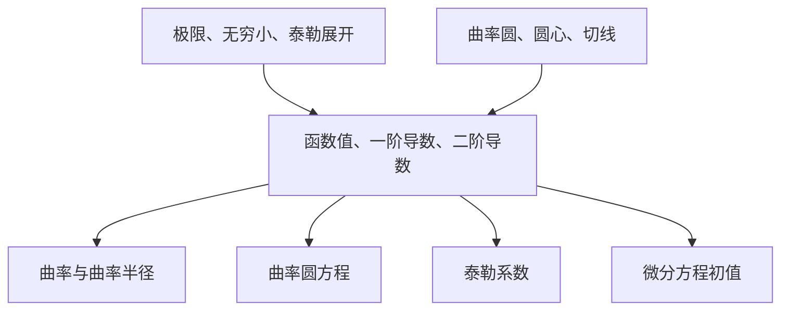
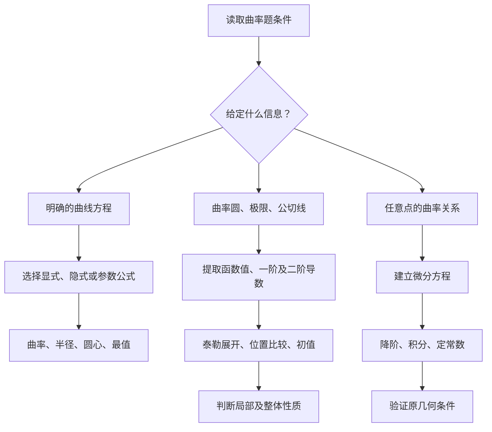

曲率可以与隐函数求导、参数方程、泰勒公式、函数凹凸性、极值、弧长以及微分方程形成非常丰富的综合题。

**曲率的核心是曲线在一点处的二阶局部几何性质。**

## 一、本节知识体系与考研命题框架

曲率问题可归纳为以下七类模型。

| 题型               | 核心解题方法       | 重要程度  |
| ---------------- | ------------ | ----- |
| 显式、参数式、隐式曲线的曲率计算 | 一阶、二阶求导      | ★★★★★ |
| 曲率半径与曲率最大值       | 公式、最值分析      | ★★★★  |
| 曲率圆方程与圆心         | 法线方向、有符号二阶导数 | ★★★★★ |
| 曲率圆与泰勒公式互推       | 确定零、一、二阶导数   | ★★★★★ |
| 曲率比较、局部位置、充分必要条件 | 公切线、泰勒展开     | ★★★★★ |
| 已知曲率反求曲线         | 微分方程、几何建模    | ★★★★★ |
| 曲率半径关于弧长的导数      | 复合函数求导       | ★★★★  |

代表性母题：

| 来源                | 核心考点         |
| ----------------- | ------------ |
| 1991年数学一          | 法线长度与曲率、微分方程 |
| 1998年数学二          | 已知曲率求曲线及极值   |
| 2001年数学二          | 曲率半径关于弧长求导   |
| 2009年数学二          | 曲率圆与函数零点、单调性 |
| 2012年数学二          | 已知曲率反求坐标     |
| 2014年数学二          | 参数曲线的曲率半径    |
| 2016年数学二          | 曲率大小与曲线局部位置  |
| 2018年数学二          | 星形线的曲率       |
| 2019年数学二          | 曲率相等的充分必要条件  |
| 2024年数学二          | 垂直切线处的曲率圆    |
| 2026年数学二          | 隐式曲线的曲率半径    |
| 2027张宇8套卷第1套第13题  | 参数曲线求导       |
| 2027李林六套卷第4套第11题  | 曲率最大值        |
| 2027李永乐六套卷第3套第12题 | 曲率圆与三阶微分方程   |

## 二、基础概念：从几何本质理解曲率

### 2.1 什么是曲率？

曲率是用来衡量曲线在某一点处弯曲程度的量。

想象沿着一条道路前进相同的距离：

- 沿直线前进，方向始终不变，曲率为零。
- 沿半径较大的圆弧前进，方向变化较慢，曲率较小。
- 沿半径较小的圆弧前进，方向变化较快，曲率较大。

注意，曲率研究的不是曲线的高度、斜率，也不是某段曲线整体的形状，而是**单位弧长内切线方向改变的快慢**。

设曲线的弧长为 $s$，切线倾角为 $\alpha$，则曲率的定义为

$$
\boxed{ K=\left|\frac{\mathrm d\alpha}{\mathrm ds}\right| }
$$

其中，不取绝对值的形式称为有符号曲率：

$$
\kappa_s=\frac{\mathrm d\alpha}{\mathrm ds}.
$$

普通曲率满足

$$
K=|\kappa_s|\geq 0.
$$

普通曲率只反映弯曲程度，有符号曲率还反映弯曲方向。

### 2.2 曲率半径

当 $K>0$ 时，定义曲率半径为

$$
\boxed{\rho=\frac1K}
$$

曲率与曲率半径成反比。

| 曲线形态                 | 曲率 $K$    | 曲率半径 $\rho$ |
| -------------------- | ------------- | --------------- |
| 直线                   | $0$       | 无有限曲率半径         |
| 半径为 $1$ 的圆       | $1$       | $1$         |
| 半径为 $2$ 的圆       | $\frac12$ | $2$         |
| 半径为 $\frac12$ 的圆 | $2$       | $\frac12$   |

所以：

$$
\boxed{ \text{弯曲越剧烈} \Longleftrightarrow K\text{ 越大} \Longleftrightarrow \rho\text{ 越小} }
$$

对于一条半径为 $R$ 的圆，处处有

$$
K=\frac1R,\qquad \rho=R.
$$

### 2.3 什么是曲率圆？

曲率圆又称密切圆，是在曲线某一点处，最能反映该曲线二阶局部几何性质的圆。

它不仅与原曲线经过同一点、具有相同切线，而且具有相同曲率及弯曲方向。

可以建立如下层次关系：

| 近似方式     | 保留的信息         |
| -------- | ------------- |
| 用一个点近似曲线 | 函数值           |
| 用切线近似曲线  | 函数值、一阶导数      |
| 用曲率圆近似曲线 | 函数值、一阶导数、二阶导数 |

例如，在原点附近，抛物线

$$
y=x^2
$$

的曲率圆为

$$
x^2+\left(y-\frac12\right)^2=\frac14.
$$

圆在原点附近的下半部分可以写成

$$
y=\frac12-\sqrt{\frac14-x^2}.
$$

泰勒展开得到

$$
y=x^2+x^4+O(x^6).
$$

可见，该圆与抛物线在零阶、一阶、二阶项上完全相同，但整体并不是同一条曲线。

这就是曲率圆与泰勒公式之间的本质联系。

## 三、必须掌握的曲率公式

### 3.1 显式函数曲线

设曲线为

$$
y=f(x),
$$

且在所考察点附近二阶可导，则

$$
\boxed{ K=\frac{|f''(x)|}{[1+f'^2(x)]^{3/2}} }
$$

当 $f''(x)\ne0$ 时，

$$
\boxed{ \rho=\frac{[1+f'^2(x)]^{3/2}}{|f''(x)|} }
$$

这是本节最基础的公式。

**公式推导**

因为切线斜率为

$$
\tan\alpha=y',
$$

所以

$$
\alpha=\arctan y'.
$$

对 $x$ 求导，

$$
\frac{\mathrm d\alpha}{\mathrm dx} =\frac{y''}{1+y'^2}.
$$

另一方面，由弧长微元公式，

$$
\frac{\mathrm ds}{\mathrm dx} =\sqrt{1+y'^2}.
$$

利用复合函数求导，

$$
\frac{\mathrm d\alpha}{\mathrm ds} = \frac{\mathrm d\alpha/\mathrm dx} {\mathrm ds/\mathrm dx} = \frac{y''}{(1+y'^2)^{3/2}}.
$$

取绝对值得到曲率公式。

**三条重要推论**

当 $y'=0$ 时，曲率公式简化为

$$
\boxed{K=|y''|}
$$

当 $y''=0$ 时，

$$
K=0.
$$

此时不存在有限半径的曲率圆，但曲率仍然有定义。

一般情况下，

$$
K\leq |y''|.
$$

因此，**二阶导数的绝对值并不等于曲率**。只有在斜率相同或者能够控制斜率影响的情况下，才能直接依据二阶导数比较曲率。

例如，

$$
y=x^2
$$

上各点的二阶导数都是 $2$，但其曲率为

$$
K(x)=\frac2{(1+4x^2)^{3/2}}.
$$

显然曲率并不是常数，并且离顶点越远，曲率越小。

### 3.2 以 $y$ 为自变量的曲线

若曲线写成

$$
x=g(y),
$$

直接交换横纵坐标的角色，即可得到

$$
\boxed{ K=\frac{|g''(y)|}{[1+g'^2(y)]^{3/2}} }
$$

即

$$
K= \frac{\left|\dfrac{\mathrm d^2x}{\mathrm dy^2}\right|} {\left[1+\left(\dfrac{\mathrm dx}{\mathrm dy}\right)^2\right]^{3/2}}.
$$

这一公式非常重要，尤其适用于具有垂直切线的曲线，例如

$$
y^2=x,\qquad y^2=2x,\qquad x=2y-y^2.
$$

遇到此类曲线，不要强行解出 $y$ 再求导。

### 3.3 参数方程形式

设正则平面曲线为

$$
\begin{cases} x=x(t),\\ y=y(t). \end{cases}
$$

且

$$
x_t^2+y_t^2>0.
$$

则曲率为

$$
\boxed{ K= \frac{|x_ty_{tt}-y_tx_{tt}|} {(x_t^2+y_t^2)^{3/2}} }
$$

曲率半径为

$$
\boxed{ \rho= \frac{(x_t^2+y_t^2)^{3/2}} {|x_ty_{tt}-y_tx_{tt}|} }
$$

其中曲率半径公式还要求分子中的行列式绝对值非零。

**为什么推荐直接使用参数曲率公式？**

常规参数求导为

$$
\frac{\mathrm dy}{\mathrm dx}=\frac{y_t}{x_t},
$$

$$
\frac{\mathrm d^2y}{\mathrm dx^2} = \frac{x_ty_{tt}-y_tx_{tt}}{x_t^3}.
$$

然后再代入显式曲率公式。

这个方法要求 $x_t\ne0$，并且计算步骤较多。

直接参数曲率公式只要求

$$
(x_t,y_t)\ne(0,0),
$$

即使 $x_t=0$，只要 $y_t\ne0$，仍然可以使用。

因此，在考试中建议优先记忆和使用参数形式的直接公式。

### 3.4 隐函数形式

设曲线由

$$
F(x,y)=0
$$

确定，且 $F$ 在所考察点附近二阶连续可微。

当 $F_y\ne0$ 时，可以局部将 $y$ 视为 $x$ 的函数。

一阶导数为

$$
\boxed{y'=-\frac{F_x}{F_y}}
$$

二阶导数为

$$
\boxed{ y''= -\frac{F_{xx}+2F_{xy}y'+F_{yy}(y')^2}{F_y} }
$$

再代入显式曲率公式。

还可以进一步推导出隐式曲线的直接曲率公式：

$$
\boxed{ K= \frac{ |F_{xx}F_y^2-2F_{xy}F_xF_y+F_{yy}F_x^2| }{ (F_x^2+F_y^2)^{3/2} } }
$$

适用条件为

$$
F_x^2+F_y^2>0.
$$

这意味着曲线在该点满足正则隐函数条件。

隐式公式无需分别讨论 $F_y=0$ 的情形，但记忆量稍大。考研中更推荐掌握一阶、二阶隐函数求导通式，将直接公式作为快速计算和检验答案的补充。

### 3.5 极坐标形式（综合题补充）

若曲线以极坐标表示为

$$
r=r(\theta),
$$

利用

$$
x=r\cos\theta,\qquad y=r\sin\theta
$$

代入参数曲率公式可得

$$
\boxed{ K= \frac{|r^2+2(r')^2-rr''|} {[r^2+(r')^2]^{3/2}} }
$$

这里的导数都是关于 $\theta$ 的导数，且要求

$$
r^2+(r')^2>0.
$$

此公式不必作为本节首要背诵内容，但遇到极坐标与曲率的创新综合题时，要知道如何通过参数方程处理。

## 四、母题一：曲率与曲率半径的基本计算

这类题目的主要难点不在曲率本身，而在于选择正确的求导方式、简化计算和处理限制条件。

### 4.1 显式曲线：已知曲率反求坐标

**【2012年数学二真题·核心题001】**

曲线

$$
y=x^2+x,\quad x<0
$$

上曲率为 $\dfrac{\sqrt2}{2}$ 的点的坐标是什么？

<Steps>

<Step>

### 第一步：求导 [!toc]

$$
y'=2x+1,\qquad y''=2.
$$

所以

$$
K=\frac2{[1+(2x+1)^2]^{3/2}}.
$$

</Step>

<Step>

### 第二步：建立曲率方程 [!toc]

$$
\frac2{[1+(2x+1)^2]^{3/2}} =\frac{\sqrt2}{2}.
$$

整理得

$$
[1+(2x+1)^2]^{3/2}=2\sqrt2.
$$

两边取 $2/3$ 次幂，

$$
1+(2x+1)^2=2.
$$

于是

$$
(2x+1)^2=1,
$$

解得

$$
x=0\quad\text{或}\quad x=-1.
$$

</Step>

<Step>

### 第三步：筛选并回代 [!toc]

题目要求 $x<0$，故只保留 $x=-1$。

代入原曲线，

$$
y=(-1)^2-1=0.
$$

所以答案为

$$
\boxed{(-1,0)}.
$$

</Step>

</Steps>

**母题推广：一般二次函数的曲率**

对于

$$
y=ax^2+bx+c,\qquad a\ne0,
$$

有

$$
K(x)=\frac{2|a|}{[1+(2ax+b)^2]^{3/2}}.
$$

由于

$$
1+(2ax+b)^2\geq1,
$$

所以

$$
\boxed{K_{\max}=2|a|}
$$

在顶点

$$
x=-\frac b{2a}
$$

处取得。

相应的最小曲率半径为

$$
\boxed{\rho_{\min}=\frac1{2|a|}}.
$$

如果给定曲率 $K_0>0$，那么求解曲率方程等价于求解

$$
(2ax+b)^2= \left(\frac{2|a|}{K_0}\right)^{2/3}-1.
$$

于是，在整条抛物线上：

| 给定曲率                | 满足条件的点数 |
| ------------------- | ------- |
| $K_0>2\lvert a\rvert $    | 0       |
| $K_0=2\lvert a\rvert $    | 1       |
| $0<K_0<2\lvert a\rvert $ | 2       |

若题目另外限制了定义域，则还要进一步筛选。

一道基本计算题可以由此推广成参数讨论、解的个数、最值等多种题型。

### 4.2 参数曲线：计算指定点的曲率半径

**【2014年数学二真题·核心题002】**

设曲线为

$$
\begin{cases} x=t^2+7,\\ y=t^2+4t+1. \end{cases}
$$

求 $t=1$ 对应点的曲率半径。

**解法：直接使用参数曲率公式**

首先计算

$$
x_t=2t,\qquad y_t=2t+4,
$$

$$
x_{tt}=2,\qquad y_{tt}=2.
$$

在 $t=1$ 处，

$$
x_t=2,\quad y_t=6,\quad x_{tt}=2,\quad y_{tt}=2.
$$

所以

$$
\begin{aligned} K &=\frac{|2\cdot2-6\cdot2|} {(2^2+6^2)^{3/2}}\\ &=\frac8{40^{3/2}}\\ &=\frac1{10\sqrt{10}}. \end{aligned}
$$

故

$$
\boxed{\rho=10\sqrt{10}}.
$$

**解题技巧：只求点值，不求整个曲率函数**

题目只要求指定点的曲率，就没有必要先整理出复杂的 $K(t)$。

可以直接按照以下顺序计算：

$$
x_t,\ y_t,\ x_{tt},\ y_{tt} \longrightarrow \text{代入参数值} \longrightarrow K \longrightarrow \rho.
$$

这个技巧同样适用于隐函数曲率计算。

### 4.3 参数曲线的强化母题：星形线

**【2018年数学二真题·核心题003】**

设

$$
\begin{cases} x=\cos^3t,\\ y=\sin^3t. \end{cases}
$$

求 $t=\dfrac\pi4$ 对应点处的曲率。

这里结合李林880题中的推广版本，直接考虑一般情形：

$$
\begin{cases} x=a\cos^3t,\\ y=a\sin^3t, \end{cases} \qquad a>0.
$$

<Tabs items={["解法一：参数求导", "解法二：利用几何缩放性质"]} defaultIndex={0}>

<Tab value="解法一：参数求导">

在 $0<t<\pi/2$ 内，

$$
\frac{\mathrm dy}{\mathrm dx} = \frac{3a\sin^2t\cos t} {-3a\cos^2t\sin t} =-\tan t.
$$

进一步，

$$
\begin{aligned} y'' &=\frac{\dfrac{\mathrm d}{\mathrm dt}(-\tan t)} {-3a\cos^2t\sin t}\\ &=\frac1{3a\cos^4t\sin t}. \end{aligned}
$$

因此

$$
\begin{aligned} K &=\frac{|y''|}{(1+y'^2)^{3/2}}\\ &=\frac1{3a\cos^4t\sin t} \cdot\frac1{\sec^3t}\\ &=\frac1{3a\cos t\sin t}\\ &=\frac2{3a\sin2t}. \end{aligned}
$$

当 $t=\pi/4$ 时，

$$
\boxed{K=\frac2{3a}}.
$$

2018年真题对应 $a=1$，所以答案为

$$
\boxed{K=\frac23}.
$$

</Tab>

<Tab value="解法二：利用几何缩放性质">

假设一条曲线的所有长度同时放大为原来的 $a$ 倍，而切线方向的变化量不变，则

$$
K_{\text{新}} =\frac{|\mathrm d\alpha|}{a\,\mathrm ds} =\frac1aK_{\text{原}}.
$$

因此有非常重要的结论：

$$
\boxed{ \text{曲线按比例 }\lambda>0\text{ 缩放} \Longrightarrow \begin{cases} K_{\text{新}}=K_{\text{原}}/\lambda,\\ \rho_{\text{新}}=\lambda\rho_{\text{原}}. \end{cases} }
$$

平移、旋转、镜像反射均不改变对应点处的普通曲率。

</Tab>

</Tabs>

**深入推广**

对于上述星形线，在第一象限的正则部分，

$$
K(t)=\frac2{3a\sin2t}.
$$

因此

$$
K_{\min}=\frac2{3a},
$$

在 $t=\pi/4$ 处取得。

而当 $t\to0^+$ 或 $t\to(\pi/2)^-$ 时，

$$
K(t)\to+\infty.
$$

但在两个端点处，参数速度向量为零，不能直接代入正则参数曲率公式。

### 4.4 模拟题强化：复杂参数方程

**【2027张宇8套卷·第1套第13题】**

设

$$
\begin{cases} x=t-\ln(1+t^2),\\ y=\arctan t. \end{cases}
$$

求 $t=2$ 处的曲率。

求导得到

$$
x_t=1-\frac{2t}{1+t^2} =\frac{(t-1)^2}{1+t^2},
$$

$$
y_t=\frac1{1+t^2}.
$$

观察到两者存在公共因子，所以本题使用常规参数求导反而非常简便：

$$
y'=\frac{y_t}{x_t}=\frac1{(t-1)^2}.
$$

再次求导，

$$
\begin{aligned} y'' &=\frac{-2/(t-1)^3}{(t-1)^2/(1+t^2)}\\ &=-\frac{2(1+t^2)}{(t-1)^5}. \end{aligned}
$$

当 $t=2$ 时，

$$
y'=1,\qquad y''=-10.
$$

所以

$$
K=\frac{10}{(1+1)^{3/2}} =\boxed{\frac{5\sqrt2}{2}}.
$$

**进一步思考：如果改为求 $t=1$ 处的曲率呢？**

此时

$$
x_t=0,\qquad y_t=\frac12.
$$

虽然 $\dfrac{\mathrm dy}{\mathrm dx}$ 无法作为有限斜率计算，但参数速度非零。

并且

$$
x_{tt}(1)=0.
$$

所以直接使用参数曲率公式可得

$$
K(1)=0.
$$

这说明：

**普通显式导数公式无法使用，并不代表几何曲率不存在。**

遇到垂直切线，应当转换自变量或使用直接参数公式。

### 4.5 隐式曲线：二阶隐函数求导

**【2026年数学二真题·核心题005】**

求曲线

$$
x^2+2\sqrt3xy+y^2=1
$$

在点 $(0,1)$ 处的曲率半径。

<Steps>

<Step>

### 第一步：定义隐函数 [!toc]

令

$$
F(x,y)=x^2+2\sqrt3xy+y^2-1.
$$

在指定点处，

$$
F_y(0,1)=2\ne0.
$$

因此可以局部确定 $y=y(x)$。

</Step>

<Step>

### 第二步：求一阶导数点值 [!toc]

由

$$
F_x+F_yy'=0
$$

得

$$
2x+2\sqrt3y +(2\sqrt3x+2y)y'=0.
$$

代入 $(0,1)$，

$$
2\sqrt3+2y'=0.
$$

因此

$$
y'=-\sqrt3.
$$

</Step>

<Step>

### 第三步：求二阶导数点值 [!toc]

利用二阶隐函数求导通式，

$$
F_{xx}+2F_{xy}y' +F_{yy}y'^2+F_yy''=0.
$$

计算

$$
F_{xx}=2,\quad F_{xy}=2\sqrt3,\quad F_{yy}=2.
$$

代入得

$$
2+4\sqrt3(-\sqrt3)+2\cdot3+2y''=0.
$$

所以

$$
y''=2.
$$

</Step>

<Step>

### 第四步：计算曲率半径 [!toc]

$$
K=\frac2{(1+3)^{3/2}}=\frac14.
$$

故

$$
\boxed{\rho=4}.
$$

</Step>

</Steps>

**同类题：张宇1000题**

张宇1000题《微分学应用——几何》中还有如下隐式曲线：

$$
x^2-xy+y^2=1.
$$

求其在 $(1,1)$ 处的曲率。

采用相同的方法可得

$$
y'=-1,\qquad y''=-6,
$$

从而

$$
\boxed{K=\frac{3\sqrt2}{2}}.
$$

另有超越隐函数题：

$$
x(1+y)-e^y+1=0.
$$

求原点处的曲率。

令

$$
F(x,y)=x(1+y)-e^y+1.
$$

在原点，

$$
F_x=1,\quad F_y=-1,
$$

$$
F_{xx}=0,\quad F_{xy}=1,\quad F_{yy}=-1.
$$

因此

$$
y'=1,
$$

$$
y''=-\frac{0+2-1}{-1}=1.
$$

故

$$
\boxed{K=\frac{\sqrt2}{4}}.
$$

通过这三道题，需要掌握的不是某种特殊隐函数，而是普适计算顺序：

$$
\boxed{ F_x,F_y \longrightarrow y' \longrightarrow F_{xx},F_{xy},F_{yy} \longrightarrow y'' \longrightarrow K }
$$

## 五、母题二：曲率最大值与曲率半径最小值

### 5.1 优先观察分母能否取到最小值

**【2027李林六套卷·第4套第11题】**

求曲线

$$
x=2y-y^2
$$

上各点处曲率的最大值。

本题直接以 $y$ 为自变量：

$$
x'=2-2y,\qquad x''=-2.
$$

所以

$$
K(y)=\frac2{[1+4(1-y)^2]^{3/2}}.
$$

因为

$$
1+4(1-y)^2\geq1,
$$

所以

$$
K(y)\leq2.
$$

当 $y=1$ 时等号成立。

此时 $x=1$，故

$$
\boxed{K_{\max}=2}.
$$

最大曲率点为 $(1,1)$。

这类题不需要对曲率函数再次求导，因为二阶导数为常数，分母最小即曲率最大。

### 5.2 如果二阶导数不是常数呢？

**【原创强化母题】**

求曲线

$$
y=x^3
$$

上曲率的最大值及对应点。

计算

$$
y'=3x^2,\qquad y''=6x.
$$

于是

$$
K(x)=\frac{6|x|}{(1+9x^4)^{3/2}}.
$$

由于 $K(x)$ 为偶函数，只考虑 $x>0$。

$$
K(x)=6x(1+9x^4)^{-3/2}.
$$

求导，

$$
\begin{aligned} K'(x) &=6(1+9x^4)^{-3/2} -324x^4(1+9x^4)^{-5/2}\\ &=\frac{6(1-45x^4)} {(1+9x^4)^{5/2}}. \end{aligned}
$$

令 $K'(x)=0$，得

$$
x=45^{-1/4}.
$$

由导数变号及偶性，最大曲率出现在

$$
\boxed{x=\pm45^{-1/4}}.
$$

最大值为

$$
\boxed{ K_{\max} =6\cdot45^{-1/4} \left(\frac56\right)^{3/2} }.
$$

注意，这条曲线在原点虽然具有水平切线，但

$$
K(0)=0,
$$

并不是最大曲率点。

**一般最值公式**

若 $f$ 三阶可导，并且所考察区间内 $f''\ne0$，可以对曲率取对数：

$$
\ln K=\ln|f''| -\frac32\ln(1+f'^2).
$$

求导得

$$
\frac{K'}K = \frac{f'''}{f''} -\frac{3f'f''}{1+f'^2}.
$$

因此内部曲率驻点满足

$$
\boxed{ (1+f'^2)f'''-3f'(f'')^2=0 }
$$

当然，还需要检查导数符号、边界、不可导点等，才能真正确定最值。

## 六、母题三：曲率圆、圆心与弯曲方向

这一部分是本节最容易发生概念性错误的地方。

很多同学能够正确算出曲率半径，但由于圆心方向选反，最终圆方程仍然错误。

### 6.1 曲率圆心的通用公式

设曲线

$$
y=f(x)
$$

在点

$$
P=(x_0,y_0)
$$

处满足

$$
p=f'(x_0),\qquad q=f''(x_0)\ne0.
$$

切向量可取

$$
\boldsymbol T=(1,p).
$$

法向量可取

$$
\boldsymbol N=(-p,1).
$$

单位法向量为

$$
\boldsymbol n= \frac{(-p,1)}{\sqrt{1+p^2}}.
$$

曲率半径为

$$
\rho=\frac{(1+p^2)^{3/2}}{|q|}.
$$

结合二阶导数的符号，曲率圆圆心为

$$
\boxed{ C=P+\frac{1+p^2}{q}(-p,1) }
$$

写成坐标形式：

$$
\boxed{ \begin{aligned} x_C&=x_0-\frac{p(1+p^2)}q,\\ y_C&=y_0+\frac{1+p^2}q. \end{aligned} }
$$

因此曲率圆的标准方程为

$$
\boxed{ (x-x_C)^2+(y-y_C)^2=\rho^2. }
$$

<Callout type="warn" title="特别注意">

半径公式中使用的是

$$
|q|,
$$

圆心公式中使用的却是

$$
q.
$$

这个区别决定了圆心位于切线的哪一侧。

| 二阶导数      | 曲线弯曲方向 | 圆心纵坐标          |
| --------- | ------ | -------------- |
| $q>0$ | 向上弯曲   | $y_C>y_0$  |
| $q<0$ | 向下弯曲   | $y_C<y_0$ |
| $q=0$ | 该点曲率为零 | 不存在有限曲率圆       |

这里建议直接使用“向上弯曲”“向下弯曲”及二阶导数符号来判断，避免不同教材对凹凸术语的表述造成混淆。

</Callout>

### 6.2 水平切线的快速公式

当 $p=0$ 时，

$$
K=|q|,\qquad \rho=\frac1{|q|}.
$$

圆心简化为

$$
\boxed{ C=\left(x_0,y_0+\frac1q\right) }
$$

曲率圆方程简化为

$$
\boxed{ (x-x_0)^2+ \left(y-y_0-\frac1q\right)^2 =\frac1{q^2} }
$$

这一特殊情形在泰勒公式综合题中非常常见。

### 6.3 垂直切线处的曲率圆

**【2024年数学二真题·核心题007】**

求曲线

$$
y^2=x
$$

在原点处的曲率圆。

<Steps>

<Step>

### 第一步：选择自变量 [!toc]

不能在原点附近将整条曲线写成光滑的 $y=f(x)$，但是可以写成

$$
x=y^2.
$$

所以

$$
\frac{\mathrm dx}{\mathrm dy}=2y,\qquad \frac{\mathrm d^2x}{\mathrm dy^2}=2.
$$

在原点，

$$
K=2,\qquad \rho=\frac12.
$$

</Step>

<Step>

### 第二步：确定法线方向 [!toc]

原点处的切线为

$$
x=0.
$$

法线为

$$
y=0.
$$

圆心必须位于法线上。

两个候选圆心为

$$
\left(\frac12,0\right), \qquad \left(-\frac12,0\right).
$$

由于原曲线向右弯曲，应选右侧圆心。

故

$$
\boxed{ \left(x-\frac12\right)^2+y^2=\frac14 }.
$$

</Step>

</Steps>

**李正元练习题的直接推广**

求曲线

$$
y^2=2x
$$

任意一点处的曲率。

因为

$$
x=\frac12y^2,
$$

故

$$
\boxed{ K=\frac1{(1+y^2)^{3/2}} =\frac1{(1+2x)^{3/2}} }.
$$

在原点，曲率为 $1$，曲率圆圆心为 $(1,0)$，方程为

$$
\boxed{(x-1)^2+y^2=1}.
$$

### 6.4 参数曲线的曲率圆心公式

这是显式圆心公式的进一步推广。

设

$$
\boldsymbol r(t)=(x(t),y(t)),
$$

记

$$
D=x_ty_{tt}-y_tx_{tt}.
$$

如果速度非零且 $D\ne0$，那么曲率圆圆心为

$$
\boxed{ C=(x,y)+ \frac{x_t^2+y_t^2}{D}(-y_t,x_t) }
$$

即

$$
\boxed{ \begin{aligned} x_C&=x-\frac{y_t(x_t^2+y_t^2)}D,\\ y_C&=y+\frac{x_t(x_t^2+y_t^2)}D. \end{aligned} }
$$

这个公式能够统一处理水平切线、垂直切线以及一般参数曲线，不必额外判断法线斜率是否存在。

### 6.5 曲率为零与参数速度为零的区别

**【核心题006·原创概念辨析】**

设

$$
x=t^m,\qquad y=t,\qquad m\geq2.
$$

讨论原点处的曲率与曲率圆。

因为

$$
x_t=mt^{m-1},\qquad y_t=1,
$$

原点是正则点。

当 $m=2$ 时，

$$
K(0)=2,
$$

存在有限半径的曲率圆。

当 $m\geq3$ 时，

$$
x_{tt}(0)=0,\qquad y_{tt}(0)=0,
$$

所以

$$
K(0)=0.
$$

此时不存在有限半径的曲率圆。

还应区分以下情况：

| 曲线在指定点的性质       | 能否直接使用参数曲率公式 |
| --------------- | ------------ |
| 速度非零，曲率非零       | 可以           |
| 速度非零，曲率为零       | 可以           |
| 速度为零，但能够重新正则参数化 | 需重新参数化       |
| 速度为零，存在尖点等奇异现象  | 需要单独分析       |

例如

$$
x=t^3,\qquad y=t^6
$$

在 $t=0$ 处参数速度为零。

但消去参数后发现

$$
y=x^2.
$$

其几何曲率仍然存在，并且在原点等于 $2$。

所以不能简单地说参数速度为零就一定没有曲率。

## 七、母题四：曲率圆与泰勒公式互相转化

这一类题应当作为重点掌握，因为它连接了导数、无穷小、泰勒公式、极限和几何应用。

### 7.1 最核心的统一思想：确定三个数

曲线在 $x=x_0$ 附近的二阶泰勒展开为

$$
\boxed{ f(x)=y_0+p(x-x_0) +\frac q2(x-x_0)^2 +o((x-x_0)^2) }
$$

其中

$$
y_0=f(x_0),\quad p=f'(x_0),\quad q=f''(x_0).
$$

这三个数分别决定：

| 数据        | 几何意义     |
| --------- | -------- |
| $y_0$ | 曲线经过的点   |
| $p$   | 切线方向     |
| $q$   | 二阶局部弯曲性质 |

于是，几乎所有曲率圆与泰勒公式的综合题，都可以转化成如下双向关系：

### 7.2 已知高阶无穷小，求曲率圆

**【李林880题·核心题008】**

设 $f$ 有二阶连续导数，且当 $x\to0$ 时，

$$
2\sin x+xf(x)=o(x^3).
$$

求曲线在 $(0,-2)$ 处的曲率圆方程。

<Steps>

<Step>

### 第一步：识别高阶无穷小条件 [!toc]

题目实际上是在间接给出 $f$ 的泰勒系数。

当 $x\ne0$ 时，

$$
f(x)=-2\frac{\sin x}{x}+o(x^2).
$$

利用

$$
\sin x=x-\frac{x^3}6+o(x^3),
$$

得到

$$
\begin{aligned} f(x) &=-2\left(1-\frac{x^2}6\right)+o(x^2)\\ &=-2+\frac13x^2+o(x^2). \end{aligned}
$$

</Step>

<Step>

### 第二步：比较泰勒系数 [!toc]

由

$$
f(x)=f(0)+f'(0)x +\frac12f''(0)x^2+o(x^2),
$$

得到

$$
f(0)=-2,\quad f'(0)=0,\quad f''(0)=\frac23.
$$

</Step>

<Step>

### 第三步：求半径与圆心 [!toc]

因为切线水平，

$$
K=\frac23,\qquad \rho=\frac32.
$$

且 $f''(0)>0$，圆心位于切点上方。

所以

$$
C=\left(0,-2+\frac32\right) =\left(0,-\frac12\right).
$$

最终得到

$$
\boxed{ x^2+\left(y+\frac12\right)^2=\frac94 }.
$$

</Step>

</Steps>

**本题应当形成的条件反射**

看到

$$
f(x)=A+Bx+Cx^2+o(x^2),
$$

在二阶可导的条件下，立即知道

$$
\boxed{ f(0)=A,\quad f'(0)=B,\quad f''(0)=2C }
$$

最常见的错误，是把二次项系数直接当成二阶导数，遗漏因子 $2$。

另外，一般不能直接对含有 $o(x^2)$ 的等式逐项求导。这里是通过函数本身的二阶泰勒展开及系数唯一性得到导数信息的。

### 7.3 已知曲率圆，反求泰勒系数

**【张宇1000题·核心题009】**

已知曲线 $y=f(x)$ 在点 $(0,1)$ 处的曲率圆为

$$
(x-1)^2+y^2=2.
$$

且 $f$ 二阶可导，满足

$$
f(x)=a+bx+cx^2+o(x^2).
$$

求 $a,b,c$。

**通用反解公式**

设已知曲线经过

$$
P=(x_0,y_0),
$$

曲率圆圆心为

$$
C=(A,B).
$$

由圆心公式可得

$$
A-x_0=-\frac{p(1+p^2)}q,
$$

$$
B-y_0=\frac{1+p^2}q.
$$

两式相除：

$$
\boxed{ p=-\frac{A-x_0}{B-y_0} }
$$

进一步得到

$$
\boxed{ q=\frac{1+p^2}{B-y_0} }
$$

对于二阶可导的显式函数曲线及有限曲率圆，有 $B-y_0\ne0$。

**回到本题**

切点为

$$
P=(0,1),
$$

圆心为

$$
C=(1,0).
$$

所以

$$
f(0)=1,
$$

$$
f'(0)=-\frac{1-0}{0-1}=1,
$$

$$
f''(0)=\frac{1+1^2}{0-1}=-2.
$$

因此

$$
f(x)=1+x-x^2+o(x^2).
$$

答案为

$$
\boxed{a=1,\quad b=1,\quad c=-1}.
$$

这道题如果只利用曲率半径，便只能得到

$$
|f''(0)|=2.
$$

必须利用圆心位于切点下方的信息，才能确定二阶导数为负。

### 7.4 曲率圆与待定系数

**【李正元练习题·核心题010】**

已知抛物线

$$
y=ax^2+bx+c
$$

经过点 $P=(1,2)$，并与圆

$$
\left(x-\frac12\right)^2+ \left(y-\frac52\right)^2=\frac12
$$

在该点相切，曲率半径与弯曲方向均相同。求 $a,b,c$。

**解法：将圆心信息转换成泰勒系数**

圆心为

$$
C=\left(\frac12,\frac52\right).
$$

所以

$$
p=-\frac{\frac12-1}{\frac52-2}=1,
$$

$$
q=\frac{1+p^2}{\frac52-2}=4.
$$

因此抛物线在 $x=1$ 处满足

$$
\begin{cases} f(1)=2,\\ f'(1)=1,\\ f''(1)=4. \end{cases}
$$

代入得到

$$
\begin{cases} a+b+c=2,\\ 2a+b=1,\\ 2a=4. \end{cases}
$$

解得

$$
\boxed{a=2,\quad b=-3,\quad c=3}.
$$

**更快的思路**

由于二次函数的泰勒展开就是它本身，所以可以直接写成

$$
f(x)=2+(x-1)+2(x-1)^2.
$$

展开即为

$$
f(x)=2x^2-3x+3.
$$

这说明，如果题目要求二次多项式，并且已经获得某点的零、一、二阶导数，就不需要再列三元一次方程组。

## 八、母题五：曲率大小与曲线局部位置

本类题属于概念判断和证明题，主要考查对曲率绝对值、泰勒公式及凹凸性的综合理解。

### 8.1 公切线是比较曲率的关键条件

假设曲线

$$
y=f_1(x),\qquad y=f_2(x)
$$

在点 $(x_0,y_0)$ 处具有公切线

$$
L(x)=y_0+p(x-x_0).
$$

于是

$$
f_1(x_0)=f_2(x_0)=y_0,
$$

$$
f_1'(x_0)=f_2'(x_0)=p.
$$

所以

$$
K_1=\frac{|f_1''(x_0)|}{(1+p^2)^{3/2}},
$$

$$
K_2=\frac{|f_2''(x_0)|}{(1+p^2)^{3/2}}.
$$

由于分母相同，

$$
\boxed{ K_1>K_2 \iff |f_1''(x_0)|>|f_2''(x_0)| }
$$

另一方面，

$$
f_i(x)-L(x) = \frac12f_i''(x_0)(x-x_0)^2 +o((x-x_0)^2).
$$

因此，局部上下位置取决于二阶导数的大小，而不是单纯取决于曲率的大小。

### 8.2 真题：两条向下弯曲曲线的比较

**【2016年数学二真题·核心题011】**

设 $f_1,f_2$ 有二阶连续导数，且

$$
f_1''(x_0)<0,\qquad f_2''(x_0)<0.
$$

两条曲线在同一点有公切线 $y=g(x)$，且

$$
K_1>K_2.
$$

判断公切点附近三条曲线的位置关系。

因为两条曲线的切线斜率相同，

$$
|f_1''(x_0)|>|f_2''(x_0)|.
$$

两者均为负数，所以

$$
f_1''(x_0)<f_2''(x_0)<0.
$$

再利用泰勒展开，

$$
f_1(x)-f_2(x) = \frac12[f_1''(x_0)-f_2''(x_0)] (x-x_0)^2 +o((x-x_0)^2).
$$

因此，在充分小的去心邻域内，

$$
f_1(x)<f_2(x).
$$

同理，

$$
f_2(x)<g(x).
$$

包含切点时，结论为

$$
\boxed{f_1(x)\leq f_2(x)\leq g(x)}.
$$

### 8.3 对照练习：李林880题

若改为

$$
f_1''(x_0)>0,\qquad f_2''(x_0)>0,
$$

并给出

$$
\rho_1<\rho_2,
$$

则因为半径与曲率成反比，

$$
K_1>K_2.
$$

于是

$$
f_1''(x_0)>f_2''(x_0)>0.
$$

所以

$$
\boxed{f_1(x)\geq f_2(x)\geq g(x)}.
$$

**两种情形的统一结论**

设两曲线在同一点有公切线 $L$，且 $K_1>K_2$。

| 二阶导数符号                  | 切点附近的位置关系               |
| ----------------------- | ----------------------- |
| $f_1''>0,\ f_2''>0$ | $f_1\geq f_2\geq L$ |
| $f_1''<0,\ f_2''<0$ | $f_1\leq f_2\leq L$ |
| $f_1''>0,\ f_2''<0$ | $f_1\geq L\geq f_2$ |
| $f_1''<0,\ f_2''>0$ | $f_1\leq L\leq f_2$ |

最值得记住的不是这张表，而是：

$$
\boxed{ \text{同点同切线时，比较带符号的二阶导数。} }
$$

若两条曲线的二阶导数也相同，则二阶信息不足以确定位置，需要继续比较高阶项。

### 8.4 曲率相等的充分必要条件

**【2019年数学二真题·核心题013】**

设 $f,g$ 的二阶导数在 $x=a$ 处连续。

判断条件

$$
\lim_{x\to a} \frac{f(x)-g(x)}{(x-a)^2}=0
$$

是两条曲线在 $x=a$ 对应点处相切且曲率相等的什么条件。

<Steps>

<Step>

### 第一步：理解已知条件 [!toc]

令

$$
h(x)=f(x)-g(x).
$$

已知条件等价于

$$
h(x)=o((x-a)^2).
$$

利用连续性及二阶泰勒公式，可得

$$
h(a)=h'(a)=h''(a)=0.
$$

也就是

$$
\begin{cases} f(a)=g(a),\\ f'(a)=g'(a),\\ f''(a)=g''(a). \end{cases}
$$

于是两条曲线在该点相交、相切且曲率相同。

充分性成立。

</Step>

<Step>

### 第二步：判断逆命题 [!toc]

相切只保证

$$
f(a)=g(a),\qquad f'(a)=g'(a).
$$

曲率相等只保证

$$
|f''(a)|=|g''(a)|.
$$

但这并不能保证

$$
f''(a)=g''(a).
$$

例如取

$$
f(x)=x^2,\qquad g(x)=-x^2.
$$

两者在原点有相同切线

$$
y=0,
$$

曲率均为 $2$。

但是

$$
\lim_{x\to0} \frac{f(x)-g(x)}{x^2}=2\ne0.
$$

所以答案为

$$
\boxed{\text{充分不必要条件}}.
$$

</Step>

</Steps>

### 8.5 李正元练习题的强化结论

李正元《一元函数的泰勒公式及其应用》中正好有对应的证明题。

如果额外给出两条曲线具有相同的凹凸性，即在非零曲率时二阶导数符号一致，则结论变成充要条件：

$$
\boxed{ \begin{gathered} \text{同点、同切线、同曲率、同弯曲方向}\\ \Updownarrow\\ f(x)-g(x)=o((x-a)^2). \end{gathered} }
$$

在二阶可导条件下，更直接的代数等价关系为

$$
\boxed{ f(x)-g(x)=o((x-a)^2) \iff \begin{cases} f(a)=g(a),\\ f'(a)=g'(a),\\ f''(a)=g''(a). \end{cases} }
$$

这是本节非常重要的理论结论。

### 8.6 创新考法：高阶切触

考虑

$$
f(x)=x^2+x^3,\qquad g(x)=x^2.
$$

在原点，两者具有相同函数值、相同切线、相同曲率，并且弯曲方向一致。

但是

$$
f(x)-g(x)=x^3.
$$

在原点左侧，

$$
f(x)<g(x),
$$

在原点右侧，

$$
f(x)>g(x).
$$

这说明，即使两条曲线具有相同的曲率圆，也不一定在切点附近始终保持固定的上下位置关系。

一般而言，当零、一、二阶导数都相同时，应当寻找第一个不同的高阶泰勒系数。

若

$$
f(x)-g(x) =A(x-a)^m+o((x-a)^m),\quad A\ne0,
$$

则：

- $m$ 为偶数时，充分小的左右两侧差值同号。
- $m$ 为奇数时，充分小的左右两侧差值异号。

这个规律可以处理曲率与高阶泰勒展开相结合的创新题。

## 九、母题六：由局部曲率圆推导函数的整体性质

**【2009年数学二真题·核心题014】**

已知 $f''(x)$ 不变号，且曲线 $y=f(x)$ 在点 $(1,1)$ 处的曲率圆为

$$
x^2+y^2=2.
$$

判断 $f(x)$ 在区间 $(1,2)$ 内是否有极值点、零点。

这道题非常值得重视。它考查的是如何由曲率圆的局部信息，结合整体凹凸性条件推导函数的全局性质。

<Steps>

<Step>

### 第一步：从曲率圆反求导数 [!toc]

切点为

$$
P=(1,1),
$$

圆心为

$$
C=(0,0).
$$

所以

$$
f(1)=1,
$$

$$
f'(1)=-\frac{0-1}{0-1}=-1,
$$

$$
f''(1)=\frac{1+(-1)^2}{0-1}=-2.
$$

</Step>

<Step>

### 第二步：结合二阶导数不变号 [!toc]

由于 $f''(1)<0$，且 $f''$ 不变号，所以

$$
f''(x)\leq0.
$$

因此 $f'$ 单调不增。

对于 $x>1$，

$$
f'(x)\leq f'(1)=-1<0.
$$

所以 $f$ 在 $(1,2)$ 内严格单调递减，不存在极值点。

</Step>

<Step>

### 第三步：证明零点存在 [!toc]

由 $f''(1)=-2<0$ 及导数定义可知，在 $1$ 的充分小右邻域内，

$$
f'(x)<-1.
$$

再由 $f'$ 单调不增，推出

$$
f'(x)<-1,\qquad 1<x<2.
$$

由拉格朗日中值定理，存在

$$
\xi\in(1,2)
$$

使得

$$
f(2)-f(1)=f'(\xi)(2-1)<-1.
$$

所以

$$
f(2)<0.
$$

又因为

$$
f(1)=1>0,
$$

根据零点定理，存在 $c\in(1,2)$，使得

$$
f(c)=0.
$$

且严格单调性保证零点唯一。

因此结论为

$$
\boxed{\text{无极值点，有且仅有一个零点}}.
$$

</Step>

</Steps>

<Callout type="warn" title="重要陷阱：严格不等式">

如果只证明

$$
f(2)\leq0,
$$

那么零点可能恰好位于端点 $x=2$，不能保证开区间内存在零点。

本题特意利用

$$
f''(1)<0
$$

得到更严格的结论

$$
f(2)<0.
$$

这就是将曲率、导数符号、微分中值定理和零点定理融合在一起的典型综合题。

</Callout>

**通用解题流程**

$$
\boxed{ \begin{gathered} \text{曲率圆}\\ \Downarrow\\ f(x_0),f'(x_0),f''(x_0)\\ \Downarrow\\ \text{结合二阶导数不变号}\\ \Downarrow\\ \text{一阶导数单调性}\\ \Downarrow\\ \text{函数单调性、极值、零点} \end{gathered} }
$$

## 十、母题七：已知曲率反求曲线——微分方程综合题

这是本节最有综合性的一类大题，也非常适合数学一命题。

核心思想是：

**将几何条件转化成包含** $y,y',y''$ **的微分方程，然后利用初始条件确定唯一的曲线。**

### 10.1 曲率与法线段长度

**【1991年数学一真题·核心题015】**

在上半平面求一条向上弯曲的曲线，满足：

曲线上任意一点 $P(x,y)$ 处的曲率等于法线段 $PQ$ 长度的倒数，其中 $Q$ 为法线与 $x$ 轴的交点。

且曲线在点 $(1,1)$ 处的切线平行于 $x$ 轴。

<Steps>

<Step>

### 第一步：将法线长度转化为代数式 [!toc]

设

$$
p=y'.
$$

法线的方向向量可以取

$$
(-p,1).
$$

从点 $P=(x,y)$ 沿法线到达 $x$ 轴，得到

$$
Q=(x+py,0).
$$

因此

$$
\begin{aligned} PQ &=\sqrt{(py)^2+y^2}\\ &=y\sqrt{1+p^2}, \end{aligned}
$$

其中使用了上半平面条件 $y>0$。

所以

$$
\boxed{PQ=y\sqrt{1+y'^2}}.
$$

注意，它不是 $y$，也不是 $y/\sqrt{1+y'^2}$。

</Step>

<Step>

### 第二步：建立曲率方程 [!toc]

曲线向上弯曲，故 $y''>0$。

题设给出

$$
\frac{y''}{(1+y'^2)^{3/2}} = \frac1{y\sqrt{1+y'^2}}.
$$

化简得

$$
\boxed{yy''=1+y'^2}.
$$

初始条件为

$$
y(1)=1,\qquad y'(1)=0.
$$

</Step>

<Step>

### 第三步：寻找降阶结构 [!toc]

这一步可以采用令 $p=y'$、再将 $p$ 视为 $y$ 的函数的方法。

但本题在初始点有 $y'(1)=0$，直接寻找一个恒定量更方便。

观察

$$
\frac{1+y'^2}{y^2}.
$$

求导：

$$
\begin{aligned} \frac{\mathrm d}{\mathrm dx} \left(\frac{1+y'^2}{y^2}\right) &=\frac{2y'}{y^3} \left[yy''-(1+y'^2)\right]\\ &=0. \end{aligned}
$$

因此

$$
\frac{1+y'^2}{y^2}=C.
$$

利用初始条件，

$$
C=\frac{1+0^2}{1^2}=1.
$$

于是

$$
1+y'^2=y^2.
$$

结合原方程，

$$
yy''=y^2.
$$

由于 $y>0$，所以

$$
\boxed{y''=y}.
$$

</Step>

<Step>

### 第四步：求解常系数微分方程 [!toc]

通解为

$$
y=Ae^{x-1}+Be^{-(x-1)}.
$$

代入

$$
y(1)=1,\qquad y'(1)=0,
$$

得到

$$
\begin{cases} A+B=1,\\ A-B=0. \end{cases}
$$

故

$$
\boxed{ y=\frac{e^{x-1}+e^{-(x-1)}}2 }.
$$

也可以写成

$$
\boxed{y=\cosh(x-1)}.
$$

</Step>

<Step>

### 第五步：验证原几何条件 [!toc]

因为

$$
y''=y>0,
$$

且

$$
1+y'^2=y^2,
$$

所以所得曲线满足上半平面、向上弯曲以及曲率与法线长度的关系。

这道题的价值不仅是解出一条悬链线，而是掌握从几何关系建模到寻找微分方程第一积分的全过程。

</Step>

</Steps>

### 10.2 已知曲率函数求曲线及其极值

**【1998年数学二真题·核心题016】**

设曲线向下弯曲，其任意一点处的曲率为

$$
K=\frac1{\sqrt{1+y'^2}}.
$$

且曲线在 $(0,1)$ 处的切线为

$$
y=x+1.
$$

求曲线方程及其极值。

<Steps>

<Step>

### 第一步：根据凹向去掉绝对值 [!toc]

由于 $y''<0$，

$$
K=\frac{-y''}{(1+y'^2)^{3/2}}.
$$

所以

$$
\frac{-y''}{(1+y'^2)^{3/2}} = \frac1{\sqrt{1+y'^2}},
$$

即

$$
\boxed{y''=-(1+y'^2)}.
$$

初始条件为

$$
y(0)=1,\qquad y'(0)=1.
$$

</Step>

<Step>

### 第二步：令 $p=y'$ 降阶 [!toc]

$$
\frac{\mathrm dp}{\mathrm dx}=-(1+p^2).
$$

分离变量得

$$
\frac{\mathrm dp}{1+p^2}=-\mathrm dx.
$$

积分，

$$
\arctan p=-x+C.
$$

代入 $p(0)=1$，得到

$$
C=\frac\pi4.
$$

所以

$$
y'=\tan\left(\frac\pi4-x\right).
$$

</Step>

<Step>

### 第三步：再次积分 [!toc]

$$
y=\ln\left|\cos\left(\frac\pi4-x\right)\right|+C_1.
$$

由 $y(0)=1$，得到

$$
C_1=1+\frac12\ln2.
$$

取包含初始点的最大连通定义区间，最终为

$$
\boxed{ y=1+\frac12\ln2+ \ln\cos\left(\frac\pi4-x\right) }
$$

其中

$$
-\frac\pi4<x<\frac{3\pi}4.
$$

</Step>

<Step>

### 第四步：确定极值 [!toc]

令

$$
y'=\tan\left(\frac\pi4-x\right)=0,
$$

得到

$$
x=\frac\pi4.
$$

又因为

$$
y''=-(1+y'^2)<0,
$$

所以该点为极大值点。

极大值为

$$
\boxed{y_{\max}=1+\frac12\ln2}.
$$

这道题也被收入李林880题第七章的微分方程练习中，应当视为同一个母题，而不是两种不同题型。

</Step>

</Steps>

### 10.3 更一般的方法：把曲率转化成一个函数的导数

观察

$$
\left(\frac{y'}{\sqrt{1+y'^2}}\right)' = \frac{y''}{(1+y'^2)^{3/2}}.
$$

于是显式曲线的曲率还可以写成

$$
\boxed{ K= \left| \left(\frac{y'}{\sqrt{1+y'^2}}\right)' \right| }
$$

在弯曲方向固定时，

$$
\boxed{ \frac{\mathrm d}{\mathrm dx} \frac{y'}{\sqrt{1+y'^2}} =\pm K(x) }
$$

这个公式对于已知曲率随 $x$ 变化的反求曲线题特别有效。

设

$$
u(x)=\frac{y'}{\sqrt{1+y'^2}},
$$

则

$$
u'=\pm K(x).
$$

积分求出 $u$ 后，可以反解

$$
\boxed{y'=\frac{u}{\sqrt{1-u^2}}}
$$

其中要求 $|u|<1$。

这样，复杂的二阶非线性微分方程就可以转化成两次积分。

### 10.4 李正元证明题：恒定曲率为什么对应圆？

**【李正元练习题·第六章常微分方程】**

证明曲率半径恒为 $a>0$ 的正则平面曲线是半径为 $a$ 的圆或圆弧。

先针对能够写成显式函数的连通曲线段证明。

因为

$$
K=\frac1a,
$$

且二阶导数连续、不为零，所以其符号在该段上不变。

记符号为 $\varepsilon=\pm1$。

于是

$$
\left(\frac{y'}{\sqrt{1+y'^2}}\right)' =\frac{\varepsilon}{a}.
$$

积分得

$$
\frac{y'}{\sqrt{1+y'^2}} =\frac{\varepsilon(x-b)}a.
$$

解得

$$
y'=\frac{\varepsilon(x-b)} {\sqrt{a^2-(x-b)^2}}.
$$

再次积分，

$$
y=c-\varepsilon\sqrt{a^2-(x-b)^2}.
$$

整理，

$$
\boxed{(x-b)^2+(y-c)^2=a^2}.
$$

因此该曲线段位于半径为 $a$ 的圆上。对于一般正则曲线，可通过局部选取坐标以及连续性将结论推广到整个连通曲线。

这个结论需要注意：

- 恒定非零曲率对应圆或圆弧。
- 恒定零曲率对应直线或直线段。
- 二阶导数恒定不代表曲率恒定。

## 十一、综合创新题：曲率圆与高阶线性微分方程

**【2027李永乐六套卷·第3套第12题】**

函数 $y=y(x)$ 满足

$$
y'''-y''-y'+y=0.
$$

且曲线在原点处的曲率圆为

$$
(x-1)^2+(y-1)^2=2.
$$

求 $y(x)$。

这道题是分类模拟题中最值得重视的一道综合题，因为它将曲率圆和三阶常系数线性微分方程连接起来了。

<Steps>

<Step>

### 第一步：判断微分方程需要多少初值 [!toc]

三阶常系数线性微分方程的通解包含三个任意常数。

因此需要三个独立初值。

而曲率圆加切点正好能够确定

$$
y(0),\qquad y'(0),\qquad y''(0).
$$

这就是出题人选择曲率圆作为附加条件的原因。

</Step>

<Step>

### 第二步：根据曲率圆反求初值 [!toc]

切点为

$$
P=(0,0),
$$

圆心为

$$
C=(1,1).
$$

所以

$$
y(0)=0,
$$

$$
y'(0)=-\frac11=-1,
$$

$$
y''(0)=\frac{1+(-1)^2}{1}=2.
$$

得到

$$
\boxed{ y(0)=0,\quad y'(0)=-1,\quad y''(0)=2 }.
$$

</Step>

<Step>

### 第三步：解微分方程 [!toc]

特征方程为

$$
r^3-r^2-r+1=0.
$$

因式分解：

$$
(r-1)^2(r+1)=0.
$$

所以通解为

$$
y=(C_1+C_2x)e^x+C_3e^{-x}.
$$

</Step>

<Step>

### 第四步：代入初始条件 [!toc]

$$
\begin{cases} C_1+C_3=0,\\ C_1+C_2-C_3=-1,\\ C_1+2C_2+C_3=2. \end{cases}
$$

解得

$$
C_1=-1,\quad C_2=1,\quad C_3=1.
$$

最终答案为

$$
\boxed{y=(x-1)e^x+e^{-x}}.
$$

</Step>

</Steps>

**为什么这类题特别适合数学一？**

因为数学一要求掌握较完整的常系数线性微分方程体系。

未来的创新题完全可以进一步给出变上限积分、函数极限或曲率圆等条件，让考生先提取初始数据，再求解微分方程。

遇到这种题，不要把曲率和微分方程当成两部分孤立知识，而要识别它们之间的信息传递关系：

$$
\boxed{ \text{几何条件} \longrightarrow \text{初值条件} \longrightarrow \text{微分方程的特解} }
$$

## 十二、母题八：曲率半径关于弧长的导数

**【2001年数学二真题·核心题017】**

设 $\rho=\rho(x)$ 为抛物线

$$
y=\sqrt x,\qquad x\geq1
$$

在点 $M(x,y)$ 处的曲率半径，$s=s(x)$ 为曲线上从 $A(1,1)$ 到 $M$ 的弧长。

求

$$
3\rho\frac{\mathrm d^2\rho}{\mathrm ds^2} -\left(\frac{\mathrm d\rho}{\mathrm ds}\right)^2.
$$

这道题同时出现在李林880题第二章中。

<Steps>

<Step>

### 第一步：求曲率半径 [!toc]

因为

$$
y'=\frac1{2\sqrt x},\qquad y''=-\frac1{4x^{3/2}},
$$

所以

$$
\begin{aligned} \rho &=\frac{(1+y'^2)^{3/2}}{|y''|}\\ &=\frac{(4x+1)^{3/2}}2. \end{aligned}
$$

</Step>

<Step>

### 第二步：求弧长导数 [!toc]

由

$$
s(x)=\int_1^x\sqrt{1+y'^2(t)}\,\mathrm dt,
$$

得到

$$
\frac{\mathrm ds}{\mathrm dx} = \sqrt{1+\frac1{4x}} = \frac{\sqrt{4x+1}}{2\sqrt x}.
$$

注意：题目要求的是关于弧长的导数，并不需要求弧长积分的具体结果。

</Step>

<Step>

### 第三步：利用复合函数求导 [!toc]

$$
\frac{\mathrm d\rho}{\mathrm ds} = \frac{\mathrm d\rho/\mathrm dx} {\mathrm ds/\mathrm dx}.
$$

由于

$$
\rho_x=3\sqrt{4x+1},
$$

故

$$
\frac{\mathrm d\rho}{\mathrm ds}=6\sqrt x.
$$

再次关于 $s$ 求导：

$$
\begin{aligned} \frac{\mathrm d^2\rho}{\mathrm ds^2} &= \frac{\dfrac{\mathrm d}{\mathrm dx}(6\sqrt x)} {\mathrm ds/\mathrm dx}\\ &=\frac6{\sqrt{4x+1}}. \end{aligned}
$$

</Step>

<Step>

### 第四步：代入整理 [!toc]

$$
\begin{aligned} 3\rho\frac{\mathrm d^2\rho}{\mathrm ds^2} -\left(\frac{\mathrm d\rho}{\mathrm ds}\right)^2 &=3\cdot\frac{(4x+1)^{3/2}}2 \cdot\frac6{\sqrt{4x+1}}-36x\\ &=9(4x+1)-36x\\ &=\boxed9. \end{aligned}
$$

</Step>

</Steps>

**这一题的核心：导数算子变换**

对于以 $x$ 为自变量的任意函数 $u(x)$，如果 $s_x\ne0$，则

$$
\boxed{ \frac{\mathrm d}{\mathrm ds} =\frac1{s_x}\frac{\mathrm d}{\mathrm dx} }
$$

进一步，

$$
\boxed{ \frac{\mathrm d^2u}{\mathrm ds^2} = \frac{u_{xx}s_x-u_xs_{xx}}{s_x^3} }
$$

而不是

$$
\frac{u_{xx}}{s_x^2}.
$$

后二者只有在某些特殊条件下才相等。

对于参数曲线，同样有

$$
\frac{\mathrm ds}{\mathrm dt} =\sqrt{x_t^2+y_t^2},
$$

因此

$$
\boxed{ \frac{\mathrm d}{\mathrm ds} =\frac1{\sqrt{x_t^2+y_t^2}} \frac{\mathrm d}{\mathrm dt} }
$$

掌握了这个算子，就不仅能处理曲率关于弧长的导数，还能处理速度、切线倾角以及其他几何量关于弧长的导数。

## 十三、曲率创新题专题：如何识别没有见过的新题？

综合题常将曲率隐藏在其他条件或几何关系中。

下面是几个特别值得掌握的迁移方向。

### 13.1 曲率与单位切向量

设曲线的单位切向量为

$$
\boldsymbol T = \frac{(1,y')}{\sqrt{1+y'^2}}.
$$

那么有

$$
\boxed{ K=\left|\frac{\mathrm d\boldsymbol T}{\mathrm ds}\right| }
$$

因为单位切向量的长度恒为 $1$，所以其变化主要表现为方向变化。

对于以弧长 $s$ 为参数的曲线

$$
\boldsymbol r=\boldsymbol r(s),
$$

有

$$
|\boldsymbol r'(s)|=1.
$$

从而

$$
\boxed{K=|\boldsymbol r''(s)|}.
$$

注意，这个公式要求参数确实是弧长，不能对任意参数直接使用。

### 13.2 曲率与椭圆最值

**【原创综合变式】**

设椭圆

$$
\begin{cases} x=a\cos t,\\ y=b\sin t, \end{cases} \qquad a>b>0.
$$

求曲率最大值、最小值以及对应的点。

计算得到

$$
x_t=-a\sin t,\qquad y_t=b\cos t,
$$

$$
x_{tt}=-a\cos t,\qquad y_{tt}=-b\sin t.
$$

分子为

$$
|x_ty_{tt}-y_tx_{tt}|=ab.
$$

所以

$$
K(t)= \frac{ab} {(a^2\sin^2t+b^2\cos^2t)^{3/2}}.
$$

由于

$$
b^2\leq a^2\sin^2t+b^2\cos^2t\leq a^2,
$$

因此

$$
\boxed{K_{\max}=\frac a{b^2}},
$$

在长轴端点 $(\pm a,0)$ 处取得。

而

$$
\boxed{K_{\min}=\frac b{a^2}},
$$

在短轴端点 $(0,\pm b)$ 处取得。

这是对李林模拟题中“分子恒定，分母取最值”方法的推广。

### 13.3 曲率与等价无穷小

设曲线 $f$ 在 $x=a$ 处二阶可导，且

$$
L(x)=f(a)+f'(a)(x-a)
$$

为其切线。

那么

$$
\lim_{x\to a} \frac{f(x)-L(x)}{(x-a)^2} =\frac12f''(a).
$$

所以如果题目直接给出

$$
\lim_{x\to a} \frac{f(x)-L(x)}{(x-a)^2}=A,
$$

则无需知道函数的具体表达式，也可以立刻得到

$$
\boxed{ K(a)=\frac{2|A|} {[1+f'^2(a)]^{3/2}} }.
$$

这也是李林880题中“切线条件加极限求曲率圆”的一般化结论。

### 13.4 曲率与曲线到切线的距离

设曲线在 $P=(a,f(a))$ 处的斜率为 $p$。

切线为

$$
y-f(a)=p(x-a).
$$

曲线上邻近点 $Q=(x,f(x))$ 到切线的距离为

$$
d= \frac{|f(x)-f(a)-p(x-a)|}{\sqrt{1+p^2}}.
$$

根据泰勒公式，

$$
d=\frac{|f''(a)|}{2\sqrt{1+p^2}} (x-a)^2+o((x-a)^2).
$$

另一方面，

$$
|PQ|^2=(1+p^2)(x-a)^2+o((x-a)^2).
$$

因此

$$
\boxed{ \lim_{Q\to P} \frac{2d}{|PQ|^2}=K(P) }.
$$

这一结论揭示了曲率的另一种几何本质：**曲线偏离切线的距离，相对于弦长平方的增长速度。**

它可以作为将曲率、泰勒公式、几何距离和极限结合起来的创新命题方向。

## 十四、本节常见陷阱与反例体系

概念题的复习不能只记正确结论，还要知道错误结论为什么不成立。

| 常见错误说法                      | 正确结论或反例                        |
| --------------------------- | ------------------------------ |
| 二阶导数越大，曲率一定越大               | 还要考虑一阶导数及绝对值                   |
| 曲率可以为负数                     | 普通曲率非负，有符号曲率才可为负               |
| 二阶导数为常数，曲率也为常数              | $y=x^2$ 是反例                |
| 曲率半径越大，曲线越弯                 | 恰好相反                           |
| 曲率为零就一定是拐点                  | $y=x^4$ 在原点曲率为零，却不是拐点      |
| 水平切线处曲率一定最大                 | $y=x^3$ 在原点曲率为零            |
| 参数速度为零就一定没有几何曲率             | $x=t^3,y=t^6$ 可以重新参数化      |
| 同切线、同曲率就有相同二阶导数             | $y=x^2$ 与 $y=-x^2$ 是反例 |
| 曲率相同就有相同曲率圆                 | 圆心位置及弯曲方向可能不同                  |
| 同曲率圆的曲线必然位于彼此固定一侧           | $x^2+x^3$ 与 $x^2$ 是反例  |
| 算出曲率半径就确定了曲率圆               | 还需要圆心方向                        |
| 参数方程中 $y_{tt}=y_{xx}$ | 二阶参数求导需使用链式法则                  |
| 泰勒二次项系数等于二阶导数               | 二阶导数是二次项系数的两倍                  |
| $u_{ss}=u_{xx}/s_x^2$ | 一般还包含 $s_{xx}$ 项          |

特别值得记忆的四个反例函数为

$$
\boxed{x^2,\quad -x^2,\quad x^3,\quad x^4}.
$$

它们足以应对大量关于曲率、极值、拐点、切线和二阶导数的逻辑辨析题。

## 十五、考场识别题型与标准解题流程

拿到曲率题以后，不要立即机械地套用公式，先观察题目给出的信息属于哪一类。

| 题目出现的关键词       | 首选方法                  |
| -------------- | --------------------- |
| 求某点的曲率         | 求一、二阶导数               |
| 参数 $t=t_0$ | 直接参数曲率公式              |
| 隐式方程确定曲线       | 一、二阶隐函数求导             |
| 垂直切线           | 改用 $x=g(y)$ 或参数公式 |
| 曲率最大值          | 观察分子、分母，再考虑求导         |
| 求曲率圆方程         | 求半径、确定法线及圆心           |
| 已知曲率圆          | 反求函数值与一、二阶导数          |
| 高阶无穷小          | 泰勒展开、比较系数             |
| 公切线、曲率大小       | 比较有符号二阶导数             |
| 充分必要条件         | 二阶泰勒展开、构造反例           |
| 曲率与零点、极值       | 结合凹凸性及中值定理            |
| 任意点处的曲率满足关系    | 建立微分方程                |
| 曲率半径关于弧长求导     | 导数算子变换                |

真正统一的解题逻辑是：

## 十六、针对性过关训练

以下为原创巩固与迁移训练，先独立完成，再核对答案。

**基础层**

**第1题：显式曲率**

求曲线

$$
y=\ln x
$$

在 $x=1$ 处的曲率及曲率半径。

**第2题：隐式曲率**

求椭圆

$$
x^2+4y^2=4
$$

在 $(0,1)$ 处的曲率。

**第3题：曲率圆**

求曲线

$$
y=e^x
$$

在点 $(0,1)$ 处的曲率圆方程。

**第4题：垂直切线**

求曲线

$$
y^2=4x
$$

在原点处的曲率半径及曲率圆方程。

**强化层**

**第5题：极限与曲率圆**

设 $f$ 二阶连续可导，且

$$
\lim_{x\to0}\frac{f(x)-1-2x}{x^2}=-3.
$$

求曲线 $y=f(x)$ 在 $(0,1)$ 处的曲率圆方程。

**第6题：由曲率圆反求泰勒系数**

已知 $f$ 二阶可导，曲线在原点处的曲率圆为

$$
(x+2)^2+(y-1)^2=5.
$$

求 $f(x)$ 在原点处的二阶泰勒展开。

**第7题：曲率比较**

设 $f,g$ 在原点处具有共同切线，并且

$$
f''(0)>0,\qquad g''(0)<0,
$$

同时两条曲线在原点处的曲率相等。

判断原点附近 $f,g$ 与公切线的位置关系。

**第8题：曲率最大值**

求曲线

$$
x=3y^2-6y+1
$$

上的最大曲率及相应的点。

**综合层**

**第9题：曲率与微分方程**

设曲线向上弯曲，其曲率为

$$
K=\frac1{\sqrt{1+y'^2}},
$$

且

$$
y(0)=0,\qquad y'(0)=0.
$$

求曲线方程及包含原点的最大定义区间。

**第10题：曲率圆与局部二阶信息**

设 $f,g$ 二阶连续可导，在原点处具有相同的有限半径曲率圆。

它们是否必然满足

$$
\lim_{x\to0}\frac{f(x)-g(x)}{x^2}=0?
$$

是否必然具有相同的三阶导数？

这里假定两条曲线均经过原点。

<Accordions>

<Accordion title="参考答案与关键提示">

| 题号 | 答案或结论                                            | 核心提示                            |
| -- | ------------------------------------------------ | ------------------------------- |
| 1  | $K=\frac{\sqrt2}{4},\ \rho=2\sqrt2$          | $y'=1,y''=-1$               |
| 2  | $K=\frac14$                                  | 隐函数求导得到 $y'=0,y''=-\frac14$ |
| 3  | $(x+2)^2+(y-3)^2=8$                          | $p=q=1$                     |
| 4  | $\rho=2,\ (x-2)^2+y^2=4$                     | 写成 $x=y^2/4$                |
| 5  | $(x-\frac53)^2+(y-\frac16)^2=\frac{125}{36}$ | $p=2,q=-6$                  |
| 6  | $f(x)=2x+\frac52x^2+o(x^2)$                  | 从圆心反求导数                         |
| 7  | $f(x)\geq L(x)\geq g(x)$                     | 利用有符号二阶导数                       |
| 8  | $K_{\max}=6$，在 $(-2,1)$ 取得              | 二阶导数绝对值恒定                       |
| 9  | $y=-\ln\cos x,\ x\in(-\frac\pi2,\frac\pi2)$  | $y''=1+y'^2$                |
| 10 | 第一个结论成立，第二个不成立                                   | 二阶切触不保证三阶切触                     |

第10题可以用

$$
f(x)=x^2,\qquad g(x)=x^2+x^3
$$

作为第二个问题的反例。

</Accordion>

</Accordions>

## 十七、分层复习顺序

按知识迁移关系分组复习。

| 阶段 | 训练目标 |
| ---- | -------------- |
| 第一阶段 | 三种曲线形式的曲率计算    |
| 第二阶段 | 正则性、垂直切线、曲率圆（李正元抛物线曲率题） |
| 第三阶段 | 曲率圆与泰勒系数互推     |
| 第四阶段 | 局部位置、曲率比较、逻辑判断 |
| 第五阶段 | 单调性、极值及零点综合    |
| 第六阶段 | 曲率诱导的微分方程      |
| 第七阶段 | 弧长复合求导         |
| 第八阶段 | 张宇、李林、李永乐模拟题：计算强化及综合迁移 |

配套练习：

| 练习册与章节 | 内容 |
| --- | --- |
| 张宇1000题·微分学应用几何 | 二次隐式曲线的曲率   |
| 同上              | 曲率圆反求泰勒系数   |
| 同上              | 水平切线处的曲率圆   |
| 同上              | 超越隐函数曲率     |
| 李林880题·一元函数微分学  | 星形线参数曲率     |
| 同上              | 高阶无穷小与曲率圆   |
| 同上              | 公切线与曲率半径比较  |
| 同上              | 极限与曲率圆      |
| 同上              | 曲率半径与弧长导数   |
| 李林880题·微分方程     | 已知曲率反求曲线    |
| 李正元·一元函数积分及应用   | 以纵坐标为参数求曲率  |
| 同上              | 曲率圆与抛物线待定系数 |
| 李正元·泰勒公式及其应用    | 二阶切触的充要条件   |
| 李正元·常微分方程       | 恒定曲率半径对应圆   |

## 十八、考前速记：本节核心公式汇总

**18.1 四种曲率公式**

显式曲线：

$$
\boxed{K=\frac{|y''|}{(1+y'^2)^{3/2}}}
$$

交换自变量：

$$
\boxed{K=\frac{|x_{yy}|}{(1+x_y^2)^{3/2}}}
$$

参数曲线：

$$
\boxed{ K=\frac{|x_ty_{tt}-y_tx_{tt}|} {(x_t^2+y_t^2)^{3/2}} }
$$

隐式曲线：

$$
\boxed{ K= \frac{|F_{xx}F_y^2-2F_{xy}F_xF_y+F_{yy}F_x^2|} {(F_x^2+F_y^2)^{3/2}} }
$$

**18.2 曲率圆公式**

设

$$
p=f'(x_0),\qquad q=f''(x_0)\ne0.
$$

则

$$
\boxed{\rho=\frac{(1+p^2)^{3/2}}{|q|}}
$$

$$
\boxed{ C=\left( x_0-\frac{p(1+p^2)}q,\  y_0+\frac{1+p^2}q \right) }
$$

已知圆心 $C=(A,B)$ 反求导数：

$$
\boxed{ p=-\frac{A-x_0}{B-y_0},\qquad q=\frac{1+p^2}{B-y_0} }
$$

**18.3 二阶泰勒展开**

$$
\boxed{ f(x)=f(a)+f'(a)(x-a) +\frac12f''(a)(x-a)^2 +o((x-a)^2) }
$$

**18.4 曲率诱导的微分方程**

$$
\boxed{ K=\left| \left(\frac{y'}{\sqrt{1+y'^2}}\right)' \right| }
$$

**18.5 弧长导数**

$$
\boxed{ \frac{\mathrm d}{\mathrm ds} = \frac1{\sqrt{1+y'^2}} \frac{\mathrm d}{\mathrm dx} }
$$

## 十九、方法总结与自检

- [ ] 能够在显式、隐式、参数曲线之间灵活选择曲率计算方法。
- [ ] 能够正确处理垂直切线、零曲率和奇异参数点。
- [ ] 能够快速计算曲率圆，并根据二阶导数符号确定圆心方向。
- [ ] 能够在曲率圆与二阶泰勒展开之间双向转换。
- [ ] 能够通过公切线和二阶导数判断曲线的局部位置。
- [ ] 能够判断相切、同曲率、同曲率圆等条件之间的充分必要关系。
- [ ] 能够利用曲率几何条件建立微分方程，并求出满足初始条件的曲线。
- [ ] 能够将关于弧长的导数转换为关于普通变量或参数的导数。

**最后，用三句话总结整个曲率体系：**

曲率的定义是

$$
\boxed{K=\left|\frac{\mathrm d\alpha}{\mathrm ds}\right|}.
$$

曲率圆的实质是曲线的二阶局部几何近似。

曲率综合题的统一突破口，是提取并运用

$$
\boxed{f(x_0),\quad f'(x_0),\quad f''(x_0)}.
$$

只要将这三层思想真正理解，就能够把本节与导数计算、泰勒定理、微分中值定理、定积分几何应用以及微分方程连接起来，从而应对考研数学一中更灵活的综合命题。
