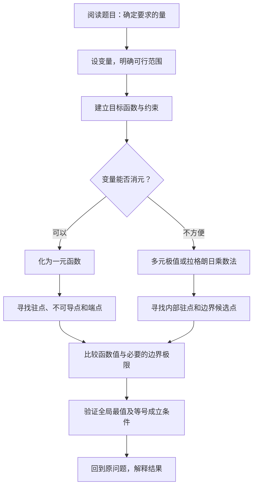

## 一、本节在考研数学一中的定位

经济学应用属于数学三的专属专题，数学一重点掌握其通用数学方法。代表性母题如下：

| 真题来源    | 题目背景       | 核心数学考点      | 数一迁移价值 |
| ------- | ---------- | ----------- | ------ |
| 1988年数三 | 商品供需与价格变化  | 非线性微分方程线性化  | 很高     |
| 1990年数三 | 广告投入与利润最大化 | 多元函数极值、约束最值 | 很高     |
| 1997年数三 | 生产函数的极限    | 幂指函数极限、对数化  | 很高     |
| 2024年数三 | 分段定价与利润最大化 | 分段函数最值、端点比较 | 很高     |

复习重点分为三个层次：

- **经济学背景知识：**&#x2060;边际成本、边际收益、需求弹性等数三专属内容，不是数学一复习的重点。
- **一般数学方法：**&#x2060;函数最值、分段函数、条件极值、幂指极限、微分方程代换等，全部具有数学一复习价值。
- **综合建模能力：**&#x2060;从陌生题目中提取数学关系、确定目标函数、建立约束条件、选择求解方法，是本节最值得训练的能力。

**重点是识别经济学背景下的通用数学问题。**

## 二、本节的知识体系：四条数学主线

这四类题目虽然都使用经济学术语，但它们的求解方法几乎没有共同的经济学前提，真正的联系在于**利用微分学研究一个数学系统的局部变化、整体最优与长期行为**。

| 题目特征           | 转化后的数学问题           | 首选方法       |
| -------------- | ------------------ | ---------- |
| 变化率取决于当前状态     | 常微分方程              | 分离变量、变量代换  |
| 在给定资源下寻求最佳方案   | 条件最值               | 消元、拉格朗日乘数法 |
| 底数趋于 1、指数趋于无穷  | $1^\infty$ 型极限 | 取对数、泰勒公式   |
| 不同区间使用不同公式     | 分段函数最值             | 分段求导、边界比较  |
| 成本最低、面积最大、距离最短 | 一元或多元最优化           | 建立目标函数     |
| 求系统最终稳定的状态     | 微分方程的长期极限          | 平衡点、解的单调性  |

本节最重要的思维习惯是：**先确定数学模型，再选择解题工具，而不是根据题目的生活背景机械套公式。**

### 2.1 一元函数最值的基础

设目标函数为 $F(x)$，可行范围为 $D$，要求

$$
\max_{x\in D}F(x)
$$

或者

$$
\min_{x\in D}F(x).
$$

需要严格区分以下概念。

| 概念   | 含义                    |
| ---- | --------------------- |
| 驻点   | 满足 $F'(x_0)=0$ 的点 |
| 极值点  | 在某个局部邻域内取得最大或最小值的点    |
| 最值点  | 在整个可行域内取得最大或最小值的点     |
| 不可导点 | 可能取得极值，但导数不存在         |
| 上确界  | 函数值的最小上界，不一定能够取到      |

费马定理告诉我们：如果 $x_0$ 是定义域内点，$F$ 在 $x_0$ 处可导，且在此处取得极值，那么

$$
F'(x_0)=0.
$$

但反过来并不成立。

例如 $F(x)=x^3$，虽然 $F'(0)=0$，但原点不是极值点。

一元函数极值的常见判别方法为：

| 判别依据                         | 结论      |
| ---------------------------- | ------- |
| $F'$ 由正变负                | 极大值     |
| $F'$ 由负变正                | 极小值     |
| $F'(x_0)=0,\ F''(x_0)>0$ | 极小值     |
| $F'(x_0)=0,\ F''(x_0)<0$ | 极大值     |
| $F'(x_0)=F''(x_0)=0$     | 需要进一步判断 |

如果在整个区间内有

$$
F''(x)>0,
$$

则 $F'$ 严格递增，若存在驻点，那么该驻点是唯一的全局最小值点。

类似地，如果

$$
F''(x)<0,
$$

则存在的驻点是唯一的全局最大值点。

这两个结论在最优化题目中非常实用。

### 2.2 经济学基本公式：了解即可

以下经济学公式仅作背景知识，数学一侧重一般数学方法。

设产量为 $q$，单价为 $p(q)$，总成本为 $C(q)$。

总收益（销售收入）为

$$
R(q)=qp(q).
$$

利润为

$$
\boxed{\Pi(q)=R(q)-C(q)=qp(q)-C(q)}.
$$

因此

$$
\Pi'(q)=p(q)+qp'(q)-C'(q).
$$

其中：

| 名称   | 数学表达式               |
| ---- | ------------------- |
| 总收益  | $R(q)$          |
| 边际收益 | $R'(q)$         |
| 总成本  | $C(q)$          |
| 边际成本 | $C'(q)$         |
| 平均成本 | $\dfrac{C(q)}q$ |
| 边际利润 | $\Pi'(q)$       |

利润在可导的内部最优点处满足

$$
\Pi'(q)=0,
$$

即

$$
\boxed{R'(q)=C'(q)}.
$$

这就是所谓的边际收益等于边际成本。

从数学角度看，它没有任何神秘之处，只是目标函数的一阶导数为零。

另一个常见推论是：当 $q>0$ 时，平均成本的导数为

$$
\left[\frac{C(q)}q\right]' =\frac{qC'(q)-C(q)}{q^2}.
$$

所以平均成本的内部驻点满足

$$
C'(q)=\frac{C(q)}q.
$$

不过，两个等式都只是内部驻点的必要条件，不能跳过最值判定。

### 2.3 多元函数极值和条件极值

设目标函数为

$$
F(x,y).
$$

若函数在定义域内点可微，取得极值的必要条件为

$$
F_x(x,y)=0,\qquad F_y(x,y)=0.
$$

对于二阶连续可偏导的函数，令驻点处

$$
A=F_{xx},\qquad B=F_{xy},\qquad C=F_{yy},
$$

并定义

$$
\Delta=AC-B^2.
$$

则有：

| 条件                   | 判定     |
| -------------------- | ------ |
| $\Delta>0,\ A>0$ | 极小值    |
| $\Delta>0,\ A<0$ | 极大值    |
| $\Delta<0$       | 非极值点   |
| $\Delta=0$       | 无法直接判定 |

特别注意：这个判别法直接给出的是**局部极值**，不是一般意义上的全局最值。

如果存在约束条件

$$
g(x,y)=0,
$$

则通常有两种方法。

**方法一：直接消元。** 如果能够方便地表示成

$$
y=\varphi(x),
$$

则目标函数降为

$$
G(x)=F(x,\varphi(x)).
$$

**方法二：拉格朗日乘数法。** 构造

$$
\mathcal L(x,y,\lambda) =F(x,y)-\lambda g(x,y),
$$

求解

$$
\begin{cases} F_x-\lambda g_x=0,\\ F_y-\lambda g_y=0,\\ g(x,y)=0. \end{cases}
$$

该方法要求考察的约束点满足通常的正则条件，例如

$$
\nabla g(x,y)\ne \boldsymbol 0.
$$

求出候选点后，仍须检查约束奇点、不等式边界以及其他可行点。

**考研实战原则：能简单消元时优先消元；消元复杂或者约束具有对称性时，再考虑拉格朗日乘数法。**

## 三、第一类母题：供需动态模型与非线性微分方程

**重要程度：★★★★★**

这一类题对于数学一尤其有价值，因为它把微分方程、函数单调性、极限以及变量代换结合在了一起。

### 3.1 基础知识：如何理解动态平衡

设某个量 $y=y(t)$ 随时间变化，并且满足

$$
\frac{\mathrm dy}{\mathrm dt}=F(y).
$$

这类方程称为自治微分方程。

如果存在 $y_0$，使得

$$
F(y_0)=0,
$$

那么 $y(t)\equiv y_0$ 是方程的一个常值解，称 $y_0$ 为平衡点。

直观上：

- 当 $F(y)>0$ 时，$y$ 随时间增加；
- 当 $F(y)<0$ 时，$y$ 随时间减少；
- 当 $F(y)=0$ 时，系统可以保持当前状态不变。

若平衡点附近满足

$$
\begin{cases} F(y)>0,&y<y_0,\\ F(y)<0,&y>y_0, \end{cases}
$$

那么在通常的连续性、解的唯一性等条件下，附近的解将趋向平衡点。

这就是稳定平衡的数学本质。

在经济学中是价格趋于均衡，在物理学中可能是物体温度趋于环境温度、速度趋于极限速度；在纯数学中则是微分方程解的渐近性质。

### 3.2 核心公式：伯努利方程的线性化

伯努利方程的标准形式为

$$
\boxed{y'+P(x)y=Q(x)y^n}, \qquad n\ne0,1.
$$

在允许相应幂运算、且 $y\ne0$ 的区间内，两端同乘 $y^{-n}$，得到

$$
y^{-n}y'+P(x)y^{1-n}=Q(x).
$$

令

$$
u=y^{1-n},
$$

则

$$
u'=(1-n)y^{-n}y'.
$$

所以原方程化为

$$
\boxed{ u'+(1-n)P(x)u=(1-n)Q(x) }.
$$

这是一个一阶线性微分方程。

而一阶线性微分方程

$$
u'+p(x)u=q(x)
$$

的通解公式为

$$
u=e^{-\int p(x)\,\mathrm dx} \left[ \int q(x)e^{\int p(x)\,\mathrm dx}\,\mathrm dx+C \right].
$$

尤其需要熟练掌握常系数情形：

$$
u'+au=b,\qquad a\ne0,
$$

其通解为

$$
\boxed{u=\frac ba+Ce^{-ax}}.
$$

如果 $a>0$，则

$$
\lim_{x\to+\infty}u(x)=\frac ba.
$$

### 母题1：1988年考研数学三——商品价格动态变化

某商品的需求量和供给量分别为

$$
D(p)=\frac a{p^2},\qquad S(p)=bp,
$$

其中 $a,b>0$。价格满足

$$
\frac{\mathrm dp}{\mathrm dt} =k[D(p)-S(p)], \qquad k>0,
$$

且 $p(0)=1$。

求均衡价格、价格函数以及价格的长期极限。

<Steps>

<Step>

### 第一步：求均衡价格 [!toc]

均衡时，价格不再变化，即

$$
p'(t)=0.
$$

因此

$$
D(p_0)=S(p_0).
$$

代入得到

$$
\frac a{p_0^2}=bp_0,
$$

所以

$$
p_0^3=\frac ab.
$$

由于价格为正，

$$
\boxed{p_0=\sqrt[3]{\frac ab}}.
$$

</Step>

<Step>

### 第二步：识别微分方程结构 [!toc]

原方程为

$$
p'=k\left(\frac a{p^2}-bp\right).
$$

整理为

$$
p'+kbp=ka p^{-2}.
$$

这是伯努利方程，对应指数

$$
n=-2.
$$

因此应该令

$$
u=p^{1-(-2)}=p^3.
$$

实际上，不必机械背诵公式。观察到

$$
(p^3)'=3p^2p',
$$

就能自然想到在原方程两端乘以 $3p^2$。

得到

$$
3p^2p'=3ka-3kbp^3.
$$

于是

$$
u'+3kbu=3ka.
$$

</Step>

<Step>

### 第三步：求线性方程的解 [!toc]

由常系数一阶线性微分方程的通解，

$$
u=\frac ab+Ce^{-3kbt}.
$$

利用初始条件

$$
u(0)=p^3(0)=1,
$$

得到

$$
C=1-\frac ab.
$$

因此

$$
u(t)=\frac ab+ \left(1-\frac ab\right)e^{-3kbt}.
$$

代回原变量，

$$
\boxed{ p(t)= \left[ \frac ab+ \left(1-\frac ab\right)e^{-3kbt} \right]^{1/3} }.
$$

</Step>

<Step>

### 第四步：求长期极限 [!toc]

因为 $k,b>0$，所以

$$
\lim_{t\to+\infty}e^{-3kbt}=0.
$$

于是

$$
\boxed{ \lim_{t\to+\infty}p(t) =\sqrt[3]{\frac ab}=p_0 }.
$$

长期价格恰好等于均衡价格。

</Step>

</Steps>

### 3.3 深入理解：价格为什么必然趋于均衡？

不求解方程也可以分析解的变化趋势。

将原方程写成

$$
p'=\frac{k}{p^2}(a-bp^3).
$$

由于 $p>0$，所以导数的正负完全由 $a-bp^3$ 决定。

| 初始价格            | 导数符号       | 变化趋势              |
| --------------- | ---------- | ----------------- |
| $p(0)<p_0$ | $p'>0$ | 单调增加，趋于 $p_0$ |
| $p(0)=p_0$  | $p'=0$ | 保持不变              |
| $p(0)>p_0$  | $p'<0$ | 单调减少，趋于 $p_0$ |

也可以利用显式解写成

$$
p^3(t)=p_0^3+ [p^3(0)-p_0^3]e^{-3kbt}.
$$

因此

$$
p^3(t)-p_0^3 =[p^3(0)-p_0^3]e^{-3kbt}.
$$

这说明系统与平衡状态之间的偏差，在三次幂变量下呈指数衰减。

这类指数衰减结构在数学一的微分方程综合题中同样重要。

### 3.4 母题推广：识别一整类可线性化方程

如果遇到

$$
y'=\alpha y^{1-m}-\beta y,
$$

其中 $\alpha,\beta,m>0$，且 $y(0)=y_0>0$，那么令

$$
u=y^m.
$$

有

$$
u'=my^{m-1}y' =m\alpha-m\beta u.
$$

所以

$$
u'+m\beta u=m\alpha.
$$

直接得到

$$
\boxed{ y(t)= \left[ \frac{\alpha}{\beta} +\left(y_0^m-\frac{\alpha}{\beta}\right)e^{-m\beta t} \right]^{1/m} }.
$$

以及

$$
\boxed{ \lim_{t\to+\infty}y(t) =\left(\frac{\alpha}{\beta}\right)^{1/m} }.
$$

原题只是 $m=3$ 的特殊情形。

### 3.5 李正元练习题：伯努利方程变式

来源：《李正元练习题》第六章常微分方程，计算题第1题（Ⅳ）。

求方程

$$
\frac{\mathrm dy}{\mathrm dx}-3xy=xy^2
$$

的通解。

**识别方法：**&#x2060;线性项为 $y$，非线性项为 $y^2$，因此令

$$
u=y^{-1}.
$$

当 $y\ne0$ 时，原方程除以 $y^2$ 得

$$
\frac{y'}{y^2}-\frac{3x}{y}=x.
$$

利用

$$
u'=-\frac{y'}{y^2},
$$

得到

$$
-u'-3xu=x,
$$

即

$$
u'+3xu=-x.
$$

乘以积分因子

$$
\mu(x)=e^{\frac32x^2},
$$

有

$$
\left(ue^{\frac32x^2}\right)' =-xe^{\frac32x^2}.
$$

积分得到

$$
ue^{\frac32x^2} =-\frac13e^{\frac32x^2}+C.
$$

于是

$$
u=-\frac13+Ce^{-\frac32x^2}.
$$

因此非零解为

$$
\boxed{ y=\frac1{Ce^{-\frac32x^2}-\frac13} }.
$$

这里还必须补上

$$
\boxed{y\equiv0}.
$$

**这道题最容易失分的地方：**&#x2060;除以 $y^2$ 时可能丢失零解；此外，所得非零解只能定义在分母不为零的相应区间内。

### 3.6 本题型的考场识别表

| 方程特征                   | 优先尝试               |
| ---------------------- | ------------------ |
| $y'=f(x)g(y)$      | 分离变量               |
| $y'+P(x)y=Q(x)$    | 一阶线性方程             |
| $y'+P(x)y=Q(x)y^n$ | 伯努利代换              |
| 出现 $y^{m-1}y'$     | 令 $u=y^m$      |
| 出现 $\dfrac{y'}y$   | 令 $u=\ln\lvert y\rvert $ |
| 出现 $y'=F(y/x)$     | 令 $u=y/x$      |
| 求长期稳定状态                | 先找平衡点，再判断收敛性       |

## 四、第二类母题：多元函数极值与资源分配

**重要程度：★★★★★**

这类题在经济学中体现为广告投入、资源配置、成本最小化；在数学一中则常表现为距离最短、面积最大、体积最大以及条件极值问题。

### 母题2：1990年考研数学三——广告投入最优化

设电台广告费用为 $x_1$ 万元，报纸广告费用为 $x_2$ 万元，销售收入为

$$
R=15+14x_1+32x_2 -8x_1x_2-2x_1^2-10x_2^2.
$$

其中 $x_1,x_2\ge0$。

求无预算限制时的利润最大方案，以及总广告费用固定为 $1.5$ 万元时的最优方案。

### 4.1 第一问：无条件极值与全局最优

<Steps>

<Step>

### 第一步：确定真正的目标函数 [!toc]

题目要求的是利润最大，而不是收入最大。

所以必须建立

$$
L=R-x_1-x_2.
$$

即

$$
L=15+13x_1+31x_2 -8x_1x_2-2x_1^2-10x_2^2.
$$

这是整道题最关键的建模步骤。

</Step>

<Step>

### 第二步：求驻点 [!toc]

分别对两个变量求偏导，

$$
L_{x_1}=13-8x_2-4x_1,
$$

$$
L_{x_2}=31-8x_1-20x_2.
$$

令两个偏导数同时为零：

$$
\begin{cases} 4x_1+8x_2=13,\\ 8x_1+20x_2=31. \end{cases}
$$

解得

$$
\boxed{x_1=\frac34,\qquad x_2=\frac54}.
$$

该点满足两个投入量均非负。

</Step>

<Step>

### 第三步：判断极值性质 [!toc]

计算二阶偏导数：

$$
A=L_{x_1x_1}=-4,
$$

$$
B=L_{x_1x_2}=-8,
$$

$$
C=L_{x_2x_2}=-20.
$$

因此

$$
AC-B^2=80-64=16>0,
$$

且 $A<0$，故该驻点为极大值点。

</Step>

<Step>

### 第四步：证明是全局最大值点 [!toc]

由于这里的目标函数是严格凹的二次函数，其 Hessian 矩阵

$$
H= \begin{pmatrix} -4&-8\\ -8&-20 \end{pmatrix}
$$

恒负定，因此该驻点是整个平面上的唯一全局最大值点。

该点又位于可行区域内，所以也是非负象限上的全局最大值点。

更直观的做法是配方。令

$$
u=x_1-\frac34,\qquad v=x_2-\frac54.
$$

则可以得到

$$
L=\frac{157}{4} -2u^2-8uv-10v^2,
$$

进一步写成

$$
\boxed{ L=\frac{157}{4}-2(u+2v)^2-2v^2 }.
$$

从而立即得到

$$
L\le\frac{157}{4}.
$$

等号当且仅当

$$
u=v=0.
$$

因此最大利润为

$$
\boxed{L_{\max}=\frac{157}{4}\text{ 万元}}.
$$

配方法既证明了极大值，又一次性证明了全局最大值。

</Step>

</Steps>

### 4.2 第二问：约束最优化与边界

此时有

$$
x_1+x_2=\frac32,\qquad x_1,x_2\ge0.
$$

因为成本固定，

$$
L=R-\frac32,
$$

所以最大化利润与最大化收入等价。

令

$$
x_1=\frac32-x_2.
$$

注意新的可行范围为

$$
0\le x_2\le\frac32.
$$

代入收入函数，

$$
R(x_2) =-4x_2^2+12x_2+\frac{63}{2}.
$$

求导得

$$
R'(x_2)=12-8x_2.
$$

对于

$$
0\le x_2<\frac32,
$$

有 $R'(x_2)>0$，所以收入函数严格递增，最大值在右端点取得。

因此

$$
\boxed{x_1=0,\qquad x_2=\frac32}.
$$

即全部预算用于报纸广告。

最大收入为

$$
R_{\max}=\frac{81}{2},
$$

最大利润为

$$
\boxed{L_{\max}=39}.
$$

### 4.3 为什么约束极值不能直接令两个偏导数为零？

第一问允许变量 $x_1,x_2$ 独立变化，因此内部极值要求

$$
L_{x_1}=L_{x_2}=0.
$$

第二问的变量受到了约束

$$
x_1+x_2=\frac32.
$$

增加 $x_1$ 必须减少 $x_2$，两个变量不能独立变化。

在约束曲线的内部点，应当研究沿可行方向的变化率：

$$
\frac{\mathrm d}{\mathrm dx_2} L\left(\frac32-x_2,x_2\right) =-L_{x_1}+L_{x_2}.
$$

令其为零得到

$$
L_{x_1}=L_{x_2}.
$$

这才是该约束下内部驻点的必要条件。

**本质：无条件极值要求所有方向上的一阶变化率为零；条件极值只要求沿可行方向的一阶变化率为零。**

### 4.4 创新变式：将固定预算改为任意参数

如果将原题预算改为

$$
x_1+x_2=B,\qquad B\ge0,
$$

那么应该怎样确定最优策略？

令

$$
x_1=B-x_2,\qquad 0\le x_2\le B.
$$

代入得到

$$
R(x_2) =15+14B-2B^2+(18-4B)x_2-4x_2^2.
$$

于是

$$
R'(x_2)=18-4B-8x_2.
$$

其无约束顶点为

$$
x_2^*=\frac94-\frac B2.
$$

但该顶点不一定在可行区间 $[0,B]$ 内。

所以必须分类讨论：

| 预算范围                     | 最优点位置 | 最优 $x_2$           |
| ------------------------ | ----- | ---------------------- |
| $0\le B\le\frac32$   | 右端点   | $B$                |
| $\frac32<B<\frac92$ | 内部驻点  | $\frac94-\frac B2$ |
| $B\ge\frac92$        | 左端点   | $0$                |

最终

$$
\boxed{ x_2^*= \begin{cases} B,&0\le B\le\frac32,\\[2mm] \frac94-\frac B2,&\frac32<B<\frac92,\\[2mm] 0,&B\ge\frac92. \end{cases} }
$$

并且

$$
x_1^*=B-x_2^*.
$$

注意：这里研究的是预算**必须全部使用**的情形。如果题目改为

$$
x_1+x_2\le B,
$$

那么目标和可行区域都会发生变化，不能照搬上述结论。

这个变式非常适合训练数学一中含参数的最值分类讨论。

### 4.5 李正元练习题：无盖圆柱形水池的最低造价

来源：《李正元练习题》第四章，最值问题第5题。

建造一个容积为 $V$ 的无盖圆柱形水池，底面的单位面积造价是侧面的两倍，求最优半径和高度。

设半径为 $r$，高度为 $h$，侧面单位面积造价为 $k>0$。

**建立约束条件**

圆柱体体积为

$$
\pi r^2h=V.
$$

所以

$$
h=\frac{V}{\pi r^2},\qquad r>0.
$$

**建立目标函数**

因为没有盖子，只有底面和侧面。

总造价为

$$
C=2k\pi r^2+2k\pi rh.
$$

代入约束，

$$
C(r)=2k\pi r^2+\frac{2kV}{r}.
$$

因为 $2k>0$，只需要最小化

$$
F(r)=\pi r^2+\frac Vr.
$$

**求最小值点**

$$
F'(r)=2\pi r-\frac V{r^2}.
$$

令

$$
F'(r)=0,
$$

得

$$
2\pi r^3=V.
$$

因此

$$
\boxed{r=\sqrt[3]{\frac V{2\pi}}}.
$$

又因为

$$
F''(r)=2\pi+\frac{2V}{r^3}>0,
$$

所以该驻点是唯一的全局最小值点。

由体积约束得到

$$
h=\frac V{\pi r^2}=2r.
$$

最终

$$
\boxed{ r=\sqrt[3]{\frac V{2\pi}}, \qquad h=2\sqrt[3]{\frac V{2\pi}} }.
$$

这道题与广告投入题的数学本质完全相同：

$$
\text{建立目标函数} \longrightarrow \text{利用约束降维} \longrightarrow \text{求最值}.
$$

### 4.6 李林880题：闭区域上的全局最值

来源：《2027李林精讲精练880题》高数篇，第五章基础题解答题第5题，紧凑版正文第51页。

求

$$
z=x^3-3x^2-3y^2
$$

在闭区域

$$
D:x^2+y^2\le16
$$

上的最大值。

**常规方法：内部驻点加边界**

内部驻点满足

$$
\begin{cases} 3x^2-6x=0,\\ -6y=0. \end{cases}
$$

得到

$$
(0,0),\qquad(2,0).
$$

对应函数值为

$$
z(0,0)=0,\qquad z(2,0)=-4.
$$

在边界上，

$$
y^2=16-x^2.
$$

因此

$$
z=x^3-3x^2-3(16-x^2) =x^3-48.
$$

其中

$$
-4\le x\le4.
$$

边界函数单调递增，其最大值为

$$
4^3-48=16.
$$

比较所有候选值，

$$
\boxed{z_{\max}=16},
$$

在点 $(4,0)$ 取得。

**更快的解法：利用目标函数的结构**

因为

$$
-3y^2\le0,
$$

所以

$$
z\le x^3-3x^2.
$$

对于任意 $x\in[-4,4]$，点 $(x,0)$ 都属于可行区域。

因此最大值问题可以直接降为

$$
\max_{-4\le x\le4}(x^3-3x^2).
$$

只需比较两个驻点与两个端点即可。

**迁移技巧：**&#x2060;如果一个变量只以非正平方项的形式出现，而且可以在约束下取零，那么先消去该变量，往往比直接使用拉格朗日乘数法更快。

## 五、第三类母题：幂指函数极限与对数化

**重要程度：★★★★★**

虽然这道真题使用生产函数作为背景，但它实际属于第一模块的极限计算，是数学一应当熟练掌握的经典结构。

### 5.1 基础知识：幂指函数的三种未定式

当函数具有形式

$$
F(x)=[f(x)]^{g(x)}
$$

时，如果底数为正，可以写成

$$
F(x)=e^{g(x)\ln f(x)}.
$$

常见的幂指未定式包括

$$
1^\infty,\qquad 0^0,\qquad \infty^0.
$$

它们都可以统一转化为指数部分的极限。

如果

$$
\lim_{x\to x_0}g(x)\ln f(x)=A,
$$

那么

$$
\boxed{ \lim_{x\to x_0}[f(x)]^{g(x)}=e^A }.
$$

当 $f(x)\to1$ 时，利用等价无穷小

$$
\ln f(x)\sim f(x)-1,
$$

通常可以进一步得到

$$
\boxed{ \lim[f(x)]^{g(x)} =e^{\lim g(x)[f(x)-1]} },
$$

前提是底数最终为正，并且右侧指数极限存在（也可按扩展实数极限处理）。

### 5.2 特别重要的导数型幂指极限

设 $f$ 在 $x_0$ 处可导，且

$$
f(x_0)=1.
$$

则

$$
\boxed{ \lim_{x\to x_0} [f(x)]^{\frac1{x-x_0}} =e^{f'(x_0)} }.
$$

证明：

$$
\begin{aligned} \lim_{x\to x_0} \frac{\ln f(x)}{x-x_0} &=\lim_{x\to x_0} \frac{\ln f(x)-\ln f(x_0)}{x-x_0}\\ &=(\ln f)'(x_0)\\ &=\frac{f'(x_0)}{f(x_0)}\\ &=f'(x_0). \end{aligned}
$$

这是下面真题的核心公式。

### 母题3：1997年考研数学三——生产函数极限

已知

$$
Q(x)=A\left[ \delta K^{-x}+(1-\delta)L^{-x} \right]^{-1/x},
$$

其中

$$
A,K,L>0,\qquad 0<\delta<1.
$$

证明

$$
\lim_{x\to0}Q(x)=AK^\delta L^{1-\delta}.
$$

<Tabs items={["解法一：取对数与导数定义", "解法二：泰勒展开法"]} defaultIndex={0}>

<Tab value="解法一：取对数与导数定义">

令

$$
H(x)=\delta K^{-x}+(1-\delta)L^{-x}.
$$

显然

$$
H(0)=\delta+(1-\delta)=1.
$$

所以原题具有 $1^\infty$ 型结构。

取对数，

$$
\ln Q(x)=\ln A-\frac{\ln H(x)}x.
$$

由于 $\ln H(0)=0$，有

$$
\lim_{x\to0}\frac{\ln H(x)}x =(\ln H)'(0).
$$

而

$$
H'(x) =-\delta K^{-x}\ln K -(1-\delta)L^{-x}\ln L.
$$

因此

$$
H'(0) =-\delta\ln K-(1-\delta)\ln L.
$$

从而

$$
\lim_{x\to0}\ln Q(x) =\ln A+\delta\ln K+(1-\delta)\ln L.
$$

两端取指数，

$$
\boxed{ \lim_{x\to0}Q(x) =AK^\delta L^{1-\delta} }.
$$

这是本题最自然、计算量最少的解法之一。

</Tab>

<Tab value="解法二：泰勒展开法">

利用

$$
K^{-x}=e^{-x\ln K} =1-x\ln K+o(x),
$$

以及

$$
L^{-x}=1-x\ln L+o(x).
$$

于是

$$
\begin{aligned} H(x) &=\delta K^{-x}+(1-\delta)L^{-x}\\ &=1-x[\delta\ln K+(1-\delta)\ln L]+o(x). \end{aligned}
$$

因此

$$
\ln H(x) =-x[\delta\ln K+(1-\delta)\ln L]+o(x).
$$

所以

$$
-\frac{\ln H(x)}x =\delta\ln K+(1-\delta)\ln L+o(1).
$$

最后得到相同结论。

</Tab>

</Tabs>

### 5.3 母题提炼：加权幂平均极限

这道题可以推广为非常重要的一类极限。

如果

$$
a_i>0,\qquad w_i\ge0,\qquad \sum_{i=1}^n w_i=1,
$$

则

$$
\boxed{ \lim_{x\to0} \left(\sum_{i=1}^n w_i a_i^x\right)^{1/x} =\prod_{i=1}^n a_i^{w_i} }.
$$

证明的关键是令

$$
H(x)=\sum_{i=1}^n w_i a_i^x.
$$

有

$$
H(0)=1,
$$

以及

$$
H'(0)=\sum_{i=1}^n w_i\ln a_i.
$$

所以

$$
\begin{aligned} \lim_{x\to0} \frac{\ln H(x)}x &=\sum_{i=1}^n w_i\ln a_i\\ &=\ln\prod_{i=1}^n a_i^{w_i}. \end{aligned}
$$

例如：

$$
\lim_{x\to0} \left(\frac{2^x+3^x}{2}\right)^{1/x} =\sqrt6.
$$

又如：

$$
\lim_{x\to0} \left(\frac{2^x+3^x+5^x}{3}\right)^{1/x} =\sqrt[3]{30}.
$$

真正需要记住的不是结果，而是**先确认权重和为1，再将加权指数函数转化为对数的加权平均**。

### 5.4 进阶变式：一阶项抵消怎么办？

求

$$
\lim_{x\to0} \left(\frac{e^x+e^{-x}}2\right)^{1/x^2}.
$$

如果机械使用一阶泰勒公式，会发现

$$
\frac{e^x+e^{-x}}2=1+o(x).
$$

这还不足以计算极限，因为指数为 $1/x^2$，要求分子至少展开到二阶。

利用

$$
e^x=1+x+\frac{x^2}2+o(x^2),
$$

$$
e^{-x}=1-x+\frac{x^2}2+o(x^2),
$$

得到

$$
\frac{e^x+e^{-x}}2 =1+\frac{x^2}2+o(x^2).
$$

所以

$$
\frac1{x^2} \ln\left(\frac{e^x+e^{-x}}2\right) \to\frac12.
$$

因此

$$
\boxed{ \lim_{x\to0} \left(\frac{e^x+e^{-x}}2\right)^{1/x^2} =\sqrt e }.
$$

由此可以总结出更一般的公式：

若

$$
f(x)=1+ax^m+o(x^m),
$$

其中 $m$ 为正整数，则

$$
\boxed{ \lim_{x\to0}[f(x)]^{1/x^m}=e^a }.
$$

若低阶项尚未抵消，则不能直接套用这个结论。

### 5.5 高阶推广：加权幂平均的二阶信息

这是一个很适合训练泰勒展开能力的数学一创新变式。

设

$$
H(x)=\sum_{i=1}^n w_i a_i^x,
$$

满足前述正值和权重条件。

令

$$
\mu=\sum_{i=1}^n w_i\ln a_i,
$$

$$
M_2=\sum_{i=1}^n w_i(\ln a_i)^2.
$$

则

$$
H(x)=1+\mu x+\frac12M_2x^2+o(x^2).
$$

再利用

$$
\ln(1+t)=t-\frac12t^2+o(t^2),
$$

得到

$$
\boxed{ \ln H(x)= \mu x+\frac12(M_2-\mu^2)x^2+o(x^2) }.
$$

因此

$$
\lim_{x\to0} \frac{\ln H(x)-\mu x}{x^2} =\frac12(M_2-\mu^2).
$$

例如求

$$
\lim_{x\to0} \left[ \frac{2^x+8^x}{2\cdot4^x} \right]^{1/x^2}.
$$

先化简底数：

$$
\frac{2^x+8^x}{2\cdot4^x} =\frac{2^{-x}+2^x}{2}.
$$

展开为

$$
1+\frac12(\ln2)^2x^2+o(x^2).
$$

所以极限为

$$
\boxed{e^{\frac12(\ln2)^2}}.
$$

这种题目把原题中的一阶对数平均推广到了二阶泰勒展开，不需要学习任何经济学知识。

### 5.6 张宇1000题：幂指函数、单调性与最值综合

来源：《2027张宇1000题·数学一解析册》，基础篇第5章，第13题，正文第30页。

原题解析通过研究

$$
f(x)=x^{1/x},\qquad x>0,
$$

比较正整数的 $n$ 次方根大小。

这是另一道非常典型的幂指函数母题。

由于

$$
f(x)=e^{\frac{\ln x}{x}},
$$

所以

$$
f'(x) =x^{1/x}\frac{1-\ln x}{x^2}.
$$

因为

$$
x^{1/x}>0,\qquad x^2>0,
$$

所以导数的符号只由 $1-\ln x$ 决定。

因此

$$
f'(x) \begin{cases} >0,&0<x<e,\\ =0,&x=e,\\ <0,&x>e. \end{cases}
$$

连续函数的最大值为

$$
\boxed{f(e)=e^{1/e}}.
$$

如果将变量限制为正整数 $n$，由于

$$
2<e<3,
$$

所以只需要比较

$$
f(2)=\sqrt2,\qquad f(3)=\sqrt[3]3.
$$

因为

$$
(\sqrt2)^6=8<9=(\sqrt[3]3)^6,
$$

所以

$$
\boxed{\max_{n\in\mathbb N^+}n^{1/n}=\sqrt[3]3}.
$$

这道题还体现了一个重要的建模技巧：**先把离散变量连续化，利用导数确定峰值附近的整数，再比较相邻候选值。**

### 5.7 幂指极限的考场决策

| 题目结构                            | 推荐方法         |
| ------------------------------- | ------------ |
| $f(x)^{1/x}$，且 $f(0)=1$ | 导数定义         |
| $f(x)^{1/x^2}$              | 检查一阶项，展开至二阶  |
| 若干指数函数加权求和                      | 指数函数泰勒展开     |
| 底数中存在乘除法                        | 先取对数，将乘除化为加减 |
| 幂指函数求最值                         | 对数求导或直接研究指数  |
| 幂指函数中含参数                        | 按首个非零泰勒项分类   |

## 六、第四类母题：分段函数的最值与边界比较

**重要程度：★★★★★**

这是本节中最直接对应一元函数微分学应用的一类题。

### 6.1 为什么分段函数容易出题？

普通函数的最值问题，通常只需要寻找驻点和端点。

而分段函数可能同时存在：

- 内部驻点；
- 分段连接点；
- 不可导点；
- 不属于定义域的端点；
- 左右极限不相等的跳跃点。

尤其要注意：函数在某个点不可导，并不意味着该点不能取得极值。

例如

$$
f(x)=-|x|.
$$

在 $x=0$ 处不可导，但取得全局最大值

$$
f_{\max}=0.
$$

其左右导数满足

$$
f'_-(0)=1,\qquad f'_+(0)=-1.
$$

也就是左边递增，右边递减。

这是分段函数拐角处取得极大值的典型结构。

### 母题4：2024年考研数学三——分段利润最大化

某商品的价格与产量 $Q\ge0$ 的关系为

$$
P= \begin{cases} 25-0.25Q,&Q\le20,\\ 35-0.75Q,&Q>20. \end{cases}
$$

总成本为

$$
C(Q)=150+5Q+0.25Q^2.
$$

求利润的最大值。

<Steps>

<Step>

### 第一步：建立分段目标函数 [!toc]

利润为

$$
\Pi(Q)=PQ-C(Q).
$$

当 $0\le Q\le20$ 时，

$$
\begin{aligned} \Pi_1(Q) &=(25-0.25Q)Q\\ &\quad-(150+5Q+0.25Q^2)\\ &=20Q-\frac12Q^2-150. \end{aligned}
$$

当 $Q>20$ 时，

$$
\begin{aligned} \Pi_2(Q) &=(35-0.75Q)Q\\ &\quad-(150+5Q+0.25Q^2)\\ &=30Q-Q^2-150. \end{aligned}
$$

所以

$$
\Pi(Q)= \begin{cases} 20Q-\frac12Q^2-150,&0\le Q\le20,\\ 30Q-Q^2-150,&Q>20. \end{cases}
$$

</Step>

<Step>

### 第二步：第一段求最值 [!toc]

$$
\Pi_1'(Q)=20-Q.
$$

对于 $0<Q<20$，有

$$
\Pi_1'(Q)>0.
$$

所以第一段单调递增，最大值在右端点取得。

$$
\Pi_1(20)=400-200-150=50.
$$

</Step>

<Step>

### 第三步：第二段求最值 [!toc]

$$
\Pi_2'(Q)=30-2Q.
$$

令导数为零得到

$$
Q=15.
$$

但是第二段的定义域是

$$
Q>20.
$$

因此 $Q=15$ 是无效候选点，必须舍去。

对于所有 $Q>20$，有

$$
\Pi_2'(Q)<0.
$$

所以第二段严格递减，且

$$
\lim_{Q\to20^+}\Pi_2(Q)=50.
$$

由于 $Q=20$ 不属于第二段，该段的上确界为50，但并不实际取得50。

</Step>

<Step>

### 第四步：全局比较 [!toc]

第一段在 $Q=20$ 时实际取得50，第二段的所有函数值均小于50。

所以

$$
\boxed{\Pi_{\max}=50\text{ 万元}},
$$

对应

$$
\boxed{Q=20}.
$$

</Step>

</Steps>

### 6.2 用配方法进一步理解

第一段可以写成

$$
\Pi_1(Q) =50-\frac12(Q-20)^2.
$$

所以

$$
\Pi_1(Q)\le50.
$$

第二段可以写成

$$
\Pi_2(Q)=75-(Q-15)^2.
$$

由于 $Q>20$，所以

$$
(Q-15)^2>25.
$$

从而

$$
\Pi_2(Q)<50.
$$

这个方法不需要求导，就能直接比较两段的最大值。

对于二次函数最值问题，**配方法和顶点公式往往比求导更快**，但同样不能忽略定义域。

### 6.3 含参数的变式：最优点何时从内部转移到分段点？

考虑以下自编变式：

$$
F(x)= \begin{cases} ax-\frac12x^2,&0\le x\le2,\\ (a+2)x-x^2-2,&x>2, \end{cases}
$$

其中 $a>0$。

求全局最大值点。

在连接点处，

$$
F(2)=2a-2.
$$

两段函数在此处连续。

分别求导：

$$
F_1'(x)=a-x,
$$

$$
F_2'(x)=a+2-2x.
$$

第一段的驻点为

$$
x_1=a,
$$

第二段的驻点为

$$
x_2=\frac{a+2}{2}.
$$

根据驻点的可行范围分类。

当 $0<a<2$ 时，第一段驻点 $x=a$ 位于内部，第二段始终递减，因此

$$
x^*=a.
$$

当 $a=2$ 时，两段驻点恰好均位于分段点，得到

$$
x^*=2.
$$

当 $a>2$ 时，第一段始终递增，第二段的驻点位于 $x>2$ 内，所以

$$
x^*=\frac{a+2}{2}.
$$

因此

$$
\boxed{ x^*= \begin{cases} a,&0<a\le2,\\[2mm] \dfrac{a+2}{2},&a>2. \end{cases} }
$$

这类题的关键不是复杂运算，而是找出参数发生变化时，驻点什么时候穿过分段边界。

### 6.4 易错变式：上确界不一定是最大值

例如

$$
f(x)= \begin{cases} x,&0\le x<1,\\ 0,&x=1. \end{cases}
$$

定义域虽然是闭区间 $[0,1]$，但函数在 $x=1$ 不连续。

有

$$
\lim_{x\to1^-}f(x)=1,
$$

然而

$$
f(1)=0.
$$

因此

$$
\sup_{x\in[0,1]}f(x)=1,
$$

但最大值不存在。

这说明闭区间上的函数不一定有最大值，闭区间最值定理还需要函数连续。

### 6.5 分段最值标准操作流程

考试中遇到分段最值，建议固定使用以下流程：

1. 写清每一段目标函数与各自定义域。
2. 分别求导，寻找每段内部的驻点。
3. 舍去不属于相应区间的驻点。
4. 检查不可导点、分段点和定义域端点。
5. 对开端点和无穷端点计算必要的极限。
6. 比较所有候选值，并判断最大值或最小值是否实际取得。

**最常见的陷阱是求出了正确的驻点，却忘记它不属于当前分段的定义域。**

## 七、数学一高质量模拟题：微分方程、最值与极限综合

前面四道真题分别考查不同的数学方法，而数学一的综合大题可能将这些方法连接起来，形成一条完整的解题链。

以下综合题同时涉及微分方程、函数最值、幂指极限和不等式证明。

### 母题5：李林2027六套卷·第3套·第18题

**综合程度：★★★★★**

来源：分类模拟题，高等数学第五模块第一节。

设 $f(x)$ 满足

$$
(1-x)f'(x)+nf(x) =n(1-x)^{n+1},
$$

其中 $n$ 为正整数，且 $f(0)=0$。

（Ⅰ）若 $f(x)$ 在 $(0,1)$ 内的最大值为 $M(n)$，求

$$
\lim_{n\to\infty}M(n).
$$

（Ⅱ）证明

$$
M(n)<\frac1e.
$$

### 7.1 第一阶段：由微分方程确定函数

将原方程整理为

$$
f'(x)+\frac n{1-x}f(x) =n(1-x)^n.
$$

这是一阶线性微分方程。

积分因子为

$$
\begin{aligned} \mu(x) &=e^{\int\frac n{1-x}\,\mathrm dx}\\ &=e^{-n\ln(1-x)}\\ &=(1-x)^{-n}. \end{aligned}
$$

两边同乘积分因子，

$$
\left[(1-x)^{-n}f(x)\right]'=n.
$$

积分得

$$
(1-x)^{-n}f(x)=nx+C.
$$

由初始条件 $f(0)=0$，得到

$$
C=0.
$$

所以

$$
\boxed{f(x)=nx(1-x)^n}.
$$

### 7.2 第二阶段：利用导数求最大值

对函数求导：

$$
\begin{aligned} f'(x) &=n(1-x)^n-n^2x(1-x)^{n-1}\\ &=n(1-x)^{n-1}[1-(n+1)x]. \end{aligned}
$$

因为 $0<x<1$，所以

$$
n(1-x)^{n-1}>0.
$$

因此导数符号只取决于

$$
1-(n+1)x.
$$

| $x$     | $\left(0,\frac1{n+1}\right)$ | $\frac1{n+1}$ | $\left(\frac1{n+1},1\right)$ |
| ----------- | -------------------------------- | ----------------- | -------------------------------- |
| $f'(x)$ | 正                                | 0                 | 负                                |
| $f(x)$  | 递增                               | 最大值               | 递减                               |

所以

$$
x^*=\frac1{n+1}.
$$

对应最大值为

$$
\begin{aligned} M(n) &=\frac n{n+1} \left(1-\frac1{n+1}\right)^n\\ &=\left(\frac n{n+1}\right)^{n+1}. \end{aligned}
$$

即

$$
\boxed{ M(n)=\left(1+\frac1n\right)^{-(n+1)} }.
$$

### 7.3 第三阶段：求幂指极限

利用重要极限

$$
\lim_{n\to\infty} \left(1+\frac1n\right)^n=e,
$$

得到

$$
\begin{aligned} \lim_{n\to\infty}M(n) &=\lim_{n\to\infty} \left(1+\frac1n\right)^{-n} \left(1+\frac1n\right)^{-1}\\ &=\frac1e. \end{aligned}
$$

因此

$$
\boxed{\lim_{n\to\infty}M(n)=\frac1e}.
$$

### 7.4 第四阶段：证明严格不等式

要求证明

$$
\left(1+\frac1n\right)^{-(n+1)}<\frac1e.
$$

两边取对数，等价于

$$
(n+1)\ln\left(1+\frac1n\right)>1.
$$

所以问题转化为对数不等式。

需要掌握一个非常重要的结论：

当 $t>0$ 时，

$$
\boxed{\frac t{1+t}<\ln(1+t)<t}.
$$

证明可以直接利用定积分：

$$
\ln(1+t)=\int_0^t\frac1{1+u}\,\mathrm du.
$$

因为在 $0<u<t$ 时，

$$
\frac1{1+t}<\frac1{1+u}<1,
$$

所以积分得到

$$
\frac t{1+t}<\ln(1+t)<t.
$$

取

$$
t=\frac1n,
$$

得到

$$
\ln\left(1+\frac1n\right)>\frac1{n+1}.
$$

于是

$$
(n+1)\ln\left(1+\frac1n\right)>1.
$$

因此

$$
\boxed{M(n)<\frac1e}.
$$

### 7.5 与李林880题之间的联系

《李林880题》高数篇第二章综合题解答题第2题（紧凑版正文第24页），直接给出了

$$
f(x)=nx(1-x)^n,
$$

要求求其在 $[0,1]$ 上的最大值及最大值的极限。

而李林六套卷则在这个基本题型前增加了一阶微分方程，在后面增加了严格不等式证明。

两道题形成了非常清晰的难度递进关系：

| 练习题层次  | 考查内容                |
| ------ | ------------------- |
| 李林880题 | 函数求导、最大值、数列极限       |
| 李林六套卷  | 微分方程、最大值、数列极限、不等式   |
| 进一步创新  | 最大值点的渐近性质、参数推广、高阶误差 |

这正说明：复习时不能只背一道题的答案，而应该掌握题目各个阶段之间的衔接。

### 7.6 进一步创新：最大值收敛的速度

在原模拟题基础上，进一步求

$$
\lim_{n\to\infty} n\left(\frac1e-M(n)\right).
$$

首先对最大值取对数：

$$
\ln M(n) =-(n+1)\ln\left(1+\frac1n\right).
$$

利用泰勒公式

$$
\ln\left(1+\frac1n\right) =\frac1n-\frac1{2n^2} +o\left(\frac1{n^2}\right),
$$

得到

$$
\ln M(n) =-1-\frac1{2n} +o\left(\frac1n\right).
$$

因此

$$
\begin{aligned} M(n) &=\frac1e \exp\left[-\frac1{2n} +o\left(\frac1n\right)\right]\\ &=\frac1e \left[1-\frac1{2n} +o\left(\frac1n\right)\right]. \end{aligned}
$$

于是

$$
n\left(\frac1e-M(n)\right) =\frac1{2e}+o(1).
$$

最终

$$
\boxed{\frac1{2e}}.
$$

通过这道变式，原题又与第一模块的无穷小比较和第三模块的泰勒公式连接起来了。

## 八、综合建模题的统一解题框架

无论题目采用经济、物理还是几何背景，最优化问题都可以按照下面的框架处理。

### 8.1 常见数学模型与转化方法

| 陌生题目中的描述       | 应想到的数学结构         |
| -------------- | ---------------- |
| 距离最近           | 距离平方最小           |
| 造价最低           | 加权面积或体积最小        |
| 两部分总长度固定       | $x+y=a$，直接消元 |
| 资源分配最优         | 条件极值及边界          |
| 增长率与当前状态相关     | 微分方程             |
| 最终趋于稳定         | 平衡点与无穷远极限        |
| 不同条件采用不同规则     | 分段函数             |
| 指数随变量变化        | 幂指函数、对数化         |
| 对所有参数均成立的不等式   | 转化为函数最值          |
| 求最小的常数 $M$ | 求函数的上确界          |
| 求最大的常数 $m$ | 求函数的下确界          |

例如，要求最小的常数 $M$，使得对所有 $x>0$ 都有

$$
\ln x\le Mx.
$$

这不是普通的不等式证明题，而是最值题。

因为 $x>0$，所以

$$
M\ge\frac{\ln x}{x}.
$$

因此

$$
M_{\min}=\sup_{x>0}\frac{\ln x}{x}.
$$

令

$$
f(x)=\frac{\ln x}{x},
$$

则

$$
f'(x)=\frac{1-\ln x}{x^2}.
$$

最大值在 $x=e$ 取得。

所以

$$
\boxed{M_{\min}=\frac1e}.
$$

这又与张宇1000题中 $x^{1/x}$ 的最值具有完全相同的数学结构。

## 九、数一必备补充公式与结论

下面这些结论不一定是本节独有的，但在本节及其综合变式中非常实用。

| 知识点     | 公式或结论                                                   |
| ------- | ------------------------------------------------------- |
| 费马定理    | 内部可导极值点满足 $f'(x_0)=0$                               |
| 一元严格凹函数 | $f''<0$，存在的驻点为唯一全局最大值点                              |
| 一元严格凸函数 | $f''>0$，存在的驻点为唯一全局最小值点                              |
| 二元极值判别  | $\Delta=f_{xx}f_{yy}-f_{xy}^2$                   |
| 条件极值    | $\nabla f=\lambda\nabla g$，要求约束正则                   |
| 对数求导    | $y=u^v\Rightarrow y'=y(v'\ln u+vu'/u)$，其中 $u>0$ |
| 幂指极限    | $f^g=e^{g\ln f}$                                    |
| 伯努利方程   | $y'+Py=Qy^n$，令 $u=y^{1-n}$                      |
| 一阶常系数方程 | $y'+ay=b\Rightarrow y=b/a+Ce^{-ax}$，其中 $a\ne0$  |
| 对数不等式   | $\frac{x}{1+x}<\ln(1+x)<x$，其中 $x>0$            |
| 闭区间最值定理 | 连续函数在闭区间上必取得最大值和最小值                                     |

特别是以下两组泰勒公式，应当达到熟练使用的程度：

$$
e^x=1+x+\frac{x^2}{2} +\frac{x^3}{6}+o(x^3),
$$

$$
\ln(1+x)=x-\frac{x^2}{2} +\frac{x^3}{3}+o(x^3).
$$

它们足以处理本节大多数幂指极限以及相关的高阶创新题。

## 十、专题自测：从基础到综合

以下六道题为原创迁移训练。

建议先独立完成，再对照答案与关键思路。

**第1题：非线性微分方程**

已知

$$
y'=\frac4y-y,\qquad y(0)=1.
$$

求 $y(t)$ 及其在 $t\to+\infty$ 时的极限。

难度：★★☆☆☆

**第2题：条件最值**

已知

$$
F(x,y)=4x+6y-x^2-2y^2,
$$

其中

$$
x+y=1,\qquad x,y\ge0.
$$

求最大值。

难度：★★★☆☆

**第3题：一阶幂指极限**

计算

$$
\lim_{x\to0} \left(\frac{e^{2x}+2e^{5x}}3\right)^{1/x}.
$$

难度：★★☆☆☆

**第4题：二阶幂指极限**

计算

$$
\lim_{x\to0} \left( \frac{e^{3x}+e^{-3x}}2 \right)^{1/x^2}.
$$

难度：★★★☆☆

**第5题：分段最值**

设

$$
f(x)= \begin{cases} 4x-x^2,&0\le x\le1,\\ 6x-2x^2-1,&x>1. \end{cases}
$$

求全局最大值及其最大值点。

难度：★★★☆☆

**第6题：含参数最值与数列极限**

设

$$
f_n(x)=n^2x^2(1-x)^n, \qquad 0\le x\le1.
$$

求其最大值 $M_n$，并求

$$
\lim_{n\to\infty}M_n.
$$

难度：★★★★☆

<Accordions>

<Accordion title="自测题答案与关键思路">

**第1题。**

令

$$
u=y^2.
$$

则

$$
u'=2yy'=8-2u.
$$

结合 $u(0)=1$ 得

$$
u=4-3e^{-2t}.
$$

所以

$$
\boxed{y(t)=\sqrt{4-3e^{-2t}}},
$$

$$
\boxed{\lim_{t\to+\infty}y(t)=2}.
$$

**第2题。**

令 $y=1-x$，其中 $x\in[0,1]$。

代入得到

$$
F(x,1-x)=4+2x-3x^2.
$$

令导数为零：

$$
2-6x=0.
$$

所以

$$
\boxed{x=\frac13,\qquad y=\frac23},
$$

$$
\boxed{F_{\max}=\frac{13}{3}}.
$$

**第3题。**

利用一阶泰勒展开，

$$
\frac{e^{2x}+2e^{5x}}3 =1+4x+o(x).
$$

故

$$
\boxed{e^4}.
$$

**第4题。**

利用二阶泰勒展开，

$$
\frac{e^{3x}+e^{-3x}}2 =1+\frac92x^2+o(x^2).
$$

故

$$
\boxed{e^{9/2}}.
$$

**第5题。**

第一段单调递增，最大值为

$$
f(1)=3.
$$

第二段导数为

$$
f_2'(x)=6-4x.
$$

在

$$
x=\frac32
$$

处取得该段最大值

$$
f_2\left(\frac32\right)=\frac72.
$$

所以

$$
\boxed{f_{\max}=\frac72,\qquad x^*=\frac32}.
$$

**第6题。**

求导得到

$$
f_n'(x) =n^2x(1-x)^{n-1}[2-(n+2)x].
$$

因此最大值点为

$$
x^*=\frac2{n+2}.
$$

对应最大值

$$
\begin{aligned} M_n &=n^2\left(\frac2{n+2}\right)^2 \left(\frac n{n+2}\right)^n\\ &=4\left(\frac n{n+2}\right)^{n+2}. \end{aligned}
$$

所以

$$
\boxed{M_n=4\left(1+\frac2n\right)^{-(n+2)}}.
$$

最后

$$
\boxed{\lim_{n\to\infty}M_n=\frac4{e^2}}.
$$

</Accordion>

</Accordions>

## 十一、常见陷阱与失分原因汇总

| 易错情况             | 正确处理             |
| ---------------- | ---------------- |
| 将收益最大当成利润最大      | 先建立准确的目标函数       |
| 求出驻点就结束          | 判断极值性质和全局最值      |
| 忘记变量非负           | 明确每个变量的可行范围      |
| 将无效驻点纳入答案        | 检查驻点是否属于相应区间     |
| 忽略分段连接点          | 单独判断函数值和左右变化趋势   |
| 将上确界当成最大值        | 检查该数值能否实际取到      |
| 认为不可导点没有极值       | 利用定义或单调性判断       |
| 除以 $y^n$ 后漏解 | 检查被除因子为零的情况      |
| 平衡点直接当成长期极限      | 还须证明解的收敛性        |
| 取对数忽略定义域         | 确保底数为正           |
| 泰勒展开阶数不够         | 根据指数或分母的阶数确定展开精度 |
| 多元局部极值当成全局最值     | 检查严格凹凸性或比较边界     |
| 将等式预算与不等式预算混同    | 重新确定可行区域         |
| 将数三经济学专属术语当成数一重点 | 重点学习一般数学方法       |

## 十二、配套题库的复习顺序

建议按照下表安排复习：

| 优先级 | 资料与题号             | 训练目标          |
| --- | ----------------- | ------------- |
| S   | 2024年数三原题         | 分段函数最值        |
| S   | 1997年数三原题         | 幂指极限          |
| S   | 1990年数三原题         | 多元最值与约束最值     |
| S   | 1988年数三原题         | 微分方程代换        |
| S   | 李林六套卷第3套第18题      | 多知识点综合        |
| A   | 李林880题第二章综合解答题第2题 | 最值与极限         |
| A   | 李林880题第五章基础解答题第5题 | 闭区域最值         |
| A   | 李正元第四章最值问题第5题     | 几何最优化         |
| A   | 李正元第六章计算题第1题（Ⅳ）   | 伯努利方程         |
| A   | 张宇1000题基础篇第5章第13题 | 幂指函数与最值       |
| A   | 本讲创新变式            | 含参数、泰勒展开、综合迁移 |

## 十三、本节最终总结

数学一需要掌握以下五种核心数学能力。

| 核心能力 | 应达到的掌握程度          |
| ---- | ----------------- |
| 数学建模 | 能独立建立目标函数和约束条件    |
| 最值分析 | 能处理内部、边界、不可导点和分段点 |
| 微分方程 | 能识别非线性形式下的线性化结构   |
| 极限计算 | 能统一处理幂指未定式及高阶变式   |
| 综合迁移 | 能将微分方程、最值、极限和证明串联 |

本节可以压缩成五条重要的解题思维：

$$
\boxed{\text{非线性方程}\longrightarrow\text{变量代换}}
$$

$$
\boxed{\text{条件最值}\longrightarrow\text{约束降维}}
$$

$$
\boxed{\text{幂指极限}\longrightarrow\text{取对数}}
$$

$$
\boxed{\text{分段最值}\longrightarrow\text{分类与边界比较}}
$$

$$
\boxed{\text{陌生应用背景}\longrightarrow\text{熟悉数学模型}}
$$

**复习优先级建议：经济学专属概念为低优先级，四道母题所包含的通用数学方法为最高优先级。**

将商品价格、广告投入、生产函数、分段利润分别迁移到温度、几何尺寸、抽象函数、分段距离等情境时，仍可使用相同的数学模型。
