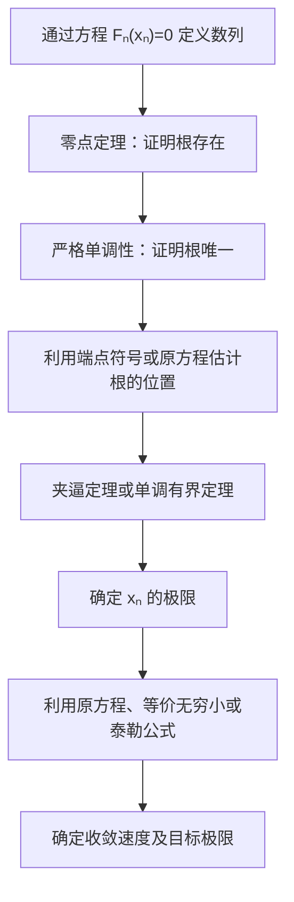
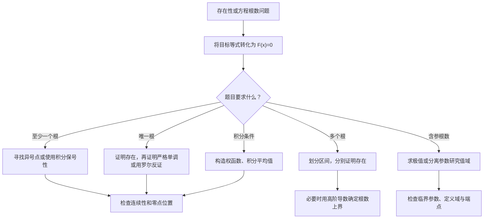

## 考点概览

| 资料来源              | 重点题型             |
| ----------------- | ---------------- |
| 1987年数学一真题        | 不动点的存在性与唯一性      |
| 1988年数学一真题        | 几何面积分点的存在唯一性     |
| 2002年数学三真题        | 加权积分中值定理         |
| 张宇1000题           | 含参方程根数、积分零点、参数分离 |
| 李林880题            | 方程根数、隐式数列极限      |
| 李正元练习题            | 根的存在范围、奇次方程、含参方程 |
| 2027李永乐六套卷第1套第20题 | 零点定理与拉格朗日中值定理综合  |
| 2027李林六套卷第6套第20题  | 加权积分中值与辅助函数综合    |
| 原创变式          | 积分矩条件与多个零点       |

## 一、核心知识体系

零点定理与介值定理看起来非常简单，但在考研数学的证明题中，它们承担着一个极其重要的任务：

**将抽象的存在性问题转化为可以判断的函数值、符号和取值范围问题。**

这一节不能仅仅学习怎样证明方程有根，还要学会下面六种能力。

| 问题类型      | 核心方法               |
| --------- | ------------------ |
| 至少存在一个根   | 连续性＋端点异号           |
| 恰好存在一个根   | 零点定理＋严格单调性或罗尔定理    |
| 至少存在多个根   | 分区间寻找异号点           |
| 恰好存在多个根   | 存在性＋根数上界           |
| 含参方程的根数   | 单调区间、极值、值域、参数分离    |
| 含积分条件的存在性 | 积分中值定理、积分保号性、权函数构造 |

本节最重要的思想可以概括为：

$$
\boxed{\text{存在性靠连续性，唯一性靠单调性}}
$$

更一般地，根数上界还可以通过罗尔定理及高阶导数获得。

## 二、基础知识：从定理本身理解证明逻辑

### 2.1 零点定理

设函数 $f(x)$ 在闭区间 $[a,b]$ 上连续，且

$$
f(a)f(b)<0,
$$

则至少存在一点 $\xi\in(a,b)$，使得

$$
\boxed{f(\xi)=0}.
$$

**直观理解**

假设曲线从横轴下方出发，最终到达横轴上方。

由于曲线连续，中间不能突然跳跃，因此必然至少穿过一次横轴。

其中：

- 连续性保证函数不能跳过零值。
- 端点异号保证函数必须经过零值。
- 严格异号保证零点位于开区间内部。
- 定理只保证至少一个零点，不保证唯一。

### 2.2 零点定理的四个常见陷阱

| 常见误解             | 正确理解         |
| ---------------- | ------------ |
| 两端异号就一定有零点       | 还必须保证连续性     |
| 两端同号就没有零点        | 可能有多个零点或相切零点 |
| 两端异号就恰好有一个零点     | 只能保证至少一个     |
| 端点乘积等于零也能保证内部有零点 | 可能只有端点是零点    |

例如，

$$
f(x)=\frac1x,\qquad x\in[-1,1]\setminus\{0\},
$$

虽然

$$
f(-1)=-1,\qquad f(1)=1,
$$

但由于在零点处不连续，整个定义域上没有零点。

又如

$$
f(x)=x^2,\qquad x\in[-1,1],
$$

虽然两端同号，却存在内部零点 $x=0$。

因此必须牢记：

**端点异号是连续函数存在内部零点的充分条件，而非必要条件。**

### 2.3 介值定理

设 $f(x)$ 在 $[a,b]$ 上连续，若常数 $C$ 介于 $f(a)$ 与 $f(b)$ 之间，则存在 $\xi\in[a,b]$，使得

$$
f(\xi)=C.
$$

若进一步满足

$$
\min\{f(a),f(b)\} <C< \max\{f(a),f(b)\},
$$

则可以保证

$$
\xi\in(a,b).
$$

零点定理其实就是介值定理在 $C=0$ 时的特殊情况。

证明一般的介值结论时，可以构造

$$
F(x)=f(x)-C,
$$

从而将问题转化为零点问题。

### 2.4 介值定理与最值定理的结合

设 $f(x)$ 在闭区间 $[a,b]$ 上连续。

由最值定理，存在

$$
m=\min_{x\in[a,b]}f(x),
$$

$$
M=\max_{x\in[a,b]}f(x).
$$

再由介值定理可知，函数一定能取遍 $m$ 与 $M$ 之间的所有数值。

因此：

$$
\boxed{f([a,b])=[m,M]}.
$$

这条结论在积分中值定理、函数值存在性、参数取值范围等问题中非常重要。

注意，最大值和最小值未必在区间端点取得。函数不单调时，不能简单地认为值域就是两个端点函数值之间的区间。

### 2.5 无穷区间和开区间上的零点定理

零点定理虽然通常表述在闭区间上，但实际考试中经常出现开区间或无穷区间。

例如，若 $f(x)$ 在 $\mathbb R$ 上连续，且

$$
\lim_{x\to-\infty}f(x)=-\infty,
$$

$$
\lim_{x\to+\infty}f(x)=+\infty,
$$

则 $f(x)$ 在实数范围内至少有一个零点。

严格来说，无穷大不是区间端点，不能直接代入零点定理。

应当根据极限性质，选取两个有限实数 $A<B$，使得

$$
f(A)<0<f(B),
$$

然后在闭区间 $[A,B]$ 上应用零点定理。

同理，若

$$
\lim_{x\to a^+}f(x)<0,\qquad \lim_{x\to b^-}f(x)>0,
$$

且 $f$ 在 $(a,b)$ 上连续，也可以在内部选取两个异号点，从而证明内部存在零点。

## 三、必须掌握的辅助函数构造思想

本节真正的难点并不是使用定理，而是**找到应该对哪个函数使用定理**。

### 3.1 将目标等式移项为零

题目要求证明存在某个 $\xi$，使

$$
f(\xi)=g(\xi),
$$

首先考虑构造

$$
F(x)=f(x)-g(x).
$$

目标立即变为

$$
F(\xi)=0.
$$

常用构造如下：

| 题目要求证明                                     | 辅助函数                                          |
| ------------------------------------------ | --------------------------------------------- |
| $f(\xi)=\xi$                           | $F(x)=f(x)-x$                             |
| $f(\xi)=C$                             | $F(x)=f(x)-C$                             |
| $f(\xi)=g(\xi)$                        | $F(x)=f(x)-g(x)$                          |
| $f(\xi)=f(\xi+h)$                      | $F(x)=f(x+h)-f(x)$                        |
| $f(\xi)g(\xi)=1$                       | $F(x)=f(x)g(x)-1$                         |
| $S_1(\xi)=kS_2(\xi)$                   | $F(x)=S_1(x)-kS_2(x)$                     |
| $\int_a^\xi f(t)\,dt=C$               | $F(x)=\int_a^x f(t)\,dt-C$               |
| $f(\xi)=\frac1{b-a}\int_a^b f(t)\,dt$ | $F(x)=f(x)-\frac1{b-a}\int_a^b f(t)\,dt$ |

**目标等式就是构造辅助函数的直接线索。**

### 3.2 存在性证明的标准答题模板

在考场上，可以按照以下顺序完成：

1. 根据目标等式，构造辅助函数 $F(x)$。
2. 根据题设，说明 $F(x)$ 在某个闭区间上连续。
3. 计算两个端点的函数值，证明它们严格异号。
4. 根据零点定理，得到 $\xi$ 的存在性。
5. 将 $F(\xi)=0$ 还原成题目所要求的等式。

如果题目要求唯一性，则需要继续证明不能存在第二个零点。

### 3.3 证明唯一性的四种方法

**方法一：严格单调性。**

若

$$
F'(x)>0
$$

或

$$
F'(x)<0,
$$

则 $F$ 严格单调，因此至多有一个零点。

**方法二：罗尔定理反证。**

若存在两个不同零点 $x_1<x_2$，则由罗尔定理，存在

$$
c\in(x_1,x_2)
$$

使得

$$
F'(c)=0.
$$

如果题设恰好给出 $F'(x)\ne0$，便立即产生矛盾。

**方法三：拉格朗日中值定理。**

若两个不同的点都满足

$$
F(x_1)=F(x_2),
$$

那么存在 $c\in(x_1,x_2)$，使

$$
F'(c)= \frac{F(x_2)-F(x_1)}{x_2-x_1}=0.
$$

本质上与罗尔定理一致，但在需要利用导数估计时更加灵活。

**方法四：直接利用函数的严格单调性或代数性质。**

例如，对于连续严格递增的函数，即使题目没有给出可导性，也能证明零点唯一。

所以不要形成“必须求导才能证明唯一性”的误解。

## 四、题型一：不动点的存在性与唯一性

**重要程度：★★★★★**

这是本节最基础、最经典的证明题母题，同时也是学习罗尔定理之前必须掌握的模型。

### 母题1：1987年数学一真题

设 $f(x)$ 在闭区间 $[0,1]$ 上可微，且对任意 $x\in[0,1]$，都有

$$
0<f(x)<1,\qquad f'(x)\ne1.
$$

证明：在 $(0,1)$ 内有且仅有一个 $x$，使得

$$
f(x)=x.
$$

**1. 审题与条件识别**

题目有两个条件，分别对应两个证明任务。

| 已知条件            | 作用             |
| --------------- | -------------- |
| $0<f(x)<1$ | 制造端点异号，证明存在性   |
| $f'(x)\ne1$ | 排除两个不同的根，证明唯一性 |

所求的 $f(x)=x$，称为函数的不动点。

从几何上看，就是证明曲线 $y=f(x)$ 与直线 $y=x$ 在指定区间内恰好相交一次。

**2. 标准证明**

**第一步：证明存在性。**

令

$$
F(x)=f(x)-x.
$$

则 $F(x)$ 在 $[0,1]$ 上连续，且

$$
F(0)=f(0)>0,
$$

$$
F(1)=f(1)-1<0.
$$

因此

$$
F(0)F(1)<0.
$$

由零点定理，至少存在一点 $\xi\in(0,1)$，使得

$$
F(\xi)=0.
$$

即

$$
f(\xi)=\xi.
$$

**第二步：证明唯一性。**

假设存在两个不同的不动点 $x_1,x_2$，不妨设 $x_1<x_2$，则

$$
F(x_1)=F(x_2)=0.
$$

由罗尔定理，存在 $c\in(x_1,x_2)$，使得

$$
F'(c)=0.
$$

而

$$
F'(c)=f'(c)-1,
$$

所以

$$
f'(c)=1,
$$

与题设矛盾。

因此在 $(0,1)$ 内有且仅有一个不动点。

**3. 方法提炼**

不是记住构造 $f(x)-x$，而是理解：

当题目要求证明某个等式成立，同时又给出某个导数不等式时，应该尝试将目标等式转化为零点问题，再观察辅助函数的导数是否与已知条件对应。

本题的逻辑结构为

$$
\begin{aligned} f(x)=x &\Longleftrightarrow F(x)=0,\\ f'(x)\ne1 &\Longleftrightarrow F'(x)\ne0. \end{aligned}
$$

一旦识别出这种对应关系，解题方向基本就确定了。

**4. 母题推广：一般不动点定理**

设 $a<b$，函数 $f$ 在 $[a,b]$ 上连续，且

$$
f([a,b])\subseteq[a,b],
$$

则至少存在 $\xi\in[a,b]$，使得

$$
f(\xi)=\xi.
$$

因为令 $F(x)=f(x)-x$，有

$$
F(a)=f(a)-a\ge0,
$$

$$
F(b)=f(b)-b\le0.
$$

如果进一步满足

$$
f(a)>a,\qquad f(b)<b,
$$

便可以保证不动点位于 $(a,b)$ 内。

如果再满足内部可导且

$$
f'(x)\ne1,
$$

则不动点唯一。

**5. 常见创新形式：压缩映射条件**

若题目给出

$$
|f'(x)|\le q<1,
$$

则除了可以证明不动点唯一，还可以通过拉格朗日中值定理得到

$$
|f(x)-f(y)|\le q|x-y|.
$$

假设 $x_1,x_2$ 都是不动点，则

$$
|x_1-x_2| =|f(x_1)-f(x_2)| \le q|x_1-x_2|.
$$

于是

$$
(1-q)|x_1-x_2|\le0.
$$

因为 $1-q>0$，所以

$$
x_1=x_2.
$$

这一变式还可以进一步与第一模块的递推数列极限相结合。

若 $x_{n+1}=f(x_n)$，且初值与所有迭代点都位于上述区间，则

$$
|x_{n+1}-\xi|\le q|x_n-\xi|,
$$

进而

$$
|x_n-\xi|\le q^{n-1}|x_1-\xi|\to0.
$$

于是递推数列收敛到唯一不动点 $\xi$。

### 母题2：利用函数有界性确定根的位置

**来源：李正元练习题，第四章。**

证明方程

$$
x=a\sin x+b,\qquad a>0,\ b>0
$$

至少有一个正根，且该正根不超过 $a+b$。

**解题关键**

题目没有直接给出端点函数值，而是需要利用三角函数的有界性制造端点符号。

令

$$
F(x)=x-a\sin x-b.
$$

则 $F$ 在 $[0,a+b]$ 上连续。

一方面，

$$
F(0)=-b<0.
$$

另一方面，

$$
\begin{aligned} F(a+b) &=a+b-a\sin(a+b)-b\\ &=a[1-\sin(a+b)]\\ &\ge0. \end{aligned}
$$

如果 $F(a+b)=0$，那么 $a+b$ 就是所求正根。

如果 $F(a+b)>0$，则由零点定理，存在 $\xi\in(0,a+b)$，使得 $F(\xi)=0$。

综上，

$$
\boxed{0<\xi\le a+b}.
$$

**解题方法的迁移**

设方程

$$
x=g(x),
$$

其中 $g$ 连续，并且

$$
m\le g(x)\le M
$$

在 $[m,M]$ 上成立。

则令 $F(x)=x-g(x)$，就有

$$
F(m)\le0,\qquad F(M)\ge0.
$$

因此该方程在 $[m,M]$ 上至少有一个根。

以后遇到包含 $\sin x$、$\cos x$、$\arctan x$ 等有界函数的存在性证明题，应优先考虑这种方法。

## 五、题型二：几何条件与变限积分中的零点

**重要程度：★★★★★**

这类题的难点在于，题目没有直接给出函数方程，而是通过几何面积、积分关系等形式间接描述一个方程。

### 母题3：1988年数学一真题

设 $f(x)$ 在 $[a,b]$ 上连续，且在 $(a,b)$ 内满足

$$
f'(x)>0.
$$

证明：在 $(a,b)$ 内存在唯一一点 $\xi$，使曲线 $y=f(x)$ 与直线 $y=f(\xi)$、$x=a$ 所围成的面积 $S_1$，等于曲线与直线 $y=f(\xi)$、$x=b$ 所围成的面积 $S_2$ 的3倍。

即

$$
S_1=3S_2.
$$

**1. 直观理解**

由于 $f'(x)>0$，曲线严格递增。

当水平直线 $y=f(\xi)$ 从下向上移动时，左侧面积不断增加，右侧面积不断减少。

因此必然会出现某个位置，使左侧面积恰好等于右侧面积的3倍。

而且由于两块面积的变化趋势相反，这个位置只能出现一次。

<Steps>

<Step>

### 2. 第一步：将几何面积函数化 [!toc]

令分点为 $x$，则左侧面积为

$$
S_1(x)=\int_a^x[f(x)-f(t)]\,dt.
$$

右侧面积为

$$
S_2(x)=\int_x^b[f(t)-f(x)]\,dt.
$$

这里必须注意被积函数的正负。

由于 $f$ 严格递增，在 $t\le x$ 时有 $f(x)\ge f(t)$，而在 $t\ge x$ 时有 $f(t)\ge f(x)$。

</Step>

<Step>

### 3. 第二步：证明存在性 [!toc]

根据目标构造

$$
H(x)=S_1(x)-3S_2(x).
$$

由 $f$ 的连续性可知，$H$ 在 $[a,b]$ 上连续。

当 $x=a$ 时，

$$
S_1(a)=0,\qquad S_2(a)>0.
$$

因此

$$
H(a)<0.
$$

当 $x=b$ 时，

$$
S_1(b)>0,\qquad S_2(b)=0.
$$

因此

$$
H(b)>0.
$$

由零点定理，至少存在 $\xi\in(a,b)$，使得

$$
H(\xi)=0,
$$

即

$$
S_1(\xi)=3S_2(\xi).
$$

</Step>

<Step>

### 4. 第三步：证明唯一性 [!toc]

先将积分展开：

$$
S_1(x)=(x-a)f(x)-\int_a^x f(t)\,dt.
$$

求导得

$$
\begin{aligned} S_1'(x) &=f(x)+(x-a)f'(x)-f(x)\\ &=(x-a)f'(x). \end{aligned}
$$

类似地，

$$
S_2(x)=\int_x^b f(t)\,dt-(b-x)f(x),
$$

所以

$$
S_2'(x)=-(b-x)f'(x).
$$

于是

$$
\begin{aligned} H'(x) &=S_1'(x)-3S_2'(x)\\ &=[(x-a)+3(b-x)]f'(x)>0. \end{aligned}
$$

所以 $H(x)$ 严格递增，至多存在一个零点。

结合存在性，所求分点唯一。

</Step>

</Steps>

**5. 母题推广**

若将比例3改为任意正数 $\lambda$，要求

$$
S_1=\lambda S_2,\qquad \lambda>0,
$$

则构造

$$
H_\lambda(x)=S_1(x)-\lambda S_2(x).
$$

同样有

$$
H_\lambda'(x) =[(x-a)+\lambda(b-x)]f'(x)>0.
$$

因此任意正面积比例都对应唯一的分点。

**6. 一个非常重要的特殊情形：面积相等**

若要求

$$
S_1(\xi)=S_2(\xi),
$$

则

$$
\begin{aligned} S_1(x)-S_2(x) &=(b-a)f(x)-\int_a^b f(t)\,dt. \end{aligned}
$$

所以面积相等实际上等价于

$$
\boxed{ f(\xi)=\frac1{b-a}\int_a^b f(t)\,dt }.
$$

这正是积分中值定理的结论。

由此可见，几何面积问题、积分中值问题和零点存在性问题本质上是相通的。

### 母题4：无需计算积分，直接判断根数

**来源：张宇1000题，第11章积分等式与不等式。**

设 $a>0$，判断方程

$$
\int_0^x\sqrt{4a^2-t^2}\,dt+ \int_a^x\frac{dt}{\sqrt{4a^2-t^2}}=0
$$

在 $[0,a]$ 上有几个实根。

**错误思路**

看到两个积分，就尝试将它们全部计算出来，再求解方程。

这样不仅计算量大，而且无法体现题目的真正考点。

**正确思路**

令

$$
F(x)= \int_0^x\sqrt{4a^2-t^2}\,dt+ \int_a^x\frac{dt}{\sqrt{4a^2-t^2}}.
$$

则

$$
F(0)=-\int_0^a\frac{dt}{\sqrt{4a^2-t^2}}<0,
$$

$$
F(a)=\int_0^a\sqrt{4a^2-t^2}\,dt>0.
$$

因此至少存在一个零点。

再根据变限积分求导公式，

$$
F'(x)= \sqrt{4a^2-x^2}+ \frac1{\sqrt{4a^2-x^2}}>0.
$$

所以 $F$ 严格递增，零点唯一。

答案为

$$
\boxed{1}.
$$

**方法总结：遇到变限积分方程的根数问题，优先判断端点符号和导数符号，不要急于计算原积分。**

## 六、题型三：积分条件与介值定理

**重要程度：★★★★★**

这是本节与第四模块积分学联系最紧密的部分，也是综合证明题的重要来源。

### 6.1 普通积分中值定理

若 $f(x)$ 在 $[a,b]$ 上连续，且 $a<b$，则至少存在 $\xi\in(a,b)$，使得

$$
\boxed{ \int_a^b f(x)\,dx=f(\xi)(b-a) }.
$$

等价地，

$$
\boxed{ f(\xi)=\frac1{b-a}\int_a^b f(x)\,dx }.
$$

其本质是：**连续函数的积分平均值一定能够由区间内部的某个实际函数值实现。**

### 6.2 加权积分中值定理

若 $f,g$ 在 $[a,b]$ 上连续，且 $g(x)\ge0$，则存在 $\xi\in[a,b]$，使得

$$
\boxed{ \int_a^b f(x)g(x)\,dx =f(\xi)\int_a^b g(x)\,dx }.
$$

如果 $g(x)>0$ 在整个开区间内成立，还可以保证存在这样的内部点。

对于 $g(x)\le0$ 的情形，可以令权函数为 $-g(x)$，得到相同结论。

但若 $g(x)$ 变号，则不能直接使用该定理。

### 母题5：2002年数学三真题

这道题虽然来源于数学三，但考查的知识与数学一完全共通，属于必须掌握的基础证明母题。

设 $f(x),g(x)$ 在 $[a,b]$ 上连续，且

$$
g(x)>0.
$$

证明存在 $\xi\in[a,b]$，使得

$$
\int_a^b f(x)g(x)\,dx =f(\xi)\int_a^b g(x)\,dx.
$$

<Tabs items={["方法一：最值夹逼＋介值定理", "方法二：利用积分保号性反证"]} defaultIndex={0}>

<Tab value="方法一：最值夹逼＋介值定理">

设

$$
m=\min_{x\in[a,b]}f(x),
$$

$$
M=\max_{x\in[a,b]}f(x).
$$

则

$$
m\le f(x)\le M.
$$

由于 $g(x)>0$，有

$$
mg(x)\le f(x)g(x)\le Mg(x).
$$

两边积分得

$$
m\int_a^b g(x)\,dx \le \int_a^b f(x)g(x)\,dx \le M\int_a^b g(x)\,dx.
$$

若 $a<b$，由于

$$
\int_a^b g(x)\,dx>0,
$$

因此

$$
m\le \frac{\int_a^b f(x)g(x)\,dx} {\int_a^b g(x)\,dx} \le M.
$$

设

$$
A= \frac{\int_a^b f(x)g(x)\,dx} {\int_a^b g(x)\,dx}.
$$

由介值定理，存在 $\xi\in[a,b]$，使得

$$
f(\xi)=A.
$$

从而得到原结论。

若 $a=b$，两侧积分均为零，结论显然成立。

</Tab>

<Tab value="方法二：利用积分保号性反证">

设 $a<b$，令

$$
F(x)=f(x)-A.
$$

根据 $A$ 的定义，

$$
\int_a^b F(x)g(x)\,dx=0.
$$

如果 $F(x)$ 在 $(a,b)$ 内没有零点，由于它连续，所以在该区间内必然恒正或恒负。

又因为 $g(x)>0$，故 $F(x)g(x)$ 也恒正或恒负。

于是

$$
\int_a^b F(x)g(x)\,dx\ne0,
$$

与已知矛盾。

所以存在 $\xi\in(a,b)$，使得

$$
F(\xi)=0.
$$

这一方法甚至直接得到了内部点的存在性。

</Tab>

</Tabs>

### 6.3 权函数为什么不能随意变号？

考虑区间 $[-1,1]$ 上的函数

$$
f(x)=x,\qquad g(x)=x.
$$

则

$$
\int_{-1}^1 f(x)g(x)\,dx =\int_{-1}^1 x^2\,dx =\frac23.
$$

但

$$
\int_{-1}^1g(x)\,dx=0.
$$

无论怎样选取 $\xi$，都有

$$
f(\xi)\int_{-1}^1g(x)\,dx=0.
$$

因此加权积分中值定理的结论不成立。

**权函数不变号，是保证加权平均值具有通常平均值性质的关键条件。**

### 母题6：从代数条件识别积分零点

**来源：张宇1000题。**

设实系数多项式

$$
P(x)=a_0+a_1x+\cdots+a_nx^n
$$

满足

$$
a_0+\frac{a_1}{2} +\frac{a_2}{3} +\cdots+\frac{a_n}{n+1}=0.
$$

判断方程 $P(x)=0$ 在 $(0,1)$ 内的根数情况。

**识别突破口**

看到分母 $1,2,3,\ldots,n+1$，应当想到

$$
\int_0^1x^k\,dx=\frac1{k+1}.
$$

因此题目条件实际上等价于

$$
\begin{aligned} \int_0^1P(x)\,dx &=a_0+\frac{a_1}{2}+\cdots+\frac{a_n}{n+1}\\ &=0. \end{aligned}
$$

由积分中值定理，存在 $\xi\in(0,1)$，使得

$$
P(\xi)=\int_0^1P(x)\,dx=0.
$$

所以

$$
\boxed{\text{至少存在一个实根}}.
$$

### 6.4 必须掌握的隐含积分结构

| 系数形式                              | 对应积分结构                      |
| --------------------------------- | --------------------------- |
| $\frac1{k+1}$                 | $\int_0^1x^k\,dx$      |
| $\frac{(-1)^k}{k+1}$          | $\int_{-1}^0x^k\,dx$  |
| $\frac1{k+2}$                 | $\int_0^1x^{k+1}\,dx$  |
| $\frac1{(k+1)(k+2)}$          | $\int_0^1x^k(1-x)\,dx$ |
| $\frac{b^{k+1}-a^{k+1}}{k+1}$ | $\int_a^bx^k\,dx$      |

例如，若已知

$$
\sum_{k=0}^n\frac{a_k}{(k+1)(k+2)}=0,
$$

就应当想到

$$
\int_0^1(1-x)P(x)\,dx=0.
$$

由于 $1-x>0$ 在 $(0,1)$ 内成立，所以 $P(x)$ 在 $(0,1)$ 内至少有一个零点。

这种变式虽然表面上是一道复杂的多项式问题，本质仍然是加权积分中值定理。

## 七、题型四：含参数方程的根数问题

**重要程度：★★★★★**

这类题通常出现在选择题、填空题和解答题中，计算与逻辑兼具，是本节最容易产生大量变式的题型。

### 7.1 两种基本方法

| 方法                      | 适用特征            |
| ----------------------- | --------------- |
| 直接研究 $F(x,k)=0$     | 含参函数容易求导、极值容易计算 |
| 分离参数 $k=\varphi(x)$ | 参数可以单独放在等号一侧    |

无论使用哪种方法，都需要考虑定义域、单调区间、极值、端点趋势以及临界值是否能够取到。

### 母题7：张宇1000题——指数函数的两个零点

设

$$
f(x)=ae^x-bx,\qquad a>0.
$$

若 $f(x)=0$ 有两个不同实根，求 $\frac ba$ 的取值范围。

<Tabs items={["方法一：极小值法", "方法二：分离参数法"]} defaultIndex={0}>

<Tab value="方法一：极小值法">

求导得

$$
f'(x)=ae^x-b,
$$

$$
f''(x)=ae^x>0.
$$

当 $b\le0$ 时，$f'(x)>0$，函数严格递增，不可能有两个零点。

因此只需要考虑 $b>0$。

此时令

$$
f'(x)=0,
$$

得到唯一极小值点

$$
x_0=\ln\frac ba.
$$

极小值为

$$
\begin{aligned} f(x_0) &=b-b\ln\frac ba\\ &=b\left(1-\ln\frac ba\right). \end{aligned}
$$

同时，

$$
\lim_{x\to-\infty}f(x)=+\infty,
$$

$$
\lim_{x\to+\infty}f(x)=+\infty.
$$

因此曲线先严格下降，再严格上升。

只有当极小值严格小于零时，才会出现两个不同零点。

即

$$
b\left(1-\ln\frac ba\right)<0.
$$

所以

$$
\boxed{\frac ba>e}.
$$

</Tab>

<Tab value="方法二：分离参数法">

原方程为

$$
ae^x=bx.
$$

已经知道必须有 $b>0$，于是由左侧恒正可知，根必须满足 $x>0$。

所以原方程等价于

$$
\frac ba=\frac{e^x}{x}.
$$

令

$$
\varphi(x)=\frac{e^x}{x},\qquad x>0.
$$

则

$$
\varphi'(x)=\frac{e^x(x-1)}{x^2}.
$$

因此 $\varphi$ 在 $(0,1)$ 上严格递减，在 $(1,+\infty)$ 上严格递增，最小值为

$$
\varphi(1)=e.
$$

又因为两端极限均为正无穷，所以水平直线 $y=b/a$ 与曲线恰有两个交点的条件是

$$
\frac ba>e.
$$

</Tab>

</Tabs>

**方法选择**

两种方法均可，但第二种方法更加直接地体现了参数方程根数与水平线交点个数之间的关系。

需要注意的是，分离参数时不能随意除以可能为零的表达式，也不能忽略参数符号对根所在区间的限制。

### 母题8：李林880题——对数函数的根数

设 $k>0$，求方程

$$
\ln x-\frac xe+k=0
$$

在 $(0,+\infty)$ 内不同实根的个数。

令

$$
F(x)=\ln x-\frac xe+k.
$$

则

$$
F'(x)=\frac1x-\frac1e =\frac{e-x}{ex}.
$$

因此 $F$ 在 $(0,e)$ 上严格递增，在 $(e,+\infty)$ 上严格递减。

唯一最大值为

$$
F(e)=k.
$$

两端趋势为

$$
\lim_{x\to0^+}F(x)=-\infty,
$$

$$
\lim_{x\to+\infty}F(x)=-\infty.
$$

所以完整的参数分类如下：

| 参数条件      | 不同实根个数 |
| --------- | ------ |
| $k<0$ | 0      |
| $k=0$ | 1      |
| $k>0$ | 2      |

原题给出 $k>0$，答案为

$$
\boxed{2}.
$$

**单峰与单谷函数的统一规律**

当函数只有一个极值点，两侧严格单调，且两端趋向同一侧无穷大时：

| 函数类型                   | 无根     | 一个根    | 两个根    |
| ---------------------- | ------ | ------ | ------ |
| 单谷型，两端趋于 $+\infty$ | 极小值大于0 | 极小值等于0 | 极小值小于0 |
| 单峰型，两端趋于 $-\infty$ | 极大值小于0 | 极大值等于0 | 极大值大于0 |

必须特别注意，两端趋势是使用这张表的必要前提。若函数一端趋于有限值，根数需要另行讨论。

### 母题9：张宇1000题——三次方程根数

**来源：第6章中值定理与微分不等式。**

讨论方程

$$
x^3-3x+k=0
$$

在不同参数 $k$ 下的实根个数。

<Steps>

<Step>

### 第一步：寻找全部单调区间 [!toc]

令

$$
F(x)=x^3-3x+k.
$$

则

$$
F'(x)=3(x^2-1).
$$

两个驻点为

$$
x=-1,\qquad x=1.
$$

单调性如下：

| 区间                 | 单调性  |
| ------------------ | ---- |
| $(-\infty,-1)$ | 严格递增 |
| $(-1,1)$       | 严格递减 |
| $(1,+\infty)$  | 严格递增 |

</Step>

<Step>

### 第二步：计算极值与端点趋势 [!toc]

极大值为

$$
F(-1)=k+2.
$$

极小值为

$$
F(1)=k-2.
$$

而

$$
\lim_{x\to-\infty}F(x)=-\infty,
$$

$$
\lim_{x\to+\infty}F(x)=+\infty.
$$

</Step>

<Step>

### 第三步：根据极值符号统计交点 [!toc]

有三个不同实根的条件为

$$
\begin{cases} k+2>0,\\ k-2<0. \end{cases}
$$

即

$$
-2<k<2.
$$

当 $k=2$ 时，

$$
x^3-3x+2=(x-1)^2(x+2).
$$

有两个不同实根，其中一个为二重根。

当 $k=-2$ 时，

$$
x^3-3x-2=(x+1)^2(x-2).
$$

同样有两个不同实根。

综上，

$$
\boxed{ \begin{cases} 3\text{个不同实根},&|k|<2,\\ 2\text{个不同实根},&|k|=2,\\ 1\text{个实根},&|k|>2. \end{cases} }
$$

</Step>

</Steps>

**根数题的临界参数思想**

对于方程

$$
F(x,k)=0,
$$

根数可能在根发生合并、分裂时改变。

因此常常可以通过联立

$$
\begin{cases} F(x,k)=0,\\ F_x(x,k)=0 \end{cases}
$$

寻找候选临界参数。

但这只能帮助寻找临界值，不能代替最终的根数分析。根也可能通过定义域端点、无穷远处或者参数造成的降次而出现或消失。

### 母题10：李正元与李林880中的同源变式

考虑方程

$$
kx+\frac1{x^2}=1.
$$

李正元练习题要求它在 $x>0$ 时恰好有一个解；李林880题则要求它在 $x\ne0$ 时恰好有一个实根。

两题仅仅改变了定义域，答案却完全不同。这是非常值得比较学习的一组母题。

**情形一：李正元练习题，限定 $x>0$**

分离参数：

$$
k=\frac1x-\frac1{x^3}.
$$

令

$$
\varphi(x)=\frac1x-\frac1{x^3}.
$$

则

$$
\varphi'(x)=\frac{3-x^2}{x^4}.
$$

因此 $\varphi$ 在 $(0,\sqrt3)$ 上严格递增，在 $(\sqrt3,+\infty)$ 上严格递减。

关键函数值及极限为

$$
\lim_{x\to0^+}\varphi(x)=-\infty,
$$

$$
\varphi(1)=0,
$$

$$
\varphi(\sqrt3)=\frac2{3\sqrt3},
$$

$$
\lim_{x\to+\infty}\varphi(x)=0^+.
$$

记

$$
K=\frac2{3\sqrt3}.
$$

则正根个数如下：

| $k$ 的范围   | 正根个数 |
| ------------- | ---- |
| $k<0$     | 1    |
| $k=0$     | 1    |
| $0<k<K$ | 2    |
| $k=K$     | 1    |
| $k>K$     | 0    |

所以答案为

$$
\boxed{ k\in(-\infty,0]\cup \left\{\frac2{3\sqrt3}\right\} }.
$$

**情形二：李林880题，限定 $x\ne0$**

由于

$$
\varphi(-x)=-\varphi(x),
$$

负根的个数等于参数 $-k$ 对应的正根个数。

于是：

| 参数范围             | 不同实根总数 |
| ---------------- | ------ |
| $k=0$        | 2      |
| $0<\lvert k\rvert <K$ | 3      |
| $\lvert k\rvert =K$    | 2      |
| $\lvert k\rvert >K$    | 1      |

所以答案为

$$
\boxed{|k|>\frac2{3\sqrt3}}.
$$

这一组题要形成三个考试习惯：首先检查定义域，其次检查参数为零的特殊情形，最后检查极值与端点临界值是否计入答案。

### 母题11：参数范围转化为函数值域

**来源：张宇1000题，第6章。**

求常数 $k$ 的取值范围，使方程

$$
x-\arctan x=kx^3
$$

在 $(0,1]$ 内有实根。

**常规方法**

分离参数：

$$
k=\varphi(x)=\frac{x-\arctan x}{x^3}.
$$

原方程有根等价于 $k$ 属于 $\varphi(x)$ 在 $(0,1]$ 上的值域。

直接求导后，可以再构造辅助函数研究单调性。

不过这道题还有一种更有迁移价值的方法。

**推荐方法：积分变换**

注意到

$$
x-\arctan x =\int_0^x\frac{t^2}{1+t^2}\,dt.
$$

令 $t=xu$，得到

$$
x-\arctan x =x^3\int_0^1\frac{u^2}{1+x^2u^2}\,du.
$$

因此

$$
\varphi(x)=\int_0^1\frac{u^2}{1+x^2u^2}\,du.
$$

当 $x$ 增大时，对每个 $u\in(0,1]$，被积函数严格减小。

所以 $\varphi(x)$ 在 $(0,1]$ 上严格递减。

又因为

$$
\lim_{x\to0^+} \frac{x-\arctan x}{x^3} =\frac13,
$$

而

$$
\varphi(1)=1-\frac\pi4.
$$

故所求值域为

$$
\boxed{ 1-\frac\pi4\le k<\frac13 }.
$$

这里 $x=0$ 不属于定义域，因此上界 $\frac13$ 不能取到；而 $x=1$ 属于定义域，因此下界可以取到。

这个积分变换方法还可以推广至各种形如

$$
\frac{\int_0^xf(t)\,dt}{x^m}
$$

的单调性与根数问题。

## 八、题型五：多个零点与根数上界

**重要程度：★★★★☆，综合题难度较高。**

前面的题目主要研究一个零点是否存在。现在进一步研究如何证明至少存在两个、三个乃至 $n$ 个零点，以及怎样确定根数的上界。

### 8.1 多区间异号法

设 $f(x)$ 在 $[a,b]$ 上连续，且存在

$$
a=x_0<x_1<\cdots<x_n=b,
$$

使得相邻两个点的函数值均异号，即

$$
f(x_{i-1})f(x_i)<0, \qquad i=1,2,\ldots,n.
$$

那么在每个开区间

$$
(x_{i-1},x_i)
$$

内至少存在一个零点。

由于这些区间互不相交，所以 $f(x)$ 至少有 $n$ 个不同零点。

**基础例题**

设 $f(x)$ 在 $[0,3]$ 上连续，且

$$
f(0)=1,\quad f(1)=-2,
$$

$$
f(2)=3,\quad f(3)=-4.
$$

则在

$$
(0,1),\quad(1,2),\quad(2,3)
$$

内分别至少存在一个零点。

因此 $f(x)$ 至少有三个不同零点。

注意，这里不能断言恰好有三个零点，因为每个小区间内还可能存在更多零点。

### 8.2 利用罗尔定理确定根数上界

这是第三模块第一节与第三节之间非常重要的衔接知识。

若 $f(x)$ 有 $n+1$ 个不同零点，则在每两个相邻零点之间应用罗尔定理，可以得到：

$$
f'(x)\text{至少有 }n\text{ 个不同零点}.
$$

继续使用罗尔定理，有

$$
\begin{aligned} f(x)&:\text{至少 }n+1\text{ 个零点},\\ f'(x)&:\text{至少 }n\text{ 个零点},\\ f''(x)&:\text{至少 }n-1\text{ 个零点},\\ &\quad\vdots\\ f^{(n)}(x)&:\text{至少 }1\text{ 个零点}. \end{aligned}
$$

这里默认函数具备相应阶数的可导性，并满足罗尔定理的连续性条件。

逆向使用这一结论：

$$
\boxed{ f^{(n)}(x)\ne0 \Longrightarrow f(x)\text{至多有 }n\text{ 个不同零点} }
$$

特别地：

| 导数条件                 | 原函数不同零点个数上界 |
| -------------------- | ----------- |
| $f'(x)\ne0$      | 1           |
| $f''(x)\ne0$     | 2           |
| $f'''(x)\ne0$    | 3           |
| $f^{(n)}(x)\ne0$ | $n$     |

因此，

$$
\boxed{ \text{恰好有 }n\text{ 个根} = \text{至少有 }n\text{ 个根} + \text{至多有 }n\text{ 个根} }
$$

这是所有精确根数证明题的核心逻辑。

### 母题12：两个积分条件迫使两个不同零点

**来源：原创变式。**

设连续函数 $f(x)$ 在 $[0,1]$ 上不恒等于零，且满足

$$
\int_0^1f(x)\,dx=0,
$$

$$
\int_0^1xf(x)\,dx=0.
$$

证明：$f(x)$ 在 $(0,1)$ 内至少存在两个不同零点。

**1. 为什么不能分别应用两次积分中值定理？**

根据第一条条件，存在 $\xi\in(0,1)$，使得

$$
f(\xi)=0.
$$

根据第二条条件，存在 $\eta\in(0,1)$，使得

$$
f(\eta)=0.
$$

但是完全有可能

$$
\xi=\eta.
$$

所以这样只能证明至少有一个零点，不能证明存在两个不同零点。

**证明多个不同零点时，必须保证所找到的点互不相同。**

**2. 正确思路：反证法与权函数构造**

假设 $f(x)$ 在 $(0,1)$ 内至多有一个零点。

因为

$$
\int_0^1f(x)\,dx=0,
$$

所以至少有一个零点。

因此假设内部恰有一个零点 $c$。

由于 $f$ 连续且没有其他零点，$f$ 在 $(0,c)$ 与 $(c,1)$ 内分别保持固定符号。

若两侧同号，则 $f$ 在整个区间上不变号，又不恒为零，于是

$$
\int_0^1f(x)\,dx\ne0,
$$

产生矛盾。

所以 $f$ 在 $c$ 的两侧必然异号。

此时构造

$$
F(x)=(x-c)f(x).
$$

由于 $x-c$ 在 $c$ 左右两侧也异号，所以乘积 $F(x)$ 在整个区间上保持同一个符号，并且不恒为零。

因此

$$
\int_0^1(x-c)f(x)\,dx\ne0.
$$

然而，根据题目条件，

$$
\begin{aligned} \int_0^1(x-c)f(x)\,dx &=\int_0^1xf(x)\,dx\\ &\quad-c\int_0^1f(x)\,dx\\ &=0. \end{aligned}
$$

再次产生矛盾。

因此 $f(x)$ 不可能只有一个内部零点。

故

$$
\boxed{ f(x)\text{在 }(0,1)\text{ 内至少有两个不同零点} }.
$$

**3. 这道题的核心创新思想**

关键不在于积分中值定理，而在于构造权函数

$$
x-c.
$$

它能够消除原函数在 $c$ 处的符号变化，使乘积函数变成不变号函数，从而利用积分保号性产生矛盾。

假设原函数的符号变化是

| 区间              | $(0,c)$ | $(c,1)$ |
| --------------- | ----------- | ----------- |
| $f(x)$      | 正           | 负           |
| $x-c$       | 负           | 正           |
| $(x-c)f(x)$ | 负           | 负           |

原函数虽然变号，但乘积不再变号。

**4. 高阶推广：三个积分条件**

如果已知

$$
\int_0^1f(x)\,dx=0,
$$

$$
\int_0^1xf(x)\,dx=0,
$$

$$
\int_0^1x^2f(x)\,dx=0,
$$

且 $f$ 连续、不恒为零，则 $f(x)$ 在 $(0,1)$ 内至少存在三个不同零点。

若假设只有两个不同零点 $c_1,c_2$，并且两个位置均发生变号，则考虑

$$
P(x)=(x-c_1)(x-c_2).
$$

乘积

$$
P(x)f(x)
$$

将不变号且不恒为零，因而

$$
\int_0^1P(x)f(x)\,dx\ne0.
$$

但另一方面，

$$
P(x)=x^2-(c_1+c_2)x+c_1c_2.
$$

利用三条积分条件，便得到

$$
\int_0^1P(x)f(x)\,dx=0,
$$

矛盾。

如果只有一个零点发生变号，则使用一次权函数即可；如果完全不变号，则直接使用零次矩条件即可。因此各种情况都能排除。

**5. 一般结论**

若 $f$ 在 $[a,b]$ 上连续且不恒为零，并满足

$$
\int_a^b x^kf(x)\,dx=0, \qquad k=0,1,\ldots,m-1,
$$

则 $f(x)$ 在 $(a,b)$ 内至少有 $m$ 个不同零点。

证明思想是：如果内部零点不足 $m$ 个，则将所有实际发生变号的零点记为 $c_1,\ldots,c_r$，其中 $r<m$，构造

$$
P(x)=\prod_{j=1}^r(x-c_j).
$$

于是 $P(x)f(x)$ 不变号且不恒为零，而多项式 $P(x)$ 的次数又不超过 $m-1$，从已知积分条件能够推出

$$
\int_a^bP(x)f(x)\,dx=0,
$$

产生矛盾。

这是具有较高创新题价值的证明模型，值得理解而不必机械背诵。

## 九、题型六：零点定理与其他中值定理综合

**重要程度：★★★★★**

零点定理在综合证明中通常是后续中值定理的起点。

### 母题13：2027李永乐六套卷·第1套·第20题

设 $f(x)$ 在 $[0,1]$ 上连续，在 $(0,1)$ 内可导，且

$$
f(0)=0,\qquad f(1)=1.
$$

证明：

（1）存在 $x_0\in(0,1)$，使得

$$
f(x_0)=2-3x_0.
$$

（2）存在两个不相等的 $\xi,\eta\in(0,1)$，使得

$$
[1+f'(\xi)][1+f'(\eta)]=4.
$$

**第一问：标准零点定理**

令

$$
F(x)=f(x)+3x-2.
$$

则 $F$ 在 $[0,1]$ 上连续，且

$$
F(0)=-2<0,
$$

$$
F(1)=1+3-2=2>0.
$$

根据零点定理，存在 $x_0\in(0,1)$，使得

$$
F(x_0)=0,
$$

即

$$
f(x_0)=2-3x_0.
$$

**第二问：分段使用拉格朗日中值定理**

注意第二问要求两个不同的点。

最自然的方法是利用第一问找到的 $x_0$，将原区间分成两个互不相交的小区间：

$$
(0,x_0),\qquad(x_0,1).
$$

在 $[0,x_0]$ 上应用拉格朗日中值定理，存在

$$
\xi\in(0,x_0),
$$

使得

$$
f'(\xi) =\frac{f(x_0)-f(0)}{x_0} =\frac{2-3x_0}{x_0}.
$$

于是

$$
1+f'(\xi) =\frac{2(1-x_0)}{x_0}.
$$

在 $[x_0,1]$ 上应用拉格朗日中值定理，存在

$$
\eta\in(x_0,1),
$$

使得

$$
f'(\eta) =\frac{f(1)-f(x_0)}{1-x_0} =\frac{3x_0-1}{1-x_0}.
$$

因此

$$
1+f'(\eta) =\frac{2x_0}{1-x_0}.
$$

两式相乘，

$$
\begin{aligned} [1+f'(\xi)][1+f'(\eta)] &=\frac{2(1-x_0)}{x_0} \cdot\frac{2x_0}{1-x_0}\\ &=4. \end{aligned}
$$

又由于

$$
\xi<x_0<\eta,
$$

所以 $\xi\ne\eta$。

证毕。

**更深层的理解：为什么第一问要找这条直线？**

令

$$
g(x)=f(x)+x.
$$

则

$$
g(0)=0,\qquad g(1)=2.
$$

第一问等价于寻找 $x_0$，满足

$$
g(x_0)=2(1-x_0).
$$

于是

$$
\frac{g(x_0)-g(0)}{x_0} =\frac{2(1-x_0)}{x_0},
$$

$$
\frac{g(1)-g(x_0)}{1-x_0} =\frac{2x_0}{1-x_0}.
$$

两个割线斜率恰好互为倒数形式，乘积为4。

因此，第一问所寻找的特殊点不是随意选取的，而是由第二问的目标反向设计出来的。

**高价值推广**

设 $g$ 在 $[a,b]$ 上连续，在 $(a,b)$ 内可导，证明存在不同的两点 $\xi,\eta$，使得

$$
g'(\xi)g'(\eta) = \left[ \frac{g(b)-g(a)}{b-a} \right]^2.
$$

令

$$
m=\frac{g(b)-g(a)}{b-a}.
$$

若 $m\ne0$，构造辅助直线

$$
L(x)=g(a)+m(b-x).
$$

有

$$
g(a)-L(a)=-(g(b)-g(a)),
$$

$$
g(b)-L(b)=g(b)-g(a).
$$

二者异号。

所以存在 $x_0\in(a,b)$，使

$$
g(x_0)=g(a)+m(b-x_0).
$$

在左右两段分别使用拉格朗日中值定理，得到

$$
g'(\xi)=m\frac{b-x_0}{x_0-a},
$$

$$
g'(\eta)=m\frac{x_0-a}{b-x_0}.
$$

故

$$
g'(\xi)g'(\eta)=m^2.
$$

若 $m=0$，由罗尔定理可以找到一点 $\xi$ 使 $g'(\xi)=0$，再任取另一内部点 $\eta\ne\xi$，结论同样成立。

原模拟题正是这个一般模型在 $g(x)=f(x)+x$ 时的特殊情形。

### 母题14：2027李林六套卷·第6套·第20题

这是本节综合程度最高的一道模拟题，涉及辅助函数、积分中值定理、分部积分和拉格朗日中值定理。

设 $f(x)$ 在 $[-1,1]$ 上有连续的二阶导数，证明：

（I）存在 $\xi\in[-1,1]$，使得

$$
\int_{-1}^1xf(x)\,dx =\frac13[2f'(\xi)+\xi f''(\xi)].
$$

（II）若 $f(x)$ 在 $(-1,1)$ 内取得极值，则存在 $\eta\in(-1,1)$，使得

$$
|2f'(\eta)+\eta f''(\eta)| \ge\frac12|f(1)-f(-1)|.
$$

**1. 审题突破口：识别整体结构**

两问都反复出现

$$
2f'(x)+xf''(x).
$$

因此将其记为

$$
h(x)=2f'(x)+xf''(x).
$$

注意到

$$
[xf(x)]''=2f'(x)+xf''(x).
$$

同时还存在另一个关键结构：

$$
[x^2f'(x)]' =x[2f'(x)+xf''(x)] =xh(x).
$$

这就是整道题的突破口。

**2. 建立关键积分恒等式**

固定 $x\in[-1,1]$，考虑

$$
G(t)=t^2f'(tx),\qquad 0\le t\le1.
$$

求导得

$$
\begin{aligned} G'(t) &=2tf'(tx)+t^2xf''(tx)\\ &=t[2f'(tx)+txf''(tx)]\\ &=th(tx). \end{aligned}
$$

因此由牛顿—莱布尼茨公式，

$$
\int_0^1th(tx)\,dt =G(1)-G(0) =f'(x).
$$

得到核心恒等式

$$
\boxed{ f'(x)=\int_0^1th(tx)\,dt }.
$$

这个恒等式把 $f'(x)$ 转化成了目标函数 $h$ 的加权积分，并且权函数 $t$ 非负。

**3. 第一问：通过正权平均实现介值**

利用分部积分，

$$
\begin{aligned} \int_{-1}^1xf(x)\,dx &=\frac12\int_{-1}^1(1-x^2)f'(x)\,dx. \end{aligned}
$$

这里选取

$$
\frac{x^2-1}{2}
$$

作为 $x$ 的一个原函数，可以使两端的边界项均为零。

将前面的恒等式代入：

$$
\begin{aligned} I &=\int_{-1}^1xf(x)\,dx\\ &=\frac12\int_{-1}^1 \int_0^1(1-x^2)t\,h(tx)\,dt\,dx. \end{aligned}
$$

设

$$
m=\min_{[-1,1]}h,\qquad M=\max_{[-1,1]}h.
$$

由于 $tx\in[-1,1]$，有

$$
m\le h(tx)\le M.
$$

而权函数

$$
(1-x^2)t\ge0.
$$

所以

$$
\frac13m\le I\le\frac13M,
$$

其中权函数的总积分为

$$
\begin{aligned} \frac12\int_{-1}^1(1-x^2)\,dx \int_0^1t\,dt &=\frac12\cdot\frac43\cdot\frac12\\ &=\frac13. \end{aligned}
$$

因此

$$
m\le3I\le M.
$$

由 $h$ 的连续性和介值定理，存在 $\xi\in[-1,1]$，使

$$
h(\xi)=3I.
$$

即

$$
\boxed{ \int_{-1}^1xf(x)\,dx =\frac13[2f'(\xi)+\xi f''(\xi)] }.
$$

**4. 第二问：两次中值定理**

在 $[-1,1]$ 上应用拉格朗日中值定理，存在 $c\in(-1,1)$，使得

$$
f'(c)=\frac{f(1)-f(-1)}2.
$$

而由前面得到的恒等式，

$$
f'(c)=\int_0^1th(tc)\,dt.
$$

根据加权积分中值定理，存在 $t_0\in(0,1)$，使得

$$
\int_0^1th(tc)\,dt =h(t_0c)\int_0^1t\,dt.
$$

因此

$$
f'(c)=\frac12h(t_0c).
$$

令

$$
\eta=t_0c.
$$

由于 $c\in(-1,1)$、$t_0\in(0,1)$，所以

$$
\eta\in(-1,1).
$$

从而

$$
h(\eta)=2f'(c)=f(1)-f(-1).
$$

两边取绝对值，

$$
|2f'(\eta)+\eta f''(\eta)| =|f(1)-f(-1)|.
$$

显然有

$$
\boxed{ |2f'(\eta)+\eta f''(\eta)| \ge\frac12|f(1)-f(-1)| }.
$$

值得注意的是，这种证法不仅得到了题目要求的结论，还证明了更强的等式。原题给出的内部极值条件并不是上述结论成立的必要条件。

**5. 这道难题应该学习什么？**

看到复杂的函数组合时，不要逐项孤立地分析，而要优先寻找它是否是某个乘积、复合函数或者高阶导数的展开式。

| 目标表达式                     | 应联想到的结构                                 |
| ------------------------- | --------------------------------------- |
| $f(x)+xf'(x)$         | $[xf(x)]'$                          |
| $2f'(x)+xf''(x)$      | $[xf(x)]''$                         |
| $xf''(x)+2f'(x)$      | $\frac1x[x^2f'(x)]'$，其中 $x\ne0$ |
| $f'(x)+kf(x)$         | $e^{-kx}[e^{kx}f(x)]'$              |
| $f'(x)g(x)+f(x)g'(x)$ | $[f(x)g(x)]'$                       |
| $f'(x)g(x)-f(x)g'(x)$ | 商函数求导                                   |

这实际上也是后续罗尔定理、拉格朗日中值定理证明题中构造辅助函数的基础。

## 十、题型七：零点定理与隐式数列极限

**重要程度：★★★★☆**

这一类题目是第一模块数列极限与第三模块存在性证明之间的典型综合。

所谓隐式数列，是指不直接给出 $x_n$ 的表达式，而是通过方程

$$
F_n(x_n)=0
$$

定义数列。

通常需要先证明每个 $x_n$ 确实存在且唯一，再研究其极限。

### 母题15：李林880题——隐式数列与幂指型极限

设

$$
f_n(x)=x^n-\cos x,\qquad n=1,2,\ldots
$$

（I）证明方程 $f_n(x)=0$ 在 $(0,1)$ 内存在唯一实根 $x_n$。

（II）求

$$
\lim_{n\to\infty} (1-x_n)^{\frac1n\ln\cos x_n}.
$$

**第一问：存在唯一性**

有

$$
f_n(0)=-1<0,
$$

$$
f_n(1)=1-\cos1>0.
$$

因此由零点定理，至少存在一个内部零点。

又有

$$
f_n'(x)=nx^{n-1}+\sin x>0, \qquad 0<x<1.
$$

所以 $f_n$ 严格递增，根唯一。

**第二问：先确定隐式数列的极限**

由定义，

$$
x_n^n=\cos x_n.
$$

由于

$$
0<x_n<1,
$$

所以

$$
\cos1<\cos x_n<1.
$$

因此

$$
(\cos1)^{1/n}<x_n<1.
$$

由夹逼定理，

$$
\boxed{x_n\to1}.
$$

此外，也可以利用根的比较关系证明数列严格递增：

$$
\begin{aligned} f_n(x_{n+1}) &=x_{n+1}^n-\cos x_{n+1}\\ &=x_{n+1}^n-x_{n+1}^{n+1}\\ &=x_{n+1}^n(1-x_{n+1})>0. \end{aligned}
$$

而

$$
f_n(x_n)=0.
$$

由于 $f_n$ 严格递增，故

$$
x_{n+1}>x_n.
$$

**第三步：利用隐式方程化简指数**

对方程取对数，

$$
n\ln x_n=\ln\cos x_n.
$$

所以

$$
\frac1n\ln\cos x_n=\ln x_n.
$$

原极限等于

$$
\lim_{n\to\infty} \exp[\ln x_n\ln(1-x_n)].
$$

令

$$
u_n=1-x_n\to0^+.
$$

由于

$$
\ln x_n=\ln(1-u_n)\sim-u_n,
$$

且

$$
u_n\ln u_n\to0,
$$

所以指数趋于零。

最终得到

$$
\boxed{1}.
$$

**进一步挖掘：无穷小阶数**

由

$$
n\ln x_n=\ln\cos x_n
$$

以及 $x_n\to1$，得到

$$
n\ln x_n\to\ln\cos1.
$$

又因为

$$
\ln x_n\sim-(1-x_n),
$$

所以

$$
\boxed{ n(1-x_n)\to-\ln\cos1 }.
$$

如果未来考研题将目标改为求 $n(1-x_n)$ 的极限，这一方法同样适用。

### 母题16：李林880题——利用根的估计确定极限

设 $k>0$，方程

$$
x^n+nx=k
$$

在 $(0,+\infty)$ 内的实根为 $x_n$，求

$$
\lim_{n\to\infty}(1+x_n)^n.
$$

<Steps>

<Step>

### 第一步：证明根存在唯一 [!toc]

令

$$
F_n(x)=x^n+nx-k.
$$

则

$$
F_n(0)=-k<0,
$$

$$
F_n\left(\frac kn\right) =\left(\frac kn\right)^n>0.
$$

又因为

$$
F_n'(x)=nx^{n-1}+n>0,
$$

所以方程存在唯一正根，并满足

$$
0<x_n<\frac kn.
$$

</Step>

<Step>

### 第二步：判断极限及阶数 [!toc]

由夹逼定理，

$$
x_n\to0.
$$

而且

$$
0<x_n^n< \left(\frac kn\right)^n\to0.
$$

根据原方程，

$$
nx_n=k-x_n^n\to k.
$$

所以

$$
x_n\sim\frac kn.
$$

</Step>

<Step>

### 第三步：使用重要极限 [!toc]

$$
\begin{aligned} \lim_{n\to\infty}(1+x_n)^n &=\lim_{n\to\infty} \exp[n\ln(1+x_n)]\\ &=e^k. \end{aligned}
$$

故答案为

$$
\boxed{e^k}.
$$

</Step>

</Steps>

**隐式数列题的统一解法**

处理隐式数列时，原方程往往不仅定义了数列，还包含了计算极限所需的全部信息。因此不需要尝试显式求出 $x_n$。

## 十一、容易被忽略的补充知识

### 11.1 奇次多项式必有实根

**来源：李正元练习题，第四章。**

设

$$
P(x)=a_0x^{2n+1}+a_1x^{2n}+\cdots+a_{2n+1},
$$

其中 $a_0\ne0$。

由于最高次项是奇次项，

$$
P(x)\sim a_0x^{2n+1}, \qquad |x|\to+\infty.
$$

因此无论 $a_0$ 为正还是为负，$P(x)$ 在正负无穷处的趋势一定异号。

可以选取充分大的 $R>0$，使得

$$
P(-R)P(R)<0.
$$

根据零点定理，存在 $\xi\in(-R,R)$，使

$$
P(\xi)=0.
$$

因此任意实系数奇次多项式至少存在一个实根。

但不能因此断言不同实根个数一定为奇数。

例如

$$
P(x)=x^2(x-1)
$$

是三次多项式，却只有两个不同实根。

### 11.2 导数介值性与普通连续性的区别

导函数不一定连续，但具有介值性，这称为达布定理。

例如，若 $f$ 在包含 $[a,b]$ 的开区间上可导，并满足

$$
f'(a)<\lambda<f'(b),
$$

则存在 $\xi\in(a,b)$，使

$$
f'(\xi)=\lambda.
$$

即使 $f'$ 不连续，这个结论依然成立。

在考研证明题中，更推荐使用下面的初等方法证明所需结论，而不直接引用达布定理。

构造

$$
F(x)=f(x)-\lambda x.
$$

于是

$$
F'(a)<0,\qquad F'(b)>0.
$$

根据导数定义，$a$ 不可能是最小值点，$b$ 也不可能是最小值点。

又由于 $F$ 在闭区间上连续，必定能够取得最小值，因此该最小值必须在某个内部点 $\xi$ 取得。

由费马引理，

$$
F'(\xi)=0.
$$

所以

$$
f'(\xi)=\lambda.
$$

这也体现了一个重要思想：

**证明导函数存在某个介值，不一定要证明导函数连续，还可以通过构造原函数及内部极值点完成。**

## 十二、题型识别与方法选择

下面这张表可以作为强化复习阶段的核心索引。

| 题目特征                          | 首选方法     | 关键操作               |
| ----------------------------- | -------- | ------------------ |
| 证明存在 $\xi$ 使等式成立          | 零点定理     | 移项构造辅助函数           |
| $f(\xi)=\xi$              | 不动点模型    | 构造 $f(x)-x$    |
| 两个函数存在交点                      | 零点定理     | 作差 $f(x)-g(x)$ |
| 证明恰有一个根                       | 零点＋单调性   | 端点异号、导数定号          |
| 导数条件为 $f'(x)\ne C$        | 罗尔定理反证   | 构造 $f(x)-Cx$   |
| 几何面积满足比例                      | 变限积分     | 构造面积差函数            |
| $\int_a^bf(x)\,dx=0$     | 积分中值定理   | 推出内部零点             |
| $\int_a^bf(x)g(x)\,dx=0$ | 加权积分中值   | 检查权函数符号及非退化条件      |
| 多项式系数满足分式等式                   | 识别积分结构   | 将系数关系写成定积分         |
| 多个积分矩等于零                      | 反证法      | 构造变号点乘积            |
| 含参方程有两个根                      | 极值法      | 比较极值与零             |
| 求参数取值范围                       | 分离参数法    | 研究函数值域             |
| 证明至少有多个根                      | 分区间零点定理  | 构造多个互不相交的异号区间      |
| 证明至多有多个根                      | 反复使用罗尔定理 | 研究高阶导数零点           |
| 第一问找特殊点，第二问涉及导数               | 分段中值定理   | 利用特殊点切分区间          |
| 由方程确定数列                       | 零点定理＋夹逼  | 证明根存在唯一并估计根        |
| 出现 $2f'+xf''$ 等复杂结构       | 整体导数识别   | 还原乘积或复合函数          |

**解题决策流程**

## 十三、考研常见失分陷阱

| 陷阱                                  | 正确处理           |
| ----------------------------------- | -------------- |
| 只证明存在，没有证明唯一                        | 分开完成至少一个、至多一个  |
| 端点乘积等于零，却声称存在内部根                    | 检查根是否仅位于端点     |
| 在无穷大处直接使用零点定理                       | 选取有限异号点        |
| 忽略函数连续性                             | 使用定理前明确验证      |
| 两次中值定理默认得到不同的点                      | 通过互不相交区间保证互异   |
| 将 $f'(x)\ne0$ 误认为 $f'(x)>0$ | 使用罗尔定理反证       |
| 将 $f'(x)\ge0$ 直接当作严格递增          | 排除常值区间或另证严格单调  |
| 对变号权函数使用积分中值定理                      | 检查权函数是否不变号     |
| 零积分就断言函数恰有一个零点                      | 只能保证至少一个       |
| 求根数时忽略驻点本身是根                        | 单独统计临界根        |
| 分离参数时除以零                            | 检查被除式为零的特殊解    |
| 参数为零导致方程降次                          | 单独讨论退化情况       |
| 忽略开闭区间                              | 根据端点是否取到确定参数范围 |
| 对抽象函数直接假设导函数连续                      | 使用原函数极值或罗尔定理   |
| 遇到变限积分方程先计算积分                       | 优先分析端点和导数      |

## 十四、专项训练

以下为原创迁移训练，先独立完成，再查看答案。

### 第一层：基础能力

**训练1　不动点存在唯一性**

设 $f(x)$ 在 $[0,2]$ 上连续，在 $(0,2)$ 内可导，且

$$
0<f(x)<2,\qquad f'(x)<1.
$$

证明方程 $f(x)=x$ 在 $(0,2)$ 内有唯一解。

**训练2　根的范围**

证明方程

$$
x=\cos x
$$

在 $(0,1)$ 内有唯一实根。

**训练3　加权积分零点**

设 $f(x)$ 在 $[0,1]$ 上连续，且

$$
\int_0^1x(1-x)f(x)\,dx=0.
$$

证明存在 $\xi\in(0,1)$，使得 $f(\xi)=0$。

### 第二层：强化题型

**训练4　含参根数**

讨论方程

$$
x^4+4x+b=0
$$

在不同参数 $b$ 下的不同实根个数。

**训练5　参数范围**

求 $k$ 的取值范围，使方程

$$
\frac{\sin x}{x}=k
$$

在 $(0,\pi/2)$ 内存在实根。

**训练6　两个积分条件**

设 $f$ 在 $[0,1]$ 上连续且不恒为零，并满足

$$
\int_0^1f(x)\,dx=0,
$$

$$
\int_0^1x^2f(x)\,dx=0.
$$

证明 $f(x)$ 在 $(0,1)$ 内至少有两个不同零点。

### 第三层：综合创新

**训练7　零点定理与中值定理综合**

设 $f(x)$ 在 $[0,1]$ 上连续，在 $(0,1)$ 内可导，且

$$
f(0)=0,\qquad f(1)=1.
$$

证明存在两个不同的 $\xi,\eta\in(0,1)$，使得

$$
f'(\xi)f'(\eta)=1.
$$

**训练8　隐式数列极限**

设 $x_n$ 为方程

$$
x^n+x=1
$$

在 $(0,1)$ 内的根。

证明该根存在且唯一，并求

$$
\lim_{n\to\infty}x_n.
$$

**训练9　多个零点**

设 $f$ 在 $[0,1]$ 上连续且不恒为零，并满足

$$
\int_0^1f(x)\,dx =\int_0^1xf(x)\,dx =\int_0^1x^2f(x)\,dx=0.
$$

证明至少存在两个不同的 $\xi,\eta\in(0,1)$，使得

$$
f(\xi)=f(\eta)=0.
$$

进一步证明至少存在三个不同零点。

**训练10　积分与辅助函数综合**

设 $f$ 在 $[0,1]$ 上有连续二阶导数，证明存在 $\xi\in(0,1)$，使得

$$
2f'(\xi)+\xi f''(\xi)=2f'(1).
$$

## 十五、专项训练答案与关键提示

| 题号 | 答案或核心突破口                                                 |
| -- | -------------------------------------------------------- |
| 1  | 构造 $F(x)=f(x)-x$，端点异号且 $F'(x)<0$                 |
| 2  | 构造 $F(x)=x-\cos x$，有 $F(0)<0<F(1)$，且 $F'>0$ |
| 3  | 权函数 $x(1-x)$ 在内部严格为正，应用积分保号性反证                       |
| 4  | 唯一极小值点为 $x=-1$，极小值为 $b-3$                        |
| 5  | $\frac2\pi<k<1$                                     |
| 6  | 假设唯一零点为 $c$，构造 $(x^2-c^2)f(x)$                   |
| 7  | 先证明存在 $x_0$ 使 $f(x_0)=1-x_0$，再分段使用中值定理           |
| 8  | 唯一根存在，且 $x_n\to1$                                    |
| 9  | 利用变号位置构造一次或二次权函数                                         |
| 10 | 利用 $[x^2f'(x)]'=x[2f'(x)+xf''(x)]$                   |

其中第4、5、6、8、10题值得进一步说明。

<Accordions>

<Accordion title="训练4：完整参数分类">

令

$$
F(x)=x^4+4x+b.
$$

则

$$
F'(x)=4(x^3+1).
$$

所以唯一极小值点为 $x=-1$，且

$$
F(-1)=b-3.
$$

两端均趋于正无穷，故

$$
\boxed{ \begin{cases} 2\text{个不同实根},&b<3,\\ 1\text{个实根},&b=3,\\ 0\text{个实根},&b>3. \end{cases} }
$$

</Accordion>

</Accordions>

<Accordions>

<Accordion title="训练5：严格单调性的证明">

令

$$
\varphi(x)=\frac{\sin x}{x}.
$$

则

$$
\varphi'(x)=\frac{x\cos x-\sin x}{x^2}.
$$

考虑

$$
H(x)=\sin x-x\cos x.
$$

有

$$
H'(x)=x\sin x>0,
$$

且 $H(0)=0$，所以 $H(x)>0$。

因此

$$
\varphi'(x)<0.
$$

结合

$$
\lim_{x\to0^+}\varphi(x)=1,
$$

$$
\lim_{x\to(\pi/2)^-}\varphi(x)=\frac2\pi,
$$

得到

$$
\boxed{\frac2\pi<k<1}.
$$

</Accordion>

</Accordions>

<Accordions>

<Accordion title="训练6：权函数不必局限于一次式">

假设 $c$ 是唯一的内部零点。

由于

$$
x^2-c^2=(x-c)(x+c),
$$

且在 $(0,1)$ 内 $x+c>0$，所以 $x^2-c^2$ 与 $x-c$ 具有相同的符号变化规律。

因此，当 $f(x)$ 在 $c$ 两侧异号时，

$$
(x^2-c^2)f(x)
$$

不变号且不恒为零。

但

$$
\int_0^1(x^2-c^2)f(x)\,dx=0,
$$

产生矛盾。

如果两侧同号，则第一条积分条件已经产生矛盾。

这里真正需要掌握的是，根据已知的积分条件选择能够消除变号的权函数，而不是固定使用 $x-c$。

</Accordion>

</Accordions>

<Accordions>

<Accordion title="训练8：隐式数列的极限">

令

$$
F_n(x)=x^n+x-1.
$$

有

$$
F_n(0)=-1<0,\qquad F_n(1)=1>0,
$$

且

$$
F_n'(x)=nx^{n-1}+1>0.
$$

所以根存在且唯一。

又有

$$
F_{n+1}(x_n) =x_n^{n+1}-x_n^n =x_n^n(x_n-1)<0.
$$

而 $F_{n+1}$ 严格递增，所以

$$
x_{n+1}>x_n.
$$

由单调有界定理，存在

$$
L=\lim_{n\to\infty}x_n\le1.
$$

如果 $L<1$，则

$$
0<x_n^n\le L^n\to0.
$$

但由

$$
x_n^n+x_n=1
$$

取极限，得到 $L=1$，与假设矛盾。

所以

$$
\boxed{x_n\to1}.
$$

</Accordion>

</Accordions>

<Accordions>

<Accordion title="训练10：从目标表达式寻找正权积分">

注意

$$
[x^2f'(x)]' =x[2f'(x)+xf''(x)].
$$

两边在 $[0,1]$ 上积分，

$$
f'(1)=\int_0^1x[2f'(x)+xf''(x)]\,dx.
$$

由于 $x$ 是非负权函数，并且在内部严格为正，所以由加权积分中值定理，存在 $\xi\in(0,1)$，使得

$$
f'(1) =[2f'(\xi)+\xi f''(\xi)] \int_0^1x\,dx.
$$

因此

$$
\boxed{ 2f'(\xi)+\xi f''(\xi)=2f'(1) }.
$$

这道题正是前面李林模拟题的简化母题。掌握它之后，再学习复杂的积分恒等式会容易得多。

</Accordion>

</Accordions>

## 十六、分层复习顺序

先掌握母题，再通过同类变式检验迁移能力。

| 优先级 | 资料及题目                  | 训练目标           |
| --- | ---------------------- | -------------- |
| S   | 1987年数学一真题             | 存在唯一性的标准证明     |
| S   | 1988年数学一真题             | 几何积分与零点定理综合    |
| S   | 2002年数学三真题             | 加权积分中值证明       |
| S   | 多个积分矩与零点母题                | 多个积分矩与多个零点     |
| S   | 李永乐六套卷第1套第20题          | 零点定理与分段中值定理    |
| S   | 李林六套卷第6套第20题           | 正权积分与复杂辅助函数    |
| A   | 张宇1000题第6章 | 指数与对数方程根数      |
| A   | 张宇1000题第6章     | 三次方程参数分类       |
| A   | 张宇1000题第6章 | 参数分离与值域        |
| A   | 张宇1000题第11章    | 变限积分方程         |
| A   | 李林880题第1章      | 隐式数列极限         |
| A   | 李林880题第2章  | 根数与数列综合        |
| A   | 李正元第4章 | 根的范围、参数分类、奇次方程 |

## 十七、本节考前速记

**必背定理**

零点定理：

$$
f\in C[a,b],\quad f(a)f(b)<0
$$

$$
\Longrightarrow\exists\xi\in(a,b),\ f(\xi)=0.
$$

介值定理：

$$
m\le C\le M \Longrightarrow \exists\xi\in[a,b],\ f(\xi)=C.
$$

其中 $m,M$ 分别为连续函数在该闭区间上的最小值和最大值。

唯一性：

$$
F'(x)\ne0 \Longrightarrow F(x)\text{至多有一个零点}.
$$

积分零点：

$$
\int_a^bf(x)\,dx=0 \Longrightarrow \exists\xi\in(a,b),\ f(\xi)=0.
$$

加权积分中值：

$$
\int_a^bf(x)g(x)\,dx =f(\xi)\int_a^bg(x)\,dx.
$$

根数上界：

$$
f^{(n)}(x)\ne0 \Longrightarrow f(x)\text{至多有 }n\text{ 个不同零点}.
$$

上述结论均应同时记忆相应的连续性、可导性、区间非退化及权函数不变号等适用条件。

**必须形成的五种解题反射**

| 看到的条件      | 第一反应         |
| ---------- | ------------ |
| 存在某一点使等式成立 | 移项构造零点函数     |
| 有且仅有一个     | 存在性与唯一性分开证明  |
| 定积分等于零     | 积分保号性与内部零点   |
| 含参数方程根数    | 单调区间、极值、端点趋势 |
| 存在两个不同的中值点 | 寻找特殊分点，切分区间  |

## 十八、方法总结与自检

学完这一节之后，应当能够达到以下三个层次。

**基础层：**&#x2060;能够准确叙述零点定理、介值定理，正确判断适用条件，独立证明一般方程存在根及根的唯一性。

**强化层：**&#x2060;能够从面积条件、积分条件、参数方程、隐式数列中识别隐藏的零点问题，并能够通过单调性、罗尔定理、积分保号性完成综合证明。

**创新层：**&#x2060;面对从未见过的证明题，能够根据目标等式反向设计辅助函数、根据积分条件构造权函数、根据不同中值点的要求主动划分区间，并能够结合高阶导数确定根数上界。

本节与后续泰勒定理、罗尔定理、拉格朗日中值定理及积分证明题的联系极其紧密。尤其是辅助函数构造、存在性与唯一性分离、利用符号信息制造矛盾这三项能力，会贯穿整个考研高等数学证明题体系。

**最终需要记住的不是16道母题的答案，而是它们背后共同的证明思想：**

$$
\boxed{ \begin{gathered} \text{目标等式转化为零点问题}\\ \Downarrow\\ \text{连续性提供存在性}\\ \Downarrow\\ \text{单调性或导数限制根数}\\ \Downarrow\\ \text{积分与辅助函数拓展证明能力} \end{gathered} }
$$
