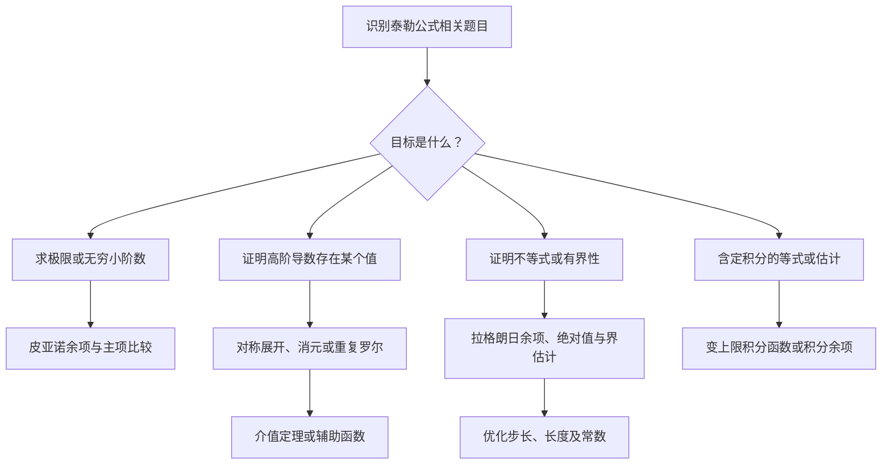

本节的重点不同于第一模块中的泰勒公式求极限。第一模块主要研究局部无穷小量之间的关系，而第三模块第二节更强调利用泰勒公式进行**存在性证明、导数估计、不等式证明以及积分误差估计**。

## 一、核心题型与知识体系

泰勒中值定理的本质是建立函数值、低阶导数和高阶导数之间的联系。

例如：

$$
f(x+h)=f(x)+hf'(x)+\frac{h^2}{2}f''(\xi)
$$

同一个公式可以解决三种方向完全不同的问题：

- 已知函数值和一阶导数，推断某处二阶导数的值。
- 已知函数值和二阶导数，估计一阶导数的大小。
- 已知低阶导数及高阶导数的界，估计函数值的变化。

### 1.1 本节题型总览

| 核心题型           | 代表题目           | 重要程度  |
| -------------- | -------------- | ----- |
| 双端点展开估计导数      | 1996数学一、李林880  | ★★★★★ |
| 对称展开与高阶导数存在性   | 2023真题、1999数学二 | ★★★★★ |
| 极值点展开与导数估计     | 2023真题、李林880   | ★★★★★ |
| 三点插值与误差估计      | 2024真题、李正元     | ★★★★★ |
| 泰勒公式与定积分结合     | 2001数学二、汤家凤模拟卷 | ★★★★★ |
| 函数及高阶导数的有界性    | 李正元、汤家凤模拟卷     | ★★★★☆ |
| 最大值估计与最优常数     | 李林880、汤家凤模拟卷   | ★★★★☆ |
| 三阶余项与辅助函数构造    | 李永乐六套卷         | ★★★★☆ |
| 积分中值点的极限       | 李林六套卷          | ★★★★☆ |
| 泰勒展开、高阶导数与局部性质 | 1996数学二、张宇、李正元 | ★★★★☆ |

这些题型看似不同，实际上主要依赖以下几种思想：

**选择展开中心、消去未知低阶项、利用余项保留高阶导数、控制误差、通过中值定理合并中间点。**

掌握这些思想比背诵具体题目的辅助函数更重要。

## 二、基础知识：从直观理解到严格公式

### 2.1 为什么需要泰勒公式？

假设函数 $f(x)$ 在 $x_0$ 附近足够光滑。

最简单的近似是用一个常数代替函数：

$$
f(x)\approx f(x_0)
$$

但它没有考虑函数的变化趋势。

进一步用切线进行近似：

$$
f(x)\approx f(x_0)+f'(x_0)(x-x_0)
$$

这考虑了函数的一阶变化，却没有考虑曲线弯曲的程度。

再加入二阶项：

$$
f(x)\approx f(x_0)+f'(x_0)(x-x_0) +\frac{f''(x_0)}{2}(x-x_0)^2
$$

便可以进一步描述函数的弯曲程度。

继续加入高阶项，就得到泰勒多项式。

一般地，记 $h=x-x_0$，则

$$
P_n(x)=\sum_{k=0}^{n} \frac{f^{(k)}(x_0)}{k!}h^k
$$

这里约定 $f^{(0)}=f$。

泰勒多项式具有一个重要性质：

$$
P_n^{(k)}(x_0)=f^{(k)}(x_0), \qquad k=0,1,\ldots,n
$$

即在展开点处，多项式与原函数的函数值以及前 $n$ 阶导数完全一致。

但考研证明题不仅关心近似多项式，更关心：

$$
R_n(x)=f(x)-P_n(x)
$$

这个差值称为**余项**。

### 2.2 带皮亚诺余项的泰勒公式

若 $f$ 在 $x_0$ 处具有 $n$ 阶导数，则当 $x\to x_0$ 时，

$$
\boxed{ f(x)= \sum_{k=0}^{n} \frac{f^{(k)}(x_0)}{k!}(x-x_0)^k +o((x-x_0)^n) }
$$

特别地，二阶公式为

$$
\begin{aligned} f(x_0+h) ={}&f(x_0)+f'(x_0)h\\ &+\frac12f''(x_0)h^2+o(h^2). \end{aligned}
$$

其中

$$
o(h^n)
$$

意味着

$$
\lim_{h\to0}\frac{o(h^n)}{h^n}=0.
$$

它强调的是：余项相对于 $h^n$ 是高阶无穷小。

**主要用途**

计算极限、比较无穷小阶数、确定未知参数、反求某点导数、判断高阶极值，以及研究中值点的极限。

注意：皮亚诺余项是一个**局部渐近结论**，不能直接用于任意固定区间上的定量估计。

### 2.3 带拉格朗日余项的泰勒公式

这是第三模块第二节最重要的公式。

假设 $f$ 在包含 $x_0,x$ 的闭区间上具有直到 $n$ 阶的连续导数，并在相应开区间内具有 $n+1$ 阶导数，则存在介于 $x_0$ 与 $x$ 之间的 $\xi$，使得

$$
\boxed{ f(x)= \sum_{k=0}^{n} \frac{f^{(k)}(x_0)}{k!}(x-x_0)^k +\frac{f^{(n+1)}(\xi)}{(n+1)!} (x-x_0)^{n+1} }
$$

令

$$
\xi=x_0+\theta(x-x_0), \qquad 0<\theta<1
$$

也可以写成

$$
\begin{aligned} f(x_0+h) ={}&\sum_{k=0}^{n} \frac{f^{(k)}(x_0)}{k!}h^k\\ &+\frac{f^{(n+1)}(x_0+\theta h)} {(n+1)!}h^{n+1}. \end{aligned}
$$

**必须熟练掌握的三个低阶公式**

**零阶泰勒公式：**

$$
\boxed{f(x+h)=f(x)+hf'(\xi)}
$$

这实际上就是拉格朗日中值定理。

**一阶泰勒公式，带二阶余项：**

$$
\boxed{ f(x+h)=f(x)+hf'(x) +\frac{h^2}{2}f''(\xi) }
$$

这是本节出现频率最高的公式。

**二阶泰勒公式，带三阶余项：**

$$
\boxed{ \begin{aligned} f(x+h)={}&f(x)+hf'(x) +\frac{h^2}{2}f''(x)\\ &+\frac{h^3}{6}f'''(\xi) \end{aligned} }
$$

常用于三阶导数存在性证明和高阶误差估计。

<Callout type="warn" title="关于公式阶数的易错点">

带二阶导数余项的公式，严格来说是一阶泰勒多项式加拉格朗日余项。

一些辅导资料也把它简称为“二阶泰勒展开”。考试时直接写出完整公式最稳妥，不必纠结简称。

</Callout>

### 2.4 两种余项的本质区别

| 比较项目   | 皮亚诺余项              | 拉格朗日余项                                      |
| ------ | ------------------ | ------------------------------------------- |
| 形式     | $o(h^n)$       | $\dfrac{f^{(n+1)}(\xi)}{(n+1)!}h^{n+1}$ |
| 关注重点   | 局部渐近阶数             | 精确等式与误差                                     |
| 导数要求   | 展开点处具有 $n$ 阶导数 | 区间内具有 $n+1$ 阶导数等                        |
| 求极限    | 非常适合               | 可以使用                                        |
| 存在性证明  | 通常不适合              | 非常适合                                        |
| 全区间不等式 | 通常不适合              | 非常适合                                        |
| 导数有界性  | 通常不适合              | 非常适合                                        |

**选择口诀：求极限用皮亚诺，证明存在与估计用拉格朗日。**

这不是绝对规则，但足以帮助你快速识别大多数题型。

### 2.5 带积分余项的泰勒公式（强化知识）

若 $f\in C^{n+1}$，则

$$
\boxed{ f(x)=P_n(x)+ \frac1{n!}\int_{x_0}^{x} (x-t)^n f^{(n+1)}(t)\,dt }
$$

本节最有用的是一阶形式：

$$
\boxed{ f(x)=f(x_0)+f'(x_0)(x-x_0) +\int_{x_0}^{x}(x-t)f''(t)\,dt }
$$

它可以直接通过分部积分得到：

$$
\begin{aligned} \int_{x_0}^{x}(x-t)f''(t)\,dt &=\left[(x-t)f'(t)\right]_{x_0}^{x}\\ &\quad+\int_{x_0}^{x}f'(t)\,dt\\ &=-(x-x_0)f'(x_0)\\ &\quad+f(x)-f(x_0). \end{aligned}
$$

移项即可。

积分余项不是本节必须额外背诵的复杂定理，但对于积分型证明题非常有价值。

尤其当题目出现

$$
\exists \xi,\qquad f''(\xi)=C\int_a^bf(x)\,dx
$$

这种结论时，积分余项往往能够自然地把问题转化为加权积分中值定理。

## 三、泰勒公式为什么成立：辅助函数构造的本质

这一部分不只是理论证明，它本身就是后面解决创新证明题的重要方法。

设

$$
P_n(t)=\sum_{k=0}^{n} \frac{f^{(k)}(a)}{k!}(t-a)^k
$$

希望证明

$$
f(b)-P_n(b) =\frac{f^{(n+1)}(\xi)}{(n+1)!}(b-a)^{n+1}.
$$

先引入未知常数

$$
K=\frac{f(b)-P_n(b)}{(b-a)^{n+1}}
$$

构造

$$
H(t)=f(t)-P_n(t)-K(t-a)^{n+1}.
$$

根据构造，有

$$
H(a)=H(b)=0.
$$

同时，泰勒多项式的性质保证

$$
H'(a)=H''(a)=\cdots=H^{(n)}(a)=0.
$$

对 $H$ 在 $[a,b]$ 上应用罗尔定理，得到某个内部零点

$$
H'(\xi_1)=0.
$$

再结合 $H'(a)=0$，对 $H'$ 使用罗尔定理。

如此重复，最终得到

$$
H^{(n+1)}(\xi)=0.
$$

而

$$
H^{(n+1)}(t) =f^{(n+1)}(t)-(n+1)!K.
$$

所以

$$
K=\frac{f^{(n+1)}(\xi)}{(n+1)!}.
$$

代回 $K$ 的定义便得到泰勒公式。

### 3.1 这一证明带来的通用思想

看到目标

$$
\exists\xi,\qquad f^{(n)}(\xi)=C
$$

其中 $C$ 由已知函数值、导数值或积分决定，可以尝试：

$$
H(x)=f(x)-P(x)
$$

令多项式 $P$ 的 $n$ 阶导数等于常数 $C$，然后利用已知条件使 $H$ 具有足够多的零点，重复应用罗尔定理。

这就是后面三点插值题、三阶余项构造题的共同来源。

**泰勒公式并不是孤立的公式，它本身也是罗尔定理反复使用后的结果。**

## 四、解题前最重要的四项决策

### 4.1 如何选择展开中心？

展开中心并非固定为 $0$。

| 题目提供的条件                 | 优先选择的展开中心   | 原因            |
| ----------------------- | ----------- | ------------- |
| 给出 $f(0),f'(0)$ 等条件 | $0$     | 已知系数多         |
| 出现 $f(a)+f(-a)$     | $0$     | 相加消去奇次项       |
| 出现 $f(a)-f(-a)$     | $0$     | 相减消去偶次项       |
| 出现内部极值点 $c$         | $c$     | $f'(c)=0$ |
| 要证明任意点 $c$ 处导数有界    | $c$     | 直接产生目标导数      |
| 已知两个端点函数值               | 目标点或端点      | 利用双端展开消元      |
| 区间无界且要求导数有界             | 任意点 $x$ | 可引入自由步长       |
| 出现对称积分                  | 区间中点        | 奇函数积分为零       |

选择展开中心的根本原则：

> 让已知条件尽可能多地消去泰勒多项式中的低阶未知项，使目标高阶导数自然保留下来。

### 4.2 如何决定展开到几阶？

如果要证明某点的 $f''(\xi)$，通常保留二阶导数作为拉格朗日余项：

$$
f(x)=f(c)+f'(c)(x-c) +\frac{f''(\xi)}2(x-c)^2.
$$

如果目标是 $f'''(\xi)$，通常保留三阶余项：

$$
\begin{aligned} f(x)={}&f(c)+f'(c)(x-c)\\ &+\frac{f''(c)}2(x-c)^2 +\frac{f'''(\xi)}6(x-c)^3. \end{aligned}
$$

**目标是几阶导数，就优先让几阶导数出现在余项中。**

### 4.3 如何处理两个不同的中值点？

假设推导得到

$$
\frac{f''(\xi_1)+f''(\xi_2)}2=C.
$$

这不能直接说明

$$
f''(\xi_1)=f''(\xi_2)=C.
$$

但如果 $f''$ 连续，由介值定理可以得到

$$
\exists \xi,\qquad f''(\xi)=C.
$$

更一般地，若

$$
\lambda,\mu\ge0,\qquad \lambda+\mu>0
$$

则

$$
\frac{\lambda f''(\xi_1)+\mu f''(\xi_2)} {\lambda+\mu}
$$

位于两个导数值之间。

这就是加权平均合并中值点的思想。

若 $f''$ 不一定连续，导数仍具有介值性（达布性质），但在考研常规证明中，更推荐采用重复罗尔定理的方式，避免直接使用非基本教材定理。

### 4.4 如何快速确定证明方向？

下面按照这些核心母题逐一深入讲解。

## 五、母题一：双端点泰勒展开与一阶导数估计

**重要程度：★★★★★**

这是本节最基础、最值得反复练习的一类证明题。

### 5.1 经典真题：1996年考研数学一

李林880第二章亦有同类模型。

设 $f$ 在 $[0,1]$ 上具有二阶导数，且

$$
|f(x)|\le a,\qquad |f''(x)|\le b
$$

其中 $a,b\ge0$。

证明：对任意 $c\in(0,1)$，有

$$
\boxed{|f'(c)|\le2a+\frac b2}.
$$

<Steps>

<Step>

### 第一步：识别题型 [!toc]

已知：

$$
f(x),\quad f''(x)
$$

要求控制：

$$
f'(c).
$$

这种已知零阶、二阶信息，求一阶信息的题目，称为**中间阶导数估计问题**。

直接使用拉格朗日中值定理，只能得到某一点的导数等于差商，不能控制指定点 $c$ 的导数。

因此，应当在 $c$ 处展开。

</Step>

<Step>

### 第二步：分别向两个端点展开 [!toc]

取展开中心为 $c$。

在 $x=0$ 处：

$$
f(0)=f(c)-cf'(c) +\frac{c^2}{2}f''(\xi_1)
$$

其中

$$
\xi_1\in(0,c).
$$

在 $x=1$ 处：

$$
f(1)=f(c)+(1-c)f'(c) +\frac{(1-c)^2}{2}f''(\xi_2)
$$

其中

$$
\xi_2\in(c,1).
$$

</Step>

<Step>

### 第三步：两式相减消元 [!toc]

$$
\begin{aligned} f(1)-f(0) ={}&f'(c)+\frac{(1-c)^2}{2}f''(\xi_2)\\ &-\frac{c^2}{2}f''(\xi_1). \end{aligned}
$$

整理：

$$
\begin{aligned} f'(c) ={}&f(1)-f(0)\\ &-\frac{(1-c)^2}{2}f''(\xi_2) +\frac{c^2}{2}f''(\xi_1). \end{aligned}
$$

关键在于：

$$
(1-c)+c=1.
$$

通过两端点相减，既消去了 $f(c)$，又使目标导数的系数变成常数。

</Step>

<Step>

### 第四步：利用绝对值估计 [!toc]

$$
\begin{aligned} |f'(c)| &\le |f(1)|+|f(0)|\\ &\quad+\frac{(1-c)^2}{2}|f''(\xi_2)|\\ &\quad+\frac{c^2}{2}|f''(\xi_1)|\\ &\le2a+\frac b2[(1-c)^2+c^2]. \end{aligned}
$$

由于

$$
c^2+(1-c)^2 =1-2c(1-c)\le1,
$$

所以

$$
\boxed{|f'(c)|\le2a+\frac b2}.
$$

证毕。

</Step>

</Steps>

### 5.2 为什么不只向一个端点展开？

如果只向 $0$ 展开，就会得到

$$
f'(c)=\frac{f(c)-f(0)}c +\frac c2f''(\xi_1).
$$

从而

$$
|f'(c)|\le\frac{2a}{c}+\frac{bc}{2}.
$$

但是当 $c\to0^+$ 时，

$$
\frac{2a}{c}
$$

可能趋于无穷大，无法得到题目要求的统一上界。

因此，本题真正的难点不是写出泰勒公式，而是意识到：

**单侧展开会产生不稳定的分母，双侧展开可以把分母变为固定的区间长度。**

### 5.3 母题推广：任意闭区间上的导数估计

若 $f$ 在 $[a,b]$ 上二阶可导，并且

$$
|f(x)|\le M,\qquad |f''(x)|\le N,
$$

则对任意 $c\in(a,b)$，有

$$
\boxed{ |f'(c)|\le \frac{2M}{b-a}+\frac N2(b-a) }.
$$

推导过程与真题完全相同。

在 $c$ 处向两端展开：

$$
f(a)=f(c)+(a-c)f'(c) +\frac{(a-c)^2}{2}f''(\xi_1),
$$

$$
f(b)=f(c)+(b-c)f'(c) +\frac{(b-c)^2}{2}f''(\xi_2).
$$

相减得到更精确的估计：

$$
\boxed{ |f'(c)|\le \frac{|f(b)-f(a)|}{b-a} + \frac{N[(c-a)^2+(b-c)^2]}{2(b-a)} }.
$$

利用

$$
(c-a)^2+(b-c)^2\le(b-a)^2
$$

即可得到一般结论。

**如何迁移到创新题？**

如果以后题目不再直接给出 $|f(x)|\le M$，而是给出端点函数值、函数的振幅或者最大值与最小值，仍可使用这一公式。

因为真正需要控制的只是

$$
|f(b)-f(a)|.
$$

甚至不必知道整个区间上 $f$ 的绝对值上界。

## 六、母题二：对称泰勒展开与高阶导数存在性

**重要程度：★★★★★**

这是2023年真题的核心思想，也是非常容易改编成新题的模型。

### 6.1 对称展开的一般规律

设以 $c$ 为中心，向左右距离相等的两个点展开：

$$
\begin{aligned} f(c+h) ={}&f(c)+hf'(c) +\frac{h^2}{2}f''(c)+\cdots,\\ f(c-h) ={}&f(c)-hf'(c) +\frac{h^2}{2}f''(c)-\cdots. \end{aligned}
$$

观察符号变化：

| 项目  | 右侧展开                    | 左侧展开                     |
| --- | ----------------------- | ------------------------ |
| 常数项 | $f(c)$              | $f(c)$               |
| 一阶项 | $hf'(c)$            | $-hf'(c)$            |
| 二阶项 | $\frac12h^2f''(c)$  | $\frac12h^2f''(c)$   |
| 三阶项 | $\frac16h^3f'''(c)$ | $-\frac16h^3f'''(c)$ |

因此：

相加消去奇次项；相减消去偶次项。

这是对称泰勒展开最重要的识别规律。

### 6.2 重点真题：2023年考研数学一，第（1）问

汤家凤八套卷第二套第18题第（1）问为同类模型。

设 $a>0$，函数 $f$ 在 $[-a,a]$ 上具有二阶连续导数，且

$$
f(0)=0.
$$

证明存在 $\xi\in(-a,a)$，使

$$
\boxed{ f''(\xi)=\frac{f(a)+f(-a)}{a^2} }.
$$

**审题分析**

目标是某点的二阶导数值，而且已知条件出现对称端点。

立即想到：

以 $0$ 为中心，分别向 $a,-a$ 展开，并通过相加消去未知的 $f'(0)$。

**标准解法**

由泰勒公式，存在

$$
\xi_1\in(0,a),\qquad \xi_2\in(-a,0)
$$

使

$$
f(a)=af'(0)+\frac{a^2}{2}f''(\xi_1),
$$

$$
f(-a)=-af'(0)+\frac{a^2}{2}f''(\xi_2).
$$

两式相加：

$$
f(a)+f(-a) =\frac{a^2}{2}[f''(\xi_1)+f''(\xi_2)].
$$

所以

$$
\frac{f(a)+f(-a)}{a^2} =\frac{f''(\xi_1)+f''(\xi_2)}2.
$$

由于 $f''$ 连续，右端平均值介于

$$
f''(\xi_1),\quad f''(\xi_2)
$$

之间。

由介值定理，存在

$$
\xi\in[\xi_2,\xi_1]\subset(-a,a)
$$

使

$$
\boxed{ f''(\xi)=\frac{f(a)+f(-a)}{a^2} }.
$$

**这道题的得分关键**

真正需要写清楚的是最后一步。

两个不同的中值点经过平均得到一个新数值，必须利用连续性及介值定理，才能转化为某一个点的导数值。

不能未经证明就把 $\xi_1,\xi_2$ 合并成同一个 $\xi$。

### 6.3 重要推广：中心二阶差分公式

将上题中的 $f(0)=0$ 去掉，以任意点 $c$ 为中心，可以得到：

$$
\boxed{ f(c+h)+f(c-h)-2f(c) =h^2f''(\xi) }
$$

其中

$$
\xi\in(c-h,c+h).
$$

这称为中心二阶差分的中值公式。

在一般区间上，令

$$
c=\frac{a+b}{2}, \qquad h=\frac{b-a}{2},
$$

便得到李正元第五章第12题，即核心模型007：

$$
\boxed{ f(a)+f(b)-2f\left(\frac{a+b}{2}\right) =\frac{(b-a)^2}{4}f''(\xi) }.
$$

值得注意的是，李正元这道题只要求函数在闭区间连续、开区间二阶可导，并没有要求 $f''$ 连续。

因此，更通用的解法是三点插值加罗尔定理，后面会详细讲解。

**中心二阶差分与凹凸性的联系**

如果

$$
f''(x)\ge0,
$$

那么

$$
f(c+h)+f(c-h)-2f(c)\ge0,
$$

即

$$
\boxed{ f(c)\le\frac{f(c+h)+f(c-h)}2 }.
$$

反过来，若任意点 $c$ 和适当小的正数 $h$ 都满足上述不等式，则由皮亚诺余项公式：

$$
f(c+h)+f(c-h)-2f(c) =h^2f''(c)+o(h^2).
$$

两边除以 $h^2$，令 $h\to0$，得到

$$
f''(c)\ge0.
$$

这正是张宇1000题中值定理章节第37题所考查的充要条件证明。

它说明了一个重要思想：同一个泰勒公式，可以把局部二阶导数信息转化成函数图像的整体性质，也可以反向推导。

### 6.4 进阶真题：1999年考研数学二

核心模型003。

设 $f$ 在 $[-1,1]$ 上具有三阶连续导数，且

$$
f(-1)=0,\qquad f(1)=1,\qquad f'(0)=0.
$$

证明存在

$$
\xi\in(-1,1)
$$

使

$$
\boxed{f'''(\xi)=3}.
$$

**分析**

目标变成三阶导数，因而应该保留三阶余项。

这次不能相加，因为三阶项是奇次项。相加会导致需要的三阶余项形成差，而相减才会使两个三阶余项具有同号系数。

**解答**

分别在 $0$ 处展开：

$$
\begin{aligned} f(1) ={}&f(0)+f'(0)+\frac12f''(0)\\ &+\frac16f'''(\xi_1), \end{aligned}
$$

$$
\begin{aligned} f(-1) ={}&f(0)-f'(0)+\frac12f''(0)\\ &-\frac16f'''(\xi_2), \end{aligned}
$$

其中

$$
\xi_1\in(0,1),\qquad \xi_2\in(-1,0).
$$

两式相减，结合 $f'(0)=0$：

$$
1=\frac16[f'''(\xi_1)+f'''(\xi_2)].
$$

即

$$
\frac{f'''(\xi_1)+f'''(\xi_2)}2=3.
$$

由 $f'''$ 的连续性及介值定理，存在

$$
\xi\in(-1,1)
$$

使得

$$
\boxed{f'''(\xi)=3}.
$$

### 6.5 三阶对称差分的通用公式

更一般地，如果函数具有三阶连续导数，则

$$
\boxed{ f(c+h)-f(c-h)-2hf'(c) =\frac{h^3}{3}f'''(\xi) }
$$

其中 $\xi\in(c-h,c+h)$。

二阶差分与三阶差分可以对照记忆：

$$
\boxed{ f(c+h)+f(c-h)-2f(c) =h^2f''(\xi) }
$$

$$
\boxed{ f(c+h)-f(c-h)-2hf'(c) =\frac{h^3}{3}f'''(\eta) }
$$

前者是偶对称，后者是奇对称。

这两个公式不用单独死记。只要掌握双侧展开和奇偶项消元，考试时都可以迅速推导出来。

## 七、母题三：极值点展开与导数定量估计

**重要程度：★★★★★**

### 7.1 重点真题：2023年考研数学一，第（2）问

设 $f$ 在 $[-a,a]$ 上具有二阶连续导数，并在 $(-a,a)$ 内取得极值。

证明存在 $\eta\in(-a,a)$，使得

$$
\boxed{ |f''(\eta)|\ge \frac{|f(a)-f(-a)|}{2a^2} }.
$$

注意：本问不需要第（1）问的 $f(0)=0$ 条件。

<Steps>

<Step>

### 第一步：将极值条件转化为导数条件 [!toc]

设 $c\in(-a,a)$ 为极值点。

由费马定理：

$$
f'(c)=0.
$$

看到极值点时，必须首先想到这个条件。

</Step>

<Step>

### 第二步：以极值点为展开中心 [!toc]

向左右端点展开：

$$
f(a)=f(c)+\frac12f''(\eta_1)(a-c)^2,
$$

$$
f(-a)=f(c)+\frac12f''(\eta_2)(a+c)^2,
$$

其中

$$
\eta_1\in(c,a),\qquad \eta_2\in(-a,c).
$$

因为 $f'(c)=0$，一阶项自动消失。

</Step>

<Step>

### 第三步：相减并进行绝对值估计 [!toc]

$$
\begin{aligned} f(a)-f(-a) ={}&\frac12f''(\eta_1)(a-c)^2\\ &-\frac12f''(\eta_2)(a+c)^2. \end{aligned}
$$

所以

$$
\begin{aligned} |f(a)-f(-a)| &\le\frac12|f''(\eta_1)|(a-c)^2\\ &\quad+\frac12|f''(\eta_2)|(a+c)^2. \end{aligned}
$$

令

$$
M=\max\{|f''(\eta_1)|,|f''(\eta_2)|\}.
$$

则

$$
\begin{aligned} |f(a)-f(-a)| &\le\frac M2[(a-c)^2+(a+c)^2]\\ &=M(a^2+c^2). \end{aligned}
$$

由于

$$
|c|<a,
$$

有

$$
a^2+c^2\le2a^2.
$$

因此

$$
|f(a)-f(-a)|\le2Ma^2,
$$

即

$$
M\ge\frac{|f(a)-f(-a)|}{2a^2}.
$$

在 $\eta_1,\eta_2$ 中选取使绝对值较大的那个点作为 $\eta$，即可得到

$$
\boxed{ |f''(\eta)|\ge \frac{|f(a)-f(-a)|}{2a^2} }.
$$

</Step>

</Steps>

**为什么这里不用介值定理？**

上一问是等式：

$$
f''(\xi)=C.
$$

本问是不等式：

$$
|f''(\eta)|\ge C.
$$

要求不同，处理方法也不同。

本问只要证明两个中值点中至少有一个的二阶导数绝对值足够大，就已经满足结论。

因此应当取最大值，而不是强行合并为平均值。

### 7.2 一般区间推广

若 $f$ 在 $[u,v]$ 上二阶可导，且在内部存在驻点

$$
f'(c)=0,\qquad c\in(u,v),
$$

同理可证，存在 $\eta\in(u,v)$，使

$$
\boxed{ |f''(\eta)|\ge \frac{2|f(v)-f(u)|} {(c-u)^2+(v-c)^2} }.
$$

由于

$$
(c-u)^2+(v-c)^2\le(v-u)^2,
$$

进一步有

$$
\boxed{ |f''(\eta)|\ge \frac{2|f(v)-f(u)|}{(v-u)^2} }.
$$

当 $u=-a,v=a$ 时，便退化为2023年真题的结论。

### 7.3 李林880母题：极值点与端点导数

对应李林880第二章第46题、核心模型009。

设 $f$ 在 $[0,1]$ 上二阶可导，且

$$
|f''(x)|\le1.
$$

若 $f$ 在 $(0,1)$ 内取得最小值，证明

$$
\boxed{|f'(0)|+|f'(1)|\le1}.
$$

**思路**

目标是两个一阶导数，而不是两个函数值。

因此不必对 $f$ 使用二阶泰勒公式，直接对 $f'$ 使用拉格朗日中值定理更简单。

设极小值点为 $c$，则

$$
f'(c)=0.
$$

由中值定理：

$$
f'(0)-f'(c)=-cf''(\xi_1),
$$

$$
f'(1)-f'(c)=(1-c)f''(\xi_2).
$$

所以

$$
|f'(0)|\le c,\qquad |f'(1)|\le1-c.
$$

两式相加：

$$
\boxed{|f'(0)|+|f'(1)|\le1}.
$$

**母题提炼：导数锚点**

若

$$
|f''(x)|\le M,
$$

由拉格朗日中值定理立即得到

$$
\boxed{ |f'(x)-f'(y)|\le M|x-y| }.
$$

如果又知道某一点 $c$ 处

$$
f'(c)=0,
$$

则

$$
\boxed{|f'(x)|\le M|x-c|}.
$$

这说明二阶导数的界控制了一阶导数的变化速度，而驻点为这种变化提供了起始值。

进一步使用泰勒公式，可以得到

$$
\boxed{ |f(x)-f(c)|\le\frac M2(x-c)^2 }.
$$

把这两个公式联系起来：

$$
\text{已知驻点与二阶导数界}
$$

便可以同时控制一阶导数及函数值。

## 八、母题四：三点插值、线性插值误差与2024年真题

**重要程度：★★★★★**

这一部分是本节非常重要的综合证明模型。其价值在于，可以把泰勒定理、罗尔定理和积分估计统一起来。

### 8.1 核心知识：什么是线性插值误差？

设 $a<b$，连接曲线上两个点

$$
(a,f(a)),\qquad (b,f(b))
$$

得到一条直线。

直线方程为

$$
\boxed{ L(x)=\frac{b-x}{b-a}f(a) +\frac{x-a}{b-a}f(b) }.
$$

它具有两个性质：

$$
L(a)=f(a),\qquad L(b)=f(b).
$$

函数

$$
E(x)=f(x)-L(x)
$$

描述原函数图像与两端点连线之间的竖直偏差。

因此

$$
E(a)=E(b)=0, \qquad E''(x)=f''(x).
$$

我们希望利用二阶导数的信息来控制这种偏差。

### 8.2 重点真题：2024年考研数学一

设 $f$ 二阶可导，满足

$$
f'(0)=f'(1),\qquad |f''(x)|\le1.
$$

证明：

（1）当 $0<x<1$ 时，

$$
\boxed{ |f(x)-(1-x)f(0)-xf(1)| \le\frac{x(1-x)}2 }.
$$

（2）

$$
\boxed{ \left|\int_0^1f(x)\,dx -\frac{f(0)+f(1)}2\right| \le\frac1{12} }.
$$

条件 $f'(0)=f'(1)$ 对这两个上界并不是必需的，以下证明可在更弱的条件下完成。

<Tabs items={["解法一：直接泰勒展开法", "解法二：三点零值辅助函数法"]} defaultIndex={0}>

<Tab value="解法一：直接泰勒展开法">

这是最值得优先掌握的方法。

固定 $x\in(0,1)$，以 $x$ 为中心向 $0,1$ 展开：

$$
f(0)=f(x)-xf'(x) +\frac{x^2}{2}f''(\xi_1),
$$

$$
f(1)=f(x)+(1-x)f'(x) +\frac{(1-x)^2}{2}f''(\xi_2).
$$

观察目标式含有

$$
(1-x)f(0)+xf(1).
$$

因此，把第一式乘以 $1-x$，第二式乘以 $x$，然后相加。

得到

$$
\begin{aligned} &(1-x)f(0)+xf(1)\\ ={}&f(x) +\frac{(1-x)x^2}{2}f''(\xi_1)\\ &+\frac{x(1-x)^2}{2}f''(\xi_2). \end{aligned}
$$

其中一阶导数项恰好抵消：

$$
-(1-x)xf'(x)+x(1-x)f'(x)=0.
$$

于是

$$
\begin{aligned} &f(x)-(1-x)f(0)-xf(1)\\ ={}&-\frac{x(1-x)}2 [xf''(\xi_1)+(1-x)f''(\xi_2)]. \end{aligned}
$$

利用

$$
|f''(\xi_1)|\le1,\qquad |f''(\xi_2)|\le1,
$$

得到

$$
\begin{aligned} &|f(x)-(1-x)f(0)-xf(1)|\\ &\le\frac{x(1-x)}2[x+(1-x)]\\ &=\frac{x(1-x)}2. \end{aligned}
$$

第（1）问得证。

</Tab>

<Tab value="解法二：三点零值辅助函数法">

这一方法的推广价值更高。

记

$$
L(t)=(1-t)f(0)+tf(1).
$$

对于固定的 $x\in(0,1)$，定义

$$
K=\frac{f(x)-L(x)}{x(x-1)}.
$$

构造辅助函数

$$
\boxed{ H(t)=f(t)-L(t)-Kt(t-1) }.
$$

为什么这样构造？

因为 $t(t-1)$ 在 $0,1$ 处为零，不会破坏端点条件。再通过 $K$ 的定义，使第三个点 $x$ 也成为零点。

所以

$$
H(0)=H(x)=H(1)=0.
$$

分别在 $[0,x]$ 和 $[x,1]$ 上使用罗尔定理，存在

$$
u\in(0,x),\qquad v\in(x,1)
$$

使

$$
H'(u)=H'(v)=0.
$$

再次使用罗尔定理，存在

$$
\xi\in(u,v)
$$

使

$$
H''(\xi)=0.
$$

而

$$
H''(t)=f''(t)-2K,
$$

所以

$$
K=\frac12f''(\xi).
$$

代回 $K$ 的定义，得到精确恒等式：

$$
\boxed{ f(x)-L(x)=\frac12f''(\xi)x(x-1) }.
$$

取绝对值：

$$
|f(x)-L(x)| \le\frac12x(1-x).
$$

证毕。

这一解法不需要假设 $f''$ 连续，只要满足相应的连续、二阶可导条件，就能通过罗尔定理保证中值点的存在。

</Tab>

</Tabs>

### 8.3 第（2）问：将点态误差转化为积分误差

因为

$$
L(x)=(1-x)f(0)+xf(1),
$$

有

$$
\int_0^1L(x)\,dx =\frac{f(0)+f(1)}2.
$$

于是

$$
\begin{aligned} &\left|\int_0^1f(x)\,dx -\frac{f(0)+f(1)}2\right|\\ ={}&\left|\int_0^1[f(x)-L(x)]\,dx\right|\\ \le{}&\int_0^1|f(x)-L(x)|\,dx\\ \le{}&\frac12\int_0^1x(1-x)\,dx\\ ={}&\frac12\left(\frac12-\frac13\right)\\ ={}&\frac1{12}. \end{aligned}
$$

所以

$$
\boxed{ \left|\int_0^1f(x)\,dx -\frac{f(0)+f(1)}2\right| \le\frac1{12} }.
$$

证毕。

**这道真题为什么特别重要？**

因为它展示了一条完整的证明链：

$$
\begin{gathered} \text{二阶导数有界}\\ \Downarrow\\ \text{函数与端点连线的偏差有界}\\ \Downarrow\\ \text{定积分与梯形面积的偏差有界} \end{gathered}
$$

今后看到积分误差估计、曲线面积估计或者插值问题，都可以尝试这条路径。

### 8.4 一般区间的线性插值余项公式

把2024年真题推广到 $[a,b]$，得到

$$
\boxed{ f(x)-L(x)= \frac{f''(\xi)}2(x-a)(x-b) }
$$

其中

$$
L(x)= \frac{b-x}{b-a}f(a) +\frac{x-a}{b-a}f(b),
$$

且

$$
\xi\in(a,b).
$$

若

$$
|f''(x)|\le M,
$$

则

$$
\boxed{ |f(x)-L(x)| \le\frac M2(x-a)(b-x) }.
$$

这是一个非常实用的母公式。

**推论一：最大插值误差**

由

$$
(x-a)(b-x)\le\frac{(b-a)^2}{4},
$$

得到

$$
\boxed{ \max_{[a,b]}|f(x)-L(x)| \le\frac M8(b-a)^2 }.
$$

**推论二：梯形求积误差**

对上式积分：

$$
\begin{aligned} &\left|\int_a^bf(x)\,dx -\frac{b-a}{2}[f(a)+f(b)]\right|\\ &\le\frac M2\int_a^b(x-a)(b-x)\,dx. \end{aligned}
$$

令 $h=b-a$，可算得

$$
\int_a^b(x-a)(b-x)\,dx=\frac{h^3}{6}.
$$

因此

$$
\boxed{ \left|\int_a^bf(x)\,dx -\frac{b-a}{2}[f(a)+f(b)]\right| \le\frac{M(b-a)^3}{12} }.
$$

**推论三：凹凸性与割线**

当

$$
f''(x)\ge0
$$

时，因为

$$
(x-a)(x-b)\le0,
$$

所以

$$
f(x)\le L(x).
$$

即函数图像位于两端点连线下方。

若 $f''(x)\le0$，则结论反向。

这与第二模块中的凹凸性知识形成了直接联系。

### 8.5 李正元母题：不要求二阶导数连续的中心差分

设 $f$ 在 $[a,b]$ 上连续、在 $(a,b)$ 内二阶可导。证明

$$
f(a)+f(b)-2f\left(\frac{a+b}2\right) =\frac{(b-a)^2}{4}f''(\xi).
$$

令

$$
m=\frac{a+b}{2}.
$$

由线性插值余项，

$$
f(m)-L(m) =\frac12f''(\xi)(m-a)(m-b).
$$

而

$$
L(m)=\frac{f(a)+f(b)}2
$$

以及

$$
(m-a)(m-b)=-\frac{(b-a)^2}{4}.
$$

所以

$$
f(m)-\frac{f(a)+f(b)}2 =-\frac{(b-a)^2}{8}f''(\xi).
$$

整理得

$$
\boxed{ f(a)+f(b)-2f(m) =\frac{(b-a)^2}{4}f''(\xi) }.
$$

同一个母公式，又解决了一道独立的李正元练习题。

## 九、母题五：泰勒公式与定积分结合

**重要程度：★★★★★**

积分与泰勒公式相结合，是本节常见的综合证明方向。

主要有两条思路：构造变上限积分函数，把积分转化为端点函数值之差；或者直接使用积分余项，把原函数的积分转化为高阶导数的加权积分。

### 9.1 经典真题：2001年考研数学二

汤家凤八套卷第七套第18题是取 $a=1$ 后的同类题。

设 $a>0$，函数 $f$ 在 $[-a,a]$ 上具有二阶连续导数，且

$$
f(0)=0.
$$

（1）写出 $f(x)$ 带拉格朗日余项的一阶麦克劳林公式。

（2）证明存在 $\eta\in(-a,a)$，使

$$
\boxed{ a^3f''(\eta)=3\int_{-a}^{a}f(x)\,dx }.
$$

**第（1）问**

直接使用泰勒公式：

$$
\boxed{ f(x)=xf'(0)+\frac{x^2}{2}f''(\xi_x) }
$$

其中 $x\ne0$ 时，$\xi_x$ 介于 $0,x$ 之间。

第（1）问比较简单，但第（2）问存在一个重要陷阱。

<Tabs items={["解法一：构造变上限积分函数（考场首选）", "解法二：泰勒积分余项法"]} defaultIndex={0}>

<Tab value="解法一：构造变上限积分函数（考场首选）">

令

$$
F(x)=\int_0^xf(t)\,dt.
$$

则

$$
F'(x)=f(x),
$$

$$
F''(x)=f'(x),
$$

$$
F'''(x)=f''(x).
$$

根据已知条件，

$$
F(0)=0,\qquad F'(0)=f(0)=0.
$$

并且

$$
\int_{-a}^{a}f(x)\,dx=F(a)-F(-a).
$$

因此，题目已经从积分存在性证明转化为

$$
\boxed{ F(a)-F(-a)=\frac{a^3}{3}F'''(\eta) }.
$$

发现了吗？这正是前面1999年真题所对应的三阶对称差分模型。

对 $F$ 在 $0$ 处展开：

$$
F(a)=\frac{a^2}{2}f'(0) +\frac{a^3}{6}f''(\xi_1),
$$

$$
F(-a)=\frac{a^2}{2}f'(0) -\frac{a^3}{6}f''(\xi_2).
$$

两式相减：

$$
\int_{-a}^{a}f(x)\,dx =\frac{a^3}{6} [f''(\xi_1)+f''(\xi_2)].
$$

即

$$
\frac3{a^3}\int_{-a}^{a}f(x)\,dx =\frac{f''(\xi_1)+f''(\xi_2)}2.
$$

由连续性及介值定理，存在

$$
\eta\in(-a,a)
$$

使得

$$
\boxed{ a^3f''(\eta)=3\int_{-a}^{a}f(x)\,dx }.
$$

</Tab>

<Tab value="解法二：泰勒积分余项法">

因为 $f(0)=0$，积分余项公式给出

$$
f(x)=xf'(0)+\int_0^x(x-t)f''(t)\,dt.
$$

分正负半区间积分。

其中一阶项 $xf'(0)$ 是奇函数，在对称区间上的积分为零。

对于正半区间，

$$
\begin{aligned} &\int_0^a\int_0^x(x-t)f''(t)\,dt\,dx\\ ={}&\int_0^a f''(t) \left[\int_t^a(x-t)\,dx\right]dt\\ ={}&\frac12\int_0^a(a-t)^2f''(t)\,dt. \end{aligned}
$$

同理，负半区间为

$$
\frac12\int_{-a}^0(a+t)^2f''(t)\,dt.
$$

合并得到

$$
\boxed{ \int_{-a}^{a}f(x)\,dx =\frac12\int_{-a}^{a} (a-|t|)^2f''(t)\,dt }.
$$

权函数

$$
w(t)=\frac12(a-|t|)^2
$$

在区间上非负，在内部为正。

而

$$
\int_{-a}^{a}w(t)\,dt=\frac{a^3}{3}.
$$

由加权积分中值定理，存在 $\eta\in(-a,a)$，使

$$
\int_{-a}^{a}f(x)\,dx =\frac{a^3}{3}f''(\eta).
$$

证毕。

</Tab>

</Tabs>

### 9.2 为什么不能直接把拉格朗日余项提出积分号？

一种常见错误是：

$$
f(x)=xf'(0)+\frac{x^2}{2}f''(\xi)
$$

然后直接写

$$
\int_{-a}^{a}f(x)\,dx =\frac12f''(\xi)\int_{-a}^{a}x^2\,dx.
$$

这个推导一般不成立。

因为真正的公式是

$$
f(x)=xf'(0)+\frac{x^2}{2}f''(\xi_x).
$$

不同的 $x$ 对应不同的中间点 $\xi_x$，甚至不一定能选择出连续的中值点函数。

因此不能把 $f''(\xi_x)$ 当成与 $x$ 无关的常数。

不过，可以先通过 $f''$ 的上下界控制每个余项，再对不等式积分，最后利用连续性获得中值。这种夹逼方法是合法的。

### 9.3 积分型证明的推广规律

如果题目出现

$$
\int_{-a}^{a}f(x)\,dx
$$

并要求证明某点的 $f^{(n)}(\xi)$，可以尝试令

$$
F(x)=\int_0^xf(t)\,dt.
$$

这样

$$
F^{(n+1)}(x)=f^{(n)}(x),
$$

便可以将积分条件转化为函数值条件，再使用高一阶的泰勒公式。

这是一种非常重要的**升阶转化思想**。

### 9.4 强化拓展：梯形求积的精确余项

上一部分2024年真题得到的是误差上界：

$$
\left|\int_a^bf(x)\,dx -\frac{b-a}{2}[f(a)+f(b)]\right| \le\frac{M(b-a)^3}{12}.
$$

如果 $f''$ 连续，还可以得到精确的中值等式：

$$
\boxed{ \int_a^bf(x)\,dx =\frac{b-a}{2}[f(a)+f(b)] -\frac{(b-a)^3}{12}f''(\xi) }.
$$

其中 $\xi\in(a,b)$。

推导方法是分部积分。

令

$$
w(x)=(x-a)(b-x).
$$

则

$$
w(a)=w(b)=0,\qquad w''(x)=-2.
$$

两次分部积分得到

$$
\begin{aligned} \int_a^bw(x)f''(x)\,dx ={}&(b-a)[f(a)+f(b)]\\ &-2\int_a^bf(x)\,dx. \end{aligned}
$$

从而

$$
\begin{aligned} &\frac{b-a}{2}[f(a)+f(b)] -\int_a^bf(x)\,dx\\ &=\frac12\int_a^bw(x)f''(x)\,dx. \end{aligned}
$$

由于 $w(x)\ge0$，使用加权积分中值定理：

$$
\int_a^bw(x)f''(x)\,dx =f''(\xi)\int_a^bw(x)\,dx.
$$

计算权函数的积分即可得到上述精确公式。

这个推导还为后面的三阶余项模拟题建立了联系。

## 十、母题六：函数与高阶导数有界，证明中间阶导数有界

**重要程度：★★★★☆**

对应核心模型008、李正元第五章第14题，以及汤家凤八套卷第三套第2题。

### 10.1 经典母题

设 $f$ 在 $(0,+\infty)$ 上二阶可导，且 $f(x),f''(x)$ 均有界。

证明 $f'(x)$ 在 $(0,+\infty)$ 上有界。

**思路分析**

与1996年真题相比，这里不再有固定的两个端点。

但正半轴上的任意点 $x$ 都可以向右移动一个单位长度，而不会超出定义域。

因此，应该在 $x$ 处向 $x+1$ 展开。

**基础解法**

设

$$
|f(x)|\le M,\qquad |f''(x)|\le N.
$$

由泰勒公式：

$$
f(x+1)=f(x)+f'(x)+\frac12f''(\xi),
$$

其中

$$
\xi\in(x,x+1).
$$

所以

$$
f'(x)=f(x+1)-f(x)-\frac12f''(\xi).
$$

取绝对值：

$$
|f'(x)| \le2M+\frac N2.
$$

右端与 $x$ 无关，因此

$$
\boxed{f'(x)\text{ 在 }(0,+\infty)\text{ 上有界}}.
$$

如果题目只要求有界性，这样证明已经完全足够。

### 10.2 强化解法：引入自由步长，优化估计

如果题目进一步要求

$$
\boxed{|f'(x)|\le2\sqrt{MN}},
$$

固定步长 $1$ 往往不够。

此时应当引入任意步长

$$
h>0.
$$

在 $x$ 处展开：

$$
f(x+h)=f(x)+hf'(x) +\frac{h^2}{2}f''(\xi).
$$

于是

$$
f'(x)=\frac{f(x+h)-f(x)}h -\frac h2f''(\xi).
$$

因此

$$
\boxed{ |f'(x)|\le\frac{2M}{h}+\frac{Nh}{2} }.
$$

注意这一结论对任意 $h>0$ 均成立。

当 $M,N>0$ 时，令

$$
\varphi(h)=\frac{2M}{h}+\frac{Nh}{2}.
$$

求导：

$$
\varphi'(h)=-\frac{2M}{h^2}+\frac N2.
$$

令 $\varphi'(h)=0$，得到

$$
h=2\sqrt{\frac MN}.
$$

此时

$$
\varphi(h)=2\sqrt{MN}.
$$

所以

$$
\boxed{|f'(x)|\le2\sqrt{MN}}.
$$

也可利用基本不等式确定右端的最小值，再选取使等号成立的步长。

当 $M=0$ 时，$f\equiv0$。

当 $N=0$ 时，$f$ 是一次或常值函数；由于在正半轴上有界，只能为常值函数。

这两种情况下均有

$$
f'\equiv0.
$$

**本题真正值得掌握的思想**

很多估计题会产生

$$
\frac Ah+Bh
$$

这种形式。

通过自由选择 $h$，可以得到比随意取 $h=1$ 更强的结论。

一般地，当 $A,B>0$ 时，

$$
\boxed{ \min_{h>0}\left(\frac Ah+Bh\right) =2\sqrt{AB} }.
$$

泰勒公式中的步长不只是变量，也可以成为求解不等式的优化参数。

### 10.3 模拟选择题：相关性质与反例

来源：汤家凤八套卷第三套第2题。

设 $f$ 在 $(0,+\infty)$ 内二阶连续可导，判断以下结论。

| 命题                                                        | 正误 |
| --------------------------------------------------------- | -- |
| $f(x),f''(x)$ 在 $x\to0^+$ 时均趋于零，则 $f'(x)\to0$ | 错误 |
| $f,f''$ 在正半轴有界，则 $f'$ 有界                          | 正确 |
| $f,f'$ 在 $(0,1)$ 有界，则 $f''$ 有界                | 错误 |
| $f''(x)\to0$ 当 $x\to+\infty$，则 $f,f'$ 有界      | 错误 |

第一项反例：

$$
f(x)=\sin x.
$$

因为

$$
f(x)\to0,\qquad f''(x)\to0,
$$

但

$$
f'(x)=\cos x\to1.
$$

第三项反例：

$$
f(x)=x^{3/2}.
$$

则

$$
f'(x)=\frac32\sqrt{x}, \qquad f''(x)=\frac3{4\sqrt{x}}.
$$

在 $(0,1)$ 上，前两者有界，但二阶导数无界。

第四项可以取

$$
f(x)=x+1.
$$

此时

$$
f''(x)=0,
$$

但 $f(x)$ 在正半轴无界，已足以否定原命题。

### 10.4 更深入的潜在创新题：导数极限

考虑如下推广问题：

若

$$
\lim_{x\to+\infty}f(x)=A, \qquad \lim_{x\to+\infty}f''(x)=0,
$$

证明

$$
\lim_{x\to+\infty}f'(x)=0.
$$

由泰勒公式：

$$
f'(x)=f(x+1)-f(x)-\frac12f''(\xi_x),
$$

其中

$$
x<\xi_x<x+1.
$$

当 $x\to+\infty$ 时，

$$
f(x+1)-f(x)\to0,
$$

且

$$
\xi_x\to+\infty, \qquad f''(\xi_x)\to0.
$$

因此

$$
\boxed{\lim_{x\to+\infty}f'(x)=0}.
$$

更进一步，如果 $f(x)$ 在无穷远处具有有限极限、$f''$ 仅仅有界，同样可以证明 $f'(x)\to0$。

因为对于任意固定 $h>0$，

$$
|f'(x)| \le\frac{|f(x+h)-f(x)|}{h}+\frac{Nh}{2}.
$$

令 $x\to+\infty$，得到

$$
\limsup_{x\to+\infty}|f'(x)| \le\frac{Nh}{2}.
$$

又因为 $h>0$ 可以任意小，所以

$$
\limsup_{x\to+\infty}|f'(x)|=0.
$$

这就是从简单有界性证明迁移到极限证明的典型方式。

## 十一、母题七：最大值估计、最优常数与强化不等式

**重要程度：★★★★☆**

对应汤家凤八套卷第八套第19题、李林880第二章第106题，以及张宇1000题中值定理章节第29题。

### 11.1 重要练习题：函数绝对值的最大值

设 $f\in C^2[a,b]$，且

$$
f(a)=f(b)=0.
$$

记

$$
M=\max_{a\le x\le b}|f''(x)|.
$$

证明

$$
\boxed{ \max_{a\le x\le b}|f(x)| \le\frac M8(b-a)^2 }.
$$

汤家凤模拟题要求的常数是 $1/4$，而李林880给出了更强的 $1/8$。

我们直接学习更强的结论。

<Tabs items={["解法一：最大值点展开", "解法二：利用线性插值公式"]} defaultIndex={0}>

<Tab value="解法一：最大值点展开">

记

$$
K=\max_{[a,b]}|f(x)|.
$$

若 $K=0$，则结论显然。

若 $K>0$，由于两端点函数值为零，存在内部点 $c\in(a,b)$，使

$$
|f(c)|=K.
$$

因为 $f(c)\ne0$，点 $c$ 是 $f$ 的极大值点或极小值点。

因此

$$
f'(c)=0.
$$

分别向两端点展开：

$$
0=f(c)+\frac12f''(\xi_1)(c-a)^2,
$$

$$
0=f(c)+\frac12f''(\xi_2)(b-c)^2.
$$

所以

$$
K\le\frac M2(c-a)^2,
$$

同时

$$
K\le\frac M2(b-c)^2.
$$

由于两个不等式同时成立，取较小的一个：

$$
K\le\frac M2 \min\{(c-a)^2,(b-c)^2\}.
$$

又因为

$$
\min\{c-a,b-c\}\le\frac{b-a}{2},
$$

所以

$$
\boxed{ K\le\frac M8(b-a)^2 }.
$$

证毕。

</Tab>

<Tab value="解法二：利用线性插值公式">

因为

$$
f(a)=f(b)=0,
$$

端点插值直线恒为零。

由第八部分的插值误差公式，

$$
f(x)=\frac12f''(\xi)(x-a)(x-b).
$$

因此

$$
|f(x)|\le\frac M2(x-a)(b-x).
$$

进一步利用

$$
(x-a)(b-x)\le\frac{(b-a)^2}{4},
$$

立即得到

$$
\boxed{ \max_{[a,b]}|f(x)| \le\frac M8(b-a)^2 }.
$$

第二种方法还得到了更精确的逐点估计，推广性更强。

</Tab>

</Tabs>

### 11.2 为什么常数 $1/8$ 是最优的？

取函数

$$
f(x)=\frac M2(x-a)(b-x), \qquad M>0.
$$

可以验证

$$
f(a)=f(b)=0, \qquad f''(x)=-M.
$$

其最大值在中点取得：

$$
f\left(\frac{a+b}{2}\right) =\frac M8(b-a)^2.
$$

这意味着不等式中的等号确实可以成立。

因此，如果希望对所有满足原条件的函数都成立，就不能把 $1/8$ 换成更小的常数。

**最优常数题的标准思路**

先证明一个统一的上界，再构造能达到该上界的特殊函数。

泰勒公式中的二阶导数估计，通常首先尝试二次多项式：

$$
f(x)=Ax^2+Bx+C.
$$

涉及三阶导数时，通常尝试三次多项式。

这是因为相应的最高阶导数可以成为常数，使余项估计有可能取到等号。

### 11.3 李林880进阶：一阶导数最大值

在相同条件下证明

$$
\boxed{ \max_{[a,b]}|f'(x)| \le\frac M2(b-a) }.
$$

这是李林880第二章第106题的第（2）问。

**解答**

对任意 $c\in(a,b)$，分别向 $a,b$ 展开：

$$
0=f(c)+(a-c)f'(c) +\frac12f''(\xi_1)(c-a)^2,
$$

$$
0=f(c)+(b-c)f'(c) +\frac12f''(\xi_2)(b-c)^2.
$$

两式相减，得到

$$
\begin{aligned} (b-a)f'(c) ={}&\frac12(c-a)^2f''(\xi_1)\\ &-\frac12(b-c)^2f''(\xi_2). \end{aligned}
$$

因此

$$
|f'(c)| \le\frac{M}{2(b-a)} [(c-a)^2+(b-c)^2].
$$

利用

$$
(c-a)^2+(b-c)^2\le(b-a)^2,
$$

得到

$$
\boxed{|f'(c)|\le\frac M2(b-a)}.
$$

由连续性，端点处同样成立。

这实际上就是1996年数学一真题的特殊情况。

取

$$
f(x)=\frac M2(x-a)(b-x)
$$

时，端点导数的绝对值恰好等于

$$
\frac M2(b-a).
$$

所以这个常数也是最优的。

### 11.4 张宇1000题进阶：增加一个零点会怎样？

来源：张宇1000题中值定理与微分不等式章节第29题。

设 $f$ 在 $[0,1]$ 上二阶可导，且

$$
f(0)=f(1)=0,\qquad |f''(x)|\le M.
$$

已经知道

$$
|f'(x)|\le\frac M2.
$$

如果额外知道

$$
f\left(\frac12\right)=0,
$$

证明

$$
|f'(x)|<\frac M2.
$$

这时没有必要重新构造复杂辅助函数。

因为在两个子区间

$$
\left[0,\frac12\right], \qquad \left[\frac12,1\right]
$$

上，函数都满足两端点为零的条件。

对两个子区间分别应用刚才的母公式：

$$
|f'(x)| \le\frac M2\cdot\frac12 =\frac M4.
$$

因此，当 $M>0$ 时，

$$
\boxed{ |f'(x)|\le\frac M4<\frac M2 }.
$$

新增加一个零点，意味着可以缩短估计所用的区间，从而得到更强的导数界。

**一般推广**

如果函数在若干相邻节点

$$
a=x_0<x_1<\cdots<x_n=b
$$

处均为零，并且每段长度不超过 $h$，那么

$$
\boxed{ \max|f'|\le\frac{Mh}{2} }
$$

以及

$$
\boxed{ \max|f|\le\frac{Mh^2}{8} }.
$$

因此，零点信息越密集，在二阶导数有界的前提下，函数及一阶导数的振幅就受到越强的限制。

## 十二、母题八：三阶余项与复杂辅助函数构造

**重要程度：★★★★☆，难度：较高**

### 12.1 李永乐六套卷第三套第18题

设 $f$ 在 $[a,b]$ 上三阶可导，$a<b$。

证明存在

$$
\xi\in(a,b)
$$

使得

$$
\boxed{ f(b)=f(a)+\frac{b-a}{2}[f'(a)+f'(b)] -\frac{(b-a)^3}{12}f'''(\xi) }.
$$

**审题分析**

目标式包含两个端点的函数值、两个端点的一阶导数，以及某个内部点的三阶导数。

这不是直接代入常规泰勒公式就能立即得到的结构。

但是看到

$$
f(b)-f(a)
$$

应当想到

$$
f(b)-f(a)=\int_a^bf'(x)\,dx.
$$

而

$$
\frac{b-a}{2}[f'(a)+f'(b)]
$$

正是 $f'$ 的梯形求积公式。

如果 $f'''$ 连续，可以对 $g=f'$ 使用之前得到的精确梯形余项。

不过本题只要求三阶可导，不一定要求三阶导数连续，所以重复使用罗尔定理是更稳妥的考研解法。

### 12.2 标准解法：未知常数法

令

$$
\boxed{ K=\frac{12}{(b-a)^3} \left\{ \frac{b-a}{2}[f'(a)+f'(b)] -[f(b)-f(a)] \right\} }.
$$

原问题等价于证明

$$
\exists\xi\in(a,b),\qquad f'''(\xi)=K.
$$

构造

$$
\boxed{ \begin{aligned} G(x)={}&f(x)-f(a)\\ &-\frac{x-a}{2}[f'(a)+f'(x)]\\ &+\frac{K(x-a)^3}{12}. \end{aligned} }
$$

<Steps>

<Step>

### 第一步：构造端点零值 [!toc]

直接代入：

$$
G(a)=0.
$$

根据 $K$ 的定义，

$$
G(b)=0.
$$

由罗尔定理，存在 $\eta\in(a,b)$，使

$$
G'(\eta)=0.
$$

</Step>

<Step>

### 第二步：寻找第二个导数零点 [!toc]

求导得

$$
\begin{aligned} G'(x) ={}&\frac12[f'(x)-f'(a)]\\ &-\frac{x-a}{2}f''(x) +\frac{K(x-a)^2}{4}. \end{aligned}
$$

代入 $x=a$：

$$
G'(a)=0.
$$

结合 $G'(\eta)=0$，对 $G'$ 在 $[a,\eta]$ 上再次使用罗尔定理。

存在 $\xi\in(a,\eta)$，使

$$
G''(\xi)=0.
$$

</Step>

<Step>

### 第三步：得到目标三阶导数 [!toc]

再次求导：

$$
\begin{aligned} G''(x) &=\frac12f''(x)-\frac12f''(x)\\ &\quad-\frac{x-a}{2}f'''(x) +\frac{K(x-a)}2\\ &=\frac{x-a}{2}[K-f'''(x)]. \end{aligned}
$$

于是

$$
0=\frac{\xi-a}{2}[K-f'''(\xi)].
$$

由于

$$
\xi>a,
$$

所以

$$
K=f'''(\xi).
$$

代回 $K$ 的定义：

$$
\boxed{ f(b)=f(a)+\frac{b-a}{2}[f'(a)+f'(b)] -\frac{(b-a)^3}{12}f'''(\xi) }.
$$

</Step>

</Steps>

### 12.3 这个复杂辅助函数究竟是怎么想到的？

很多人能够看懂证明，但无法独立构造。真正的技巧是从目标反推。

先把固定端点 $b$ 换成变量 $x$，并将目标中的 $f'''(\xi)$ 用常数 $K$ 替代。

原目标是

$$
\begin{aligned} 0={}&f(b)-f(a)\\ &-\frac{b-a}{2}[f'(a)+f'(b)]\\ &+\frac{(b-a)^3}{12}K. \end{aligned}
$$

将 $b$ 换成 $x$，几乎直接就得到了辅助函数 $G(x)$。

这种方法称为**端点变量化构造**。

对于含有两个固定端点的中值定理存在性证明，通常可以按以下步骤思考：把目标等式移项，把待求导数值设为常数 $K$，将其中一个端点变量化，最后利用端点零值及反复求导消去多余项。

本题中

$$
G''(x)=\frac{x-a}{2}[K-f'''(x)]
$$

恰好出现了目标式，说明整个构造是有效的。

它不是凭空猜测辅助函数，而是从待证结论逆向推导。

## 十三、母题九：积分中值点的极限

**重要程度：★★★★☆，综合性：★★★★★**

这一题型将第一模块的极限计算与本节泰勒定理相结合，具有较强的创新性。

### 13.1 李林六套卷第六套第14题

设 $f(x)$ 在 $[0,1]$ 上三阶可导，且

$$
f'(0)=f''(0)=0, \qquad f'''(x)\ne0.
$$

若对任意 $x\in(0,1]$，存在

$$
\xi(x)\in(0,x)
$$

使得

$$
\int_0^xf(t)\,dt=xf(\xi(x)),
$$

求

$$
\lim_{x\to0^+}\frac{\xi(x)}x.
$$

<Steps>

<Step>

### 第一步：确定中值点的变化范围 [!toc]

由于

$$
0<\xi(x)<x,
$$

由夹逼定理可知

$$
\lim_{x\to0^+}\xi(x)=0.
$$

因此，可以在原点附近对 $f(\xi(x))$ 使用皮亚诺余项公式。

但注意，此时还不能知道

$$
\frac{\xi(x)}x
$$

趋于多少，这正是要求的量。

</Step>

<Step>

### 第二步：确定函数的首个非零变化项 [!toc]

由

$$
f'(0)=f''(0)=0,\qquad f'''(0)\ne0,
$$

有

$$
f(t)=f(0)+\frac{f'''(0)}6t^3+o(t^3).
$$

记

$$
C=\frac{f'''(0)}6\ne0.
$$

则

$$
f(t)=f(0)+Ct^3+o(t^3).
$$

</Step>

<Step>

### 第三步：分别展开等式两端 [!toc]

左端积分：

$$
\begin{aligned} \int_0^xf(t)\,dt &=f(0)x+\frac C4x^4+o(x^4). \end{aligned}
$$

右端：

$$
xf(\xi) =f(0)x+Cx\xi^3+x\,o(\xi^3).
$$

由于

$$
0<\xi<x,
$$

有

$$
\frac{x\,o(\xi^3)}{x^4} = \frac{o(\xi^3)}{\xi^3} \left(\frac{\xi}{x}\right)^3\to0.
$$

所以

$$
x\,o(\xi^3)=o(x^4).
$$

于是等式变为

$$
f(0)x+\frac C4x^4+o(x^4) =f(0)x+Cx\xi^3+o(x^4).
$$

消去常数项：

$$
\frac C4x^4+o(x^4) =Cx\xi^3+o(x^4).
$$

</Step>

<Step>

### 第四步：比较首个非零项 [!toc]

两边除以 $Cx^4$，得到

$$
\frac14+o(1) =\left(\frac{\xi}{x}\right)^3.
$$

因此

$$
\boxed{ \lim_{x\to0^+}\frac{\xi(x)}x =\frac1{\sqrt[3]4} }.
$$

</Step>

</Steps>

### 13.2 一般阶数推广

设

$$
f(t)=f(0)+Ct^m+o(t^m), \qquad C\ne0,\quad m\ge1.
$$

并且

$$
\int_0^xf(t)\,dt=xf(\xi), \qquad 0<\xi<x.
$$

那么

$$
\int_0^xf(t)\,dt =f(0)x+\frac{C}{m+1}x^{m+1} +o(x^{m+1}).
$$

而

$$
xf(\xi)=f(0)x+Cx\xi^m+o(x^{m+1}).
$$

比较两端主项：

$$
\left(\frac{\xi}{x}\right)^m =\frac1{m+1}+o(1).
$$

故

$$
\boxed{ \lim_{x\to0^+}\frac{\xi}{x} =(m+1)^{-1/m} }.
$$

例如：

| 首个非零变化项    | 中值点比值极限                 |
| ---------- | ----------------------- |
| $Ct$   | $\frac12$           |
| $Ct^2$ | $\frac1{\sqrt3}$    |
| $Ct^3$ | $\frac1{\sqrt[3]4}$ |
| $Ct^4$ | $\frac1{\sqrt[4]5}$ |
| $Ct^m$ | $(m+1)^{-1/m}$      |

当函数在原点附近近似为一次函数时，积分中值点近似位于区间中点。

但对于二次、三次以及更高阶的函数，中值点的位置一般不是区间中点。

### 13.3 创新推广：加权积分中值点

假设

$$
f(t)=f(0)+Ct^m+o(t^m),
$$

其中 $C\ne0$。

设 $p>-1$，且存在 $\xi\in(0,x)$，使

$$
\int_0^xt^pf(t)\,dt =f(\xi)\int_0^xt^p\,dt.
$$

求

$$
\lim_{x\to0^+}\frac{\xi}{x}.
$$

左端为

$$
\frac{f(0)x^{p+1}}{p+1} +\frac{Cx^{p+m+1}}{p+m+1} +o(x^{p+m+1}).
$$

右端为

$$
\frac{x^{p+1}}{p+1} [f(0)+C\xi^m+o(\xi^m)].
$$

消去公共项，比较主项：

$$
\left(\frac{\xi}{x}\right)^m \to\frac{p+1}{p+m+1}.
$$

所以

$$
\boxed{ \lim_{x\to0^+}\frac{\xi}{x} =\left(\frac{p+1}{p+m+1}\right)^{1/m} }.
$$

这就是从原模拟题迁移到带权积分创新题的过程。

你不需要额外背诵这个答案，而应当掌握：**先确定首个非零项，再利用积分与函数值等式比较同阶主项。**

## 十四、母题十：一般阶泰勒公式及其局部应用

**重要程度：★★★★☆**

虽然本节主要研究泰勒公式在证明题中的应用，但泰勒展开、高阶导数、极限和局部性质仍然需要系统掌握。

这一部分主要参考核心模型002、010，以及李正元第五章的练习题。

### 14.1 常用麦克劳林公式

以下均指 $x\to0$。

| 函数                | 常用展开式                                                       |
| ----------------- | ----------------------------------------------------------- |
| $e^x$         | $1+x+\frac{x^2}{2}+\frac{x^3}{6}+\frac{x^4}{24}+o(x^4)$ |
| $\sin x$      | $x-\frac{x^3}{6}+\frac{x^5}{120}+o(x^5)$                |
| $\cos x$      | $1-\frac{x^2}{2}+\frac{x^4}{24}+o(x^4)$                 |
| $\ln(1+x)$    | $x-\frac{x^2}{2}+\frac{x^3}{3}-\frac{x^4}{4}+o(x^4)$    |
| $\frac1{1+x}$ | $1-x+x^2-x^3+x^4+o(x^4)$                                |
| $\arctan x$   | $x-\frac{x^3}{3}+\frac{x^5}{5}+o(x^5)$                  |
| $\arcsin x$   | $x+\frac{x^3}{6}+\frac{3x^5}{40}+o(x^5)$                |
| $\tan x$      | $x+\frac{x^3}{3}+\frac{2x^5}{15}+o(x^5)$                |

广义二项式展开：

$$
\boxed{ \begin{aligned} (1+x)^\alpha ={}&1+\alpha x +\frac{\alpha(\alpha-1)}{2!}x^2\\ &+\frac{\alpha(\alpha-1)(\alpha-2)}{3!}x^3\\ &+o(x^3). \end{aligned} }
$$

对于一般阶公式，需要理解每一项的系数是怎样由高阶导数得到的，而不是机械记忆所有函数的高阶展开。

### 14.2 真题：1996年考研数学二

求

$$
f(x)=\frac{1-x}{1+x}
$$

在 $x=0$ 处带拉格朗日余项的 $n$ 阶泰勒公式。

<Steps>

<Step>

### 第一步：化简函数结构 [!toc]

$$
f(x)=-1+\frac2{1+x}.
$$

这样，高阶导数就容易计算。

对于 $k\ge1$，

$$
f^{(k)}(x) =\frac{2(-1)^kk!}{(1+x)^{k+1}}.
$$

所以

$$
f(0)=1,
$$

$$
f^{(k)}(0)=2(-1)^kk!.
$$

</Step>

<Step>

### 第二步：代入一般阶公式 [!toc]

对于 $x>-1,\ x\ne0$，存在 $\theta\in(0,1)$，使

$$
f(x)= \sum_{k=0}^{n}\frac{f^{(k)}(0)}{k!}x^k +\frac{f^{(n+1)}(\theta x)}{(n+1)!}x^{n+1}.
$$

所以

$$
\boxed{ \begin{aligned} \frac{1-x}{1+x} ={}&1+2\sum_{k=1}^{n}(-1)^kx^k\\ &+\frac{2(-1)^{n+1}x^{n+1}} {(1+\theta x)^{n+2}}. \end{aligned} }
$$

当 $x=0$ 时等式显然成立。

这道题还考查适用区间。

因为原函数在 $x=-1$ 处没有定义，展开点 $0$ 与目标点 $x$ 之间不能跨越这个奇点。

不能仅因为 $x<-1$ 时函数有定义，就认为可以直接在 $0$ 处使用拉格朗日余项公式展开到该点。

</Step>

</Steps>

### 14.3 张宇1000题：利用余项证明全局不等式

对应中值定理章节第12题、核心模型010。

证明对任意 $x\ne0$，

$$
\boxed{ \left|\frac{\sin x}{x}-1\right| \le\frac{|x|}{2} }.
$$

由一阶泰勒公式，

$$
\sin x=x-\frac{x^2}{2}\sin\xi,
$$

其中 $\xi$ 介于 $0,x$ 之间。

因此

$$
\frac{\sin x}{x}-1 =-\frac x2\sin\xi.
$$

所以

$$
\left|\frac{\sin x}{x}-1\right| =\frac{|x|}{2}|\sin\xi| \le\frac{|x|}{2}.
$$

证毕。

**进一步强化**

如果保留三阶余项：

$$
\sin x=x-\frac{x^3}{6}\cos\eta,
$$

则

$$
\boxed{ \left|\frac{\sin x}{x}-1\right| \le\frac{x^2}{6} }.
$$

这个估计在 $x$ 接近零时更加精确。

它说明，选择不同阶数的泰勒公式可以得到不同精度的全局不等式。

### 14.4 李正元练习题：通过极限反求函数及导数值

对应第五章第7题。

设 $f$ 在 $x=0$ 处二阶可导，且

$$
\lim_{x\to0} \frac{\cos x-1}{e^{f(x)}-1}=1.
$$

求

$$
f(0),\quad f'(0),\quad f''(0).
$$

因为

$$
\cos x-1\to0
$$

且原比值趋于非零常数，必有

$$
e^{f(x)}-1\to0.
$$

利用 $f$ 在原点连续，得到

$$
f(0)=0.
$$

进一步，由

$$
\cos x-1\sim-\frac{x^2}{2}
$$

可知

$$
e^{f(x)}-1\sim-\frac{x^2}{2}.
$$

又因为 $f(x)\to0$，根据等价无穷小，

$$
e^{f(x)}-1\sim f(x).
$$

因此

$$
f(x)\sim-\frac{x^2}{2}.
$$

而二阶泰勒公式给出

$$
f(x)=f'(0)x+\frac12f''(0)x^2+o(x^2).
$$

比较不同阶数的系数：

$$
f'(0)=0,\qquad \frac12f''(0)=-\frac12.
$$

最终得到

$$
\boxed{ f(0)=0,\qquad f'(0)=0,\qquad f''(0)=-1 }.
$$

**通用规律**

若 $f$ 在 $a$ 处具有 $n$ 阶导数，且

$$
f(x)\sim C(x-a)^n,\qquad C\ne0,
$$

则比较泰勒展开的各阶系数可得

$$
\boxed{ f(a)=f'(a)=\cdots=f^{(n-1)}(a)=0 }
$$

以及

$$
\boxed{f^{(n)}(a)=n!C}.
$$

同理，对 $f'$ 单独使用泰勒公式：

$$
f'(x)\sim nC(x-a)^{n-1}.
$$

这正是李正元第五章第8题研究的无穷小阶数与导数之间的关系。

注意：这里有相应的高阶可导条件，不能对任意等价无穷小直接求导。

### 14.5 李正元练习题：高阶导数与极值判断

对应第五章第9题。

设 $f$ 在 $a$ 处四阶可导，且

$$
f'(a)=f''(a)=f'''(a)=0, \qquad f^{(4)}(a)\ne0.
$$

由泰勒公式，

$$
f(a+h)-f(a) =\frac{f^{(4)}(a)}{24}h^4+o(h^4).
$$

提取 $h^4$：

$$
f(a+h)-f(a) =h^4\left[\frac{f^{(4)}(a)}{24}+o(1)\right].
$$

由于 $h^4>0$ 对 $h\ne0$ 成立，所以函数值之差的局部符号取决于 $f^{(4)}(a)$。

因此，当

$$
f^{(4)}(a)>0
$$

时，$a$ 是严格极小值点；当

$$
f^{(4)}(a)<0
$$

时，$a$ 是严格极大值点。

**一般高阶极值判别法**

若

$$
f'(a)=f''(a)=\cdots=f^{(m-1)}(a)=0, \qquad f^{(m)}(a)\ne0,
$$

则

$$
f(a+h)-f(a) =\frac{f^{(m)}(a)}{m!}h^m+o(h^m).
$$

| 首个非零导数的阶数与符号                   | 局部性质          |
| ------------------------------ | ------------- |
| $m$ 为偶数，$f^{(m)}(a)>0$ | 严格极小值点        |
| $m$ 为偶数，$f^{(m)}(a)<0$ | 严格极大值点        |
| $m$ 为奇数                    | 不是极值点         |
| 前若干阶导数均为零                      | 现有信息不足，需进一步判断 |

李林880第二章第9题所给出的

$$
f'(x_0)=f''(x_0)=0,\qquad f'''(x_0)>0
$$

便属于三阶首个非零导数的情形。

此时

$$
f(x_0+h)-f(x_0) =\frac{f'''(x_0)}6h^3+o(h^3),
$$

函数值在两侧呈现不同符号，不是极值点。

另一方面，

$$
f''(x_0+h)=f'''(x_0)h+o(h),
$$

二阶导数在两侧异号，说明图像的凹凸性发生改变，因此该点为拐点。

这又将泰勒公式与第二模块中的极值、凹凸性和拐点联系起来。

## 十五、综合提升：泰勒定理与其他中值定理怎样联合使用？

在实际考研证明题中，通常不会直接提示使用哪一个定理。需要根据待证结论的结构作出判断。

### 15.1 泰勒定理与罗尔定理

看到

$$
\exists\xi,\qquad f^{(n)}(\xi)=C
$$

且题目给出了多个不同点的函数值，可以考虑构造

$$
H(x)=f(x)-P(x).
$$

让 $H$ 具有 $n+1$ 个不同零点，然后重复使用罗尔定理。

例如张宇1000题第34题：

若函数图像与抛物线

$$
y=Ax^2+Bx+C
$$

有三个不同的公共点，证明存在 $\xi$，使

$$
f''(\xi)=2A.
$$

令

$$
H(x)=f(x)-(Ax^2+Bx+C).
$$

由三个公共点，$H$ 有三个不同零点。

两层罗尔定理之后，

$$
H''(\xi)=0.
$$

所以

$$
\boxed{f''(\xi)=2A}.
$$

推广到 $n$ 次多项式：

若 $f(x)$ 与 $n$ 次多项式 $P_n(x)$ 有 $n+1$ 个不同公共点，且满足相应可导条件，则存在某个内部点 $\xi$，使

$$
\boxed{f^{(n)}(\xi)=P_n^{(n)}(\xi)}.
$$

这就是高阶插值与罗尔定理的共同本质。

### 15.2 泰勒定理与积分中值定理

看到

$$
f^{(n)}(\xi)=C\int_a^bf(x)\,dx
$$

应当优先考虑变上限积分函数或者积分余项。

尤其关注能否转化为

$$
\int_a^b w(x)f^{(n)}(x)\,dx
$$

且满足

$$
w(x)\ge0,\qquad \int_a^bw(x)\,dx>0.
$$

如果可以，则加权积分中值定理给出

$$
\int_a^bw(x)f^{(n)}(x)\,dx =f^{(n)}(\xi)\int_a^bw(x)\,dx.
$$

其中权函数保持非负是关键条件。

如果权函数变号，就不能不加判断地使用这一结论。

### 15.3 泰勒定理与切线不等式

张宇1000题第28题考查：

若 $f$ 在实轴上二阶可导且

$$
f''(x)\ge0,
$$

证明对任意 $x,x_0$，

$$
\boxed{ f(x)\ge f(x_0)+f'(x_0)(x-x_0) }.
$$

由泰勒公式：

$$
\begin{aligned} f(x) ={}&f(x_0)+f'(x_0)(x-x_0)\\ &+\frac12f''(\xi)(x-x_0)^2. \end{aligned}
$$

因为

$$
f''(\xi)\ge0,
$$

所以余项非负，结论成立。

进一步，如果 $f$ 在整个实轴上有界，证明 $f$ 必为常值函数。

假设某点 $x_0$ 处

$$
f'(x_0)>0.
$$

则令 $x\to+\infty$，有

$$
f(x)\ge f(x_0)+f'(x_0)(x-x_0)\to+\infty,
$$

矛盾。

如果

$$
f'(x_0)<0,
$$

则令 $x\to-\infty$，同样得到矛盾。

所以

$$
f'(x_0)=0
$$

对任意 $x_0$ 成立。

故 $f$ 为常值函数。

这种证明把二阶导数的符号、切线估计和全局有界性结合起来，也是很有价值的综合题模型。

## 十六、本节最常见的十二个陷阱

**16.1 余项与定理条件方面**

| 常见错误                              | 正确理解                     |
| --------------------------------- | ------------------------ |
| 用 $o(x^n)$ 证明任意 $x$ 上的不等式 | 皮亚诺余项通常只描述局部性质           |
| 将 $\theta$ 或 $\xi$ 当成固定常数 | 它们一般随目标点变化               |
| 将两次泰勒展开的中值点直接视为相同                 | 必须分别记为 $\xi_1,\xi_2$ |
| 看到两点导数的平均值就直接合并                   | 需要介值性等理论依据               |
| 函数二阶可导，就认为 $f''$ 连续           | 可导性不等于最高阶导数连续            |
| 展开点和目标点之间存在奇点仍使用公式                | 必须检查整个连接区间的条件            |

**16.2 计算及证明方面**

| 常见错误                        | 正确理解              |
| --------------------------- | ----------------- |
| 极值点必有 $f'(c)=0$         | 需要是内点且在该点可导       |
| 从 $f'(c)=0$ 直接判断极值      | 驻点只是候选点           |
| 把未知中值点函数直接提出积分号             | 中值点通常随积分变量改变      |
| 利用固定区间证明导数有界时随意除以趋零长度       | 应考虑双端点展开或统一步长     |
| 从 $f(x)=o(x^n)$ 直接对两边求导 | 需要独立检查相应可导条件      |
| 从基本不等式得到右侧下界，就认为证明了左侧上界     | 应利用自由参数选择使右端取得最小值 |

最后一项特别容易出现在自由步长问题中。

例如

$$
|f'(x)|\le\frac{2M}{h}+\frac{Nh}{2}.
$$

虽然基本不等式给出

$$
\frac{2M}{h}+\frac{Nh}{2}\ge2\sqrt{MN},
$$

但不能由这两个不等式直接推出

$$
|f'(x)|\le2\sqrt{MN}.
$$

正确的逻辑是：第一个不等式对任意 $h>0$ 都成立，所以可以特意选取

$$
h=2\sqrt{\frac MN},
$$

使右侧等于 $2\sqrt{MN}$。

**16.3 一个非常重要的反例**

假设

$$
f(x)= \begin{cases} x^2+x^3\sin\frac1{x^2},&x\ne0,\\ 0,&x=0. \end{cases}
$$

显然

$$
f(x)\sim x^2.
$$

并且

$$
f'(0)=\lim_{x\to0}\frac{f(x)}x=0.
$$

但是对于 $x\ne0$，

$$
f'(x)=2x+3x^2\sin\frac1{x^2} -2\cos\frac1{x^2}.
$$

因此，不能推出

$$
f'(x)\sim2x.
$$

实际上 $f'(x)$ 在原点附近甚至没有极限。

这与李林880第二章第59题考查的思想一致：

知道函数的二阶无穷小主项，并不意味着一定能够获得导函数的一阶无穷小主项。必须检查题目是否具有二阶可导性等附加条件。

## 十七、原创迁移训练

以下为原创迁移训练，先独立完成，再查看解析。

### 练习1：双端点导数估计

设 $f$ 在 $[0,2]$ 上二阶可导，且

$$
|f(x)|\le3,\qquad |f''(x)|\le4.
$$

证明

$$
|f'(x)|\le7.
$$

<Accordions>

<Accordion title="解析与提示">

**提示：** 1996年数学一母题的一般区间形式。

由双端点估计：

$$
|f'(x)| \le\frac{2\cdot3}{2}+\frac{4\cdot2}{2} =7.
$$

</Accordion>

</Accordions>

### 练习2：三阶对称差分

设 $f\in C^3[-2,2]$，且

$$
f(2)-f(-2)=8,\qquad f'(0)=1.
$$

证明存在 $\xi\in(-2,2)$，使

$$
f'''(\xi)=\frac32.
$$

<Accordions>

<Accordion title="解析与提示">

**提示：** 对称展开后消去偶次项。

利用公式

$$
f(h)-f(-h)-2hf'(0) =\frac{h^3}{3}f'''(\xi),
$$

取 $h=2$，有

$$
8-4=\frac83f'''(\xi).
$$

所以

$$
\boxed{f'''(\xi)=\frac32}.
$$

</Accordion>

</Accordions>

### 练习3：极值点与二阶导数

设 $f\in C^2[0,2]$，在内部取得极值，且

$$
f(2)-f(0)=6.
$$

证明存在 $\xi\in(0,2)$，使

$$
|f''(\xi)|\ge3.
$$

<Accordions>

<Accordion title="解析与提示">

**提示：** 2023年真题第（2）问推广。

由一般区间估计：

$$
|f''(\xi)| \ge\frac{2|f(2)-f(0)|}{(2-0)^2} =3.
$$

</Accordion>

</Accordions>

### 练习4：插值与积分误差

设 $f\in C^2[0,2]$，且

$$
|f''(x)|\le3.
$$

证明

$$
\left|\int_0^2f(x)\,dx-f(0)-f(2)\right| \le2.
$$

<Accordions>

<Accordion title="解析与提示">

**提示：** 2024年真题的一般区间形式。

利用梯形求积误差：

$$
\frac{M(b-a)^3}{12} =\frac{3\cdot2^3}{12}=2.
$$

故结论成立。

</Accordion>

</Accordions>

### 练习5：对称积分存在性

设 $f\in C^2[-2,2]$，且

$$
f(0)=1.
$$

证明存在 $\xi\in(-2,2)$，使

$$
f''(\xi)= \frac38\left[\int_{-2}^{2}f(x)\,dx-4\right].
$$

<Accordions>

<Accordion title="解析与提示">

**提示：** 原题要求 $f(0)=0$，现在可以通过减常数构造这一条件。

令

$$
g(x)=f(x)-1.
$$

则

$$
g(0)=0,\qquad g''(x)=f''(x).
$$

由2001年真题公式，

$$
8g''(\xi)=3\int_{-2}^2g(x)\,dx.
$$

即得结论。

</Accordion>

</Accordions>

### 练习6：确定最优常数

设 $f\in C^2[0,2]$，且

$$
f(0)=f(2)=0,\qquad |f''(x)|\le4.
$$

求 $\max|f(x)|$ 的最小统一上界。

<Accordions>

<Accordion title="解析与提示">

**提示：** 先证明上界，再构造等号函数。

由母公式，

$$
\max|f(x)| \le\frac48\cdot2^2=2.
$$

取

$$
f(x)=2x(2-x),
$$

则

$$
f''(x)=-4, \qquad f(1)=2.
$$

因此最小统一上界为

$$
\boxed{2}.
$$

</Accordion>

</Accordions>

### 练习7：积分中值点的极限

设 $f$ 在 $0$ 处四阶可导，且

$$
f'(0)=f''(0)=f'''(0)=0,\qquad f^{(4)}(0)\ne0.
$$

若

$$
\int_0^xtf(t)\,dt =\frac{x^2}{2}f(\xi), \qquad 0<\xi<x,
$$

求

$$
\lim_{x\to0^+}\frac{\xi}{x}.
$$

由加权中值点公式，取

$$
p=1,\qquad m=4,
$$

得到

$$
\boxed{ \lim_{x\to0^+}\frac{\xi}{x} =\left(\frac26\right)^{1/4} =\frac1{\sqrt[4]3} }.
$$

### 练习8：综合证明题

设 $f\in C^3[0,1]$，且

$$
f'(0)=f'(1)=0, \qquad f(0)=0,\quad f(1)=1.
$$

证明存在 $\xi\in(0,1)$，使

$$
f'''(\xi)=-12.
$$

**解法一：** 使用李永乐模拟题的三阶梯形余项公式：

$$
f(1)-f(0) =\frac12[f'(0)+f'(1)] -\frac1{12}f'''(\xi).
$$

所以

$$
1=-\frac1{12}f'''(\xi),
$$

即

$$
\boxed{f'''(\xi)=-12}.
$$

**解法二：** 构造三次插值多项式

$$
P(x)=3x^2-2x^3.
$$

它满足

$$
P(0)=0,\qquad P(1)=1,
$$

以及

$$
P'(0)=P'(1)=0.
$$

令

$$
H(x)=f(x)-P(x).
$$

则

$$
H(0)=H(1)=0, \qquad H'(0)=H'(1)=0.
$$

由罗尔定理，存在 $c\in(0,1)$ 使 $H'(c)=0$。

这样 $H'$ 就有三个不同零点 $0,c,1$。

继续对 $H'$ 和 $H''$ 使用罗尔定理，存在 $\xi\in(0,1)$ 使

$$
H'''(\xi)=0.
$$

而

$$
P'''(x)=-12.
$$

所以

$$
f'''(\xi)=-12.
$$

第二种解法再次体现了：复杂中值等式可以通过构造匹配已知条件的多项式、制造足够多的零点来解决。

## 十八、考场速查：十个核心公式

以下公式应当能够独立推导。方程中的中值点均需满足相应的定理条件。

| 模型       | 核心公式                                                                                        |
| -------- | ------------------------------------------------------------------------------------------- |
| 一阶泰勒公式   | $\displaystyle f(x+h)=f(x)+hf'(x)+\frac{h^2}{2}f''(\xi)$                                |
| 二阶中心差分   | $\displaystyle f(x+h)+f(x-h)-2f(x)=h^2f''(\xi)$                                         |
| 三阶中心差分   | $\displaystyle f(x+h)-f(x-h)-2hf'(x)=\frac{h^3}{3}f'''(\xi)$                            |
| 驻点函数值估计  | $\displaystyle \lvert f(x)-f(c)\rvert \le\frac M2(x-c)^2$                                         |
| 导数变化估计   | $\displaystyle \lvert f'(x)-f'(y)\rvert \le M\lvert x-y\rvert $                                             |
| 线性插值误差   | $\displaystyle f(x)-L(x)=\frac12f''(\xi)(x-a)(x-b)$                                     |
| 最大插值误差   | $\displaystyle \max\lvert f-L\rvert \le\frac{M(b-a)^2}{8}$                                        |
| 梯形积分误差   | $\displaystyle \left\lvert \int_a^bf-\frac{b-a}{2}[f(a)+f(b)]\right\rvert \le\frac{M(b-a)^3}{12}$ |
| 无界半轴导数估计 | $\displaystyle \lvert f'(x)\rvert \le\frac{2M}{h}+\frac{Nh}{2}$                                   |
| 积分中值点极限  | $\displaystyle \frac{\xi}{x}\to(m+1)^{-1/m}$                                            |

其中驻点估计要求 $f'(c)=0$，相关误差估计中 $M$ 是二阶导数的绝对值上界，半轴导数估计中 $M,N$ 分别是函数和二阶导数的绝对值上界；积分中值点极限要求首个非零变化项为 $Cx^m$。

## 十九、分层复习顺序

按母题的重要程度和难度逐级训练。

**第一轮：必须独立完成的真题**

| 优先级 | 题目           | 核心能力        |
| --- | ------------ | ----------- |
| 1   | 1996年数学一     | 双端点展开与消元    |
| 2   | 2023年真题第（1）问 | 对称展开与介值定理   |
| 3   | 2023年真题第（2）问 | 极值点展开与绝对值估计 |
| 4   | 2024年真题      | 插值误差与积分误差   |
| 5   | 1999年数学二     | 三阶对称展开      |
| 6   | 2001年数学二     | 泰勒定理与变上限积分  |
| 7   | 1996年数学二     | 一般阶拉格朗日余项   |

其中2023年真题与2024年真题至少应当能够不看答案写出完整证明。

**第二轮：强化练习题**

| 来源          | 建议重点练习                   |
| ----------- | ------------------------ |
| 张宇1000题·第6章 | 全局不等式、中心差分、高阶极值及导数估计相关题 |
| 李林880·第2章 | 全局不等式、中心差分、高阶极值及导数估计相关题 |
| 李正元·第5章 | 全局不等式、中心差分、高阶极值及导数估计相关题 |

这些题目能够进一步巩固全局不等式、高阶极值、中心差分、反例判断和最大值估计。

**第三轮：高质量模拟题**

| 模拟题出处          | 训练重点        |
| -------------- | ----------- |
| 李永乐六套卷·第3套第18题 | 复杂辅助函数构造    |
| 李林六套卷·第6套第14题  | 积分中值点极限     |
| 汤家凤八套卷·第3套第2题  | 有界性判断与反例    |
| 汤家凤八套卷·第8套第19题 | 最大值估计       |
| 汤家凤八套卷·第7套第18题 | 对称积分与高阶导数   |
| 汤家凤八套卷·第2套第18题 | 2023年真题同类模型 |

其中后两道与已经学习的真题高度相似，适合作为闭卷复习题，不必当成新的独立题型。

## 二十、解题思维与自检

**20.1 从题目特征反推出方法**

| 看到的题目特征                    | 第一反应           |
| -------------------------- | -------------- |
| 给定 $f,f''$，要求 $f'$ | 以目标点为中心展开      |
| 对称端点之和                     | 双侧展开，相加消奇次项    |
| 对称端点之差                     | 双侧展开，相减消偶次项    |
| 内部极值或驻点                    | 以驻点为中心，使一阶项消失  |
| 函数与端点连线的差值                 | 线性插值误差         |
| 三个或更多相等函数值                 | 构造零值函数，重复罗尔定理  |
| 函数与高阶导数在无界区间有界             | 引入任意步长 $h$ |
| 要求最优常数                     | 先估计，再构造多项式取等号  |
| 积分等于某点的高阶导数                | 变上限积分函数或积分余项   |
| 未知中值点的极限                   | 皮亚诺余项，比较首个非零项  |
| 复杂端点等式与内部导数                | 未知常数法与端点变量化    |

**20.2 五步标准解题流程**

面对一道陌生的泰勒中值定理证明题，可以按以下步骤分析：

1. **明确目标。** 是要证明存在性、不等式、有界性、极限，还是最优常数？
2. **确定阶数。** 如果目标是 $f''(\xi)$，优先保留二阶余项；如果目标是 $f'''(\xi)$，优先保留三阶余项。
3. **选择中心。** 优先选择已知导数值的点、驻点、对称中心或者目标导数所在点。
4. **消去低阶未知项。** 通过相加、相减、加权相加或者构造插值多项式，保留真正需要的量。
5. **完成余项处理。** 等式存在性使用介值定理或罗尔定理，不等式使用绝对值和界估计，积分型使用加权积分中值定理，极限型比较主项。

**20.3 掌握程度自检**

强化阶段自检：

- 能准确区分皮亚诺余项、拉格朗日余项和积分余项的用途。
- 能在没有提示的情况下判断展开中心和展开阶数。
- 能独立证明1996年数学一双端点导数估计。
- 能独立完成2023年真题的两问。
- 能用泰勒展开和罗尔定理两种方法完成2024年真题第（1）问。
- 能推导一般区间的线性插值误差及梯形求积误差。
- 能利用变上限积分函数完成2001年真题。
- 能通过自由步长优化导数估计的常数。
- 能构造二次多项式验证最优常数。
- 能独立推导积分中值点的一般阶数极限。
- 能从目标等式反推出复杂辅助函数。
- 能识别余项中值点、可导性、连续性及极限求导方面的逻辑陷阱。

## 本节总结

泰勒中值定理最值得掌握的不是某个复杂的展开式，而是以下基本结构：

$$
\boxed{ \text{函数值} = \text{已知低阶信息} + \text{高阶导数控制的余项} }
$$

证明题的核心任务，就是通过合适的展开中心和代数消元，把不需要的低阶信息去掉，留下可以进行估计或者证明存在性的高阶导数。

本节尤其要吃透四道核心母题：

**1996年数学一：** 学会双端点展开和导数估计。

**2023年真题：** 学会对称展开、极值点展开，以及如何处理多个中值点。

**2024年真题：** 学会三点插值、重复罗尔定理、函数误差到积分误差的转化。

**2001年数学二：** 学会通过变上限积分函数，将复杂积分问题转化为高阶泰勒展开。

在此基础上，再学习李永乐模拟题的辅助函数逆向构造、李林模拟题的积分中值点极限，以及李正元练习题的自由步长优化。

真正掌握这些母题后，即使未来考研更换区间、改变导数阶数、引入积分权函数、要求更精确的常数，或者将泰勒定理与其他中值定理结合起来，你也可以从题目的结构出发自行推导，而不必依赖见过完全相同的题目。
