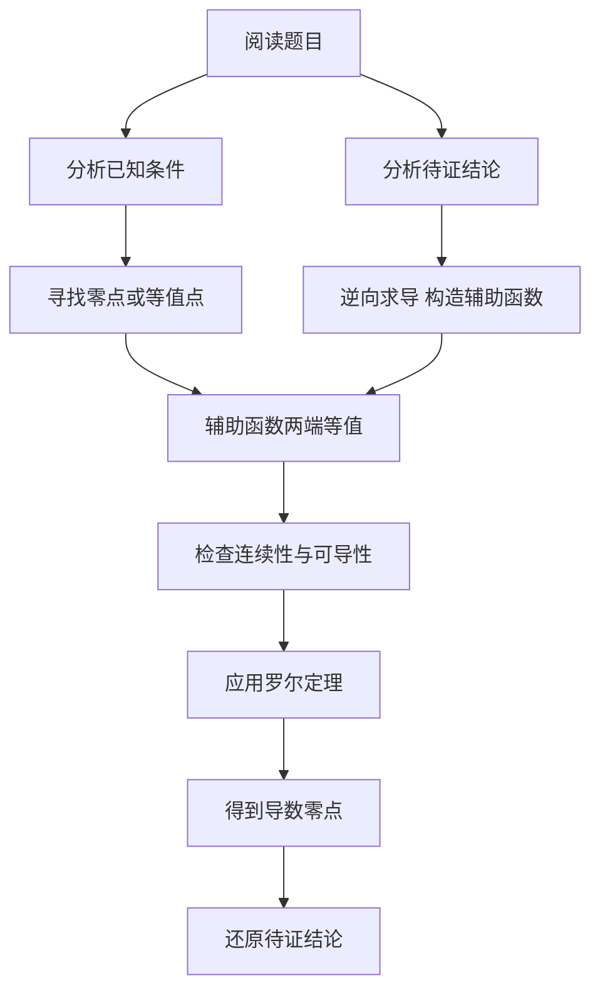
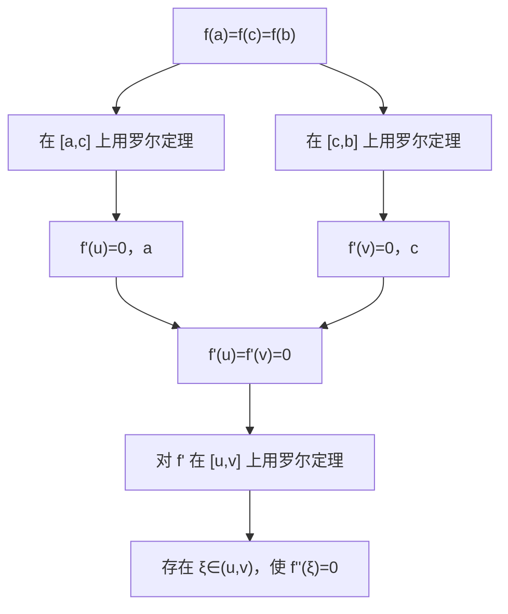
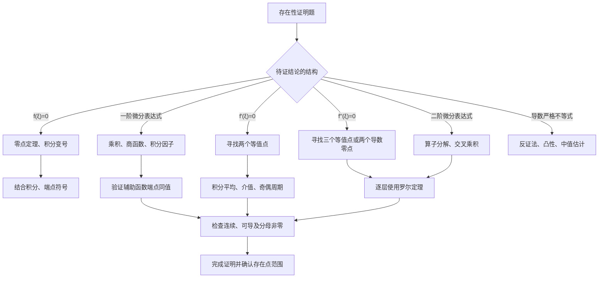

## 一、核心考查方向

| 核心模型 | 主要考查内容       | 复习优先级 |
| ---- | ------------ | ----- |
| 模型一  | 罗尔定理的条件与反例   | ★★★★  |
| 模型二  | 积分、平均值制造等值点  | ★★★★★ |
| 模型三  | 乘积型、商型辅助函数   | ★★★★★ |
| 模型四  | 三点等值与多次罗尔定理  | ★★★★★ |
| 模型五  | 指数积分因子构造     | ★★★★★ |
| 模型六  | 介值定理与罗尔定理综合  | ★★★★★ |
| 模型七  | 奇偶性、周期性与多重零点 | ★★★★  |
| 模型八  | 二阶微分表达式与算子分解 | ★★★★★ |
| 模型九  | 积分矩条件与零点个数   | ★★★★  |
| 模型十  | 二阶导数估计与凸性反证  | ★★★★  |

**2. 罗尔定理的真正难点是什么？**

罗尔定理有三个条件与一个结论。考研大题通常不直接给出：

$$
f(a)=f(b)
$$

并要求证明存在导数零点，而是要求证明诸如：

$$
f'(\xi)+\xi f(\xi)=0
$$

$$
f''(\xi)-3f'(\xi)+2f(\xi)=0
$$

$$
f(\xi)g''(\xi)-f''(\xi)g(\xi)=0
$$

甚至出现变上限积分、三角函数、指数函数、参数和高阶导数的综合表达式。

这些题目的共同本质是：

**找到一个适当的辅助函数，使待证表达式成为它的导数，同时利用已知条件制造两个相等的函数值。**

整节内容可以浓缩为两条解题路线，它们需要最终汇合：

掌握这两条路线，比记住几十种特殊的辅助函数更加重要。

## 二、罗尔定理的基础知识

### 2.1 定理的标准表述

设 $a<b$，函数 $f(x)$ 满足：

1. 在闭区间 $[a,b]$ 上连续；
2. 在开区间 $(a,b)$ 内可导；
3. $f(a)=f(b)$。

则至少存在一点 $\xi\in(a,b)$，使得

$$
\boxed{f'(\xi)=0}
$$

这就是罗尔中值定理（Rolle's theorem）。

可以将其简记为：

$$
\boxed{\text{闭连续}+\text{开可导}+\text{端点等值} \Longrightarrow \text{内部导数为零}}
$$

注意，定理只保证至少存在一个这样的点，不保证唯一性，也不要求求出该点的具体位置。

### 2.2 几何直观

如果一条光滑曲线的两个端点处于同一高度，那么在这两个端点之间，至少存在一个切线平行于 $x$ 轴的点。

例如：

$$
f(x)=x(2-x),\quad x\in[0,2]
$$

因为

$$
f(0)=f(2)=0,
$$

所以内部必有水平切线。实际求导：

$$
f'(x)=2-2x,
$$

得到 $\xi=1$。

但是，罗尔定理所保证的点不一定是极值点。例如 $f(x)=x^3(x^2-1)^2$ 在 $[-1,1]$ 上满足端点等值，而 $x=0$ 是驻点，却不是极值点。

### 2.3 罗尔定理为什么成立？

这一定理的证明依赖闭区间最值定理和费马引理。

如果 $f(x)$ 是常数函数，则

$$
f'(x)\equiv0,
$$

结论显然成立。

如果 $f(x)$ 不是常数函数，由闭区间连续函数的最值定理，$f(x)$ 在 $[a,b]$ 上一定能够取得最大值和最小值。

由于 $f(a)=f(b)$，最大值和最小值中至少有一个必须在某个内部点 $\xi\in(a,b)$ 取得。

又因为 $f(x)$ 在内部可导，由费马引理：

$$
f'(\xi)=0.
$$

因此，罗尔定理背后的逻辑是：

$$
\text{闭区间最值定理} +\text{端点等值} +\text{费马引理} \Longrightarrow \text{罗尔定理}
$$

理解这个证明，有助于处理条件不完整的选择题和特殊存在性证明题。

### 2.4 三个条件缺一不可

| 缺失条件  | 反例                                         | 为什么不能保证结论 |
| ------------------------------------------ | --------- |
| 闭区间连续 | $f(0)=f(1)=0$，内部 $f(x)=x$          | 内部导数恒为1   |
| 开区间可导 | $f(x)=\lvert x\rvert$，区间为 $[-1,1]$ | 唯一最低点不可导  |
| 端点等值  | $f(x)=x$，区间为 $[0,1]$               | 导数恒为1     |

这里所谓缺一不可，是指缺少任意一个条件，就不能保证结论普遍成立，而不是说某个函数不满足条件时一定没有驻点。

例如 $f(x)=x^2$ 在 $[-1,2]$ 上不满足端点等值，但仍然有 $f'(0)=0$。

### 2.5 罗尔定理的重要推论

**推论一：两个不同零点之间至少存在一个导数零点。**

如果

$$
f(x_1)=f(x_2)=0,\qquad x_1<x_2,
$$

并满足相应的连续、可导条件，那么

$$
\exists\,\xi\in(x_1,x_2),\quad f'(\xi)=0.
$$

**推论二：若导数处处非零，则函数至多有一个零点。**

如果 $f$ 在区间 $I$ 内可导，且

$$
f'(x)\ne0,\qquad x\in I,
$$

那么方程 $f(x)=0$ 在 $I$ 内至多有一个解。

证明采用反证法：如果有两个不同零点，由罗尔定理必然得到一个导数零点，与已知条件矛盾。

这个推论经常用于证明方程根的唯一性。

**推论三：多个零点能够逐级传递到高阶导数。**

在满足相应可导条件的情况下：

$$
\begin{aligned} &f(x)\text{ 至少有 }n+1\text{ 个不同零点}\\ \Longrightarrow\;&f'(x)\text{ 至少有 }n\text{ 个不同零点}\\ \Longrightarrow\;&f''(x)\text{ 至少有 }n-1\text{ 个不同零点}\\ &\quad\vdots\\ \Longrightarrow\;&f^{(n)}(x)\text{ 至少有一个零点}. \end{aligned}
$$

因此，如果

$$
f^{(n)}(x)\ne0
$$

在整个区间内成立，那么 $f(x)$ 在该区间内至多有 $n$ 个不同零点。

这一推论是本节大量综合证明题的基础。

## 三、如何判断应该使用哪一种中值定理？

罗尔定理与费马引理、零点定理、拉格朗日中值定理、积分中值定理经常联合考查。

| 定理       | 已知条件的主要特征       | 目标特征                                 |
| -------- | --------------- | ------------------------------------ |
| 零点定理     | 连续、两端异号         | $f(\xi)=0$                       |
| 介值定理     | 连续、目标值介于两个函数值之间 | $f(\xi)=k$                       |
| 费马引理     | 内部极值点可导         | $f'(\xi)=0$                      |
| 罗尔定理     | 两点函数值相等         | $f'(\xi)=0$                      |
| 拉格朗日中值定理 | 两点函数值之差         | $f'(\xi)=\dfrac{f(b)-f(a)}{b-a}$ |
| 柯西中值定理   | 两个函数的增量关系       | 导数之比                                 |
| 积分中值定理   | 连续函数的积分平均值      | 某点函数值                                |
| 泰勒中值定理   | 高阶导数、局部展开       | 高阶余项及定量估计                            |

考研中尤其重要的组合是：

$$
\boxed{\text{积分中值定理}\longrightarrow \text{等值点}\longrightarrow\text{罗尔定理}}
$$

以及

$$
\boxed{\text{零点定理}\longrightarrow \text{多个零点}\longrightarrow\text{多次罗尔定理}}
$$

后面的母题基本都可以归结到这两种组合，再配合不同的辅助函数。

## 四、模型一：罗尔定理的条件辨析

难度：★★☆☆☆

### 母题1：2002年考研数学三

设 $f(x)$ 在闭区间 $[a,b]$ 上有定义，在开区间 $(a,b)$ 内可导，判断下列结论是否必然成立。

A. 若 $f(a)f(b)<0$，则存在 $\xi\in(a,b)$，使 $f(\xi)=0$。

B. 对任意 $\xi\in(a,b)$，都有

$$
\lim_{x\to\xi}[f(x)-f(\xi)]=0.
$$

C. 若 $f(a)=f(b)$，则存在 $\xi\in(a,b)$，使 $f'(\xi)=0$。

D. 存在 $\xi\in(a,b)$，使

$$
f(b)-f(a)=f'(\xi)(b-a).
$$

**正确答案：B。**

**解题关键**

题目只说明闭区间上有定义，没有说明闭区间上连续。

对于内部任意一点 $\xi$，由于 $f$ 在该点可导，所以一定连续，B正确。

而A、C、D分别涉及零点定理、罗尔定理、拉格朗日中值定理，都缺少端点连续性的保证。

例如，为反驳C和D，构造

$$
f(x)= \begin{cases} 0,&x=0,\\ x,&0<x<1,\\ 0,&x=1. \end{cases}
$$

虽然

$$
f(0)=f(1)=0,
$$

但是

$$
f'(x)=1,\qquad x\in(0,1).
$$

没有任何内部导数零点。

<Callout type="warn" title="必须掌握的易错结论">

$$
\text{开区间可导} \Longrightarrow \text{开区间连续}
$$

但不能推出

$$
\text{开区间可导} \Longrightarrow \text{闭区间连续}.
$$

另一方面，罗尔定理并不要求导函数连续。

只要函数连续、内部可导、端点同值，就可以使用罗尔定理，即使 $f'(x)$ 本身存在间断点。

</Callout>

## 五、模型二：积分与函数值平均制造等值点

难度：★★★☆☆

### 5.1 核心公式

若 $f(x)$ 在 $[a,b]$ 上连续，则存在 $c\in(a,b)$，使

$$
\boxed{\int_a^b f(x)\,\mathrm dx=(b-a)f(c)}
$$

即

$$
\boxed{f(c)=\frac1{b-a}\int_a^b f(x)\,\mathrm dx}
$$

因此，只要题目出现某个函数值等于积分平均值，就应当立即想到制造等值点。

### 母题2：1991年考研数学一

设 $f(x)$ 在 $[0,1]$ 上连续，在 $(0,1)$ 内可导，且

$$
3\int_{2/3}^1f(x)\,\mathrm dx=f(0).
$$

证明存在 $\xi\in(0,1)$，使

$$
f'(\xi)=0.
$$

<Steps>

<Step>

### 第一步：识别积分平均值 [!toc]

注意区间长度为

$$
1-\frac23=\frac13.
$$

因此，题目中的系数3恰好是积分区间长度的倒数。

由积分中值定理，存在

$$
c\in\left(\frac23,1\right),
$$

使

$$
\int_{2/3}^1f(x)\,\mathrm dx=\frac13f(c).
$$

代入已知条件，得到

$$
f(c)=f(0).
$$

</Step>

<Step>

### 第二步：应用罗尔定理 [!toc]

函数 $f$ 在 $[0,c]$ 上连续，在 $(0,c)$ 内可导，且两端函数值相等。

因此，由罗尔定理，存在

$$
\xi\in(0,c)\subset(0,1),
$$

使

$$
\boxed{f'(\xi)=0}.
$$

证毕。

</Step>

</Steps>

**母题提炼**

这道题的所有计算都服务于一个目的：找到另一个函数值等于 $f(0)$ 的点。

将题目推广为

$$
f(a)=\frac1{d-c}\int_c^d f(x)\,\mathrm dx, \qquad a<c<d,
$$

则同样能够推出存在 $\xi\in(a,d)$，使 $f'(\xi)=0$。

不需要记住特定积分上下限，只需要识别积分平均值结构。

### 母题3：2003年考研数学三

设 $f(x)$ 在 $[0,3]$ 上连续，在 $(0,3)$ 内可导，且

$$
f(0)+f(1)+f(2)=3,\qquad f(3)=1.
$$

证明存在 $\xi\in(0,3)$，使 $f'(\xi)=0$。

**解题思路**

题设等价于

$$
\frac{f(0)+f(1)+f(2)}3=f(3).
$$

三个数的算术平均值一定介于其最小值和最大值之间。

于是

$$
\min_{x\in[0,2]}f(x) \le f(3)\le \max_{x\in[0,2]}f(x).
$$

由介值定理，存在 $c\in[0,2]$，使

$$
f(c)=f(3).
$$

因为 $c\le2<3$，所以 $c$ 与3一定是两个不同的点。

在 $[c,3]$ 上使用罗尔定理，即得

$$
\boxed{\exists\,\xi\in(c,3),\quad f'(\xi)=0}.
$$

**推广：离散平均与连续平均**

无论是积分平均

$$
\frac1{b-a}\int_a^b f(x)\,\mathrm dx,
$$

还是算术平均

$$
\frac1n\sum_{k=1}^n f(x_k),
$$

甚至加权平均

$$
\sum_{k=1}^n\lambda_k f(x_k), \qquad \lambda_k\ge0,\quad\sum_{k=1}^n\lambda_k=1,
$$

其本质都是一个位于函数最小值与最大值之间的数。

遇到这样的条件，优先考虑利用连续性制造等值点，而不是直接进行求导。

## 六、模型三：乘积型辅助函数

难度：★★★★☆

### 6.1 核心思想：逆向使用乘积求导法则

罗尔定理证明题的目标不一定是 $f'(\xi)=0$，也可能是一个复杂的微分表达式为零。

此时应当尝试把它恢复为某个函数的导数。

以下公式需要熟练到看到右侧就能够想到左侧。

| 待证表达式           | 辅助函数或导数恒等式                                       |
| --------------- | ------------------------------------------------ |
| $f+xf'$     | $(xf)'=f+xf'$                                |
| $2xf+x^2f'$ | $(x^2f)'=2xf+x^2f'$                          |
| $xf'-f$     | $\left(\dfrac fx\right)'=\dfrac{xf'-f}{x^2}$ |
| $(b-x)f'-f$ | $[(b-x)f]'$                                  |
| $f'+f$      | $(e^xf)'=e^x(f'+f)$                          |
| $f'-f$      | $(e^{-x}f)'=e^{-x}(f'-f)$                    |
| $f'+2xf$    | $(e^{x^2}f)'=e^{x^2}(f'+2xf)$                |
| $f'-2xf$    | $(e^{-x^2}f)'=e^{-x^2}(f'-2xf)$              |
| $f'g+fg'$   | $(fg)'$                                      |
| $f'g-fg'$   | $g^2\left(\dfrac fg\right)'$                 |
| $f''g-fg''$ | $(f'g-fg')'$                                 |

### 母题4：1996年考研数学三

设 $f(x)$ 在 $[0,1]$ 上可微，且

$$
f(1)=2\int_0^{1/2}xf(x)\,\mathrm dx.
$$

证明存在 $\xi\in(0,1)$，使

$$
f(\xi)+\xi f'(\xi)=0.
$$

<Steps>

<Step>

### 第一步：从目标反推辅助函数 [!toc]

观察

$$
f(x)+xf'(x)=[xf(x)]'.
$$

因此构造

$$
G(x)=xf(x).
$$

目标转化为证明存在 $\xi$，使 $G'(\xi)=0$。

</Step>

<Step>

### 第二步：利用已知条件 [!toc]

由于

$$
G(1)=f(1),
$$

题设变成

$$
G(1)=2\int_0^{1/2}G(x)\,\mathrm dx.
$$

由积分中值定理，存在 $c\in(0,1/2)$，使

$$
2\int_0^{1/2}G(x)\,\mathrm dx=G(c).
$$

所以

$$
G(1)=G(c).
$$

</Step>

<Step>

### 第三步：使用罗尔定理 [!toc]

在 $[c,1]$ 上对 $G$ 使用罗尔定理，得到某个 $\xi\in(c,1)$，使

$$
G'(\xi)=0.
$$

即

$$
\boxed{f(\xi)+\xi f'(\xi)=0}.
$$

</Step>

</Steps>

### 母题5：2020年考研数学二

设

$$
f(x)=\int_1^x e^{t^2}\,\mathrm dt.
$$

证明：

（1）存在 $\xi\in(1,2)$，使

$$
f(\xi)=(2-\xi)e^{\xi^2}.
$$

（2）存在 $\eta\in(1,2)$，使

$$
f(2)=\ln2\cdot\eta e^{\eta^2}.
$$

**第一问：乘积型罗尔定理**

由于

$$
f'(x)=e^{x^2},
$$

目标等价于

$$
(2-\xi)f'(\xi)-f(\xi)=0.
$$

观察到这正是

$$
[(2-x)f(x)]'
$$

的表达式。

令

$$
H(x)=(2-x)f(x).
$$

因为

$$
f(1)=0,
$$

所以

$$
H(1)=0,\qquad H(2)=0.
$$

注意，两端为零的原因不同：一端是 $f(1)=0$，另一端是乘数 $2-x$ 为零。

由罗尔定理，存在 $\xi\in(1,2)$，使

$$
0=H'(\xi) =(2-\xi)e^{\xi^2}-f(\xi).
$$

从而

$$
\boxed{f(\xi)=(2-\xi)e^{\xi^2}}.
$$

**第二问：加权积分中值定理**

看到 $\ln2$，应当想到

$$
\ln2=\int_1^2\frac1t\,\mathrm dt.
$$

因此拆分原积分：

$$
f(2)=\int_1^2 \underbrace{te^{t^2}}_{h(t)} \underbrace{\frac1t}_{w(t)} \,\mathrm dt.
$$

由于权函数 $w(t)=1/t$ 恒正，由加权积分中值定理，存在 $\eta\in(1,2)$，使

$$
\begin{aligned} f(2) &=\eta e^{\eta^2}\int_1^2\frac1t\,\mathrm dt\\ &=\boxed{\eta e^{\eta^2}\ln2}. \end{aligned}
$$

**本题的价值**

两个小问都是存在性证明，但第一问用罗尔定理，第二问用加权积分中值定理。

因此，不能仅仅因为题目出现“存在某点”就机械地使用某个定理。要根据目标表达式的结构选择工具。

### 6.2 一个非常实用的通用构造

若已知 $f(a)=0$，而希望在 $(a,b)$ 内寻找满足

$$
(b-\xi)f'(\xi)=f(\xi)
$$

的点，则直接构造

$$
H(x)=(b-x)f(x).
$$

因为

$$
H(a)=H(b)=0.
$$

类似地，若已知 $f(b)=0$，可以构造

$$
H(x)=(x-a)f(x).
$$

从而得到

$$
f(\xi)+(\xi-a)f'(\xi)=0.
$$

这类题只需要一个已知函数零点，另外一个零点可以通过乘数主动制造。

## 七、模型四：指数积分因子——辅助函数构造的通法

难度：★★★★☆

重要程度：★★★★★

这是本节必须真正理解的核心方法。在李林880、2013年数学一真题以及汤家凤模拟题中反复出现。

### 7.1 从一阶线性微分表达式出发

假设待证结论为

$$
f'(\xi)+p(\xi)f(\xi)=0.
$$

我们希望找到一个函数 $\mu(x)$，使

$$
[\mu(x)f(x)]' =\mu(x)[f'(x)+p(x)f(x)].
$$

根据乘积求导法则，

$$
[\mu f]'=\mu f'+\mu'f.
$$

比较两式，可得

$$
\mu'(x)=p(x)\mu(x).
$$

于是

$$
\frac{\mu'(x)}{\mu(x)}=p(x).
$$

若 $p$ 连续，积分得到

$$
\boxed{\mu(x)=e^{\int p(x)\,\mathrm dx}}
$$

因此可以直接得到辅助函数通式：

$$
\boxed{ H(x)=f(x)\exp\left(\int_{x_0}^{x}p(t)\,\mathrm dt\right) }
$$

且

$$
\boxed{ H'(x)= e^{\int_{x_0}^{x}p(t)\,\mathrm dt} [f'(x)+p(x)f(x)] }
$$

由于指数因子恒正，

$$
H'(\xi)=0 \iff f'(\xi)+p(\xi)f(\xi)=0.
$$

如果同时能够得到 $f(a)=f(b)=0$，那么无论指数因子如何变化，都有 $H(a)=H(b)=0$。

### 7.2 高频积分因子速查表

| 目标表达式                | 优先构造                  |
| -------------------- | --------------------- |
| $f'+\lambda f$   | $e^{\lambda x}f$  |
| $f'-\lambda f$   | $e^{-\lambda x}f$ |
| $f'+xf$          | $e^{x^2/2}f$      |
| $f'-xf$          | $e^{-x^2/2}f$     |
| $f'+2xf$         | $e^{x^2}f$        |
| $f'+(\cos x)f$   | $e^{\sin x}f$     |
| $f'+\dfrac1xf$   | $xf$，在正半轴上        |
| $f'+\dfrac nx f$ | $x^nf$，在正半轴上      |
| $xf'+(1-x)f$     | $xe^{-x}f$        |

### 母题6：李林880练习题

设 $f(x)$ 在 $[a,b]$ 上连续，在 $(a,b)$ 内可导，且

$$
0<a<b,\qquad f(a)=f(b)=0.
$$

证明：

（1）存在 $\xi\in(a,b)$，使

$$
2f(\xi)+\xi f'(\xi)=0.
$$

（2）存在 $\eta\in(a,b)$，使

$$
2\eta f(\eta)-f'(\eta)=0.
$$

**第一问**

将目标写成

$$
f'(x)+\frac2xf(x)=0.
$$

积分因子为

$$
\mu(x)=e^{\int \frac2x\,\mathrm dx}=x^2.
$$

令

$$
H(x)=x^2f(x).
$$

由于 $f(a)=f(b)=0$，故 $H(a)=H(b)=0$。

应用罗尔定理，得到某个 $\xi\in(a,b)$，使

$$
0=H'(\xi)=\xi[2f(\xi)+\xi f'(\xi)].
$$

因为 $\xi>0$，可以约去 $\xi$，于是

$$
\boxed{2f(\xi)+\xi f'(\xi)=0}.
$$

**第二问**

待证式等价于

$$
f'(\eta)-2\eta f(\eta)=0.
$$

构造

$$
G(x)=e^{-x^2}f(x).
$$

由于 $G(a)=G(b)=0$，由罗尔定理，存在 $\eta\in(a,b)$，使

$$
0=G'(\eta) =e^{-\eta^2}[f'(\eta)-2\eta f(\eta)].
$$

指数函数不为零，故

$$
\boxed{2\eta f(\eta)-f'(\eta)=0}.
$$

### 母题7：1999年考研数学三——介值定理与积分因子

设 $f(x)$ 在 $[0,1]$ 上连续，在 $(0,1)$ 内可导，且

$$
f(0)=f(1)=0,\qquad f\left(\frac12\right)=1.
$$

证明：

（1）存在 $\eta\in(1/2,1)$，使 $f(\eta)=\eta$。

（2）对任意实数 $\lambda$，存在 $\xi\in(0,\eta)$，使

$$
f'(\xi)-\lambda[f(\xi)-\xi]=1.
$$

**第一问：构造差函数**

令

$$
h(x)=f(x)-x.
$$

则

$$
h\left(\frac12\right)=\frac12>0,
$$

$$
h(1)=-1<0.
$$

根据零点定理，存在 $\eta\in(1/2,1)$，使

$$
h(\eta)=0.
$$

即

$$
\boxed{f(\eta)=\eta}.
$$

**第二问：将第一问结论转化为两个零点**

注意

$$
h(0)=0,\qquad h(\eta)=0,
$$

而待证表达式可以写成

$$
h'(\xi)-\lambda h(\xi)=0.
$$

因此构造

$$
H(x)=e^{-\lambda x}h(x) =e^{-\lambda x}[f(x)-x].
$$

由 $H(0)=H(\eta)=0$，应用罗尔定理，存在 $\xi\in(0,\eta)$，使

$$
0=H'(\xi) =e^{-\lambda\xi} \left[f'(\xi)-1-\lambda(f(\xi)-\xi)\right].
$$

因此

$$
\boxed{f'(\xi)-\lambda[f(\xi)-\xi]=1}.
$$

**本题的通用思想**

遇到带常数项的微分表达式，不要立即寻找指数辅助函数。可以先构造新的函数，将问题化为齐次形式。

本题的关键是

$$
h=f-x.
$$

同理，若目标为

$$
f'(\xi)+p(\xi)[f(\xi)-g(\xi)] =g'(\xi),
$$

则应优先令

$$
h(x)=f(x)-g(x).
$$

目标立即转化为

$$
h'(\xi)+p(\xi)h(\xi)=0.
$$

## 八、模型五：三点等值与多次罗尔定理

难度：★★★★☆

重要程度：★★★★★

这是近年来综合证明题非常值得重视的模型。2026年数学一第20题就是这一模型与积分条件的结合。

### 8.1 二阶罗尔定理

设 $f(x)$ 在 $[a,b]$ 上连续，在 $(a,b)$ 内二阶可导。

若存在 $c\in(a,b)$，使

$$
f(a)=f(c)=f(b),
$$

则至少存在 $\xi\in(a,b)$，使

$$
\boxed{f''(\xi)=0}.
$$

证明过程：

注意，这里并不是仅仅使用两次罗尔定理，而是在第一层的两个不同区间分别使用，再在第二层使用一次。

### 8.2 多次罗尔定理的标准书写

如果题目已经得到

$$
F(x_1)=F(x_2)=F(x_3), \qquad x_1<x_2<x_3,
$$

则证明过程应当写为：

由罗尔定理，分别存在

$$
u\in(x_1,x_2),\qquad v\in(x_2,x_3),
$$

使得

$$
F'(u)=F'(v)=0.
$$

由于 $u<v$，且 $F'$ 在 $[u,v]$ 上连续，在 $(u,v)$ 内可导，再由罗尔定理，存在

$$
\xi\in(u,v)\subset(x_1,x_3),
$$

使

$$
F''(\xi)=0.
$$

这种书写方式能够保证两个一阶导数零点不同，是考场规范证明的重要细节。

### 母题8：2026年考研数学一第20题

设可导函数 $f(x)$ 严格单调递增，且

$$
\int_{-1}^1f(x)\,\mathrm dx=0, \qquad a=\int_0^1f(x)\,\mathrm dx.
$$

（1）证明 $a>0$。

（2）令

$$
F(x)=a(1-x^2)+\int_1^x f(t)\,\mathrm dt,
$$

证明存在 $\xi\in(-1,1)$，使

$$
F''(\xi)=0.
$$

**第一问：单调性与积分比较**

由于 $f(x)$ 严格单调递增，对 $t\in[0,1]$，有

$$
f(t)>f(t-1).
$$

两边积分，得

$$
\int_0^1 f(t)\,\mathrm dt > \int_0^1 f(t-1)\,\mathrm dt.
$$

令 $u=t-1$，得到

$$
a>\int_{-1}^0f(u)\,\mathrm du.
$$

由题设

$$
\int_{-1}^1f(x)\,\mathrm dx=0,
$$

有

$$
\int_{-1}^0f(x)\,\mathrm dx=-a.
$$

所以

$$
a>-a,
$$

即

$$
\boxed{a>0}.
$$

这里不需要判断 $f(0)$ 的正负，也不能仅凭 $f$ 严格递增就断言 $f'(x)>0$ 处处成立。

**第二问：优先寻找三个等值点**

看到要求证明 $F''(\xi)=0$，首先想到三点罗尔模型。

辅助函数已经由题目给出，因此不需要自己构造，只需要寻找三个不同的等值点。

观察：

$$
1-x^2=0\iff x=\pm1.
$$

变上限积分在 $x=1$ 处也为零。

计算 $x=1$：

$$
F(1)=0.
$$

计算 $x=-1$：

$$
F(-1) =\int_1^{-1}f(t)\,\mathrm dt =-\int_{-1}^1f(t)\,\mathrm dt =0.
$$

计算 $x=0$：

$$
\begin{aligned} F(0) &=a+\int_1^0f(t)\,\mathrm dt\\ &=a-\int_0^1f(t)\,\mathrm dt\\ &=0. \end{aligned}
$$

因此

$$
\boxed{F(-1)=F(0)=F(1)=0}.
$$

又因为 $f$ 可导，所以 $F$ 二阶可导。

分别在 $[-1,0]$、$[0,1]$ 上使用罗尔定理，存在

$$
u\in(-1,0),\qquad v\in(0,1),
$$

使得

$$
F'(u)=F'(v)=0.
$$

再对 $F'$ 在 $[u,v]$ 上使用罗尔定理，存在

$$
\xi\in(u,v)\subset(-1,1),
$$

使

$$
\boxed{F''(\xi)=0}.
$$

**进一步挖掘这道真题**

实际上，

$$
F'(x)=-2ax+f(x),
$$

$$
F''(x)=-2a+f'(x).
$$

因此第二问也可以表述为：

$$
\boxed{ \exists\,\xi\in(-1,1),\quad f'(\xi)=2\int_0^1 f(x)\,\mathrm dx }
$$

如果未来考试不直接提供 $F(x)$，而是要求证明这个结论，就可以从目标出发反推：

$$
f'(\xi)-2a=0
$$

对应一阶导数

$$
G(x)=f(x)-2ax,
$$

再对其求原函数：

$$
F(x)=\int_1^x f(t)\,\mathrm dt-ax^2+C.
$$

为了使 $F(1)=0$，取 $C=a$，最终得到

$$
F(x)=\int_1^x f(t)\,\mathrm dt+a(1-x^2).
$$

这就是题目中辅助函数的来源。

**真正掌握母题的标志，是题目即使不给辅助函数，你也能够将它反推出来。**

### 配套模拟题：张宇8套卷第7套第18题

这道模拟题与上述真题结构高度一致。

已知 $f(x)$ 在 $[-1,1]$ 上可导，并满足

$$
f(x)=-f(x-1),\qquad x\in[0,1].
$$

（1）证明

$$
\int_{-1}^1 f(x)\,\mathrm dx=0.
$$

（2）令

$$
F(x)=(1-x^2)\int_0^1 f(t)\,\mathrm dt +\int_1^x f(t)\,\mathrm dt,
$$

证明存在 $\xi\in(-1,1)$，使 $F''(\xi)=0$。

第一问利用平移换元：

$$
\begin{aligned} \int_0^1 f(x)\,\mathrm dx &=\int_{-1}^0 f(t+1)\,\mathrm dt\\ &=-\int_{-1}^0f(t)\,\mathrm dt. \end{aligned}
$$

因此总积分为零。

第二问完全回归2026年真题母题：

$$
F(-1)=F(0)=F(1)=0.
$$

直接使用二阶罗尔定理即可。

这两道题的区别只是制造积分为零的方式不同，第二问的底层解题模型完全相同。

### 母题9：2010年考研数学三——混合平均值

设 $f(x)$ 在 $[0,3]$ 上连续，在 $(0,3)$ 内二阶可导，且

$$
2f(0)=\int_0^2f(x)\,\mathrm dx=f(2)+f(3).
$$

证明存在 $\xi\in(0,3)$，使

$$
f''(\xi)=0.
$$

**解答**

由积分中值定理，存在 $c\in(0,2)$，使

$$
f(c)=\frac12\int_0^2 f(x)\,\mathrm dx=f(0).
$$

又由

$$
f(0)=\frac{f(2)+f(3)}2,
$$

结合介值定理，存在 $d\in[2,3]$，使

$$
f(d)=f(0).
$$

于是

$$
f(0)=f(c)=f(d), \qquad 0<c<2\le d.
$$

三个不同等值点已经全部找到。

应用二阶罗尔定理，得到

$$
\boxed{\exists\,\xi\in(0,d)\subset(0,3),\quad f''(\xi)=0}.
$$

这道题告诉我们，三个等值点可以由完全不同的条件分别制造。

## 九、模型六：曲线交点、分母非零与交叉乘积

难度：★★★★☆

### 母题10：张宇1000题——曲线与抛物线的三个交点

设 $f(x)$ 在 $(\alpha,\beta)$ 内二阶可导，且曲线 $y=f(x)$ 与抛物线

$$
y=ax^2+bx+c
$$

在该区间内有三个不同的公共点。

证明存在 $\xi\in(\alpha,\beta)$，使

$$
f''(\xi)=2a.
$$

设三个公共点的横坐标分别为

$$
x_1<x_2<x_3.
$$

令

$$
H(x)=f(x)-(ax^2+bx+c).
$$

因为三个交点处两曲线函数值相等，所以

$$
H(x_1)=H(x_2)=H(x_3)=0.
$$

由二阶罗尔定理，存在 $\xi\in(x_1,x_3)$，使

$$
H''(\xi)=0.
$$

因此

$$
f''(\xi)-2a=0,
$$

即

$$
\boxed{f''(\xi)=2a}.
$$

**高阶推广**

若 $f(x)$ 与多项式 $P(x)$ 有 $n+1$ 个不同交点，且满足相应的高阶可导条件，则存在 $\xi$，使

$$
\boxed{f^{(n)}(\xi)=P^{(n)}(\xi)}.
$$

特别地，若 $f''(x)>0$ 在区间内恒成立，那么 $f(x)$ 与任意直线至多有两个不同交点。

否则，三个交点将推出某处 $f''(\xi)=0$，产生矛盾。

这类思想还可以用于证明方程根的个数、函数凸性和多项式插值余项。

### 母题11：1995年考研数学一——交叉乘积构造

这是本节最值得反复练习的传统证明题之一。

设 $f(x),g(x)$ 在 $[a,b]$ 上具有二阶导数，且

$$
g''(x)\ne0,
$$

$$
f(a)=f(b)=g(a)=g(b)=0.
$$

证明：

（1）当 $x\in(a,b)$ 时，$g(x)\ne0$。

（2）存在 $\xi\in(a,b)$，使

$$
\frac{f(\xi)}{g(\xi)} =\frac{f''(\xi)}{g''(\xi)}.
$$

**第一问：反证法与零点个数**

假设存在 $c\in(a,b)$，使 $g(c)=0$。

那么

$$
g(a)=g(c)=g(b)=0.
$$

由二阶罗尔定理，必然存在 $\eta\in(a,b)$，使

$$
g''(\eta)=0.
$$

这与 $g''(x)\ne0$ 矛盾。

因此

$$
\boxed{g(x)\ne0,\quad x\in(a,b)}.
$$

**第二问：逆向构造交叉乘积**

看到目标比值，首先交叉相乘：

$$
f''(\xi)g(\xi)-f(\xi)g''(\xi)=0.
$$

寻找一个辅助函数，其导数能够产生上述表达式。

注意：

$$
(f'g)'=f''g+f'g',
$$

$$
(fg')'=f'g'+fg''.
$$

两式相减：

$$
\boxed{ (f'g-fg')'=f''g-fg'' }
$$

中间的 $f'g'$ 恰好抵消。

因此令

$$
H(x)=f'(x)g(x)-f(x)g'(x).
$$

利用端点条件：

$$
H(a)=H(b)=0.
$$

由罗尔定理，存在 $\xi\in(a,b)$，使

$$
H'(\xi)=0.
$$

即

$$
f''(\xi)g(\xi)-f(\xi)g''(\xi)=0.
$$

结合第一问以及 $g''(\xi)\ne0$，可以合法地进行除法，得到

$$
\boxed{ \frac{f(\xi)}{g(\xi)} =\frac{f''(\xi)}{g''(\xi)} }.
$$

**为什么不能机械地用柯西中值定理？**

虽然目标中出现了两个比值，但这里是同一点处的函数值之比等于二阶导数之比。

柯西中值定理不能直接提供这一结论。

题目真正考查的是交叉相消：

$$
(f'g-fg')'=f''g-fg''.
$$

因此，选择定理的关键是表达式结构，而不是题目有没有出现分式。

## 十、模型七：奇偶性、周期性与端点多重零点

难度：★★★★☆

### 母题12：2013年考研数学一、数学二

设奇函数 $f(x)$ 在 $[-1,1]$ 上具有二阶导数，且 $f(1)=1$。

证明：

（1）存在 $\xi\in(0,1)$，使

$$
f'(\xi)=1.
$$

（2）存在 $\eta\in(-1,1)$，使

$$
f''(\eta)+f'(\eta)=1.
$$

**第一问：拉格朗日中值定理**

由于 $f(x)$ 为奇函数，

$$
f(0)=0.
$$

在 $[0,1]$ 上使用拉格朗日中值定理，存在 $\xi\in(0,1)$，使

$$
f'(\xi)=\frac{f(1)-f(0)}{1-0}=1.
$$

因此

$$
\boxed{f'(\xi)=1}.
$$

**第二问：利用偶性制造第二个等值点**

奇函数的导函数为偶函数，因此

$$
f'(-\xi)=f'(\xi)=1.
$$

令

$$
h(x)=f'(x)-1.
$$

那么

$$
h(-\xi)=h(\xi)=0.
$$

目标等价于

$$
h'(\eta)+h(\eta)=0.
$$

根据积分因子通法，构造

$$
H(x)=e^xh(x)=e^x[f'(x)-1].
$$

由于

$$
H(-\xi)=H(\xi)=0,
$$

由罗尔定理，存在 $\eta\in(-\xi,\xi)$，使

$$
0=H'(\eta) =e^\eta[f''(\eta)+f'(\eta)-1].
$$

于是

$$
\boxed{f''(\eta)+f'(\eta)=1}.
$$

**为什么这道题具有代表性？**

它将四个知识点串联起来：

$$
\text{奇函数} \longrightarrow \text{拉格朗日中值定理} \longrightarrow \text{偶导函数的等值点} \longrightarrow \text{指数积分因子与罗尔定理}.
$$

如果未来考试将结论修改为

$$
f''(\eta)+\lambda[f'(\eta)-1]=0,
$$

其中 $\lambda$ 是任意实数，也可以直接通过

$$
H(x)=e^{\lambda x}[f'(x)-1]
$$

证明。

### 母题13：李正元练习题——周期性与平方因子

已知 $f(x)$ 在 $\mathbb R$ 上具有二阶导数，以 $2\pi$ 为周期，且 $f(0)=0$。

设

$$
F(x)=(\sin x-1)^2f(x).
$$

证明存在

$$
x_0\in\left(2\pi,\frac{5\pi}{2}\right),
$$

使

$$
F''(x_0)=0.
$$

<Steps>

<Step>

### 第一步：寻找函数零点 [!toc]

由周期性，

$$
f(2\pi)=f(0)=0.
$$

因此

$$
F(2\pi)=0.
$$

又因为

$$
\sin\frac{5\pi}{2}=1,
$$

所以

$$
F\left(\frac{5\pi}{2}\right)=0.
$$

由罗尔定理，存在

$$
c\in\left(2\pi,\frac{5\pi}{2}\right),
$$

使

$$
F'(c)=0.
$$

</Step>

<Step>

### 第二步：利用平方因子制造导数零点 [!toc]

求导：

$$
\begin{aligned} F'(x) ={}&2(\sin x-1)\cos x\,f(x)\\ &+(\sin x-1)^2f'(x). \end{aligned}
$$

当 $x=5\pi/2$ 时，两项都含有为零的因子，因此

$$
F'\left(\frac{5\pi}{2}\right)=0.
$$

这样就已经拥有两个不同的导数零点：

$$
F'(c)=F'\left(\frac{5\pi}{2}\right)=0.
$$

再次应用罗尔定理，存在

$$
x_0\in\left(c,\frac{5\pi}{2}\right),
$$

使

$$
\boxed{F''(x_0)=0}.
$$

</Step>

</Steps>

**高阶推广：多重零点**

若

$$
F(x)=(x-a)^m g(x),
$$

且 $g$ 具有相应阶数导数，那么

$$
F(a)=F'(a)=\cdots=F^{(m-1)}(a)=0.
$$

因此，证明高阶导数零点时，并非总是需要找到多个不同的原函数零点。

有时题目会通过平方因子、高次因子或者已知端点导数为零，直接补充下一层罗尔定理所需的条件。

## 十一、模型八：商型辅助函数与端点极限补定义

难度：★★★★★

这是较容易出创新题的模型，对导数、极限、变上限积分都有一定要求。

### 11.1 商型辅助函数的识别

如果目标出现

$$
f'g-fg'=0,
$$

优先想到

$$
\left(\frac fg\right)'=0.
$$

因为

$$
\boxed{ \left(\frac{f(x)}{g(x)}\right)' =\frac{f'(x)g(x)-f(x)g'(x)}{g^2(x)} }
$$

但商型辅助函数有一个特殊难点：分母可能在端点处为零。

此时不能直接断言商函数在闭区间上连续，而应先计算端点极限，并通过补定义构造连续函数。

### 母题14：李永乐六套卷第2套第19题

设 $f(x)$ 在 $[0,1]$ 上连续，且

$$
f(0)=0,\qquad f'_+(0)=2,
$$

$$
\int_0^1f(x)\,\mathrm dx=\sin^21.
$$

证明存在 $\xi\in(0,1)$，使

$$
f'_+(0)\int_0^\xi f(x)\,\mathrm dx =f(\xi)\tan\xi.
$$

<Steps>

<Step>

### 第一步：将目标改写为商法则结构 [!toc]

记

$$
A(x)=\int_0^x f(t)\,\mathrm dt.
$$

则

$$
A'(x)=f(x).
$$

待证结论等价于

$$
2A(\xi)=A'(\xi)\tan\xi.
$$

整理为

$$
A'(\xi)\sin^2\xi -2A(\xi)\sin\xi\cos\xi=0.
$$

而

$$
(\sin^2x)'=2\sin x\cos x.
$$

因此构造

$$
H(x)=\frac{A(x)}{\sin^2x} =\frac{\displaystyle\int_0^x f(t)\,\mathrm dt} {\sin^2x}.
$$

</Step>

<Step>

### 第二步：解决 $x=0$ 的连续性 [!toc]

当 $x\to0^+$ 时，分子和分母都趋于零。

由

$$
f(0)=0,\qquad f'_+(0)=2,
$$

可得

$$
f(x)=2x+o(x).
$$

积分得到

$$
\int_0^x f(t)\,\mathrm dt =x^2+o(x^2).
$$

又因为

$$
\sin^2x=x^2+o(x^2),
$$

故

$$
\lim_{x\to0^+}H(x)=1.
$$

因此可以补定义

$$
H(x)= \begin{cases} \dfrac{\displaystyle\int_0^x f(t)\,\mathrm dt} {\sin^2x},&0<x\le1,\\[6pt] 1,&x=0. \end{cases}
$$

这样得到的 $H$ 在 $[0,1]$ 上连续，在 $(0,1)$ 内可导。

</Step>

<Step>

### 第三步：验证端点等值 [!toc]

由已知积分条件：

$$
H(1)=\frac{\sin^21}{\sin^21}=1=H(0).
$$

因此可以应用罗尔定理。

存在 $\xi\in(0,1)$，使

$$
H'(\xi)=0.
$$

即

$$
f(\xi)\sin^2\xi -2\sin\xi\cos\xi\int_0^\xi f(t)\,\mathrm dt=0.
$$

由于

$$
0<\xi<1<\frac{\pi}{2},
$$

可以约去 $\sin\xi\cos\xi$，得到

$$
2\int_0^\xi f(t)\,\mathrm dt =f(\xi)\tan\xi.
$$

代入 $f'_+(0)=2$，原结论得证。

</Step>

</Steps>

### 11.2 创新题的通用结构

如果题目给出两个函数 $A(x)$、$B(x)$，且

$$
\lim_{x\to a^+}\frac{A(x)}{B(x)} =\frac{A(b)}{B(b)},
$$

同时能够保证内部的 $B(x)\ne0$，那么可以将商函数连续延拓至端点，利用罗尔定理得到

$$
\boxed{ A'(\xi)B(\xi)-A(\xi)B'(\xi)=0 }
$$

这个模型能够自然结合导数定义、泰勒公式、等价无穷小、洛必达法则、变上限积分等知识点。

## 十二、模型九：二阶微分表达式与算子分解

难度：★★★★★

重要程度：★★★★★

这一模型在分类模拟题中的出现频率较高，是由基本积分因子法发展出来的综合模型。

### 12.1 基础工具：对一阶导函数使用积分因子

如果已经找到两个不同的点 $u<v$，使

$$
f'(u)=f'(v)=0,
$$

那么对任意实数 $\lambda$，构造

$$
H(x)=e^{-\lambda x}f'(x).
$$

由于 $H(u)=H(v)=0$，罗尔定理给出

$$
H'(\eta)=0.
$$

即

$$
\boxed{f''(\eta)-\lambda f'(\eta)=0}.
$$

这比普通的二阶罗尔定理更强，因为普通二阶罗尔定理只是 $\lambda=0$ 的特例。

### 母题15：李林880——二阶参数型存在性证明

设 $f(x)$ 在 $[0,1]$ 上二阶可导，且

$$
f(0)=f(1)=2\int_{1/2}^1f(x)\,\mathrm dx.
$$

证明：

（1）存在 $\xi\in(0,1)$，使 $f''(\xi)=0$。

（2）对任意实数 $\lambda$，存在 $\eta\in(0,1)$，使

$$
f''(\eta)-\lambda f'(\eta)=0.
$$

**第一步：积分中值定理制造第三个等值点**

存在 $c\in(1/2,1)$，使

$$
f(c)=2\int_{1/2}^1f(x)\,\mathrm dx.
$$

因此

$$
f(0)=f(c)=f(1).
$$

分别应用罗尔定理，得到

$$
u\in(0,c),\qquad v\in(c,1),
$$

满足

$$
f'(u)=f'(v)=0.
$$

第一问直接对 $f'$ 应用罗尔定理即可。

**第二问：构造指数因子**

任取固定的 $\lambda\in\mathbb R$，令

$$
H(x)=e^{-\lambda x}f'(x).
$$

由于 $H(u)=H(v)=0$，应用罗尔定理得到

$$
0=H'(\eta) =e^{-\lambda\eta} [f''(\eta)-\lambda f'(\eta)].
$$

因此

$$
\boxed{f''(\eta)-\lambda f'(\eta)=0}.
$$

<Callout type="warn" title="量词陷阱">

本题的正确结论是

$$
\forall\lambda\in\mathbb R,\quad \exists\eta\in(0,1),
$$

使目标成立。

并不是

$$
\exists\eta\in(0,1),\quad \forall\lambda\in\mathbb R,
$$

使目标成立。

前者允许存在点随参数变化，后者则要求同一个点同时满足 $f''(\eta)=f'(\eta)=0$，一般无法保证。

</Callout>

### 12.2 更复杂的二阶表达式如何构造？

假设目标为

$$
f''(\xi)+pf'(\xi)+qf(\xi)=0.
$$

如果多项式

$$
r^2+pr+q
$$

能够分解为

$$
(r-r_1)(r-r_2),
$$

那么

$$
f''+pf'+qf =f''-(r_1+r_2)f'+r_1r_2f.
$$

令微分算子

$$
D=\frac{\mathrm d}{\mathrm dx},
$$

可以写成

$$
\boxed{ (D-r_2)(D-r_1)f }
$$

也就是说，可以将复杂的二阶微分表达式拆成两个一阶线性表达式，逐层使用指数积分因子和罗尔定理。

### 母题16：汤家凤八套卷第5套第18题

设 $f(x)$ 在 $[0,2]$ 上连续，在 $(0,2)$ 内二阶可导，且

$$
f(0)=f(2)=0,
$$

$$
\left|\int_0^2f(x)\,\mathrm dx\right| \ne \int_0^2|f(x)|\,\mathrm dx.
$$

证明：

（1）存在两个不同的点 $\xi_1,\xi_2\in(0,2)$，使

$$
f'(\xi_i)-2f(\xi_i)=0,\qquad i=1,2.
$$

（2）存在 $\xi\in(0,2)$，使

$$
f''(\xi)-4f(\xi)=0.
$$

<Steps>

<Step>

### 第一步：理解积分严格不等式 [!toc]

由积分三角不等式，

$$
\left|\int_0^2 f(x)\,\mathrm dx\right| \le \int_0^2|f(x)|\,\mathrm dx.
$$

而题设说明两者不相等，因此只能严格小于。

这说明 $f(x)$ 不可能恒非负，也不可能恒非正。

所以 $f$ 必须既取正值又取负值。

由零点定理，存在 $c\in(0,2)$，使

$$
f(c)=0.
$$

结合已知端点：

$$
f(0)=f(c)=f(2)=0.
$$

</Step>

<Step>

### 第二步：构造第一次积分因子 [!toc]

令

$$
G(x)=e^{-2x}f(x).
$$

则

$$
G(0)=G(c)=G(2)=0.
$$

分别在 $[0,c]$、$[c,2]$ 上应用罗尔定理，得到两个不同的点

$$
\xi_1\in(0,c),\qquad \xi_2\in(c,2),
$$

使

$$
G'(\xi_1)=G'(\xi_2)=0.
$$

而

$$
G'(x)=e^{-2x}[f'(x)-2f(x)].
$$

故第一问得证。

</Step>

<Step>

### 第三步：分析目标结构 [!toc]

注意

$$
f''-4f =(D+2)(D-2)f.
$$

令

$$
h(x)=f'(x)-2f(x).
$$

则

$$
h'(x)+2h(x) =f''(x)-4f(x).
$$

并且由第一问，

$$
h(\xi_1)=h(\xi_2)=0.
$$

因此构造第二个辅助函数

$$
H(x)=e^{2x}h(x) =e^{2x}[f'(x)-2f(x)].
$$

应用罗尔定理，存在 $\xi\in(\xi_1,\xi_2)$，使

$$
\begin{aligned} 0=H'(\xi) &=e^{2\xi}[h'(\xi)+2h(\xi)]\\ &=e^{2\xi}[f''(\xi)-4f(\xi)]. \end{aligned}
$$

所以

$$
\boxed{f''(\xi)-4f(\xi)=0}.
$$

</Step>

</Steps>

### 母题17：汤家凤八套卷第6套第19题

设 $f(x)$ 在 $[0,1]$ 上连续，在 $(0,1)$ 内二阶可导，且

$$
\lim_{x\to0^+}\frac{f(x)}x=1, \qquad \lim_{x\to1^-}\frac{f(x)}{x-1}=2.
$$

证明：

（1）存在 $c\in(0,1)$，使 $f(c)=0$。

（2）存在 $\xi\in(0,1)$，使 $f''(\xi)=f(\xi)$。

（3）存在 $\eta\in(0,1)$，使

$$
f''(\eta)-3f'(\eta)+2f(\eta)=0.
$$

**第一问：端点极限提供零点与符号**

由题设极限及连续性，首先得到

$$
f(0)=f(1)=0.
$$

在 $x\to0^+$ 时，

$$
\frac{f(x)}x>0,
$$

而 $x>0$，故充分靠近0的内部点有 $f(x)>0$。

在 $x\to1^-$ 时，

$$
\frac{f(x)}{x-1}>0,
$$

但 $x-1<0$，故充分靠近1的内部点有 $f(x)<0$。

由零点定理，存在 $c\in(0,1)$，使 $f(c)=0$。

因此

$$
f(0)=f(c)=f(1)=0.
$$

**第二问：分解二阶算子**

由于

$$
D^2-1=(D-1)(D+1),
$$

首先构造

$$
G(x)=e^xf(x).
$$

利用三个零点，得到两个不同的点 $u<v$，使

$$
f'(u)+f(u)=f'(v)+f(v)=0.
$$

然后构造

$$
H(x)=e^{-x}[f'(x)+f(x)].
$$

其导数为

$$
H'(x)=e^{-x}[f''(x)-f(x)].
$$

由 $H(u)=H(v)=0$，应用罗尔定理，得到

$$
\boxed{f''(\xi)=f(\xi)}.
$$

**第三问：更换算子分解**

因为

$$
D^2-3D+2=(D-2)(D-1),
$$

先构造

$$
G(x)=e^{-x}f(x),
$$

得到两个不同的点 $s<t$，使

$$
f'(s)-f(s)=f'(t)-f(t)=0.
$$

再构造

$$
H(x)=e^{-2x}[f'(x)-f(x)].
$$

则

$$
H'(x) =e^{-2x}[f''(x)-3f'(x)+2f(x)].
$$

应用罗尔定理，即得

$$
\boxed{ f''(\eta)-3f'(\eta)+2f(\eta)=0 }.
$$

### 12.3 可迁移到未来新题的结论

若 $f(x)$ 有三个不同的零点，并满足相应连续性、二阶可导条件，那么对于任意实数 $r_1,r_2$，都存在一点 $\xi$，使

$$
\boxed{ f''(\xi)-(r_1+r_2)f'(\xi)+r_1r_2f(\xi)=0 }
$$

例如：

| 目标表达式                | 第一次构造          | 第二次构造                |
| -------------------- | -------------- | -------------------- |
| $f''-f$          | $e^xf$     | $e^{-x}(f'+f)$   |
| $f''-4f$         | $e^{-2x}f$ | $e^{2x}(f'-2f)$  |
| $f''-3f'+2f$     | $e^{-x}f$  | $e^{-2x}(f'-f)$  |
| $f''+3f'+2f$     | $e^xf$     | $e^{2x}(f'+f)$   |
| $f''-2f'+f$      | $e^{-x}f$  | $e^{-x}(f'-f)$   |
| $f''+\lambda f'$ | 先令 $h=f'$  | $e^{\lambda x}h$ |

注意：上述实指数分解法要求二阶特征多项式具有实根。若无实根，不能机械套用这一结论。

例如 $f(x)=\sin x$ 有多个零点，但

$$
f''(x)+f(x)=0
$$

只是某个特殊例子，并不意味着任意有三个零点的函数都能够通过实指数积分因子证明同类结论。

## 十三、模型十：非线性表达式也可以使用积分因子

难度：★★★★★

### 母题18：汤家凤八套卷第1套第18题

设 $f(x)$ 在 $[0,1]$ 上连续，在 $(0,1)$ 内可导，且

$$
f(0)=2,\qquad \int_0^1 f(x)\,\mathrm dx=2.
$$

证明存在 $\xi\in(0,1)$，使

$$
f'(\xi)+f^4(\xi)-2f^3(\xi)=0.
$$

表面上看，这是一个包含四次幂和三次幂的非线性表达式，比前面的指数积分因子题复杂很多。

但是只要因式分解，就可以识别出熟悉的结构。

<Steps>

<Step>

### 第一步：制造等值点 [!toc]

由积分中值定理，存在 $c\in(0,1)$，使

$$
f(c)=\int_0^1 f(x)\,\mathrm dx=2.
$$

因此

$$
f(0)=f(c)=2.
$$

</Step>

<Step>

### 第二步：因式分解目标 [!toc]

$$
f'+f^4-2f^3 =f'+f^3(f-2).
$$

令

$$
h(x)=f(x)-2.
$$

则

$$
h(0)=h(c)=0,
$$

目标转化为

$$
h'(\xi)+f^3(\xi)h(\xi)=0.
$$

虽然这里的系数是 $f^3(x)$，而不是通常的 $x$、$2x$ 或常数，但它仍然是连续函数，可以使用积分因子。

</Step>

<Step>

### 第三步：构造辅助函数 [!toc]

令

$$
H(x)=[f(x)-2] \exp\left(\int_0^x f^3(t)\,\mathrm dt\right).
$$

有

$$
H(0)=H(c)=0.
$$

因此，由罗尔定理，存在 $\xi\in(0,c)$，使

$$
H'(\xi)=0.
$$

求导可得

$$
H'(x)= e^{\int_0^x f^3(t)\,\mathrm dt} [f'(x)+f^3(x)(f(x)-2)].
$$

由于指数因子不为零，得到

$$
\boxed{f'(\xi)+f^4(\xi)-2f^3(\xi)=0}.
$$

</Step>

</Steps>

**进一步推广**

只要已知

$$
f(a)=f(b)=c,
$$

并且 $p(x)$ 连续，那么都可以证明存在 $\xi\in(a,b)$，使

$$
\boxed{f'(\xi)+p(\xi)[f(\xi)-c]=0}.
$$

其中 $p(x)$ 甚至可以是 $f(x)$ 的连续复合函数，例如

$$
p(x)=f^2(x),\qquad p(x)=e^{f(x)},\qquad p(x)=\sin f(x).
$$

这种题目的难点不是表达式真的更复杂，而是需要把它重新识别成一阶线性微分表达式。

## 十四、模型十一：双积分条件与零点个数

难度：★★★★★

### 母题19：2000年考研数学一、二、三

设 $f(x)$ 在 $[0,\pi]$ 上连续，且

$$
\int_0^\pi f(x)\,\mathrm dx=0,
$$

$$
\int_0^\pi f(x)\cos x\,\mathrm dx=0.
$$

证明在 $(0,\pi)$ 内至少存在两个不同的点 $\xi_1,\xi_2$，使

$$
f(\xi_1)=f(\xi_2)=0.
$$

这道题虽然归类在罗尔定理一节，但由于没有可导性条件，不能直接使用罗尔定理。其核心是如何利用积分条件制造多个零点。

<Steps>

<Step>

### 第一步：由零积分保证至少一个零点 [!toc]

如果 $f\equiv0$，结论显然成立。

如果 $f$ 不恒为零，由连续性及

$$
\int_0^\pi f(x)\,\mathrm dx=0,
$$

可知 $f(x)$ 必须既取正值又取负值。

因此至少存在一个内部零点。

</Step>

<Step>

### 第二步：反设恰好只有一个内部零点 [!toc]

假设 $f(x)$ 在 $(0,\pi)$ 内只有一个零点 $c$。

那么 $f$ 在 $(0,c)$、$(c,\pi)$ 内分别保持同号，且两侧符号必须相反，否则总积分不可能为零。

不妨设

$$
f(x)>0,\qquad 0<x<c,
$$

$$
f(x)<0,\qquad c<x<\pi.
$$

</Step>

<Step>

### 第三步：构造与零点同步变号的权函数 [!toc]

由于 $\cos x$ 在 $(0,\pi)$ 上严格单调递减，

$$
\cos x-\cos c \begin{cases} >0,&0<x<c,\\ <0,&c<x<\pi. \end{cases}
$$

于是乘积

$$
f(x)(\cos x-\cos c)
$$

在 $c$ 的两侧都为正。

所以

$$
\int_0^\pi f(x)(\cos x-\cos c)\,\mathrm dx>0.
$$

但由已知条件，

$$
\begin{aligned} &\int_0^\pi f(x)(\cos x-\cos c)\,\mathrm dx\\ ={}&\int_0^\pi f(x)\cos x\,\mathrm dx -\cos c\int_0^\pi f(x)\,\mathrm dx\\ ={}&0. \end{aligned}
$$

矛盾。

因此 $f(x)$ 在内部至少有两个不同的零点。

</Step>

</Steps>

**核心技巧：消去积分条件并统一符号**

若题设为

$$
\int_a^b f(x)\,\mathrm dx=0, \qquad \int_a^b f(x)g(x)\,\mathrm dx=0,
$$

其中 $g(x)$ 连续且严格单调，那么可以考虑

$$
\int_a^b f(x)[g(x)-g(c)]\,\mathrm dx=0.
$$

通过构造与假设零点 $c$ 同步变号的函数 $g(x)-g(c)$，让乘积不再变号，从而与零积分矛盾。

**高阶创新推广**

如果连续函数 $f(x)$ 满足

$$
\int_a^b x^kf(x)\,\mathrm dx=0, \qquad k=0,1,\ldots,n-1,
$$

那么 $f(x)$ 在 $(a,b)$ 内至少有 $n$ 个不同的零点。

证明思路是：反设内部零点少于 $n$ 个，取其中真正发生符号改变的点

$$
c_1,c_2,\ldots,c_m, \qquad m\le n-1.
$$

构造多项式

$$
P(x)=\prod_{j=1}^m(x-c_j).
$$

由于 $P(x)$ 和 $f(x)$ 在这些变号点处同时改变符号，$P(x)f(x)$ 在整个区间上保持同号，且若 $f$ 不恒为零，其积分不可能为零。

另一方面，$P(x)$ 的次数不超过 $n-1$，由全部积分条件可知

$$
\int_a^b P(x)f(x)\,\mathrm dx=0,
$$

产生矛盾。

这个方法对于将来出现积分约束、零点个数、高阶导数存在性的综合证明非常有价值。

## 十五、模型十二：二阶导数估计与凸性反证

难度：★★★★★

### 母题20：2019年考研数学二

设 $f(x)$ 在 $[0,1]$ 上具有二阶导数，且

$$
f(0)=0,\qquad f(1)=1,
$$

$$
\int_0^1f(x)\,\mathrm dx=1.
$$

证明：

（1）存在 $\xi\in(0,1)$，使 $f'(\xi)=0$。

（2）存在 $\eta\in(0,1)$，使 $f''(\eta)<-2$。

**第一问：积分平均值与罗尔定理**

由积分中值定理，存在 $c\in(0,1)$，使

$$
f(c)=\int_0^1f(x)\,\mathrm dx=1=f(1).
$$

在 $[c,1]$ 上使用罗尔定理，即得

$$
\boxed{f'(\xi)=0}.
$$

**第二问：为什么不能直接用罗尔定理？**

目标不再是证明某个导数等于零，而是证明存在一点，使二阶导数严格小于一个给定常数。

这类题应优先考虑反证法。

假设对所有 $x\in(0,1)$，都有

$$
f''(x)\ge-2.
$$

令

$$
g(x)=f(x)+x^2.
$$

则

$$
g''(x)=f''(x)+2\ge0.
$$

因此 $g$ 是凸函数，图像位于连接两端点的弦的下方。

由于

$$
g(0)=0,\qquad g(1)=2,
$$

所以

$$
g(x)\le2x,\qquad x\in[0,1].
$$

即

$$
f(x)\le2x-x^2.
$$

两边积分：

$$
\int_0^1 f(x)\,\mathrm dx \le \int_0^1(2x-x^2)\,\mathrm dx =\frac23.
$$

但题设给出

$$
\int_0^1 f(x)\,\mathrm dx=1.
$$

矛盾。

因此必然存在 $\eta\in(0,1)$，使

$$
\boxed{f''(\eta)<-2}.
$$

**进一步深化：二阶导数下界与积分上界**

如果已知

$$
f''(x)\ge-M,
$$

那么构造

$$
g(x)=f(x)+\frac M2x^2.
$$

由于 $g''(x)\ge0$，可利用弦线估计得到

$$
\boxed{ f(x)\le(1-x)f(0)+xf(1)+\frac M2x(1-x) }
$$

两边在 $[0,1]$ 上积分：

$$
\boxed{ \int_0^1f(x)\,\mathrm dx \le \frac{f(0)+f(1)}2+\frac M{12} }
$$

对于原题，甚至可以推出更强的结论：

$$
\exists\,\eta\in(0,1),\qquad f''(\eta)\le-6.
$$

而 $-6$ 是这一非严格估计的最佳常数，因为

$$
f(x)=4x-3x^2
$$

恰好满足原题全部条件，且

$$
f''(x)\equiv-6.
$$

这就把一道存在性证明题进一步发展成了最佳常数问题。

## 十六、辅助函数构造的统一方法

前面讲解了大量母题，但不建议将每一道题的辅助函数分别背下来。应该把这些构造归纳为以下几个通用步骤。

### 16.1 从目标反向求导

设目标为

$$
T(\xi)=0.
$$

我们希望找到一个辅助函数 $H(x)$，使

$$
H'(x)=w(x)T(x),
$$

其中 $w(x)$ 在可能的存在点处不为零。

于是证明任务变为：

$$
\boxed{H(u)=H(v),\qquad u<v}.
$$

不要求 $H'(x)$ 恰好等于 $T(x)$，只要求它们具有相同的零点，或能够在得到导数零点后合法地消去额外因子。

### 16.2 从已知条件正向寻找等值点

| 已知条件             | 优先想到的操作              |
| ---------------- | -------------------- |
| 两个函数值相等          | 直接使用罗尔定理             |
| 两个函数值异号          | 零点定理                 |
| 函数值等于积分平均值       | 积分中值定理               |
| 多个函数值的平均值        | 介值定理                 |
| 积分为零             | 恒零或内部正负变号            |
| 两个零积分约束          | 构造权函数消去积分            |
| 奇函数              | $f(0)=0$，导函数为偶函数 |
| 偶函数              | 两个对称点函数值相等           |
| 周期函数             | 平移一个周期后函数值相同         |
| 单侧导数、端点差商        | 端点附近的函数符号            |
| 两曲线相交            | 作差得到零点               |
| 平方、高次因子          | 检查函数和低阶导数零点          |
| 变上限积分            | 检查积分上下限相等的特殊点        |
| 商函数端点为 $0/0$ | 求极限并补定义              |

### 16.3 根据待证表达式选择构造

| 目标类型                   | 首选方法                   |
| ---------------------- | ---------------------- |
| $f'(\xi)=0$        | 制造两个等值点                |
| $f'(\xi)=k$        | $f(x)-kx$，或拉格朗日定理  |
| $f'+pf=0$          | 指数积分因子                 |
| $f'+p(f-g)=g'$     | 先作差 $f-g$，再加积分因子   |
| $f'g+fg'=0$        | 乘积函数                   |
| $f'g-fg'=0$        | 商函数                    |
| $f''g-fg''=0$      | 交叉乘积函数                 |
| $f''(\xi)=0$       | 三点等值或导数两点等值            |
| $f''-\lambda f'=0$ | $e^{-\lambda x}f'$ |
| $f''+pf'+qf=0$     | 实根算子分解                 |
| $f''(\xi)<k$      | 反证法、凸性或中值估计            |
| $f^{(n)}(\xi)=0$   | 多个零点、多次罗尔定理            |

## 十七、原创综合训练

以下题目是根据所阅读真题和模拟题提炼的迁移训练，并非冒用历年真题出处。

建议先独立完成，再查看提示与答案。

### 训练1：积分平均与指数因子

难度：★★★☆☆

设 $f$ 在 $[0,1]$ 上连续，在 $(0,1)$ 内可导，满足

$$
f(0)=\int_0^1 f(x)\,\mathrm dx.
$$

证明存在 $\xi\in(0,1)$，使

$$
f'(\xi)+2\xi[f(\xi)-f(0)]=0.
$$

<Accordions>

<Accordion title="解析与提示">

**提示：**&#x2060;先找到一个函数值等于 $f(0)$ 的内部点。

**参考构造：**

$$
H(x)=e^{x^2}[f(x)-f(0)].
$$

由积分中值定理得到 $c\in(0,1)$，使 $f(c)=f(0)$，因此 $H(0)=H(c)=0$，应用罗尔定理即可。

</Accordion>

</Accordions>

### 训练2：双积分约束

难度：★★★★☆

设 $f$ 在 $[0,1]$ 上连续，在 $(0,1)$ 内可导，满足

$$
\int_0^1 f(x)\,\mathrm dx=0, \qquad \int_0^1 xf(x)\,\mathrm dx=0.
$$

证明存在 $\xi\in(0,1)$，使

$$
f'(\xi)=0.
$$

<Accordions>

<Accordion title="解析与提示">

**提示：**&#x2060;使用2000年考研真题的双积分模型。

由

$$
\int_0^1(x-c)f(x)\,\mathrm dx=0
$$

可以反证 $f$ 至少有两个不同的内部零点，再应用罗尔定理。

</Accordion>

</Accordions>

### 训练3：二阶线性表达式

难度：★★★★☆

设 $f$ 在 $[0,1]$ 上连续，在 $(0,1)$ 内二阶可导，且

$$
f(0)=f(1)=0,\qquad \int_0^1f(x)\,\mathrm dx=0.
$$

证明存在 $\xi\in(0,1)$，使

$$
f''(\xi)+5f'(\xi)+6f(\xi)=0.
$$

<Accordions>

<Accordion title="解析与提示">

**提示：**

$$
D^2+5D+6=(D+3)(D+2).
$$

先由零积分得到第三个零点，再令

$$
G(x)=e^{2x}f(x),
$$

得到 $f'+2f$ 的两个不同零点。

然后构造

$$
H(x)=e^{3x}[f'(x)+2f(x)].
$$

其导数恰好为

$$
H'(x)=e^{3x}[f''(x)+5f'(x)+6f(x)].
$$

</Accordion>

</Accordions>

### 训练4：商函数的连续延拓

难度：★★★★★

设 $f(x)$ 在 $[0,1]$ 上连续，且

$$
f(0)=0,\qquad f'_+(0)=2, \qquad\int_0^1 f(x)\,\mathrm dx=1.
$$

证明存在 $\xi\in(0,1)$，使

$$
\xi f(\xi)=2\int_0^\xi f(t)\,\mathrm dt.
$$

<Accordions>

<Accordion title="解析与提示">

**参考构造：**

$$
H(x)= \begin{cases} \dfrac{\int_0^x f(t)\,\mathrm dt}{x^2}, &x>0,\\[6pt] 1,&x=0. \end{cases}
$$

利用导数定义证明 $H$ 在0处连续，再由 $H(1)=H(0)=1$ 使用罗尔定理。

</Accordion>

</Accordions>

### 训练5：三阶综合题

难度：★★★★★

设 $f(x)$ 在 $[0,1]$ 上连续，在 $(0,1)$ 内三阶可导，且

$$
f(0)=f(1)=0,
$$

$$
\int_0^1 f(x)\,\mathrm dx=0, \qquad \int_0^1 xf(x)\,\mathrm dx=0.
$$

证明存在 $\xi\in(0,1)$，使

$$
f'''(\xi)-6f''(\xi)+11f'(\xi)-6f(\xi)=0.
$$

<Accordions>

<Accordion title="解析与提示">

**解题关键：**

两个积分条件可以推出至少两个不同的内部零点，加上端点，共有至少四个不同零点。

注意

$$
D^3-6D^2+11D-6 =(D-1)(D-2)(D-3).
$$

因此逐层构造

$$
G_1(x)=e^{-x}f(x),
$$

$$
G_2(x)=e^{-2x}[f'(x)-f(x)],
$$

$$
G_3(x)=e^{-3x}[f''(x)-3f'(x)+2f(x)].
$$

每次使用罗尔定理，零点个数减少一个。最终得到

$$
G_3'(\xi)=0.
$$

而

$$
G_3'(x) =e^{-3x}[f'''-6f''+11f'-6f].
$$

故所求成立。

这道题综合了2000年双积分真题、李林880参数罗尔题、汤家凤模拟卷算子分解题，虽然形式变化很大，但所有步骤都来自已经学习过的基本模型。

</Accordion>

</Accordions>

## 十八、考场最容易出现的错误

| 常见错误                                   | 正确做法                                 |
| -------------------------------------- | ------------------------------------ |
| 开区间可导就认为闭区间连续                          | 单独检查端点连续性                            |
| 两个零点可能是同一个点                            | 明确写出两个不同区间及点的位置                      |
| 仅有两个原函数零点就直接推出二阶导数为零                   | 寻找第三个等值点或额外导数零点                      |
| 两次中值定理得到的存在点直接视为相同                     | 不同存在点不能擅自合并                          |
| 指数积分因子符号写反                             | 通过乘积求导重新验证                           |
| 对端点为 $0/0$ 的商函数直接用罗尔定理             | 先求极限并补定义                             |
| 将 $f(a)=f(b)$ 当作 $f(a)=f(b)=0$ | 需要时先减去公共函数值                          |
| 商函数中忽略分母为零                             | 先证明分母非零                              |
| 零积分直接推出函数必变号                           | 先讨论 $f\equiv0$                   |
| 严格单调递增就认为导数恒正                          | 只能保证存在导数时 $f'\ge0$               |
| 忽略右端点差商分母为负                            | 分别判断左右侧的符号                           |
| 将任意参数的存在点理解为固定点                        | 检查 $\forall$ 与 $\exists$ 的顺序 |
| 证明二阶导数严格不等式只会用罗尔                       | 考虑凸性反证、定量估计                          |

特别注意：

罗尔定理应用于辅助函数时，真正需要检查的是**辅助函数本身**是否满足闭连续、开可导、端点等值，而不只是原函数 $f(x)$ 是否满足条件。

## 十九、分层复习安排

按母题的重要性与迁移价值安排复习。

**第一轮：重点吃透真题**

| 来源          | 必须掌握的能力     |
| ----------- | ----------- |
| 1991数学一     | 积分平均制造等值点   |
| 1995数学一     | 二阶零点反证、交叉乘积 |
| 2000数学一二三   | 双积分约束与零点个数  |
| 2013数学一二    | 奇偶性与指数辅助函数  |
| 2026数学一第20题 | 积分约束、三点罗尔   |

这五道题应做到脱离解析、独立书写完整证明。

**第二轮：补齐不同构造模型**

| 来源      | 训练重点                 |
| ------- | -------------------- |
| 2002数学三 | 定理条件及反例              |
| 2003数学三 | 离散平均值                |
| 1996数学三 | 乘积型构造                |
| 2001数学三 | $xe^{-x}f(x)$ 构造 |
| 2020数学二 | 乘积与加权积分              |
| 1993数学三 | 三点共线                 |
| 1996数学二 | 单侧导数与内部零点            |
| 2010数学三 | 混合平均制造三点             |
| 2019数学二 | 凸性反证                 |
| 1999数学三 | 差函数与参数积分因子           |

**第三轮：完成练习题及综合模拟题**

| 来源           | 训练重点        |
| ------------ | ----------- |
| 张宇1000题  | 曲线交点与多次罗尔   |
| 李林880    | 参数型二阶导数     |
| 李林880    | 积分因子通法      |
| 李正元练习题   | 周期函数与多重零点   |
| 原创变式   | 零积分与参数罗尔    |
| 张宇8套卷第7套第18题 | 2026年真题结构变式 |
| 汤家凤第1套第18题   | 非线性积分因子     |
| 汤家凤第5套第18题   | 积分变号与二阶算子   |
| 汤家凤第6套第19题   | 端点极限与算子分解   |
| 李永乐第2套第19题   | 商函数连续延拓     |

## 二十、考前速记

**20.1 必背的六组公式**

**第一组：罗尔定理**

$$
f(a)=f(b) \Longrightarrow \exists\xi:\ f'(\xi)=0.
$$

**第二组：积分中值定理**

$$
\int_a^b f(x)\,\mathrm dx=(b-a)f(c).
$$

**第三组：积分因子**

$$
\boxed{ \left(e^{\int p(x)\,\mathrm dx}f(x)\right)' = e^{\int p(x)\,\mathrm dx}(f'+pf) }
$$

**第四组：交叉相消**

$$
\boxed{(f'g-fg')'=f''g-fg''}
$$

**第五组：商函数求导**

$$
\boxed{ \left(\frac fg\right)'=\frac{f'g-fg'}{g^2} }
$$

**第六组：二阶算子分解**

$$
\boxed{ (D-r_2)(D-r_1)f =f''-(r_1+r_2)f'+r_1r_2f }
$$

上述公式均须配合各自的适用条件使用。

**20.2 考场解题决策树**

**20.3 方法自检**

你应当能够在不看解析的情况下回答以下问题：

- 为什么开区间可导不能保证罗尔定理成立？
- 积分平均值如何制造等值点？
- 为什么三个不同的等值点能够推出二阶导数零点？
- 如何自主构造 $f'+p(x)f=0$ 对应的积分因子？
- 如何从 $f''g-fg''=0$ 反推辅助函数？
- 如何通过二阶算子分解处理 $f''-3f'+2f=0$？
- 遇到端点分母为零的商函数，如何补定义？
- 如何通过两个零积分约束证明至少存在两个零点？
- 2026年数学一第20题若不提供辅助函数，能否自己构造出来？

如果这些问题都可以独立解决，那么本节就不再是单纯记忆中值定理，而是掌握了证明题中非常通用的一种数学思维。

**本节最终应形成的核心反射是：**

$$
\boxed{ \text{分析目标} \longrightarrow \text{逆向求导构造} \longrightarrow \text{制造等值点} \longrightarrow \text{检查定理条件} \longrightarrow \text{应用罗尔定理} }
$$

未来考研数学一即使改变函数形式、加入复杂参数、积分条件、高阶导数或者其他知识点，其底层逻辑大多仍然可以还原为这一框架。
