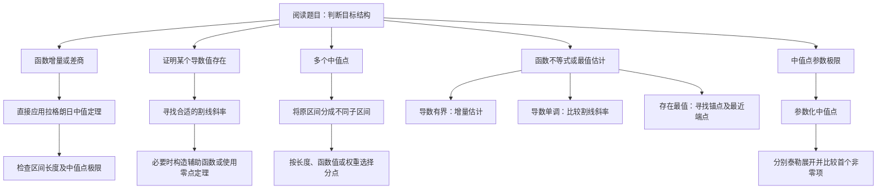

## 考点概览

| 核心题型       | 主要方法       | 掌握优先级 |
| ---------- | ---------- | ----- |
| 定理适用条件与证明  | 罗尔定理、构造弦线  | ★★★★★ |
| 导数极限与函数增量  | 变动区间中值定理   | ★★★★★ |
| 导数值的存在性    | 割线斜率、零点定理  | ★★★★★ |
| 多个中值点的构造   | 区间分割、辅助函数  | ★★★★★ |
| 函数不等式证明    | 导数界、增量比较   | ★★★★★ |
| 凹凸性与割线斜率   | 两段中值定理     | ★★★★★ |
| 中值点的唯一性与极限 | 单调性、泰勒公式   | ★★★★★ |
| 最值与导数界综合证明 | 最值点、最近端点   | ★★★★★ |
| 带权中值点与创新证明 | 介值定理、望远镜求和 | ★★★★☆ |

## 一、基础知识体系

### 1. 拉格朗日中值定理

设函数 $f(x)$ 满足：

- 在闭区间 $[a,b]$ 上连续；
- 在开区间 $(a,b)$ 内可导；
- $a<b$。

那么至少存在一点 $\xi\in(a,b)$，使得

$$
\boxed{f(b)-f(a)=f'(\xi)(b-a)}
$$

等价地，

$$
\boxed{f'(\xi)=\frac{f(b)-f(a)}{b-a}}
$$

两种表达形式对应不同的解题方向。

| 表达形式                                              | 主要用途                |
| ------------------------------------------------- | ------------------- |
| $f(b)-f(a)=f'(\xi)(b-a)$                      | 将函数增量转化为导数，证明极限、不等式 |
| $\displaystyle f'(\xi)=\frac{f(b)-f(a)}{b-a}$ | 利用函数值构造某个导数值        |

**必须形成双向转化的意识：**

$$
\boxed{ \text{函数增量} \ \longleftrightarrow\ \text{导数值}\times\text{区间长度} }
$$

许多证明题的关键并不是复杂的计算，而是找到能够使用这条公式的正确区间。

### 2. 几何意义与直观理解

曲线 $y=f(x)$ 上有两个点：

$$
A(a,f(a)),\qquad B(b,f(b)).
$$

连接两点得到割线 $AB$，其斜率为

$$
k_{AB}=\frac{f(b)-f(a)}{b-a}.
$$

拉格朗日中值定理说明，在两个端点之间，至少存在一个点，其切线与割线 $AB$ 平行。

从运动学角度理解，若 $s(t)$ 表示运动物体的位置，则

$$
\frac{s(b)-s(a)}{b-a}
$$

表示平均速度，而 $s'(\xi)$ 表示某一时刻的瞬时速度。

定理告诉我们：在满足连续与可导条件的情况下，至少有一个时刻的瞬时速度恰好等于整个时间段内的平均速度。

### 3. 定理的常用变形

**形式一：一般增量形式**

$$
\boxed{ f(y)-f(x)=f'(\xi)(y-x) }
$$

其中 $\xi$ 严格位于 $x,y$ 之间。

即使 $x>y$，公式仍然成立。

**形式二：参数形式**

令

$$
\xi=a+\theta(b-a),\qquad 0<\theta<1.
$$

则

$$
\boxed{ f(b)-f(a) =(b-a)f'[a+\theta(b-a)] }
$$

这是处理含中值点参数 $\theta$ 的极限题时最重要的形式。

**形式三：局部增量形式**

令 $b=x+h$，得到

$$
\boxed{ f(x+h)-f(x)=hf'(x+\theta h) }
$$

其中 $0<\theta<1$，且 $h\ne0$。

特别地，

$$
\boxed{f(x)-f(0)=xf'(\theta x)}
$$

这正是2001年数学一真题的核心结构。

### 4. 定理的适用条件与陷阱

| 条件       | 是否必须满足定理的标准假设 |
| -------- | ------------- |
| 闭区间连续    | 是             |
| 开区间可导    | 是             |
| 端点可导     | 否             |
| 导函数连续    | 否             |
| 二阶导数存在   | 否             |
| 两端点函数值相等 | 否             |
| 中值点唯一    | 否             |

尤其需要注意：

**拉格朗日中值定理不要求导函数连续。**

例如，

$$
f(x)= \begin{cases} x^2\sin\dfrac1x,&x\ne0,\\ 0,&x=0 \end{cases}
$$

在实数范围内可导，但 $f'(x)$ 在零点处不连续。它仍然满足任意有限闭区间上使用拉格朗日中值定理的条件。

另外，$f$ 在 $(a,b)$ 内可导，并不能自动保证它在端点 $a,b$ 处连续。

**真题母题：1987年数学三**

核心题目第001题。

已知 $f(x)$ 在 $(a,b)$ 内可导，且

$$
a<x_1<x_2<b.
$$

判断哪一个区间一定可以使用拉格朗日中值定理。

答案是：

$$
\boxed{ f(x_2)-f(x_1) =f'(\xi)(x_2-x_1), \quad \xi\in(x_1,x_2) }
$$

因为 $x_1,x_2$ 都是原开区间的内部点，函数在这两个点可导，因而连续。

但是直接选择 $[a,b]$、$[a,x_2]$ 或 $[x_1,b]$，都不能保证端点连续性。

**迁移规律：大开区间内可导，可以在其内部任意选取小闭区间使用中值定理。**

### 5. 拉格朗日中值定理的证明

**2009年数学一、二、三真题（11分）**

核心题目第002题。这道题既考查定理本身的证明，也考查导数极限与端点导数之间的关系。

**第一问：证明拉格朗日中值定理。**

从目标出发：

$$
f'(\xi)=\frac{f(b)-f(a)}{b-a}.
$$

移项得

$$
f'(\xi)-\frac{f(b)-f(a)}{b-a}=0.
$$

我们希望构造一个辅助函数 $F(x)$，使得上式恰好是 $F'(\xi)=0$。

因此令

$$
F(x)=f(x)-\frac{f(b)-f(a)}{b-a}(x-a).
$$

容易验证：

$$
F(a)=f(a),
$$

$$
F(b)=f(b)-[f(b)-f(a)]=f(a).
$$

所以

$$
F(a)=F(b).
$$

由于 $F(x)$ 在 $[a,b]$ 上连续，在 $(a,b)$ 内可导，根据罗尔中值定理，存在 $\xi\in(a,b)$，使

$$
F'(\xi)=0.
$$

即

$$
f'(\xi)-\frac{f(b)-f(a)}{b-a}=0.
$$

整理得到

$$
\boxed{f(b)-f(a)=f'(\xi)(b-a)}.
$$

**辅助函数为什么这样构造？**

实际上，就是从原函数中减去一个斜率与割线相同的一次函数。

若定义端点弦线

$$
L(x)=f(a)+\frac{f(b)-f(a)}{b-a}(x-a),
$$

则

$$
F(x)=f(x)-L(x)
$$

满足

$$
F(a)=F(b)=0.
$$

罗尔定理相当于寻找原曲线与弦线之间的高度差取得驻点的位置。

**需要掌握的通用构造：**

若要证明

$$
\exists\xi\in(a,b),\quad f'(\xi)=k,
$$

优先考虑

$$
\boxed{F(x)=f(x)-kx}.
$$

然后判断是否有 $F(a)=F(b)$，或者能否找到内部极值点。

### 6. 与其他微分中值定理的关系

| 定理       | 核心结论                                                                   | 主要使用场景      |
| -------- | ---------------------------------------------------------------------- | ----------- |
| 费马定理     | $f'(\xi)=0$                                                        | 已知内部可导极值点   |
| 罗尔定理     | $f'(\xi)=0$                                                        | 两端点函数值相等    |
| 拉格朗日中值定理 | $\displaystyle f'(\xi)=\frac{f(b)-f(a)}{b-a}$                      | 函数增量与导数之间转化 |
| 柯西中值定理   | $\displaystyle\frac{f'(\xi)}{g'(\xi)}=\frac{f(b)-f(a)}{g(b)-g(a)}$ | 两个函数增量之比    |
| 泰勒公式     | 函数的高阶局部展开                                                              | 高阶估计、局部极限   |

其中柯西中值定理的比值形式需要保证分母不为零。

它们之间存在如下关系：

$$
\text{费马定理} \longrightarrow \text{罗尔定理} \longrightarrow \text{拉格朗日中值定理} \longrightarrow \text{柯西中值定理}
$$

一阶拉格朗日中值公式也可以看作零阶泰勒公式带拉格朗日余项的情形。

## 二、重要性质与常见推论

这些推论必须掌握，因为大量考研题目不会直接出现“拉格朗日中值定理”几个字，而是考查它们的变形。

### 1. 导数恒为零，则函数恒为常数

若 $f'(x)\equiv0$ 在某一区间成立，则 $f(x)$ 在该区间为常数。

任取 $x_1<x_2$，由中值定理，

$$
f(x_2)-f(x_1)=f'(\xi)(x_2-x_1)=0.
$$

故

$$
f(x_2)=f(x_1).
$$

进一步得到：

$$
f'(x)=g'(x) \Longrightarrow f(x)=g(x)+C.
$$

注意这一结论应在同一个区间内使用。

### 2. 导数符号控制函数单调性

若对区间内任意 $x$，均有

$$
f'(x)\ge0,
$$

则 $f$ 单调不减。

若

$$
f'(x)>0,
$$

则 $f$ 严格单调递增。

证明非常直接：任取 $u<v$，

$$
f(v)-f(u)=f'(\xi)(v-u).
$$

由于 $v-u>0$，函数增量的符号由 $f'(\xi)$ 决定。

**逆命题陷阱：**

严格单调递增的可导函数，不一定处处满足 $f'(x)>0$。

例如

$$
f(x)=x^3
$$

严格递增，但

$$
f'(0)=0.
$$

### 3. 导数上下界控制函数增量

若

$$
m\le f'(x)\le M,
$$

则任取 $u<v$，有

$$
\boxed{ m(v-u)\le f(v)-f(u)\le M(v-u) }.
$$

这是本节证明不等式最重要的模板之一。

特别地，若

$$
|f'(x)|\le M,
$$

则

$$
\boxed{ |f(v)-f(u)|\le M|v-u| }.
$$

这一性质也称为 Lipschitz 条件。

它表示函数变化的快慢受到统一限制。

**常用变形**

| 已知条件                       | 可以推出的结论                           |
| -------------------------- | --------------------------------- |
| $f(0)=0,\ \lvert f'\rvert \le M$ | $\lvert f(x)\rvert \le M\lvert x\rvert $          |
| $f(0)=A,\ \lvert f'\rvert \le M$ | $\lvert f(x)-A\rvert \le M\lvert x\rvert $        |
| $f'\ge m>0$            | $f(v)-f(u)\ge m(v-u)$         |
| $\lvert f''\rvert \le M$         | $\lvert f'(v)-f'(u)\rvert \le M\lvert v-u\rvert $ |

最后一条说明：**拉格朗日中值定理不仅可以作用于** $f$**，也可以作用于** $f'$**。**

### 4. 导数单调控制割线斜率

设

$$
a<b<c.
$$

若 $f'$ 单调递增，则

$$
\boxed{ \frac{f(b)-f(a)}{b-a} \le \frac{f(c)-f(b)}{c-b} }.
$$

因为分别使用中值定理可得

$$
\frac{f(b)-f(a)}{b-a}=f'(\xi), \quad \xi\in(a,b),
$$

$$
\frac{f(c)-f(b)}{c-b}=f'(\eta), \quad \eta\in(b,c).
$$

由于

$$
\xi<b<\eta,
$$

所以

$$
f'(\xi)\le f'(\eta).
$$

若 $f'$ 严格递增，则上述不等式严格成立；若 $f'$ 单调递减，则不等号反向。

这一性质是证明凹凸性、次可加性、割线斜率单调性的共同基础。

## 三、题型一：导数极限与函数增量极限

### 1. 已知导数极限，求端点导数

**真题母题：2009年数学一、二、三（第二问）**

设 $f$ 在 $x=0$ 处连续，在 $(0,\delta)$ 内可导，且

$$
\lim_{x\to0^+}f'(x)=A.
$$

证明：

$$
f'_+(0)=A.
$$

**解题识别**

已知的是

$$
\lim_{x\to0^+}f'(x),
$$

要求的是

$$
f'_+(0)= \lim_{x\to0^+}\frac{f(x)-f(0)}x.
$$

两者之间差了一次函数增量到导数的转化，因此直接使用拉格朗日中值定理。

**标准证明**

任取 $x\in(0,\delta)$。

由于 $f$ 在 $[0,x]$ 上连续，在 $(0,x)$ 内可导，由拉格朗日中值定理，存在

$$
\xi_x\in(0,x),
$$

使

$$
\frac{f(x)-f(0)}x=f'(\xi_x).
$$

由于

$$
0<\xi_x<x,
$$

当 $x\to0^+$ 时，由夹逼定理得

$$
\xi_x\to0^+.
$$

因此

$$
\begin{aligned} f'_+(0) &=\lim_{x\to0^+}\frac{f(x)-f(0)}x\\ &=\lim_{x\to0^+}f'(\xi_x)\\ &=A. \end{aligned}
$$

故

$$
\boxed{f'_+(0)=A}.
$$

**深入理解：李正元练习题第036题**

李正元《微分中值定理及其应用》进一步将上述真题推广为：

若 $f(x)$ 在 $x_0$ 处连续，在去心邻域内可导，且

$$
\lim_{x\to x_0}f'(x)=A,
$$

则

$$
\boxed{f'(x_0)=A}.
$$

特别地，如果 $f$ 本身在 $x_0$ 处可导，而且导函数存在有限的左右极限，那么

$$
\lim_{x\to x_0^-}f'(x) =f'(x_0) =\lim_{x\to x_0^+}f'(x).
$$

由此得到一个重要结论：

**导函数如果存在间断点，只能是第二类间断点。**

它不能存在普通的可去间断点或跳跃间断点。

<Callout type="warn" title="常见陷阱：连续性不能省略">

设

$$
f(x)= \begin{cases} x+1,&x>0,\\ 0,&x=0. \end{cases}
$$

虽然

$$
\lim_{x\to0^+}f'(x)=1,
$$

但是

$$
\frac{f(x)-f(0)}x =1+\frac1x\to+\infty.
$$

所以右导数不存在为有限值。

此外，逆命题也不成立：某点可导，不能保证导函数在该点存在极限。

</Callout>

### 2. 无穷远处的导数极限

**代表题：张宇1000题第6章第009题**

核心题目第003题。

已知

$$
\lim_{x\to+\infty}f'(x)=0.
$$

判断以下表达式是否必然趋于零：

| 表达式               | 是否必然趋于零 |
| ----------------- | ------- |
| $f(2x)+f(x)$  | 否       |
| $f(2x)-f(x)$  | 否       |
| $f(x+1)-f(x)$ | 是       |
| $f(x+1)+f(x)$ | 否       |

**正确结论的证明**

对区间 $[x,x+1]$ 应用拉格朗日中值定理：

$$
f(x+1)-f(x)=f'(\xi_x),
$$

其中

$$
x<\xi_x<x+1.
$$

当 $x\to+\infty$ 时，

$$
\xi_x\to+\infty.
$$

因此

$$
\boxed{ \lim_{x\to+\infty}[f(x+1)-f(x)]=0 }.
$$

**为什么 $f(2x)-f(x)$ 不一定趋于零？**

使用中值定理只能得到

$$
f(2x)-f(x)=xf'(\eta_x), \qquad x<\eta_x<2x.
$$

虽然 $f'(\eta_x)\to0$，但 $x\to+\infty$。

这是一个

$$
\infty\cdot0
$$

型未定式，不能直接判断。

取反例

$$
f(x)=\sqrt{x}.
$$

则

$$
f'(x)=\frac1{2\sqrt{x}}\to0,
$$

但是

$$
f(2x)-f(x) =(\sqrt2-1)\sqrt{x}\to+\infty.
$$

**通用结论**

若

$$
\lim_{x\to+\infty}f'(x)=A,
$$

则对于固定常数 $h$，

$$
\boxed{ \lim_{x\to+\infty}[f(x+h)-f(x)]=Ah }.
$$

若 $h=h(x)\ne0$，并且

$$
x\to+\infty,\qquad x+h(x)\to+\infty,
$$

则有更一般的结论

$$
\boxed{ \lim_{x\to+\infty} \frac{f(x+h(x))-f(x)}{h(x)}=A }.
$$

重点是中值点所在区间的两个端点都趋于正无穷。

### 3. 导数极限与函数增长速度

结合张宇1000题第023、024题以及李正元第037题，可以总结如下：

| 已知条件                              | 能否推出相应结论                |
| --------------------------------- | ----------------------- |
| $f'(x)\to0$                   | 不一定有 $f(x)$ 收敛      |
| $f(x)$ 收敛                     | 不一定有 $f'(x)\to0$    |
| $f(x)$ 收敛且 $f'(x)$ 存在有限极限 | 必有 $f'(x)\to0$      |
| $f'(x)\to A>0$                | 必有 $f(x)\to+\infty$ |
| $f'(x)\to A<0$                | 必有 $f(x)\to-\infty$ |

例如，若 $f'(x)\to A>0$，则存在 $R>0$，使得当 $x>R$ 时，

$$
f'(x)>\frac A2.
$$

固定一个 $x_0>R$，当 $x>x_0$ 时，

$$
f(x)-f(x_0) =f'(\xi)(x-x_0) >\frac A2(x-x_0).
$$

从而

$$
f(x)\to+\infty.
$$

**识别技巧：看到导数极限，首先考虑固定跨度、变化跨度、差商和增长下界这四种结构。**

## 四、题型二：证明存在某点，使导数满足指定条件

这是数学一证明题的核心题型。

基本思路是：

$$
\boxed{ \text{目标导数值} \longleftarrow \text{某条割线的斜率} }
$$

不要一看到“存在 $\xi$”就直接使用罗尔定理。应先判断目标是导数等于零、等于某个常数，还是满足某个不等式。

### 1. 证明存在导数大于零的点

**真题母题：1990年数学一（7分）**

核心题目第004题，李正元练习题第020题也收录了这一母题。

设 $f(x)$ 在 $[a,b]$ 上连续，在 $(a,b)$ 内可导，满足

$$
f(a)=f(b),
$$

且 $f(x)$ 不恒为常数。

证明：至少存在一点 $\xi\in(a,b)$，使得

$$
f'(\xi)>0.
$$

<Tabs items={["方法一：寻找正斜率的割线", "方法二：反证法"]} defaultIndex={0}>

<Tab value="方法一：寻找正斜率的割线">

因为 $f(x)$ 不恒为常数，所以存在 $c\in(a,b)$，使得

$$
f(c)\ne f(a)=f(b).
$$

分两种情况。

当 $f(c)>f(a)$ 时，在 $[a,c]$ 上应用中值定理，存在 $\xi\in(a,c)$，使

$$
f'(\xi)=\frac{f(c)-f(a)}{c-a}>0.
$$

当 $f(c)<f(a)=f(b)$ 时，在 $[c,b]$ 上应用中值定理，存在 $\xi\in(c,b)$，使

$$
f'(\xi)=\frac{f(b)-f(c)}{b-c}>0.
$$

因此两种情况下均有

$$
\boxed{\exists\xi\in(a,b),\quad f'(\xi)>0}.
$$

</Tab>

<Tab value="方法二：反证法">

假设对所有 $x\in(a,b)$，均有

$$
f'(x)\le0.
$$

则 $f$ 在 $[a,b]$ 上单调不增。

因此

$$
f(a)\ge f(x)\ge f(b).
$$

又因为 $f(a)=f(b)$，所以

$$
f(x)=f(a),
$$

即 $f(x)$ 为常数，与题设矛盾。

</Tab>

</Tabs>

**母题推广**

在相同条件下，实际上必然同时存在两个不同的点，使得

$$
\boxed{ f'(\xi)>0,\qquad f'(\eta)<0 }.
$$

因为一个非恒定的函数从相同的高度出发并回到相同的高度，途中必然既有上升，也有下降。

### 2. 不恒等于一次函数

**代表练习：张宇1000题第6章第025题**

设 $f(x)$ 在 $[0,1]$ 上可导，且

$$
f(0)=0,\qquad f(1)=1,
$$

但 $f(x)$ 不恒等于 $x$。

证明存在 $\xi\in(0,1)$，使

$$
f'(\xi)>1.
$$

这道题看起来和1990年真题不同，但只需要作一次平移。

令

$$
F(x)=f(x)-x.
$$

则

$$
F(0)=F(1)=0,
$$

且 $F(x)$ 不恒为零。

由前面的母题结论，存在 $\xi\in(0,1)$，使

$$
F'(\xi)>0.
$$

即

$$
f'(\xi)-1>0.
$$

所以

$$
\boxed{f'(\xi)>1}.
$$

**一般化结论**

设

$$
k=\frac{f(b)-f(a)}{b-a},
$$

如果 $f(x)$ 不恒等于连接两个端点的直线，那么必然存在 $\xi,\eta\in(a,b)$，满足

$$
\boxed{f'(\xi)>k>f'(\eta)}.
$$

构造辅助函数

$$
F(x)=f(x)-kx
$$

即可。

这比拉格朗日中值定理本身更强：普通中值定理只保证某点导数等于平均变化率，而非线性条件还保证导数在某些位置高于平均变化率，在另一些位置低于平均变化率。

### 3. 从无穷区间中寻找有限端点

**迁移真题：2013年数学三（10分）**

核心题目第008题。

已知 $f$ 在 $[0,+\infty)$ 上可导，且

$$
f(0)=0,\qquad \lim_{x\to+\infty}f(x)=2.
$$

证明存在 $a>0$ 及 $\xi\in(0,a)$，使

$$
f(a)=1,\qquad f'(\xi)=\frac1a.
$$

首先，由极限的定义，可以选择充分大的有限点 $b$，使

$$
f(b)>1.
$$

于是

$$
f(0)<1<f(b).
$$

根据介值定理，存在 $a\in(0,b)$，使

$$
f(a)=1.
$$

再对 $[0,a]$ 应用拉格朗日中值定理，得到

$$
f'(\xi)=\frac{f(a)-f(0)}a=\frac1a.
$$

这一题体现了证明题常见的两个层次：

$$
\boxed{ \text{极限提供端点信息} \longrightarrow \text{介值定理寻找分点} \longrightarrow \text{中值定理寻找导数} }
$$

不能直接在 $[0,+\infty)$ 上应用拉格朗日中值定理。

## 五、题型三：多个中值点的构造

这是本节最值得深入研究的证明题型之一。

普通拉格朗日中值定理只能保证至少存在一个中值点。但考研经常要求两个乃至多个不同的中值点，并要求这些点的导数满足某种代数关系。

解决方法是：**分割区间，分别使用中值定理。**

### 1. 导数乘积型

**核心真题：2005年数学一、二（12分）**

核心题目第005题。

设 $f$ 在 $[0,1]$ 上连续，在 $(0,1)$ 内可导，且

$$
f(0)=0,\qquad f(1)=1.
$$

证明：

（1）存在 $\xi\in(0,1)$，使得

$$
f(\xi)=1-\xi.
$$

（2）存在两个不同的点 $\eta,\zeta\in(0,1)$，使得

$$
f'(\eta)f'(\zeta)=1.
$$

**第一问：零点定理**

构造

$$
F(x)=f(x)+x-1.
$$

则

$$
F(0)=-1<0,
$$

$$
F(1)=1>0.
$$

根据零点定理，存在 $\xi\in(0,1)$，使

$$
F(\xi)=0.
$$

因此

$$
\boxed{f(\xi)=1-\xi}.
$$

**第二问：将区间分成两段**

对 $[0,\xi]$ 应用拉格朗日中值定理，存在

$$
\eta\in(0,\xi),
$$

使

$$
\begin{aligned} f'(\eta) &=\frac{f(\xi)-f(0)}{\xi}\\ &=\frac{1-\xi}{\xi}. \end{aligned}
$$

对 $[\xi,1]$ 应用拉格朗日中值定理，存在

$$
\zeta\in(\xi,1),
$$

使

$$
\begin{aligned} f'(\zeta) &=\frac{f(1)-f(\xi)}{1-\xi}\\ &=\frac{\xi}{1-\xi}. \end{aligned}
$$

两式相乘，

$$
\boxed{ f'(\eta)f'(\zeta) =\frac{1-\xi}{\xi}\cdot \frac{\xi}{1-\xi} =1 }.
$$

由于

$$
0<\eta<\xi<\zeta<1,
$$

所以 $\eta\ne\zeta$。

**深入理解：第一问为什么是 $f(\xi)=1-\xi$？**

这不是随意选择的。

如果在任意 $c\in(0,1)$ 处分割区间，则左右两段的割线斜率分别为

$$
p=\frac{f(c)}c,
$$

$$
q=\frac{1-f(c)}{1-c}.
$$

若希望 $pq=1$，则要求

$$
f(c)[1-f(c)]=c(1-c).
$$

整理得

$$
[f(c)-c][f(c)+c-1]=0.
$$

因此只要

$$
f(c)=c
$$

或者

$$
f(c)=1-c,
$$

就能使乘积等于1。

但是第一条直线与原曲线未必有内部交点，例如

$$
f(x)=x^2
$$

在 $(0,1)$ 内不满足 $f(x)=x$。

而第二条直线

$$
y=1-x
$$

与原曲线在两端的相对位置必然相反，因此能够利用零点定理保证内部交点存在。

这就是命题人设计第一问的数学依据。

**创新题的逆向构造方法**

当题目要求

$$
f'(\eta)f'(\zeta)=K
$$

时，可以先假设在 $c$ 处分段，再根据

$$
f'(\eta)=\frac{f(c)-f(a)}{c-a},
$$

$$
f'(\zeta)=\frac{f(b)-f(c)}{b-c}
$$

倒推分点应满足什么关系。

这比盲目构造辅助函数更加系统。

### 2. 导数乘积型的高质量变式

**李林880第045题**

核心题目第007题。

设 $f$ 在 $[0,1]$ 上连续，在 $(0,1)$ 内可导，且

$$
f(0)=0,\quad f(1)=1.
$$

证明存在不同的 $\xi,\eta\in(0,1)$，使得

$$
f'(\xi)[1+f'(\eta)]=2.
$$

该题的原题第一问要求证明存在 $c\in(0,1)$，使

$$
f(c)=2(1-c).
$$

令

$$
F(x)=f(x)-2(1-x).
$$

因为

$$
F(0)=-2,\qquad F(1)=1,
$$

所以存在内部零点 $c$。

接下来分别在 $[0,c]$、$[c,1]$ 使用中值定理：

$$
f'(\xi)=\frac{2(1-c)}c,
$$

$$
f'(\eta)=\frac{2c-1}{1-c}.
$$

于是

$$
1+f'(\eta)=\frac{c}{1-c}.
$$

因此

$$
\boxed{ f'(\xi)[1+f'(\eta)]=2 }.
$$

**自主推广**

上述构造还可以推广为：

对任意常数 $k>0$，在相同的函数条件下，存在

$$
0<\xi<\eta<1,
$$

使

$$
\boxed{ f'(\xi)[k-1+f'(\eta)]=k }.
$$

只需选择满足

$$
f(c)=k(1-c)
$$

的分点。

当 $k=1$ 时，就是2005年真题。

当 $k=2$ 时，就是李林880的变式。

由一道真题可以得到一整族题目，这才是母题学习的价值。

### 3. 导数和式型

**代表真题：2010年数学二（10分）**

核心题目第006题。

设 $f$ 在 $[0,1]$ 上连续，在 $(0,1)$ 内可导，且

$$
f(0)=0,\qquad f(1)=\frac13.
$$

证明存在

$$
\xi\in\left(0,\frac12\right), \qquad \eta\in\left(\frac12,1\right),
$$

使得

$$
f'(\xi)+f'(\eta)=\xi^2+\eta^2.
$$

<Steps>

<Step>

### 第一步：识别辅助函数 [!toc]

将目标移项：

$$
[f'(\xi)-\xi^2]+[f'(\eta)-\eta^2]=0.
$$

由于

$$
\left(\frac{x^3}{3}\right)'=x^2,
$$

所以令

$$
F(x)=f(x)-\frac{x^3}{3}.
$$

则

$$
F(0)=F(1)=0.
$$

</Step>

<Step>

### 第二步：等长区间分割 [!toc]

在 $[0,1/2]$ 上应用中值定理，得到

$$
F'(\xi)=2F\left(\frac12\right).
$$

在 $[1/2,1]$ 上应用中值定理，得到

$$
F'(\eta)=-2F\left(\frac12\right).
$$

两式相加：

$$
F'(\xi)+F'(\eta)=0.
$$

代回

$$
F'(x)=f'(x)-x^2,
$$

得到

$$
\boxed{ f'(\xi)+f'(\eta)=\xi^2+\eta^2 }.
$$

</Step>

</Steps>

**通用模型：望远镜求和**

设

$$
a=x_0<x_1<\cdots<x_n=b.
$$

分别在每个区间 $[x_{i-1},x_i]$ 上使用中值定理，则存在

$$
\xi_i\in(x_{i-1},x_i),
$$

使

$$
f'(\xi_i)(x_i-x_{i-1}) =f(x_i)-f(x_{i-1}).
$$

将所有等式相加，得到

$$
\boxed{ \sum_{i=1}^{n} (x_i-x_{i-1})f'(\xi_i) =f(b)-f(a) }.
$$

由于中值点位于不同的开区间内，所以它们必然互不相同。

若将整个区间等分成 $n$ 段，则

$$
x_i-x_{i-1}=\frac{b-a}{n},
$$

于是

$$
\boxed{ \sum_{i=1}^{n}f'(\xi_i) =n\frac{f(b)-f(a)}{b-a} }.
$$

李林880第104题第一问就是该模型在 $n=2$ 时的直接应用。

### 4. 导数倒数与带权和式型

**高质量模拟题：李永乐六套卷第5套第20题（12分）**

这道题是分类模拟题中非常值得学习的一道综合创新题。

设 $f$ 在 $[0,1]$ 上连续，在 $(0,1)$ 内可导，且

$$
f(0)=0,\qquad f(1)=1.
$$

设

$$
k_i>0,\qquad \sum_{i=1}^n k_i=1.
$$

证明存在 $n$ 个互不相同的点 $t_1,\ldots,t_n\in(0,1)$，使得

$$
\boxed{ \sum_{i=1}^n\frac{k_i}{f'(t_i)}=1 }.
$$

**解题突破口**

普通中值定理表示为

$$
f'(\xi)=\frac{\Delta f}{\Delta x}.
$$

取倒数可得

$$
\frac{\Delta f}{f'(\xi)}=\Delta x,
$$

其中需要 $\Delta f\ne0$。

目标中出现

$$
\frac{k_i}{f'(t_i)},
$$

因此应该让 $k_i$ 成为每一段的函数增量，而不是区间长度。

<Steps>

<Step>

### 第一步：构造累计函数值 [!toc]

记

$$
s_i=\sum_{j=1}^{i}k_j.
$$

于是

$$
0=s_0<s_1<\cdots<s_n=1.
$$

令

$$
x_0=0,\qquad x_n=1.
$$

由连续性，可以依次选择

$$
0=x_0<x_1<\cdots<x_n=1,
$$

使得

$$
f(x_i)=s_i.
$$

具体来说，若已经选定 $x_{i-1}$，由于

$$
f(x_{i-1})=s_{i-1}<s_i<f(1),
$$

在 $[x_{i-1},1]$ 上使用介值定理即可选择新的分点 $x_i$。

因此

$$
f(x_i)-f(x_{i-1}) =s_i-s_{i-1}=k_i.
$$

</Step>

<Step>

### 第二步：分段使用中值定理 [!toc]

存在

$$
t_i\in(x_{i-1},x_i),
$$

使

$$
f'(t_i)= \frac{k_i}{x_i-x_{i-1}}>0.
$$

因此

$$
\frac{k_i}{f'(t_i)}=x_i-x_{i-1}.
$$

</Step>

<Step>

### 第三步：求和 [!toc]

$$
\begin{aligned} \sum_{i=1}^n\frac{k_i}{f'(t_i)} &=\sum_{i=1}^n(x_i-x_{i-1})\\ &=x_n-x_0\\ &=1. \end{aligned}
$$

证毕。

</Step>

</Steps>

**这道题的创新点**

| 目标结构                                       | 分段策略           |
| ------------------------------------------ | -------------- |
| $\sum k_i f'(t_i)$                     | 根据权重分配区间长度     |
| $\displaystyle\sum\frac{k_i}{f'(t_i)}$ | 根据权重分配函数增量     |
| $f'(\xi)+f'(\eta)$                     | 优先考虑等长分段       |
| $f'(\xi)f'(\eta)$                      | 优先考虑通过交点制造特殊割线 |
| 要求多个点互不相同                                  | 让每个点属于互不相交的开区间 |

注意：这道题不需要假设 $f$ 单调。只要连续性成立，就可以通过介值定理依次选择分点。

### 5. 中值点位置关系与导数介值性

**张宇1000题第6章第022题**

设 $a<c<b$，证明存在

$$
\xi\in(a,c),\qquad \eta\in(a,b),
$$

满足

$$
f'(\xi)=\frac{f(c)-f(a)}{c-a},
$$

$$
f'(\eta)=\frac{f(b)-f(a)}{b-a},
$$

并且

$$
\eta>\xi.
$$

这道题不能通过分别在 $[a,c]$ 和 $[a,b]$ 上直接使用中值定理解决，因为无法确定两个中值点的相对位置。

正确方法是先记

$$
m_1=\frac{f(c)-f(a)}{c-a},
$$

$$
m_2=\frac{f(b)-f(c)}{b-c},
$$

$$
m=\frac{f(b)-f(a)}{b-a}.
$$

容易发现

$$
m= \frac{c-a}{b-a}m_1+ \frac{b-c}{b-a}m_2.
$$

即总体割线斜率是两段割线斜率的加权平均值。

分别使用中值定理，得到

$$
f'(\xi)=m_1,\qquad f'(\zeta)=m_2,
$$

其中

$$
a<\xi<c<\zeta<b.
$$

若 $m_1=m_2$，直接取 $\eta=\zeta$。

若 $m_1\ne m_2$，则 $m$ 严格介于二者之间。由导数的介值性，存在

$$
\eta\in(\xi,\zeta)
$$

使

$$
f'(\eta)=m.
$$

因此必有 $\eta>\xi$。

**导数的达布性质**

即使 $f'$ 不连续，它仍然具有介值性。

若 $f'(u)$ 与 $f'(v)$ 分别位于常数 $k$ 的两侧，则存在 $\xi\in(u,v)$，满足

$$
f'(\xi)=k.
$$

证明思路是构造

$$
F(x)=f(x)-kx.
$$

当 $F'(u)<0<F'(v)$ 时，$F$ 在 $[u,v]$ 上的最小值不能在端点取得，只能在内部取得，再由费马定理得 $F'(\xi)=0$。符号相反时寻找最大值即可。

李林880第094题专门训练了这一证明。

这一性质的考研价值在于：**当题目没有给出导函数连续性时，仍有办法证明某个中间导数值能够取得，但不能直接把普通介值定理套在** $f'$ **上。**

## 六、题型四：利用导数单调性证明函数不等式

这类题是拉格朗日中值定理与导数应用的交叉考点。主要抓住两个思想：

第一，比较不同区间的平均变化率；第二，把不等式转化为某个增量函数的单调性。

### 1. 次可加性不等式

**核心真题：1992年数学一、二（7分）**

核心题目第010题。

设

$$
f''(x)<0,\qquad f(0)=0.
$$

证明对于任意 $x_1>0,x_2>0$，有

$$
\boxed{ f(x_1+x_2)<f(x_1)+f(x_2) }.
$$

这里默认函数在所涉及的区间内满足相应条件。

<Tabs items={["方法一：等长区间比较法", "方法二：固定增量函数法"]} defaultIndex={0}>

<Tab value="方法一：等长区间比较法">

首先，

$$
f''(x)<0 \Longrightarrow f'(x)\text{严格递减}.
$$

由于结论关于 $x_1,x_2$ 对称，不妨设

$$
0<x_1\le x_2.
$$

将目标不等式变形：

$$
f(x_1+x_2)-f(x_2)<f(x_1)-f(0).
$$

观察发现，左右两边恰好是两个长度相等的区间上的函数增量：

$$
[0,x_1],\qquad [x_2,x_1+x_2].
$$

分别使用拉格朗日中值定理：

$$
f(x_1)-f(0)=x_1f'(\xi_1),
$$

其中

$$
0<\xi_1<x_1.
$$

以及

$$
f(x_1+x_2)-f(x_2)=x_1f'(\xi_2),
$$

其中

$$
x_2<\xi_2<x_1+x_2.
$$

由于

$$
\xi_1<x_1\le x_2<\xi_2,
$$

而 $f'$ 严格递减，所以

$$
f'(\xi_1)>f'(\xi_2).
$$

故

$$
f(x_1)>f(x_1+x_2)-f(x_2).
$$

移项得

$$
\boxed{ f(x_1+x_2)<f(x_1)+f(x_2) }.
$$

</Tab>

<Tab value="方法二：固定增量函数法">

这是更简洁、更容易推广的方法。

固定 $x_1>0$，构造

$$
F(t)=f(t+x_1)-f(t).
$$

求导：

$$
F'(t)=f'(t+x_1)-f'(t).
$$

因为 $f'$ 严格递减，所以

$$
F'(t)<0.
$$

即 $F(t)$ 严格递减。

因此当 $x_2>0$ 时，

$$
F(x_2)<F(0).
$$

也就是

$$
f(x_1+x_2)-f(x_2) <f(x_1)-f(0).
$$

结论成立。

</Tab>

</Tabs>

**两种方法的比较**

| 方法     | 特点                   |
| ------ | -------------------- |
| 两段中值定理 | 直观，但必须保证中值点的大小关系     |
| 固定增量函数 | 不需要先比较两个自变量大小，推广更加方便 |

若两个中值区间发生重叠，就不能仅凭区间位置判断两个中值点的先后关系，这是第一种方法最容易出现的错误。

**一般化结论**

如果 $f(0)=0$，则在相应的非负区间上：

| 条件               | 结论                                     |
| ---------------- | -------------------------------------- |
| $f''(x)\ge0$ | $f(x+y)\ge f(x)+f(y)$              |
| $f''(x)>0$   | $f(x+y)>f(x)+f(y)$，其中 $x,y>0$  |
| $f''(x)\le0$ | $f(x+y)\le f(x)+f(y)$              |
| $f''(x)<0$   | $f(x+y)<f(x)+f(y)$，其中 $x,y>0$ |

本质是：

**导数越大，单位长度内的函数增量越大；导数越小，单位长度内的函数增量越小。**

例如：

$$
\ln(1+x+y)<\ln(1+x)+\ln(1+y)
$$

以及

$$
e^{x+y}-1>(e^x-1)+(e^y-1)
$$

对于 $x,y>0$ 都可以利用上述结论证明。

### 2. 割线斜率型单调性

**李正元练习题**

设 $f$ 在 $[0,a]$ 上二阶可导，且

$$
f(0)=0,\qquad f''(x)<0.
$$

证明

$$
\frac{f(x)}x
$$

在 $(0,a]$ 上严格单调递减。

<Tabs items={["方法一：商函数求导结合中值定理", "方法二：直接比较割线斜率"]} defaultIndex={0}>

<Tab value="方法一：商函数求导结合中值定理">

设

$$
F(x)=\frac{f(x)}x.
$$

则

$$
F'(x)=\frac{xf'(x)-f(x)}{x^2}.
$$

问题转化为证明

$$
xf'(x)-f(x)<0.
$$

在 $[0,x]$ 上应用拉格朗日中值定理，存在 $\xi\in(0,x)$，使

$$
\frac{f(x)-f(0)}x=f'(\xi).
$$

即

$$
\frac{f(x)}x=f'(\xi).
$$

由于 $\xi<x$，且 $f'$ 严格递减，

$$
f'(\xi)>f'(x).
$$

所以

$$
\frac{f(x)}x>f'(x).
$$

从而

$$
F'(x) =\frac{f'(x)-f(x)/x}{x}<0.
$$

因此

$$
\boxed{\frac{f(x)}x\text{严格递减}}.
$$

</Tab>

<Tab value="方法二：直接比较割线斜率">

任取 $0<u<v\le a$。

由两段中值定理，

$$
\frac{f(u)}u> \frac{f(v)-f(u)}{v-u}.
$$

交叉相乘并整理，得到

$$
\boxed{\frac{f(u)}u>\frac{f(v)}v}.
$$

这个方法更能体现几何意义，也不需要在右端点求导。

</Tab>

</Tabs>

**推广**

若 $f''(x)>0$，则

$$
\boxed{\frac{f(x)-f(0)}x}
$$

在正半轴的相应区间上严格递增。

更加一般地，固定 $a$，考查

$$
F(x)=\frac{f(x)-f(a)}{x-a}, \qquad x\ne a.
$$

当 $f'$ 单调时，$F(x)$ 的单调性也会受到相应控制。

从几何角度看，它表示曲线上固定点与移动点之间的割线斜率。

### 3. 对数凹性与切线不等式

**张宇1000题第6章第027题**

核心题目第012题。

设正值函数 $f(x)$ 二阶可导，满足

$$
[f'(x)]^2>f(x)f''(x).
$$

已知 $f(x)-x$ 在 $x=0$ 处取得极值1，证明

$$
\boxed{f(x)\le e^x}.
$$

<Steps>

<Step>

### 第一步：利用极值条件 [!toc]

因为 $f(x)-x$ 在零点处取得极值1，所以

$$
f(0)=1.
$$

由费马定理，

$$
f'(0)-1=0,
$$

即

$$
f'(0)=1.
$$

</Step>

<Step>

### 第二步：识别对数求导结构 [!toc]

题目中的

$$
f(x)f''(x)-[f'(x)]^2
$$

恰好是 $\ln f(x)$ 的二阶导数分子。

令

$$
g(x)=\ln f(x).
$$

则

$$
g'(x)=\frac{f'(x)}{f(x)},
$$

$$
g''(x)= \frac{f(x)f''(x)-[f'(x)]^2}{f^2(x)}<0.
$$

并且

$$
g(0)=0,\qquad g'(0)=1.
$$

所以 $g'$ 严格递减。

</Step>

<Step>

### 第三步：应用拉格朗日中值定理 [!toc]

对于 $x>0$，存在 $\xi\in(0,x)$，使

$$
g(x)=xg'(\xi).
$$

由于

$$
g'(\xi)<g'(0)=1,
$$

故

$$
g(x)<x.
$$

对于 $x<0$，存在 $\xi\in(x,0)$，使

$$
g(x)=xg'(\xi).
$$

此时

$$
g'(\xi)>g'(0)=1.
$$

但是 $x<0$，乘以 $x$ 后不等号反向，仍然得到

$$
g(x)<x.
$$

当 $x=0$ 时取等号。

因此

$$
\ln f(x)\le x.
$$

即

$$
\boxed{f(x)\le e^x}.
$$

</Step>

</Steps>

**题型识别规律**

| 题目出现的结构             | 优先考虑的辅助函数                       |
| ------------------- | ------------------------------- |
| $ff''-(f')^2$   | $\ln f(x)$，要求 $f>0$     |
| $xf'-f$         | $\displaystyle\frac{f(x)}x$ |
| $f'-kf$         | $e^{-kx}f(x)$               |
| $f'+kf$         | $e^{kx}f(x)$                |
| $xf'+kf$        | $x^kf(x)$，在适当的定义域上          |
| $f'(x+h)-f'(x)$ | $f(x+h)-f(x)$               |

这些辅助函数不是靠死记硬背得来的，而是从乘积、商函数、复合函数求导公式逆向识别。

### 4. 幂函数不等式

**分类模拟题：李永乐六套卷第6套第19题**

设

$$
0<\alpha<\beta,\qquad x,y>0.
$$

证明

$$
(x^\alpha+y^\alpha)^{1/\alpha} > (x^\beta+y^\beta)^{1/\beta}.
$$

令

$$
a=x^\alpha,\qquad b=y^\alpha,\qquad r=\frac{\beta}{\alpha}>1.
$$

只需要证明

$$
(a+b)^r>a^r+b^r.
$$

固定 $b>0$，令

$$
F(t)=(t+b)^r-t^r.
$$

则

$$
F'(t) =r[(t+b)^{r-1}-t^{r-1}]>0.
$$

所以

$$
F(a)>F(0)=b^r.
$$

即

$$
(a+b)^r>a^r+b^r.
$$

代回原变量即可。

这道题实际上就是1992年真题所对应的严格超可加性结论在幂函数上的具体应用。

注意不要与带有归一化因子的幂平均不等式混淆：

$$
\left(\frac{x^p+y^p}{2}\right)^{1/p}
$$

随 $p$ 单调不减，而本题没有除以2，故单调方向不同。

## 七、题型五：函数凹凸性与割线、切线不等式

分类模拟题中，张宇8套卷第1套和第2套的第19题连续训练了这一知识体系的正反两个方向。李林880综合、拓展部分也有对应的题目。

为避免术语混淆，下文以公式和曲线形状为准。按国内高数教材常见表述，$f''>0$ 对应向上弯曲的凹曲线；在现代凸分析中则称为凸函数。

### 1. 凹凸性与导数的关系

对于可导函数，下列三条性质等价：

**性质一：导数单调不减。**

$$
x_1<x_2 \Longrightarrow f'(x_1)\le f'(x_2).
$$

**性质二：割线斜率依次增大。**

任取 $x_1<x_2<x_3$，

$$
\frac{f(x_2)-f(x_1)}{x_2-x_1} \le \frac{f(x_3)-f(x_2)}{x_3-x_2}.
$$

**性质三：曲线位于弦线下方。**

对于 $0<t<1$，

$$
\boxed{ f[tx_1+(1-t)x_2] \le tf(x_1)+(1-t)f(x_2) }.
$$

若导数严格递增，则当 $x_1\ne x_2$ 时，第三个不等式严格成立。

### 2. 从导数单调性证明曲线凹凸性

**张宇8套卷第1套第19题（12分）**

已知 $y=f(x)$ 的切线斜率在 $[a,b]$ 上单调递增，证明曲线满足凹性定义，即位于弦线下方。

任取

$$
x_1<x_2,\qquad 0<t<1.
$$

设

$$
z=tx_1+(1-t)x_2.
$$

由于

$$
x_1<z<x_2,
$$

分别在 $[x_1,z]$ 和 $[z,x_2]$ 上使用拉格朗日中值定理。

存在

$$
\xi_1\in(x_1,z),\qquad \xi_2\in(z,x_2),
$$

使得

$$
\frac{f(z)-f(x_1)}{z-x_1}=f'(\xi_1),
$$

$$
\frac{f(x_2)-f(z)}{x_2-z}=f'(\xi_2).
$$

因为 $\xi_1<\xi_2$，所以

$$
\frac{f(z)-f(x_1)}{z-x_1} \le \frac{f(x_2)-f(z)}{x_2-z}.
$$

又因为

$$
z-x_1=(1-t)(x_2-x_1),
$$

$$
x_2-z=t(x_2-x_1),
$$

整理得

$$
t[f(z)-f(x_1)] \le (1-t)[f(x_2)-f(z)].
$$

进一步得到

$$
\boxed{ f(z)\le tf(x_1)+(1-t)f(x_2) }.
$$

这也是李林880第102题严格版本的核心证明。

### 3. 从曲线凹凸性反推导数单调性

**张宇8套卷第2套第19题（12分）**

这是上一道题的逆命题。

由凹性定义可推得：对任意 $u<v<w$，

$$
\frac{f(v)-f(u)}{v-u} \le \frac{f(w)-f(v)}{w-v}.
$$

对内部任意 $x<y$，取充分小的 $h>0$，有

$$
\frac{f(x)-f(x-h)}h \le \frac{f(y)-f(x)}{y-x} \le \frac{f(y+h)-f(y)}h.
$$

令 $h\to0^+$，得到

$$
\boxed{ f'(x)\le \frac{f(y)-f(x)}{y-x} \le f'(y) }.
$$

所以

$$
f'(x)\le f'(y).
$$

这证明了导数单调不减。

**适用条件**

如果原来的割线不等式是严格不等式，直接取极限以后只能得到非严格不等式。

若要证明严格递增，应在 $x,y$ 中间插入第三个点，利用两段割线严格不等式：

$$
f'(x) \le\frac{f(c)-f(x)}{c-x} < \frac{f(y)-f(c)}{y-c} \le f'(y).
$$

这样才能得到严格结论。

### 4. 切线支撑不等式

若 $f'$ 单调递增，则对于任意适当的 $x,a$，有

$$
\boxed{ f(x)\ge f(a)+f'(a)(x-a) }.
$$

几何意义：曲线位于自身任一点切线的上方。

若 $f'$ 单调递减，则

$$
\boxed{ f(x)\le f(a)+f'(a)(x-a) }.
$$

常见应用包括：

$$
e^x\ge1+x,
$$

$$
\ln(1+x)\le x,\qquad x>-1,
$$

$$
\sqrt{1+x}\le1+\frac x2,\qquad x>-1.
$$

这些都是相应函数在零点的切线不等式。

### 5. 凹凸性与自变量大小比较

**汤家凤八套卷第5套第2题**

设 $f$ 在 $[0,1]$ 上连续，在 $(0,1)$ 内满足

$$
f''(x)>0,
$$

并且

$$
\lim_{x\to0^+}\frac{f(x)}x=0, \qquad f(1)=1.
$$

若

$$
f(c)=\frac12,\qquad 0<c<1,
$$

判断 $c$ 与 $1/2$ 的大小。

由极限条件及连续性，

$$
f(0)=0,\qquad f'_+(0)=0.
$$

由于 $f''>0$，函数严格向上弯曲，所以曲线位于弦线下方：

$$
f(x)<xf(1)+(1-x)f(0)=x, \qquad 0<x<1.
$$

令 $x=c$，直接得到

$$
\frac12=f(c)<c.
$$

因此

$$
\boxed{c>\frac12}.
$$

简化证明：直接在弦线不等式中代入 $x=c$，不需要先证明函数严格递增。

这也说明做选择题时，应尽量寻找能够直接代入待求量的公式。

### 6. 凹凸性与线性代数的综合创新题

**李林880第103题**

设函数 $f$ 在 $(a,b)$ 内可导，证明 $f'(x)$ 严格单调递增的充要条件是对任意

$$
a<x_1<x_2<x_3<b,
$$

均有

$$
D= \begin{vmatrix} 1&x_1&f(x_1)\\ 1&x_2&f(x_2)\\ 1&x_3&f(x_3) \end{vmatrix}>0.
$$

这道题表面上是行列式，实际上是割线斜率比较问题。

利用行列式初等变换，

$$
\begin{aligned} D ={}&(x_2-x_1)[f(x_3)-f(x_2)]\\ &-(x_3-x_2)[f(x_2)-f(x_1)]. \end{aligned}
$$

提取正因子，

$$
\begin{aligned} D={}&(x_2-x_1)(x_3-x_2)\\ &\cdot\left[ \frac{f(x_3)-f(x_2)}{x_3-x_2} -\frac{f(x_2)-f(x_1)}{x_2-x_1} \right]. \end{aligned}
$$

因此

$$
D>0
$$

等价于右边的割线斜率严格大于左边的割线斜率。

剩下的证明就是前面已经掌握的导数严格递增与割线斜率严格递增的等价性。

**创新题识别原则：不要被行列式、复杂符号或者新的叙述形式干扰，应先将其化成熟悉的函数增量与区间长度结构。**

## 八、题型六：导数界、最值点与函数估计

这类题通常不要求求出具体函数，而是根据导数的大小、函数的零点或极值点，得到整个函数的数量级估计。

解决这类问题的关键，是寻找一个已知函数值或导数值的**锚点**。

### 1. 基础型：一阶导数有界

**张宇1000题第6章第008题**

设 $f(x)$ 可导，满足

$$
|f'(x)|\le1,\qquad f(0)=1.
$$

证明当 $0<x<1$ 时，

$$
|f(x)|\le1+x.
$$

对 $[0,x]$ 应用拉格朗日中值定理，有

$$
f(x)-f(0)=xf'(\xi).
$$

因此

$$
|f(x)-1|\le x.
$$

于是

$$
|f(x)| \le |f(x)-1|+1 \le1+x.
$$

证毕。

这里真正值得掌握的是

$$
\boxed{ |f(x)-f(a)|\le M|x-a| }.
$$

它是一切导数界估计的基础。

### 2. 二阶导数有界与内部极值点

**李林880第046题**

核心题目第013题。

设 $f$ 在 $[0,1]$ 上二阶可导，且

$$
|f''(x)|\le1.
$$

已知 $f$ 在 $(0,1)$ 内取得最小值。证明

$$
\boxed{|f'(0)|+|f'(1)|\le1}.
$$

<Steps>

<Step>

### 第一步：寻找零导数锚点 [!toc]

设内部最小值点为 $c$。

由费马定理，

$$
f'(c)=0.
$$

</Step>

<Step>

### 第二步：对导函数使用中值定理 [!toc]

对 $f'(x)$ 在 $[0,c]$ 上使用拉格朗日中值定理：

$$
f'(c)-f'(0)=cf''(\xi_1).
$$

所以

$$
|f'(0)| =c|f''(\xi_1)|\le c.
$$

同理，对 $f'(x)$ 在 $[c,1]$ 上使用中值定理，

$$
f'(1)-f'(c)=(1-c)f''(\xi_2).
$$

所以

$$
|f'(1)|\le1-c.
$$

相加可得

$$
\boxed{|f'(0)|+|f'(1)|\le1}.
$$

</Step>

</Steps>

**推广结论**

若

$$
|f''(x)|\le M
$$

且 $f$ 在 $(a,b)$ 内存在极值点，则

$$
\boxed{|f'(a)|+|f'(b)|\le M(b-a)}.
$$

若题目没有给出极值点，却给出

$$
f(a)=f(b),
$$

也可以通过罗尔定理得到某个 $c\in(a,b)$，满足 $f'(c)=0$，从而得到相同结论。

<Callout type="warn" title="易错点">

仅有

$$
|f''(x)|\le M
$$

不能控制 $|f'(x)|$ 本身。

例如

$$
f(x)=Ax,
$$

其二阶导数恒为零，但是 $A$ 可以任意大。

因此要估计导函数的绝对大小，必须尽可能寻找已知导数值的点。

</Callout>

### 3. 二阶导数界的精细估计

**张宇1000题第6章第029题**

设 $f$ 在 $[0,1]$ 上二阶可导，满足

$$
|f''(x)|\le M,\qquad M>0,
$$

且

$$
f(0)=f(1)=0.
$$

证明：

（1）对任意 $x\in[0,1]$，

$$
|f'(x)|\le\frac M2.
$$

（2）若进一步有

$$
f\left(\frac12\right)=0,
$$

则

$$
|f'(x)|<\frac M2.
$$

**第一问：导数界与积分结合**

若只利用罗尔定理寻找 $f'(c)=0$，则容易得到

$$
|f'(x)|\le M|x-c|\le M,
$$

但题目要求的是更精确的 $M/2$，显然这种粗略估计不够。

由于

$$
f(1)-f(0)=0,
$$

所以

$$
\int_0^1f'(t)\,\mathrm dt=0.
$$

因此，对于固定的 $x$，

$$
f'(x)= \int_0^1[f'(x)-f'(t)]\,\mathrm dt.
$$

由拉格朗日中值定理，

$$
|f'(x)-f'(t)|\le M|x-t|.
$$

于是

$$
\begin{aligned} |f'(x)| &\le M\int_0^1|x-t|\,\mathrm dt\\ &=\frac M2[x^2+(1-x)^2]\\ &\le\frac M2. \end{aligned}
$$

故

$$
\boxed{|f'(x)|\le\frac M2}.
$$

**第二问：增加零点意味着缩短估计区间**

由第一问的推导可推广得到：

若

$$
f(a)=f(b),\qquad |f''(x)|\le M,
$$

则

$$
\boxed{ |f'(x)|\le\frac{M(b-a)}2, \qquad x\in[a,b] }.
$$

而现在

$$
f(0)=f\left(\frac12\right)=f(1)=0,
$$

分别在

$$
\left[0,\frac12\right], \qquad \left[\frac12,1\right]
$$

使用上述结论，得到

$$
\boxed{ |f'(x)|\le\frac M4<\frac M2 }.
$$

**本题的重要思想**

增加约束条件，常常意味着可以缩短中值定理使用的区间，从而改善估计常数。

因此，遇到题目要求证明更精细的常数界时，应该重点研究：

- 是否选择了最合适的区间；
- 是否可以充分利用端点函数值；
- 是否能把点态估计转化为积分平均估计；
- 是否可以通过增加分点提高估计精度。

### 4. 最值点与最近端点

**核心真题：2020年数学一、三（10分）**

核心题目第017题。这是本节最重要的综合证明题之一。

设 $f$ 在 $[0,2]$ 上具有连续导数，且

$$
f(0)=f(2)=0.
$$

记

$$
M=\max_{x\in[0,2]}|f(x)|.
$$

证明：

（1）存在 $\xi\in(0,2)$，使得

$$
|f'(\xi)|\ge M.
$$

（2）若对任意 $x\in(0,2)$，均有

$$
|f'(x)|\le M,
$$

则 $M=0$。

**第一问：为什么必须选择最近的端点？**

如果 $M=0$，结论显然成立。

以下设 $M>0$。

由最值定理，存在 $c\in(0,2)$，使

$$
|f(c)|=M.
$$

若直接在整个 $[0,2]$ 上使用中值定理，只能得到

$$
f'(\xi)=0,
$$

对证明目标没有帮助。

如果在 $[0,c]$ 上使用中值定理，则

$$
|f'(\xi_1)|=\frac Mc.
$$

如果在 $[c,2]$ 上使用中值定理，则

$$
|f'(\xi_2)|=\frac M{2-c}.
$$

因为

$$
\min\{c,2-c\}\le1,
$$

所以

$$
\max\{|f'(\xi_1)|,|f'(\xi_2)|\} = \frac{M}{\min\{c,2-c\}} \ge M.
$$

故

$$
\boxed{\exists\xi\in(0,2),\quad |f'(\xi)|\ge M}.
$$

核心是：**函数增量相同，区间越短，平均变化率的绝对值越大。**

**第二问：排除恰好取等号的情况**

反设 $M>0$。

如果最大值点 $c\ne1$，那么

$$
\min\{c,2-c\}<1.
$$

由第一问的证明，可以得到某点

$$
|f'(\xi)|>M,
$$

与题设矛盾。

因此只能有

$$
c=1,\qquad |f(1)|=M.
$$

不妨设 $f(1)=M$；若为 $-M$，可以对 $-f$ 作同样证明。

由 $|f'|\le M$，对任意 $0<x<1$，

$$
f(x)-f(0)\le Mx,
$$

因此

$$
f(x)\le Mx.
$$

另一方面，

$$
f(1)-f(x)\le M(1-x).
$$

代入 $f(1)=M$，得

$$
f(x)\ge M-M(1-x)=Mx.
$$

所以

$$
f(x)=Mx,\qquad 0\le x\le1.
$$

同理，在 $[1,2]$ 上必有

$$
f(x)=M(2-x).
$$

此时

$$
f'_-(1)=M,\qquad f'_+(1)=-M.
$$

由于 $M>0$，左右导数不相等，与 $f$ 在 $x=1$ 处可导矛盾。

因此

$$
\boxed{M=0}.
$$

**条件的进一步放宽**

另可利用积分达到上界的等号条件与导函数连续性得出矛盾。

上面给出了另一种完全基于拉格朗日中值定理的证明。它还说明，原真题的连续导数条件可以进一步放宽：只要 $f$ 在闭区间上连续、在开区间内可导，就足以排除这个尖顶形状。

所以，真正必要的关键之一是最大值点处可导，而不是必须要求整个导函数连续。

### 5. 最优常数问题

**2020年真题的原创推广**

设 $L>0$，且

$$
f\in C^1[0,L],\qquad f(0)=f(L)=0.
$$

记

$$
M=\max_{x\in[0,L]}|f(x)|>0.
$$

证明存在 $\xi\in(0,L)$，使

$$
\boxed{|f'(\xi)|>\frac{2M}{L}}.
$$

并说明常数2不能统一增大。

根据前面的真题证明，只需把区间中点1改为 $L/2$，就能够得到严格不等式。

困难在于证明常数2是最优常数。

**如何构造最优常数的反例？**

理想中的极限形状是

$$
f(x)=\min\{x,L-x\},
$$

即一个尖顶函数。

它的最大值为 $L/2$，两侧斜率的绝对值均为1，因此

$$
\frac{L\max|f'|}{M}=2
$$

在忽略尖点的意义下恰好达到目标常数。但它在中点不可导，不能直接作为满足题设的反例。

我们可以构造光滑逼近函数：

$$
f_\varepsilon(x)= \sqrt{\left(\frac L2\right)^2+\varepsilon^2} -\sqrt{\left(x-\frac L2\right)^2+\varepsilon^2},
$$

其中 $\varepsilon>0$。

显然

$$
f_\varepsilon(0)=f_\varepsilon(L)=0,
$$

且

$$
f'_\varepsilon(x)= -\frac{x-L/2}{\sqrt{(x-L/2)^2+\varepsilon^2}}.
$$

因此

$$
|f'_\varepsilon(x)|\le1.
$$

其最大值为

$$
M_\varepsilon= \sqrt{\frac{L^2}{4}+\varepsilon^2}-\varepsilon.
$$

当 $\varepsilon\to0^+$ 时，

$$
M_\varepsilon\to\frac L2,
$$

并且

$$
\max_{[0,L]}|f'_\varepsilon(x)|\to1.
$$

所以

$$
\lim_{\varepsilon\to0^+} \frac{L\max|f'_\varepsilon|}{M_\varepsilon}=2.
$$

这意味着，无论取多么小的固定 $\delta>0$，都不能保证所有满足题设的函数存在某个点，使得

$$
|f'(\xi)|>(2+\delta)\frac ML.
$$

因此常数2是最优的。

上述光滑逼近构造可用初等函数直接计算。

## 九、题型七：中值点的唯一性与极限

这是本节与泰勒公式联系最紧密的一类题，也是未来综合题中非常容易出现变式的考点。

### 1. 中值点参数为什么经常等于 $1/2$？

对于 $x\ne0$，根据拉格朗日中值定理，

$$
f(x)-f(0)=xf'(\theta x), \qquad 0<\theta<1.
$$

注意：$\theta$ 通常是 $x$ 的函数，即

$$
\theta=\theta(x).
$$

当 $x\to0$ 时，虽然

$$
\theta(x)x\to0,
$$

但是不能直接认为

$$
\theta(x)\to\frac12.
$$

必须根据函数的局部展开确定。

### 2. 核心真题：2001年数学一（7分）

核心题目第014题。

设 $f$ 在 $(-1,1)$ 内具有二阶连续导数，且

$$
f''(x)\ne0.
$$

证明：

（1）对于任意 $x\ne0$，存在唯一的 $\theta=\theta(x)\in(0,1)$，使

$$
f(x)=f(0)+xf'(\theta x).
$$

（2）求

$$
\lim_{x\to0}\theta(x).
$$

**第一问：存在性**

根据拉格朗日中值定理，存在位于 $0,x$ 之间的 $\xi$，使

$$
f(x)-f(0)=xf'(\xi).
$$

由于

$$
0<\frac{\xi}{x}<1,
$$

所以令

$$
\theta=\frac{\xi}{x},
$$

即得

$$
f(x)=f(0)+xf'(\theta x).
$$

**第一问：唯一性**

由于 $f''$ 连续且处处不为零，因此在连通区间 $(-1,1)$ 内必然保持同号。

所以 $f'$ 严格单调。

因此方程

$$
f'(\xi)=\frac{f(x)-f(0)}x
$$

至多有一个解。

又因为 $x\ne0$，所以

$$
\xi=\theta x
$$

与 $\theta$ 一一对应，故 $\theta$ 唯一。

**第二问：分别作泰勒展开**

首先对 $f(x)$ 在零点作二阶泰勒展开：

$$
f(x)= f(0)+f'(0)x+\frac12f''(0)x^2+o(x^2).
$$

所以

$$
\frac{f(x)-f(0)}x =f'(0)+\frac12f''(0)x+o(x).
$$

另一方面，

$$
f'(\theta x) =f'(0)+f''(0)\theta x+o(|x|).
$$

这里利用了

$$
0<\theta<1,
$$

从而保证 $\theta x\to0$，且原本的 $o(|\theta x|)$ 也是 $o(|x|)$。

由题设等式，

$$
\frac{f(x)-f(0)}x=f'(\theta x).
$$

代入上述两个展开式：

$$
f'(0)+\frac12f''(0)x+o(x) =f'(0)+f''(0)\theta x+o(x).
$$

消去相同项并除以 $x$：

$$
\frac12f''(0)+o(1) =f''(0)\theta+o(1).
$$

由于

$$
f''(0)\ne0,
$$

所以

$$
\boxed{ \lim_{x\to0}\theta(x)=\frac12 }.
$$

**标准解题步骤**

对于中值点参数极限问题：

1. 将中值点写成 $\theta x$ 或 $a+\theta h$；
2. 利用 $0<\theta<1$ 保证展开点趋于目标位置；
3. 分别展开等式两边；
4. 消掉相同的低阶项；
5. 找到首个能够确定 $\theta$ 的非零项；
6. 除以对应阶数，求出参数极限。

### 3. 高阶退化型：首个非零项不是二阶

如果

$$
f''(0)=0,
$$

是否仍然有

$$
\theta(x)\to\frac12？
$$

答案是否定的。

例如

$$
f(x)=x^3.
$$

中值公式为

$$
x^3=x\cdot3(\theta x)^2.
$$

因为 $x\ne0$，所以

$$
3\theta^2=1.
$$

又因为 $\theta>0$，得到

$$
\boxed{\theta=\frac1{\sqrt3}}.
$$

同理，对于

$$
f(x)=x^4,
$$

可以得到

$$
\boxed{\theta=\frac1{\sqrt[3]4}}.
$$

因此 $1/2$ 只是一般二阶非退化情形中的结果，而不是一个普遍常数。

### 4. 张宇1000题变式：积分平均值点

核心题目第015题。

设

$$
f(x)=\int_0^xe^{t^2}\,\mathrm dt.
$$

对于 $x>0$，存在 $0<\theta(x)<1$，使

$$
\int_0^xe^{t^2}\,\mathrm dt =xf'[\theta(x)x].
$$

求

$$
\lim_{x\to0^+}\theta(x).
$$

由微积分基本定理，

$$
f'(x)=e^{x^2}.
$$

因此原式等价于

$$
\frac1x\int_0^xe^{t^2}\,\mathrm dt =e^{\theta^2x^2}.
$$

当 $t\to0$ 时，

$$
e^{t^2}=1+t^2+O(t^4).
$$

所以

$$
\begin{aligned} \frac1x\int_0^xe^{t^2}\,\mathrm dt &=\frac1x\left(x+\frac{x^3}{3}+O(x^5)\right)\\ &=1+\frac{x^2}{3}+O(x^4). \end{aligned}
$$

而

$$
e^{\theta^2x^2} =1+\theta^2x^2+O(x^4).
$$

两式比较，

$$
\frac13+O(x^2) =\theta^2+O(x^2).
$$

于是

$$
\theta^2\to\frac13.
$$

因为 $\theta>0$，所以

$$
\boxed{ \lim_{x\to0^+}\theta(x)=\frac1{\sqrt3} }.
$$

### 5. 一般化公式

设对于某个正整数 $m$，函数的局部结构满足

$$
f(x)=f(0)+Ax+Bx^{m+1}+o(x^{m+1}),
$$

并且

$$
f'(x)=A+(m+1)Bx^m+o(|x|^m),
$$

其中

$$
B\ne0.
$$

这两个展开例如可以在足够的连续高阶可导条件下由泰勒公式得到。

若

$$
f(x)-f(0)=xf'(\theta x),
$$

则

$$
A+Bx^m+o(x^m) =A+(m+1)B\theta^m x^m+o(|x|^m).
$$

比较首个非零变化项可得

$$
1=(m+1)\theta^m+o(1).
$$

因此

$$
\boxed{ \lim_{x\to0}\theta(x) =\left(\frac1{m+1}\right)^{1/m} }.
$$

| 导数首个非零变化项            | 中值点参数极限            |
| -------------------- | ------------------ |
| 一次项 $x$          | $1/2$          |
| 二次项 $x^2$        | $1/\sqrt3$     |
| 三次项 $x^3$        | $1/\sqrt[3]4$  |
| 四次项 $x^4$        | $1/\sqrt[4]5$  |
| $m$ 次项 $x^m$ | $(m+1)^{-1/m}$ |

不要由一个函数的有限阶 Peano 展开直接对余项求导；这里需要分别保证 $f$ 和 $f'$ 的相应展开成立。

掌握这一模型之后，就不需要机械记忆不同函数对应的中值点参数极限。

## 十、题型八：中值定理与积分、二阶导数的综合

这类题的特点是题目给出的不是直接的函数值关系，而是积分关系、最值关系或者多个层次的导数关系。

解题关键是逐层进行转化：

$$
\text{积分} \longrightarrow \text{函数值} \longrightarrow \text{一阶导数值} \longrightarrow \text{二阶导数值}.
$$

### 1. 由拉格朗日中值定理证明积分中值定理

**代表真题：2008年数学二（11分，第一问）**

核心题目第016题。

设 $f(x)$ 在 $[a,b]$ 上连续，证明存在 $\eta\in(a,b)$，使

$$
\boxed{ \int_a^bf(x)\,\mathrm dx=f(\eta)(b-a) }.
$$

构造变上限积分函数

$$
F(x)=\int_a^xf(t)\,\mathrm dt.
$$

由微积分基本定理，

$$
F'(x)=f(x).
$$

对 $F(x)$ 在 $[a,b]$ 上应用拉格朗日中值定理，存在 $\eta\in(a,b)$，使

$$
F(b)-F(a)=F'(\eta)(b-a).
$$

因此

$$
\int_a^bf(x)\,\mathrm dx=f(\eta)(b-a).
$$

证毕。

积分中值定理也可以写成

$$
\boxed{ f(\eta)=\frac1{b-a}\int_a^bf(x)\,\mathrm dx }.
$$

它表示连续函数在区间上的平均值一定能够由某个内部点取得。

### 2. 从积分信息推出二阶导数的符号

**2008年数学二真题第二问**

设 $\varphi$ 具有二阶导数，且

$$
\varphi(2)>\varphi(1),
$$

$$
\varphi(2)> \int_2^3\varphi(x)\,\mathrm dx.
$$

证明存在 $\xi\in(1,3)$，使

$$
\boxed{\varphi''(\xi)<0}.
$$

<Steps>

<Step>

### 第一步：将积分转化为函数值 [!toc]

由积分中值定理，存在 $c\in(2,3)$，使

$$
\int_2^3\varphi(x)\,\mathrm dx =\varphi(c).
$$

因此

$$
\varphi(c)<\varphi(2).
$$

结合题设，

$$
\varphi(1)<\varphi(2)>\varphi(c).
$$

从函数值上看，已经出现了先上升后下降的结构。

</Step>

<Step>

### 第二步：寻找正负导数值 [!toc]

在 $[1,2]$ 上使用拉格朗日中值定理：

$$
\varphi'(u) =\varphi(2)-\varphi(1)>0, \qquad u\in(1,2).
$$

在 $[2,c]$ 上使用拉格朗日中值定理：

$$
\varphi'(v) =\frac{\varphi(c)-\varphi(2)}{c-2}<0, \qquad v\in(2,c).
$$

因此

$$
u<v,\qquad \varphi'(u)>\varphi'(v).
$$

</Step>

<Step>

### 第三步：对导函数使用中值定理 [!toc]

存在 $\xi\in(u,v)$，使

$$
\varphi''(\xi)= \frac{\varphi'(v)-\varphi'(u)}{v-u}<0.
$$

证毕。

</Step>

</Steps>

**一般化模型**

若存在三个点 $a<b<c$，满足

$$
\frac{f(b)-f(a)}{b-a}> \frac{f(c)-f(b)}{c-b},
$$

则在相应的二阶可导条件下，存在 $\xi\in(a,c)$，使

$$
\boxed{f''(\xi)<0}.
$$

若不等号反向，则得到某处二阶导数大于零。

若两段割线斜率相等，则可以通过两次中值定理和一次罗尔定理，证明某处二阶导数等于零。

这一结论常用于证明拐点相关性质、高阶导数存在性以及综合不等式。

### 3. 最值与指定导数值

**汤家凤八套卷第4套第18题（12分）**

设 $f$ 在 $[0,1]$ 上连续，在 $(0,1)$ 内二阶可导，且

$$
f(0)=f(1)=0,\qquad f''(x)>0.
$$

记

$$
m=\min_{0\le x\le1}f(x).
$$

证明存在 $\xi\in(0,1)$，使

$$
f'(\xi)=m.
$$

由于 $f''(x)>0$，曲线严格位于两端点连线的下方，因此

$$
f(x)<0,\qquad 0<x<1.
$$

故

$$
m<0.
$$

设最小值点为 $c\in(0,1)$，则

$$
f(c)=m,\qquad f'(c)=0.
$$

对 $[0,c]$ 应用拉格朗日中值定理，有

$$
f'(\eta)=\frac mc<m,
$$

其中 $\eta\in(0,c)$。

又有

$$
f'(c)=0>m.
$$

因为 $f'$ 连续，在 $[\eta,c]$ 上使用介值定理，得到某点 $\xi$，满足

$$
\boxed{f'(\xi)=m}.
$$

这种证明思路具有很强的通用性：

$$
\boxed{ \text{寻找一个低于目标的导数值} + \text{寻找一个高于目标的导数值} }
$$

再利用导数的连续性或者达布性质，得到所要求的导数值。

## 十一、题型九：局部比较与多元函数综合

分类模拟题中另外两道题虽然并非传统形式的拉格朗日证明题，但它们很好地训练了函数增量思想的迁移。

### 1. 两条曲线在交点附近的位置关系

**张宇8套卷第6套第2题**

设

$$
f(x_0)=g(x_0),
$$

$$
f'(x_0)<g'(x_0).
$$

判断两函数在 $x_0$ 左右邻域内的大小关系。

令

$$
F(x)=g(x)-f(x).
$$

则

$$
F(x_0)=0,
$$

$$
F'(x_0)>0.
$$

由导数定义，

$$
\lim_{x\to x_0} \frac{F(x)-F(x_0)}{x-x_0} =F'(x_0)>0.
$$

根据极限的保号性，在充分小的去心邻域内，

$$
\frac{F(x)}{x-x_0}>0.
$$

所以当 $x<x_0$ 时，

$$
F(x)<0,
$$

即

$$
f(x)>g(x).
$$

当 $x>x_0$ 时，

$$
F(x)>0,
$$

即

$$
f(x)<g(x).
$$

因此原题选择C。

<Callout type="warn" title="重要陷阱">

这里只知道

$$
F'(x_0)>0,
$$

并没有给出 $F'$ 连续。

不能直接断定存在一个邻域，使 $F'(x)>0$ 恒成立。

正确工具是导数定义和极限保号性，而不是未经条件验证的导函数连续性。

</Callout>

### 2. 多元函数中逐个坐标使用中值定理

**李永乐六套卷第2套第3题**

设可微函数 $f(x,y)$ 满足

$$
f_x(x,y)>1,\qquad f_y(x,y)<-1,
$$

并且

$$
f(0,0)=0.
$$

判断在不同象限内，$f(x,y)$ 与 $x-y$ 的大小关系。

构造

$$
F(x,y)=f(x,y)-x+y.
$$

则

$$
F_x=f_x-1>0,
$$

$$
F_y=f_y+1<0.
$$

且

$$
F(0,0)=0.
$$

因此：

固定 $y$，$F$ 关于 $x$ 严格递增；固定 $x$，$F$ 关于 $y$ 严格递减。

| 象限   | $x$ 的变化效果 | $y$ 的变化效果 | 结论                |
| ---- | ------------- | ------------- | ----------------- |
| 第一象限 | 增大            | 减小            | 无法确定              |
| 第二象限 | 减小            | 减小            | $f(x,y)<x-y$ |
| 第三象限 | 减小            | 增大            | 无法确定              |
| 第四象限 | 增大            | 增大            | $f(x,y)>x-y$  |

例如，当 $x>0,y<0$ 时，

$$
F(x,y)>F(0,y)>F(0,0)=0.
$$

所以

$$
f(x,y)>x-y.
$$

对于第一、第三象限，可以构造反例

$$
f(x,y)=\frac32(x-y).
$$

它满足偏导数条件，但是当 $x=y$ 时，

$$
f(x,y)=x-y=0.
$$

因此对应的严格不等式不一定成立。

这道题说明，一元函数的导数控制增量思想可以通过固定其他变量直接推广到多元函数。

## 十二、拉格朗日中值定理解题决策体系

考场上遇到新题，不应该从所有定理中随意挑选一个尝试，而应根据目标结构判断该如何选择区间和辅助函数。

### 1. 区间选择的七种核心技巧

| 已知或者目标条件          | 优先选择的区间                   |
| ----------------- | ------------------------- |
| $f(x)-f(0)$   | $[0,x]$ 或 $[x,0]$ |
| $f(x+h)-f(x)$ | 端点为 $x,x+h$ 的区间       |
| 两个不同的中值点          | $[a,c]$、$[c,b]$   |
| 导数和式              | 若干等长区间                    |
| 导数带权和式            | 长度与权重对应的区间                |
| 导数倒数带权和式          | 函数增量与权重对应的区间              |
| 导数绝对值下界           | 最大值点与最近的已知值点之间            |

### 2. 辅助函数构造体系

| 目标表达式                                      | 构造方向                                              |
| ------------------------------------------ | ------------------------------------------------- |
| $f'(\xi)=k$                            | $F(x)=f(x)-kx$                                |
| $f'(\xi)=g'(\xi)$                      | $F(x)=f(x)-g(x)$                              |
| $f'(\xi)=\xi^n$                        | $\displaystyle F(x)=f(x)-\frac{x^{n+1}}{n+1}$ |
| $f'(\xi)+kf(\xi)=0$                    | $F(x)=e^{kx}f(x)$                             |
| $f'(\xi)-kf(\xi)=0$                    | $F(x)=e^{-kx}f(x)$                            |
| $\xi f'(\xi)-kf(\xi)=0$                | $\displaystyle F(x)=\frac{f(x)}{x^k}$         |
| $f(x+y)-f(x)-f(y)$                     | 固定一个变量，构造增量函数                                     |
| $\displaystyle\frac{f'(\xi)}{g'(\xi)}$ | 考虑柯西中值定理                                          |

涉及除法、对数和实数幂时，还需要检查辅助函数的定义域。

### 3. 什么时候应该使用其他中值定理？

| 题目目标           | 首选方法     |
| -------------- | -------- |
| 证明某点函数值为零      | 零点定理     |
| 已知内部极值，证明导数为零  | 费马定理     |
| 两端函数值相等，证明导数为零 | 罗尔定理     |
| 函数增量与一阶导数关系    | 拉格朗日中值定理 |
| 两个不同函数的增量之比    | 柯西中值定理   |
| 积分平均值与函数值关系    | 积分中值定理   |
| 高阶局部估计与中值点极限   | 泰勒公式     |

特别注意，李正元练习题第032题和李林880第104题第二问，都体现了拉格朗日中值定理和柯西中值定理的联合使用。

例如，若要证明

$$
f'(\xi)=\frac{a+b}{2\eta}f'(\eta),
$$

可以先由拉格朗日中值定理得到

$$
f'(\xi)=\frac{f(b)-f(a)}{b-a},
$$

再对 $f(x)$ 与 $g(x)=x^2$ 使用柯西中值定理：

$$
\frac{f'(\eta)}{2\eta} = \frac{f(b)-f(a)}{b^2-a^2}.
$$

利用

$$
b^2-a^2=(b-a)(a+b),
$$

即可得到要求的等式。

当题目涉及同一个中值点处的两个导函数比值时，柯西中值定理通常更加自然。

## 十三、考研常见陷阱总结

| 错误认识                                         | 正确认识                |
| -------------------------------------------- | ------------------- |
| 开区间内可导就能直接使用中值定理                             | 必须检查所选闭区间的端点连续性     |
| 拉格朗日中值定理要求 $f'$ 连续                       | 不要求                 |
| 中值点一定唯一                                      | 一般只保证存在             |
| 两次使用中值定理可以使用同一个 $\xi$                    | 通常不能保证两个中值点相同       |
| 分别在 $[a,c]$、$[a,b]$ 使用定理，两个中值点必然不同   | 可能相同，应该优先使用不相交的内部区间 |
| $f'(x)\to0$ 就有 $f(x)$ 收敛             | 不成立，例如 $\ln x$  |
| 导函数存在，便可以直接对其应用普通介值定理                        | 需要连续性，或者另外使用达布性质    |
| $\lvert f''\rvert \le M$ 就能估计 $\lvert f'\rvert $         | 还需要已知导数值的锚点或函数整体约束  |
| 两段中值点必然按照两段起点排序                              | 两区间重叠时无法直接判断        |
| $f$ 严格递增就有 $f'>0$                    | 可能在某些点等于零           |
| $\theta x\to0$ 就有 $\theta\to1/2$     | 必须分析首个非零展开项         |
| 严格不等式取极限后仍严格                                 | 极限一般只保留非严格不等式       |
| $f''>0$ 就有 $f'>0$                    | 只保证 $f'$ 严格递增   |
| $\exists\xi:f'(\xi)>0$ 就能证明 $f$ 整体递增 | 整体单调性需要区间上的导数符号条件   |
| 可以直接在无穷区间上使用拉格朗日中值定理                         | 应先找到有限的闭区间          |

## 十四、原创迁移训练

以下为原创迁移训练，先独立完成，再查看解析。

### 第1题：端点导数与连续性

难度：★★☆☆☆

设 $f(x)$ 在零点处连续，在 $x\ne0$ 的某邻域内可导，且

$$
\lim_{x\to0^+}f'(x)=2,
$$

$$
\lim_{x\to0^-}f'(x)=3.
$$

判断 $f(x)$ 在零点处是否可导。

<Accordions>

<Accordion title="解析与提示">

**提示：** 分别在零点两侧应用拉格朗日中值定理。

**答案：**

$$
f'_+(0)=2,\qquad f'_-(0)=3.
$$

因此 $f(x)$ 在零点处不可导。

</Accordion>

</Accordions>

### 第2题：变化跨度极限

难度：★★★☆☆

设 $f$ 在正半轴上可导，满足

$$
\lim_{x\to+\infty}xf'(x)=A.
$$

求

$$
\lim_{x\to+\infty}[f(2x)-f(x)].
$$

<Accordions>

<Accordion title="解析与提示">

**提示：** 令

$$
g(t)=f(e^t).
$$

则

$$
g'(t)=e^tf'(e^t)\to A.
$$

原式转化为

$$
g(\ln x+\ln2)-g(\ln x).
$$

这是一个固定跨度的函数增量。

**答案：**

$$
\boxed{A\ln2}.
$$

这道题说明，当变化跨度不断增大时，可以通过变量替换将其转化成固定跨度问题。

</Accordion>

</Accordions>

### 第3题：多个不同中值点

难度：★★★☆☆

设 $f$ 在 $[0,1]$ 上连续，在 $(0,1)$ 内可导，且

$$
f(0)=0,\qquad f(1)=2.
$$

证明存在

$$
0<\xi_1<\xi_2<\xi_3<1,
$$

使

$$
f'(\xi_1)+f'(\xi_2)+f'(\xi_3)=6.
$$

<Accordions>

<Accordion title="解析与提示">

**提示：** 将 $[0,1]$ 三等分。

**核心答案：**

$$
\frac13\sum_{i=1}^3f'(\xi_i) =f(1)-f(0)=2.
$$

所以

$$
\boxed{\sum_{i=1}^3f'(\xi_i)=6}.
$$

</Accordion>

</Accordions>

### 第4题：辅助函数与分段中值定理

难度：★★★☆☆

设 $f$ 在 $[0,1]$ 上连续，在 $(0,1)$ 内可导，且

$$
f(0)=0,\qquad f(1)=e-1.
$$

证明存在

$$
0<\xi<\frac12<\eta<1,
$$

使

$$
f'(\xi)+f'(\eta)=e^\xi+e^\eta.
$$

<Accordions>

<Accordion title="解析与提示">

**提示：**

令

$$
F(x)=f(x)-e^x.
$$

则

$$
F(0)=F(1)=-1.
$$

分别在两个半区间使用中值定理，得到

$$
F'(\xi)+F'(\eta)=0.
$$

代回即得结论。

</Accordion>

</Accordions>

### 第5题：严格不等式与导数单调性

难度：★★★☆☆

设 $f(0)=0$，且在相应区间内

$$
f''(x)>0.
$$

证明对于 $0<a<b$，有

$$
f(2b)-f(a+b)>f(a+b)-f(2a).
$$

<Accordions>

<Accordion title="解析与提示">

**提示：** 区间

$$
[2a,a+b],\qquad[a+b,2b]
$$

长度均为 $b-a$。

由于 $f'$ 严格递增，右侧区间的函数增量必然更大。

</Accordion>

</Accordions>

### 第6题：最值与导数界

难度：★★★★☆

设 $f$ 在 $[0,1]$ 上二阶可导，且

$$
f(0)=f(1)=0,\qquad |f''(x)|\le M.
$$

证明

$$
\boxed{|f(x)|\le\frac M2x(1-x)}.
$$

进而证明

$$
\max_{x\in[0,1]}|f(x)|\le\frac M8.
$$

**提示及证明：**

构造

$$
G(x)=f(x)-\frac M2x(1-x).
$$

则

$$
G''(x)=f''(x)+M\ge0.
$$

且

$$
G(0)=G(1)=0.
$$

根据曲线位于弦线下方的性质，

$$
G(x)\le0.
$$

所以

$$
f(x)\le\frac M2x(1-x).
$$

同理，对 $-f(x)$ 使用相同结论，有

$$
-f(x)\le\frac M2x(1-x).
$$

因此

$$
|f(x)|\le\frac M2x(1-x)\le\frac M8.
$$

当

$$
f(x)=\frac M2x(1-x)
$$

时能够取等号，所以常数 $1/8$ 是最优的。

### 第7题：高阶均值点极限

难度：★★★★☆

设

$$
\frac1x\int_0^xe^{t^3}\,\mathrm dt =e^{(\theta x)^3},
$$

其中

$$
x>0,\qquad 0<\theta(x)<1.
$$

求

$$
\lim_{x\to0^+}\theta(x).
$$

由

$$
e^{t^3}=1+t^3+O(t^6),
$$

得到

$$
\frac1x\int_0^xe^{t^3}\,\mathrm dt =1+\frac{x^3}{4}+O(x^6).
$$

而

$$
e^{(\theta x)^3} =1+\theta^3x^3+O(x^6).
$$

所以

$$
\theta^3\to\frac14.
$$

答案为

$$
\boxed{\frac1{\sqrt[3]4}}.
$$

### 第8题：带权倒数的创新证明

难度：★★★★★

设 $f$ 在 $[a,b]$ 上连续，在 $(a,b)$ 内可导，且

$$
f(b)-f(a)=K>0.
$$

给定任意正数 $p_1,\ldots,p_n$，满足

$$
\sum_{i=1}^np_i=1.
$$

证明存在互不相同的 $\xi_1,\ldots,\xi_n\in(a,b)$，使

$$
\boxed{ \sum_{i=1}^n\frac{p_i}{f'(\xi_i)} =\frac{b-a}{K} }.
$$

<Accordions>

<Accordion title="解析与提示">

**提示：** 利用介值定理选择分点，使

$$
f(x_i)-f(x_{i-1})=Kp_i.
$$

然后根据中值定理，

$$
f'(\xi_i)=\frac{Kp_i}{x_i-x_{i-1}}.
$$

因此

$$
\frac{p_i}{f'(\xi_i)} =\frac{x_i-x_{i-1}}K.
$$

望远镜求和即可。

</Accordion>

</Accordions>

### 第9题：导数界与最优常数

难度：★★★★★

设 $f$ 在 $[0,1]$ 上连续，在 $(0,1)$ 内可导，且

$$
f(0)=f(1)=0,
$$

$$
|f'(x)|\le1.
$$

证明

$$
\int_0^1|f(x)|\,\mathrm dx<\frac14.
$$

**提示及证明：**

分别使用两个端点，

$$
|f(x)-f(0)|\le x,
$$

$$
|f(x)-f(1)|\le1-x.
$$

故

$$
|f(x)|\le\min\{x,1-x\}.
$$

所以

$$
\begin{aligned} \int_0^1|f(x)|\,\mathrm dx &\le\int_0^{1/2}x\,\mathrm dx +\int_{1/2}^1(1-x)\,\mathrm dx\\ &=\frac14. \end{aligned}
$$

如果取等号，由连续性和积分保序性，必有

$$
|f(x)|=\min\{x,1-x\}
$$

在整个区间成立。

因此 $|f(x)|$ 在 $x=1/2$ 处不可导。

但此时 $|f(1/2)|=1/2\ne0$，由 $f$ 可导可知 $|f|$ 在该点也应可导，矛盾。

因此

$$
\boxed{\int_0^1|f(x)|\,\mathrm dx<\frac14}.
$$

这道题是2020年真题“最近端点＋排除尖顶等号”思想与定积分的进一步结合。

## 十五、分层复习路线

先建立母题模型，再通过变式提高识别能力。

**第一阶段：必须独立完成的真题**

| 真题        | 核心考点         | 优先级 |
| --------- | ------------ | --- |
| 2009年数一二三 | 定理证明、端点导数    | S   |
| 1990年数一   | 导数符号存在性      | S   |
| 2005年数一二  | 零点定理、两个中值点乘积 | S   |
| 1992年数一二  | 次可加性不等式      | S   |
| 2001年数一   | 中值点唯一性与参数极限  | S   |
| 2020年数一三  | 最值、导数界、等号分析  | S   |
| 2010年数二   | 等长分段与辅助函数    | A   |
| 2008年数二   | 积分中值与二阶导数    | A   |
| 2013年数三   | 极限、介值定理与中值定理 | A   |
| 1987年数三   | 定理适用条件       | A   |
| 1990年数三   | 非严格次可加性      | A   |

**第二阶段：名师练习题强化**

| 资料 | 训练重点 |
| ---------- | ----------- |
| 张宇1000题第6章 | 导数界、函数增量极限 |
| 张宇1000题第6章 | 中值点位置、导数介值性 |
| 张宇1000题第6章 | 无穷远极限关系 |
| 张宇1000题第6章 | 非线性与导数值存在 |
| 张宇1000题第6章 | 对数凹性 |
| 张宇1000题第6章 | 导数界精细估计 |
| 李林880第二章 | 2005年真题乘积变式 |
| 李林880第二章 | 二阶导数界与极值点 |
| 李林880第二章 | 导函数极限与连续性判断 |
| 李林880第二章 | 导数介值性 |
| 李林880第二章 | 凹凸性及行列式综合 |
| 李林880第二章 | 多中值点、柯西定理综合 |
| 李正元第四章 | 导数下界与零点唯一性 |
| 李正元第四章 | 1990年真题母题 |
| 李正元第四章 | 拉格朗日与柯西综合 |
| 李正元第四章 | 端点导数与无穷远极限 |

**第三阶段：模拟题拔高**

| 模拟卷       | 原卷题号 | 训练重点       |
| --------- | ---- | ---------- |
| 张宇8套卷第1套  | 第19题 | 导数单调性证明凹凸性 |
| 张宇8套卷第2套  | 第19题 | 凹凸性反推导数单调  |
| 张宇8套卷第6套  | 第2题  | 局部函数大小比较   |
| 汤家凤八套卷第5套 | 第2题  | 弦线不等式      |
| 汤家凤八套卷第4套 | 第18题 | 最值与导数值存在性  |
| 李永乐六套卷第2套 | 第3题  | 多元函数增量比较   |
| 李永乐六套卷第6套 | 第19题 | 幂型不等式      |
| 李永乐六套卷第5套 | 第20题 | 多中值点与带权倒数  |

特别推荐把2005年真题与李林880第045题、2010年真题、李林880第104题以及李永乐第5套第20题放在一起学习。

它们表面结构不同，实际上共享同一种核心方法：寻找分点、分别使用中值定理、组合函数增量。

## 十六、公式速记

熟记以下公式及其适用条件。

**1. 拉格朗日中值定理**

$$
\boxed{f(b)-f(a)=f'(\xi)(b-a)}
$$

**2. 参数化形式**

$$
\boxed{f(x+h)-f(x)=hf'(x+\theta h)}
$$

其中 $h\ne0,\ 0<\theta<1$。

**3. 导数界估计**

$$
\boxed{ |f(x)-f(y)|\le M|x-y| }
$$

**4. 二阶导数界估计**

$$
\boxed{ |f'(x)-f'(y)|\le M|x-y| }
$$

**5. 导数上下界**

当 $x<y$，且 $m\le f'\le M$ 时，

$$
\boxed{ m(y-x)\le f(y)-f(x)\le M(y-x) }
$$

**6. 分段中值定理求和**

$$
\boxed{ \sum_{i=1}^n (x_i-x_{i-1})f'(\xi_i) =f(b)-f(a) }
$$

**7. 导数递增时的割线斜率**

当 $a<b<c$ 时，

$$
\boxed{ \frac{f(b)-f(a)}{b-a} \le \frac{f(c)-f(b)}{c-b} }
$$

**8. 导数递增时的切线不等式**

$$
\boxed{ f(x)\ge f(a)+f'(a)(x-a) }
$$

**9. 导数递增时的弦线不等式**

$$
\boxed{ f[tx+(1-t)y]\le tf(x)+(1-t)f(y) }
$$

其中 $0<t<1$。

**10. 两端点为零时的导数下界**

若 $f$ 在 $[a,b]$ 上连续、内部可导，且

$$
f(a)=f(b)=0,\qquad M=\max|f|>0,
$$

则存在内部点 $\xi$，使

$$
\boxed{|f'(\xi)|>\frac{2M}{b-a}}
$$

**11. 中值点参数极限**

在相应的高阶展开条件下，若导数的首个非零变化项为 $x^m$，则

$$
\boxed{ \theta(x)\to(m+1)^{-1/m} }
$$

**12. 导数有限极限与端点导数**

在函数于 $a$ 处连续、右侧可导的条件下，

$$
\boxed{ \lim_{x\to a^+}f'(x)=A \Longrightarrow f'_+(a)=A }
$$

## 十七、方法自检

学完本节，不应仅仅满足于知道拉格朗日中值定理的公式，而应该达到以下程度：

- 可以独立证明拉格朗日中值定理。
- 可以准确判断闭区间连续、开区间可导的适用条件。
- 看到函数差值，能够立即想到中值定理。
- 看到导数值存在性，能够逆向构造割线。
- 能够独立完成2005年数学一真题及其乘积变式。
- 能够处理多个不同中值点的带权求和与倒数问题。
- 能够证明导数单调性、割线斜率、凹凸性之间的联系。
- 能够根据导数界证明函数及其导数的不等式。
- 能够通过最值点选择最短的估计区间。
- 能够独立完成2020年数学一真题及最优常数推广。
- 能够使用泰勒公式解决2001年数学一中值点参数极限题。
- 能够将中值定理与零点定理、积分、泰勒公式结合使用。
