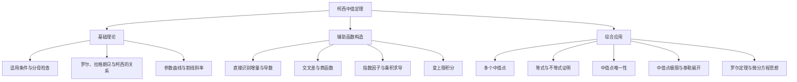
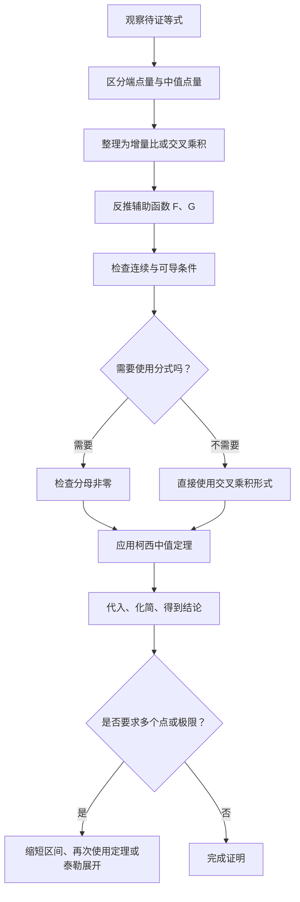
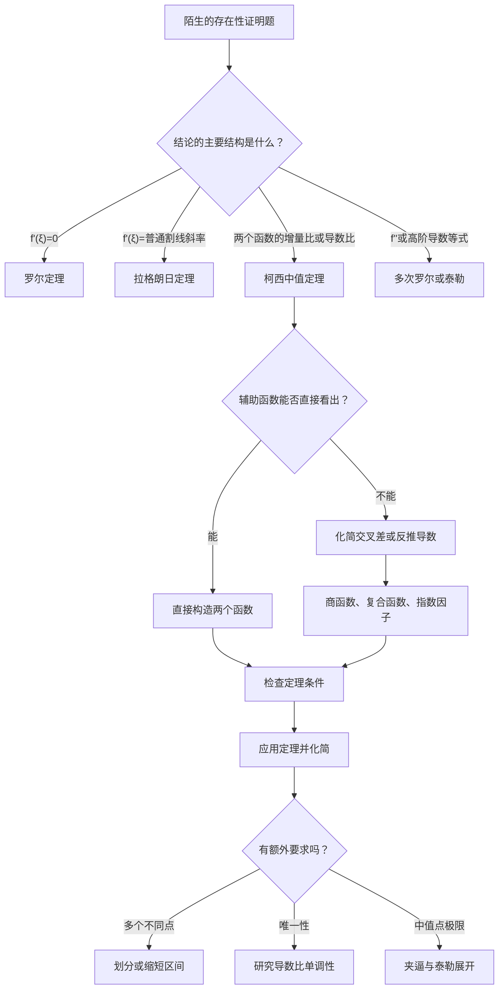

## 一、本节知识体系与学习目标

| 题目来源              | 核心考查内容         | 学习优先级 |
| ----------------- | -------------- | ----- |
| 1998年数学三真题        | 拉格朗日与柯西定理联用    | ★★★★★ |
| 2003年数学二真题        | 变上限积分、两中值点构造   | ★★★★★ |
| 张宇1000题           | 根据目标式反推辅助函数    | ★★★★★ |
| 李林880题            | 指数型交叉差、商函数构造   | ★★★★★ |
| 李正元练习题            | 行列式、指数因子构造     | ★★★★★ |
| 汤家凤2027八套卷第3套第19题 | 柯西定理与多次罗尔定理综合  | ★★★★★ |
| 原创题           | 中值点的存在性、唯一性和极限 | ★★★★☆ |

数学二、数学三的相关真题同样适用于数学一的通用方法训练。

本节可以归纳为以下知识结构：

学完这一节，你应当能够做到：拿到一个陌生的待证等式，不依赖背过的原题，就能从式子的结构反推出应该构造的两个函数。

## 二、基础知识：从理解到掌握柯西中值定理

### 2.1 柯西中值定理的标准形式

设函数 $F(x),G(x)$ 满足：

1. 在闭区间 $[a,b]$ 上连续；
2. 在开区间 $(a,b)$ 内可导；
3. 对任意 $x\in(a,b)$，有 $G'(x)\ne0$。

那么至少存在一点 $\xi\in(a,b)$，使得

$$
\boxed{ \frac{F(b)-F(a)}{G(b)-G(a)} =\frac{F'(\xi)}{G'(\xi)} }
$$

为了方便后续学习，记

$$
\Delta F=F(b)-F(a), \qquad \Delta G=G(b)-G(a).
$$

那么柯西中值定理可以简写为

$$
\boxed{\frac{\Delta F}{\Delta G} =\frac{F'(\xi)}{G'(\xi)}}
$$

即：

**两个函数的整体增量之比，等于某个相同中间点处的瞬时变化率之比。**

一定要注意，右边的两个导数必须在同一个中值点处取值。

### 2.2 更本质、更通用的交叉乘积形式

只要满足前两个条件，即闭区间连续、开区间可导，就能够保证存在 $\xi\in(a,b)$，使

$$
\boxed{ [F(b)-F(a)]G'(\xi) =[G(b)-G(a)]F'(\xi) }
$$

或者写成

$$
\boxed{\Delta F\cdot G'(\xi) =\Delta G\cdot F'(\xi)}
$$

这个形式不要求 $G'(x)\ne0$，也不要求 $G(b)\ne G(a)$。

| 比较项目     | 分式形式    | 交叉乘积形式       |
| -------- | ------- | ------------ |
| 闭区间连续    | 必须      | 必须           |
| 开区间可导    | 必须      | 必须           |
| 分母非零     | 必须核查    | 不需要          |
| 能否处理退化情形 | 受到限制    | 可以           |
| 主要用途     | 导数比、增量比 | 等式证明、方程根的存在性 |

以后遇到柯西中值定理的题目，尤其是条件较少或含有参数的题目，优先考虑交叉乘积形式，可以避免很多不必要的限制。

### 2.3 定理的证明：辅助函数究竟从哪里来？

构造辅助函数

$$
H(x)=\Delta G[F(x)-F(a)] -\Delta F[G(x)-G(a)].
$$

首先，

$$
H(a)=0.
$$

其次，

$$
\begin{aligned} H(b) &=\Delta G\Delta F-\Delta F\Delta G\\ &=0. \end{aligned}
$$

因此，

$$
H(a)=H(b).
$$

由罗尔中值定理，存在 $\xi\in(a,b)$，使

$$
H'(\xi)=0.
$$

而

$$
H'(x)=\Delta G F'(x)-\Delta F G'(x).
$$

所以

$$
\Delta G F'(\xi)=\Delta F G'(\xi).
$$

即

$$
\boxed{\Delta F G'(\xi)=\Delta G F'(\xi)}.
$$

如果相关分母均非零，再进行除法，就得到标准分式形式。

**这个证明值得真正理解，而不是简单背诵。**

以后即使题目不满足教材中的标准柯西中值定理条件，也可以直接构造上述辅助函数，借助罗尔定理完成证明。

### 2.4 几何意义：曲线的割线与切线平行

拉格朗日中值定理研究的是普通函数曲线

$$
y=F(x).
$$

而柯西中值定理可以理解为研究参数曲线

$$
\begin{cases} X=G(t),\\ Y=F(t), \end{cases} \qquad a\leq t\leq b.
$$

连接曲线上两个端点，其割线斜率为

$$
k_{\text{割线}} =\frac{F(b)-F(a)}{G(b)-G(a)}.
$$

曲线在参数 $t=\xi$ 处的切线斜率为

$$
k_{\text{切线}} =\frac{\mathrm dY}{\mathrm dX} =\frac{F'(\xi)}{G'(\xi)}.
$$

柯西中值定理说明，在满足相应条件时，至少存在一处切线与这条割线平行。

它相当于把拉格朗日中值定理中的横坐标 $x$，推广为另一个函数 $G(x)$。

### 2.5 罗尔、拉格朗日、柯西中值定理的联系

| 定理       | 核心结构                                                                    | 主要用途        |
| -------- | ----------------------------------------------------------------------- | ----------- |
| 罗尔中值定理   | $F(a)=F(b)\Rightarrow F'(\xi)=0$                                    | 导数零点、方程根    |
| 拉格朗日中值定理 | $\displaystyle F'(\xi)=\frac{F(b)-F(a)}{b-a}$                       | 函数增量、导数估计   |
| 柯西中值定理   | $\displaystyle \frac{F'(\xi)}{G'(\xi)}=\frac{F(b)-F(a)}{G(b)-G(a)}$ | 两函数的增量比与导数比 |

取

$$
G(x)=x,
$$

柯西中值定理就成为拉格朗日中值定理：

$$
\frac{F(b)-F(a)}{b-a}=F'(\xi).
$$

再增加条件 $F(a)=F(b)$，就成为罗尔中值定理：

$$
F'(\xi)=0.
$$

因此，三者在结构上具有如下关系：

$$
\boxed{ \text{柯西中值定理} \xrightarrow{G(x)=x} \text{拉格朗日中值定理} \xrightarrow{F(a)=F(b)} \text{罗尔中值定理} }
$$

不过解题时，并不是定理越高级越好。能直接使用罗尔定理或拉格朗日中值定理解决的问题，不必强行构造两个函数。

### 2.6 五个必须掌握的性质与推论

**性质一：分母函数的导数处处非零，可以推出其端点增量非零。**

如果

$$
G'(x)\ne0,\qquad x\in(a,b),
$$

由拉格朗日中值定理，存在 $c\in(a,b)$，使

$$
G(b)-G(a)=G'(c)(b-a)\ne0.
$$

因此分式形式中的左、右两个分母均非零。

但反过来，仅仅知道 $G(b)\ne G(a)$，不能保证 $G'(x)$ 处处非零。

例如，在 $[-1,1]$ 上取

$$
F(x)=x^2,\qquad G(x)=x^3.
$$

虽然 $G(1)-G(-1)=2\ne0$，但柯西定理的交叉乘积形式要求

$$
0=2\cdot2\xi,
$$

只能取 $\xi=0$，此时 $G'(0)=0$，导数比没有意义。

这说明为什么不能随意把交叉乘积形式改写为分式。

**性质二：导数比的范围决定增量比的范围。**

若在 $(a,b)$ 内恒有

$$
m\leq\frac{F'(x)}{G'(x)}\leq M,
$$

并且 $G'(x)\ne0$，则

$$
\boxed{ m\leq\frac{F(b)-F(a)}{G(b)-G(a)} \leq M }
$$

证明只需使用一次柯西中值定理。

这个结论可以直接用于证明不等式、估计函数增量、求参数取值范围。

**性质三：导数比恒为常数，可以推出两个函数之间的线性关系。**

如果在某个区间内

$$
\frac{F'(x)}{G'(x)}=k,
$$

那么

$$
F'(x)-kG'(x)=0.
$$

从而

$$
\boxed{F(x)=kG(x)+C}.
$$

它体现的是中值定理与导数为零的函数必为常数之间的联系。

**性质四：导数比严格单调，可以保证柯西中值点的唯一性。**

设

$$
h(x)=\frac{F'(x)}{G'(x)}.
$$

柯西中值定理所保证的中值点，本质上是方程

$$
h(\xi)=\frac{\Delta F}{\Delta G}
$$

的解。

如果 $h(x)$ 严格单调，那么这个方程至多有一个解，再结合柯西中值定理保证的存在性，即可得到中值点唯一。

必要时可以计算

$$
h'(x)= \frac{F''(x)G'(x)-F'(x)G''(x)} {[G'(x)]^2}.
$$

这是后面处理创新题中“存在唯一中值点”的基本套路。

**性质五：柯西中值定理是洛必达法则的理论基础之一。**

假设

$$
F(a)=G(a)=0,
$$

且满足相应定理条件，则对 $x>a$，在 $[a,x]$ 上使用柯西中值定理，有

$$
\frac{F(x)}{G(x)} =\frac{F'(\xi_x)}{G'(\xi_x)}, \qquad a<\xi_x<x.
$$

当 $x\to a^+$ 时，由夹逼准则，

$$
\xi_x\to a^+.
$$

若

$$
\lim_{t\to a^+}\frac{F'(t)}{G'(t)}=L,
$$

则

$$
\lim_{x\to a^+}\frac{F(x)}{G(x)}=L.
$$

所以柯西定理还可以用来理解极限题，而不仅仅是证明题。

## 三、解题核心：如何识别柯西中值定理并构造辅助函数

### 3.1 看到什么结构，应该想到柯西中值定理？

| 题目中的信号                                                       | 优先考虑的构造                                             |
| ------------------------------------------------------------ | --------------------------------------------------- |
| $b-a$ 与 $f'(\xi)$                                    | 拉格朗日中值定理                                            |
| $b^2-a^2$ 与 $2\xi$                                   | $G(x)=x^2$                                      |
| $b^n-a^n$ 与 $n\xi^{n-1}$                             | $G(x)=x^n$                                      |
| $e^b-e^a$ 与 $e^\xi$                                  | $G(x)=e^x$                                      |
| $\ln b-\ln a$ 与 $1/\xi$                              | $G(x)=\ln x$                                    |
| $f(\xi)f'(\xi)$                                          | $F(x)=f^2(x)/2$                                 |
| $f'(\xi)-kf(\xi)$                                        | $F(x)=e^{-kx}f(x)$                              |
| $\xi f'(\xi)-f(\xi)$                                     | $F(x)=f(x)/x$                                   |
| $af(b)-bf(a)$                                            | $F(x)=f(x)/x$                                   |
| $\displaystyle\int_a^b f(t)\,\mathrm dt$ 与 $f(\xi)$ | $\displaystyle F(x)=\int_a^x f(t)\,\mathrm dt$ |
| 两个不同位置的导数                                                    | 多次使用中值定理                                            |
| $\theta(x)x$ 与极限                                         | 中值定理、夹逼、泰勒公式                                        |

这些不是需要机械背诵的公式，而是辅助函数的识别线索。

### 3.2 最重要的逆向构造思想

假设题目要求证明

$$
A(a,b)u(\xi)=B(a,b)v(\xi).
$$

你应当思考能否将其整理为

$$
[F(b)-F(a)]G'(\xi) =[G(b)-G(a)]F'(\xi).
$$

具体来说，寻找以下对应关系：

$$
\begin{cases} A(a,b)=F(b)-F(a),\\ B(a,b)=G(b)-G(a),\\ u(x)=G'(x),\\ v(x)=F'(x). \end{cases}
$$

这就是从结论反推辅助函数。

例如，看到

$$
[f(b)-f(a)]e^\xi =(e^b-e^a)f'(\xi),
$$

自然就应想到

$$
F(x)=f(x),\qquad G(x)=e^x.
$$

### 3.3 标准解题流程

掌握这个流程之后，柯西定理的证明题就不再是纯粹靠灵感构造的问题。

## 四、历年真题母题精讲

以下两道真题代表两类综合证明模型。

### 母题1：拉格朗日中值定理与柯西中值定理联用

**来源：1998年考研数学三真题。**

设 $f$ 在 $[a,b]$ 上连续，在 $(a,b)$ 内可导，且 $f'(x)\ne0$。

证明存在 $\xi,\eta\in(a,b)$，使得

$$
\frac{f'(\xi)}{f'(\eta)} =\frac{e^b-e^a}{b-a}e^{-\eta}.
$$

**1. 审题与识别**

这道题有三个重要信号：

- $f'(\xi)$ 和 $f'(\eta)$：说明可能需要两次中值定理。
- $b-a$：提示拉格朗日中值定理。
- $e^b-e^a$ 与 $e^{-\eta}$：提示选取指数函数使用柯西中值定理。

最关键的是发现，两次定理可以通过共同的函数增量 $f(b)-f(a)$ 联系起来。

**2. 标准证明**

由拉格朗日中值定理，存在 $\xi\in(a,b)$，使得

$$
f'(\xi)=\frac{f(b)-f(a)}{b-a}. \tag{1}
$$

再令

$$
F(x)=f(x),\qquad G(x)=e^x.
$$

由于两函数在闭区间连续、开区间可导，且

$$
G'(x)=e^x>0,
$$

故由柯西中值定理，存在 $\eta\in(a,b)$，使

$$
\frac{f(b)-f(a)}{e^b-e^a} =\frac{f'(\eta)}{e^\eta}.
$$

整理得

$$
f(b)-f(a) =(e^b-e^a)e^{-\eta}f'(\eta). \tag{2}
$$

将式（2）代入式（1），有

$$
f'(\xi)= \frac{e^b-e^a}{b-a}e^{-\eta}f'(\eta).
$$

因为 $f'(\eta)\ne0$，所以

$$
\boxed{ \frac{f'(\xi)}{f'(\eta)} =\frac{e^b-e^a}{b-a}e^{-\eta} }.
$$

证毕。

**3. 提炼通用母题**

把指数函数推广为任意满足条件的函数 $g(x)$。

分别使用拉格朗日和柯西中值定理：

$$
f'(\xi)=\frac{\Delta f}{b-a},
$$

$$
\frac{f'(\eta)}{g'(\eta)} =\frac{\Delta f}{\Delta g}.
$$

消去公共增量 $\Delta f$，得到

$$
\boxed{ f'(\xi) =\frac{g(b)-g(a)}{b-a} \frac{f'(\eta)}{g'(\eta)} }
$$

如果 $f'(\eta)\ne0$，还可以得到

$$
\boxed{ \frac{f'(\xi)}{f'(\eta)} =\frac{g(b)-g(a)} {(b-a)g'(\eta)} }.
$$

这才是1998年真题最值得掌握的通用模型。

**4. 迁移到李正元练习题**

**来源：李正元第四章。**

设 $b>a\geq0$，证明存在 $\xi,\eta\in(a,b)$，使

$$
f'(\xi)=\frac{a+b}{2\eta}f'(\eta).
$$

只需取

$$
g(x)=x^2.
$$

由刚才的通用模型，立即得到

$$
\begin{aligned} f'(\xi) &=\frac{b^2-a^2}{b-a} \frac{f'(\eta)}{2\eta}\\ &=\frac{a+b}{2\eta}f'(\eta). \end{aligned}
$$

两道题表面上的指数函数和平方函数不同，但本质完全一样。

**易错点：** 两次中值定理产生的 $\xi,\eta$ 可能相同，也可能不同。题目没有要求相异时，不必证明它们相异；如果题目要求相异，则必须额外构造。

### 母题2：极限条件、变上限积分与多个中值点

**来源：2003年考研数学二真题。**

这是本节最值得深入研究的综合真题之一。

设 $f$ 在 $[a,b]$ 上连续，在 $(a,b)$ 内可导，且 $f'(x)>0$。若有限极限

$$
\lim_{x\to a^+}\frac{f(2x-a)}{x-a}
$$

存在，证明：

（1）在 $(a,b)$ 内有 $f(x)>0$。

（2）存在 $\xi\in(a,b)$，使得

$$
\frac{b^2-a^2}{\displaystyle\int_a^b f(x)\,\mathrm dx} =\frac{2\xi}{f(\xi)}.
$$

（3）存在与 $\xi$ 相异的 $\eta\in(a,b)$，使得

$$
f'(\eta)(b^2-a^2) =\frac{2\xi}{\xi-a}\int_a^b f(x)\,\mathrm dx.
$$

**第一问：利用极限条件挖掘隐藏信息**

当 $x\to a^+$ 时，

$$
x-a\to0^+.
$$

因为题给极限是有限的，所以

$$
\begin{aligned} f(a) &=\lim_{x\to a^+}f(2x-a)\\ &=\lim_{x\to a^+} \left[ (x-a)\frac{f(2x-a)}{x-a} \right]\\ &=0. \end{aligned}
$$

又因为

$$
f'(x)>0,
$$

故 $f(x)$ 在 $[a,b]$ 上严格单调递增。

因此，对任意 $x\in(a,b)$，有

$$
\boxed{f(x)>f(a)=0}.
$$

同时还能得到后续证明需要的条件：

$$
\boxed{\int_a^b f(t)\,\mathrm dt>0}.
$$

注意第一问并不是孤立的小题，而是在为第二问使用柯西中值定理准备分母非零条件。

**第二问：利用积分反推辅助函数**

观察目标：

$$
\frac{b^2-a^2}{\int_a^b f(x)\,\mathrm dx} =\frac{2\xi}{f(\xi)}.
$$

左边分子与右边分子分别是

$$
b^2-a^2,\qquad 2\xi.
$$

因此选择

$$
F(x)=x^2.
$$

左边分母是定积分，右边分母是被积函数，因此选择

$$
G(x)=\int_a^x f(t)\,\mathrm dt.
$$

于是

$$
F'(x)=2x,\qquad G'(x)=f(x).
$$

由第一问知

$$
G'(x)=f(x)>0,\qquad x\in(a,b).
$$

故满足柯西中值定理的条件，存在 $\xi\in(a,b)$，使

$$
\frac{F(b)-F(a)}{G(b)-G(a)} =\frac{F'(\xi)}{G'(\xi)}.
$$

代入即得

$$
\boxed{ \frac{b^2-a^2}{\int_a^b f(t)\,\mathrm dt} =\frac{2\xi}{f(\xi)} }.
$$

这里不需要额外要求 $a>0$，因为作为分母函数的是变上限积分，分母导数是 $f(x)$，而不是 $2x$。

**第三问：利用缩短区间制造不同的中值点**

将第二问的结论交叉相乘：

$$
f(\xi)(b^2-a^2) =2\xi\int_a^b f(t)\,\mathrm dt. \tag{1}
$$

对比第三问：

$$
f'(\eta)(b^2-a^2) =\frac{2\xi}{\xi-a}\int_a^b f(t)\,\mathrm dt.
$$

我们发现，只需想办法建立

$$
f(\xi)=(\xi-a)f'(\eta).
$$

又由第一问知 $f(a)=0$，所以

$$
f(\xi)=f(\xi)-f(a).
$$

此时在区间 $[a,\xi]$ 上使用拉格朗日中值定理，存在

$$
\eta\in(a,\xi),
$$

使

$$
f(\xi)-f(a)=(\xi-a)f'(\eta).
$$

即

$$
f(\xi)=(\xi-a)f'(\eta).
$$

代入式（1），得到

$$
(\xi-a)f'(\eta)(b^2-a^2) =2\xi\int_a^b f(t)\,\mathrm dt.
$$

整理得

$$
\boxed{ f'(\eta)(b^2-a^2) =\frac{2\xi}{\xi-a}\int_a^b f(t)\,\mathrm dt }.
$$

又由于

$$
a<\eta<\xi<b,
$$

所以 $\eta\ne\xi$。

证毕。

**这道真题最值得掌握的四个思想**

第一，有限极限条件可能隐藏端点函数值。

$$
\lim_{x\to a}\frac{f(x)}{x-a} \text{为有限实数} \quad\Longrightarrow\quad f(a)=0
$$

这里需要相应的连续性条件。

第二，定积分与内部函数值之间，可以通过变上限积分建立桥梁：

$$
\int_a^b f(t)\,\mathrm dt \longleftrightarrow f(\xi).
$$

第三，不同问之间往往有严格的逻辑依赖关系：

$$
\text{端点值} \Rightarrow\text{函数正性} \Rightarrow\text{柯西定理} \Rightarrow\text{再次使用中值定理}.
$$

第四，想要保证两个中值点不同，**优先考虑缩短区间或者划分区间**，而不是在同一个区间内机械地使用两次定理。

## 五、基本题型：直接构造、交叉差与指数因子

### 题型一：根据端点增量反推辅助函数

### 母题3：张宇1000题——方程根的存在性

**来源：张宇1000题第6章。**

设 $f(x)$ 在 $[a,b]$ 上连续，在 $(a,b)$ 内可导，且 $a>0$。

证明方程

$$
2x[f(b)-f(a)]=(b^2-a^2)f'(x)
$$

在 $(a,b)$ 内至少有一个实根。

**思路分析**

方程有实根，就是存在 $\xi\in(a,b)$，满足

$$
2\xi[f(b)-f(a)] =(b^2-a^2)f'(\xi).
$$

将其与标准形式比较：

$$
G'(\xi)[F(b)-F(a)] =[G(b)-G(a)]F'(\xi).
$$

很容易识别出

$$
F(x)=f(x),\qquad G(x)=x^2.
$$

因为

$$
G'(x)=2x,\qquad G(b)-G(a)=b^2-a^2.
$$

**标准证明**

令 $G(x)=x^2$。

由题设知 $f,G$ 在 $[a,b]$ 上连续，在 $(a,b)$ 内可导。

根据柯西中值定理的交叉乘积形式，存在 $\xi\in(a,b)$，使

$$
[f(b)-f(a)]G'(\xi) =[G(b)-G(a)]f'(\xi).
$$

即

$$
\boxed{ 2\xi[f(b)-f(a)] =(b^2-a^2)f'(\xi) }.
$$

故所给方程至少存在一个实根。

**更深层次：题设中的 $a>0$ 是否必要？**

对于这道题所要求的交叉乘积等式，其实不需要 $a>0$。

只要 $a<b$，以及函数满足连续与可导条件，交叉乘积形式就能保证结论成立。

即使

$$
a=-b,
$$

导致

$$
b^2-a^2=0,
$$

仍然可以取 $\xi=0$，使等式成立。

这就是从“会做题”到“理解定理”的区别：知道每个条件到底起什么作用。

**通用模型**

对于任意满足连续可导条件的 $f,g$，方程

$$
\boxed{ g'(x)[f(b)-f(a)] -f'(x)[g(b)-g(a)]=0 }
$$

在 $(a,b)$ 内至少有一个实根。

即使题目把它写成行列式形式，

$$
\begin{vmatrix} f(b)-f(a)&g(b)-g(a)\\ f'(x)&g'(x) \end{vmatrix}=0,
$$

本质上仍然是同一个模型。

### 题型二：端点交叉差与商函数构造

### 母题4：李林880题——隐藏较深的柯西中值定理

**来源：李林880题高数第二章。**

设 $0<a<b$，证明存在 $\xi\in(a,b)$，使

$$
\frac{ae^b-be^a}{a-b} =e^\xi(1-\xi).
$$

这道题的难点不在使用定理，而在识别左端那个不标准的分式。

<Tabs items={["方法一：从左端的交叉差入手", "方法二：从右端反推辅助函数"]} defaultIndex={0}>

<Tab value="方法一：从左端的交叉差入手">

观察分子

$$
ae^b-be^a.
$$

如果分子分母同时除以 $ab$，就能把交叉差拆成标准增量：

$$
\frac{ae^b-be^a}{a-b} = \frac{\dfrac{e^b}{b}-\dfrac{e^a}{a}} {\dfrac1b-\dfrac1a}.
$$

于是自然选择

$$
F(x)=\frac{e^x}{x}, \qquad G(x)=\frac1x.
$$

计算导数：

$$
F'(x)=\frac{e^x(x-1)}{x^2},
$$

$$
G'(x)=-\frac1{x^2}\ne0.
$$

由柯西中值定理，存在 $\xi\in(a,b)$，使得

$$
\begin{aligned} \frac{ae^b-be^a}{a-b} &=\frac{F(b)-F(a)}{G(b)-G(a)}\\ &=\frac{F'(\xi)}{G'(\xi)}\\ &=\frac{e^\xi(\xi-1)/\xi^2}{-1/\xi^2}\\ &=e^\xi(1-\xi). \end{aligned}
$$

证毕。

</Tab>

<Tab value="方法二：从右端反推辅助函数">

如果一开始没有看出左端怎么变形，可以分析右端：

$$
e^x(1-x).
$$

它可以写成

$$
-\bigl[xe^x-e^x\bigr].
$$

而

$$
\left(\frac{e^x}{x}\right)' =\frac{xe^x-e^x}{x^2}.
$$

要消去分母 $x^2$，就需要另一个导数：

$$
\left(\frac1x\right)'=-\frac1{x^2}.
$$

所以可以逆向确定

$$
F(x)=\frac{e^x}{x}, \qquad G(x)=\frac1x.
$$

这两种识别方向都需要掌握：既可以从端点量出发，也可以从内部导数出发。

<Callout type="warn" title="导数比">

右端应为 $F'/G'$，不能遗漏分母 $G'$。

</Callout>

</Tab>

</Tabs>

**通用母题**

设 $0<a<b$，且 $f$ 在 $[a,b]$ 上连续、在 $(a,b)$ 内可导。

取

$$
F(x)=\frac{f(x)}x, \qquad G(x)=\frac1x.
$$

由于

$$
\frac{F'(x)}{G'(x)} =\frac{[xf'(x)-f(x)]/x^2}{-1/x^2},
$$

故

$$
\frac{F'(x)}{G'(x)} =f(x)-xf'(x).
$$

因此存在 $\xi\in(a,b)$，使

$$
\boxed{ \frac{af(b)-bf(a)}{a-b} =f(\xi)-\xi f'(\xi) }.
$$

以后只要见到类似结构

$$
af(b)-bf(a),
$$

就应该想到这个母题。

### 题型三：指数因子与行列式证明

### 母题5：李正元练习题——从 $f-f'$ 反推指数函数

**来源：李正元第四章。**

设 $0<x_1<x_2$，函数 $f(x)$ 在 $[x_1,x_2]$ 上可导。

证明存在 $c\in(x_1,x_2)$，使

$$
\frac1{e^{x_1}-e^{x_2}} \begin{vmatrix} e^{x_1}&e^{x_2}\\ f(x_1)&f(x_2) \end{vmatrix} =f(c)-f'(c).
$$

<Steps>

<Step>

### 第一步：观察右端的微分结构 [!toc]

出现

$$
f(x)-f'(x),
$$

应该立即联想到乘积求导公式：

$$
(e^{-x}f(x))' =e^{-x}[f'(x)-f(x)].
$$

再考虑

$$
(e^{-x})'=-e^{-x}.
$$

两者相除正好得到

$$
\frac{(e^{-x}f(x))'}{(e^{-x})'} =f(x)-f'(x).
$$

因此选择

$$
F(x)=e^{-x}f(x), \qquad G(x)=e^{-x}.
$$

</Step>

<Step>

### 第二步：应用柯西中值定理 [!toc]

因为

$$
G'(x)=-e^{-x}\ne0,
$$

所以存在 $c\in(x_1,x_2)$，使

$$
\begin{aligned} \frac{F(x_2)-F(x_1)}{G(x_2)-G(x_1)} &=\frac{F'(c)}{G'(c)}\\ &=f(c)-f'(c). \end{aligned}
$$

</Step>

<Step>

### 第三步：把增量比还原为原题 [!toc]

$$
\begin{aligned} &\frac{F(x_2)-F(x_1)}{G(x_2)-G(x_1)}\\ ={}&\frac{e^{-x_2}f(x_2)-e^{-x_1}f(x_1)} {e^{-x_2}-e^{-x_1}}\\ ={}&\frac{e^{x_1}f(x_2)-e^{x_2}f(x_1)} {e^{x_1}-e^{x_2}}\\ ={}&\frac1{e^{x_1}-e^{x_2}} \begin{vmatrix} e^{x_1}&e^{x_2}\\ f(x_1)&f(x_2) \end{vmatrix}. \end{aligned}
$$

由此得到原结论。

</Step>

</Steps>

**进一步推广：统一前面两道题**

李林的交叉差证明和李正元的行列式证明，其实属于同一个更加一般的模型。

设 $w(x)\ne0$，且 $w'(x)\ne0$，取

$$
F(x)=\frac{f(x)}{w(x)}, \qquad G(x)=\frac1{w(x)}.
$$

则

$$
F'(x)=\frac{w(x)f'(x)-w'(x)f(x)} {w^2(x)},
$$

$$
G'(x)=-\frac{w'(x)}{w^2(x)}.
$$

所以

$$
\boxed{ \frac{F'(x)}{G'(x)} =f(x)-\frac{w(x)}{w'(x)}f'(x) }.
$$

由柯西中值定理可得统一公式：

$$
\boxed{ \begin{aligned} &\frac{w(a)f(b)-w(b)f(a)}{w(a)-w(b)}\\ &=f(\xi)-\frac{w(\xi)}{w'(\xi)}f'(\xi), \qquad \xi\in(a,b). \end{aligned} }
$$

其中 $f,w$ 满足相应的连续与可导条件，且 $w$ 在闭区间内不为零、$w'$ 在开区间内不为零。

| $w(x)$ 的选取 | 导数比的结果                                          |
| -------------- | ----------------------------------------------- |
| $x$        | $f(\xi)-\xi f'(\xi)$                        |
| $x^n$      | $\displaystyle f(\xi)-\frac{\xi}{n}f'(\xi)$ |
| $e^x$      | $f(\xi)-f'(\xi)$                            |
| $e^{kx}$   | $\displaystyle f(\xi)-\frac1k f'(\xi)$      |
| $\ln x$    | $f(\xi)-\xi\ln\xi\, f'(\xi)$               |

各行均应满足统一模型要求的定义域及非零条件。

这个统一模型非常值得掌握。它可以让你在看到未练过的交叉差、指数函数或行列式证明题时，仍然有明确的构造方向。

## 六、多个中值点与复合函数构造

### 母题6：李林880强化题——如何识别 $ff'$ 的结构

**来源：李林880题第二章。**

设 $f(x)$ 在 $[0,1]$ 上连续，在 $(0,1)$ 内可导，且

$$
f(0)=0,\qquad f(1)=1.
$$

证明：

（1）存在 $0<\xi_1<\xi_2<1$，使

$$
f'(\xi_1)+f'(\xi_2)=2.
$$

（2）存在 $\xi,\eta\in(0,1)$，使

$$
\eta f'(\xi)=f(\eta)f'(\eta).
$$

**第一问：通过等分区间消去中间函数值**

分别在

$$
\left[0,\frac12\right], \qquad \left[\frac12,1\right]
$$

上应用拉格朗日中值定理。

存在

$$
0<\xi_1<\frac12<\xi_2<1,
$$

使得

$$
f'(\xi_1) =2f\left(\frac12\right),
$$

$$
f'(\xi_2) =2\left[1-f\left(\frac12\right)\right].
$$

两式相加，

$$
\boxed{f'(\xi_1)+f'(\xi_2)=2}.
$$

这就是通过划分区间构造多个不同中值点的经典方法。

**第二问：从复合函数导数入手**

目标等式变形为

$$
f'(\xi)=\frac{f(\eta)f'(\eta)}{\eta}.
$$

注意

$$
(f^2(x))'=2f(x)f'(x),
$$

$$
(x^2)'=2x.
$$

所以应当选择

$$
F(x)=f^2(x),\qquad G(x)=x^2.
$$

先由拉格朗日中值定理知，存在 $\xi\in(0,1)$，使

$$
f'(\xi)=\frac{f(1)-f(0)}{1-0}=1.
$$

再由柯西中值定理知，存在 $\eta\in(0,1)$，使

$$
\begin{aligned} \frac{f(\eta)f'(\eta)}{\eta} &=\frac{F'(\eta)}{G'(\eta)}\\ &=\frac{f^2(1)-f^2(0)}{1^2-0^2}\\ &=1. \end{aligned}
$$

于是

$$
f'(\xi)=\frac{f(\eta)f'(\eta)}{\eta}.
$$

即

$$
\boxed{\eta f'(\xi)=f(\eta)f'(\eta)}.
$$

**母题推广**

设 $n\geq2$ 为整数，并保持上述端点条件。

取

$$
F(x)=f^n(x), \qquad G(x)=x^n.
$$

应用柯西定理可得存在 $\eta\in(0,1)$，使

$$
\frac{f^{n-1}(\eta)f'(\eta)} {\eta^{n-1}}=1.
$$

结合 $f'(\xi)=1$，便得到

$$
\boxed{ \eta^{n-1}f'(\xi) =f^{n-1}(\eta)f'(\eta) }.
$$

所以遇到 $f^2f'$、$f^3f'$ 等结构也不用害怕。

常见复合函数导数应该形成条件反射：

| 目标式中的结构                               | 对应的原函数                                    |
| ------------------------------------- | ----------------------------------------- |
| $f(x)f'(x)$                       | $\displaystyle\frac12 f^2(x)$         |
| $f^n(x)f'(x)$                     | $\displaystyle\frac{f^{n+1}(x)}{n+1}$ |
| $\displaystyle\frac{f'(x)}{f(x)}$ | $\ln\lvert f(x)\rvert $                         |
| $e^{f(x)}f'(x)$                   | $e^{f(x)}$                            |
| $\sin f(x)\cdot f'(x)$            | $-\cos f(x)$                          |
| $f'(x)\cos f(x)$                  | $\sin f(x)$                           |

## 七、数学一模拟大题：柯西中值定理与罗尔定理深度综合

### 母题7：汤家凤2027八套卷第三套第19题

**来源：网盘分类模拟题，数学一，12分。**

设 $f(x)$ 在 $[0,2]$ 上连续，在 $(0,2)$ 内可导，且

$$
\int_0^1f(x)\,\mathrm dx=0,
$$

$$
\int_1^2f(x)\,\mathrm dx=0,
$$

$$
f(1)=1.
$$

证明：

（1）存在 $c\in(0,1)$，使

$$
(1-c)[1-f(0)]=f'(c)e^{c-1}.
$$

（2）存在 $\xi\in(0,2)$，使

$$
f'(\xi)=\int_0^\xi f(x)\,\mathrm dx.
$$

第一问是辅助函数识别，第二问是变上限积分、多次罗尔定理与指数因子综合。

**第一问：从复杂系数反推辅助函数**

将目标式改写为

$$
(1-c)e^{-c}[f(1)-f(0)] =e^{-1}f'(c).
$$

观察到

$$
(xe^{-x})'=(1-x)e^{-x}.
$$

并且

$$
1\cdot e^{-1}-0\cdot e^0=e^{-1}.
$$

因此构造

$$
g(x)=xe^{-x}.
$$

在 $[0,1]$ 上，由柯西中值定理的交叉乘积形式，存在 $c\in(0,1)$，使

$$
[f(1)-f(0)]g'(c) =[g(1)-g(0)]f'(c).
$$

代入

$$
f(1)=1,\quad g(1)-g(0)=e^{-1},
$$

得到

$$
[1-f(0)](1-c)e^{-c} =e^{-1}f'(c).
$$

两边乘以 $e^c$，得

$$
\boxed{ (1-c)[1-f(0)] =f'(c)e^{c-1} }.
$$

第一问完成。

这里的关键不是猜测 $xe^{-x}$，而是看到 $(1-x)e^{-x}$ 后，联想到乘积求导。

**第二问：从微分方程结构逆向构造**

要求证明

$$
f'(\xi)=\int_0^\xi f(t)\,\mathrm dt.
$$

首先令

$$
F(x)=\int_0^x f(t)\,\mathrm dt.
$$

于是

$$
F'(x)=f(x),\qquad F''(x)=f'(x).
$$

目标转化为

$$
\boxed{F''(\xi)-F(\xi)=0}.
$$

根据题设条件，

$$
F(0)=F(1)=F(2)=0.
$$

现在问题已经变成：一个二阶可导函数在三个不同点处为零，证明它的某种二阶微分表达式在内部也有零点。

**关键构造：如何把 $F''-F$ 拆成两次求导？**

观察

$$
F''-F=(F'+F)'-(F'+F).
$$

令

$$
U(x)=F'(x)+F(x).
$$

就有

$$
U'(x)-U(x)=F''(x)-F(x).
$$

进一步，

$$
(e^{-x}U(x))' =e^{-x}[U'(x)-U(x)].
$$

同时

$$
(e^xF(x))' =e^x[F'(x)+F(x)].
$$

于是得到完整的辅助函数构造。

**标准证明**

令

$$
H(x)=e^xF(x).
$$

由于

$$
F(0)=F(1)=F(2)=0,
$$

所以

$$
H(0)=H(1)=H(2)=0.
$$

分别在 $[0,1]$、$[1,2]$ 上应用罗尔定理，存在

$$
\xi_1\in(0,1), \qquad \xi_2\in(1,2),
$$

使得

$$
H'(\xi_1)=H'(\xi_2)=0.
$$

又因为

$$
H'(x)=e^x[F'(x)+F(x)],
$$

且 $e^x>0$，所以

$$
F'(\xi_1)+F(\xi_1)=0,
$$

$$
F'(\xi_2)+F(\xi_2)=0.
$$

再次构造

$$
K(x)=e^{-x}[F'(x)+F(x)].
$$

显然

$$
K(\xi_1)=K(\xi_2)=0.
$$

在 $[\xi_1,\xi_2]$ 上再次应用罗尔定理，存在

$$
\xi\in(\xi_1,\xi_2),
$$

使

$$
K'(\xi)=0.
$$

而

$$
\begin{aligned} K'(x) &=e^{-x}[F''(x)+F'(x)]\\ &\quad-e^{-x}[F'(x)+F(x)]\\ &=e^{-x}[F''(x)-F(x)]. \end{aligned}
$$

因此

$$
F''(\xi)-F(\xi)=0.
$$

代回原函数，

$$
\boxed{ f'(\xi)=\int_0^\xi f(t)\,\mathrm dt }.
$$

第二问完成。

**进一步理解：微分算子的因式分解思想**

这一部分属于提高拓展，并不是必须额外学习的考纲定理，而是帮助你理解辅助函数为何能够这样构造。

记

$$
D=\frac{\mathrm d}{\mathrm dx}.
$$

则

$$
D^2-1=(D-1)(D+1).
$$

也就是

$$
F''-F=(D-1)(D+1)F.
$$

又有

$$
(D+k)F=e^{-kx}(e^{kx}F)'.
$$

因此，出现

$$
F''-k^2F
$$

时，可以使用

$$
D^2-k^2=(D-k)(D+k)
$$

进行两次指数因子构造。

更加一般地，如果

$$
F(a)=F(b)=F(c)=0, \qquad a<b<c,
$$

且 $F$ 满足相应的连续、二阶可导条件，那么对于任意实常数 $p,q$，通过依次构造

$$
H(x)=e^{-px}F(x),
$$

$$
K(x)=e^{-qx}[F'(x)-pF(x)],
$$

就可以证明存在 $\xi\in(a,c)$，使

$$
\boxed{ F''(\xi)-(p+q)F'(\xi)+pqF(\xi)=0 }.
$$

推导的关键是

$$
K'(x)=e^{-qx} [F''(x)-(p+q)F'(x)+pqF(x)].
$$

如果未来考研数学一把这道模拟题改成

$$
F''(\xi)-5F'(\xi)+6F(\xi)=0,
$$

则利用

$$
D^2-5D+6=(D-2)(D-3)
$$

即可反推出辅助函数。

**指数型辅助函数速查表**

| 待证表达式为零                                                  | 可考虑的辅助函数                                 |
| -------------------------------------------------------- | ---------------------------------------- |
| $f'(\xi)+kf(\xi)$                                    | $e^{kx}f(x)$                         |
| $f'(\xi)-kf(\xi)$                                    | $e^{-kx}f(x)$                        |
| $\xi f'(\xi)-f(\xi)$                                 | $f(x)/x$                             |
| $f''(\xi)+kf'(\xi)$                                  | $e^{kx}f'(x)$                        |
| $f''(\xi)-k^2f(\xi)$                                 | 两次指数因子构造                                 |
| $\displaystyle f'(\xi)-\int_a^\xi f(t)\,\mathrm dt$ | 先令 $F(x)=\int_a^x f(t)\,\mathrm dt$ |

注意：找到辅助函数只是第一步，还必须通过题设条件保证相应的端点函数值相等，才能使用罗尔定理。

## 八、创新题型：中值点的存在性、唯一性与极限

这类题目值得重点关注。传统证明题往往只要求证明某个中值点存在，而综合题还可以进一步要求：

- 证明中值点唯一；
- 求中值点的位置范围；
- 研究区间缩小时中值点的变化；
- 求中值点参数的极限；
- 将中值定理与泰勒公式结合。

### 母题8：原创强化题

**来源：原创强化题。**

设 $f\in C^3[0,\delta]$，且

$$
f(0)=f'(0)=0,\qquad f'''(0)\ne0.
$$

证明当 $x>0$ 充分小时，存在唯一的 $\theta(x)\in(0,1)$，使

$$
\frac{f(x)-f(0)}{x^2} =\frac{f'(\theta(x)x)}{2\theta(x)x},
$$

并求

$$
\lim_{x\to0^+}\theta(x).
$$

**第一部分：证明存在性**

在 $[0,x]$ 上取

$$
F(t)=f(t),\qquad G(t)=t^2.
$$

因为

$$
G'(t)=2t>0,\qquad 0<t<x,
$$

所以由柯西中值定理，存在 $\xi_x\in(0,x)$，使

$$
\frac{f(x)-f(0)}{x^2} =\frac{f'(\xi_x)}{2\xi_x}.
$$

令

$$
\theta(x)=\frac{\xi_x}{x},
$$

则

$$
0<\theta(x)<1,
$$

且

$$
\boxed{ \frac{f(x)-f(0)}{x^2} =\frac{f'(\theta(x)x)}{2\theta(x)x} }.
$$

存在性得证。

**第二部分：证明唯一性**

注意中值定理本身只保证存在，不保证唯一。

令

$$
h(t)=\frac{f'(t)}{2t}.
$$

那么需要证明方程

$$
h(t)=\frac{f(x)-f(0)}{x^2}
$$

在 $(0,x)$ 内只有一个解。

求导得到

$$
h'(t)=\frac{tf''(t)-f'(t)}{2t^2}.
$$

由泰勒公式以及 $f'(0)=0$，有

$$
f'(t)=f''(0)t+\frac12f'''(0)t^2+o(t^2),
$$

$$
f''(t)=f''(0)+f'''(0)t+o(t).
$$

因此

$$
\begin{aligned} tf''(t)-f'(t) &=\frac12f'''(0)t^2+o(t^2). \end{aligned}
$$

于是

$$
h'(t)=\frac14f'''(0)+o(1).
$$

由于

$$
f'''(0)\ne0,
$$

所以当 $t>0$ 充分小时，$h'(t)$ 符号恒定且不为零。

因此 $h(t)$ 在足够小的右邻域内严格单调。

结合已经证明的存在性，可知中值点唯一。

**第三部分：求中值点参数的极限**

由

$$
f(0)=f'(0)=0,
$$

对 $f(x)$ 进行泰勒展开：

$$
f(x)=\frac12f''(0)x^2 +\frac16f'''(0)x^3+o(x^3).
$$

故

$$
\frac{f(x)}{x^2} =\frac12f''(0)+\frac16f'''(0)x+o(x). \tag{1}
$$

另一方面，

$$
f'(t)=f''(0)t+\frac12f'''(0)t^2+o(t^2).
$$

令 $t=\theta(x)x$，得到

$$
\frac{f'(\theta x)}{2\theta x} =\frac12f''(0) +\frac14f'''(0)\theta x+o(x). \tag{2}
$$

这里使用了

$$
0<\theta(x)<1,
$$

因此

$$
0<\theta(x)x<x,
$$

从而 $\theta(x)x\to0$，并且 $o(\theta x)$ 也是 $o(x)$。

由式（1）和式（2）相等，消去共同常数项：

$$
\frac16f'''(0)x+o(x) =\frac14f'''(0)\theta x+o(x).
$$

两边除以 $x$，再利用 $f'''(0)\ne0$，得

$$
\theta(x)=\frac23+o(1).
$$

所以

$$
\boxed{\lim_{x\to0^+}\theta(x)=\frac23}.
$$

**为什么答案不是 $\frac12$？**

很多同学在学习拉格朗日中值定理时，会接触到中值点趋于区间中点的题目，于是误以为所有中值点都有

$$
\theta(x)\to\frac12.
$$

这是错误的。

柯西中值定理相当于改变了横坐标的度量方式，因此中值点的分布取决于两个函数的主项结构。

在本题中，分母是 $x^2$，所以最后得到的是

$$
\frac23.
$$

**迁移训练：张宇1000题中的中值点极限**

**来源：张宇1000题第6章。**

设

$$
f(x)=\int_0^x e^{t^2}\,\mathrm dt, \qquad x\geq0.
$$

证明当 $x>0$ 时存在 $0<\theta(x)<1$，使

$$
\int_0^x e^{t^2}\,\mathrm dt =xf'(\theta(x)x),
$$

并求

$$
\lim_{x\to0^+}\theta(x).
$$

由于

$$
f'(x)=e^{x^2},
$$

由拉格朗日中值定理或积分中值定理，可以得到

$$
\frac1x\int_0^x e^{t^2}\,\mathrm dt =e^{\theta^2(x)x^2}.
$$

左边展开：

$$
\begin{aligned} \frac1x\int_0^x e^{t^2}\,\mathrm dt &=\frac1x\int_0^x[1+t^2+O(t^4)]\,\mathrm dt\\ &=1+\frac{x^2}{3}+O(x^4). \end{aligned}
$$

右边展开：

$$
e^{\theta^2x^2} =1+\theta^2x^2+O(x^4).
$$

消去相同的常数项 $1$，再除以 $x^2$，有

$$
\theta^2(x)\to\frac13.
$$

因为 $\theta(x)>0$，所以

$$
\boxed{ \lim_{x\to0^+}\theta(x)=\frac1{\sqrt3} }.
$$

比较这两道题：

| 题目               | 中值点参数极限                           |
| ---------------- | --------------------------------- |
| 常见二阶非退化拉格朗日中值点问题 | $\displaystyle\frac12$        |
| 柯西中值定理原创题        | $\displaystyle\frac23$        |
| 张宇积分中值点练习题       | $\displaystyle\frac1{\sqrt3}$ |

它们的统一方法是：**先证明存在性，再对等式两边作泰勒展开，消去相同低阶项，比较首个含有中值点位置的非零项。**

**高阶推广：中值点极限的通式**

设 $p,r$ 为正整数，$f$ 足够光滑，且

$$
f(x)-f(0) =Ax^p+Bx^{p+r}+o(x^{p+r}), \qquad B\ne0,
$$

相应的导数展开为

$$
f'(x)=pAx^{p-1}+(p+r)Bx^{p+r-1} +o(x^{p+r-1}).
$$

如果柯西中值定理给出

$$
\frac{f(x)-f(0)}{x^p} =\frac{f'(\theta x)}{p(\theta x)^{p-1}}, \qquad 0<\theta<1,
$$

那么左边为

$$
A+Bx^r+o(x^r),
$$

右边为

$$
A+\frac{p+r}{p}B\theta^rx^r+o(x^r).
$$

比较系数得到

$$
\theta^r\to\frac{p}{p+r}.
$$

因此

$$
\boxed{ \lim_{x\to0^+}\theta(x) =\left(\frac{p}{p+r}\right)^{1/r} }.
$$

| $p$ | $r$ | 中值点参数极限                           |
| ------- | ------- | --------------------------------- |
| 1       | 1       | $\displaystyle\frac12$        |
| 1       | 2       | $\displaystyle\frac1{\sqrt3}$ |
| 2       | 1       | $\displaystyle\frac23$        |
| 2       | 2       | $\displaystyle\frac1{\sqrt2}$ |
| 3       | 1       | $\displaystyle\frac34$        |
| 3       | 2       | $\displaystyle\sqrt{\frac35}$ |

这个通式有助于快速检查答案，但正式考试中仍然建议写出具体的泰勒展开过程。

此外，不能仅凭函数本身的渐近展开就随意对其余项求导。应当利用题设光滑性单独获得导数的泰勒展开。

## 九、柯西中值定理与不等式、函数值域的综合应用

柯西定理还可用于不等式及参数范围问题。

### 9.1 导数比估计增量比

**补充母题：** 设 $0<a<b$，证明

$$
\frac1b< \frac{\ln b-\ln a}{b-a} <\frac1a.
$$

取

$$
F(x)=\ln x,\qquad G(x)=x.
$$

由中值定理，存在 $\xi\in(a,b)$，使

$$
\frac{\ln b-\ln a}{b-a} =\frac1\xi.
$$

因为

$$
a<\xi<b,
$$

所以

$$
\frac1b<\frac1\xi<\frac1a.
$$

因此

$$
\boxed{ \frac1b< \frac{\ln b-\ln a}{b-a} <\frac1a }.
$$

这道题实际上使用拉格朗日中值定理就可以解决，但是可以进一步推广。

例如证明

$$
\boxed{ \frac1{2b^2} < \frac{\ln b-\ln a}{b^2-a^2} < \frac1{2a^2} }.
$$

只需取

$$
F(x)=\ln x,\qquad G(x)=x^2.
$$

由柯西中值定理，

$$
\frac{\ln b-\ln a}{b^2-a^2} =\frac{1/\xi}{2\xi} =\frac1{2\xi^2}.
$$

再利用 $a<\xi<b$ 即可得到结论。

其本质是：**把难以直接估计的端点比值，转换为更容易研究的导数比。**

### 9.2 单调型洛必达思想

设

$$
F(0)=G(0)=0,\qquad G'(x)>0,
$$

令

$$
h(x)=\frac{F'(x)}{G'(x)}, \qquad Q(x)=\frac{F(x)}{G(x)}.
$$

如果 $h(x)$ 严格递增，那么 $Q(x)$ 也严格递增；如果 $h(x)$ 严格递减，那么 $Q(x)$ 也严格递减。

这是一个由柯西中值定理推导出的实用结论。

证明如下：

$$
\begin{aligned} Q'(x) &=\frac{F'(x)G(x)-F(x)G'(x)}{G^2(x)}\\ &=\frac{G'(x)}{G(x)} \left[ \frac{F'(x)}{G'(x)}-\frac{F(x)}{G(x)} \right]\\ &=\frac{G'(x)}{G(x)}[h(x)-Q(x)]. \end{aligned}
$$

而在 $[0,x]$ 上使用柯西中值定理，存在 $\xi\in(0,x)$，使

$$
Q(x)=h(\xi).
$$

如果 $h$ 严格递增，则

$$
h(\xi)<h(x).
$$

故

$$
Q'(x)>0.
$$

严格递减的情况同理。

### 母题9：张宇1000题中的参数范围问题

**来源：张宇1000题第6章。**

确定常数 $k$ 的取值范围，使方程

$$
x-\arctan x=kx^3
$$

在 $(0,1]$ 内有实根。

<Steps>

<Step>

### 第一步：把方程有根转化为值域问题 [!toc]

令

$$
Q(x)=\frac{x-\arctan x}{x^3}.
$$

原方程有根等价于 $k$ 属于 $Q(x)$ 在 $(0,1]$ 上的值域。

</Step>

<Step>

### 第二步：利用导数比判断单调性 [!toc]

取

$$
F(x)=x-\arctan x,\qquad G(x)=x^3.
$$

有

$$
F'(x)=1-\frac1{1+x^2} =\frac{x^2}{1+x^2},
$$

$$
G'(x)=3x^2.
$$

故

$$
h(x)=\frac{F'(x)}{G'(x)} =\frac1{3(1+x^2)}.
$$

显然 $h(x)$ 在 $(0,1]$ 上严格递减。

由刚才的单调型推论，$Q(x)$ 也严格递减。

</Step>

<Step>

### 第三步：计算端点值 [!toc]

$$
\lim_{x\to0^+}Q(x) =\lim_{x\to0^+} \frac{x-\arctan x}{x^3} =\frac13.
$$

而

$$
Q(1)=1-\frac\pi4.
$$

由于 $0$ 不属于定义区间，而 $1$ 属于定义区间，因此

$$
\boxed{ k\in\left[1-\frac\pi4,\frac13\right) }.
$$

原练习题的参考解析采用了直接求导、再构造辅助函数的方法。这里改用柯西中值定理的单调型推论，更能体现本节知识的迁移应用。

</Step>

</Steps>

## 十、综合创新题训练

以下题目是根据原始真题、模拟题和练习题的结构设计的原创变式，不是未经核实的历年真题。

建议先独立完成，再查看提示和解答。

### 变式1：对数型柯西中值定理 ★★

设 $0<a<b$，$f$ 满足连续可导条件。证明存在 $\xi\in(a,b)$，使

$$
\xi f'(\xi) =\frac{f(b)-f(a)}{\ln b-\ln a}.
$$

<Accordions>

<Accordion title="解析与提示">

**解答：**

令

$$
F(x)=f(x),\qquad G(x)=\ln x.
$$

由柯西中值定理，

$$
\frac{f(b)-f(a)}{\ln b-\ln a} =\frac{f'(\xi)}{1/\xi} =\xi f'(\xi).
$$

证毕。

</Accordion>

</Accordions>

### 变式2：幂函数与交叉差 ★★★

设 $0<a<b$，且 $f(x)$ 满足连续可导条件。

证明存在 $\xi\in(a,b)$，使

$$
\frac{a^2f(b)-b^2f(a)}{a^2-b^2} =f(\xi)-\frac{\xi}{2}f'(\xi).
$$

<Accordions>

<Accordion title="解析与提示">

**解答：**

令

$$
F(x)=\frac{f(x)}{x^2}, \qquad G(x)=\frac1{x^2}.
$$

计算

$$
F'(x)=\frac{xf'(x)-2f(x)}{x^3},
$$

$$
G'(x)=-\frac2{x^3}.
$$

于是

$$
\frac{F'(x)}{G'(x)} =f(x)-\frac{x}{2}f'(x).
$$

由柯西中值定理，

$$
\begin{aligned} \frac{a^2f(b)-b^2f(a)}{a^2-b^2} &=\frac{F(b)-F(a)}{G(b)-G(a)}\\ &=f(\xi)-\frac{\xi}{2}f'(\xi). \end{aligned}
$$

这道题是李林、李正元交叉差母题的直接推广。

</Accordion>

</Accordions>

### 变式3：积分比与两个不同中值点 ★★★★

设 $f$ 在 $[0,1]$ 上连续，在 $(0,1)$ 内可导，且

$$
f(0)=0,\qquad f'(x)>0.
$$

证明存在 $0<\eta<\xi<1$，使

$$
\int_0^1 f(t)\,\mathrm dt =\frac12f'(\eta).
$$

<Accordions>

<Accordion title="解析与提示">

**思路：** 模仿2003年真题，先构造变上限积分，再缩短区间。

令

$$
F(x)=\int_0^x f(t)\,\mathrm dt, \qquad G(x)=x^2.
$$

由柯西中值定理，存在 $\xi\in(0,1)$，使

$$
\int_0^1 f(t)\,\mathrm dt =\frac{f(\xi)}{2\xi}.
$$

再对 $f$ 在 $[0,\xi]$ 上使用拉格朗日中值定理，存在 $\eta\in(0,\xi)$，使

$$
f(\xi)-f(0)=\xi f'(\eta).
$$

利用 $f(0)=0$，得到

$$
f(\xi)=\xi f'(\eta).
$$

代入前式，

$$
\boxed{ \int_0^1 f(t)\,\mathrm dt =\frac12f'(\eta) }.
$$

并且 $0<\eta<\xi<1$。

进一步思考：本题中的 $f'(x)>0$ 是否必要？

实际上不必要。因为柯西定理中所选分母函数是 $x^2$，其导数在开区间内已经恒正。

</Accordion>

</Accordions>

### 变式4：积分与二阶微分表达式 ★★★★★

设 $f$ 在 $[0,2]$ 上连续，在 $(0,2)$ 内可导，并且

$$
\int_0^1 f(t)\,\mathrm dt =\int_1^2 f(t)\,\mathrm dt=0.
$$

证明存在 $\xi\in(0,2)$，使

$$
f'(\xi)-3f(\xi) +2\int_0^\xi f(t)\,\mathrm dt=0.
$$

<Accordions>

<Accordion title="解析与提示">

**思路：** 模仿汤家凤数学一模拟题。

令

$$
F(x)=\int_0^x f(t)\,\mathrm dt.
$$

目标变为

$$
F''(\xi)-3F'(\xi)+2F(\xi)=0.
$$

注意

$$
D^2-3D+2=(D-1)(D-2).
$$

先令

$$
H(x)=e^{-x}F(x).
$$

由

$$
H(0)=H(1)=H(2)=0,
$$

分别使用罗尔定理，得到

$$
0<\xi_1<1<\xi_2<2,
$$

满足

$$
F'(\xi_1)-F(\xi_1)=0,
$$

$$
F'(\xi_2)-F(\xi_2)=0.
$$

再令

$$
K(x)=e^{-2x}[F'(x)-F(x)].
$$

则

$$
K(\xi_1)=K(\xi_2)=0.
$$

由罗尔定理，存在 $\xi\in(\xi_1,\xi_2)$，使

$$
\begin{aligned} 0=K'(\xi) =e^{-2\xi}[F''(\xi)-3F'(\xi)+2F(\xi)]. \end{aligned}
$$

因此

$$
\boxed{ f'(\xi)-3f(\xi) +2\int_0^\xi f(t)\,\mathrm dt=0 }.
$$

</Accordion>

</Accordions>

### 变式5：中值点唯一性与高阶极限 ★★★★★

设 $f\in C^4[0,\delta]$，且

$$
f(0)=f'(0)=f'''(0)=0, \qquad f^{(4)}(0)\ne0.
$$

证明当 $x>0$ 充分小时，存在唯一的 $\theta(x)\in(0,1)$，使

$$
\frac{f(x)}{x^2} =\frac{f'(\theta(x)x)}{2\theta(x)x},
$$

并求

$$
\lim_{x\to0^+}\theta(x).
$$

这道题与原创题相比，三阶项被消去了，因此必须继续向高阶展开。

由柯西中值定理可证明存在性。

再令

$$
h(t)=\frac{f'(t)}{2t}.
$$

由泰勒公式，

$$
f'(t)=f''(0)t+\frac16f^{(4)}(0)t^3+o(t^3),
$$

$$
f''(t)=f''(0)+\frac12f^{(4)}(0)t^2+o(t^2).
$$

于是

$$
h'(t) =\frac16f^{(4)}(0)t+o(t).
$$

故当 $t>0$ 充分小时，$h'$ 符号恒定，从而中值点唯一。

另一方面，

$$
\frac{f(x)}{x^2} =\frac12f''(0)+\frac1{24}f^{(4)}(0)x^2+o(x^2),
$$

$$
\frac{f'(\theta x)}{2\theta x} =\frac12f''(0) +\frac1{12}f^{(4)}(0)\theta^2x^2+o(x^2).
$$

比较 $x^2$ 项，得到

$$
\theta^2(x)\to\frac12.
$$

因此

$$
\boxed{ \lim_{x\to0^+}\theta(x)=\frac1{\sqrt2} }.
$$

## 十一、考研常见陷阱与错误认识

| 常见错误                           | 正确理解              |
| ------------------------------ | ----------------- |
| 柯西中值定理必须要求两个函数导数均非零            | 分式形式只要求分母函数导数非零   |
| 端点增量非零，便可以随意写导数比               | 还需要保证所选中值点处分母导数非零 |
| 交叉乘积形式也必须要求导数非零                | 不需要               |
| 使用中值定理要求导函数连续                  | 通常只需要开区间内可导       |
| 中值点一定是唯一的                      | 定理只保证至少存在一个       |
| 两次使用中值定理产生的点一定不同               | 不一定               |
| 两次使用中值定理可以直接取同一点               | 没有依据              |
| $f'(x)>0$ 能推出 $f(x)>0$ | 只能推出严格递增，还需要函数值信息 |
| 中值点参数的极限都是 $1/2$           | 极限取决于展开阶数及两个函数的结构 |
| 行列式题一定需要线性代数方法                 | 也可能只是隐藏的柯西中值定理    |
| 有积分的中值定理题必用积分中值定理              | 还可能需要变上限积分与柯西定理   |
| 发现指数因子就能直接使用罗尔定理               | 还必须保证辅助函数端点值相等    |

**反例1：中值点不一定唯一**

取

$$
F(x)=x^2,\qquad G(x)=2x^2, \qquad x\in[1,2].
$$

则

$$
\frac{F(2)-F(1)}{G(2)-G(1)} =\frac12.
$$

并且对于任意 $\xi\in(1,2)$，

$$
\frac{F'(\xi)}{G'(\xi)} =\frac{2\xi}{4\xi} =\frac12.
$$

所以区间内每一点都是柯西中值点。

**反例2：两次中值定理得到的点不能直接合并**

取

$$
f(x)=x^3,\qquad g(x)=x^2,
$$

区间为 $[1,2]$。

拉格朗日中值定理给出

$$
3\xi^2=\frac{2^3-1^3}{2-1}=7,
$$

所以

$$
\xi=\sqrt{\frac73}.
$$

柯西中值定理给出

$$
\frac{3\eta^2}{2\eta} =\frac{2^3-1^3}{2^2-1^2} =\frac73,
$$

所以

$$
\eta=\frac{14}{9}.
$$

显然

$$
\xi\ne\eta.
$$

这说明拉格朗日中值点与柯西中值点不是同一个固定位置。

## 十二、考场解题策略：拿到陌生题目如何入手？

### 12.1 按目标式选择辅助函数

### 12.2 四种最重要的证明模板

**模板一：直接识别型**

目标为

$$
[f(b)-f(a)]g'(\xi) =[g(b)-g(a)]f'(\xi).
$$

直接取 $F=f,G=g$，使用柯西中值定理。

**模板二：公共增量消去型**

目标同时出现 $f'(\xi)$ 和 $f'(\eta)$。

先使用拉格朗日定理：

$$
f'(\xi)=\frac{\Delta f}{b-a}.
$$

再使用柯西定理：

$$
\frac{f'(\eta)}{g'(\eta)} =\frac{\Delta f}{\Delta g}.
$$

最后消去公共增量。

**模板三：积分桥梁型**

题目出现

$$
\int_a^b f(t)\,\mathrm dt
$$

与内部点 $f(\xi)$、$f'(\eta)$ 的关系。

先令

$$
F(x)=\int_a^x f(t)\,\mathrm dt,
$$

从而

$$
F'(x)=f(x),\qquad F''(x)=f'(x).
$$

再根据目标决定使用柯西定理还是多次罗尔定理。

**模板四：中值点极限型**

目标求

$$
\lim_{x\to0}\theta(x), \qquad 0<\theta(x)<1.
$$

标准过程：

$$
\boxed{ \text{定理保证存在} \longrightarrow \text{参数化中值点} \longrightarrow \text{泰勒展开} \longrightarrow \text{比较非零项} }
$$

如果还要求唯一性，就增加导数比函数的严格单调性证明。

## 十三、公式速记与知识体系总结

**核心公式一：柯西中值定理**

$$
\boxed{ \frac{\Delta F}{\Delta G} =\frac{F'(\xi)}{G'(\xi)} }
$$

**核心公式二：交叉乘积形式**

$$
\boxed{ \Delta F\,G'(\xi) =\Delta G\,F'(\xi) }
$$

**核心公式三：拉格朗日与柯西联用**

$$
\boxed{ f'(\xi)= \frac{g(b)-g(a)}{b-a} \frac{f'(\eta)}{g'(\eta)} }
$$

**核心公式四：广义交叉差模型**

$$
\boxed{ \begin{aligned} &\frac{w(a)f(b)-w(b)f(a)}{w(a)-w(b)}\\ &=f(\xi)-\frac{w(\xi)}{w'(\xi)}f'(\xi) \end{aligned} }
$$

**核心公式五：变上限积分**

$$
\boxed{ F(x)=\int_a^x f(t)\,\mathrm dt \quad\Longrightarrow\quad F'=f,\quad F''=f' }
$$

**核心公式六：指数因子**

$$
\boxed{ (e^{kx}f(x))' =e^{kx}[f'(x)+kf(x)] }
$$

**核心公式七：中值点极限通式**

在前述幂次展开及光滑性条件下，

$$
\boxed{ \lim_{x\to0^+}\theta(x) =\left(\frac{p}{p+r}\right)^{1/r} }
$$

这些公式都需要在满足相应定义域、连续性、可导性、非零性等条件时使用，不能脱离适用条件机械套用。

## 十四、分层复习顺序

按能力进阶安排复习。

| 阶段   | 建议练习的原始题目      | 训练目标        |
| ---- | -------------- | ----------- |
| 基础入门 | 张宇1000题第6章  | 直接识别柯西定理    |
| 真题强化 | 1998数学三        | 消去公共增量      |
| 同类迁移 | 李正元第四章      | 更换辅助函数      |
| 构造强化 | 李林880第二章    | 商函数、交叉差     |
| 构造强化 | 李正元第四章      | 指数函数、行列式    |
| 综合强化 | 李林880第二章    | 多个中值点、复合函数  |
| 真题综合 | 2003数学二        | 积分、缩短区间     |
| 数一冲刺 | 汤家凤2027第3套第19题 | 指数因子、多次罗尔定理 |
| 创新强化 | 原创强化题        | 唯一性与中值点极限   |
| 创新强化 | 张宇1000题第6章  | 积分与泰勒展开     |
| 拓展应用 | 张宇1000题第6章  | 导数比单调性、参数值域 |

**本节掌握程度自检**

- 能够不看资料独立写出柯西中值定理及其适用条件。
- 能够用罗尔定理证明交叉乘积形式。
- 能区分哪些题目必须检查分母非零。
- 看到平方差、指数差、对数差就能选择辅助函数。
- 能够识别交叉差和行列式中的柯西定理结构。
- 能够独立解决1998年真题和2003年真题。
- 能通过缩短区间保证两个中值点不同。
- 能够构造变上限积分处理综合证明题。
- 能够使用指数因子处理 $f'\pm kf$。
- 能独立完成汤家凤模拟题的第二问。
- 能够证明柯西中值点的唯一性。
- 能通过泰勒公式计算中值点参数的极限。
- 能够解释每个题设条件的具体作用，识别多余条件。

## 方法总结

柯西中值定理真正需要掌握的，不是一个公式，而是以下四层能力：

| 层次     | 能力                      |
| ------ | ----------------------- |
| 第一层：记忆 | 熟悉定理公式、条件和基本性质          |
| 第二层：识别 | 看出增量比、导数比、交叉乘积结构        |
| 第三层：构造 | 根据目标式反推商函数、指数函数和变上限积分   |
| 第四层：综合 | 联合罗尔定理、拉格朗日定理、泰勒公式解决创新题 |

尤其建议把以下三个母题练到可以完全独立推导的程度：

**1998年真题、2003年真题、汤家凤2027第三套第19题。**

再结合李林的交叉差证明、李正元的指数行列式证明以及中值点极限原创题，就能建立比较完整的本节解题体系。

最终要形成的思维习惯是：

**看到端点量，寻找函数增量；看到内部点，寻找导数结构；看到复杂等式，反推辅助函数；看到多个中值点，考虑区间构造；看到中值点极限，考虑泰勒展开。**

掌握这一套思想，才能真正做到从会解一道题，提升到会解一类题。
