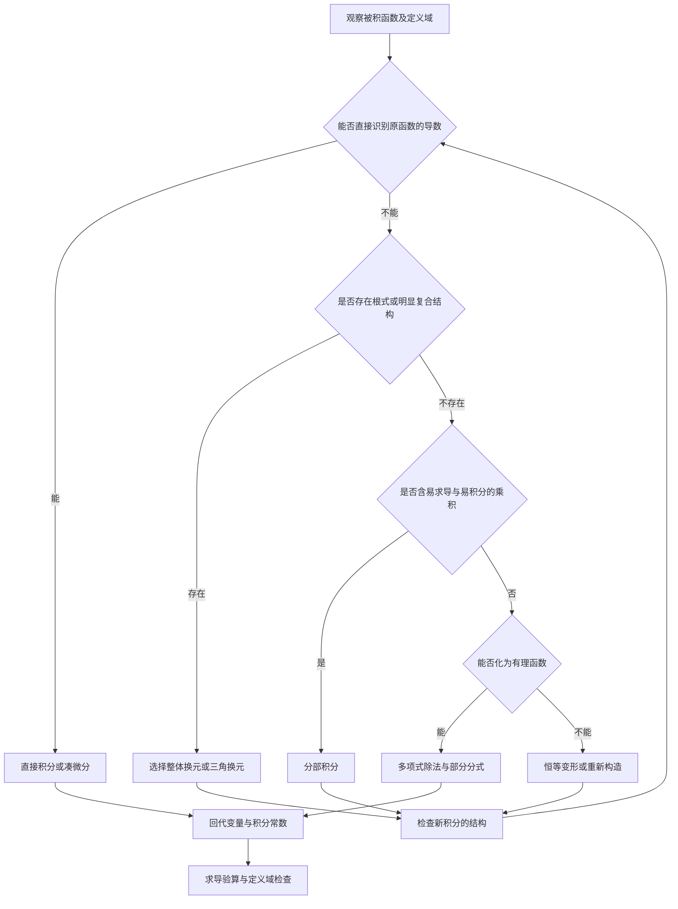

本节最重要的学习目标不是背诵更多积分结果，而是建立一种**从被积函数反向识别原函数结构的能力**。

求导是一套相对确定的运算流程，而积分是一种逆向构造过程。面对一个陌生的积分，你需要判断应该采用哪种变形、选择哪个整体作为新变量、是否需要分部积分，以及怎样让问题最终转化为已知的基本积分。

## 第一部分：不定积分的整体知识框架

### 一、本节必须掌握的八大题型

不定积分可归纳为以下八类。

| 核心题型         | 本质方法         | 重要程度  |
| ------------ | ------------ | ----- |
| 原函数存在性与分段原函数 | 可导性、连接点拼接    | ★★★★★ |
| 已知函数关系反求原函数  | 自变量替换、等式求导   | ★★★★☆ |
| 第一类换元积分      | 凑微分、逆向链式法则   | ★★★★★ |
| 第二类换元积分      | 根式消除、变量代换    | ★★★★★ |
| 分部积分         | 逆向乘积求导、降低复杂度 | ★★★★★ |
| 有理函数积分       | 多项式除法、部分分式   | ★★★★★ |
| 三角函数与根式综合积分  | 恒等变形、有理化     | ★★★★★ |
| 抽象函数及创新综合积分  | 逆向求导、结构重构    | ★★★★★ |

这些题型并非彼此独立。例如，2018年数学一的不定积分真题，就同时涉及指数换元、根式换元、反三角函数和分部积分。

因此，真正需要掌握的是**方法之间的组合与转换**。

### 二、不定积分的统一解题思想

所有不定积分问题最终都可以归结为：

$$
\boxed{\text{寻找 }F(x)\text{，使得 }F'(x)=f(x)}
$$

其中有三条最核心的求导法则，对应三种积分思想。

| 求导法则                                                          | 对应的积分思想     |
| ------------------------------------------------------------- | ----------- |
| $[F(g(x))]'=F'(g(x))g'(x)$                                | 换元积分        |
| $(uv)'=u'v+uv'$                                           | 分部积分、逆向乘积求导 |
| $\displaystyle\left(\frac uv\right)'=\frac{u'v-uv'}{v^2}$ | 逆向商求导       |

考场上，看到一个积分，不要立即开始机械计算，而要先检查：

1. 能否直接识别某个整体的导数？
2. 能否通过代数变形凑出微分？
3. 能否通过变量代换消除根式或复合结构？
4. 是否存在两个因子，一个求导后更简单，另一个容易积分？
5. 能否转化为有理函数，再进行部分分式分解？

这五个问题构成整节内容的主线。

## 第二部分：基础概念、重要性质与必备公式

### 一、原函数与不定积分

**1. 原函数的定义**

如果在区间 $I$ 上，函数 $F(x)$ 满足

$$
F'(x)=f(x),
$$

那么称 $F(x)$ 是 $f(x)$ 在该区间上的一个原函数。

例如：

$$
(\sin x)'=\cos x,
$$

所以 $\sin x$ 是 $\cos x$ 的一个原函数。

又因为

$$
(\sin x+2027)'=\cos x,
$$

所以 $\sin x+2027$ 也是它的一个原函数。

**2. 不定积分的定义**

函数 $f(x)$ 在某个区间上的全体原函数，称为其不定积分，记作

$$
\boxed{\int f(x)\,dx=F(x)+C}
$$

其中 $C$ 是任意常数。

从几何上理解，所有原函数构成一族形状相同、沿纵轴平移的曲线。

**3. 为什么两个原函数只相差一个常数？**

若

$$
F'(x)=G'(x)=f(x),
$$

则

$$
[F(x)-G(x)]'=0.
$$

根据拉格朗日中值定理，在同一个区间上，

$$
F(x)-G(x)=C.
$$

**关键词是同一个区间。**

例如：

$$
\int\frac1x\,dx=\ln|x|+C.
$$

如果需要描述定义域 $\mathbb R\setminus\{0\}$ 上的全部原函数，更严谨的形式是

$$
F(x)= \begin{cases} \ln x+C_1,&x>0,\\ \ln(-x)+C_2,&x<0, \end{cases}
$$

其中 $C_1,C_2$ 可以独立取值。

但如果原被积函数在连接点也有定义，并要求存在整个区间上的原函数，那么不同分段的积分常数就不能随意选择。

### 二、原函数存在性的判断

这是容易与第二模块第四节“原函数与导函数”形成综合考查的知识点。

**1. 连续函数一定存在原函数**

如果 $f(x)$ 在区间 $I$ 上连续，那么它一定存在原函数。

例如可以构造

$$
F(x)=\int_{x_0}^{x}f(t)\,dt.
$$

根据微积分基本定理，

$$
F'(x)=f(x).
$$

**2. 存在原函数不一定连续**

因为导函数不一定连续。

例如构造

$$
F(x)= \begin{cases} x^2\sin\dfrac1x,&x\ne0,\\ 0,&x=0. \end{cases}
$$

容易得到

$$
F'(x)= \begin{cases} 2x\sin\dfrac1x-\cos\dfrac1x,&x\ne0,\\ 0,&x=0. \end{cases}
$$

虽然 $F'(x)$ 在 $x=0$ 不连续，但它显然存在原函数 $F(x)$。

**3. 导函数不能具有第一类间断点**

这是由导函数的介值性（达布性质）决定的。

| 被积函数的性质 | 是否存在原函数           |
| ------- | ----------------- |
| 在区间上连续  | 一定存在              |
| 存在可去间断点 | 不存在整个区间上的原函数      |
| 存在跳跃间断点 | 不存在整个区间上的原函数      |
| 存在无穷间断点 | 不存在包含该间断点的区间上的原函数 |
| 存在振荡间断点 | 不一定，需要进一步判断       |

注意：

$$
\boxed{\text{连续}\Longrightarrow\text{存在原函数}}
$$

反过来不成立。

同时，存在原函数与存在定积分是两件不同的事情，不能混淆。

### 三、不定积分的运算性质

**1. 线性性质**

$$
\int[af(x)+bg(x)]\,dx =a\int f(x)\,dx+b\int g(x)\,dx.
$$

这里的积分常数最终合并为一个任意常数。

因此遇到复杂被积函数时，可以通过拆项分别积分。

**2. 微分与积分互为逆运算**

$$
\frac{d}{dx}\left[\int f(x)\,dx\right]=f(x).
$$

$$
\int F'(x)\,dx=F(x)+C.
$$

进一步有

$$
d\left[\int f(x)\,dx\right]=f(x)\,dx.
$$

**3. 不存在一般的乘积、商积分法则**

特别注意：

$$
\int f(x)g(x)\,dx
$$

一般不等于

$$
\left(\int f(x)\,dx\right) \left(\int g(x)\,dx\right).
$$

同理，

$$
\int\frac{f(x)}{g(x)}\,dx
$$

也不能直接将分子、分母分别积分。

这类错误在抽象函数积分中尤其常见。

### 四、必须熟练掌握的基本积分公式

**1. 幂函数、指数函数与对数型**

| 被积函数 $f(x)$              | 一个原函数 $F(x)$                                 |
| ---------------------------- | ------------------------------------------------ |
| $x^\alpha,\ \alpha\ne-1$ | $\displaystyle\frac{x^{\alpha+1}}{\alpha+1}$ |
| $\displaystyle\frac1x$   | $\ln\lvert x\rvert $                                   |
| $e^x$                    | $e^x$                                        |
| $a^x,\ a>0,\ a\ne1$      | $\displaystyle\frac{a^x}{\ln a}$             |
| $\ln x$                  | $x\ln x-x$                                   |

表中所有原函数加上 $C$ 即为不定积分，并在相应实数定义域内使用。

**2. 三角函数型**

| 被积函数               | 一个原函数                      |
| ------------------ | -------------------------- |
| $\sin x$       | $-\cos x$              |
| $\cos x$       | $\sin x$               |
| $\sec^2x$      | $\tan x$               |
| $\csc^2x$      | $-\cot x$              |
| $\sec x\tan x$ | $\sec x$               |
| $\csc x\cot x$ | $-\csc x$              |
| $\tan x$       | $-\ln\lvert \cos x\rvert $       |
| $\cot x$       | $\ln\lvert \sin x\rvert $        |
| $\sec x$       | $\ln\lvert \sec x+\tan x\rvert $ |
| $\csc x$       | $\ln\lvert \csc x-\cot x\rvert $ |

**3. 反三角函数与根式型**

以下设 $a>0$。

$$
\boxed{\int\frac{dx}{x^2+a^2} =\frac1a\arctan\frac xa+C}
$$

$$
\boxed{\int\frac{dx}{\sqrt{a^2-x^2}} =\arcsin\frac xa+C}
$$

$$
\boxed{\int\frac{dx}{\sqrt{x^2+a^2}} =\ln\left(x+\sqrt{x^2+a^2}\right)+C}
$$

$$
\boxed{\int\frac{dx}{\sqrt{x^2-a^2}} =\ln\left|x+\sqrt{x^2-a^2}\right|+C}
$$

$$
\boxed{\int\frac{dx}{x^2-a^2} =\frac1{2a}\ln\left|\frac{x-a}{x+a}\right|+C}
$$

$$
\boxed{\int\frac{dx}{a^2-x^2} =\frac1{2a}\ln\left|\frac{a+x}{a-x}\right|+C}
$$

这里尤其要区分以下三个结构：

| 分母结构                 | 积分结果的主要类型 |
| -------------------- | --------- |
| $x^2+a^2$        | 反正切       |
| $\sqrt{a^2-x^2}$ | 反正弦       |
| $\sqrt{x^2+a^2}$ | 对数        |

不要只看见平方或根式就盲目套用反三角函数公式。

**4. 高频二级结论**

这些公式可以由基本公式和分部积分推导，建议熟练掌握。

$$
\int\arctan x\,dx =x\arctan x-\frac12\ln(1+x^2)+C
$$

$$
\int\arcsin x\,dx =x\arcsin x+\sqrt{1-x^2}+C
$$

$$
\int\arccos x\,dx =x\arccos x-\sqrt{1-x^2}+C
$$

$$
\int\frac{dx}{(1+x^2)^2} =\frac12\arctan x+\frac{x}{2(1+x^2)}+C
$$

$$
\int\sqrt{a^2-x^2}\,dx =\frac x2\sqrt{a^2-x^2} +\frac{a^2}{2}\arcsin\frac xa+C
$$

$$
\begin{aligned} \int\sqrt{x^2+a^2}\,dx ={}&\frac x2\sqrt{x^2+a^2}\\ &+\frac{a^2}{2}\ln\left(x+\sqrt{x^2+a^2}\right)+C \end{aligned}
$$

最后三类积分尤其容易出现在根式综合积分、有理函数积分和定积分几何应用中。

## 第三部分：题型一——分段函数的原函数

### 一、题型识别与标准步骤

如果题目给出

$$
f(x)= \begin{cases} f_1(x),&x<a,\\ f_2(x),&x\ge a, \end{cases}
$$

要求其原函数，那么不能只是分别积分。

假设

$$
F_1'(x)=f_1(x),\qquad F_2'(x)=f_2(x).
$$

设

$$
F(x)= \begin{cases} F_1(x)+C_1,&x<a,\\ F_2(x)+C_2,&x\ge a. \end{cases}
$$

需要依次检验：

1. 各段求导是否正确。
2. 连接点处是否连续。
3. 连接点处是否可导。
4. 连接点处的导数是否等于 $f(a)$。

如果已知 $f$ 在连接点连续，那么在各段导数正确的基础上，将原函数连续拼接即可保证该点可导，必要时可以利用中值定理证明。

### 二、母题1：2016年数学一、数学二真题

已知

$$
f(x)= \begin{cases} 2(x-1),&x<1,\\ \ln x,&x\ge1. \end{cases}
$$

求 $f(x)$ 的原函数。

<Steps>

<Step>

### 第一步：分别积分 [!toc]

当 $x<1$ 时，

$$
F_1(x)=(x-1)^2+C_1.
$$

当 $x>1$ 时，

$$
F_2(x)=x\ln x-x+C_2.
$$

</Step>

<Step>

### 第二步：利用连接点连续性确定常数 [!toc]

因为原函数必须可导，所以必须连续。

$$
F(1^-)=C_1.
$$

$$
F(1)=C_2-1.
$$

因此

$$
C_1=C_2-1,
$$

即

$$
C_2=C_1+1.
$$

</Step>

<Step>

### 第三步：检验连接点导数 [!toc]

由于

$$
\lim_{x\to1^-}2(x-1)=0,
$$

$$
\lim_{x\to1^+}\ln x=0=f(1),
$$

且已经连续拼接，因此左右导数均为零。

最终得到

$$
\boxed{ F(x)= \begin{cases} (x-1)^2,&x<1,\\ x\ln x-x+1,&x\ge1 \end{cases} +C}
$$

</Step>

</Steps>

**真正需要掌握的规律**

这道题考查的重点不是两个简单积分，而是：

$$
\boxed{\text{整体原函数必须在连接点可导}}
$$

各段分别积分正确，仅仅解决了第一步。

### 三、母题2：2023年数学二、数学三真题

$$
f(x)= \begin{cases} \dfrac1{\sqrt{1+x^2}},&x\le0,\\ (x+1)\cos x,&x>0. \end{cases}
$$

左段积分为

$$
F_1(x)=\ln\left(x+\sqrt{1+x^2}\right)+C_1.
$$

右段分部积分为

$$
F_2(x)=(x+1)\sin x+\cos x+C_2.
$$

比较连接点处的函数值：

$$
F_1(0)=C_1,\qquad F_2(0^+)=1+C_2.
$$

因此

$$
C_1=C_2+1.
$$

两侧导数在连接点均趋于 $1=f(0)$，最终得到

$$
\boxed{ F(x)= \begin{cases} \ln(x+\sqrt{1+x^2})+1,&x\le0,\\ (x+1)\sin x+\cos x,&x>0 \end{cases} +C}
$$

这道题是前一道真题的升级版，将分段原函数与根式基本积分、分部积分结合起来。

### 四、创新变式：连续拼接仍然不够的情况

设

$$
f(x)= \begin{cases} x,&x\ne0,\\ 1,&x=0. \end{cases}
$$

问 $f(x)$ 在实轴上是否存在原函数？

如果存在，那么根据两侧积分结果及连续性，它只能具有如下形式：

$$
F(x)=\frac{x^2}{2}+C.
$$

但是

$$
F'(0)=0\ne f(0).
$$

所以不存在。

**这类题揭示了分段原函数题的最后一道检查：原函数在连接点不仅要可导，导数还必须等于题目指定的函数值。**

## 第四部分：题型二——第一类换元积分法（凑微分）

### 一、原理

由复合函数求导法则，

$$
[F(\varphi(x))]' =f(\varphi(x))\varphi'(x).
$$

因此

$$
\boxed{ \int f(\varphi(x))\varphi'(x)\,dx =F(\varphi(x))+C }
$$

令 $u=\varphi(x)$，也可以写成

$$
du=\varphi'(x)\,dx,
$$

$$
\int f(\varphi(x))\varphi'(x)\,dx =\int f(u)\,du.
$$

**核心思想**

不是看到复合函数就换元，而是寻找：

$$
\boxed{\text{内层函数与其导数同时出现}}
$$

有时导数并不是完整地出现在题目中，需要先提取常数、拆分分子或补项。

### 二、必须形成条件反射的八种结构

| 被积结构                                             | 积分结果                                                       |
| ------------------------------------------------ | ---------------------------------------------------------- |
| $g'(x)[g(x)]^n$                              | $\displaystyle\frac{[g(x)]^{n+1}}{n+1}+C$，$n\ne-1$ |
| $\displaystyle\frac{g'(x)}{g(x)}$            | $\ln\lvert g(x)\rvert +C$                                        |
| $g'(x)e^{g(x)}$                              | $e^{g(x)}+C$                                           |
| $g'(x)\cos g(x)$                             | $\sin g(x)+C$                                          |
| $g'(x)\sin g(x)$                             | $-\cos g(x)+C$                                         |
| $\displaystyle\frac{g'(x)}{1+g^2(x)}$        | $\arctan g(x)+C$                                       |
| $\displaystyle\frac{g'(x)}{\sqrt{1-g^2(x)}}$ | $\arcsin g(x)+C$                                       |
| $\displaystyle\frac{g'(x)}{\sqrt{1+g^2(x)}}$ | $\ln(g(x)+\sqrt{1+g^2(x)})+C$                          |

这些结构必须记忆为一个整体，而不是每次重新推导。

### 三、母题3：李正元练习题——幂函数整体换元

求

$$
I=\int\frac{x^{2n-1}}{1+x^n}\,dx,\qquad n\ne0.
$$

**识别过程**

分母包含 $x^n$，其导数为

$$
(x^n)'=nx^{n-1}.
$$

而分子可以写成

$$
x^{2n-1}=x^n\cdot x^{n-1}.
$$

这意味着可以完整凑出 $d(x^n)$。

令

$$
t=x^n,\qquad dt=nx^{n-1}\,dx.
$$

原积分变成

$$
\begin{aligned} I &=\frac1n\int\frac{t}{1+t}\,dt\\ &=\frac1n\int\left(1-\frac1{1+t}\right)dt. \end{aligned}
$$

所以

$$
\boxed{ I=\frac1n[x^n-\ln|1+x^n|]+C }
$$

其中定义域应满足相关实数幂运算及可导条件。

**母题推广**

遇到

$$
\int x^{n-1}R(x^n)\,dx,
$$

其中 $R$ 为适当函数，优先令 $t=x^n$。

于是

$$
\int x^{n-1}R(x^n)\,dx =\frac1n\int R(t)\,dt.
$$

例如：

$$
\int\frac{x^{3n-1}}{1+x^n}\,dx =\frac1n\int\frac{t^2}{1+t}\,dt.
$$

进行多项式除法：

$$
\frac{t^2}{1+t}=t-1+\frac1{1+t}.
$$

即可得到

$$
\boxed{ \frac1n\left[\frac{x^{2n}}2-x^n+\ln|1+x^n|\right]+C }
$$

这就是把一道题推广成一整个题族。

### 四、凑微分的三种升级技巧

**技巧1：分子拆成分母的导数与余项**

例如：

$$
I=\int\frac{3x+5}{x^2+x+1}\,dx.
$$

观察到分母的导数为 $2x+1$，于是

$$
3x+5=\frac32(2x+1)+\frac72.
$$

因此

$$
I=\frac32\ln(x^2+x+1) +\frac72\int\frac{dx}{x^2+x+1}.
$$

剩余部分配方：

$$
x^2+x+1 =\left(x+\frac12\right)^2+\frac34.
$$

最终

$$
\boxed{ I=\frac32\ln(x^2+x+1) +\frac7{\sqrt3}\arctan\frac{2x+1}{\sqrt3}+C }
$$

一般而言，线性分子除以二次分母，优先考虑这一方法。

**技巧2：利用恒等式凑出导数**

例如

$$
\int\tan^3x\,dx.
$$

不要直接处理三次正切。

利用

$$
\tan^2x=\sec^2x-1,
$$

得到

$$
\begin{aligned} \int\tan^3x\,dx &=\int\tan x(\sec^2x-1)\,dx\\ &=\int\tan x\,d(\tan x)-\int\tan x\,dx\\ &=\frac12\tan^2x+\ln|\cos x|+C. \end{aligned}
$$

**技巧3：把复杂分式视为一个整体**

这类方法将在后面的张宇模拟卷和李正元抽象函数题中进一步展开。关键是不能只盯着分子、分母，而要尝试对整个商求导。

## 第五部分：题型三——第二类换元积分法与根式积分

### 一、第一类换元和第二类换元的区别

| 第一类换元          | 第二类换元                |
| -------------- | -------------------- |
| 令 $t=g(x)$ | 令 $x=\varphi(t)$ |
| 寻找已经存在的复合结构    | 主动构造新的变量表达           |
| 主要用于凑微分        | 主要用于消除根式、简化结构        |

第二类换元的基本形式为

$$
\int f(x)\,dx =\int f(\varphi(t))\varphi'(t)\,dt.
$$

要求选择适当的可导、可逆分支，并在计算完成后将 $t$ 换回 $x$。

### 二、根式换元选择表

设 $a>0$。

| 根式结构                   | 优先考虑的换元              | 换元目的                       |
| ---------------------- | -------------------- | -------------------------- |
| $\sqrt{a^2-x^2}$   | $x=a\sin t$      | 利用 $1-\sin^2t=\cos^2t$ |
| $\sqrt{a^2+x^2}$   | $x=a\tan t$      | 利用 $1+\tan^2t=\sec^2t$ |
| $\sqrt{x^2-a^2}$   | $x=a\sec t$（正支）  | 利用 $\sec^2t-1=\tan^2t$ |
| $\sqrt{ax+b}$      | $t=\sqrt{ax+b}$  | 将根式变为有理式                   |
| $\sqrt{e^x-1}$     | $t=\sqrt{e^x-1}$ | 将指数和根式同时消除                 |
| 多个分数次幂                 | $x=t^m$          | 统一分母次数                     |
| $\sqrt{ax^2+bx+c}$ | 先配方再换元               | 化为标准根式                     |

必须注意：

$$
\sqrt{\cos^2t}=|\cos t|,
$$

而不是无条件等于 $\cos t$。

所以三角换元时，往往需要选择适当的参数区间，以确定根式的符号。

### 三、母题4：2001年数学二真题——巧妙根式换元

求

$$
I=\int\frac{dx}{(2x^2+1)\sqrt{1+x^2}}.
$$

这道题非常适合作为根式积分的核心母题。

<Tabs items={["方法一：常规三角换元", "方法二：直接结构换元"]} defaultIndex={0}>

<Tab value="方法一：常规三角换元">

令

$$
x=\tan\theta,\qquad -\frac\pi2<\theta<\frac\pi2.
$$

则

$$
dx=\sec^2\theta\,d\theta, \qquad \sqrt{1+x^2}=\sec\theta.
$$

所以

$$
I=\int\frac{\sec\theta}{1+2\tan^2\theta}\,d\theta.
$$

整理为

$$
I=\int\frac{\cos\theta}{1+\sin^2\theta}\,d\theta.
$$

再令

$$
t=\sin\theta,
$$

则

$$
I=\int\frac{dt}{1+t^2} =\arctan t+C.
$$

因为

$$
\sin\theta=\frac{x}{\sqrt{1+x^2}},
$$

所以

$$
\boxed{ I=\arctan\frac{x}{\sqrt{1+x^2}}+C }
$$

</Tab>

<Tab value="方法二：直接结构换元">

熟练之后，可以直接令

$$
t=\frac{x}{\sqrt{1+x^2}}.
$$

其导数为

$$
t'=\frac1{(1+x^2)^{3/2}}.
$$

并且

$$
1+t^2=\frac{1+2x^2}{1+x^2}.
$$

因此恰有

$$
\frac{dt}{1+t^2} =\frac{dx}{(1+2x^2)\sqrt{1+x^2}}.
$$

立即得到答案。

</Tab>

</Tabs>

**如何在考场上想到这种换元？**

如果同时出现

$$
\sqrt{1+x^2}
$$

与

$$
1+kx^2,
$$

可以考虑由三角换元衍生出的组合变量

$$
t=\frac{x}{\sqrt{1+x^2}}.
$$

因为

$$
\left(\frac{x}{\sqrt{1+x^2}}\right)' =\frac1{(1+x^2)^{3/2}}.
$$

其平方又可以将 $1+x^2$ 与其他二次式联系起来。

这不是孤立的技巧，而是一种可推广的代换结构。

### 四、母题5：李正元练习题——含参数的根式积分

设 $a>0$，求

$$
I=\int\frac{dx}{(x^2+a^2)\sqrt{a^2-x^2}}.
$$

先令

$$
x=a\sin t,\qquad |t|<\frac\pi2.
$$

则

$$
I=\frac1{a^2}\int\frac{dt}{1+\sin^2t}.
$$

再令

$$
u=\tan t.
$$

由于

$$
\sin^2t=\frac{u^2}{1+u^2}, \qquad dt=\frac{du}{1+u^2},
$$

故

$$
I=\frac1{a^2}\int\frac{du}{1+2u^2}.
$$

积分得

$$
I=\frac1{\sqrt2a^2}\arctan(\sqrt2u)+C.
$$

最终

$$
\boxed{ I=\frac1{\sqrt2a^2} \arctan\frac{\sqrt2x}{\sqrt{a^2-x^2}}+C }
$$

**方法迁移**

比较前后两道题：

| 根式结构                 | 可尝试的组合变量                                    |
| -------------------- | ------------------------------------------- |
| $\sqrt{a^2+x^2}$ | $\displaystyle\frac{x}{\sqrt{a^2+x^2}}$ |
| $\sqrt{a^2-x^2}$ | $\displaystyle\frac{x}{\sqrt{a^2-x^2}}$ |

它们共同的思路都是通过适当构造，使根式积分转化为反正切型积分。

### 五、综合母题6：李永乐六套卷第6套第17题

本题代表较复杂的根式积分。

求

$$
I=\int\frac{1-x+x^2}{x\sqrt{1+x-x^2}}\,dx.
$$

<Steps>

<Step>

### 第一步：不要急于对整个式子换元 [!toc]

记

$$
w=1+x-x^2.
$$

由于

$$
\frac{1-x+x^2}{x}=\frac1x+x-1,
$$

所以

$$
I= \underbrace{\int\frac{dx}{x\sqrt w}}_{I_1} + \underbrace{\int\frac{x-1}{\sqrt w}\,dx}_{I_2}.
$$

两个积分的结构不同，应该分别选择方法。

</Step>

<Step>

### 第二步：处理根式分母与线性分子 [!toc]

因为

$$
w'=1-2x,
$$

所以

$$
x-1=-\frac12w'-\frac12.
$$

于是

$$
I_2=-\frac12\int\frac{dw}{\sqrt w} -\frac12\int\frac{dx}{\sqrt{1+x-x^2}}.
$$

将二次式配方：

$$
1+x-x^2=\frac54-\left(x-\frac12\right)^2.
$$

因此

$$
\boxed{ I_2=-\sqrt w -\frac12\arcsin\frac{2x-1}{\sqrt5} }
$$

</Step>

<Step>

### 第三步：处理含有 $1/x$ 的部分 [!toc]

这是本题最值得学习的地方。

$$
I_1=\int\frac{dx}{x\sqrt{1+x-x^2}}.
$$

令

$$
t=\frac1x.
$$

则

$$
dx=-\frac{dt}{t^2},
$$

且

$$
\sqrt{1+x-x^2} =\frac{\sqrt{t^2+t-1}}{|t|}.
$$

因此在 $x$ 符号固定的区间上，

$$
I_1=-\operatorname{sgn}(t) \int\frac{dt}{\sqrt{t^2+t-1}}.
$$

配方：

$$
t^2+t-1=\left(t+\frac12\right)^2-\frac54.
$$

应用标准根式积分公式并还原变量，可以将结果统一整理为

$$
I_1=-\ln\left| \frac{x+2+2\sqrt w}{x} \right|+C.
$$

对这个表达式直接求导，也可以验证其正确性。

</Step>

<Step>

### 第四步：合并答案 [!toc]

$$
\boxed{ \begin{aligned} I={}&-\ln\left| \frac{x+2+2\sqrt{1+x-x^2}}x \right|\\ &-\sqrt{1+x-x^2}\\ &-\frac12\arcsin\frac{2x-1}{\sqrt5}+C. \end{aligned} }
$$

</Step>

</Steps>

**本题的重要方法总结**

遇到

$$
\int\frac{dx}{x\sqrt{ax^2+bx+c}},
$$

在适当的定义域内，优先尝试倒数换元

$$
t=\frac1x.
$$

因为它能把根式内的二次式重新变为关于 $t$ 的二次式，并消除根式外的 $x$ 因子。

**这道模拟题考查的不是某种特殊公式，而是拆分、凑微分、配方、倒数换元和定义域处理的组合能力。**

## 第六部分：题型四——分部积分法

这是本节最重要的综合计算方法之一，也是2018年、2001年、1993年数学一真题的核心考点。

### 一、分部积分公式的本质

由乘积求导法则，

$$
(uv)'=u'v+uv',
$$

可得

$$
d(uv)=u\,dv+v\,du.
$$

移项并积分：

$$
\boxed{\int u\,dv=uv-\int v\,du}
$$

也可以写为

$$
\boxed{ \int f(x)g'(x)\,dx =f(x)g(x)-\int f'(x)g(x)\,dx }
$$

分部积分的目的不是把一个乘积积分变成另一个乘积积分，而是：

$$
\boxed{\text{让新的积分比原来的积分更简单}}
$$

因此选择 $u$ 和 $dv$ 时，必须同时考虑：

- $u$ 求导后是否会更简单；
- $dv$ 是否容易求出 $v$；
- 新积分 $\int v\,du$ 是否更容易处理。

### 二、如何选择 $u$？

一般情况下，可以参考以下优先顺序：

$$
\boxed{ \text{反三角}\rightarrow \text{对数}\rightarrow \text{幂函数}\rightarrow \text{三角}\rightarrow \text{指数} }
$$

排在前面的函数通常更适合选作 $u$。

| 被积函数                     | 通常选择的 $u$      | 通常选择的 $dv$    |
| ------------------------ | ------------------ | ----------------- |
| $x^ne^x$             | $x^n$          | $e^x\,dx$    |
| $x^n\sin x$          | $x^n$          | $\sin x\,dx$ |
| $x^n\ln x$           | $\ln x$        | $x^n\,dx$    |
| $x^n\arctan x$       | $\arctan x$    | $x^n\,dx$    |
| $e^{kx}\arcsin(e^x)$ | $\arcsin(e^x)$ | $e^{kx}\,dx$ |
| $\ln x$              | $\ln x$        | $dx$          |

这只是经验顺序，不是绝对规则。最终仍要以能否降低积分难度为判断依据。

### 三、母题7：1993年数学一真题

求

$$
I=\int\frac{xe^x}{\sqrt{e^x-1}}\,dx.
$$

<Steps>

<Step>

### 第一步：判断为什么应先分部积分 [!toc]

被积函数为 $x$ 与一个复合函数的乘积。

注意

$$
\left(\sqrt{e^x-1}\right)' =\frac{e^x}{2\sqrt{e^x-1}}.
$$

因此

$$
I=2\int x\,d\sqrt{e^x-1}.
$$

取

$$
u=x,\qquad v=2\sqrt{e^x-1}.
$$

分部积分：

$$
I=2x\sqrt{e^x-1} -2\int\sqrt{e^x-1}\,dx.
$$

</Step>

<Step>

### 第二步：对剩余积分进行结构换元 [!toc]

令

$$
t=\sqrt{e^x-1}.
$$

则

$$
e^x=1+t^2, \qquad dx=\frac{2t}{1+t^2}\,dt.
$$

所以

$$
\begin{aligned} \int\sqrt{e^x-1}\,dx &=2\int\frac{t^2}{1+t^2}\,dt\\ &=2\int\left(1-\frac1{1+t^2}\right)dt\\ &=2t-2\arctan t+C. \end{aligned}
$$

</Step>

<Step>

### 第三步：回代 [!toc]

$$
\boxed{ \begin{aligned} I={}&2x\sqrt{e^x-1}\\ &-4\sqrt{e^x-1}\\ &+4\arctan\sqrt{e^x-1}+C. \end{aligned} }
$$

实数计算区间为 $x>0$。

</Step>

</Steps>

**题型迁移**

这道题建立了一个非常重要的模板：

$$
\int xg'(x)\,dx =xg(x)-\int g(x)\,dx.
$$

推广为

$$
\int x^ng'(x)\,dx =x^ng(x)-n\int x^{n-1}g(x)\,dx.
$$

以后遇到多项式与某个复杂函数导数相乘时，应优先考虑分部积分降阶，而不是把复杂函数完全展开。

### 四、母题8：2001年数学一真题

求

$$
I=\int\frac{\arctan(e^x)}{e^{2x}}\,dx.
$$

<Steps>

<Step>

### 第一步：反三角函数作 $u$ [!toc]

取

$$
u=\arctan(e^x),\qquad dv=e^{-2x}\,dx.
$$

则

$$
du=\frac{e^x}{1+e^{2x}}\,dx, \qquad v=-\frac12e^{-2x}.
$$

因此

$$
I=-\frac12e^{-2x}\arctan(e^x) +\frac12\int\frac{e^{-x}}{1+e^{2x}}\,dx.
$$

</Step>

<Step>

### 第二步：如何选择指数换元？ [!toc]

剩余积分为

$$
J=\int\frac{e^{-x}}{1+e^{2x}}\,dx.
$$

注意分子正好包含 $e^{-x}$，故令

$$
t=e^{-x}, \qquad dt=-e^{-x}\,dx.
$$

并且

$$
e^{2x}=\frac1{t^2}.
$$

于是

$$
\begin{aligned} J &=-\int\frac{t^2}{1+t^2}\,dt\\ &=-t+\arctan t+C. \end{aligned}
$$

</Step>

<Step>

### 第三步：还原并利用恒等式整理 [!toc]

由于 $e^x>0$，有

$$
\arctan(e^{-x})+\arctan(e^x)=\frac\pi2.
$$

常数可以吸收进 $C$，所以

$$
\boxed{ I=-\frac12\left[ e^{-2x}\arctan(e^x) +e^{-x}+\arctan(e^x) \right]+C }
$$

</Step>

</Steps>

**本题的关键启示**

当反三角函数和指数函数相乘时，通常是

$$
\text{分部积分} \longrightarrow \text{指数换元} \longrightarrow \text{有理函数积分}.
$$

但究竟令 $t=e^x$ 还是 $t=e^{-x}$，应当看哪个变量的导数与现有因子匹配得更好。

### 五、核心母题9：2018年数学一、数学二真题

求

$$
I=\int e^{2x}\arctan\sqrt{e^x-1}\,dx.
$$

这道题几乎完整体现了不定积分中的方法选择与组合。

<Tabs items={["方法一：先换元，再分部积分", "方法二：先分部积分，再换元"]} defaultIndex={0}>

<Tab value="方法一：先换元，再分部积分">

被积函数中最复杂的整体是

$$
\sqrt{e^x-1}.
$$

如果令

$$
t=\sqrt{e^x-1},
$$

那么可以同时消除根式、指数和反正切的复合结构。

有

$$
e^x=1+t^2,
$$

$$
e^{2x}=(1+t^2)^2,
$$

$$
dx=\frac{2t}{1+t^2}\,dt.
$$

因此

$$
I=2\int t(1+t^2)\arctan t\,dt.
$$

原问题已经变成多项式与反正切函数的乘积积分。

取

$$
u=\arctan t, \qquad dv=2t(1+t^2)\,dt.
$$

则

$$
du=\frac{dt}{1+t^2}, \qquad v=\frac12(1+t^2)^2.
$$

于是

$$
\begin{aligned} I={}&\frac12(1+t^2)^2\arctan t\\ &-\frac12\int(1+t^2)\,dt\\ ={}&\frac12(1+t^2)^2\arctan t -\frac t2-\frac{t^3}{6}+C. \end{aligned}
$$

代回得

$$
\boxed{ \begin{aligned} I={}&\frac12e^{2x}\arctan\sqrt{e^x-1}\\ &-\frac12\sqrt{e^x-1}\\ &-\frac16(e^x-1)^{3/2}+C. \end{aligned} }
$$

</Tab>

<Tab value="方法二：先分部积分，再换元">

取

$$
u=\arctan\sqrt{e^x-1}, \qquad dv=e^{2x}\,dx.
$$

计算 $du$ 时注意一个重要的抵消关系：

$$
1+\left(\sqrt{e^x-1}\right)^2=e^x.
$$

因此

$$
\begin{aligned} du &=\frac1{e^x} \cdot\frac{e^x}{2\sqrt{e^x-1}}\,dx\\ &=\frac{dx}{2\sqrt{e^x-1}}. \end{aligned}
$$

而

$$
v=\frac12e^{2x}.
$$

于是

$$
I=\frac12e^{2x}\arctan\sqrt{e^x-1} -\frac14\int\frac{e^{2x}}{\sqrt{e^x-1}}\,dx.
$$

剩余积分令

$$
t=\sqrt{e^x-1},
$$

则

$$
\int\frac{e^{2x}}{\sqrt{e^x-1}}\,dx =2\int(1+t^2)\,dt.
$$

同样得到原答案。

</Tab>

</Tabs>

**两种方法的比较**

| 方法     | 优点          | 适用情况               |
| ------ | ----------- | ------------------ |
| 先换元再分部 | 结构清晰，容易推广   | 多层复合、根式指数混合        |
| 先分部再换元 | 步骤较短，容易出现抵消 | 指数因子容易积分，反三角函数求导简单 |

这道题说明：

**换元与分部积分的先后顺序不是固定的，应当选择最先显著降低复杂度的运算。**

### 六、从2018年真题推广出完整母题族

**原创变式与推广。**

设 $n$ 为正整数，考虑

$$
I_n=\int e^{nx}\arctan\sqrt{e^x-1}\,dx.
$$

统一令

$$
t=\sqrt{e^x-1}.
$$

则

$$
I_n=2\int t(1+t^2)^{n-1}\arctan t\,dt.
$$

分部积分时取

$$
u=\arctan t,
$$

$$
dv=2t(1+t^2)^{n-1}\,dt.
$$

于是

$$
v=\frac{(1+t^2)^n}{n}, \qquad du=\frac{dt}{1+t^2}.
$$

得到统一公式：

$$
\boxed{ I_n=\frac{(1+t^2)^n}{n}\arctan t -\frac1n\int(1+t^2)^{n-1}\,dt }
$$

其中

$$
t=\sqrt{e^x-1}.
$$

当 $n$ 为正整数时，最后一项是多项式积分。

进一步使用二项式定理：

$$
(1+t^2)^{n-1} =\sum_{k=0}^{n-1}\binom{n-1}{k}t^{2k}.
$$

所以整个母题族的答案可表示为

$$
\boxed{ I_n=\frac{e^{nx}}n\arctan t -\frac1n\sum_{k=0}^{n-1} \binom{n-1}{k}\frac{t^{2k+1}}{2k+1}+C }
$$

例如当 $n=3$ 时，

$$
\begin{aligned} I_3={}&\frac13e^{3x}\arctan t\\ &-\frac13\left(t+\frac23t^3+\frac15t^5\right)+C. \end{aligned}
$$

不必专门背诵这个求和公式，但必须掌握它背后的构造过程。

未来真题即使改变指数次数，或者将 $e^x-1$ 改成其他类似复合结构，也应该能够重新建立换元关系。

### 七、特殊分部积分：循环型积分

例如

$$
I=\int e^{ax}\sin bx\,dx.
$$

一次分部积分后，会产生余弦函数；再做一次，又回到原来的积分。

此时不是进入死循环，而是可以移项解出原积分。

标准结果为

$$
\boxed{ \int e^{ax}\sin bx\,dx =\frac{e^{ax}}{a^2+b^2} (a\sin bx-b\cos bx)+C }
$$

$$
\boxed{ \int e^{ax}\cos bx\,dx =\frac{e^{ax}}{a^2+b^2} (a\cos bx+b\sin bx)+C }
$$

其中 $a,b$ 不全为零。

**真题应用：2003年数学二**

求

$$
I=\int\frac{xe^{\arctan x}}{(1+x^2)^{3/2}}\,dx.
$$

令

$$
t=\arctan x, \qquad x=\tan t.
$$

则

$$
\begin{aligned} I &=\int e^t\frac{\tan t\sec^2t}{\sec^3t}\,dt\\ &=\int e^t\sin t\,dt. \end{aligned}
$$

根据循环型分部积分公式，

$$
I=\frac12e^t(\sin t-\cos t)+C.
$$

还原得

$$
\boxed{ I=\frac{(x-1)e^{\arctan x}}{2\sqrt{1+x^2}}+C }
$$

此题说明，看起来极其复杂的指数、反三角函数、根式组合，有时只是一道基本分部积分题经过变量复合后的结果。

## 第七部分：题型五——有理函数的不定积分

有理函数积分是各种换元积分最终经常到达的终点。

例如指数换元、根式换元、三角万能换元，往往都是为了将原积分转换为

$$
\int\frac{P(x)}{Q(x)}\,dx,
$$

其中 $P,Q$ 为多项式。

因此，**有理函数积分不仅是一种独立题型，也是一种基础收尾能力。**

### 一、有理函数积分的标准流程

第一步：判断真假分式。

如果

$$
\deg P\ge\deg Q,
$$

先做多项式除法：

$$
\frac{P(x)}{Q(x)} =S(x)+\frac{R(x)}{Q(x)}, \qquad \deg R<\deg Q.
$$

第二步：在实数范围内分解分母，将它拆成一次因子和不可约二次因子。

第三步：根据因子的类型和重数建立部分分式。

第四步：确定待定系数并分别积分。

第五步：整理答案，检查绝对值和定义域。

### 二、部分分式分解的完整规则

| 分母因子              | 必须设置的分式                                                   |
| ----------------- | --------------------------------------------------------- |
| $x-a$         | $\displaystyle\frac A{x-a}$                           |
| $(x-a)^2$     | $\displaystyle\frac A{x-a}+\frac B{(x-a)^2}$          |
| $(x-a)^m$     | $\displaystyle\sum_{k=1}^{m}\frac{A_k}{(x-a)^k}$     |
| 不可约二次式 $q(x)$ | $\displaystyle\frac{Ax+B}{q(x)}$                      |
| $q^2(x)$      | $\displaystyle\frac{Ax+B}{q(x)}+\frac{Cx+D}{q^2(x)}$  |
| $q^m(x)$      | $\displaystyle\sum_{k=1}^{m}\frac{A_kx+B_k}{q^k(x)}$ |

最容易出现的错误是重复因子漏项。

例如分母包含

$$
(x-1)^3,
$$

就必须设置

$$
\frac A{x-1} +\frac B{(x-1)^2} +\frac D{(x-1)^3},
$$

不能只设置最后一项。

### 三、母题10：2019年数学二真题

求

$$
I=\int\frac{3x+6}{(x-1)^2(x^2+x+1)}\,dx.
$$

<Steps>

<Step>

### 第一步：根据分母因子设置分式 [!toc]

$$
\frac{3x+6}{(x-1)^2(x^2+x+1)} =\frac A{x-1}+\frac B{(x-1)^2} +\frac{Cx+D}{x^2+x+1}.
$$

通分：

$$
\begin{aligned} 3x+6={}&A(x-1)(x^2+x+1)\\ &+B(x^2+x+1)\\ &+(Cx+D)(x-1)^2. \end{aligned}
$$

</Step>

<Step>

### 第二步：代入特殊值并比较系数 [!toc]

令 $x=1$：

$$
9=3B,
$$

所以

$$
B=3.
$$

再比较其余各项系数，得到

$$
A=-2,\qquad C=2,\qquad D=1.
$$

因此

$$
\frac{3x+6}{(x-1)^2(x^2+x+1)} =-\frac2{x-1} +\frac3{(x-1)^2} +\frac{2x+1}{x^2+x+1}.
$$

</Step>

<Step>

### 第三步：逐项积分 [!toc]

最后一项恰好是分母导数除以分母。

$$
\boxed{ I=-2\ln|x-1| -\frac3{x-1} +\ln(x^2+x+1)+C }
$$

</Step>

</Steps>

**技巧：如何快速处理二重一次因子？**

如果

$$
R(x)=\frac{P(x)}{(x-a)^2Q(x)}, \qquad Q(a)\ne0,
$$

记

$$
H(x)=(x-a)^2R(x)=\frac{P(x)}{Q(x)}.
$$

那么部分分式中

$$
\frac{A}{x-a}+\frac{B}{(x-a)^2}
$$

的系数可以直接由

$$
\boxed{B=H(a),\qquad A=H'(a)}
$$

得到。

这是泰勒展开思想在有理函数积分中的应用。

### 四、强化母题11：张宇8套卷第3套第17题

这是分类模拟题中的一道人为设置计算难度的综合题。

求

$$
I=\int \frac{2x^2+2x+13}{(x-2)(1+x^2)^2}\,dx.
$$

它与前一道真题的区别在于，出现了重复的不可约二次因子。

<Steps>

<Step>

### 第一步：设置完整部分分式 [!toc]

$$
\begin{aligned} &\frac{2x^2+2x+13}{(x-2)(1+x^2)^2}\\ &=\frac A{x-2} +\frac{Bx+C}{1+x^2} +\frac{Dx+E}{(1+x^2)^2}. \end{aligned}
$$

令 $x=2$，得到

$$
A=\frac{25}{25}=1.
$$

将一次因子部分减去后，剩余分式可以整理为

$$
-\frac{x^3+2x^2+4x+6}{(1+x^2)^2}.
$$

观察到

$$
x^3+2x^2+4x+6 =(x+2)(1+x^2)+3x+4.
$$

因此

$$
\boxed{ R(x)=\frac1{x-2} -\frac{x+2}{1+x^2} -\frac{3x+4}{(1+x^2)^2} }
$$

这样处理比一次性解五元待定系数方程更简洁。

</Step>

<Step>

### 第二步：直接处理能够凑微分的部分 [!toc]

$$
\begin{aligned} I={}&\ln|x-2| -\frac12\ln(1+x^2) -2\arctan x\\ &+\frac3{2(1+x^2)} -4\int\frac{dx}{(1+x^2)^2}. \end{aligned}
$$

</Step>

<Step>

### 第三步：掌握剩余的关键二级积分 [!toc]

记

$$
J=\int\frac{dx}{(1+x^2)^2}.
$$

方法一：令 $x=\tan t$，得到

$$
J=\int\cos^2t\,dt.
$$

利用降幂公式，

$$
J=\frac t2+\frac{\sin2t}{4}+C.
$$

回代得

$$
J=\frac12\arctan x+\frac{x}{2(1+x^2)}+C.
$$

方法二：利用逆向求导。

$$
\left(\frac{x}{1+x^2}\right)' =\frac{1-x^2}{(1+x^2)^2}.
$$

而

$$
\frac1{1+x^2} +\left(\frac{x}{1+x^2}\right)' =\frac2{(1+x^2)^2}.
$$

因此立即得到相同结果。

</Step>

<Step>

### 第四步：合并 [!toc]

$$
\boxed{ I=\frac12\ln\frac{(x-2)^2}{1+x^2} -4\arctan x +\frac{3-4x}{2(1+x^2)}+C }
$$

本题实数计算区间须避开 $x=2$。

</Step>

</Steps>

### 五、进一步推广：不可约二次因子的高次幂

令

$$
J_n=\int\frac{dx}{(x^2+a^2)^n}, \qquad a>0,\quad n\ge2.
$$

可以构造递推公式：

$$
\boxed{ J_n= \frac{x}{2(n-1)a^2(x^2+a^2)^{n-1}} +\frac{2n-3}{2(n-1)a^2}J_{n-1} }
$$

积分常数统一在最终结果中加入。

其本质来自

$$
\left[ \frac{x}{(x^2+a^2)^{n-1}} \right]' = \frac{a^2-(2n-3)x^2}{(x^2+a^2)^n}.
$$

这样无论遇到二次、三次还是更高次数的重复二次因子，都可以逐步降阶处理。

### 六、张宇与李正元练习题中的有理函数变式

| 来源        | 题目结构                                              | 最重要的方法       |
| ----------- | ------------------------------------------------- | ------------ |
| 李正元     | $\displaystyle\frac{x^4+1}{1+x^6}$            | 高次多项式因式分解、配方 |
| 张宇1000题 | $\displaystyle\frac{x+2}{(2x+1)(x^2+x+1)}$    | 部分分式、二次分母拆项  |
| 李正元     | $\displaystyle\left(\frac{x-1}{x+1}\right)^4$ | 整体平移、二项式展开   |

其中第三种结构可以通过整体平移简化。

因为

$$
\frac{x-1}{x+1} =1-\frac2{x+1},
$$

所以应当令 $t=x+1$，原积分成为

$$
\int\left(1-\frac2t\right)^4dt.
$$

直接展开即可，不需要复杂的待定系数法。

这揭示了有理函数积分的一个重要原则：

**能通过整体变形变简单，就不要机械地进行部分分式分解。**

## 第八部分：题型六——三角函数积分

三角函数积分主要考查恒等变形与变量代换。

### 一、正弦余弦幂函数积分

对于

$$
I=\int\sin^m x\cos^n x\,dx,
$$

其中 $m,n$ 为非负整数，通常按照奇偶性分类。

| 指数特点           | 优先方法                                    |
| -------------- | --------------------------------------- |
| $m$ 为奇数    | 留出一个 $\sin x\,dx$，令 $t=\cos x$ |
| $n$ 为奇数    | 留出一个 $\cos x\,dx$，令 $t=\sin x$ |
| $m,n$ 均为偶数 | 利用二倍角公式降幂                               |

例如

$$
I=\int\sin^3x\cos^4x\,dx.
$$

整理：

$$
I=\int(1-\cos^2x)\cos^4x\sin x\,dx.
$$

令 $t=\cos x$，则

$$
I=-\int(1-t^2)t^4\,dt.
$$

所以

$$
\boxed{ I=\frac{\cos^7x}{7}-\frac{\cos^5x}{5}+C }
$$

### 二、万能换元

对于一般的三角有理函数

$$
\int R(\sin x,\cos x)\,dx,
$$

可以令

$$
t=\tan\frac x2.
$$

于是

$$
\boxed{ \sin x=\frac{2t}{1+t^2} }
$$

$$
\boxed{ \cos x=\frac{1-t^2}{1+t^2} }
$$

$$
\boxed{ dx=\frac{2\,dt}{1+t^2} }
$$

三角有理函数积分即可转换成普通有理函数积分。

万能换元虽然适用范围广，但往往使计算量增大。只有找不到更简单的三角恒等变形或直接换元时，才优先考虑使用它。

### 三、母题12：1994年数学一、数学二真题

求

$$
I=\int\frac{dx}{\sin2x+2\sin x}.
$$

<Steps>

<Step>

### 第一步：因式分解三角表达式 [!toc]

$$
\sin2x+2\sin x =2\sin x(1+\cos x).
$$

所以

$$
I=\frac12\int\frac{dx}{\sin x(1+\cos x)}.
$$

</Step>

<Step>

### 第二步：创造适合换元的微分 [!toc]

考虑令 $t=\cos x$，但目前分子没有 $\sin x$。

上下同时乘以 $\sin x$：

$$
I=\frac12\int \frac{\sin x\,dx}{\sin^2x(1+\cos x)}.
$$

再利用

$$
\sin^2x=(1-\cos x)(1+\cos x).
$$

于是

$$
I=\frac12\int \frac{\sin x\,dx}{(1-\cos x)(1+\cos x)^2}.
$$

令 $t=\cos x$，得到

$$
I=-\frac12\int\frac{dt}{(1-t)(1+t)^2}.
$$

</Step>

<Step>

### 第三步：有理函数部分分式分解 [!toc]

$$
\frac1{(1-t)(1+t)^2} =\frac1{4(1-t)} +\frac1{4(1+t)} +\frac1{2(1+t)^2}.
$$

因此

$$
I=\frac18\ln|1-t| -\frac18\ln|1+t| +\frac1{4(1+t)}+C.
$$

代回 $t=\cos x$：

$$
\boxed{ I=\frac18\ln\frac{1-\cos x}{1+\cos x} +\frac1{4(1+\cos x)}+C }
$$

在原式有定义的各区间上，$1\pm\cos x$ 均为正。

</Step>

</Steps>

**本题的核心考查**

真正的难点是第二步：

$$
\frac1{\sin x} =\frac{\sin x}{1-\cos^2x}.
$$

这种变形主动创造了 $d(\cos x)$。

因此，凑微分不一定只是从分子中寻找已有的导数，有时可以通过恒等变形主动创造所需要的因子。

### 四、含参数母题：1987年数学二真题

设 $a,b$ 为不全为零的非负常数，求

$$
I=\int\frac{dx}{a^2\sin^2x+b^2\cos^2x}.
$$

当 $a,b>0$ 时，令

$$
t=\tan x,
$$

则在 $\cos x\ne0$ 的局部区间内，

$$
I=\int\frac{dt}{a^2t^2+b^2}.
$$

所以

$$
I=\frac1{ab}\arctan\left(\frac ab\tan x\right)+C.
$$

此外，题目允许 $a=0$ 或 $b=0$，必须单独讨论：

$$
\boxed{ I= \begin{cases} \displaystyle\frac1{ab}\arctan\left(\frac ab\tan x\right)+C, &a,b>0,\\[6pt] \displaystyle\frac1{b^2}\tan x+C, &a=0,\ b>0,\\[6pt] \displaystyle-\frac1{a^2}\cot x+C, &a>0,\ b=0. \end{cases} }
$$

需要特别注意：当 $a,b>0$ 时，原被积函数在整个实轴上连续，但反正切主值表达式跨越 $\tan x$ 的极点时会发生跳跃。

如果要求整个实轴上的一个原函数，需要利用相邻区间的积分常数进行连续拼接。

这就是三角积分与分段原函数考点的结合。

## 第九部分：题型七——复合函数关系、原函数反求与函数方程

这类题目通常没有直接给出被积函数，而是通过函数关系、导数关系或原函数关系间接提供信息。

它考查的首先不是积分技巧，而是对函数、自变量、导函数及原函数之间关系的理解。

### 一、核心母题13：2004年数学一真题

已知

$$
f'(e^x)=xe^{-x}, \qquad f(1)=0.
$$

求 $f(x)$。

<Steps>

<Step>

### 第一步：辨认求导对象 [!toc]

最容易犯的错误，是把

$$
f'(e^x)
$$

误认为

$$
[f(e^x)]'.
$$

实际上

$$
[f(e^x)]'=f'(e^x)e^x.
$$

这两个表达式完全不同。

</Step>

<Step>

### 第二步：还原函数的自变量 [!toc]

令

$$
t=e^x.
$$

则

$$
x=\ln t,\qquad e^{-x}=\frac1t.
$$

所以

$$
f'(t)=\frac{\ln t}{t}.
$$

</Step>

<Step>

### 第三步：积分并代入初始条件 [!toc]

$$
f(t)=\int\frac{\ln t}{t}\,dt =\frac12(\ln t)^2+C.
$$

由 $f(1)=0$，得到 $C=0$。

最终

$$
\boxed{f(x)=\frac12(\ln x)^2,\qquad x>0}
$$

</Step>

</Steps>

**一组重要的对比**

| 已知条件                                     | 正确处理方式                  |
| ---------------------------------------- | ----------------------- |
| $f'(g(x))=h(x)$                      | 令 $t=g(x)$，还原自变量    |
| $[f(g(x))]'=h(x)$                    | 先对等式两边关于 $x$ 积分     |
| $f(g(x))=h(x)$                       | 根据复合关系反求 $f$        |
| $\displaystyle\int f(x)\,dx=G(x)+C$ | 直接求导得到 $f(x)=G'(x)$ |

必须能够准确区分这些形式，否则后续积分计算再熟练也无法解决问题。

### 二、母题14：李林880——由原函数关系反求被积函数

设 $f$ 连续且 $f(x)\ne0$，若

$$
\int xf(x)\,dx=\arcsin x+C,
$$

求

$$
I=\int\frac{dx}{f(x)}.
$$

<Steps>

<Step>

### 第一步：对已知关系求导 [!toc]

$$
xf(x)=\frac1{\sqrt{1-x^2}}.
$$

于是

$$
\frac1{f(x)}=x\sqrt{1-x^2}.
$$

</Step>

<Step>

### 第二步：凑微分 [!toc]

$$
\begin{aligned} I &=\int x\sqrt{1-x^2}\,dx\\ &=-\frac12\int\sqrt{1-x^2}\,d(1-x^2). \end{aligned}
$$

因此

$$
\boxed{ I=-\frac13(1-x^2)^{3/2}+C }
$$

</Step>

</Steps>

<Callout type="warn" title="定义域陷阱">

题目关系要求

$$
xf(x)=\frac1{\sqrt{1-x^2}}.
$$

因此普通有限值的 $f(x)$ 不能在包含零点的区间上满足该式。计算应在 $(-1,0)$ 或 $(0,1)$ 的适当区间内理解。

</Callout>

### 三、母题15：张宇1000题——函数方程与积分综合

设函数 $f(x)$ 满足

$$
xf(x)+f(1-x)=x^2.
$$

求

$$
\int f(x)\,dx.
$$

<Steps>

<Step>

### 第一步：识别特殊的自变量变换 [!toc]

注意

$$
x\longmapsto1-x
$$

连续作用两次之后又回到 $x$。

因此，把原式中的 $x$ 替换成 $1-x$，得到

$$
(1-x)f(1-x)+f(x)=(1-x)^2.
$$

原式和新式形成关于 $f(x)$ 与 $f(1-x)$ 的二元一次方程组。

</Step>

<Step>

### 第二步：解出 $f(x)$ [!toc]

由原式，

$$
f(1-x)=x^2-xf(x).
$$

代入第二个方程：

$$
(1-x)[x^2-xf(x)]+f(x)=(1-x)^2.
$$

整理得

$$
f(x)=\frac{x^3-2x+1}{x^2-x+1}.
$$

做多项式除法：

$$
f(x)=x+1-\frac{2x}{x^2-x+1}.
$$

</Step>

<Step>

### 第三步：有理函数积分 [!toc]

由于

$$
-2x=-(2x-1)-1,
$$

所以

$$
\begin{aligned} \int f(x)\,dx ={}&\frac{x^2}2+x\\ &-\ln(x^2-x+1)\\ &-\int\frac{dx}{x^2-x+1}. \end{aligned}
$$

配方并积分：

$$
\boxed{ \begin{aligned} \int f(x)\,dx ={}&\frac{x^2}2+x-\ln(x^2-x+1)\\ &-\frac2{\sqrt3}\arctan\frac{2x-1}{\sqrt3}+C. \end{aligned} }
$$

</Step>

</Steps>

**创新题的迁移方向**

遇到函数方程中同时出现

$$
f(x),\quad f(-x),
$$

或者

$$
f(x),\quad f(1-x),
$$

或者

$$
f(x),\quad f\left(\frac1x\right),
$$

应当考虑通过对应的自变量变换建立另一个方程。

先消去未知函数，再对求出的显式函数积分。

这是解决一类函数方程与积分综合题的通用思想。

## 第十部分：题型八——逆向求导与抽象函数积分

这类题非常适合考研数学一进行创新命题，因为它可以不依赖具体的初等函数表达式，而直接考查求导规则及结构识别能力。

### 一、必须熟悉的逆向求导模型

**1. 平方求导**

$$
\boxed{\int f(x)f'(x)\,dx=\frac12f^2(x)+C}
$$

**2. 对数求导**

$$
\boxed{\int\frac{f'(x)}{f(x)}\,dx=\ln|f(x)|+C}
$$

**3. 倒数求导**

$$
\boxed{\int\frac{f'(x)}{f^2(x)}\,dx=-\frac1{f(x)}+C}
$$

**4. 乘积求导**

$$
\boxed{ \int[f'(x)g(x)+f(x)g'(x)]\,dx =f(x)g(x)+C }
$$

**5. 商求导**

$$
\boxed{ \int\frac{f'(x)g(x)-f(x)g'(x)}{g^2(x)}\,dx =\frac{f(x)}{g(x)}+C }
$$

以上公式都在相关函数可导、表达式有定义的区间内使用。

### 二、母题16：李正元练习题——抽象复合结构积分

设 $f''$ 连续且 $f'(x)\ne0$，求

$$
I=\int\left[ \frac{f(x)}{f'(x)} -\frac{f^2(x)f''(x)}{[f'(x)]^3} \right]dx.
$$

<Steps>

<Step>

### 第一步：观察共同结构 [!toc]

第一项是

$$
\frac f{f'},
$$

第二项中出现

$$
\frac{f^2f''}{(f')^3}.
$$

可以提取公共因子：

$$
I=\int\frac f{f'} \left[1-\frac{ff''}{(f')^2}\right]dx.
$$

</Step>

<Step>

### 第二步：识别括号内的导数 [!toc]

由商求导法则，

$$
\begin{aligned} \left(\frac f{f'}\right)' &=\frac{(f')^2-ff''}{(f')^2}\\ &=1-\frac{ff''}{(f')^2}. \end{aligned}
$$

因此原积分正好变为

$$
I=\int\frac f{f'}\,d\left(\frac f{f'}\right).
$$

所以

$$
\boxed{ I=\frac{f^2(x)}{2[f'(x)]^2}+C }
$$

</Step>

</Steps>

**母题推广**

设

$$
g(x)=\frac{f(x)}{f'(x)}.
$$

那么

$$
g'(x)=1-\frac{f(x)f''(x)}{[f'(x)]^2}.
$$

因此一整个抽象积分题族都可以统一为

$$
\int \Phi(g(x))g'(x)\,dx =\int\Phi(g)\,dg.
$$

例如，原创变式：

$$
\int\frac{[f'(x)]^2-f(x)f''(x)} {[f(x)]^2+[f'(x)]^2}\,dx.
$$

将分子、分母同时除以 $[f'(x)]^2$，就得到

$$
\int \frac{\left(\dfrac f{f'}\right)'} {1+\left(\dfrac f{f'}\right)^2}\,dx.
$$

于是

$$
\boxed{ \arctan\frac{f(x)}{f'(x)}+C }
$$

这里仍假设 $f'\ne0$。

这说明抽象积分与普通初等函数积分没有本质区别，只是把简单变量替换成了更加复杂的函数结构。

### 三、母题17：张宇8套卷第7套第11题

这是本节分类模拟题中最典型的逆向商求导题。

求

$$
I=\int\frac{e^x(1-x)}{(x-e^x)^2}\,dx.
$$

**如何想到正确方法？**

分母是整个表达式的平方：

$$
(x-e^x)^2.
$$

看到平方分母，应该首先考虑以下两种可能：

$$
\left(\frac1{g(x)}\right)' =-\frac{g'(x)}{g^2(x)},
$$

或者

$$
\left(\frac{f(x)}{g(x)}\right)' =\frac{f'g-fg'}{g^2}.
$$

这里如果选择

$$
g(x)=e^x-x,
$$

其导数为

$$
g'(x)=e^x-1.
$$

与原分子并不一致，因此单纯的倒数求导不是最直接的结构。

尝试取

$$
f(x)=x.
$$

则

$$
\begin{aligned} \left(\frac{x}{e^x-x}\right)' &=\frac{e^x-x-x(e^x-1)}{(e^x-x)^2}\\ &=\frac{e^x(1-x)}{(e^x-x)^2}. \end{aligned}
$$

完全匹配。

所以

$$
\boxed{ I=\frac{x}{e^x-x}+C }
$$

由于 $e^x\ge1+x$，故 $e^x-x\ge1$，该原函数在全实轴上有定义。

**方法价值**

这道填空题如果使用一般换元可能需要若干步骤，但是使用逆向商求导，几行就可以得到答案。

以后出现

$$
\frac{\text{复杂分子}}{[\text{复合表达式}]^2}
$$

时，务必检查商求导结构。

### 四、母题18：李林880——平方求导与原函数正负性

设 $F$ 是 $f$ 的一个原函数，满足

$$
F\left(\frac\pi4\right)=0.
$$

当

$$
\frac\pi4<x<\frac\pi2
$$

时，$F(x)>0$，且

$$
F(x)f(x) =\frac{\ln(\tan x)}{\sin x\cos x}.
$$

求 $f(x)$。

<Steps>

<Step>

### 第一步：使用原函数关系 [!toc]

因为

$$
F'(x)=f(x),
$$

所以

$$
F(x)f(x)=F(x)F'(x) =\frac12[F^2(x)]'.
$$

另一方面，

$$
[\ln(\tan x)]' =\frac{\sec^2x}{\tan x} =\frac1{\sin x\cos x}.
$$

因此

$$
[F^2(x)]' =[\ln^2(\tan x)]'.
$$

</Step>

<Step>

### 第二步：积分并利用初始条件 [!toc]

$$
F^2(x)=\ln^2(\tan x)+C.
$$

由

$$
F\left(\frac\pi4\right)=0
$$

可得 $C=0$。

于是

$$
F^2(x)=\ln^2(\tan x).
$$

</Step>

<Step>

### 第三步：确定开方符号 [!toc]

在题目给定的区间上，

$$
\tan x>1,
$$

所以

$$
\ln(\tan x)>0.
$$

又由于 $F(x)>0$，所以

$$
F(x)=\ln(\tan x).
$$

求导得到

$$
\boxed{f(x)=\frac1{\sin x\cos x}}
$$

</Step>

</Steps>

<Callout type="warn" title="最重要的陷阱">

由

$$
F^2(x)=G^2(x)
$$

不能直接推出

$$
F(x)=G(x).
$$

还必须使用符号、连续性或初始条件确定分支。

这一点经常与微分方程、隐函数求导、函数性质形成综合题。

</Callout>

### 五、真题中的逆向乘积求导

**1997年数学二真题。**

求

$$
I=\int e^{2x}(\tan x+1)^2\,dx.
$$

首先展开平方，并利用

$$
1+\tan^2x=\sec^2x.
$$

于是

$$
\begin{aligned} I &=\int e^{2x}(\sec^2x+2\tan x)\,dx\\ &=\int\left[e^{2x}\sec^2x+2e^{2x}\tan x\right]dx. \end{aligned}
$$

注意

$$
(e^{2x}\tan x)' =e^{2x}\sec^2x+2e^{2x}\tan x.
$$

因此

$$
\boxed{I=e^{2x}\tan x+C}
$$

这类题的识别重点是：如果一个复杂表达式的展开结果恰好出现乘积求导中的两项，就不要再进行不必要的分部积分。

## 第十一部分：面对陌生积分，如何快速选方法？

### 一、完整决策流程

不要将这个流程理解为僵硬的先后顺序，而应理解为一套检查机制。有的题目可以直接跳到分部积分，有的需要同时考虑两种换元。

### 二、积分结构与方法的速查表

| 看到的结构                            | 第一反应                   |
| -------------------------------- | ---------------------- |
| 分母及其导数同时出现                       | 对数型凑微分                 |
| 分母是整体平方                          | 倒数求导、商求导               |
| 出现 $f(x)f'(x)$               | 平方求导                   |
| 出现 $f(x),f'(x),f''(x)$ 的商    | 尝试构造 $f/f'$        |
| 反三角函数乘以指数函数                      | 分部积分                   |
| 对数函数乘以幂函数                        | 分部积分                   |
| $x^ne^x$、$x^n\sin x$     | 分部积分降阶                 |
| $e^x,\sqrt{e^x-1}$ 同时出现      | 令 $t=\sqrt{e^x-1}$ |
| 分母含有 $\sqrt{a^2-x^2}$        | 正弦换元                   |
| 分母含有 $\sqrt{x^2+a^2}$        | 正切换元或根式组合代换            |
| $\dfrac1{x\sqrt{ax^2+bx+c}}$ | 倒数换元                   |
| 同时出现 $\sin^2x,\cos^2x$ 的有理式  | 考虑正切换元                 |
| 一般三角有理式                          | 考虑万能换元                 |
| 多项式除以多项式                         | 多项式除法、部分分式             |
| 分子分母只差一个常数                       | 整体平移、拆项                |
| 已知不定积分求被积函数                      | 等式两边求导                 |
| 分段原函数                            | 分段积分、连续拼接、接点可导         |

### 三、五种常用方法之间的关系

最值得形成的认识是：

$$
\boxed{ \text{复杂复合函数} \xrightarrow{\text{换元}} \text{简单乘积} \xrightarrow{\text{分部}} \text{有理函数} \xrightarrow{\text{拆分}} \text{基本积分} }
$$

2018年数学一、1993年数学一、2001年数学一真题，几乎都体现了这一降复杂度过程。

未来的新题通常不会完全脱离这些基础方法，而可能通过以下方式增加难度：改变外层函数、隐藏内层导数、增加复合层次、引入参数、要求处理分段，或者将几种积分方法组合在一起。

## 第十二部分：十大易错陷阱

| 易错点                                  | 正确处理                            |
| ------------------------------------ | ------------------------------- |
| 漏写积分常数                               | 最终统一写 $+C$                  |
| 对数积分漏绝对值                             | $\int g'/g\,dx=\ln\lvert g\rvert +C$ |
| 换元遗漏链式系数                             | 同时处理函数与微分                       |
| 三角换元忽略符号                             | $\sqrt{\cos^2t}=\lvert \cos t\rvert $ |
| 分段原函数只检查各段导数                         | 还要检查连接点连续、可导及导数值                |
| 部分分式重复因子漏项                           | 从一次幂一直列到最高次幂                    |
| 分部积分后难度增加                            | 重新选择 $u,dv$ 或先换元            |
| 混淆 $f'(g(x))$ 与 $[f(g(x))]'$ | 明确实际求导对象                        |
| 含参数时直接除以参数                           | 检查参数为零的特殊情况                     |
| 局部原函数误认为全域原函数                        | 检查定义域、连续分支和奇点                   |

**补充：不定积分不一定能写成初等函数**

例如

$$
\int e^{-x^2}\,dx, \qquad \int\frac{\sin x}{x}\,dx, \qquad \int\frac{dx}{\ln x}
$$

虽然在相应连续区间上存在原函数，但不能用有限个初等函数运算表示其原函数。

因此：

$$
\boxed{ \text{存在原函数} \ne \text{存在初等形式的原函数} }
$$

不要认为任何被积函数都必须通过反复换元、分部积分得到一个初等函数结果。

## 第十三部分：分层复习安排

按母题与方法迁移关系安排复习。

**一、第一优先级：数学一真题**

这些题应该做到独立完整写出解题过程，并解释为什么选择当前方法。

| 来源 | 核心训练目标 |
| ---------- | ---------- |
| 2016年数一、数二 | 分段原函数拼接 |
| 2004年数一 | 复合导数反求 |
| 1993年数一 | 先分部后根式换元 |
| 2001年数一 | 反三角函数与指数换元 |
| 2018年数一、数二 | 多层复合积分与分部 |
| 1994年数一、数二 | 三角有理式与部分分式 |

**二、第二优先级：其他科目真题中的通用母题**

| 来源 | 核心训练目标 |
| ---------- | ----------- |
| 2023年数二、数三 | 分段原函数综合 |
| 1995年数二 | 复合关系反求 |
| 2001年数二 | 巧妙根式代换 |
| 2003年数二 | 循环分部积分 |
| 2006年数二 | 反正弦、指数、根式综合 |
| 2011年数三 | 平方根换元、分部积分 |
| 2018年数三 | 反三角函数主值关系 |
| 1998年数二 | 对数三角函数分部积分 |
| 2009年数二、数三 | 根式与对数综合积分 |
| 1987年数二 | 含参数三角积分 |
| 1996年数二 | 分部与部分分式综合 |
| 2019年数二 | 重复一次因子分解 |
| 1997年数二 | 逆向乘积求导 |

**三、第三优先级：强化练习与创新变式**

| 来源 | 训练目标 |
| ------- | ------------ |
| 李林880 | 平方求导、正负分支 |
| 李林880 | 原函数反求 |
| 李正元 | 抽象商求导 |
| 李正元 | 两次三角换元 |
| 原创 | 2018年真题参数化推广 |
| 李正元 | 六次多项式分解 |
| 张宇1000题 | 一次与二次因子组合 |
| 李正元 | 平移与整体幂式变形 |
| 李正元 | 参数化幂函数换元 |
| 李正元 | 抽象原函数与分部积分 |
| 张宇1000题 | 函数方程与积分综合 |

**四、三道分类模拟题**

| 来源            | 推荐训练目的              |
| ------------- | ------------------- |
| 张宇8套卷第3套第17题  | 检验有理函数积分的完整计算能力     |
| 张宇8套卷第7套第11题  | 检验逆向求导与快速识别能力       |
| 李永乐六套卷第6套第17题 | 检验根式积分、配方、倒数换元的组合能力 |

如果基础知识已经掌握，建议把这三道模拟题作为本节结课测试，而不是仅仅阅读解析。

## 第十四部分：原创综合自测题

以下为原创综合自测题，先独立尝试，再核对答案。

### 第一组：基础结构识别

**第1题**

$$
\int\frac{x^3}{1+x^2}\,dx.
$$

**第2题**

$$
\int\frac{2x+3}{x^2+2x+5}\,dx.
$$

**第3题**

$$
\int x\arctan x\,dx.
$$

**第4题**

设 $f(x)$ 可导且 $f(x)\ne0$，计算

$$
\int\frac{f'(x)}{f(x)[1+f^2(x)]}\,dx.
$$

### 第二组：方法组合

**第5题**

$$
\int\frac{dx}{(1+x^2)^{3/2}}.
$$

**第6题**

$$
\int\frac{dx}{(x-1)(1+x^2)}.
$$

**第7题**

$$
\int e^x\arctan\sqrt{e^x-1}\,dx.
$$

**第8题**

$$
\int\frac{\ln x}{x^2}\,dx,\qquad x>0.
$$

### 第三组：综合创新

**第9题**

已知

$$
f'(e^{2x})=xe^{-2x}, \qquad f(1)=1,
$$

求 $f(x)$。

**第10题**

设 $f''$ 连续且 $f'(x)\ne0$，计算

$$
\int\frac{f'(x)^2-f(x)f''(x)} {f(x)^2+f'(x)^2}\,dx.
$$

**第11题**

设

$$
f(x)= \begin{cases} 2x,&x<1,\\ ax+b,&x\ge1, \end{cases}
$$

且 $f(x)$ 在实轴上存在原函数，确定 $a,b$ 应满足的关系，并求其全部原函数。

**第12题**

$$
\int e^{4x}\arctan\sqrt{e^x-1}\,dx.
$$

<Accordions>

<Accordion title="参考答案与方法提示">

| 题号 | 方法提示           | 参考答案（不定积分统一另加 $C$）                                                  |
| -- | -------------- | ----------------------------------------------------------------------- |
| 1  | 多项式除法          | $\displaystyle\frac{x^2}2-\frac12\ln(1+x^2)$                        |
| 2  | 凑分母导数、配方       | $\displaystyle\ln(x^2+2x+5)+\frac12\arctan\frac{x+1}2$              |
| 3  | 分部积分           | $\displaystyle\frac{x^2+1}2\arctan x-\frac x2$                      |
| 4  | 令 $t=f(x)$ | $\displaystyle\ln\lvert f(x)\rvert -\frac12\ln(1+f^2(x))$                     |
| 5  | 逆向求导           | $\displaystyle\frac{x}{\sqrt{1+x^2}}$                               |
| 6  | 部分分式           | $\displaystyle\frac12\ln\lvert x-1\rvert -\frac14\ln(1+x^2)-\frac12\arctan x$ |
| 7  | 2018年真题变式      | $\displaystyle e^x\arctan\sqrt{e^x-1}-\sqrt{e^x-1}$                 |
| 8  | 分部积分           | $\displaystyle-\frac{\ln x+1}{x}$                                   |
| 9  | 先还原自变量         | $\displaystyle f(x)=1+\frac14\ln^2x$                                |
| 10 | 商求导、反正切型       | $\displaystyle\arctan\frac{f(x)}{f'(x)}$                            |

第11题的答案：

由原函数存在性，$f$ 不能在连接点具有第一类间断点，所以

$$
a+b=2.
$$

分别积分并进行连续拼接，得到

$$
\boxed{ F(x)= \begin{cases} x^2,&x<1,\\ \displaystyle\frac a2(x^2-1)+b(x-1)+1,&x\ge1 \end{cases} +C }
$$

第12题的答案：

令

$$
t=\sqrt{e^x-1},
$$

根据2018年真题的母题推广，

$$
\boxed{ I=\frac{e^{4x}}4\arctan t -\frac14\left(t+t^3+\frac35t^5+\frac17t^7\right)+C }
$$

</Accordion>

</Accordions>

## 第十五部分：方法自检

**一、三个能力层次**

| 层次     | 表现                      |
| ------ | ----------------------- |
| 基础层    | 能背诵公式，完成单一换元和分部积分       |
| 强化层    | 能独立处理根式、三角函数、有理函数综合积分   |
| 真题与创新层 | 能识别隐藏结构，主动构造换元，灵活组合多种方法 |

重点是第三层能力，而非单纯增加题量。

**二、建议的掌握标准**

训练自检清单：

- 看到常见基本积分，能够立即写出原函数。
- 能准确区分两类换元积分法。
- 能通过分子拆项、恒等变形主动创造微分。
- 能正确选择分部积分中的 $u$ 和 $dv$。
- 能完成含重复一次因子及二次因子的部分分式分解。
- 能处理三种基本二次根式和指数根式积分。
- 能识别隐藏的乘积、商、平方求导结构。
- 能完成分段原函数与抽象函数积分。
- 能独立解决2018年、1993年、2001年数学一的相关真题。
- 能解决张宇、李永乐的三道分类模拟题。
- 能推广2018年真题至任意正整数指数权重。
- 能通过求导快速验证原函数答案。

## 全节核心总结

不定积分看似公式繁多、技巧复杂，但真正需要建立的核心思维只有六种。

| 核心思维   | 解决的问题         |
| ------ | ------------- |
| 逆向求导   | 找到隐藏的原函数      |
| 整体换元   | 消除复合结构        |
| 分部积分   | 降低乘积积分的复杂度    |
| 有理化    | 将根式与三角式转成有理函数 |
| 部分分式   | 将复杂有理函数转为基本积分 |
| 定义域与拼接 | 保证原函数在相应区间成立   |

其中最重要的两条公式是

$$
\boxed{ \int f(g(x))g'(x)\,dx=F(g(x))+C }
$$

其中 $F'=f$，以及

$$
\boxed{\int u\,dv=uv-\int v\,du}
$$

前者来源于复合函数求导，后者来源于乘积求导。商求导识别、根式代换、三角代换等方法又进一步依赖这两种基本思想。

**面对陌生不定积分题时，始终问自己：这个被积函数可能是哪个整体的导数？如果暂时看不出来，怎样变形才能让这个导数结构显现出来？**

当你能够主动构造结构，而不是被动搜索记忆中的相似题目时，才真正掌握了第四模块第一节“不定积分”。
