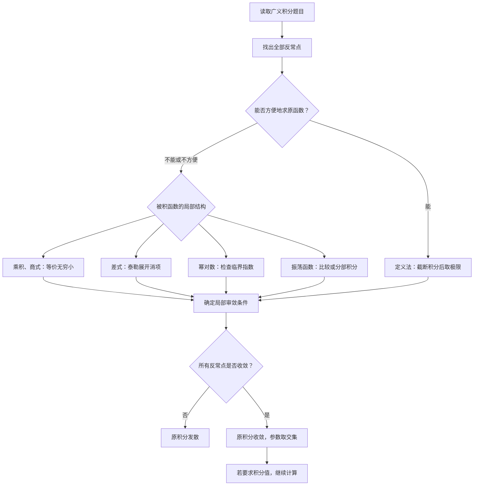

本节是将**函数极限、等价无穷小、泰勒公式、定积分计算、积分不等式**综合起来考查的一节。

广义积分的难点往往不在于积分本身，而在于判断被积函数在特殊位置的变化规律，以及这种变化规律是否足以保证积分收敛。掌握这一节后，你应该能够做到：即使面对一个从未见过的、结构十分复杂的被积函数，也能够通过局部渐近分析迅速建立解题思路。

## 一、考点概览

| 知识模块    | 核心考查内容            | 掌握优先级 |
| ------- | ----------------- | ----- |
| 广义积分的定义 | 无穷积分、瑕积分、内部瑕点     | ★★★★★ |
| 基本审敛判据  | $p$ 型积分、比较判别法 | ★★★★★ |
| 双端点与多端点 | 含参数积分敛散性          | ★★★★★ |
| 幂对数临界型  | 幂次为1时的进一步判断       | ★★★★★ |
| 渐近分析    | 等价无穷小、泰勒展开、消项     | ★★★★★ |
| 反求参数    | 利用收敛条件消去发散主项      | ★★★★★ |
| 广义积分计算  | 换元、分部积分、部分分式      | ★★★★★ |
| 敛散性命题判断 | 充分必要条件、反例构造       | ★★★★  |
| 振荡积分    | 绝对收敛与条件收敛         | ★★★   |
| 综合题     | 微分方程、变限积分、极限      | ★★★★  |

贯穿全节的核心思维是：

**寻找所有反常点 → 分别确定局部主项 → 转化为标准积分 → 判断敛散性 → 取条件交集 → 必要时精确计算。**

其中，最值得反复训练的是局部主项的提取能力。

## 二、基础知识：从本质上理解广义积分

### 2.1 什么是广义积分？

普通定积分研究的是有限区间上的可积函数，而广义积分主要解决两类问题：

- 积分区间无限长；
- 被积函数在有限区间内或端点附近无界。

前者称为无穷限积分，后者称为瑕积分。

理解广义积分时，最重要的一点是：**广义积分本质上是定积分的极限，而不是直接把无穷大代入原函数。**

**第一类：无穷区间上的广义积分**

定义：

$$
\int_a^{+\infty}f(x)\,dx =\lim_{R\to+\infty}\int_a^R f(x)\,dx.
$$

如果右侧极限存在且有限，则称广义积分收敛，否则称为发散。

例如：

$$
\begin{aligned} \int_1^{+\infty}\frac{dx}{x^2} &=\lim_{R\to+\infty} \left[-\frac1x\right]_1^R\\ &=\lim_{R\to+\infty} \left(1-\frac1R\right)=1. \end{aligned}
$$

但是：

$$
\int_1^{+\infty}\frac{dx}{x} =\lim_{R\to+\infty}\ln R =+\infty.
$$

两者的被积函数都趋于零，然而一个收敛，一个发散。

**直观理解：** 函数高度趋于零并不足以保证无限长区域的面积有限，还要考察高度下降的速度。

**第二类：无界函数的广义积分**

若 $a$ 是瑕点，则定义：

$$
\int_a^b f(x)\,dx =\lim_{\varepsilon\to0^+} \int_{a+\varepsilon}^b f(x)\,dx.
$$

例如：

$$
\begin{aligned} \int_0^1\frac{dx}{\sqrt{x}} &=\lim_{\varepsilon\to0^+} \left[2\sqrt{x}\right]_\varepsilon^1\\ &=2. \end{aligned}
$$

而：

$$
\int_0^1\frac{dx}{x} =\lim_{\varepsilon\to0^+}(-\ln\varepsilon) =+\infty.
$$

这说明，被积函数趋于无穷大，也不一定导致积分发散。

在瑕点附近，关键是函数增长得有多快。

### 2.2 多个反常点必须独立判断

这是广义积分最基本、也最容易被忽略的规则。

对于：

$$
\int_0^{+\infty}f(x)\,dx,
$$

如果原点是瑕点，则必须拆成：

$$
\int_0^1f(x)\,dx+ \int_1^{+\infty}f(x)\,dx.
$$

对于内部瑕点 $c\in(a,b)$，必须拆成：

$$
\int_a^b f(x)\,dx =\int_a^c f(x)\,dx+\int_c^b f(x)\,dx.
$$

对于整个实轴上的积分，则必须考察：

$$
\int_{-\infty}^{+\infty}f(x)\,dx =\int_{-\infty}^0 f(x)\,dx+ \int_0^{+\infty}f(x)\,dx.
$$

只有所有组成部分均收敛，原广义积分才收敛。

### 2.3 奇函数的广义积分不一定等于零

**经典真题母题：1995年数学三，核心题库第014题；李正元练习题亦有同类题。**

判断：

$$
I=\int_{-1}^1\frac{dx}{\sin x}
$$

是否收敛。

虽然 $1/\sin x$ 是奇函数，但 $x=0$ 是内部瑕点。

由于：

$$
\sin x\sim x,\qquad x\to0,
$$

故：

$$
\frac1{\sin x}\sim\frac1x.
$$

于是：

$$
\int_{-1}^0\frac{dx}{\sin x}=-\infty,
$$

$$
\int_0^1\frac{dx}{\sin x}=+\infty.
$$

原广义积分发散。

如果采取对称截断：

$$
\lim_{\varepsilon\to0^+} \left( \int_{-1}^{-\varepsilon}\frac{dx}{\sin x} +\int_\varepsilon^1\frac{dx}{\sin x} \right)=0,
$$

得到的只是柯西主值，不是通常意义下的广义积分值。

**必须建立的认识：先判断收敛性，再使用奇偶性、对称性和积分运算性质。**

## 三、两大基本审敛判据：全节最重要的公式

### 3.1 $p$ 型积分

必须熟练掌握以下两个结论及其区别。

| 积分模型                                           | 收敛条件      | 发散条件         |
| ---------------------------------------------- | --------- | ------------ |
| $\displaystyle\int_0^1\frac{dx}{x^p}$      | $p<1$ | $p\geq1$ |
| $\displaystyle\int_1^\infty\frac{dx}{x^p}$ | $p>1$ | $p\leq1$ |

它们的临界值都是 $p=1$，但不等号方向恰好相反。

**有限瑕点要求爆炸得足够慢；无穷远处要求衰减得足够快。**

如果直接用幂函数 $x^\alpha$ 表示，则结论为：

$$
\boxed{ \int_0^1 x^\alpha\,dx \text{ 收敛}\iff\alpha>-1 }
$$

$$
\boxed{ \int_1^\infty x^\alpha\,dx \text{ 收敛}\iff\alpha<-1 }
$$

收敛时的积分值分别是：

$$
\int_0^1 x^\alpha\,dx =\frac1{\alpha+1},\qquad \alpha>-1,
$$

$$
\int_1^\infty x^\alpha\,dx =-\frac1{\alpha+1},\qquad \alpha<-1.
$$

**推广到任意有限瑕点**

$$
\int_a^b\frac{dx}{(x-a)^p}
$$

与

$$
\int_a^b\frac{dx}{(b-x)^p}
$$

均在 $p<1$ 时收敛。

对于内部瑕点 $c$：

$$
\int_a^b\frac{dx}{|x-c|^p}
$$

也是当且仅当 $p<1$ 时收敛。

因为通过平移变量，都能将瑕点转化为原点。

### 3.2 比较判别法

设在需要审敛的邻域内：

$$
0\leq f(x)\leq g(x).
$$

那么：

$$
\int g(x)\,dx\text{ 收敛} \Longrightarrow \int f(x)\,dx\text{ 收敛}.
$$

$$
\int f(x)\,dx\text{ 发散} \Longrightarrow \int g(x)\,dx\text{ 发散}.
$$

记忆方式是：

**大者收敛，小者收敛；小者发散，大者发散。**

注意不能反过来使用。

比较关系不必在整个积分区间都成立，只需在反常点的充分小邻域或充分大的尾部区间成立，其余部分正常可积即可。

### 3.3 极限比较判别法

这是考研审敛题最常用的方法。

设 $f(x),g(x)$ 在反常点附近非负，且：

$$
\lim_{x\to a^+}\frac{f(x)}{g(x)} =L,\qquad 0<L<+\infty.
$$

则二者同敛散。

无穷远处的判别完全类似：

$$
\lim_{x\to+\infty}\frac{f(x)}{g(x)} =L,\qquad 0<L<+\infty.
$$

特别地：

$$
f(x)\sim g(x)
$$

意味着两者在该反常点附近同敛散（用于非负函数，或用于最终同号函数的绝对值）。

例如：

$$
\int_0^1\frac{dx}{\sqrt{\sin x}}.
$$

由于：

$$
\frac1{\sqrt{\sin x}} \sim\frac1{\sqrt{x}},\qquad x\to0^+,
$$

所以收敛。

**极限为零或者无穷大怎么办？**

假设 $f,g$ 非负且 $g$ 在考察邻域内为正：

| 比值极限               | 可以推出的结论                         |
| ------------------ | ------------------------------- |
| $0<L<+\infty$ | 两者同敛散                           |
| $L=0$          | $g$ 的积分收敛，可推出 $f$ 的积分收敛 |
| $L=+\infty$    | $g$ 的积分发散，可推出 $f$ 的积分发散 |

特别注意：

$$
\lim_{x\to\infty}xf(x)=0
$$

不能直接推出积分收敛。

例如：

$$
f(x)=\frac1{x\ln x},\qquad x\geq e.
$$

虽然：

$$
xf(x)=\frac1{\ln x}\to0,
$$

但其积分仍然发散。

## 四、建立局部渐近分析的工具库

处理广义积分，本质上就是处理反常点处的函数极限。

### 4.1 有限瑕点常用等价关系

当 $u\to0$ 时：

| 原函数                         | 首个非零主项               |
| --------------------------- | -------------------- |
| $\sin u$                | $u$              |
| $\tan u$                | $u$              |
| $\arctan u$             | $u$              |
| $\arcsin u$             | $u$              |
| $\ln(1+u)$              | $u$              |
| $e^u-1$                 | $u$              |
| $1-\cos u$              | $\dfrac{u^2}{2}$ |
| $(1+u)^a-1$，$a\ne0$ | $au$             |
| $u-\sin u$              | $\dfrac{u^3}{6}$ |
| $u-\ln(1+u)$            | $\dfrac{u^2}{2}$ |

此外，本节特别容易考查：

$$
\ln x\sim x-1,\qquad x\to1;
$$

$$
x^a-1\sim a(x-1),\qquad x\to1,\quad a\ne0;
$$

$$
\tan\frac{\pi x}{2} \sim\frac2{\pi(1-x)}, \qquad x\to1^-.
$$

同一个函数在不同端点可能表现出完全不同的性质。

例如，$\ln x$ 在 $x\to0^+$ 时无界，在 $x\to1$ 时却是一阶无穷小。

### 4.2 无穷远处常用渐近关系

当 $x\to+\infty$ 时：

| 原函数                   | 渐近关系               |
| --------------------- | ------------------ |
| $1+x$             | $\sim x$       |
| $\sqrt{x^2+a}$    | $\sim x$       |
| $\ln(1+x)$        | $\sim\ln x$    |
| $\ln(1+1/x)$      | $\sim1/x$      |
| $\arctan x$       | $\sim\pi/2$    |
| $\pi/2-\arctan x$ | $\sim1/x$      |
| $e^{1/x}-1$       | $\sim1/x$      |
| $1-\cos(1/x)$     | $\sim1/(2x^2)$ |

### 4.3 幂函数、对数函数、指数函数的增长层级

对于任意固定的 $a,b,c>0$，当 $x\to+\infty$：

$$
(\ln x)^a=o(x^b),
$$

$$
x^b=o(e^{cx}).
$$

即：

$$
\text{对数增长} \ll\text{幂函数增长} \ll\text{指数增长}.
$$

相应地，当 $x\to0^+$ 时：

$$
x^a|\ln x|^b\to0,
$$

$$
x^{-a}e^{-c/x}\to0.
$$

这些关系可以帮助你判断复杂的指数、对数积分，而不必直接求出原函数。

### 4.4 幂次分析的统一模型

假设有限瑕点附近：

$$
f(x)\sim C|x-a|^m,
$$

$$
g(x)\sim D|x-a|^n, \qquad CD\ne0.
$$

则：

$$
\frac{f(x)}{g(x)} \sim\frac CD|x-a|^{m-n}.
$$

因此商函数的局部积分收敛当且仅当：

$$
\boxed{m-n>-1.}
$$

无穷远处若：

$$
f(x)\sim Cx^m,\qquad g(x)\sim Dx^n,
$$

则商函数的尾积分收敛当且仅当：

$$
\boxed{m-n<-1.}
$$

复杂分式往往可以转化为简单的指数加减运算。

## 五、题型一：双端点参数审敛问题

这是本节最重要的基础题型。核心题库中的2010年、2016年、2022年以及2026年相关真题，均可归入这一模型。

### 母题1：2016年考研数学一真题

若反常积分

$$
I=\int_0^{+\infty} \frac{dx}{x^a(1+x)^b}
$$

收敛，求 $a,b$ 应满足的条件。

<Steps>

<Step>

### 第一步：寻找反常点 [!toc]

积分区间为 $(0,+\infty)$，因此检查 $0^+$ 和 $+\infty$。

</Step>

<Step>

### 第二步：判断原点附近 [!toc]

当 $x\to0^+$ 时：

$$
(1+x)^b\to1.
$$

故：

$$
\frac1{x^a(1+x)^b}\sim x^{-a}.
$$

有限瑕点的审敛条件是：

$$
a<1.
$$

</Step>

<Step>

### 第三步：判断无穷远处 [!toc]

当 $x\to+\infty$ 时：

$$
(1+x)^b\sim x^b.
$$

所以：

$$
\frac1{x^a(1+x)^b}\sim x^{-a-b}.
$$

无穷远收敛要求：

$$
a+b>1.
$$

</Step>

<Step>

### 第四步：取交集 [!toc]

$$
\boxed{a<1,\qquad a+b>1.}
$$

**母题推广：**

当 $r,s>0$ 时，

$$
\int_0^\infty \frac{x^\alpha}{(1+x^r)^s}\,dx
$$

收敛的充要条件为：

$$
\boxed{-1<\alpha<rs-1.}
$$

因为原点附近的幂次是 $\alpha$，无穷远处的幂次是 $\alpha-rs$。

以后无论将分母改成 $1+x^2$、$2+x^p$ 还是多个因子的乘积，思路完全相同。

</Step>

</Steps>

### 母题2：2010年考研数一、数二真题

设 $m,n$ 为正整数，判断：

$$
I=\int_0^1 \frac{\sqrt[m]{\ln^2(1-x)}}{\sqrt[n]x}\,dx
$$

的收敛性。

首先整理为：

$$
f(x)=x^{-1/n}|\ln(1-x)|^{2/m}.
$$

当 $x\to0^+$ 时：

$$
\ln(1-x)\sim-x.
$$

因此：

$$
f(x)\sim x^{2/m-1/n}.
$$

因为：

$$
\frac2m>0,\qquad \frac1n\leq1,
$$

所以：

$$
\frac2m-\frac1n>-1.
$$

原点附近必然收敛。

当 $x\to1^-$ 时：

$$
x^{-1/n}\to1,
$$

因此只需考察：

$$
\int_{1-\delta}^1 |\ln(1-x)|^{2/m}\,dx.
$$

令：

$$
u=1-x,\qquad u=e^{-t},
$$

则转化为：

$$
\int_{-\ln\delta}^\infty t^{2/m}e^{-t}\,dt.
$$

指数衰减快于任何固定幂次的增长，所以收敛。

最终，对于任意正整数 $m,n$，均有：

$$
\boxed{I\text{ 收敛}.}
$$

**命题人的设计：** 利用分母中的 $x^{1/n}$ 制造奇性，又利用分子中的 $\ln(1-x)$ 的零点消除部分奇性。只看分母，必然容易出错。

### 母题3：2022年考研数学二真题（张宇1000题亦收录）

若：

$$
I=\int_0^1 \frac{\ln x}{x^p(1-x)^{1-p}}\,dx
$$

收敛，求 $p$ 的范围。

在 $x\to0^+$ 时：

$$
|f(x)|\sim x^{-p}|\ln x|.
$$

这一积分在原点附近收敛当且仅当 $p<1$。

在 $x\to1^-$ 时：

$$
\ln x\sim-(1-x),
$$

因此：

$$
f(x)\sim-(1-x)^p.
$$

有限端点的审敛要求：

$$
p>-1.
$$

取交集：

$$
\boxed{-1<p<1.}
$$

这类题一定要区分：对数函数在一个端点可能趋于无穷，而在另一个端点可能是一个零点。

### 母题4：2026年数二、数三真题

若：

$$
I=\int_0^\infty \frac{\arctan x}{x^p(1+x)}\,dx
$$

收敛，求 $p$ 的范围。

原点附近：

$$
f(x)\sim x^{1-p}.
$$

故：

$$
1-p>-1\iff p<2.
$$

无穷远处：

$$
f(x)\sim\frac{\pi}{2}x^{-p-1}.
$$

故：

$$
p+1>1\iff p>0.
$$

所以：

$$
\boxed{0<p<2.}
$$

### 同类题的横向比较

| 题目来源            | 被积函数                                  | 收敛条件              |
| --------------- | ------------------------------------- | ----------------- |
| 2016年数一         | $\dfrac1{x^a(1+x)^b}$             | $a<1,\ a+b>1$ |
| 2026年数二、数三      | $\dfrac{\arctan x}{x^p(1+x)}$     | $0<p<2$      |
| 李永乐六套卷第3套第11题   | $\dfrac{\arctan x}{x^\alpha}$     | $1<\alpha<2$  |
| 李林880题064       | $\dfrac{x^{1-p}\arctan x}{2+x^p}$ | $1<p<3$      |
| 李林880题062       | $\dfrac{\ln(1+x)}{x^p}$           | $1<p<2$      |
| 张宇1000题积分概念篇014 | $\dfrac{\ln x}{(1+x)x^{1-p}}$     | $0<p<1$      |

表中积分区间均为 $(0,+\infty)$。

<Callout type="warn" title="参数边界">

充要条件为 $0<p<1$，两个端点都不能取等号。

</Callout>

**这一组题不需要分别记忆答案。只需要掌握：在每个反常点重新计算有效幂次。**

## 六、题型二：幂对数型积分与临界指数

普通 $p$ 型积分能解决大多数问题。但是当主幂次恰好等于临界值时，对数因子就可能改变积分的敛散性。

### 6.1 两个必须掌握的幂对数模型

无穷远处：

$$
I=\int_e^\infty \frac{dx}{x^p(\ln x)^q}.
$$

有限瑕点处：

$$
J=\int_0^{1/e} \frac{dx}{x^p|\ln x|^q}.
$$

完整的审敛条件如下：

| 幂次条件               | 无穷远积分 $I$ | 原点瑕积分 $J$ |
| ------------------ | ------------- | ------------- |
| $p>1$          | 收敛            | 发散            |
| $p<1$          | 发散            | 收敛            |
| $p=1,\ q>1$    | 收敛            | 收敛            |
| $p=1,\ q\leq1$ | 发散            | 发散            |

其中 $q$ 可以是任意实数。

**推导方法**

对于无穷远积分，令：

$$
t=\ln x,\qquad x=e^t,\qquad dx=e^t\,dt.
$$

得到：

$$
I=\int_1^\infty e^{(1-p)t}t^{-q}\,dt.
$$

当 $p>1$ 时，指数衰减，积分收敛；当 $p<1$ 时，指数增长，积分发散；当 $p=1$ 时，只剩下：

$$
\int_1^\infty t^{-q}\,dt,
$$

因此需要 $q>1$。

对于原点瑕积分，令：

$$
t=-\ln x,
$$

则：

$$
J=\int_1^\infty e^{(p-1)t}t^{-q}\,dt.
$$

同理即可得到全部条件。

**解题原则：先判断幂次；幂次处于临界位置时，再判断对数。**

### 母题5：2013年考研数学二真题

设：

$$
f(x)= \begin{cases} \dfrac1{(x-1)^{\alpha-1}},&1<x<e,\\[2mm] \dfrac1{x(\ln x)^{\alpha+1}},&x\geq e. \end{cases}
$$

若：

$$
\int_1^\infty f(x)\,dx
$$

收敛，求 $\alpha$ 的范围。

在 $x\to1^+$ 时：

$$
f(x)=(x-1)^{1-\alpha}.
$$

故要求：

$$
1-\alpha>-1 \iff\alpha<2.
$$

在无穷远处，令 $t=\ln x$，则：

$$
\int_e^\infty \frac{dx}{x(\ln x)^{\alpha+1}} =\int_1^\infty\frac{dt}{t^{\alpha+1}}.
$$

故要求：

$$
\alpha+1>1 \iff\alpha>0.
$$

最终：

$$
\boxed{0<\alpha<2.}
$$

### 母题6：张宇1000题、李林880题双端点临界模型

设 $p,q>0$，判断：

$$
I=\int_1^\infty \frac{dx}{x^p(\ln x)^q}
$$

收敛的条件。

这道题和前面的标准模型很像，但下限由 $e$ 改成了 $1$。

**变化就在于增加了一个有限瑕点。**

当 $x\to1^+$ 时：

$$
\ln x\sim x-1,
$$

因此：

$$
f(x)\sim\frac1{(x-1)^q}.
$$

左端收敛要求：

$$
q<1.
$$

无穷远处的收敛条件为：

$$
p>1 \quad\text{或}\quad p=1,\ q>1.
$$

然而 $q>1$ 与左端的 $q<1$ 矛盾。

因此：

$$
\boxed{p>1,\qquad q<1.}
$$

另一道同构题为：

$$
\int_0^1\frac{dx}{x^p|\ln x|^q}.
$$

通过 $x=e^{-t}$ 得到：

$$
\int_0^\infty e^{(p-1)t}t^{-q}\,dt.
$$

整体收敛条件为：

$$
\boxed{p<1,\qquad q<1.}
$$

这两道题非常值得配对练习。

### 模拟题强化：李林六套卷第6套第2题

判断：

$$
\int_3^\infty \frac{dx}{(x-1)(\ln x)^a}
$$

收敛时 $a$ 的范围。

由于：

$$
\frac1{(x-1)(\ln x)^a} \sim\frac1{x(\ln x)^a},
$$

所以直接归入临界模型：

$$
\boxed{a>1.}
$$

如果把积分下限由 $3$ 改成 $1$，结论会完全改变。此时：

$$
\frac1{(x-1)(\ln x)^a} \sim\frac1{(x-1)^{a+1}},
$$

左端收敛要求 $a<0$，而无穷远处要求 $a>1$，因此不存在使整个积分收敛的实数 $a$。

这就是一个非常典型的真题创新方式：**表达式不变，只改变积分下限，就可能增加新的审敛约束。**

### 6.2 进一步的临界模型：二重对数

这是用于应对创新题的拓展，不需要作为额外公式死记硬背。

考察：

$$
\int_{e^e}^\infty \frac{dx}{x(\ln x)^p(\ln\ln x)^q}.
$$

令 $t=\ln x$，得到：

$$
\int_e^\infty \frac{dt}{t^p(\ln t)^q}.
$$

因此收敛条件为：

$$
\boxed{ p>1 \quad\text{或}\quad p=1,\ q>1. }
$$

如果出现三重对数，仍然可以继续换元。

## 七、题型三：指数型、变指数型与增长速度审敛

这类题表面上没有直接出现标准的 $p$ 型积分，但经过指数与对数变换，往往可以迅速判断。

### 母题7：2016年考研数学二真题

判断：

$$
I_1=\int_{-\infty}^0\frac{e^{1/x}}{x^2}\,dx,
$$

$$
I_2=\int_0^\infty\frac{e^{1/x}}{x^2}\,dx
$$

的敛散性。

注意：

$$
\left(e^{1/x}\right)' =-\frac{e^{1/x}}{x^2}.
$$

因此：

$$
\begin{aligned} I_1 &=\lim_{\substack{R\to\infty\\\varepsilon\to0^+}} \left[-e^{1/x}\right]_{-R}^{-\varepsilon}\\ &=0-(-1)=1. \end{aligned}
$$

而：

$$
I_2 =\lim_{\substack{R\to\infty\\\varepsilon\to0^+}} \left(e^{1/\varepsilon}-e^{1/R}\right) =+\infty.
$$

所以：

$$
\boxed{I_1\text{ 收敛},\qquad I_2\text{ 发散}.}
$$

本题关键是：

$$
\lim_{x\to0^-}e^{1/x}=0, \qquad \lim_{x\to0^+}e^{1/x}=+\infty.
$$

左右方向的改变，导致指数函数从极快衰减变成极快增长。

**模拟题变式：李林六套卷第3套第2题**

判断：

$$
\int_{-\infty}^0 \frac{e^{1/x}}{x^2+\sin^2x}\,dx
$$

是否收敛。

虽然现在很难求原函数，但由于：

$$
x^2+\sin^2x\geq x^2,
$$

故：

$$
0\leq \frac{e^{1/x}}{x^2+\sin^2x} \leq \frac{e^{1/x}}{x^2}.
$$

前面的真题已经证明右侧积分收敛，因此本题也收敛。

这正是真题母题与模拟题之间的迁移关系：当无法直接积分时，寻找一个已经掌握的、可以控制原函数的标准模型。

### 母题8：张宇8套卷第3套第3题

设 $p>0$，若：

$$
I=\int_2^\infty \frac{dx}{(\ln x)^{(\ln x)^p}}
$$

收敛，求 $p$ 的范围。

这是分类模拟题中非常值得掌握的一道变指数题。

**识别方法**

当分母出现复杂的变量指数时，优先转化为 $x^{g(x)}$ 的形式。

$$
\begin{aligned} (\ln x)^{(\ln x)^p} &=\exp\left((\ln x)^p\ln\ln x\right)\\ &=x^{(\ln x)^{p-1}\ln\ln x}. \end{aligned}
$$

令：

$$
h(x)=(\ln x)^{p-1}\ln\ln x.
$$

那么：

$$
I=\int_2^\infty x^{-h(x)}\,dx.
$$

当 $p\geq1$ 时：

$$
h(x)\to+\infty.
$$

因此充分大的 $x$ 上有 $h(x)\geq2$，从而：

$$
0<x^{-h(x)}\leq x^{-2}.
$$

积分收敛。

当 $0<p<1$ 时：

$$
h(x)=\frac{\ln\ln x}{(\ln x)^{1-p}}\to0.
$$

因此充分大的 $x$ 上有 $h(x)\leq1/2$，从而：

$$
x^{-h(x)}\geq x^{-1/2}.
$$

积分发散。

最终：

$$
\boxed{p\geq1.}
$$

**一般规律**

对于：

$$
\int_A^\infty x^{-h(x)}\,dx,
$$

若：

$$
\lim_{x\to\infty}h(x)>1,
$$

包括极限为正无穷大的情形，则积分收敛；若该极限严格小于 $1$，则积分发散。

但如果：

$$
h(x)\to1,
$$

就必须进一步研究。

例如：

$$
h(x)=1+\frac{q\ln\ln x}{\ln x}.
$$

则：

$$
x^{-h(x)} =\frac1{x(\ln x)^q}.
$$

它在 $q>1$ 时收敛，在 $q\leq1$ 时发散。

所以，**变量指数趋于1时，必须分析它趋近1的速度。**

## 八、题型四：泰勒展开、主项消去与复杂差式

这是本节最重要的强化题型之一，也是广义积分与第一模块极限、第三模块泰勒公式的主要结合点。

### 8.1 为什么必须找到第一个非零主项？

考察：

$$
\int_1^\infty x^k\left(\sqrt{1+\frac1{x^2}}-1\right)\,dx.
$$

如果只知道：

$$
\sqrt{1+\frac1{x^2}}\to1,
$$

只能说明括号内趋于零，无法判断趋零速度。

通过等价关系：

$$
\sqrt{1+\frac1{x^2}}-1 \sim\frac1{2x^2},
$$

即可得到：

$$
f(x)\sim\frac12x^{k-2}.
$$

故收敛当且仅当：

$$
k-2<-1,
$$

即：

$$
\boxed{k<1.}
$$

题目中出现两个趋于相同值的函数相减，通常意味着需要提取消项后的第一个非零主项。

### 母题9：张宇1000题、李林880题

若：

$$
\int_1^\infty x^k\left(e^{-\cos(1/x)}-e^{-1}\right)\,dx
$$

收敛，求 $k$ 的范围。

先变形：

$$
e^{-\cos(1/x)}-e^{-1} =e^{-1} \left(e^{1-\cos(1/x)}-1\right).
$$

由于：

$$
1-\cos\frac1x\sim\frac1{2x^2},
$$

再利用：

$$
e^u-1\sim u,
$$

得到：

$$
e^{-\cos(1/x)}-e^{-1} \sim\frac1{2ex^2}.
$$

故：

$$
f(x)\sim\frac1{2e}x^{k-2}.
$$

收敛要求：

$$
k-2<-1.
$$

所以：

$$
\boxed{k<1.}
$$

这道题实际上只使用了两次等价无穷小，并不一定需要完整的泰勒展开。

### 母题10：高阶消项模型

判断：

$$
I(q)=\int_1^\infty x^q\left( \sqrt{1+\frac1{x^2}} -1-\frac1{2x^2} \right)\,dx
$$

的敛散性。

前两项已经被消去，因此必须展开到更高阶：

$$
\sqrt{1+t} =1+\frac t2-\frac{t^2}{8}+O(t^3).
$$

令：

$$
t=\frac1{x^2},
$$

则：

$$
\sqrt{1+\frac1{x^2}} -1-\frac1{2x^2} =-\frac1{8x^4}+O(x^{-6}).
$$

于是：

$$
f(x)\sim-\frac18x^{q-4}.
$$

因此：

$$
q-4<-1 \iff q<3.
$$

最终：

$$
\boxed{q<3\text{ 时收敛}.}
$$

当 $q=3$ 时：

$$
f(x)=-\frac1{8x}+O(x^{-3}),
$$

故截断积分满足：

$$
\int_1^R f(x)\,dx =-\frac18\ln R+O(1).
$$

这不仅证明了发散，还给出了发散速度。

### 8.2 高阶消项的统一结论

如果：

$$
F(t)=c_mt^m+o(t^m), \qquad c_m\ne0,
$$

当 $r>0$ 时：

$$
x^\alpha F(x^{-r}) \sim c_mx^{\alpha-rm}.
$$

因此：

$$
\int_1^\infty x^\alpha F(x^{-r})\,dx
$$

收敛当且仅当：

$$
\boxed{\alpha<rm-1.}
$$

对应的有限瑕积分：

$$
\int_0^1 x^\alpha F(x^r)\,dx
$$

收敛当且仅当：

$$
\boxed{\alpha+rm>-1.}
$$

这两个公式揭示了所有高阶消项审敛题的共同本质。

### 母题11：李林880题016

若：

$$
I=\int_2^\infty \left(e^{\frac{\ln x}{x^a}}-1\right)\,dx
$$

收敛，求 $a$ 的范围。

这道题的陷阱是，不能不加条件地使用 $e^u-1\sim u$。

首先分类讨论指数：

$$
u(x)=\frac{\ln x}{x^a}.
$$

当 $a\leq0$ 时：

$$
u(x)\to+\infty.
$$

被积函数趋于正无穷大，积分必然发散。

当 $a>0$ 时：

$$
u(x)\to0.
$$

此时才有：

$$
e^{\frac{\ln x}{x^a}}-1 \sim\frac{\ln x}{x^a}.
$$

由幂对数判据可得：

$$
\boxed{a>1.}
$$

**使用等价无穷小之前，必须确认其自变量确实趋于零，尤其是在自变量中含有未知参数时。**

## 九、题型五：利用积分收敛性反求参数

题目通常不会直接问敛散性，而是告诉你：

$$
\int_a^\infty f(x;\alpha,\beta)\,dx=C.
$$

其中 $C$ 是有限常数，要求确定参数。

必须立刻意识到：题目不仅提供了一个积分等式，还隐含了收敛性条件。

### 9.1 一般解题策略

先确定哪些主项会导致积分发散，再利用参数将它们消去。

假设：

$$
f(x)=A+\frac Bx+\frac C{x^2}+O(x^{-3}).
$$

若：

$$
\int_1^\infty f(x)\,dx
$$

收敛，则必须：

$$
A=0,\qquad B=0.
$$

因为常数项和 $1/x$ 项均不可积，而剩余的 $x^{-2}$ 及更高阶衰减项可积。

### 母题12：李林880题015

已知：

$$
\int_1^\infty \left( \frac{2x^2+ax+b}{2x^2+bx}-1 \right)\,dx=1, \qquad b>0,
$$

求 $a,b$。

先合并：

$$
f(x)=\frac{(a-b)x+b}{2x^2+bx}.
$$

若 $a\ne b$，则：

$$
f(x)\sim\frac{a-b}{2x}.
$$

积分发散，与题设矛盾。

因此必须：

$$
a=b.
$$

代入后：

$$
f(x)=\frac{b}{x(2x+b)} =\frac1x-\frac2{2x+b}.
$$

注意不能将右侧两个发散积分分别计算。

在有限区间上有：

$$
\begin{aligned} 1 &=\lim_{R\to\infty} \int_1^R\left( \frac1x-\frac2{2x+b} \right)\,dx\\ &=\lim_{R\to\infty} \left[\ln\frac{x}{2x+b}\right]_1^R\\ &=\ln\frac{2+b}{2}. \end{aligned}
$$

因此：

$$
b=2(e-1).
$$

最终：

$$
\boxed{a=b=2(e-1).}
$$

这道题的正确顺序是先用收敛性建立第一个方程，再用积分值建立第二个方程。

### 母题13：李林880题065

已知：

$$
I=\int_0^\infty \left( \frac1{\sqrt{x^2+4}}-\frac a{x+2} \right)\,dx
$$

收敛，求 $a$ 和 $I$。

无穷远处：

$$
\frac1{\sqrt{x^2+4}} =\frac1x+O(x^{-3}),
$$

$$
\frac a{x+2} =\frac ax+O(x^{-2}).
$$

故：

$$
f(x)=\frac{1-a}{x}+O(x^{-2}).
$$

收敛要求：

$$
a=1.
$$

代入：

$$
\begin{aligned} I &=\lim_{R\to\infty} \left[ \ln\left(x+\sqrt{x^2+4}\right) -\ln(x+2) \right]_0^R\\ &=\lim_{R\to\infty} \ln\frac{R+\sqrt{R^2+4}}{R+2}\\ &=\ln2. \end{aligned}
$$

因此：

$$
\boxed{a=1,\qquad I=\ln2.}
$$

这里需要区分两种抵消：

| 抵消方式               | 是否允许       |
| ------------------ | ---------- |
| 被积函数内部的发散主项相消      | 允许，应先合并再积分 |
| 同一反常积分不同反常点之间的发散相消 | 不允许        |
| 两个发散积分求值后作差        | 不允许        |
| 同一有限截断区间内作差，再取极限   | 允许         |

### 母题14：李永乐六套卷第2套第2题

若：

$$
I=\int_0^\infty \frac{ax^2+bx+1}{(x-1)(x+1)^2}\,dx
$$

收敛，求 $a,b$。

这道模拟题比前两道更全面，因为不仅存在无穷远问题，还存在内部瑕点。

首先检查 $x=1$。

若：

$$
a+b+1\ne0,
$$

则被积函数在 $x=1$ 附近有不可积的一阶极点。

因此必须：

$$
a+b+1=0.
$$

由此：

$$
ax^2+bx+1=(x-1)(ax-1).
$$

约分后：

$$
f(x)=\frac{ax-1}{(x+1)^2},\qquad x\ne1.
$$

再看无穷远处。

若 $a\ne0$，则：

$$
f(x)\sim\frac ax,
$$

积分发散。因此：

$$
a=0,\qquad b=-1.
$$

此时：

$$
f(x)=-\frac1{(x+1)^2},
$$

原积分确实收敛，并且：

$$
I=-1.
$$

所以：

$$
\boxed{a=0,\qquad b=-1.}
$$

**遇到有理函数型参数题，优先检查分母零点，再检查分子与分母的次数差。**

## 十、题型六：三个及以上反常点的综合审敛

前面讲了双端点、幂次分析与内部瑕点，现在将它们组合起来。

### 母题15：汤家凤八套卷第4套第1题

设 $b>0$，若：

$$
I=\int_0^\infty \frac{\arctan x}{x^a\sqrt{|x^b-1|}}\,dx
$$

收敛，求 $a,b$ 的条件。

这道题是分类模拟题中极具代表性的一道多瑕点综合题。

必须考察：

$$
x\to0^+,\quad x\to1^-,\quad x\to1^+,\quad x\to+\infty.
$$

<Steps>

<Step>

### 第一步：原点 [!toc]

由于 $b>0$：

$$
x^b\to0,\qquad \sqrt{|x^b-1|}\to1.
$$

并且：

$$
\arctan x\sim x.
$$

因此：

$$
f(x)\sim x^{1-a}.
$$

收敛条件为：

$$
a<2.
$$

</Step>

<Step>

### 第二步：内部瑕点 [!toc]

当 $x\to1$ 时：

$$
x^b-1\sim b(x-1),
$$

所以：

$$
\sqrt{|x^b-1|} \sim\sqrt b\,|x-1|^{1/2}.
$$

又因为：

$$
\arctan x\to\frac\pi4,
$$

因此：

$$
f(x)\sim \frac{\pi}{4\sqrt b} |x-1|^{-1/2}.
$$

指数 $1/2<1$，两侧积分均收敛，不产生额外参数限制。

</Step>

<Step>

### 第三步：无穷远 [!toc]

$$
\sqrt{|x^b-1|}\sim x^{b/2},
$$

$$
\arctan x\to\frac\pi2.
$$

因此：

$$
f(x)\sim \frac\pi2x^{-a-b/2}.
$$

收敛要求：

$$
a+\frac b2>1.
$$

最终：

$$
\boxed{ a<2,\qquad a+\frac b2>1 }
$$

其中 $b>0$ 已由题设给出。

</Step>

</Steps>

### 创新题推广

将平方根改成任意次幂：

$$
I=\int_0^\infty \frac{\arctan x} {x^a|x^b-1|^c}\,dx, \qquad b>0.
$$

三个位置分别产生如下条件：

| 反常位置              | 等价主项（忽略非零常数）       | 收敛条件         |
| ----------------- | ------------------ | ------------ |
| $x\to0^+$     | $x^{1-a}$      | $a<2$    |
| $x\to1$       | $\lvert x-1\rvert ^{-c}$ | $c<1$    |
| $x\to+\infty$ | $x^{-a-bc}$    | $a+bc>1$ |

因此：

$$
\boxed{ a<2,\qquad c<1,\qquad a+bc>1. }
$$

这种增加一个参数、改变内部瑕点的阶数、同时考查多个端点的方式，非常适合作为未来综合题的训练模型。

## 十一、题型七：广义积分的准确计算

普通定积分中的换元法、分部积分法、有理函数积分法都适用于广义积分，但必须注意反常点和极限。

基本步骤是：确认反常点，必要时判断收敛性，在有限截断区间内计算，最后求极限。

### 11.1 换元积分法

**母题16：2020年考研数学二真题**

计算：

$$
I=\int_0^1 \frac{\arcsin\sqrt{x}}{\sqrt{x(1-x)}}\,dx.
$$

看到：

$$
\arcsin\sqrt{x} \quad\text{与}\quad \sqrt{x(1-x)}
$$

同时出现，应想到整体换元：

$$
t=\arcsin\sqrt{x}.
$$

于是：

$$
x=\sin^2t,
$$

$$
dx=2\sin t\cos t\,dt,
$$

$$
\sqrt{x(1-x)}=\sin t\cos t.
$$

积分区间变成：

$$
0\leq t\leq\frac\pi2.
$$

故：

$$
\begin{aligned} I &=2\int_0^{\pi/2}t\,dt\\ &=\left[t^2\right]_0^{\pi/2}\\ &=\frac{\pi^2}{4}. \end{aligned}
$$

所以：

$$
\boxed{I=\frac{\pi^2}{4}.}
$$

本题体现出一个重要思想：**好的变量代换可以直接消除瑕点。** 严格来说，应先在截断区间进行换元，再由新积分的有限性确认收敛。

### 11.2 含内部瑕点的积分计算

**母题17：2021年考研数学三真题**

计算：

$$
I=\int_{\sqrt5}^{5} \frac{x}{\sqrt{|x^2-9|}}\,dx.
$$

首先定位内部瑕点 $x=3$。

在其附近：

$$
\frac{x}{\sqrt{|x^2-9|}} \sim C|x-3|^{-1/2},
$$

其中 $C>0$，因此两侧均收敛。

拆分积分：

$$
I= \int_{\sqrt5}^3 \frac{x}{\sqrt{9-x^2}}\,dx + \int_3^5 \frac{x}{\sqrt{x^2-9}}\,dx.
$$

分别凑微分：

$$
\begin{aligned} I &=\left[-\sqrt{9-x^2}\right]_{\sqrt5}^3\\ &\quad+\left[\sqrt{x^2-9}\right]_3^5\\ &=2+4=6. \end{aligned}
$$

所以：

$$
\boxed{I=6.}
$$

**常见错误：** 看到绝对值后直接使用一个原函数贯穿整个区间，没有按照绝对值内部的符号进行分段。

### 11.3 分部积分法

**母题18：2026年考研数学一真题**

计算：

$$
I=\int_1^\infty \frac{\ln(1+x)}{x^2}\,dx.
$$

这是本节必须熟练掌握的计算母题。

首先审敛：

$$
\ln(1+x)=o(x^{1/2}),
$$

因此被积函数最终可以由 $x^{-3/2}$ 控制，积分收敛。

在有限区间 $[1,R]$ 内，取：

$$
u=\ln(1+x),\qquad dv=\frac{dx}{x^2}.
$$

则：

$$
du=\frac{dx}{1+x}, \qquad v=-\frac1x.
$$

故：

$$
\begin{aligned} I &=\lim_{R\to\infty} \left( \left[-\frac{\ln(1+x)}x\right]_1^R +\int_1^R\frac{dx}{x(1+x)} \right)\\ &=\ln2+ \int_1^\infty \left(\frac1x-\frac1{1+x}\right)\,dx. \end{aligned}
$$

而：

$$
\begin{aligned} \int_1^\infty\frac{dx}{x(1+x)} &=\lim_{R\to\infty} \left[\ln\frac{x}{1+x}\right]_1^R\\ &=\ln2. \end{aligned}
$$

所以：

$$
\boxed{I=2\ln2.}
$$

**模拟变式：张宇8套卷第2套第11题**

计算：

$$
J=\int_1^\infty \frac{\ln x}{(1+x)^2}\,dx.
$$

使用同样的分部积分策略：

$$
u=\ln x,\qquad dv=\frac{dx}{(1+x)^2}.
$$

得：

$$
J= \left[-\frac{\ln x}{1+x}\right]_1^\infty +\int_1^\infty\frac{dx}{x(1+x)}.
$$

边界项为零，因此：

$$
\boxed{J=\ln2.}
$$

可以看出，这两道题的分部积分最终都归结到同一个基本积分。

**强化变式：李正元练习题027**

计算：

$$
I=\int_0^\infty \frac{1-e^{-x}}{x^{3/2}}\,dx.
$$

在原点附近：

$$
1-e^{-x}\sim x,
$$

所以：

$$
f(x)\sim x^{-1/2}.
$$

无穷远处：

$$
f(x)\sim x^{-3/2}.
$$

两端均收敛。

取：

$$
u=1-e^{-x}, \qquad dv=x^{-3/2}\,dx.
$$

则：

$$
du=e^{-x}\,dx,\qquad v=-2x^{-1/2}.
$$

分部积分：

$$
I=\left[ -\frac{2(1-e^{-x})}{\sqrt x} \right]_0^\infty +2\int_0^\infty \frac{e^{-x}}{\sqrt x}\,dx.
$$

边界项在两端均趋于零。

令 $x=t^2$，得到：

$$
I=4\int_0^\infty e^{-t^2}\,dt.
$$

利用高斯积分：

$$
\int_0^\infty e^{-t^2}\,dt =\frac{\sqrt\pi}{2},
$$

最终：

$$
\boxed{I=2\sqrt\pi.}
$$

如果题目提供高斯积分的值，可直接使用；不需要为了本节额外学习 Gamma 函数理论。

### 11.4 部分分式与参数积分

**母题19：2025年考研数二、数三真题**

已知：

$$
\int_1^\infty \frac{a}{x(2x+a)}\,dx=\ln2,
$$

求 $a$。

首先检查参数是否产生新的瑕点。

当 $a\leq-2$ 时，$2x+a=0$ 在积分区间内或左端点出现，且产生不可积极点。

因此必须有：

$$
a>-2.
$$

分解：

$$
\frac{a}{x(2x+a)} =\frac1x-\frac2{2x+a}.
$$

在有限区间上积分后取极限：

$$
\begin{aligned} I &=\lim_{R\to\infty} \left[\ln\frac{x}{2x+a}\right]_1^R\\ &=\ln\frac{2+a}{2}. \end{aligned}
$$

由题设：

$$
\ln\frac{2+a}{2}=\ln2,
$$

得到：

$$
\boxed{a=2.}
$$

**含参数的积分计算必须先检查参数的合法范围。** 否则可能求得使积分本身不存在的参数。

### 11.5 利用倒数换元与特殊对称性

**母题20：张宇1000题积分计算篇064**

计算：

$$
I=\int_0^\infty \frac{x\ln x}{1+x^4}\,dx.
$$

直接求原函数很困难，但看到积分区间为 $(0,\infty)$，并且存在 $\ln x$，可以考虑：

$$
x=\frac1t.
$$

由于：

$$
dx=-\frac1{t^2}\,dt, \qquad \ln x=-\ln t,
$$

得到：

$$
\begin{aligned} I &=\int_0^\infty f\left(\frac1t\right)\frac{dt}{t^2}\\ &=-\int_0^\infty \frac{t\ln t}{1+t^4}\,dt\\ &=-I. \end{aligned}
$$

因此：

$$
\boxed{I=0.}
$$

这一代换合法，是因为原积分在原点附近为 $x\ln x$ 型，在无穷远处为 $x^{-3}\ln x$ 型，两端绝对收敛。

**倒数换元的通用公式**

在积分收敛且换元合法时：

$$
\int_0^\infty f(x)\,dx =\int_0^\infty \frac1{x^2}f\left(\frac1x\right)\,dx.
$$

进一步：

$$
I=\frac12\int_0^\infty \left[ f(x)+\frac1{x^2}f\left(\frac1x\right) \right]dx.
$$

特别适合处理含有 $\ln x$、$x^r+x^{-r}$ 和对称有理式的广义积分。

### 11.6 逆向识别导数结构

**李正元练习题042**

计算：

$$
J=\int_1^\infty \left[ \ln\left(1+\frac1x\right) -\frac1{x+1} \right]dx.
$$

首先，两项各自与 $1/x$ 等价，不能直接拆成两个广义积分。

观察：

$$
\frac d{dx} \left[ x\ln\left(1+\frac1x\right) \right] =\ln\left(1+\frac1x\right) -\frac1{x+1}.
$$

因此：

$$
\begin{aligned} J &=\lim_{R\to\infty} \left[ x\ln\left(1+\frac1x\right) \right]_1^R\\ &=1-\ln2. \end{aligned}
$$

即：

$$
\boxed{J=1-\ln2.}
$$

这类题既可以从分部积分入手，也可以逆向识别乘积的导数。后者往往更快。

## 十二、题型八：敛散性命题、充分必要条件与反例

广义积分的逻辑判断题很容易出现看似合理、实际上错误的命题。

相比计算题，这类题更考查对定义的理解。

### 12.1 四个常见错误命题

| 命题                                             | 是否正确      | 关键原因        |
| ---------------------------------------------- | --------- | ----------- |
| $f(x)\to0$，则 $\int_1^\infty f(x)dx$ 收敛 | 错         | 趋零速度可能太慢    |
| 积分收敛，则 $f(x)\to0$                          | 一般错误      | 可以存在越来越窄的尖峰 |
| $\int f^2$ 收敛，则 $\int f$ 收敛            | 无穷区间上一般错误 | 区间长度无限      |
| $\int \lvert f\rvert $ 收敛，则 $\int f$ 收敛          | 正确        | 绝对收敛推出收敛    |

### 母题21：2024年考研数学二真题

设非负连续函数 $f(x)$ 定义在 $[0,\infty)$ 上，判断三个命题：

① 若 $\displaystyle\int_0^\infty f^2(x)\,dx$ 收敛，则 $\displaystyle\int_0^\infty f(x)\,dx$ 收敛。

② 若存在 $p>1$，使 $\displaystyle\lim_{x\to\infty}x^pf(x)$ 存在且有限，则 $\displaystyle\int_0^\infty f(x)\,dx$ 收敛。

③ 若 $\displaystyle\int_0^\infty f(x)\,dx$ 收敛，则存在 $p>1$，使 $\displaystyle\lim_{x\to\infty}x^pf(x)$ 存在且有限。

**命题①：错误**

取：

$$
f(x)=\frac1{1+x}.
$$

则：

$$
\int_0^\infty f^2(x)\,dx=1,
$$

但：

$$
\int_0^\infty f(x)\,dx=+\infty.
$$

这是最常用的反例之一。

**命题②：正确**

由有限极限的定义可知，充分大的 $x$ 上存在 $M>0$，使得：

$$
0\leq x^pf(x)\leq M.
$$

故：

$$
0\leq f(x)\leq\frac M{x^p}.
$$

因为 $p>1$，由比较判别法得到原积分收敛。

**命题③：错误**

取：

$$
f(x)=\frac1{(x+2)[\ln(x+2)]^2}.
$$

该函数非负连续，且：

$$
\int_0^\infty f(x)\,dx =\frac1{\ln2}.
$$

然而对于任意 $p>1$：

$$
x^pf(x) \sim\frac{x^{p-1}}{(\ln x)^2} \to+\infty.
$$

所以不存在满足条件的 $p$。

最终仅②正确。

这道题告诉我们：积分收敛不代表函数一定比某个 $x^{-p}$ 衰减得更快。临界幂对数函数就是最有效的反例。

### 母题22：张宇1000题积分概念篇038

如果在前一道题的基础上增加条件：

$$
f'(x)\text{ 有界},
$$

那么下面的结论成立：

$$
f(x)\geq0,\quad \int_0^\infty f(x)\,dx\text{ 收敛} \Longrightarrow f(x)\to0.
$$

为什么导数有界会改变结论？

因为导数有界限制了函数变化的速度，函数不能在无穷远处突然出现高度固定、宽度任意小的尖峰。

**证明思路**

设：

$$
|f'(x)|\leq M.
$$

若 $f(x)$ 不趋于零，则存在 $\varepsilon>0$ 与 $x_n\to\infty$，使得：

$$
f(x_n)\geq\varepsilon.
$$

由拉格朗日中值定理：

$$
|f(x)-f(x_n)|\leq M|x-x_n|.
$$

当 $M>0$，且：

$$
|x-x_n|\leq\frac{\varepsilon}{2M}
$$

时，有：

$$
f(x)\geq\frac{\varepsilon}{2}.
$$

可以从这些邻域中选取无穷多个互不相交的区间，每个区间的积分都有固定的正下界，导致原积分发散，矛盾。

若 $M=0$，则 $f$ 是常函数，结论显然成立。

因此：

$$
\boxed{\lim_{x\to\infty}f(x)=0.}
$$

由此可进一步推出 $f$ 有界，设：

$$
0\leq f(x)\leq K,
$$

则：

$$
f^2(x)\leq Kf(x).
$$

故：

$$
\boxed{ \int_0^\infty f(x)\,dx\text{ 收敛} \Longrightarrow \int_0^\infty f^2(x)\,dx\text{ 收敛}. }
$$

这道题的价值在于将广义积分的定义、比较判别法、导数有界以及拉格朗日中值定理串联起来。

### 12.2 必须掌握的反例工具箱

| 需要否定的结论              | 优先考虑的反例              |
| -------------------- | -------------------- |
| 趋于零就可积               | $1/(1+x)$        |
| 比 $1/x$ 高阶无穷小就可积 | $1/[x\ln x]$     |
| 可积就一定具有严格大于1的幂衰减速度   | $1/[x(\ln x)^2]$ |
| 平方可积就一定可积            | $1/(1+x)$        |
| 奇函数在对称无穷区间上的积分一定为零   | $x/(1+x^2)$      |
| 可积就一定趋于零             | 连续窄尖峰函数              |
| 收敛就一定绝对收敛            | $\sin x/x$       |

其中对数函数的定义区间如有需要，应通过平移变量避开不符合题设的瑕点。

遇到新命题时，优先尝试最简单的幂函数反例；幂函数不够用，再尝试幂对数函数、振荡函数或尖峰函数。

### 12.3 有限区间与无穷区间的区别

有限区间上，由柯西-施瓦茨不等式：

$$
\int_a^b|f(x)|\,dx \leq \sqrt{b-a} \left(\int_a^b f^2(x)\,dx\right)^{1/2}.
$$

所以有限区间上的平方可积可以推出绝对可积。

但无穷区间上的 $b-a$ 不再有限，因此不能直接套用这一推论。

这也是2024年命题判断题背后值得理解的理论差异。

## 十三、题型九：振荡积分、绝对收敛与条件收敛

这一部分作为本节的强化拓展，有助于应对与无穷级数结合的创新题。

### 13.1 基本概念

如果：

$$
\int_a^\infty|f(x)|\,dx
$$

收敛，则称原积分绝对收敛。

如果：

$$
\int_a^\infty f(x)\,dx
$$

收敛，但：

$$
\int_a^\infty|f(x)|\,dx
$$

发散，则称原积分条件收敛。

绝对收敛一定推出收敛，但反过来不一定成立。

### 母题23：振荡积分模型

讨论：

$$
I(p)=\int_1^\infty\frac{\sin x}{x^p}\,dx
$$

的敛散性。

**第一种情况：$p>1$**

由：

$$
\left|\frac{\sin x}{x^p}\right| \leq\frac1{x^p},
$$

得到原积分绝对收敛。

**第二种情况：$0<p\leq1$**

使用分部积分：

$$
\int_1^R\frac{\sin x}{x^p}\,dx = \left[-\frac{\cos x}{x^p}\right]_1^R -p\int_1^R\frac{\cos x}{x^{p+1}}\,dx.
$$

由于 $p>0$：

$$
\frac{\cos R}{R^p}\to0,
$$

并且：

$$
\left|\frac{\cos x}{x^{p+1}}\right| \leq\frac1{x^{p+1}},
$$

所以原积分收敛。

但是，在每一个满足 $|\sin x|\geq1/2$ 的固定宽度周期子区间内，绝对值积分的贡献至少为某个正的常数乘 $n^{-p}$。

当 $p\leq1$ 时：

$$
\sum_{n=1}^\infty\frac1{n^p}
$$

发散，因此绝对值积分发散。

所以属于条件收敛。

**第三种情况：$p\leq0$**

取：

$$
J_n= \left[2n\pi+\frac\pi6,\, 2n\pi+\frac{5\pi}{6}\right].
$$

在此区间内：

$$
\sin x\geq\frac12, \qquad x^{-p}\geq1.
$$

因此：

$$
\int_{J_n}\frac{\sin x}{x^p}\,dx \geq\frac\pi3.
$$

当 $n\to\infty$ 时，这些尾部区间的积分不趋于零，违反广义积分的柯西收敛准则。

故积分发散。

综上：

| 参数范围            | 敛散性  |
| --------------- | ---- |
| $p>1$       | 绝对收敛 |
| $0<p\leq1$ | 条件收敛 |
| $p\leq0$    | 发散   |

### 13.2 狄利克雷判别法的思想

若 $F(R)=\int_a^R f(x)\,dx$ 有界，并且 $g(x)$ 单调趋于零，则：

$$
\int_a^\infty f(x)g(x)\,dx
$$

收敛。

对于考研复习，掌握这一思想以及利用分部积分处理典型振荡积分即可。

注意这里的振荡抵消发生在同一个尾部积分内部，并不违反多个反常点独立收敛的定义。

## 十四、题型十：广义积分与其他章节的综合题

数学一中的广义积分并不总是独立命题，还可以与微分方程、变限积分、极限、函数最值等知识点结合。这部分尤其值得重视。

### 母题24：2016年考研数学一微分方程真题

设函数 $y(x)$ 满足：

$$
y''+2y'+ky=0,\qquad 0<k<1.
$$

（1）证明：

$$
\int_0^\infty y(x)\,dx
$$

收敛。

（2）若：

$$
y(0)=1,\qquad y'(0)=1,
$$

求该积分的值。

**第一问：利用特征根证明收敛**

特征方程为：

$$
r^2+2r+k=0.
$$

解得：

$$
r_{1,2}=-1\pm\sqrt{1-k}.
$$

由于 $0<k<1$，所以：

$$
r_1<0,\qquad r_2<0.
$$

微分方程通解为：

$$
y(x)=C_1e^{r_1x}+C_2e^{r_2x}.
$$

两个指数项均绝对可积，因此：

$$
\int_0^\infty y(x)\,dx
$$

绝对收敛。

同时有：

$$
\lim_{x\to\infty}y(x)=0, \qquad \lim_{x\to\infty}y'(x)=0.
$$

**第二问：不必求通解中的具体常数**

这是本题最重要的解题技巧。

直接对原微分方程在 $[0,R]$ 上积分：

$$
\int_0^R y''(x)\,dx +2\int_0^R y'(x)\,dx +k\int_0^R y(x)\,dx=0.
$$

得到：

$$
y'(R)-y'(0) +2[y(R)-y(0)] +k\int_0^R y(x)\,dx=0.
$$

令 $R\to\infty$，代入初值条件：

$$
-1-2+k\int_0^\infty y(x)\,dx=0.
$$

所以：

$$
\boxed{\int_0^\infty y(x)\,dx=\frac3k.}
$$

**母题推广**

对于：

$$
y''+ay'+by=0,
$$

如果已经证明：

$$
y(\infty)=y'(\infty)=0,
$$

且原积分收敛、$b\ne0$，那么：

$$
\boxed{ \int_0^\infty y(x)\,dx =\frac{y'(0)+ay(0)}b. }
$$

这类题不要机械地认为必须先求出微分方程的特解。收敛性可以通过通解结构证明，而积分值可以通过对原方程整体积分得到。

### 母题25：李林880题078——广义积分与极限

求：

$$
L=\lim_{x\to0^+} \frac{\displaystyle\int_x^\infty \frac{e^{-t}}t\,dt} {\ln(1/x)}.
$$

<Tabs items={["方法一：剥离收敛部分", "方法二：洛必达法则"]} defaultIndex={0}>

<Tab value="方法一：剥离收敛部分">

拆分：

$$
\int_x^\infty\frac{e^{-t}}t\,dt = \int_x^1\frac{e^{-t}}t\,dt + \int_1^\infty\frac{e^{-t}}t\,dt.
$$

第二项为有限常数。

对于第一项：

$$
\frac{e^{-t}}t =\frac1t+\frac{e^{-t}-1}t.
$$

由于：

$$
\lim_{t\to0^+}\frac{e^{-t}-1}t=-1,
$$

后一个积分在原点附近收敛。

于是：

$$
\int_x^\infty\frac{e^{-t}}t\,dt =\ln\frac1x+O(1).
$$

因此：

$$
\boxed{L=1.}
$$

</Tab>

<Tab value="方法二：洛必达法则">

分子与分母均趋于正无穷大。

利用变限积分求导：

$$
\frac d{dx} \int_x^\infty\frac{e^{-t}}t\,dt =-\frac{e^{-x}}x.
$$

因此：

$$
L=\lim_{x\to0^+} \frac{-e^{-x}/x}{-1/x} =\lim_{x\to0^+}e^{-x}=1.
$$

方法二更快，但必须先确认是合法的无穷比无穷未定式。

方法一则更有推广价值，因为它直接提取了广义积分的发散主项。

</Tab>

</Tabs>

**拓展：积分的渐近行为**

若：

$$
f(x)\sim\frac Cx,\qquad x\to+\infty,
$$

其中 $C\ne0$，则：

$$
\int_A^R f(x)\,dx \sim C\ln R.
$$

若：

$$
f(x)\sim Cx^{-p}, \qquad p>1,
$$

则：

$$
\boxed{ \int_R^\infty f(x)\,dx \sim\frac{C}{p-1}R^{1-p}. }
$$

这称为尾积分的渐近估计，可以用于变限积分极限和无穷级数余项的相关综合题。

### 母题26：张宇1000题积分概念篇036——参数积分与最值

设：

$$
f(x)=\int_2^\infty \frac{dt}{t(\ln t)^{x+1}},
$$

求函数的最小值点。

首先，题目要求研究的是函数 $f(x)$，积分变量为 $t$，参数为 $x$。

令：

$$
u=\ln t,
$$

则：

$$
f(x)=\int_{\ln2}^\infty u^{-x-1}\,du.
$$

收敛要求：

$$
x+1>1\iff x>0.
$$

因此函数定义域为：

$$
(0,+\infty).
$$

计算得：

$$
f(x)=\frac{(\ln2)^{-x}}x.
$$

由于 $f(x)>0$，取对数：

$$
\ln f(x) =-x\ln\ln2-\ln x.
$$

求导：

$$
\frac{f'(x)}{f(x)} =-\ln\ln2-\frac1x.
$$

令 $f'(x)=0$，得：

$$
x_0=-\frac1{\ln\ln2}.
$$

因为：

$$
\ln\ln2<0,
$$

故 $x_0>0$，且导数在该点左负右正。

最终，唯一最小值点为：

$$
\boxed{x_0=-\frac1{\ln\ln2}.}
$$

**这类综合题的第一步是利用广义积分的收敛性确定函数定义域，之后才能进行求导、求极值等操作。**

### 母题27：李林880题099——含未知广义积分的函数方程

已知：

$$
f(x)=\frac1{1+x^2} -\frac{e^{-x}}{1+e^x} \int_0^\infty f(t)\,dt,
$$

且广义积分收敛，求：

$$
\int_0^\infty f(x)\,dx.
$$

看到未知广义积分反复出现，应将其整体看作常数：

$$
A=\int_0^\infty f(x)\,dx.
$$

对等式两侧积分，得到：

$$
A=\frac\pi2 -A\int_0^\infty \frac{e^{-x}}{1+e^x}\,dx.
$$

计算后一个积分，令 $u=e^{-x}$，得到：

$$
\begin{aligned} \int_0^\infty \frac{e^{-x}}{1+e^x}\,dx &=\int_0^1\frac{u}{1+u}\,du\\ &=1-\ln2. \end{aligned}
$$

因此：

$$
A=\frac\pi2-(1-\ln2)A.
$$

解得：

$$
\boxed{ A=\frac{\pi}{2(2-\ln2)}. }
$$

这类题与普通定积分中的未知积分常数模型本质一致，区别在于必须保证涉及的广义积分均合法收敛。

## 十五、本节所有题型的识别与方法选择

学完前面的知识以后，需要进一步训练看到题目就能够识别方法的能力。

| 题目特征                           | 应立即想到的方法        |
| ------------------------------ | --------------- |
| 积分区间为 $(0,\infty)$         | 分别检查原点与无穷远      |
| 分母在区间内等于零                      | 检查内部瑕点及分子能否消项   |
| 出现 $x^p$ 或 $(x-a)^p$   | $p$ 型积分判据   |
| 出现 $1/[x(\ln x)^p]$        | 对数换元、临界审敛       |
| 出现多个对数嵌套                       | 逐层对数换元          |
| 出现 $\ln x$、$\arctan x$ | 分别判断零点阶数与远端行为   |
| 出现 $e^{1/x}$               | 注意原点的左右方向       |
| 出现两个相同极限的函数作差                  | 等价无穷小或高阶泰勒展开    |
| 已知积分收敛，要求参数                    | 消去不可积主项         |
| 已知积分等于有限常数                     | 先审敛确定参数，再求积分值   |
| 出现奇偶函数                         | 先证明收敛，再使用对称性    |
| 出现 $\ln x/x^p$             | 幂对数审敛或分部积分      |
| 出现 $\sin x/x^p$            | 绝对值比较、振荡抵消、分部积分 |
| 出现无穷限积分与 $\ln x$           | 尝试倒数换元          |
| 出现微分方程                         | 利用解的衰减性质，整体积分   |
| 出现变限广义积分的极限                    | 提取发散主项或洛必达法则    |
| 出现若干敛散性命题                      | 检查充分必要性，构造反例    |

### 标准解题流程图

## 十六、考场上最容易出现的十二个陷阱

| 错误操作                               | 正确处理                             |
| ---------------------------------- | -------------------------------- |
| 1. 把 $p$ 型积分的不等号方向记反           | 有限瑕点要求 $p<1$，无穷远要求 $p>1$ |
| 2. 只判断积分上限，不检查内部瑕点                 | 检查整个积分区间的所有可能奇点                  |
| 3. 只看分母的零点阶数                       | 同时考虑分子的零点和发散阶数                   |
| 4. 认为 $f(x)\to0$ 就能收敛          | 还需判断趋零速度或其他收敛机制                  |
| 5. 认为 $f(x)\to\infty$ 的瑕积分一定发散 | $x^{-1/2}$ 型瑕积分可以收敛          |
| 6. 忽略幂次等于1的临界情况                    | 继续分析对数因子                         |
| 7. 在差式中直接分别替换等价无穷小                 | 必须提取差式整体的首次非零主项                  |
| 8. 将两个发散积分拆开后相减                    | 在共同有限截断区间内计算                     |
| 9. 直接使用奇函数积分为零                     | 先验证各部分独立收敛                       |
| 10. 参数题求出参数后不检验                    | 检查是否存在新瑕点及边界发散                   |
| 11. 分部积分时直接忽略边界项                   | 分别计算每个反常点的边界极限                   |
| 12. 将非负函数比较判别法直接用于变号函数             | 判断最终符号，或研究绝对值积分                  |

特别是第6、7、8、9项，属于真正理解广义积分与仅仅熟悉计算公式之间的分水岭。

## 十七、原创综合训练

以下为原创综合训练，覆盖主要审敛与计算模型。

建议先独立完成，再阅读解析。

**训练1：三参数、三瑕点综合审敛**

判断：

$$
I=\int_0^\infty \frac{\ln(1+x)} {x^a|x^2-1|^b}\,dx
$$

收敛的充要条件。

<Accordions>

<Accordion title="参考答案与解析">

原点附近：

$$
f(x)\sim x^{1-a},
$$

要求：

$$
a<2.
$$

在 $x=1$ 附近：

$$
f(x)\sim C|x-1|^{-b},
$$

要求：

$$
b<1.
$$

无穷远处：

$$
f(x)\sim \frac{\ln x}{x^{a+2b}}.
$$

由于对数在分子，临界幂次不能补救收敛，要求：

$$
a+2b>1.
$$

答案：

$$
\boxed{a<2,\quad b<1,\quad a+2b>1.}
$$

</Accordion>

</Accordions>

**训练2：高阶消项与幂对数临界**

判断：

$$
I=\int_e^\infty \frac{x^p}{(\ln x)^q} \left( e^{1/x}-1-\frac1x-\frac1{2x^2} \right)dx
$$

的敛散性。

泰勒展开：

$$
e^{1/x}-1-\frac1x-\frac1{2x^2} \sim\frac1{6x^3}.
$$

故：

$$
f(x)\sim \frac1{6x^{3-p}(\ln x)^q}.
$$

当：

$$
3-p>1 \iff p<2
$$

时收敛。

当 $p>2$ 时发散。

当 $p=2$ 时，问题转化为：

$$
\int_e^\infty\frac{dx}{x(\ln x)^q},
$$

要求 $q>1$。

答案：

$$
\boxed{ p<2 \quad\text{或}\quad p=2,\ q>1. }
$$

这是一道把泰勒主项消去与临界指数判别结合起来的强化题。

**训练3：多参数消项**

已知：

$$
I=\int_1^\infty \left( \sqrt{1+\frac ax} -1-\frac bx \right)dx
$$

收敛，且 $a>0$，求 $a,b$ 的关系。

展开：

$$
\sqrt{1+\frac ax} =1+\frac a{2x} -\frac{a^2}{8x^2} +O(x^{-3}).
$$

因此：

$$
f(x)=\frac{a/2-b}{x} -\frac{a^2}{8x^2} +O(x^{-3}).
$$

收敛要求第一项消去。

答案：

$$
\boxed{b=\frac a2.}
$$

**训练4：变指数临界创新题**

判断：

$$
I=\int_e^\infty \frac{dx}{ x^{1+\frac{a\ln\ln x}{\ln x}} }
$$

收敛的条件。

直接变形：

$$
x^{1+\frac{a\ln\ln x}{\ln x}} =x\exp(a\ln\ln x) =x(\ln x)^a.
$$

因此：

$$
I=\int_e^\infty \frac{dx}{x(\ln x)^a}.
$$

答案：

$$
\boxed{a>1.}
$$

**训练5：积分值与参数**

已知 $a>0$，且：

$$
\int_1^\infty \frac{a}{x(x+a)}\,dx=\ln3,
$$

求 $a$。

由于：

$$
\frac a{x(x+a)} =\frac1x-\frac1{x+a},
$$

所以：

$$
\begin{aligned} I &=\lim_{R\to\infty} \left[\ln\frac{x}{x+a}\right]_1^R\\ &=\ln(1+a). \end{aligned}
$$

因此：

$$
\boxed{a=2.}
$$

**训练6：对称性与收敛性的综合**

判断：

$$
I=\int_0^\infty \frac{\ln x}{1+x^2}\,dx
$$

是否收敛，若收敛，求积分值。

原点附近为 $\ln x$ 型，无穷远处为 $x^{-2}\ln x$ 型，两端均绝对收敛。

令：

$$
x=\frac1t,
$$

则：

$$
I=-\int_0^\infty \frac{\ln t}{1+t^2}\,dt=-I.
$$

答案：

$$
\boxed{I=0.}
$$

**训练7：尾积分与泰勒公式**

求：

$$
L=\lim_{x\to\infty} x\int_x^\infty \left(1-\cos\frac1t\right)dt.
$$

由于：

$$
1-\cos\frac1t\sim\frac1{2t^2},
$$

根据尾积分渐近估计：

$$
\int_x^\infty \left(1-\cos\frac1t\right)dt \sim\frac1{2x}.
$$

答案：

$$
\boxed{L=\frac12.}
$$

也可以将原式改写成分式并使用洛必达法则验证。

**训练8：广义积分与无穷级数综合**

设：

$$
a_n=\int_n^{n+1} \frac{dx}{x^p(\ln x)^q}, \qquad n\geq3.
$$

判断级数：

$$
\sum_{n=3}^\infty a_n
$$

的敛散性。

由于：

$$
\sum_{n=3}^N a_n =\int_3^{N+1} \frac{dx}{x^p(\ln x)^q},
$$

所以级数的敛散性等价于相应广义积分的敛散性。

答案：

$$
\boxed{ p>1 \quad\text{或}\quad p=1,\ q>1. }
$$

这一题体现出广义积分与后续无穷级数章节之间的直接联系。

## 十八、分层训练顺序

不建议按照书中的顺序机械刷题，而应按模型交叉训练。

**第一阶段：真题母题**

| 来源 | 核心训练目标 |
| ---------- | --------- |
| 2016年数一 | 双端点基本审敛 |
| 2010年数一、数二 | 分子零点、对数奇性 |
| 2022年数二 | 对数的两端不同性质 |
| 2026年数二、数三 | 反三角函数渐近分析 |
| 2013年数二 | 幂对数临界条件 |
| 2016年数二 | 指数函数左右端点 |
| 2024年数二 | 命题判断与反例 |
| 2026年数一 | 分部积分 |
| 2016年数一 | 微分方程综合 |
| 2025年数二、数三 | 含参数积分求值 |

**第二阶段：高质量模拟题**

| 来源     | 题号      | 重点            |
| ------ | ------- | ------------- |
| 张宇8套卷  | 第2套第11题 | 分部积分计算        |
| 张宇8套卷  | 第3套第3题  | 复杂变量指数        |
| 张宇8套卷  | 第3套第12题 | 绝对值分段、收敛性反求参数 |
| 李林六套卷  | 第3套第2题  | 指数衰减、比较判别     |
| 李林六套卷  | 第6套第2题  | 临界对数审敛        |
| 李永乐六套卷 | 第1套第2题  | 根式瑕点、无穷远衰减    |
| 李永乐六套卷 | 第2套第2题  | 内部极点与尾部双重消项   |
| 李永乐六套卷 | 第3套第11题 | 双端点参数审敛       |
| 汤家凤八套卷 | 第4套第1题  | 三处反常点综合       |

**第三阶段：练习题专项强化**

| 资料 | 训练方向 |
| ---------------- | -------------- |
| 张宇1000题·积分学概念与性质 | 定义与比较审敛 |
| 张宇1000题·积分学概念与性质 | 参数、主项分析 |
| 张宇1000题·积分学概念与性质 | 最值与逻辑综合 |
| 张宇1000题·积分学计算 | 积分方程、部分分式、倒数换元 |
| 李林880题·第三章 | 参数审敛、泰勒消项 |
| 李林880题·第三章 | 计算与综合题 |
| 李正元练习题·第三章 | 瑕积分、指数积分、分部积分 |

其中最值得进行二刷的不是计算量最大的题，而是含有以下结构的题：多个瑕点、幂对数临界、消项反求参数、收敛性命题判断、微分方程与广义积分结合。

## 十九、公式速记

以下内容可以作为本节的浓缩复习笔记。

**1. 基本幂型审敛**

$$
\boxed{ \int_0^1x^{-p}\,dx \text{ 收敛}\iff p<1 }
$$

$$
\boxed{ \int_1^\infty x^{-p}\,dx \text{ 收敛}\iff p>1 }
$$

**2. 临界对数型审敛**

$$
\boxed{ \int_e^\infty \frac{dx}{x(\ln x)^p} \text{ 收敛}\iff p>1 }
$$

$$
\boxed{ \int_0^{1/e} \frac{dx}{x|\ln x|^p} \text{ 收敛}\iff p>1 }
$$

**3. 指数型积分**

当 $a>0$ 时：

$$
\int_0^\infty e^{-ax}\,dx=\frac1a.
$$

$$
\int_0^\infty xe^{-ax}\,dx=\frac1{a^2}.
$$

对于非负整数 $n$：

$$
\int_0^\infty x^ne^{-ax}\,dx =\frac{n!}{a^{n+1}}.
$$

对于实数 $p$：

$$
\int_0^\infty x^pe^{-ax}\,dx \text{ 收敛}\iff p>-1.
$$

最后一个公式的关键是原点处的审敛，无穷远处由指数衰减保证收敛。

**4. 常用积分值**

$$
\int_0^\infty\frac{dx}{1+x^2} =\frac\pi2.
$$

$$
\int_{-1}^1\frac{dx}{\sqrt{1-x^2}} =\pi.
$$

$$
\int_1^\infty\frac{dx}{x(1+x)} =\ln2.
$$

作为拓展了解：

$$
\int_0^\infty e^{-x^2}\,dx =\frac{\sqrt\pi}{2}.
$$

$$
\int_0^\infty\frac{\sin x}{x}\,dx =\frac\pi2.
$$

后两个特殊积分的完整推导不作为本节常规计算的复习重点。

**5. 尾积分渐近公式**

若：

$$
f(x)\sim Cx^{-p}, \qquad p>1,\quad C\ne0,
$$

则：

$$
\int_x^\infty f(t)\,dt \sim\frac{C}{p-1}x^{1-p}.
$$

**6. 参数消项原则**

若：

$$
f(x)=A+\frac Bx+O(x^{-2}),
$$

且无穷远处的广义积分收敛，则：

$$
\boxed{A=B=0.}
$$

## 二十、方法自检

建议使用下面的标准检验本节的学习成果。

- 能够在读完题目后迅速找出所有反常点。
- 能够区分有限瑕点和无穷远处的审敛方向。
- 能够熟练使用等价无穷小确定局部幂次。
- 遇到临界指数1时，能够继续分析对数因子。
- 遇到两个函数作差时，能够找到首次非零泰勒项。
- 能够利用收敛性反求一个或多个参数。
- 能够正确处理多个内部瑕点和绝对值分段。
- 能够通过简单反例否定错误的敛散性命题。
- 能够合法使用换元、分部积分、奇偶性和倒数对称性。
- 能够独立完成广义积分与微分方程、极限、最值的综合题。
- 能够区分绝对收敛、条件收敛和对称主值。
- 能够在题目改变分母指数、积分端点或泰勒消项阶数后，重新建立审敛条件。

## 全节总结

广义积分看似研究积分，实际最核心的能力是**局部渐近分析**。

有限瑕点处：

$$
f(x)\sim C|x-a|^\alpha \quad\Longrightarrow\quad \alpha>-1\text{ 时局部收敛}.
$$

无穷远处：

$$
f(x)\sim Cx^\alpha \quad\Longrightarrow\quad \alpha<-1\text{ 时尾积分收敛}.
$$

以上均假设 $C\ne0$。

当指数恰好等于 $-1$ 时，进一步分析对数；当出现差式时，寻找首次非零项；当出现多个反常点时，分别审敛并取交集；当题目已知积分收敛时，利用这一条件反向消除不可积主项。

最终应该形成这样的解题习惯：

**不是看到广义积分就急于积分，而是先研究被积函数在反常点附近究竟是什么函数。**

只要掌握了这一思路，即使未来考研数学一将三角函数、指数函数、对数函数、多个参数、泰勒消项以及微分方程组合在同一道题中，也能够将复杂问题逐步还原成少数几个熟悉的基本模型。
