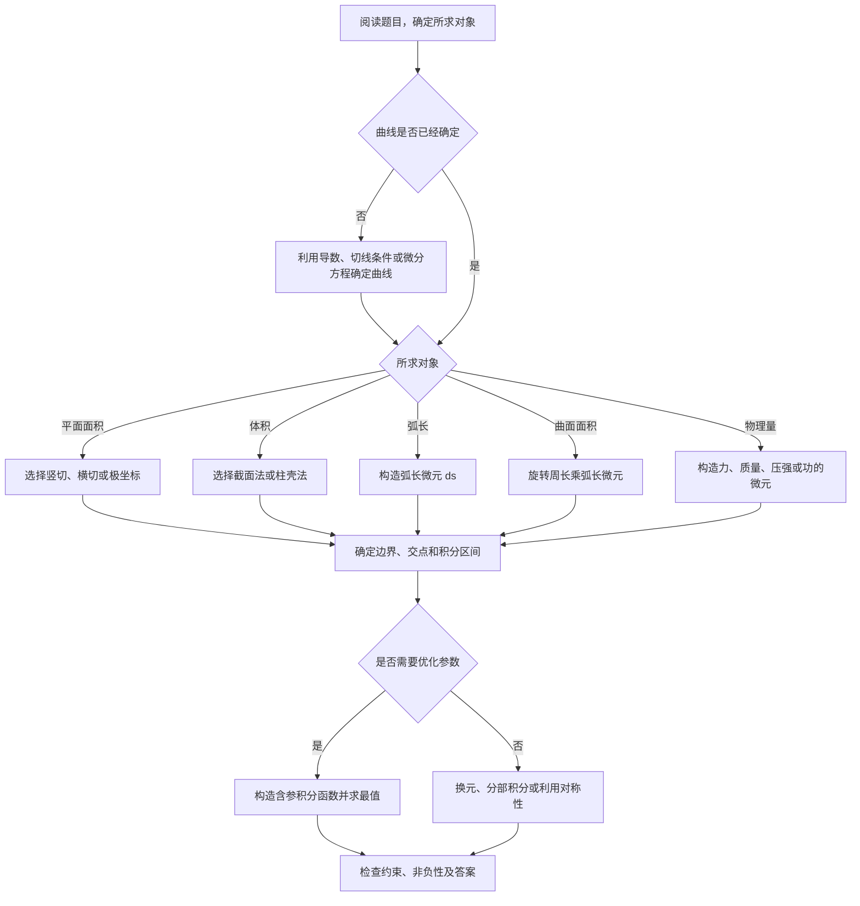

本节的学习目标不是单纯记住面积、体积、弧长等计算公式，而是建立一种统一的数学建模能力：面对一个此前没有见过的几何或物理问题，能够独立选择积分变量、构造微元、确定积分区间，并将实际问题转化为定积分问题。

这也是本节综合题、创新题最核心的考查方向。

## 一、本节知识框架与复习优先级

| 知识模块   | 主要考查内容        | 建议优先级 |
| ------ | ------------- | ----- |
| 微元法    | 从实际问题建立积分     | ★★★★★ |
| 平面图形面积 | 直角坐标、参数方程、极坐标 | ★★★★★ |
| 旋转体体积  | 圆盘法、圆环法、柱壳法   | ★★★★★ |
| 一般立体体积 | 已知平行截面面积      | ★★★★  |
| 平面曲线弧长 | 三种坐标形式、根式化简   | ★★★★  |
| 旋转曲面面积 | 旋转半径、弧长元、重复计算 | ★★★★★ |
| 形心与质心  | 一阶矩、形心定理      | ★★★   |
| 变力作功   | 力与位移、分段累积     | ★★★★  |
| 静水压力   | 深度与水平薄条       | ★★★★  |
| 抽水作功   | 截面积与提升距离      | ★★★★  |
| 万有引力   | 质量微元、方向投影     | ★★★★  |
| 综合最值   | 动积分区间、参数优化    | ★★★★★ |

本节与前面及后续章节存在很强的联系：

- 与导数应用结合：切线、凹凸性、拐点、最值。
- 与定积分计算结合：换元法、分部积分法、对称性。
- 与广义积分结合：无界区域的面积、体积和作功。
- 与微分方程结合：先确定未知曲线，再计算几何量。
- 与多元函数积分结合：微元法、截面法、形心、质量与引力。

**贯穿本节的核心思想：先建模，后计算；先确定微元，再选择公式。**

## 第一部分　微元法的基本原理

### 二、为什么定积分能够解决几何和物理问题？

**2.1 从局部近似到整体精确**

设要求某个几何量或物理量 $Q$，而且这个量具有可加性。将整体沿变量 $x$ 划分为很多小部分。

当区间长度 $\Delta x$ 足够小时，每个小部分可以近似表示为

$$
\Delta Q_i\approx q(\xi_i)\Delta x_i.
$$

将所有小部分相加并取极限：

$$
Q=\lim_{\|\mathcal P\|\to0} \sum_{i=1}^nq(\xi_i)\Delta x_i =\int_a^bq(x)\,dx.
$$

通常将局部微小量记作

$$
\boxed{dQ=q(x)\,dx}.
$$

这里最重要的不是积分符号，而是确定 $q(x)$ 的实际意义。

例如：

| 所求对象   | 微元            |
| ------ | ------------- |
| 面积     | 高度 × 宽度       |
| 体积     | 截面积 × 厚度      |
| 柱壳体积   | 周长 × 高度 × 厚度  |
| 弧长     | 微小线段的长度       |
| 旋转曲面面积 | 周长 × 微小弧长     |
| 静水压力   | 压强 × 面积       |
| 变力作功   | 沿位移方向的力 × 位移  |
| 抽水作功   | 水层重量 × 提升距离   |
| 万有引力   | 质量微元产生的有效方向分力 |

这些公式本质上都是同一种思想。

**2.2 微元法的标准五步**

**第一步：确定要求的量。** 是面积、体积、曲面面积，还是作功、压力？

**第二步：选择积分变量。** 可以选择 $x,y,t,\theta$，或者实际物理问题中的深度、高度、距离等。

**第三步：确定微元。** 将复杂对象局部近似为矩形、圆盘、圆环、薄柱壳、线段或质点。

**第四步：确定积分区间。** 特别注意交点、切点、分段点、旋转轴、函数定义域。

**第五步：积分并检验。** 检查非负性、数量级、单位、是否存在重复计算以及广义积分是否收敛。

**2.3 量纲检验：非常实用的检查技巧**

设 $a$ 是一个长度参数，那么通常：

$$
L\propto a,\qquad A\propto a^2,\qquad V\propto a^3.
$$

静水压力通常具有量纲

$$
F\propto \rho ga^3,
$$

而抽水作功通常具有量纲

$$
W\propto \rho ga^4.
$$

如果计算一个几何相似的旋转体体积，最后只剩下 $a^2$，就应当立即检查是否漏掉了半径或者厚度因子。

## 第二部分　平面图形面积

### 三、面积的基础公式与适用条件

**3.1 直角坐标系下的面积**

如果区域由

$$
y=f(x),\qquad y=g(x),\qquad x=a,\qquad x=b
$$

围成，且 $f(x)\geq g(x)$，那么

$$
\boxed{A=\int_a^b[f(x)-g(x)]\,dx}.
$$

如果不能保证上下关系，则

$$
\boxed{A=\int_a^b|f(x)-g(x)|\,dx}.
$$

如果采用水平微元，设右边界为 $x=\varphi(y)$，左边界为 $x=\psi(y)$，则

$$
\boxed{A=\int_c^d[\varphi(y)-\psi(y)]\,dy}.
$$

最基本的口诀是：

**竖切：上减下；横切：右减左。**

注意定积分与几何面积并不完全相同。例如：

$$
\int_0^{2\pi}\sin x\,dx=0,
$$

但是正弦曲线在这一区间与横轴围成的总面积为

$$
\int_0^{2\pi}|\sin x|\,dx=4.
$$

**3.2 参数方程下的面积**

设曲线为

$$
\begin{cases} x=x(t),\\ y=y(t), \end{cases} \qquad \alpha\leq t\leq\beta.
$$

如果 $x(t)$ 单调递增，且 $y(t)\geq0$，曲线与横轴围成的面积为

$$
\boxed{A=\int_\alpha^\beta y(t)x'(t)\,dt}.
$$

这个公式不必单独死记，因为

$$
A=\int y\,dx, \qquad dx=x'(t)\,dt.
$$

如果 $x(t)$ 单调递减，应当调整积分上下限，或者在合适的单调区间内使用 $|x'(t)|$。

对于逆时针方向的简单闭合参数曲线，还可以使用

$$
A=\frac12\int_\alpha^\beta (xy'-yx')\,dt.
$$

后一个公式也可以在学习第二类曲线积分和格林公式时得到进一步理解。

**3.3 极坐标下的面积**

极坐标面积微元不是矩形，而是微小扇形。

$$
dA=\frac12r^2\,d\theta.
$$

因此

$$
\boxed{A=\frac12\int_\alpha^\beta r^2(\theta)\,d\theta}.
$$

两条极坐标曲线之间的面积为

$$
\boxed{ A=\frac12\int_\alpha^\beta [r_{\text{外}}^2-r_{\text{内}}^2]\,d\theta }.
$$

适用条件是所选区间内内外半径关系明确，而且扇形没有重复覆盖所求区域。

**3.4 如何选择积分变量？**

| 题目特征                   | 优先方法          |
| ---------------------- | ------------- |
| 上下边界容易表示为 $y=f(x)$ | 对 $x$ 积分  |
| 左右边界容易表示为 $x=g(y)$ | 对 $y$ 积分  |
| 直接给出参数方程               | 保留参数 $t$  |
| 给出心形线、双纽线、玫瑰线          | 优先极坐标         |
| 存在多条边界                 | 比较两种切割方式的分段数量 |
| 边界中含有变限积分              | 考虑分部积分或交换积分次序 |

### 四、题型一：切线与曲线围成的面积

这是本节非常重要的母题类型，常与旋转体积、最值、导数应用一起考查。

**母题1：2003年考研数学一真题**

来源：核心题库第003题。

过原点作曲线 $y=\ln x$ 的切线，切线、曲线和 $x$ 轴围成区域 $D$。求区域面积及其绕直线 $x=e$ 旋转所得的体积。

先讲面积，后面讲体积。

<Steps>

<Step>

### 第一步：设切点而不是设斜率 [!toc]

设切点为

$$
P=(a,\ln a).
$$

因为

$$
(\ln x)'=\frac1x,
$$

切线方程为

$$
y-\ln a=\frac1a(x-a).
$$

即

$$
y=\frac xa+\ln a-1.
$$

切线过原点，因此

$$
\ln a-1=0.
$$

得到

$$
a=e,\qquad P=(e,1).
$$

切线为

$$
\boxed{y=\frac xe}.
$$

</Step>

<Step>

### 第二步：识别区域边界 [!toc]

对数曲线与横轴交于 $(1,0)$。

又由于 $\ln x$ 的二阶导数恒为负，其切线在曲线上方，所以

$$
\ln x\leq \frac xe.
$$

竖切时区域有两个部分：

当 $0\leq x\leq1$ 时，高度为

$$
h(x)=\frac xe.
$$

当 $1\leq x\leq e$ 时，高度为

$$
h(x)=\frac xe-\ln x.
$$

</Step>

<Step>

### 第三步：列出面积积分 [!toc]

$$
\begin{aligned} A &=\int_0^1\frac xe\,dx +\int_1^e\left(\frac xe-\ln x\right)dx\\ &=\int_0^e\frac xe\,dx-\int_1^e\ln x\,dx\\ &=\frac e2-[x\ln x-x]_1^e. \end{aligned}
$$

所以

$$
\boxed{A=\frac e2-1}.
$$

</Step>

<Step>

### 第四步：学习更加高效的横切法 [!toc]

把两条曲线分别写成

$$
x=ey,\qquad x=e^y.
$$

区域在高度 $y$ 处的左边界是 $ey$，右边界是 $e^y$，所以

$$
\begin{aligned} A &=\int_0^1(e^y-ey)\,dy\\ &=e-1-\frac e2\\ &=\frac e2-1. \end{aligned}
$$

横切法完全不需要分段。

**这道题真正值得掌握的不是对数积分，而是能够比较竖切和横切，主动选择计算量更小的方式。**

</Step>

</Steps>

**同源变式：张宇1000题第10章，第025题**

过原点作曲线 $y=e^x$ 的切线，求切线、曲线及横轴围成的无界区域面积，以及绕直线 $x=1$ 旋转的体积。

在 $x=a$ 处的切线是

$$
y=e^a(x-a+1).
$$

代入原点得到 $a=1$，所以切线为

$$
y=ex.
$$

这里与上一题的重要区别是：指数曲线在切线上方，而且区域向左无界延伸。

因此

$$
\begin{aligned} A &=\int_{-\infty}^0e^x\,dx +\int_0^1(e^x-ex)\,dx\\ &=\int_{-\infty}^1e^x\,dx -\int_0^1ex\,dx\\ &=\boxed{\frac e2}. \end{aligned}
$$

其旋转体积为

$$
\begin{aligned} V &=2\pi\int_{-\infty}^1(1-x)e^x\,dx\\ &\quad-2\pi\int_0^1(1-x)ex\,dx\\ &=\boxed{\frac{5\pi e}{3}}. \end{aligned}
$$

这道练习题与2003年数学一真题是非常好的对照训练。

| 对比内容 | 2003年数一       | 张宇1000题     |
| ---- | ------------- | ----------- |
| 曲线   | $y=\ln x$ | $y=e^x$ |
| 切点   | $(e,1)$   | $(1,e)$ |
| 切线   | $y=x/e$   | $y=ex$  |
| 区域   | 有界            | 无界          |
| 核心方法 | 切线、分段积分       | 切线、广义积分     |

### 五、题型二：由面积条件确定参数及证明存在唯一性

**母题2：1998年考研数学一、数学二真题**

来源：核心题库第001题。

设 $f(x)$ 在 $[0,1]$ 上连续且非负。证明存在 $x_0\in(0,1)$，使左侧宽为 $x_0$、高为 $f(x_0)$ 的矩形面积，等于右侧曲边梯形面积。

进一步，若 $f$ 可导且

$$
f'(x)>-\frac{2f(x)}x, \qquad 0<x<1,
$$

证明这样的点唯一。

**5.1 将几何语言转化为方程**

左侧矩形面积为

$$
A_1(x)=xf(x).
$$

右侧曲边梯形面积为

$$
A_2(x)=\int_x^1f(t)\,dt.
$$

要证存在一点使

$$
xf(x)=\int_x^1f(t)\,dt.
$$

自然构造

$$
F(x)=xf(x)-\int_x^1f(t)\,dt.
$$

然而，直接使用零点定理存在一个陷阱：

$$
F(0)=-\int_0^1f(t)\,dt\leq0,
$$

$$
F(1)=f(1)\geq0.
$$

如果 $f(1)=0$，仅凭这两个式子不能保证零点位于开区间内。

**5.2 更高级的辅助函数构造**

注意到

$$
\left[x\int_x^1f(t)\,dt\right]' =\int_x^1f(t)\,dt-xf(x).
$$

因此构造

$$
H(x)=x\int_x^1f(t)\,dt.
$$

有

$$
H(0)=H(1)=0.
$$

由罗尔定理，存在 $x_0\in(0,1)$，使得

$$
H'(x_0)=0.
$$

于是

$$
\boxed{x_0f(x_0)=\int_{x_0}^1f(t)\,dt}.
$$

这一证明同时覆盖 $f(1)=0$ 和 $f\equiv0$ 的情况，不需要分类讨论。

**5.3 唯一性证明**

回到辅助函数

$$
F(x)=xf(x)-\int_x^1f(t)\,dt.
$$

求导：

$$
F'(x)=2f(x)+xf'(x).
$$

由题设

$$
xf'(x)>-2f(x),
$$

可知

$$
F'(x)>0.
$$

因此 $F$ 严格递增，零点至多一个。

结合存在性，所求 $x_0$ 唯一。

**5.4 这道真题的迁移价值**

遇到类似的等式

$$
xf(x)=\int_x^bf(t)\,dt,
$$

应当立即联想到

$$
\left[x\int_x^bf(t)\,dt\right]'.
$$

更一般地，如果需要证明存在 $\xi\in(a,b)$，满足

$$
(\xi-a)f(\xi)=\int_\xi^bf(t)\,dt,
$$

构造

$$
H(x)=(x-a)\int_x^bf(t)\,dt.
$$

其两个端点均为零，罗尔定理直接给出结论。

这说明面积应用题也可以是微分中值定理证明题，而不一定要求计算一个具体的积分。

### 六、题型三：参数曲线、切线条件与无界面积

**母题3：2012年考研数学一真题**

来源：核心题库第005题。

已知参数曲线

$$
\begin{cases} x=f(t),\\ y=\cos t, \end{cases} \qquad 0\leq t<\frac\pi2,
$$

其中 $f(0)=0$，且 $f'(t)>0$（在参数区间内部）。

曲线的切线与 $x$ 轴交于 $Q$，切点 $P$ 到 $Q$ 的距离恒为1。求 $f(t)$ 及曲线与坐标轴围成的无界区域面积。

这是很有代表性的数学一综合题，因为它考查的不是单纯计算，而是：

**几何条件 → 导数关系 → 确定曲线 → 参数积分。**

**6.1 将切线距离转化为微分关系**

切点为

$$
P=(f(t),\cos t).
$$

切线斜率为

$$
k=\frac{dy/dt}{dx/dt} =-\frac{\sin t}{f'(t)}.
$$

设切线与横轴交于 $Q=(x_Q,0)$。

切点和交点的横坐标之差为

$$
x_Q-f(t)=\frac{f'(t)\cos t}{\sin t}.
$$

由勾股定理及 $PQ=1$ 得

$$
\left(\frac{f'(t)\cos t}{\sin t}\right)^2 +\cos^2t=1.
$$

于是

$$
[f'(t)]^2=\frac{\sin^4t}{\cos^2t}.
$$

因为题目要求 $f'(t)>0$，故必须选择正根：

$$
\boxed{f'(t)=\frac{\sin^2t}{\cos t}}.
$$

**6.2 求未知函数**

利用

$$
\frac{\sin^2t}{\cos t}=\sec t-\cos t,
$$

积分得到

$$
f(t)=\ln(\sec t+\tan t)-\sin t+C.
$$

由 $f(0)=0$，得 $C=0$。

所以

$$
\boxed{f(t)=\ln(\sec t+\tan t)-\sin t}.
$$

当 $t\to\frac\pi2^-$ 时，

$$
f(t)\to+\infty.
$$

说明区域沿横轴向无穷远延伸。

**6.3 参数积分求面积**

虽然区域无界，但仍然可以使用广义积分：

$$
A=\int_0^{+\infty}y\,dx.
$$

直接代入参数方程：

$$
\begin{aligned} A &=\lim_{b\to\pi/2^-} \int_0^b\cos t\,f'(t)\,dt\\ &=\int_0^{\pi/2}\cos t \frac{\sin^2t}{\cos t}\,dt\\ &=\int_0^{\pi/2}\sin^2t\,dt. \end{aligned}
$$

得到

$$
\boxed{A=\frac\pi4}.
$$

**6.4 这道题最重要的三个思想**

第一，遇到参数曲线，不要急于消去参数，参数往往就是命题人设计的最佳积分变量。

第二，距离恒定、面积恒定、斜率关系等几何条件，常常能够建立关于未知函数或其导数的方程。

第三，无界区域不一定具有无穷大的面积。必须根据广义积分的收敛性判断。

一个很重要的解题习惯是：如果题目要求面积，而已经求出 $x'(t)$，往往不必先求出复杂的 $x(t)$ 表达式才能计算面积。

### 七、题型四：极坐标面积

**典型练习：张宇1000题第10章，第022题**

已知心形线

$$
r=a(1+\cos\theta),\qquad a>0,
$$

所围图形面积为 $6\pi$，求 $a$。

由极坐标面积公式，

$$
\begin{aligned} A &=\frac12\int_0^{2\pi}a^2(1+\cos\theta)^2\,d\theta\\ &=\frac{a^2}{2}(2\pi+\pi)\\ &=\frac32\pi a^2. \end{aligned}
$$

由

$$
\frac32\pi a^2=6\pi
$$

得到

$$
\boxed{a=2}.
$$

**进阶练习：李林880题，第068题**

双纽线

$$
(x^2+y^2)^2=x^2-y^2
$$

围成的图形面积。

化为极坐标：

$$
r^4=r^2\cos2\theta,
$$

即非原点部分满足

$$
r^2=\cos2\theta.
$$

右侧叶片的完整参数区间是

$$
-\frac\pi4\leq\theta\leq\frac\pi4.
$$

左右两个叶片面积相同，故

$$
\begin{aligned} A &=2\cdot\frac12 \int_{-\pi/4}^{\pi/4}\cos2\theta\,d\theta\\ &=\boxed{1}. \end{aligned}
$$

更一般地，双纽线

$$
r^2=a^2\cos2\theta
$$

所围总面积为

$$
\boxed{A=a^2}.
$$

这一结论后面还会与双纽线的旋转曲面面积题形成联系。

**极坐标题的主要难点通常不是积分，而是弄清角度范围、对称性以及同一图形是否被重复描绘。**

## 第三部分　旋转体体积与一般立体体积

### 八、旋转体体积的三种基本方法

本节最容易混淆的是圆盘法、圆环法和柱壳法。

它们并不是三套互不相关的公式，而是对同一个立体采用了不同的切割方式。

**8.1 圆盘法**

设区域由

$$
y=f(x)\geq0,\quad y=0,\quad x=a,\quad x=b
$$

围成，将其绕 $x$ 轴旋转一周。

在位置 $x$ 处作垂直于旋转轴的截面，得到一个半径为 $f(x)$ 的圆盘。

$$
dV=\pi[f(x)]^2\,dx.
$$

所以

$$
\boxed{V_x=\pi\int_a^b[f(x)]^2\,dx}.
$$

类似地，若区域由 $x=g(y)\geq0$ 与纵轴等围成，绕 $y$ 轴旋转，则

$$
\boxed{V_y=\pi\int_c^d[g(y)]^2\,dy}.
$$

**圆盘法的关键是：切割方向垂直于旋转轴，且截面没有空心部分。**

**8.2 圆环法**

设

$$
0\leq g(x)\leq f(x).
$$

两条曲线之间的区域绕 $x$ 轴旋转，形成空心截面。

外半径和内半径分别为

$$
R=f(x),\qquad r=g(x).
$$

截面积为

$$
A(x)=\pi R^2-\pi r^2.
$$

因此

$$
\boxed{V=\pi\int_a^b[f^2(x)-g^2(x)]\,dx}.
$$

这是考研中非常常见的错误来源。

正确的是

$$
\pi(f^2-g^2),
$$

而不是

$$
\pi(f-g)^2.
$$

因为 $f-g$ 是圆环的径向厚度，而不是整个截面的半径。

**8.3 柱壳法**

设区域在 $y$ 轴右侧，上下边界分别为 $f(x)$ 和 $g(x)$。

取平行于 $y$ 轴的竖直薄条，旋转后近似形成一个薄圆柱壳。

柱壳的半径为 $x$，周长为 $2\pi x$，高度为 $f(x)-g(x)$，厚度为 $dx$。

所以

$$
dV=2\pi x[f(x)-g(x)]\,dx.
$$

得到

$$
\boxed{V_y=2\pi\int_a^bx[f(x)-g(x)]\,dx}.
$$

柱壳法特别适合区域用 $y=f(x)$ 表示，而旋转轴是 $y$ 轴的情况。

**8.4 三种方法的统一判断**

| 方法  | 切割方向   | 微元                                                |
| --- | ------ | ------------------------------------------------- |
| 圆盘法 | 垂直于旋转轴 | $\pi R^2\,dx$ 或 $\pi R^2\,dy$           |
| 圆环法 | 垂直于旋转轴 | $\pi(R^2-r^2)\,dx$ 或 $\pi(R^2-r^2)\,dy$ |
| 柱壳法 | 平行于旋转轴 | $2\pi rh\,dx$ 或 $2\pi rh\,dy$           |

不要把某个积分变量和某个旋转轴强行绑定。

**圆盘、圆环、柱壳的区别取决于切割方向与旋转轴之间的关系。**

### 九、绕非坐标轴旋转的通用方法

考研中可能将旋转轴改为

$$
x=c,\qquad y=c
$$

甚至某条斜直线。

这时不能直接照搬绕坐标轴的公式。

**9.1 绕竖直直线 $x=c$**

如果区域整体位于旋转轴的一侧，竖直薄条到轴的距离为

$$
r(x)=|x-c|.
$$

柱壳法给出

$$
\boxed{ V=2\pi\int_a^b|x-c|[f(x)-g(x)]\,dx }.
$$

**9.2 绕水平直线 $y=c$**

对于固定 $x$，设竖直线段的上下端点分别为 $f(x)$、$g(x)$。

外半径为

$$
R=\max\{|f(x)-c|,|g(x)-c|\}.
$$

如果旋转轴不穿过该线段，则内半径为

$$
r=\min\{|f(x)-c|,|g(x)-c|\}.
$$

如果旋转轴穿过该线段，则内半径为零。

最终使用

$$
\boxed{V=\pi\int_a^b(R^2-r^2)\,dx}.
$$

这套判断方法比死记多个特殊公式更加可靠。

**9.3 旋转轴穿过区域时的重复问题**

如果区域分布在旋转轴的两侧，不能不加判断地把两侧柱壳体积直接相加。

例如，将单位圆

$$
x^2+y^2\leq1
$$

绕 $y$ 轴旋转，得到的是一个单位球。

只需旋转右半圆区域：

$$
V=2\pi\int_0^1x\cdot2\sqrt{1-x^2}\,dx =\frac{4\pi}{3}.
$$

若对整个圆直接使用

$$
2\pi\int_{-1}^1|x|\cdot2\sqrt{1-x^2}\,dx,
$$

结果会多一倍，因为左右两侧形成了完全相同的旋转体。

### 十、题型五：旋转轴改变与切线围域

**回顾母题1：2003年数学一真题第二问**

已经求得曲线 $y=\ln x$ 的过原点切线为

$$
y=\frac xe.
$$

求区域绕 $x=e$ 的旋转体积。

<Tabs items={["方法一：柱壳法", "方法二：圆环法"]} defaultIndex={0}>

<Tab value="方法一：柱壳法">

区域位于旋转轴左侧，所以半径为

$$
r=e-x.
$$

区域高度在 $x=1$ 处分段，因此

$$
\begin{aligned} V =2\pi\bigg[ &\int_0^1(e-x)\frac xe\,dx\\ &+\int_1^e(e-x) \left(\frac xe-\ln x\right)dx \bigg]. \end{aligned}
$$

整理成

$$
\frac{V}{2\pi} =\int_0^e(e-x)\frac xe\,dx -\int_1^e(e-x)\ln x\,dx.
$$

其中

$$
\int_0^e(e-x)\frac xe\,dx=\frac{e^2}{6},
$$

利用分部积分得到

$$
\int_1^e(e-x)\ln x\,dx =-\frac{e^2}{4}+e-\frac14.
$$

因此

$$
\boxed{V=\frac\pi6(5e^2-12e+3)}.
$$

</Tab>

<Tab value="方法二：圆环法">

在高度 $y\in[0,1]$ 处，

$$
ey\leq x\leq e^y.
$$

由于旋转轴是 $x=e$，外半径和内半径分别为

$$
R=e-ey,\qquad r=e-e^y.
$$

所以

$$
V=\pi\int_0^1[(e-ey)^2-(e-e^y)^2]\,dy.
$$

计算可以得到相同结果。

这两种方法都应掌握。第一种更加直接，第二种避免了分段。

</Tab>

</Tabs>

**同类型练习：李林880题，第109题**

区域

$$
x^2+y^2\leq2x,\qquad y\geq x
$$

绕直线 $x=2$ 旋转。

先将圆化为标准形式：

$$
(x-1)^2+y^2\leq1.
$$

对区域横切，有

$$
1-\sqrt{1-y^2}\leq x\leq y, \qquad 0\leq y\leq1.
$$

外半径为

$$
R=1+\sqrt{1-y^2},
$$

内半径为

$$
r=2-y.
$$

所以

$$
\begin{aligned} V &=\pi\int_0^1 \left[(1+\sqrt{1-y^2})^2-(2-y)^2\right]dy\\ &=2\pi\int_0^1 [\sqrt{1-y^2}-(1-y)^2]\,dy\\ &=\boxed{\frac{\pi^2}{2}-\frac{2\pi}{3}}. \end{aligned}
$$

**选择横切的原因：圆和直线的左右边界容易表示，且截面不必分段。**

### 十一、题型六：圆盘法与圆环法的分段

**母题4：1988年考研数学三真题、李正元练习题第057题**

设在抛物线 $y=x^2$ 上一点处作切线，使其与曲线及 $x$ 轴围成的面积为 $1/12$。求切点、切线方程，以及区域绕 $x$ 轴旋转所得的体积。

设切点为

$$
P=(a,a^2),\qquad a>0.
$$

切线为

$$
y=2ax-a^2.
$$

切线与横轴交点的横坐标为 $a/2$。

因此面积为

$$
\begin{aligned} A &=\int_0^{a/2}x^2\,dx +\int_{a/2}^a[x^2-(2ax-a^2)]\,dx\\ &=\int_0^{a/2}x^2\,dx +\int_{a/2}^a(x-a)^2\,dx\\ &=\frac{a^3}{12}. \end{aligned}
$$

令其等于 $1/12$，得到 $a=1$。

所以

$$
P=(1,1),\qquad y=2x-1.
$$

旋转体的截面在 $x=1/2$ 处发生变化。

当 $0\leq x\leq1/2$ 时，截面为圆盘。

当 $1/2\leq x\leq1$ 时，截面为圆环。

因此

$$
\begin{aligned} V &=\pi\int_0^{1/2}x^4\,dx +\pi\int_{1/2}^1[x^4-(2x-1)^2]\,dx\\ &=\pi\int_0^1x^4\,dx -\pi\int_{1/2}^1(2x-1)^2\,dx\\ &=\pi\left(\frac15-\frac16\right)\\ &=\boxed{\frac\pi{30}}. \end{aligned}
$$

**一类重要技巧：大图形减小图形**

上述分段积分可以理解成

$$
V=V_{\text{完整外部}}-V_{\text{内部空洞}}.
$$

当出现多段边界时，这通常比逐段展开计算更方便。

这道母题在李正元练习题中与核心真题库重复出现，值得用来训练切线、面积和旋转体积的完整流程。

### 十二、题型七：不同旋转轴下的体积比较

**母题5：2013年考研数学二、数学三真题**

来源：核心题库第010题。

设区域由

$$
y=x^{1/3},\qquad x=a,\qquad y=0
$$

围成，其中 $a>0$。

记绕 $x$ 轴、$y$ 轴旋转所得的体积分别为 $V_x,V_y$，已知

$$
V_y=10V_x.
$$

求 $a$。

绕横轴使用圆盘法：

$$
V_x=\pi\int_0^ax^{2/3}\,dx =\frac{3\pi}{5}a^{5/3}.
$$

绕纵轴使用柱壳法：

$$
V_y=2\pi\int_0^ax\cdot x^{1/3}\,dx =\frac{6\pi}{7}a^{7/3}.
$$

因此

$$
\frac{V_y}{V_x} =\frac{10}{7}a^{2/3}=10.
$$

得到

$$
\boxed{a=7\sqrt7}.
$$

**12.1 一般化母题**

如果曲线改为

$$
y=x^p,\qquad 0\leq x\leq a,\quad p>0,
$$

则

$$
V_x=\frac{\pi a^{2p+1}}{2p+1},
$$

$$
V_y=\frac{2\pi a^{p+2}}{p+2}.
$$

所以

$$
\boxed{ \frac{V_y}{V_x} =\frac{2(2p+1)}{p+2}a^{1-p} }.
$$

该公式可以迅速处理一整类幂函数旋转体积比较题。

特别地，当 $p=1$ 时，体积比恒为2，与 $a$ 无关。这类退化情形也可能成为选择题的考点。

**12.2 快速计算技巧：对称积分**

2021年数学三真题，核心题库第015题：

$$
y=\sqrt{x}\sin(\pi x), \qquad 0\leq x\leq1.
$$

绕横轴旋转，

$$
V=\pi\int_0^1x\sin^2(\pi x)\,dx.
$$

如果直接分部积分，可以算出结果，但更快的方法是利用

$$
\sin^2[\pi(1-x)]=\sin^2(\pi x).
$$

令

$$
I=\int_0^1x\sin^2(\pi x)\,dx.
$$

换元后

$$
I=\int_0^1(1-x)\sin^2(\pi x)\,dx.
$$

两式相加：

$$
2I=\int_0^1\sin^2(\pi x)\,dx=\frac12.
$$

所以

$$
\boxed{V=\frac\pi4}.
$$

一般地，如果 $g(a+b-x)=g(x)$，那么

$$
\boxed{ \int_a^bxg(x)\,dx =\frac{a+b}{2}\int_a^bg(x)\,dx }.
$$

该对称积分公式在柱壳法、形心及摆线问题中尤其有用。

### 十三、题型八：一般立体的平行截面法

旋转体只是一般立体的一种特殊情况。

如果已知某个立体在高度 $z$ 处的截面积为 $A(z)$，那么

$$
\boxed{V=\int_a^bA(z)\,dz}.
$$

截面可以是圆、椭圆、三角形、正方形或者其他图形。

**模拟母题：汤家凤八套卷第4套，第14题**

已知曲面

$$
\frac{(x-1)^2}{4}+y^2 =z\sin^2(2\pi z).
$$

求其与平面 $z=0$、$z=1$ 围成的立体体积。

固定 $z$，令

$$
c(z)=z\sin^2(2\pi z).
$$

则水平截面是椭圆

$$
\frac{(x-1)^2}{4}+y^2\leq c(z).
$$

两个半轴长度为

$$
a_z=2\sqrt{c(z)},\qquad b_z=\sqrt{c(z)}.
$$

椭圆面积为

$$
A(z)=\pi a_zb_z =2\pi z\sin^2(2\pi z).
$$

因此

$$
\begin{aligned} V &=2\pi\int_0^1z\sin^2(2\pi z)\,dz\\ &=\pi\int_0^1z[1-\cos(4\pi z)]\,dz. \end{aligned}
$$

其中

$$
\int_0^1z\cos(4\pi z)\,dz=0.
$$

所以

$$
\boxed{V=\frac\pi2}.
$$

这道模拟题的关键是先认识截面为椭圆，而不是将空间曲面误认为普通的圆形旋转体。

**进阶母题：张宇8套卷第5套，第12题**

设空间直线

$$
L: \begin{cases} 2x+y+z-3=0,\\ 2x+2y+z-4=0 \end{cases}
$$

绕 $z$ 轴旋转。求旋转曲面与 $z=0,z=1$ 围成的立体体积。

联立两平面方程得到

$$
y=1,\qquad x=1-\frac z2.
$$

在固定高度 $z$ 处，该点绕 $z$ 轴旋转，半径平方为

$$
r^2=x^2+y^2 =\left(1-\frac z2\right)^2+1.
$$

所以

$$
\begin{aligned} V &=\pi\int_0^1 \left[\left(1-\frac z2\right)^2+1\right]dz\\ &=\pi\int_0^1 \left(2-z+\frac{z^2}{4}\right)dz\\ &=\boxed{\frac{19\pi}{12}}. \end{aligned}
$$

李正元练习题第053题也采用了完全相同的建模思想，只是把空间直线换成了两点之间的线段。

对于数学一，这种空间解析几何与一元定积分相结合的题型尤其值得练习。

### 十四、题型九：无界旋转体与广义积分

**母题6：2023年考研数学二、数学三真题**

来源：核心题库第016题。

设区域

$$
D=\left\{(x,y)\mid x\geq1,\quad 0\leq y\leq\frac1{x\sqrt{1+x^2}} \right\}.
$$

求面积与绕横轴旋转所得的体积。

**14.1 面积**

$$
A=\int_1^{+\infty} \frac{dx}{x\sqrt{1+x^2}}.
$$

令

$$
u=\frac1x,
$$

则

$$
A=\int_0^1\frac{du}{\sqrt{1+u^2}}.
$$

得到

$$
\boxed{A=\ln(1+\sqrt2)}.
$$

**14.2 旋转体积**

$$
V=\pi\int_1^{+\infty} \frac{dx}{x^2(1+x^2)}.
$$

利用部分分式

$$
\frac1{x^2(1+x^2)} =\frac1{x^2}-\frac1{1+x^2}.
$$

所以

$$
\begin{aligned} V &=\pi\left[-\frac1x-\arctan x\right]_1^{+\infty}\\ &=\boxed{\pi-\frac{\pi^2}{4}}. \end{aligned}
$$

**14.3 深入理解：面积、体积、表面积的收敛性不同**

假设 $p>0$，考虑曲线

$$
y=\frac1{x^p},\qquad x\geq1.
$$

对应的面积为

$$
A=\int_1^\infty x^{-p}\,dx,
$$

旋转体积为

$$
V=\pi\int_1^\infty x^{-2p}\,dx.
$$

于是

| 条件                | 平面面积 | 绕横轴体积 |
| ----------------- | ---- | ----- |
| $p>1$         | 收敛   | 收敛    |
| $1/2<p\leq1$ | 发散   | 收敛    |
| $0<p\leq1/2$ | 发散   | 发散    |

特别是

$$
y=\frac1x,\qquad x\geq1
$$

所围无界区域面积为无穷大，但是绕横轴旋转的体积为

$$
V=\pi\int_1^\infty\frac{dx}{x^2}=\pi.
$$

同时它的旋转曲面面积却是发散的，因为

$$
2\pi\int_1^\infty \frac1x\sqrt{1+\frac1{x^4}}\,dx
$$

与 $\int_1^\infty dx/x$ 同敛散。

这是本节与广义积分之间非常重要的综合考点。

## 第四部分　平面曲线弧长与旋转曲面面积

### 十五、弧长公式及其本质

**15.1 直角坐标**

由勾股定理，微小曲线段的长度近似为

$$
ds=\sqrt{dx^2+dy^2}.
$$

如果 $y=f(x)$，则

$$
\boxed{ds=\sqrt{1+[f'(x)]^2}\,dx}
$$

（积分按 $x$ 递增方向进行）。

因此

$$
\boxed{ L=\int_a^b\sqrt{1+[f'(x)]^2}\,dx }.
$$

如果 $x=g(y)$，则

$$
\boxed{ L=\int_c^d\sqrt{1+[g'(y)]^2}\,dy }.
$$

**15.2 参数方程**

对于

$$
x=x(t),\qquad y=y(t),
$$

有

$$
\boxed{ ds=\sqrt{[x'(t)]^2+[y'(t)]^2}\,dt }.
$$

所以

$$
\boxed{ L=\int_\alpha^\beta \sqrt{[x'(t)]^2+[y'(t)]^2}\,dt }.
$$

**15.3 极坐标**

利用

$$
x=r(\theta)\cos\theta,\qquad y=r(\theta)\sin\theta,
$$

可以推出

$$
[x'(\theta)]^2+[y'(\theta)]^2 =r^2+(r')^2.
$$

因此

$$
\boxed{ L=\int_\alpha^\beta \sqrt{r^2(\theta)+[r'(\theta)]^2}\,d\theta }.
$$

上述公式通常适用于相应的光滑或分段光滑曲线；若存在端点导数无界的情形，则应检查弧长广义积分是否收敛。

### 十六、题型十：弧长根式的完全平方化简

很多考研弧长题经过精心设计，根号内都能够化成完全平方。

遇到

$$
1+[f'(x)]^2
$$

时，首先寻找以下结构：

$$
1+\frac14\left(u-\frac1u\right)^2 =\frac14\left(u+\frac1u\right)^2.
$$

这是非常值得熟记的代数恒等式。

**母题7：2013年考研数学二真题**

来源：核心题库第024题。

求曲线

$$
y=\frac{x^2}{4}-\frac12\ln x, \qquad 1\leq x\leq e
$$

的弧长。

先求导：

$$
y'=\frac12\left(x-\frac1x\right).
$$

于是

$$
1+(y')^2 =\frac14\left(x+\frac1x\right)^2.
$$

由于 $x>0$，所以

$$
ds=\frac12\left(x+\frac1x\right)dx.
$$

因此

$$
\begin{aligned} L &=\frac12\int_1^e \left(x+\frac1x\right)dx\\ &=\left[\frac{x^2}{4}+\frac12\ln x\right]_1^e\\ &=\boxed{\frac{e^2+1}{4}}. \end{aligned}
$$

**同类练习：张宇1000题，弧长计算**

已知隐式曲线

$$
y^4-6xy+3=0,\qquad 1\leq y\leq2.
$$

求这一段曲线的弧长。

注意题目直接给出了 $y$ 的范围。

解出

$$
x=\frac{y^3}{6}+\frac1{2y}.
$$

求导：

$$
\frac{dx}{dy} =\frac12\left(y^2-\frac1{y^2}\right).
$$

再次使用上述恒等式：

$$
\sqrt{1+\left(\frac{dx}{dy}\right)^2} =\frac12\left(y^2+\frac1{y^2}\right).
$$

所以

$$
\begin{aligned} L &=\frac12\int_1^2(y^2+y^{-2})\,dy\\ &=\left[\frac{y^3}{6}-\frac1{2y}\right]_1^2\\ &=\boxed{\frac{17}{12}}. \end{aligned}
$$

两道题虽然曲线形式完全不同，但数学结构是一样的。

**极坐标同类变式：李林880题，第028题**

求极坐标曲线

$$
r=a\sin^3\frac\theta3, \qquad 0\leq\theta\leq3\pi,\quad a>0
$$

的弧长。

有

$$
r'=a\sin^2\frac\theta3\cos\frac\theta3.
$$

于是

$$
r^2+(r')^2 =a^2\sin^4\frac\theta3.
$$

所以

$$
\begin{aligned} L &=a\int_0^{3\pi}\sin^2\frac\theta3\,d\theta\\ &=3a\int_0^\pi\sin^2u\,du\\ &=\boxed{\frac{3\pi a}{2}}. \end{aligned}
$$

这三道题应当归纳为一个题型：**通过代数恒等式或三角恒等式化简弧长根式。**

### 十七、旋转曲面面积

**17.1 旋转曲面面积公式的推导**

将一小段曲线 $ds$ 绕某条轴旋转，形成近似的薄圆台侧面。

它的面积近似为

$$
dS=2\pi r\,ds,
$$

其中 $r$ 是曲线上该点到旋转轴的距离。

因此统一公式为

$$
\boxed{S=2\pi\int_Lr\,ds}.
$$

掌握这个公式，就不必死记所有坐标形式。

**17.2 常见公式汇总**

| 曲线形式         | 旋转轴       | 曲面面积                                                                  |
| ------------ | --------- | --------------------------------------------------------------------- |
| $y=f(x)$ | $x$ 轴 | $2\pi\int_a^b \lvert f(x)\rvert \sqrt{1+(f')^2}\,dx$                       |
| $y=f(x)$ | $y$ 轴 | $2\pi\int_a^b \lvert x\rvert \sqrt{1+(f')^2}\,dx$                          |
| $y=f(x)$ | $y=c$ | $2\pi\int_a^b \lvert f(x)-c\rvert \sqrt{1+(f')^2}\,dx$                     |
| 参数方程         | $x$ 轴 | $2\pi\int_\alpha^\beta \lvert y(t)\rvert \sqrt{x'^2+y'^2}\,dt$            |
| 参数方程         | $y$ 轴 | $2\pi\int_\alpha^\beta \lvert x(t)\rvert \sqrt{x'^2+y'^2}\,dt$            |
| 极坐标          | 极轴        | $2\pi\int_\alpha^\beta \lvert r\sin\theta\rvert \sqrt{r^2+r'^2}\,d\theta$ |

以上公式计算的是所选母线段旋转形成的曲面面积，使用时应确认生成曲面没有重叠。求整个旋转体的表面积时，还要检查内壁和端面。

**17.3 面积、体积、弧长和旋转曲面面积的区别**

设 $y=f(x)\geq0$。

$$
\begin{array}{ll} \text{平面面积：}&A=\displaystyle\int_a^bf(x)\,dx,\\[6pt] \text{旋转体积：}&V=\displaystyle\pi\int_a^bf^2(x)\,dx,\\[6pt] \text{曲线弧长：}&L=\displaystyle\int_a^b\sqrt{1+f'^2(x)}\,dx,\\[6pt] \text{旋转曲面面积：}&S=\displaystyle2\pi\int_a^bf(x)\sqrt{1+f'^2(x)}\,dx. \end{array}
$$

这是本节必须做到熟练区分的四个公式。

### 十八、题型十一：旋转体积和表面积综合

**母题8：2016年考研数学二真题**

来源：核心题库第019题。

区域 $D$ 由第一象限单位圆弧

$$
y=\sqrt{1-x^2}
$$

和星形线

$$
x=\cos^3t,\qquad y=\sin^3t, \qquad 0\leq t\leq\frac\pi2
$$

围成。

求绕横轴旋转所得的体积与表面积。

**18.1 判断内外边界**

星形线满足

$$
x^{2/3}+y^{2/3}=1.
$$

因此内侧曲线为

$$
y_{\mathrm{in}}=(1-x^{2/3})^{3/2}.
$$

外侧曲线为

$$
y_{\mathrm{out}}=\sqrt{1-x^2}.
$$

在 $[0,1]$ 上，圆弧位于星形线上方。

**18.2 体积计算：外减内**

$$
\begin{aligned} V &=\pi\int_0^1 [(1-x^2)-(1-x^{2/3})^3]\,dx\\ &=3\pi\int_0^1(x^{2/3}-x^{4/3})\,dx\\ &=3\pi\left(\frac35-\frac37\right)\\ &=\boxed{\frac{18\pi}{35}}. \end{aligned}
$$

**18.3 表面积计算：外加内**

外侧圆弧绕横轴旋转产生单位半球的球面，因此

$$
S_{\mathrm{out}}=2\pi.
$$

对内侧星形线，

$$
x'=-3\cos^2t\sin t,
$$

$$
y'=3\sin^2t\cos t.
$$

因此

$$
ds=3\sin t\cos t\,dt.
$$

旋转半径为

$$
r=y=\sin^3t.
$$

所以内侧曲面面积为

$$
\begin{aligned} S_{\mathrm{in}} &=2\pi\int_0^{\pi/2} \sin^3t\cdot3\sin t\cos t\,dt\\ &=6\pi\int_0^{\pi/2} \sin^4t\cos t\,dt\\ &=\frac{6\pi}{5}. \end{aligned}
$$

因此

$$
\boxed{ S=S_{\mathrm{out}}+S_{\mathrm{in}} =\frac{16\pi}{5} }.
$$

**18.4 最核心的结论**

**计算体积时外减内，计算实际表面积时内外曲面相加。**

这是很多同学容易混淆的地方。

内侧空洞在体积计算中需要扣除，但空洞的内壁仍然是立体的一部分边界，因此其面积必须计入。

**高质量模拟变式：李林六套卷第5套，第18题**

两条曲线

$$
f(x)=\frac{x^2}{2}, \qquad g(x)=\sqrt{x-\frac34}
$$

相切于 $P$。后者与横轴交于 $A$，原点为 $O$。

求曲边图形 $OPA$ 绕纵轴所得体积，以及绕横轴所得侧面积。

由交点方程

$$
\frac{x^2}{2}=\sqrt{x-\frac34}
$$

得到

$$
x^4-4x+3=(x-1)^2(x^2+2x+3)=0.
$$

所以

$$
P=\left(1,\frac12\right), \qquad A=\left(\frac34,0\right).
$$

绕纵轴的体积使用柱壳法：

$$
V=2\pi\left[ \int_0^1x\frac{x^2}{2}\,dx -\int_{3/4}^1x\sqrt{x-\frac34}\,dx \right].
$$

计算得到

$$
\boxed{V=\frac\pi{10}}.
$$

绕横轴的侧面积应包括内外两部分：

$$
\begin{aligned} S={}&\pi\int_0^1x^2\sqrt{1+x^2}\,dx\\ &+\pi\int_{3/4}^1\sqrt{4x-2}\,dx. \end{aligned}
$$

第一项可用双曲换元或三角换元计算，第二项直接积分。最后得到

$$
\boxed{ S=\frac\pi{24} [17\sqrt2-4-3\ln(1+\sqrt2)] }.
$$

这道模拟题综合了切点求解、区域分段、不同旋转轴及内外表面积，是本节非常值得训练的综合大题。

### 十九、题型十二：极坐标旋转曲面与重复计数

**母题9：双纽线的旋转曲面面积**

这道题同时出现在李林880题第113题、李正元练习题第054题及李林六套卷第1套第14题中。

求双纽线

$$
r^2=a^2\cos2\theta,\qquad a>0
$$

绕极轴旋转一周形成的曲面面积。

**19.1 选择最小有效母线**

双纽线具有四个对称的曲线分支。

但绕横轴旋转时，上下分支会生成同一曲面，因此不能直接将第一象限生成的曲面面积乘4。

只需要计算右叶的上半支，再乘2。

取

$$
0\leq\theta\leq\frac\pi4.
$$

**19.2 求弧长微元**

$$
r=a\sqrt{\cos2\theta},
$$

$$
r'=-\frac{a\sin2\theta}{\sqrt{\cos2\theta}}.
$$

所以

$$
\begin{aligned} r^2+(r')^2 &=a^2\cos2\theta+ \frac{a^2\sin^22\theta}{\cos2\theta}\\ &=\frac{a^2}{\cos2\theta}. \end{aligned}
$$

因此

$$
ds=\frac{a}{\sqrt{\cos2\theta}}\,d\theta.
$$

旋转半径为

$$
y=r\sin\theta.
$$

**19.3 列出积分**

右侧叶片的旋转曲面面积为

$$
\begin{aligned} S_1 &=2\pi\int_0^{\pi/4}r\sin\theta\,ds\\ &=2\pi a^2\int_0^{\pi/4}\sin\theta\,d\theta\\ &=\pi a^2(2-\sqrt2). \end{aligned}
$$

左右两个叶片的旋转曲面不重复，故

$$
\boxed{S=2\pi a^2(2-\sqrt2)}.
$$

**19.4 对称性的核心陷阱**

对于双纽线：

| 所求对象       | 第一象限结果乘几倍 |
| ---------- | --------- |
| 整个平面图形面积   | 4         |
| 整条曲线弧长     | 4         |
| 绕极轴旋转的曲面面积 | 2         |

不要认为所有具有四重对称性的图形都应该统一乘4。

**对称倍数取决于最终所求的对象，而不是原曲线有几个分支。**

## 第五部分　形心、形心定理与摆线综合问题

### 二十、形心的基本概念与公式

形心可以理解为一个均匀几何图形的平均位置。

设平面区域面积为 $A$，则形心坐标满足

$$
\boxed{ \bar x=\frac1A\iint_Dx\,dA, \qquad \bar y=\frac1A\iint_Dy\,dA }.
$$

在一元函数积分范围内，若区域为

$$
g(x)\leq y\leq f(x),\qquad a\leq x\leq b,
$$

面积为

$$
A=\int_a^b[f(x)-g(x)]\,dx.
$$

形心横坐标为

$$
\boxed{ \bar x= \frac{\int_a^bx[f(x)-g(x)]\,dx} {\int_a^b[f(x)-g(x)]\,dx} }.
$$

形心纵坐标为

$$
\boxed{ \bar y= \frac{\frac12\int_a^b[f^2(x)-g^2(x)]\,dx} {\int_a^b[f(x)-g(x)]\,dx} }.
$$

如果区域有对称轴，形心必定位于对称轴上。如果有两条相交的对称轴，形心就是两条对称轴的交点。

**20.1 平面形心与曲线形心不同**

对于均匀细线，应该使用弧长微元：

$$
\bar x=\frac{\int_Lx\,ds}{\int_Lds}, \qquad \bar y=\frac{\int_Ly\,ds}{\int_Lds}.
$$

对于均匀薄片，使用面积微元。

对于非均匀物体，应当使用质量微元，得到的是质心：

$$
\bar x=\frac{\int x\,dm}{\int dm}.
$$

所以即使曲线的形状相同，均匀细线的形心与其围成的均匀薄片形心也可能不同。

### 二十一、帕普斯—古尔丁形心定理

这是从柱壳法和旋转曲面面积公式推出的高效技巧。

**21.1 旋转体积的形心定理**

如果平面区域面积为 $A$，其形心到旋转轴的距离为 $d$，并且旋转轴不穿过区域内部，那么

$$
\boxed{V=2\pi dA}.
$$

直观上：

$$
\text{体积} =\text{平面面积}\times\text{形心运动路程}.
$$

例如绕纵轴旋转，

$$
V=2\pi\int_a^bxh(x)\,dx.
$$

而

$$
\bar x=\frac{\int_a^bxh(x)\,dx}{A},
$$

于是

$$
V=2\pi\bar xA.
$$

**21.2 旋转曲面面积的形心定理**

若一条曲线弧长为 $L$，曲线形心到旋转轴的距离为 $d$，并满足不重复生成曲面的条件，则

$$
\boxed{S=2\pi dL}.
$$

**模拟题：李林六套卷第3套，第12题**

求圆

$$
(x-1)^2+y^2=1
$$

绕 $y$ 轴旋转所形成的曲面面积。

圆周长度为 $2\pi$，圆周形心为 $(1,0)$，到旋转轴的距离为1。

故

$$
S=2\pi\cdot1\cdot2\pi =\boxed{4\pi^2}.
$$

如果不使用形心定理，也可以直接参数化：

$$
x=1+\cos t,\qquad y=\sin t.
$$

由于 $ds=dt$，所以

$$
S=2\pi\int_0^{2\pi}(1+\cos t)\,dt =4\pi^2.
$$

**一般结论：圆环面**

半径为 $r$ 的圆，圆心到旋转轴的距离为 $R$，且 $R\geq r>0$。

旋转得到的体积和曲面面积分别为

$$
\boxed{V=2\pi^2Rr^2},
$$

$$
\boxed{S=4\pi^2Rr}.
$$

李林880题第112题中的

$$
(x-2)^2+y^2=1
$$

正是取 $R=2,r=1$，所以曲面面积为 $8\pi^2$。

当旋转轴穿过圆内部时，不能不加判断地套用这两个公式。

### 二十二、超级母题：摆线的一拱

摆线是本节特别值得系统掌握的参数曲线。

它在张宇1000题、李林880题、李正元练习题和分类模拟题中均有出现，可以把面积、弧长、旋转体积、曲面面积、形心和对称性集中在同一个母题中复习。

设摆线的一拱为

$$
\begin{cases} x=a(t-\sin t),\\ y=a(1-\cos t), \end{cases} \qquad 0\leq t\leq2\pi,\quad a>0.
$$

其最低点为 $(0,0)$、$(2\pi a,0)$，最高点为

$$
(\pi a,2a).
$$

图形关于直线 $x=\pi a$ 对称。

**22.1 首先求出三个基础微元**

$$
x'(t)=a(1-\cos t),
$$

$$
y'(t)=a\sin t,
$$

$$
\begin{aligned} ds &=a\sqrt{(1-\cos t)^2+\sin^2t}\,dt\\ &=a\sqrt{2-2\cos t}\,dt\\ &=2a\sin\frac t2\,dt. \end{aligned}
$$

注意在 $0\leq t\leq2\pi$ 时，$\sin(t/2)\geq0$，因此开根号后不必保留绝对值。

**22.2 一拱所围面积**

$$
\begin{aligned} A &=\int_0^{2\pi}y(t)x'(t)\,dt\\ &=a^2\int_0^{2\pi}(1-\cos t)^2\,dt\\ &=a^2(2\pi+\pi). \end{aligned}
$$

所以

$$
\boxed{A=3\pi a^2}.
$$

**22.3 一拱的弧长**

$$
L=2a\int_0^{2\pi}\sin\frac t2\,dt.
$$

所以

$$
\boxed{L=8a}.
$$

**22.4 绕横轴旋转的体积**

由圆盘法，

$$
\begin{aligned} V_x &=\pi\int y^2\,dx\\ &=\pi a^3\int_0^{2\pi}(1-\cos t)^3\,dt\\ &=\boxed{5\pi^2a^3}. \end{aligned}
$$

这里利用了

$$
\int_0^{2\pi}\cos t\,dt =\int_0^{2\pi}\cos^3t\,dt=0,
$$

以及

$$
\int_0^{2\pi}\cos^2t\,dt=\pi.
$$

**22.5 绕纵轴旋转的体积**

由对称性，

$$
\bar x=\pi a.
$$

于是使用形心定理，

$$
V_y=2\pi\cdot\pi a\cdot3\pi a^2.
$$

所以

$$
\boxed{V_y=6\pi^3a^3}.
$$

**22.6 绕横轴旋转的曲面面积**

$$
\begin{aligned} S_x &=2\pi\int y\,ds\\ &=2\pi\int_0^{2\pi} a(1-\cos t)\cdot2a\sin\frac t2\,dt\\ &=8\pi a^2\int_0^{2\pi}\sin^3\frac t2\,dt\\ &=\boxed{\frac{64\pi a^2}{3}}. \end{aligned}
$$

**22.7 形心纵坐标与其他旋转轴**

因为

$$
V_x=2\pi\bar y A,
$$

所以

$$
\bar y=\frac{5\pi^2a^3}{2\pi\cdot3\pi a^2} =\frac{5a}{6}.
$$

因此绕直线 $y=2a$ 旋转的体积为

$$
\begin{aligned} V_{y=2a} &=2\pi\left(2a-\frac{5a}{6}\right)A\\ &=\boxed{7\pi^2a^3}. \end{aligned}
$$

**22.8 摆线母题公式总表**

| 对象                 | 结论                 |
| ------------------ | ------------------ |
| 一拱面积               | $3\pi a^2$     |
| 一拱弧长               | $8a$           |
| 平面图形形心             | $(\pi a,5a/6)$ |
| 绕横轴体积              | $5\pi^2a^3$    |
| 绕纵轴体积              | $6\pi^3a^3$    |
| 绕横轴曲面面积            | $64\pi a^2/3$  |
| 绕直线 $y=2a$ 的体积 | $7\pi^2a^3$    |

同类练习包括张宇1000题第10章第044、045题，李林880题第111题，李正元练习题第052题，以及汤家凤八套卷第7套第11题。

掌握这一道母题，相当于把多种几何应用方法进行了一次集中训练。

## 第六部分　定积分的物理应用

### 二十三、物理应用的统一建模框架

物理应用题最困难的地方通常不是计算积分，而是读懂题目中的物理量。

| 题目类型   | 核心微元                          |
| ------ | ----------------------------- |
| 变力作功   | $dW=F_{\parallel}\,ds$  |
| 静水压力   | $dF=\rho gh\,dA$         |
| 抽水作功   | $dW=\rho g(H-y)A(y)\,dy$ |
| 连续质量分布 | $dm=\lambda(x)\,dx$      |
| 万有引力   | $dF=Gm\,dm/r^2$          |
| 质心     | $dM=x\,dm$               |
| 转动惯量   | $dI=r^2\,dm$             |

以下重点讲解核心题库涉及的变力作功、静水压力、抽水作功和万有引力。

### 二十四、题型十三：变力作功与累计量

**24.1 基础公式**

如果物体沿直线运动，力与运动方向一致，那么

$$
\boxed{W=\int_a^bF(x)\,dx}.
$$

如果力与运动方向存在夹角 $\theta$，则必须取力沿位移方向的分量：

$$
dW=F\cos\theta\,ds.
$$

力的大小不一定等于参与作功的有效分力。

**母题10：2003年考研数学一真题**

来源：核心题库第030题。

汽锤将桩打入土层，深度为 $x$ 时阻力为

$$
F(x)=kx,\qquad k>0.
$$

第一次击打后深度为 $a$，以后每次击打所做的功为前一次的 $r$ 倍，其中 $0<r<1$。

求击打三次后的深度及极限深度。

**24.2 建立深度与功之间的关系**

设第 $n$ 次击打后深度为 $x_n$，其中

$$
x_0=0,\qquad x_1=a.
$$

第 $n$ 次击打的功为

$$
\begin{aligned} W_n &=\int_{x_{n-1}}^{x_n}kx\,dx\\ &=\frac k2(x_n^2-x_{n-1}^2). \end{aligned}
$$

第一次击打的功为

$$
W_1=\frac{ka^2}{2}.
$$

根据等比关系，

$$
W_n=\frac{ka^2}{2}r^{n-1}.
$$

**24.3 利用累计功，避免逐次求深度**

将前 $n$ 次击打的功相加：

$$
\sum_{j=1}^nW_j=\int_0^{x_n}kx\,dx.
$$

所以

$$
\frac{kx_n^2}{2} =\frac{ka^2}{2}\frac{1-r^n}{1-r}.
$$

得到

$$
\boxed{ x_n=a\sqrt{\frac{1-r^n}{1-r}} }.
$$

特别地，

$$
\boxed{x_3=a\sqrt{1+r+r^2}}.
$$

由于 $r^n\to0$，因此

$$
\boxed{x_\infty=\frac a{\sqrt{1-r}}}.
$$

**24.4 推广成一整类新题**

假设阻力改为

$$
F(x)=kx^p,\qquad p\geq0.
$$

则累计功满足

$$
W(x)=\frac{kx^{p+1}}{p+1}.
$$

每次击打功成等比时，

$$
\boxed{ x_n=a\left(\frac{1-r^n}{1-r}\right)^{1/(p+1)} }.
$$

极限深度为

$$
\boxed{x_\infty=\frac{a}{(1-r)^{1/(p+1)}}}.
$$

李永乐六套卷第3套第20题正是将真题中的阻力 $kx$ 改为 $kx^2$。

利用一般公式，可以立即得到

$$
x_4=a(1+r+r^2+r^3)^{1/3},
$$

$$
x_\infty=\frac a{(1-r)^{1/3}}.
$$

**本题最重要的思想：成等比的是每次击打所做的功，不是每次深入的距离。**

对于任意非负阻力函数 $F(x)$，还可以令

$$
\Phi(x)=\int_0^xF(t)\,dt.
$$

如果 $\Phi$ 在相关范围内严格递增，且所需累计功属于其值域，那么

$$
\boxed{ x_n=\Phi^{-1}\left( \Phi(a)\frac{1-r^n}{1-r} \right) }.
$$

这才是上述所有打桩类题目的统一模型。

### 二十五、题型十四：静水压力

**25.1 基本原理**

静水压强为

$$
p=\rho gh,
$$

其中 $h$ 是该点到水面的竖直深度。

如果一块竖直平板在深度 $h$ 处的水平宽度为 $w(h)$，则

$$
dA=w(h)\,dh.
$$

压力微元为

$$
dF=\rho ghw(h)\,dh.
$$

所以

$$
\boxed{ F=\rho g\int_a^bhw(h)\,dh }.
$$

这里计算的是平板单侧的静水压力，假设水密度恒定，并采用相对于水面压强的表压。

**母题11：2020年考研数学二真题**

来源：核心题库第032题。

斜边长为 $2a$ 的等腰直角三角形薄板竖直浸入水中，斜边与水面齐平，求平板一侧所受的水压力。

等腰直角三角形斜边对应的高为 $a$。

取水面为深度零点，向下为正。

由相似三角形，深度 $h$ 处的板宽为

$$
w(h)=2(a-h).
$$

于是

$$
\begin{aligned} F &=\rho g\int_0^ah\cdot2(a-h)\,dh\\ &=2\rho g\left(\frac{a^3}{2}-\frac{a^3}{3}\right)\\ &=\boxed{\frac13\rho ga^3}. \end{aligned}
$$

**25.2 更快捷的方法：形心公式**

因为

$$
F=\rho g\int_Dh\,dA,
$$

所以

$$
\boxed{F=\rho gA\bar h}.
$$

即：

$$
\text{总静水压力} =\text{板面积}\times\text{形心处压强}.
$$

对上述三角形，

$$
A=a^2,\qquad \bar h=\frac a3.
$$

因此

$$
F=\rho ga^2\frac a3 =\frac13\rho ga^3.
$$

**25.3 张宇1000题变式：平板翻转**

张宇1000题第12章第008题，也是核心题库第036题。

任意三角形薄板，一条边与水面齐平时受力为 $F_1$；将其倒转，使相对顶点与水面齐平时受力为 $F_2$。

设原底边长为 $b$，对应高为 $h$。

第一次的形心深度为 $h/3$，第二次为 $2h/3$。

因为面积不变，

$$
\frac{F_2}{F_1} =\frac{2h/3}{h/3}=2.
$$

所以

$$
\boxed{F_2=2F_1}.
$$

**25.4 新题迁移：水面上涨与压力变化率**

如果整块板始终处于水面以下，面积保持为 $A$，水面以速度 $v$ 上升，则形心深度也以速度 $v$ 增加。

由

$$
F(t)=\rho gA\bar h(t),
$$

求导得到

$$
\boxed{\frac{dF}{dt}=\rho gAv}.
$$

张宇1000题第12章第009题就涉及这种压力与变化率的结合。

如果板最初只有一部分浸水，则浸水面积也会随时间变化，此时不能直接使用这个简化结论，需要重新构造变限积分。

### 二十六、题型十五：抽水作功

**26.1 最重要的微元模型**

设容器顶部出口高度为 $H$，高度 $y$ 处的水平截面积为 $A(y)$。

取一层厚度为 $dy$ 的薄水层。

水层体积为

$$
dV=A(y)\,dy.
$$

水层重量为

$$
dG=\rho gA(y)\,dy.
$$

该水层需要提升的距离为

$$
H-y.
$$

因此

$$
\boxed{ dW=\rho gA(y)(H-y)\,dy }.
$$

总功为

$$
\boxed{ W=\rho g\int_a^bA(y)(H-y)\,dy }.
$$

忽略摩擦、流体损耗等因素。

**母题12：2011年考研数学二真题**

来源：核心题库第031题。

容器由下列两段曲线绕纵轴旋转形成：

$$
\begin{cases} x^2+y^2=2y,&y\geq\frac12,\\ x^2+y^2=1,&y\leq\frac12. \end{cases}
$$

求容积及将全部水提升至顶部所需的功。

**26.2 第一步：确定截面积函数**

上半部分的圆满足

$$
x^2+(y-1)^2=1,
$$

因此上端高度为2。

下半部分来自单位圆，下端高度为 $-1$。

截面积为

$$
A(y)= \begin{cases} \pi(1-y^2),&-1\leq y\leq\frac12,\\ \pi(2y-y^2),&\frac12\leq y\leq2. \end{cases}
$$

**26.3 第二步：求容积**

$$
\begin{aligned} V ={}&\pi\int_{-1}^{1/2}(1-y^2)\,dy\\ &+\pi\int_{1/2}^2(2y-y^2)\,dy. \end{aligned}
$$

计算得

$$
\boxed{V=\frac{9\pi}{4}}.
$$

**26.4 第三步：抽水作功**

出口在 $y=2$，因此薄水层提升的距离是 $2-y$。

$$
\begin{aligned} W=\pi\rho g\bigg[ &\int_{-1}^{1/2}(1-y^2)(2-y)\,dy\\ &+\int_{1/2}^2(2y-y^2)(2-y)\,dy \bigg]. \end{aligned}
$$

得到

$$
\boxed{W=\frac{27\pi\rho g}{8}}.
$$

若题设给定水密度为 $1000\,\mathrm{kg/m^3}$，代入即可。

**26.5 另一种理解：重力势能与质心**

从

$$
W=\rho g\int A(y)(H-y)\,dy
$$

可以推出

$$
\boxed{W=\rho gV(H-\bar y)}.
$$

其中

$$
\bar y=\frac{\int yA(y)\,dy}{V}
$$

是均匀水体的质心高度。

上述容器关于平面 $y=1/2$ 对称，因此水体质心高度为 $1/2$。

所以也可以直接得到

$$
W=\rho g\cdot\frac{9\pi}{4} \left(2-\frac12\right) =\frac{27\pi\rho g}{8}.
$$

这是一种非常高效的考场方法。

**26.6 高质量练习：张宇1000题第12章第004题**

旋转抛物面水缸深 $a$，缸口直径为 $2a$，盛满水，以恒定流率 $Q$ 抽水。

以缸底为原点，向上为正，抛物面满足

$$
r^2=ay.
$$

所以

$$
A(y)=\pi ay,\qquad 0\leq y\leq a.
$$

水体积为

$$
V=\pi a\int_0^ay\,dy=\frac{\pi a^3}{2}.
$$

抽水时间为

$$
\boxed{T=\frac{\pi a^3}{2Q}}.
$$

抽水作功为

$$
\begin{aligned} W &=\pi\rho ga\int_0^ay(a-y)\,dy\\ &=\boxed{\frac{\pi\rho ga^4}{6}}. \end{aligned}
$$

**注意：抽水所需时间取决于流率** $Q$**，但理想情况下抽到固定高度所需要的重力功不取决于抽水速度。**

### 二十七、题型十六：万有引力与有效方向分量

**27.1 基础模型**

两个质点之间的万有引力大小为

$$
F=\frac{Gm_1m_2}{r^2}.
$$

如果其中一个物体是连续分布的细杆，则应当取质量微元

$$
dm=\lambda(x)\,dx.
$$

引力微元大小为

$$
dF=\frac{Gm\,dm}{r^2}.
$$

但是各质量微元产生的引力方向可能不同，必须进行向量分解。

**母题13：2025年考研数学二真题**

来源：核心题库第033题。

单位质量质点 $P$ 从 $(0,0)$ 沿横轴移动至 $(l,0)$，另一单位质量质点 $Q$ 固定在 $(0,1)$。

求克服引力所做的功。

当 $P=(x,0)$ 时，两点距离为

$$
r=\sqrt{x^2+1}.
$$

引力大小为

$$
F=\frac G{x^2+1}.
$$

但沿横轴反方向的引力分量大小为

$$
F_{\parallel} =\frac G{x^2+1}\cdot\frac{x}{\sqrt{x^2+1}} =\frac{Gx}{(x^2+1)^{3/2}}.
$$

因此克服引力所做的功为

$$
\begin{aligned} W &=\int_0^l\frac{Gx}{(x^2+1)^{3/2}}\,dx\\ &=G\left[-\frac1{\sqrt{1+x^2}}\right]_0^l\\ &=\boxed{G\left(1-\frac1{\sqrt{1+l^2}}\right)}. \end{aligned}
$$

**母题14：2026年考研数学二真题**

来源：核心题库第034题。

线密度为1的均匀细杆放置在横轴区间 $[-1,1]$，质量为 $m$ 的质点位于 $(0,1)$。

求细杆对质点的引力大小。

取杆上位于 $(x,0)$ 处的质量微元

$$
dm=dx.
$$

其引力大小为

$$
dF=\frac{Gm}{1+x^2}\,dx.
$$

利用对称性，来自 $x$ 和 $-x$ 的水平分量相互抵消。

竖直分量大小为

$$
dF_y=\frac{Gm}{(1+x^2)^{3/2}}\,dx.
$$

因此

$$
\begin{aligned} F &=2Gm\int_0^1\frac{dx}{(1+x^2)^{3/2}}\\ &=2Gm\left[\frac{x}{\sqrt{1+x^2}}\right]_0^1\\ &=\boxed{\sqrt2Gm}. \end{aligned}
$$

**27.2 一般化：均匀细杆的引力**

李林880题第122题将这一模型推广为长度为 $l$、质量为 $M$ 的均匀细杆，质点位于细杆中垂线上距杆 $a$ 的位置。

若质点质量为 $m$，则

$$
F=2Gm\frac Ml \int_0^{l/2} \frac{a}{(x^2+a^2)^{3/2}}\,dx.
$$

利用

$$
\int\frac{dx}{(x^2+a^2)^{3/2}} =\frac{x}{a^2\sqrt{x^2+a^2}}+C,
$$

得到

$$
\boxed{ F=\frac{2GMm}{a\sqrt{4a^2+l^2}} }.
$$

当距离远大于杆长时，

$$
F\sim\frac{GMm}{a^2},
$$

符合远距离情况下将细杆近似为质点的物理直觉。

**27.3 李正元练习题第056题：圆环引力**

半径为 $R$、质量为 $M$ 的均匀圆环，质点质量为 $m$，位于圆环轴线上距圆心 $b$ 的位置。

任意质量微元到质点的距离都等于

$$
r=\sqrt{R^2+b^2}.
$$

横向分量因对称性相互抵消，轴向投影因子为

$$
\cos\theta=\frac b{\sqrt{R^2+b^2}}.
$$

因此

$$
\begin{aligned} F &=\int \frac{Gm\,dm}{R^2+b^2} \frac b{\sqrt{R^2+b^2}}\\ &=\frac{Gmb}{(R^2+b^2)^{3/2}}\int dm. \end{aligned}
$$

于是

$$
\boxed{ F=\frac{GMmb}{(R^2+b^2)^{3/2}} }.
$$

**27.4 引力问题的通用识别技巧**

只要看到连续物体产生引力，就按三个步骤处理：

**先质量微元，再距离平方，最后方向投影。**

尤其注意题目中的两种不同任务：

- 求引力：对产生引力的质量分布积分。
- 求克服引力所做的功：对物体运动路径积分。

如果题目同时涉及连续物体和作功，通常应先求出位置相关的引力函数，再进行第二次积分。

## 第七部分　定积分应用中的综合最值问题

这一部分是从基础题走向综合大题的重要环节。命题人不再直接要求某个面积或体积，而是要求通过改变曲线参数、积分区间或旋转轴，使某个几何量取得最大值或最小值。

### 二十八、题型十七：面积与参数约束最值

**典型模拟题：李林六套卷第3套，第13题**

已知

$$
a^2+b^2=1,\qquad a<0,\quad b>0.
$$

求抛物线 $y=x^2+ax$ 与直线 $y=bx$ 所围区域面积的最大值。

联立方程：

$$
x^2+ax=bx.
$$

得到交点横坐标

$$
x=0,\qquad x=b-a.
$$

由于 $b-a>0$，区域面积为

$$
\begin{aligned} A &=\int_0^{b-a}[(b-a)x-x^2]\,dx\\ &=\frac{(b-a)^3}{6}. \end{aligned}
$$

因此面积最大等价于 $b-a$ 最大。

由柯西不等式，

$$
(b-a)^2\leq2(a^2+b^2)=2.
$$

所以

$$
b-a\leq\sqrt2.
$$

当

$$
a=-\frac1{\sqrt2},\qquad b=\frac1{\sqrt2}
$$

时取等号，且符合题设约束。

故

$$
\boxed{A_{\max}=\frac{\sqrt2}{3}}.
$$

**母题推广：抛物线与直线所围面积**

如果两条曲线的高度差可以写成

$$
h(x)=k(x-x_1)(x_2-x),\qquad k>0,
$$

那么

$$
\begin{aligned} A &=k\int_{x_1}^{x_2} (x-x_1)(x_2-x)\,dx\\ &=\boxed{\frac{k(x_2-x_1)^3}{6}}. \end{aligned}
$$

特别地，当二次项系数的绝对值为1时，面积等于交点横坐标差的三次方除以6。

这个结论对抛物线、直线围域的参数最值题非常有用。

### 二十九、题型十八：已知面积，求旋转体积最值

**高质量模拟题：李永乐六套卷第5套，第18题**

设抛物线

$$
y=ax^2+bx
$$

在 $[0,1]$ 上非负，且与横轴等围成的面积为 $4/9$。

求参数 $a,b$，使区域绕横轴旋转的体积最小。

<Steps>

<Step>

### 第一步：将面积条件转化为参数约束 [!toc]

$$
\int_0^1(ax^2+bx)\,dx=\frac49.
$$

所以

$$
\frac a3+\frac b2=\frac49.
$$

解得

$$
b=\frac{8-6a}{9}.
$$

</Step>

<Step>

### 第二步：构造体积函数 [!toc]

$$
\begin{aligned} V &=\pi\int_0^1(ax^2+bx)^2\,dx\\ &=\pi\left(\frac{a^2}{5} +\frac{ab}{2} +\frac{b^2}{3}\right). \end{aligned}
$$

将 $b$ 代入并配方：

$$
\frac V\pi= \frac29+\frac2{1215}(3a+5)^2.
$$

于是

$$
V\geq\frac{2\pi}{9}.
$$

等号成立当且仅当

$$
a=-\frac53,\qquad b=2.
$$

</Step>

<Step>

### 第三步：检验参数可行性 [!toc]

此时

$$
y=x\left(2-\frac53x\right).
$$

在 $[0,1]$ 上确实非负，因此最优参数符合所有条件。

最终

$$
\boxed{ a=-\frac53,\qquad b=2,\qquad V_{\min}=\frac{2\pi}{9} }.
$$

</Step>

</Steps>

**29.1 更深层的理论：积分柯西不等式**

若非负函数 $f$ 在 $[a,b]$ 上满足

$$
\int_a^bf(x)\,dx=A,
$$

由积分柯西不等式，

$$
\left(\int_a^bf(x)\,dx\right)^2 \leq(b-a)\int_a^bf^2(x)\,dx.
$$

因此旋转体积满足

$$
\boxed{V_x\geq\frac{\pi A^2}{b-a}}.
$$

当 $f$ 几乎处处为常数 $A/(b-a)$ 时取等号；若 $f$ 连续，则必须在整个区间上为该常数。

这说明在所有具有相同底宽和面积的非负连续曲线下方区域中，矩形绕底边旋转所得的体积最小。

但是，如果题目限制函数必须为某种抛物线，常数函数可能不满足限制。因此一般下界未必能够取得，仍需在规定函数族内进行优化。

这一点是综合证明题很容易设置的陷阱。

### 三十、题型十九：变积分区间与旋转体积最大值

**母题15：2024年考研数学二真题**

来源：核心题库第017题。

设 $t>0$，区域由

$$
y=\sqrt{x}e^{-x},\qquad x=t,\qquad x=2t,\qquad y=0
$$

围成。

求区域绕横轴旋转的最大体积。

**30.1 构造变限积分函数**

$$
V(t)=\pi\int_t^{2t}xe^{-2x}\,dx.
$$

很多同学会先计算积分，再对结果求导。

更好的方法是直接使用变限积分求导。

**30.2 上下限同时变化**

一般公式为

$$
\boxed{ \frac d{dt}\int_{a(t)}^{b(t)}g(x)\,dx =g(b(t))b'(t)-g(a(t))a'(t) }.
$$

因此

$$
\begin{aligned} V'(t) &=\pi[4te^{-4t}-te^{-2t}]\\ &=\pi te^{-4t}(4-e^{2t}). \end{aligned}
$$

由于 $t>0$，前面的因子严格为正，所以导数符号由

$$
4-e^{2t}
$$

决定。

令 $V'(t)=0$，得到

$$
\boxed{t=\ln2}.
$$

当 $0<t<\ln2$ 时，$V'(t)>0$；当 $t>\ln2$ 时，$V'(t)<0$。

因此 $t=\ln2$ 对应唯一的全局最大值点。

**30.3 求最大体积**

利用

$$
\int xe^{-2x}\,dx =-\left(\frac x2+\frac14\right)e^{-2x}+C,
$$

得到

$$
\begin{aligned} V_{\max} &=\pi\int_{\ln2}^{2\ln2}xe^{-2x}\,dx\\ &=\boxed{\frac{\pi}{64}(4\ln2+3)}. \end{aligned}
$$

**30.4 原创综合变式：改变旋转轴**

核心题库第037题设计了如下变式。

将曲线改成

$$
y=xe^{-x},
$$

区间仍然为 $[t,2t]$，但是绕 $y$ 轴旋转。

由柱壳法，

$$
V(t)=2\pi\int_t^{2t}x^2e^{-x}\,dx.
$$

直接求导：

$$
\begin{aligned} V'(t) &=2\pi[8t^2e^{-2t}-t^2e^{-t}]\\ &=2\pi t^2e^{-2t}(8-e^t). \end{aligned}
$$

得到唯一全局最大值点

$$
\boxed{t=\ln8}.
$$

再利用

$$
\int x^2e^{-x}\,dx =-(x^2+2x+2)e^{-x}+C,
$$

可得

$$
\boxed{ V_{\max} =\frac\pi{16} [2(\ln8)^2+6\ln8+7] }.
$$

如果同样的区域改为绕横轴旋转，则最优参数为 $(\ln8)/2$。

改变旋转轴不仅改变系数，还改变积分核，因此必须重新建模。

**30.5 一般化母题公式**

设

$$
F(t)=C\int_t^{kt}x^pe^{-\lambda x}\,dx,
$$

其中

$$
C>0,\quad k>1,\quad p>-1,\quad\lambda>0.
$$

直接求导：

$$
\begin{aligned} F'(t) &=C[k(kt)^pe^{-\lambda kt}-t^pe^{-\lambda t}]\\ &=Ct^pe^{-\lambda kt} [k^{p+1}-e^{\lambda(k-1)t}]. \end{aligned}
$$

所以唯一的全局最大值点为

$$
\boxed{ t_*=\frac{(p+1)\ln k}{\lambda(k-1)} }.
$$

这套一般公式能够直接解决大量指数函数与幂函数结合的动区间最值问题。

但实际考试中，建议从变限积分求导出发推导，避免记错公式的参数。

## 第八部分　跨章节综合题与创新题

### 三十一、先确定函数，再计算几何量

很多新题不会直接给出曲线，而是通过微分方程、积分等式、切线条件、隐函数方程等方式间接定义。

**31.1 微分方程与旋转体积**

2019年考研数学二、数学三真题，核心题库第012题。

已知

$$
y'-xy=\frac{1}{2\sqrt x}e^{x^2/2}, \qquad y(1)=\sqrt e.
$$

求 $y(x)$，以及曲线在 $[1,2]$ 上与横轴围成区域绕横轴旋转的体积。

这是一个一阶线性微分方程。

积分因子为

$$
e^{-\int x\,dx}=e^{-x^2/2}.
$$

因此

$$
(ye^{-x^2/2})'=\frac1{2\sqrt x}.
$$

积分得

$$
ye^{-x^2/2}=\sqrt x+C.
$$

由初值条件得到 $C=0$。

所以

$$
y=\sqrt x\,e^{x^2/2}.
$$

体积为

$$
\begin{aligned} V &=\pi\int_1^2xe^{x^2}\,dx\\ &=\boxed{\frac\pi2(e^4-e)}. \end{aligned}
$$

这道题说明，函数表达式看似复杂，但平方之后正好构成容易积分的形式。

**31.2 不定积分条件与弧长、曲面面积**

2021年数学二真题，核心题库第025题：

$$
\int\frac{f(x)}{\sqrt x}\,dx =\frac{x^2}{6}-x+C.
$$

求曲线 $y=f(x)$ 在 $[4,9]$ 上的弧长及绕横轴的旋转曲面面积。

首先对两边求导：

$$
\frac{f(x)}{\sqrt x}=\frac x3-1.
$$

因此

$$
f(x)=\frac{x^{3/2}}3-\sqrt x.
$$

进一步

$$
f'(x)=\frac{x-1}{2\sqrt x}.
$$

于是

$$
\sqrt{1+[f'(x)]^2} =\frac{x+1}{2\sqrt x}.
$$

弧长为

$$
\begin{aligned} L &=\int_4^9\frac{x+1}{2\sqrt x}\,dx\\ &=\boxed{\frac{22}{3}}. \end{aligned}
$$

旋转曲面面积为

$$
\begin{aligned} S &=2\pi\int_4^9 f(x)\frac{x+1}{2\sqrt x}\,dx\\ &=\pi\int_4^9\left(\frac x3-1\right)(x+1)\,dx\\ &=\boxed{\frac{425\pi}{9}}. \end{aligned}
$$

这类题首先考查对原函数定义的理解，然后考查弧长公式和完全平方结构。

**31.3 拐点与分段无界旋转体**

2026年考研数学二真题，核心题库第018题。

已知

$$
y=\frac1{1+x^2},\qquad x\geq0.
$$

设其拐点为 $M$，求由线段 $OM$、拐点右侧曲线及横轴围成的区域绕横轴旋转的体积。

先求导：

$$
y'=-\frac{2x}{(1+x^2)^2},
$$

$$
y''=\frac{6x^2-2}{(1+x^2)^3}.
$$

令 $y''=0$，并检查两侧符号变化，得到

$$
M=\left(\frac1{\sqrt3},\frac34\right).
$$

线段 $OM$ 方程为

$$
y=\frac{3\sqrt3}{4}x.
$$

因此

$$
V=\pi\int_0^{1/\sqrt3} \left(\frac{3\sqrt3}{4}x\right)^2dx +\pi\int_{1/\sqrt3}^\infty \frac{dx}{(1+x^2)^2}.
$$

利用

$$
\int\frac{dx}{(1+x^2)^2} =\frac{x}{2(1+x^2)} +\frac12\arctan x+C,
$$

最终得到

$$
\boxed{ V=\frac{\pi^2}{6}-\frac{\sqrt3\pi}{16} }.
$$

其考查链条为

$$
\text{二阶导数} \longrightarrow \text{拐点} \longrightarrow \text{直线方程} \longrightarrow \text{分段体积} \longrightarrow \text{广义积分}.
$$

这种跨章节综合方式尤其值得数学一考生重视。

### 三十二、进阶创新题：绕斜直线旋转

这一题型不必在基础阶段优先掌握，但对提升陌生问题的建模能力非常有帮助。

**张宇1000题第10章，第024题**

求曲线

$$
y=\sqrt x,\qquad y=x^2
$$

围成的区域绕直线 $y=x$ 旋转所得体积。

<Steps>

<Step>

### 第一步：观察对称性 [!toc]

两条曲线关于 $y=x$ 对称。

因此上下两个半区旋转后产生相同的立体，只需要取直线下方的半区：

$$
0\leq x\leq1,\qquad x^2\leq y\leq x.
$$

</Step>

<Step>

### 第二步：计算点到旋转轴的距离 [!toc]

点 $(x,y)$ 到直线 $y=x$ 的距离为

$$
d=\frac{x-y}{\sqrt2}.
$$

根据形心定理及其面积微元形式，

$$
dV=2\pi d\,dA.
$$

因此

$$
V=2\pi\int_0^1\int_{x^2}^x \frac{x-y}{\sqrt2}\,dy\,dx.
$$

这里使用了二重积分的写法，但实际计算仍然可以分成两个一元积分。

</Step>

<Step>

### 第三步：完成积分 [!toc]

$$
\begin{aligned} V &=\sqrt2\pi\int_0^1 \frac12(x-x^2)^2\,dx\\ &=\frac{\sqrt2\pi}{2} \left(\frac13-\frac12+\frac15\right)\\ &=\boxed{\frac{\sqrt2\pi}{60}}. \end{aligned}
$$

</Step>

</Steps>

**一般化处理**

绕任意直线

$$
Ax+By+C=0
$$

旋转时，点到轴的距离为

$$
d=\frac{|Ax+By+C|}{\sqrt{A^2+B^2}}.
$$

对于完全位于旋转轴一侧的区域，可以利用

$$
\boxed{V=2\pi\iint_Dd\,dA}
$$

计算体积。

这里体现了一种很重要的创新题思维：**如果标准公式不能直接使用，就返回微元的几何意义，而不是尝试寻找一个新的死记公式。**

## 第九部分　全节解题决策体系

### 三十三、遇到陌生题目应该如何思考？

下面的流程可以作为本节的统一解题框架。

当读完一道题后，先问自己三个问题：

**求的是什么？微元是什么？积分区间是什么？**

如果这三个问题都能回答出来，那么大多数定积分应用题的建模部分就已经完成了。

### 三十四、题型识别与解题方法速查

| 看到的题目特征             | 应该立即联想到                |
| ------------------- | ---------------------- |
| 过某点作曲线切线            | 设切点、点斜式                |
| 曲线与坐标轴围成区域          | 求交点、判断边界               |
| 两条曲线围成图形            | 上减下或右减左                |
| 旋转轴为非坐标轴            | 重新确定实际半径               |
| 绕纵轴且给出 $y=f(x)$ | 优先考虑柱壳法                |
| 区域中存在空洞             | 圆环法                    |
| 已知水平截面              | $V=\int A(y)\,dy$ |
| 参数方程                | 保留参数，不急于消参             |
| 极坐标曲线               | 扇形面积、极坐标弧长             |
| 根号内含 $1+(f')^2$ | 寻找完全平方                 |
| 旋转曲面面积              | $2\pi r\,ds$      |
| 圆、摆线等对称图形           | 形心定理                   |
| 区域延伸到无穷远            | 广义积分及敛散性               |
| 面积相等、体积成比例          | 建立等式确定参数               |
| 动区间最大体积             | 变限积分求导                 |
| 连续体产生引力             | 质量微元、方向投影              |
| 流体压力                | 深度乘面积微元                |
| 从容器抽水               | 重量乘提升距离                |
| 多次打桩且功成等比           | 累计功与等比数列               |

### 三十五、本节最常见的十五类陷阱

| 错误                           | 正确处理                        |
| ---------------------------- | --------------------------- |
| 把定积分直接当作面积                   | 检查函数符号                      |
| 不求交点就积分                      | 先确定区域                       |
| 忽略边界切换                       | 必要时分段                       |
| 参数方程遗漏 $x'(t)$           | $dx=x'(t)dt$            |
| 参数递减时面积为负                    | 调整积分方向                      |
| 极坐标面积漏掉 $1/2$            | 使用扇形微元                      |
| 圆环面积写成 $\pi(R-r)^2$      | 应为 $\pi(R^2-r^2)$       |
| 绕 $x=c$ 仍用 $x$ 作半径   | 使用 $\lvert x-c\rvert $            |
| 旋转轴穿过区域时两侧直接相加               | 检查旋转体重叠                     |
| 弧长根式开方遗漏绝对值                  | $\sqrt{u^2}=\lvert u\rvert $      |
| 曲面面积中使用 $dx$ 而非 $ds$ | 必须使用弧长微元                    |
| 内侧曲面面积被减掉                    | 内外真实表面积相加                   |
| 动积分上限求导遗漏链式法则                | 两端点都要乘导数                    |
| 抽水时漏乘提升距离                    | $dW=\rho g\,dV\cdot h$ |
| 万有引力直接对大小相加                  | 先确定有效方向分量                   |

## 第十部分　针对数学一的分层训练方案

先解决母题，再利用同源练习题进行迁移。

**三十六、第一轮：核心真题训练**

优先完成以下15道真题。

| 真题来源 | 训练目的 | 优先级 |
| --------- | ------------ | ----- |
| 1998数一、数二 | 面积与存在唯一性证明 | ★★★★★ |
| 2003数一 | 切线、面积、非坐标轴旋转 | ★★★★★ |
| 2012数一 | 参数切线与广义面积 | ★★★★★ |
| 2003数一 | 变力作功与累计量 | ★★★★★ |
| 2013数二、数三 | 双轴旋转体积 | ★★★★ |
| 2019数二、数三 | 微分方程与体积 | ★★★★ |
| 2021数三 | 对称积分 | ★★★★ |
| 2023数二、数三 | 无界面积与体积 | ★★★★★ |
| 2024数二 | 变区间体积最值 | ★★★★★ |
| 2026数二 | 拐点与分段体积 | ★★★★★ |
| 2016数二 | 体积与内外表面积 | ★★★★★ |
| 2021数二 | 弧长与曲面面积 | ★★★★ |
| 2011数二 | 分段容积与抽水 | ★★★★★ |
| 2025数二 | 引力作功与投影 | ★★★★ |
| 2026数二 | 连续质量与引力 | ★★★★ |

数学一真题优先完成，其余真题主要用于补充题型覆盖。

**三十七、第二轮：三套练习题的精选训练**

| 资料 | 重点 |
| ------------ | --------------- |
| 张宇1000题·几何应用 | 斜轴旋转、无界区域 |
| 张宇1000题·几何应用 | 参数最优化 |
| 张宇1000题·几何应用 | 摆线综合 |
| 张宇1000题·物理应用 | 抽水、压力及变化率 |
| 李林880题·第三章 | 积分面积、体积比例、极坐标弧长 |
| 李林880题·第三章 | 星形线综合 |
| 李林880题·第三章 | 非坐标轴旋转、摆线 |
| 李林880题·第三章 | 圆环面、双纽线 |
| 李林880题·第三章 | 分段半径、极坐标旋转 |
| 李林880题·第三章 | 引力及引力作功 |
| 李正元·第三章 | 旋转体积、空间直线、双纽线 |
| 李正元·第三章 | 浮力作功、抽水、万有引力 |
| 李正元·第三章 | 切线围域、弧长与换元 |

对于重复母题，例如摆线和双纽线，不需要每本书都重新做一遍完全相同的计算，应重点比较旋转轴、所求对象和参数是否发生变化。

**三十八、第三轮：分类模拟题**

本节分类模拟题共有10道，覆盖的考点比较全面。

| 来源        | 原卷题号 | 训练价值         |
| --------- | ---- | ------------ |
| 李林六套卷第3套  | 第13题 | 面积约束最值       |
| 李林六套卷第3套  | 第12题 | 圆环面曲面面积      |
| 李林六套卷第1套  | 第14题 | 双纽线、重复计数     |
| 李林六套卷第5套  | 第18题 | 旋转体积与内外侧面积综合 |
| 汤家凤八套卷第4套 | 第14题 | 椭圆截面积        |
| 李永乐六套卷第5套 | 第18题 | 面积约束下体积最值    |
| 汤家凤八套卷第7套 | 第11题 | 摆线、形心与非坐标轴旋转 |
| 张宇8套卷第5套  | 第12题 | 空间直线旋转体      |
| 李永乐六套卷第3套 | 第20题 | 2003数一打桩题变式  |
| 汤家凤八套卷第8套 | 第12题 | 分段容器抽水作功     |

其中最值得进行完整独立训练的是李林第5套第18题、李永乐第5套第18题、张宇第5套第12题。

它们要求从题目条件中主动建立模型，而不是直接代入一个熟悉公式。

## 第十一部分　原创迁移训练

以下为原创迁移训练。

建议先独立完成，再看答案。

**练习1：同一区域改变旋转轴**

设区域

$$
D=\{(x,y)\mid0\leq x\leq1,\ x^2\leq y\leq x\}.
$$

分别求其面积及绕 $x$ 轴、$y$ 轴、直线 $y=1$ 旋转所得的体积。

**考查目标：** 同一区域中圆环法、柱壳法及实际旋转半径。

**练习2：弧长完全平方结构**

设

$$
y=\frac{x^3}{6}+\frac1{2x}, \qquad 1\leq x\leq2.
$$

求弧长。

**考查目标：** 识别

$$
1+\frac14(u-u^{-1})^2
$$

的完全平方结构。

**练习3：动区间最值**

设区域由

$$
y=x^2e^{-x},\qquad x=t,\qquad x=3t,\qquad y=0
$$

围成，其中 $t>0$。

求使绕横轴旋转体积最大的 $t$。

**考查目标：** 先确定积分核，再使用变限积分求导。

**练习4：无界区域的三种敛散性**

设

$$
y=\frac1{x^p},\qquad x\geq1,\quad p>0.
$$

分别确定平面面积、绕横轴旋转的体积、旋转曲面面积收敛的 $p$ 的范围。

**考查目标：** 广义积分与定积分应用结合。

**练习5：一般截面积与抽水作功**

一个深度为 $H$ 的容器，其高度 $y$ 处的水平截面积为

$$
A(y)=ky^p,\qquad 0\leq y\leq H,
$$

其中 $k>0,p\geq0$。

容器盛满水，求容积及将水全部提升至顶部所需的功。

**考查目标：** 不依赖具体容器形状，直接从截面积构造物理微元。

**练习6：连续质量分布与最大引力**

设半径为 $R$、质量为 $M$ 的均匀圆环，质量为 $m$ 的质点位于圆环轴线上，距圆心为 $b$。

求圆环对质点引力取得最大值时的 $b$。

**考查目标：** 万有引力模型与导数最值相结合。

<Accordions>

<Accordion title="参考答案与提示">

| 练习 | 答案                                                                 |
| -- | ------------------------------------------------------------------ |
| 1  | $A=1/6$，$V_x=2\pi/15$，$V_y=\pi/6$，$V_{y=1}=\pi/5$ |
| 2  | $L=17/12$                                                      |
| 3  | $t=(5\ln3)/4$                                                  |
| 4  | 面积：$p>1$；体积：$p>1/2$；曲面面积：$p>1$                         |
| 5  | $V=kH^{p+1}/(p+1)$，$W=\rho gkH^{p+2}/[(p+1)(p+2)]$         |
| 6  | $b=R/\sqrt2$                                                   |

练习3的关键是

$$
V(t)=\pi\int_t^{3t}x^4e^{-2x}\,dx.
$$

因此

$$
V'(t)=\pi t^4e^{-6t}(3^5-e^{4t}).
$$

导数由正变负的点为

$$
t=\frac{5\ln3}{4}.
$$

练习5可以进一步推出容器中水体的质心高度：

$$
\bar y =\frac{\int_0^Hyk y^p\,dy} {\int_0^Hky^p\,dy} =\frac{p+1}{p+2}H.
$$

练习6由

$$
F(b)=\frac{GMmb}{(R^2+b^2)^{3/2}}
$$

求导：

$$
F'(b)=GMm \frac{R^2-2b^2}{(R^2+b^2)^{5/2}}.
$$

因此在 $b=R/\sqrt2$ 处取得最大值。

</Accordion>

</Accordions>

## 第十二部分　考前公式速记与最终总结

**四十、必须熟练掌握的核心公式**

**几何应用**

$$
\boxed{A=\int_a^b|f(x)-g(x)|\,dx}
$$

$$
\boxed{A_{\text{极坐标}}=\frac12\int_\alpha^\beta r^2\,d\theta}
$$

$$
\boxed{V_{\text{截面}}=\int_a^bA(x)\,dx}
$$

$$
\boxed{V_{\text{圆环}}=\pi\int_a^b(R^2-r^2)\,dx}
$$

$$
\boxed{V_{\text{柱壳}}=2\pi\int_a^brh\,dx}
$$

$$
\boxed{ds=\sqrt{dx^2+dy^2}}
$$

$$
\boxed{L=\int_Lds}
$$

$$
\boxed{S_{\text{旋转曲面}}=2\pi\int_Lr\,ds}
$$

**物理应用**

$$
\boxed{W=\int F_{\parallel}\,ds}
$$

$$
\boxed{F_{\text{静水压力}}=\rho g\int h\,dA}
$$

$$
\boxed{W_{\text{抽水}}=\rho g\int(H-y)A(y)\,dy}
$$

$$
\boxed{dF_{\text{引力}}=\frac{Gm\,dm}{r^2}}
$$

**综合应用**

$$
\boxed{\bar x=\frac{\int x\,dA}{A}}
$$

$$
\boxed{V=2\pi dA,\qquad S=2\pi dL}
$$

$$
\boxed{ \frac d{dt}\int_{a(t)}^{b(t)}g(x)\,dx =g(b(t))b'(t)-g(a(t))a'(t) }
$$

**四十一、方法自检**

学完本节后，可以用以下标准判断自己是否达到了数学一的复习要求。

- 不画标准图形也能根据方程判断区域边界和分段点。
- 能对同一旋转体分别使用圆环法和柱壳法计算。
- 旋转轴发生改变时能够重新确定半径。
- 能够熟练处理参数方程和极坐标曲线的面积、弧长及旋转曲面面积。
- 能判断旋转过程中是否存在重复覆盖。
- 能区分内外曲面面积相加与内外体积相减。
- 能将面积相等问题转化为函数零点存在性问题。
- 能够独立构造抽水作功、静水压力和万有引力的积分表达式。
- 能利用变限积分求导解决动区间最值问题。
- 能把微分方程、导数应用和广义积分融入几何应用题。
- 面对没有见过的应用题，能够从微元法重新建立数学模型。

**四十二、本节最值得记住的五句话**

**第一，面积是高度乘宽度，体积是截面积乘厚度。**

**第二，旋转体积看截面，旋转曲面面积看母线。**

**第三，旋转半径永远是到旋转轴的实际距离，而不是某个固定坐标。**

**第四，物理应用先确定微元的物理意义，尤其注意方向、深度、距离和质量。**

**第五，遇到陌生题型时，不要急着寻找特殊公式，而应从局部微元出发重新建模。**

本节真正的学习成果，不是背熟多少个积分结果，而是掌握从**实际问题到几何关系，从几何关系到微元，从微元到定积分，从定积分到计算或证明**的完整思维过程。这套能力还会直接服务于后面的二重积分、三重积分、曲线积分和曲面积分。
