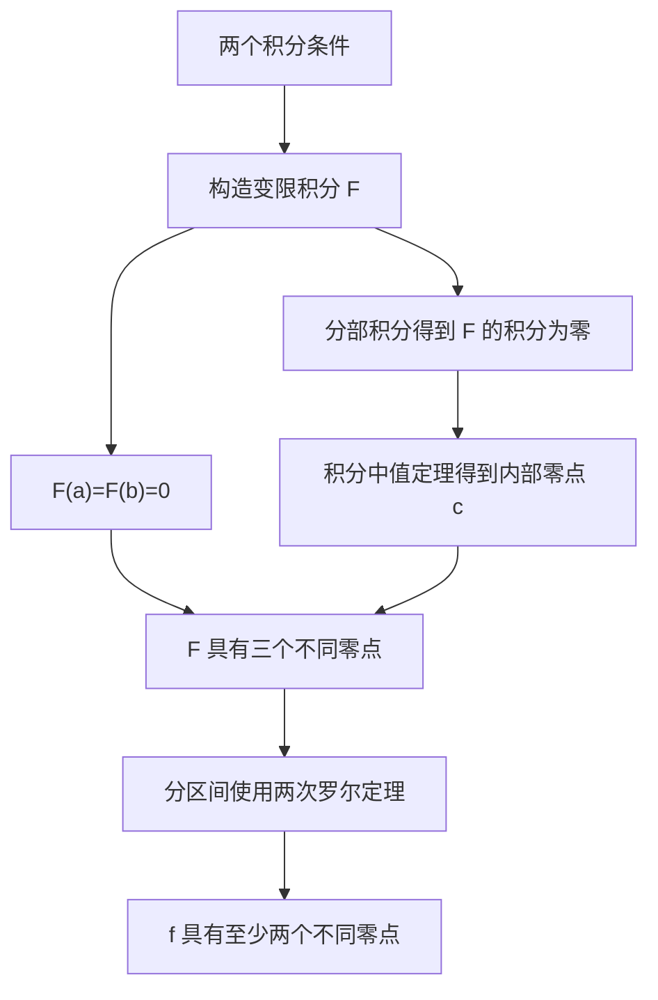
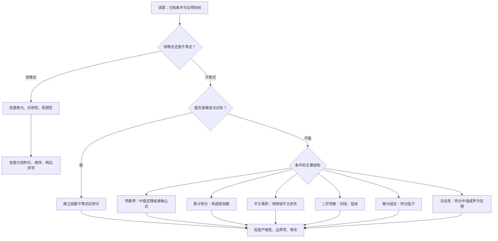

这一节与前面不定积分、定积分、反常积分的计算有明显区别。它考查的核心不再是能否求出一个积分，而是能否利用函数的性质、积分的性质和微分中值定理，把一个看似复杂的证明目标转化成能够判断的数学结构。

尤其对于数学一，本节还可以与二重积分、微分方程、曲线弧长、泰勒公式、数列极限以及概率论中的数学期望结合起来，形成综合性较强的证明题。

## 一、考点概览

| 核心题型      | 核心工具          | 学习优先级 |
| --------- | ------------- | ----- |
| 积分恒等式     | 对称换元、周期性、分部积分 | ★★★★★ |
| 嵌套积分恒等式   | 积分换序、变限积分求导   | ★★★★★ |
| 积分直接估计    | 保序性、绝对值不等式    | ★★★★★ |
| 导数控制函数及积分 | 微积分基本定理、中值定理  | ★★★★★ |
| 加权积分比较    | 分部积分、原函数构造    | ★★★★★ |
| 积分柯西不等式   | 平方非负、二次函数     | ★★★★★ |
| 积分条件与零点证明 | 积分中值定理、罗尔定理   | ★★★★★ |
| 凸性与积分不等式  | 切线、弦线、二阶导数    | ★★★★★ |
| 数值积分与误差估计 | 分部积分、泰勒公式     | ★★★★☆ |
| 积分因子型不等式  | 乘积求导、一阶微分方程   | ★★★★☆ |
| 振荡积分估计    | 分部积分、正负抵消     | ★★★★☆ |

这些题型看似很多，实际上共同遵循一个原则：

**积分等式要寻找结构相同的表达式，积分不等式要构造具有确定符号的表达式。**

## 二、基础知识：积分证明题的八个底层工具

设 $a<b$，以下默认涉及的函数满足相应的连续性、可导性或可积性条件。

### 2.1 定积分的保序性

如果在 $[a,b]$ 上恒有

$$
f(x)\le g(x),
$$

那么

$$
\boxed{\int_a^b f(x)\,dx\le \int_a^b g(x)\,dx}
$$

这是几乎所有积分不等式的基础。

**直观理解**

积分可以理解为带符号的面积。如果一个函数的图像始终位于另一个函数的下方，那么前者的定积分不会大于后者。

需要特别注意，**不要求两个函数非负**。

**严格不等式与等号条件**

若 $f,g$ 连续，且 $f(x)\le g(x)$，并且至少存在一点满足 $f(x_0)<g(x_0)$，那么

$$
\int_a^b f(x)\,dx< \int_a^b g(x)\,dx.
$$

因为连续性保证在该点附近的一小段区间内，不等式仍然严格成立。

一个非常重要的推论是：

$$
\boxed{ \begin{cases} f(x)\ge0,\\ f\in C[a,b],\\ \displaystyle\int_a^b f(x)\,dx=0 \end{cases} \Longrightarrow f(x)\equiv0 }
$$

这个结论经常用于证明等号条件、函数恒等以及反证法。

### 2.2 积分的绝对值不等式

由

$$
-|f(x)|\le f(x)\le |f(x)|
$$

积分可得

$$
\boxed{ \left|\int_a^b f(x)\,dx\right| \le\int_a^b|f(x)|\,dx }
$$

进一步，如果

$$
|f(x)|\le M,
$$

则

$$
\boxed{ \left|\int_a^b f(x)\,dx\right| \le M(b-a) }
$$

更一般地，若 $|f(x)|\le g(x)$，则

$$
\left|\int_a^b f(x)\,dx\right| \le\int_a^b g(x)\,dx.
$$

**什么时候可以取等号？**

对于连续函数，

$$
\left|\int_a^b f(x)\,dx\right| =\int_a^b|f(x)|\,dx
$$

当且仅当 $f$ 在整个区间上不变号，即恒非负或恒非正。

注意区别：

$$
\left|\int_a^b f(x)\,dx\right|, \qquad \int_a^b|f(x)|\,dx.
$$

第一个表达式保留了正负面积的抵消，第二个表达式消除了这种抵消。在振荡积分题中，这种区别尤其重要。

### 2.3 积分中值定理

若 $f$ 在 $[a,b]$ 上连续，则存在 $\xi\in(a,b)$，使

$$
\boxed{ \int_a^b f(x)\,dx=f(\xi)(b-a) }
$$

即

$$
f(\xi)=\frac1{b-a}\int_a^b f(x)\,dx.
$$

右侧称为函数在区间上的积分平均值。

若

$$
m=\min_{x\in[a,b]}f(x),\qquad M=\max_{x\in[a,b]}f(x),
$$

则

$$
\boxed{ m\le\frac1{b-a}\int_a^b f(x)\,dx\le M }
$$

**加权积分中值定理**

如果 $f$ 连续，$g$ 可积且不变号，则存在 $\xi\in[a,b]$，使

$$
\boxed{ \int_a^b f(x)g(x)\,dx =f(\xi)\int_a^b g(x)\,dx }
$$

如果还满足 $g\ge0$ 且积分为正，那么

$$
m\le \frac{\int_a^b f(x)g(x)\,dx} {\int_a^b g(x)\,dx} \le M.
$$

因此，非负权函数可以理解为给函数的不同位置赋予不同的权重。

**易错点：** 权函数变号时，不能直接使用加权积分中值定理。

### 2.4 牛顿—莱布尼茨公式：连接函数值与导数

如果 $f\in C^1[a,b]$，则

$$
\boxed{f(x)-f(a)=\int_a^x f'(t)\,dt}
$$

进一步得到

$$
|f(x)-f(a)| \le\int_a^x|f'(t)|\,dt.
$$

如果 $|f'|\le M$，也可以直接利用拉格朗日中值定理得到

$$
\boxed{|f(x)-f(y)|\le M|x-y|}
$$

这就是常见的 Lipschitz 型估计。

当题目已知某个端点的函数值、导数的绝对值或导数的积分，而要求估计原函数时，应首先想到这一工具。

### 2.5 变限积分求导

若 $f$ 连续，则

$$
\frac{d}{dx}\int_a^x f(t)\,dt=f(x).
$$

一般地，

$$
\boxed{ \frac{d}{dx}\int_{u(x)}^{v(x)}f(t)\,dt =f(v(x))v'(x)-f(u(x))u'(x) }
$$

如果积分被积函数本身也含参数，在相应的连续性和可微条件下，还要考虑参数的偏导数。

**三个重要的构造**

设

$$
F(x)=\int_a^x f(t)\,dt.
$$

则：

- $F'(x)=f(x)$，可将函数符号转化为单调性；
- $F''(x)=f'(x)$，可将函数单调性转化为凸性；
- 若 $f\in C^1$，则 $\displaystyle f(x)-f(a)=\int_a^x f'(t)\,dt$，可反向构造积分。

因此，**积分条件与微分中值定理结合时，变限积分通常是最重要的辅助函数。**

### 2.6 分部积分公式

$$
\boxed{ \int_a^b u(x)v'(x)\,dx =[u(x)v(x)]_a^b-\int_a^b u'(x)v(x)\,dx }
$$

前面学习分部积分时，主要将它视为积分计算工具。但本节必须理解它更深层的作用：

**分部积分能够把一个函数身上的导数转移到另一个函数上。**

例如：

$$
\int_a^b xf'(x)\,dx =[xf(x)]_a^b-\int_a^b f(x)\,dx.
$$

当 $f(a)=f(b)=0$ 时，

$$
\boxed{\int_a^b xf'(x)\,dx=-\int_a^b f(x)\,dx}
$$

如果题目特意给出端点为零、两端相等或两积分相等，应高度关注分部积分中的边界项能否消失。

### 2.7 对称换元公式

这是证明积分恒等式最常用的换元。

令 $x=a+b-t$，得到

$$
\boxed{ \int_a^b f(x)\,dx =\int_a^b f(a+b-x)\,dx }
$$

将两个式子相加，还得到

$$
\boxed{ \int_a^b f(x)\,dx =\frac12\int_a^b [f(x)+f(a+b-x)]\,dx }
$$

如果

$$
f(x)+f(a+b-x)=C,
$$

则

$$
\int_a^b f(x)\,dx=\frac{C(b-a)}2.
$$

如果

$$
f(a+b-x)=-f(x),
$$

则

$$
\int_a^b f(x)\,dx=0.
$$

这实际上是奇偶性积分公式在任意区间上的推广。

### 2.8 平方非负与二阶导数

积分证明题中有两种特别强大的符号来源。

第一种：

$$
[f(x)-\lambda g(x)]^2\ge0.
$$

由此可推导积分柯西不等式、均方估计、最佳参数问题。

第二种：

$$
f''(x)\ge0
$$

意味着函数具有凸性，图像在切线上方、端点弦线下方。

以下统一采用数学分析中 $f''\ge0$ 对应凸函数的约定，也就是部分考研教材所说的“凹向上”或“下凸”，避免不同教材的凹凸术语产生混淆。

## 三、题型一：积分恒等式——对称换元与周期性

对应核心题001—006，以及张宇1000题第11章、李林880第三章、李正元第三章的相关练习。

### 3.1 母题：周期函数与移动积分窗口

**来源：张宇1000题第11章题003。**

设 $f$ 在实数域上连续，$T>0$，证明：

$f$ 以 $T$ 为周期的充要条件是

$$
\int_a^{a+T}f(x)\,dx
$$

与 $a$ 无关。

**题型识别**

题目存在两个明显特征：积分区间长度固定，但区间位置可以移动；要求证明积分与某个变量无关。

看到“与变量无关”，就应该联想到导数恒为零。

**标准解法**

构造辅助函数

$$
H(a)=\int_a^{a+T}f(x)\,dx.
$$

求导得到

$$
H'(a)=f(a+T)-f(a).
$$

若 $f$ 以 $T$ 为周期，则

$$
f(a+T)=f(a),
$$

所以

$$
H'(a)=0.
$$

于是 $H(a)$ 为常数。

反之，若 $H(a)$ 为常数，则

$$
H'(a)=0.
$$

因此

$$
f(a+T)-f(a)=0,
$$

即

$$
f(a+T)=f(a).
$$

故充要条件成立。

**方法迁移**

遇到以下证明目标，都可以使用类似思路：

$$
\begin{aligned} &H(x)\equiv C &&\Longrightarrow \text{证明 }H'(x)=0,\\ &A(x)\equiv B(x)&&\Longrightarrow \text{证明 }A'=B' \text{ 且初值相等},\\ &H(x)\ge0&&\Longrightarrow \text{研究 }H'\text{ 的符号}. \end{aligned}
$$

对于周期为 $T$ 的连续函数，还可以得到

$$
\int_a^{a+nT}f(x)\,dx =n\int_0^T f(x)\,dx, \qquad n\in\mathbb N^+.
$$

但不能据此认为周期函数的原函数必定是周期函数。

若 $F'=f$，那么 $F$ 以 $T$ 为周期的充要条件是

$$
\boxed{\int_0^T f(x)\,dx=0}
$$

### 3.2 母题：对称函数与加权积分

**来源：李林880第三章题106。**

设 $f$ 为连续偶函数，且以 $T$ 为周期，证明

$$
\int_0^{nT}xf(x)\,dx =\frac{n^2T}{2}\int_0^T f(x)\,dx.
$$

**解题思路**

左侧多出一个权函数 $x$。如果直接分部积分，可能无法进一步计算，因为 $f$ 的原函数未知。

应该尝试利用周期性与偶性消去权函数。

记

$$
I=\int_0^{nT}xf(x)\,dx.
$$

令 $x=nT-t$，由周期性及偶性，

$$
f(nT-t)=f(-t)=f(t).
$$

于是

$$
I=\int_0^{nT}(nT-t)f(t)\,dt.
$$

与原式相加：

$$
2I=nT\int_0^{nT}f(t)\,dt.
$$

再利用周期性，

$$
\int_0^{nT}f(t)\,dt =n\int_0^T f(t)\,dt.
$$

因此

$$
\boxed{ I=\frac{n^2T}{2}\int_0^T f(t)\,dt }
$$

**必须掌握的推广公式**

若

$$
f(a+b-x)=f(x),
$$

则

$$
\boxed{ \int_a^b xf(x)\,dx =\frac{a+b}{2}\int_a^b f(x)\,dx }
$$

本质是

$$
\left(x-\frac{a+b}{2}\right)f(x)
$$

关于区间中点反对称，所以积分为零。

例如：

$$
\int_0^{n\pi}x|\cos x|\,dx =n^2\pi.
$$

### 3.3 母题：倒数互补结构

**来源：李林880第三章题098。**

考虑

$$
I=\int_{-\pi/4}^{\pi/4} \frac{dx}{(1+e^x)\cos^2x}.
$$

直接寻找原函数非常困难，但是

$$
\frac1{1+e^x}+\frac1{1+e^{-x}}=1.
$$

同时 $\sec^2x$ 为偶函数。

将负半轴的积分换元至正半轴：

$$
\begin{aligned} I &=\int_0^{\pi/4} \left( \frac1{1+e^x}+ \frac1{1+e^{-x}} \right)\sec^2x\,dx\\ &=\int_0^{\pi/4}\sec^2x\,dx\\ &=1. \end{aligned}
$$

**通用结构**

若 $f$ 为偶函数，$g(x)g(-x)=1$，且相关分母不为零，则

$$
\boxed{ \int_{-a}^a\frac{f(x)}{1+g(x)}\,dx =\int_0^a f(x)\,dx }
$$

这里需要补充一个原练习题中未明确写出的条件：必须保证 $1+g(x)$ 不为零或相关积分有明确意义。例如 $g(x)\equiv-1$ 虽然满足倒数关系，但原积分没有定义。若规定 $g>0$，问题自然解决。

遇到指数函数、对数函数和反三角函数的复杂积分，应主动检查换元前后是否具有互补性。

### 3.4 母题：不能直接积分，就构造积分方程

**来源：李正元第三章题065。**

求

$$
I=\int_0^{\pi/2}\ln\sin x\,dx.
$$

因为

$$
\ln\sin x\sim\ln x \qquad(x\to0^+),
$$

且 $\ln x$ 在零点附近绝对可积，所以相关反常积分收敛。

令 $x=\frac\pi2-t$，得到

$$
I=\int_0^{\pi/2}\ln\cos x\,dx.
$$

于是

$$
\begin{aligned} 2I &=\int_0^{\pi/2}\ln(\sin x\cos x)\,dx\\ &=\int_0^{\pi/2}\ln\sin2x\,dx -\frac\pi2\ln2. \end{aligned}
$$

再令 $t=2x$，

$$
\int_0^{\pi/2}\ln\sin2x\,dx =\frac12\int_0^\pi\ln\sin t\,dt=I.
$$

因此

$$
2I=I-\frac\pi2\ln2,
$$

解得

$$
\boxed{I=-\frac\pi2\ln2}
$$

这类题最值得学习的不是积分结果，而是构造方程的思想：把未知积分视为一个未知量，通过换元、对称性和函数恒等式建立关于它的代数方程。

类似地，

$$
\int_0^\infty\frac{dx}{1+x^4} =\int_0^\infty\frac{x^2\,dx}{1+x^4}
$$

通过 $x=1/t$ 即可证明。

更一般地，当 $-1<p<q-1$ 时，

$$
\boxed{ \int_0^\infty\frac{x^p}{1+x^q}\,dx = \int_0^\infty\frac{x^{q-p-2}}{1+x^q}\,dx }
$$

这属于无穷区间上的倒数对称性。

## 四、题型二：嵌套积分恒等式

这是数学一应该重点掌握的一类题，因为数一考查二重积分，往往可以用更直接的方式解决问题。

### 4.1 核心母题：二重累积积分

**来源：张宇1000题第11章题004。**

设 $f$ 连续，证明

$$
\int_0^x\left[\int_0^t f(u)\,du\right]dt =\int_0^x(x-t)f(t)\,dt.
$$

<Tabs items={["方法一：分部积分", "方法二：交换积分次序", "方法三：两边求导"]} defaultIndex={0}>

<Tab value="方法一：分部积分">

令

$$
F(t)=\int_0^t f(u)\,du.
$$

则 $F'(t)=f(t)$。

因此

$$
\begin{aligned} \int_0^x F(t)\,dt &=[tF(t)]_0^x-\int_0^x tF'(t)\,dt\\ &=x\int_0^x f(t)\,dt-\int_0^x tf(t)\,dt\\ &=\int_0^x(x-t)f(t)\,dt. \end{aligned}
$$

该方法对于任意实数 $x$ 都成立。

</Tab>

<Tab value="方法二：交换积分次序">

当 $x>0$ 时，积分区域为

$$
D=\{(u,t):0\le u\le t\le x\}.
$$

固定 $u$ 后，$t$ 的范围为

$$
u\le t\le x.
$$

于是

$$
\begin{aligned} \int_0^x\int_0^t f(u)\,du\,dt &=\int_0^x\int_u^x f(u)\,dt\,du\\ &=\int_0^x(x-u)f(u)\,du. \end{aligned}
$$

</Tab>

<Tab value="方法三：两边求导">

记等式左右两边分别为 $A(x)$ 和 $B(x)$。

有

$$
A'(x)=\int_0^x f(t)\,dt,
$$

同时

$$
\begin{aligned} B'(x) &=(x-x)f(x)+\int_0^x f(t)\,dt\\ &=\int_0^x f(t)\,dt. \end{aligned}
$$

又因为

$$
A(0)=B(0)=0,
$$

所以 $A(x)\equiv B(x)$。

</Tab>

</Tabs>

**进阶推广：重复积分公式**

记

$$
F_1(x)=\int_a^x f(t)\,dt,
$$

$$
F_n(x)=\int_a^x F_{n-1}(t)\,dt.
$$

则

$$
\boxed{ F_n(x)= \frac1{(n-1)!}\int_a^x(x-t)^{n-1}f(t)\,dt }
$$

这个公式还能用于推导泰勒公式的积分余项。

### 4.2 复杂上下限的换序

**来源：张宇1000题第11章题013。**

证明

$$
\int_0^1\left[\int_{x^2}^{\sqrt x}f(t)\,dt\right]dx =\int_0^1(\sqrt x-x^2)f(x)\,dx.
$$

**标准步骤**

第一步，将积分上下限写成区域：

$$
0\le x\le1,\qquad x^2\le t\le\sqrt x.
$$

第二步，固定 $t$，反解 $x$ 的范围：

$$
x^2\le t\Longrightarrow x\le\sqrt t,
$$

$$
t\le\sqrt x\Longrightarrow x\ge t^2.
$$

所以原区域也可以写成

$$
0\le t\le1,\qquad t^2\le x\le\sqrt t.
$$

第三步，交换积分次序：

$$
\begin{aligned} \int_0^1\int_{x^2}^{\sqrt x}f(t)\,dt\,dx &=\int_0^1\int_{t^2}^{\sqrt t}f(t)\,dx\,dt\\ &=\int_0^1(\sqrt t-t^2)f(t)\,dt. \end{aligned}
$$

证毕。

**数学一的优势就在于此：当一元积分出现嵌套结构时，可以主动转化为二重积分。** 但如果原题明确要求使用分部积分法，就应按题目要求作答。

## 五、题型三：导数有界与积分估计

### 5.1 真题母题：一个端点为零

**来源：1993年考研数二。**

设 $a>0$，$f\in C^1[0,a]$，且 $f(0)=0$，记

$$
M=\max_{0\le x\le a}|f'(x)|.
$$

证明

$$
\left|\int_0^a f(x)\,dx\right| \le\frac{Ma^2}{2}.
$$

**怎样从题目条件想到方法？**

已知的是导数上界，要求的是原函数的积分。

其逻辑链条应当为

$$
\boxed{ |f'|\text{有界} \Longrightarrow |f|\text{有界} \Longrightarrow \left|\int f\right|\text{有界} }
$$

第一步，由拉格朗日中值定理，

$$
|f(x)-f(0)|\le Mx.
$$

因 $f(0)=0$，故

$$
|f(x)|\le Mx.
$$

第二步，对两边积分：

$$
\begin{aligned} \left|\int_0^a f(x)\,dx\right| &\le\int_0^a|f(x)|\,dx\\ &\le M\int_0^a x\,dx\\ &=\frac{Ma^2}{2}. \end{aligned}
$$

**最佳常数**

取 $f(x)=Mx$，就有

$$
\int_0^a f(x)\,dx=\frac{Ma^2}{2}.
$$

因此 $1/2$ 是最优系数。

<Callout type="warn" title="容易出现的错误">

有的同学会先得到 $|f(x)|\le Ma$，然后积分得

$$
\left|\int_0^a f(x)\,dx\right|\le Ma^2.
$$

虽然正确，但比题目所需结果弱了一倍。

说明：**估计时应尽可能保留变量，而不是过早地将变量替换为最大值。**

</Callout>

### 5.2 强化母题：两个端点均已知

**来源：张宇1000题第11章题014。**

设 $f$ 在 $[0,1]$ 上可导，且

$$
f(0)=f(1)=1,\qquad |f'(x)|\le1.
$$

证明

$$
\frac34<\int_0^1f(x)\,dx<\frac54.
$$

从左端点出发，

$$
|f(x)-1|\le x.
$$

从右端点出发，

$$
|f(x)-1|\le1-x.
$$

结合两个条件，得到

$$
|f(x)-1|\le\min\{x,1-x\}.
$$

于是

$$
\begin{aligned} \left|\int_0^1f(x)\,dx-1\right| &\le\int_0^1|f(x)-1|\,dx\\ &\le\int_0^{1/2}x\,dx+ \int_{1/2}^1(1-x)\,dx\\ &=\frac14. \end{aligned}
$$

若积分达到任一端的等号，则 $f$ 必须等于相应的折线函数

$$
f(x)=1\pm\min\{x,1-x\}.
$$

然而这种函数在 $x=1/2$ 处不可导，与题设矛盾。

所以

$$
\boxed{ \frac34<\int_0^1f(x)\,dx<\frac54 }
$$

**推广到一般区间**

若 $f(a)=f(b)=c$，且 $|f'|\le M$，则

$$
\boxed{ |f(x)-c|\le M\min\{x-a,b-x\} }
$$

从而

$$
\boxed{ \left|\int_a^b f(x)\,dx-c(b-a)\right| \le\frac{M(b-a)^2}{4} }
$$

如果 $M>0$ 且 $f$ 在内部可导，实际不等式为严格不等式。

这里的 $1/4$ 仍然是最佳通用系数，虽然可导函数无法真正达到折线对应的等号，但可以用光滑函数任意逼近折线。

### 5.3 总变差型不等式

**来源：张宇1000题第11章题009。**

设 $f\in C^1[a,b]$，且

$$
f(a)=f(b)=0.
$$

证明

$$
|f(x)|\le\frac12\int_a^b|f'(t)|\,dt.
$$

利用两个端点分别写出

$$
f(x)=\int_a^x f'(t)\,dt,
$$

$$
f(x)=-\int_x^b f'(t)\,dt.
$$

因此

$$
|f(x)|\le\int_a^x|f'(t)|\,dt,
$$

$$
|f(x)|\le\int_x^b|f'(t)|\,dt.
$$

两式相加，

$$
2|f(x)|\le\int_a^b|f'(t)|\,dt.
$$

即

$$
\boxed{ |f(x)|\le\frac12\int_a^b|f'(t)|\,dt }
$$

**直观理解**

函数从零出发，上升到高度 $H$，最后又回到零。那么它在整个过程中的总变化量至少为 $2H$。

这就是系数 $1/2$ 的来源。

进一步，在整个区间上取最大值，可以得到

$$
\max_{x\in[a,b]}|f(x)| \le\frac12\int_a^b|f'(x)|\,dx.
$$

## 六、题型四：单调性与积分比较

### 6.1 真题母题：局部平均值与整体平均值

**来源：1994年考研数二。**

设 $f$ 在 $[0,1]$ 上连续且单调不增，证明对任意 $\lambda\in(0,1)$，有

$$
\int_0^\lambda f(x)\,dx \ge\lambda\int_0^1f(x)\,dx.
$$

<Tabs items={["方法一：比较分段平均值", "方法二：构造平均值函数"]} defaultIndex={0}>

<Tab value="方法一：比较分段平均值">

因为 $f$ 单调不增，

$$
\frac1\lambda\int_0^\lambda f(x)\,dx \ge f(\lambda),
$$

而

$$
\frac1{1-\lambda}\int_\lambda^1f(x)\,dx \le f(\lambda).
$$

所以

$$
\frac1\lambda\int_0^\lambda f(x)\,dx \ge \frac1{1-\lambda}\int_\lambda^1f(x)\,dx.
$$

整理得到

$$
\boxed{ \int_0^\lambda f(x)\,dx \ge\lambda\int_0^1f(x)\,dx }
$$

这里完全不需要假设 $f(x)\ge0$。

</Tab>

<Tab value="方法二：构造平均值函数">

令

$$
A(x)=\frac1x\int_0^x f(t)\,dt, \qquad x>0.
$$

求导得到

$$
A'(x)= \frac{xf(x)-\int_0^x f(t)\,dt}{x^2}.
$$

由于 $f$ 单调不增，

$$
f(t)\ge f(x),\qquad 0\le t\le x.
$$

因此

$$
\int_0^x f(t)\,dt\ge xf(x),
$$

从而

$$
A'(x)\le0.
$$

即局部积分平均值 $A(x)$ 单调不增。

于是

$$
A(\lambda)\ge A(1),
$$

得到原结论。

</Tab>

</Tabs>

**可直接迁移的性质**

如果 $f$ 单调递减，则

$$
\frac1{x-a}\int_a^x f(t)\,dt
$$

关于 $x$ 单调不增；若 $f$ 单调递增，则方向相反。

这种结论可以进一步用于积分定义的递推数列。

### 6.2 综合强化：积分不等式与递推数列

**来源：李林880第三章题121。**

设 $f$ 连续且严格单调递减，满足

$$
\int_0^1f(t)\,dt\ge0,\qquad f(0)\le1.
$$

设

$$
x_0\in(0,1),\qquad x_{n+1}=\int_0^{x_n}f(t)\,dt.
$$

证明数列收敛，并求极限。

由上一母题，任意 $x\in(0,1)$ 满足

$$
x\int_0^1f(t)\,dt <\int_0^x f(t)\,dt<xf(0).
$$

所以

$$
0<\int_0^x f(t)\,dt<x.
$$

因此递推关系给出

$$
0<x_{n+1}<x_n<1.
$$

数列单调递减且有下界，必有极限。设

$$
\lim_{n\to\infty}x_n=L.
$$

利用变限积分的连续性，

$$
L=\int_0^L f(t)\,dt.
$$

假如 $L>0$，由前面的严格不等式，

$$
\int_0^L f(t)\,dt<L,
$$

产生矛盾。

因此

$$
\boxed{L=0}
$$

这种题型的通用流程是：**先证明积分映射将区间映射到自身，再证明单调性，最后利用极限方程和严格不等式排除非零极限。**

### 6.3 真题母题：累计积分比较

**来源：2004年考研数三。**

设 $f,g$ 在 $[a,b]$ 上连续，且

$$
\int_a^x f(t)\,dt\ge \int_a^x g(t)\,dt, \qquad x\in[a,b],
$$

以及

$$
\int_a^b f(t)\,dt=\int_a^b g(t)\,dt.
$$

证明

$$
\int_a^b xf(x)\,dx\le \int_a^b xg(x)\,dx.
$$

**最重要的识别点**

题目已知的不是

$$
f(x)\ge g(x),
$$

而是累计积分之间的大小关系。

因此不能直接对 $f,g$ 进行逐点比较。

定义

$$
H(x)=\int_a^x[f(t)-g(t)]\,dt.
$$

由题设，

$$
H(x)\ge0,\qquad H(a)=H(b)=0.
$$

且

$$
H'(x)=f(x)-g(x).
$$

于是

$$
\begin{aligned} &\int_a^b xf(x)\,dx-\int_a^b xg(x)\,dx\\ &=\int_a^b xH'(x)\,dx\\ &=[xH(x)]_a^b-\int_a^b H(x)\,dx\\ &=-\int_a^b H(x)\,dx\le0. \end{aligned}
$$

证毕。

**重要推广：权函数不一定是 $x$**

若 $w\in C^1[a,b]$，且 $w'(x)\ge0$，则

$$
\boxed{ \int_a^b w(x)f(x)\,dx \le\int_a^b w(x)g(x)\,dx }
$$

因为

$$
\int_a^b w(x)[f(x)-g(x)]\,dx =-\int_a^b w'(x)H(x)\,dx\le0.
$$

若 $w'\le0$，不等号反向。

<Callout type="warn" title="加权积分比较的反例">

累计积分的大小关系不能直接推广为任意加权积分的大小关系。

例如取

$$
f(x)=0,\qquad g(x)=1-2x, \qquad x\in[0,1].
$$

则

$$
\int_0^x f(t)\,dt=0 \le x-x^2=\int_0^x g(t)\,dt.
$$

但是

$$
\int_0^1xf(x)\,dx=0,
$$

$$
\int_0^1xg(x)\,dx=-\frac16.
$$

因此不能得出前者小于等于后者。

做这类题时，必须检查：

$$
\int_a^b wH'=[wH]_a^b-\int_a^b w'H
$$

中的边界项是否消失，以及剩余积分的符号方向。

</Callout>

### 6.4 真题母题：交叉导数与乘积求导

**来源：2005年考研数三。**

设 $f,g\in C^1[0,1]$，满足

$$
f(0)=0,\qquad f'(x)\ge0,\qquad g'(x)\ge0.
$$

证明

$$
\int_0^a g(x)f'(x)\,dx +\int_0^1f(x)g'(x)\,dx \ge f(a)g(1).
$$

当题目同时出现 $gf'$ 和 $fg'$，应该马上联想到

$$
(fg)'=f'g+fg'.
$$

将第二个积分在 $a$ 处拆开：

$$
\begin{aligned} I &=\int_0^a(gf'+fg')\,dx +\int_a^1fg'\,dx\\ &=f(a)g(a)+\int_a^1fg'\,dx. \end{aligned}
$$

又因为 $f$ 单调不减，且 $g'\ge0$，

$$
\int_a^1fg'\,dx \ge f(a)\int_a^1g'(x)\,dx.
$$

所以

$$
I\ge f(a)g(a)+f(a)[g(1)-g(a)] =f(a)g(1).
$$

最简洁的结构是直接写出目标差：

$$
\boxed{ I-f(a)g(1) =\int_a^1[f(x)-f(a)]g'(x)\,dx\ge0 }
$$

把目标差化成非负积分，是本节最值得养成的解题习惯之一。

### 6.5 进阶工具：积分切比雪夫不等式

设 $f,g$ 在 $[a,b]$ 上连续，并且具有相同的单调方向，则

$$
\boxed{ (b-a)\int_a^b f(x)g(x)\,dx \ge \int_a^b f(x)\,dx \int_a^b g(x)\,dx }
$$

如果单调方向相反，不等号反向。

**数学一推荐证明**

同向单调意味着任意 $x,y\in[a,b]$ 都有

$$
[f(x)-f(y)][g(x)-g(y)]\ge0.
$$

因此

$$
\frac12\int_a^b\int_a^b [f(x)-f(y)][g(x)-g(y)]\,dx\,dy\ge0.
$$

展开并换序整理得到

$$
\begin{aligned} &(b-a)\int_a^b fg\,dx\\ &\quad-\left(\int_a^b f\,dx\right) \left(\int_a^b g\,dx\right)\ge0. \end{aligned}
$$

这也是李林880第三章题045的底层结构：

若 $f$ 单调递增，则

$$
\boxed{ \int_a^b xf(x)\,dx \ge\frac{a+b}{2}\int_a^b f(x)\,dx }
$$

取 $g(x)=x$，就可以直接推导出来。

注意，积分切比雪夫不等式与概率论中的切比雪夫不等式不是同一个结论。

## 七、题型五：积分柯西不等式与平方构造

这一类题非常重要。很多看似没有思路的积分不等式，只要发现平方、乘积或者二次型，就可以通过构造非负平方解决。

### 7.1 积分柯西不等式

**来源：李正元第三章题070。**

设 $f,g$ 在 $[a,b]$ 上连续，证明

$$
\boxed{ \left[\int_a^b f(x)g(x)\,dx\right]^2 \le \int_a^b f^2(x)\,dx \int_a^b g^2(x)\,dx }
$$

<Tabs items={["方法一：构造二次函数", "方法二：二重积分恒等式"]} defaultIndex={0}>

<Tab value="方法一：构造二次函数">

对于任意 $\lambda\in\mathbb R$，必有

$$
\int_a^b[f(x)-\lambda g(x)]^2\,dx\ge0.
$$

展开：

$$
\int_a^b f^2(x)\,dx -2\lambda\int_a^b fg\,dx +\lambda^2\int_a^b g^2(x)\,dx\ge0.
$$

记

$$
A=\int_a^b f^2,\qquad B=\int_a^b fg,\qquad C=\int_a^b g^2.
$$

于是

$$
C\lambda^2-2B\lambda+A\ge0.
$$

若 $C=0$，则由连续性知 $g\equiv0$，原不等式显然成立。

若 $C>0$，该二次函数对任意实数 $\lambda$ 恒非负，故判别式满足

$$
\Delta=4B^2-4AC\le0.
$$

所以

$$
B^2\le AC.
$$

即得到积分柯西不等式。

</Tab>

<Tab value="方法二：二重积分恒等式">

还可以通过下面的恒等式直接证明：

$$
\begin{aligned} &\left(\int_a^b f^2\,dx\right) \left(\int_a^b g^2\,dx\right) -\left(\int_a^b fg\,dx\right)^2\\ &=\frac12\int_a^b\int_a^b [f(x)g(y)-f(y)g(x)]^2\,dx\,dy\\ &\ge0. \end{aligned}
$$

这一证明更能体现平方非负的本质。

</Tab>

</Tabs>

**等号条件**

当且仅当 $f,g$ 线性相关时取等号，即存在不全为零的常数 $\alpha,\beta$，使

$$
\alpha f(x)+\beta g(x)\equiv0.
$$

如果 $g\not\equiv0$，等号条件可以写成

$$
f(x)\equiv\lambda g(x).
$$

### 7.2 三个必须掌握的推论

**推论一：均方不小于平均值的平方**

令 $g(x)=1$，得到

$$
\boxed{ \left(\int_a^b f(x)\,dx\right)^2 \le(b-a)\int_a^b f^2(x)\,dx }
$$

等价于

$$
\boxed{ \left(\frac1{b-a}\int_a^b f(x)\,dx\right)^2 \le\frac1{b-a}\int_a^b f^2(x)\,dx }
$$

对于 $[0,1]$，简化为

$$
\left(\int_0^1f(x)\,dx\right)^2 \le\int_0^1f^2(x)\,dx.
$$

从概率论的角度，这就是方差非负。

**推论二：正函数与倒数**

若 $f(x)>0$，取

$$
u(x)=\sqrt{f(x)},\qquad v(x)=\frac1{\sqrt{f(x)}}.
$$

由柯西不等式，

$$
\boxed{ \int_a^b f(x)\,dx \int_a^b\frac{dx}{f(x)} \ge(b-a)^2 }
$$

等号当且仅当 $f$ 为正常数。

**推论三：带权积分柯西不等式**

若 $w(x)\ge0$，则

$$
\boxed{ \left(\int_a^b wfg\,dx\right)^2 \le \left(\int_a^b wf^2\,dx\right) \left(\int_a^b wg^2\,dx\right) }
$$

证明只需要令

$$
u=\sqrt w f,\qquad v=\sqrt w g.
$$

### 7.3 强化母题：导数的平方控制函数的平方

**来源：张宇1000题第11章题017。**

设 $f\in C^1[a,b]$，且 $f(a)=0$，证明

$$
\int_a^b f^2(x)\,dx \le\frac{(b-a)^2}{2} \int_a^b[f'(x)]^2\,dx.
$$

**解题思路**

条件给出端点为零，目标同时包含 $f^2$ 和 $(f')^2$。

第一反应应该是

$$
f(x)=\int_a^x f'(t)\,dt,
$$

再利用积分柯西不等式。

具体地，

$$
\begin{aligned} f^2(x) &=\left[\int_a^x f'(t)\,dt\right]^2\\ &\le(x-a)\int_a^x[f'(t)]^2\,dt\\ &\le(x-a)\int_a^b[f'(t)]^2\,dt. \end{aligned}
$$

两端对 $x$ 积分，

$$
\begin{aligned} \int_a^b f^2(x)\,dx &\le \int_a^b(x-a)\,dx \int_a^b[f'(t)]^2\,dt\\ &=\frac{(b-a)^2}{2} \int_a^b[f'(t)]^2\,dt. \end{aligned}
$$

证毕。

**进一步提升：两个端点均为零**

若 $f(a)=f(b)=0$，可以同时使用

$$
f(x)=\int_a^x f'(t)\,dt =-\int_x^b f'(t)\,dt.
$$

分别估计得到

$$
f^2(x)\le(x-a)\int_a^x(f')^2\,dt,
$$

$$
f^2(x)\le(b-x)\int_x^b(f')^2\,dt.
$$

对内部点分别除以 $x-a$ 和 $b-x$，然后相加：

$$
f^2(x) \left(\frac1{x-a}+\frac1{b-x}\right) \le\int_a^b(f')^2\,dt.
$$

整理为

$$
f^2(x)\le \frac{(x-a)(b-x)}{b-a} \int_a^b(f')^2\,dt.
$$

再对 $x$ 积分，就有

$$
\boxed{ \int_a^b f^2(x)\,dx \le\frac{(b-a)^2}{6} \int_a^b[f'(x)]^2\,dx }
$$

这个推广说明：充分利用两个端点，能够获得比只使用一个端点更强的估计。这里的 $1/6$ 是由上述初等方法得到的有效系数，不是最佳系数。

## 八、题型六：积分条件与函数零点证明

积分等式不一定是最终目标，它有时仅仅是为了构造零点、驻点或者满足某个关系的中间点。

### 8.1 基础模型：积分为零推出零点

若 $f$ 连续且

$$
\int_a^b f(x)\,dx=0,
$$

则存在 $\xi\in(a,b)$，使得

$$
f(\xi)=0.
$$

这是积分中值定理的直接应用。

但注意，积分为零并不能推出 $f\equiv0$，除非还知道 $f$ 不变号。

### 8.2 核心母题：两个积分条件推出两个零点

**来源：李林880第三章题104。**

设 $f\in C[a,b]$，满足

$$
\int_a^b f(x)\,dx=0,
$$

$$
\int_a^b xf(x)\,dx=0.
$$

证明至少存在两个不同的点 $\xi_1,\xi_2\in(a,b)$，使

$$
f(\xi_1)=f(\xi_2)=0.
$$

**为什么不能直接使用两次积分中值定理？**

因为两次中值定理得到的点可能相同，而且第二个积分中的权函数 $x$ 也可能变号。

所以必须设计能够保证两点不同的证明结构。

**标准解法：原函数构造**

令

$$
F(x)=\int_a^x f(t)\,dt.
$$

由第一个条件，

$$
F(a)=F(b)=0.
$$

再利用第二个条件分部积分：

$$
\begin{aligned} 0 &=\int_a^b xf(x)\,dx\\ &=\int_a^b xF'(x)\,dx\\ &=[xF(x)]_a^b-\int_a^b F(x)\,dx\\ &=-\int_a^b F(x)\,dx. \end{aligned}
$$

所以

$$
\int_a^b F(x)\,dx=0.
$$

由积分中值定理，存在 $c\in(a,b)$，使得

$$
F(c)=0.
$$

现在得到三个零点：

$$
F(a)=F(c)=F(b)=0.
$$

分别在 $[a,c]$ 和 $[c,b]$ 上应用罗尔定理，得到

$$
F'(\xi_1)=0,\qquad F'(\xi_2)=0,
$$

其中

$$
a<\xi_1<c<\xi_2<b.
$$

由于 $F'=f$，所以

$$
\boxed{f(\xi_1)=f(\xi_2)=0}
$$

且 $\xi_1,\xi_2$ 显然不同。

**逻辑结构**

**高阶推广**

如果

$$
\int_a^b x^k f(x)\,dx=0, \qquad k=0,1,\ldots,n-1,
$$

则连续函数 $f$ 在 $(a,b)$ 内至少有 $n$ 个不同零点。

一种证明是构造 $F(x)=\int_a^x f(t)\,dt$，再通过分部积分得到 $F$ 满足低一阶的矩条件，结合端点零值和罗尔定理进行数学归纳。

这类题的本质不是积分计算，而是积分条件提供了足够多的约束，使函数不得不多次穿过零水平线或在零水平线上取值。

### 8.3 强化母题：两个变限积分的乘积构造

**来源：张宇1000题第11章题005。**

设 $f,g$ 在 $[a,b]$ 上连续，证明存在 $\xi\in(a,b)$，使得

$$
f(\xi)\int_a^\xi g(t)\,dt = g(\xi)\int_\xi^b f(t)\,dt.
$$

首先把目标移项：

$$
g(\xi)\int_\xi^b f(t)\,dt -f(\xi)\int_a^\xi g(t)\,dt=0.
$$

观察其中包含两个乘积项，很像乘积求导公式。

于是构造

$$
H(x)= \left[\int_a^x g(t)\,dt\right] \left[\int_x^b f(t)\,dt\right].
$$

则

$$
H(a)=H(b)=0.
$$

由罗尔定理，存在 $\xi\in(a,b)$，使

$$
H'(\xi)=0.
$$

而

$$
H'(x)= g(x)\int_x^b f(t)\,dt -f(x)\int_a^x g(t)\,dt.
$$

因此结论成立。

**解题规律**

当目标要求存在某个 $\xi$，且包含

$$
f(\xi)\int_a^\xi g, \qquad g(\xi)\int_\xi^b f
$$

这样的交叉乘积时，尝试把目标看成辅助函数的导数，而不是试图直接求 $\xi$。

这也是第三模块罗尔定理与本节积分证明的典型交叉考点。

## 九、题型七：凸性与积分不等式

这是本节最值得重点强化的内容之一。配套模拟题4道中，有3道与二阶导数及函数凹凸性密切相关。

### 9.1 凸函数的三种基本表达

若 $f''(x)\ge0$，则 $f'$ 单调不减。

**表达一：切线估计**

$$
\boxed{ f(x)\ge f(c)+f'(c)(x-c) }
$$

即凸函数图像位于任意切线上方。

**表达二：弦线估计**

对于 $x\in[a,b]$，

$$
\boxed{ f(x)\le \frac{b-x}{b-a}f(a) +\frac{x-a}{b-a}f(b) }
$$

即凸函数图像位于端点连线下方。

**表达三：中点不等式**

$$
\boxed{ f\left(\frac{x+y}{2}\right) \le\frac{f(x)+f(y)}2 }
$$

更一般地，

$$
f((1-t)x+ty) \le(1-t)f(x)+tf(y), \qquad t\in[0,1].
$$

当 $f''\le0$ 时，上述不等式全部反向。

**判断技巧：** 用 $f(x)=x^2$ 检查不等号方向，通常比死记“凹”“凸”的术语更可靠。

### 9.2 核心母题：赫尔米特—阿达马不等式

**来源：李林880第三章题103。**

设 $f$ 在 $[a,b]$ 上二阶可导，且

$$
f''(x)>0,\qquad x\in(a,b).
$$

证明

$$
\boxed{ f\left(\frac{a+b}{2}\right) < \frac1{b-a}\int_a^b f(x)\,dx < \frac{f(a)+f(b)}2 }
$$

这是本节最重要的凸性积分母题之一。

**左侧不等式：切线法**

令

$$
m=\frac{a+b}{2}.
$$

由严格凸性，对于 $x\ne m$，

$$
f(x)>f(m)+f'(m)(x-m).
$$

积分得到

$$
\int_a^b f(x)\,dx > (b-a)f(m)+f'(m)\int_a^b(x-m)\,dx.
$$

由于

$$
\int_a^b(x-m)\,dx=0,
$$

所以

$$
\int_a^b f(x)\,dx>(b-a)f(m).
$$

于是

$$
f(m)<\frac1{b-a}\int_a^b f(x)\,dx.
$$

**右侧不等式：弦线法**

严格凸性给出

$$
f(x)< \frac{b-x}{b-a}f(a) +\frac{x-a}{b-a}f(b).
$$

两边积分：

$$
\begin{aligned} \int_a^b f(x)\,dx &< \frac{b-a}{2}f(a) +\frac{b-a}{2}f(b)\\ &=\frac{b-a}{2}[f(a)+f(b)]. \end{aligned}
$$

故

$$
\frac1{b-a}\int_a^b f(x)\,dx <\frac{f(a)+f(b)}2.
$$

**必须记住的理解**

对于凸函数，

$$
\boxed{ \text{中点函数值} \le \text{积分平均值} \le \text{端点函数值平均} }
$$

对于凹函数，方向全部相反。

如果仅有 $f''\ge0$，只能保证非严格不等式；线性函数 $f(x)=kx+c$ 会使两个不等式都取等号。

### 9.3 重点模拟题：由对称差分推出凸性

**来源：2027李林六套卷第2套第20题。**

设 $f$ 在实数域上二阶可导，且对任意 $h$，有

$$
f(x+h)+f(x-h)-2f(x)\ge0.
$$

证明：

第一问：

$$
f''(x)\ge0.
$$

第二问：对任意正整数 $n$，有

$$
\int_0^1f(x^n)\,dx \ge f\left(\frac1{n+1}\right).
$$

**第一问：对称二阶差商**

利用泰勒公式，

$$
f(x+h)=f(x)+f'(x)h+\frac12f''(x)h^2+o(h^2),
$$

$$
f(x-h)=f(x)-f'(x)h+\frac12f''(x)h^2+o(h^2).
$$

相加并整理：

$$
f(x+h)+f(x-h)-2f(x) =f''(x)h^2+o(h^2).
$$

因此

$$
\boxed{ f''(x)= \lim_{h\to0} \frac{f(x+h)+f(x-h)-2f(x)}{h^2} }
$$

由于差商非负，极限也非负，于是

$$
f''(x)\ge0.
$$

**第二问：为什么选择 $1/(n+1)$？**

因为

$$
\int_0^1x^n\,dx=\frac1{n+1}.
$$

右侧函数的自变量，正好是左侧复合函数内部变量的积分平均值。

由凸性，令

$$
c=\frac1{n+1},
$$

则

$$
f(t)\ge f(c)+f'(c)(t-c).
$$

取 $t=x^n$，有

$$
f(x^n)\ge f(c)+f'(c)(x^n-c).
$$

两端从0到1积分：

$$
\begin{aligned} \int_0^1f(x^n)\,dx &\ge f(c)+f'(c) \left(\int_0^1x^n\,dx-c\right)\\ &=f(c). \end{aligned}
$$

所以

$$
\boxed{ \int_0^1f(x^n)\,dx \ge f\left(\frac1{n+1}\right) }
$$

**提炼为 Jensen 积分不等式**

若 $f$ 为凸函数，$g$ 连续且其值域位于 $f$ 的定义域内，则

$$
\boxed{ f\left(\frac1{b-a}\int_a^b g(x)\,dx\right) \le \frac1{b-a}\int_a^b f(g(x))\,dx }
$$

记忆方式：

**对于凸函数，先取平均再代入函数，不大于先代入函数再取平均。**

在考研证明题中，即使没有学过 Jensen 不等式，也可以通过切线法完整证明，不必依赖超出常规高数知识的定理名称。

**带权推广**

若 $w(x)\ge0$，且

$$
\int_a^b w(x)\,dx=1,
$$

则

$$
f\left(\int_a^b w(x)g(x)\,dx\right) \le\int_a^b w(x)f(g(x))\,dx.
$$

如果 $f$ 严格凸，且 $g$ 连续并非常数，则无权情形下不等式严格成立。

### 9.4 重点模拟题：偶函数、凸性与积分上界

**来源：2027李林六套卷第3套第20题。**

已知 $f$ 具有二阶连续导数，且

$$
f\left(\frac{x+y}{2}\right) \le\frac{f(x)+f(y)}2.
$$

第一问要求证明 $f''\ge0$，第二问在 $f$ 为偶函数的条件下证明

$$
\int_{-1}^1f(x)\,dx\le f(0)+f(1).
$$

第一问取

$$
x=t-h,\qquad y=t+h,
$$

立刻转化为上一道题的对称二阶差商。

第二问，由凸性，

$$
f(x)\le(1-x)f(0)+xf(1), \qquad x\in[0,1].
$$

积分得到

$$
\int_0^1 f(x)\,dx \le\frac{f(0)+f(1)}2.
$$

又因为 $f$ 为偶函数，

$$
\int_{-1}^1f(x)\,dx=2\int_0^1f(x)\,dx.
$$

所以

$$
\boxed{ \int_{-1}^1f(x)\,dx\le f(0)+f(1) }
$$

**两道李林模拟题的区别**

| 模拟题     | 目标   | 应选择的方法 |
| ------- | ---- | ------ |
| 第2套第20题 | 积分下界 | 凸函数切线  |
| 第3套第20题 | 积分上界 | 凸函数弦线  |

两题第一问完全同源，第二问分别考查凸函数的两种基本估计方法。

### 9.5 强化母题：凹函数的面积与高度

**来源：李林880第三章题125。**

设

$$
f(a)=f(b)=0,\qquad f''(x)<0.
$$

证明任意 $x\in(a,b)$ 都满足

$$
0<f(x)<\frac2{b-a}\int_a^b f(t)\,dt.
$$

固定 $x_0\in(a,b)$。

由于 $f$ 严格凹，图像位于端点弦线的上方，因此

$$
f(x_0)>0.
$$

对于 $t\in[a,x_0]$，使用连接 $(a,0)$ 和 $(x_0,f(x_0))$ 的弦线：

$$
f(t)\ge \frac{t-a}{x_0-a}f(x_0).
$$

对于 $t\in[x_0,b]$，使用另一条弦线：

$$
f(t)\ge \frac{b-t}{b-x_0}f(x_0).
$$

由于严格凹性，在各子区间的内部不等式严格成立。

两段分别积分并相加：

$$
\begin{aligned} \int_a^b f(t)\,dt &> \frac{x_0-a}{2}f(x_0) +\frac{b-x_0}{2}f(x_0)\\ &=\frac{b-a}{2}f(x_0). \end{aligned}
$$

因此

$$
\boxed{ f(x_0)<\frac2{b-a}\int_a^b f(t)\,dt }
$$

**几何意义**

曲线与横轴围成的面积，大于底边为 $b-a$、高度为 $f(x_0)$ 的三角形面积。

这类题往往不需要直接计算积分，只需要构造一个面积已知的几何图形作为比较对象。

### 9.6 综合模拟题：凹性与曲线弧长

**来源：2027张宇8套卷第4套第19题；张宇1000题第11章题020也收录了同一结构。**

设 $f$ 在 $[0,1]$ 上具有二阶导数，并满足

$$
f(0)=f(1)=0,\qquad f''(x)<0,\qquad 0\le f(x)\le1.
$$

证明：

第一问：存在 $\xi\in(0,1)$，使得在 $(0,\xi)$ 上 $f'(x)>0$。

第二问：

$$
\int_0^1\sqrt{1+[f'(x)]^2}\,dx<3.
$$

**第一问：确定导数符号**

由于 $f(0)=f(1)$，由罗尔定理存在 $\xi\in(0,1)$，使

$$
f'(\xi)=0.
$$

又因为 $f''<0$，故 $f'$ 严格单调递减。

因此

$$
\begin{cases} f'(x)>0,&x\in(0,\xi),\\ f'(x)<0,&x\in(\xi,1). \end{cases}
$$

这就说明曲线先上升，再下降。

**第二问：根式转化为绝对值**

对于任意实数 $u$，

$$
\sqrt{1+u^2}\le1+|u|,
$$

且 $u\ne0$ 时不等式严格成立。

所以

$$
\int_0^1\sqrt{1+(f')^2}\,dx <1+\int_0^1|f'(x)|\,dx.
$$

利用第一问得到的导数符号，

$$
\begin{aligned} \int_0^1|f'(x)|\,dx &=\int_0^\xi f'(x)\,dx-\int_\xi^1f'(x)\,dx\\ &=f(\xi)-f(0)+f(\xi)-f(1)\\ &=2f(\xi)\\ &\le2. \end{aligned}
$$

因此

$$
\boxed{ \int_0^1\sqrt{1+[f'(x)]^2}\,dx<3 }
$$

**方法迁移**

对于一般的光滑曲线，

$$
\boxed{ L=\int_a^b\sqrt{1+[f'(x)]^2}\,dx \le(b-a)+\int_a^b|f'(x)|\,dx }
$$

曲线长度不超过横向移动距离与纵向总变化量之和。

若函数先增后减，且两端函数值相等，那么

$$
\int_a^b|f'(x)|\,dx =2\left[\max f-f(a)\right].
$$

这道题很好地展示了数学一的综合命题思路：罗尔定理确定驻点、二阶导数控制单调性、绝对值不等式处理根式、牛顿—莱布尼茨公式计算总变差。

## 十、题型八：二阶导数与积分误差估计

这种题目的特点是：已知 $f''$ 的符号或绝对值上界，要求证明涉及积分、端点函数值、中点函数值的不等式。

本质是利用线性函数近似原函数，再对近似误差进行积分。

### 10.1 核心母题：梯形公式及精确余项

**来源：李林880第三章题126。**

设 $f\in C^2[a,b]$。

第一问，证明

$$
\begin{aligned} \int_a^b f(x)\,dx ={}&\frac{b-a}{2}[f(a)+f(b)]\\ &+\frac12\int_a^b(x-a)(x-b)f''(x)\,dx. \end{aligned}
$$

第二问，记

$$
M=\max_{x\in[a,b]}|f''(x)|,
$$

证明

$$
\left| \int_a^b f(x)\,dx -\frac{b-a}{2}[f(a)+f(b)] \right| \le\frac{M(b-a)^3}{12}.
$$

**第一问：为什么构造二次函数？**

目标中同时出现 $f''$、$f$ 的端点值和 $f$ 的积分。

这提示我们进行两次分部积分。

令

$$
P(x)=(x-a)(x-b).
$$

该函数具有三个关键性质：

$$
P(a)=P(b)=0,
$$

$$
P'(x)=2x-a-b,
$$

$$
P''(x)=2.
$$

第一条用于消去分部积分边界项，第三条用于最终得到 $\int f$。

具体计算：

$$
\begin{aligned} \int_a^bP(x)f''(x)\,dx &=[P(x)f'(x)]_a^b-\int_a^bP'(x)f'(x)\,dx\\ &=-[P'(x)f(x)]_a^b+\int_a^bP''(x)f(x)\,dx\\ &=-(b-a)[f(a)+f(b)] +2\int_a^b f(x)\,dx. \end{aligned}
$$

整理即得第一问。

**第二问：利用积分核估计**

由于

$$
(x-a)(x-b)\le0,
$$

所以

$$
\begin{aligned} &\left| \int_a^b f(x)\,dx-\frac{b-a}{2}[f(a)+f(b)] \right|\\ &\le\frac12\int_a^b (x-a)(b-x)|f''(x)|\,dx\\ &\le\frac M2\int_a^b(x-a)(b-x)\,dx\\ &=\frac M2\cdot\frac{(b-a)^3}{6}\\ &=\boxed{\frac{M(b-a)^3}{12}}. \end{aligned}
$$

**最佳常数**

取

$$
f(x)=\frac M2x^2,
$$

便有 $f''(x)\equiv M$，上述不等式取等号，所以 $1/12$ 是最优系数。

### 10.2 中点公式的误差估计

**来源：李林880第三章题127第一问的推广。**

设 $f\in C^2[a,b]$，且

$$
|f''(x)|\le M.
$$

证明

$$
\boxed{ \left| \int_a^b f(x)\,dx -(b-a)f\left(\frac{a+b}{2}\right) \right| \le\frac{M(b-a)^3}{24} }
$$

令

$$
c=\frac{a+b}{2}.
$$

由泰勒公式，

$$
f(x)=f(c)+f'(c)(x-c)+R(x),
$$

其中余项满足

$$
|R(x)|\le\frac M2(x-c)^2.
$$

两边积分，因为

$$
\int_a^b(x-c)\,dx=0,
$$

所以

$$
\begin{aligned} \left|\int_a^b f(x)\,dx-(b-a)f(c)\right| &\le\frac M2\int_a^b(x-c)^2\,dx\\ &=\frac M2\cdot\frac{(b-a)^3}{12}\\ &=\frac{M(b-a)^3}{24}. \end{aligned}
$$

取二次函数即可验证系数 $1/24$ 最优。

**为什么中点公式特别有效？**

因为在中点展开泰勒公式，一阶项是关于中点的奇函数，其积分自动消失。

这种对称性使得近似误差只需要由二阶导数控制。

| 积分近似方法 | 近似表达式                          | 二阶导数误差界                   |
| ------ | ------------------------------ | ------------------------- |
| 中点公式   | $(b-a)f(\frac{a+b}{2})$    | $\frac{M(b-a)^3}{24}$ |
| 梯形公式   | $\frac{b-a}{2}[f(a)+f(b)]$ | $\frac{M(b-a)^3}{12}$ |

若 $f''\ge0$，中点公式低估真实积分，梯形公式高估真实积分；若 $f''\le0$，情况相反。

### 10.3 两个端点为零，二阶导数有界

**来源：原创题。**

设 $f\in C^2[0,1]$，且

$$
f(0)=f(1)=0,\qquad |f''(x)|\le M,
$$

其中 $M>0$。

证明最佳估计

$$
\boxed{ \left|\int_0^1f(x)\,dx\right|\le\frac M{12} }
$$

并说明等号条件。

<Tabs items={["方法一：直接使用梯形公式余项", "方法二：构造比较函数"]} defaultIndex={0}>

<Tab value="方法一：直接使用梯形公式余项">

由上一题，

$$
\int_0^1f(x)\,dx =\frac12\int_0^1x(x-1)f''(x)\,dx.
$$

因此

$$
\left|\int_0^1f(x)\,dx\right| \le\frac M2\int_0^1x(1-x)\,dx =\frac M{12}.
$$

</Tab>

<Tab value="方法二：构造比较函数">

这种方法更加值得掌握，因为它能够得到比积分界更强的逐点估计。

令

$$
q(x)=\frac M2x(1-x).
$$

则

$$
q(0)=q(1)=0,\qquad q''(x)=-M.
$$

又由于

$$
-M\le f''(x)\le M,
$$

所以

$$
(q-f)''=-M-f''\le0,
$$

$$
(q+f)''=-M+f''\le0.
$$

即 $q-f$ 和 $q+f$ 都是凹函数，且在两个端点为零。

因此它们的图像位于零弦上方：

$$
q(x)-f(x)\ge0,
$$

$$
q(x)+f(x)\ge0.
$$

所以

$$
\boxed{ |f(x)|\le\frac M2x(1-x) }
$$

进一步积分：

$$
\begin{aligned} \left|\int_0^1f(x)\,dx\right| &\le\int_0^1|f(x)|\,dx\\ &\le\frac M2\int_0^1x(1-x)\,dx\\ &=\frac M{12}. \end{aligned}
$$

当且仅当

$$
\boxed{ f(x)=\pm\frac M2x(1-x) }
$$

时取等号。

</Tab>

</Tabs>

**推广到一般区间**

若

$$
f(a)=f(b)=0,\qquad |f''|\le M,
$$

则

$$
\boxed{ |f(x)|\le\frac M2(x-a)(b-x) }
$$

以及

$$
\boxed{ \left|\int_a^b f(x)\,dx\right| \le\frac{M(b-a)^3}{12} }
$$

这类比较函数方法的核心是：利用已知的导数界，设计一个满足相同边界条件且具有极端二阶导数的函数，再通过凹凸性进行比较。

### 10.4 黎曼和误差估计

**来源：李正元练习题。**

设 $f$ 在 $[0,1]$ 上满足

$$
|f(x)-f(y)|\le M|x-y|.
$$

证明

$$
\left| \int_0^1f(x)\,dx- \frac1n\sum_{k=1}^n f\left(\frac kn\right) \right| \le\frac M{2n}.
$$

<Steps>

<Step>

### 第一步：将求和写成积分 [!toc]

令

$$
x_k=\frac kn.
$$

则

$$
\frac1n f(x_k) =\int_{x_{k-1}}^{x_k}f(x_k)\,dx.
$$

于是总误差可以写为

$$
E_n= \sum_{k=1}^n \int_{x_{k-1}}^{x_k} [f(x)-f(x_k)]\,dx.
$$

</Step>

<Step>

### 第二步：逐段估计 [!toc]

由于

$$
|f(x)-f(x_k)|\le M(x_k-x),
$$

所以

$$
\begin{aligned} |E_n| &\le M\sum_{k=1}^n \int_{x_{k-1}}^{x_k}(x_k-x)\,dx\\ &=M\sum_{k=1}^n\frac1{2n^2}\\ &=\boxed{\frac M{2n}}. \end{aligned}
$$

</Step>

<Step>

### 第三步：验证最佳常数 [!toc]

取 $f(x)=Mx$，计算得到

$$
E_n=-\frac M{2n}.
$$

因此 $1/2$ 不能再改小。

</Step>

</Steps>

**数学一创新题方向：复合中点公式**

若 $|f''|\le M$，将 $[a,b]$ 等分为 $n$ 段，每段长度

$$
h=\frac{b-a}{n}.
$$

每段中点为

$$
m_k=a+\left(k-\frac12\right)h.
$$

利用中点公式的单段误差界，可以得到

$$
\boxed{ \left| \int_a^b f(x)\,dx -h\sum_{k=1}^n f(m_k) \right| \le\frac{M(b-a)^3}{24n^2} }
$$

注意：从一阶导数控制的 $O(1/n)$，提升到了二阶导数控制下的 $O(1/n^2)$。

这种题目结合了定积分定义、泰勒公式、数列极限和积分估计，很适合作为综合训练题。

## 十一、题型九：积分因子与微分不等式

这是本节与第五模块微分方程结合的重要部分。

### 11.1 重点模拟题：由导数和函数的组合构造乘积

**来源：2027李林六套卷第4套第2题。**

设 $f\in C^1[0,1]$，且

$$
f(0)=0,\qquad f(1)=1.
$$

证明

$$
\int_0^1|f'(x)-f(x)|\,dx\ge\frac1e.
$$

**为什么不能简单拆开绝对值？**

因为通常

$$
|f'-f|\ne |f'|-|f|.
$$

即使使用反三角不等式，也难以充分利用两个端点条件。

观察

$$
f'(x)-f(x),
$$

它正是一阶线性微分算子的形式。

希望找到 $w(x)$，使

$$
[wf]'=w(f'-f).
$$

展开：

$$
w'f+wf'=wf'-wf.
$$

因此需要

$$
w'=-w.
$$

可取

$$
w(x)=e^{-x}.
$$

于是

$$
[e^{-x}f(x)]' =e^{-x}[f'(x)-f(x)].
$$

积分得到

$$
\int_0^1e^{-x}[f'(x)-f(x)]\,dx =e^{-1}f(1)-f(0)=\frac1e.
$$

所以

$$
\begin{aligned} \frac1e &=\left|\int_0^1e^{-x}[f'(x)-f(x)]\,dx\right|\\ &\le\int_0^1e^{-x}|f'(x)-f(x)|\,dx\\ &\le\int_0^1|f'(x)-f(x)|\,dx. \end{aligned}
$$

证毕。

**通用公式**

若出现

$$
f'(x)+p(x)f(x),
$$

就构造积分因子

$$
\mu(x)=e^{\int_a^x p(t)\,dt}.
$$

则

$$
\boxed{ [\mu(x)f(x)]' =\mu(x)[f'(x)+p(x)f(x)] }
$$

从而

$$
\boxed{ |\mu(b)f(b)-\mu(a)f(a)| \le\int_a^b\mu(x)|f'+pf|\,dx }
$$

这一公式可以将导数和原函数的混合表达式转化为已知的端点数据。

### 11.2 强化题：非线性微分不等式

**来源：张宇1000题第11章题012。**

设 $f$ 在 $[0,1]$ 上可导，满足

$$
f'(x)+f^2(x)\ge0,\qquad f(0)>0.
$$

证明

$$
\int_0^1f(x)\,dx \ge\ln\frac{f(0)}{f(1)}.
$$

**陷阱：不能直接除以 $f(x)$**

有的同学会马上得到

$$
\frac{f'(x)}{f(x)}+f(x)\ge0.
$$

但是，这一步必须以 $f(x)>0$ 为前提。

题目只告诉了 $f(0)>0$，并未直接说明整个区间上 $f>0$。

<Steps>

<Step>

### 第一步：证明函数恒正 [!toc]

构造

$$
H(x)=f(x)e^{\int_0^x f(t)\,dt}.
$$

求导：

$$
H'(x) =e^{\int_0^x f(t)\,dt}[f'(x)+f^2(x)]\ge0.
$$

所以

$$
H(x)\ge H(0)=f(0)>0.
$$

由于指数因子恒正，得到

$$
f(x)>0.
$$

</Step>

<Step>

### 第二步：利用对数导数 [!toc]

现在才可以安全地除以 $f(x)$。

或者直接由 $H(1)\ge H(0)$，得到

$$
f(1)e^{\int_0^1f(x)\,dx}\ge f(0).
$$

两边取对数：

$$
\ln f(1)+\int_0^1f(x)\,dx\ge\ln f(0).
$$

故

$$
\boxed{ \int_0^1f(x)\,dx \ge\ln\frac{f(0)}{f(1)} }
$$

这个例子说明，有时辅助函数不仅用于证明最终不等式，还需要先建立原题中没有直接给出的必要符号条件。

</Step>

</Steps>

## 十二、题型十：振荡积分的估计

这类题最典型的特征是被积函数中存在反复变号的正弦、余弦函数。

其关键不是粗略估计函数绝对值，而是利用正负抵消。

### 12.1 核心母题：与区间长度无关的积分上界

**来源：李正元第三章题066。**

证明对任意正整数 $n$ 和任意 $p>0$，都有

$$
\left|\int_n^{n+p}\sin(x^2)\,dx\right| \le\frac1n.
$$

**为什么直接估计行不通？**

直接使用

$$
|\sin(x^2)|\le1
$$

只能得到

$$
\left|\int_n^{n+p}\sin(x^2)\,dx\right|\le p.
$$

但题目所需上界与 $p$ 无关。

这说明必须利用振荡抵消，而不能仅仅利用函数有界性。

**标准解法**

因为

$$
[\cos(x^2)]'=-2x\sin(x^2),
$$

所以

$$
\sin(x^2)\,dx =-\frac1{2x}d[\cos(x^2)].
$$

分部积分得到

$$
\begin{aligned} \int_n^{n+p}\sin(x^2)\,dx ={}&-\left[\frac{\cos(x^2)}{2x}\right]_n^{n+p}\\ &-\frac12\int_n^{n+p}\frac{\cos(x^2)}{x^2}\,dx. \end{aligned}
$$

取绝对值：

$$
\begin{aligned} \left|\int_n^{n+p}\sin(x^2)\,dx\right| &\le\frac1{2n}+\frac1{2(n+p)} +\frac12\int_n^{n+p}\frac{dx}{x^2}\\ &=\frac1{2n}+\frac1{2(n+p)} +\frac12\left(\frac1n-\frac1{n+p}\right)\\ &=\boxed{\frac1n}. \end{aligned}
$$

**与反常积分收敛的联系**

令 $n\to\infty$，右侧趋于零，而且估计与 $p$ 无关。

实际上上述证明对任意实数 $n>0$ 都成立，因而满足反常积分的柯西收敛准则。

因此可以推出

$$
\int_1^{+\infty}\sin(x^2)\,dx
$$

收敛。

这说明本节与第四模块第三节反常积分存在非常紧密的联系。

### 12.2 强化母题：利用正负区间的配对证明积分为正

**来源：李正元第三章题064。**

证明

$$
\int_0^{\sqrt{2\pi}}\sin(x^2)\,dx>0.
$$

令 $t=x^2$，得到

$$
I=\frac12\int_0^{2\pi}\frac{\sin t}{\sqrt t}\,dt.
$$

把积分拆成正半周期和负半周期：

$$
I=\frac12 \left[ \int_0^\pi\frac{\sin t}{\sqrt t}\,dt +\int_\pi^{2\pi}\frac{\sin t}{\sqrt t}\,dt \right].
$$

在第二项中令 $t=u+\pi$，于是

$$
\sin(u+\pi)=-\sin u.
$$

所以

$$
I=\frac12\int_0^\pi \sin t \left( \frac1{\sqrt t}-\frac1{\sqrt{t+\pi}} \right)dt.
$$

由于在 $(0,\pi)$ 上，

$$
\sin t>0,
$$

且

$$
\frac1{\sqrt t}-\frac1{\sqrt{t+\pi}}>0,
$$

故

$$
\boxed{I>0}
$$

**通用模型**

若 $w(x)$ 在 $[0,2\pi]$ 上连续且严格递减，则

$$
\begin{aligned} \int_0^{2\pi}w(x)\sin x\,dx &=\int_0^\pi[w(x)-w(x+\pi)]\sin x\,dx\\ &>0. \end{aligned}
$$

即使 $w$ 本身不恒正，结论仍然成立。

这类题的本质是：把正半周期和负半周期放到同一个区间比较，利用权函数的单调性判断哪一部分占优势。

## 十三、题型十一：积分极限与局部线性化

### 13.1 真题母题：对称差商与积分极限

**来源：1988年考研数二。**

设 $f$ 在实数域上具有连续导数，求

$$
\lim_{a\to0^+} \frac1{4a^2} \int_{-a}^a[f(t+a)-f(t-a)]\,dt.
$$

<Steps>

<Step>

### 第一步：分别平移换元 [!toc]

对第一项令 $u=t+a$，对第二项令 $u=t-a$，得到

$$
\begin{aligned} &\int_{-a}^a[f(t+a)-f(t-a)]\,dt\\ &=\int_0^{2a}f(u)\,du-\int_{-2a}^0f(u)\,du\\ &=\int_0^{2a}[f(u)-f(-u)]\,du. \end{aligned}
$$

</Step>

<Step>

### 第二步：局部泰勒展开 [!toc]

由于 $f$ 在0点可导，

$$
f(u)=f(0)+f'(0)u+o(u),
$$

$$
f(-u)=f(0)-f'(0)u+o(u).
$$

相减得到

$$
f(u)-f(-u)=2f'(0)u+o(u).
$$

因此

$$
\begin{aligned} &\frac1{4a^2}\int_0^{2a}[f(u)-f(-u)]\,du\\ &=\frac{f'(0)}{4a^2}\int_0^{2a}2u\,du+o(1)\\ &=f'(0)+o(1). \end{aligned}
$$

所以极限为

$$
\boxed{f'(0)}
$$

</Step>

</Steps>

**另一种方法：洛必达法则**

换元后的极限为

$$
\lim_{a\to0^+} \frac{\int_0^{2a}[f(u)-f(-u)]\,du}{4a^2}.
$$

利用变限积分求导及洛必达法则，

$$
\begin{aligned} L &=\lim_{a\to0^+} \frac{2[f(2a)-f(-2a)]}{8a}\\ &=\lim_{a\to0^+} \frac{f(2a)-f(-2a)}{4a}\\ &=f'(0). \end{aligned}
$$

对于这道题，洛必达方法在考场上更加简洁，而泰勒方法更便于推广到高阶积分极限。

**原题第二问**

若还知道

$$
m\le f(x)\le M,
$$

则证明

$$
\left|\frac1{2a}\int_{-a}^a f(t)\,dt-f(x)\right| \le M-m.
$$

由于积分平均值和 $f(x)$ 都属于 $[m,M]$，两者的距离不超过该区间长度，结论直接成立。

第一问考查局部变化率，第二问考查全局取值范围。二者不应混用。

### 13.2 一般积分极限模型

如果 $f$ 在 $a$ 点连续，则

$$
\boxed{ \lim_{h\to0}\frac1h\int_a^{a+h}f(t)\,dt=f(a) }
$$

若 $f$ 在 $a$ 点可导，则

$$
\boxed{ \lim_{h\to0}\frac1{h^2} \int_a^{a+h}[f(t)-f(a)]\,dt =\frac12f'(a) }
$$

更进一步，如果

$$
f(a)=f'(a)=\cdots=f^{(n-1)}(a)=0,
$$

且 $f$ 具有相应阶的泰勒展开，则

$$
\boxed{ \lim_{h\to0} \frac1{h^{n+1}}\int_a^{a+h}f(t)\,dt =\frac{f^{(n)}(a)}{(n+1)!} }
$$

这里最重要的规律是：积分会将无穷小的阶数提升一阶。

例如，若

$$
f(x)\sim Cx^n,\qquad x\to0^+,
$$

其中 $C\ne0$，$n>-1$，则

$$
\int_0^x f(t)\,dt \sim\frac{C}{n+1}x^{n+1}.
$$

这类等价关系必须建立在相应积分存在的前提下。

## 十四、数学一综合与创新题训练

以下五道综合题用于训练多种方法的组合与迁移。

### 综合题一：凹性、嵌套积分与加权积分

**来源：李林880第三章题123。**

设非负函数 $f\in C^2[0,1]$，且

$$
f(0)=1,\qquad f''(x)<0.
$$

证明：

$$
\text{(Ⅰ)}\quad \int_0^x f(t)\,dt \ge\frac12[xf(x)+x],
$$

$$
\text{(Ⅱ)}\quad \int_0^1\left(\frac23-x\right)f(x)\,dx \ge\frac16.
$$

**第一问解析：**

由于 $f$ 为凹函数，在区间 $[0,x]$ 上利用弦线估计，

$$
\int_0^x f(t)\,dt \ge\frac x2[f(0)+f(x)].
$$

代入 $f(0)=1$，即得

$$
\int_0^x f(t)\,dt\ge\frac12[xf(x)+x].
$$

**第二问解析：**

将第一问两边再积分一次：

$$
\int_0^1\int_0^x f(t)\,dt\,dx \ge\frac12\int_0^1xf(x)\,dx+\frac14.
$$

利用嵌套积分换序公式，

$$
\int_0^1\int_0^x f(t)\,dt\,dx =\int_0^1(1-t)f(t)\,dt.
$$

于是

$$
\int_0^1f(x)\,dx-\int_0^1xf(x)\,dx \ge\frac12\int_0^1xf(x)\,dx+\frac14.
$$

整理得到

$$
\int_0^1f(x)\,dx -\frac32\int_0^1xf(x)\,dx \ge\frac14.
$$

两边乘以 $2/3$，即有

$$
\boxed{ \int_0^1\left(\frac23-x\right)f(x)\,dx \ge\frac16 }
$$

**学习价值：** 第二问中的权函数 $\frac23-x$ 会变号，直接利用函数非负性无法解决。但第一问给出了一个关于变限积分的估计，只要再积分并换序，就能得到目标。

### 综合题二：单调函数与移动权重

**来源：张宇1000题第11章题018的推广。**

设 $f$ 在 $[0,1]$ 上连续且单调递增，$g$ 连续，并满足

$$
0\le g(x)\le1.
$$

记

$$
c=\int_0^1g(x)\,dx.
$$

证明

$$
\boxed{ \int_0^c f(x)\,dx \le\int_0^1f(x)g(x)\,dx \le\int_{1-c}^1f(x)\,dx }
$$

**思路**

三项积分都相当于对 $f$ 进行总权重为 $c$ 的加权。

对于递增函数，将权重集中在左端，结果最小；集中在右端，结果最大。

**证明左侧**

记

$$
D=\int_0^1fg\,dx-\int_0^c f(x)\,dx.
$$

分段整理得

$$
D= \int_0^c f(x)[g(x)-1]\,dx+ \int_c^1f(x)g(x)\,dx.
$$

因为

$$
\int_0^c[g(x)-1]\,dx+\int_c^1g(x)\,dx=0,
$$

所以可以减去统一参照值 $f(c)$，而不改变结果：

$$
\begin{aligned} D={}&\int_0^c[f(x)-f(c)][g(x)-1]\,dx\\ &+\int_c^1[f(x)-f(c)]g(x)\,dx. \end{aligned}
$$

第一个积分的两个因子都非正，第二个积分的两个因子都非负。

故

$$
D\ge0.
$$

右侧不等式同理，以 $f(1-c)$ 为参照即可证明。

**学习价值：** 两个权函数积分相等时，可以主动从 $f(x)$ 中减去一个常数，利用单调性使被积函数不变号。

### 综合题三：积分平均值与最大值控制

**来源：强化变式。**

设 $f\in C^1[a,b]$，且

$$
\int_a^b f(x)\,dx=0.
$$

证明

$$
\boxed{ \max_{x\in[a,b]}|f(x)| \le\frac1{b-a} \int_a^b\left|\int_t^x f'(u)\,du\right|dt \ \text{的相应逐点估计} }
$$

对于每一个固定的 $x\in[a,b]$，

$$
|f(x)| \le\frac1{b-a}\int_a^b \left|\int_t^x f'(u)\,du\right|dt.
$$

再利用与 $x$ 无关的上界，得到真正的最大值估计：

$$
\boxed{ \max_{x\in[a,b]}|f(x)| \le\int_a^b|f'(x)|\,dx }
$$

**证明**

由于积分为零，

$$
f(x)=\frac1{b-a}\int_a^b[f(x)-f(t)]\,dt.
$$

又由牛顿—莱布尼茨公式，

$$
f(x)-f(t)=\int_t^x f'(u)\,du.
$$

因此

$$
\begin{aligned} |f(x)| &\le\frac1{b-a}\int_a^b \left|\int_t^x f'(u)\,du\right|dt\\ &\le\frac1{b-a}\int_a^b \left[\int_a^b|f'(u)|\,du\right]dt\\ &=\int_a^b|f'(u)|\,du. \end{aligned}
$$

由于上界与 $x$ 无关，在全区间取最大值即可。

更一般地，若积分不为零，令

$$
\bar f=\frac1{b-a}\int_a^b f(t)\,dt,
$$

则

$$
\boxed{ \max_{x\in[a,b]}|f(x)| \le|\bar f|+\int_a^b|f'(x)|\,dx }
$$

**学习价值：** 当题目没有给出端点值，却给出了积分平均值时，可以将平均值作为统一的参照点。

### 综合题四：积分平方与线性函数近似

**原创强化题。**

设 $f\in C^1[0,1]$，证明

$$
\int_0^1f^2(x)\,dx -\left(\int_0^1f(x)\,dx\right)^2 \le\frac18\int_0^1[f'(x)]^2\,dx.
$$

<Steps>

<Step>

### 第一步：识别平方平均值与平均值平方 [!toc]

构造恒等式：

$$
\begin{aligned} &\int_0^1f^2(x)\,dx -\left(\int_0^1f(x)\,dx\right)^2\\ &=\frac12\int_0^1\int_0^1 [f(x)-f(y)]^2\,dx\,dy. \end{aligned}
$$

利用对称性，右侧等于

$$
\int_0^1\int_0^x[f(x)-f(y)]^2\,dy\,dx.
$$

</Step>

<Step>

### 第二步：利用积分柯西不等式 [!toc]

当 $y\le x$ 时，

$$
\begin{aligned} [f(x)-f(y)]^2 &=\left[\int_y^x f'(t)\,dt\right]^2\\ &\le(x-y)\int_y^x[f'(t)]^2\,dt. \end{aligned}
$$

</Step>

<Step>

### 第三步：交换积分次序 [!toc]

令

$$
V=\int_0^1f^2- \left(\int_0^1f\right)^2.
$$

则

$$
V\le\int_0^1\int_0^x (x-y)\int_y^x[f'(t)]^2\,dt\,dy\,dx.
$$

固定 $t$，积分范围为

$$
0\le y\le t\le x\le1.
$$

因此

$$
\begin{aligned} V &\le\int_0^1[f'(t)]^2 \left[\int_t^1\int_0^t(x-y)\,dy\,dx\right]dt\\ &=\frac12\int_0^1t(1-t)[f'(t)]^2\,dt\\ &\le\frac18\int_0^1[f'(t)]^2\,dt. \end{aligned}
$$

证毕。

这里的 $1/8$ 是有效估计系数，并非声称为最优系数。

**学习价值：** 这道题把积分恒等式、积分柯西不等式、多重积分换序和最值估计组合在一起，具有很强的数学一综合训练价值。

</Step>

</Steps>

### 综合题五：从积分不等式反推凸性

**原创逆向训练题。**

设 $f$ 在实数域上具有二阶连续导数，并且对于任意 $a<b$ 均有

$$
\frac1{b-a}\int_a^b f(t)\,dt \le\frac{f(a)+f(b)}2.
$$

证明

$$
f''(x)\ge0,\qquad x\in\mathbb R.
$$

**解题思路**

前面已经证明了凸函数能够推出梯形积分不等式。

现在是逆向证明：任意区间上的梯形积分不等式，能否反推出凸性？

由于条件对任意区间成立，可以选择越来越小的对称区间。

固定 $x$，取

$$
a=x-h,\qquad b=x+h,\qquad h>0.
$$

条件变为

$$
\frac1{2h}\int_{-h}^h f(x+t)\,dt \le\frac{f(x-h)+f(x+h)}2.
$$

由泰勒展开，左侧为

$$
f(x)+\frac16f''(x)h^2+o(h^2).
$$

右侧为

$$
f(x)+\frac12f''(x)h^2+o(h^2).
$$

因此

$$
\frac13f''(x)h^2+o(h^2)\ge0.
$$

两端除以 $h^2$，令 $h\to0^+$，得到

$$
\boxed{f''(x)\ge0}
$$

**学习价值：** 当某个积分性质对任意区间成立时，可以将区间缩小到某一点附近，用泰勒公式或差商提取该点的导数信息。

这和李林模拟题中的对称二阶差商具有相同的底层思想。

## 十五、考场题型识别与方法选择

面对一道没有见过的积分证明题，不必先尝试计算积分。首先识别题目条件与目标之间的结构关系。

| 题目出现的特征                                        | 应优先想到            |
| ---------------------------------------------- | ---------------- |
| 积分上下限同时含参数                                     | 变限积分求导           |
| 积分与某个参数无关                                      | 证明导数恒为零          |
| 两个积分被积函数形式相近                                   | 换元、作差            |
| 关于 $a+b-x$ 的结构                             | 对称换元             |
| 关于 $x$ 与 $1/x$ 的结构                     | 倒数换元             |
| 嵌套积分                                           | 分部积分、积分换序        |
| 已知 $f(a)=0$、$\lvert f'\rvert \le M$              | 中值定理、牛顿—莱布尼茨公式   |
| 两个端点均为零                                        | 从两端分别估计          |
| 出现 $\int\lvert f'\rvert $                            | 总变差              |
| 已知累计积分的大小                                      | 构造变限积分再分部积分      |
| 出现 $gf'$ 与 $fg'$                       | 乘积求导             |
| 出现 $\int f^2$、$\int g^2$、$\int fg$ | 积分柯西不等式          |
| 出现函数平均值的平方                                     | 平方非负、方差          |
| 出现若干积分为零                                       | 积分中值定理、罗尔定理      |
| 出现 $f''\ge0$                               | 切线下界、弦线上界        |
| 出现 $f''\le0$                               | 弦线下界、切线上界        |
| 出现 $f(g(x))$ 的积分平均                         | Jensen 型不等式      |
| 已知 $\lvert f''\rvert \le M$                          | 泰勒公式、二次比较函数      |
| 出现端点平均值与积分之差                                   | 梯形公式余项           |
| 出现中点值与积分之差                                     | 中点泰勒展开           |
| 出现 $f'+pf$                                 | 积分因子             |
| 出现 $\sin(x^2)$ 等振荡函数                       | 相位换元、分部积分        |
| 出现 $\sqrt{1+(f')^2}$                       | 弧长与总变差           |
| 需要最佳常数                                         | 寻找所有估计步骤同时取等号的函数 |

## 十六、证明积分不等式的统一流程

绝大多数本节题目，可以归纳成以下决策过程。

如果仍然找不到思路，就将目标不等式移到一边。

例如，要求证明

$$
A\ge B,
$$

先令

$$
D=A-B.
$$

接下来尝试将 $D$ 化成以下某种形式：

$$
D=\int_a^b h(x)\,dx,\qquad h(x)\ge0;
$$

或者

$$
D=\int_a^b[h(x)]^2\,dx;
$$

或者

$$
D=\int_a^b w(x)F(x)\,dx, \qquad w,F\ge0.
$$

**能把目标差转化成符号确定的表达式，通常就意味着证明已经完成了大半。**

## 十七、必须避免的常见陷阱

| 易错操作                        | 正确处理                     |
| --------------------------- | ------------------------ |
| 将积分大小直接转化为函数大小              | 一般只能由逐点大小推出积分大小，不能反推     |
| 忽略积分上下限方向                   | $a>b$ 时须注意有向积分及不等号方向 |
| 由积分为零推出函数恒为零                | 还需要连续、非负或不变号等条件          |
| 对变号函数直接使用加权积分中值定理           | 检查权函数是否不变号               |
| 未证明 $f>0$ 就除以 $f$   | 先证明符号与非零性                |
| 分部积分后忽略边界项                  | 写出完整的 $[uv]_a^b$    |
| 凸函数切线与弦线方向记反                | 用 $f(x)=x^2$ 检查      |
| 把 $f''\ge0$ 当成严格凸性的充分保证 | 通常只能直接推出非严格凸性            |
| 积分柯西不等式漏掉平方或区间长度            | 从标准形式重新代入                |
| 直接对振荡函数取绝对值                 | 先尝试利用振荡抵消                |
| 反常积分未验证收敛就进行拆分              | 必要时先截断，再取极限              |
| 使用两次中值定理就认为两个中间点不同          | 用不相交的子区间保证不同             |
| 找到一个上界就宣称它是最佳常数             | 还需构造等号函数或逼近最优值的函数列       |

<Callout type="warn" title="积分比较的适用条件">

考虑不等式

$$
\int_0^1f(x)\,dx\int_0^1g(x)\,dx \ge\int_0^1f(x)g(x)\,dx.
$$

一个充分条件是 $f,g$ 具有相反的单调方向。仅有偶性不能保证该不等式成立。

</Callout>

## 十八、本节核心公式速查

建议在复习时将下列公式理解并熟记。

| 类型     | 核心公式                                                                     |
| ------ | ------------------------------------------------------------------------ |
| 绝对值估计  | $\displaystyle\left\lvert \int f\right\rvert \le\int\lvert f\rvert $                     |
| 积分平均值  | $\displaystyle m\le\frac1{b-a}\int_a^bf\le M$                        |
| 对称换元   | $\displaystyle\int_a^bf(x)\,dx=\int_a^bf(a+b-x)\,dx$               |
| 变限积分   | $\displaystyle\frac d{dx}\int_a^xf(t)\,dt=f(x)$                     |
| 嵌套积分   | $\displaystyle\int_a^x\int_a^tf(u)\,du\,dt=\int_a^x(x-t)f(t)\,dt$ |
| 导数有界   | $\displaystyle\lvert f(x)-f(y)\rvert \le M\lvert x-y\rvert $                             |
| 两端为零   | $\displaystyle\lvert f(x)\rvert \le\frac12\int_a^b\lvert f'\rvert $                      |
| 积分柯西   | $\displaystyle(\int fg)^2\le\int f^2\int g^2$                        |
| 凸函数切线  | $\displaystyle f(x)\ge f(c)+f'(c)(x-c)$                              |
| 凸函数弦线  | $\displaystyle f(x)\le\frac{b-x}{b-a}f(a)+\frac{x-a}{b-a}f(b)$       |
| 梯形误差   | $\displaystyle \lvert E_T\rvert \le\frac{M(b-a)^3}{12}$                        |
| 中点误差   | $\displaystyle \lvert E_M\rvert \le\frac{M(b-a)^3}{24}$                        |
| 二阶导数控制 | $\displaystyle \lvert f(x)\rvert \le\frac M2(x-a)(b-x)$，两端为零时                  |
| 积分因子   | $\displaystyle(\mu f)'=\mu(f'+pf)$                                   |
| 弧长估计   | $\displaystyle L\le b-a+\int_a^b\lvert f'\rvert $                              |

其中几个最值得反复默写的是：

$$
\boxed{ \left(\int_a^bfg\,dx\right)^2 \le \left(\int_a^bf^2\,dx\right) \left(\int_a^bg^2\,dx\right) }
$$

$$
\boxed{ f\left(\frac{a+b}{2}\right) \le\frac1{b-a}\int_a^bf(x)\,dx \le\frac{f(a)+f(b)}2 }
$$

第二个公式适用于凸函数。

以及梯形公式的精确恒等式：

$$
\boxed{ \begin{aligned} \int_a^bf(x)\,dx ={}&\frac{b-a}{2}[f(a)+f(b)]\\ &-\frac12\int_a^b (x-a)(b-x)f''(x)\,dx. \end{aligned} }
$$

## 十九、分层训练路线

不需要把所有相似题重复刷一遍。建议以真题、母题、强化题、模拟综合题为四个阶段。

**第一阶段：掌握基础母题**

| 题目来源        | 题号  | 训练重点      |
| ----------- | --- | --------- |
| 基础例题 | — | 周期性与变限积分 |
| 基础例题 | — | 嵌套积分恒等式 |
| 1993数二 | — | 导数有界 |
| 1994数二 | — | 单调性与积分平均值 |
| 基础例题 | — | 双端点与总变差 |
| 基础例题 | — | 积分柯西 |
| 基础例题 | — | 两个积分条件与零点 |
| 基础例题 | — | 凸函数积分估计 |

**第二阶段：真题与强化练习**

| 题目来源        | 题号  | 训练重点     |
| ----------- | --- | -------- |
| 1988数二 | — | 积分极限 |
| 2004数三 | — | 加权积分比较 |
| 2005数三 | — | 交叉导数 |
| 张宇1000题第11章 | 005 | 罗尔定理辅助函数 |
| 张宇1000题第11章 | 012 | 非线性微分不等式 |
| 张宇1000题第11章 | 014 | 双端点精确估计  |
| 张宇1000题第11章 | 017 | 积分柯西的应用  |
| 张宇1000题第11章 | 018 | 单调函数与权重  |
| 李林880第三章    | 045 | 单调性与加权积分 |
| 李林880第三章    | 098 | 对称互补     |
| 李林880第三章    | 106 | 周期性与偶性   |
| 李林880第三章    | 121 | 积分递推数列   |
| 李林880第三章    | 123 | 凹性与嵌套积分  |
| 李林880第三章    | 125 | 凹函数面积估计  |
| 李林880第三章    | 126 | 梯形公式     |
| 李林880第三章    | 127 | 中点公式     |
| 李正元第三章      | 064 | 振荡积分符号   |
| 李正元第三章      | 065 | 对数积分恒等式  |
| 李正元第三章      | 066 | 振荡积分估计   |
| 李正元第三章      | 067 | 反对称积分    |

**第三阶段：四道分类模拟题独立训练**

| 模拟题          | 难度评价 | 核心能力            |
| ------------ | ---- | --------------- |
| 李林六套卷第4套第2题  | 中等   | 积分因子            |
| 李林六套卷第3套第20题 | 中等   | 二阶差商、弦线估计       |
| 李林六套卷第2套第20题 | 中等偏难 | 二阶差商、Jensen 型证明 |
| 张宇8套卷第4套第19题 | 中等偏难 | 罗尔定理、凹性、弧长      |

建议完成前两阶段之后，完全不看解析地完成这4道模拟题。如果一道综合题卡住，不要只背最终答案，而要检查自己在哪一个环节没有识别出正确结构。

## 二十、学完本节后的自测题

以下为原创变式训练，先独立完成，再核对方法。

| 自测题                                                                                                            | 提示                |
| -------------------------------------------------------------------------------------------------------------- | ----------------- |
| 证明偶函数若以 $T$ 为周期，则 $\displaystyle\int_0^T xf(x)\,dx=\frac T2\int_0^T f(x)\,dx$                        | 周期性与对称换元          |
| 已知 $f(0)=f(1)=0,\ \lvert f'\rvert \le2$，证明 $\displaystyle\left\lvert \int_0^1f\right\rvert \le\frac12$                     | 两端分别估计            |
| 若 $f>0$ 且 $\displaystyle\int_0^1f=1$，证明 $\displaystyle\int_0^1\frac1f\ge1$                         | 积分柯西              |
| 若 $f''\ge0$，证明 $\displaystyle\int_0^1f(\sin\pi x)\,dx\ge f(\frac2\pi)$                                | 切线法               |
| 若 $\displaystyle\int_0^1f=\int_0^1xf=0$，证明 $f$ 至少有两个不同的内部零点                                            | 变限积分、罗尔定理         |
| 若 $f\in C^2[0,1]$，$f(0)=f(1)=0,\ \lvert f''\rvert \le6$，证明 $\displaystyle\left\lvert \int_0^1f\right\rvert \le\frac12$ | 二次比较函数            |
| 证明 $\displaystyle\left\lvert \int_n^{n+p}\cos(x^3)\,dx\right\rvert \le\frac2{3n^2}$，其中 $n,p>0$                  | 相位导数与分部积分         |
| 已知 $f(0)=0,f(1)=1$，证明 $\displaystyle\int_0^1\lvert f'(x)+2f(x)\rvert \,dx\ge1$                                  | 积分因子 $e^{2x}$ |

以上各题默认函数满足相关连续性、可导性条件。其中最后两题值得重点做，因为它们改变了原题的函数形式，却没有改变核心解题结构。

## 二十一、最终掌握标准

学习完这一节后，应当达到四个层次。

**第一层：基础知识。** 能够准确使用积分的保序性、绝对值不等式、积分中值定理、换元积分、分部积分和变限积分求导。

**第二层：题型识别。** 看到导数界能想到中值定理，看到二阶导数能想到凹凸性，看到累计积分能想到构造原函数，看到平方和乘积能想到柯西不等式。

**第三层：综合应用。** 能够将积分证明与数列极限、微分中值定理、泰勒公式、二重积分、微分方程、弧长等知识结合起来。

**第四层：迁移与创新。** 即使题目改变区间、参数、权函数、导数阶数，甚至将原本的结论改成逆命题，仍然能够根据结构重新构造证明。

本节最值得牢记的五种思维是：

$$
\boxed{\text{利用对称性消去复杂结构}}
$$

$$
\boxed{\text{利用分部积分转移导数}}
$$

$$
\boxed{\text{利用辅助函数构造确定符号}}
$$

$$
\boxed{\text{利用凹凸性建立上下界}}
$$

$$
\boxed{\text{利用平方非负构造不等式}}
$$

不要把这一节学习成几十个孤立的不等式。真正掌握这些构造方法后，即使未来考研数学一出现形式完全陌生的积分证明题，也能从已有条件出发寻找可以利用的结构。
