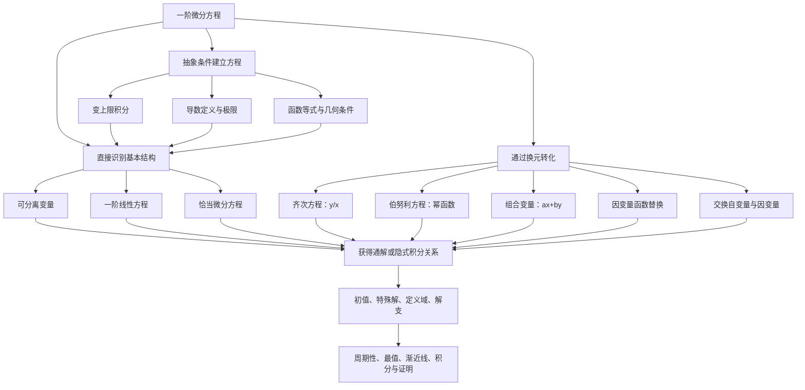
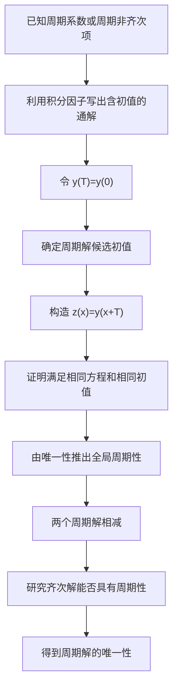
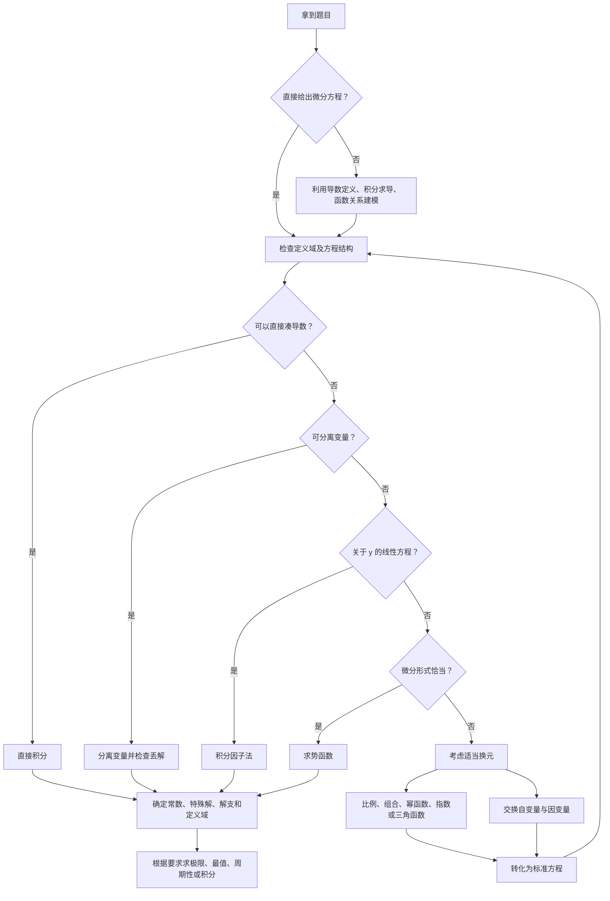

## 一、学习目标与知识体系

**1. 本节究竟要掌握什么？**

一阶微分方程表面上是积分计算题，实质上考查四个层次的能力：

- **识别能力：** 判断一个方程属于什么类型，能否通过换元转化为熟悉的方程。
- **计算能力：** 分离变量、寻找积分因子、凑全微分、计算积分。
- **逻辑能力：** 判断解的存在性、唯一性、定义域、特殊解与解支。
- **综合能力：** 将积分等式、抽象函数、极限、周期性、最值等问题转化为微分方程。

尤其要重视最后两个层次。2018年数学一的周期解证明题，以及2027年李林、张宇综合模拟题，都不能仅依靠背诵求解公式完成。

**2. 本节知识体系总览**

整节最重要的思想是：

**不要机械地记忆十几种方程，而要学会把陌生方程转化为可分离变量方程、一阶线性方程或者可以直接积分的全微分方程。**

## 二、基础概念与解的本质

**2.1 什么是微分方程？**

含有未知函数及其导数的方程，称为微分方程。

例如：

$$
y'=2x
$$

其中未知量不再是一个数，而是一个函数 $y=y(x)$。

积分得到：

$$
y=x^2+C
$$

这说明微分方程的解通常不是一个孤立的函数，而是一族函数。

如果进一步给出条件

$$
y(0)=1
$$

则得到

$$
\boxed{y=x^2+1}
$$

这就是满足给定初始条件的特解。

**2.2 微分方程的几何意义**

考虑

$$
y'=F(x,y)
$$

在平面上的每一点 $(x,y)$，方程都规定了经过这一点的积分曲线应当具有怎样的切线斜率。

因此，求解微分方程就是寻找一条曲线，使它在每一个点的切线斜率都满足方程给出的要求。

初始条件

$$
y(x_0)=y_0
$$

则进一步规定积分曲线必须经过点 $(x_0,y_0)$。

**2.3 阶数、线性与非线性**

微分方程的阶数由其中出现的最高阶导数决定。

| 微分方程               | 阶数 | 类型   |
| ------------------ | -- | ---- |
| $y'+xy=x^2$    | 一阶 | 线性   |
| $y'+xy=0$      | 一阶 | 齐次线性 |
| $y'+xy^2=0$    | 一阶 | 非线性  |
| $2yy'-y^2=2$   | 一阶 | 非线性  |
| $y'=\sin(x+y)$ | 一阶 | 非线性  |
| $y''+2y'+y=0$  | 二阶 | 齐次线性 |

一阶线性微分方程的标准形式为

$$
\boxed{y'+P(x)y=Q(x)}
$$

判断线性的关键是：

未知函数 $y$ 及其导数 $y'$ 都以一次形式出现，且它们的系数仅依赖于自变量 $x$。

注意，$P(x)$ 可以是任意复杂的函数，例如 $e^{x^2}$、$\ln x$、$\sin x$，这并不影响方程的线性性质。

**2.4 通解、特解、隐式解**

一阶微分方程的通解通常含有一个独立的任意常数 $C$。

显式解例如：

$$
y=Ce^{x^2}
$$

隐式解例如：

$$
x^2+y^2=C
$$

隐式解并不一定需要进一步化为 $y=f(x)$。但是，如果给定初始条件，就要判断它对应哪一条函数分支。

例如：

$$
x^2+y^2=4
$$

若给定 $y(0)=2$，则应取

$$
y=\sqrt{4-x^2}
$$

而不是

$$
y=\pm\sqrt{4-x^2}
$$

正根和负根代表不同的积分曲线。

**2.5 解的存在性与唯一性**

这是理解2018年数学一周期解证明题的重要基础。

对于初值问题

$$
\begin{cases} y'=F(x,y),\\ y(x_0)=y_0, \end{cases}
$$

如果 $F(x,y)$ 及 $F_y(x,y)$ 在初始点附近连续，那么该初值问题存在唯一的局部解。

这是一个常用的充分条件，并非必要条件。

对于一阶线性方程

$$
y'+P(x)y=Q(x)
$$

只要 $P(x),Q(x)$ 在区间 $I$ 内连续，则给定 $I$ 内的初值后，解在整个区间 $I$ 上存在且唯一。

由此可以理解：

同一个一阶线性方程的两条不同积分曲线，在系数连续的区间内不能相交。否则，相交点就构成了相同的初始条件，与唯一性矛盾。

## 三、核心求解模型与识别方法

做题时，首先观察方程结构，再决定使用什么方法。

| 观察到的结构                    | 优先使用的方法 | 核心操作                     |
| ------------------------- | ------- | ------------------------ |
| $y'=f(x)g(y)$         | 分离变量法   | 将 $x,y$ 分到两边         |
| $y'+P(x)y=Q(x)$       | 积分因子法   | 凑乘积导数                    |
| $M\,dx+N\,dy=0$     | 全微分法    | 检查 $M_y=N_x$         |
| $y'=F(y/x)$           | 齐次换元法   | 令 $u=y/x$            |
| $y'+Py=Qy^n$          | 伯努利换元法  | 令 $u=y^{1-n}$        |
| $y'=F(ax+by+c)$       | 组合变量法   | 令 $u=ax+by+c$        |
| 同时出现 $2yy'$、$y^2$ | 函数换元法   | 令 $u=y^2$            |
| 右侧分母关于 $x$ 线性         | 逆变量法    | 将 $x$ 看作 $y$ 的函数 |

其中，线性微分方程是最核心的模型。许多看起来很复杂的非线性微分方程，经过适当换元后，最终都变成线性微分方程。

## 四、题型一：可分离变量微分方程

重要程度：★★★★★

**4.1 基础公式及推导**

如果方程可以写成

$$
\frac{dy}{dx}=f(x)g(y)
$$

则称为可分离变量的微分方程。

当 $g(y)\ne0$ 时，将变量分开：

$$
\frac{dy}{g(y)}=f(x)\,dx
$$

两边积分：

$$
\boxed{\int\frac{dy}{g(y)}=\int f(x)\,dx+C}
$$

这里的核心并不是形式上移动 $dx,dy$，而是通过链式求导，将未知函数的复合表达式变成可以积分的结构。

**4.2 必须掌握的特殊解问题**

分离变量时，通常需要除以 $g(y)$。

但是，如果

$$
g(a)=0
$$

那么

$$
y\equiv a
$$

可能就是原方程的一个常值解。

因此，完整解题步骤应当是：

1. 找出被除因子的零点。
2. 在非零情况下分离变量。
3. 积分得到一般解。
4. 补回被遗漏的特殊解。
5. 利用初值确定常数和解支。

**4.3 母题1：1998年考研数学一、数学二真题**

核心题目第026题。

已知函数 $y=y(x)$ 在任意点 $x$ 处的增量满足

$$
\Delta y=\frac{y\Delta x}{1+x^2}+\alpha
$$

其中当 $\Delta x\to0$ 时，

$$
\alpha=o(\Delta x)
$$

且 $y(0)=\pi$，求 $y(1)$。

**第一步：由增量关系还原导数。**

两边除以 $\Delta x$：

$$
\frac{\Delta y}{\Delta x} =\frac{y}{1+x^2} +\frac{\alpha}{\Delta x}
$$

取极限，得到

$$
y'=\frac{y}{1+x^2}
$$

这才是题目隐藏的一阶微分方程。

**第二步：分离变量。**

$$
\frac{dy}{y}=\frac{dx}{1+x^2}
$$

积分：

$$
\ln|y|=\arctan x+C
$$

即

$$
y=C_1e^{\arctan x}
$$

**第三步：代入初值。**

由 $y(0)=\pi$，可得

$$
C_1=\pi
$$

所以

$$
y=\pi e^{\arctan x}
$$

最终

$$
\boxed{y(1)=\pi e^{\pi/4}}
$$

**母题价值：** 题目没有直接给出微分方程，而是考查考生能否通过导数定义将抽象条件转化为微分方程。

**4.4 母题2：李正元练习题第1题——对数换元**

求方程

$$
y'\sin x=y\ln y
$$

满足

$$
y\left(\frac{\pi}{2}\right)=e
$$

的特解。

<Tabs items={["方法一：直接分离变量", "方法二：函数换元"]} defaultIndex={0}>

<Tab value="方法一：直接分离变量">

$$
\frac{dy}{y\ln y} =\frac{dx}{\sin x}
$$

积分：

$$
\ln|\ln y| =\ln\left|\tan\frac{x}{2}\right|+C
$$

因此，在初值所在区间上，

$$
\ln y=C_1\tan\frac{x}{2}
$$

代入初值：

$$
1=C_1
$$

所以

$$
\boxed{y=e^{\tan(x/2)}}
$$

</Tab>

<Tab value="方法二：函数换元">

观察

$$
\frac{y'}{y}=(\ln y)'
$$

令

$$
u=\ln y
$$

原方程变成

$$
u'\sin x=u
$$

这是一个简单的可分离变量方程，也是一阶齐次线性方程。

由初值 $u(\pi/2)=1$，同样得到

$$
u=\tan\frac{x}{2}
$$

**值得注意：** 直接分离变量时除去了 $\ln y$，所以可能遗漏 $y\equiv1$。本题初值已经排除了它，但求所有解时不能遗漏。

</Tab>

</Tabs>

**4.5 常用积分结构**

| 被积函数                        | 原函数（略去积分常数）                                      |
| --------------------------- | ------------------------------------------------ |
| $\dfrac1u$              | $\ln\lvert u\rvert $                                   |
| $\dfrac1{1+u^2}$        | $\arctan u$                                  |
| $\dfrac1{1-u^2}$        | $\dfrac12\ln\left\lvert \dfrac{1+u}{1-u}\right\rvert $ |
| $\dfrac1{\sqrt{1+u^2}}$ | $\ln(u+\sqrt{1+u^2})$                        |
| $\dfrac1{u\ln u}$       | $\ln\lvert \ln u\rvert $                               |
| $\dfrac1{\sin u}$       | $\ln\left\lvert \tan\dfrac u2\right\rvert $            |
| $\dfrac1{\tan u}$       | $\ln\lvert \sin u\rvert $                              |

这些积分在齐次换元、组合变量换元和伯努利方程中也会反复出现。

## 五、题型二：一阶线性微分方程与积分因子

重要程度：★★★★★（本节最重要的知识点）

**5.1 标准形式**

$$
\boxed{y'+P(x)y=Q(x)}
$$

当 $Q(x)\equiv0$ 时，称为一阶齐次线性微分方程。

当 $Q(x)$ 不恒为零时，称为一阶非齐次线性微分方程。

**5.2 积分因子究竟是如何得到的？**

原方程左端为

$$
y'+P(x)y
$$

我们希望它变成某个乘积的导数。

根据乘积求导法则：

$$
(\mu y)'=\mu y'+\mu'y
$$

将原方程乘以 $\mu(x)$，得到

$$
\mu y'+\mu Py=\mu Q
$$

为了让左端成为乘积导数，需要

$$
\mu'=\mu P
$$

因此可以取

$$
\boxed{\mu(x)=e^{\int P(x)\,dx}}
$$

于是

$$
\boxed{(\mu y)'=\mu Q}
$$

两边积分，就得到通解公式：

$$
\boxed{ y=e^{-\int P(x)\,dx} \left[ \int Q(x)e^{\int P(x)\,dx}\,dx+C \right] }
$$

不建议每次都完整默写这一长串公式。

考场上更高效的写法是：

$$
\mu=e^{\int P(x)\,dx}
$$

$$
(\mu y)'=\mu Q
$$

然后直接积分。

**5.3 常见积分因子识别表**

| $P(x)$              | 可选的积分因子 $\mu(x)$        |
| ----------------------- | --------------------------- |
| $a$                 | $e^{ax}$                |
| $\dfrac1x$          | $x$                     |
| $-\dfrac1x$         | $\dfrac1x$              |
| $\dfrac nx$         | $x^n$（适当定义域）            |
| $\dfrac{2x}{1+x^2}$ | $1+x^2$                 |
| $\dfrac{x}{1+x^2}$  | $\sqrt{1+x^2}$          |
| $\dfrac1{x^2}$      | $e^{-1/x}$              |
| $\dfrac n{1-x}$     | $(1-x)^{-n}$（$x<1$） |
| $\dfrac1{2\sqrt x}$ | $e^{\sqrt x}$           |

积分因子乘以非零常数仍然有效，因此在不跨越零点的适当区间上，可以用 $1/x$ 代替 $1/|x|$。

**5.4 初值问题的定积分公式**

对于

$$
y'+P(x)y=Q(x),\qquad y(x_0)=y_0
$$

设

$$
A(x)=\int_{x_0}^xP(t)\,dt
$$

则

$$
\boxed{ y(x)=e^{-A(x)} \left[ y_0+\int_{x_0}^xe^{A(t)}Q(t)\,dt \right] }
$$

这个公式特别适合抽象函数、周期性、积分估计和证明题。

当 $P(x)=a$ 为常数时，还可以写成

$$
\boxed{ y(x)=y_0e^{-a(x-x_0)} +\int_{x_0}^xe^{-a(x-t)}Q(t)\,dt }
$$

其中，第一项是初值产生的齐次项，第二项是非齐次项产生的贡献。

**5.5 母题3：2011年考研数学一、数学二真题**

核心题目第010题。

求

$$
y'+y=e^{-x}\cos x
$$

满足 $y(0)=0$ 的特解。

取积分因子

$$
\mu=e^x
$$

于是

$$
(e^xy)'=\cos x
$$

积分：

$$
e^xy=\sin x+C
$$

代入初值：

$$
C=0
$$

故

$$
\boxed{y=e^{-x}\sin x}
$$

这道题代表最标准的一阶线性微分方程计算题。

命题人特意在右端设置 $e^{-x}$，使其与积分因子 $e^x$ 抵消。遇到这类结构，应立即想到乘积求导，而不是进行复杂的待定系数计算。

**5.6 母题4：2025年考研数学三真题——凑商的导数**

核心题目第006题。

求

$$
xy'-y+x^2e^x=0
$$

满足 $y(1)=-e$ 的解。

观察：

$$
\left(\frac yx\right)' =\frac{xy'-y}{x^2}
$$

因此，在 $x>0$ 上，

$$
\left(\frac yx\right)'=-e^x
$$

积分：

$$
\frac yx=-e^x+C
$$

由 $y(1)=-e$，得到 $C=0$。

所以

$$
\boxed{y=-xe^x}
$$

**推广：一类极其重要的母题结构**

以下方程都应优先凑商的导数：

$$
xy'-y=f(x)
$$

$$
xy'-ny=f(x)
$$

$$
(x-a)y'-y=f(x)
$$

关键公式：

$$
\boxed{ \left(\frac{y}{x^n}\right)' =\frac{xy'-ny}{x^{n+1}} }
$$

一旦识别这个公式，很多线性微分方程都可以直接积分，不必重新推导积分因子。

## 六、题型三：恰当微分方程与全微分结构

重要程度：★★★★☆

**6.1 核心原理**

设

$$
M(x,y)\,dx+N(x,y)\,dy=0
$$

如果存在二元函数 $F(x,y)$，使得

$$
dF=M\,dx+N\,dy
$$

即

$$
F_x=M,\qquad F_y=N
$$

那么原方程就是

$$
dF=0
$$

从而沿着积分曲线，

$$
\boxed{F(x,y)=C}
$$

这种方法将微分方程转化为求一个二元函数的全微分。

**6.2 如何判断恰当性？**

若 $M,N$ 在单连通开区域内具有连续的一阶偏导数，则恰当性的判定条件是

$$
\boxed{M_y=N_x}
$$

对于一般区域，这个条件至少保证局部恰当性，但不一定保证存在全局统一的势函数。

这与数学一后续的第二类曲线积分、格林公式、积分与路径无关等知识直接相通。

**6.3 标准求解步骤**

由

$$
F_x=M(x,y)
$$

对 $x$ 积分：

$$
F(x,y)=\int M(x,y)\,dx+h(y)
$$

注意，关于 $x$ 积分时，积分常数应当写成 $h(y)$，而不是普通常数 $C$。

然后对 $y$ 求偏导：

$$
F_y= \frac{\partial}{\partial y} \left(\int M(x,y)\,dx\right)+h'(y)
$$

再利用 $F_y=N$ 确定 $h(y)$。

最后令 $F(x,y)=C$。

**6.4 母题5：2025年考研数学二真题**

核心题目第001题。

求

$$
(2y-3x)\,dx+(2x-5y)\,dy=0
$$

满足 $y(1)=1$ 的解。

<Tabs items={["方法一：判断恰当性", "方法二：直接凑全微分"]} defaultIndex={0}>

<Tab value="方法一：判断恰当性">

令

$$
M=2y-3x,\qquad N=2x-5y
$$

则

$$
M_y=2=N_x
$$

因此为恰当微分方程。

由

$$
F_x=2y-3x
$$

积分得到

$$
F=2xy-\frac32x^2+h(y)
$$

另一方面，

$$
F_y=2x+h'(y)=2x-5y
$$

所以

$$
h'(y)=-5y
$$

$$
h(y)=-\frac52y^2
$$

于是

$$
2xy-\frac32x^2-\frac52y^2=C
$$

代入初值 $(1,1)$，最终得到

$$
\boxed{3x^2+5y^2-4xy=4}
$$

</Tab>

<Tab value="方法二：直接凑全微分">

观察到

$$
2y\,dx+2x\,dy=d(2xy)
$$

$$
-3x\,dx=d\left(-\frac32x^2\right)
$$

$$
-5y\,dy=d\left(-\frac52y^2\right)
$$

因此可直接写出积分关系。

</Tab>

</Tabs>

**6.5 母题6：李林880题第011题——复合乘积微分**

核心题目第003题。

求

$$
(1+e^{x/y})\,dx +e^{x/y}\left(1-\frac xy\right)\,dy=0
$$

其中 $y>0$。

首先观察，题目含有 $e^{x/y}$ 和 $1-x/y$。

考虑函数

$$
F(x,y)=ye^{x/y}
$$

计算全微分：

$$
\begin{aligned} d(ye^{x/y}) &=e^{x/y}\,dy+ye^{x/y}\,d(x/y)\\ &=e^{x/y}\,dx +e^{x/y}\left(1-\frac xy\right)\,dy \end{aligned}
$$

所以原方程就是

$$
d(x+ye^{x/y})=0
$$

故

$$
\boxed{x+ye^{x/y}=C}
$$

**重要推广**

对于任意可导函数 $f$，有

$$
\boxed{ d\left[yf\left(\frac xy\right)\right] =f'\left(\frac xy\right)\,dx +\left[ f\left(\frac xy\right) -\frac xyf'\left(\frac xy\right) \right]dy }
$$

同理，

$$
\boxed{ d\left[xf\left(\frac yx\right)\right] =\left[ f\left(\frac yx\right) -\frac yxf'\left(\frac yx\right) \right]dx +f'\left(\frac yx\right)\,dy }
$$

这是理解许多模拟题中复杂齐次结构的关键公式。

**6.6 常见的全微分结构**

| 题目中的结构                   | 对应的全微分                         |
| ------------------------ | ------------------------------ |
| $y\,dx+x\,dy$      | $d(xy)$                    |
| $x\,dx+y\,dy$      | $\frac12d(x^2+y^2)$        |
| $x\,dy-y\,dx$      | $x^2d(y/x)$                |
| $x\,dy-y\,dx$      | $(x^2+y^2)d(\arctan(y/x))$ |
| $y^2dx+2xy\,dy$     | $d(xy^2)$                  |
| $ye^x\,dx+e^x\,dy$ | $d(ye^x)$                  |

凑微分的能力，本质上是逆向使用一元、二元函数求导公式。

**6.7 补充：如果不是恰当方程怎么办？**

若

$$
M_y\ne N_x
$$

可以检查是否存在仅依赖于 $x$ 或仅依赖于 $y$ 的积分因子。

若

$$
\frac{M_y-N_x}{N}=f(x)
$$

只依赖于 $x$，则可以取

$$
\mu(x)=e^{\int f(x)\,dx}
$$

若

$$
\frac{N_x-M_y}{M}=g(y)
$$

只依赖于 $y$，则可以取

$$
\mu(y)=e^{\int g(y)\,dy}
$$

上述比值需在相应分母非零的区域上讨论。

这是一个拓展技巧，不必作为本节最优先记忆的内容。遇到非恰当方程时，通常先检查能否用齐次换元、分离变量或线性化处理。

## 七、题型四：齐次微分方程

重要程度：★★★★★

**7.1 什么是齐次微分方程？**

这里的齐次微分方程是指

$$
\boxed{y'=F\left(\frac yx\right)}
$$

必须注意，它与一阶齐次线性微分方程

$$
y'+P(x)y=0
$$

不是同一个概念。

前者的核心是变量比例，后者的核心是非齐次项为零。

**7.2 识别技巧**

当右端出现下列结构时，应优先考虑齐次换元：

$$
\frac{x+y}{x-y}
$$

$$
\frac{x^2+y^2}{xy}
$$

$$
\ln x-\ln y
$$

$$
\frac{\sqrt{x^2+y^2}}x
$$

它们经过化简，通常都可以转化为关于 $y/x$ 的表达式。在含根式时还要注意 $x$ 的正负。

**7.3 标准换元公式**

令

$$
u=\frac yx
$$

则

$$
y=xu
$$

$$
y'=u+xu'
$$

代入方程：

$$
u+xu'=F(u)
$$

所以

$$
xu'=F(u)-u
$$

分离变量：

$$
\boxed{ \frac{du}{F(u)-u}=\frac{dx}{x} }
$$

如果

$$
F(c)=c
$$

那么还要考虑特殊解

$$
\boxed{y=cx}
$$

这就是齐次换元中经常被遗漏的直线解。

**7.4 母题7：2014年考研数学一真题**

核心题目第017题。

求

$$
xy'+y(\ln x-\ln y)=0
$$

满足 $y(1)=e^3$ 的解。

**第一步：判断结构。**

$$
\ln x-\ln y=-\ln\frac yx
$$

所以应令

$$
u=\frac yx>0
$$

则

$$
y=xu,\qquad y'=u+xu'
$$

代入：

$$
x(u+xu')-xu\ln u=0
$$

整理：

$$
xu'=u(\ln u-1)
$$

**第二步：进行第二次换元。**

由于同时出现 $u'/u$ 和 $\ln u$，令

$$
v=\ln u
$$

则

$$
v'=\frac{u'}u
$$

得到

$$
xv'=v-1
$$

令 $w=v-1$，则

$$
xw'=w
$$

故

$$
w=Cx
$$

从而

$$
v=1+Cx
$$

$$
u=e^{1+Cx}
$$

还原：

$$
y=xe^{1+Cx}
$$

**第三步：代入初值。**

$$
e^3=e^{1+C}
$$

所以 $C=2$。

最终

$$
\boxed{y=xe^{2x+1}},\qquad x>0
$$

**这道真题的核心价值是连续换元。** 第一次换元解决变量比例，第二次换元解决对数结构。复杂方程可以通过多次简单变换逐层化解。

**7.5 母题8：1999年考研数学二真题——根式齐次方程**

核心题目第024题。

求

$$
(y+\sqrt{x^2+y^2})\,dx-x\,dy=0
$$

其中 $x>0$，且 $y(1)=0$。

整理：

$$
y'=\frac yx+\frac{\sqrt{x^2+y^2}}x
$$

令

$$
u=\frac yx
$$

由于 $x>0$，

$$
\sqrt{x^2+y^2}=x\sqrt{1+u^2}
$$

所以

$$
u+xu'=u+\sqrt{1+u^2}
$$

即

$$
\frac{du}{\sqrt{1+u^2}}=\frac{dx}{x}
$$

积分：

$$
\ln(u+\sqrt{1+u^2})=\ln x+C
$$

由 $u(1)=0$，得到 $C=0$。

因此

$$
u+\sqrt{1+u^2}=x
$$

于是

$$
\sqrt{1+u^2}=x-u
$$

平方化简：

$$
u=\frac{x^2-1}{2x}
$$

还原：

$$
\boxed{y=\frac{x^2-1}{2}}
$$

根式齐次方程的常见陷阱是：

$$
\sqrt{x^2}=|x|
$$

而不是无条件等于 $x$。

本题给出 $x>0$，正是为了保证上述根式处理成立。

**7.6 延伸练习：李林880题第009题**

$$
y'=\frac yx+\tan\frac yx, \qquad y(1)=\frac{\pi}{6}
$$

令 $u=y/x$，得到

$$
xu'=\tan u
$$

因此

$$
\cot u\,du=\frac{dx}{x}
$$

积分：

$$
\ln|\sin u|=\ln|x|+C
$$

代入初值，得到

$$
\boxed{\sin\frac yx=\frac x2}
$$

如果要求显式解，则应选择初值对应的反正弦分支：

$$
\boxed{y=x\arcsin\frac x2},\qquad 0<x<2
$$

这里 $x=2$ 不能作为经典解区间的端点包含进来，因为此时原方程中的正切函数无定义。

## 八、题型五：伯努利方程与因变量函数替换

重要程度：★★★★★

这一类问题的核心是：**通过改变未知函数的形式，把非线性方程变成线性方程。**

**8.1 伯努利方程**

标准形式：

$$
\boxed{y'+P(x)y=Q(x)y^n}
$$

其中 $n\ne0,1$。

两边除以 $y^n$，得到

$$
y^{-n}y'+Py^{1-n}=Q
$$

令

$$
\boxed{u=y^{1-n}}
$$

则

$$
u'=(1-n)y^{-n}y'
$$

所以原方程化为

$$
\boxed{ u'+(1-n)P(x)u=(1-n)Q(x) }
$$

这已经是一阶线性微分方程。

**8.2 常见幂次与换元**

| 原方程中的非线性项     | 换元              |
| ------------- | --------------- |
| $y^2$     | $u=1/y$     |
| $y^3$     | $u=1/y^2$   |
| $\sqrt y$ | $u=\sqrt y$ |
| $1/y$     | $u=y^2$     |
| $1/y^2$   | $u=y^3$     |

不要机械地使用公式。很多时候直接观察链式求导结构会更快。

**8.3 母题9：1993年考研数学一真题**

核心题目第020题。

求

$$
x^2y'+xy=y^2
$$

满足 $y(1)=1$ 的特解。

**方法一：伯努利换元。**

整理：

$$
y'+\frac1xy=\frac1{x^2}y^2
$$

这是 $n=2$ 的伯努利方程。

令

$$
u=\frac1y
$$

则

$$
u'=-\frac{y'}{y^2}
$$

将原方程除以 $y^2$：

$$
-x^2u'+xu=1
$$

即

$$
u'-\frac1xu=-\frac1{x^2}
$$

乘积分因子 $1/x$：

$$
\left(\frac ux\right)'=-\frac1{x^3}
$$

积分：

$$
\frac ux=\frac1{2x^2}+C
$$

即

$$
u=\frac1{2x}+Cx
$$

由 $u(1)=1$，得到

$$
C=\frac12
$$

故

$$
\boxed{y=\frac{2x}{1+x^2}}
$$

**方法二：齐次换元。**

原方程也可以写成

$$
y'=\left(\frac yx\right)^2-\frac yx
$$

令 $v=y/x$，则

$$
v+xv'=v^2-v
$$

从而

$$
xv'=v(v-2)
$$

分离变量也能得到相同结果。

但这种方法需要进行部分分式积分，而倒数换元直接得到线性方程，因此优先推荐方法一。

**丢解检查：** 原方程还有 $y=0$ 与 $y=2x$ 两个简单解，不过均不符合本题给出的初值。

**8.4 母题10：2019年考研数学一真题**

核心题目第016题。

求

$$
2yy'-y^2-2=0
$$

满足 $y(0)=1$ 的特解。

观察：

$$
(y^2)'=2yy'
$$

直接令

$$
u=y^2
$$

原方程变为

$$
u'-u=2
$$

乘积分因子 $e^{-x}$：

$$
(e^{-x}u)'=2e^{-x}
$$

积分：

$$
u=Ce^x-2
$$

由 $y(0)=1$ 知 $u(0)=1$，所以

$$
C=3
$$

还原：

$$
y^2=3e^x-2
$$

根据初值 $y(0)=1>0$，选取正根：

$$
\boxed{y=\sqrt{3e^x-2}}
$$

**进一步考查：最大解区间**

根号内部必须严格为正：

$$
3e^x-2>0
$$

因此

$$
\boxed{x\in\left(\ln\frac23,+\infty\right)}
$$

为什么不能包含左端点？

因为在该点 $y=0$，代入原方程将得到

$$
0-0-2=0
$$

显然不成立。

所以，判断解区间不能仅看表达式有没有定义，还要看它是否真正满足原微分方程。

**8.5 母题11：李林880题第041题——正切换元**

核心题目第022题。

求

$$
y'\sec^2y+\frac{x}{1+x^2}\tan y=x
$$

满足 $y(0)=0$ 的特解。

观察：

$$
(\tan y)'=y'\sec^2y
$$

令

$$
u=\tan y
$$

得到

$$
u'+\frac{x}{1+x^2}u=x
$$

积分因子为

$$
\mu=\sqrt{1+x^2}
$$

所以

$$
(u\sqrt{1+x^2})' =x\sqrt{1+x^2}
$$

积分：

$$
u\sqrt{1+x^2} =\frac13(1+x^2)^{3/2}+C
$$

由 $u(0)=0$，得到 $C=-1/3$。

所以

$$
\tan y=\frac13 \left(1+x^2-\frac1{\sqrt{1+x^2}}\right)
$$

由初值确定反正切主值分支：

$$
\boxed{ y=\arctan\left[ \frac{1+x^2-(1+x^2)^{-1/2}}3 \right] }
$$

**8.6 更一般的换元模型**

遇到

$$
\varphi'(y)y'+P(x)\varphi(y)=Q(x)
$$

直接令

$$
\boxed{u=\varphi(y)}
$$

就可以化为

$$
u'+P(x)u=Q(x)
$$

这比伯努利方程更一般，也是应对创新题的重要方法。

| 导数结构                    | 应想到的变量          |
| ----------------------- | --------------- |
| $2yy'$              | $y^2$       |
| $\dfrac{y'}y$       | $\ln\lvert y\rvert $  |
| $-\dfrac{y'}{y^2}$  | $1/y$       |
| $e^yy'$             | $e^y$       |
| $y'\cos y$          | $\sin y$    |
| $-y'\sin y$         | $\cos y$    |
| $y'\sec^2y$         | $\tan y$    |
| $\dfrac{y'}{1+y^2}$ | $\arctan y$ |

张宇1000题第006题就是典型变式：

$$
y'=(x+1)\sec y-\tan y
$$

两边乘以 $\cos y$，得到

$$
y'\cos y+\sin y=x+1
$$

令 $u=\sin y$，则

$$
u'+u=x+1
$$

从而

$$
\boxed{\sin y=x+Ce^{-x}}
$$

最后还应限制在满足原方程定义域的连续分支上，特别是 $\cos y\ne0$。

## 九、题型六：组合变量替换

重要程度：★★★★★

这是2024年数学一真题以及2027年张宇模拟题共同考查的重点。

**9.1 标准模型**

如果方程具有形式

$$
y'=F(ax+by+c)
$$

令

$$
\boxed{u=ax+by+c}
$$

则

$$
u'=a+by'
$$

代入：

$$
u'=a+bF(u)
$$

因此

$$
\boxed{ \frac{du}{a+bF(u)}=dx }
$$

这是可分离变量方程。

与齐次换元类似，如果

$$
a+bF(u_0)=0
$$

则 $u\equiv u_0$ 可能对应原方程的一条特殊直线解。

**9.2 母题12：2024年考研数学一、数学二真题**

核心题目第002题。

求

$$
y'=\frac1{(x+y)^2}
$$

满足 $y(1)=0$ 的解。

<Tabs items={["方法一：组合变量替换", "方法二：交换自变量和因变量"]} defaultIndex={0}>

<Tab value="方法一：组合变量替换">

令

$$
u=x+y
$$

则

$$
u'=1+y'=1+\frac1{u^2}
$$

于是

$$
\frac{dx}{du}=\frac{u^2}{1+u^2} =1-\frac1{1+u^2}
$$

积分：

$$
x=u-\arctan u+C
$$

代回 $u=x+y$：

$$
y=\arctan(x+y)-C
$$

由 $y(1)=0$，得到

$$
C=\frac\pi4
$$

所以

$$
\boxed{ y+\frac\pi4=\arctan(x+y) }
$$

</Tab>

<Tab value="方法二：交换自变量和因变量">

因为在初值点附近，

$$
y'=\frac1{(x+y)^2}>0
$$

所以可以写成

$$
\frac{dx}{dy}=(x+y)^2
$$

再令 $u=x+y$，但此时关于 $y$ 求导：

$$
\frac{du}{dy}=1+u^2
$$

分离变量：

$$
\frac{du}{1+u^2}=dy
$$

立即得到

$$
\arctan u=y+C
$$

后一种方法的积分更加简单。

**这道题给出的重要启示：** 如果直接求 $dy/dx$ 不方便，可以考虑 $dx/dy$。选择自变量并不是固定不变的。

</Tab>

</Tabs>

**9.3 母题13：李正元练习题第19题——组合换元与特殊解**

求

$$
y'=\frac{2x-y+1}{2x-y-1}
$$

的通解。

令

$$
u=2x-y
$$

则

$$
u'=2-y' =2-\frac{u+1}{u-1} =\frac{u-3}{u-1}
$$

当 $u\ne3$ 时，

$$
\frac{dx}{du} =\frac{u-1}{u-3} =1+\frac2{u-3}
$$

积分：

$$
x=u+2\ln|u-3|+C
$$

代回：

$$
\boxed{ y-x-2\ln|2x-y-3|=C }
$$

但是，刚才除去了 $u-3$，必须单独检查

$$
u=3
$$

它对应

$$
\boxed{y=2x-3}
$$

代入原方程，左右两边均为2，所以确实是一个解。

因此本题答案必须包括一般积分关系，以及这条不能被对数形式包含的特殊解。

**9.4 进阶模型：一次式之比**

若方程为

$$
y'=\frac{a_1x+b_1y+c_1} {a_2x+b_2y+c_2}
$$

要看分子、分母的一次部分是否成比例。

若成比例，通常可以直接设组合变量

$$
u=ax+by
$$

若不成比例，即

$$
a_1b_2-a_2b_1\ne0
$$

可以先求两条直线的交点 $(h,k)$，再令

$$
X=x-h,\qquad Y=y-k
$$

消除常数项，使原方程变成

$$
\frac{dY}{dX} =\frac{a_1X+b_1Y}{a_2X+b_2Y}
$$

最后作齐次换元

$$
u=\frac YX
$$

这种平移与齐次换元结合的方法，可用于处理不符合直接换元条件的新题。

## 十、题型七：逆变量法

重要程度：★★★★☆

**10.1 什么时候交换自变量与因变量？**

如果一个方程作为 $y(x)$ 的方程不是线性的，但改成 $x(y)$ 后却具有形式

$$
\frac{dx}{dy}+P(y)x=Q(y)
$$

那么应当优先交换变量。

交换变量的基础是，在可逆的局部解支上，

$$
\boxed{ \frac{dx}{dy}=\frac1{dy/dx} }
$$

普通情况下需要 $y'\ne0$，并满足相应的可逆性条件。

**10.2 母题14：李林880题第037题**

核心题目第004题。

求

$$
y'=\frac{y}{x+(y+1)^2}
$$

的非恒定解。

直接看作 $y(x)$ 的方程较复杂，但交换变量后：

$$
\frac{dx}{dy} =\frac{x+(y+1)^2}{y}
$$

整理：

$$
\frac{dx}{dy}-\frac xy =\frac{(y+1)^2}{y}
$$

成为关于 $x(y)$ 的一阶线性方程。

乘积分因子 $1/y$：

$$
\left(\frac xy\right)'_y =\frac{(y+1)^2}{y^2}
$$

展开：

$$
\left(\frac xy\right)'_y =1+\frac2y+\frac1{y^2}
$$

积分：

$$
\frac xy=y+2\ln|y|-\frac1y+C
$$

所以

$$
\boxed{x=y^2+2y\ln|y|-1+Cy}
$$

这里必须使用 $\ln|y|$，而不能无条件写成 $\ln y$，因为题目没有限定 $y>0$。

另外，交换变量时排除了 $y=0$。事实上 $y\equiv0$ 在原分母非零的区间内是一个常值解，不过题设已经排除了常函数。

**10.3 逆变量法常见结构**

下列结构都值得尝试将 $x$ 看作 $y$ 的函数：

$$
y'=\frac{f(y)}{a(y)x+b(y)}
$$

$$
[a(y)x+b(y)]y'=c(y)
$$

$$
a(y)\,dx+[b(y)x+c(y)]\,dy=0
$$

交换后通常成为线性方程。

**10.4 进阶练习：张宇1000题第004题**

求

$$
(2x-3xy^2-y^3)y'+y^3=0
$$

的通解。

交换变量：

$$
\frac{dx}{dy} =1+\left(\frac3y-\frac2{y^3}\right)x
$$

即

$$
\frac{dx}{dy} +\left(\frac2{y^3}-\frac3y\right)x=1
$$

可取积分因子

$$
\mu(y)=y^{-3}e^{-1/y^2}
$$

于是

$$
(xy^{-3}e^{-1/y^2})' =y^{-3}e^{-1/y^2}
$$

积分：

$$
xy^{-3}e^{-1/y^2} =\frac12e^{-1/y^2}+C
$$

所以

$$
\boxed{x=\frac12y^3+Cy^3e^{1/y^2}}
$$

另有

$$
\boxed{y\equiv0}
$$

这个题型的难点不在求积分，而在于一开始能否识别出正确的变量方向。

## 第二部分：一阶线性微分方程的性质与证明题

到目前为止，学习的是如何求微分方程的解。接下来要掌握的是如何研究解本身的性质。

这是数学一区别于简单计算训练的重要部分，也是本节最值得深入理解的内容。

### 十一、线性微分方程解的结构

重要程度：★★★★★

**11.1 齐次方程的解**

对于

$$
y'+P(x)y=0
$$

其全部解为

$$
\boxed{y=Ce^{-\int P(x)\,dx}}
$$

其中 $C=0$ 给出零解。

由此可以推出，在 $P(x)$ 连续的区间内：

非零解不会等于零；非零解不会改变符号；任意两个非零解的比值为常数。

例如，如果一个齐次线性方程的解满足 $y(x_0)=0$，则它只能是

$$
y(x)\equiv0
$$

**11.2 非齐次方程的解结构**

设

$$
L[y]=y'+P(x)y
$$

则 $L$ 为线性微分算子，满足

$$
L[\lambda y_1+\mu y_2] =\lambda L[y_1]+\mu L[y_2]
$$

若 $y_1,y_2$ 是同一非齐次方程

$$
L[y]=Q
$$

的两个特解，那么

$$
L[y_1-y_2]=Q-Q=0
$$

所以

$$
\boxed{\text{两个非齐次特解之差是齐次方程的解}}
$$

进一步有

$$
\boxed{y_{\text{通解}}=y_p+y_h}
$$

其中 $y_p$ 是任意一个非齐次特解，$y_h$ 是对应齐次方程的通解。

**11.3 非齐次解的线性组合**

若 $y_1,y_2$ 都满足

$$
y'+P(x)y=Q(x)
$$

且 $Q(x)\not\equiv0$，则

$$
\lambda y_1+\mu y_2
$$

仍是原非齐次方程的解，当且仅当

$$
\boxed{\lambda+\mu=1}
$$

而它是对应齐次方程的解，当且仅当

$$
\boxed{\lambda+\mu=0}
$$

特别地，

$$
\frac{y_1+y_2}{2}
$$

仍是非齐次方程的特解，但 $y_1+y_2$ 通常不是。

**11.4 母题15：2016年考研数学一真题**

核心题目第008题。

已知

$$
y_1=(1+x^2)^2-\sqrt{1+x^2}
$$

$$
y_2=(1+x^2)^2+\sqrt{1+x^2}
$$

是

$$
y'+p(x)y=q(x)
$$

的两个解，求 $q(x)$。

**第一步：两解相减。**

$$
y_h=y_2-y_1=2\sqrt{1+x^2}
$$

它是对应齐次方程的解，因此

$$
y_h'+p(x)y_h=0
$$

于是

$$
p(x)=-\frac{y_h'}{y_h} =-\frac{x}{1+x^2}
$$

**第二步：取两个解的平均值。**

$$
y_p=\frac{y_1+y_2}{2}=(1+x^2)^2
$$

由于它也是原非齐次方程的解，

$$
q(x)=y_p'+p(x)y_p
$$

即

$$
\begin{aligned} q(x) &=4x(1+x^2) -\frac{x}{1+x^2}(1+x^2)^2\\ &=3x(1+x^2) \end{aligned}
$$

因此

$$
\boxed{q(x)=3x(1+x^2)}
$$

**11.5 反求微分方程的万能模板**

已知两个不同特解 $y_1,y_2$，要求原方程的系数。

在系数连续的共同区间内，令

$$
w=y_1-y_2
$$

由于它是非零齐次解，

$$
\boxed{ P(x)=-\frac{w'(x)}{w(x)} }
$$

然后

$$
\boxed{ Q(x)=y_1'(x)+P(x)y_1(x) }
$$

例如，2016年数学二真题给出

$$
y_1=x^2-e^x,\qquad y_2=x^2
$$

直接相减可得对应齐次解 $e^x$，因此 $P=-1$。

将 $y_2=x^2$ 代入：

$$
\boxed{y'-y=2x-x^2}
$$

这种题完全不需要求解微分方程，只需要利用解的结构。

**11.6 创新变式：解结构与最值**

李林880题第034题。

已知 $y_1,y_2$ 是同一非齐次线性微分方程的两个解，且

$$
\lambda y_1+\mu y_2
$$

也是该方程的解，求

$$
e^{\lambda^3+\mu^3}
$$

的最小值。

利用线性结构立即得到

$$
\lambda+\mu=1
$$

所以

$$
\begin{aligned} \lambda^3+\mu^3 &=(\lambda+\mu)^3-3\lambda\mu(\lambda+\mu)\\ &=1-3\lambda\mu\\ &=1-3\lambda(1-\lambda)\\ &=3\left(\lambda-\frac12\right)^2+\frac14 \end{aligned}
$$

故

$$
\boxed{\min e^{\lambda^3+\mu^3}=e^{1/4}}
$$

当

$$
\lambda=\mu=\frac12
$$

时取得最小值。

这是微分方程性质与基本最值问题结合的典型方式。

### 十二、周期解问题：2018年数学一核心证明题

重要程度：★★★★★（必须独立掌握）

**12.1 基础理解**

如果微分方程的非齐次项是周期函数，那么方程的解是否一定也是周期函数？

答案是不一定。

例如

$$
y'+y=\sin x
$$

其通解为

$$
y=\frac{\sin x-\cos x}{2}+Ce^{-x}
$$

当 $C\ne0$ 时，指数项破坏了周期性。

所以周期系数或周期非齐次项，并不能直接推出所有解都是周期解。

**12.2 母题16：2018年考研数学一真题**

核心题目第007题。

设

$$
y'+y=f(x)
$$

其中 $f$ 是实轴上的连续函数。

（1）当 $f(x)=x$ 时，求通解。

（2）若 $f(x)$ 以 $T>0$ 为周期，证明方程存在唯一的以 $T$ 为周期的解。

**第一问：求通解**

乘积分因子 $e^x$：

$$
(e^xy)'=xe^x
$$

积分：

$$
e^xy=(x-1)e^x+C
$$

所以

$$
\boxed{y=x-1+Ce^{-x}}
$$

**第二问：证明存在性**

方程通解可写成

$$
y(x)=e^{-x} \left[C+\int_0^xe^tf(t)\,dt\right]
$$

设 $y(0)=C$。

如果 $y$ 是 $T$ 周期函数，必须满足

$$
y(T)=y(0)
$$

即

$$
e^{-T} \left[C+\int_0^Te^tf(t)\,dt\right]=C
$$

整理：

$$
(e^T-1)C=\int_0^Te^tf(t)\,dt
$$

由于 $T>0$，所以 $e^T-1\ne0$。

因此可以唯一确定

$$
\boxed{ C=\frac{\displaystyle\int_0^Te^tf(t)\,dt} {e^T-1} }
$$

但是，到这里还没有完成证明。

因为 $y(T)=y(0)$ 只是周期性的必要条件。

**第三步：证明全局周期性。**

令

$$
z(x)=y(x+T)
$$

则

$$
z'(x)+z(x)=f(x+T)=f(x)
$$

因此 $z(x)$ 和 $y(x)$ 满足同一微分方程。

同时，

$$
z(0)=y(T)=y(0)
$$

根据一阶线性初值问题的唯一性，

$$
z(x)=y(x)
$$

所以

$$
\boxed{y(x+T)=y(x)}
$$

这才证明了周期解确实存在。

**第四步：证明唯一性。**

假设 $y_1,y_2$ 都是周期解。

令

$$
w=y_1-y_2
$$

则

$$
w'+w=0
$$

所以

$$
w(x)=Ce^{-x}
$$

又因为 $w$ 具有周期 $T$，所以

$$
Ce^{-(x+T)}=Ce^{-x}
$$

即

$$
C(e^{-T}-1)=0
$$

由于 $e^{-T}\ne1$，只能有 $C=0$。

因此

$$
y_1\equiv y_2
$$

唯一性得证。

**12.3 这道真题必须提炼出的证明模板**

考试中最容易失分的地方，就是只证明两个端点函数值相等，却没有证明整个函数具有周期性。

**12.4 张宇1000题第039题——齐次方程的周期性**

若微分方程

$$
y'+(a+\sin^2x)y=0
$$

的所有解都以 $\pi$ 为周期，求 $a$。

通解为

$$
y=C\exp\left[ -\left(a+\frac12\right)x+\frac14\sin2x \right]
$$

对于非零解，

$$
\frac{y(x+\pi)}{y(x)} =e^{-\pi(a+1/2)}
$$

周期性要求

$$
e^{-\pi(a+1/2)}=1
$$

所以

$$
\boxed{a=-\frac12}
$$

实际上，不必求出完整通解，只需要研究经过一个周期后解的倍率。

对于

$$
y'+P(x)y=0
$$

若 $P$ 是 $T$ 周期连续函数，则

$$
\frac{y(x+T)}{y(x)} =\exp\left(-\int_0^TP(t)\,dt\right)
$$

由此得到重要结论：

$$
\boxed{ \text{所有解具有周期 }T \iff \int_0^TP(t)\,dt=0 }
$$

**12.5 高阶拓展：一般周期线性方程**

设

$$
y'+P(x)y=Q(x)
$$

其中 $P,Q$ 都是 $T$ 周期连续函数。

记

$$
A(x)=\int_0^xP(t)\,dt
$$

$$
B=\int_0^Te^{A(t)}Q(t)\,dt
$$

通解为

$$
y(x)=e^{-A(x)} \left[C+\int_0^xe^{A(t)}Q(t)\,dt\right]
$$

令 $y(T)=y(0)$，得到

$$
\boxed{(e^{A(T)}-1)C=B}
$$

于是周期解分三种情况。

| 条件                   | 周期解情况             |
| -------------------- | ----------------- |
| $A(T)\ne0$       | 存在唯一的 $T$ 周期解 |
| $A(T)=0,\ B=0$   | 所有解均具有周期 $T$  |
| $A(T)=0,\ B\ne0$ | 不存在 $T$ 周期解   |

这就是2018年数学一真题的完整推广。

**12.6 原创综合变式**

考虑核心题目第031题：

$$
y'+ay=\sin x
$$

其通解为

$$
y=\frac{a\sin x-\cos x}{a^2+1}+Ce^{-ax}
$$

当 $a\ne0$ 时，只有 $C=0$ 才能使解具有周期 $2\pi$，所以存在唯一的周期解。

当 $a=0$ 时，

$$
y=C-\cos x
$$

所有解都具有周期 $2\pi$。

现在进一步修改右端：

$$
y'+ay=1+\sin x
$$

当 $a=0$ 时，

$$
y=x-\cos x+C
$$

由于含有线性增长项 $x$，不存在周期解。

这两个变式正好覆盖周期解存在、唯一、无解的各种情形。

注意：这里的周期指 $T$ 是函数的一个周期，不一定是最小正周期。

### 十三、线性微分方程与不等式、极限

重要程度：★★★★★

**13.1 母题17：张宇1000题第010题——抽象函数积分估计**

核心题目第014题。

设 $\varphi(x)$ 连续，且

$$
|\varphi(x)|\le k
$$

求

$$
y'+y=\varphi(x),\qquad y(0)=0
$$

的特解，并证明当 $x\ge0$ 时，

$$
|y(x)|\le k(1-e^{-x})
$$

**第一步：求抽象函数形式的解。**

乘积分因子：

$$
(e^xy)'=e^x\varphi(x)
$$

由初值：

$$
\boxed{ y(x)=e^{-x}\int_0^xe^t\varphi(t)\,dt }
$$

注意，右端函数未知，并不意味着微分方程无法求解。用定积分表达就是完整的答案。

**第二步：利用积分不等式。**

当 $x\ge0$ 时，

$$
\begin{aligned} |y(x)| &\le e^{-x}\int_0^xe^t|\varphi(t)|\,dt\\ &\le ke^{-x}\int_0^xe^t\,dt\\ &=k(1-e^{-x}) \end{aligned}
$$

于是

$$
\boxed{|y(x)|\le k(1-e^{-x})}
$$

**13.2 一般估计公式**

对于

$$
y'+ay=f(x),\qquad y(0)=y_0
$$

若 $a>0$，且 $|f(x)|\le M$，则对 $x\ge0$，

$$
y(x)=y_0e^{-ax} +\int_0^xe^{-a(x-t)}f(t)\,dt
$$

所以

$$
\boxed{ |y(x)| \le |y_0|e^{-ax} +\frac Ma(1-e^{-ax}) }
$$

这说明初值的影响会逐渐衰减，而非齐次项对解的影响受到控制。

**13.3 李林880题第007题——无穷远极限**

设

$$
\lim_{x\to+\infty}f(x)=b\ne0
$$

且 $a>0$，求方程

$$
y'+ay=f(x)
$$

任一解的水平渐近线。

由通解公式：

$$
y(x)=Ce^{-ax} +e^{-ax}\int_0^xe^{at}f(t)\,dt
$$

当 $x\to+\infty$ 时，第一项趋于零。

第二项写成

$$
\frac{\displaystyle\int_0^xe^{at}f(t)\,dt} {e^{ax}}
$$

由于 $b\ne0$，可以判断分子最终趋于正无穷或负无穷，应用洛必达法则：

$$
\lim_{x\to+\infty} \frac{\int_0^xe^{at}f(t)\,dt}{e^{ax}} = \lim_{x\to+\infty}\frac{f(x)}a =\frac ba
$$

故水平渐近线为

$$
\boxed{y=\frac ba}
$$

**13.4 进一步理解**

实际上，当 $b=0$ 时，只要 $f(x)\to0$，结论 $y(x)\to0$ 也成立。

不过此时不能不加判断地套用无穷比无穷型洛必达法则，而应当采用分段积分估计。

这种题最重要的结论是：

$$
\boxed{ a>0,\quad f(x)\to b \quad\Longrightarrow\quad y(x)\to\frac ba }
$$

其本质仍然是指数衰减和积分估计。

## 第三部分：隐含微分方程与综合创新题

前面的基本方程求解方法属于本节的基础。真正有区分度的综合题，往往不会在题目中直接给出微分方程，而是要求你从其他高数知识中主动建立微分方程。

### 十四、题型八：由导数定义、无穷小与极限建立微分方程

重要程度：★★★★★

**14.1 四种常见识别模型**

| 题目给出的条件                                                                | 应当提取的关系                            |
| ---------------------------------------------------------------------- | ---------------------------------- |
| $\Delta y=A(x,y)\Delta x+o(\Delta x)$                              | $y'=A(x,y)$                    |
| $\Delta y=A(x,y)\Delta x+\alpha,\ \alpha\sim\Delta x$              | $y'=A(x,y)+1$                  |
| $\displaystyle\lim_{h\to0}\frac{f(x+ah)-f(x)}h$                   | $af'(x)$                       |
| $\displaystyle\lim_{h\to0}\left[\frac{f(x+h)}{f(x)}\right]^{1/h}$ | $\displaystyle e^{f'(x)/f(x)}$ |

最后一种要求 $f$ 在讨论范围内为正且可导。

**14.2 母题18：2002年考研数学二真题**

核心题目第029题。

已知 $f(x)$ 在 $(0,+\infty)$ 内可导，$f(x)>0$，且

$$
\lim_{x\to+\infty}f(x)=1
$$

$$
\lim_{h\to0} \left[\frac{f(x+hx)}{f(x)}\right]^{1/h} =e^{1/x}
$$

求 $f(x)$。

**第一步：幂指极限取对数。**

$$
\lim_{h\to0} \frac{\ln f(x+hx)-\ln f(x)}h =\frac1x
$$

**第二步：构造导数定义。**

注意真正的自变量增量是 $hx$，而不是 $h$。

因此

$$
x\lim_{h\to0} \frac{\ln f(x+hx)-\ln f(x)}{hx} =\frac1x
$$

即

$$
x(\ln f(x))'=\frac1x
$$

所以

$$
\frac{f'(x)}{f(x)}=\frac1{x^2}
$$

**第三步：求解方程。**

$$
\ln f(x)=-\frac1x+C
$$

因此

$$
f(x)=C_1e^{-1/x}
$$

**第四步：利用无穷远条件。**

由

$$
\lim_{x\to+\infty}f(x)=1
$$

得到 $C_1=1$。

故

$$
\boxed{f(x)=e^{-1/x}}
$$

**14.3 李正元练习题第12题——等价无穷小变式**

已知

$$
\Delta y(1+\Delta y) =\frac{y\Delta x}{4+x}+\alpha
$$

其中

$$
\alpha\sim\Delta x
$$

且 $y(0)=2$，求 $y(x)$。

两边除以 $\Delta x$：

$$
\frac{\Delta y}{\Delta x}(1+\Delta y) =\frac{y}{4+x}+\frac{\alpha}{\Delta x}
$$

因为 $y$ 可导，

$$
\Delta y\to0
$$

并且

$$
\frac{\alpha}{\Delta x}\to1
$$

因此

$$
y'=\frac{y}{x+4}+1
$$

整理：

$$
y'-\frac{y}{x+4}=1
$$

乘积分因子 $1/(x+4)$：

$$
\left(\frac{y}{x+4}\right)'=\frac1{x+4}
$$

积分：

$$
y=(x+4)[\ln(x+4)+C]
$$

利用初值：

$$
\boxed{ y=(x+4)\left[ \ln\frac{x+4}{4}+\frac12 \right] }
$$

<Callout type="warn" title="最重要的易错辨析">

$$
\alpha=o(\Delta x) \Longrightarrow \frac{\alpha}{\Delta x}\to0
$$

而

$$
\alpha\sim\Delta x \Longrightarrow \frac{\alpha}{\Delta x}\to1
$$

两者会产生完全不同的微分方程。

</Callout>

### 十五、题型九：由积分方程建立微分方程

重要程度：★★★★★

这是本节与定积分、多元积分结合最紧密的题型。

**15.1 最基本的积分方程**

若

$$
f(x)=g(x)+\int_a^xP(t)f(t)\,dt
$$

在适当连续性、可导性条件下，两边求导：

$$
f'(x)=g'(x)+P(x)f(x)
$$

即

$$
\boxed{f'-P(x)f=g'(x)}
$$

同时，原式取 $x=a$，得到

$$
\boxed{f(a)=g(a)}
$$

这就建立了完整的一阶线性初值问题。

**必须记住：求导可能丢失积分常数，所以解出微分方程后，要保留原积分方程提供的初值，并进行必要的验证。**

**15.2 母题19：1995年考研数学三真题**

核心题目第027题。

已知连续函数 $f(x)$ 满足

$$
f(x)=\int_0^{3x}f\left(\frac t3\right)\,dt+e^{2x}
$$

求 $f(x)$。

首先换元：

$$
u=\frac t3,\qquad dt=3\,du
$$

得到

$$
f(x)=3\int_0^xf(u)\,du+e^{2x}
$$

由原式取 $x=0$：

$$
f(0)=1
$$

两边求导：

$$
f'-3f=2e^{2x}
$$

乘积分因子 $e^{-3x}$：

$$
(fe^{-3x})'=2e^{-x}
$$

积分：

$$
f=-2e^{2x}+Ce^{3x}
$$

利用初值 $C=3$。

所以

$$
\boxed{f(x)=3e^{3x}-2e^{2x}}
$$

**15.3 必须记忆的积分换元结构**

$$
\boxed{ x\int_0^1f(tx)\,dt =\int_0^xf(u)\,du }
$$

推广：

$$
\boxed{ x^{n+1}\int_0^1t^nf(tx)\,dt =\int_0^xu^nf(u)\,du }
$$

其中 $n$ 可以取非负整数，且相应积分存在。

因此

$$
\frac{d}{dx} \left[x\int_0^1f(tx)\,dt\right] =f(x)
$$

以及

$$
\frac{d}{dx} \left[x^{n+1}\int_0^1t^nf(tx)\,dt\right] =x^nf(x)
$$

这些结构在综合模拟题中非常常见。

**15.4 母题20：2027年张宇8套卷第4套第18题**

设 $f$ 可导，$f(0)=0$，且

$$
g(x)=\int_0^1xf(tx)\,dt
$$

满足

$$
f'(x)+g'(x)=x
$$

求曲线 $y=f(x)$、$y=e^{-x}$ 与直线 $x=0,x=2$ 所围平面图形的面积。

**第一步：处理积分结构。**

令 $u=tx$，得到

$$
g(x)=\int_0^xf(u)\,du
$$

故

$$
g'(x)=f(x)
$$

原方程变为

$$
f'+f=x
$$

**第二步：解微分方程。**

$$
(e^xf)'=xe^x
$$

所以

$$
f=x-1+Ce^{-x}
$$

由 $f(0)=0$ 得 $C=1$。

因此

$$
f(x)=x-1+e^{-x}
$$

**第三步：确定两条曲线的上下关系。**

注意

$$
f(x)-e^{-x}=x-1
$$

所以唯一交点的横坐标为 $x=1$。

当 $0\le x<1$ 时，$e^{-x}$ 在上方；当 $1<x\le2$ 时，$f(x)$ 在上方。

因此

$$
\begin{aligned} S &=\int_0^1(1-x)\,dx+\int_1^2(x-1)\,dx\\ &=\frac12+\frac12 \end{aligned}
$$

故

$$
\boxed{S=1}
$$

这道题把定积分换元、变上限积分求导、微分方程求解和面积计算串联起来。

它的每一个单独步骤都不难，但如果第一步没有识别出变上限积分，就无法顺利求解。

**15.5 母题21：1997年考研数学三真题——二重积分方程**

核心题目第030题，同时收录于李正元练习题第15题。

设 $f(t)$ 在 $[0,+\infty)$ 上连续，且

$$
f(t)=e^{4\pi t^2} +\iint_{x^2+y^2\le4t^2} f\left(\frac{\sqrt{x^2+y^2}}2\right)\,dxdy
$$

求 $f(t)$。

这道题尤其适合数学一进行跨章节综合训练。

**第一步：观察积分区域和被积函数。**

积分区域是以原点为圆心、半径为 $2t$ 的圆盘。

被积函数只依赖于

$$
r=\sqrt{x^2+y^2}
$$

因此采用极坐标。

$$
\begin{aligned} I &=\int_0^{2\pi}\int_0^{2t}f(r/2)r\,dr\,d\theta\\ &=2\pi\int_0^{2t}rf(r/2)\,dr \end{aligned}
$$

再令

$$
u=\frac r2
$$

则

$$
r=2u,\qquad dr=2\,du
$$

所以

$$
I=8\pi\int_0^tuf(u)\,du
$$

**第二步：建立微分方程。**

原式化为

$$
f(t)=e^{4\pi t^2}+8\pi\int_0^tuf(u)\,du
$$

从原式得到

$$
f(0)=1
$$

求导：

$$
f'(t)-8\pi tf(t)=8\pi te^{4\pi t^2}
$$

**第三步：积分因子求解。**

$$
\mu(t)=e^{-4\pi t^2}
$$

因此

$$
(fe^{-4\pi t^2})'=8\pi t
$$

积分：

$$
fe^{-4\pi t^2}=4\pi t^2+C
$$

由 $f(0)=1$ 得 $C=1$。

最终

$$
\boxed{ f(t)=(1+4\pi t^2)e^{4\pi t^2} }
$$

**综合题的识别规律**

对于圆域上的积分方程，优先检查能否利用极坐标化为变上限积分。

对于具有参数上限的二重积分、三重积分，也可以尝试降维后求导，建立一阶或高阶微分方程。

**15.6 母题22：2027年张宇8套卷第2套第13题——反常积分方程**

设连续单增函数 $f(x)$ 满足

$$
\int_{+\infty}^x\frac{dt}{f(t)} \cdot\int_{-\infty}^xf(t)\,dt=-1
$$

且 $f(0)=1$，求 $f(x)$。

首先设

$$
A(x)=\int_{-\infty}^xf(t)\,dt
$$

$$
B(x)=\int_x^{+\infty}\frac{dt}{f(t)}
$$

注意积分方向，原方程化为

$$
A(x)B(x)=1
$$

对于题设的通常反常积分意义，由单调性、收敛性和乘积非零可知 $f(x)>0$，从而 $A,B>0$。

两边求导：

$$
A'B+AB'=0
$$

即

$$
fB-\frac A f=0
$$

所以

$$
f^2B=A
$$

又因为

$$
B=\frac1A
$$

得到

$$
f^2=A^2
$$

取正支：

$$
f=A=\int_{-\infty}^xf(t)\,dt
$$

再求导：

$$
f'=f
$$

故

$$
f=Ce^x
$$

由 $f(0)=1$ 得

$$
\boxed{f(x)=e^x}
$$

最后验证：

$$
\int_{-\infty}^xe^t\,dt=e^x
$$

$$
\int_{+\infty}^xe^{-t}\,dt=-e^{-x}
$$

两者乘积确实等于 $-1$。

这类题有两个关键点：先将复杂积分整体记作新函数，再利用乘积关系消去积分；最终不能忘记反常积分的收敛性验证。

### 十六、题型十：微分方程与函数极限、泰勒展开

重要程度：★★★★★

**16.1 母题23：2027年张宇8套卷第3套第13题**

设过原点的曲线 $y=y(x)$ 满足

$$
y'=(x+y)^2
$$

求

$$
\lim_{x\to0}\frac{y(x)}{x^3}
$$

<Tabs items={["方法一：先求出完整解", "方法二：不求完整解，直接利用洛必达法则"]} defaultIndex={0}>

<Tab value="方法一：先求出完整解">

令

$$
u=x+y
$$

则

$$
u'=1+y'=1+u^2
$$

由 $u(0)=0$，分离变量得到

$$
\arctan u=x
$$

因此

$$
y=\tan x-x
$$

利用泰勒展开：

$$
\tan x=x+\frac{x^3}{3}+o(x^3)
$$

所以

$$
\boxed{\lim_{x\to0}\frac{y(x)}{x^3}=\frac13}
$$

</Tab>

<Tab value="方法二：不求完整解，直接利用洛必达法则">

由 $y(0)=0$ 和原方程得

$$
y'(0)=0
$$

所以

$$
\lim_{x\to0}\frac{y(x)}x=0
$$

于是

$$
\begin{aligned} \lim_{x\to0}\frac{y(x)}{x^3} &=\lim_{x\to0}\frac{y'(x)}{3x^2}\\ &=\frac13\lim_{x\to0} \left(1+\frac{y(x)}x\right)^2\\ &=\frac13 \end{aligned}
$$

第二种方法明显更加高效。

**最值得学习的是：题目只要求局部极限时，不一定要先求出完整的微分方程解。**

</Tab>

</Tabs>

**16.2 张宇1000题第005题的同源变式**

同样给出

$$
y'=(x+y)^2,\qquad y(0)=0
$$

但要求

$$
\lim_{x\to0^+}[y(x)]^x
$$

由上一题已经知道

$$
y(x)\sim\frac{x^3}{3}
$$

因此

$$
x\ln y(x) =x[3\ln x-\ln3+o(1)]
$$

由于

$$
\lim_{x\to0^+}x\ln x=0
$$

所以

$$
\boxed{\lim_{x\to0^+}[y(x)]^x=1}
$$

这两道题属于同一个母题：微分方程确定函数的局部渐近性质。

**16.3 原创推广**

若

$$
y'=(x+y)^n,\qquad y(0)=0
$$

其中 $n$ 为正整数，求

$$
\lim_{x\to0}\frac{y(x)}{x^{n+1}}
$$

由 $y'(0)=0$，可知

$$
\frac{y(x)}x\to0
$$

因此

$$
\begin{aligned} \lim_{x\to0}\frac{y(x)}{x^{n+1}} &=\lim_{x\to0} \frac{(x+y)^n}{(n+1)x^n}\\ &=\frac1{n+1} \end{aligned}
$$

所以

$$
\boxed{y(x)\sim\frac{x^{n+1}}{n+1}}
$$

即使 $n$ 较大，导致微分方程很难直接积分，也能轻松求出局部极限。

### 十七、题型十一：微分方程与渐近线

重要程度：★★★★★

**17.1 基本公式**

铅直渐近线：

$$
\lim_{x\to a^\pm}y(x)=\pm\infty
$$

则 $x=a$ 是铅直渐近线。

水平渐近线：

$$
\lim_{x\to\pm\infty}y(x)=b
$$

斜渐近线：

$$
k=\lim_{x\to\pm\infty}\frac{y(x)}x
$$

$$
b=\lim_{x\to\pm\infty}[y(x)-kx]
$$

若 $k\ne0$，且两者均为有限实数，则

$$
\boxed{y=kx+b}
$$

为相应方向的斜渐近线。

**17.2 母题24：张宇1000题第007题**

核心题目第013题。

设

$$
y'+\frac1{x^2}y=2e^{1/x}
$$

满足

$$
y\left(\frac12\right)=0
$$

求 $y(x)$ 及其斜渐近线。

积分因子：

$$
\mu=e^{-1/x}
$$

所以

$$
(ye^{-1/x})'=2
$$

积分得到

$$
y=(2x+C)e^{1/x}
$$

代入初值 $C=-1$。

故

$$
\boxed{y=(2x-1)e^{1/x}},\qquad x>0
$$

当 $x\to+\infty$ 时，

$$
e^{1/x}=1+\frac1x+O(x^{-2})
$$

因此

$$
\begin{aligned} y &=(2x-1) \left(1+\frac1x+O(x^{-2})\right)\\ &=2x+1+O(x^{-1}) \end{aligned}
$$

所以斜渐近线为

$$
\boxed{y=2x+1}
$$

进一步，如果要求全部渐近线，由于

$$
\lim_{x\to0^+}(2x-1)e^{1/x}=-\infty
$$

还有铅直渐近线

$$
\boxed{x=0}
$$

**17.3 2027年张宇8套卷第4套第17题**

设

$$
y'+\frac1{2\sqrt x}y =\frac{\sqrt x}{2}+1
$$

满足 $y(1)=2$，求全部渐近线。

标准积分因子法需要对含根式的指数函数进行换元积分。

但可以发现更简单的方法。

观察 $y=x$：

$$
1+\frac{x}{2\sqrt x} =1+\frac{\sqrt x}{2}
$$

所以 $y=x$ 已经是原非齐次方程的一个特解。

对应齐次方程的解是

$$
y_h=Ce^{-\sqrt x}
$$

因此

$$
y=x+Ce^{-\sqrt x}
$$

由 $y(1)=2$，

$$
\boxed{y=x+e^{1-\sqrt x}}
$$

当 $x\to0^+$ 时，

$$
y\to e
$$

不存在铅直渐近线。

当 $x\to+\infty$ 时，

$$
y-x\to0
$$

所以唯一的渐近线为

$$
\boxed{y=x}
$$

这种解法利用了非齐次方程的解结构，比直接进行复杂积分更加高效。

**17.4 李林880题第047题——渐近线与根的个数**

设

$$
x^2y'+y=x^2e^{1/x},\qquad x>0
$$

且 $y(1)=3e$。

求全部渐近线，并讨论曲线与水平直线 $y=k$ 的交点数。

由积分因子法：

$$
y=(x+C)e^{1/x}
$$

代入初值：

$$
\boxed{y=(x+2)e^{1/x}}
$$

当 $x\to0^+$，有 $y\to+\infty$。

当 $x\to+\infty$，

$$
y=x+3+o(1)
$$

所以渐近线为

$$
\boxed{x=0,\qquad y=x+3}
$$

求导：

$$
y'=e^{1/x} \frac{(x-2)(x+1)}{x^2}
$$

因此在 $(0,2)$ 上严格递减，在 $(2,+\infty)$ 上严格递增。

最小值为

$$
y(2)=4\sqrt e
$$

交点数如下：

| $k$ 的范围         | 不同交点数 |
| ------------------- | ----- |
| $0<k<4\sqrt e$ | 0     |
| $k=4\sqrt e$    | 1     |
| $k>4\sqrt e$    | 2     |

微分方程求解只是第一步，之后的单调性、极值、渐近行为共同决定根的个数。

### 十八、题型十二：微分方程与单调性、凹凸性、拐点

重要程度：★★★★★

**18.1 不求解直接研究函数性质**

若

$$
y'=F(x,y)
$$

在具有相应连续偏导数的区域内，再求一次导数：

$$
\boxed{y''=F_x+F_yy'}
$$

代入 $y'=F$，得到

$$
\boxed{y''=F_x+F_yF}
$$

特别地，对于

$$
y'+P(x)y=Q(x)
$$

有

$$
y'=Q-Py
$$

$$
y''=Q'-P'y-Py'
$$

进一步可写成

$$
\boxed{ y''=Q'-PQ+(P^2-P')y }
$$

如果题目已经给出某一点的函数值，那么通常可以直接确定该点的一阶、二阶导数。

**18.2 2027年张宇8套卷第5套第13题**

设

$$
xy'-y=-9x^4+6x^2,\qquad x>0
$$

且 $y(1)=3$，求凹区间。

直接凑商的导数：

$$
\left(\frac yx\right)'=-9x^2+6
$$

积分：

$$
y=-3x^4+6x^2+Cx
$$

初值给出 $C=0$。

于是

$$
y''=-36x^2+12
$$

按照考研高数通常使用的凹凸性定义，凹区间满足 $y''>0$。

所以

$$
\boxed{ \left(0,\frac{\sqrt3}{3}\right) }
$$

实际上，此题甚至不需要完全求出 $y$。

直接对原方程求导：

$$
y'+xy''-y'=-36x^3+12x
$$

即

$$
xy''=-36x^3+12x
$$

所以

$$
y''=-36x^2+12
$$

立即得到答案。

这是利用原方程消去未知函数的典型例子。

**18.3 母题25：2027年李永乐六套卷模拟一第3题**

设

$$
Q(x)=\int_0^1(1+t)|x-t|\,dt
$$

且

$$
f'-Q(x)f=Q'(x)
$$

$$
f(0)=0
$$

判断 $x=0$ 是否是极值点，以及 $(0,0)$ 是否为拐点。

这道题很有代表性，因为如果直接求完整的微分方程解，计算会非常复杂。

**第一步：计算** $Q$ **在零点附近的性质。**

当 $x<0$ 时，

$$
Q(x)=\int_0^1(1+t)(t-x)\,dt =\frac56-\frac32x
$$

因此

$$
Q'(x)=-\frac32,\qquad Q''(x)=0
$$

当 $0<x<1$ 时，在 $t=x$ 处拆分绝对值：

$$
Q'(x)= \int_0^x(1+t)\,dt -\int_x^1(1+t)\,dt
$$

所以

$$
Q'(x)=x^2+2x-\frac32
$$

从而

$$
Q''(x)=2x+2
$$

综上，

$$
Q(0)=\frac56,\qquad Q'(0)=-\frac32
$$

$$
\lim_{x\to0^-}Q''(x)=0
$$

$$
\lim_{x\to0^+}Q''(x)=2
$$

**第二步：利用微分方程确定一阶导数。**

$$
f'(0)=Q(0)f(0)+Q'(0) =-\frac32
$$

因此 $f'(0)\ne0$，所以 $x=0$ 不是极值点。

**第三步：研究左右两侧二阶导数。**

对方程求导：

$$
f''=Q'f+Qf'+Q''
$$

因此

$$
\lim_{x\to0^-}f''(x) =0+\frac56\left(-\frac32\right)+0 =-\frac54
$$

而

$$
\lim_{x\to0^+}f''(x) =0+\frac56\left(-\frac32\right)+2 =\frac34
$$

左侧二阶导数为负，右侧二阶导数为正，故曲线的凹凸性发生改变。

所以

$$
\boxed{(0,0)\text{ 是拐点，但 }x=0\text{ 不是极值点}}
$$

**重要结论：** 拐点处二阶导数不一定存在，更不一定等于零。拐点的本质是曲线凹凸性发生改变。

这道模拟题综合了绝对值积分、变上限积分、微分方程与拐点判断，值得重点掌握。

### 十九、题型十三：含参数微分方程与最值、数列极限

重要程度：★★★★★

**19.1 母题26：2027年李林六套卷第3套第18题**

本题为12分综合解答题。

设 $n$ 为正整数，函数 $f(x)$ 满足

$$
(1-x)f'(x)+nf(x)=n(1-x)^{n+1}
$$

且 $f(0)=0$。

若 $f(x)$ 在 $(0,1)$ 上的最大值为 $M(n)$。

（Ⅰ）求

$$
\lim_{n\to\infty}M(n)
$$

（Ⅱ）证明

$$
M(n)<\frac1e
$$

**第一问：求函数表达式**

在 $0\le x<1$ 上整理为

$$
f'+\frac{n}{1-x}f=n(1-x)^n
$$

积分因子：

$$
\mu=(1-x)^{-n}
$$

所以

$$
[(1-x)^{-n}f]'=n
$$

积分：

$$
(1-x)^{-n}f=nx+C
$$

利用 $f(0)=0$，得到

$$
\boxed{f(x)=nx(1-x)^n}
$$

**第二步：确定最大值**

求导：

$$
f'(x)=n(1-x)^{n-1}[1-(n+1)x]
$$

驻点为

$$
x=\frac1{n+1}
$$

在该点左侧 $f'>0$，右侧 $f'<0$。

故最大值为

$$
\begin{aligned} M(n) &=\frac n{n+1} \left(\frac n{n+1}\right)^n\\ &=\left(\frac n{n+1}\right)^{n+1} \end{aligned}
$$

于是

$$
M(n)= \left(1+\frac1n\right)^{-(n+1)}
$$

由重要极限，

$$
\boxed{ \lim_{n\to\infty}M(n)=\frac1e }
$$

**第二问：证明严格不等式**

方法一：利用对数不等式。

对于 $t>0$，

$$
\ln(1+t) =\int_0^t\frac{du}{1+u} >\frac{t}{1+t}
$$

取 $t=1/n$：

$$
\ln\left(1+\frac1n\right)>\frac1{n+1}
$$

所以

$$
\ln M(n) =-(n+1)\ln\left(1+\frac1n\right)<-1
$$

两边取指数：

$$
\boxed{M(n)<\frac1e}
$$

方法二：直接对 $f(x)$ 作估计。

对于 $0<x<1$，

$$
\ln(1-x)<-x
$$

所以

$$
(1-x)^n<e^{-nx}
$$

于是

$$
f(x)=nx(1-x)^n<nxe^{-nx}
$$

令 $t=nx>0$。

由于

$$
(te^{-t})'=e^{-t}(1-t)
$$

所以

$$
te^{-t}\le\frac1e
$$

从而对任意 $x\in(0,1)$，

$$
f(x)<\frac1e
$$

在最大值点取值即得

$$
\boxed{M(n)<\frac1e}
$$

第二种证明尤其值得学习：通过已知的基本函数 $te^{-t}$ 控制复杂参数函数的最大值。

**19.2 进一步推广**

原题的最大值序列

$$
M(n)=\left(1+\frac1n\right)^{-(n+1)}
$$

不仅收敛，而且严格递增。

将 $n$ 连续化，定义

$$
G(t)=-(t+1)\ln\left(1+\frac1t\right)
$$

则

$$
G'(t)=\frac1t-\ln\left(1+\frac1t\right)>0
$$

所以 $G(t)$ 严格递增，从而 $M(n)$ 严格递增。

因此还可以得到

$$
\boxed{M(n)\nearrow\frac1e}
$$

这就是该母题可以进一步延伸的命题方向。

### 二十、题型十四：微分方程、函数最值与不等式证明

重要程度：★★★★☆

**20.1 李林880题第058题**

设

$$
f'+f=e^{-x},\qquad f(0)=0
$$

（Ⅰ）求极值与拐点。

（Ⅱ）当 $0<x_1<1<x_2$，且

$$
f(x_1)=f(x_2)
$$

证明

$$
x_1+x_2>2
$$

首先求解：

$$
(e^xf)'=1
$$

由初值：

$$
\boxed{f(x)=xe^{-x}}
$$

求导：

$$
f'=e^{-x}(1-x)
$$

$$
f''=e^{-x}(x-2)
$$

所以在 $x=1$ 处取得极大值 $1/e$，拐点为

$$
\boxed{(2,2e^{-2})}
$$

下面证明不等式。

由

$$
x_1e^{-x_1}=x_2e^{-x_2}
$$

得到

$$
\ln\frac{x_2}{x_1}=x_2-x_1
$$

令

$$
t=\frac{x_2}{x_1}>1
$$

则

$$
x_1=\frac{\ln t}{t-1}
$$

因此

$$
x_1+x_2=\frac{(t+1)\ln t}{t-1}
$$

只需证明

$$
\ln t>\frac{2(t-1)}{t+1}
$$

构造辅助函数：

$$
g(t)=\ln t-\frac{2(t-1)}{t+1}
$$

有

$$
g(1)=0
$$

且

$$
\begin{aligned} g'(t) &=\frac1t-\frac4{(t+1)^2}\\ &=\frac{(t-1)^2}{t(t+1)^2}>0 \end{aligned}
$$

所以当 $t>1$ 时，$g(t)>0$。

因此

$$
\boxed{x_1+x_2>2}
$$

这道题将微分方程与双变量不等式结合。解出微分方程以后，真正的难点转移到了等值关系、变量替换与辅助函数构造。

**20.2 应当提炼的思想**

当两个变量满足

$$
f(x_1)=f(x_2)
$$

且函数中含有指数、对数、乘积时，应优先考虑：

$$
t=\frac{x_2}{x_1}
$$

或者

$$
t=x_2-x_1
$$

通过等值关系消去一个变量，将双变量不等式转化为单变量不等式。

这类题虽然以微分方程为背景，但也考查第三模块中的不等式证明技巧。

### 二十一、题型十五：分段微分方程与连续拼接

重要程度：★★★★☆

**21.1 母题27：1999年考研数学三真题**

核心题目第012题，同时收录于李正元练习题第14题。

设

$$
y'-2y=\varphi(x)
$$

其中

$$
\varphi(x)= \begin{cases} 2,&x<1,\\ 0,&x>1. \end{cases}
$$

求整个实轴上的连续函数 $y(x)$，使它分别在两个开区间满足方程，并满足 $y(0)=0$。

**第一步：求左侧解。**

当 $x<1$ 时，

$$
y'-2y=2
$$

通解为

$$
y=C_1e^{2x}-1
$$

由 $y(0)=0$，得到 $C_1=1$。

因此

$$
y=e^{2x}-1,\qquad x<1
$$

**第二步：求右侧解。**

当 $x>1$ 时，

$$
y'-2y=0
$$

所以

$$
y=C_2e^{2x}
$$

**第三步：利用连续性拼接。**

$$
y(1^-)=e^2-1
$$

$$
y(1^+)=C_2e^2
$$

由连续性，

$$
C_2e^2=e^2-1
$$

所以

$$
C_2=1-e^{-2}
$$

最终

$$
\boxed{ y(x)= \begin{cases} e^{2x}-1,&x\le1,\\ (1-e^{-2})e^{2x},&x>1. \end{cases} }
$$

**21.2 重要陷阱：连续不等于可导**

本题在拼接点，

$$
y'(1^-)=2e^2
$$

而

$$
y'(1^+)=2e^2-2
$$

左右导数不相等，所以 $y$ 在 $x=1$ 处不可导。

但是题目只要求整个实轴连续，并要求分别在两个开区间满足微分方程，因此该答案完全符合要求。

## 第四部分：常见陷阱与考场决策体系

### 二十二、本节最容易出现的十类错误

| 易错点   | 典型错误                | 正确处理                    |
| ----- | ------------------- | ----------------------- |
| 分离变量  | 除以 $y$ 后遗漏零解    | 检查被除因子的零点               |
| 齐次换元  | 忘记 $y'=u+xu'$   | 使用乘积求导                  |
| 组合换元  | 忘记 $u'=a+by'$   | 换元后先求导                  |
| 伯努利换元 | 幂次写反                | $u=y^{1-n}$         |
| 线性方程  | 未将 $y'$ 系数化为1   | 先标准化                    |
| 积分因子  | 指数符号写反              | 检查 $(\mu y)'=\mu Q$ |
| 恰当方程  | 积分常数写成普通常数          | 先写成另一变量的函数              |
| 初值问题  | 开根号后保留正负两支          | 初值确定解支                  |
| 积分方程  | 求导后不提取初值            | 使用原积分关系验证               |
| 周期性   | 只证明 $y(T)=y(0)$ | 通过平移与唯一性证明              |

**22.1 解的定义域不只是函数定义域**

例如：

$$
y=\sqrt{3e^x-2}
$$

作为普通函数，在

$$
x=\ln\frac23
$$

也有定义。

但作为2019年真题中

$$
2yy'-y^2-2=0
$$

的解，该点不能包含在经典解区间内。

所以需要同时满足：

原方程有定义、所需导数存在、代入方程成立，以及初值位于对应的连通解区间。

**22.2 非线性方程不一定存在唯一解**

例如，自编辨析题：

$$
y'=3y^{2/3},\qquad y(0)=0
$$

显然

$$
y_1(x)\equiv0
$$

与

$$
y_2(x)=x^3
$$

都满足方程和初值。

这是因为右侧虽然关于 $y$ 连续，但其关于 $y$ 的偏导数在 $y=0$ 处不满足前述连续性充分条件。

所以不能把一阶线性方程的唯一性结论，无条件推广到任意一阶非线性方程。

**22.3 特殊解与定义区间的检验**

求得解后，应代回原方程验证，并检查定义区间。

例如李林880题第039题：

$$
y'=\frac{y^2-x}{2y(x+1)}
$$

正确换元应该是

$$
u=y^2
$$

$$
u'-\frac{u}{x+1}=-\frac{x}{x+1}
$$

原练习文档的中间步骤将右端写成了 $-1/(x+1)$，遗漏了分子中的 $x$，但其最终答案是正确的：

$$
\boxed{ y^2=C(x+1)-(x+1)\ln|x+1|-1 }
$$

核心题目第021题已经修正了这一中间步骤。

另一个例子是张宇1000题第060题，题目给出

$$
y'=\frac1{xy(1+xy^2)},\qquad y(1)=0
$$

通过逆变量法得到

$$
\frac1x=2-y^2-e^{-y^2/2}
$$

这个关系可以描述经过 $(1,0)$ 的隐式积分曲线，但原方程在该初始点右端无定义，因此严格来说不存在包含 $x=1$、满足该初值的经典可导解 $y(x)$。不能把隐式曲线和经典初值问题完全等同。

这些例子说明：**解题结束后的定义域检查和代入验证，不只是考试习惯，也是验证求解结果的有效手段。**

### 二十三、考场上的微分方程识别流程

这是一个实用的检查顺序，并不是唯一固定顺序。

如果题目同时符合多种类型，就选择计算量最小、最不容易丢解的方法。

例如2019年数学一的 $2yy'-y^2-2=0$，既可以看作伯努利方程，也可以直接令 $u=y^2$。显然后一种识别方式更直接。

## 第五部分：真题与练习题的复习安排

### 二十四、题型分类复习索引

| 类型 | 复习重点 |
| ------- | ------------- |
| 恰当微分方程 | 全微分、隐式解 |
| 组合变量换元 | 重复组合式、特殊解 |
| 逆变量法 | 交换变量、线性化 |
| 基本线性方程 | 积分因子、反求系数 |
| 线性解的结构 | 两解相减、反求方程 |
| 周期性 | 存在唯一性、周期乘数 |
| 分段微分方程 | 连续拼接 |
| 渐近线 | 解方程、泰勒展开 |
| 积分估计 | 抽象函数、不等式 |
| 函数换元 | 平方、正切、对数 |
| 齐次方程 | 比例换元、定义域 |
| 伯努利方程 | 倒数换元 |
| 增量与导数定义 | 差商、无穷小 |
| 积分方程 | 变上限积分、反函数、极坐标 |
| 幂指极限 | 取对数、导数定义 |

### 二十五、最应该优先掌握的真题

| 优先级 | 真题         | 必须掌握的能力     |
| --- | ---------- | ----------- |
| S   | 2018年数学一   | 周期解存在性与唯一性  |
| S   | 2024年数学一、二 | 组合换元与逆变量法   |
| S   | 2014年数学一   | 齐次换元与二次换元   |
| S   | 2019年数学一   | 非线性方程线性化及解支 |
| S   | 2016年数学一   | 非齐次解的结构     |
| S   | 1993年数学一   | 伯努利方程       |
| A   | 2011年数学一、二 | 积分因子基本计算    |
| A   | 2025年数学二   | 恰当微分方程      |
| A   | 1998年数学一、二 | 导数定义建立方程    |
| A   | 2002年数学二   | 幂指极限建立方程    |
| A   | 1997年数学三   | 二重积分建立方程    |
| A   | 1995年数学三   | 变上限积分方程     |

### 二十六、7道分类模拟题的训练价值

| 模拟题出处       | 考查内容          | 建议训练方式       |
| ----------- | ------------- | ------------ |
| 张宇8套卷第3套13题 | 微分方程与局部极限     | 分别练习求解法和洛必达法 |
| 张宇8套卷第4套17题 | 积分因子、渐近线      | 练习观察简单特解     |
| 张宇8套卷第5套13题 | 微分方程与凹凸性      | 尝试不求完整解      |
| 李林六套卷第3套18题 | 参数最值、数列极限、不等式 | 完整独立书写证明     |
| 张宇8套卷第4套18题 | 积分方程与面积       | 重点练习积分换元     |
| 张宇8套卷第2套13题 | 反常积分与微分方程     | 验证收敛性和单调性    |
| 李永乐六套卷模拟一3题 | 绝对值积分与拐点      | 直接研究局部导数     |

尤其建议重做李林第3套18题、李永乐模拟一3题、张宇第3套13题，因为它们分别代表了参数综合、局部性质判断、微分方程与极限结合的不同命题思路。

### 二十七、三本练习册精选训练题

**张宇1000题**

| 主要考点 | 建议难度 |
| --------- | ---- |
| 直接凑全微分 | 基础 |
| 非齐次解的线性组合 | 基础 |
| 逆变量法 | 强化 |
| 微分方程与幂指极限 | 强化 |
| 正弦函数换元 | 基础 |
| 微分方程与渐近线 | 强化 |
| 抽象函数积分估计 | 强化 |
| 齐次换元 | 基础 |
| 增量公式建立方程 | 基础 |
| 恰当微分方程 | 基础 |
| 反求线性微分方程 | 基础 |
| 积分方程 | 强化 |
| 微分方程与最值 | 强化 |
| 周期解 | 重点 |
| 组合变量、指数换元 | 强化 |

**李林880题**

| 主要考点 | 建议难度 |
| ------------ | ----- |
| 可分离变量与常数范围 | 基础 |
| 解的性质与唯一性 | 基础 |
| 解的渐近行为 | 强化 |
| 恰当微分方程 | 基础至强化 |
| 齐次换元 | 强化 |
| 伯努利方程 | 基础 |
| 函数等式建立方程 | 强化 |
| 参数方程与根的个数 | 综合 |
| 线性解结构与最值 | 强化 |
| 偶函数与恒成立问题 | 综合 |
| 逆变量法 | 强化 |
| 非线性方程线性化 | 强化 |
| 积分关系建立方程 | 强化 |
| 渐近线与交点个数 | 综合 |
| 微分方程、面积及数列极限 | 综合 |
| 微分方程与不等式证明 | 综合 |

**李正元练习题**

| 主要考点 |
| -------------- |
| 对数换元、分离变量 |
| 四种基本一阶方程综合计算 |
| 等价无穷小建立微分方程 |
| 分段线性方程 |
| 二重积分建立微分方程 |
| 一阶齐次线性方程全部解的证明 |
| 组合变量替换与特殊解 |

特别推荐李正元第009题的四个小问作为基础方法的综合检测。它们分别涉及线性方程、逆变量法、齐次换元以及伯努利方程。

## 第六部分：原创综合检测

以下是根据真题母题设计的原创变式，并非历年真题或上述作者的原题。建议遮住解析，独立完成后再核对。

### 二十八、基础与强化自测题

<Accordions>

<Accordion title="第1题：函数换元 · 题目与解析">

求

$$
3y^2y'+2y^3=e^{-x}
$$

满足 $y(0)=1$ 的特解。

**解析：** 令 $u=y^3$，则

$$
u'+2u=e^{-x}
$$

所以

$$
(e^{2x}u)'=e^x
$$

积分：

$$
u=e^{-x}+Ce^{-2x}
$$

由 $u(0)=1$，得到 $C=0$。

故

$$
\boxed{y=e^{-x/3}}
$$

</Accordion>

</Accordions>

<Accordions>

<Accordion title="第2题：组合变量与特殊解 · 题目与解析">

求

$$
y'=(x+y)^2-1
$$

的所有解。

令

$$
u=x+y
$$

则

$$
u'=u^2
$$

当 $u\ne0$ 时，

$$
-\frac1u=x+C
$$

所以

$$
\boxed{y=-x-\frac1{x+C}}
$$

另外，$u\equiv0$ 对应特殊解

$$
\boxed{y=-x}
$$

注意非特殊解的区间不能跨越 $x=-C$。

</Accordion>

</Accordions>

<Accordions>

<Accordion title="第3题：抽象线性方程 · 题目与解析">

设连续函数 $f(x)$ 满足

$$
f(x)=1+2\int_0^xf(t)\,dt+x^2
$$

求 $f(x)$。

两边求导：

$$
f'-2f=2x
$$

由原式，

$$
f(0)=1
$$

可观察得到一个特解

$$
f_p=-x-\frac12
$$

所以通解为

$$
f=Ce^{2x}-x-\frac12
$$

由初值：

$$
\boxed{f(x)=\frac32e^{2x}-x-\frac12}
$$

</Accordion>

</Accordions>

**第4题：不求解判断拐点**

设

$$
y'=x-y^2,\qquad y(0)=1
$$

判断曲线在 $x=0$ 附近的单调性和凹凸性。

由原方程，

$$
y'(0)=-1
$$

再求导：

$$
y''=1-2yy'
$$

所以

$$
y''(0)=1-2(1)(-1)=3
$$

因此在零点充分小的邻域内，

$$
y'<0,\qquad y''>0
$$

故曲线局部严格递减且向上弯曲，零点不是极值点，也不是拐点。

这里完全不需要求出原非线性微分方程的完整解。

<Accordions>

<Accordion title="第5题：周期解参数讨论 · 题目与解析">

设

$$
y'+ay=b+\cos x
$$

讨论其 $2\pi$ 周期解的存在性与唯一性。

当 $a\ne0$ 时，存在唯一的周期解：

$$
\boxed{ y=\frac ba+\frac{a\cos x+\sin x}{a^2+1} }
$$

当 $a=0$ 时，

$$
y'=b+\cos x
$$

积分：

$$
y=bx+\sin x+C
$$

所以：

| 参数条件              | 周期解情况   |
| ----------------- | ------- |
| $a\ne0$       | 存在唯一周期解 |
| $a=0,\ b=0$   | 无穷多个周期解 |
| $a=0,\ b\ne0$ | 不存在周期解  |

如果能够在不参考解析的情况下完整求解并证明这道题，说明你已经掌握2018年数学一周期解真题的核心推广。

</Accordion>

</Accordions>

## 二十九、本节考前公式速查表

| 知识点    | 核心公式                                                      |
| ------ | --------------------------------------------------------- |
| 分离变量   | $\displaystyle\int\frac{dy}{g(y)}=\int f(x)\,dx+C$   |
| 一阶线性方程 | $y'+Py=Q$                                             |
| 积分因子   | $\mu=e^{\int P\,dx}$                                 |
| 乘积导数   | $(\mu y)'=\mu Q$                                      |
| 齐次线性通解 | $y=Ce^{-\int P\,dx}$                                 |
| 非齐次解结构 | $y=y_h+y_p$                                           |
| 两特解之差  | $y_1-y_2=y_h$                                         |
| 反求系数   | $\displaystyle P=-\frac{(y_1-y_2)'}{y_1-y_2}$         |
| 齐次换元   | $u=y/x,\ y'=u+xu'$                                    |
| 伯努利换元  | $u=y^{1-n}$                                           |
| 组合变量   | $u=ax+by+c,\ u'=a+by'$                                |
| 逆变量法   | $\displaystyle\frac{dx}{dy}=\frac1{dy/dx}$            |
| 恰当性判定  | $M_y=N_x$                                             |
| 隐式积分关系 | $F(x,y)=C$                                            |
| 商导数    | $\displaystyle(y/x)'=\frac{xy'-y}{x^2}$               |
| 变上限积分  | $\displaystyle\left[\int_a^xf(t)\,dt\right]'=f(x)$   |
| 积分换元   | $\displaystyle x\int_0^1f(tx)\,dt=\int_0^xf(t)\,dt$ |
| 二阶导数关系 | $y''=F_x+F_yy'$                                       |
| 齐次周期条件 | $\displaystyle\int_0^TP(t)\,dt=0$                    |

### 三十、方法自检

可以按照下面的标准进行自我检查。

- 能在较短时间内识别可分离变量、线性、齐次和伯努利方程。
- 能自行推导积分因子，而不是只背通解公式。
- 能识别平方、对数、倒数、指数和三角函数换元。
- 能主动判断是否应当交换自变量与因变量。
- 求解过程中不会遗漏被除掉的特殊解。
- 能利用初值正确选择解支及定义区间。
- 能利用两个非齐次特解反求原微分方程。
- 能独立完成2018年数学一周期解存在唯一性的证明。
- 能从增量公式、幂指极限和变上限积分中建立微分方程。
- 能利用微分方程直接计算局部导数和极限，而不必总是求出完整解。
- 能处理微分方程与渐近线、最值、根的个数、不等式、面积的综合题。
- 能验证所得解是否真正满足原题的全部条件。

### 本节最终总结

一阶微分方程真正需要掌握的是以下五个层次：

**第一层：识别结构。**

判断是变量分离、线性方程、全微分还是非线性换元。

**第二层：转化问题。**

通过比例、组合变量、函数替换或交换变量，把陌生方程转化为熟悉的基本方程。

**第三层：求解并验证。**

利用积分因子或直接积分获得解，再处理初值、特殊解、解支和定义域。

**第四层：研究解的性质。**

掌握非齐次解的结构、存在唯一性、周期性、单调性、极值和渐近行为。

**第五层：跨章节综合。**

能够从函数极限、积分关系、导数定义和几何条件中主动建立微分方程，并将它作为解决整个综合问题的工具。

本节最重要的两个公式是

$$
\boxed{(\mu y)'=\mu Q}
$$

以及

$$
\boxed{y_h=y_1-y_2}
$$

最重要的三个换元是

$$
\boxed{u=\frac yx}
$$

$$
\boxed{u=ax+by+c}
$$

$$
\boxed{u=\varphi(y)}
$$

而面对未来考研数学一的创新题，最重要的思想是：**根据题目要求决定需要研究解的哪些性质。能通过原方程直接获得的结论，不必先求完整通解；必须求解时，则优先寻找能够将方程线性化的变量替换。**
