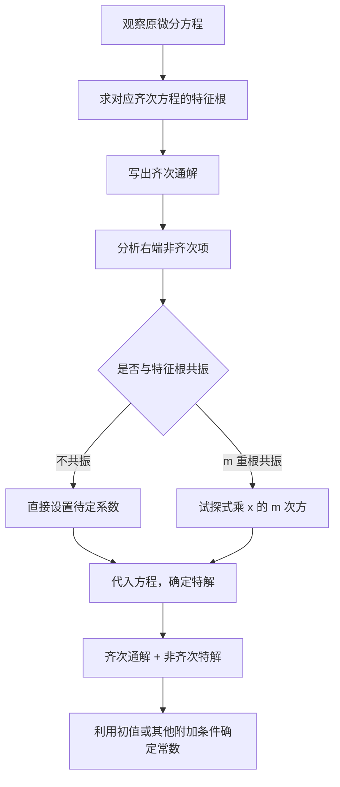
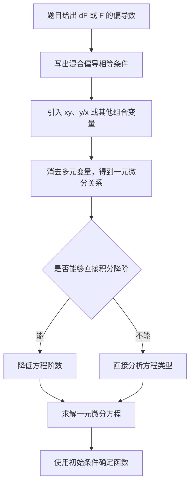
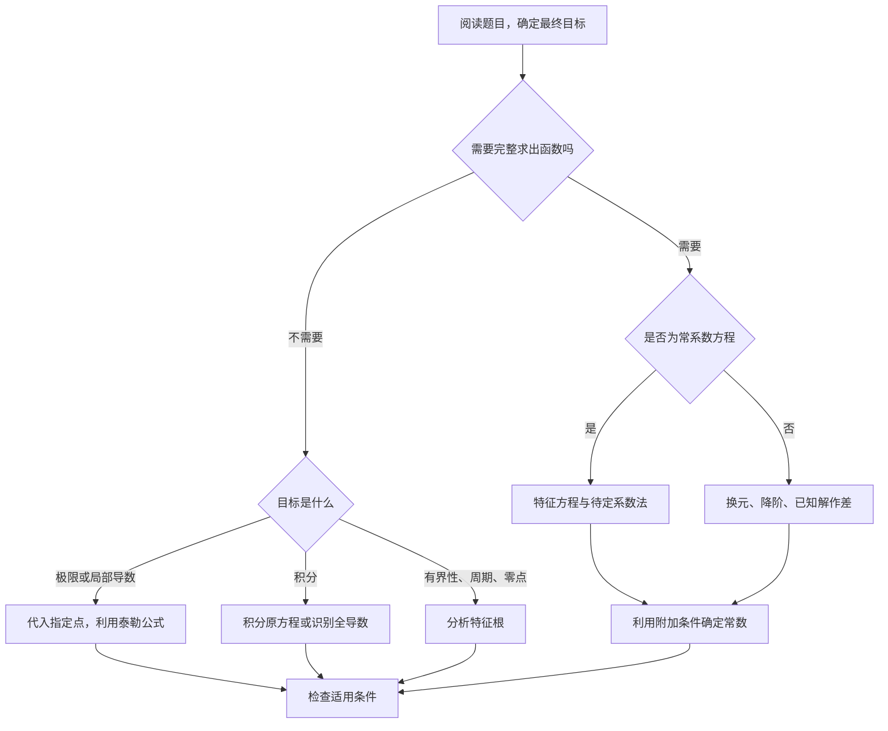

## 第一部分　本节知识体系与考查重点

二阶及高阶线性微分方程看似公式繁多，但其核心实际上只有四件事：

1. **解的结构**：理解齐次方程、非齐次方程和线性叠加原理。
2. **特征根**：根据特征根确定齐次通解、反求方程、判断解的性质。
3. **共振与特解**：根据非齐次项确定待定系数形式。
4. **附加条件与模型转化**：利用初值、极限、积分、函数性质等条件确定解，或者把其他数学问题转化为微分方程。

### 一、本节题型全景

| 核心题型           | 解题工具          | 复习优先级 |
| -------------- | ------------- | ----- |
| 二阶、高阶齐次方程求解    | 特征方程          | ★★★★★ |
| 非齐次方程求解        | 待定系数法         | ★★★★★ |
| 单根、重根、复根共振     | 特解乘 $x^k$ | ★★★★★ |
| 由通解、特解反求方程     | 特征根、比较系数      | ★★★★★ |
| 由多个非齐次解求通解     | 作差、线性叠加       | ★★★★★ |
| 解的有界性、极限与积分敛散性 | 特征根实部         | ★★★★★ |
| 无需求解的积分计算      | 方程两端积分        | ★★★★★ |
| 积分方程转微分方程      | 变上限积分求导       | ★★★★★ |
| 变系数方程          | 变量代换、已知解降阶    | ★★★★  |
| 多元函数与全微分综合     | 混合偏导相等        | ★★★★★ |
| 微分方程与幂级数、泰勒公式  | 系数比较、局部展开     | ★★★★  |
| 周期性、零点、拐点      | 解的结构、导数性质     | ★★★★  |

尤其值得重视的是2020年数学一反常积分题、2009年数学一重根与初值题、2010年数学一共振题、2013年数学一解的结构题、2003年数学一反函数题和2026年数学一全微分综合题。

这些题目很好地展示了微分方程从直接计算向跨章节综合的变化。

## 第二部分　基础概念与底层原理

### 一、什么是线性微分方程？

$n$ 阶线性微分方程的标准形式为

$$
\begin{aligned} y^{(n)}+a_{n-1}(x)y^{(n-1)} +\cdots+a_1(x)y'+a_0(x)y =g(x). \end{aligned}
$$

其中：

- 最高阶导数为 $n$ 阶，称为 $n$ 阶方程；
- 未知函数及其各阶导数均以一次形式出现；
- 系数只能依赖于自变量，不能依赖于未知函数；
- $g(x)\equiv0$ 时称为齐次线性方程，否则称为非齐次线性方程。

例如，

$$
x^2y''+e^xy'+(\ln x)y=0
$$

是二阶变系数齐次线性微分方程。

$$
y''-3y'+2y=xe^x
$$

是二阶常系数非齐次线性微分方程。

但

$$
y''+(y')^2+y=0
$$

以及

$$
yy''+y'=x
$$

都不是线性方程。

**注意：线性是针对未知函数** $y$ **及其导数而言的，与自变量** $x$ **的次数无关。**

即使右端是非常复杂的函数，只要左端对未知函数保持线性，仍然是线性微分方程。

这正是李正元练习题第六章第005题考查的基本概念。

### 二、用线性算子理解微分方程

记微分算子

$$
D=\frac{\mathrm d}{\mathrm dx}.
$$

对于常系数微分方程

$$
y''+ay'+by=g(x),
$$

可以将其记作

$$
L[y]=(D^2+aD+b)y=g(x).
$$

定义特征多项式

$$
P(r)=r^2+ar+b.
$$

于是原方程还可以写成

$$
P(D)y=g(x).
$$

引入这个记号并不是为了增加新的计算负担，而是为了统一理解几乎所有常系数微分方程题型。

线性算子的最重要性质是

$$
L[\alpha u+\beta v] =\alpha L[u]+\beta L[v],
$$

其中 $\alpha,\beta$ 为常数。

后面的齐次解叠加、非齐次解作差、多个非齐次项分别求特解，都来自这一条性质。

### 三、线性微分方程解的结构

**1. 齐次方程的解可以任意线性组合**

若

$$
L[y_1]=0,\qquad L[y_2]=0,
$$

则

$$
L[C_1y_1+C_2y_2]=0.
$$

因此

$$
C_1y_1+C_2y_2
$$

仍然是齐次方程的解。

对于二阶线性齐次方程，在系数连续的正规区间内，只要 $y_1,y_2$ 线性无关，其通解就是

$$
\boxed{y_h=C_1y_1+C_2y_2}.
$$

对于 $n$ 阶线性齐次方程，

$$
\boxed{y_h=\sum_{k=1}^n C_ky_k},
$$

其中 $y_1,\ldots,y_n$ 构成一组基本解。

**2. 非齐次通解等于齐次通解加一个特解**

设

$$
L[y]=g(x),
$$

且已经找到一个特解 $y_p$，那么

$$
\boxed{y=y_h+y_p}.
$$

为什么？

一方面，

$$
L[y_h+y_p]=0+g(x)=g(x).
$$

另一方面，若 $y$ 是任意一个非齐次解，则

$$
L[y-y_p]=g(x)-g(x)=0.
$$

所以 $y-y_p$ 必然是对应的齐次解。

这说明所有非齐次解都可以通过在某个特解上添加齐次解得到。

从直观上理解，齐次解集合类似于一个经过原点的线性空间，而非齐次解集合则是将这个空间整体平移得到的集合。

**3. 同一非齐次方程的两个解之差是齐次解**

如果

$$
L[y_1]=L[y_2]=g(x),
$$

那么

$$
\boxed{L[y_1-y_2]=0}.
$$

这是本节最重要的反推技巧之一。

当题目给出多个非齐次特解，而没有直接给出完整微分方程时，应当首先想到**作差**，而不是立即对每个特解反复求导。

**4. 非齐次解的线性组合条件**

若 $y_1,\ldots,y_m$ 是同一非齐次方程的解，则

$$
L\left[\sum_{i=1}^m\lambda_i y_i\right] =\left(\sum_{i=1}^m\lambda_i\right)g(x).
$$

当 $g\not\equiv0$ 时：

$$
\boxed{\sum_{i=1}^m\lambda_i=1}
$$

意味着组合后仍然是原非齐次方程的解。

而

$$
\boxed{\sum_{i=1}^m\lambda_i=0}
$$

意味着组合后是对应齐次方程的解。

这两条结论在选择题中非常实用。

### 四、线性无关与基本解组

二阶方程的两个解不能只是形式不同，还必须线性无关。

例如：

$$
y_1=e^x,\qquad y_2=2e^x
$$

虽然是两个不同函数，但实际上只提供了一个独立方向，不能构成二阶方程的基本解组。

而

$$
y_1=e^x,\qquad y_2=xe^x
$$

则线性无关。

对于两个函数，可以通过朗斯基行列式判断：

$$
W(y_1,y_2)(x)= \begin{vmatrix} y_1&y_2\\ y_1'&y_2' \end{vmatrix} =y_1y_2'-y_1'y_2.
$$

对于同一个二阶齐次线性方程的两个解，在正规区间内：

$$
W(x_0)\ne0
$$

即可保证它们线性无关。

例如，

$$
W(e^x,xe^x)=e^{2x}\ne0.
$$

因此

$$
y=(C_1+C_2x)e^x
$$

确实含有两个独立的任意常数。

<Callout type="warn" title="特别注意：任意常数必须真正独立">

李正元练习题中有一道非常好的概念题：

$$
y=\ln(C_1x)+\ln(C_2\sin x).
$$

虽然出现了 $C_1,C_2$，但在表达式有意义的区间内可以合并为

$$
y=\ln(C_1C_2x\sin x).
$$

实际上只包含一个独立参数。

因此判断通解时，不能仅仅数 $C_1,C_2,\ldots$ 的个数。

</Callout>

## 第三部分　常系数齐次线性微分方程

### 一、特征方程为什么有效？

考虑

$$
y''+ay'+by=0.
$$

由于指数函数具有求导后保持形式不变的性质，令

$$
y=e^{rx}.
$$

那么

$$
y'=re^{rx},\qquad y''=r^2e^{rx}.
$$

代入得

$$
(r^2+ar+b)e^{rx}=0.
$$

因为 $e^{rx}\ne0$，所以

$$
\boxed{r^2+ar+b=0}.
$$

这就是特征方程。

更一般地，

$$
P(D)e^{rx}=P(r)e^{rx}.
$$

也就是说，微分方程中复杂的求导运算，对于指数函数而言，可以转化为普通的代数运算。

### 二、二阶齐次方程的三种情况

设

$$
y''+ay'+by=0,
$$

特征方程为

$$
r^2+ar+b=0, \qquad \Delta=a^2-4b.
$$

| 特征根情况                       | 齐次通解                                              |
| --------------------------- | ------------------------------------------------- |
| 两个不同实根 $r_1,r_2$        | $C_1e^{r_1x}+C_2e^{r_2x}$                     |
| 二重实根 $r$                | $(C_1+C_2x)e^{rx}$                            |
| 共轭复根 $\alpha\pm i\beta$ | $e^{\alpha x}(C_1\cos\beta x+C_2\sin\beta x)$ |

**为什么重根要乘 $x$？**

若特征方程为

$$
(r-\lambda)^2=0,
$$

原微分方程就可以写成

$$
(D-\lambda)^2y=0.
$$

令

$$
y=e^{\lambda x}u(x),
$$

则

$$
(D-\lambda)y=e^{\lambda x}u',
$$

进一步有

$$
(D-\lambda)^2y=e^{\lambda x}u''.
$$

因此

$$
u''=0,
$$

得到

$$
u=C_1+C_2x.
$$

于是

$$
\boxed{y=(C_1+C_2x)e^{\lambda x}}.
$$

所以，重根乘 $x$ 并不是一个孤立的记忆公式，而是由微分方程本身的结构决定的。

**如何直观理解复根？**

若特征根为

$$
r=\alpha\pm i\beta,
$$

相应实值解为

$$
y=e^{\alpha x} (C_1\cos\beta x+C_2\sin\beta x).
$$

也可以写成

$$
y=Re^{\alpha x}\cos(\beta x-\varphi).
$$

其中：

- $\alpha$ 决定振幅是衰减、增长还是保持不变；
- $\beta$ 决定振荡的频率；
- $R,\varphi$ 由初始条件决定。

这个理解将在后面的周期性、零点、有界性和反常积分题中发挥重要作用。

### 三、高阶方程的统一规律

如果 $\lambda$ 是 $m$ 重实根，那么它对应的基本解为

$$
e^{\lambda x},xe^{\lambda x}, \ldots,x^{m-1}e^{\lambda x}.
$$

如果 $\alpha\pm i\beta$ 是各为 $m$ 重的共轭复根，那么它们对应

$$
x^ke^{\alpha x}\cos\beta x,
$$

$$
x^ke^{\alpha x}\sin\beta x, \qquad k=0,1,\ldots,m-1.
$$

特别地：

| 特征根             | 对应基本解                             |
| --------------- | --------------------------------- |
| $r=0$，单根    | $1$                           |
| $r=0$，二重根   | $1,x$                         |
| $r=0$，三重根   | $1,x,x^2$                     |
| $r=1$，二重根   | $e^x,xe^x$                    |
| $r=\pm i$   | $\cos x,\sin x$               |
| $r=-2\pm3i$ | $e^{-2x}\cos3x,e^{-2x}\sin3x$ |

**最后一定检查：一个** $n$ **阶齐次线性方程的通解应当含有** $n$ **个独立任意常数。**

**母题1：高阶方程与共轭复根**

来源：核心题目002，2022年数学二。

求

$$
y'''-2y''+5y'=0
$$

的通解。

特征方程为

$$
r^3-2r^2+5r=0.
$$

因式分解：

$$
r(r^2-2r+5)=0.
$$

得到

$$
r_1=0,\qquad r_{2,3}=1\pm2i.
$$

所以

$$
\boxed{ y=C_1+e^x(C_2\cos2x+C_3\sin2x) }.
$$

**母题迁移：** 对于缺少 $y$ 项的高阶常系数齐次方程，首先提取特征方程中的 $r$ 因子；如果还缺少 $y'$ 项，则很可能出现二重零根。

例如，

$$
y^{(4)}-y''=0
$$

的特征方程为

$$
r^2(r-1)(r+1)=0,
$$

所以

$$
y=C_1+C_2x+C_3e^x+C_4e^{-x}.
$$

这也是后面张宇1000题等价无穷小综合题的基础。

## 第四部分　非齐次线性微分方程与待定系数法

这是本节最重要的计算内容，也是最容易因为公式使用不熟练而丢分的地方。

### 一、标准解题流程

对于

$$
y''+ay'+by=g(x),
$$

始终按照以下步骤求解：

这里真正需要解决的难点是：**如何根据右端函数设置特解？**

### 二、待定系数法的两大基本模型

**模型一：指数函数乘多项式**

若右端为

$$
g(x)=e^{\lambda x}P_n(x),
$$

其中 $P_n(x)$ 为 $n$ 次多项式，则设特解为

$$
\boxed{y_p=x^ke^{\lambda x}Q_n(x)},
$$

其中

$$
Q_n(x)=A_nx^n+\cdots+A_1x+A_0.
$$

这里的 $k$ 由特征方程决定。

| $\lambda$ 与特征根的关系 | $k$ |
| --------------------- | ------- |
| 不是特征根                 | 0       |
| 是单特征根                 | 1       |
| 是二重特征根                | 2       |
| 是 $m$ 重特征根        | $m$ |

对于二阶方程，只需要考虑 $k=0,1,2$。

常见形式如下：

| 非齐次项                | 特解试探形式                     |
| ------------------- | -------------------------- |
| $1$             | $Ax^k$                 |
| $x$             | $x^k(Ax+B)$            |
| $x^2+1$         | $x^k(Ax^2+Bx+C)$       |
| $e^{2x}$        | $Ax^ke^{2x}$           |
| $xe^{2x}$       | $x^ke^{2x}(Ax+B)$      |
| $(x^2+1)e^{2x}$ | $x^ke^{2x}(Ax^2+Bx+C)$ |

**两个重要细节：**

纯多项式可以看成

$$
P_n(x)e^{0x},
$$

所以要考察的是 $0$ 是否为特征根。

右端即使缺少某些低次项，特解也通常需要设完整的同次多项式。例如右端为 $x^2e^x$，应当设

$$
y_p=x^ke^x(Ax^2+Bx+C),
$$

而不能直接省略 $Bx+C$。

**模型二：指数函数乘三角函数与多项式**

若右端为

$$
g(x)=e^{\lambda x} [P_m(x)\cos\omega x+Q_n(x)\sin\omega x],
$$

取

$$
l=\max\{m,n\},
$$

则设置

$$
\boxed{ y_p=x^ke^{\lambda x} [R_l(x)\cos\omega x+S_l(x)\sin\omega x] }.
$$

这里的 $k$ 是

$$
\lambda+i\omega
$$

作为特征根的重数；不是特征根时取 $k=0$。

例如：

| 非齐次项             | 特解试探形式                                  |
| ---------------- | --------------------------------------- |
| $\sin x$     | $x^k(A\cos x+B\sin x)$              |
| $\cos2x$     | $x^k(A\cos2x+B\sin2x)$              |
| $e^x\sin2x$  | $x^ke^x(A\cos2x+B\sin2x)$           |
| $xe^x\cos x$ | $x^ke^x[(Ax+B)\cos x+(Cx+D)\sin x]$ |

**为什么右端只有正弦，特解却要同时设正弦和余弦？**

因为

$$
(\sin x)'=\cos x,\qquad (\cos x)'=-\sin x.
$$

在求导过程中，两种函数会相互转化。

只有在某些特殊方程中，经过分析可以简化待定系数形式。在尚未判断清楚之前，完整设置最保险。

### 三、共振到底是什么？

以方程

$$
y''-2y'+y=e^x
$$

为例。

特征方程为

$$
(r-1)^2=0.
$$

因此齐次通解为

$$
y_h=(C_1+C_2x)e^x.
$$

如果设

$$
y_p=Ae^x,
$$

左端恒等于零，因为 $e^x$ 本身就是齐次解。

如果继续尝试

$$
y_p=Axe^x,
$$

左端仍然恒等于零，因为 $xe^x$ 也是齐次解。

必须跳出齐次解空间，尝试

$$
y_p=Ax^2e^x.
$$

计算得到

$$
(D-1)^2(Ax^2e^x)=2Ae^x.
$$

于是

$$
A=\frac12.
$$

最终

$$
\boxed{ y=e^x\left(C_1+C_2x+\frac{x^2}{2}\right) }.
$$

所以共振的本质是：**通常设置的特解与齐次解发生重叠，导致微分算子将其消去，因此必须增加足够次数的** $x$ **因子。**

### 四、进阶技巧：指数移位法

这是非常值得掌握的计算技巧，特别适合右端出现 $e^{\lambda x}$ 的题目。

令

$$
y=e^{\lambda x}u(x).
$$

则

$$
y'=e^{\lambda x}(u'+\lambda u),
$$

$$
y''=e^{\lambda x} (u''+2\lambda u'+\lambda^2u).
$$

因此

$$
\boxed{ \begin{aligned} y''+ay'+by =e^{\lambda x}\big[ u''+(2\lambda+a)u' +(\lambda^2+a\lambda+b)u \big]. \end{aligned} }
$$

更加一般地，

$$
\boxed{P(D)[e^{\lambda x}u] =e^{\lambda x}P(D+\lambda)u}.
$$

如果

$$
P(r)=(r-\lambda)^kR(r),
$$

那么

$$
P(D+\lambda)=D^kR(D+\lambda).
$$

这也解释了为什么 $k$ 重根共振需要在通常的特解形式前乘 $x^k$。

对于常见的二阶方程，掌握直接换元公式即可，不必深入学习复杂的算子理论。

### 五、母题2：指数多项式与单根共振

**来源：2010年考研数学一，核心题目009。**

求方程

$$
y''-3y'+2y=2xe^x
$$

的通解。

<Steps>

<Step>

### 第一步：求齐次通解 [!toc]

特征方程为

$$
r^2-3r+2=(r-1)(r-2)=0.
$$

所以

$$
y_h=C_1e^x+C_2e^{2x}.
$$

</Step>

<Step>

### 第二步：识别共振 [!toc]

右端为

$$
2xe^x,
$$

指数 $\lambda=1$，而 $1$ 是单特征根。

因此特解应设为

$$
y_p=xe^x(Ax+B).
$$

直接计算虽然可以，但利用指数移位更加简便。

令

$$
y=e^xu,
$$

原方程化为

$$
e^x(u''-u')=2xe^x,
$$

即

$$
u''-u'=2x.
$$

</Step>

<Step>

### 第三步：确定待定系数 [!toc]

设

$$
u_p=Ax^2+Bx.
$$

则

$$
u_p'=2Ax+B,\qquad u_p''=2A.
$$

代入：

$$
2A-2Ax-B=2x.
$$

比较系数，

$$
\begin{cases} -2A=2,\\ 2A-B=0, \end{cases}
$$

得到

$$
A=-1,\qquad B=-2.
$$

因此

$$
y_p=-(x^2+2x)e^x.
$$

最终答案：

$$
\boxed{ y=C_1e^x+C_2e^{2x}-(x^2+2x)e^x }.
$$

</Step>

</Steps>

**举一反三**

张宇1000题第047题将右端换成

$$
xe^x.
$$

由于方程具有线性，原特解减半即可：

$$
\boxed{ y=C_1e^x+C_2e^{2x} -\left(\frac{x^2}{2}+x\right)e^x }.
$$

这两道题完全属于同一母题，不需要分别记忆解法。

### 六、母题3：二重根共振

**来源：张宇1000题第019题，核心题目014。**

求

$$
y''-2y'+y=2(3x^2-2)e^x
$$

的通解。

观察左端：

$$
D^2-2D+1=(D-1)^2.
$$

直接令

$$
y=e^xu.
$$

于是

$$
y''-2y'+y=e^xu''.
$$

原方程化为

$$
u''=6x^2-4.
$$

两次积分：

$$
u'=2x^3-4x+C_2,
$$

$$
u=\frac12x^4-2x^2+C_2x+C_1.
$$

因此

$$
\boxed{ y=e^x\left( C_1+C_2x+\frac12x^4-2x^2 \right) }.
$$

这里甚至不需要先分别计算齐次解和非齐次特解，直接换元积分便得到了全部解。

**可以推广为一个通用模型**

如果

$$
(D-\lambda)^ny=e^{\lambda x}g(x),
$$

则令

$$
y=e^{\lambda x}u,
$$

有

$$
\boxed{u^{(n)}=g(x)}.
$$

连续积分 $n$ 次即可。

因此，只要特征多项式是某个一次因式的高次幂，指数换元通常会带来很大的计算优势。

### 七、母题4：高阶方程中的零根共振

**来源：1987年考研数学一，核心题目006。**

求

$$
y'''+6y''+(9+a^2)y'=1, \qquad a>0.
$$

特征方程为

$$
r^3+6r^2+(9+a^2)r=0.
$$

即

$$
r[(r+3)^2+a^2]=0.
$$

特征根为

$$
r=0,\quad -3\pm ai.
$$

所以

$$
y_h=C_1+e^{-3x}(C_2\cos ax+C_3\sin ax).
$$

右端为常数 $1$，对应指数 $\lambda=0$。

由于 $0$ 是单根，不能设置常数特解，而应设置

$$
y_p=Ax.
$$

代入得

$$
(9+a^2)A=1.
$$

因此

$$
\boxed{ y=C_1+e^{-3x}(C_2\cos ax+C_3\sin ax) +\frac{x}{9+a^2} }.
$$

**核心启发：** 方程缺少 $y$ 项时，常数强迫项一定需要检查零根共振；这与普通指数共振没有本质区别。

### 八、母题5：多个非齐次项分别判断共振

**来源：2017年考研数学二，核心题目007。**

微分方程

$$
y''-4y'+8y=e^{2x}(1+\cos2x)
$$

的特解应当设置为什么形式？

特征方程为

$$
r^2-4r+8=0,
$$

得到

$$
r=2\pm2i.
$$

把右端拆成

$$
e^{2x}+e^{2x}\cos2x.
$$

分别判断：

| 非齐次项               | 对应的根         | 共振判断 |
| ------------------ | ------------ | ---- |
| $e^{2x}$       | $2$      | 不共振  |
| $e^{2x}\cos2x$ | $2\pm2i$ | 单根共振 |

因此

$$
\boxed{ y_p=Ae^{2x} +xe^{2x}(B\cos2x+C\sin2x) }.
$$

特别注意，不能因为两个非齐次项都含 $e^{2x}$，就对整个表达式统一乘 $x$。

复根的判断必须同时比较实部与虚部。

**变式：右端出现三角函数平方**

来源：张宇1000题第046题。

$$
y''+4y=\sin^2x.
$$

首先降幂：

$$
\sin^2x=\frac12-\frac12\cos2x.
$$

特征根为

$$
r=\pm2i.
$$

所以常数项不共振，三角项共振。

正确设置为

$$
\boxed{ y_p=A+x(B\cos2x+C\sin2x) }.
$$

进一步计算可得

$$
y_p=\frac18-\frac{x}{8}\sin2x.
$$

对于右端出现

$$
\sin x\cos x,\qquad \cos^2x,\qquad \sin^3x
$$

等形式，应先利用三角恒等变换化为不同频率的正弦、余弦之和，再分别判断共振。

### 九、母题6：含参数的共振分类讨论

**来源：1994年考研数学二，核心题目011。**

求

$$
y''+a^2y=\sin x,\qquad a>0
$$

的通解。

齐次特征根为

$$
r=\pm ai.
$$

所以

$$
y_h=C_1\cos ax+C_2\sin ax.
$$

右端的频率为 $1$，因此必须讨论 $a=1$ 和 $a\ne1$。

**情况一：$a\ne1$**

设置

$$
y_p=A\sin x.
$$

代入得

$$
(a^2-1)A\sin x=\sin x.
$$

所以

$$
A=\frac1{a^2-1}.
$$

**情况二：$a=1$**

此时发生共振。

利用

$$
(x\cos x)''+x\cos x=-2\sin x,
$$

可直接得到

$$
y_p=-\frac{x}{2}\cos x.
$$

综上，

$$
\boxed{ y= \begin{cases} C_1\cos ax+C_2\sin ax+ \dfrac{\sin x}{a^2-1},&a\ne1,\\[3mm] C_1\cos x+C_2\sin x- \dfrac{x}{2}\cos x,&a=1. \end{cases} }
$$

当待定系数的结果中出现含参数的分母时，一定要检查分母为零的情形。

**分母为零通常不是无解，而是发生共振，必须改变特解的试探形式。**

对于二阶纯振荡方程，可以记住两个快速计算公式：

$$
\boxed{ (D^2+\omega^2)[x\sin\omega x] =2\omega\cos\omega x }
$$

$$
\boxed{ (D^2+\omega^2)[x\cos\omega x] =-2\omega\sin\omega x }
$$

它们在积分方程与幂级数综合题中还会反复出现。

## 第五部分　初始条件、边界条件与反求微分方程

### 一、各种附加条件的数学翻译

考研题目不一定直接给出 $y(0)$、$y'(0)$，而可能通过曲线性质或者极限条件间接提供。

| 题目条件                         | 数学表达式                                 |
| ---------------------------- | ------------------------------------- |
| 曲线经过 $(x_0,y_0)$         | $y(x_0)=y_0$                      |
| 在该点切线斜率为 $k$             | $y'(x_0)=k$                       |
| 在内点 $x_0$ 取得极值 $m$   | $y(x_0)=m,\ y'(x_0)=0$            |
| 在 $x_0$ 处有水平切线           | $y'(x_0)=0$                       |
| 与 $g(x)$ 在 $x_0$ 处相切 | $y(x_0)=g(x_0),\ y'(x_0)=g'(x_0)$ |
| 二阶导数连续且在 $x_0$ 处有拐点      | $y''(x_0)=0$，还需检验凹凸性              |
| $y(x)\sim ax^m$          | 在充分光滑条件下，匹配各阶泰勒系数                     |
| 正无穷处有界                       | 排除正无穷方向的发散模态                          |
| 正无穷处趋零                       | 排除所有不衰减模态                             |

一个 $n$ 阶正规线性微分方程给定同一点的前 $n$ 项初始数据，一般能够唯一确定其解。对于其他边界条件，则需要另外判断存在性与唯一性。

### 二、母题7：由齐次通解反推方程，再利用初值

**来源：2009年考研数学一，核心题目005，李林880题第031题。**

已知方程

$$
y''+ay'+by=0
$$

的通解为

$$
y=(C_1+C_2x)e^x.
$$

求

$$
y''+ay'+by=x
$$

满足

$$
y(0)=2,\qquad y'(0)=0
$$

的解。

<Steps>

<Step>

### 第一步：反推特征根 [!toc]

已知齐次通解含有

$$
e^x,\qquad xe^x.
$$

所以 $r=1$ 是二重特征根。

因此

$$
r^2+ar+b=(r-1)^2,
$$

得到

$$
a=-2,\qquad b=1.
$$

</Step>

<Step>

### 第二步：设置非齐次特解 [!toc]

原方程为

$$
y''-2y'+y=x.
$$

右端为一次多项式，对应的指数为 $0$，不是特征根。

因此

$$
y_p=Ax+B.
$$

代入：

$$
-2A+Ax+B=x.
$$

得

$$
A=1,\qquad B=2.
$$

所以

$$
y=(C_1+C_2x)e^x+x+2.
$$

</Step>

<Step>

### 第三步：使用初值 [!toc]

由

$$
y(0)=C_1+2=2
$$

可得

$$
C_1=0.
$$

而

$$
y'(0)=C_1+C_2+1=0,
$$

所以

$$
C_2=-1.
$$

答案为

$$
\boxed{y=2+x-xe^x}.
$$

</Step>

</Steps>

**这道题的真正考点**

不要看到齐次方程有二重根，就机械地给所有特解乘 $x^2$。

只有右端所对应的指数本身是二重特征根，才需要乘 $x^2$。

### 三、母题8：由一个非齐次特解反求未知系数

**来源：2015年考研数学一，核心题目008。**

已知

$$
y=\frac12e^{2x} +\left(x-\frac13\right)e^x
$$

是方程

$$
y''+ay'+by=ce^x
$$

的一个特解，求 $a,b,c$。

<Tabs items={["方法一：特征多项式分析", "方法二：直接代入比较系数"]} defaultIndex={0}>

<Tab value="方法一：特征多项式分析">

记

$$
P(r)=r^2+ar+b.
$$

注意，已知解中有 $e^{2x}$，但右端没有这种指数形式。

因此必须有

$$
P(2)=0,
$$

即

$$
4+2a+b=0.
$$

已知解中还包含 $xe^x$，但右端没有 $xe^x$。

因此必须有

$$
P(1)=0,
$$

即

$$
1+a+b=0.
$$

联立得

$$
a=-3,\qquad b=2.
$$

于是

$$
P(D)=(D-1)(D-2).
$$

利用指数移位公式：

$$
P(D)[xe^x] =e^x(D^2-D)x=-e^x.
$$

其余的 $e^{2x}$、$e^x$ 都是齐次解，所以

$$
c=-1.
$$

最终

$$
\boxed{a=-3,\quad b=2,\quad c=-1}.
$$

</Tab>

<Tab value="方法二：直接代入比较系数">

对给定函数连续求导，再代回原方程，将

$$
e^{2x},\quad xe^x,\quad e^x
$$

分别归类比较系数，也可以得到相同结果。

这类题优先使用第一种方法，因为计算量更小。

</Tab>

</Tabs>

**可直接推广的结论**

对于特征多项式 $P(r)$，有

$$
\boxed{ P(D)[xe^{\lambda x}] =e^{\lambda x}[xP(\lambda)+P'(\lambda)] }.
$$

如果 $\lambda$ 是单特征根，则

$$
P(D)[xe^{\lambda x}] =P'(\lambda)e^{\lambda x}.
$$

因此，对于

$$
P(D)y=Ae^{\lambda x},
$$

如果 $\lambda$ 是单特征根，可以直接写出一个特解：

$$
\boxed{ y_p=\frac{Axe^{\lambda x}}{P'(\lambda)} }.
$$

如果 $\lambda$ 不是特征根，那么直接有

$$
\boxed{ y_p=\frac{Ae^{\lambda x}}{P(\lambda)} }.
$$

这两个公式对于选择题和填空题非常实用。

### 四、母题9：由多个非齐次特解求通解

**来源：2013年考研数学一、数学二，核心题目019。**

已知

$$
y_1=e^{3x}-xe^{2x},
$$

$$
y_2=e^x-xe^{2x},
$$

$$
y_3=-xe^{2x}
$$

是某二阶常系数非齐次方程的三个解，求通解。

<Steps>

<Step>

### 第一步：相减消去非齐次部分 [!toc]

$$
y_1-y_3=e^{3x},
$$

$$
y_2-y_3=e^x.
$$

两个差函数是齐次解，且线性无关。

因此

$$
y_h=C_1e^{3x}+C_2e^x.
$$

</Step>

<Step>

### 第二步：任选一个已知非齐次解 [!toc]

取

$$
y_p=y_3=-xe^{2x}.
$$

所以

$$
\boxed{ y=C_1e^{3x}+C_2e^x-xe^{2x} }.
$$

整个过程甚至不需要知道具体的微分方程。

</Step>

</Steps>

**理论母题：1989年数学一**

核心题目020给出了三个线性无关的非齐次解 $y_1,y_2,y_3$。

通解应写成

$$
y=y_3+C_1(y_1-y_3)+C_2(y_2-y_3).
$$

整理：

$$
\boxed{ y=C_1y_1+C_2y_2+(1-C_1-C_2)y_3 }.
$$

这里既保证了系数之和为 $1$，也保证有两个独立的任意常数。

李林880题第005题、第017题也采用这一模型。

<Callout type="warn" title="必须避免的错误">

仅仅知道三个非齐次解彼此不同，不一定足以确定二阶方程的通解。

例如

$$
y_2=y_1+h,\qquad y_3=y_1+2h,
$$

那么它们作差后只能得到一个独立齐次解 $h$。

因此要进一步判断差函数是否线性无关。

</Callout>

### 五、母题10：从低维信息反求高阶方程

**来源：张宇2027年8套卷第8套第12题。**

已知

$$
y_1=e^{3x}+xe^{2x}+1,
$$

$$
y_2=e^{3x}-1
$$

是某三阶常系数非齐次方程的两个特解，求该方程。

作差：

$$
y_1-y_2=xe^{2x}+2.
$$

因此

$$
xe^{2x}+2
$$

是齐次方程的一个解。

设三阶齐次特征多项式为 $P(r)$。

利用

$$
P(D)[xe^{2x}+2] =e^{2x}[xP(2)+P'(2)]+2P(0)=0.
$$

根据不同函数的线性无关性：

$$
P(2)=0,\qquad P'(2)=0,\qquad P(0)=0.
$$

因此，$2$ 为二重特征根，$0$ 为单特征根。

于是

$$
P(r)=r(r-2)^2 =r^3-4r^2+4r.
$$

对应齐次方程为

$$
y'''-4y''+4y'=0.
$$

将已知特解 $y_2=e^{3x}-1$ 代入：

$$
L[y_2]=(27-36+12)e^{3x} =3e^{3x}.
$$

所以原方程为

$$
\boxed{y'''-4y''+4y'=3e^{3x}}.
$$

**推广：最低阶微分方程**

张宇1000题第028题要求以

$$
y=x,\qquad y=xe^{-2x}
$$

为特解的最低阶常系数齐次线性方程。

由 $x$ 可知零根至少为二重根；由 $xe^{-2x}$ 可知 $-2$ 至少为二重根。

因此最低阶特征多项式为

$$
r^2(r+2)^2=r^4+4r^3+4r^2.
$$

所求方程为

$$
\boxed{y^{(4)}+4y'''+4y''=0}.
$$

这类题的本质是：从已知函数中提取特征根及其最小重数。

## 第六部分　解的有界性、极限、周期性与零点

这是本节极具区分度的概念考查方向。

### 一、根据特征根直接判断解的性质

基本解一般由以下函数组成：

$$
x^ke^{\alpha x},
$$

或者

$$
x^ke^{\alpha x} (A\cos\beta x+B\sin\beta x).
$$

当 $x\to+\infty$ 时：

| 特征根情况  | 解的行为        |
| ------ | ----------- |
| 实部为负   | 指数衰减，趋于零    |
| 实部为正   | 存在指数增长解     |
| 零根为单根  | 存在常数解       |
| 零根为重根  | 存在多项式增长解    |
| 非零纯虚单根 | 持续振荡，有界但不趋零 |
| 非零纯虚重根 | 存在振幅增长的振荡解  |

这里最容易考查的就是指数因子与多项式因子的相互关系。

对于任意正数 $c$ 和非负整数 $k$，

$$
\lim_{x\to+\infty}x^ke^{-cx}=0.
$$

所以负实部的重根并不可怕，即使带有 $x^k$ 因子，仍然趋于零。

### 二、二阶常系数齐次方程的重要判据

设

$$
y''+ay'+by=0.
$$

特征方程为

$$
r^2+ar+b=0.
$$

由韦达定理，

$$
r_1+r_2=-a,\qquad r_1r_2=b.
$$

对于实系数二次多项式，有重要结论：

$$
\boxed{ \operatorname{Re}r_1<0,\  \operatorname{Re}r_2<0 \iff a>0,\ b>0 }.
$$

**为什么成立？**

当两个特征根均为实数时，$b>0$ 表明两根同号，而 $-a<0$ 表明两根之和为负，所以两根均为负数。

当特征根为共轭复根时，

$$
r_{1,2}=-\frac a2\pm i\beta,
$$

因此它们的实部均为

$$
-\frac a2<0.
$$

反过来，若两个根的实部均为负，也可以推出 $a>0,b>0$。

这一判据在二阶题目中非常有用，可以避免繁琐的判别式分类讨论。

但不能将它直接推广成“任意高阶方程只要所有系数为正，所有根的实部就一定为负”。

### 三、重要性质对照表

对于二阶实系数齐次方程

$$
y''+ay'+by=0,
$$

下列条件均可以直接转化为系数条件。

| 题目要求                      | 充要条件                       |
| ------------------------- | -------------------------- |
| 任意解在正无穷处趋零                | $a>0,\ b>0$            |
| 任意解在 $[0,+\infty)$ 有界 | $a\ge0,\ b\ge0$，且不同时为零 |
| 任意解的正无穷反常积分收敛             | $a>0,\ b>0$            |
| 任意解在整个实轴上有界               | $a=0,\ b>0$            |
| 任意解均为周期函数                 | $a=0,\ b>0$            |
| 任意非零解均有无穷多个零点             | $a^2-4b<0$             |

这些结论仅适用于表中所述的二阶常系数齐次方程，使用时注意题目条件是否一致。

尤其要区分：

$$
\text{有界}\ne\text{趋零}\ne\text{积分收敛}.
$$

例如

$$
y=\sin x
$$

有界，但不趋零，且

$$
\int_0^{+\infty}\sin x\,\mathrm dx
$$

不收敛。

### 四、母题11：任一解的反常积分均收敛

**来源：2025年考研数学二，核心题目017。**

已知对方程

$$
y''-2ay'+(a+2)y=0
$$

的任一解，积分

$$
\int_0^{+\infty}y(x)\,\mathrm dx
$$

都收敛，求参数 $a$ 的范围。

<Steps>

<Step>

### 第一步：识别量词 [!toc]

题目说的是**任一解**，因此所有基本解都必须具有收敛的反常积分。

这要求全部特征根的实部严格为负。

</Step>

<Step>

### 第二步：使用二阶判据 [!toc]

特征方程为

$$
r^2-2ar+(a+2)=0.
$$

于是

$$
\begin{cases} -2a>0,\\ a+2>0. \end{cases}
$$

直接得到

$$
\boxed{-2<a<0}.
$$

</Step>

<Step>

### 第三步：理解为什么不能取端点 [!toc]

当 $a=-2$ 时，存在零特征根，因此存在常数解，其反常积分发散。

当 $a=0$ 时，特征根为

$$
r=\pm\sqrt2i,
$$

解持续振荡，普通意义下的反常积分不收敛。

</Step>

</Steps>

**对应练习：张宇1000题第027题**

若

$$
y''-(2k-4)y'+ky=0
$$

的任一解在正无穷区间上的反常积分都收敛，则

$$
4-2k>0,\qquad k>0.
$$

所以

$$
\boxed{0<k<2}.
$$

两道题的解题方法完全一致。

### 五、母题12：每一个非零解都有无穷多个零点

**来源：李永乐2027年六套卷第4套第3题。**

设

$$
y''+ay'+by=0
$$

的每一个非零解均有无穷多个零点，求参数满足的条件。

若

$$
\Delta=a^2-4b\ge0,
$$

则存在实特征根 $r$，于是

$$
y=e^{rx}
$$

是一个没有任何零点的非零解。

与题设矛盾。

因此必须有

$$
a^2-4b<0.
$$

反过来，如果特征根为

$$
\alpha\pm i\beta,\qquad \beta>0,
$$

任意非零解都可以写成

$$
y=Re^{\alpha x}\cos(\beta x-\varphi), \qquad R>0.
$$

由于指数因子始终不为零，所以零点完全由

$$
\cos(\beta x-\varphi)=0
$$

决定。

因此必有无穷多个零点。

结论为

$$
\boxed{a^2-4b<0}.
$$

**重要启发：** 解有没有零点由振荡部分决定，而解的振幅是否衰减则由指数部分决定。这是两个不同的问题。

### 六、母题13：非齐次方程的所有解有界

**来源：张宇2027年8套卷第6套第3题。**

设方程

$$
y''+ay'+y=(x+1)e^{bx}
$$

的每一个解在 $[0,+\infty)$ 上均有界，求 $a,b$ 满足的条件。

由于

$$
y=y_h+y_p,
$$

要使每一个非齐次解均有界，需要同时满足：

齐次方程的所有解有界，而且至少存在一个有界的非齐次特解。

<Steps>

<Step>

### 第一步：判断齐次解 [!toc]

特征方程为

$$
r^2+ar+1=0.
$$

由有界性判据，

$$
a\ge0.
$$

这里允许 $a=0$，因为持续振荡的解也是有界函数。

</Step>

<Step>

### 第二步：判断非齐次特解 [!toc]

右端为

$$
(x+1)e^{bx}.
$$

特解形式为

$$
y_p=x^ke^{bx}(Ax+B),
$$

其中 $k=0,1,2$。

当 $b<0$ 时，无论是否发生共振，指数衰减均能压制多项式增长，因此特解有界。

当 $b\ge0$ 时，特解包含非零的增长多项式或指数增长项，无法满足所有解有界的要求。

所以

$$
\boxed{a\ge0,\qquad b<0}.
$$

这道模拟题比单纯的齐次方程性质题更加综合，值得重点掌握。

</Step>

</Steps>

### 七、母题14：利用无穷远条件确定唯一特解

**来源：李林880题第014题，核心题目015。**

求方程

$$
y''-3y'+2y=10e^{-x}\sin x
$$

满足

$$
\lim_{x\to+\infty}y(x)=0
$$

的特解。

齐次特征根为

$$
r=1,\qquad r=2.
$$

所以

$$
y_h=C_1e^x+C_2e^{2x}.
$$

设非齐次特解

$$
y_p=e^{-x}(A\sin x+B\cos x).
$$

令

$$
y_p=e^{-x}u,
$$

利用指数移位，得到

$$
u''-5u'+6u=10\sin x.
$$

代入

$$
u=A\sin x+B\cos x,
$$

比较系数：

$$
\begin{cases} 5A+5B=10,\\ -5A+5B=0. \end{cases}
$$

解得

$$
A=B=1.
$$

因此通解为

$$
y=C_1e^x+C_2e^{2x} +e^{-x}(\sin x+\cos x).
$$

由于后面的非齐次特解趋于零，而前两个齐次基解均发散，必须取

$$
C_1=C_2=0.
$$

故

$$
\boxed{y=e^{-x}(\sin x+\cos x)}.
$$

**负无穷方向的对应变式**

张宇1000题第020题：

$$
y''+4y'+5y=8\cos x,
$$

求当 $x\to-\infty$ 时有界的特解。

通解为

$$
y=e^{-2x}(C_1\cos x+C_2\sin x) +\cos x+\sin x.
$$

当 $x\to-\infty$ 时，

$$
e^{-2x}\to+\infty.
$$

所以必须取

$$
C_1=C_2=0.
$$

得到

$$
\boxed{y=\cos x+\sin x}.
$$

处理无穷远条件时，必须特别注意趋向正无穷还是负无穷。

## 第七部分　微分方程与反常积分综合

这是数学一极其值得重点掌握的模型。

很多考生会下意识地先求出 $y(x)$，再计算积分。但对于某些题目，直接对微分方程积分能够大幅减少计算量。

### 一、母题15：不求具体解，直接计算反常积分

**来源：2020年考研数学一，核心题目016。**

已知

$$
f''(x)+af'(x)+f(x)=0,\qquad a>0,
$$

并且

$$
f(0)=m,\qquad f'(0)=n.
$$

求

$$
I=\int_0^{+\infty}f(x)\,\mathrm dx.
$$

**常规思路的缺点**

如果先解方程，需要根据

$$
\Delta=a^2-4
$$

讨论三种情况，再确定任意常数，最后分别计算积分。

不仅计算繁琐，而且容易在分类讨论时出现错误。

**最优思路**

因为

$$
a>0,\qquad b=1>0,
$$

所有特征根的实部均为负。

所以

$$
f(x)\to0,\qquad f'(x)\to0,
$$

并且积分绝对收敛。

对原方程两边在 $[0,R]$ 上积分：

$$
\int_0^R f''(x)\,\mathrm dx +a\int_0^R f'(x)\,\mathrm dx +\int_0^R f(x)\,\mathrm dx=0.
$$

由微积分基本定理，

$$
f'(R)-f'(0) +a[f(R)-f(0)] +\int_0^Rf(x)\,\mathrm dx=0.
$$

令 $R\to+\infty$，得到

$$
-n-am+I=0.
$$

因此

$$
\boxed{I=n+am}.
$$

整道题不需要求出任何一个特征根的具体数值，也不需要确定积分常数。

### 二、统一公式

如果

$$
y''+ay'+by=0,\qquad a>0,\ b>0,
$$

并且

$$
y(0)=m,\qquad y'(0)=n,
$$

则

$$
\boxed{ \int_0^{+\infty}y(x)\,\mathrm dx =\frac{n+am}{b} }.
$$

更一般地，若

$$
y''+ay'+by=g(x),
$$

且积分收敛、$y,y'$ 在正无穷处趋零、$b\ne0$，则

$$
\boxed{ \int_0^{+\infty}y(x)\,\mathrm dx = \frac{ y'(0)+ay(0)+\displaystyle\int_0^{+\infty}g(x)\,\mathrm dx }{b} }.
$$

这是一个非常具有迁移价值的公式。

**李林880题第043题**

若

$$
y''+2ay'+b^2y=0, \qquad a>b>0,
$$

$$
y(0)=1,\qquad y'(0)=1,
$$

则直接得到

$$
\boxed{ \int_0^{+\infty}y(x)\,\mathrm dx =\frac{2a+1}{b^2} }.
$$

**李正元练习题第011题**

若

$$
y''+2my'+n^2y=0,\qquad m>n>0,
$$

$$
y(0)=a,\qquad y'(0)=b,
$$

则

$$
\boxed{ \int_0^{+\infty}y(x)\,\mathrm dx =\frac{2ma+b}{n^2} }.
$$

**张宇1000题第045题**

已知曲线过原点且与 $y=\sin x$ 在原点有公共切线，并满足

$$
y''+4y'+4y=0.
$$

将几何条件翻译为

$$
y(0)=0,\qquad y'(0)=1.
$$

直接得到

$$
\boxed{ \int_0^{+\infty}y(x)\,\mathrm dx=\frac14 }.
$$

这四道题应该归纳为一个母题，而不是四种独立解法。

### 三、创新拓展：带权反常积分

下面是根据上述真题进一步推广的补充模型。

已知

$$
y''+ay'+by=0,\qquad a>0,\ b>0,
$$

求

$$
J=\int_0^{+\infty}xy(x)\,\mathrm dx.
$$

这次不能直接积分原方程，而要先乘 $x$：

$$
xy''+axy'+bxy=0.
$$

两端积分：

$$
\int_0^\infty xy''\,\mathrm dx +a\int_0^\infty xy'\,\mathrm dx +bJ=0.
$$

利用分部积分及指数衰减性，

$$
\int_0^\infty xy''\,\mathrm dx =[xy']_0^\infty-\int_0^\infty y'\,\mathrm dx =y(0),
$$

$$
\int_0^\infty xy'\,\mathrm dx =[xy]_0^\infty-\int_0^\infty y\,\mathrm dx =-I.
$$

因此

$$
y(0)-aI+bJ=0.
$$

于是

$$
J=\frac{aI-y(0)}b.
$$

代入前面的公式：

$$
\boxed{ J=\frac{ay'(0)+(a^2-b)y(0)}{b^2} }.
$$

**更进一步的递推模型**

记

$$
M_k=\int_0^\infty x^ky(x)\,\mathrm dx.
$$

当 $k\ge2$ 时，通过乘 $x^k$ 并连续分部积分，可以得到

$$
\boxed{ bM_k=akM_{k-1}-k(k-1)M_{k-2} }.
$$

这种方法将微分方程、反常积分、分部积分和数列递推联系起来，是很有价值的创新题训练。

### 四、母题16：共振与反常积分综合

**来源：核心题目039，文档原创综合变式。**

设

$$
y''+2ay'+(a^2+\omega^2)y =e^{-ax}\cos\omega x,
$$

其中

$$
a\in\mathbb R,\qquad \omega>0,
$$

且

$$
y(0)=y'(0)=0.
$$

求 $y(x)$，并讨论

$$
\int_0^\infty y(x)\,\mathrm dx
$$

的敛散性。

<Steps>

<Step>

### 第一步：指数移位 [!toc]

令

$$
y=e^{-ax}u.
$$

原方程化为

$$
u''+\omega^2u=\cos\omega x.
$$

初值变为

$$
u(0)=u'(0)=0.
$$

右端发生共振，利用

$$
(D^2+\omega^2)[x\sin\omega x] =2\omega\cos\omega x,
$$

得到

$$
u=\frac{x}{2\omega}\sin\omega x.
$$

该特解恰好满足两个零初值。

因此

$$
\boxed{ y=\frac{x}{2\omega}e^{-ax}\sin\omega x }.
$$

</Step>

<Step>

### 第二步：判断积分收敛性 [!toc]

当 $a>0$ 时，

$$
|y(x)|\le\frac{x}{2\omega}e^{-ax},
$$

因此绝对收敛。

当 $a=0$ 时，积分含有

$$
-\frac{R}{2\omega^2}\cos\omega R
$$

这样的增长振荡项，因此不收敛。

当 $a<0$ 时，截断积分中指数增长的振荡边界项不存在有限极限，同样不收敛。

所以

$$
\boxed{\text{积分收敛}\iff a>0}.
$$

</Step>

<Step>

### 第三步：直接积分微分方程 [!toc]

这里采用比原文档含参积分求导法更加简洁的解法。

当 $a>0$ 时，由 $y,y'\to0$ 以及零初值，

$$
(a^2+\omega^2)\int_0^\infty y(x)\,\mathrm dx = \int_0^\infty e^{-ax}\cos\omega x\,\mathrm dx.
$$

利用标准积分

$$
\int_0^\infty e^{-ax}\cos\omega x\,\mathrm dx =\frac{a}{a^2+\omega^2},
$$

得到

$$
\boxed{ \int_0^\infty y(x)\,\mathrm dx =\frac{a}{(a^2+\omega^2)^2} }.
$$

这道题能够同时检验共振、指数换元、解的性质、反常积分和方程积分法，是本节很好的综合母题。

</Step>

</Steps>

## 第八部分　变系数线性微分方程

待定系数法和特征方程法主要适用于常系数线性方程。

如果系数是 $x$ 的函数，例如

$$
(1-x^2)y''-xy'+y=0,
$$

则不能直接写出所谓的

$$
(1-x^2)r^2-xr+1=0
$$

并将其当作常系数特征方程求解。

考研中遇到变系数二阶方程，通常会提供额外的解题突破口。

| 题目特征                        | 常用方法               |
| --------------------------- | ------------------ |
| 已知两个独立齐次解                   | 直接写通解              |
| 已知一个齐次解                     | 令 $y=y_1u$ 降阶  |
| 已知多个非齐次解                    | 作差构造齐次解            |
| 出现 $1-x^2,\sqrt{1-x^2}$ | 三角函数代换             |
| 出现 $x^2y'',xy'$         | 欧拉方程，令 $x=e^t$ |
| 指定 $y=u(x)v(x)$         | 按题意换元              |
| 出现反函数导数                     | 交换自变量、因变量          |

### 一、已知一个齐次解的降阶法

设

$$
y''+p(x)y'+q(x)y=0
$$

的一个非零解为 $y_1(x)$。

为了寻找另一个线性无关的解，令

$$
y=y_1u.
$$

则

$$
y'=y_1'u+y_1u',
$$

$$
y''=y_1''u+2y_1'u'+y_1u''.
$$

代入原方程：

$$
(y_1''+py_1'+qy_1)u +(2y_1'+py_1)u'+y_1u''=0.
$$

由于 $y_1$ 本身就是齐次解，第一项为零。

于是

$$
y_1u''+(2y_1'+py_1)u'=0.
$$

令

$$
v=u',
$$

则在 $y_1\ne0$ 的区间上，

$$
v'+\left(2\frac{y_1'}{y_1}+p\right)v=0.
$$

这就变成了一阶线性微分方程。

积分可得第二个解：

$$
\boxed{ y_2=y_1\int \frac{e^{-\int p(x)\,\mathrm dx}}{y_1^2(x)} \,\mathrm dx }.
$$

其中选择非零的归一化常数即可。

而朗斯基行列式为

$$
W(y_1,y_2) =y_1^2u' =e^{-\int p(x)\,\mathrm dx}\ne0.
$$

所以两个解线性无关。

这就是张宇1000题第050题、核心题目030所考查的理论。

对于考研而言，建议掌握推导过程，而不是仅仅背诵复杂公式。

### 二、母题17：已知解降阶

**来源：2016年考研数学二，核心题目025。**

已知 $e^x$ 与 $u(x)e^x$ 都是

$$
(2x-1)y''-(2x+1)y'+2y=0
$$

的解，且

$$
u(-1)=e,\qquad u(0)=-1.
$$

求 $u(x)$ 及通解。

令

$$
y=e^xu.
$$

则

$$
y'=e^x(u+u'),
$$

$$
y''=e^x(u+2u'+u'').
$$

代入原方程，所有含 $u$ 的项恰好消去，得到

$$
(2x-1)u''+(2x-3)u'=0.
$$

令

$$
v=u',
$$

得到

$$
(2x-1)v'+(2x-3)v=0.
$$

分离变量，

$$
\frac{v'}v=-1+\frac2{2x-1}.
$$

在包含两个给定条件的区间 $x<1/2$ 上积分，可写成

$$
v=C(2x-1)e^{-x}.
$$

再积分得到

$$
u=-C(2x+1)e^{-x}+C_0.
$$

代入两个条件：

$$
\begin{cases} Ce+C_0=e,\\ -C+C_0=-1. \end{cases}
$$

所以

$$
C=1,\qquad C_0=0.
$$

最终

$$
\boxed{u=-(2x+1)e^{-x}}.
$$

从而第二个齐次解为

$$
y_2=-(2x+1).
$$

通解可以写成

$$
\boxed{ y=C_1e^x+C_2(2x+1) }.
$$

在最高阶系数不为零的区间上，这两个函数构成基本解组。

### 三、母题18：变系数方程中的三角代换

**来源：2005年考研数学二，核心题目026；汤家凤2027年八套卷第1套第19题再次考查这一模型。**

已知

$$
(1-x^2)y''-xy'+y=0,
$$

作代换

$$
x=\cos t,\qquad 0<t<\pi,
$$

求满足

$$
y(0)=1,\qquad y'(0)=2
$$

的特解。

**推荐方法：把 $y$ 看成 $t$ 的复合函数**

令

$$
Y(t)=y(\cos t).
$$

由链式法则，

$$
Y'=-\sin t\,y',
$$

$$
Y''=-\cos t\,y'+\sin^2t\,y''.
$$

注意到

$$
x=\cos t,\qquad 1-x^2=\sin^2t.
$$

因此

$$
Y''=(1-x^2)y''-xy'.
$$

原方程立即化为

$$
Y''+Y=0.
$$

所以

$$
Y=C_1\cos t+C_2\sin t.
$$

由于

$$
0<t<\pi,
$$

有

$$
\sin t=\sqrt{1-x^2}.
$$

因此

$$
y=C_1x+C_2\sqrt{1-x^2}.
$$

由

$$
y(0)=1
$$

得到 $C_2=1$。

又因为

$$
y'=C_1-\frac{C_2x}{\sqrt{1-x^2}},
$$

所以

$$
C_1=2.
$$

最终答案为

$$
\boxed{ y=2x+\sqrt{1-x^2}, \qquad -1<x<1 }.
$$

**通用换元公式**

如果

$$
x=\varphi(t),\qquad Y(t)=y(\varphi(t)),
$$

则

$$
\boxed{Y_t=y_x\varphi'(t)}
$$

以及

$$
\boxed{ Y_{tt}=y_{xx}[\varphi'(t)]^2 +y_x\varphi''(t) }.
$$

反过来，当 $\varphi'(t)\ne0$ 时，

$$
y_x=\frac{Y_t}{\varphi'(t)},
$$

$$
y_{xx} =\frac{Y_{tt}}{[\varphi'(t)]^2} -\frac{\varphi''(t)Y_t}{[\varphi'(t)]^3}.
$$

如果能够像本题一样识别整体组合，通常不需要分别解出 $y_x,y_{xx}$，直接利用链式法则即可。

### 四、母题19：三角换元与非齐次重根方程综合

**来源：李林2027年六套卷第5套第20题。**

设

$$
(1-x^2)y'' +(2\sqrt{1-x^2}-x)y'+y=2x.
$$

作代换

$$
x=\sin t,
$$

求通解。

这道题是上一道2005年真题的升级变式。

令

$$
Y(t)=y(\sin t).
$$

则

$$
Y_t=\cos t\,y_x,
$$

$$
Y_{tt}=-\sin t\,y_x+\cos^2t\,y_{xx}.
$$

在

$$
-\frac\pi2<t<\frac\pi2
$$

内，

$$
\cos t=\sqrt{1-x^2}.
$$

所以

$$
Y_{tt}=(1-x^2)y_{xx}-xy_x,
$$

$$
2Y_t=2\sqrt{1-x^2}\,y_x.
$$

原方程直接化为

$$
Y_{tt}+2Y_t+Y=2\sin t.
$$

特征方程为

$$
(r+1)^2=0.
$$

故

$$
Y_h=(C_1+C_2t)e^{-t}.
$$

设置

$$
Y_p=A\sin t+B\cos t.
$$

因为

$$
Y_p''+Y_p=0,
$$

所以只需要

$$
2Y_p'=2\sin t.
$$

得到

$$
A=0,\qquad B=-1.
$$

于是

$$
Y=(C_1+C_2t)e^{-t}-\cos t.
$$

代回原变量：

$$
\boxed{ y=(C_1+C_2\arcsin x)e^{-\arcsin x} -\sqrt{1-x^2}, \qquad -1<x<1 }.
$$

**题型创新规律**

命题人可以保留原真题的核心换元结构，只增加：

- 一阶导数项；
- 非齐次右端；
- 参数；
- 初值或者边界条件；
- 后续的积分或极值问题。

题面会显得复杂许多，但真正的突破口没有变化。

## 第九部分　反函数与微分方程综合

### 母题20：交换自变量和因变量

**来源：2003年考研数学一，核心题目028。**

设 $y=y(x)$ 二阶可导，且 $y'\ne0$，其反函数为 $x=x(y)$。

已知

$$
\frac{\mathrm d^2x}{\mathrm dy^2} +(y+\sin x) \left(\frac{\mathrm dx}{\mathrm dy}\right)^3=0.
$$

将它转化为关于 $y(x)$ 的方程，并求满足

$$
y(0)=0,\qquad y'(0)=\frac32
$$

的解。

<Steps>

<Step>

### 第一步：掌握反函数导数公式 [!toc]

$$
\boxed{ \frac{\mathrm dx}{\mathrm dy} =\frac1{y'} }
$$

以及

$$
\begin{aligned} \frac{\mathrm d^2x}{\mathrm dy^2} &=\frac{\mathrm d}{\mathrm dy} \left(\frac1{y'}\right)\\ &=\frac1{y'}\frac{\mathrm d}{\mathrm dx} \left(\frac1{y'}\right)\\ &=-\frac{y''}{(y')^3}. \end{aligned}
$$

即

$$
\boxed{ \frac{\mathrm d^2x}{\mathrm dy^2} =-\frac{y''}{(y')^3} }.
$$

注意二阶导数的关系并不是简单取倒数。

</Step>

<Step>

### 第二步：代入原方程 [!toc]

得到

$$
-\frac{y''}{(y')^3} +\frac{y+\sin x}{(y')^3}=0.
$$

由于 $y'\ne0$，可以约去分母：

$$
-y''+y+\sin x=0.
$$

即

$$
\boxed{y''-y=\sin x}.
$$

</Step>

<Step>

### 第三步：求解常系数方程 [!toc]

齐次通解为

$$
y_h=C_1e^x+C_2e^{-x}.
$$

右端为 $\sin x$，不发生共振。

可取

$$
y_p=-\frac12\sin x.
$$

故

$$
y=C_1e^x+C_2e^{-x}-\frac12\sin x.
$$

利用初值：

$$
\begin{cases} C_1+C_2=0,\\ C_1-C_2-\dfrac12=\dfrac32. \end{cases}
$$

解得

$$
C_1=1,\qquad C_2=-1.
$$

所以

$$
\boxed{ y=e^x-e^{-x}-\frac12\sin x }.
$$

还可以进一步验证：

$$
y'=e^x+e^{-x}-\frac12\cos x \ge\frac32>0.
$$

因此所求函数满足题目中的反函数假设。

这道题的关键不在于解方程本身，而在于将一个含有导数三次方的非线性外观，转化成简单的二阶常系数线性方程。

</Step>

</Steps>

## 第十部分　积分方程转化为微分方程

这是本节最重要的跨模块综合题型之一。

### 一、基础模型

定义

$$
F(x)=\int_0^x f(t)\,\mathrm dt.
$$

那么

$$
F'(x)=f(x).
$$

如果定义

$$
G(x)=\int_0^x(x-t)f(t)\,\mathrm dt,
$$

根据变上限积分求导，

$$
G'(x)=\int_0^x f(t)\,\mathrm dt,
$$

进一步，

$$
G''(x)=f(x).
$$

而且

$$
G(0)=G'(0)=0.
$$

更一般地，若

$$
H_n(x)=\int_0^x(x-t)^nf(t)\,\mathrm dt,
$$

则对于正整数 $n$，

$$
H_n'(x)=nH_{n-1}(x),
$$

连续求导 $n+1$ 次得到

$$
\boxed{H_n^{(n+1)}(x)=n!f(x)}.
$$

因此，遇到这类积分核时，可以通过求导将积分方程转化为微分方程。

### 二、母题21：积分方程与三角共振

**来源：1989年考研数学一、数学二，核心题目034。**

设连续函数 $f(x)$ 满足

$$
f(x)=\sin x-\int_0^x(x-t)f(t)\,\mathrm dt.
$$

求 $f(x)$。

<Steps>

<Step>

### 第一步：连续求导消去积分 [!toc]

第一次求导：

$$
f'(x)=\cos x-\int_0^xf(t)\,\mathrm dt.
$$

第二次求导：

$$
f''(x)=-\sin x-f(x).
$$

所以

$$
\boxed{f''+f=-\sin x}.
$$

</Step>

<Step>

### 第二步：提取初值 [!toc]

原积分方程令 $x=0$，得到

$$
f(0)=0.
$$

第一次求导后的方程令 $x=0$，得到

$$
f'(0)=1.
$$

</Step>

<Step>

### 第三步：求解共振方程 [!toc]

齐次通解为

$$
f_h=C_1\cos x+C_2\sin x.
$$

由于

$$
(x\cos x)''+x\cos x=-2\sin x,
$$

所以可取

$$
f_p=\frac{x}{2}\cos x.
$$

于是

$$
f=C_1\cos x+C_2\sin x+\frac{x}{2}\cos x.
$$

根据初值，

$$
C_1=0,\qquad C_2=\frac12.
$$

因此

$$
\boxed{ f(x)=\frac12\sin x+\frac{x}{2}\cos x }.
$$

</Step>

<Step>

### 第四步：检查原积分方程 [!toc]

定义

$$
H(x)=f(x)-\sin x+\int_0^x(x-t)f(t)\,\mathrm dt.
$$

由微分方程可知

$$
H''(x)=0.
$$

而提取的初值保证

$$
H(0)=H'(0)=0.
$$

所以

$$
H(x)\equiv0.
$$

因此所得函数确实满足原积分方程。

**关键原则：积分方程求导一次，就要留意是否丢失一个初始条件。求导后的方程一般只是原方程成立的必要条件，必须通过补充条件恢复等价性。**

</Step>

</Steps>

### 三、母题22：函数反射型积分方程

**来源：李林880题第046题。**

已知

$$
f(x)=1+\int_0^x f(1-t)\,\mathrm dt.
$$

求 $f(x)$。

求导得

$$
f'(x)=f(1-x).
$$

再次求导，

$$
f''(x)=-f'(1-x).
$$

而将 $x$ 换成 $1-x$，有

$$
f'(1-x)=f(x).
$$

所以

$$
f''+f=0.
$$

因此

$$
f=C_1\cos x+C_2\sin x.
$$

由原式可知

$$
f(0)=1,
$$

所以

$$
C_1=1.
$$

但此时不能误认为第二个初值是 $f'(0)=0$。

根据第一次求导的方程，

$$
f'(0)=f(1).
$$

于是

$$
C_2=\cos1+C_2\sin1.
$$

得到

$$
C_2=\frac{\cos1}{1-\sin1}.
$$

所以

$$
\boxed{ f(x)=\cos x+\frac{\cos1}{1-\sin1}\sin x }.
$$

这里的反射变换

$$
x\longmapsto1-x
$$

具有复合两次恢复原变量的性质。

$$
1-(1-x)=x.
$$

因此连续求导两次就能够消去复合函数。这是值得总结的模型。

严格来说还应检查所得函数满足 $f'(x)=f(1-x)$。利用三角和差公式与上述系数关系可以验证，再结合 $f(0)=1$ 即恢复原积分方程。

## 第十一部分　多元函数全微分与高阶微分方程综合

### 母题23：2026年数学一全微分综合题

**来源：核心题目031，2026年考研数学一。**

设 $f(u)$ 在 $(0,+\infty)$ 内具有三阶连续导数，且存在可微函数 $F(x,y)$，使

$$
\begin{aligned} \mathrm dF(x,y) ={}&\frac{f(xy)}{x^2y}\,\mathrm dx\\ &+\frac{f''(xy)}{xy^2}\,\mathrm dy, \qquad xy>0. \end{aligned}
$$

第一问，证明

$$
\frac{f''(u)}u-\frac{f(u)}u=c.
$$

第二问，若

$$
f(1)=1,\qquad f'(1)=-1,\qquad f''(1)=0,
$$

求 $f(u)$。

这道题非常值得数学一考生研究，因为它不是孤立的微分方程题，而是多元微分学、全微分、复合函数求导和线性微分方程的综合。

<Steps>

<Step>

### 第一步：识别全微分条件 [!toc]

若

$$
\mathrm dF=M(x,y)\,\mathrm dx+N(x,y)\,\mathrm dy,
$$

则

$$
F_x=M,\qquad F_y=N.
$$

当相关偏导数连续时，有

$$
\boxed{M_y=N_x}.
$$

这是整个题目的切入点。

</Step>

<Step>

### 第二步：提前引入组合变量 [!toc]

令

$$
u=xy.
$$

将两个系数改写为

$$
M=\frac1x\frac{f(u)}u,
$$

$$
N=\frac1y\frac{f''(u)}u.
$$

计算 $M_y$ 时，把 $x$ 看成常数：

$$
M_y =\frac1x \left(\frac{f(u)}u\right)' \frac{\partial u}{\partial y}.
$$

因为

$$
\frac{\partial u}{\partial y}=x,
$$

所以

$$
M_y=\left(\frac{f(u)}u\right)'.
$$

同理，

$$
N_x=\left(\frac{f''(u)}u\right)'.
$$

由 $M_y=N_x$，得到

$$
\left(\frac{f''(u)}u-\frac{f(u)}u\right)'=0.
$$

因此

$$
\boxed{ \frac{f''(u)-f(u)}u=c }.
$$

第一问得证。

注意，这里利用组合变量能够直接识别整体导数，比将所有偏导数展开之后再整理更简洁。

</Step>

<Step>

### 第三步：转化成常系数方程 [!toc]

整理第一问：

$$
f''(u)-f(u)=cu.
$$

齐次特征方程为

$$
r^2-1=0.
$$

所以

$$
f_h=Ae^u+Be^{-u}.
$$

右端 $cu$ 为多项式，零不是特征根，因此可以取

$$
f_p=-cu.
$$

于是

$$
f(u)=Ae^u+Be^{-u}-cu.
$$

</Step>

<Step>

### 第四步：使用三个条件 [!toc]

由 $f(1)=1$，

$$
Ae+Be^{-1}-c=1.
$$

由 $f'(1)=-1$，

$$
Ae-Be^{-1}-c=-1.
$$

由 $f''(1)=0$，

$$
Ae+Be^{-1}=0.
$$

第一式减第三式，得到

$$
-c=1,
$$

因此

$$
c=-1.
$$

剩余两式为

$$
\begin{cases} Ae+Be^{-1}=0,\\ Ae-Be^{-1}=-2. \end{cases}
$$

解得

$$
A=-e^{-1},\qquad B=e.
$$

最终

$$
\boxed{ f(u)=u-e^{u-1}+e^{1-u} }.
$$

</Step>

</Steps>

**为什么二阶方程会出现三个初值？**

因为方程中还含有未知常数 $c$。

通解实际包含

$$
A,\quad B,\quad c
$$

三个未知量。

也可以理解为，原问题相当于一个三阶微分关系，第一问通过识别全导数将其积分降阶，产生了一个新的积分常数 $c$。

### 全微分综合题的统一突破口

李林880题第051题、第055题和张宇1000题第061题也采用了类似的全微分条件转微分方程思路，其中部分题目进一步涉及欧拉方程或一阶方程。

因此，这类题应当与多元函数微分学共同复习，而不是仅放在微分方程章节中孤立记忆。

## 第十二部分　微分方程与泰勒公式、幂级数综合

### 一、局部性质题：不需要求通解

如果题目只要求

$$
\lim_{x\to x_0}\frac{y(x)}{(x-x_0)^m},
$$

或者 $y^{(n)}(x_0)$，往往不需要求出 $y(x)$。

更高效的方法是利用原微分方程，在指定点连续求出各阶导数，再进行泰勒展开。

对于

$$
y''+ay'+by=g(x),
$$

在 $x=x_0$ 处直接有

$$
y''(x_0)=g(x_0)-ay'(x_0)-by(x_0).
$$

继续求导：

$$
y'''+ay''+by'=g',
$$

所以

$$
y'''(x_0)=g'(x_0)-ay''(x_0)-by'(x_0).
$$

一般地，

$$
\boxed{ y^{(n+2)}(x_0) =g^{(n)}(x_0) -ay^{(n+1)}(x_0)-by^{(n)}(x_0) }.
$$

当然，使用高阶公式需要右端函数具有相应的可导性。

### 二、母题24：微分方程与极限

**来源：2002年考研数学二，核心题目037。**

设

$$
y''+py'+qy=e^{3x},
$$

且

$$
y(0)=y'(0)=0.
$$

求

$$
\lim_{x\to0} \frac{\ln(1+x^2)}{y(x)}.
$$

直接在原方程中取 $x=0$：

$$
y''(0)+p\cdot0+q\cdot0=1.
$$

因此

$$
y''(0)=1.
$$

在原点进行泰勒展开，

$$
y(x)=\frac12x^2+o(x^2).
$$

又因为

$$
\ln(1+x^2)\sim x^2,
$$

所以

$$
\boxed{ \lim_{x\to0} \frac{\ln(1+x^2)}{y(x)}=2 }.
$$

完全不需要知道 $p,q$ 的具体值。

**创新变式**

在原条件下，若要求

$$
\lim_{x\to0} \frac{y(x)-\frac12x^2}{x^3},
$$

只需将原方程求导：

$$
y'''+py''+qy'=3e^{3x}.
$$

令 $x=0$，得到

$$
y'''(0)=3-p.
$$

因此

$$
\boxed{ \lim_{x\to0} \frac{y(x)-\frac12x^2}{x^3} =\frac{3-p}{6} }.
$$

这就是同一母题的自然升级。

### 三、母题25：高阶方程与等价无穷小

**来源：张宇1000题第049题，核心题目038。**

设

$$
y^{(4)}-y''=0,
$$

且

$$
y(x)\sim x^3,\qquad x\to0.
$$

求 $y(x)$。

首先，

$$
r^4-r^2=r^2(r-1)(r+1)=0.
$$

所以

$$
y=C_1+C_2x+C_3e^x+C_4e^{-x}.
$$

由

$$
y(x)\sim x^3
$$

可知

$$
y(x)=x^3+o(x^3).
$$

因为该常系数齐次方程的解充分光滑，故可利用泰勒公式得到

$$
y(0)=0,\quad y'(0)=0,\quad y''(0)=0,\quad y'''(0)=6.
$$

代入通解：

$$
\begin{cases} C_1+C_3+C_4=0,\\ C_2+C_3-C_4=0,\\ C_3+C_4=0,\\ C_3-C_4=6. \end{cases}
$$

解得

$$
C_1=0,\quad C_2=-6,\quad C_3=3,\quad C_4=-3.
$$

所以

$$
\boxed{y=3e^x-3e^{-x}-6x}.
$$

**通用结论**

在函数具有相应阶数泰勒展开的前提下，若

$$
y(x)\sim A(x-x_0)^m,\qquad A\ne0,
$$

则

$$
y(x_0)=y'(x_0)=\cdots=y^{(m-1)}(x_0)=0,
$$

并且

$$
\boxed{y^{(m)}(x_0)=m!A}.
$$

### 四、母题26：微分方程与幂级数

**来源：李林2027年六套卷第2套第19题。**

设

$$
f(x)=\sum_{n=0}^{\infty}(-1)^na_nx^{2n+1},
$$

满足

$$
f''+f=-2\sin x,\qquad f'(0)=2.
$$

求 $f(x)$、$a_n$，以及

$$
\sum_{n=0}^{\infty}\frac{(-1)^na_n}{2^n}.
$$

<Steps>

<Step>

### 第一步：从幂级数中提取初值 [!toc]

由于 $f(x)$ 只含奇次幂，所以

$$
f(0)=0.
$$

于是具有两个初值：

$$
f(0)=0,\qquad f'(0)=2.
$$

</Step>

<Step>

### 第二步：求解微分方程 [!toc]

利用共振公式

$$
(x\cos x)''+x\cos x=-2\sin x,
$$

有

$$
f=C_1\cos x+C_2\sin x+x\cos x.
$$

代入初值：

$$
C_1=0,\qquad C_2=1.
$$

因此

$$
\boxed{f(x)=\sin x+x\cos x}.
$$

</Step>

<Step>

### 第三步：比较幂级数系数 [!toc]

利用

$$
\sin x=\sum_{n=0}^\infty \frac{(-1)^nx^{2n+1}}{(2n+1)!},
$$

$$
x\cos x=\sum_{n=0}^\infty \frac{(-1)^nx^{2n+1}}{(2n)!},
$$

得到

$$
a_n=\frac1{(2n)!}+\frac1{(2n+1)!}.
$$

即

$$
\boxed{ a_n=\frac{2n+2}{(2n+1)!} }.
$$

</Step>

<Step>

### 第四步：将级数和转化为函数值 [!toc]

由原幂级数，

$$
\frac{f(x)}x =\sum_{n=0}^\infty(-1)^na_nx^{2n}.
$$

因为所求级数中出现

$$
\frac1{2^n}=\left(\frac1{\sqrt2}\right)^{2n},
$$

所以令

$$
x=\frac1{\sqrt2}.
$$

得到

$$
\begin{aligned} S &=\frac{f(1/\sqrt2)}{1/\sqrt2}\\ &=\sqrt2\sin\frac1{\sqrt2} +\cos\frac1{\sqrt2}. \end{aligned}
$$

最终

$$
\boxed{ S=\sqrt2\sin\frac1{\sqrt2} +\cos\frac1{\sqrt2} }.
$$

这道题对数学一尤其有价值，因为无穷级数与微分方程都是数学一的重要内容。

</Step>

</Steps>

## 第十三部分　补充方法：待定系数法不能使用时怎么办？

本节的直接计算题主要使用待定系数法，但并不是所有非齐次方程的右端都属于指数、多项式或三角函数的有限组合。

例如，

$$
y''+y=\tan x.
$$

不能随意假设

$$
y_p=A\tan x.
$$

对于一般二阶线性微分方程，

$$
y''+p(x)y'+q(x)y=g(x),
$$

如果已经知道两个线性无关的齐次解 $y_1,y_2$，可以利用常数变易法。

设

$$
y_p=u_1(x)y_1(x)+u_2(x)y_2(x).
$$

定义

$$
W=y_1y_2'-y_1'y_2.
$$

则一个非齐次特解可以写成

$$
\boxed{ y_p=-y_1\int\frac{y_2g}{W}\,\mathrm dx +y_2\int\frac{y_1g}{W}\,\mathrm dx }.
$$

该公式在正规区间内使用。

对于刚才的例子，

$$
y''+y=\tan x,
$$

可取

$$
y_1=\cos x,\qquad y_2=\sin x,\qquad W=1.
$$

因此

$$
y_p=-\cos x\int\sin x\tan x\,\mathrm dx +\sin x\int\cos x\tan x\,\mathrm dx.
$$

利用

$$
\sin x\tan x=\sec x-\cos x,
$$

$$
\cos x\tan x=\sin x,
$$

计算可得

$$
y_p=-\cos x\ln|\sec x+\tan x|.
$$

所以

$$
\boxed{ y=C_1\cos x+C_2\sin x -\cos x\ln|\sec x+\tan x| }.
$$

这一部分属于补充拓展。复习数学一时，应当优先熟练掌握前面讲解的待定系数法、换元法和解的结构，再考虑一般常数变易法。

## 第十四部分　考场题型识别与解题决策

面对一道新的微分方程题，最重要的是先判断它真正需要你求什么，而不是立即机械求通解。

### 一、题型识别总表

| 看到的题目特征                     | 第一反应                     |
| --------------------------- | ------------------------ |
| 左端为常系数齐次方程                  | 写特征方程                    |
| 右端为指数函数乘多项式                 | 待定系数，判断指数根重数             |
| 右端为正弦或余弦                    | 判断复根共振                   |
| 右端含多个不同函数                   | 分项求特解                    |
| 右端与齐次解同型                    | 乘 $x^k$              |
| 左端为 $(D-\lambda)^n$ 型   | 令 $y=e^{\lambda x}u$ |
| 给出齐次通解                      | 反推特征根                    |
| 给出多个非齐次特解                   | 优先作差                     |
| 要求所有解趋零                     | 判断所有特征根的实部               |
| 要求所有解有界                     | 注意纯虚根和零根的重数              |
| 要求每个非零解有无穷零点                | 判断是否具有共轭复根               |
| 给出初值，要求无穷积分                 | 考虑直接积分原方程                |
| 给出微分方程，要求极限                 | 局部求导与泰勒展开                |
| 给出积分关系                      | 连续求导消去积分                 |
| 给出幂级数                       | 提取初值、求函数、比较系数            |
| 给出全微分                       | 混合偏导数相等                  |
| 出现反函数                       | 交换自变量与因变量                |
| 变系数且已知一个解                   | 令 $y=y_1u$           |
| 出现 $1-x^2$ 与 $-xy'$ | 三角函数代换                   |
| 出现 $x^2y''+axy'$        | 考虑欧拉方程                   |

### 二、最优解题思维

成熟的解题能力，并不是所有微分方程都能用同一种方法解出来，而是能识别什么时候根本没有必要求完整的解。

## 第十五部分　高频陷阱与适用条件

| 易错点                  | 正确处理                        |
| -------------------- | --------------------------- |
| 把变系数方程直接列特征方程        | 常系数特征方程法不能直接套用              |
| 重根遗漏 $x$ 因子      | $m$ 重根对应 $m$ 个独立基解  |
| 复根忘记指数因子             | 写成 $e^{\alpha x}$ 乘三角函数 |
| 特解的多项式设置不完整          | 补齐所有低次项                     |
| 看到重根便给全部特解乘 $x$  | 只处理发生共振的分项                  |
| 右端只有正弦就只设置正弦         | 一般同时设置正弦、余弦                 |
| 忽略多项式对应零根            | 纯多项式视作 $e^{0x}P_n(x)$   |
| 非齐次解可以任意线性叠加         | 原非齐次解组合的系数之和须为1             |
| 两个不同解一定线性无关          | 必须检查独立性                     |
| 特征根实部为零也能保证积分收敛      | 常数及持续振荡通常不收敛                |
| 混淆任一解与存在一个解          | 量词不同，参数条件可能完全不同             |
| 忘记无穷远边界项             | 先证明相应函数和导数趋零                |
| 积分方程求导后丢失条件          | 从原式及各次导数式提取初值               |
| 将 $y''=0$ 直接判为拐点 | 进一步检验凹凸性改变                  |
| 参数分母为零直接判无解          | 检查是否发生共振                    |
| 忽略最高阶系数零点            | 在正规区间内讨论通解                  |
| 反函数的二阶导数简单取倒数        | 使用 $-y''/(y')^3$        |
| 未经判断便由等价无穷小推导高阶导数    | 先确认相应阶数的泰勒展开成立              |

<Callout type="warn" title="周期解的最小正周期条件">

汤家凤2027年八套卷第8套第3题给出

$$
y''+ay'+by=0,
$$

且某个特解 $y_0(x)$ 满足

$$
e^{-x}y_0(x)
$$

以 $2\pi$ 为周期。

当变换后的函数非恒定且最小正周期为 $2\pi$ 时，结论为

$$
a=-2,\qquad b=2.
$$

若没有上述附加条件，结论不一定成立。

首先，若 $y_0\equiv0$，则变换后的函数恒为零，对任意参数都满足周期等式。

其次，如果只说 $2\pi$ 是一个周期，而没有说它是最小正周期，则

$$
\cos2x,\qquad \cos3x
$$

等同样以 $2\pi$ 为周期。

令

$$
z=e^{-x}y_0,
$$

可得到

$$
z''+(a+2)z'+(a+b+1)z=0.
$$

若进一步要求 $z$ 是非恒定周期函数，且最小正周期为 $2\pi$，才可以直接推出

$$
a+2=0,\qquad a+b+1=1,
$$

即

$$
\boxed{a=-2,\qquad b=2}.
$$

</Callout>

## 第十六部分　综合训练与自测

以下为代表性练习及原创变式，先独立完成，再核对答案。

**A组：基础计算与共振**

**第1题（李正元练习题008）**

求

$$
y''+6y'+9y=0
$$

的通解。

**第2题（李林880题013）**

求

$$
y''+2y'+y=xe^x
$$

满足

$$
y(0)=y'(0)=0
$$

的解。

**第3题（张宇1000题017）**

写出

$$
4y''-12y'+9y=e^{3x/2}(3x^2+2)
$$

的特解试探形式。

**第4题（李正元练习题003）**

写出

$$
y''-2y'+3y=e^x\sin(\sqrt2x)
$$

的特解试探形式。

**第5题（李林880题042）**

求

$$
y''+y=x+\cos x
$$

的通解。

**B组：解的结构及性质**

**第6题（李林880题006）**

已知

$$
y'''+ay''+by'+cy=0
$$

有两个解

$$
e^{-x},\qquad 2x.
$$

求其通解。

**第7题（李林880题044）**

设

$$
y''+ay'+y=0
$$

的每一个解在 $[0,+\infty)$ 上都有界，求 $a$ 的范围。

**第8题（张宇1000题026）**

若

$$
y''+ay'+by=0
$$

的所有解均为周期函数，求 $a,b$ 应满足的条件。

**第9题（李正元练习题006）**

已知

$$
(x-1)y''-xy'+y=0
$$

有一个解 $y_1=x$。

又知

$$
\bar y=e^x-(x^2+x+1),\qquad y^*=-x^2-1
$$

是对应非齐次方程

$$
(x-1)y''-xy'+y=(x-1)^2
$$

的两个解。

求非齐次通解。

**C组：综合与创新**

**第10题（李永乐2027年六套卷第2套第17题）**

已知

$$
f'=g,\qquad g'=2e^x-f,
$$

$$
f(0)=0,\qquad g(0)=2.
$$

求

$$
I=\int_0^\pi \left[ \frac{g(x)}{1+x} -\frac{f(x)}{(1+x)^2} \right]\mathrm dx.
$$

提示：先观察被积函数能否写成一个完整的导数。

**第11题（2020年数学三）**

设

$$
f''+2f'+5f=0,
$$

$$
f(0)=1,\qquad f'(0)=-1.
$$

记

$$
a_n=\int_{n\pi}^{+\infty}f(x)\,\mathrm dx.
$$

求

$$
\sum_{n=1}^\infty a_n.
$$

**第12题（原创变式）**

设

$$
y''+3y'+2y=0,
$$

$$
y(0)=1,\qquad y'(0)=0.
$$

不求 $y(x)$ 的具体表达式，计算

$$
\int_0^\infty xy(x)\,\mathrm dx.
$$

**第13题（原创变式）**

求

$$
f(x)=1-\int_0^x(x-t)f(t)\,\mathrm dt
$$

所确定的函数，并讨论

$$
\int_0^\infty f(x)\,\mathrm dx
$$

的敛散性。

**第14题（原创变式）**

设

$$
y''-2y'+y=e^x,\qquad y(0)=y'(0)=0.
$$

求

$$
\lim_{x\to0} \frac{y(x)-\frac12x^2}{x^3}.
$$

**第15题（原创变式）**

求以

$$
xe^x,\qquad \sin2x,\qquad x^2
$$

为特解的最低阶常系数齐次线性微分方程的特征多项式。

<Accordions>

<Accordion title="参考答案与解析">

| 题号 | 参考答案                                           |
| -- | ---------------------------------------------- |
| 1  | $y=(C_1+C_2x)e^{-3x}$                      |
| 2  | $y=\dfrac14[(x+1)e^{-x}+(x-1)e^x]$         |
| 3  | $x^2e^{3x/2}(Ax^2+Bx+C)$                   |
| 4  | $xe^x(A\cos\sqrt2x+B\sin\sqrt2x)$          |
| 5  | $C_1\cos x+C_2\sin x+x+\dfrac{x}{2}\sin x$ |
| 6  | $C_1e^{-x}+C_2+C_3x$                       |
| 7  | $a\ge0$                                    |
| 8  | $a=0,\ b>0$                                |
| 9  | $C_1x+C_2e^x-x^2-1$                        |
| 10 | $\dfrac{1+e^\pi}{1+\pi}$                   |
| 11 | $\dfrac1{5(e^\pi-1)}$                      |
| 12 | $\dfrac74$                                 |
| 13 | $f(x)=\cos x$，积分发散                         |
| 14 | $\dfrac12$                                 |
| 15 | $r^3(r-1)^2(r^2+4)$                        |

第9题通解按 $x\ne1$ 的正规区间理解。

其中第10题的主要突破口是

$$
\left(\frac{f(x)}{1+x}\right)' =\frac{g(x)}{1+x} -\frac{f(x)}{(1+x)^2}.
$$

第12题利用带权积分公式即可，无需求出 $y(x)$。

第14题则可以直接在原方程中代入 $x=0$，得到

$$
y''(0)=1.
$$

将方程求导后再次代入原点：

$$
y'''(0)-2y''(0)+y'(0)=1,
$$

所以

$$
y'''(0)=3.
$$

最终极限为

$$
\frac{y'''(0)}{3!}=\frac12.
$$

</Accordion>

</Accordions>

## 第十七部分　分层训练顺序

**第一轮：掌握标准模型**

| 资料      | 推荐题号                | 训练目标           |
| ------- | ------------------- | -------------- |
| 基础例题 | — | 齐次方程、初值、基本共振 |
| 基础例题 | — | 各类待定系数法 |
| 张宇1000题 | 016、017、019、046、047 | 特征根、重根与三角共振    |
| 李林880题  | 003、006、013、031、042 | 基础求解与反推        |
| 李正元练习题  | 002—008             | 基本概念、基本解组、通解结构 |

**第二轮：训练性质与反推**

| 资料      | 推荐题号                        | 训练目标         |
| ------- | --------------------------- | ------------ |
| 基础例题 | — | 反求方程、解的性质、积分 |
| 张宇1000题 | 020、026—028、045、048         | 有界性、周期、最低阶方程 |
| 李林880题  | 005、014、017、018、035、043、044 | 叠加原理与稳定性     |
| 李正元练习题  | 011、016                     | 广义积分与非齐次解作差  |
| 张宇8套卷   | 第6套第3题、第8套第12题              | 非齐次有界性与高阶反推  |
| 李永乐六套卷  | 第2套第4题、第4套第3题               | 特征根的性质       |

**第三轮：集中突破综合题**

| 资料      | 推荐题号                | 训练目标           |
| ------- | ------------------- | -------------- |
| 基础例题 | — | 变系数、降阶、反函数 |
| 基础例题 | — | 全微分、积分方程、级数、泰勒 |
| 张宇1000题 | 049、050、051、061     | 等价无穷小、降阶、全微分   |
| 李林880题  | 024、046、050、051、055 | 拐点、函数反射、全微分    |
| 李林六套卷   | 第2套第19题             | 微分方程与幂级数       |
| 李林六套卷   | 第5套第20题             | 三角代换综合         |
| 李永乐六套卷  | 第2套第17题             | 微分方程与定积分       |

## 第十八部分　本节核心公式速记

复习结束后，最需要做到熟练掌握以下公式和思想。

**1. 非齐次方程解的结构**

$$
\boxed{y=y_h+y_p}
$$

$$
\boxed{L[y_1-y_2]=0}
$$

**2. 特征根与基本解**

$$
\lambda\text{ 为 }m\text{ 重实根}
$$

$$
\boxed{ e^{\lambda x},xe^{\lambda x}, \ldots,x^{m-1}e^{\lambda x} }
$$

$$
\boxed{ r=\alpha\pm i\beta \Rightarrow e^{\alpha x}(C_1\cos\beta x+C_2\sin\beta x) }
$$

**3. 非齐次特解设置**

$$
\boxed{ g=e^{\lambda x}P_n(x) \Rightarrow y_p=x^ke^{\lambda x}Q_n(x) }
$$

$$
\boxed{ \begin{aligned} g&=e^{\lambda x}P_n(x)\cos\omega x\\ \Rightarrow y_p &=x^ke^{\lambda x} [R_n(x)\cos\omega x+S_n(x)\sin\omega x] \end{aligned} }
$$

其中 $k$ 是对应指数根的重数。

**4. 指数移位公式**

$$
\boxed{ P(D)[e^{\lambda x}u] =e^{\lambda x}P(D+\lambda)u }
$$

**5. 二阶齐次方程稳定性判据**

$$
\boxed{ r^2+ar+b=0 }
$$

$$
\boxed{ \text{所有根实部为负} \iff a>0,\ b>0 }
$$

**6. 反常积分公式**

$$
\boxed{ \int_0^\infty y(x)\,\mathrm dx =\frac{y'(0)+ay(0)}b }
$$

适用于

$$
y''+ay'+by=0,\qquad a>0,\ b>0.
$$

**7. 已知一个解的降阶公式**

$$
\boxed{ y_2=y_1 \int\frac{e^{-\int p(x)\,\mathrm dx}}{y_1^2(x)} \,\mathrm dx }
$$

**8. 反函数二阶导数**

$$
\boxed{ \frac{\mathrm dx}{\mathrm dy}=\frac1{y'} }
$$

$$
\boxed{ \frac{\mathrm d^2x}{\mathrm dy^2} =-\frac{y''}{(y')^3} }
$$

**9. 积分核求导**

$$
\boxed{ \frac{\mathrm d^2}{\mathrm dx^2} \int_0^x(x-t)f(t)\,\mathrm dt=f(x) }
$$

**10. 全微分条件**

$$
\boxed{ \mathrm dF=M\,\mathrm dx+N\,\mathrm dy \Rightarrow M_y=N_x }
$$

前提是相关偏导数具有所需的连续性。

## 最后的学习目标

学完这一节，建议用以下标准检验自己是否真正掌握了二阶及高阶线性微分方程。

- 能够熟练处理不同实根、重实根、共轭复根。
- 能够在不求导的情况下正确设置非齐次特解。
- 理解共振为什么需要乘 $x^k$，而不是只会背口诀。
- 能够利用指数移位法减少计算量。
- 能够从已知通解、特解反推出特征方程。
- 能够利用非齐次解作差构造齐次解。
- 能够区分有界、趋零、周期性、积分收敛。
- 能够在不求完整函数的情况下计算反常积分。
- 能够将积分方程、全微分条件转化为微分方程。
- 能够处理三角换元、反函数换元和已知解降阶。
- 能够将泰勒展开、幂级数与微分方程结合。
- 能够独立识别母题的变形，而不依赖见过原题。

**本节最核心的思想可以归纳为：特征根决定齐次结构，非齐次项决定特解形式，附加条件决定最终的解，而题目的目标决定是否有必要求出完整函数。**

真正掌握这一思想后，即使未来数学一将微分方程与反常积分、无穷级数、多元偏导数、全微分、泰勒公式等知识进一步组合，也能够从复杂题面中识别出熟悉的基础模型，再逐步完成求解。
