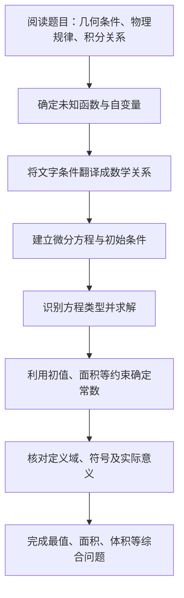
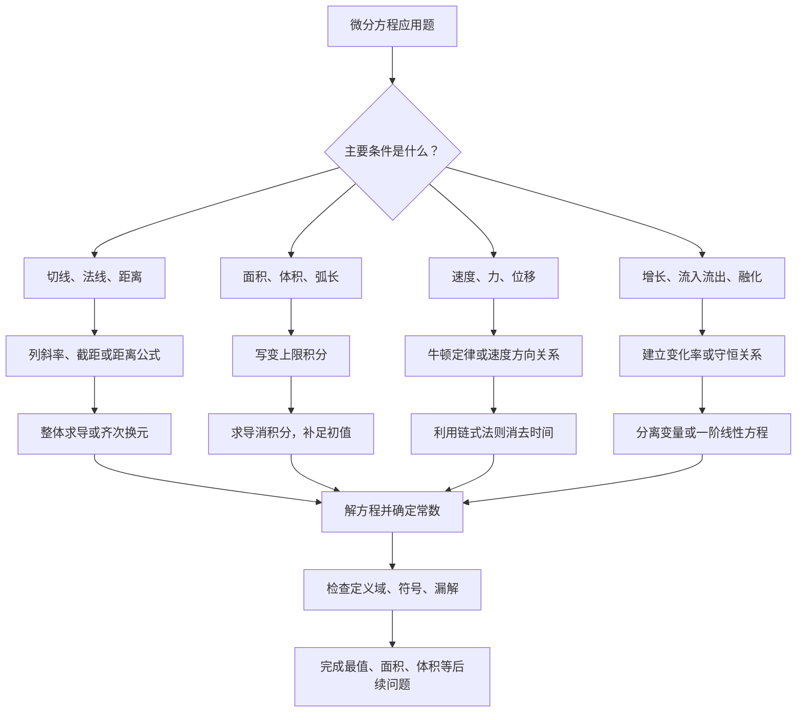

## 一、本节的知识定位与复习路线

前两节主要研究的是：

> 已知微分方程，如何求出未知函数？

本节则进一步研究：

> 已知未知函数满足某种几何关系、物理规律或者积分关系，如何建立微分方程，并利用它解决实际问题？

二者的难度差异主要在于**数学建模**。

例如，前两节可能直接给出

$$
y'-\frac{y}{x}=-1.
$$

而本节可能告诉你：曲线上任意一点到纵坐标轴的距离等于该点处切线在纵坐标轴上的截距，要求你自行得到这个微分方程。

因此，本节完整的解题过程是：

**核心题型**

本节的主要题型及复习优先级如下。

| 核心题型       | 代表性考点         | 复习优先级 |
| ---------- | ------------- | ----- |
| 切线、法线与截距   | 斜率、截距、齐次方程    | ★★★★★ |
| 几何距离与围成面积  | 点到直线距离、三角形面积  | ★★★★★ |
| 积分方程与变限积分  | 求导消积分、补充初值    | ★★★★★ |
| 面积与旋转体积    | 圆盘法、柱壳法、伯努利方程 | ★★★★★ |
| 弧长与斜率关系    | 弧长微元、降阶、双曲函数  | ★★★★☆ |
| 运动学与动力学    | 牛顿第二定律、追及曲线   | ★★★★☆ |
| 增长、冷却、混合问题 | 指数规律、守恒方程     | ★★★★☆ |
| 融化与形状变化    | 旋转曲面面积、相关变化率  | ★★★★☆ |

其中，最值得建立条件反射的是：

- 看到切线、法线，立即想到斜率与截距。
- 看到从固定点到动点的累计量，立即想到变上限积分。
- 看到变化率与某个量成正比，立即想到导数关系。
- 看到流入、流出、混合，立即想到总量守恒。
- 看到速度、位移和加速度同时出现，立即想到链式法则。

## 二、基础知识：建立微分方程的通用工具箱

本节不需要重新学习大量微分方程求解方法，而是需要掌握一套将实际条件转换为微分方程的工具。

### 2.1 切线与法线的四种截距

设曲线 $y=y(x)$ 上任意一点为 $P(x,y)$，记切线斜率为

$$
p=y'(x).
$$

为了避免混淆，将切线、法线上其他点的坐标记为 $(X,Y)$。

**（1）切线方程**

$$
\boxed{Y-y=p(X-x)}
$$

**（2）法线方程**

$$
\boxed{X-x=-p(Y-y)}
$$

建议优先使用这种法线方程，而不是直接使用法线斜率 $-1/y'$，因为这种形式即使在 $y'=0$ 时也成立。

四种截距如下：

| 截距                | 公式                                 | 条件           |
| ----------------- | ---------------------------------- | ------------ |
| 切线在 $y$ 轴上的截距 | $y-xy'$                        | 切线斜率有限       |
| 切线在 $x$ 轴上的截距 | $\displaystyle x-\frac{y}{y'}$ | $y'\ne0$ |
| 法线在 $x$ 轴上的截距 | $x+yy'$                        | 切线斜率有限       |
| 法线在 $y$ 轴上的截距 | $\displaystyle y+\frac{x}{y'}$ | $y'\ne0$ |

其中最重要的是两个不含分母的公式：

$$
\boxed{b_{\text{切}}=y-xy'}
$$

$$
\boxed{a_{\text{法}}=x+yy'}
$$

这两个公式是大量几何应用题的起点。

### 2.2 两个必须形成条件反射的导数公式

第一个是商的求导：

$$
\boxed{ \left(\frac yx\right)' =\frac{xy'-y}{x^2} }
$$

其等价形式为

$$
y'-\frac yx =x\left(\frac yx\right)'.
$$

遇到 $xy'-y$、$y-xy'$、$y'-y/x$ 时，优先考虑整体求导，而不必机械使用一阶线性微分方程通解公式。

第二个是平方函数的求导：

$$
\boxed{(y^2)'=2yy'}
$$

特别地，

$$
\boxed{ \left(\frac{y^2}{x}\right)' =\frac{2xyy'-y^2}{x^2} }
$$

当几何距离经过平方整理后出现 $2xyy'-y^2$，往往可以一步化简。

此外，

$$
(x^2+y^2)'=2x+2yy'
$$

也经常出现在涉及法线和圆的题目中。

### 2.3 几何条件的数学翻译

| 题目中的表述             | 数学表达式                    |
| ------------------ | ------------------------ |
| 点到 $x$ 轴的距离    | $\lvert y\rvert$     |
| 点到 $y$ 轴的距离    | $\lvert x\rvert$     |
| 点到原点的距离            | $\sqrt{x^2+y^2}$     |
| 直线 $OP$ 的斜率    | $y/x$                |
| 曲线在 $P$ 处的切线斜率 | $y'$                 |
| 切线与给定直线平行          | 斜率相等                     |
| 切线与给定直线垂直          | 非竖直且斜率存在时斜率乘积为 $-1$  |
| 两条曲线在某点相切          | 函数值与一阶导数均相等              |
| 在某点有水平切线           | $y'=0$               |
| 二阶可导曲线在某点有拐点       | 必有 $y''=0$，并需满足凹凸性改变 |

特别注意：**截距是有向坐标，距离是非负长度。**

题目说截距等于某距离时，一般不能擅自给截距加绝对值；而题目说线段长度时，则必须考虑绝对值。

### 2.4 点到切线、法线的距离

切线可以写成

$$
pX-Y+y-px=0.
$$

因此原点到切线的距离为

$$
\boxed{ d_{\text{切}}= \frac{|y-xy'|}{\sqrt{1+(y')^2}} }
$$

法线可以写成

$$
X+pY-x-py=0.
$$

因此原点到法线的距离为

$$
\boxed{ d_{\text{法}}= \frac{|x+yy'|}{\sqrt{1+(y')^2}} }
$$

设 $M(x,0)$ 为切点 $P(x,y)$ 在 $x$ 轴上的投影，则 $M$ 到切线的距离为

$$
\boxed{ d(M,l)=\frac{|y|}{\sqrt{1+(y')^2}} }
$$

这些公式在张宇八套卷、李林六套卷中均有直接应用。

### 2.5 三角形面积

切线与两坐标轴围成的三角形面积为

$$
\boxed{ S=\frac12 \left| \left(x-\frac{y}{y'}\right) (y-xy') \right| }
$$

适用于两个截距均存在且构成三角形的情形。

另一种更加重要的模型：切线与过切点的竖直直线、$x$ 轴围成三角形。

竖直边长度为 $|y|$，水平边长度为

$$
\left|\frac y{y'}\right|.
$$

所以

$$
\boxed{S=\frac{y^2}{2|y'|}}
$$

如果已知 $y'>0$，直接写为

$$
S=\frac{y^2}{2y'}.
$$

这是2015年数学一真题的核心公式。

### 2.6 面积、体积、弧长、旋转曲面面积

设 $f(x)>0$，定义由固定端点 $a$ 到动点 $x$ 的各类几何累积量。

| 几何量                       | 积分表达式                                                             | 关于 $x$ 的导数                  |
| ------------------------- | ----------------------------------------------------------------- | ------------------------------- |
| 曲边梯形面积 $A$            | $\displaystyle\int_a^x f(t)\,\mathrm dt$                     | $f(x)$                      |
| 绕 $x$ 轴旋转体积 $V_x$ | $\displaystyle\pi\int_a^x f^2(t)\,\mathrm dt$                | $\pi f^2(x)$                |
| 绕 $y$ 轴旋转体积 $V_y$ | $\displaystyle2\pi\int_a^x tf(t)\,\mathrm dt$                | $2\pi xf(x)$                |
| 曲线弧长 $L$              | $\displaystyle\int_a^x\sqrt{1+f'^2(t)}\,\mathrm dt$          | $\sqrt{1+f'^2(x)}$          |
| 绕 $x$ 轴的旋转侧面积 $S$ | $\displaystyle2\pi\int_a^x f(t)\sqrt{1+f'^2(t)}\,\mathrm dt$ | $2\pi f(x)\sqrt{1+f'^2(x)}$ |

其中绕 $y$ 轴的柱壳公式按区域位于 $x\ge0$ 一侧使用，其余公式也需根据实际区域确定积分限及半径。

本节有一个极其重要的思想：

**累计量的导数，就是该点处的局部变化率。**

例如，

$$
A'(x)=f(x), \qquad V'(x)=\pi f^2(x).
$$

题目只要给出累计面积、体积、弧长与未知函数之间的关系，通常就能利用求导建立微分方程。

### 2.7 本节常用的微分方程识别方法

| 建立的方程                  | 优先方法                                                  |
| ---------------------- | ----------------------------------------------------- |
| $y'=g(x)h(y)$      | 分离变量                                                  |
| $y'+P(x)y=Q(x)$    | 一阶线性方程                                                |
| $y'=F(y/x)$        | 令 $u=y/x$                                         |
| $y'+P(x)y=Q(x)y^n$ | 伯努利方程，令 $z=y^{1-n}$                               |
| 含 $yy'$、$y^2$  | 令 $z=y^2$                                         |
| $F(x,y',y'')=0$    | 令 $p=y'$                                          |
| $F(y,y',y'')=0$    | 令 $p=p(y)$，使用 $y''=p\,\mathrm dp/\mathrm dy$ |
| 正向求 $y(x)$ 困难      | 考虑反过来求 $x(y)$                                     |
| 含未知函数的变限积分             | 求导消积分，并补足初值                                           |

掌握这些识别特征之后，应用题中真正陌生的部分通常就只剩下建立方程。

## 三、母题一：切线截距与斜率条件

**重要程度：★★★★★**

这是本节应当优先掌握的核心题型，2023年数学一、数学二真题以及张宇1000题均有直接考查。

### 3.1 核心真题：2023年考研数学一

**题目**

曲线 $y=y(x)$（$x>0$）经过点 $(1,2)$，曲线上任一点到 $y$ 轴的距离等于该点处切线在 $y$ 轴上的截距。

（1）求曲线方程；

（2）求函数

$$
F(x)=\int_1^x y(t)\,\mathrm dt
$$

在 $(0,+\infty)$ 上的最大值。

<Steps>

<Step>

### 第一步：识别几何条件 [!toc]

点 $P(x,y)$ 到 $y$ 轴的距离为 $x$，切线在 $y$ 轴上的截距为 $y-xy'$。

于是

$$
y-xy'=x.
$$

这就是要求建立的微分方程。

</Step>

<Step>

### 第二步：选择最快的解法 [!toc]

整理得

$$
xy'-y=-x.
$$

两边除以 $x^2$：

$$
\frac{xy'-y}{x^2}=-\frac1x.
$$

即

$$
\left(\frac yx\right)'=-\frac1x.
$$

积分得到

$$
\frac yx=-\ln x+C.
$$

所以

$$
y=x(C-\ln x).
$$

利用初值 $y(1)=2$，得到 $C=2$。

因此

$$
\boxed{y=x(2-\ln x)}.
$$

</Step>

<Step>

### 第三步：研究变上限积分的最值 [!toc]

不要急着计算 $F(x)$。

先求导：

$$
F'(x)=y(x)=x(2-\ln x).
$$

因为 $x>0$，所以 $F'(x)$ 的符号仅取决于 $2-\ln x$。

| 区间                  | $F'(x)$ | $F(x)$ |
| ------------------- | ----------- | ---------- |
| $(0,e^2)$       | 正           | 严格递增       |
| $x=e^2$         | 零           | 最大值点       |
| $(e^2,+\infty)$ | 负           | 严格递减       |

于是最大值点为

$$
x=e^2.
$$

最后计算最大值：

$$
\begin{aligned} F(e^2) &=\int_1^{e^2}t(2-\ln t)\,\mathrm dt\\ &=\left[ \frac54t^2-\frac12t^2\ln t \right]_1^{e^2}\\ &=\frac{e^4-5}{4}. \end{aligned}
$$

最终答案：

$$
\boxed{F_{\max}=\frac{e^4-5}{4}}.
$$

</Step>

</Steps>

**母题提炼**

这道题不仅考微分方程，还考查以下知识链：

$$
\text{切线截距} \longrightarrow \text{一阶线性方程} \longrightarrow \text{变限积分} \longrightarrow \text{全局最值}.
$$

容易出现的错误是把 $F$ 的最大值点与 $y$ 的最大值点混淆。

实际上，

$$
F'(x)=y(x),
$$

而

$$
y'(x)=1-\ln x.
$$

因此 $y$ 在 $x=e$ 处取最大值，而 $F$ 在 $x=e^2$ 处取最大值。

这两个对象完全不同。

### 3.2 通用推广：截距是任意已知函数

如果题目改为切线在 $y$ 轴上的截距等于 $g(x)$，那么

$$
y-xy'=g(x).
$$

立即得到

$$
\left(\frac yx\right)' =-\frac{g(x)}{x^2}.
$$

如果已知 $y(x_0)=y_0$，且 $x,x_0$ 位于不经过零点的同一连通区间，则

$$
\boxed{ y(x)=x\left[ \frac{y_0}{x_0} -\int_{x_0}^x\frac{g(t)}{t^2}\,\mathrm dt \right] }
$$

这个公式可以直接解决一整类题目，而不仅仅是2023年真题。

例如：

| 截距条件                     | 曲线通解                                      |
| ------------------------ | ----------------------------------------- |
| $y-xy'=1$            | $y=1+Cx$                              |
| $y-xy'=x$            | $y=x(C-\ln\|x\|)$                     |
| $y-xy'=x^2$          | $y=Cx-x^2$                            |
| $y-xy'=ax^n,\ n\ne1$ | $\displaystyle y=Cx-\frac{a}{n-1}x^n$ |

最后一行以幂函数在所讨论区间内有定义为前提。

### 3.3 同源变式：2023年考研数学二

曲线满足相同的截距条件，但要求在 $x>e$ 上找到一个切点，使切线与两个坐标轴围成的三角形面积最小。

曲线仍然为

$$
y=x(2-\ln x).
$$

切线斜率：

$$
y'=1-\ln x.
$$

由于 $x>e$，所以 $y'<0$。

切线的两个截距分别为

$$
b=x,
$$

$$
a=x-\frac{y}{y'} =\frac{x}{\ln x-1}.
$$

故面积函数为

$$
S(x)=\frac{x^2}{2(\ln x-1)}.
$$

求导：

$$
S'(x)= \frac{x(2\ln x-3)} {2(\ln x-1)^2}.
$$

由导数先负后正可知，最小值点为

$$
x=e^{3/2}.
$$

因此所求切点为

$$
\boxed{ P\left(e^{3/2},\frac12e^{3/2}\right) }
$$

最小面积为

$$
\boxed{S_{\min}=e^3}.
$$

**迁移意义：** 两道2023年真题具有完全相同的微分方程建模过程，差异仅在第二问的综合对象。未来考研完全可能将第二问换成弧长、曲率、旋转体积、极值或者渐近线。

### 3.4 切线重合与初值：1988年数学一、数学二真题

已知

$$
y''-3y'+2y=2e^x,
$$

曲线在 $(0,1)$ 处的切线与曲线 $y=x^2-x+1$ 在该点的切线重合。

由于两条曲线在该点的函数值、导数均相等，所以

$$
y(0)=1,\qquad y'(0)=-1.
$$

特征方程为

$$
(r-1)(r-2)=0.
$$

由于右端 $2e^x$ 与单特征根 $r=1$ 共振，设特解

$$
y_p=Axe^x.
$$

代入得 $A=-2$，故通解为

$$
y=C_1e^x+C_2e^{2x}-2xe^x.
$$

代入两个初值：

$$
\begin{cases} C_1+C_2=1,\\ C_1+2C_2-2=-1. \end{cases}
$$

得到 $C_1=1,C_2=0$。

$$
\boxed{y=(1-2x)e^x}.
$$

张宇1000题中的第013、014、045题以及李林880题中相关积分曲线题，均可用这一思想解决。

必须记住：**相切条件实际上提供两个初始条件，而不是一个。**

## 四、母题二：切线、法线与几何距离

**重要程度：★★★★★**

本类题的关键，是正确列出距离关系，然后利用平方、齐次换元或整体求导简化。

### 4.1 核心真题：1995年考研数学一

第一象限内的曲线 $L$ 上任一点 $M$ 处的切线与 $y$ 轴交于 $A$，满足

$$
|MA|=|OA|.
$$

已知曲线经过点

$$
\left(\frac32,\frac32\right).
$$

求曲线方程。

<Steps>

<Step>

### 第一步：写出切点和截距点 [!toc]

令

$$
M=(x,y).
$$

切线与 $y$ 轴的交点为

$$
A=(0,y-xy').
$$

因此

$$
|OA|=|y-xy'|.
$$

两点 $M,A$ 之间的水平坐标差为 $x$，竖直坐标差为 $xy'$，所以

$$
|MA|=x\sqrt{1+(y')^2}.
$$

</Step>

<Step>

### 第二步：平方并消去公共项 [!toc]

由题意：

$$
x\sqrt{1+(y')^2}=|y-xy'|.
$$

平方得

$$
x^2+x^2(y')^2 =y^2-2xyy'+x^2(y')^2.
$$

两边恰好消去 $x^2(y')^2$，于是

$$
2xyy'=y^2-x^2.
$$

</Step>

<Step>

### 第三步：识别整体导数 [!toc]

整理得

$$
\frac{2xyy'-y^2}{x^2}=-1.
$$

即

$$
\left(\frac{y^2}{x}\right)'=-1.
$$

积分：

$$
\frac{y^2}{x}=-x+C.
$$

所以

$$
x^2+y^2=Cx.
$$

代入已知点，得到 $C=3$。

第一象限要求 $y>0$，于是

$$
\boxed{y=\sqrt{3x-x^2},\quad 0<x<3}.
$$

</Step>

<Step>

### 第四步：几何意义 [!toc]

将方程配方：

$$
\left(x-\frac32\right)^2+y^2 =\frac94.
$$

这是一段上半圆，圆心为 $(3/2,0)$，半径为 $3/2$。

说明几何条件往往并不是随机设计的，而是在隐式地刻画某一类经典曲线。

</Step>

</Steps>

### 4.2 重点模拟题：张宇八套卷第五套第18题

这道2027数学一模拟题与1995年数学一真题高度同源，非常值得对照学习。

**题目**

曲线位于 $x$ 轴上方，经过点 $(1,2)$。原点到曲线上任一点的法线的距离，等于该点到 $x$ 轴的距离。求曲线方程及极值。

<Steps>

<Step>

### 第一步：使用不会遗漏水平切线的法线方程 [!toc]

法线为

$$
X+y'Y-x-yy'=0.
$$

原点到法线的距离为

$$
\frac{|x+yy'|}{\sqrt{1+(y')^2}}.
$$

由 $y>0$ 得

$$
\frac{|x+yy'|}{\sqrt{1+(y')^2}}=y.
$$

</Step>

<Step>

### 第二步：整理微分方程 [!toc]

平方：

$$
x^2+2xyy'+y^2(y')^2 =y^2+y^2(y')^2.
$$

于是

$$
2xyy'=y^2-x^2.
$$

注意，这竟然与1995年真题得到的微分方程完全相同。

因此直接得到

$$
x^2+y^2=Cx.
$$

代入 $(1,2)$：

$$
C=1+4=5.
$$

所以

$$
\boxed{y=\sqrt{5x-x^2},\quad 0<x<5}.
$$

</Step>

<Step>

### 第三步：求极值 [!toc]

由配方：

$$
y^2=\frac{25}{4} -\left(x-\frac52\right)^2.
$$

因此无需复杂求导即可得到

$$
\boxed{x=\frac52,\qquad y_{\max}=\frac52}.
$$

</Step>

</Steps>

**真题与模拟题的联系**

| 题目       | 表面几何条件       | 本质微分方程              |
| -------- | ------------ | ------------------- |
| 1995年数学一 | 两条线段长度相等     | $2xyy'=y^2-x^2$ |
| 张宇八套卷第五套 | 点到法线的距离等于纵坐标 | $2xyy'=y^2-x^2$ |

这正是学习母题的价值：几何叙述完全不同，但底层结构相同。

法线方程应采用一般形式，避免遗漏 $y'=0$ 的水平切线情形。

### 4.3 核心真题：2015年考研数学一、数学三

已知 $f'(x)>0$，曲线上任一点处切线与过该点的竖直直线、$x$ 轴围成三角形面积恒为4，且 $f(0)=2$。求 $f(x)$。

<Steps>

<Step>

### 第一步：从面积建立微分方程 [!toc]

根据前面的切线三角形公式，

$$
\frac{f^2(x)}{2f'(x)}=4.
$$

得到

$$
f'=\frac{f^2}{8}.
$$

</Step>

<Step>

### 第二步：分离变量 [!toc]

$$
\frac{\mathrm df}{f^2} =\frac18\,\mathrm dx.
$$

积分：

$$
-\frac1f=\frac x8+C.
$$

利用 $f(0)=2$，得到

$$
C=-\frac12.
$$

于是

$$
\boxed{f(x)=\frac8{4-x}}.
$$

经过初值点的最大实值解区间为

$$
\boxed{(-\infty,4)}.
$$

不能简单将定义域写成 $x\ne4$，因为初值问题的解应当在包含初始点的连通区间上讨论。

</Step>

</Steps>

**母题推广**

若面积恒为 $S_0>0$，且 $y'>0$，那么

$$
\frac{y^2}{2y'}=S_0
$$

等价于

$$
\left(\frac1y\right)' =-\frac1{2S_0}.
$$

因此这一类曲线通常为倒数型函数。

## 五、母题三：切线与法线诱导的齐次微分方程

**重要程度：★★★★★**

### 5.1 识别方法

如果几何关系经过整理后出现

$$
y'=F\left(\frac yx\right),
$$

应立即令

$$
u=\frac yx,\qquad y=xu,\qquad y'=u+xu'.
$$

这样方程通常可以转化为可分离变量方程。

特别是出现

$$
\sqrt{x^2+y^2}
$$

时，在 $x>0$ 上可写成

$$
x\sqrt{1+\left(\frac yx\right)^2}.
$$

这是典型的齐次结构。

### 5.2 代表真题：2017年考研数学二

曲线上任一点处的切线在 $y$ 轴上的截距等于法线在 $x$ 轴上的截距，且 $y(1)=0$。

由截距公式，

$$
y-xy'=x+yy'.
$$

所以

$$
y'=\frac{y-x}{x+y}.
$$

令

$$
u=\frac yx.
$$

则

$$
u+xu'=\frac{u-1}{1+u}.
$$

整理：

$$
xu'=-\frac{1+u^2}{1+u}.
$$

分离变量：

$$
\frac{1+u}{1+u^2}\,\mathrm du =-\frac{\mathrm dx}{x}.
$$

积分得到

$$
\frac12\ln(1+u^2)+\arctan u =-\ln x+C.
$$

利用 $u(1)=0$，得到 $C=0$。

所以曲线的隐式方程为

$$
\boxed{ \frac12\ln(x^2+y^2) +\arctan\frac yx=0 }
$$

这里使用了 $x>0$ 的条件。

这类题通常接受隐式方程，不需要强行解出 $y=\varphi(x)$。

### 5.3 张宇1000题的推广模型

如果切线在 $y$ 轴上的截距与法线在 $x$ 轴上的截距之比为 $3:1$，那么

$$
y-xy'=3(x+yy').
$$

所以

$$
y'=\frac{y-3x}{x+3y}.
$$

使用与2017年真题完全相同的换元方法，可得

$$
\boxed{ \frac12\ln(x^2+y^2) +\frac13\arctan\frac yx=C }
$$

更一般地，若截距之比为 $k:1$，其中 $k\ne0$，则在适当的局部连通区间内，

$$
\boxed{ \frac12\ln(x^2+y^2) +\frac1k\arctan\frac yx=C }
$$

这类曲线具有对数螺线的局部结构。

若原题使用的是两个截距的比值而不是直接等式，还需检查分母截距不为零。

### 5.4 高质量模拟题：汤家凤八套卷第五套第11题

曲线位于右半平面，经过 $(1/2,0)$，任一点处法线在 $y$ 轴上的截距等于该点到原点的距离。

列方程：

$$
y+\frac{x}{y'}=\sqrt{x^2+y^2}.
$$

整理：

$$
y'=\frac{x}{\sqrt{x^2+y^2}-y}.
$$

分母有理化：

$$
y'=\frac{\sqrt{x^2+y^2}+y}{x}.
$$

这是齐次方程。

令 $u=y/x$，则

$$
u+xu'=u+\sqrt{1+u^2}.
$$

于是

$$
\frac{\mathrm du}{\sqrt{1+u^2}} =\frac{\mathrm dx}{x}.
$$

积分公式为

$$
\int\frac{\mathrm du}{\sqrt{1+u^2}} =\ln\left(u+\sqrt{1+u^2}\right)+C.
$$

因此

$$
u+\sqrt{1+u^2}=Cx.
$$

利用 $x=1/2,u=0$，得到 $C=2$。

于是

$$
u+\sqrt{1+u^2}=2x.
$$

根据恒等式

$$
\left(\sqrt{1+u^2}+u\right) \left(\sqrt{1+u^2}-u\right)=1,
$$

得到

$$
\sqrt{1+u^2}-u=\frac1{2x}.
$$

两式相减：

$$
2u=2x-\frac1{2x}.
$$

故

$$
\boxed{y=x^2-\frac14,\quad x>0}.
$$

### 5.5 李林880题的反向变式

如果将上一题的条件改成：切线在 $y$ 轴上的截距等于该点到原点的距离，并且仍经过 $(1/2,0)$，则

$$
y-xy'=\sqrt{x^2+y^2}.
$$

同样令 $u=y/x$，得到

$$
xu'=-\sqrt{1+u^2}.
$$

积分后得到

$$
y+\sqrt{x^2+y^2}=\frac12.
$$

解得

$$
\boxed{y=\frac14-x^2}.
$$

这两道题形成了非常好的对照：

| 几何条件        | 微分方程                    | 曲线                                |
| ----------- | ----------------------- | --------------------------------- |
| 法线纵截距等于原点距离 | $xu'=\sqrt{1+u^2}$  | $\displaystyle y=x^2-\frac14$ |
| 切线纵截距等于原点距离 | $xu'=-\sqrt{1+u^2}$ | $\displaystyle y=\frac14-x^2$ |

本类题需要熟练掌握的不是某条抛物线的答案，而是从几何关系识别齐次结构的能力。

## 六、母题四：积分方程与变上限积分

**重要程度：★★★★★**

这类题是考研数学一综合题的重要来源，能够将微分方程与定积分、反常积分、最值、面积、体积有机结合。

### 6.1 核心思想：求导消积分，代值补条件

例如，已知

$$
f(x)-\int_a^x f(t)\,\mathrm dt=g(x).
$$

若 $f$ 连续、$g$ 可导，则由原式可知 $f$ 可导。

两边求导：

$$
f'(x)-f(x)=g'(x).
$$

但是，仅仅求解这个微分方程还不够。

将 $x=a$ 代入原式，得到

$$
f(a)=g(a).
$$

因此完整的初值问题为

$$
\boxed{ \begin{cases} f'-f=g',\\ f(a)=g(a). \end{cases} }
$$

一般而言，积分等式求导一次可能丢失一个常数信息；求导两次，则可能丢失两个。

**求导是必要条件的推导，回代或者补足初值才能保证等价。**

### 6.2 核心真题：1996年考研数学一

对任意 $x>0$，曲线 $y=f(x)$ 在 $(x,f(x))$ 处的切线在 $y$ 轴上的截距等于

$$
\frac1x\int_0^x f(t)\,\mathrm dt.
$$

求 $f(x)$ 的一般表达式。

<Steps>

<Step>

### 第一步：建立积分微分方程 [!toc]

切线截距为 $f-xf'$，于是

$$
f(x)-xf'(x) =\frac1x\int_0^x f(t)\,\mathrm dt.
$$

两边乘 $x$：

$$
xf-x^2f'=\int_0^x f(t)\,\mathrm dt.
$$

</Step>

<Step>

### 第二步：求导消积分 [!toc]

$$
f+xf'-2xf'-x^2f''=f.
$$

所以

$$
xf'+x^2f''=0.
$$

利用 $x>0$，化为

$$
f'+xf''=0.
$$

识别整体导数：

$$
(xf')'=0.
$$

因此

$$
xf'=C_1.
$$

再次积分：

$$
\boxed{f(x)=C_1\ln x+C_2}.
$$

</Step>

<Step>

### 第三步：必须回代原积分条件 [!toc]

由于题目积分下限为0，不能直接使用 $f(0)$，而应验证原式。

注意

$$
\int_0^x\ln t\,\mathrm dt=x\ln x-x.
$$

因此

$$
\frac1x\int_0^x f(t)\,\mathrm dt =C_1\ln x-C_1+C_2.
$$

另一方面，

$$
f-xf' =C_1\ln x+C_2-C_1.
$$

二者完全一致。

所以任意常数 $C_1,C_2$ 均满足原条件。

</Step>

</Steps>

<Callout type="warn" title="本题最重要的陷阱">

虽然 $\ln x$ 在 $x\to0^+$ 时无界，但

$$
\int_0^1\ln x\,\mathrm dx=-1
$$

是收敛的反常积分。

不能因为积分下限为0，就错误地要求 $f(0)$ 存在，或者把 $C_1$ 强行取为0。

</Callout>

### 6.3 张宇1000题：积分方程与旋转体积综合

来源：张宇1000题。

设连续函数满足

$$
f(x)-\int_0^x f(t)\,\mathrm dt =-\frac12+\sin x.
$$

（1）求 $f(x)$；

（2）求其在区间 $[\pi/4,5\pi/4]$ 上与 $x$ 轴围成的图形绕 $x$ 轴旋转一周的体积。

第一问：求导得

$$
f'-f=\cos x.
$$

同时令原式 $x=0$，得到

$$
f(0)=-\frac12.
$$

一阶线性方程的解为

$$
f=Ce^x+\frac12(\sin x-\cos x).
$$

代入初值得 $C=0$，故

$$
\boxed{f(x)=\frac12(\sin x-\cos x)}.
$$

第二问：使用圆盘法。

$$
\begin{aligned} V &=\pi\int_{\pi/4}^{5\pi/4}f^2(x)\,\mathrm dx\\ &=\frac\pi4\int_{\pi/4}^{5\pi/4} (1-\sin2x)\,\mathrm dx\\ &=\frac\pi4 \left[x+\frac12\cos2x\right]_{\pi/4}^{5\pi/4}. \end{aligned}
$$

因此

$$
\boxed{V=\frac{\pi^2}{4}}.
$$

同一道题中，第一个积分是需要求导消去的累计量，第二个积分是需要计算的几何体积。要准确区分两者的作用。

### 6.4 重点模拟题：汤家凤八套卷第三套第11题

已知 $y(x)$ 单调递增，$y(0)=1$，切线斜率与曲边梯形面积之差为

$$
2e^x+\frac12x^2.
$$

因此

$$
y'(x)-\int_0^x y(t)\,\mathrm dt =2e^x+\frac12x^2.
$$

先令 $x=0$，得到

$$
y'(0)=2.
$$

再求导：

$$
y''-y=2e^x+x.
$$

这是二阶常系数非齐次线性方程，其初始条件为

$$
y(0)=1,\qquad y'(0)=2.
$$

齐次通解为

$$
y_h=C_1e^{-x}+C_2e^x.
$$

右端的指数项存在共振，因此设特解

$$
y_p=Axe^x+Bx+D.
$$

代入得

$$
A=1,\qquad B=-1,\qquad D=0.
$$

通解为

$$
y=C_1e^{-x}+C_2e^x+xe^x-x.
$$

代入初值：

$$
\boxed{ y=-\frac12e^{-x} +\frac32e^x+xe^x-x }.
$$

这道模拟题说明：变限积分与一阶导数共同出现时，求导后往往得到二阶微分方程。

## 七、母题五：面积、体积与形心约束

**重要程度：★★★★★**

这一类题相比简单积分方程更灵活，因为题目可能不给出任何明确的积分，而是完全使用几何语言进行描述。

### 7.1 代表真题：1998年考研数学三

曲线 $y=f(x)$ 在 $[1,t]$ 上与 $x$ 轴围成的区域绕 $x$ 轴旋转，所得体积为

$$
V(t)=\frac\pi3[t^2f(t)-f(1)].
$$

求微分方程及满足 $y(2)=2/9$ 的解。

<Steps>

<Step>

### 第一步：用体积公式建立等式 [!toc]

$$
\pi\int_1^t f^2(x)\,\mathrm dx =\frac\pi3[t^2f(t)-f(1)].
$$

</Step>

<Step>

### 第二步：对动端点求导 [!toc]

$$
3f^2(t)=2tf(t)+t^2f'(t).
$$

换回变量 $x,y$：

$$
\boxed{x^2y'=3y^2-2xy}.
$$

</Step>

<Step>

### 第三步：识别伯努利方程 [!toc]

$$
y'+\frac2xy=\frac3{x^2}y^2.
$$

令

$$
z=\frac1y.
$$

则

$$
z'-\frac2xz=-\frac3{x^2}.
$$

积分因子为 $x^{-2}$，故

$$
\left(\frac z{x^2}\right)'=-\frac3{x^4}.
$$

积分得到

$$
z=\frac1x+Cx^2.
$$

所以

$$
y=\frac{x}{1+Cx^3}.
$$

利用初值 $y(2)=2/9$ 得 $C=1$。

$$
\boxed{y=\frac{x}{1+x^3}}.
$$

这里的换元除去了零解，但零解不满足非零初值，因此不会影响答案。

</Step>

</Steps>

### 7.2 进阶母题：2009年考研数学三

设 $f(x)>0$，对任意 $t>1$，曲线 $y=f(x)$ 在 $[1,t]$ 上与 $x$ 轴围成区域的旋转体积，是该区域面积的 $\pi t$ 倍。

求曲线方程。

这道题值得数学一考生重点研究，因为它融合了两次求导、隐含初值和反函数线性化。

<Steps>

<Step>

### 第一步：建立两个累计量的关系 [!toc]

面积为

$$
A(t)=\int_1^t f(x)\,\mathrm dx.
$$

旋转体积为

$$
V(t)=\pi\int_1^t f^2(x)\,\mathrm dx.
$$

由题意，

$$
\int_1^t f^2(x)\,\mathrm dx =t\int_1^t f(x)\,\mathrm dx. \tag{1}
$$

</Step>

<Step>

### 第二步：第一次求导 [!toc]

$$
f^2(t)=\int_1^t f(x)\,\mathrm dx+tf(t). \tag{2}
$$

此时仍然存在积分项，因此需要再次求导。

不过，在第二次求导之前，应当先挖掘初始条件。

令 $t\to1^+$，由连续性得

$$
f^2(1)=f(1).
$$

由于 $f(1)>0$，所以

$$
\boxed{f(1)=1}.
$$

</Step>

<Step>

### 第三步：第二次求导 [!toc]

由式（2）得到

$$
2ff'=2f+tf'.
$$

于是

$$
(2f-t)f'=2f.
$$

写成

$$
(2y-x)y'=2y.
$$

直接求 $y(x)$ 不方便。

但因为 $y>0$，该式说明 $y'\ne0$，于是可以反过来求 $x=x(y)$。

</Step>

<Step>

### 第四步：交换自变量与因变量 [!toc]

$$
\frac{\mathrm dx}{\mathrm dy} =\frac{2y-x}{2y}.
$$

整理：

$$
\frac{\mathrm dx}{\mathrm dy}+\frac{x}{2y}=1.
$$

这立即变成一阶线性微分方程。

积分因子为

$$
\mu(y)=\sqrt y.
$$

因此

$$
(x\sqrt y)'=\sqrt y,
$$

这里导数是关于 $y$ 求的。

积分得到

$$
x\sqrt y=\frac23y^{3/2}+C.
$$

于是

$$
x=\frac23y+\frac C{\sqrt y}.
$$

利用 $(x,y)=(1,1)$，得 $C=1/3$。

最终答案：

$$
\boxed{x=\frac23y+\frac1{3\sqrt y},\quad y\ge1}.
$$

在这条分支上，

$$
\frac{\mathrm dx}{\mathrm dy} =\frac23-\frac1{6y^{3/2}}>0,
$$

因此可以唯一确定相应的 $y=f(x)$。

**核心技巧：** 当方程呈现

$$
y'=\frac{g(y)}{a(y)x+b(y)}
$$

时，反过来求 $x(y)$，很可能立刻得到一阶线性微分方程。

</Step>

</Steps>

### 7.3 李正元练习题：动弦与曲线围成面积

设凸弧连接 $A(0,1)$ 与 $B(1,0)$，曲线上任一点 $P(x,y)$ 与固定点 $A$ 的连线所形成的弦，和曲线弧 $AP$ 围成的面积为 $x^3$。求曲线。

<Steps>

<Step>

### 第一步：分辨固定曲线与移动直线 [!toc]

弦 $AP$ 的方程为

$$
Y=1+\frac{y(x)-1}{x}t, \qquad 0\le t\le x.
$$

弦下的梯形面积是

$$
\frac x2[1+y(x)].
$$

曲线与弦之间的面积是

$$
\int_0^x y(t)\,\mathrm dt -\frac x2[1+y(x)].
$$

因此

$$
\int_0^x y(t)\,\mathrm dt -\frac x2(1+y)=x^3.
$$

</Step>

<Step>

### 第二步：求导 [!toc]

$$
y-\frac12(1+y)-\frac x2y'=3x^2.
$$

整理得

$$
xy'-y+1=-6x^2.
$$

于是

$$
\left(\frac yx\right)' =-6-\frac1{x^2}.
$$

积分：

$$
\frac yx=-6x+\frac1x+C.
$$

即

$$
y=1+Cx-6x^2.
$$

利用 $y(1)=0$，得到 $C=5$。

$$
\boxed{y=1+5x-6x^2,\quad 0\le x\le1}.
$$

核对：

$$
y''=-12<0.
$$

因此曲线位于对应弦的上方，符合所用的面积表达式。

</Step>

</Steps>

**通用推广**

设曲线从固定点 $A(0,a)$ 到动点 $P(x,y)$ 的弧与弦之间的面积为 $G(x)$，且曲线位于弦上方，则

$$
\int_0^x y(t)\,\mathrm dt -\frac x2[a+y(x)] =G(x).
$$

求导得到

$$
\boxed{xy'-y+a=-2G'(x)}.
$$

进一步，

$$
\boxed{ \left(\frac{y-a}{x}\right)' =-\frac{2G'(x)}{x^2} }.
$$

李林880题中关于动弦面积的题目也属于同一母题。

### 7.4 李林880综合题：面积比恒定

设第一象限内曲线 $y=y(x)$ 满足 $y(0)=0$、$y'>0$。任一点的切线与该点向 $x$ 轴作的垂线、$x$ 轴所围三角形面积，与曲线下方累计面积之比恒为 $k$，其中 $k>1/2$。

求曲线方程。

<Steps>

<Step>

### 第一步：写出两种面积 [!toc]

切线三角形面积：

$$
S_1=\frac{y^2}{2y'}.
$$

曲边三角形面积：

$$
S_2=\int_0^x y(t)\,\mathrm dt.
$$

所以

$$
\frac{y^2}{2y'} =k\int_0^x y(t)\,\mathrm dt.
$$

</Step>

<Step>

### 第二步：求导消去积分 [!toc]

$$
\frac{2y(y')^2-y^2y''}{2(y')^2} =ky.
$$

整理得

$$
yy''+2(k-1)(y')^2=0.
$$

</Step>

<Step>

### 第三步：识别不显含 $x$ 的二阶方程 [!toc]

令

$$
p=y',\qquad y''=p\frac{\mathrm dp}{\mathrm dy}.
$$

则

$$
yp\frac{\mathrm dp}{\mathrm dy} +2(k-1)p^2=0.
$$

利用 $p>0$，分离变量：

$$
\frac{\mathrm dp}{p} =2(1-k)\frac{\mathrm dy}{y}.
$$

于是

$$
p=C_1y^{2(1-k)}.
$$

即

$$
y'=C_1y^{2(1-k)}.
$$

再次分离变量并利用 $y(0)=0$，得到

$$
\boxed{y=Cx^{\frac1{2k-1}},\quad C>0}.
$$

</Step>

</Steps>

**更深层次的理解**

这是一个面积比保持不变的模型，最终产生了幂函数族。

事实上，如果令 $y=Cx^n$，其中 $n>0$，则

$$
S_1=\frac{Cx^{n+1}}{2n},
$$

$$
S_2=\frac{Cx^{n+1}}{n+1}.
$$

于是

$$
\frac{S_1}{S_2} =\frac{n+1}{2n}=k.
$$

解得

$$
n=\frac1{2k-1}.
$$

这种直接观察幂函数的办法可以帮助猜测答案，但考试中仍建议使用微分方程推导，以证明没有遗漏其他解。

### 7.5 李正元练习题：形心约束反求曲线

来源：李正元练习题。

设 $f$ 为连续正值函数，区域

$$
R_t=\{(x,y)\mid 0\le x\le t,\ 0\le y\le f(x)\}.
$$

其形心纵坐标始终等于区域面积与 $1/2$ 之和。求 $f(x)$。

**基础知识：形心不是曲线高度的简单平均**

区域面积为

$$
A(t)=\int_0^t f(x)\,\mathrm dx.
$$

区域对 $x$ 轴的一次矩为

$$
M_x(t) =\int_0^t\int_0^{f(x)}y\,\mathrm dy\,\mathrm dx.
$$

所以

$$
M_x(t)=\frac12\int_0^t f^2(x)\,\mathrm dx.
$$

因此形心纵坐标为

$$
\boxed{ \bar y(t)= \frac{\int_0^t f^2(x)\,\mathrm dx} {2\int_0^t f(x)\,\mathrm dx} }.
$$

<Steps>

<Step>

### 第一步：建立积分关系 [!toc]

根据题意，

$$
\frac1{2A(t)}\int_0^t f^2(x)\,\mathrm dx =A(t)+\frac12.
$$

即

$$
\int_0^t f^2(x)\,\mathrm dx =2A^2(t)+A(t).
$$

</Step>

<Step>

### 第二步：求导 [!toc]

利用 $A'=f$，得

$$
f^2(t)=4A(t)f(t)+f(t).
$$

由于 $f(t)>0$，可约去 $f(t)$：

$$
f(t)=4A(t)+1.
$$

</Step>

<Step>

### 第三步：改求面积函数 [!toc]

$$
A'=4A+1,\qquad A(0)=0.
$$

解得

$$
A(t)=\frac{e^{4t}-1}{4}.
$$

所以

$$
\boxed{f(t)=A'(t)=e^{4t}}.
$$

这道题的高阶技巧是：**未知函数不容易直接求解时，可以把累计面积函数当作新的未知函数。**

</Step>

</Steps>

### 7.6 重点模拟题：李林六套卷第一套第19题

已知非负函数满足

$$
xf''-f'=-2,
$$

曲线过原点，且在 $[0,1]$ 上与 $x$ 轴围成的面积为2。

求曲线方程及区域绕 $y$ 轴旋转所得体积。

先解方程：

$$
\left(\frac{f'}x\right)'=-\frac2{x^2}.
$$

积分：

$$
f'=2+Cx.
$$

再次积分，利用 $f(0)=0$，

$$
f=2x+\frac C2x^2.
$$

面积约束给出

$$
\int_0^1f(x)\,\mathrm dx=2.
$$

所以

$$
1+\frac C6=2,
$$

即 $C=6$。

因此

$$
\boxed{f(x)=2x+3x^2}.
$$

绕 $y$ 轴旋转，采用柱壳法：

$$
\begin{aligned} V&=2\pi\int_0^1xf(x)\,\mathrm dx\\ &=2\pi\int_0^1(2x^2+3x^3)\,\mathrm dx\\ &=2\pi\left(\frac23+\frac34\right). \end{aligned}
$$

故

$$
\boxed{V=\frac{17\pi}{6}}.
$$

本题提醒我们：确定积分常数的条件不一定是某点的函数值，也可以是给定区间上的积分值。

## 八、母题六：弧长、曲率、切线距离与降阶

**重要程度：★★★★☆**

这是本节较容易出现创新题的部分。资料中的张宇1000题、李林880题、李正元练习题和李林六套卷在这一方向均提供了值得研究的题目。

### 8.1 必须掌握的双曲函数

定义：

$$
\sinh x=\frac{e^x-e^{-x}}2,
$$

$$
\cosh x=\frac{e^x+e^{-x}}2.
$$

它们满足

$$
\boxed{\cosh^2x-\sinh^2x=1}
$$

以及

$$
(\sinh x)'=\cosh x,
$$

$$
(\cosh x)'=\sinh x.
$$

常用积分：

$$
\boxed{ \int\frac{\mathrm dx}{\sqrt{1+x^2}} =\ln(x+\sqrt{1+x^2})+C }
$$

对于 $a>0,x>a$：

$$
\boxed{ \int\frac{\mathrm dx}{\sqrt{x^2-a^2}} =\ln(x+\sqrt{x^2-a^2})+C }
$$

双曲函数并不是必须使用的特殊技巧，但能够大幅简化弧长、曲率、旋转曲面题中的指数表达式。

### 8.2 李林880核心母题：弧长等于切线斜率

来源：李林880题。

已知曲线经过 $(0,1)$，在该点有水平切线，从起点到任一点的弧长等于该点的切线斜率。

（1）求曲线方程；

（2）求 $x=\ln2$ 到 $x=\ln3$ 的曲线弧长。

<Steps>

<Step>

### 第一步：将弧长条件积分化 [!toc]

$$
\int_0^x\sqrt{1+[y'(t)]^2}\,\mathrm dt =y'(x).
$$

求导：

$$
\boxed{y''=\sqrt{1+(y')^2}}.
$$

注意右端始终为正，不应当先平方，再引入一个没有必要的负号分支。

</Step>

<Step>

### 第二步：令 $p=y'$ 降阶 [!toc]

$$
p'=\sqrt{1+p^2}.
$$

分离变量：

$$
\frac{\mathrm dp}{\sqrt{1+p^2}} =\mathrm dx.
$$

积分：

$$
\ln(p+\sqrt{1+p^2})=x+C.
$$

利用水平切线条件 $p(0)=0$，得到 $C=0$。

所以

$$
p+\sqrt{1+p^2}=e^x.
$$

根据恒等式：

$$
\sqrt{1+p^2}-p=e^{-x}.
$$

两式相减：

$$
p=\frac{e^x-e^{-x}}2=\sinh x.
$$

因此

$$
y=\cosh x+C_1.
$$

利用 $y(0)=1$，得到 $C_1=0$。

$$
\boxed{y=\cosh x}.
$$

</Step>

<Step>

### 第三步：计算弧长 [!toc]

常规方法：

$$
L=\int_{\ln2}^{\ln3} \sqrt{1+\sinh^2x}\,\mathrm dx.
$$

利用双曲函数恒等式：

$$
L=\int_{\ln2}^{\ln3}\cosh x\,\mathrm dx.
$$

所以

$$
\begin{aligned} L&=\sinh(\ln3)-\sinh(\ln2)\\ &=\frac12\left(3-\frac13\right) -\frac12\left(2-\frac12\right)\\ &=\frac7{12}. \end{aligned}
$$

$$
\boxed{L=\frac7{12}}.
$$

更快的方法是直接利用题设：

$$
L(0,x)=y'(x).
$$

因此任意两点之间的弧长满足

$$
\boxed{L(a,b)=y'(b)-y'(a)}.
$$

无需重新进行复杂积分。

张宇1000题采用完全相同的建模条件，只是将第二问改为求区域形心。

</Step>

</Steps>

### 8.3 高质量模拟题：李林六套卷第四套第18题

已知曲线非恒定，$y(0)=1$，曲线上任一点在 $x$ 轴上的投影到该点切线的距离恒为1。

（1）求曲线方程；

（2）求其在 $[-1,1]$ 上的弧长。

设切点为 $P(x,y)$，投影点为 $M(x,0)$。

根据点到直线距离公式：

$$
\frac{|y|}{\sqrt{1+(y')^2}}=1.
$$

于是

$$
\boxed{(y')^2=y^2-1}.
$$

在 $y'\ne0$ 的区间内求导：

$$
2y'y''=2yy'.
$$

约去 $y'$：

$$
y''=y.
$$

在通常预期的非退化 $C^2$ 解条件下，由连续性将这一关系延拓到水平切线点。

由初始条件，

$$
y(0)=1,\qquad y'(0)=0.
$$

得到

$$
\boxed{y=\cosh x}.
$$

相应弧长为

$$
\begin{aligned} L&=\int_{-1}^1\sqrt{1+\sinh^2x}\,\mathrm dx\\ &=\int_{-1}^1\cosh x\,\mathrm dx\\ &=e-e^{-1}. \end{aligned}
$$

$$
\boxed{L=e-e^{-1}}.
$$

<Callout type="warn" title="易错点：约去导数可能遗漏解">

题设只规定曲线非恒定、存在切线，并未充分限定二阶光滑性。

例如函数

$$
y(x)= \begin{cases} 1,&x\le0,\\ \cosh x,&x>0 \end{cases}
$$

是连续可导的非恒定函数，也满足

$$
(y')^2=y^2-1,
$$

但是它在 $[-1,1]$ 上的弧长为

$$
1+\sinh1,
$$

与前面的预期答案不同。

原因就在于：求导后直接约去 $y'$，可能漏掉 $y'=0$ 的整段解。

因此，严格按照原题的弱条件，曲线未必唯一。若补充整个连通区间上二阶连续可导且非恒定，则通常的双曲余弦解成立。

</Callout>

### 8.4 李正元练习题：旋转侧面积等于旋转体积

已知 $y(x)>0$、$y(0)=2$，曲线从0到 $x$ 绕 $x$ 轴旋转所得侧面积等于相应旋转体体积。

由题意，

$$
2\pi\int_0^x y(t)\sqrt{1+[y'(t)]^2}\,\mathrm dt =\pi\int_0^x y^2(t)\,\mathrm dt.
$$

两边求导：

$$
2y\sqrt{1+(y')^2}=y^2.
$$

由于 $y>0$，约去 $y$：

$$
2\sqrt{1+(y')^2}=y.
$$

因此

$$
(y')^2=\frac{y^2-4}{4}.
$$

通常取从初始点立即上升的解支：

$$
y'=\frac12\sqrt{y^2-4}.
$$

分离变量并利用初值，得到

$$
\boxed{y=2\cosh\frac x2}.
$$

但原题没有排除恒定解：

$$
\boxed{y\equiv2}.
$$

在仅要求 $C^1$ 的条件下，还存在先保持水平、随后上升的解：

$$
y(x)= \begin{cases} 2,&0\le x\le a,\\ 2\cosh\displaystyle\frac{x-a}{2},&x>a, \end{cases} \qquad a\ge0.
$$

这也满足原始积分条件。

该题和上一道李林模拟题，本质上都涉及初值处退化导致的解的非唯一性。

### 8.5 曲率条件建模：李林880题

已知曲线向上凸，即本题所指的 $y''<0$，且曲率为

$$
K=\frac1{\sqrt{1+(y')^2}}.
$$

曲线在 $(0,1)$ 处的切线为 $y=x+1$。

根据曲率公式，

$$
K=\frac{|y''|}{[1+(y')^2]^{3/2}}.
$$

于是

$$
\frac{-y''}{[1+(y')^2]^{3/2}} =\frac1{\sqrt{1+(y')^2}}.
$$

化简：

$$
y''=-(1+(y')^2).
$$

令 $p=y'$：

$$
\frac{\mathrm dp}{1+p^2}=-\mathrm dx.
$$

积分：

$$
p=\tan(C-x).
$$

利用 $y'(0)=1$，得

$$
p=\tan\left(\frac\pi4-x\right).
$$

再次积分：

$$
y=\ln\left|\cos\left(\frac\pi4-x\right)\right|+C_1.
$$

利用 $y(0)=1$，最终得到

$$
\boxed{ y=1+\frac12\ln2+ \ln\cos\left(\frac\pi4-x\right) }
$$

其包含初值点的最大存在区间为

$$
-\frac\pi4<x<\frac{3\pi}4.
$$

这里的关键不是复杂积分，而是利用凹凸性确定曲率公式中 $|y''|$ 的符号。

## 九、母题七：运动学、动力学与追及问题

**重要程度：★★★★☆，数学一专项重点**

### 9.1 运动学的基本公式

设物体沿直线运动，位置为 $s=s(t)$，则

$$
v=\frac{\mathrm ds}{\mathrm dt},
$$

$$
a=\frac{\mathrm dv}{\mathrm dt} =\frac{\mathrm d^2s}{\mathrm dt^2}.
$$

利用复合函数求导，

$$
\frac{\mathrm dv}{\mathrm dt} =\frac{\mathrm dv}{\mathrm ds} \frac{\mathrm ds}{\mathrm dt}.
$$

所以

$$
\boxed{a=v\frac{\mathrm dv}{\mathrm ds}}.
$$

这个公式非常重要。

| 题目要求       | 优先使用                                                    |
| ---------- | ------------------------------------------------------- |
| 求速度随时间变化   | $\displaystyle a=\frac{\mathrm dv}{\mathrm dt}$     |
| 求位置随时间变化   | $\displaystyle a=\frac{\mathrm d^2s}{\mathrm dt^2}$ |
| 求速度与位移的关系  | $\displaystyle a=v\frac{\mathrm dv}{\mathrm ds}$    |
| 求滑行距离、下沉深度 | 优先消去时间变量                                                |

牛顿第二定律：

$$
\boxed{ma=F_{\text{合}}}.
$$

必须先确定正方向，再判断每个力的符号。

### 9.2 核心真题：1998年考研数学一、数学二

探测仪器质量为 $m$，体积为 $B$，海水密度为 $\rho$。仪器由海平面静止下沉，阻力与速度成正比，比例系数为 $k$。

求下沉深度 $y$ 与速度 $v$ 的关系。

<Steps>

<Step>

### 第一步：确定力的方向 [!toc]

取竖直向下为正方向。

重力：

$$
F_g=mg.
$$

浮力：

$$
F_b=-\rho Bg.
$$

速度向下时，阻力向上：

$$
F_r=-kv.
$$

因此

$$
m\frac{\mathrm dv}{\mathrm dt} =mg-\rho Bg-kv.
$$

为简化记号，令

$$
A=(m-\rho B)g.
$$

题意中的初始下沉要求 $A>0$。

于是

$$
m\frac{\mathrm dv}{\mathrm dt}=A-kv.
$$

</Step>

<Step>

### 第二步：根据所求变量消去时间 [!toc]

题目要求 $y(v)$，而不是 $v(t)$，所以使用

$$
\frac{\mathrm dv}{\mathrm dt} =v\frac{\mathrm dv}{\mathrm dy}.
$$

得到

$$
\boxed{ mv\frac{\mathrm dv}{\mathrm dy}=A-kv }.
$$

反过来，

$$
\frac{\mathrm dy}{\mathrm dv} =\frac{mv}{A-kv}.
$$

</Step>

<Step>

### 第三步：积分 [!toc]

由初始条件 $y=0,v=0$，

$$
y=m\int_0^v\frac{u}{A-ku}\,\mathrm du.
$$

分解被积函数：

$$
\frac{u}{A-ku} =-\frac1k+\frac{A}{k(A-ku)}.
$$

因此

$$
\boxed{ y=-\frac mkv-\frac{mA}{k^2} \ln\left(1-\frac{kv}{A}\right) }.
$$

</Step>

<Step>

### 第四步：解释物理意义 [!toc]

当

$$
A-kv=0
$$

时，加速度为0。

因此终端速度为

$$
\boxed{v_\infty=\frac Ak}.
$$

从静止开始的下沉过程中，

$$
0\le v<\frac Ak.
$$

当 $v\to A/k$ 时，深度公式中的对数项发散，说明仪器只会逐渐逼近终端速度。

</Step>

</Steps>

### 9.3 李林880题：阻力与速度成正比的滑行模型

来源：李林880题。

质量为 $4500$ 千克的物体以 $600\ \mathrm{km/h}$ 的速度开始滑行，滑行500米后速度减为 $100\ \mathrm{km/h}$。阻力大小为 $kv$，忽略其他外力。

求 $k$ 与极限滑行距离。

由牛顿第二定律，

$$
m\frac{\mathrm dv}{\mathrm dt}=-kv.
$$

如果使用时间作为自变量，则

$$
v(t)=v_0e^{-kt/m}.
$$

但是题目给出的是路程和速度，因此更适合使用

$$
mv\frac{\mathrm dv}{\mathrm ds}=-kv.
$$

在 $v>0$ 时约去 $v$：

$$
\frac{\mathrm dv}{\mathrm ds}=-\frac km.
$$

所以

$$
v(s)=v_0-\frac km s.
$$

统一单位：

$$
v_0=\frac{600}{3.6}\ \mathrm{m/s},
$$

$$
v(500)=\frac{100}{3.6}\ \mathrm{m/s}.
$$

代入得

$$
\boxed{k=1250\ \mathrm{kg/s}}.
$$

令 $v\to0^+$，得到极限滑行距离：

$$
s_{\max}=\frac{mv_0}{k}=600.
$$

$$
\boxed{s_{\max}=600\ \mathrm m}.
$$

**特别重要的区别：**

$$
v(t)=v_0e^{-kt/m}
$$

是关于时间的指数衰减，而

$$
v(s)=v_0-\frac km s
$$

是关于位移的线性衰减。

在理想的纯线性阻力模型中，完全停止需要无限长时间，但总滑行距离趋于有限值。两者并不矛盾。

### 9.4 核心真题：1993年考研数学一追及曲线

同源题亦见李正元练习题。

物体 $A$ 从 $(0,1)$ 出发，以恒定速率 $v$ 沿 $y$ 轴正向运动。

物体 $B$ 从 $(-1,0)$ 同时出发，速率为 $2v$，速度方向始终指向 $A$。

建立 $B$ 的轨迹所满足的微分方程，并写出初始条件。

这道题是本节较典型的数学建模难题。

<Steps>

<Step>

### 第一步：区分两个物体的位置 [!toc]

时刻 $t$：

$$
A=(0,1+vt),
$$

$$
B=(x(t),y(t)).
$$

由于 $B$ 的速度方向始终指向 $A$，向量

$$
\overrightarrow{BA}=(-x,1+vt-y)
$$

与轨迹切线方向一致。

所以轨迹斜率为

$$
y'=\frac{1+vt-y}{-x}.
$$

整理得

$$
xy'=y-1-vt. \tag{1}
$$

</Step>

<Step>

### 第二步：利用恒定速率条件 [!toc]

记

$$
\dot x=\frac{\mathrm dx}{\mathrm dt}, \qquad \dot y=\frac{\mathrm dy}{\mathrm dt}.
$$

必须注意：

$$
\dot y=y'\dot x.
$$

由于 $B$ 的速率为 $2v$，所以

$$
\sqrt{\dot x^2+\dot y^2}=2v.
$$

在尚位于 $y$ 轴左侧的运动阶段，$\dot x>0$，故

$$
\dot x\sqrt{1+(y')^2}=2v.
$$

因此

$$
\boxed{ \dot x=\frac{2v}{\sqrt{1+(y')^2}} }.
$$

</Step>

<Step>

### 第三步：对时间求导，消去时间变量 [!toc]

对式（1）关于 $t$ 求导：

$$
\dot xy'+xy''\dot x=\dot y-v.
$$

又因为

$$
\dot y=y'\dot x,
$$

所以

$$
xy''\dot x=-v.
$$

代入 $\dot x$：

$$
xy''\frac{2v}{\sqrt{1+(y')^2}}=-v.
$$

化简得到

$$
\boxed{2xy''+\sqrt{1+(y')^2}=0}.
$$

</Step>

<Step>

### 第四步：确定初始条件 [!toc]

初始位置为 $(-1,0)$，故

$$
y(-1)=0.
$$

初始时，$B$ 指向 $A$ 的方向向量为 $(1,1)$，因此

$$
y'(-1)=1.
$$

最终结果：

$$
\boxed{ \begin{cases} 2xy''+\sqrt{1+(y')^2}=0,\\ y(-1)=0,\\ y'(-1)=1. \end{cases} }
$$

原题只要求建立方程，无需继续求出轨迹的具体函数。

</Step>

</Steps>

**母题推广**

若 $A$ 的速率为 $v_A$，$B$ 的速率为 $v_B$，其余方向条件不变，则同理得到

$$
\boxed{ v_Bxy''+v_A\sqrt{1+(y')^2}=0 }
$$

适用于追赶者仍位于目标运动轴左侧、且轨迹可以表示为 $y(x)$ 的阶段。

这类追及问题的核心是三个条件同时使用：

**方向条件确定切线斜率，速率条件确定时间导数，链式法则完成消时。**

## 十、母题八：增长、冷却与混合模型

**重要程度：★★★★☆**

本类题的共同特征是：系统中的某个量随时间变化，其变化率由当前状态或者外部输入决定。

### 10.1 三种基本动态模型

| 模型         | 微分方程             | 核心特征           |
| ---------- | ---------------- | -------------- |
| 指数增长或衰减    | $y'=ky$      | 变化率正比于自身       |
| 趋近平衡状态     | $y'=-k(y-a)$ | 变化率正比于与平衡值的差   |
| Logistic增长 | $y'=ky(N-y)$ | 同时受到增长源与剩余容量限制 |

前两种的解分别为

$$
y=y_0e^{kt}
$$

和

$$
y=a+(y_0-a)e^{-kt}.
$$

第二种尤其重要。

不论是冷却、污染净化，还是固定体积水池的混合问题，只要可以化为

$$
y'+ky=b,
$$

就可以直接写成

$$
\boxed{ y(t)=\frac bk+ \left(y_0-\frac bk\right)e^{-kt} }
$$

其中 $k>0$。

其直观意义是：

$$
\boxed{\text{当前状态}=\text{平衡状态}+\text{逐渐衰减的初始偏差}}.
$$

### 10.2 核心真题：1997年考研数学一

总人数为 $N$ 的人群中，新技术只能通过已掌握者向未掌握者传播。已掌握技术的人数为 $x(t)$，其变化率与已掌握人数和未掌握人数的乘积成正比。

已知 $x(0)=x_0$，比例系数为 $k>0$。

求 $x(t)$。

<Steps>

<Step>

### 第一步：建立传播模型 [!toc]

已掌握人数为 $x$，未掌握人数为 $N-x$。

因此

$$
\boxed{x'=kx(N-x)}.
$$

这就是 Logistic 增长方程。

</Step>

<Step>

### 第二步：分离变量 [!toc]

假设 $0<x_0<N$，则

$$
\frac{\mathrm dx}{x(N-x)} =k\,\mathrm dt.
$$

部分分式：

$$
\frac1{x(N-x)} =\frac1N\left(\frac1x+\frac1{N-x}\right).
$$

积分：

$$
\frac1N\ln\frac{x}{N-x}=kt+C.
$$

因此

$$
\frac{x}{N-x}=C_1e^{kNt}.
$$

代入初值并整理：

$$
\boxed{ x(t)= \frac{N}{1+\displaystyle\frac{N-x_0}{x_0}e^{-kNt}} }.
$$

</Step>

<Step>

### 第三步：检查平衡解 [!toc]

如果 $x_0=0$，则无人能够传播技术，所以

$$
x(t)\equiv0.
$$

如果 $x_0=N$，则所有人已经掌握技术，所以

$$
x(t)\equiv N.
$$

因此分离变量时不能忘记两个平衡解。

</Step>

<Step>

### 第四步：进一步研究增长速度 [!toc]

由

$$
x'=kx(N-x)
$$

可知，随着已掌握人数的增加，增长速度并不会一直增加。

再次求导：

$$
x''=k(N-2x)x'.
$$

当 $0<x<N$ 时，$x'>0$，于是

$$
x=\frac N2
$$

是增长曲线的拐点位置，也是增长速度最大的位置（只要该状态在所考察的时间区间内达到）。

此时最大增长速度为

$$
\boxed{x'_{\max}=\frac{kN^2}{4}}.
$$

这就是未来可能出现的综合变式：不只求增长函数，还要求最大增长速度、拐点、达到指定人数的时间。

</Step>

</Steps>

### 10.3 牛顿冷却定律：2015年考研数学二

环境温度恒为 $20^\circ\mathrm C$，物体初始温度为 $120^\circ\mathrm C$，30分钟后温度为 $30^\circ\mathrm C$。

问从此刻继续冷却到 $21^\circ\mathrm C$ 还需多久。

设温度为 $T(t)$，则

$$
T'=-k(T-20).
$$

令

$$
u=T-20,
$$

于是

$$
u'=-ku.
$$

所以

$$
T(t)-20=100e^{-kt}.
$$

代入30分钟后的条件：

$$
10=100e^{-30k}.
$$

因此

$$
e^{-30k}=\frac1{10}.
$$

温差从100降至10用30分钟，从10降至1同样用30分钟。

所以

$$
\boxed{\text{还需要30分钟}}.
$$

这道题可以不必具体求出比例系数。

更一般地，若物体与恒温环境的温差从 $u_1$ 降至 $u_2$，所需时间为

$$
\boxed{ \Delta t=\frac1k\ln\frac{u_1}{u_2} }.
$$

这里假设 $u_1>u_2>0$。

相同倍数的温差衰减需要相同的时间，而相同大小的温度下降则不一定需要相同时间。

### 10.4 混合模型：必须从总量守恒出发

设容器内液体体积为 $V(t)$，溶质总量为 $M(t)$，浓度为

$$
c(t)=\frac{M(t)}{V(t)}.
$$

记流入速率为 $q_{\mathrm{in}}$，流出速率为 $q_{\mathrm{out}}$，入口浓度为 $c_{\mathrm{in}}(t)$。

假设溶质充分混合，无额外反应或沉降。

液体体积变化率：

$$
\boxed{V'=q_{\mathrm{in}}-q_{\mathrm{out}}}.
$$

溶质总量变化率：

$$
\boxed{ M'=q_{\mathrm{in}}c_{\mathrm{in}} -q_{\mathrm{out}}\frac M V }.
$$

这是混合问题最根本的方程。

将 $M=Vc$ 代入：

$$
V'c+Vc' =q_{\mathrm{in}}c_{\mathrm{in}} -q_{\mathrm{out}}c.
$$

再利用体积变化率，化简得到

$$
\boxed{ Vc'=q_{\mathrm{in}}(c_{\mathrm{in}}-c) }.
$$

这个浓度方程即使在体积随时间变化时也成立，但需要满足上述充分混合、无额外源汇等假设。

若进出流量相等，体积固定为 $V$，则

$$
c'+\frac qV c=\frac qV c_{\mathrm{in}}.
$$

### 10.5 代表真题：2000年考研数学二污染净化问题

湖泊水量恒为 $V$，每年流入污水 $V/6$、清水 $V/6$，流出水量 $V/3$。

初始污染物总量为 $5m_0$。此后规定污水浓度不超过 $m_0/V$。

问至多经过多少年，污染物总量可降到 $m_0$ 以内。

<Steps>

<Step>

### 第一步：建立最坏情形下的方程 [!toc]

每年最大污染物流入量为

$$
\frac V6\cdot\frac{m_0}{V} =\frac{m_0}{6}.
$$

若湖中污染物总量为 $M(t)$，则每年流出污染物为

$$
\frac V3\cdot\frac{M(t)}V =\frac M3.
$$

所以最大允许排放情形满足

$$
M'+\frac13M=\frac{m_0}{6}.
$$

初始条件：

$$
M(0)=5m_0.
$$

</Step>

<Step>

### 第二步：求解 [!toc]

平衡总量为

$$
M_\infty=\frac{m_0/6}{1/3} =\frac{m_0}{2}.
$$

因此

$$
M(t)=\frac{m_0}{2} +\frac{9m_0}{2}e^{-t/3}.
$$

令 $M(t)=m_0$：

$$
\frac12+\frac92e^{-t/3}=1.
$$

于是

$$
e^{-t/3}=\frac19.
$$

所以

$$
\boxed{t=6\ln3\ \text{年}}.
$$

</Step>

<Step>

### 第三步：为什么这是“至多”？ [!toc]

题目给的是排放浓度的上限，而不是恒定的排放浓度。

对任意实际允许的污染物含量 $m(t)$，有

$$
m'+\frac13m\le\frac{m_0}{6}.
$$

设 $d(t)=M(t)-m(t)$，则

$$
d'+\frac13d\ge0,\qquad d(0)=0.
$$

所以

$$
(e^{t/3}d)'\ge0.
$$

于是

$$
d(t)\ge0,
$$

即

$$
m(t)\le M(t).
$$

因此最坏情形所需时间确实是其他所有允许排放情形所需时间的上界。

这里体现了微分方程与不等式证明的综合思维。

</Step>

</Steps>

### 10.6 核心资料原创综合题：非恒定入流与浓度最大值

体积保持为 $V$ 的水池，单位时间的总流入量和流出量均为 $V$。假设总入流的等效污染物浓度为

$$
c_{\mathrm{in}}(t)=c_0(1+e^{-t}),
$$

初始水池中无污染物。

求池内浓度及最大浓度。

<Steps>

<Step>

### 第一步：建立非齐次动态方程 [!toc]

$$
c'+c=c_0(1+e^{-t}), \qquad c(0)=0.
$$

乘以积分因子 $e^t$：

$$
(e^tc)'=c_0(e^t+1).
$$

积分：

$$
e^tc=c_0(e^t+t)+C.
$$

代入初值得 $C=-c_0$。

所以

$$
\boxed{c(t)=c_0[1+(t-1)e^{-t}]}.
$$

</Step>

<Step>

### 第二步：研究最大浓度 [!toc]

$$
c'(t)=c_0(2-t)e^{-t}.
$$

因此浓度先增加后减小，在 $t=2$ 时达到最大值：

$$
\boxed{c_{\max}=c_0(1+e^{-2})}.
$$

另一方面，

$$
\lim_{t\to+\infty}c(t)=c_0.
$$

最大浓度大于长期平衡浓度，这是一种暂态超调现象。

更重要的是，在达到最大浓度的时刻，

$$
c'(t)=0
$$

意味着

$$
c(t)=c_{\mathrm{in}}(t).
$$

所以极值条件也可以直接从守恒模型判断。

**原资料中的题干将给定浓度称为污水支流浓度，但没有给出污水占总入流量的比例。** 若严格采用这种表述，信息不足。这里采用资料解析注明的总入流等效浓度解释，才能得到上述确定答案。

</Step>

</Steps>

## 十一、母题九：融化、液面变化与旋转曲面

**重要程度：★★★★☆，数学一重点综合题**

这是本节与定积分物理应用联系最紧密的题型之一，也是2001年数学一真题的考查方向。

### 11.1 通用建模思想

设某立体的形状由尺度参数 $h(t)$ 决定。

体积可以写成

$$
V=V(h).
$$

表面积可以写成

$$
S=S(h).
$$

如果体积减少的速率与表面积成正比，那么

$$
\frac{\mathrm dV}{\mathrm dt}=-kS(h).
$$

通过链式法则，

$$
\frac{\mathrm dV}{\mathrm dt} =\frac{\mathrm dV}{\mathrm dh}\frac{\mathrm dh}{\mathrm dt}.
$$

因此

$$
\boxed{ V'(h)\frac{\mathrm dh}{\mathrm dt} =-kS(h) }.
$$

这才是需要求解的关于尺度参数的微分方程。

### 11.2 核心真题：2001年考研数学一雪堆融化问题

雪堆高度为 $h(t)$，其侧面始终满足

$$
z=h(t)-\frac{2(x^2+y^2)}{h(t)}.
$$

体积减少速率与侧面积成正比，比例系数为0.9。初始高度为130厘米。

求完全融化所需时间。

<Steps>

<Step>

### 第一步：利用旋转对称性 [!toc]

令

$$
r=\sqrt{x^2+y^2}.
$$

则雪堆侧面为

$$
z=h-\frac{2r^2}{h}.
$$

令 $z=0$，得到底面半径

$$
R=\frac h{\sqrt2}.
$$

</Step>

<Step>

### 第二步：计算体积 [!toc]

采用柱壳法，

$$
V(h)=2\pi\int_0^{h/\sqrt2} r\left(h-\frac{2r^2}{h}\right)\,\mathrm dr.
$$

积分得到

$$
\boxed{V(h)=\frac{\pi h^3}{4}}.
$$

因此

$$
\frac{\mathrm dV}{\mathrm dt} =\frac{3\pi h^2}{4}h'.
$$

</Step>

<Step>

### 第三步：计算侧面积 [!toc]

由于

$$
\frac{\mathrm dz}{\mathrm dr}=-\frac{4r}{h},
$$

所以

$$
S(h)=2\pi\int_0^{h/\sqrt2} r\sqrt{1+\frac{16r^2}{h^2}}\,\mathrm dr.
$$

令

$$
u=1+\frac{16r^2}{h^2}.
$$

则

$$
\begin{aligned} S(h) &=\frac{\pi h^2}{16}\int_1^9u^{1/2}\,\mathrm du\\ &=\frac{\pi h^2}{24}(27-1). \end{aligned}
$$

因此

$$
\boxed{S(h)=\frac{13\pi h^2}{12}}.
$$

</Step>

<Step>

### 第四步：建立微分方程 [!toc]

由体积减少速率与侧面积成正比，

$$
V'_{\!t}=-0.9S.
$$

于是

$$
\frac{3\pi h^2}{4}h' =-\frac9{10}\cdot\frac{13\pi h^2}{12}.
$$

在 $h>0$ 时，约去公共因子：

$$
h'=-\frac{13}{10}.
$$

利用 $h(0)=130$：

$$
h(t)=130-\frac{13}{10}t.
$$

令 $h(T)=0$，得到

$$
\boxed{T=100\ \text{小时}}.
$$

</Step>

</Steps>

### 11.3 深入理解：为什么高度是线性下降的？

如果物体在融化过程中始终保持几何相似，那么

$$
V(h)=C_1h^3,
$$

$$
S(h)=C_2h^2.
$$

由

$$
\frac{\mathrm dV}{\mathrm dt}=-kS
$$

得到

$$
3C_1h^2h'=-kC_2h^2.
$$

因此

$$
\boxed{h'=-\frac{kC_2}{3C_1}}.
$$

即尺度参数以恒定速率下降。

| 物理量      | 随剩余时间的变化规律 |
| -------- | ---------- |
| 高度、半径等尺度 | 一次关系       |
| 表面积      | 二次关系       |
| 体积       | 三次关系       |

若完全融化所需时间为 $T$，则在 $0\le t\le T$ 内，

$$
\frac{h(t)}{h_0}=1-\frac tT,
$$

$$
\frac{V(t)}{V_0} =\left(1-\frac tT\right)^3.
$$

特别是当融化时间经过一半时，剩余体积不是原来的一半，而是原来的 $1/8$。

### 11.4 同源真题：2001年考研数学二

半球状雪堆融化时保持半球形，体积减少速率与曲面面积成正比。前3小时融化了原体积的 $7/8$，求全部融化所需时间。

半球体积和曲面面积分别为

$$
V=\frac23\pi r^3,
$$

$$
S=2\pi r^2.
$$

建立方程：

$$
2\pi r^2r'=-2k\pi r^2.
$$

所以

$$
r'=-k.
$$

前三小时后剩余体积为原来的 $1/8$，所以

$$
\left(\frac{r(3)}{r_0}\right)^3=\frac18.
$$

因此

$$
r(3)=\frac{r_0}2.
$$

半径线性减小，前三小时恰好消耗一半半径，故全部融化时间为

$$
\boxed{6\ \text{小时}}.
$$

### 11.5 容器注水模型：2003年考研数学二

一个平底容器由曲线 $x=\varphi(y)$ 绕 $y$ 轴旋转而成，底面半径为2米。

注水体积速率为 $3\ \mathrm{m^3/min}$，液面面积以 $\pi\ \mathrm{m^2/min}$ 的速率增加。求容器侧面母线。

设液面高度为 $y(t)$。

液面面积为

$$
A(t)=\pi\varphi^2(y(t)).
$$

由于初始液面面积为 $4\pi$，而

$$
A'=\pi,
$$

所以

$$
A(t)=\pi(4+t).
$$

液体体积为

$$
V(y)=\pi\int_0^y\varphi^2(s)\,\mathrm ds.
$$

因此

$$
\frac{\mathrm dV}{\mathrm dt} =\pi\varphi^2(y)\frac{\mathrm dy}{\mathrm dt}.
$$

即

$$
3=\pi(4+t)\frac{\mathrm dy}{\mathrm dt}.
$$

于是

$$
\frac{\mathrm dy}{\mathrm dt} =\frac3{\pi(4+t)}.
$$

由 $y(0)=0$ 得

$$
y=\frac3\pi\ln\frac{4+t}{4}.
$$

解出

$$
4+t=4e^{\pi y/3}.
$$

再由

$$
\varphi^2(y)=4+t,
$$

得到

$$
\boxed{x=\varphi(y)=2e^{\pi y/6}}.
$$

张宇1000题就是这个模型的变式，仅改变了底面积等条件。

### 11.6 容器注水的通用结论

设底面积为 $A_0>0$，注水体积速率为 $Q>0$，液面面积以恒定速率 $b>0$ 增长。

则

$$
A(t)=A_0+bt.
$$

又由于

$$
Q=A(t)y'(t),
$$

所以

$$
y(t)=\frac Qb \ln\left(1+\frac{bt}{A_0}\right).
$$

进一步得到

$$
A(y)=A_0e^{by/Q}.
$$

若容器横截面为圆，则

$$
\pi r^2=A(y).
$$

故侧面母线满足

$$
\boxed{ r(y)=\sqrt{\frac{A_0}{\pi}}\, e^{by/(2Q)} }.
$$

这是可以直接迁移到新题中的一般模型。

## 十二、如何应对综合题与创新题？

以上将增长、冷却、混合模型及融化模型分别展开，因此形成了九组精讲母题。其中几何距离、截距与齐次方程彼此交叉，并不是相互独立的九种方程类型。

真正需要掌握的是以下五种能够跨题型迁移的思想。

### 12.1 思想一：寻找整体导数，避免机械计算

| 看到的结构                                          | 应立即想到                                              |
| ---------------------------------------------- | -------------------------------------------------- |
| $xy'-y$                                    | $\displaystyle x^2\left(\frac yx\right)'$      |
| $2xyy'-y^2$                                | $\displaystyle x^2\left(\frac{y^2}{x}\right)'$ |
| $xy''+y'$                                  | $(xy')'$                                       |
| $xy''-y'$                                  | $\displaystyle x^2\left(\frac{y'}x\right)'$    |
| $y''+(y')^2$                               | $\displaystyle\frac{(e^y)''}{e^y}$             |
| $\displaystyle\frac{y''}{1+(y')^2}$        | $(\arctan y')'$                                |
| $\displaystyle\frac{y''}{\sqrt{1+(y')^2}}$ | $\displaystyle[\ln(y'+\sqrt{1+(y')^2})]'$      |

许多应用题经过建模后，实际上只需要一次整体积分。

### 12.2 思想二：改换未知量

当直接求 $y$ 不方便时，可以尝试：

| 原方程的结构            | 新未知量                                               |
| ----------------- | -------------------------------------------------- |
| 斜率与位置比值           | $u=y/x$                                        |
| 平方与乘积             | $z=y^2$                                        |
| 伯努利方程             | $z=y^{1-n}$                                    |
| 不显含 $y$ 的二阶方程 | $p=y'$                                         |
| 不显含 $x$ 的二阶方程 | $p=p(y)$                                       |
| 反函数更容易满足线性关系      | $x=x(y)$                                       |
| 出现大量累计面积          | $\displaystyle A(x)=\int_a^xy(t)\,\mathrm dt$ |
| 温差、平衡浓度           | $u=y-y_\infty$                                |
| 运动速度与路程           | $v=v(s)$                                       |

这些换元并不是孤立技巧，而是为了将复杂方程转化成已经熟悉的一阶线性方程或可分离变量方程。

### 12.3 思想三：从局部规律推广到新的几何条件

以张宇1000题的极坐标应用题为例。

设极坐标曲线 $r=r(\theta)$ 经过 $P_0(2,0)$。曲边扇形面积等于对应曲线弧长的一半。

极坐标面积公式为

$$
A(\theta)=\frac12\int_0^\theta r^2(u)\,\mathrm du.
$$

极坐标弧长公式为

$$
L(\theta)=\int_0^\theta \sqrt{r^2(u)+[r'(u)]^2}\,\mathrm du.
$$

这里以 $\theta\ge0$ 的方向说明。

由

$$
A=\frac12L,
$$

两边求导：

$$
r^2=\sqrt{r^2+(r')^2}.
$$

平方得到

$$
(r')^2=r^2(r^2-1).
$$

在经过 $r(0)=2$ 的非退化局部解支上，

$$
\frac{\mathrm dr}{r\sqrt{r^2-1}} =\pm\mathrm d\theta.
$$

积分后得到

$$
\arccos\frac1r=\frac\pi3\pm\theta.
$$

所以

$$
\boxed{ r=\sec\left(\frac\pi3\pm\theta\right) }
$$

取满足原几何条件的局部定义域。

这个结果在直角坐标系中对应直线。因为

$$
r\cos\left(\frac\pi3\pm\theta\right)=1
$$

可以化为

$$
x\mp\sqrt3y=2.
$$

这道题看起来与普通的微分方程应用题相差很大，但是底层步骤仍然完全相同：

$$
\text{几何量积分化} \longrightarrow \text{对动端点求导} \longrightarrow \text{分离变量}.
$$

### 12.4 思想四：从平衡状态判断动态趋势

对于

$$
y'=F(y),
$$

先研究

$$
F(y)=0
$$

对应的平衡解，再分析 $F(y)$ 的符号。

例如：

$$
y'=ky(N-y).
$$

当 $0<y<N$ 时，$y'>0$，所以 $y$ 逐渐增加。

对于

$$
y'=a-by,\qquad b>0,
$$

平衡状态为

$$
y_*=\frac ab.
$$

当 $y>y_*$ 时，$y'<0$；当 $y<y_*$ 时，$y'>0$。

因此，无需求出具体函数就可以判断系统趋向平衡状态的趋势。

这类思想尤其适合选择题、参数范围题以及定性分析题。

### 12.5 思想五：方程变形必须检查等价性

应用题通常涉及多个约束条件，微分方程求解之后还要考虑是否符合原问题。

| 变形操作             | 可能产生的问题                 |
| ---------------- | ----------------------- |
| 两边平方             | 引入不符合原符号条件的解            |
| 除以 $y$       | 遗漏零解                    |
| 除以 $y'$      | 遗漏恒定解或水平区间              |
| 除以 $x$       | 忽视零点及不同连通区间             |
| 对积分等式求导          | 丢失初值信息                  |
| 交换 $x,y$ 的角色 | 需要考虑局部可逆性               |
| 取平方根             | 必须根据象限和单调性选择分支          |
| 使用 $\ln y$   | 需要检查 $y>0$，否则应考虑绝对值 |
| 延拓物理模型           | 可能出现负体积、负人数等无意义结果       |

其中平方、约去零因子和对积分式求导，是本节最值得防范的三类操作。

## 十三、原创综合训练：检验是否真正掌握母题

下面八道是我根据上述真题和题库结构设计的补充训练，并非标注年份的历年真题。建议先独立完成，再看解题提示与参考答案。

### 训练1：切线截距与参数最值

难度：★★★☆☆

曲线 $y=y(x)$（$x>0$）经过 $(1,2)$，任一点处切线在 $y$ 轴上的截距为 $x^2$。

求曲线方程及

$$
F(x)=\int_1^xy(t)\,\mathrm dt
$$

的最大值。

**提示与解析**

建立方程：

$$
y-xy'=x^2.
$$

因此

$$
\left(\frac yx\right)'=-1.
$$

得到

$$
y=Cx-x^2.
$$

由初值知 $C=3$。

$$
\boxed{y=3x-x^2}.
$$

由于

$$
F'=x(3-x),
$$

故最大值在 $x=3$ 处取得。

$$
F(3)=\int_1^3(3t-t^2)\,\mathrm dt.
$$

最终得到

$$
\boxed{F_{\max}=\frac{10}{3}}.
$$

### 训练2：几何距离条件的变化

难度：★★★☆☆

第一象限内曲线经过点 $(2,2)$，原点到任一点法线的距离等于该点到 $x$ 轴的距离。

求曲线方程及最大纵坐标。

**参考解析**

微分方程为

$$
2xyy'=y^2-x^2.
$$

积分得到

$$
x^2+y^2=Cx.
$$

代入初值得 $C=4$。

$$
\boxed{y=\sqrt{4x-x^2},\quad 0<x<4}.
$$

由于

$$
y^2=4-(x-2)^2,
$$

所以

$$
\boxed{y_{\max}=2}.
$$

这道题用于检验1995年真题与张宇模拟题的母题是否已经掌握。

### 训练3：积分方程与共振

难度：★★★★☆

已知连续函数满足

$$
f(x)-2\int_0^xf(t)\,\mathrm dt=e^{2x}.
$$

求 $f(x)$。

**参考解析**

由原式在 $x=0$ 处取值，

$$
f(0)=1.
$$

求导得到

$$
f'-2f=2e^{2x}.
$$

乘以积分因子 $e^{-2x}$：

$$
(e^{-2x}f)'=2.
$$

所以

$$
\boxed{f(x)=(1+2x)e^{2x}}.
$$

本题考查积分求导与线性方程共振的结合。

### 训练4：旋转体积与伯努利方程

难度：★★★★☆

设 $f(x)>0$，且 $f(1)=1$，满足

$$
\pi\int_1^xf^2(t)\,\mathrm dt =\frac\pi2[x^2f(x)-1].
$$

求 $f(x)$，其中 $x\ge1$。

**参考解析**

两边求导：

$$
2y^2=2xy+x^2y'.
$$

所以

$$
y'+\frac2xy=\frac2{x^2}y^2.
$$

令 $z=1/y$，得到

$$
z'-\frac2xz=-\frac2{x^2}.
$$

积分得

$$
z=\frac2{3x}+Cx^2.
$$

利用 $z(1)=1$，可得 $C=1/3$。

因此

$$
\boxed{y=\frac{3x}{2+x^3}}.
$$

### 训练5：形心关系的参数推广

难度：★★★★☆

设曲边梯形的形心纵坐标满足

$$
\bar y=aA+b, \qquad a>0,\ b>0,
$$

其中

$$
A(t)=\int_0^tf(x)\,\mathrm dx, \qquad f(x)>0.
$$

求 $f(x)$。

**参考解析**

根据形心公式，

$$
\int_0^t f^2(x)\,\mathrm dx =2aA^2+2bA.
$$

求导：

$$
f^2=(4aA+2b)f.
$$

约去 $f$，得到

$$
A'=4aA+2b.
$$

由 $A(0)=0$ 得

$$
A=\frac b{2a}(e^{4at}-1).
$$

因此

$$
\boxed{f(x)=2be^{4ax}}.
$$

当 $a=1,b=1/2$ 时，立即还原李正元练习题中的结果

$$
f(x)=e^{4x}.
$$

### 训练6：弧长与斜率比例

难度：★★★★☆

已知 $y(0)=2$，且对任意 $x>0$，

$$
\int_0^x\sqrt{1+[y'(t)]^2}\,\mathrm dt =2y'(x).
$$

求曲线方程及区间 $[0,2]$ 的弧长。

**参考解析**

原式令 $x\to0^+$，得到 $y'(0)=0$。

求导：

$$
2y''=\sqrt{1+(y')^2}.
$$

令 $p=y'$：

$$
\frac{\mathrm dp}{\sqrt{1+p^2}} =\frac12\,\mathrm dx.
$$

得到

$$
p=\sinh\frac x2.
$$

再次积分并利用 $y(0)=2$：

$$
\boxed{y=2\cosh\frac x2}.
$$

利用原题条件，

$$
L(0,2)=2y'(2).
$$

所以

$$
\boxed{L=e-e^{-1}}.
$$

### 训练7：非恒定容积的混合问题

难度：★★★★★

容器初始有100升液体，其中溶质质量为10千克。每分钟流入4升清水，流出2升充分混合的溶液。

求溶质质量 $M(t)$ 和浓度 $c(t)$。

**参考解析**

液体体积为

$$
V(t)=100+2t.
$$

由于流入清水，没有溶质输入，所以

$$
M'=-2\frac M{100+2t}.
$$

分离变量：

$$
\frac{\mathrm dM}{M} =-\frac{\mathrm dt}{50+t}.
$$

积分并利用 $M(0)=10$，得到

$$
\boxed{M(t)=\frac{500}{50+t}}.
$$

浓度为

$$
c(t)=\frac{M(t)}{100+2t}.
$$

故

$$
\boxed{c(t)=\frac{250}{(50+t)^2}}.
$$

本题适用于液体未溢出的时间范围。与恒定容积模型不同，此处不能把 $V$ 当作常数。

### 训练8：几何相似融化与反求时间

难度：★★★★☆

某固体融化过程中始终保持几何相似，体积减少的速率与表面积成正比。经过2小时，体积减少到原来的 $27/64$。

求完全融化所需时间。

**参考解析**

由相似形标度规律，尺度参数 $h(t)$ 线性下降。

又因为

$$
\frac{V(2)}{V(0)} =\left(\frac{h(2)}{h(0)}\right)^3 =\frac{27}{64},
$$

所以

$$
\frac{h(2)}{h(0)}=\frac34.
$$

前2小时消耗了初始尺度的 $1/4$，故完全融化需要

$$
\boxed{8\ \text{小时}}.
$$

## 十四、题库重点刷题清单

按知识覆盖度、代表性与迁移价值安排以下四轮训练。

**第一轮：数学一真题母题**

| 来源        | 考点          | 建议 |
| --------- | ----------- | -- |
| 2023数学一   | 切线截距与变限积分最值 | 必做 |
| 1995数学一   | 几何距离、圆方程    | 必做 |
| 2015数学一、三 | 切线三角形面积     | 必做 |
| 1996数学一   | 积分与截距       | 必做 |
| 1988数学一、二 | 切线重合、初值     | 必做 |
| 1997数学一   | Logistic增长  | 必做 |
| 1998数学一、二 | 牛顿定律、运动学消时  | 必做 |
| 1993数学一   | 追及轨迹        | 必做 |
| 2001数学一   | 旋转曲面、融化模型   | 必做 |

这九道题应该能够在不看解析的情况下，独立建立微分方程并完成题目要求。

**第二轮：跨卷真题拓展**

| 来源      | 训练目的        |
| ------- | ----------- |
| 2017数学二 | 切线法线、齐次换元   |
| 2023数学二 | 切线三角形面积最优化  |
| 2006数学三 | 斜率差与面积条件    |
| 1993数学三 | 面积与距离条件     |
| 1998数学三 | 旋转体积与伯努利方程  |
| 2003数学二 | 容器注水        |
| 2005数学二 | 逆函数面积       |
| 2009数学三 | 两次求导、逆变量线性化 |
| 2021数学二 | 法线截距最值      |
| 2000数学二 | 混合与最坏情形估计   |
| 2001数学二 | 相似形融化       |
| 2015数学二 | 牛顿冷却        |

这些题目虽然不全是数学一真题，但相应的建模、积分、微分方程方法对数学一有直接参考价值。

**第三轮：2027数学一分类模拟题**

以下五道模拟题适合综合训练。

| 来源        | 原卷题号 | 对应母题        |
| --------- | ---- | ----------- |
| 张宇八套卷第五套  | 第18题 | 法线距离、圆方程    |
| 汤家凤八套卷第五套 | 第11题 | 法线截距、齐次方程   |
| 李林六套卷第一套  | 第19题 | 面积约束、旋转体积   |
| 李林六套卷第四套  | 第18题 | 切线距离、双曲函数   |
| 汤家凤八套卷第三套 | 第11题 | 积分方程与二阶线性方程 |

其中张宇第五套和李林第四套尤其适合训练几何条件改变后的模型识别能力。

**第四轮：张宇、李林、李正元专项练习**

| 资料      | 训练重点        |
| ------- | ----------- |
| 张宇1000题 | 切线、法线截距比    |
| 张宇1000题 | 容器注水        |
| 张宇1000题 | 截距与相切条件     |
| 张宇1000题 | 积分方程与旋转体积   |
| 张宇1000题 | 公共切线与反常积分   |
| 张宇1000题 | 切线倾角变化率     |
| 张宇1000题 | 弧长与形心       |
| 张宇1000题 | 极坐标面积、弧长    |
| 李林880题  | 距离与动弦面积     |
| 李林880题  | 微分方程与面积数列极限 |
| 李林880题  | 切线、曲率、面积比   |
| 李林880题  | 弧长、运动、冷却    |
| 李正元练习题  | 弧与弦之间的面积    |
| 李正元练习题  | 旋转侧面积、形心    |
| 李正元练习题  | 圆与曲率        |
| 李正元练习题  | 混合、追及曲线     |

如果复习时间有限，应先完成前两轮，再做五道分类模拟题，最后根据自己的薄弱点选择第四轮练习。

## 十五、考场上如何快速识别题型？

**考场标准解题步骤**

第一步：设未知函数。

明确究竟要求 $y(x)$、$v(t)$、$v(s)$、$M(t)$ 还是 $h(t)$。

第二步：逐句翻译题目。

将文字中的距离、面积、体积、变化率、流量、方向全部转化为数学表达式。

第三步：建立方程。

尽可能保留简单结构，避免过早展开复杂式子。

第四步：识别已有方程类型。

优先考虑整体求导、分离变量、一阶线性方程、齐次换元和降阶。

第五步：利用全部约束。

包括初值、端点条件、相切条件、给定面积、体积、极限等。

第六步：检查原始条件。

验证定义域、象限、导数符号、实际意义，以及求导或平方是否改变了解集。

## 十六、本节核心公式速记表

| 关键词               | 必须掌握的公式                                                                           |
| ----------------- | --------------------------------------------------------------------------------- |
| 切线方程              | $Y-y=y'(X-x)$                                                                 |
| 法线方程              | $X-x=-y'(Y-y)$                                                                |
| 切线纵截距             | $y-xy'$                                                                       |
| 法线横截距             | $x+yy'$                                                                       |
| 切线三角形面积           | $\displaystyle\frac{y^2}{2\|y'\|}$                                            |
| 原点到切线距离           | $\displaystyle\frac{\|y-xy'\|}{\sqrt{1+(y')^2}}$                              |
| 原点到法线距离           | $\displaystyle\frac{\|x+yy'\|}{\sqrt{1+(y')^2}}$                              |
| 截距整体求导            | $\displaystyle\left(\frac yx\right)'=\frac{xy'-y}{x^2}$                       |
| 齐次换元              | $y=xu,\ y'=u+xu'$                                                             |
| 面积变化率             | $A'=y$                                                                        |
| 绕 $x$ 轴的体积变化率 | $V'=\pi y^2$                                                                  |
| 弧长变化率             | $L'=\sqrt{1+(y')^2}$                                                          |
| 曲率                | $\displaystyle K=\frac{\|y''\|}{[1+(y')^2]^{3/2}}$                            |
| 运动学消时             | $\displaystyle a=v\frac{\mathrm dv}{\mathrm ds}$                              |
| 牛顿冷却定律            | $T'=-k(T-T_e)$                                                                |
| Logistic增长        | $x'=kx(N-x)$                                                                  |
| 混合守恒              | $\displaystyle M'=q_{\mathrm{in}}c_{\mathrm{in}}-q_{\mathrm{out}}\frac MV$ |
| 融化模型              | $\displaystyle V'(h)h'=-kS(h)$                                                |
| 液面高度变化            | $\displaystyle Q=A(y)\frac{\mathrm dy}{\mathrm dt}$                           |

## 十七、掌握程度自检

学完这一节，建议用以下标准判断自己是否真正掌握，而不是仅仅检查有没有把例题看懂。

- 能够不依赖参考答案写出切线、法线的四种截距。
- 能够将任意点到切线、法线的距离写成含 $y'$ 的表达式。
- 看到 $xy'-y$，能够立即识别商的整体导数。
- 看到距离中的 $\sqrt{x^2+y^2}$，能够主动考虑齐次换元。
- 能够独立建立面积、体积、弧长、形心的积分关系。
- 知道如何通过积分方程补充求导后丢失的初值。
- 能够识别需要反过来求 $x(y)$ 的微分方程。
- 能够处理不显含 $x$ 或不显含 $y$ 的二阶方程。
- 能够区分速度关于时间的导数与关于位置的导数。
- 能够独立建立混合模型的质量守恒方程。
- 能够求解增长、冷却、融化问题。
- 能够发现除以零因子、平方、取根等操作可能造成的漏解或增根。
- 能够完成微分方程与最值、定积分、曲率、反常积分的综合题。
- 能够在没有见过某道题的情况下，根据其几何或物理规律自行建立方程。

## 十八、本节最终总结

微分方程的应用并不是大量互不相关的特殊题型。它们可以统一到三个层次：

**第一层：数学建模。**

将几何条件、累计量、物理规律转化成含导数的关系。

**第二层：方程转化。**

利用整体求导、换元、降阶、反函数、链式法则，将陌生方程变成熟悉方程。

**第三层：结果应用。**

利用初值和约束确定解，再完成最值、面积、体积、弧长或者物理量的计算。

整个第五模块第三节最核心的能力，可以概括为：

$$
\boxed{ \text{实际条件} \longrightarrow \text{数学关系} \longrightarrow \text{微分方程} \longrightarrow \text{函数解} \longrightarrow \text{综合应用} }
$$

尤其建议反复研究2023年数学一的切线截距题、1995年数学一的距离题、1996年数学一的积分方程题、1993年数学一的追及题、2001年数学一的融化题。这五类母题能够覆盖本节最有代表性的建模思想。

最终的学习目标不是记住某个圆方程、双曲余弦函数或指数函数，而是看到陌生题目时，能够独立推导出它们。
