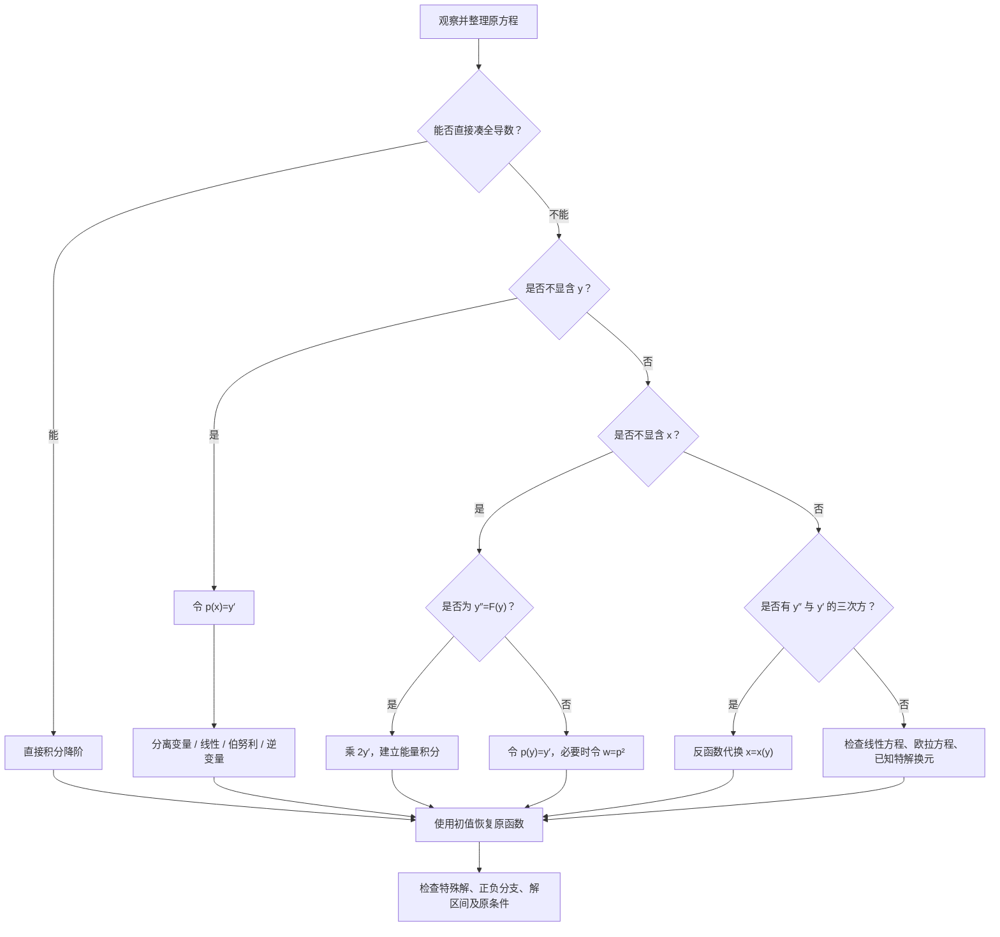

本节是微分方程模块中非常适合考查综合能力的一节。它既可以直接考查二阶微分方程的求解，也可以与曲率、切线与法线、反函数、参数方程、定积分、弧长以及高阶线性微分方程结合，形成具有一定创新性的解答题。

**这一节的核心思想不是记住更多微分方程的通解，而是通过观察方程的结构，选择合适的未知函数和自变量，把陌生的高阶方程转化为熟悉的低阶方程。**

## 一、知识体系与复习重点

| 资料来源              | 重点题目及知识点           |
| ----------------- | ------------------ |
| 1999年数一、数二真题      | 切线三角形面积与积分方程       |
| 2000年数一真题         | 不显含因变量的基本降阶        |
| 2002年数一、数二真题      | 乘积的全导数、初值与解支       |
| 2007年数二真题         | 交换自变量与因变量降阶        |
| 2010年数二真题         | 参数方程与二阶导数          |
| 2011年数二真题         | 切线倾角与微分方程          |
| 2026年数二真题         | 非线性降阶、倒数代换         |
| 张宇1000题           | 能量积分、反函数、弧长、已知特解降阶 |
| 李林880题            | 两类基本降阶、平方代换、曲率、面积  |
| 李正元练习题            | 能量积分、驻点与正负分支       |
| 2027汤家凤八套卷第2套第19题 | 曲率与法线段长度           |
| 2027张宇8套卷第6套第18题  | 曲率与自治微分方程          |

### 1. 本节知识框架

| 方程结构                          | 核心方法                 | 学习优先级 |
| ----------------------------- | -------------------- | ----- |
| $y^{(n)}=f(x)$            | 直接逐次积分               | 基础必会  |
| $F(x,y',y'')=0$           | 令 $p(x)=y'$      | 核心必会  |
| $F(y,y',y'')=0$           | 令 $p(y)=y'$      | 核心必会  |
| $y''=F(y)$                | 能量积分                 | 核心必会  |
| $y''+A(y)(y')^2=B(y)$     | 令 $w=(y')^2$     | 重点强化  |
| 含乘积、商的求导结构                    | 凑全导数                 | 核心技巧  |
| $y''+G(x,y)(y')^3=0$      | 反函数代换                | 综合强化  |
| $F(x,p,p')=0$ 难以求 $p$ | 反求 $x=x(p)$      | 综合强化  |
| 参数曲线、曲率、面积、弧长                 | 建立方程后降阶              | 综合重点  |
| 已知二阶线性齐次方程的一个解                | 令 $y=u(x)y_1(x)$ | 拓展提升  |

这些方法看起来很多，但本质上都在解决同一个问题：**怎样消掉一个不必要的未知量，或者把高阶导数改写成某个表达式的一阶导数。**

## 二、基础概念与降阶的本质

### 2.1 什么是微分方程的阶？

微分方程中出现的未知函数的最高阶导数的阶数，称为微分方程的阶。

例如：

$$
y'+xy=x^2
$$

是一阶微分方程。

$$
y''+x(y')^2=0
$$

是二阶微分方程。

$$
y^{(4)}-y''=0
$$

是四阶微分方程。

注意，导数的次数和微分方程的阶数是不同的概念。

例如：

$$
(y')^{100}+y=0
$$

仍然是一阶微分方程。

### 2.2 什么是降阶？

降阶就是通过积分、变量代换或结构变形，将高阶微分方程转化为低阶微分方程。

以

$$
y''=2x
$$

为例，积分一次：

$$
y'=x^2+C_1.
$$

再积分一次：

$$
y=\frac{x^3}{3}+C_1x+C_2.
$$

这就是最简单的降阶。

但是，如果方程为

$$
y''=y^3,
$$

由于右侧含有未知函数 $y$，就不能直接按照普通不定积分的方法对 $x$ 积分求出 $y'$。

这时需要重新选择变量，或者构造一个全导数。

### 2.3 为什么缺少某个变量就可以降阶？

考虑一般二阶微分方程：

$$
F(x,y,y',y'')=0.
$$

其中有四个基本对象：

$$
x,\qquad y,\qquad y',\qquad y''.
$$

如果方程不显含 $y$，那么我们暂时不必求出 $y$，只需要求出它的变化率 $p=y'$。

如果方程不显含 $x$，则说明方程直接描述的是函数值、变化速度和二阶变化之间的关系，可以考虑将 $y$ 本身作为新的自变量。

这两类方程是本节最重要的基础模型。

### 2.4 通解、特解与积分常数

正常的二阶微分方程，其一般通解通常含有两个独立的任意常数：

$$
y=\varphi(x,C_1,C_2).
$$

如果给出初值：

$$
y(x_0)=y_0,\qquad y'(x_0)=v_0,
$$

通常可以确定两个积分常数，得到满足初值的特解。

但要注意，含有两个任意常数并不自动意味着已经找到了全部解。变量代换中可能遗漏特殊解，退化方程还可能出现奇异解或初值不唯一等问题。

## 三、第一类：不显含因变量 $y$ 的微分方程

### 3.1 基本形式与标准解法

方程形式：

$$
\boxed{F(x,y',y'')=0}
$$

令

$$
\boxed{p(x)=y'(x)}
$$

则

$$
y''=p'(x)=\frac{\mathrm dp}{\mathrm dx}.
$$

原方程变成：

$$
F(x,p,p')=0.
$$

这已经是一阶微分方程。

求出 $p=p(x,C_1)$ 后，再积分一次：

$$
\boxed{y=\int p(x,C_1)\,\mathrm dx+C_2}
$$

即可恢复原函数。

如果给出了初值，通常优先使用：

$$
p(x_0)=v_0
$$

确定第一个积分常数，再使用

$$
y(x_0)=y_0
$$

确定第二个积分常数。

特别推荐使用定积分形式：

$$
\boxed{y(x)=y_0+\int_{x_0}^{x}p(t)\,\mathrm dt}
$$

这样可以直接避免第二个积分常数的计算错误。

**降阶后如何选择一阶方程的解法？**

| 降阶后的方程                 | 对应方法              |
| ---------------------- | ----------------- |
| $p'=f(x)$          | 直接积分              |
| $p'=f(x)g(p)$      | 分离变量              |
| $p'+P(x)p=Q(x)$    | 一阶线性方程            |
| $p'=a(x)p+b(x)p^2$ | 伯努利方程、倒数代换        |
| $p'=F(p/x)$        | 齐次方程换元            |
| $p'=p/(x+p^2)$     | 尝试反求 $x=x(p)$ |

所以，第五模块第一节的一阶微分方程，是本节的直接基础。

### 3.2 母题一：最基本的线性降阶

**来源：2000年考研数学一。**

求微分方程

$$
xy''+3y'=0
$$

的通解。

<Steps>

<Step>

### 第一步：识别题型 [!toc]

含有 $x,y',y''$，不含 $y$。

令

$$
p=y',
$$

得到

$$
xp'+3p=0.
$$

</Step>

<Step>

### 第二步：求解一阶微分方程 [!toc]

在 $x\ne0$ 的区间内：

$$
p'+\frac3xp=0.
$$

常规方法是分离变量，但本题有更快的结构识别方法。

注意：

$$
(x^3p)'=x^3p'+3x^2p.
$$

原方程乘以 $x^2$，得到

$$
(x^3p)'=0.
$$

所以

$$
x^3p=C,
$$

即

$$
p=\frac{C}{x^3}.
$$

</Step>

<Step>

### 第三步：恢复 $y$ [!toc]

$$
y=\int Cx^{-3}\,\mathrm dx =-\frac{C}{2x^2}+C_2.
$$

重新命名任意常数：

$$
\boxed{y=\frac{C_1}{x^2}+C_2}
$$

解分别定义在 $x>0$ 或 $x<0$ 的区间上。

</Step>

<Step>

### 第四步：检查奇点 [!toc]

最高阶导数的系数是 $x$，在 $x=0$ 处为零。

因此不能未经检查就把通解写成整个实轴上的解。

如果要求解在 $x=0$ 附近也二阶可导，那么只有常值解可以跨越零点。

</Step>

</Steps>

**母题推广**

遇到

$$
a(x)y''+a'(x)y'=f(x)
$$

直接识别：

$$
\boxed{[a(x)y']'=f(x)}
$$

先积分得到 $a(x)y'$，再积分求 $y$。

另一个常用模型是

$$
xy''+ay'=0.
$$

在 $x>0$ 上：

$$
y'=Cx^{-a}.
$$

所以

$$
\boxed{ y= \begin{cases} C_1x^{1-a}+C_2,&a\ne1,\\ C_1\ln x+C_2,&a=1. \end{cases} }
$$

特别注意 $a=1$ 时需要单独讨论，不能直接代入幂函数积分公式。

### 3.3 母题二：变系数降阶与熟悉的原函数

**来源：李林880题，基础填空第8题。**

求初值问题

$$
(1-x^2)y''-xy'=0,
$$

$$
y(0)=0,\qquad y'(0)=1.
$$

令 $p=y'$，得到

$$
(1-x^2)p'-xp=0.
$$

于是

$$
\frac{p'}p=\frac{x}{1-x^2}.
$$

积分：

$$
\ln|p|=-\frac12\ln(1-x^2)+C.
$$

由于初值点为 $x=0$，在 $(-1,1)$ 上有

$$
p=\frac{C_1}{\sqrt{1-x^2}}.
$$

根据 $p(0)=1$，得到 $C_1=1$。

再积分：

$$
y=\arcsin x+C_2.
$$

由 $y(0)=0$，得

$$
\boxed{y=\arcsin x,\qquad -1<x<1}
$$

**题型迁移**

降阶后要能够迅速识别常见函数的导数。

| 得到的 $y'$                  | 优先联想                      |
| ----------------------------- | ------------------------- |
| $\dfrac1{\sqrt{1-x^2}}$   | $\arcsin x$           |
| $\dfrac1{1+x^2}$          | $\arctan x$           |
| $\dfrac1{\sqrt{1+x^2}}$   | $\ln(x+\sqrt{1+x^2})$ |
| $\dfrac1x$                | $\ln\|x\|$            |
| $\dfrac{x}{1+x^2}$        | $\dfrac12\ln(1+x^2)$  |
| $\dfrac{x}{\sqrt{1+x^2}}$ | $\sqrt{1+x^2}$        |

这一类题的难点往往不是降阶，而是积分计算与定义区间判断。

### 3.4 母题三：非线性降阶与切线初值

**来源：李林880题，基础解答第1题。**

求曲线方程，已知曲线经过点 $P(1,0)$，在该点与直线 $y=x-1$ 相切，并满足

$$
x^2y''-(y')^2=0.
$$

<Steps>

<Step>

### 第一步：将几何条件转化为初值 [!toc]

经过点 $P(1,0)$：

$$
y(1)=0.
$$

切线斜率等于1：

$$
y'(1)=1.
$$

</Step>

<Step>

### 第二步：降阶 [!toc]

令 $p=y'$，则

$$
x^2p'=p^2.
$$

分离变量：

$$
\frac{\mathrm dp}{p^2} =\frac{\mathrm dx}{x^2}.
$$

积分得

$$
-\frac1p=-\frac1x+C,
$$

即

$$
\frac1p=\frac1x+C_1.
$$

由 $p(1)=1$，得到 $C_1=0$，所以

$$
p=x.
$$

</Step>

<Step>

### 第三步：积分求曲线 [!toc]

$$
y=\frac{x^2}{2}+C_2.
$$

由 $y(1)=0$，得

$$
\boxed{y=\frac{x^2-1}{2}}
$$

</Step>

</Steps>

<Callout type="warn" title="两个重要细节">

第一，分离变量过程中除以了 $p^2$，因此会遗漏

$$
p\equiv0,
$$

对应的原方程解是所有水平直线 $y=C$。但这些解不符合题目指定的斜率初值。

第二，资料中将初值解支限定在 $x>0$。这是标准降阶推导所在的区间，但所得多项式直接代回原方程后，实际上在整个实轴上都成立。由于 $x=0$ 是退化点，跨越该点后的延拓唯一性需要另行讨论。

**最高阶系数为零，不一定意味着已经求出的函数不能跨越该点。**

</Callout>

### 3.5 母题四：伯努利型降阶与倒数代换

**来源：2026年考研数学二。数学一同样需要掌握。**

求微分方程

$$
x^2y''-2xy'-(y')^2=0,\qquad x>2
$$

满足

$$
y(3)=\frac12,\qquad y'(3)=-9
$$

的特解。

这道题非常有代表性，因为它要求连续进行两次有效的变量代换。

<Steps>

<Step>

### 第一步：识别不显含 $y$ [!toc]

令 $p=y'$，得到

$$
x^2p'-2xp-p^2=0.
$$

整理：

$$
p'-\frac2xp=\frac1{x^2}p^2.
$$

它不是普通的分离变量方程，而是伯努利方程。

</Step>

<Step>

### 第二步：令 $u=1/p$ [!toc]

由于初值 $p(3)=-9\ne0$，可以在初值邻域令

$$
u=\frac1p.
$$

那么

$$
u'=-\frac{p'}{p^2}.
$$

原方程除以 $p^2$，得

$$
\frac{p'}{p^2}-\frac2x\frac1p=\frac1{x^2}.
$$

即

$$
u'+\frac2xu=-\frac1{x^2}.
$$

这就变成了一阶线性微分方程。

</Step>

<Step>

### 第三步：使用积分因子 [!toc]

积分因子：

$$
\mu(x)=e^{\int(2/x)\,\mathrm dx}=x^2.
$$

两边乘以 $x^2$：

$$
(x^2u)'=-1.
$$

积分得

$$
x^2u=C-x.
$$

代入

$$
u(3)=-\frac19
$$

得

$$
C=2.
$$

所以

$$
u=\frac{2-x}{x^2},
$$

从而

$$
p=\frac{x^2}{2-x}.
$$

</Step>

<Step>

### 第四步：积分恢复 $y$ [!toc]

先做有理函数拆分：

$$
y'=-\frac{x^2}{x-2} =-x-2-\frac4{x-2}.
$$

积分：

$$
y=-\frac{x^2}{2}-2x-4\ln(x-2)+C_1.
$$

由 $y(3)=1/2$，得 $C_1=11$。

因此

$$
\boxed{ y=-\frac{x^2}{2}-2x-4\ln(x-2)+11, \quad x>2 }
$$

</Step>

</Steps>

**提炼通用模型**

今后遇到

$$
\boxed{p'=a(x)p+b(x)p^2}
$$

只要研究的是非零解，优先令

$$
u=\frac1p.
$$

立即得到

$$
\boxed{u'+a(x)u=-b(x)}
$$

对于更一般的伯努利型方程

$$
p'+P(x)p=Q(x)p^n, \qquad n\ne0,1,
$$

在幂函数有意义且换元合法的区间上令

$$
u=p^{1-n},
$$

则

$$
\boxed{ u'+(1-n)P(x)u=(1-n)Q(x) }
$$

这类题真正考查的是你能否识别降阶后的方程，而不是能否机械地令 $p=y'$。

## 四、第二类：不显含自变量 $x$ 的微分方程

这是本节的重点和难点，也是很多曲率、几何应用、非线性微分方程的理论基础。

### 4.1 核心公式及其推导

方程形式：

$$
\boxed{F(y,y',y'')=0}
$$

此时不再简单地把 $p$ 看作 $x$ 的函数，而是将 $p$ 看作 $y$ 的函数：

$$
p(y)=y'(x).
$$

根据复合函数求导法则：

$$
y''=\frac{\mathrm dp}{\mathrm dx} =\frac{\mathrm dp}{\mathrm dy} \frac{\mathrm dy}{\mathrm dx}.
$$

由于 $y'=p$，所以

$$
\boxed{y''=p\frac{\mathrm dp}{\mathrm dy}}
$$

这是本节必须熟练掌握的核心公式。

原方程可以化为

$$
F\left(y,p,p\frac{\mathrm dp}{\mathrm dy}\right)=0.
$$

先求出

$$
p=\varphi(y,C_1),
$$

再恢复为一阶微分方程：

$$
\frac{\mathrm dy}{\mathrm dx} =\varphi(y,C_1).
$$

最后分离变量：

$$
\boxed{ x+C_2=\int\frac{\mathrm dy}{\varphi(y,C_1)} }
$$

上述分离变量公式需要在 $\varphi(y,C_1)\ne0$ 的区间内使用。

### 4.2 两类基本降阶方法的本质区别

| 比较对象  | 不显含 $y$                 | 不显含 $x$                         |
| ----- | --------------------------- | ----------------------------------- |
| 新未知函数 | $p(x)=y'$               | $p(y)=y'$                       |
| 新自变量  | $x$                     | $y$                             |
| 二阶导数  | $y'=p,\ y''=p'_x$      | $y'=p,\ y''=pp'_y$             |
| 降阶结果  | 求 $p(x)$                | 求 $p(y)$                        |
| 恢复原函数 | $y=\int p(x)\mathrm dx$ | 分离 $\mathrm dy/\mathrm dx=p(y)$ |
| 主要陷阱  | 忘记再次积分                      | 开方分支、局部反函数条件                        |

尤其要注意：

$$
p'(x)\ne\frac{\mathrm dp}{\mathrm dy}.
$$

二者之间相差一个因子 $p$。

### 4.3 能量积分：自治方程最重要的特殊技巧

考虑方程

$$
\boxed{y''=F(y)}
$$

它不显含自变量 $x$，因此可以令 $p(y)=y'$。

不过还有一种更加稳健的方法：**直接乘以 $2y'$，凑全导数。**

原方程两边乘以 $2y'$：

$$
2y'y''=2F(y)y'.
$$

注意

$$
2y'y''=[(y')^2]',
$$

而若 $G'(y)=F(y)$，则

$$
[G(y)]'=F(y)y'.
$$

所以

$$
\left[(y')^2-2G(y)\right]'=0.
$$

积分得到

$$
\boxed{ (y')^2=2\int F(y)\,\mathrm dy+C }
$$

若给出初值

$$
y(x_0)=y_0,\qquad y'(x_0)=v_0,
$$

则可以直接得到

$$
\boxed{ (y')^2=v_0^2+2\int_{y_0}^{y}F(s)\,\mathrm ds }
$$

优先记忆这一形式。

**为什么称为能量积分？**

从物理角度看，可以把 $x$ 类比为时间，$y$ 类比为位置。

那么

$$
y'=\text{速度},\qquad y''=\text{加速度}.
$$

当加速度只与位置有关时，速度平方与位置之间通常存在一种守恒关系。

例如：

$$
y''=-\omega^2y
$$

乘以 $2y'$ 后得到

$$
(y')^2+\omega^2y^2=C.
$$

这就是简谐振动的能量守恒形式。

对于考研数学，不需要依赖物理知识，只需要掌握这种全导数结构。

**常见能量积分模型**

| 原方程                     | 降阶后                                   |
| ----------------------- | ------------------------------------- |
| $y''=a$             | $(y')^2=2ay+C$                    |
| $y''=ay$            | $(y')^2=ay^2+C$                   |
| $y''=ay^2$          | $(y')^2=\dfrac{2a}{3}y^3+C$       |
| $y''=ay^n,\ n\ne-1$ | $(y')^2=\dfrac{2a}{n+1}y^{n+1}+C$ |
| $y''=\dfrac ay$     | $(y')^2=2a\ln\|y\|+C$             |
| $y''=ae^y$          | $(y')^2=2ae^y+C$                  |
| $y''=-a\sin y$      | $(y')^2=2a\cos y+C$               |

这些公式不必逐个死记，只要掌握乘以 $2y'$ 的推导方式即可。

### 4.4 母题五：非线性自治方程

**来源：张宇1000题，强化部分。**

求微分方程

$$
2y''=3y^2
$$

满足

$$
y(-2)=1,\qquad y'(-2)=1
$$

的特解。

<Tabs items={["方法一：能量积分法（推荐通法）", "方法二：幂次平衡法（辅助速解）"]} defaultIndex={0}>

<Tab value="方法一：能量积分法（推荐通法）">

两边乘以 $y'$：

$$
2y'y''=3y^2y'.
$$

识别全导数：

$$
[(y')^2]'=(y^3)'.
$$

因此

$$
(y')^2=y^3+C_1.
$$

代入初值：

$$
1=1+C_1,
$$

得到

$$
C_1=0.
$$

所以

$$
(y')^2=y^3.
$$

由于在初值点

$$
y(-2)=1>0,\qquad y'(-2)=1>0,
$$

应在初值附近选择正号：

$$
y'=y^{3/2}.
$$

分离变量：

$$
y^{-3/2}\,\mathrm dy=\mathrm dx.
$$

积分：

$$
-2y^{-1/2}=x+C_2.
$$

代入 $y(-2)=1$，得

$$
C_2=0.
$$

于是

$$
\sqrt y=-\frac2x.
$$

左侧为正数，所以必须有 $x<0$。

最终得到

$$
\boxed{ y=\frac4{x^2},\qquad x\in(-\infty,0) }
$$

</Tab>

<Tab value="方法二：幂次平衡法（辅助速解）">

观察

$$
2y''=3y^2,
$$

如果设

$$
y=A(x-B)^m,
$$

则二阶导数的幂次为 $m-2$，而右侧幂次为 $2m$。

比较：

$$
m-2=2m,
$$

得

$$
m=-2.
$$

因此尝试

$$
y=\frac{A}{(x-B)^2}.
$$

代入原方程：

$$
\frac{12A}{(x-B)^4} =\frac{3A^2}{(x-B)^4}.
$$

非零解要求

$$
A=4.
$$

利用两个初值确定 $B=0$，同样得到

$$
y=\frac4{x^2}.
$$

这种猜解方法可以加快计算，但不如能量积分普适。要确定它就是所求初值解，还需要利用原方程在初值附近的唯一性。

</Tab>

</Tabs>

**母题迁移**

若

$$
y''=ay^n,
$$

尝试幂函数解时，幂次平衡关系是

$$
m-2=mn.
$$

所以当 $n\ne1$ 时，候选幂次为

$$
\boxed{m=\frac2{1-n}}
$$

这可以帮助你快速猜出特殊解的形式。

但如果初值使能量积分中的常数不为零，就未必还能得到这种简单幂函数解。因此考试中仍然优先使用通法。

### 4.5 母题六：初值点导数为零，如何确定正负分支？

**来源：李正元练习题，第六章计算与证明题第9题。**

求初值问题：

$$
\begin{cases} y^3y''+1=0,\\ y(1)=1,\\ y'(1)=0. \end{cases}
$$

这是一道特别值得反复研究的题目，因为它涉及驻点、反函数换元条件和解的延拓。

<Steps>

<Step>

### 第一步：能量积分 [!toc]

初值附近 $y>0$，原方程等价于

$$
y''=-\frac1{y^3}.
$$

两边乘以 $2y'$：

$$
2y'y''=-2y^{-3}y'.
$$

整理：

$$
\left[(y')^2-\frac1{y^2}\right]'=0.
$$

所以

$$
(y')^2-\frac1{y^2}=C.
$$

代入初值：

$$
0-1=C.
$$

得到

$$
\boxed{ (y')^2=\frac{1-y^2}{y^2} }
$$

</Step>

<Step>

### 第二步：判断曲线的变化方向 [!toc]

由原方程：

$$
y''(1)=-1<0.
$$

而 $y'(1)=0$，所以 $x=1$ 为严格局部极大值点。

在 $x=1$ 附近：

$$
\begin{cases} y'>0,&x<1,\\ y'<0,&x>1. \end{cases}
$$

因此不能在整个区间机械地取同一个根号符号。

</Step>

<Step>

### 第三步：寻找更加直接的全导数 [!toc]

由已经得到的能量关系：

$$
(y')^2=\frac1{y^2}-1,
$$

结合原方程：

$$
yy''=-\frac1{y^2}.
$$

两式相加：

$$
(y')^2+yy''=-1.
$$

因此

$$
(yy')'=-1.
$$

直接积分：

$$
yy'=-x+C_1.
$$

由 $y(1)=1,y'(1)=0$，得

$$
C_1=1.
$$

所以

$$
yy'=1-x.
$$

再次积分：

$$
\frac12(y^2)'=1-x,
$$

得到

$$
y^2=2x-x^2+C_2.
$$

由 $y(1)=1$，得 $C_2=0$。

最终：

$$
y^2=1-(x-1)^2.
$$

由于初值为正，取上半圆：

$$
\boxed{ y=\sqrt{1-(x-1)^2},\qquad 0<x<2 }
$$

这种解法比左右两侧分别开方积分更加方便，而且避免了在驻点处除以 $y'$。

</Step>

</Steps>

**本题最值得掌握的思想**

如果得到

$$
(y')^2=G(y),
$$

不一定必须立即开平方。

还可以继续结合原方程，寻找

$$
(yy')',\qquad (y^2)'',\qquad [\varphi(y)]''
$$

等结构，从而绕开正负分支的困难。

### 4.6 怎样处理驻点和转折点？

若降阶之后得到

$$
(y')^2=G(y),
$$

则首先要求

$$
G(y)\ge0.
$$

但这只限制了函数值的取值范围，并没有完全确定运动方向。

在 $y'\ne0$ 的区间内，可以根据初值选取

$$
y'=\pm\sqrt{G(y)}.
$$

如果遇到 $y'(x_0)=0$，应该根据原方程判断：

| 初值点的条件             | 局部行为         |
| ------------------ | ------------ |
| $y'=0,\ y''>0$ | 局部极小值，斜率由负变正 |
| $y'=0,\ y''<0$ | 局部极大值，斜率由正变负 |
| $y'=0,\ y''=0$ | 暂时无法由二阶导数判断  |

能量积分相较于反函数降阶的优势在于，它不需要除以 $y'$，因而能够在驻点处直接建立守恒关系。

## 五、第三类：平方代换与全导数识别

### 5.1 平方代换的通用模型

考虑方程

$$
\boxed{ y''+A(y)(y')^2=B(y) }
$$

由于不显含 $x$，令

$$
p(y)=y'.
$$

得到

$$
p\frac{\mathrm dp}{\mathrm dy}+A(y)p^2=B(y).
$$

此时如果直接求 $p$，仍然是非线性方程。

但是注意：

$$
\frac{\mathrm d(p^2)}{\mathrm dy} =2p\frac{\mathrm dp}{\mathrm dy}.
$$

因此令

$$
\boxed{w(y)=p^2=(y')^2}
$$

就可以得到

$$
\frac12w'+A(y)w=B(y).
$$

即

$$
\boxed{ w'+2A(y)w=2B(y) }
$$

这是一阶线性微分方程。

也就是说，**原方程虽然是二阶非线性的，但通过两次代换，可以转化为一阶线性方程。**

### 5.2 母题七：平方代换与全局解延拓

**来源：李林880题，基础解答第5题。**

求

$$
y''+\frac12(y')^2=2y
$$

满足

$$
y(0)=2,\qquad y'(0)=2
$$

的特解。

令

$$
p(y)=y',\qquad w=p^2.
$$

原方程化为

$$
\frac12w'+\frac12w=2y.
$$

即

$$
w'+w=4y.
$$

积分因子为 $e^y$，于是

$$
(e^yw)'=4ye^y.
$$

积分得到

$$
e^yw=4(y-1)e^y+C_1,
$$

所以

$$
w=4(y-1)+C_1e^{-y}.
$$

初值要求

$$
w(2)=4.
$$

代入得

$$
C_1=0.
$$

因此

$$
(y')^2=4(y-1).
$$

根据 $y'(0)=2>0$，初值附近应选择

$$
y'=2\sqrt{y-1}.
$$

分离变量并积分：

$$
\sqrt{y-1}=x+C_2.
$$

由初值得 $C_2=1$，所以

$$
y=(x+1)^2+1.
$$

此时是否只能取 $x>-1$？

**不能直接这样下结论。**

因为 $x>-1$ 只是推导中选取正平方根的区间。

实际上对于

$$
y=(x+1)^2+1
$$

有

$$
y'=2(x+1),\qquad y''=2.
$$

代回原方程：

$$
y''+\frac12(y')^2 =2+2(x+1)^2 =2y.
$$

恒成立。

因此最终特解为

$$
\boxed{ y=(x+1)^2+1,\qquad x\in\mathbb R }
$$

在 $x=-1$ 处，函数达到最小值，导数由负变正，但原微分方程依然正常成立。

这是区分**换元的局部有效区间**与**原方程的最大解区间**的典型题目。

### 5.3 全导数技巧：考试中应该优先考虑的方法

如果方程中恰好出现某个乘积或商的导数，就不必机械地进行变量代换。

以下公式非常重要：

| 观察到的结构                                | 对应全导数                                           |
| ------------------------------------- | ----------------------------------------------- |
| $yy''+(y')^2$                     | $(yy')'$                                    |
| $a(x)y''+a'(x)y'$                 | $[a(x)y']'$                                 |
| $yy''-(y')^2$                     | $y^2\left(\dfrac{y'}y\right)'$              |
| $yy''-2(y')^2$                    | $y^3\left(\dfrac{y'}{y^2}\right)'$          |
| $2y'y''$                          | $[(y')^2]'$                                 |
| $\dfrac{y''}{1+(y')^2}$           | $(\arctan y')'$                             |
| $\dfrac{y'y''}{[1+(y')^2]^{3/2}}$ | $-\left(\dfrac1{\sqrt{1+(y')^2}}\right)'$   |
| $\dfrac{y''}{[1+(y')^2]^{3/2}}$   | $\left(\dfrac{y'}{\sqrt{1+(y')^2}}\right)'$ |

含有除法的公式应在相应分母不为零的区间内使用。

### 5.4 母题八：乘积导数的直接识别

**来源：2002年考研数一、数二。**

求方程

$$
yy''+(y')^2=0
$$

满足

$$
y(0)=1,\qquad y'(0)=\frac12
$$

的特解。

直接观察：

$$
(yy')'=yy''+(y')^2=0.
$$

所以

$$
yy'=C_1.
$$

代入初值：

$$
C_1=\frac12.
$$

于是

$$
(y^2)'=2yy'=1.
$$

再积分：

$$
y^2=x+C_2.
$$

由 $y(0)=1$，得

$$
C_2=1.
$$

根据初值选择正根：

$$
\boxed{y=\sqrt{1+x},\qquad x>-1}
$$

这道真题的价值在于告诉你：**识别全导数应该优先于一般性的变量代换。**

### 5.5 推广母题：统一解决一整类方程

考虑

$$
\boxed{yy''+a(y')^2=0}
$$

在 $y>0$ 的区间上：

$$
(y^ay')' =ay^{a-1}(y')^2+y^ay''.
$$

提取 $y^{a-1}$：

$$
(y^ay')' =y^{a-1}[yy''+a(y')^2].
$$

所以原方程等价于

$$
(y^ay')'=0.
$$

得到

$$
y^ay'=C_1.
$$

当 $a\ne-1$ 时：

$$
\frac{y^{a+1}}{a+1}=C_1x+C_2.
$$

重新命名常数，可写为

$$
\boxed{y^{a+1}=Ax+B}
$$

当 $a=-1$ 时：

$$
\frac{y'}y=C,
$$

所以

$$
\boxed{y=Ae^{Bx}}
$$

以上是在 $y>0$ 区间内得到的解族；其他符号分支以及零解应结合原方程讨论。

**一眼识别三个经典特例**

| 方程                   | 降阶形式           | 非恒值解的典型形式 |
| -------------------- | -------------- | --------- |
| $yy''+(y')^2=0$  | $yy'=C$    | 平方根函数     |
| $yy''-(y')^2=0$  | $y'/y=C$   | 指数函数      |
| $yy''-2(y')^2=0$ | $y'/y^2=C$ | 倒数型函数     |

例如同类题目：

$$
yy''=2(y')^2,\qquad y(0)=y'(0)=1.
$$

立即得到

$$
\left(\frac{y'}{y^2}\right)'=0.
$$

所以

$$
\frac{y'}{y^2}=1.
$$

分离变量得

$$
-\frac1y=x-1.
$$

故

$$
\boxed{y=\frac1{1-x},\qquad x<1}
$$

原方程还存在常值解 $y\equiv c$，但不符合本题的斜率初值。

## 六、第四类：逆变量降阶与反函数代换

这类题非常容易在考场上卡住。

原因是按照正常思路把 $p$ 看作 $x$ 的函数时，得到的一阶微分方程既不能分离变量，也不是线性的。

这时需要考虑：能否交换自变量与因变量？

### 6.1 母题九：把 $x$ 看作 $p$ 的函数

**来源：2007年考研数学二。**

求

$$
y''[x+(y')^2]=y'
$$

满足

$$
y(1)=1,\qquad y'(1)=1
$$

的特解。

<Steps>

<Step>

### 第一步：常规降阶 [!toc]

令

$$
p=y',
$$

则

$$
(x+p^2)\frac{\mathrm dp}{\mathrm dx}=p.
$$

直接求 $p(x)$ 并不方便。

</Step>

<Step>

### 第二步：交换变量 [!toc]

初值点 $p=1$，且

$$
p'(1)=\frac12\ne0.
$$

因此在初值附近可以把 $x$ 看作 $p$ 的函数。

原方程转化为

$$
\frac{\mathrm dx}{\mathrm dp} =\frac{x+p^2}{p}.
$$

整理：

$$
\frac{\mathrm dx}{\mathrm dp}-\frac1px=p.
$$

注意，这是关于 $x(p)$ 的一阶线性微分方程。

积分因子为 $1/p$，所以

$$
\frac{\mathrm d}{\mathrm dp} \left(\frac xp\right)=1.
$$

积分得到

$$
\frac xp=p+C_1.
$$

即

$$
x=p^2+C_1p.
$$

利用初值 $x=1,p=1$，得

$$
C_1=0.
$$

所以

$$
p^2=x.
$$

</Step>

<Step>

### 第三步：选择分支并恢复原函数 [!toc]

因为 $p(1)=1>0$，所以

$$
p=\sqrt x.
$$

于是

$$
y'=\sqrt x.
$$

积分：

$$
y=\frac23x^{3/2}+C_2.
$$

利用 $y(1)=1$，得到

$$
\boxed{ y=\frac23x^{3/2}+\frac13,\qquad x>0 }
$$

</Step>

</Steps>

**推广识别规律**

当一阶微分方程具有

$$
\frac{\mathrm dp}{\mathrm dx} =\frac{A(p)}{B(p)x+C(p)}
$$

的形式时，如果局部可以交换变量，那么

$$
\frac{\mathrm dx}{\mathrm dp} =\frac{B(p)}{A(p)}x+\frac{C(p)}{A(p)}.
$$

于是得到关于 $x(p)$ 的线性微分方程。

这就是这道真题可以迁移到新题中的核心。

### 6.2 反函数二阶导数公式

假设

$$
y=y(x)
$$

在某一区间内具有反函数

$$
x=x(y),
$$

且 $y'\ne0$。

记

$$
x_y=\frac{\mathrm dx}{\mathrm dy}, \qquad x_{yy}=\frac{\mathrm d^2x}{\mathrm dy^2}.
$$

则

$$
\boxed{y'=\frac1{x_y}}
$$

而二阶导数为

$$
\begin{aligned} y'' &=\frac{\mathrm d}{\mathrm dx} \left(\frac1{x_y}\right)\\ &=\frac{\mathrm d}{\mathrm dy} \left(\frac1{x_y}\right) \frac{\mathrm dy}{\mathrm dx}\\ &=-\frac{x_{yy}}{x_y^2}\frac1{x_y}. \end{aligned}
$$

所以

$$
\boxed{ y''=-\frac{x_{yy}}{(x_y)^3} }
$$

特别值得注意：

$$
\boxed{ \frac{y''}{(y')^3}=-x_{yy} }
$$

一旦看到 $y''$ 与 $(y')^3$ 同时出现，就应该考虑反函数代换。

### 6.3 母题十：非线性方程转化为二阶线性方程

**来源：张宇1000题，强化部分。**

求解

$$
y''+(x+e^y+\sin y)(y')^3=0.
$$

<Steps>

<Step>

### 第一步：反函数代换 [!toc]

在 $y'\ne0$ 的局部区间，令

$$
x=x(y).
$$

根据公式：

$$
y'=\frac1{x_y}, \qquad y''=-\frac{x_{yy}}{(x_y)^3}.
$$

代入：

$$
-\frac{x_{yy}}{(x_y)^3} +\frac{x+e^y+\sin y}{(x_y)^3}=0.
$$

得到

$$
\boxed{x_{yy}-x=e^y+\sin y}
$$

注意，这里虽然没有降低方程的阶数，却成功将一个二阶非线性方程转化为二阶常系数线性方程，所以也是本节非常重要的广义变换技巧。

</Step>

<Step>

### 第二步：求齐次方程通解 [!toc]

齐次方程

$$
x_{yy}-x=0
$$

对应特征方程

$$
r^2-1=0.
$$

故

$$
x_h=C_1e^y+C_2e^{-y}.
$$

</Step>

<Step>

### 第三步：分别求非齐次特解 [!toc]

对于 $e^y$，由于 $1$ 是单特征根，发生一次共振，设

$$
x_{p1}=Aye^y.
$$

代入得

$$
x_{p1,yy}-x_{p1}=2Ae^y.
$$

所以

$$
A=\frac12.
$$

对于 $\sin y$，设

$$
x_{p2}=B\sin y.
$$

代入：

$$
x_{p2,yy}-x_{p2}=-2B\sin y.
$$

所以

$$
B=-\frac12.
$$

</Step>

<Step>

### 第四步：写出隐式通解 [!toc]

$$
\boxed{ x=C_1e^y+C_2e^{-y} +\frac12ye^y-\frac12\sin y }
$$

这一隐式关系要在 $x_y\ne0$ 的区间内选取反函数分支。

此外：

$$
\boxed{y\equiv c}
$$

也是原方程的解族，不能由反函数方法得到，需要另外补充。

</Step>

</Steps>

**同类型配套题**

李林880题综合部分、给出

$$
y''+(4x+e^{2y})(y')^3=0.
$$

立即转化为

$$
x_{yy}-4x=e^{2y}.
$$

由于 $2$ 是齐次特征根，特解需要乘以 $y$。

因此

$$
\boxed{ x=C_1e^{-2y}+C_2e^{2y}+\frac14ye^{2y} }
$$

同样补充原方程的常值解。

### 6.4 通用推广

遇到

$$
\boxed{ y''+[a(y)x+b(y)](y')^3=0 }
$$

可以转化为

$$
\boxed{ x_{yy}-a(y)x=b(y) }
$$

如果 $a(y)$ 为常数，就得到二阶常系数线性微分方程。

这个模型很好地说明了为什么不能孤立地学习本节：反函数求导、待定系数法、共振规则和降阶方法，本质上都是可以组合起来使用的工具。

## 七、参数方程与切线倾角型真题

这类题的特点是：题目通常不会直接给出一个标准的可降阶微分方程，而是要求你从其他数学关系中建立微分方程。

### 7.1 参数方程的二阶导数

设

$$
\begin{cases} x=\varphi(t),\\ y=\psi(t), \end{cases} \qquad \varphi'(t)\ne0.
$$

一阶导数：

$$
\boxed{ \frac{\mathrm dy}{\mathrm dx} =\frac{\psi'(t)}{\varphi'(t)} }
$$

二阶导数：

$$
\boxed{ \frac{\mathrm d^2y}{\mathrm dx^2} =\frac1{\varphi'(t)} \frac{\mathrm d}{\mathrm dt} \left(\frac{\psi'(t)}{\varphi'(t)}\right) }
$$

展开后为

$$
\boxed{ \frac{\mathrm d^2y}{\mathrm dx^2} =\frac{\psi''\varphi'-\psi'\varphi''} {(\varphi')^3} }
$$

最容易出现的错误是写成

$$
\frac{\mathrm d^2y}{\mathrm dx^2} =\frac{\psi''(t)}{[\varphi'(t)]^2}.
$$

一般情况下这是错误的，因为一阶导数中的分母也需要求导。

### 7.2 母题十一：参数方程结合降阶

**来源：2010年考研数学二。**

已知函数由参数方程

$$
\begin{cases} x=2t+t^2,\\ y=\psi(t), \end{cases} \qquad t>-1
$$

确定，且

$$
\psi(1)=\frac52,\qquad \psi'(1)=6,
$$

$$
\frac{\mathrm d^2y}{\mathrm dx^2} =\frac3{4(1+t)}.
$$

求 $\psi(t)$。

<Tabs items={["方法一：标准参数求导法", "方法二：直接利用切线斜率降阶（推荐速解）"]} defaultIndex={0}>

<Tab value="方法一：标准参数求导法">

因为

$$
x'(t)=2(1+t),
$$

所以

$$
\frac{\mathrm dy}{\mathrm dx} =\frac{\psi'}{2(1+t)}.
$$

进一步得到

$$
\frac{\mathrm d^2y}{\mathrm dx^2} =\frac{(1+t)\psi''-\psi'} {4(1+t)^3}.
$$

由题意：

$$
\frac{(1+t)\psi''-\psi'} {4(1+t)^3} =\frac3{4(1+t)}.
$$

即

$$
(1+t)\psi''-\psi'=3(1+t)^2.
$$

令 $u=\psi'$，则

$$
u'-\frac{u}{1+t}=3(1+t).
$$

乘以积分因子 $1/(1+t)$：

$$
\left(\frac{u}{1+t}\right)'=3.
$$

积分：

$$
u=(1+t)(3t+C_1).
$$

由 $u(1)=6$，得到 $C_1=0$。

所以

$$
\psi'=3t(1+t).
$$

再次积分：

$$
\psi=t^3+\frac32t^2+C_2.
$$

代入初值，得

$$
\boxed{\psi=t^3+\frac32t^2,\qquad t>-1}
$$

</Tab>

<Tab value="方法二：直接利用切线斜率降阶（推荐速解）">

令

$$
p(t)=\frac{\mathrm dy}{\mathrm dx}.
$$

那么

$$
\frac{\mathrm d^2y}{\mathrm dx^2} =\frac{\mathrm dp/\mathrm dt}{\mathrm dx/\mathrm dt}.
$$

因此

$$
\frac{p'(t)}{2(1+t)} =\frac3{4(1+t)}.
$$

立即化简为

$$
p'(t)=\frac32.
$$

所以

$$
p(t)=\frac32t+C_1.
$$

注意初值的转化：

$$
p(1)=\frac{\psi'(1)}{x'(1)} =\frac64=\frac32.
$$

因此 $C_1=0$。

于是

$$
\psi'(t)=p(t)x'(t) =\frac32t\cdot2(1+t) =3t(1+t).
$$

再积分即得到相同答案。

这种方法更加直接，甚至不需要展开二阶导数公式。

</Tab>

</Tabs>

**通用结论**

如果已知

$$
x=\varphi(t),\qquad \frac{\mathrm d^2y}{\mathrm dx^2}=g(t),
$$

那么令

$$
p(t)=\frac{\mathrm dy}{\mathrm dx},
$$

可以直接写出

$$
\boxed{p'(t)=g(t)\varphi'(t)}
$$

以及

$$
\boxed{\psi'(t)=p(t)\varphi'(t)}
$$

连续两次积分即可解决。

### 7.3 母题十二：切线倾角与变化率

**来源：2011年考研数学二；张宇1000题强化部分也有同类题。**

曲线 $y=y(x)$ 与直线 $y=x$ 在原点相切，记曲线上一点的切线倾角为 $\alpha$，且

$$
\frac{\mathrm d\alpha}{\mathrm dx} =\frac{\mathrm dy}{\mathrm dx}.
$$

求曲线方程。

**基础关系**

切线斜率与倾角满足

$$
\boxed{y'=\tan\alpha}
$$

所以在合适的连续角度分支上，

$$
\alpha=\arctan y'.
$$

对 $x$ 求导：

$$
\boxed{ \alpha'=\frac{y''}{1+(y')^2} }
$$

这也是曲率相关问题经常使用的公式。

<Tabs items={["方法一：直接以倾角作为未知函数", "方法二：先建立二阶微分方程"]} defaultIndex={0}>

<Tab value="方法一：直接以倾角作为未知函数">

根据条件：

$$
\alpha'=y'=\tan\alpha.
$$

因此

$$
\cot\alpha\,\mathrm d\alpha=\mathrm dx.
$$

积分得

$$
\ln|\sin\alpha|=x+C.
$$

由曲线与 $y=x$ 在原点相切，取连续倾角分支使

$$
\alpha(0)=\frac\pi4.
$$

故

$$
\sin\alpha=\frac{e^x}{\sqrt2}.
$$

另一方面，

$$
\alpha'=y',
$$

说明

$$
\alpha-y=C_1.
$$

利用 $y(0)=0$，得

$$
C_1=\frac\pi4.
$$

从而

$$
y=\alpha-\frac\pi4.
$$

所以

$$
\boxed{ y=\arcsin\left(\frac{e^x}{\sqrt2}\right)-\frac\pi4 }
$$

最大经典解区间为

$$
\boxed{x<\frac12\ln2}.
$$

</Tab>

<Tab value="方法二：先建立二阶微分方程">

由

$$
\frac{y''}{1+(y')^2}=y'
$$

得到

$$
y''=y'[1+(y')^2].
$$

令 $p=y'$：

$$
p'=p(1+p^2).
$$

分离变量：

$$
\frac{\mathrm dp}{p(1+p^2)}=\mathrm dx.
$$

利用部分分式：

$$
\frac1{p(1+p^2)} =\frac1p-\frac p{1+p^2}.
$$

积分得到

$$
\ln|p|-\frac12\ln(1+p^2)=x+C.
$$

再利用初值求出 $p$，继续积分恢复 $y$。

这种方法同样可行，但比直接求倾角更加复杂。

</Tab>

</Tabs>

**命题启示**

碰到几何量时，不一定要先全部转化为 $y,y',y''$。

有时直接选取几何量作为新未知函数反而更简单，例如：

- 切线倾角 $\alpha$；
- 曲线弧长 $s$；
- 切线斜率 $p$；
- 曲线下方面积 $A$。

**选择变量本身就是解题技巧。**

## 八、数学一重点综合题：曲率与可降阶微分方程

曲率与降阶的结合适合作为数学一综合训练。

### 8.1 必须掌握的曲率公式

对于平面曲线 $y=y(x)$：

$$
\boxed{ K=\frac{|y''|}{[1+(y')^2]^{3/2}} }
$$

曲率半径：

$$
\boxed{ \rho=\frac1K =\frac{[1+(y')^2]^{3/2}}{|y''|} }
$$

若 $y''\ge0$，则

$$
K=\frac{y''}{[1+(y')^2]^{3/2}}.
$$

若 $y''\le0$，则

$$
K=-\frac{y''}{[1+(y')^2]^{3/2}}.
$$

不同教材对凹、凸的术语有时存在习惯差异，所以务必根据题目所描述的曲线形状或采用的定义，确定 $y''$ 的符号。

### 8.2 曲率与降阶的两个统一模型

**模型一：已知曲率是 $x$ 的函数**

若

$$
\frac{y''}{[1+(y')^2]^{3/2}}=f(x),
$$

注意

$$
\left(\frac{y'}{\sqrt{1+(y')^2}}\right)' =\frac{y''}{[1+(y')^2]^{3/2}}.
$$

因此直接积分：

$$
\boxed{ \frac{y'}{\sqrt{1+(y')^2}} =\int f(x)\,\mathrm dx+C }
$$

假设右端为 $H(x)$，且 $|H(x)|<1$，则

$$
\boxed{ y'=\frac{H(x)}{\sqrt{1-H^2(x)}} }
$$

再次积分即可。

**模型二：已知曲率是 $y$ 的函数**

若

$$
\frac{y''}{[1+(y')^2]^{3/2}}=f(y),
$$

可以令

$$
p(y)=y',
$$

得到

$$
\frac{p}{(1+p^2)^{3/2}} \frac{\mathrm dp}{\mathrm dy} =f(y).
$$

利用

$$
\frac{\mathrm d}{\mathrm dp} \left(-\frac1{\sqrt{1+p^2}}\right) =\frac p{(1+p^2)^{3/2}},
$$

得

$$
\boxed{ -\frac1{\sqrt{1+p^2}} =\int f(y)\,\mathrm dy+C }
$$

甚至不必建立局部反函数，直接乘以 $y'$ 也能获得同样的第一积分关系：

$$
-\left(\frac1{\sqrt{1+(y')^2}}\right)' =f(y)y'.
$$

所以，这个方法同样适用于初值点 $y'=0$ 的情况。

### 8.3 母题十三：曲率与法线段长度

**来源：2027汤家凤八套卷，第2套第19题，数学一，12分。**

上半平面内的曲线 $L:y=y(x)$ 为题设所称的凸曲线。任取曲线上一点 $P(x,y)$，其曲率与法线段 $PQ$ 的长度互为倒数，其中 $Q$ 为法线与 $x$ 轴的交点。

已知曲线经过 $(1,1)$，且该点的切线水平。求曲线方程。

<Steps>

<Step>

### 第一步：提取初值 [!toc]

$$
y(1)=1,\qquad y'(1)=0.
$$

</Step>

<Step>

### 第二步：计算法线段长度 [!toc]

设

$$
p=y'.
$$

曲线在 $P$ 点的一个法向量为

$$
(-p,1).
$$

法线的参数形式为

$$
(X,Y)=(x,y)+\lambda(-p,1).
$$

令 $Y=0$，得到

$$
\lambda=-y.
$$

所以法线与 $x$ 轴交于

$$
Q=(x+yp,0).
$$

法线段长度为

$$
\begin{aligned} |PQ| &=\sqrt{(yp)^2+y^2}\\ &=y\sqrt{1+p^2}. \end{aligned}
$$

因此

$$
\boxed{|PQ|=y\sqrt{1+(y')^2}}
$$

这个推导在 $y'=0$ 时依然成立，不需要除以切线斜率。

</Step>

<Step>

### 第三步：建立微分方程 [!toc]

题设条件：

$$
K|PQ|=1.
$$

按题设凸向取 $y''\le0$，代入：

$$
\frac{-y''}{[1+(y')^2]^{3/2}} \cdot y\sqrt{1+(y')^2}=1.
$$

化简：

$$
-\frac{yy''}{1+(y')^2}=1.
$$

即

$$
yy''+(y')^2=-1.
$$

</Step>

<Step>

### 第四步：直接凑全导数 [!toc]

$$
(yy')'=-1.
$$

积分得

$$
yy'=-x+C_1.
$$

由 $y(1)=1,y'(1)=0$，得

$$
C_1=1.
$$

所以

$$
yy'=1-x.
$$

即

$$
(y^2)'=2-2x.
$$

积分：

$$
y^2=2x-x^2+C_2.
$$

代入初值，得 $C_2=0$。

由于曲线位于上半平面，

$$
\boxed{ y=\sqrt{2x-x^2},\qquad 0<x<2 }
$$

</Step>

<Step>

### 第五步：几何验证 [!toc]

改写为

$$
(x-1)^2+y^2=1.
$$

这是一条圆心为 $(1,0)$、半径为1的上半圆弧。

它的曲率恒为1，任一点的法线都经过圆心，因此法线段长度恒为1，满足题设条件。

</Step>

</Steps>

**与李正元母题的联系**

前面李正元练习题给出的方程是

$$
y^3y''+1=0.
$$

本题得到的方程是

$$
yy''+(y')^2=-1.
$$

两道题的条件形式不同，但在给定初值下都产生上半圆。

这正是创新题常见的命题方式：**改变问题的外在描述，却保留相同的内部微分结构。**

**进一步推广**

如果给出的是

$$
K|PQ|=c,\qquad c>0,
$$

且 $y''<0$，则

$$
yy''=-c[1+(y')^2].
$$

令 $p(y)=y'$、$w=p^2$，得到

$$
\frac y2w'=-c(1+w).
$$

整理：

$$
\frac{\mathrm dw}{1+w}=-2c\frac{\mathrm dy}{y}.
$$

因此

$$
\boxed{1+(y')^2=Cy^{-2c}}
$$

原模拟题正是 $c=1$ 的特殊情况。

### 8.4 母题十四：曲率函数诱导的自治方程

**来源：2027张宇8套卷，第6套第18题，数学一，12分。**

设曲线 $y=y(x)$ 在 $0\le x\le1$ 上具有二阶连续导数，位于第一象限（含题设原点），且为题设所称的凸曲线。

曲线上每一点的曲率等于

$$
K=\frac{y}{(2-y^2)^{3/2}},
$$

曲线在原点与直线 $y=x$ 相切，求曲线表达式。

<Steps>

<Step>

### 第一步：从几何条件得到初值 [!toc]

$$
y(0)=0,\qquad y'(0)=1.
$$

</Step>

<Step>

### 第二步：建立二阶微分方程 [!toc]

根据题设凸向 $y''\le0$：

$$
-\frac{y''}{[1+(y')^2]^{3/2}} =\frac{y}{(2-y^2)^{3/2}}.
$$

观察：方程不显含 $x$。

</Step>

<Step>

### 第三步：以 $y$ 为自变量 [!toc]

令

$$
p(y)=y',
$$

则

$$
y''=p\frac{\mathrm dp}{\mathrm dy}.
$$

原方程变成

$$
-\frac{p\,\mathrm dp}{(1+p^2)^{3/2}} =\frac{y\,\mathrm dy}{(2-y^2)^{3/2}}.
$$

两边积分：

$$
\frac1{\sqrt{1+p^2}} =\frac1{\sqrt{2-y^2}}+C_1.
$$

代入

$$
y=0,\qquad p=1,
$$

得到

$$
\frac1{\sqrt2} =\frac1{\sqrt2}+C_1.
$$

因此 $C_1=0$。

</Step>

<Step>

### 第四步：化简第一积分 [!toc]

$$
\frac1{\sqrt{1+p^2}} =\frac1{\sqrt{2-y^2}}.
$$

所以

$$
1+p^2=2-y^2.
$$

即

$$
p^2=1-y^2.
$$

由初值 $p(0)=1>0$，取正根：

$$
\frac{\mathrm dy}{\mathrm dx}=\sqrt{1-y^2}.
$$

分离变量：

$$
\frac{\mathrm dy}{\sqrt{1-y^2}}=\mathrm dx.
$$

积分得到

$$
\arcsin y=x+C_2.
$$

由 $y(0)=0$，得 $C_2=0$。

因此

$$
\boxed{y=\sin x,\qquad 0\le x\le1}
$$

</Step>

<Step>

### 第五步：检查题设条件 [!toc]

在题目给定区间上，

$$
y'=\cos x>0,
$$

$$
y''=-\sin x\le0.
$$

并且

$$
1+\cos^2x=2-\sin^2x.
$$

所以曲率恰好为

$$
K=\frac{\sin x}{(2-\sin^2x)^{3/2}} =\frac{y}{(2-y^2)^{3/2}}.
$$

原题成立。

</Step>

</Steps>

**从本题提炼命题规律**

如果看到以下形式：

$$
\frac{y''}{[1+(y')^2]^{3/2}} =\text{只含 }y\text{ 的表达式},
$$

应立即考虑以 $y$ 为自变量，或者乘以 $y'$ 后凑全导数。

不要被曲率公式中复杂的分母吓住，它们通常恰好对应可以直接积分的标准结构。

## 九、几何面积、变限积分与可降阶微分方程

这是本节另一个重要的综合方向，既涉及定积分，也涉及微分方程建模。

### 9.1 切线三角形的通用公式

曲线上一点为

$$
M(x,y).
$$

假设 $y>0,\ y'>0$，在该点的切线方程为

$$
Y-y=y'(X-x).
$$

令 $Y=0$，得到切线与 $x$ 轴的交点横坐标：

$$
X=x-\frac y{y'}.
$$

因此，曲线点到其竖直投影点的距离为 $y$，切线三角形的底长为

$$
\frac y{y'}.
$$

所以面积为

$$
\boxed{ S_1=\frac{y^2}{2y'} }
$$

而曲线下方面积为

$$
\boxed{ S_2=\int_0^x y(t)\,\mathrm dt }
$$

如果题目没有给出 $y'>0$，几何面积中的长度要考虑绝对值。

### 9.2 母题十五：切线面积与积分方程

**来源：1999年考研数一、数二。**

设曲线 $y=y(x)$ 在 $x\ge0$ 上二阶可导，满足

$$
y'>0,\qquad y(0)=1.
$$

切线三角形面积为 $S_1$，曲线在 $[0,x]$ 下方的面积为 $S_2$，且恒有

$$
2S_1-S_2=1.
$$

求曲线方程。

<Steps>

<Step>

### 第一步：建立积分方程 [!toc]

由前面的几何公式：

$$
S_1=\frac{y^2}{2y'}, \qquad S_2=\int_0^xy(t)\,\mathrm dt.
$$

所以

$$
\boxed{ \frac{y^2}{y'}-\int_0^xy(t)\,\mathrm dt=1 }
$$

</Step>

<Step>

### 第二步：先提取隐藏的初值 [!toc]

这是解题的关键。

令 $x=0$，积分项为零：

$$
\frac{y^2(0)}{y'(0)}=1.
$$

由于 $y(0)=1$，所以

$$
\boxed{y'(0)=1}
$$

很多同学会直接对积分方程求导，却忽略这个隐藏初值，导致最后少一个条件。

</Step>

<Step>

### 第三步：对积分方程求导 [!toc]

$$
\left(\frac{y^2}{y'}\right)'-y=0.
$$

利用商的求导：

$$
\frac{2y(y')^2-y^2y''}{(y')^2}-y=0.
$$

整理：

$$
y-\frac{y^2y''}{(y')^2}=0.
$$

因 $y>0$，得到

$$
(y')^2-yy''=0.
$$

</Step>

<Step>

### 第四步：识别全导数 [!toc]

$$
\left(\frac{y'}y\right)' =\frac{yy''-(y')^2}{y^2}=0.
$$

故

$$
\frac{y'}y=C.
$$

根据初值：

$$
C=\frac{y'(0)}{y(0)}=1.
$$

因此

$$
y'=y.
$$

积分并利用初值：

$$
\boxed{y=e^x,\qquad x\ge0}
$$

</Step>

<Step>

### 第五步：代回原积分方程 [!toc]

$$
\frac{y^2}{y'}=e^x,
$$

$$
\int_0^xy(t)\,\mathrm dt=e^x-1.
$$

所以

$$
2S_1-S_2=e^x-(e^x-1)=1.
$$

满足原题。

</Step>

</Steps>

**积分方程的标准解题顺序**

必须形成这样的习惯：

**建立积分关系 → 利用端点得到隐藏条件 → 两边求导 → 求解微分方程 → 回代原积分关系。**

对等式求导有可能丢失常数信息，所以最后的回代不能省略。

### 9.3 母题十六：切线面积比的统一模型

**来源：李林880题，综合解答第15题及其参数变式。**

设第一象限内的曲线 $y=y(x)$ 满足

$$
y(0)=0,\qquad y>0,\qquad y'>0\quad(x>0).
$$

切线三角形面积与曲线下方面积之比恒为

$$
k>\frac12.
$$

求曲线方程。

设

$$
A(x)=\int_0^xy(t)\,\mathrm dt.
$$

则

$$
A'=y.
$$

根据面积关系：

$$
\frac{y^2}{2y'}=kA.
$$

整理：

$$
2kAy'=y^2.
$$

<Tabs items={["方法一：对积分关系求导", "方法二：以面积作为新的自变量"]} defaultIndex={0}>

<Tab value="方法一：对积分关系求导">

原关系等价于

$$
\frac{y^2}{y'}=2kA.
$$

求导：

$$
2y-\frac{y^2y''}{(y')^2}=2ky.
$$

化简：

$$
yy''+2(k-1)(y')^2=0.
$$

这正是前面已经掌握的模型

$$
yy''+a(y')^2=0.
$$

所以

$$
y^{2k-1}=C_1x+C_2.
$$

由 $y(0)=0$、$2k-1>0$，得 $C_2=0$。

最终：

$$
\boxed{ y=Cx^{\frac1{2k-1}},\qquad C>0 }
$$

</Tab>

<Tab value="方法二：以面积作为新的自变量">

由

$$
A'=y>0,
$$

可以把 $y$ 看作面积 $A$ 的函数。

于是

$$
y'=\frac{\mathrm dy}{\mathrm dA}A' =y\frac{\mathrm dy}{\mathrm dA}.
$$

代入面积关系：

$$
2kAy\frac{\mathrm dy}{\mathrm dA}=y^2.
$$

约去非零的 $y$，得到

$$
\frac{\mathrm dy}{y} =\frac1{2k}\frac{\mathrm dA}{A}.
$$

积分：

$$
y=C_1A^{1/(2k)}.
$$

再利用 $A'=y$：

$$
A'=C_1A^{1/(2k)}.
$$

再次分离变量，结合 $A(0)=0$，最终得到

$$
\boxed{ y=Cx^{1/(2k-1)} }
$$

</Tab>

</Tabs>

**验证与进一步理解**

假设

$$
y=Cx^m,\qquad m>0.
$$

曲线下方面积为

$$
S_2=\frac{Cx^{m+1}}{m+1}.
$$

切线三角形面积为

$$
S_1=\frac{Cx^{m+1}}{2m}.
$$

因此

$$
\boxed{ \frac{S_1}{S_2}=\frac{m+1}{2m} }
$$

令比值为 $k$，则

$$
m=\frac1{2k-1}.
$$

所以面积比实际上决定了曲线的幂指数。

例如：

| 面积比 $S_1:S_2$ | 曲线方程         |
| ----------------- | ------------ |
| $1:1$         | $y=Cx$   |
| $3:4$         | $y=Cx^2$ |
| $2:3$         | $y=Cx^3$ |
| $3:5$         | $y=Cx^5$ |

同类题目中给出的是

$$
S_2:S_1=5:3,
$$

所以

$$
k=\frac35,
$$

从而

$$
\boxed{y=Cx^5,\qquad C>0}
$$

特别注意：如果额外要求曲线在原点具有有限的右导数，那么幂指数必须不小于1，即需要 $k\le1$。如果要求原点右导数严格为正，则只有 $k=1$ 符合这一幂函数解族。

在 $x>0$ 与 $x\ge0$ 上给出的可导条件不能随意混同。

## 十、弧长约束与微分方程综合题

### 10.1 基本公式

平面曲线 $y=y(x)$ 从 $x=a$ 到 $x=b$ 的弧长为

$$
\boxed{ s=\int_a^b\sqrt{1+(y')^2}\,\mathrm dx }
$$

如果把弧长看作 $x$ 的函数：

$$
s(x)=\int_a^x\sqrt{1+[y'(t)]^2}\,\mathrm dt,
$$

那么

$$
\boxed{ s'(x)=\sqrt{1+(y')^2} }
$$

看到题目中出现“从某个固定点到曲线上任意一点的弧长”，就应该考虑变上限积分。

### 10.2 母题十七：弧长等于切线斜率

**来源：张宇1000题强化部分；李林880题综合解答第16题。**

已知曲线满足

$$
y(0)=1,\qquad y'(0)=0.
$$

曲线上从点 $(0,1)$ 到点 $P(x,y)$ 的弧长等于曲线在 $P$ 点的切线斜率，其中 $x>0$。

求曲线方程。

<Steps>

<Step>

### 第一步：建立积分方程 [!toc]

$$
\int_0^x\sqrt{1+[y'(t)]^2}\,\mathrm dt =y'(x).
$$

</Step>

<Step>

### 第二步：两边求导 [!toc]

$$
y''=\sqrt{1+(y')^2}.
$$

方程不显含 $y$。

</Step>

<Step>

### 第三步：降阶求解 [!toc]

令 $p=y'$，则

$$
p'=\sqrt{1+p^2}.
$$

分离变量：

$$
\frac{\mathrm dp}{\sqrt{1+p^2}}=\mathrm dx.
$$

积分：

$$
\ln(p+\sqrt{1+p^2})=x+C_1.
$$

由 $p(0)=0$，得 $C_1=0$。

因此

$$
p+\sqrt{1+p^2}=e^x.
$$

注意到

$$
(\sqrt{1+p^2}+p)(\sqrt{1+p^2}-p)=1,
$$

所以

$$
\sqrt{1+p^2}-p=e^{-x}.
$$

两式相减：

$$
2p=e^x-e^{-x}.
$$

即

$$
y'=\frac{e^x-e^{-x}}2.
$$

积分：

$$
y=\frac{e^x+e^{-x}}2+C_2.
$$

利用 $y(0)=1$，得到

$$
\boxed{ y=\frac{e^x+e^{-x}}2 }
$$

这就是双曲余弦函数：

$$
\boxed{y=\cosh x}
$$

这种形状的曲线也称为悬链线的一种标准形式。

</Step>

</Steps>

### 10.3 必须熟悉的双曲函数结构

考研数学通常可以使用指数函数完成计算，但认识以下两个函数有助于加快解题：

$$
\sinh x=\frac{e^x-e^{-x}}2,
$$

$$
\cosh x=\frac{e^x+e^{-x}}2.
$$

它们满足

$$
(\sinh x)'=\cosh x,
$$

$$
(\cosh x)'=\sinh x,
$$

$$
\boxed{\cosh^2x-\sinh^2x=1}
$$

特别是以下方程：

$$
y''=\sqrt{1+(y')^2}
$$

在适当初值下往往导向双曲函数。

**李林880题的第二问：求弧长**

求上述曲线在

$$
x=\ln2,\qquad x=\ln3
$$

之间的弧长。

这里不需要重新计算复杂的弧长积分。

由于原题已经给出

$$
s(x)=y'(x),
$$

所以

$$
s=y'(\ln3)-y'(\ln2).
$$

计算：

$$
y'(\ln3) =\frac12\left(3-\frac13\right) =\frac43,
$$

$$
y'(\ln2) =\frac12\left(2-\frac12\right) =\frac34.
$$

因此

$$
\boxed{s=\frac7{12}}
$$

**张宇1000题的第二问：求平面区域形心**

设区域为

$$
0\le x\le\ln2,\qquad 0\le y\le\cosh x.
$$

令 $a=\ln2$，则面积

$$
A=\int_0^a\cosh x\,\mathrm dx =\sinh a=\frac34.
$$

形心坐标为

$$
\bar x=\frac1A\int_0^a x\cosh x\,\mathrm dx,
$$

$$
\bar y=\frac1{2A}\int_0^a\cosh^2x\,\mathrm dx.
$$

分别利用分部积分及恒等式

$$
\cosh^2x=\frac{1+\cosh2x}{2},
$$

得到

$$
\boxed{ \bar x=\ln2-\frac13 }
$$

以及

$$
\boxed{ \bar y=\frac13\ln2+\frac5{16} }
$$

这两道配套题很适合连起来做，因为它们具有完全相同的第一问，却分别与弧长、形心两个考点结合。

## 十一、拓展提升：已知一个特解的二阶线性方程降阶

通常来说，考研数学中的二阶常系数线性微分方程可以直接使用特征根法。

但是对于一般变系数线性方程：

$$
y''+P(x)y'+Q(x)y=0,
$$

如果 $P(x),Q(x)$ 都是复杂的函数，就不能机械使用常系数方程的特征根方法。

此时，如果题目给出一个已知特解 $y_1(x)$，就可以进行降阶。

### 11.1 核心代换

令

$$
\boxed{y=u(x)y_1(x)}
$$

其中 $y_1$ 已知，$u$ 待求。

计算：

$$
y'=u'y_1+uy_1',
$$

$$
y''=u''y_1+2u'y_1'+uy_1''.
$$

代入原方程：

$$
\begin{aligned} 0={}&u''y_1+(2y_1'+Py_1)u'\\ &+(y_1''+Py_1'+Qy_1)u. \end{aligned}
$$

因为 $y_1$ 是已知特解，

$$
y_1''+Py_1'+Qy_1=0.
$$

所以

$$
y_1u''+(2y_1'+Py_1)u'=0.
$$

发现了什么？

**新的方程不显含未知函数 $u$。**

于是令

$$
v=u',
$$

在 $y_1\ne0$ 的区间上，得到

$$
v'+\left(2\frac{y_1'}{y_1}+P\right)v=0.
$$

解得

$$
v=C\frac{e^{-\int P(x)\,\mathrm dx}}{y_1^2}.
$$

再次积分：

$$
u=C_1+C_2\int \frac{e^{-\int P(x)\,\mathrm dx}}{y_1^2} \,\mathrm dx.
$$

所以原方程通解为

$$
\boxed{ y=C_1y_1+ C_2y_1\int \frac{e^{-\int P(x)\,\mathrm dx}}{y_1^2} \,\mathrm dx }
$$

该公式适用于 $P,Q$ 连续、已知解 $y_1$ 不为零的局部区间。考试中即使忘记公式，也可以通过 $y=uy_1$ 现场推导。

### 11.2 母题十八：已知特解求通解

**来源：张宇1000题强化部分。**

求

$$
y''-\frac1xy'+\frac1{x^2}y=0
$$

的通解，其中已知 $y_1=x$ 是方程的一个解。

令

$$
y=xu.
$$

则

$$
y'=u+xu',
$$

$$
y''=2u'+xu''.
$$

代入原方程：

$$
2u'+xu''-\frac{u+xu'}x+\frac{xu}{x^2}=0.
$$

整理：

$$
xu''+u'=0.
$$

直接凑全导数：

$$
(xu')'=0.
$$

因此

$$
xu'=C_1,
$$

即

$$
u'=C_1\frac1x.
$$

积分：

$$
u=C_1\ln|x|+C_2.
$$

所以

$$
\boxed{ y=C_1x\ln|x|+C_2x,\qquad x\ne0 }
$$

这里的解区间应分别取在正半轴或负半轴内。

这类题不属于本节最基础的两类降阶题，但很适合作为数学一综合题、证明题和创新题的拓展储备。

## 十二、高阶微分方程中的降阶思想

### 12.1 高阶方程不显含低阶导数

如果微分方程具有形式

$$
F(x,y^{(k)},y^{(k+1)},\ldots,y^{(n)})=0,
$$

不显含

$$
y,y',\ldots,y^{(k-1)},
$$

那么可以令

$$
\boxed{p=y^{(k)}}
$$

将原来的 $n$ 阶方程降低为 $n-k$ 阶方程。

例如：

$$
y^{(4)}-y''=0,
$$

令

$$
p=y'',
$$

则

$$
p''-p=0.
$$

这是一个非常熟悉的二阶常系数线性微分方程。

### 12.2 代表题：高阶方程与等价无穷小

**来源：张宇1000题强化部分。**

已知

$$
y^{(4)}-y''=0,
$$

且

$$
y(x)\sim x^3,\qquad x\to0.
$$

求 $y(x)$。

根据泰勒展开，题设条件意味着

$$
y(0)=0,\qquad y'(0)=0,
$$

$$
y''(0)=0,\qquad y'''(0)=6.
$$

令

$$
p=y'',
$$

得到

$$
p''-p=0.
$$

对应初值为

$$
p(0)=0,\qquad p'(0)=6.
$$

所以

$$
p=3e^x-3e^{-x}.
$$

即

$$
y''=3e^x-3e^{-x}.
$$

积分：

$$
y'=3e^x+3e^{-x}+C_1.
$$

由 $y'(0)=0$，得 $C_1=-6$。

再次积分：

$$
y=3e^x-3e^{-x}-6x+C_2.
$$

由 $y(0)=0$，得 $C_2=0$。

因此

$$
\boxed{ y=3e^x-3e^{-x}-6x }
$$

本题将第一模块的等价无穷小、第三模块的泰勒公式和第五模块的微分方程结合起来，具有很好的跨章节训练价值。

**常见隐含初值的转化**

在具有相应阶数导数、可进行泰勒展开的条件下：

| 题目条件                | 对应初值                               |
| ------------------- | ---------------------------------- |
| $y(x)\sim ax$   | $y(0)=0,\ y'(0)=a$             |
| $y(x)\sim ax^2$ | $y(0)=y'(0)=0,\ y''(0)=2a$     |
| $y(x)\sim ax^3$ | 前三项为零，$y'''(0)=6a$             |
| $y(x)\sim ax^n$ | 前 $n$ 项为零，$y^{(n)}(0)=n!a$ |

最后一行的“前 $n$ 项”指从零阶到 $n-1$ 阶。

## 十三、解的完整性：特殊解、奇点、解支和最大区间

这一部分是区分“会计算微分方程”和“真正理解微分方程”的关键。

### 13.1 除法可能遗漏特殊解

例如：

$$
y''=(y')^2.
$$

令 $p=y'$，得到

$$
p'=p^2.
$$

分离变量时：

$$
\frac{\mathrm dp}{p^2}=\mathrm dx.
$$

但这一过程默认 $p\ne0$。

所以需要另外检查

$$
p\equiv0.
$$

它对应原方程的常值解

$$
y\equiv C.
$$

非零解满足

$$
-\frac1p=x+C_1,
$$

从而

$$
y=-\ln|x+C_1|+C_2.
$$

因此求完整解族时，应当同时考虑这两类解。

但如果题目已经指定

$$
y'(0)=1,
$$

就没有必要把常值解写进所求特解中。

### 13.2 开平方时必须利用初值

由

$$
(y')^2=1-y^2
$$

不能直接断言

$$
y'=\sqrt{1-y^2}.
$$

应该写为

$$
y'=\pm\sqrt{1-y^2},
$$

再由初值和导数连续性选择局部分支。

如果原方程允许曲线经过极值点，那么平方根符号还有可能发生变化。

### 13.3 乘以 $y'$ 不等于完全等价

考虑

$$
y''=-y.
$$

乘以 $2y'$，积分得到

$$
(y')^2+y^2=C.
$$

但是反过来，满足

$$
(y')^2+y^2=C
$$

的函数未必满足原来的二阶微分方程。

例如，取

$$
y\equiv1,
$$

就满足 $C=1$ 的能量关系，但并不满足

$$
y''=-y.
$$

原因是乘以 $y'$ 后，在 $y'=0$ 的地方可能丢失原方程的信息。

因此，能量积分能够帮助我们求解，但最终仍然需要检查原方程。

### 13.4 区分三种不同的区间

| 区间类型     | 含义                       |
| -------- | ------------------------ |
| 原方程的正常区间 | 最高阶系数非零、方程可正常化为标准形式的区间   |
| 换元合法区间   | 分母不为零、局部反函数存在的区间         |
| 最大经典解区间  | 最终函数能够连续满足原方程及所需可导性的最大区间 |

三个区间不一定相同。

**对照三个典型例子**

第一类：

$$
y=\sqrt{1+x}.
$$

当 $x=-1$ 时导数发散，不能跨越，因此最大经典解区间为

$$
(-1,+\infty).
$$

第二类：

$$
y=\frac4{x^2},
$$

初值点为 $x=-2$，函数在零点发散，所以最大区间为

$$
(-\infty,0).
$$

第三类：

$$
y=(x+1)^2+1.
$$

虽然在 $x=-1$ 处有

$$
y'=0,
$$

反函数代换失效，但原方程仍然成立，因此解的最大区间为

$$
\mathbb R.
$$

**局部方法失效，不代表原方程的解失效。**

## 十四、考场题型识别决策流程

遇到一道二阶微分方程，建议不要直接动笔积分，而是先花几秒钟识别结构。

如果题目以几何、积分、弧长或曲率的形式出现，应先完成建模，再进入上述识别流程。

**考场触发信号速查表**

| 看到的结构                     | 第一反应                |
| ------------------------- | ------------------- |
| 方程没有 $y$              | $p(x)=y'$       |
| 方程没有 $x$              | $p(y)=y'$       |
| $y''=F(y)$            | 乘以 $2y'$        |
| $y''+A(y)(y')^2=B(y)$ | $w=(y')^2$      |
| $p'=ap+bp^2$          | $u=1/p$         |
| $yy''+(y')^2$         | $(yy')'$        |
| $yy''-(y')^2$         | $(y'/y)'$       |
| $y''/(y')^3$          | 反函数二阶导数             |
| $\alpha'=\cdots$      | $y'=\tan\alpha$ |
| 曲率只与 $y$ 有关           | 自治方程、乘 $y'$     |
| 切线三角形面积                   | $y^2/(2\|y'\|)$ |
| 变上限积分                     | 先提取端点条件，再求导         |
| 已知一个线性齐次特解                | $y=uy_1$        |
| $y(x)\sim ax^n$       | 泰勒展开转化为初值           |

## 十五、原创高质量迁移训练

以下题目是根据本节真题与配套题库的结构设计的原创变式，不是历年真题，也不是张宇、李林或李正元的原题。

建议先独立完成，再核对解析。

### 训练1：线性降阶与乘积导数

难度：★★☆☆☆

求

$$
xy''+2y'=x,\qquad x>0
$$

满足

$$
y(1)=0,\qquad y'(1)=1
$$

的特解。

**解析：**

令 $p=y'$，得到

$$
xp'+2p=x.
$$

乘以 $x$：

$$
(x^2p)'=x^2.
$$

所以

$$
x^2p=\frac{x^3}{3}+C_1.
$$

利用初值：

$$
C_1=\frac23.
$$

因此

$$
p=\frac x3+\frac2{3x^2}.
$$

积分并确定常数：

$$
\boxed{ y=\frac{x^2}{6}-\frac2{3x}+\frac12 }
$$

训练目标：将2000年数一真题从齐次型推广到非齐次型。

### 训练2：伯努利型综合变式

难度：★★★☆☆

求

$$
xy''-y'=x(y')^2,\qquad x>0
$$

满足

$$
y(1)=0,\qquad y'(1)=1
$$

的特解及包含初值点的最大解区间。

**解析：**

令 $p=y'$，得到

$$
p'-\frac px=p^2.
$$

令 $u=1/p$，得

$$
u'+\frac ux=-1.
$$

因此

$$
(xu)'=-x.
$$

积分：

$$
xu=-\frac{x^2}{2}+C.
$$

由 $u(1)=1$，得

$$
C=\frac32.
$$

所以

$$
p=\frac{2x}{3-x^2}.
$$

再次积分：

$$
y=-\ln|3-x^2|+C_1.
$$

利用初值：

$$
\boxed{ y=\ln\frac2{3-x^2}, \qquad 0<x<\sqrt3 }
$$

训练目标：迁移2026年数二真题中的倒数换元，并主动检查分母奇点。

### 训练3：能量积分与初值为零

难度：★★★☆☆

求

$$
y''=-4y
$$

满足

$$
y(0)=2,\qquad y'(0)=0
$$

的特解。

要求分别从能量积分和特征根法两个角度思考。

**解析：**

乘以 $2y'$，得到

$$
(y')^2+4y^2=C.
$$

代入初值得

$$
(y')^2=16-4y^2.
$$

因为

$$
y''(0)=-8<0,
$$

所以在零点右侧应取负支：

$$
y'=-2\sqrt{4-y^2}.
$$

积分得到局部解

$$
y=2\cos2x.
$$

直接代回原方程，并检查全局成立性：

$$
\boxed{y=2\cos2x,\qquad x\in\mathbb R}
$$

使用特征根法显然更快。本题的意义是理解两种方法的联系，以及为什么不能根据初值 $y'=0$ 固定选取一个平方根符号。

### 训练4：反函数代换与共振

难度：★★★★☆

求微分方程

$$
y''+(9x+e^{3y})(y')^3=0
$$

的解族。

**解析：**

在 $y'\ne0$ 的区间内令 $x=x(y)$，得到

$$
x_{yy}-9x=e^{3y}.
$$

齐次方程特征根：

$$
r=\pm3.
$$

由于右端发生一次共振，设

$$
x_p=Aye^{3y}.
$$

代入得到

$$
6Ae^{3y}=e^{3y},
$$

所以

$$
A=\frac16.
$$

因此非恒值解的隐式形式为

$$
\boxed{ x=C_1e^{3y}+C_2e^{-3y}+\frac16ye^{3y} }
$$

在 $x_y\ne0$ 的区间内反解为 $y(x)$。

此外还有全部常值解

$$
\boxed{y\equiv c}
$$

训练目标：结合反函数求导、非齐次线性方程和特殊解检查。

### 训练5：曲率与函数值的综合

难度：★★★★☆

设曲线满足 $y''>0$，其曲率恒为1，且

$$
y(0)=0,\qquad y'(0)=0.
$$

求曲线方程。

**解析：**

由曲率公式：

$$
\frac{y''}{[1+(y')^2]^{3/2}}=1.
$$

直接凑全导数：

$$
\left(\frac{y'}{\sqrt{1+(y')^2}}\right)'=1.
$$

结合初值：

$$
\frac{y'}{\sqrt{1+(y')^2}}=x.
$$

所以

$$
y'=\frac{x}{\sqrt{1-x^2}}.
$$

再次积分：

$$
y=-\sqrt{1-x^2}+C.
$$

由 $y(0)=0$，得 $C=1$。

因此

$$
\boxed{ y=1-\sqrt{1-x^2},\qquad -1<x<1 }
$$

训练目标：识别曲率全导数，以及恒定曲率与圆之间的关系。

### 训练6：面积约束与隐藏初值

难度：★★★★☆

设

$$
y(0)=2,\qquad y'>0,
$$

且对 $x\ge0$ 恒有

$$
\frac{y^2}{y'}-\int_0^xy(t)\,\mathrm dt=4.
$$

求 $y(x)$。

**解析：**

先令 $x=0$：

$$
\frac4{y'(0)}=4.
$$

所以

$$
y'(0)=1.
$$

再对原式求导，整理得

$$
yy''-(y')^2=0.
$$

因此

$$
\left(\frac{y'}y\right)'=0.
$$

利用初值：

$$
\frac{y'}y=\frac12.
$$

所以

$$
\boxed{y=2e^{x/2}}
$$

回代：

$$
\frac{y^2}{y'}=4e^{x/2},
$$

$$
\int_0^xy(t)\,\mathrm dt =4(e^{x/2}-1),
$$

两式之差恒为4。

训练目标：掌握1999年数一真题的完整解题链条。

### 训练7：参数方程与切线斜率

难度：★★★★☆

已知

$$
x=e^t,\qquad y=\psi(t),
$$

且

$$
\frac{\mathrm d^2y}{\mathrm dx^2}=e^{-t},
$$

$$
\psi(0)=1,\qquad \psi'(0)=0.
$$

求 $\psi(t)$。

**解析：**

令

$$
p(t)=\frac{\mathrm dy}{\mathrm dx}.
$$

根据

$$
\frac{\mathrm dp}{\mathrm dt} =\frac{\mathrm d^2y}{\mathrm dx^2} \frac{\mathrm dx}{\mathrm dt},
$$

得到

$$
p'(t)=e^{-t}e^t=1.
$$

所以

$$
p=t+C_1.
$$

由

$$
p(0)=\frac{\psi'(0)}{e^0}=0,
$$

得到 $C_1=0$。

因此

$$
\psi'=te^t.
$$

积分：

$$
\psi=(t-1)e^t+C_2.
$$

根据初值 $C_2=2$。

最终

$$
\boxed{\psi(t)=(t-1)e^t+2}
$$

训练目标：直接利用参数曲线的切线斜率降阶，而不是机械展开复杂的二阶导数。

### 训练8：自治方程与定积分极限

难度：★★★★★

设函数满足

$$
y''=\frac12e^y,
$$

且

$$
y(0)=0,\qquad y'(0)=1.
$$

求其最大经典解区间，并计算

$$
\lim_{x\to2^-} (2-x)^2\int_0^x e^{y(t)}\,\mathrm dt.
$$

**解析：**

原方程两边乘以 $2y'$：

$$
2y'y''=e^yy'.
$$

积分得

$$
(y')^2=e^y+C.
$$

利用初值：

$$
1=1+C,
$$

因此

$$
(y')^2=e^y.
$$

由 $y'(0)=1>0$：

$$
y'=e^{y/2}.
$$

分离变量：

$$
e^{-y/2}\,\mathrm dy=\mathrm dx.
$$

积分：

$$
-2e^{-y/2}=x+C_1.
$$

由 $y(0)=0$，得 $C_1=-2$。

所以

$$
e^{-y/2}=1-\frac x2.
$$

因此

$$
\boxed{ y=-2\ln\left(1-\frac x2\right), \qquad x<2 }
$$

当 $x\to2^-$ 时，$y\to+\infty$，不能跨越2。

另一方面，

$$
e^{y(t)}=\frac4{(2-t)^2}.
$$

所以

$$
\int_0^xe^{y(t)}\,\mathrm dt =\frac4{2-x}-2.
$$

于是

$$
\begin{aligned} &\lim_{x\to2^-} (2-x)^2\int_0^xe^{y(t)}\,\mathrm dt\\ &=\lim_{x\to2^-} [4(2-x)-2(2-x)^2]\\ &=0. \end{aligned}
$$

因此

$$
\boxed{0}
$$

本题将能量积分、非线性初值问题、函数发散区间、变限积分与极限计算结合起来，适合综合提升训练。

## 十六、复习安排

按题型代表性与知识迁移价值安排复习。

### 16.1 核心题型掌握要求

| 主要内容            | 建议优先级 |
| --------------- | ----- |
| 2000年数一，基本降阶    | ★★★★★ |
| 2002年真题，全导数     | ★★★★★ |
| 反正弦函数与解区间       | ★★★★☆ |
| 非线性降阶与切线初值      | ★★★★☆ |
| 2026年数二，倒数换元    | ★★★★★ |
| 平方代换与解的延拓       | ★★★★★ |
| 驻点、能量积分、分支      | ★★★★★ |
| 幂函数型自治方程        | ★★★★★ |
| 2007年数二，逆变量降阶   | ★★★★★ |
| 2010年数二，参数方程    | ★★★★☆ |
| 2011年数二，切线倾角    | ★★★★★ |
| 反函数与指数共振        | ★★★★☆ |
| 反函数与多种非齐次项      | ★★★★★ |
| 1999年数一、数二，面积积分 | ★★★★★ |
| 面积比参数变式         | ★★★★☆ |
| 特殊解与最大区间        | ★★★★☆ |

### 16.2 配套题库重点练习索引

| 资料         | 训练目的       |
| ---------- | ---------- |
| 张宇1000题    | 高阶方程与泰勒展开  |
| 张宇1000题    | 已知特解的降阶证明  |
| 张宇1000题    | 反函数与线性方程   |
| 张宇1000题    | 切线倾角       |
| 张宇1000题    | 弧长与形心      |
| 张宇1000题    | 非线性能量积分    |
| 李林880题     | 不显含因变量     |
| 李林880题     | 切线条件与非线性降阶 |
| 李林880题     | 平方代换       |
| 李林880题     | 三阶微分方程与拐点  |
| 李林880题     | 反函数代换      |
| 李林880题     | 曲率与斜率      |
| 李林880题     | 切线面积比      |
| 李林880题     | 弧长与降阶      |
| 李正元        | 驻点和能量积分    |
| 李正元        | 常曲率圆的证明    |
| 汤家凤2027八套卷 | 曲率与法线长度    |
| 张宇2027八套卷  | 曲率与自治方程    |

### 16.3 推荐分四轮掌握

| 学习轮次   | 主要任务                     | 掌握标准             |
| ------ | ------------------------ | ---------------- |
| 第一轮：基础 | 基本降阶、能量积分       | 能快速识别两类基本降阶      |
| 第二轮：强化 | 倒数、平方与反函数代换   | 熟练完成复合换元         |
| 第三轮：综合 | 参数方程、面积建模与曲率模拟题 | 能独立建立微分方程        |
| 第四轮：创新 | 张宇强化题、李林综合题、原创变式         | 能识别新的方程结构并灵活选择变量 |

最重要的不是完成所有题目，而是每做完一道题，都能够回答三个问题：

1. 为什么要选择这个变量？
2. 如果修改方程的系数或初值，原来的方法还能不能使用？
3. 如果把题目包装成曲率、弧长、面积或反函数问题，能否识别其内部仍然是同一个母题？

## 十七、本节考前必背公式总结

**第一组：基本降阶**

不显含 $y$：

$$
\boxed{p(x)=y',\qquad y''=p'_x}
$$

不显含 $x$：

$$
\boxed{p(y)=y',\qquad y''=pp'_y}
$$

能量积分：

$$
\boxed{ y''=F(y) \Longrightarrow (y')^2=2\int F(y)\,\mathrm dy+C }
$$

平方代换：

$$
\boxed{ y''+A(y)(y')^2=B(y) }
$$

$$
\boxed{ w=(y')^2 \Longrightarrow w'+2Aw=2B }
$$

其中最后一个公式的导数以 $y$ 为自变量。

**第二组：全导数结构**

$$
\boxed{(yy')'=yy''+(y')^2}
$$

$$
\boxed{ \left(\frac{y'}y\right)' =\frac{yy''-(y')^2}{y^2} }
$$

$$
\boxed{ \left(\frac{y'}{y^2}\right)' =\frac{yy''-2(y')^2}{y^3} }
$$

$$
\boxed{ [(y')^2]'=2y'y'' }
$$

$$
\boxed{ [a(x)y']'=a(x)y''+a'(x)y' }
$$

**第三组：反函数与参数方程**

$$
\boxed{ y'=\frac1{x_y},\qquad y''=-\frac{x_{yy}}{(x_y)^3} }
$$

$$
\boxed{ \frac{\mathrm dy}{\mathrm dx} =\frac{y_t'}{x_t'} }
$$

$$
\boxed{ \frac{\mathrm d^2y}{\mathrm dx^2} =\frac1{x_t'} \frac{\mathrm d}{\mathrm dt} \left(\frac{y_t'}{x_t'}\right) }
$$

**第四组：曲率与几何应用**

$$
\boxed{ K=\frac{|y''|}{[1+(y')^2]^{3/2}} }
$$

$$
\boxed{ \left(\frac{y'}{\sqrt{1+(y')^2}}\right)' =\frac{y''}{[1+(y')^2]^{3/2}} }
$$

$$
\boxed{ (\arctan y')' =\frac{y''}{1+(y')^2} }
$$

$$
\boxed{ S_{\triangle}=\frac{y^2}{2|y'|} }
$$

$$
\boxed{ L_{\text{法线段}}=|y|\sqrt{1+(y')^2} }
$$

$$
\boxed{ s(x)=\int_a^x\sqrt{1+[y'(t)]^2}\,\mathrm dt }
$$

## 十八、本节最终需要达到的能力

学完这一节后，应逐步形成四个层次的能力。

**第一层：识别。** 看到不显含 $x$ 或 $y$ 的方程，能够立即写出对应的降阶公式，不混淆新自变量。

**第二层：计算。** 降阶后能够熟练运用分离变量法、一阶线性方程、伯努利方程、能量积分及二阶线性方程的相关知识。

**第三层：综合。** 能够把曲率、切线、法线、弧长、面积、参数方程和隐含初值等条件，准确地转化为可处理的微分方程。

**第四层：创新。** 面对没有见过的方程，能够主动寻找全导数、守恒关系、逆变量、复合变量及特殊的线性化方法，并对最终结果进行完整检查。

**最后，把整个可降阶微分方程压缩为五句话：**

- 缺少因变量，先求导函数。
- 缺少自变量，以因变量为新的自变量。
- 导数平方与乘积，优先寻找全导数和能量关系。
- 正向方程难求解，尝试交换自变量与因变量。
- 求出答案后，检查初值、特殊解、分支、区间，并代回原方程。

真正掌握这五条，比单纯记忆几十道微分方程的答案更重要。
