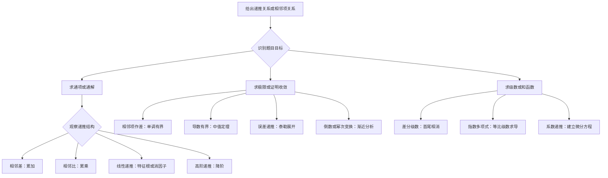

## 一、考研定位与复习重点

**差分方程不是考研数学一的独立考纲考点，而是数学三的考点。本节对于数学一的主要价值，是将差分方程的思想迁移到数列极限、递推关系、无穷级数、幂级数以及线性代数综合题中。**

掌握差分方程的基本思想即可，数学一复习不必深入复杂差分方程的求解。

### 1. 代表性真题

五道具有代表性的数学三真题：

| 真题来源     | 核心考点        | 对数一的学习价值 |
| -------- | ----------- | -------- |
| 2021年数学三 | 一阶差分、累加法    | 很高       |
| 1997年数学三 | 多项式乘指数型差分   | 高        |
| 1998年数学三 | 一阶线性非齐次差分   | 高        |
| 2017年数学三 | 特征根共振       | 高        |
| 2008年数学三 | 无限期现金流、级数求和 | 很高       |

### 2. 数学一应当掌握到什么程度？

| 知识点          | 学习优先级 |
| ------------ | ----- |
| 相邻项作差与累加求和   | ★★★★★ |
| 望远镜求和、裂项相消   | ★★★★★ |
| 递推数列的通项与极限   | ★★★★★ |
| 等比级数及其求导求和   | ★★★★★ |
| 一阶线性差分方程     | ★★★★  |
| 不动点与递推数列收敛性  | ★★★★  |
| 递推关系与幂级数综合   | ★★★★  |
| 差分方程的共振修正    | ★★★   |
| 二阶常系数线性差分方程  | ★★    |
| 复杂高阶、变系数差分方程 | ★     |

本节最重要的不是记住多少种差分方程公式，而是建立以下思维：

**从相邻项关系出发，通过累加、累乘、变量替换、特征根或者构造级数，将局部递推关系转化为数列的整体性质。**

## 二、基础知识：什么是差分方程？

### 2.1 差分的定义及直观理解

对于数列

$$
y_0,y_1,y_2,\ldots,y_n,\ldots
$$

定义一阶向前差分为

$$
\boxed{\Delta y_n=y_{n+1}-y_n}
$$

它表示数列从第 $n$ 项到第 $n+1$ 项的变化量。

例如，若

$$
y_n=n^2,
$$

则

$$
\Delta y_n=(n+1)^2-n^2=2n+1.
$$

再对一阶差分作差，得到二阶差分：

$$
\begin{aligned} \Delta^2y_n &=\Delta(\Delta y_n)\\ &=\Delta y_{n+1}-\Delta y_n\\ &=y_{n+2}-2y_{n+1}+y_n. \end{aligned}
$$

对于 $y_n=n^2$，有

$$
\Delta^2y_n=2,\qquad \Delta^3y_n=0.
$$

可以发现，每进行一次差分，多项式的次数就下降一次。这与导数的性质非常相似。

### 2.2 差分与微分的对应关系

差分方程可以理解为微分方程的离散版本。

| 连续情形           | 离散情形                   |
| -------------- | ---------------------- |
| 函数 $y(x)$  | 数列 $y_n$           |
| 一阶导数 $y'$  | 一阶差分 $\Delta y_n$  |
| 二阶导数 $y''$ | 二阶差分 $\Delta^2y_n$ |
| 积分             | 累加求和                   |
| 初值 $y(0)$  | 初始项 $y_0$          |
| $y'=ay$    | $\Delta y_n=ay_n$  |
| 指数函数解          | 等比数列解                  |
| 微分方程特征根        | 差分方程特征根                |

例如，连续情形：

$$
y'=ay
$$

的通解是

$$
y=Ce^{ax}.
$$

离散情形：

$$
\Delta y_n=ay_n
$$

等价于

$$
y_{n+1}=(1+a)y_n,
$$

从而

$$
y_n=C(1+a)^n.
$$

注意：两者思想相同，但具体公式不同，不能直接照搬微分方程的特征根。

### 2.3 差分方程的阶数、线性与齐次性

一般的 $m$ 阶差分方程可以写为

$$
F(n,y_n,y_{n+1},\ldots,y_{n+m})=0.
$$

例如：

| 方程                              | 类型      |
| ------------------------------- | ------- |
| $y_{n+1}-y_n=n$            | 一阶线性非齐次 |
| $y_{n+1}-2y_n=0$           | 一阶线性齐次  |
| $y_{n+2}-3y_{n+1}+2y_n=0$ | 二阶线性齐次  |
| $y_{n+2}-2y_{n+1}+y_n=n$  | 二阶线性非齐次 |
| $y_{n+1}=y_n^2+1$          | 一阶非线性   |

其中，线性意味着未知数列及其各移位项只以一次形式出现，彼此之间不存在乘积。

一般情况下，一阶显式递推需要一个初始值才能确定数列，二阶显式递推需要两个初始值。

### 2.4 差分的重要性质

**性质一：线性性**

$$
\Delta(au_n+bv_n) =a\Delta u_n+b\Delta v_n.
$$

**性质二：多项式降次**

若

$$
y_n=a_mn^m+\cdots+a_1n+a_0,
$$

则

$$
\Delta y_n=ma_mn^{m-1} +\text{低次项}.
$$

因此

$$
\Delta^m y_n=m!a_m,
$$

$$
\Delta^{m+1}y_n=0.
$$

这是多项式型差分方程待定系数法的理论基础。

**性质三：指数序列差分**

$$
\Delta(\lambda^n) =(\lambda-1)\lambda^n.
$$

进一步有

$$
\Delta^k(\lambda^n) =(\lambda-1)^k\lambda^n.
$$

这与指数函数反复求导的形式类似。

**性质四：乘积差分公式**

$$
\boxed{ \Delta(u_nv_n) =u_{n+1}\Delta v_n+v_n\Delta u_n }
$$

也可以写为

$$
\Delta(u_nv_n) =u_n\Delta v_n+v_{n+1}\Delta u_n.
$$

不要误写成

$$
\Delta(uv)=u\Delta v+v\Delta u.
$$

差分的乘积公式存在下标移位。这也是错位相减法、离散分部求和法背后的原理。

## 三、建立本节的题型识别体系

面对任何递推关系，首先判断它属于哪一种结构，而不是立即套公式。

| 题目结构                        | 优先方法           |
| --------------------------- | -------------- |
| $y_{n+1}-y_n=f(n)$     | 累加法、望远镜求和      |
| $y_{n+1}=f(n)y_n$      | 累乘法            |
| $y_{n+1}=ay_n+b$       | 构造等比数列         |
| $y_{n+1}-ay_n=f(n)$    | 消去齐次因子、待定系数法   |
| $y_{n+1}-ay_n=a^nP(n)$ | 共振修正           |
| 二阶常系数线性递推                   | 特征根法、降阶        |
| $x_{n+1}=f(x_n)$       | 单调有界、构造误差、中值定理 |
| $\sum(a_{n+1}-a_n)$    | 望远镜求和          |
| $\sum a_nx^n$，已知系数递推    | 幂级数逐项求导、微分方程   |
| 长期累积、复利、周期性支付               | 递推建模、等比级数      |

这张表不仅适用于数学三差分方程，也是数学一递推综合题的一套通用识别框架。

## 四、题型一：一阶差分方程与望远镜求和

重要程度：★★★★★

这是本节最基础、也是对于数学一最有价值的题型。

### 4.1 核心公式：累加法

如果

$$
y_{n+1}-y_n=f(n),
$$

那么分别写出

$$
\begin{aligned} y_1-y_0&=f(0),\\ y_2-y_1&=f(1),\\ y_3-y_2&=f(2),\\ &\vdots\\ y_n-y_{n-1}&=f(n-1). \end{aligned}
$$

将所有等式相加，中间项全部消去：

$$
y_n-y_0=\sum_{k=0}^{n-1}f(k).
$$

所以

$$
\boxed{y_n=y_0+\sum_{k=0}^{n-1}f(k)}
$$

更一般地，

$$
\boxed{ y_n=y_m+\sum_{k=m}^{n-1}f(k) }
$$

其中 $n>m$。

所谓望远镜求和，就是利用连续相邻项的差，使求和后的表达式仅剩首尾两项。

### 4.2 母题一：2021年数学三真题

求差分方程

$$
\Delta y_t=t
$$

的通解，其中 $t=0,1,2,\ldots$。

**解题思路**

看到 $\Delta y_t$，首先还原为定义：

$$
y_{t+1}-y_t=t.
$$

不需要特征根，也不需要复杂的待定系数。

直接累加即可：

$$
\begin{aligned} y_t-y_0 &=\sum_{k=0}^{t-1}(y_{k+1}-y_k)\\ &=\sum_{k=0}^{t-1}k\\ &=\frac{t(t-1)}2. \end{aligned}
$$

令 $y_0=C$，得到

$$
\boxed{y_t=C+\frac{t(t-1)}2}.
$$

**如何验证答案？**

对结果作差：

$$
\begin{aligned} y_{t+1}-y_t &=\frac{t(t+1)}2-\frac{t(t-1)}2\\ &=t. \end{aligned}
$$

满足原方程。

<Callout type="warn" title="最容易出现的错误">

把答案写成

$$
C+\frac{t(t+1)}2.
$$

这是因为没有弄清楚求和上限究竟是 $t$ 还是 $t-1$。

**记忆原则：从 $y_0$ 走到** $y_t$**，总共走了 $t$ 步，最后一步是** $y_t-y_{t-1}$**。**

</Callout>

### 4.3 母题的推广

假如

$$
y_{n+1}-y_n=n^2,
$$

那么

$$
\begin{aligned} y_n &=C+\sum_{k=0}^{n-1}k^2\\ &=C+\frac{(n-1)n(2n-1)}6. \end{aligned}
$$

如果

$$
y_{n+1}-y_n=\frac1{n(n+1)}, \qquad n\geq1,
$$

就要识别裂项：

$$
\frac1{n(n+1)} =\frac1n-\frac1{n+1}.
$$

于是

$$
\begin{aligned} y_n-y_1 &=\sum_{k=1}^{n-1} \left(\frac1k-\frac1{k+1}\right)\\ &=1-\frac1n. \end{aligned}
$$

故

$$
\boxed{y_n=C-\frac1n}.
$$

这里自由常数已经重新记为 $C$。

**常用离散求和公式**

$$
\sum_{k=1}^n k=\frac{n(n+1)}2
$$

$$
\sum_{k=1}^n k^2 =\frac{n(n+1)(2n+1)}6
$$

$$
\sum_{k=1}^n k^3 =\frac{n^2(n+1)^2}{4}
$$

$$
\sum_{k=1}^n\frac1{k(k+1)} =1-\frac1{n+1}
$$

$$
\sum_{k=0}^{n-1}q^k =\frac{1-q^n}{1-q}, \qquad q\ne1.
$$

这些公式都是递推数列、级数求和及数列极限的基础工具。

### 4.4 数学一迁移题：张宇1000题·数列极限

求

$$
\lim_{n\to\infty} \left[ \frac12+\frac16+\cdots+ \frac1{n(n+1)} \right]^n.
$$

第一步，识别括号中的相邻差分：

$$
\begin{aligned} \sum_{k=1}^n\frac1{k(k+1)} &=\sum_{k=1}^n \left(\frac1k-\frac1{k+1}\right)\\ &=\frac n{n+1}. \end{aligned}
$$

第二步，识别 $1^\infty$ 型未定式：

$$
\lim_{n\to\infty} \left(\frac n{n+1}\right)^n = \lim_{n\to\infty} \left(1+\frac1n\right)^{-n}.
$$

所以

$$
\boxed{e^{-1}}.
$$

这道题展示了数学一非常典型的命题方式：

**差分结构并不会单独出现，而是隐藏在极限、级数或其他计算题中。**

## 五、题型二：指数多项式型差分与错位相减

重要程度：★★★★☆

### 5.1 母题二：1997年数学三真题

求差分方程

$$
y_{t+1}-y_t=t2^t
$$

的通解。

与上一题相比，右端由简单的多项式变成了多项式乘指数序列。

这类题有两种重要方法。

<Tabs items={["方法一：待定系数法", "方法二：累加与错位相减法"]} defaultIndex={0}>

<Tab value="方法一：待定系数法">

先求对应齐次方程

$$
y_{t+1}-y_t=0.
$$

显然

$$
y_t^{(h)}=C.
$$

由于非齐次项是 $t2^t$，尝试设特解为

$$
y_t^{(p)}=(At+B)2^t.
$$

代入：

$$
\begin{aligned} &y_{t+1}^{(p)}-y_t^{(p)}\\ &=[A(t+1)+B]2^{t+1}-(At+B)2^t\\ &=(At+2A+B)2^t. \end{aligned}
$$

比较系数：

$$
\begin{cases} A=1,\\ 2A+B=0. \end{cases}
$$

解得

$$
A=1,\qquad B=-2.
$$

故通解为

$$
\boxed{y_t=C+(t-2)2^t}.
$$

</Tab>

<Tab value="方法二：累加与错位相减法">

由差分方程，

$$
y_t-y_0=\sum_{k=0}^{t-1}k2^k.
$$

设

$$
S_t=\sum_{k=0}^{t-1}k2^k.
$$

具体写出：

$$
S_t=2+2\cdot2^2+\cdots+(t-1)2^{t-1}.
$$

两边乘以 $2$：

$$
2S_t=2^2+2\cdot2^3+\cdots+(t-1)2^t.
$$

当 $t\geq2$ 时，将两式错位相减：

$$
S_t=(t-1)2^t-\sum_{k=1}^{t-1}2^k.
$$

因此

$$
\begin{aligned} S_t &=(t-1)2^t-(2^t-2)\\ &=(t-2)2^t+2. \end{aligned}
$$

该公式在 $t=0,1$ 时也成立。

所以

$$
y_t=y_0+2+(t-2)2^t.
$$

将 $y_0+2$ 重新记作 $C$，得到

$$
\boxed{y_t=C+(t-2)2^t}.
$$

</Tab>

</Tabs>

**两种方法如何选择？**

| 方法     | 适用场景            |
| ------ | --------------- |
| 待定系数法  | 直接求差分方程通解       |
| 错位相减法  | 等差数列乘等比数列求和     |
| 等比公式求导 | 带参数的有限和、无穷级数和函数 |

对于数学一，后两种方法尤其值得掌握。

### 5.2 推广：等差乘等比的通用公式

由有限等比数列求和公式

$$
\sum_{k=0}^{n-1}q^k =\frac{1-q^n}{1-q},
$$

两边关于 $q$ 求导，再乘以 $q$，得到

$$
\boxed{ \sum_{k=0}^{n-1}kq^k =\frac{q-nq^n+(n-1)q^{n+1}}{(1-q)^2} }
$$

其中 $q\ne1$。

当 $|q|<1$ 时，令 $n\to\infty$，得到

$$
\boxed{ \sum_{k=1}^{\infty}kq^k =\frac{q}{(1-q)^2} }
$$

这条公式不仅用于差分方程，也是数学一幂级数求和的重要基础。

进一步推广：

$$
\boxed{ \sum_{k=1}^{\infty}k^2q^k =\frac{q(1+q)}{(1-q)^3} }
$$

$$
\boxed{ \sum_{k=1}^{\infty}k^3q^k =\frac{q(1+4q+q^2)}{(1-q)^4} }
$$

条件均为

$$
|q|<1.
$$

不建议机械背诵后两个公式，而应掌握反复执行“求导再乘 $q$”的方法。

## 六、题型三：一阶常系数线性差分方程

重要程度：★★★★☆

### 6.1 标准形式与通解结构

一阶常系数线性差分方程的标准形式为

$$
\boxed{y_{n+1}-ay_n=f(n)}.
$$

先假设 $a\ne0$。

对应齐次方程

$$
y_{n+1}-ay_n=0
$$

即

$$
y_{n+1}=ay_n.
$$

因此齐次通解为

$$
y_n^{(h)}=Ca^n.
$$

与线性微分方程一样，非齐次线性差分方程的通解结构为

$$
\boxed{\text{通解}=\text{齐次通解}+\text{非齐次特解}}.
$$

即

$$
y_n=Ca^n+y_n^{(p)}.
$$

原因是任意两个非齐次解的差，必定满足对应的齐次方程。

### 6.2 通用解法：消去齐次增长因子

对于

$$
y_{n+1}-ay_n=f(n),
$$

令

$$
y_n=a^nz_n.
$$

代入得

$$
a^{n+1}z_{n+1}-a^{n+1}z_n=f(n).
$$

于是

$$
z_{n+1}-z_n=\frac{f(n)}{a^{n+1}}.
$$

这已经变成最简单的一阶差分方程。

累加得

$$
z_n=z_0+\sum_{k=0}^{n-1}\frac{f(k)}{a^{k+1}}.
$$

最后乘回 $a^n$：

$$
\boxed{ y_n=a^ny_0+\sum_{k=0}^{n-1}a^{n-1-k}f(k) }.
$$

对于 $a\ne0$，可以用变量替换推出这一公式。

若 $a=0$，直接使用

$$
y_{n+1}=f(n)
$$

即可，此时不需要除以 $a^n$。

这相当于一阶线性微分方程的常数变易法在离散情形下的对应方法。

### 6.3 母题三：1998年数学三真题

求

$$
2y_{t+1}+10y_t-5t=0
$$

的通解。

<Steps>

<Step>

### 第一步：化为标准形式 [!toc]

$$
y_{t+1}+5y_t=\frac52t.
$$

注意，标准形式中对应的齐次增长因子是

$$
a=-5,
$$

而不是 $5$。

</Step>

<Step>

### 第二步：求齐次通解 [!toc]

$$
y_{t+1}+5y_t=0
$$

即

$$
y_{t+1}=-5y_t.
$$

因此

$$
y_t^{(h)}=C(-5)^t.
$$

</Step>

<Step>

### 第三步：设非齐次特解 [!toc]

右端为一次多项式，且齐次根不是 $1$，故设

$$
y_t^{(p)}=At+B.
$$

代入：

$$
\begin{aligned} &A(t+1)+B+5(At+B)\\ &=6At+A+6B. \end{aligned}
$$

比较系数：

$$
\begin{cases} 6A=\dfrac52,\\ A+6B=0. \end{cases}
$$

得

$$
A=\frac5{12},\qquad B=-\frac5{72}.
$$

</Step>

<Step>

### 第四步：写出通解 [!toc]

$$
\boxed{ y_t=C(-5)^t+\frac5{12}t-\frac5{72} }.
$$

</Step>

</Steps>

**本题真正需要掌握什么？**

第一，齐次解必须通过标准形式确定，避免符号错误。

第二，右端是多项式时，如果齐次根不是 $1$，一般可以设同次数多项式特解。

第三，题目要求通解，不能因为某些初值会导致振荡或发散就擅自令 $C=0$。

### 6.4 特别重要的数列递推：常数非齐次项

如果

$$
x_{n+1}=ax_n+b, \qquad a\ne1,
$$

先寻找不动点 $L$，令

$$
L=aL+b.
$$

解得

$$
L=\frac b{1-a}.
$$

于是

$$
x_{n+1}-L=a(x_n-L).
$$

这说明数列

$$
\{x_n-L\}
$$

是等比数列。

因此

$$
\boxed{ x_n=L+a^n(x_0-L) }
$$

即

$$
\boxed{ x_n=\frac b{1-a} +a^n\left(x_0-\frac b{1-a}\right) }.
$$

若从 $x_1$ 开始，则指数应改为 $n-1$。

**根据参数判断收敛性**

| 参数            | 数列性质              |
| ------------- | ----------------- |
| $\|a\|<1$ | 对任意初值均收敛于 $L$ |
| $a=-1$    | 通常在两个值之间交替        |
| $a>1$     | 非平衡初值下绝对偏差指数增长    |
| $a<-1$    | 非平衡初值下振荡且绝对偏差增长   |
| $a=1$     | $x_n=x_0+nb$  |

特别地，当 $a\ne1$ 且初值恰好满足 $x_0=L$ 时，数列始终为常数 $L$，无论 $|a|$ 是否小于 $1$。

**原创基础变式**

设

$$
x_1=1,\qquad x_{n+1}=\frac12x_n+3.
$$

求通项与极限。

由

$$
L=\frac12L+3
$$

得 $L=6$。

所以

$$
x_{n+1}-6=\frac12(x_n-6).
$$

因此

$$
x_n-6=(x_1-6)\left(\frac12\right)^{n-1}.
$$

即

$$
\boxed{x_n=6-\frac5{2^{n-1}}}.
$$

从而

$$
\boxed{\lim_{n\to\infty}x_n=6}.
$$

这种构造不动点的方法，后面可以直接推广到数学一的非线性递推数列。

## 七、题型四：特征根共振与特解修正

重要程度：★★★☆☆

这一部分虽然不是数学一的独立考点，但是能够帮助你更深入地理解上一节学习的常系数线性微分方程。

### 7.1 母题四：2017年数学三真题

求差分方程

$$
y_{t+1}-2y_t=2^t
$$

的通解。

**为什么不能直接设特解为 $A2^t$？**

对应齐次方程为

$$
y_{t+1}-2y_t=0,
$$

其通解是

$$
y_t^{(h)}=C2^t.
$$

如果设

$$
y_t^{(p)}=A2^t,
$$

那么代入原方程左边：

$$
A2^{t+1}-2A2^t=0.
$$

无论怎样选择 $A$，左边都恒等于零，不可能等于右端的 $2^t$。

这就是共振：非齐次项的指数底数恰好是齐次方程的特征根。

<Tabs items={["方法一：乘以 t，修正特解", "方法二：消去齐次因子"]} defaultIndex={0}>

<Tab value="方法一：乘以 t，修正特解">

将特解改设为

$$
y_t^{(p)}=At2^t.
$$

代入得

$$
\begin{aligned} &A(t+1)2^{t+1}-2At2^t\\ &=2A2^t. \end{aligned}
$$

比较系数：

$$
2A=1,
$$

故

$$
A=\frac12.
$$

因此

$$
\boxed{ y_t=\left(C+\frac t2\right)2^t }.
$$

</Tab>

<Tab value="方法二：消去齐次因子">

令

$$
y_t=2^tz_t.
$$

代入原方程：

$$
2^{t+1}z_{t+1}-2^{t+1}z_t=2^t.
$$

整理得

$$
z_{t+1}-z_t=\frac12.
$$

显然

$$
z_t=C+\frac t2.
$$

所以

$$
\boxed{ y_t=\left(C+\frac t2\right)2^t }.
$$

第二种方法不需要记忆共振规则，而且揭示了为什么必须多乘一个 $t$。

</Tab>

</Tabs>

### 7.2 待定系数法的统一公式

考虑一阶线性差分方程

$$
y_{n+1}-ay_n=P_m(n)\lambda^n, \qquad \lambda\ne0,
$$

其中 $P_m(n)$ 为 $m$ 次多项式。

设 $Q_m(n)$ 为待定的 $m$ 次多项式。

| 条件                 | 特解设法                             |
| ------------------ | -------------------------------- |
| $\lambda\ne a$ | $y_n^{(p)}=\lambda^nQ_m(n)$  |
| $\lambda=a$    | $y_n^{(p)}=n\lambda^nQ_m(n)$ |

其中多项式右端可以看作

$$
P_m(n)=P_m(n)\cdot1^n.
$$

于是：

- 当 $a\ne1$ 时，设同次数多项式特解。
- 当 $a=1$ 时，设多乘一个 $n$ 的多项式特解。

这能够统一解释前面四道差分方程真题。

### 7.3 原创强化变式：多项式与共振结合

求

$$
y_{n+1}-3y_n=n3^n.
$$

因为齐次根为 $3$，而右端含有 $3^n$，发生共振。

设

$$
y_n=3^nz_n.
$$

于是

$$
3^{n+1}(z_{n+1}-z_n)=n3^n.
$$

即

$$
z_{n+1}-z_n=\frac n3.
$$

累加：

$$
z_n=C+\frac13\sum_{k=0}^{n-1}k.
$$

所以

$$
z_n=C+\frac{n(n-1)}6.
$$

最后

$$
\boxed{ y_n=3^n\left(C+\frac{n(n-1)}6\right) }.
$$

如果采用待定系数法，也可以设

$$
y_n^{(p)}=n(An+B)3^n.
$$

**本题的迁移规律**

若

$$
y_{n+1}-ay_n=P_m(n)a^n, \qquad a\ne0,
$$

令 $y_n=a^nz_n$，则

$$
\Delta z_n=\frac{P_m(n)}a.
$$

经过累加，$z_n$ 将成为一个至多 $m+1$ 次的多项式。

因此，共振导致特解多出一次多项式因子，并不是人为规定，而是差分降次所决定的。

## 八、题型五：二阶差分、降阶与特征根法

重要程度：★★★☆☆

本部分属于数学一的迁移补充。重点不在复杂的二阶非齐次差分计算，而在级数求和、二阶递推和行列式应用。

### 8.1 二阶差分的本质

$$
\Delta^2y_n =y_{n+2}-2y_{n+1}+y_n.
$$

如果

$$
\Delta^2y_n=f(n),
$$

令

$$
z_n=\Delta y_n,
$$

那么原方程化为

$$
\Delta z_n=f(n).
$$

先求出 $z_n$，再由

$$
\Delta y_n=z_n
$$

求出 $y_n$。

这与可降阶微分方程中令 $p=y'$ 的思想完全对应。

特别地，如果

$$
\Delta^2y_n=0,
$$

就有

$$
\Delta y_n=C_1,
$$

所以

$$
\boxed{y_n=C_1n+C_2}.
$$

也就是说，二阶差分为零的数列就是等差数列。

### 8.2 二阶常系数线性齐次差分方程

标准形式为

$$
y_{n+2}+py_{n+1}+qy_n=0.
$$

尝试设

$$
y_n=r^n.
$$

得到特征方程

$$
\boxed{r^2+pr+q=0}.
$$

在 $q\ne0$ 的通常情形下，解的形式如下。

| 特征根类型                           | 齐次通解                                          |
| ------------------------------- | --------------------------------------------- |
| 两个不同实根 $r_1,r_2$            | $C_1r_1^n+C_2r_2^n$                       |
| 二重实根 $r$                    | $(C_1+C_2n)r^n$                           |
| 共轭复根 $\rho e^{\pm i\theta}$ | $\rho^n(C_1\cos n\theta+C_2\sin n\theta)$ |

当 $q=0$ 时，方程可以直接化为对 $y_{n+1}$ 的一阶递推，注意单独处理初始项。

与二阶常系数微分方程相比，两者最主要的区别是：

$$
e^{rx}\quad\longleftrightarrow\quad r^n.
$$

### 8.3 数学一跨章节应用：李林880题·行列式

计算三对角行列式

$$
D_n= \begin{vmatrix} 2&-1&0&\cdots&0\\ -1&2&-1&\cdots&0\\ 0&-1&2&\ddots&\vdots\\ \vdots&\vdots&\ddots&\ddots&-1\\ 0&0&\cdots&-1&2 \end{vmatrix}.
$$

<Steps>

<Step>

### 第一步：建立递推关系 [!toc]

按照第一行展开，得到

$$
D_n=2D_{n-1}-D_{n-2}, \qquad n\geq3.
$$

即

$$
D_n-2D_{n-1}+D_{n-2}=0.
$$

</Step>

<Step>

### 第二步：识别二阶差分 [!toc]

改写为

$$
D_n-D_{n-1}=D_{n-1}-D_{n-2}.
$$

因此

$$
\{D_n\}
$$

是等差数列。

</Step>

<Step>

### 第三步：计算初始项 [!toc]

$$
D_1=2,
$$

$$
D_2= \begin{vmatrix} 2&-1\\ -1&2 \end{vmatrix} =3.
$$

公差为 $1$，所以

$$
\boxed{D_n=n+1}.
$$

</Step>

</Steps>

**进一步推广**

李林880题中还有一道一般三对角行列式母题：

$$
D_n= \begin{vmatrix} a&b&0&\cdots&0\\ c&a&b&\cdots&0\\ 0&c&a&\ddots&\vdots\\ \vdots&\vdots&\ddots&\ddots&b\\ 0&0&\cdots&c&a \end{vmatrix}.
$$

它满足

$$
D_n=aD_{n-1}-bcD_{n-2},
$$

初始条件为

$$
D_0=1,\qquad D_1=a.
$$

特征方程为

$$
r^2-ar+bc=0.
$$

若两个特征根不同，则

$$
\boxed{ D_n=\frac{r_1^{n+1}-r_2^{n+1}}{r_1-r_2} }.
$$

若为二重根 $r$，则

$$
\boxed{D_n=(n+1)r^n}, \qquad n\geq1.
$$

这里 $D_0=1$ 单独给定。

这就是差分方程思想在数学一线性代数中的直接应用。

### 8.4 数学一重点：李正元练习题·二阶差分级数

求级数

$$
\sum_{n=1}^{\infty} \left(\sqrt{n+2}-2\sqrt{n+1}+\sqrt n\right)
$$

的和。

<Steps>

<Step>

### 第一步：识别结构 [!toc]

令

$$
a_n=\sqrt n.
$$

则级数通项为

$$
a_{n+2}-2a_{n+1}+a_n =\Delta^2a_n.
$$

将其拆成两个相邻的一阶差分：

$$
\Delta^2a_n =\Delta a_{n+1}-\Delta a_n.
$$

</Step>

<Step>

### 第二步：对前 $N$ 项求和 [!toc]

$$
\begin{aligned} S_N &=\sum_{n=1}^N (\Delta a_{n+1}-\Delta a_n)\\ &=\Delta a_{N+1}-\Delta a_1\\ &=\sqrt{N+2}-\sqrt{N+1}-\sqrt2+1. \end{aligned}
$$

</Step>

<Step>

### 第三步：求部分和的极限 [!toc]

$$
\begin{aligned} \sqrt{N+2}-\sqrt{N+1} &=\frac1{\sqrt{N+2}+\sqrt{N+1}}\\ &\to0. \end{aligned}
$$

因此

$$
\boxed{S=1-\sqrt2}.
$$

</Step>

</Steps>

**为什么这道题值得重点掌握？**

因为原数列

$$
a_n=\sqrt n
$$

虽然发散到无穷大，但一阶差分趋于零，二阶差分组成的级数却收敛。

这说明不能简单地根据原数列是否收敛来判断其各阶差分级数。

一般而言，

$$
\boxed{ \sum_{n=m}^{N}\Delta^ka_n =\Delta^{k-1}a_{N+1} -\Delta^{k-1}a_m }
$$

其中 $k\geq1$。

只要相应的边界差分具有有限极限，就可以计算该差分级数的和。

## 九、题型六：离散累积模型与无穷级数

重要程度：★★★★★（级数部分）

### 9.1 母题五：2008年数学三真题

某基金会按年利率 $5\%$ 复利存入 $A$ 万元，每年年末依次提取

$$
19,\ 28,\ 37,\ldots
$$

万元。

要求能够无限期地按此规律提取，求最小初始存款 $A$。

这道题涉及三个关键知识点：递推建模、等比级数、部分和极限。

<Tabs items={["方法一：建立余额递推方程", "方法二：统一折现到初始时刻"]} defaultIndex={0}>

<Tab value="方法一：建立余额递推方程">

令 $B_n$ 为第 $n$ 年末完成提款后的剩余资金。

则

$$
B_0=A.
$$

第 $n$ 年提款金额为

$$
10+9n.
$$

根据题意：

$$
B_n=1.05B_{n-1}-(10+9n).
$$

这是一个一阶线性非齐次差分方程。

两边除以 $1.05^n$：

$$
\frac{B_n}{1.05^n} =\frac{B_{n-1}}{1.05^{n-1}} -\frac{10+9n}{1.05^n}.
$$

累加得

$$
\frac{B_N}{1.05^N} =A-\sum_{n=1}^N\frac{10+9n}{1.05^n}.
$$

要求每年提款后余额非负，即

$$
B_N\geq0,\qquad N=1,2,\ldots
$$

故

$$
A\geq\sum_{n=1}^N\frac{10+9n}{1.05^n}
$$

对任意正整数 $N$ 都要成立。

右端是正项级数的部分和，随 $N$ 增大而增大，因此最小初始存款为

$$
A_{\min} =\sum_{n=1}^{\infty}\frac{10+9n}{1.05^n}.
$$

令

$$
q=\frac1{1.05}=\frac{20}{21}.
$$

于是

$$
\begin{aligned} A_{\min} &=\sum_{n=1}^{\infty}(10+9n)q^n\\ &=10\sum_{n=1}^{\infty}q^n +9\sum_{n=1}^{\infty}nq^n\\ &=\frac{10q}{1-q} +\frac{9q}{(1-q)^2}. \end{aligned}
$$

代入

$$
\frac q{1-q}=20, \qquad \frac q{(1-q)^2}=420,
$$

得到

$$
\boxed{A_{\min}=3980\text{ 万元}}.
$$

</Tab>

<Tab value="方法二：统一折现到初始时刻">

第 $n$ 年末提款金额为

$$
10+9n.
$$

折算到初始时刻，其价值为

$$
\frac{10+9n}{1.05^n}.
$$

因此无限期提款对应的最小本金，就是这些现值组成的无穷级数的总和。

这种方法更快捷，但是第一种递推建模法能够更清晰地说明为什么它确实是最小值。

</Tab>

</Tabs>

### 9.2 一般模型推广

假设每期增长因子为 $1+r$，其中 $r>0$，第 $n$ 期末需要支付

$$
a+b(n-1), \qquad a,b\geq0.
$$

则最小初始资金为

$$
A_{\min} =\sum_{n=1}^{\infty} \frac{a+b(n-1)}{(1+r)^n}.
$$

利用等比级数公式，可以化简为

$$
\boxed{ A_{\min}=\frac ar+\frac b{r^2} }.
$$

本题中

$$
a=19,\qquad b=9,\qquad r=0.05.
$$

所以

$$
A_{\min} =\frac{19}{0.05} +\frac9{0.05^2} =3980.
$$

<Callout type="warn" title="容易出现的陷阱">

- 第一笔支出在年末发生，而不是初始时刻。
- 等差数列通项应明确从 $n=0$ 还是 $n=1$ 开始。
- 求得无穷级数的和后，还要解释它为什么是保证所有有限期支付的最小金额。
- 复利增长因子为 $1+r$，折现因子为 $1/(1+r)$，两者不能混淆。

对于数学一，不必专门学习金融公式，但应熟练掌握这类递推与级数建模方法。

</Callout>

## 十、数学一核心迁移：递推数列的收敛性

重要程度：★★★★★

从这一部分开始，是你作为数学一考生尤其需要重视的内容。

数学一中的递推数列通常是非线性的，不一定能够求出通项公式。因此，必须学会不求通项也能研究数列的极限、单调性、收敛速度。

### 10.1 三种核心构造

设

$$
x_{n+1}=f(x_n).
$$

我们主要研究以下三个量。

**构造一：相邻项之差**

$$
x_{n+1}-x_n=f(x_n)-x_n.
$$

用于判断数列单调性。

**构造二：与不动点之差**

$$
x_{n+1}-L=f(x_n)-f(L).
$$

其中 $L=f(L)$。

用于判断数列是否趋于 $L$，以及收敛速度。

**构造三：相邻差的递推**

$$
\begin{aligned} \Delta x_{n+1} &=x_{n+2}-x_{n+1}\\ &=f(x_{n+1})-f(x_n). \end{aligned}
$$

利用拉格朗日中值定理，可以将非线性递推转化为差分之间的比例关系。

这三种构造分别对应单调有界法、不动点误差法、中值定理压缩法。

### 10.2 数学一真题母题：1997年数学一

此题来自核心题目第七模块第一节，是差分思想与常数项级数结合的典型真题。

设

$$
a_1=2,\qquad a_{n+1}=\frac12\left(a_n+\frac1{a_n}\right).
$$

证明：

（1）$\displaystyle\lim_{n\to\infty}a_n$ 存在；

（2）级数

$$
\sum_{n=1}^{\infty} \left(\frac{a_n}{a_{n+1}}-1\right)
$$

收敛。

**第一问：利用相邻差证明收敛**

首先证明数列始终大于 $1$。

因为 $a_1=2>1$，且当 $a_n>1$ 时，

$$
\begin{aligned} a_{n+1}-1 &=\frac12\left(a_n+\frac1{a_n}-2\right)\\ &=\frac{(a_n-1)^2}{2a_n}\\ &>0. \end{aligned}
$$

故由数学归纳法，

$$
a_n>1.
$$

再研究相邻项之差：

$$
\begin{aligned} a_{n+1}-a_n &=\frac12\left(\frac1{a_n}-a_n\right)\\ &=\frac{1-a_n^2}{2a_n}\\ &<0. \end{aligned}
$$

因此数列单调递减，且有下界 $1$，故极限存在。

设

$$
\lim_{n\to\infty}a_n=L\geq1.
$$

对递推关系两边取极限：

$$
L=\frac12\left(L+\frac1L\right).
$$

得到

$$
L^2=1.
$$

结合 $L\geq1$，有

$$
\boxed{L=1}.
$$

**第二问：利用差分构造收敛的比较级数**

观察原级数通项：

$$
\frac{a_n}{a_{n+1}}-1 =\frac{a_n-a_{n+1}}{a_{n+1}}.
$$

因为

$$
a_n>a_{n+1}>1,
$$

所以

$$
0< \frac{a_n-a_{n+1}}{a_{n+1}} \leq a_n-a_{n+1}.
$$

而

$$
\begin{aligned} \sum_{n=1}^{N}(a_n-a_{n+1}) &=a_1-a_{N+1}\\ &=2-a_{N+1}. \end{aligned}
$$

令 $N\to\infty$，

$$
\sum_{n=1}^{\infty}(a_n-a_{n+1})=1.
$$

因此根据正项级数的比较判别法，

$$
\boxed{ \sum_{n=1}^{\infty} \left(\frac{a_n}{a_{n+1}}-1\right) \text{收敛} }.
$$

**从这道真题提炼出的普遍结论**

如果数列 $\{a_n\}$ 单调收敛于有限值，那么

$$
\boxed{ \sum_{n=1}^{\infty}|a_{n+1}-a_n| =|L-a_1| }
$$

其中

$$
L=\lim_{n\to\infty}a_n.
$$

若还能证明

$$
|b_n|\leq C|a_{n+1}-a_n|, \qquad C>0,
$$

便可直接推出

$$
\sum_{n=1}^{\infty}b_n
$$

绝对收敛。

**这是一类非常重要的数学一证明题模板：先证明数列单调有界，再用可求和的相邻差控制另一个级数。**

### 10.3 张宇1000题的对应变式

设 $a>0,\ x_0>0$，且

$$
x_{n+1}=\frac12\left(x_n+\frac a{x_n}\right).
$$

证明数列收敛并求其极限。

这是1997年数学一真题递推结构的直接推广。

由均值不等式，

$$
x_{n+1}\geq\sqrt a.
$$

因此从 $x_1$ 开始，

$$
x_n\geq\sqrt a.
$$

又因为

$$
x_{n+1}-x_n =\frac{a-x_n^2}{2x_n} \leq0,
$$

所以从 $x_1$ 开始数列单调不增，且有下界 $\sqrt a$。

设其极限为 $L$，则

$$
L=\frac12\left(L+\frac aL\right).
$$

从而

$$
\boxed{L=\sqrt a}.
$$

需要注意的是，如果 $x_0<\sqrt a$，数列第一步可能上升，之后才单调下降。

证明数列收敛，只需要证明从某一项开始单调有界。

### 10.4 数学一真题母题：2016年数学一

这道题是相邻差分与中值定理结合的代表性真题，也是本节最值得掌握的数学一迁移题之一。

已知函数 $f$ 可导，

$$
f(0)=1,
$$

且

$$
0<f'(x)<\frac12.
$$

设数列满足

$$
x_{n+1}=f(x_n).
$$

证明：

（1）级数

$$
\sum_{n=1}^{\infty}(x_{n+1}-x_n)
$$

绝对收敛；

（2）数列 $\{x_n\}$ 收敛，且极限属于 $(0,2)$。

<Steps>

<Step>

### 第一步：识别导数界的作用 [!toc]

题目给出

$$
0<f'(x)<\frac12,
$$

它不是直接给出的数列单调性条件，而是用来控制两次迭代之间的距离。

由拉格朗日中值定理，

$$
\begin{aligned} |x_{n+1}-x_n| &=|f(x_n)-f(x_{n-1})|\\ &=|f'(\xi_n)||x_n-x_{n-1}|\\ &\leq\frac12|x_n-x_{n-1}|. \end{aligned}
$$

反复使用：

$$
\boxed{ |x_{n+1}-x_n| \leq\left(\frac12\right)^{n-1}|x_2-x_1| }.
$$

</Step>

<Step>

### 第二步：用等比级数控制差分级数 [!toc]

因为

$$
\sum_{n=1}^{\infty} \left(\frac12\right)^{n-1}=2,
$$

所以

$$
\sum_{n=1}^{\infty}|x_{n+1}-x_n| \leq2|x_2-x_1| <+\infty.
$$

因此原级数绝对收敛。

</Step>

<Step>

### 第三步：由差分级数收敛推出原数列收敛 [!toc]

根据望远镜求和，

$$
\sum_{k=1}^n(x_{k+1}-x_k) =x_{n+1}-x_1.
$$

因为左边部分和收敛，所以右边也收敛，进而

$$
\lim_{n\to\infty}x_n=L
$$

存在。

</Step>

<Step>

### 第四步：确定极限所在区间 [!toc]

因为 $f$ 连续，

$$
L=f(L).
$$

令

$$
g(x)=f(x)-x.
$$

则

$$
g'(x)=f'(x)-1<-\frac12<0.
$$

所以 $g$ 严格递减。

又有

$$
g(0)=f(0)=1>0.
$$

由中值定理，

$$
f(2)-f(0)=2f'(\eta)<1.
$$

因此

$$
f(2)<2,
$$

即

$$
g(2)<0.
$$

由零点定理，$g$ 在 $(0,2)$ 内有唯一零点。

而 $L$ 满足 $g(L)=0$，因此

$$
\boxed{0<L<2}.
$$

</Step>

</Steps>

**母题总结：导数界＋递推数列＋级数**

以后遇到

$$
x_{n+1}=f(x_n),
$$

且存在常数 $q\in[0,1)$，使得

$$
|f'(x)|\leq q
$$

在包含迭代点的相关区间内成立，应优先考虑：

$$
|x_{n+1}-x_n| \leq q|x_n-x_{n-1}|.
$$

于是

$$
|x_{n+1}-x_n| \leq q^{n-1}|x_2-x_1|.
$$

进而获得数列的误差估计

$$
\boxed{ |x_n-L| \leq \frac{q^{n-1}}{1-q}|x_2-x_1| }.
$$

这就是压缩型递推的核心。

如果题目已经给出不动点 $L$，那么还可以直接通过

$$
|x_{n+1}-L| \leq q|x_n-L|
$$

得到

$$
\boxed{ |x_n-L|\leq q^{n-1}|x_1-L| }.
$$

张宇1000题中的  和  正是这一思想的收敛性证明与无穷小阶数比较变式。

## 十一、数学一强化：差分、泰勒展开与收敛速度

重要程度：★★★★★

在近年来的模拟训练中，递推数列不仅要求证明收敛，还经常要求计算相邻两项之比、误差阶数以及更精细的渐近极限。

### 11.1 2027李林六套卷第四套第3题

这道数列极限模拟题与差分思想高度相关。

设

$$
x_0=1,
$$

$$
x_n=x_{n-1}+\cos x_{n-1},
$$

且

$$
x_n+y_n=\frac\pi2.
$$

求

$$
\lim_{n\to\infty} \frac{y_{n+1}}{\left(\frac\pi2-x_n\right)^3}.
$$

<Steps>

<Step>

### 第一步：构造误差数列 [!toc]

原递推式比较复杂，因为 $x_n$ 的目标极限并不是零。

令

$$
\delta_n=\frac\pi2-x_n.
$$

则

$$
\cos x_n=\sin\delta_n.
$$

因此

$$
\begin{aligned} \delta_{n+1} &=\frac\pi2-x_{n+1}\\ &=\frac\pi2-x_n-\cos x_n\\ &=\delta_n-\sin\delta_n. \end{aligned}
$$

原问题被转化为

$$
\boxed{\delta_{n+1}=\delta_n-\sin\delta_n}.
$$

</Step>

<Step>

### 第二步：证明误差趋于零 [!toc]

因为

$$
0<\delta_0=\frac\pi2-1<\frac\pi2,
$$

且当 $0<t<\pi/2$ 时，

$$
0<\sin t<t,
$$

故

$$
0<\delta_{n+1}<\delta_n.
$$

所以 $\{\delta_n\}$ 单调递减且有下界 $0$。

设极限为 $\ell$，则

$$
\ell=\ell-\sin\ell.
$$

得到

$$
\sin\ell=0.
$$

由于

$$
0\leq\ell\leq\delta_0<\frac\pi2,
$$

所以

$$
\boxed{\delta_n\to0}.
$$

</Step>

<Step>

### 第三步：使用泰勒展开研究误差阶数 [!toc]

因为

$$
y_{n+1}=\delta_{n+1},
$$

所以所求极限为

$$
\lim_{n\to\infty} \frac{\delta_n-\sin\delta_n}{\delta_n^3}.
$$

利用

$$
\sin t=t-\frac{t^3}{6}+o(t^3),
$$

得到

$$
t-\sin t=\frac{t^3}{6}+o(t^3).
$$

因此

$$
\boxed{ \lim_{n\to\infty} \frac{y_{n+1}}{\left(\frac\pi2-x_n\right)^3} =\frac16 }.
$$

</Step>

</Steps>

**这类题的通用方法**

对于

$$
x_{n+1}=f(x_n),\qquad x_n\to L,
$$

令

$$
e_n=x_n-L.
$$

若 $f$ 在 $L$ 附近具有相应的泰勒展开，并且 $f(L)=L$，那么

$$
e_{n+1} =f'(L)e_n+\frac{f''(L)}{2}e_n^2 +\frac{f'''(L)}6e_n^3+\cdots.
$$

如果

$$
f'(L)=f''(L)=\cdots=f^{(m-1)}(L)=0,
$$

而

$$
f^{(m)}(L)\ne0,
$$

则当误差不为零并趋于零时，

$$
\boxed{ \lim_{n\to\infty} \frac{e_{n+1}}{e_n^m} =\frac{f^{(m)}(L)}{m!} }.
$$

这就是递推数列的高阶误差分析。

### 11.2 李正元练习题：非线性递推的渐近分析

设

$$
x_{n+1}=\ln(1+x_n), \qquad x_1>0.
$$

求：

（1）$\displaystyle\lim_{n\to\infty}x_n$；

（2）

$$
\lim_{n\to\infty} \frac{x_nx_{n+1}}{x_n-x_{n+1}}.
$$

**第一问：单调有界**

由

$$
0<\ln(1+x)<x,\qquad x>0,
$$

可知

$$
0<x_{n+1}<x_n.
$$

因此数列单调递减且有下界零。

设其极限为 $L\geq0$，则

$$
L=\ln(1+L).
$$

由于正数 $L$ 不可能满足上述等式，故

$$
\boxed{L=0}.
$$

**第二问：利用相邻差的高阶展开**

当 $x_n\to0$ 时，

$$
\ln(1+x_n) =x_n-\frac{x_n^2}{2}+o(x_n^2).
$$

因此

$$
x_n-x_{n+1}\sim\frac{x_n^2}{2}.
$$

又

$$
x_{n+1}=\ln(1+x_n)\sim x_n.
$$

于是

$$
\frac{x_nx_{n+1}}{x_n-x_{n+1}} \sim \frac{x_n^2}{x_n^2/2}=2.
$$

所以

$$
\boxed{2}.
$$

**第三层推广：能否进一步求出 $x_n$ 的等价无穷小？**

这是在原题基础上增加的原创强化问题：

求

$$
\lim_{n\to\infty}nx_n.
$$

原题第二问其实已经提示了应该对 $1/x_n$ 作差。

因为

$$
\frac1{x_{n+1}}-\frac1{x_n} =\frac{x_n-x_{n+1}}{x_nx_{n+1}} \to\frac12.
$$

令

$$
b_n=\frac1{x_n}.
$$

则

$$
b_{n+1}-b_n\to\frac12.
$$

由累加公式，

$$
\frac{b_n}{n} =\frac{b_1}{n} +\frac1n\sum_{k=1}^{n-1}(b_{k+1}-b_k).
$$

根据收敛数列的算术平均值也收敛于同一极限，

$$
\frac{b_n}{n}\to\frac12.
$$

即

$$
\frac1{nx_n}\to\frac12.
$$

所以

$$
\boxed{nx_n\to2}.
$$

更精确地说，

$$
\boxed{x_n\sim\frac2n}.
$$

这就是一种非常重要的创新题思路：**先构造倒数差分，再通过累加平均确定原数列的渐近阶数。**

### 11.3 进阶通用模型：非线性递推的衰减速度

设已知

$$
x_n>0,\qquad x_n\to0,
$$

且

$$
x_{n+1}=x_n-cx_n^p+o(x_n^p),
$$

其中 $c>0,\ p>1$。

那么

$$
\frac{x_{n+1}}{x_n} =1-cx_n^{p-1}+o(x_n^{p-1}).
$$

考虑变换

$$
b_n=x_n^{-(p-1)}.
$$

利用

$$
(1-u)^{-(p-1)} =1+(p-1)u+o(u),
$$

得到

$$
b_{n+1}-b_n\to c(p-1).
$$

累加并取算术平均：

$$
\frac{b_n}{n}\to c(p-1).
$$

因此

$$
\boxed{ x_n\sim[c(p-1)n]^{-\frac1{p-1}} }.
$$

这条结论不是需要单独背诵的数学一考纲公式，但其推导所使用的泰勒展开、等价无穷小、差分累加，都是数学一的重要知识。

例如：

| 递推关系（且已知正数列趋于零）              | 渐近阶数                       |
| ---------------------------- | -------------------------- |
| $x_{n+1}=\ln(1+x_n)$    | $x_n\sim2/n$           |
| $x_{n+1}=\sin x_n$      | $x_n\sim\sqrt{3/n}$    |
| $x_{n+1}=2x_n-\tan x_n$ | $x_n\sim\sqrt{3/(2n)}$ |
| $x_{n+1}=x_n/(1+x_n)$   | $x_n\sim1/n$           |

其中正弦递推对应核心题目中的2006年数学一真题结构，正切递推对应张宇1000题 。表中精确渐近阶数属于在原题基础上的推广，并非原题全部设问。

## 十二、数学一重点综合：差分方程、幂级数与微分方程

重要程度：★★★★★

这是本节对于数学一最重要的综合应用之一。

出题人可以先给出数列系数的递推关系，然后要求你研究幂级数的收敛半径、建立微分方程并求出和函数。

它可以将以下章节串联起来：

$$
\text{数列递推} \longrightarrow \text{幂级数} \longrightarrow \text{微分方程} \longrightarrow \text{和函数}.
$$

### 12.1 必须掌握的下标转换公式

设

$$
S(x)=\sum_{n=0}^{\infty}a_nx^n,
$$

收敛半径为 $R>0$。

当 $|x|<R$ 时，有

$$
S'(x)=\sum_{n=1}^{\infty}na_nx^{n-1},
$$

$$
xS'(x)=\sum_{n=1}^{\infty}na_nx^n,
$$

$$
S''(x)=\sum_{n=2}^{\infty}n(n-1)a_nx^{n-2}.
$$

特别需要掌握下列变换：

| 递推中的结构                                                  | 转换结果            |
| ------------------------------------------------------- | --------------- |
| $\displaystyle\sum_{n=0}^{\infty}(n+1)a_{n+1}x^n$ | $S'(x)$     |
| $\displaystyle\sum_{n=1}^{\infty}(n+1)a_{n+1}x^n$ | $S'(x)-a_1$ |
| $\displaystyle\sum_{n=1}^{\infty}na_nx^n$          | $xS'(x)$    |
| $\displaystyle\sum_{n=1}^{\infty}a_{n-1}x^n$      | $xS(x)$     |
| $\displaystyle\sum_{n=2}^{\infty}a_{n-2}x^{n-2}$  | $S(x)$      |

初始项还会转化为微分方程的初始条件：

$$
\boxed{S(0)=a_0,\qquad S'(0)=a_1}.
$$

更一般地，

$$
S^{(k)}(0)=k!a_k.
$$

### 12.2 真题母题：2020年数学一

此题不仅出现在核心题目的第七模块第二节，也收录于张宇1000题的无穷级数章节。

设数列满足

$$
a_1=1,
$$

$$
(n+1)a_{n+1} =\left(n+\frac12\right)a_n, \qquad n\geq1.
$$

证明当 $|x|<1$ 时，

$$
\sum_{n=1}^{\infty}a_nx^n
$$

收敛，并求其和函数。

<Steps>

<Step>

### 第一步：证明收敛 [!toc]

由递推关系，

$$
\frac{a_{n+1}}{a_n} =\frac{n+\frac12}{n+1}\to1.
$$

因为 $a_1=1$，由递推可知 $a_n>0$。

利用比值判别法，

$$
\lim_{n\to\infty} \left| \frac{a_{n+1}x^{n+1}}{a_nx^n} \right| =|x|.
$$

因此当 $|x|<1$ 时，级数绝对收敛，且收敛半径为

$$
R=1.
$$

</Step>

<Step>

### 第二步：建立和函数满足的微分方程 [!toc]

令

$$
S(x)=\sum_{n=1}^{\infty}a_nx^n.
$$

由题设递推关系，两边乘以 $x^n$，从 $n=1$ 开始求和：

$$
\sum_{n=1}^{\infty}(n+1)a_{n+1}x^n = \sum_{n=1}^{\infty} \left(n+\frac12\right)a_nx^n.
$$

左边为

$$
S'(x)-a_1=S'(x)-1.
$$

右边为

$$
xS'(x)+\frac12S(x).
$$

于是

$$
S'(x)-1=xS'(x)+\frac12S(x).
$$

整理得

$$
\boxed{ (1-x)S'(x)-\frac12S(x)=1 }.
$$

</Step>

<Step>

### 第三步：求解一阶线性微分方程 [!toc]

将方程写成

$$
S'(x)-\frac1{2(1-x)}S(x) =\frac1{1-x}.
$$

积分因子为

$$
\mu(x) =e^{\int-\frac1{2(1-x)}\,dx} =\sqrt{1-x}.
$$

于是

$$
\frac d{dx} \left[\sqrt{1-x}S(x)\right] =\frac1{\sqrt{1-x}}.
$$

积分得

$$
\sqrt{1-x}S(x) =-2\sqrt{1-x}+C.
$$

</Step>

<Step>

### 第四步：利用初始条件确定常数 [!toc]

因为

$$
S(x)=\sum_{n=1}^{\infty}a_nx^n,
$$

没有常数项，所以

$$
S(0)=0.
$$

代入得

$$
0=-2+C,
$$

即

$$
C=2.
$$

最终得到

$$
\boxed{ S(x)=\frac2{\sqrt{1-x}}-2, \qquad |x|<1 }.
$$

</Step>

</Steps>

<Callout type="warn" title="本题最容易失分的地方">

最常见的错误是漏掉

$$
S'(x)-a_1
$$

中的 $a_1$。

其次是没有先证明幂级数收敛，就直接使用逐项求导。

标准逻辑顺序必须是：

$$
\boxed{ \text{判定收敛} \to \text{逐项求导} \to \text{建立方程} \to \text{求解和函数} }.
$$

</Callout>

### 12.3 真题母题：2013年数学一

设

$$
a_0=3,\qquad a_1=1,
$$

且

$$
a_{n-2}-n(n-1)a_n=0, \qquad n\geq2.
$$

令

$$
S(x)=\sum_{n=0}^{\infty}a_nx^n.
$$

（1）证明

$$
S''(x)-S(x)=0;
$$

（2）求 $S(x)$。

<Steps>

<Step>

### 第一步：由递推关系研究收敛性 [!toc]

原递推式等价于

$$
a_n=\frac{a_{n-2}}{n(n-1)}.
$$

因为下标每次相差 $2$，所以应分奇偶两类。

偶数项：

$$
a_{2k}=\frac3{(2k)!}.
$$

奇数项：

$$
a_{2k+1}=\frac1{(2k+1)!}.
$$

因此

$$
\sum_{n=0}^{\infty}|a_nx^n| \leq3e^{|x|}.
$$

故收敛半径为

$$
R=+\infty.
$$

</Step>

<Step>

### 第二步：建立二阶微分方程 [!toc]

利用幂级数逐项求导，

$$
\begin{aligned} S''(x) &=\sum_{n=2}^{\infty} n(n-1)a_nx^{n-2}\\ &=\sum_{n=2}^{\infty}a_{n-2}x^{n-2}\\ &=S(x). \end{aligned}
$$

所以

$$
\boxed{S''-S=0}.
$$

</Step>

<Step>

### 第三步：求解微分方程 [!toc]

特征方程为

$$
r^2-1=0.
$$

得到

$$
S(x)=C_1e^x+C_2e^{-x}.
$$

利用初始条件

$$
S(0)=a_0=3,
$$

$$
S'(0)=a_1=1,
$$

得到

$$
\begin{cases} C_1+C_2=3,\\ C_1-C_2=1. \end{cases}
$$

所以

$$
\boxed{S(x)=2e^x+e^{-x}}.
$$

</Step>

</Steps>

**两道真题的统一识别方法**

当递推式中出现

$$
(n+1)a_{n+1}
$$

时，通常优先联想到一阶导数。

当出现

$$
n(n-1)a_n
$$

时，通常联想到二阶导数。

当出现相邻系数 $a_{n-1}$、$a_n$ 时，还要考虑与 $xS(x)$ 的对应关系。

这就是从离散差分关系转换为连续微分方程的基本思想。

### 12.4 综合强化母题：李林880题·无穷级数

设

$$
a_0=1,\qquad a_1=0,
$$

$$
(n+1)a_{n+1}=na_n+a_{n-1}, \qquad n\geq1.
$$

令

$$
S(x)=\sum_{n=0}^{\infty}a_nx^n.
$$

求：

（1）$\displaystyle\lim_{n\to\infty}a_n$ 及收敛半径；

（2）$S(x)$ 满足的微分方程及和函数。

这道题把本节的累加法、累乘法、差分降阶、幂级数、线性微分方程全部综合在了一起，非常值得精做。

**第一问：通过相邻差降阶**

原递推式可以写成

$$
(n+1)(a_{n+1}-a_n) =a_{n-1}-a_n.
$$

即

$$
a_{n+1}-a_n =-\frac1{n+1}(a_n-a_{n-1}).
$$

令

$$
b_n=a_n-a_{n-1}.
$$

则

$$
b_{n+1}=-\frac1{n+1}b_n.
$$

而

$$
b_1=a_1-a_0=-1.
$$

通过累乘，

$$
\boxed{b_n=\frac{(-1)^n}{n!}}.
$$

再累加：

$$
\begin{aligned} a_n &=a_0+\sum_{k=1}^nb_k\\ &=\sum_{k=0}^n\frac{(-1)^k}{k!}. \end{aligned}
$$

根据指数函数的幂级数展开，

$$
e^{-1} =\sum_{k=0}^{\infty}\frac{(-1)^k}{k!}.
$$

因此

$$
\boxed{\lim_{n\to\infty}a_n=e^{-1}}.
$$

由于极限不为零，

$$
\frac{a_{n+1}}{a_n}\to1,
$$

其中比值从充分大的 $n$ 开始有定义。

所以

$$
\boxed{R=1}.
$$

**第二问：建立微分方程**

将原递推关系两边乘以 $x^n$，再从 $n=1$ 开始求和：

$$
\sum_{n=1}^{\infty}(n+1)a_{n+1}x^n = \sum_{n=1}^{\infty}na_nx^n +\sum_{n=1}^{\infty}a_{n-1}x^n.
$$

左边为

$$
S'(x)-a_1=S'(x).
$$

右边为

$$
xS'(x)+xS(x).
$$

因此

$$
S'=xS'+xS,
$$

即

$$
\boxed{(1-x)S'=xS}.
$$

化为一阶线性方程：

$$
S'-\frac{x}{1-x}S=0.
$$

求解得

$$
S(x)=C\frac{e^{-x}}{1-x}.
$$

由于

$$
S(0)=a_0=1,
$$

所以 $C=1$。

最终

$$
\boxed{ S(x)=\frac{e^{-x}}{1-x}, \qquad |x|<1 }.
$$

**为什么这是一道优质综合母题？**

它展示了两条可以相互补充的解题路线：

第一条是离散路线：

$$
\text{二阶递推} \to \text{一阶差分} \to \text{累乘} \to \text{累加} \to \text{极限}.
$$

第二条是连续路线：

$$
\text{系数递推} \to \text{幂级数} \to \text{微分方程} \to \text{和函数}.
$$

掌握这道题后，遇到结构相似的新题，就不需要完全依赖能否直接猜出数列通项。

## 十三、常见错误与陷阱总汇

| 容易犯的错误        | 正确的处理方法                          |
| ------------- | -------------------------------- |
| 累加时下标错一位      | 先写出首项、末项，再求和                     |
| 一阶差分通解漏掉常数    | 特解后补齐次通解                         |
| 把差分特征根当成微分特征根 | 差分使用 $r^n$，微分使用 $e^{rx}$ |
| 发生共振时仍设同型特解   | 根据特征根重数乘相应的 $n$ 因子           |
| 累乘或变量替换时除以零   | 检查零解、零初值和特殊参数                    |
| 解出不动点就认为数列收敛  | 先证明极限存在，再取极限                     |
| 认为相邻差趋零就能推出收敛 | 相邻差趋零仅是必要条件                      |
| 认为不动点唯一就一定收敛  | 还需单调有界、压缩等条件                     |
| 无穷级数裂项后直接相消   | 先求有限部分和，再令 $N\to\infty$      |
| 幂级数直接逐项求导     | 首先确定收敛半径或收敛区间内部                  |
| 转换幂级数时遗漏初始项   | 注意求和下限变化                         |
| 认为有界数列必然收敛    | 检查单调性或其他收敛条件                     |

下面两个反例尤其值得记忆。

**反例一：相邻差趋于零，不代表数列收敛**

设

$$
a_n=\ln n.
$$

则

$$
a_{n+1}-a_n =\ln\left(1+\frac1n\right)\to0.
$$

但

$$
a_n\to+\infty.
$$

因此

$$
\Delta a_n\to0
$$

并不能推出 $a_n$ 收敛。

真正成立的是

$$
\boxed{ \sum_{n=1}^{\infty}(a_{n+1}-a_n) \text{收敛} \iff \{a_n\}\text{收敛} }.
$$

**反例二：不动点唯一，不代表数列收敛**

设

$$
x_{n+1}=1-x_n,\qquad x_0=0.
$$

不动点方程为

$$
L=1-L,
$$

唯一解为

$$
L=\frac12.
$$

但原数列为

$$
0,1,0,1,\ldots
$$

并不收敛。

这说明解出极限方程，只能获得可能的极限值，不能替代收敛性证明。

## 十四、原创分层训练题

以下题目是根据本节真题及配套练习题的母题结构设计的原创变式，不冒充历年真题或教师原题。

建议先独立完成，再核对参考答案。

### A组：基础结构识别

**第1题**

求差分方程

$$
y_{n+1}-y_n=3n^2+3n+1
$$

的通解。

**第2题**

求差分方程

$$
y_{n+1}-2y_n=n
$$

的通解。

**第3题**

求差分方程

$$
y_{n+1}-2y_n=n2^n
$$

的通解。

**第4题**

设

$$
y_{n+2}-5y_{n+1}+6y_n=0,
$$

且

$$
y_0=2,\qquad y_1=5.
$$

求 $y_n$。

### B组：数学一常规综合

**第5题**

求级数

$$
\sum_{n=1}^{\infty} (\ln(n+2)-2\ln(n+1)+\ln n)
$$

的和。

**第6题**

设

$$
x_1>0,\qquad x_{n+1}=\frac{x_n}{1+x_n}.
$$

求数列通项，并计算

$$
\lim_{n\to\infty}nx_n.
$$

**第7题**

计算

$$
\sum_{n=1}^{\infty}\frac{n^2}{2^n}.
$$

**第8题**

设 $f$ 在实数域上可导，且

$$
|f'(x)|\leq\frac13.
$$

数列满足

$$
x_{n+1}=f(x_n).
$$

证明数列收敛，并证明

$$
\sum_{n=1}^{\infty}|x_{n+1}-x_n| \leq\frac32|x_2-x_1|.
$$

### C组：强化与创新题

**第9题**

设

$$
0<x_1<1,\qquad x_{n+1}=x_n-x_n^2.
$$

证明 $x_n\to0$，并求

$$
\lim_{n\to\infty}nx_n.
$$

**第10题**

设

$$
a_0=1,
$$

$$
(n+1)a_{n+1}=2a_n.
$$

求幂级数

$$
S(x)=\sum_{n=0}^{\infty}a_nx^n
$$

的收敛半径与和函数。

**第11题**

设

$$
a_0=0,\qquad a_1=1,
$$

$$
a_{n+2}=3a_{n+1}-2a_n.
$$

求

$$
S(x)=\sum_{n=0}^{\infty}a_nx^n
$$

的收敛半径与和函数。

**第12题**

设

$$
0<x_1<\frac\pi2,\qquad x_{n+1}=\sin x_n.
$$

证明数列收敛，并求

$$
\lim_{n\to\infty}nx_n^2.
$$

### 参考答案及关键突破口

| 题号 | 答案                                                         | 突破口         |
| -- | ---------------------------------------------------------- | ----------- |
| 1  | $y_n=n^3+C$                                            | 识别三次多项式的差分  |
| 2  | $y_n=C2^n-n-1$                                         | 同次数多项式特解    |
| 3  | $\displaystyle y_n=2^n\left(C+\frac{n(n-1)}4\right)$   | 共振、消去齐次因子   |
| 4  | $y_n=2^n+3^n$                                          | 两个不同特征根     |
| 5  | $-\ln2$                                                | 二阶差分望远镜     |
| 6  | $\displaystyle x_n=\frac1{n-1+1/x_1}$，极限为 $1$      | 倒数作差        |
| 7  | $6$                                                    | 等比级数两次求导    |
| 8  | 收敛，题设不等式成立                                                 | 中值定理、等比级数   |
| 9  | $1$                                                    | 单调有界、倒数差分   |
| 10 | $R=+\infty,\ S(x)=e^{2x}$                              | 系数递推转微分方程   |
| 11 | $\displaystyle R=\frac12,\ S(x)=\frac{x}{(1-x)(1-2x)}$ | 特征根、等比级数    |
| 12 | $3$                                                    | 泰勒展开、平方倒数差分 |

**第12题的关键推导**

这是非常值得独立推导的强化题。

首先由

$$
0<\sin x_n<x_n
$$

得到单调有界性，进而证明 $x_n\to0$。

然后考虑

$$
\frac1{x_{n+1}^2}-\frac1{x_n^2}.
$$

根据泰勒展开，

$$
\sin x_n =x_n-\frac{x_n^3}{6}+o(x_n^3).
$$

因此

$$
\begin{aligned} \frac1{x_{n+1}^2} &=\frac1{x_n^2} \left(1-\frac{x_n^2}6+o(x_n^2)\right)^{-2}\\ &=\frac1{x_n^2}+\frac13+o(1). \end{aligned}
$$

于是

$$
\frac1{x_{n+1}^2}-\frac1{x_n^2} \to\frac13.
$$

由累加平均可得

$$
\frac1{nx_n^2}\to\frac13.
$$

所以

$$
\boxed{\lim_{n\to\infty}nx_n^2=3}.
$$

这道题能够检验你是否真正掌握了从递推关系中主动构造有用差分的能力。

## 十五、本节知识体系与考场解题决策图

### 15.1 考场上应当形成的条件反射

| 看到的命题信号                       | 应立即想到的方法   |
| ----------------------------- | ---------- |
| $a_{n+1}-a_n$            | 累加、单调性     |
| $a_{n+2}-2a_{n+1}+a_n$  | 二阶差分、降阶    |
| $a_{n+1}/a_n$            | 累乘、比值判别法   |
| $a_{n+1}=pa_n+q$         | 不动点、构造等比数列 |
| $\|f'(x)\|\leq q<1$       | 中值定理、压缩型递推 |
| $x_{n+1}-L$              | 误差数列       |
| $x_n-x_{n+1}\sim cx_n^p$ | 倒数或幂次差分    |
| $\sum n^kq^n$             | 等比级数逐项求导   |
| $(n+1)a_{n+1}$           | 幂级数一阶导数    |
| $n(n-1)a_n$               | 幂级数二阶导数    |
| 三对角行列式                        | 建立二阶递推关系   |

### 15.2 最值得反复练习的母题

按数学一的学习价值安排优先复习题目。

| 优先级 | 题目来源               | 训练目标         |
| --- | ------------------ | ------------ |
| S   | 2016年数学一           | 差分、中值定理、级数收敛 |
| S   | 1997年数学一           | 单调有界、望远镜比较   |
| S   | 2020年数学一           | 系数递推转一阶微分方程  |
| S   | 2013年数学一           | 系数递推转二阶微分方程  |
| S   | 李林880题无穷级数综合题   | 差分降阶与幂级数综合   |
| A   | 李林六套卷第四套第3题        | 误差递推、泰勒展开    |
| A   | 李正元函数极限题        | 非线性递推与渐近阶数   |
| A   | 李正元无穷级数题        | 二阶差分级数       |
| A   | 2021年数学三           | 累加法基础        |
| A   | 2008年数学三           | 等比级数与离散模型    |
| B   | 1997、1998、2017年数学三 | 线性差分、待定系数与共振 |
| B   | 李林880题行列式题  | 二阶递推的线代应用    |

## 十六、本节最终速记公式

掌握以下八组公式，基本可以覆盖本节的核心思想。

**① 累加公式**

$$
\boxed{ a_n=a_m+\sum_{k=m}^{n-1}\Delta a_k }
$$

**② 累乘公式**

$$
\boxed{ a_{n+1}=q_na_n \Longrightarrow a_n=a_0\prod_{k=0}^{n-1}q_k }
$$

**③ 一阶线性差分通解**

$$
\boxed{ y_n=a^ny_0+\sum_{k=0}^{n-1}a^{n-1-k}f(k) }
$$

对应方程

$$
y_{n+1}=ay_n+f(n), \qquad a\ne0.
$$

**④ 不动点误差**

$$
\boxed{ x_{n+1}-L=f(x_n)-f(L) }
$$

**⑤ 二阶差分**

$$
\boxed{ \Delta^2a_n=a_{n+2}-2a_{n+1}+a_n }
$$

**⑥ 差分级数**

$$
\boxed{ \sum_{n=1}^{N}\Delta a_n=a_{N+1}-a_1 }
$$

**⑦ 等比级数及其求导**

$$
\boxed{ \sum_{n=1}^{\infty}q^n=\frac q{1-q} }
$$

$$
\boxed{ \sum_{n=1}^{\infty}nq^n=\frac q{(1-q)^2} }
$$

$$
\boxed{ \sum_{n=1}^{\infty}n^2q^n =\frac{q(1+q)}{(1-q)^3} }
$$

条件均为 $|q|<1$。

**⑧ 幂级数与微分方程**

$$
\boxed{ S(x)=\sum_{n=0}^{\infty}a_nx^n }
$$

$$
\boxed{ S'(x)=\sum_{n=0}^{\infty}(n+1)a_{n+1}x^n }
$$

$$
\boxed{ S''(x)=\sum_{n=0}^{\infty}(n+2)(n+1)a_{n+2}x^n }
$$

以上逐项求导公式在收敛区间内部使用。

## 十七、学习总结

**本节最重要的结论：**

对于数学一，真正需要掌握的不是差分方程的全部求解理论，而是以下五种可以迁移到其他章节的核心能力：

- 通过相邻项作差研究数列的单调性与收敛性。
- 通过累加、累乘和变量替换求解递推关系。
- 通过中值定理、泰勒展开和误差差分研究收敛速度。
- 通过望远镜求和与差分比较处理无穷级数。
- 通过系数递推建立幂级数和函数满足的微分方程。

能够独立完成2016年数学一的差分级数证明、2020年数学一的幂级数求和，以及李林880题的递推综合母题，就基本掌握了本节对于考研数学一最有价值的知识体系。
