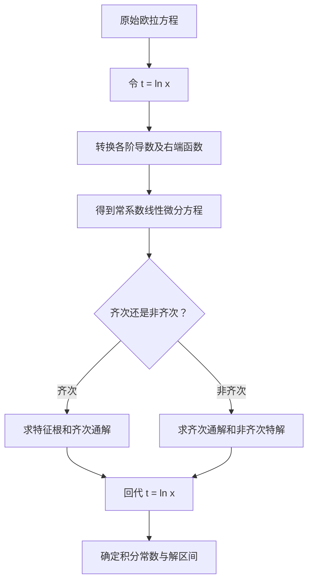
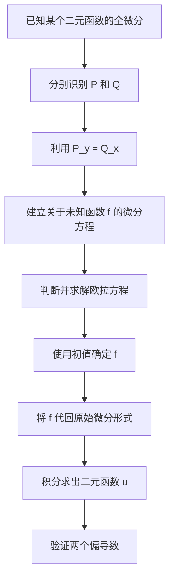
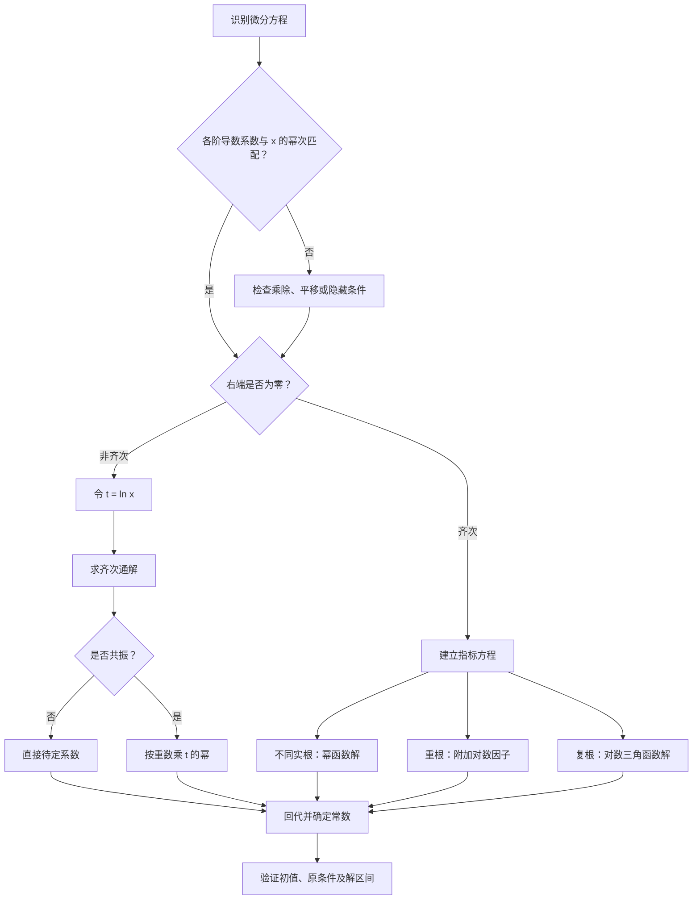

本节属于一元函数微分方程中的特殊变系数线性微分方程，也是考研数学一需要专门掌握的内容。

**欧拉方程最核心的思想，是通过对数换元，将变系数线性微分方程转化为我们已经学过的常系数线性微分方程。** 因此，本节与第五模块第二节的高阶线性微分方程存在非常紧密的联系。

真正掌握本节，不仅需要会求齐次欧拉方程的通解，还需要掌握非齐次共振、初值条件转换、隐藏欧拉方程的构造、全微分综合题、积分综合题，以及高阶欧拉方程的统一处理方法。

## 一、学习框架

代表性题型与复习重点如下。

本节按照以下能力层次展开：

| 学习层次 | 需要掌握的内容       | 建议优先级 |
| ---- | ------------- | ----- |
| 基础层  | 方程识别、对数换元     | ★★★★★ |
| 核心层  | 指标方程、三种根对应的通解 | ★★★★★ |
| 应用层  | 初值条件、参数确定     | ★★★★★ |
| 强化层  | 非齐次欧拉方程、共振    | ★★★★★ |
| 综合层  | 全微分、积分、泛函关系   | ★★★★★ |
| 拓展层  | 高阶算子、奇点、平移变式  | ★★★★  |

## 二、基础知识：什么是欧拉方程？

### 2.1 欧拉方程的标准形式

二阶非齐次欧拉方程的一般形式为

$$
\boxed{x^2y''+axy'+by=f(x)}
$$

其中 $a,b$ 为常数。

特别地，当 $f(x)\equiv 0$ 时，称为二阶齐次欧拉方程：

$$
\boxed{x^2y''+axy'+by=0}
$$

更一般地，$n$ 阶欧拉方程可以写成

$$
\begin{aligned} &a_nx^ny^{(n)}+a_{n-1}x^{n-1}y^{(n-1)}\\ &\quad+\cdots+a_1xy'+a_0y=f(x). \end{aligned}
$$

其中 $a_n\ne 0$。

### 2.2 如何快速识别欧拉方程？

观察每一阶导数前面的系数。

| 导数            | 对应系数形式         |
| ------------- | -------------- |
| $y$       | 常数             |
| $y'$      | $x$ 的常数倍   |
| $y''$     | $x^2$ 的常数倍 |
| $y'''$    | $x^3$ 的常数倍 |
| $y^{(n)}$ | $x^n$ 的常数倍 |

记忆口诀：**导数几阶，系数就是** $x$ **的几次幂。**

例如：

$$
x^2y''-3xy'+4y=0
$$

是欧拉方程。

而

$$
x^2y''-3y'+4y=0
$$

不是标准欧拉方程。

不过，识别时不能只看表面形式。例如：

$$
xy''+3y'+\frac{2}{x}y=0
$$

两边同乘 $x$，得到

$$
x^2y''+3xy'+2y=0.
$$

这实际上也是欧拉方程。

### 2.3 为什么欧拉方程可以使用幂函数试解？

这是理解本节的第一个关键。

对于常系数线性微分方程，我们试探

$$
y=e^{rx}
$$

是因为指数函数求导之后，其函数形式不变：

$$
y'=re^{rx},\qquad y''=r^2e^{rx}.
$$

因此，微分方程能够转化为关于 $r$ 的代数方程。

而欧拉方程具有类似的结构，只不过适合它的不是指数函数，而是幂函数。

设

$$
y=x^m,\qquad x>0.
$$

则

$$
y'=mx^{m-1},
$$

$$
y''=m(m-1)x^{m-2}.
$$

于是

$$
xy'=mx^m,
$$

$$
x^2y''=m(m-1)x^m.
$$

可见：

$$
y,\quad xy',\quad x^2y''
$$

全部恢复成了同一个幂函数 $x^m$ 的常数倍。

代入齐次欧拉方程：

$$
x^2y''+axy'+by=0,
$$

得到

$$
[m(m-1)+am+b]x^m=0.
$$

由于 $x>0$，所以 $x^m\ne0$，因此

$$
\boxed{m(m-1)+am+b=0}
$$

即

$$
\boxed{m^2+(a-1)m+b=0}.
$$

这就是欧拉方程的**指标方程**，也称特征方程。

一定注意：

$$
\boxed{m^2+(a-1)m+b=0}
$$

而不是

$$
m^2+am+b=0.
$$

后者是常系数线性方程的特征方程，不能直接套用。

## 三、本节的核心方法：对数换元法

幂函数试解非常适合齐次欧拉方程，但如果遇到非齐次、复根、高阶或综合问题，对数换元法更加统一。

### 3.1 基本换元

对于 $x>0$，令

$$
\boxed{t=\ln x,\qquad x=e^t}.
$$

定义

$$
u(t)=y(e^t),
$$

于是

$$
y(x)=u(\ln x).
$$

这里使用两个不同的函数符号 $y,u$，是为了避免混淆对 $x$ 求导和对 $t$ 求导。

### 3.2 一阶导数转换

由复合函数求导法则：

$$
y'(x)=u'(t)\frac{\mathrm dt}{\mathrm dx} =\frac{u'(t)}{x}.
$$

所以

$$
\boxed{xy'=u'}.
$$

### 3.3 二阶导数转换

继续对 $x$ 求导：

$$
\begin{aligned} y''(x) &=\frac{\mathrm d}{\mathrm dx} \left(\frac{u'(t)}{x}\right)\\ &=-\frac{u'(t)}{x^2} +\frac{u''(t)}{x^2}\\ &=\frac{u''(t)-u'(t)}{x^2}. \end{aligned}
$$

因此

$$
\boxed{x^2y''=u''-u'}.
$$

### 3.4 三阶导数转换

进一步求导，可得

$$
\boxed{x^3y'''=u'''-3u''+2u'}.
$$

这三个公式构成本节最重要的换元公式：

$$
\boxed{ \begin{aligned} xy'&=u',\\ x^2y''&=u''-u',\\ x^3y'''&=u'''-3u''+2u'. \end{aligned}}
$$

### 3.5 欧拉方程如何转化为常系数方程？

原方程

$$
x^2y''+axy'+by=f(x)
$$

经过换元后成为

$$
u''-u'+au'+bu=f(e^t).
$$

整理得到

$$
\boxed{u''+(a-1)u'+bu=f(e^t)}.
$$

现在，所有导数前面的系数都成为常数。

因此，欧拉方程的完整解题流程可以表示为：

本节绝大部分题目，都可以纳入这个统一框架。

### 3.6 对数换元背后的直观理解

常系数方程研究的是自变量的平移结构，而欧拉方程具有自变量的伸缩结构。

由于

$$
\ln(kx)=\ln x+\ln k,
$$

对数函数能够把乘法变成加法，把伸缩变成平移。

例如，$x$ 变成 $2x$，在对数变量下只是

$$
t\longmapsto t+\ln2.
$$

所以欧拉方程中的变系数，经过对数换元之后就能变成常系数。

这也解释了为什么

$$
e^{mt}=e^{m\ln x}=x^m.
$$

欧拉方程的幂函数解，本质上就是常系数方程的指数函数解。

## 四、齐次欧拉方程的三种基本模型

设

$$
x^2y''+axy'+by=0.
$$

指标方程为

$$
m^2+(a-1)m+b=0.
$$

令判别式

$$
\Delta=(a-1)^2-4b.
$$

根据指标方程根的情况，可以分为三大类型。

### 4.1 通解公式总表

| 指标根情况                       | 常系数方程通解                                           | 欧拉方程通解                                                  |
| --------------------------- | ------------------------------------------------- | ------------------------------------------------------- |
| 两个不同实根 $m_1,m_2$        | $C_1e^{m_1t}+C_2e^{m_2t}$                     | $C_1x^{m_1}+C_2x^{m_2}$                             |
| 二重实根 $m$                | $(C_1+C_2t)e^{mt}$                            | $x^m(C_1+C_2\ln x)$                                 |
| 共轭复根 $\alpha\pm i\beta$ | $e^{\alpha t}(C_1\cos\beta t+C_2\sin\beta t)$ | $x^\alpha[C_1\cos(\beta\ln x)+C_2\sin(\beta\ln x)]$ |

以上公式均以 $x>0$ 为前提。

### 4.2 记忆的根本方法

没有必要把欧拉方程的三种通解当作全新的公式背诵。

只需要在常系数方程通解中进行以下替换：

$$
\boxed{ \begin{aligned} e^{mt}&\longrightarrow x^m,\\ t&\longrightarrow\ln x,\\ \cos\beta t&\longrightarrow\cos(\beta\ln x),\\ \sin\beta t&\longrightarrow\sin(\beta\ln x). \end{aligned}}
$$

第二节的常系数线性微分方程知识，可以直接迁移过来。

## 五、题型一：两个不同实根的齐次欧拉方程

重要程度：★★★★★

这是本节最基本的真题模型，必须达到熟练计算的程度。

### 母题1：2004年考研数学一真题

原卷填空题第4小题。

[image](https://www.google.com/s2/favicons?domain=https://www.dimhok.com\&sz=32)

dimhok.com+1

求欧拉方程

$$
x^2y''+4xy'+2y=0,\qquad x>0
$$

的通解。

<Tabs items={["方法一：幂函数试解法（考场推荐）", "方法二：对数换元法"]} defaultIndex={0}>

<Tab value="方法一：幂函数试解法（考场推荐）">

设

$$
y=x^m.
$$

代入得到指标方程：

$$
m(m-1)+4m+2=0.
$$

整理：

$$
m^2+3m+2=0.
$$

因式分解：

$$
(m+1)(m+2)=0.
$$

因此

$$
m_1=-1,\qquad m_2=-2.
$$

两个根不同，故通解为

$$
\boxed{y=\frac{C_1}{x}+\frac{C_2}{x^2}}.
$$

</Tab>

<Tab value="方法二：对数换元法">

令

$$
t=\ln x,\qquad y(x)=u(t).
$$

原方程化为

$$
u''-u'+4u'+2u=0,
$$

即

$$
u''+3u'+2u=0.
$$

特征方程为

$$
r^2+3r+2=0.
$$

故

$$
u=C_1e^{-t}+C_2e^{-2t}.
$$

回代 $t=\ln x$，得

$$
\boxed{y=C_1x^{-1}+C_2x^{-2}}.
$$

</Tab>

</Tabs>

**母题提炼**

这道题的关键并不在于求根，而在于能否正确建立指标方程。

考试中，只要求齐次欧拉方程的通解时，可以直接使用

$$
m^2+(a-1)m+b=0.
$$

如果题目明确要求令 $x=e^t$，或者要求写出变换后的常系数方程，就必须展示换元过程。

**反向变式：已知解，反求欧拉方程**

已知某二阶齐次欧拉方程的通解为

$$
y=C_1x^2+C_2x^5,
$$

求其标准形式。

由通解知道指标根为 $2,5$，所以

$$
(m-2)(m-5)=0,
$$

即

$$
m^2-7m+10=0.
$$

与

$$
m^2+(a-1)m+b=0
$$

比较系数：

$$
a-1=-7,\qquad b=10.
$$

因此

$$
\boxed{x^2y''-6xy'+10y=0}.
$$

由此可得一个重要推论：如果两个指标根为 $m_1,m_2$，根据韦达定理，

$$
\boxed{ \begin{aligned} a&=1-m_1-m_2,\\ b&=m_1m_2. \end{aligned}}
$$

这个公式对于参数确定和反求微分方程非常有用。

## 六、题型二：欧拉方程的初值问题

重要程度：★★★★★

### 母题2：2021年考研数学一真题

原卷第13题。

[image](https://www.google.com/s2/favicons?domain=https://www.csgraduates.com\&sz=32)

计算机考研杂货铺+1

求欧拉方程

$$
x^2y''+xy'-4y=0
$$

满足

$$
y(1)=1,\qquad y'(1)=2
$$

的解。

<Steps>

<Step>

### 第一步：建立指标方程 [!toc]

$$
m(m-1)+m-4=0.
$$

即

$$
m^2-4=0.
$$

解得

$$
m_1=2,\qquad m_2=-2.
$$

</Step>

<Step>

### 第二步：写出通解 [!toc]

$$
y=C_1x^2+C_2x^{-2}.
$$

</Step>

<Step>

### 第三步：利用初值 [!toc]

求导得

$$
y'=2C_1x-2C_2x^{-3}.
$$

因此

$$
\begin{cases} C_1+C_2=1,\\ 2C_1-2C_2=2. \end{cases}
$$

解得

$$
C_1=1,\qquad C_2=0.
$$

故

$$
\boxed{y=x^2,\qquad x>0}.
$$

</Step>

</Steps>

### 6.1 初值为 $x=1$ 时的快速解法

因为

$$
1^m=1,\qquad \ln1=0,
$$

所以 $x=1$ 是欧拉方程中非常方便的初值点。

设一般初值为

$$
y(1)=A,\qquad y'(1)=B.
$$

不同类型的指标根，对应不同的快速确定常数公式。

| 指标根                       | 初值问题的直接结果                                                                                             |
| ------------------------- | ----------------------------------------------------------------------------------------------------- |
| 不同实根 $m_1,m_2$        | $\displaystyle y=\frac{B-m_2A}{m_1-m_2}x^{m_1}+\frac{m_1A-B}{m_1-m_2}x^{m_2}$                     |
| 二重根 $m$               | $y=x^m[A+(B-mA)\ln x]$                                                                            |
| 复根 $\alpha\pm i\beta$ | $\displaystyle y=x^\alpha\left[A\cos(\beta\ln x)+\frac{B-\alpha A}{\beta}\sin(\beta\ln x)\right]$ |

这些公式不必强行记忆，但建议理解并能够快速推导。

### 6.2 初值恰好对应一个基本解时

如果 $m$ 是指标方程的根，且

$$
y(1)=A,\qquad y'(1)=mA,
$$

则直接有

$$
\boxed{y=Ax^m}.
$$

例如2021年真题中，

$$
m=2,\qquad A=1,\qquad B=2.
$$

恰好满足

$$
B=mA.
$$

所以求出指标根之后，就可以迅速判断答案为 $x^2$。

### 6.3 初值不在 $x=1$ 怎么办？

若给定

$$
y(x_0)=A,\qquad y'(x_0)=B,\qquad x_0>0,
$$

令 $t=\ln x$，则新初值点为

$$
t_0=\ln x_0.
$$

由于

$$
u'=xy',
$$

所以初值应转换为

$$
\boxed{ \begin{aligned} u(\ln x_0)&=A,\\ u'(\ln x_0)&=x_0B. \end{aligned}}
$$

特别注意：只有 $x_0=1$ 时，两个变量下的一阶导数初值才直接相同。

更方便的处理是令

$$
t=\ln\frac{x}{x_0}.
$$

这样初值点直接转化为 $t=0$，同时

$$
u(0)=A,\qquad u'(0)=x_0B.
$$

二阶导数初值若有需要，则转换为

$$
u''(0)=x_0^2y''(x_0)+x_0y'(x_0).
$$

这是高阶初值问题的一个重要技巧。

## 七、题型三：指标方程出现二重根

重要程度：★★★★★

### 7.1 为什么重根必须产生对数因子？

如果指标方程只有一个二重根 $m$，那么 $x^m$ 只能提供一个基本解。

二阶齐次线性微分方程需要两个线性无关的基本解，所以不能写成

$$
y=C_1x^m+C_2x^m.
$$

因为这实际上等价于

$$
y=(C_1+C_2)x^m,
$$

只有一个独立的任意常数。

经过对数换元后，对应的常系数方程重根通解为

$$
u=(C_1+C_2t)e^{mt}.
$$

于是

$$
\boxed{y=x^m(C_1+C_2\ln x)}.
$$

两个基本解分别为

$$
y_1=x^m,\qquad y_2=x^m\ln x.
$$

其中 $\ln x$ 就来自常系数方程重根时产生的 $t$ 因子。

### 母题3：李林880重根初值题

来源：李林880第七章。

求方程

$$
x^2y''-xy'+y=0,\qquad x>0
$$

满足

$$
y(1)=1,\qquad y'(1)=1
$$

的解。

<Steps>

<Step>

### 第一步：判断根的类型 [!toc]

指标方程为

$$
m(m-1)-m+1=0.
$$

整理：

$$
m^2-2m+1=0.
$$

即

$$
(m-1)^2=0.
$$

因此 $m=1$ 为二重根。

</Step>

<Step>

### 第二步：写出通解 [!toc]

$$
y=x(C_1+C_2\ln x).
$$

</Step>

<Step>

### 第三步：求导并确定常数 [!toc]

$$
y'=C_1+C_2\ln x+C_2.
$$

利用初值：

$$
\begin{cases} C_1=1,\\ C_1+C_2=1. \end{cases}
$$

故

$$
C_1=1,\qquad C_2=0.
$$

因此

$$
\boxed{y=x}.
$$

</Step>

</Steps>

### 7.2 母题变式：改变初值

将上题初值改为

$$
y(1)=1,\qquad y'(1)=3.
$$

通解仍为

$$
y=x(C_1+C_2\ln x).
$$

由初值得

$$
C_1=1,\qquad C_1+C_2=3.
$$

所以

$$
\boxed{y=x(1+2\ln x)}.
$$

原题的答案虽然不含对数，但绝不能因此认为重根方程只有幂函数解。

### 7.3 参数型变式

设欧拉方程

$$
x^2y''+axy'+4y=0
$$

存在非零解

$$
y=x^2\ln x,
$$

求 $a$。

由于解中存在 $x^2\ln x$，说明 $m=2$ 是指标方程的二重根。

因此

$$
m^2+(a-1)m+4=(m-2)^2.
$$

比较系数得

$$
a-1=-4.
$$

所以

$$
\boxed{a=-3}.
$$

### 7.4 与李正元练习题的联系：为什么要求线性无关？

李正元《常微分方程》中题目 `math-1e4ef3-004` 考查二阶线性微分方程的基本解判定。

其重要工具是朗斯基行列式：

$$
W(y_1,y_2)= \begin{vmatrix} y_1&y_2\\ y_1'&y_2' \end{vmatrix}.
$$

当两个函数都是同一二阶齐次线性方程的解，且在正规区间内某点有

$$
W(y_1,y_2)\ne0,
$$

则它们线性无关，构成基本解组。

对于欧拉方程的二重根解：

$$
y_1=x^m,\qquad y_2=x^m\ln x,
$$

计算得

$$
\begin{aligned} W(y_1,y_2) &=x^m\cdot x^{m-1}(m\ln x+1)\\ &\quad-mx^{m-1}\cdot x^m\ln x\\ &=x^{2m-1}. \end{aligned}
$$

因为 $x>0$，所以

$$
W(y_1,y_2)\ne0.
$$

这严格说明了这两个函数确实能够构成基本解组。

## 八、题型四：指标方程出现共轭复根

重要程度：★★★★★

当指标方程的根为

$$
m_{1,2}=\alpha\pm i\beta,\qquad \beta>0
$$

时，根据欧拉公式，

$$
\begin{aligned} x^{\alpha+i\beta} &=e^{(\alpha+i\beta)\ln x}\\ &=x^\alpha e^{i\beta\ln x}\\ &=x^\alpha [\cos(\beta\ln x)+i\sin(\beta\ln x)]. \end{aligned}
$$

取实部和虚部，可以得到两个实数基本解。

因此

$$
\boxed{ y=x^\alpha [C_1\cos(\beta\ln x)+C_2\sin(\beta\ln x)] }.
$$

### 母题4：张宇1000题复根模型

来源：张宇1000题微分方程章节。

求欧拉方程

$$
x^2y''+3xy'+3y=0
$$

满足

$$
y(1)=0,\qquad y'(1)=\sqrt2
$$

的解。

<Steps>

<Step>

### 第一步：列指标方程 [!toc]

$$
m(m-1)+3m+3=0.
$$

即

$$
m^2+2m+3=0.
$$

所以

$$
m=-1\pm i\sqrt2.
$$

</Step>

<Step>

### 第二步：写出实数通解 [!toc]

$$
y=\frac1x \left[ C_1\cos(\sqrt2\ln x) +C_2\sin(\sqrt2\ln x) \right].
$$

</Step>

<Step>

### 第三步：利用初值 [!toc]

因为

$$
\ln1=0,\qquad \cos0=1,\qquad\sin0=0,
$$

所以

$$
y(1)=C_1=0.
$$

因此

$$
y=C_2x^{-1}\sin(\sqrt2\ln x).
$$

求导得

$$
\begin{aligned} y' =C_2x^{-2}\big[ &-\sin(\sqrt2\ln x)\\ &+\sqrt2\cos(\sqrt2\ln x) \big]. \end{aligned}
$$

令 $x=1$，得到

$$
y'(1)=\sqrt2C_2=\sqrt2.
$$

所以 $C_2=1$。

最终

$$
\boxed{y=\frac{\sin(\sqrt2\ln x)}{x}}.
$$

</Step>

</Steps>

### 8.1 复根解的直观理解

复根欧拉方程的解可以理解为两部分：

$$
\underbrace{x^\alpha}_{\text{振幅}} \cdot \underbrace{[C_1\cos(\beta\ln x)+C_2\sin(\beta\ln x)]}_{\text{振荡部分}}.
$$

其中 $\alpha$ 决定振幅变化趋势，$\beta$ 决定对数变量下的振荡频率。

| $\alpha$ 的取值 | $x\to+\infty$ 时非零解的特点 |
| ---------------- | ------------------------- |
| $\alpha<0$   | 振幅逐渐衰减，解趋于零               |
| $\alpha=0$   | 持续振荡，极限不存在                |
| $\alpha>0$   | 振幅越来越大                    |

而当 $x\to0^+$ 时，上述衰减与增长的趋势相反。

这可以与第一模块的函数极限、无穷小量比较、函数有界性等知识结合。

### 8.2 创新题：零点分布

设

$$
y=\sin(\ln x),\qquad x>0.
$$

求其全部零点。

令

$$
\sin(\ln x)=0.
$$

则

$$
\ln x=k\pi,\qquad k\in\mathbb Z.
$$

所以

$$
\boxed{x_k=e^{k\pi}}.
$$

相邻零点满足

$$
\frac{x_{k+1}}{x_k}=e^\pi.
$$

因此，常系数方程的三角函数解，其零点通常呈等差分布；欧拉方程的对数三角函数解，其正零点则呈等比分布。

更一般地，

$$
y=x^\alpha\sin(\beta\ln x+\varphi)
$$

的零点满足

$$
\boxed{x_k=\exp\left(\frac{k\pi-\varphi}{\beta}\right)}.
$$

这样的变式可以把欧拉方程、数列性质和函数零点结合在一起。

## 九、题型五：非齐次欧拉方程与共振

重要程度：★★★★★

这是本节从基础题走向强化题的核心内容。

### 9.1 非齐次欧拉方程的基本结构

设

$$
x^2y''+axy'+by=f(x).
$$

其通解结构仍为

$$
\boxed{y=y_h+y_p},
$$

其中 $y_h$ 是对应齐次方程的通解，$y_p$ 是非齐次方程的任意一个特解。

令

$$
t=\ln x,
$$

得到

$$
u''+(a-1)u'+bu=f(e^t).
$$

接下来就可以使用常系数线性微分方程的待定系数法。

### 9.2 非齐次项转换规律

| 欧拉方程的右端                        | 换元后的右端                        |
| ------------------------------ | ----------------------------- |
| $x^k$                      | $e^{kt}$                  |
| $\ln x$                    | $t$                       |
| $x^k(\ln x)^n$             | $e^{kt}t^n$               |
| $\cos(\beta\ln x)$         | $\cos\beta t$             |
| $x^\alpha\sin(\beta\ln x)$ | $e^{\alpha t}\sin\beta t$ |

换元以后，右端的形式往往恰好是我们熟悉的指数、多项式和三角函数。

### 9.3 非齐次特解试探公式

记指标多项式为

$$
P(m)=m^2+(a-1)m+b.
$$

假设右端为

$$
f(x)=Ax^k.
$$

需要根据 $k$ 是否为指标方程的根进行分类。

| 情况             | 特解试探形式                  |
| -------------- | ----------------------- |
| $P(k)\ne0$ | $y_p=Mx^k$          |
| $k$ 为单根    | $y_p=Mx^k\ln x$     |
| $k$ 为二重根   | $y_p=Mx^k(\ln x)^2$ |

统一记忆为

$$
\boxed{y_p=Mx^k(\ln x)^s},
$$

其中 $s$ 为 $k$ 在指标方程中的重数；如果不是根，则 $s=0$。

**共振几重，就乘几次对数。**

### 9.4 基础例题：不发生共振

求

$$
x^2y''-xy'+y=x^2
$$

的通解。

齐次指标方程为

$$
(m-1)^2=0.
$$

故

$$
y_h=x(C_1+C_2\ln x).
$$

由于右端指数 $k=2$ 不是指标根，所以设

$$
y_p=Ax^2.
$$

代入：

$$
\begin{aligned} x^2y_p''-xy_p'+y_p &=2Ax^2-2Ax^2+Ax^2\\ &=Ax^2. \end{aligned}
$$

所以 $A=1$。

故

$$
\boxed{y=x(C_1+C_2\ln x)+x^2}.
$$

## 十、题型六：重根共振与平方对数

重要程度：★★★★★

### 母题5：原创强化题：二重共振

求初值问题

$$
x^2y''-xy'+y=x,\qquad x>0,
$$

$$
y(1)=0,\qquad y'(1)=0.
$$

<Steps>

<Step>

### 第一步：分析对应的齐次方程 [!toc]

指标方程为

$$
(m-1)^2=0.
$$

因此齐次通解为

$$
y_h=x(C_1+C_2\ln x).
$$

右端为 $x^1$，而 $m=1$ 是二重根。

于是：

$$
Ax,\qquad Ax\ln x
$$

都属于齐次解，无法作为非齐次特解。

所以必须试探

$$
\boxed{y_p=Ax(\ln x)^2}.
$$

</Step>

<Step>

### 第二步：求非齐次特解 [!toc]

令 $t=\ln x$，原方程变成

$$
u''-2u'+u=e^t.
$$

设

$$
u=e^tv(t).
$$

则

$$
u'=e^t(v+v'),
$$

$$
u''=e^t(v+2v'+v'').
$$

代入得

$$
e^tv''=e^t.
$$

于是

$$
v''=1.
$$

积分两次：

$$
v=\frac{t^2}{2}+C_1t+C_2.
$$

所以

$$
u=e^t\left(\frac{t^2}{2}+C_1t+C_2\right).
$$

回代可得

$$
y=x\left[ \frac{(\ln x)^2}{2}+C_1\ln x+C_2 \right].
$$

</Step>

<Step>

### 第三步：代入初值 [!toc]

由于 $x=1$ 对应 $t=0$，所以

$$
y(1)=C_2=0.
$$

又

$$
y'=v+v',
$$

因此

$$
y'(1)=C_2+C_1=0.
$$

故 $C_1=C_2=0$。

最终

$$
\boxed{y=\frac{x}{2}(\ln x)^2}.
$$

</Step>

</Steps>

### 10.1 三种共振情况的直接计算公式

对于

$$
P(m)=m^2+(a-1)m+b,
$$

若右端为 $Ax^k$，可以得到以下结论：

不共振：

$$
\boxed{y_p=\frac{A}{P(k)}x^k}.
$$

单根共振：

$$
\boxed{y_p=\frac{A}{P'(k)}x^k\ln x}.
$$

二重根共振：

$$
\boxed{y_p=\frac A2x^k(\ln x)^2}.
$$

最后一个公式以最高阶项已经标准化为 $x^2y''$ 为前提。

上述公式属于提高技巧。考试中如果忘记它们，直接使用对数换元和待定系数法即可。

### 10.2 单根共振变式

求

$$
x^2y''-2xy'+2y=x^2
$$

的通解。

指标方程为

$$
m^2-3m+2=(m-1)(m-2)=0.
$$

因此

$$
y_h=C_1x+C_2x^2.
$$

右端的指数 $2$ 是单根。

由

$$
P'(m)=2m-3,
$$

可得

$$
P'(2)=1.
$$

因此一个特解为

$$
y_p=x^2\ln x.
$$

最终

$$
\boxed{y=C_1x+C_2x^2+x^2\ln x}.
$$

## 十一、题型七：复根与对数振荡共振

重要程度：★★★★☆

### 母题6：原创强化题：振荡共振

求方程

$$
x^2y''+xy'+y=\cos(\ln x)
$$

在 $x>0$ 上的通解。

<Steps>

<Step>

### 第一步：对数换元 [!toc]

令 $t=\ln x$，得到

$$
u''+u=\cos t.
$$

</Step>

<Step>

### 第二步：求齐次通解 [!toc]

特征方程为

$$
r^2+1=0.
$$

所以

$$
r=\pm i,
$$

$$
u_h=C_1\cos t+C_2\sin t.
$$

</Step>

<Step>

### 第三步：判断是否发生共振 [!toc]

右端为 $\cos t$，恰好与齐次解同频率，而且对应复根为单根。

若直接设

$$
u_p=A\cos t+B\sin t,
$$

代入左端将恒等于零。

因此必须多乘一个 $t$，可设

$$
u_p=t(A\cos t+B\sin t).
$$

计算时进一步简化，直接设

$$
u_p=Bt\sin t.
$$

则

$$
u_p'=B(\sin t+t\cos t),
$$

$$
u_p''=B(2\cos t-t\sin t).
$$

所以

$$
u_p''+u_p=2B\cos t.
$$

与右端比较，得到

$$
B=\frac12.
$$

</Step>

<Step>

### 第四步：回代 [!toc]

$$
u=C_1\cos t+C_2\sin t+\frac t2\sin t.
$$

故

$$
\boxed{ \begin{aligned} y={}&C_1\cos(\ln x)+C_2\sin(\ln x)\\ &+\frac{\ln x}{2}\sin(\ln x). \end{aligned}}
$$

</Step>

</Steps>

### 11.1 李正元常系数共振题的迁移

李正元《常微分方程》题目 `math-1e4ef3-003` 给出了

$$
y''-2y'+3y=e^x\sin(\sqrt2x),
$$

要求判断特解形式。

因为特征根为

$$
r=1\pm i\sqrt2,
$$

所以应设

$$
y_p=xe^x [A\cos(\sqrt2x)+B\sin(\sqrt2x)].
$$

现在将这个模型迁移到欧拉方程：

$$
x^2y''-xy'+3y=x\sin(\sqrt2\ln x).
$$

经过对数换元，它就变成

$$
u''-2u'+3u=e^t\sin(\sqrt2t).
$$

因此特解形式应为

$$
\boxed{ y_p=x\ln x [A\cos(\sqrt2\ln x)+B\sin(\sqrt2\ln x)] }.
$$

这里最重要的不是求出 $A,B$，而是能够准确判断特解形式。

### 11.2 振荡共振的完整判定条件

若非齐次项具有形式

$$
x^\alpha\left[ P_n(\ln x)\cos(\beta\ln x) +Q_n(\ln x)\sin(\beta\ln x) \right],
$$

则需要检查

$$
\alpha+i\beta
$$

是否为齐次指标方程的根。

注意，**不能只比较振荡频率** $\beta$**，还必须比较幂函数指数** $\alpha$。

例如齐次指标根是 $1\pm i$，右端却是

$$
x^2\cos(\ln x),
$$

虽然振荡频率相同，但由于实部不同，仍不发生共振。

## 十二、题型八：全微分存在性反求欧拉方程

重要程度：★★★★★

题目没有直接给出欧拉方程，需要通过多元函数微分学中的知识，主动构造微分方程。

### 母题7：李林880全微分综合题

来源：李林880第七章。

设 $f(x)$ 具有二阶连续导数，且

$$
f(1)=1,\qquad f'(1)=2.
$$

已知二元函数 $u(x,y)$ 的全微分为

$$
\begin{aligned} \mathrm du={}&-6yf(x)\,\mathrm dx\\ &+[x^2f'(x)-4xf(x)]\,\mathrm dy. \end{aligned}
$$

求 $f(x)$ 及 $u(x,y)$，先在包含 $x=1$ 的正区间内讨论。

### 12.1 识别题目的隐藏条件

看到题目给出

$$
\mathrm du=P(x,y)\,\mathrm dx+Q(x,y)\,\mathrm dy,
$$

应当立即联想到

$$
u_x=P,\qquad u_y=Q.
$$

当有关偏导数连续时，由混合偏导数相等可得

$$
u_{xy}=u_{yx}.
$$

因此

$$
\boxed{P_y=Q_x}.
$$

这是本题构造微分方程的突破口。

### 12.2 利用全微分条件建立微分方程

令

$$
P(x,y)=-6yf(x),
$$

$$
Q(x,y)=x^2f'(x)-4xf(x).
$$

分别求偏导：

$$
P_y=-6f(x),
$$

$$
\begin{aligned} Q_x &=2xf'(x)+x^2f''(x)\\ &\quad-4f(x)-4xf'(x)\\ &=x^2f''(x)-2xf'(x)-4f(x). \end{aligned}
$$

由 $P_y=Q_x$，得到

$$
-6f=x^2f''-2xf'-4f.
$$

整理：

$$
\boxed{x^2f''-2xf'+2f=0}.
$$

这正是一个二阶齐次欧拉方程。

### 12.3 求解欧拉方程

指标方程为

$$
m(m-1)-2m+2=0.
$$

即

$$
m^2-3m+2=0.
$$

所以

$$
m_1=1,\qquad m_2=2.
$$

通解为

$$
f(x)=C_1x+C_2x^2.
$$

利用初值：

$$
\begin{cases} C_1+C_2=1,\\ C_1+2C_2=2. \end{cases}
$$

解得

$$
C_1=0,\qquad C_2=1.
$$

故

$$
\boxed{f(x)=x^2}.
$$

### 12.4 回到原问题，求二元函数

将 $f=x^2$ 代回全微分表达式：

$$
\mathrm du=-6x^2y\,\mathrm dx-2x^3\,\mathrm dy.
$$

于是

$$
u_x=-6x^2y.
$$

对 $x$ 积分：

$$
u=-2x^3y+\varphi(y).
$$

再对 $y$ 求偏导：

$$
u_y=-2x^3+\varphi'(y).
$$

比较原式中的 $u_y=-2x^3$，得到

$$
\varphi'(y)=0.
$$

因此

$$
\boxed{u(x,y)=-2x^3y+C}.
$$

### 12.5 综合题的通用解题思路

这类题目涉及三个知识体系：多元函数偏导数、欧拉方程、全微分求势函数。

考研综合题完全可以通过这些知识之间的联系来提高难度。

还要注意：$P_y=Q_x$ 一般是全微分存在的必要条件；在单连通区域上且 $P,Q$ 具有连续一阶偏导数时，它也是恰当微分的充分条件。若区域存在孔洞，不能不加条件地使用充分性。

### 12.6 推广为一般母题

假设题目给出

$$
\mathrm du=Ayf(x)\,\mathrm dx+ [Bx^2f'(x)+Cxf(x)]\,\mathrm dy,
$$

其中 $A,B,C$ 为常数，且 $B\ne0$。

由

$$
P_y=Af(x),
$$

以及

$$
Q_x=Bx^2f''+(2B+C)xf'+Cf,
$$

得到

$$
\boxed{ Bx^2f''+(2B+C)xf'+(C-A)f=0 }.
$$

无论题目如何改变系数，只要具有上述结构，都可以通过全微分条件构造出欧拉方程。

这才是掌握一道母题之后，应当具备的迁移能力。

## 十三、题型九：欧拉方程与定积分的综合应用

重要程度：★★★★★

### 母题8：汤家凤2027八套卷第6套第17题

设 $y(x)$ 是微分方程

$$
x^2y''+xy'-9y=0
$$

满足

$$
y(1)=2,\qquad y'(1)=6
$$

的特解。

（1）令 $x=e^t$，将方程化为关于 $t$ 的微分方程，并求 $y(x)$。

（2）计算

$$
I=\int_0^2y(x)\sqrt{2x-x^2}\,\mathrm dx.
$$

**第一问：求解欧拉方程**

由换元公式，

$$
xy'=u',
$$

$$
x^2y''=u''-u'.
$$

所以

$$
u''-9u=0.
$$

特征根为

$$
r=\pm3.
$$

因此

$$
u=C_1e^{3t}+C_2e^{-3t}.
$$

回代得

$$
y=C_1x^3+C_2x^{-3}.
$$

利用初值：

$$
\begin{cases} C_1+C_2=2,\\ 3C_1-3C_2=6. \end{cases}
$$

解得

$$
C_1=2,\qquad C_2=0.
$$

所以

$$
\boxed{y=2x^3}.
$$

**第二问：求定积分**

代入第一问结果：

$$
I=2\int_0^2x^3\sqrt{2x-x^2}\,\mathrm dx.
$$

<Steps>

<Step>

### 第一步：识别根式中的圆结构 [!toc]

注意

$$
2x-x^2=1-(x-1)^2.
$$

因此令

$$
u=x-1.
$$

则

$$
I=2\int_{-1}^1(1+u)^3\sqrt{1-u^2}\,\mathrm du.
$$

</Step>

<Step>

### 第二步：利用奇偶性简化 [!toc]

展开：

$$
(1+u)^3=1+3u+3u^2+u^3.
$$

由于 $\sqrt{1-u^2}$ 是偶函数，而奇函数在对称区间上的积分为零，所以

$$
I=2\int_{-1}^1(1+3u^2)\sqrt{1-u^2}\,\mathrm du.
$$

即

$$
I=4\int_0^1(1+3u^2)\sqrt{1-u^2}\,\mathrm du.
$$

</Step>

<Step>

### 第三步：三角换元 [!toc]

令

$$
u=\sin\theta, \qquad 0\le\theta\le\frac\pi2.
$$

得到

$$
I=4\int_0^{\pi/2} (1+3\sin^2\theta)\cos^2\theta\,\mathrm d\theta.
$$

利用

$$
\int_0^{\pi/2}\cos^2\theta\,\mathrm d\theta =\frac\pi4,
$$

以及

$$
\int_0^{\pi/2}\sin^2\theta\cos^2\theta\,\mathrm d\theta =\frac\pi{16},
$$

所以

$$
I=4\left(\frac\pi4+3\cdot\frac\pi{16}\right).
$$

最终

$$
\boxed{I=\frac{7\pi}{4}}.
$$

</Step>

</Steps>

### 13.1 本题最重要的三个考点

| 阶段     | 考查内容         |
| ------ | ------------ |
| 第一问    | 欧拉方程换元、初值问题  |
| 第二问前半段 | 配方、平移换元、奇偶性  |
| 第二问后半段 | 三角换元、三角函数定积分 |

本题虽然涉及欧拉方程，但积分部分的计算也很重要。因此不能把每一个模块完全孤立地复习。

特别注意，第一问求得的解原本位于正半轴，而第二问积分下限为零。因为本题特解 $2x^3$ 可以连续延拓至 $x=0$，故积分没有收敛问题。换成含负幂或对数的解时，则需要重新判断反常积分的敛散性。

### 13.2 李正元练习题的进一步迁移：不求函数直接求积分

李正元《常微分方程》题目 `math-1e4ef3-011` 有一个值得借鉴的方法：在确定解的衰减性质之后，可以直接对微分方程积分，避免求出复杂的具体表达式。

据此构造一个欧拉方程综合变式。

设

$$
x^2y''+4xy'+2y=0,\qquad x\ge1,
$$

且

$$
y(1)=1,\qquad y'(1)=-2.
$$

求

$$
I=\int_1^{+\infty}\frac{y(x)}{x}\,\mathrm dx.
$$

**方法：对数换元与方程整体积分。**

令 $t=\ln x$，则

$$
\frac{\mathrm dx}{x}=\mathrm dt.
$$

所以

$$
I=\int_0^{+\infty}u(t)\,\mathrm dt.
$$

变换后的微分方程为

$$
u''+3u'+2u=0,
$$

且

$$
u(0)=1,\qquad u'(0)=-2.
$$

特征根为 $-1,-2$，故所有解及其导数均趋于零，所求积分收敛。

直接对方程在 $[0,+\infty)$ 上积分：

$$
\int_0^{+\infty}u''\,\mathrm dt +3\int_0^{+\infty}u'\,\mathrm dt +2I=0.
$$

于是

$$
-u'(0)-3u(0)+2I=0.
$$

代入初值：

$$
2-3+2I=0.
$$

因此

$$
\boxed{I=\frac12}.
$$

这一方法体现了微分方程与积分之间更深层次的联系，而不只是机械地先求解再积分。

## 十四、题型十：隐藏在泛函关系中的欧拉方程

重要程度：★★★★☆

倒数型自变量关系是构造欧拉方程的典型结构。

### 14.1 区分倍数型与倒数型泛函关系

若给定条件为

$$
f'(x)=f(2x),\qquad x>0.
$$

则一般不能推出下列结论

$$
x^2f''(x)+2f(x)=0.
$$

按现有条件求导只能得到

$$
f''(x)=2f'(2x)=2f(4x),
$$

不能按题目预期推出目标方程。

能够推出目标方程的条件应改为

$$
f'(x)=f\left(\frac2x\right).
$$

以下作为倒数型泛函关系的变式讲解。

### 母题9：由倒数型泛函关系构造欧拉方程

设

$$
f'(x)=f\left(\frac2x\right),\qquad x>0.
$$

证明

$$
x^2f''(x)+2f(x)=0.
$$

<Steps>

<Step>

### 第一步：观察自变量变换的结构 [!toc]

令

$$
g(x)=\frac2x.
$$

则

$$
g(g(x))=\frac{2}{2/x}=x.
$$

这种经过两次变换就回到原自变量的结构，称为对合。

它是本题能够消去复合函数的根本原因。

</Step>

<Step>

### 第二步：对原关系求导 [!toc]

$$
f''(x)= f'\left(\frac2x\right) \left(-\frac2{x^2}\right).
$$

由原关系可知

$$
f'\left(\frac2x\right) =f\left(\frac{2}{2/x}\right)=f(x).
$$

因此

$$
f''(x)=-\frac2{x^2}f(x).
$$

所以

$$
\boxed{x^2f''(x)+2f(x)=0}.
$$

</Step>

<Step>

### 第三步：求欧拉方程通解 [!toc]

指标方程为

$$
m(m-1)+2=0.
$$

即

$$
m^2-m+2=0.
$$

所以

$$
m=\frac12\pm i\frac{\sqrt7}{2}.
$$

得到欧拉方程的通解：

$$
\boxed{ f(x)=\sqrt x \left[ C_1\cos\left(\frac{\sqrt7}{2}\ln x\right) +C_2\sin\left(\frac{\sqrt7}{2}\ln x\right) \right] }.
$$

</Step>

</Steps>

### 14.2 深入理解：求导之后的方程不一定与原条件等价

我们证明了

$$
f'(x)=f(2/x)
$$

能够推出

$$
x^2f''+2f=0.
$$

但反过来，欧拉方程的任意一个解，不一定满足原始泛函关系。

因为求导或消元可能扩大解的范围。

如果题目要求的是所有满足原泛函关系的 $f$，则还需要确定两个积分常数之间的限制关系。

取不动点

$$
a=\sqrt2,
$$

则

$$
\frac2a=a.
$$

所以原条件必然要求

$$
f'(a)=f(a).
$$

令

$$
s=\ln\frac{x}{a},\qquad \beta=\frac{\sqrt7}{2}.
$$

将欧拉方程的通解改写为

$$
f(x)=e^{s/2} [A\cos(\beta s)+B\sin(\beta s)].
$$

在 $x=a$ 时，$s=0$，有

$$
f(a)=A,
$$

$$
f'(a)=\frac{A/2+\beta B}{a}.
$$

由 $f'(a)=f(a)$，得到

$$
B=\frac{a-\frac12}{\beta}A.
$$

将此关系代回原始泛函方程，可以验证对所有 $x>0$ 均成立。

因此原泛函方程的完整解族实际上只有一个独立的任意常数：

$$
\boxed{ \begin{aligned} f(x)=C\left(\frac{x}{\sqrt2}\right)^{1/2} \bigg[& \cos\left(\beta\ln\frac{x}{\sqrt2}\right)\\ &+\frac{2\sqrt2-1}{\sqrt7} \sin\left(\beta\ln\frac{x}{\sqrt2}\right) \bigg], \end{aligned}}
$$

其中

$$
\beta=\frac{\sqrt7}{2}.
$$

这个细节非常值得记住：**构造微分方程只是必要条件的提取，最终答案还可能需要回到原条件验证。**

### 14.3 推广模型

设 $a>0$，且

$$
f'(x)=kf\left(\frac ax\right).
$$

则

$$
\begin{aligned} f''(x) &=-\frac{ka}{x^2} f'\left(\frac ax\right)\\ &=-\frac{k^2a}{x^2}f(x). \end{aligned}
$$

所以必然有

$$
\boxed{x^2f''+ak^2f=0}.
$$

这是一大类倒数型泛函微分关系的统一处理方法。如果题目要求原泛函关系的解，还必须进行约束与回代检验。

## 十五、题型十一：高阶欧拉方程与欧拉算子

重要程度：★★★★☆

这是本节最具有统一性的理论方法，对于高阶题目和创新题尤其有用。

### 15.1 定义欧拉算子

定义微分算子

$$
\boxed{D=x\frac{\mathrm d}{\mathrm dx}}.
$$

因此

$$
Dy=xy'.
$$

继续作用一次：

$$
\begin{aligned} D^2y &=x\frac{\mathrm d}{\mathrm dx}(xy')\\ &=xy'+x^2y''. \end{aligned}
$$

于是

$$
\boxed{x^2y''=D(D-1)y}.
$$

再继续计算：

$$
D^3y=xy'+3x^2y''+x^3y'''.
$$

所以

$$
\boxed{x^3y'''=D(D-1)(D-2)y}.
$$

推广到任意正整数 $n$，有

$$
\boxed{ x^ny^{(n)} =D(D-1)\cdots(D-n+1)y }.
$$

同时，对于幂函数，

$$
Dx^m=mx^m.
$$

因此对任意多项式 $P$，有

$$
\boxed{P(D)x^m=P(m)x^m}.
$$

这也从算子的角度解释了为什么欧拉方程可以直接使用幂函数试解。

### 母题10：原创强化题：三阶欧拉方程

求三阶欧拉方程

$$
x^3y'''+3x^2y''+xy'=0
$$

在 $x>0$ 上的通解。

<Tabs items={["方法一：直接建立高阶指标方程", "方法二：欧拉算子法"]} defaultIndex={0}>

<Tab value="方法一：直接建立高阶指标方程">

设 $y=x^m$，则

$$
x^3y'''=m(m-1)(m-2)x^m,
$$

$$
x^2y''=m(m-1)x^m,
$$

$$
xy'=mx^m.
$$

所以指标方程为

$$
m(m-1)(m-2)+3m(m-1)+m=0.
$$

整理：

$$
m^3=0.
$$

因此 $m=0$ 是三重根。

对于三重根，需要三个基本解：

$$
x^0,\qquad x^0\ln x,\qquad x^0(\ln x)^2.
$$

故

$$
\boxed{y=C_1+C_2\ln x+C_3(\ln x)^2}.
$$

</Tab>

<Tab value="方法二：欧拉算子法">

由于

$$
D^3y=x^3y'''+3x^2y''+xy',
$$

所以原方程就是

$$
D^3y=0.
$$

令 $t=\ln x$，则

$$
D=\frac{\mathrm d}{\mathrm dt}.
$$

因此

$$
u'''=0.
$$

直接积分：

$$
u=C_1+C_2t+C_3t^2.
$$

回代即得

$$
\boxed{y=C_1+C_2\ln x+C_3(\ln x)^2}.
$$

</Tab>

</Tabs>

### 15.2 高阶重根的通用结论

如果 $m$ 是指标方程的 $s$ 重实根，那么与其对应的基本解为

$$
\boxed{ x^m,\quad x^m\ln x,\quad x^m(\ln x)^2,\quad\ldots,\quad x^m(\ln x)^{s-1} }.
$$

也就是说：

| 根的重数       | 对应基本解的最高对数次数 |
| ---------- | ------------ |
| 单根         | 0            |
| 二重根        | 1            |
| 三重根        | 2            |
| $s$ 重根 | $s-1$    |

相应的，如果非齐次项与 $s$ 重根发生共振，特解的试探形式还需要额外乘上 $(\ln x)^s$。

### 15.3 欧拉算子的常见错误

不能认为

$$
D^2=x^2\frac{\mathrm d^2}{\mathrm dx^2}.
$$

因为在两次作用过程中，后一阶微分还需要对系数 $x$ 求导。

正确关系是

$$
D^2=x^2\frac{\mathrm d^2}{\mathrm dx^2} +x\frac{\mathrm d}{\mathrm dx}.
$$

这是理解高阶欧拉算子的关键。

## 十六、题型十二：非标准形式与平移型欧拉方程

重要程度：★★★★☆

未来的创新题不一定直接出现标准形式

$$
x^2y''+axy'+by=0.
$$

更多时候，题目需要先整理、平移或变换才能识别。

### 16.1 通过乘除因子恢复标准形式

例如：

$$
y''+\frac3xy'+\frac4{x^2}y=0.
$$

两边乘 $x^2$，得到

$$
x^2y''+3xy'+4y=0.
$$

这就是标准欧拉方程。

因此，当看到系数中出现

$$
\frac1x,\qquad\frac1{x^2},
$$

并且恰好对应一阶、零阶项时，也应当想到欧拉方程。

### 16.2 平移型欧拉方程

设方程为

$$
(x-c)^2y''+a(x-c)y'+by=f(x).
$$

令

$$
z=x-c,
$$

则由于

$$
\frac{\mathrm dz}{\mathrm dx}=1,
$$

可以化为关于 $z$ 的标准欧拉方程。

对于 $x>c$，也可以直接令

$$
t=\ln(x-c).
$$

### 16.3 补充母题：平移型欧拉方程

求

$$
(x-2)^2y''+3(x-2)y'+y=0,\qquad x>2
$$

的通解。

令

$$
z=x-2.
$$

指标方程为

$$
m(m-1)+3m+1=0.
$$

即

$$
(m+1)^2=0.
$$

因此

$$
y=z^{-1}(C_1+C_2\ln z).
$$

回代得

$$
\boxed{ y=\frac{C_1+C_2\ln(x-2)}{x-2}, \qquad x>2 }.
$$

本质上，欧拉方程的尺度中心不一定是原点，也可以是其他位置。

## 十七、题型十三：解区间、奇点与边界条件

重要程度：★★★★☆

这是本节最容易被忽略的理论问题，也是一些概念判断题和综合题的潜在考点。

### 17.1 为什么欧拉方程通常规定 $x>0$？

将标准欧拉方程

$$
x^2y''+axy'+by=f(x)
$$

化为通常的二阶线性微分方程：

$$
y''+\frac ax y'+\frac b{x^2}y =\frac{f(x)}{x^2}.
$$

当 $x=0$ 时，系数可能没有定义，且原方程最高阶导数前面的系数为零。

因此 $x=0$ 是方程的退化点。

通常需要分别在

$$
(-\infty,0),\qquad(0,+\infty)
$$

两个区间内求解。

### 17.2 在负半轴上如何求解？

对于 $x<0$，应当令

$$
t=\ln|x|,
$$

而不是 $\ln x$。

相应地，三个基本模型为：

| 指标根  | 负半轴上的通解                                                           |
| ---- | ----------------------------------------------------------------- |
| 不同实根 | $C_1\|x\|^{m_1}+C_2\|x\|^{m_2}$                               |
| 二重实根 | $\|x\|^m(C_1+C_2\ln\|x\|)$                                    |
| 共轭复根 | $\|x\|^\alpha[C_1\cos(\beta\ln\|x\|)+C_2\sin(\beta\ln\|x\|)]$ |

正半轴和负半轴上的积分常数原则上是分别确定的。

### 17.3 能够跨越原点的解，不一定唯一

例如

$$
x^2y''-2xy'=0.
$$

在 $x>0$ 上求解，得到

$$
y=C_1+C_2x^3.
$$

假设已知正半轴上的解是

$$
y=x^3.
$$

如果要求将其延拓为全实轴上的二阶连续可导解，可以取

$$
y(x)= \begin{cases} Ax^3,&x<0,\\ x^3,&x\ge0, \end{cases}
$$

其中 $A$ 为任意常数。

无论 $A$ 取什么值，上述函数在原点都有

$$
y(0)=y'(0)=y''(0)=0.
$$

并且满足原方程。

这说明，不能在退化点直接套用常规线性微分方程的初值存在唯一性结论。

### 17.4 利用有界性代替初值条件

设

$$
x^2y''+xy'-4y=0,\qquad x>0.
$$

且要求 $y$ 在 $x\to0^+$ 时有界，同时满足

$$
y(1)=3.
$$

其通解为

$$
y=C_1x^2+C_2x^{-2}.
$$

当 $x\to0^+$ 时，

$$
x^2\to0,\qquad x^{-2}\to+\infty.
$$

为了有界，必须有

$$
C_2=0.
$$

再由 $y(1)=3$，得到 $C_1=3$。

所以

$$
\boxed{y=3x^2}.
$$

这说明积分常数不仅可以通过初值确定，也可以通过有界性、极限、连续性和积分收敛条件来确定。

### 17.5 幂函数解与反常积分

对于

$$
y=x^m,
$$

基本敛散性如下：

| 积分                                                  | 收敛条件       |
| --------------------------------------------------- | ---------- |
| $\displaystyle\int_0^1x^m\,\mathrm dx$         | $m>-1$ |
| $\displaystyle\int_1^{+\infty}x^m\,\mathrm dx$ | $m<-1$ |

如果是

$$
x^m(\ln x)^k,\qquad k=0,1,2,\ldots,
$$

那么上述两个收敛条件保持不变。

因为对数的增长速度低于任意正幂函数的增长速度。

这可以将欧拉方程与第四模块第三节的广义积分结合起来，形成新的综合考查方向。

## 十八、本节全部题型的识别与方法选择

做题时，首先识别结构，然后选择方法，而不是拿到题目立即进行复杂计算。

| 题目特征                   | 第一反应              | 核心方法                             |
| ---------------------- | ----------------- | -------------------------------- |
| $x^2y''+axy'+by=0$ | 标准齐次欧拉方程          | 指标方程法                            |
| 给定 $y(1),y'(1)$    | 初值问题              | 先求通解，再确定常数                       |
| 指标方程有重根                | 缺少独立基本解           | 乘 $\ln x$                    |
| 指标方程有复根                | 对数三角函数            | $x^\alpha\cos(\beta\ln x)$ 等 |
| 右端为 $x^k$          | 检查 $k$ 是否为指标根 | 待定系数法                            |
| 右端为 $x^k\ln x$ 等   | 指数乘多项式            | 对数换元                             |
| 右端出现对数三角函数             | 振荡强迫              | 检查复根共振                           |
| 出现三阶及以上导数              | 高阶欧拉方程            | 高阶指标方程、欧拉算子                      |
| 已知某函数的全微分              | 隐藏微分方程            | $P_y=Q_x$                    |
| 出现 $f'(x)=f(a/x)$  | 对合变换              | 求导消去复合函数                         |
| 出现 $(x-c)^2y''$    | 平移型欧拉方程           | 令 $z=x-c$                    |
| 要求有界或极限存在              | 利用边界性质筛选解         | 比较幂函数与对数项                        |
| 与定积分结合                 | 方程与积分综合           | 求解后积分或整体积分                       |

**本节考场决策树**

## 十九、必须避免的十二个常见陷阱

| 易错点                      | 正确处理                        |
| ------------------------ | --------------------------- |
| 将指标方程写成 $m^2+am+b=0$ | 正确为 $m^2+(a-1)m+b=0$    |
| 二阶导数换元遗漏低阶项              | $x^2y''=u''-u'$         |
| 三阶导数换元遗漏系数               | $x^3y'''=u'''-3u''+2u'$ |
| 重根写出两个相同的幂函数             | 第二个解必须附加 $\ln x$        |
| 复根直接写 $\cos\beta x$  | 应写 $\cos(\beta\ln x)$   |
| 非齐次共振时乘 $x$          | 应乘 $\ln x$ 的相应次幂        |
| 将非零初值点的导数直接复制            | 应使用 $u'=xy'$            |
| 不检查解区间                   | 以 $x=0$ 为退化点分区讨论        |
| 负半轴仍写 $\ln x$        | 应使用 $\ln\|x\|$          |
| 只求频率就判断复根共振              | 必须同时检查实部和虚部                 |
| 消元后不验证原始条件               | 求出的解可能只是候选解                 |
| 全微分题求出 $f$ 就结束       | 还应回代并求势函数 $u$           |

## 二十、精选强化训练

以下12道原创训练题覆盖主要题型。

它们是补充变式，不冒充未经核验的历年真题。建议先独立完成，再查看后面的答案。

**基础训练**

**第1题：不同实根**

求

$$
x^2y''-4xy'+6y=0
$$

在 $x>0$ 上的通解。

**第2题：二重根**

求

$$
x^2y''+5xy'+4y=0
$$

在 $x>0$ 上的通解。

**第3题：复根**

求

$$
x^2y''-3xy'+5y=0
$$

在 $x>0$ 上的通解。

**第4题：初值问题**

求

$$
x^2y''-2xy'+2y=0
$$

满足

$$
y(1)=3,\qquad y'(1)=5
$$

的特解。

**强化训练**

**第5题：非齐次、不共振**

求

$$
x^2y''+xy'-y=x^2
$$

的通解。

**第6题：单根共振**

求

$$
x^2y''+xy'-y=x
$$

的通解。

**第7题：二重根共振**

求

$$
x^2y''-3xy'+4y=x^2
$$

的通解。

**第8题：振荡共振**

求

$$
x^2y''+xy'+4y=\cos(2\ln x)
$$

的通解。

**综合与创新训练**

**第9题：参数反求**

已知

$$
x^2y''+axy'+by=0
$$

的两个线性无关的解为

$$
y_1=x^3,\qquad y_2=x^3\ln x.
$$

求 $a,b$。

**第10题：全微分综合**

设 $f(1)=1,f'(1)=2$，且

$$
\mathrm du=-2yf(x)\,\mathrm dx+ [x^2f'(x)-3xf(x)]\,\mathrm dy.
$$

求 $f(x)$ 与 $u(x,y)$。

**第11题：反常积分综合**

设

$$
x^2y''+3xy'-3y=0,
$$

且 $y$ 在 $x\to+\infty$ 时有界，并满足 $y(1)=2$。

求

$$
\int_1^{+\infty}y(x)\,\mathrm dx.
$$

**第12题：高阶欧拉方程**

求

$$
x^3y'''+6x^2y''+7xy'+y=0
$$

在 $x>0$ 上的通解。

## 二十一、强化训练参考答案与关键提示

以下答案均在正半轴上讨论。

| 题号 | 核心突破口                 | 参考答案                                                                              |
| -- | --------------------- | --------------------------------------------------------------------------------- |
| 1  | 指标根 $2,3$         | $y=C_1x^2+C_2x^3$                                                             |
| 2  | 指标根 $-2$ 为二重根     | $y=x^{-2}(C_1+C_2\ln x)$                                                      |
| 3  | 指标根 $2\pm i$      | $y=x^2[C_1\cos(\ln x)+C_2\sin(\ln x)]$                                        |
| 4  | 指标根 $1,2$         | $y=x+2x^2$                                                                    |
| 5  | 指数2不是指标根              | $\displaystyle y=C_1x+\frac{C_2}{x}+\frac{x^2}{3}$                            |
| 6  | 指数1是单根                | $\displaystyle y=C_1x+\frac{C_2}{x}+\frac{x\ln x}{2}$                         |
| 7  | 指数2是二重根               | $\displaystyle y=x^2[C_1+C_2\ln x+\tfrac12(\ln x)^2]$                         |
| 8  | 复根共振                  | $\displaystyle y=C_1\cos(2\ln x)+C_2\sin(2\ln x)+\frac{\ln x}{4}\sin(2\ln x)$ |
| 9  | 指标方程为 $(m-3)^2=0$ | $a=-5,\ b=9$                                                                  |
| 10 | 全微分相容条件               | $f=x^2,\ u=-x^3y+C$                                                           |
| 11 | 有界性消去增长项              | 积分值为1                                                                             |
| 12 | 指标方程为 $(m+1)^3=0$ | $\displaystyle y=\frac{C_1+C_2\ln x+C_3(\ln x)^2}{x}$                         |

**第10题关键解析**

利用

$$
P_y=Q_x,
$$

得到

$$
-2f=x^2f''-xf'-3f.
$$

即

$$
x^2f''-xf'-f=0.
$$

需要特别核查：这个指标方程实际上为

$$
m^2-2m-1=0,
$$

其根为

$$
m=1\pm\sqrt2.
$$

因此，第10题在当前给定系数下不能直接得到表中的 $f=x^2$。严格按题干，其正确结果应为

$$
\boxed{ f(x)= \frac{1+\sqrt2}{2\sqrt2}x^{1+\sqrt2} +\frac{\sqrt2-1}{2\sqrt2}x^{1-\sqrt2} }.
$$

由

$$
u_y=x^2f'(x)-3xf(x),
$$

先对 $y$ 积分：

$$
u=y[x^2f'(x)-3xf(x)]+\varphi(x).
$$

结合 $u_x=-2yf(x)$，得

$$
\varphi'(x)=0.
$$

所以第10题的最终正确答案为

$$
\boxed{u=y[x^2f'(x)-3xf(x)]+C},
$$

其中 $f(x)$ 采用上述含根式指数的表达式。以这里的详细解析为准。

**第11题关键解析**

指标方程为

$$
m^2+2m-3=0.
$$

所以

$$
m_1=1,\qquad m_2=-3.
$$

通解为

$$
y=C_1x+C_2x^{-3}.
$$

由无穷远处有界性得 $C_1=0$，再由 $y(1)=2$，得

$$
y=2x^{-3}.
$$

因此

$$
\int_1^{+\infty}y(x)\,\mathrm dx =2\int_1^{+\infty}x^{-3}\,\mathrm dx =1.
$$

**第12题关键解析**

由高阶指标公式：

$$
\begin{aligned} P(m) ={}&m(m-1)(m-2)\\ &+6m(m-1)+7m+1\\ ={}&m^3+3m^2+3m+1\\ ={}&(m+1)^3. \end{aligned}
$$

因此 $-1$ 为三重根，通解包含

$$
x^{-1},\qquad x^{-1}\ln x,\qquad x^{-1}(\ln x)^2.
$$

## 二十二、考前核心公式速记

如果考前只剩下很短的复习时间，下面这些内容是必须掌握的。

**第一组：标准方程与指标方程**

$$
\boxed{x^2y''+axy'+by=f(x)}
$$

$$
\boxed{P(m)=m^2+(a-1)m+b}
$$

**第二组：对数换元**

$$
\boxed{t=\ln x,\qquad x=e^t}
$$

$$
\boxed{ \begin{aligned} xy'&=u',\\ x^2y''&=u''-u',\\ x^3y'''&=u'''-3u''+2u'. \end{aligned}}
$$

$$
\boxed{u''+(a-1)u'+bu=f(e^t)}
$$

**第三组：齐次通解**

不同实根：

$$
\boxed{y=C_1x^{m_1}+C_2x^{m_2}}
$$

二重实根：

$$
\boxed{y=x^m(C_1+C_2\ln x)}
$$

共轭复根：

$$
\boxed{ y=x^\alpha [C_1\cos(\beta\ln x)+C_2\sin(\beta\ln x)] }
$$

**第四组：非齐次共振**

$$
\boxed{y=y_h+y_p}
$$

右端为 $Ax^k$ 时，

$$
\boxed{y_p=Mx^k(\ln x)^s}
$$

其中 $s$ 为 $k$ 在指标方程中的重数。

**第五组：隐藏方程与高阶方程**

全微分条件：

$$
\boxed{P_y=Q_x}
$$

倒数型泛函关系：

$$
f'(x)=kf(a/x)
$$

推出

$$
\boxed{x^2f''+ak^2f=0}.
$$

高阶欧拉算子：

$$
\boxed{D=x\frac{\mathrm d}{\mathrm dx}}
$$

$$
\boxed{ x^ny^{(n)}=D(D-1)\cdots(D-n+1)y }.
$$

## 二十三、复习顺序

| 优先级     | 建议重点练习              |
| ------- | ------------------- |
| S级：必须熟练 | 2004、2021年真题，两种求解方法 |
| S级：必须掌握 | 李林重根题、张宇复根题         |
| A级：强化突破 | 非齐次方程、单根及二重根共振      |
| A级：综合突破 | 李林全微分题、汤家凤定积分题      |
| B级：创新拓展 | 泛函关系、高阶欧拉算子、解的边界性质  |

## 二十四、本节掌握程度自检

掌握标准：

- 看见非标准形式的欧拉方程，也能快速识别。
- 独立推导一阶、二阶和三阶导数的换元公式。
- 熟练写出指标方程，不遗漏 $a-1$。
- 准确处理不同实根、二重根和共轭复根。
- 熟练处理不同初值点及边界条件。
- 准确判断非齐次方程是否发生共振。
- 理解为什么共振时乘的是对数因子。
- 能够利用全微分条件主动构造欧拉方程。
- 能够处理泛函关系构造的隐藏欧拉方程，并验证原始条件。
- 能够解决欧拉方程与定积分、广义积分的综合题。
- 能够使用指标方程或欧拉算子处理高阶方程。
- 能够独立解决本节两道历年真题、本节各类母题和补充变式。

## 二十五、本节最重要的思想总结

欧拉方程看似是一类新的变系数微分方程，但它的本质仍然是高阶常系数线性微分方程。

需要真正理解的是以下三层关系：

$$
\boxed{\text{幂函数与指数函数的对应}}
$$

$$
x^m\longleftrightarrow e^{mt}
$$

$$
\boxed{\text{尺度微分与普通微分的对应}}
$$

$$
x\frac{\mathrm d}{\mathrm dx} \longleftrightarrow \frac{\mathrm d}{\mathrm dt}
$$

$$
\boxed{\text{重根因子与共振因子的对应}}
$$

$$
t^s\longleftrightarrow(\ln x)^s.
$$

只要能够熟练使用

$$
\boxed{t=\ln x},
$$

就能把欧拉方程中绝大多数陌生问题，转化为已学过的常系数线性微分方程问题。

在未来的考研数学一中，即使题目改变外在形式，将欧拉方程隐藏在全微分、泛函关系、积分、极限、参数确定等问题之中，其核心数学结构仍然不会改变。

**识别结构、构造方程、完成换元、迁移已有方法、回归原始条件验证——这才是本节真正需要建立的解题能力。**

---
