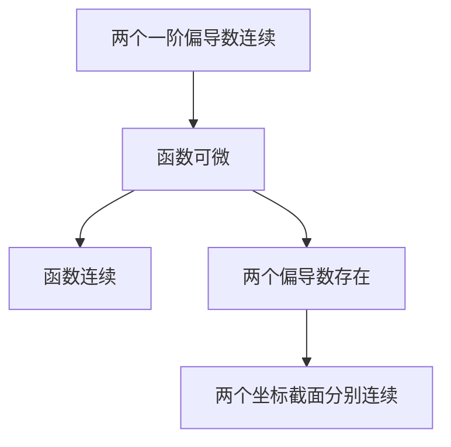
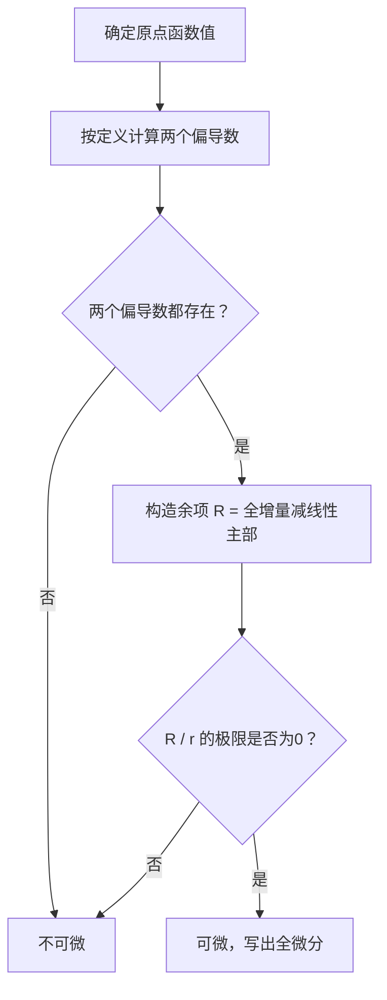
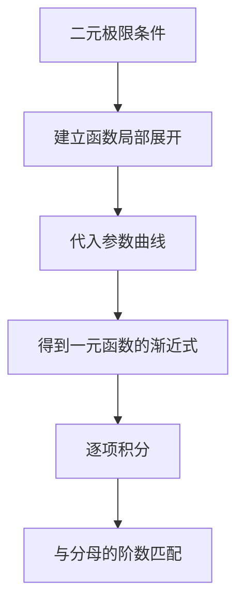

本节是整个多元函数微分学的理论基础，也是考研数学一中非常值得深入研究的一节。

与一元函数微分学相比，多元函数最重要的变化是：**自变量趋近某一点的方式不再只有左、右两个方向，而是有无穷多条路径。** 这使得连续、偏导数存在、可微、偏导数连续之间的关系变得更加复杂。

## 一、本节知识体系与复习重点

本节需要掌握的不是某一个公式，而是下面七种核心能力。

| 核心考点       | 需要掌握的方法        | 学习优先级 |
| ---------- | -------------- | ----- |
| 二元函数极限与连续性 | 路径法、夹逼法、极坐标法   | ★★★★★ |
| 一阶偏导数存在性   | 定义法、轴向差商、左右极限  | ★★★★★ |
| 二元函数可微性    | 一阶线性主部、余项判别    | ★★★★★ |
| 四种性质的逻辑关系  | 蕴含关系、反例构造      | ★★★★★ |
| 偏导数连续性     | 邻域求导、路径与数列反例   | ★★★★★ |
| 抽象函数与全微分   | 小量转换、局部展开、复合极限 | ★★★★★ |
| 二阶混合偏导数    | 二次差商、换序条件      | ★★★★☆ |

其中，**径向量级、路径依赖性、一阶线性主部**是贯穿所有题型的三条主线。

## 二、基础知识：从一元微分过渡到多元微分

### 2.1 二元函数的极限

设二元函数为

$$
z=f(x,y),
$$

考察点为

$$
P_0=(x_0,y_0).
$$

统一引入三个记号：

$$
h=\Delta x=x-x_0,
$$

$$
k=\Delta y=y-y_0,
$$

$$
\rho=\sqrt{h^2+k^2}.
$$

其中，$\rho$ 表示平面上的点 $P=(x,y)$ 到 $P_0$ 的距离。

因此，

$$
(x,y)\to(x_0,y_0)
$$

等价于

$$
\rho\to0.
$$

**1. 二元极限的定义**

若无论点 $P$ 以何种方式趋于 $P_0$，函数值都趋于同一个有限常数 $A$，则称

$$
\lim_{(x,y)\to(x_0,y_0)}f(x,y)=A.
$$

严格地说，对于任意 $\varepsilon>0$，存在 $\delta>0$，使得当定义域内的点满足

$$
0<\rho<\delta
$$

时，均有

$$
|f(x,y)-A|<\varepsilon.
$$

**2. 直观理解**

研究一元函数在原点的极限，只需要考虑左极限与右极限。

研究二元函数在原点的极限，可以沿着：

$$
y=0,\qquad x=0,\qquad y=x,
$$

也可以沿着

$$
y=kx,\qquad y=x^2,\qquad y=x^3,
$$

甚至沿着角度不断变化的曲线趋近原点。

因此，二元极限有一个极其重要的特点：

> 证明极限存在，需要控制所有趋近方式；证明极限不存在，只需要找到不相容的趋近方式。

即使沿所有直线趋近时极限都相等，也不能保证二元极限存在。

### 2.2 二元函数的连续性

函数 $f(x,y)$ 在点 $P_0$ 连续，当且仅当

$$
\boxed{ \lim_{(x,y)\to(x_0,y_0)}f(x,y) =f(x_0,y_0) }
$$

定义全增量：

$$
\Delta f=f(x_0+h,y_0+k)-f(x_0,y_0).
$$

连续性等价于

$$
\boxed{\Delta f=o(1)}
$$

也就是

$$
\lim_{\rho\to0}\Delta f=0.
$$

连续性只要求函数增量趋于零，**不要求函数增量以多快的速度趋于零，也不要求它具有线性结构。**

例如：

$$
f(x,y)=\sqrt{x^2+y^2}
$$

在原点连续，因为

$$
f(x,y)=\rho\to0.
$$

但它在原点不可微。这就是一个圆锥尖点，虽然没有断裂，却无法在顶点建立统一的一阶线性近似。

### 2.3 一阶偏导数的定义

**对 $x$ 的偏导数**

固定 $y=y_0$，仅让 $x$ 发生变化：

$$
\boxed{ f_x(x_0,y_0) = \lim_{h\to0} \frac{f(x_0+h,y_0)-f(x_0,y_0)}h }
$$

**对 $y$ 的偏导数**

固定 $x=x_0$，仅让 $y$ 发生变化：

$$
\boxed{ f_y(x_0,y_0) = \lim_{k\to0} \frac{f(x_0,y_0+k)-f(x_0,y_0)}k }
$$

偏导数的本质仍然是一元函数的导数。

在几何上，$f_x$ 是曲面沿平行于 $x$ 轴方向截线的斜率，$f_y$ 是沿平行于 $y$ 轴方向截线的斜率。

因此，偏导数只能说明两条坐标截线的局部性质，不能代表整个二维邻域。

**一个重要推论**

若 $f_x(x_0,y_0)$ 存在，则

$$
\lim_{x\to x_0}f(x,y_0)=f(x_0,y_0).
$$

证明：

$$
\begin{aligned} &f(x_0+h,y_0)-f(x_0,y_0)\\ &=h\cdot \frac{f(x_0+h,y_0)-f(x_0,y_0)}h \to0. \end{aligned}
$$

也就是说：

**偏导数存在可以推出相应坐标截面连续，却不能推出二元函数连续。**

这一点正是李林880题 `math-29e762-002` 的核心考点。

### 2.4 二元函数可微性的定义

这是本节最重要的公式。

若存在两个与增量 $h,k$ 无关的常数 $A,B$，使得

$$
\boxed{ \Delta f=Ah+Bk+o(\rho) }
$$

其中

$$
\rho=\sqrt{h^2+k^2},
$$

则称函数 $f(x,y)$ 在点 $(x_0,y_0)$ 处可微。

这里包含两部分：

$$
\underbrace{Ah+Bk}_{\text{一阶线性主部}} + \underbrace{o(\rho)}_{\text{高阶无穷小误差}}.
$$

可微的本质是：

**函数在该点附近能够被一个统一的线性函数精确地近似，而且近似误差比自变量的变化距离更小。**

**为什么 $A,B$ 必须是两个偏导数？**

令 $k=0$，则

$$
f(x_0+h,y_0)-f(x_0,y_0) =Ah+o(|h|).
$$

两边除以 $h$，取极限：

$$
f_x(x_0,y_0)=A.
$$

同理，

$$
f_y(x_0,y_0)=B.
$$

所以可微定义还可以写成

$$
\boxed{ \Delta f=f_x(x_0,y_0)h +f_y(x_0,y_0)k+o(\rho) }
$$

这说明一阶线性主部是唯一的，不可以任意选取。

**可微的充要条件**

在两个偏导数存在的前提下：

$$
\boxed{ \lim_{(h,k)\to(0,0)} \frac{ f(x_0+h,y_0+k)-f(x_0,y_0) -f_x(x_0,y_0)h-f_y(x_0,y_0)k }{\sqrt{h^2+k^2}} =0 }
$$

这个公式应该达到能够直接默写的程度。

**全微分**

若函数在该点可微，则

$$
\boxed{ \mathrm df=f_x\,\mathrm dx+f_y\,\mathrm dy }
$$

注意区别：

$$
\Delta f=\mathrm df+o(\rho).
$$

全增量是实际变化量，全微分是全增量的一阶线性近似，两者通常并不完全相等。

### 2.5 偏导数连续性

所谓 $f_x(x,y)$ 在点 $P_0$ 连续，是指偏导函数在该点附近有定义，并且

$$
\lim_{(x,y)\to(x_0,y_0)} f_x(x,y)=f_x(x_0,y_0).
$$

同理，

$$
\lim_{(x,y)\to(x_0,y_0)} f_y(x,y)=f_y(x_0,y_0).
$$

务必区分三个问题：

| 问题         | 实际要求            |
| ---------- | --------------- |
| 原点偏导数是否存在  | 计算原点处的轴向差商      |
| 原点是否可微     | 检验全增量是否具有一阶线性主部 |
| 偏导数在原点是否连续 | 检验邻域偏导函数的二元极限   |

这三个问题不能混为一谈。

## 三、四种性质的逻辑关系——选择题必考模型

### 3.1 核心逻辑关系图

图中的箭头均为充分条件的推导方向，反方向一般不成立。

尤其注意：

$$
\boxed{ \text{连续} \quad\not\Longrightarrow\quad \text{偏导数存在} }
$$

$$
\boxed{ \text{偏导数存在} \quad\not\Longrightarrow\quad \text{连续} }
$$

甚至：

$$
\boxed{ \text{连续且偏导数存在} \quad\not\Longrightarrow\quad \text{可微} }
$$

这是多元函数微分学与一元函数微分学最重要的区别。

在一元函数中，可导与可微等价；而二元函数的两个偏导数都存在，并不意味着可微。

### 3.2 为什么偏导数连续能够推出可微？

下面理解一次证明过程，以便掌握定理的适用条件。

将全增量拆成两部分：

$$
\begin{aligned} \Delta f={}&f(x_0+h,y_0+k)-f(x_0,y_0+k)\\ &+f(x_0,y_0+k)-f(x_0,y_0). \end{aligned}
$$

分别使用一元函数的拉格朗日中值定理：

$$
\begin{aligned} \Delta f={}& f_x(x_0+\theta_1h,y_0+k)h\\ &+f_y(x_0,y_0+\theta_2k)k, \end{aligned}
$$

其中

$$
0<\theta_1,\theta_2<1.
$$

利用两个偏导数在 $P_0$ 连续，可写成

$$
f_x(x_0+\theta_1h,y_0+k) =f_x(x_0,y_0)+o(1),
$$

$$
f_y(x_0,y_0+\theta_2k) =f_y(x_0,y_0)+o(1).
$$

于是

$$
\Delta f =f_x(x_0,y_0)h+f_y(x_0,y_0)k +h\,o(1)+k\,o(1).
$$

由于

$$
|h|\le\rho,\qquad |k|\le\rho,
$$

故

$$
h\,o(1)+k\,o(1)=o(\rho).
$$

所以函数可微。

这个证明也解释了为什么必须关注偏导数在二维邻域中的连续性，而不是只检查坐标轴上的偏导数是否连续。

**补充结论：** 在适当的邻域条件下，只需一个偏导数在邻域内存在且在该点连续，另一个偏导数在该点存在，也足以推出该点可微。证明方法仍然是拆分全增量，但选择合适的拆分顺序。

### 母题1：连续、偏导、可微的逻辑判断

**来源：2002年考研数学一真题。**

设四个性质分别为：

① 函数连续；

② 两个一阶偏导数连续；

③ 函数可微；

④ 两个一阶偏导数存在。

正确的推导关系是：

A. ② $\Rightarrow$ ③ $\Rightarrow$ ①

B. ③ $\Rightarrow$ ② $\Rightarrow$ ①

C. ③ $\Rightarrow$ ④ $\Rightarrow$ ①

D. ③ $\Rightarrow$ ① $\Rightarrow$ ④

**答案：A。**

这道题本身并不难，真正重要的是能够为每一个错误推导构造反例。

### 3.3 必须掌握的五个经典反例

以下所有分式、振荡函数均约定在原点取值为零。

| 函数                        | 连续 | 两偏导存在 | 可微 | 两偏导连续 |
| ------------------------- | -- | ----- | -- | ----- |
| $xy$                  | 是  | 是     | 是  | 是     |
| $r^2\sin(1/r)$        | 是  | 是     | 是  | 否     |
| $\sqrt{\|xy\|}$       | 是  | 是     | 否  | 否     |
| $\sqrt{x^2+y^2}$      | 是  | 否     | 否  | 否     |
| $\dfrac{xy}{x^2+y^2}$ | 否  | 是     | 否  | 否     |

其中

$$
r=\sqrt{x^2+y^2}.
$$

这五个函数几乎可以解决本节大部分逻辑判断题。

1994年数学一真题、2002年数学一真题、李林880题 `math-29e762-035`、李正元练习题 `math-7d8f6e-007`，都围绕这些逻辑关系进行命题。

建议不要死记反例表，而要理解每个函数为什么具有相应性质。下面逐一展开。

## 四、模型一：二元极限与连续性

### 4.1 证明二元极限存在的常用方法

方法的核心是寻找一个只与距离 $r$ 有关、而与趋近方向无关的上界。

原点附近有以下基本不等式：

$$
\boxed{|x|\le r,\qquad |y|\le r}
$$

$$
\boxed{2|xy|\le x^2+y^2=r^2}
$$

$$
\boxed{ r\le |x|+|y|\le\sqrt2\,r }
$$

$$
\boxed{ \frac12r^4\le x^4+y^4\le r^4 }
$$

如果能够得到

$$
|f(x,y)-A|\le Cr^\alpha, \qquad \alpha>0,
$$

就可以由夹逼定理得到

$$
\lim_{(x,y)\to(0,0)}f(x,y)=A.
$$

这是证明极限存在最稳妥的方式之一。

### 母题2：偏导数存在，但函数不连续

**来源：1997年考研数学一真题。**

设

$$
f(x,y)= \begin{cases} \dfrac{xy}{x^2+y^2},&(x,y)\ne(0,0),\\[4pt] 0,&(x,y)=(0,0). \end{cases}
$$

判断原点的连续性及偏导数存在性。

<Steps>

<Step>

### 第一步：观察坐标轴 [!toc]

由于

$$
f(x,0)=f(0,y)=0,
$$

所以

$$
f_x(0,0) =\lim_{h\to0}\frac{0}{h}=0,
$$

$$
f_y(0,0)=0.
$$

两个偏导数都存在。

</Step>

<Step>

### 第二步：观察非坐标轴路径 [!toc]

沿 $y=x$ 趋于原点：

$$
f(x,x)=\frac{x^2}{2x^2}=\frac12.
$$

沿 $y=0$ 趋于原点：

$$
f(x,0)=0.
$$

两条路径给出不同的极限。

所以二元极限不存在，函数不连续。

</Step>

<Step>

### 第三步：判断可微性 [!toc]

可微必连续。

既然不连续，就一定不可微。

最终结论：

$$
\boxed{ \text{偏导数存在，但不连续、不可微} }
$$

</Step>

</Steps>

**用极坐标进一步理解**

令

$$
x=r\cos\theta,\qquad y=r\sin\theta.
$$

则

$$
f(x,y) =\frac{r^2\cos\theta\sin\theta}{r^2} =\frac12\sin2\theta.
$$

这个表达式只与角度有关，而与距离无关。

即使距离无限缩小，不同方向的函数值也不相同，因此极限不存在。

**同源模拟题：张宇8套卷第2套第3题**

这道模拟题直接在上述真题母题的基础上进行改造，进一步考查

$$
F(x,y)=f(x,y)\sin(x+y)
$$

在原点是否连续。

虽然 $f$ 不连续，但

$$
|f(x,y)|\le\frac12.
$$

于是

$$
|F(x,y)| \le\frac12|\sin(x+y)| \le\frac12|x+y|\to0.
$$

所以 $F$ 在原点连续，原题选D。

这揭示出一个常用推论：

$$
\boxed{ \text{有界函数}\times\text{无穷小} =\text{无穷小} }
$$

参与乘积的两个函数不一定都连续。

### 4.2 齐次型分式：极坐标次数判别法

假设原点以外的函数能够表示成

$$
f(x,y)=r^\alpha G(\theta),
$$

其中角度函数 $G(\theta)$ 有界且不恒为零。

那么可以得到以下结论：

| 径向指数           | 原点连续性（原点取0）  |
| -------------- | ------------ |
| $\alpha>0$ | 连续           |
| $\alpha=0$ | 不连续          |
| $\alpha<0$ | 不连续，且沿某些方向无界 |

当 $\alpha=0$ 时，要注意是原点取值为零且 $G$ 不恒为零这一前提。如果 $G$ 为非零常数，二元极限存在，但与原点取值不同；如果 $G$ 随角度变化，则二元极限不存在。

这一方法特别适合分母为

$$
(x^2+y^2)^m
$$

或者同阶正定多项式的题目。

### 母题3：李正元练习题的四类连续性函数

**来源：李正元第八章。**

以下四个函数均在原点取零。

| 函数                               | 估计或路径                         | 结论  |
| -------------------------------- | ----------------------------- | --- |
| $\dfrac{xy}{\sqrt{x^2+y^2}}$ | 绝对值不超过 $r/2$              | 连续  |
| $\dfrac{x^3-y^3}{x^2+y^2}$   | 绝对值不超过 $2r$               | 连续  |
| $\dfrac{xy}{\sqrt{x^4+y^4}}$ | 沿 $y=x$ 恒为 $1/\sqrt2$ | 不连续 |
| $r\sin(1/r^2)$               | 绝对值不超过 $r$                | 连续  |

第三个函数不连续，原题选C。

**解题技巧：** 分子次数比分母的实际径向次数高，一般优先寻找夹逼估计；次数相同，优先寻找角度依赖和特殊路径。

但必须保证分母不会在某些方向上额外趋零，否则简单的次数比较可能失效。

### 4.3 非直线路径：分母同阶平衡法

这是本节很容易出现创新题的地方。

### 母题4：所有直线路径极限相同，二元极限仍然不存在

**来源：原创变式。**

设

$$
f(x,y)= \begin{cases} \dfrac{x^2y}{x^4+y^2},&(x,y)\ne(0,0),\\[4pt] 0,&(x,y)=(0,0). \end{cases}
$$

判断连续性。

<Steps>

<Step>

### 第一步：尝试直线路径 [!toc]

对于非零常数 $k$，令 $y=kx$，得到

$$
f(x,kx) =\frac{kx^3}{x^4+k^2x^2} =\frac{kx}{x^2+k^2}\to0.
$$

两条坐标轴上的函数值也恒为零。

因此，所有过原点的固定直线都给出零极限。

能否认为二元极限等于零？

不能。

</Step>

<Step>

### 第二步：分析分母的两个部分 [!toc]

分母为

$$
x^4+y^2.
$$

令两项同阶：

$$
x^4=y^2.
$$

得到候选路径：

$$
y=x^2.
$$

</Step>

<Step>

### 第三步：代入非直线路径 [!toc]

$$
f(x,x^2) =\frac{x^4}{2x^4} =\frac12.
$$

所以二元极限不存在，原点不连续。

同时，两个偏导数仍然存在且均为零。

</Step>

</Steps>

**路径选择的一般方法**

当分母出现

$$
x^{2m}+y^{2n}
$$

时，令

$$
|x|^{2m}\asymp |y|^{2n},
$$

从而优先尝试

$$
\boxed{y=c|x|^{m/n}}
$$

其中 $c\ne0$。

| 分母结构          | 优先尝试的路径                                            |
| ------------- | -------------------------------------------------- |
| $x^2+y^2$ | $y=kx$                                         |
| $x^4+y^2$ | $y=kx^2$                                       |
| $x^6+y^2$ | $y=kx^3$                                       |
| $x^2+y^4$ | $x=ky^2$                                       |
| $x^4+y^6$ | $x=ky^3{}^{\! /2}$，或取 $x=t^3,y=t^2$ 的参数路径 |

最后一种结构更推荐直接使用参数路径，避免分数指数的定义域问题。

**这种方法叫尺度平衡。** 不是盲目尝试各种曲线，而是主动寻找能让分母各项同阶、从而使分式暴露主要行为的路径。

### 4.4 二重极限与累次极限

二重极限：

$$
\lim_{(x,y)\to(0,0)}f(x,y).
$$

两个累次极限：

$$
\lim_{x\to0}\lim_{y\to0}f(x,y),
$$

$$
\lim_{y\to0}\lim_{x\to0}f(x,y).
$$

两者本质不同。

二重极限要求两个变量同时趋近；累次极限要求先固定一个变量，让另一个变量趋近，再让原来固定的变量趋近。

**情况一：两个累次极限存在且相等，但二重极限不存在**

取

$$
f(x,y)=\frac{xy}{x^2+y^2}.
$$

可以验证两个累次极限均为零，但沿 $y=x$ 时函数值恒为 $1/2$。

所以二重极限不存在。

**情况二：二重极限存在，但累次极限不存在**

### 母题5：张宇8套卷第5套第2题

设

$$
f(x,y)= \begin{cases} x\cos\dfrac1y+y\cos\dfrac1x,&xy\ne0,\\ 0,&xy=0. \end{cases}
$$

判断二重极限与两个累次极限。

先考察二重极限：

$$
|f(x,y)|\le |x|+|y|\to0.
$$

所以

$$
\lim_{(x,y)\to(0,0)}f(x,y)=0.
$$

原点连续。

然而，固定任意非零 $x$，令 $y\to0$。

其中

$$
x\cos\frac1y
$$

由于振幅 $x$ 此时为固定的非零常数，因此始终振荡。

另一项

$$
y\cos\frac1x\to0.
$$

故内层极限不存在。

所以

$$
\lim_{x\to0}\lim_{y\to0}f(x,y)
$$

不存在。

交换顺序同理，另一个累次极限也不存在。

原题正确结论有两个，选C。

李林880题 `math-29e762-039` 使用正弦代替余弦，考查完全相同的结构。

<Callout type="info" title="必须记住的结论">

如果二重极限存在，并且相应的内层极限在所需的去心邻域内存在，那么相应的累次极限必然等于二重极限。

但二重极限存在，并不保证内层极限一定存在。

因此，不能用累次极限简单代替二重极限。

</Callout>

## 五、模型二：偏导数定义与分段函数

### 5.1 标准解题步骤

看到原点处单独定义、绝对值、根号、奇点等结构，应优先使用偏导数定义，而不是直接把求导公式代入原点。

对于原点偏导数：

$$
f_x(0,0) =\lim_{h\to0}\frac{f(h,0)-f(0,0)}h,
$$

$$
f_y(0,0) =\lim_{k\to0}\frac{f(0,k)-f(0,0)}k.
$$

实质上，只需要处理两个一元函数。

### 母题6：根号与绝对值产生的左右差商

**来源：2008年考研数学三真题。**

设

$$
f(x,y)=e^{\sqrt{x^2+y^4}}.
$$

判断原点的两个偏导数是否存在。

首先，

$$
f(0,0)=1.
$$

固定 $y=0$：

$$
f(h,0)=e^{|h|}.
$$

因此

$$
f_x(0,0) =\lim_{h\to0}\frac{e^{|h|}-1}{h}.
$$

利用

$$
e^u-1\sim u,
$$

可知右极限为1，左极限为 $-1$。

所以 $f_x(0,0)$ 不存在。

再固定 $x=0$：

$$
f(0,k)=e^{k^2}.
$$

于是

$$
\begin{aligned} f_y(0,0) &=\lim_{k\to0}\frac{e^{k^2}-1}{k}\\ &=\lim_{k\to0}k=0. \end{aligned}
$$

因此

$$
\boxed{ f_x(0,0)\text{ 不存在},\qquad f_y(0,0)=0 }
$$

原题选C。

**张宇1000题同类变式**

设

$$
f(x,y)=|x|+y|y|.
$$

分别计算：

$$
f_x(0,0) =\lim_{h\to0}\frac{|h|}{h},
$$

不存在；

$$
f_y(0,0) =\lim_{k\to0}\frac{k|k|}{k}=0.
$$

所以两个函数尽管形式不同，但解题模型完全相同。

**一元差商的常见结论**

| 截面函数                              | 原点导数 |
| --------------------------------- | ---- |
| $\|h\|$                       | 不存在  |
| $h\|h\|$                      | 等于0  |
| $h^2$                         | 等于0  |
| $\|h\|^\alpha,\ \alpha>1$     | 等于0  |
| $\|h\|^\alpha,\ 0<\alpha\le1$ | 不存在  |
| $h\sin(1/h)$                  | 不存在  |
| $h^2\sin(1/h)$                | 等于0  |

本质上仍然是在判断一元函数的左右差商。

### 母题7：计算整个区域的偏导函数

**来源：张宇1000题第13章。**

设

$$
f(x,y)=\sqrt{|xy|}.
$$

求 $f_x(x,y)$。

这道题与只求 $f_x(0,0)$ 的区别是：必须讨论整个定义域中的各种点。

**情况一：$xy\ne0$**

可以直接使用链式法则：

$$
f_x(x,y) =\frac{y\,\operatorname{sgn}(xy)} {2\sqrt{|xy|}}.
$$

**情况二：$y=0$**

由于

$$
f(x,0)\equiv0,
$$

所以

$$
f_x(x,0)=0.
$$

**情况三：$x=0,\ y\ne0$**

固定非零的 $y$，使用定义：

$$
\begin{aligned} f_x(0,y) &=\lim_{h\to0}\frac{\sqrt{|hy|}}h\\ &=\sqrt{|y|} \lim_{h\to0}\frac{\sqrt{|h|}}h. \end{aligned}
$$

极限不存在。

因此，完整答案是

$$
\boxed{ f_x(x,y)= \begin{cases} \dfrac{y\,\operatorname{sgn}(xy)} {2\sqrt{|xy|}},&xy\ne0,\\[6pt] 0,&y=0,\\ \text{不存在},&x=0,\ y\ne0. \end{cases} }
$$

**关键启示：** 偏导数在原点存在，不代表它在原点周围的所有点都存在。

这一点在之后求混合偏导数时尤其重要。

## 六、模型三：可微性的定义判别——本节最核心的计算模型

### 6.1 可微性标准四步法

对于原点附近的分段函数，按照以下流程进行判断。

若两个偏导数都等于零，判别公式会大幅简化：

$$
\boxed{ f(x,y)\text{ 在原点可微} \iff \lim_{(x,y)\to(0,0)} \frac{f(x,y)-f(0,0)}{\sqrt{x^2+y^2}}=0 }
$$

如果能够直接证明这个极限为零，那么甚至不需要先单独求两个偏导数，因为零线性主部已经满足可微的定义。

### 6.2 三种必须区分的量级

记

$$
r=\sqrt{x^2+y^2}.
$$

| 量级         | 数学意义    | 对可微性的影响     |
| ---------- | ------- | ----------- |
| $o(1)$ | 趋于零     | 保证增量对应的连续性  |
| $O(r)$ | 至多为一阶量级 | 不能单独保证可微    |
| $o(r)$ | 比一阶更小   | 保证零线性主部的可微性 |

其中

$$
f=O(r)
$$

表示 $f/r$ 在原点附近有界；

$$
f=o(r)
$$

表示 $f/r\to0$。

不要把“有界”误认为“趋于零”。

### 母题8：连续且偏导数存在，仍然不可微

**来源：李正元练习题。**

设

$$
f(x,y)=\sqrt{|xy|}.
$$

判断原点连续性与可微性。

<Steps>

<Step>

### 第一步：证明连续 [!toc]

由

$$
2|xy|\le x^2+y^2,
$$

得到

$$
0\le\sqrt{|xy|} \le\frac{\sqrt{x^2+y^2}}{\sqrt2} \to0.
$$

所以函数连续。

</Step>

<Step>

### 第二步：计算两个偏导数 [!toc]

由于

$$
f(h,0)=f(0,k)=0,
$$

故

$$
f_x(0,0)=f_y(0,0)=0.
$$

</Step>

<Step>

### 第三步：检验可微性 [!toc]

如果可微，则必须满足

$$
\lim_{(x,y)\to(0,0)} \frac{\sqrt{|xy|}}{\sqrt{x^2+y^2}}=0.
$$

沿 $y=x$：

$$
\frac{\sqrt{|x^2|}}{\sqrt{2x^2}} =\frac1{\sqrt2}.
$$

不等于零。

因此原点不可微。

$$
\boxed{ \text{连续、偏导数存在，但不可微} }
$$

</Step>

</Steps>

**为什么这是一个极其重要的母题？**

它同时证明了两个错误命题：

$$
\text{连续}+\text{偏导数存在} \not\Rightarrow\text{可微},
$$

$$
O(r)\not\Rightarrow o(r).
$$

以后遇到类似

$$
\frac{xy}{\sqrt{x^2+y^2}}, \qquad \frac{x^2y}{x^2+y^2}, \qquad \sqrt[3]{|xy^2|}
$$

的函数，都可以使用同样的方法进行判断：先判断坐标轴上的偏导，再观察除以 $r$ 后的径向次数和角度因子。

以上三个函数在原点取零时，都连续、两个偏导数存在，但不可微。

### 母题9：2012年考研数学一真题——从极限阶数推断可微性

设 $f(x,y)$ 在原点连续。判断以下条件中哪些能够推出函数可微。

A.

$$
\lim_{(x,y)\to(0,0)} \frac{f(x,y)}{|x|+|y|}
$$

存在。

B.

$$
\lim_{(x,y)\to(0,0)} \frac{f(x,y)}{x^2+y^2}
$$

存在。

C. 若 $f$ 可微，则A中的极限存在。

D. 若 $f$ 可微，则B中的极限存在。

**正确答案：B。**

**分析选项B**

设有限极限为 $L$，则

$$
\frac{f(x,y)}{r^2}=L+o(1).
$$

所以

$$
f(x,y)=Lr^2+o(r^2).
$$

显然

$$
f(x,y)\to0.
$$

由于题目已经给出函数连续，因此

$$
f(0,0)=0.
$$

进一步，

$$
\frac{f(x,y)-f(0,0)}r =Lr+o(r)\to0.
$$

由可微定义得到

$$
\boxed{\mathrm df|_{(0,0)}=0}.
$$

**为什么A错误？**

取

$$
f(x,y)=|x|+|y|.
$$

此时

$$
\frac{f(x,y)}{|x|+|y|}\equiv1.
$$

极限存在，但两个偏导数都不存在，因此不可微。

**为什么C、D错误？**

取最简单的可微函数

$$
f(x,y)=x.
$$

它的全微分为

$$
\mathrm df=\mathrm dx.
$$

但是

$$
\frac{x}{|x|+|y|}
$$

沿不同方向趋近时极限不同。

而

$$
\frac{x}{x^2+y^2}
$$

沿 $y=0$ 趋近时甚至没有有限极限。

所以可微并不能反推出A、B中的极限一定存在。

**从真题提炼一般规律**

设 $f(0,0)=0$，且

$$
\lim_{(x,y)\to(0,0)} \frac{f(x,y)}{r^\alpha}=L,
$$

其中 $L$ 有限。

那么

$$
f=Lr^\alpha+o(r^\alpha).
$$

| 条件                       | 可以推出的性质      |
| ------------------------ | ------------ |
| $\alpha>0$           | 连续           |
| $\alpha>1$           | 可微且全微分为零     |
| $\alpha=1,\ L=0$     | 可微且全微分为零     |
| $\alpha=1,\ L\ne0$   | 连续，但不可微      |
| $0<\alpha<1,\ L\ne0$ | 连续，但两个偏导数不存在 |

对于 $\alpha=1,L\ne0$，函数的一阶主部形如 $Lr$，这是圆锥型而不是线性型。

这类题必须关注分母的阶数，不能只关注极限是否存在。

### 母题10：参数型可微性

**来源：原创变式。**

设

$$
f_\alpha(x,y)= \begin{cases} \dfrac{x^2y^2}{(x^2+y^2)^\alpha}, &(x,y)\ne(0,0),\\[4pt] 0,&(x,y)=(0,0). \end{cases}
$$

讨论原点连续、偏导数存在、可微的参数范围。

<Steps>

<Step>

### 第一步：计算原点偏导数 [!toc]

由于分子含 $x^2y^2$，沿坐标轴时恒为零。

因此对任意实数 $\alpha$，

$$
(f_\alpha)_x(0,0) =(f_\alpha)_y(0,0)=0.
$$

</Step>

<Step>

### 第二步：用极坐标分离径向量级 [!toc]

令

$$
x=r\cos\theta,\qquad y=r\sin\theta.
$$

则

$$
f_\alpha =r^{4-2\alpha}\cos^2\theta\sin^2\theta.
$$

由于

$$
0\le \cos^2\theta\sin^2\theta\le\frac14,
$$

得到

$$
|f_\alpha|\le\frac14r^{4-2\alpha}.
$$

所以当

$$
4-2\alpha>0
$$

时，函数连续。

即

$$
\alpha<2.
$$

</Step>

<Step>

### 第三步：证明连续条件的必要性 [!toc]

沿 $y=x=t\ne0$：

$$
f_\alpha(t,t) =\frac14(\sqrt2|t|)^{4-2\alpha}.
$$

当 $\alpha=2$ 时，函数值恒为 $1/4$；当 $\alpha>2$ 时，沿该路径发散。

因此连续的充要条件为

$$
\boxed{\alpha<2}.
$$

</Step>

<Step>

### 第四步：判断可微性 [!toc]

由于两个偏导数均为零，所以只需要检验

$$
\frac{|f_\alpha|}{r} \le\frac14r^{3-2\alpha}.
$$

当

$$
3-2\alpha>0
$$

时，该比值趋于零。

利用对角线路径同样可以证明必要性。

所以

$$
\boxed{\alpha<\frac32}.
$$

最终：

| 性质        | 参数范围                     |
| --------- | ------------------------ |
| 原点两个偏导数存在 | $\alpha\in\mathbb R$ |
| 原点连续      | $\alpha<2$           |
| 原点可微      | $\alpha<\dfrac32$    |

</Step>

</Steps>

**一般化母题公式**

对于正整数 $m,n$，设

$$
f(x,y)=\frac{x^my^n}{(x^2+y^2)^\alpha},
$$

并补充定义 $f(0,0)=0$。

那么原点两偏导恒为零，且

$$
\boxed{ \text{连续}\iff m+n-2\alpha>0 }
$$

$$
\boxed{ \text{可微}\iff m+n-2\alpha>1 }
$$

这是由极坐标的有界角因子与固定非零角因子的路径共同保证的。

### 母题11：李林6套卷第6套第18题——参数消项与充要条件

这是本节模拟题中非常值得详细研究的一道综合解答题。

设

$$
f(x,y)= \begin{cases} \displaystyle \left(x^2+y^2+a\sqrt{|x|}+b\right) \frac{\sin(xy^2)}{x^2+y^2}, &(x,y)\ne(0,0),\\[6pt] 0,&(x,y)=(0,0). \end{cases}
$$

若函数在原点可微，求参数 $a,b$ 的取值。

<Steps>

<Step>

### 第一步：确定候选全微分 [!toc]

由于坐标轴上函数恒为零，

$$
f_x(0,0)=f_y(0,0)=0.
$$

所以可微的充要条件是

$$
\lim_{(x,y)\to(0,0)}\frac{f(x,y)}r=0.
$$

</Step>

<Step>

### 第二步：分析量级 [!toc]

利用

$$
\sin(xy^2)\sim xy^2,
$$

可以直观地看出

$$
\frac{\sin(xy^2)}{x^2+y^2}
$$

至多是一阶小量。

而前面的括号是

$$
r^2+a\sqrt{|x|}+b.
$$

其中前两项趋于零，只有 $b$ 是可能不消失的常数。

因此怀疑必要条件为 $b=0$。

</Step>

<Step>

### 第三步：严格证明必要性 [!toc]

取

$$
x=y=t>0.
$$

那么

$$
\begin{aligned} \frac{f(t,t)}{\sqrt2t} &=\frac{2t^2+a\sqrt t+b}{2\sqrt2} \frac{\sin(t^3)}{t^3}\\ &\to\frac{b}{2\sqrt2}. \end{aligned}
$$

可微要求该极限为零，因此

$$
b=0.
$$

</Step>

<Step>

### 第四步：严格证明充分性 [!toc]

当 $b=0$ 时，由

$$
|\sin(xy^2)|\le |x|y^2
$$

及

$$
|x|\le r,\quad |y|\le r,
$$

得到

$$
\begin{aligned} \frac{|f(x,y)|}{r} &\le \left(r^2+|a|\sqrt{|x|}\right) \frac{|x|y^2}{r^3}\\ &\le r^2+|a|\sqrt r\\ &\to0. \end{aligned}
$$

因此任意固定实数 $a$ 均满足要求。

最终答案：

$$
\boxed{b=0,\qquad a\in\mathbb R}.
$$

</Step>

</Steps>

**本题真正的命题思想**

很多同学看到 $\sqrt{|x|}$ 会认为它不可导，于是误判 $a=0$。

但判断乘积是否可微，不能孤立地研究某个因子是否可导，而要研究整个乘积的无穷小阶数。

本题的结构实际上是

$$
\underbrace{O(r)}_{\text{至多一阶}} \cdot \underbrace{o(1)}_{\text{趋于零}} =o(r).
$$

今后遇到含参数的可微性题，建议采用这一标准思路：

**先利用特殊路径确定必要条件，再利用统一不等式证明充分条件。**

## 七、模型四：一阶线性主部与抽象函数

这一类题目的特点是不给出函数的具体表达式，只给出某个极限或者局部渐近关系，要求求偏导、全微分或另一个极限。

是非常典型的考研数学一综合命题方式。

### 7.1 一阶展开法

只要题目给出

$$
f(x_0+h,y_0+k)=C+Ah+Bk+o(\rho),
$$

并且已知 $f(x_0,y_0)=C$，或者已知函数在基点连续，那么就可以直接得到

$$
f_x(x_0,y_0)=A,
$$

$$
f_y(x_0,y_0)=B,
$$

$$
\boxed{\mathrm df=A\,\mathrm dx+B\,\mathrm dy}.
$$

不需要先逐一使用偏导数定义。

这里的小量处理需要特别熟悉：

$$
O(\rho^2)=o(\rho),
$$

$$
o(\rho^2)=o(\rho),
$$

$$
o(\rho)\ne o(\rho^2)\quad\text{（一般而言）}.
$$

低阶信息不能擅自升级成高阶信息。

### 母题12：直接由二元极限读取全微分

**来源：2012年考研数学三真题。**

连续函数 $z=f(x,y)$ 满足

$$
\lim_{(x,y)\to(0,1)} \frac{f(x,y)-2x+y-2} {\sqrt{x^2+(y-1)^2}}=0.
$$

求在点 $(0,1)$ 处的全微分。

<Steps>

<Step>

### 第一步：将基点平移到原点 [!toc]

令

$$
h=x,\qquad k=y-1.
$$

那么

$$
\rho=\sqrt{h^2+k^2}.
$$

由题设可知

$$
f(x,y)-2x+y-2=o(\rho).
$$

即

$$
f(x,y)=2x-y+2+o(\rho).
$$

</Step>

<Step>

### 第二步：读取常数项与一阶项 [!toc]

代入 $x=h,y=1+k$：

$$
f(h,1+k)=1+2h-k+o(\rho).
$$

由连续性，

$$
f(0,1)=1.
$$

所以

$$
\Delta f=2h-k+o(\rho).
$$

</Step>

<Step>

### 第三步：写出答案 [!toc]

$$
\boxed{ \mathrm dz|_{(0,1)} =2\,\mathrm dx-\mathrm dy }
$$

</Step>

</Steps>

**张宇1000题的升级变式**

已知 $f$ 连续，并且

$$
\lim_{(x,y)\to(1,0)} \frac{f(x,y)-3x+y+5} {(x-1)^2+y^2}=\frac14.
$$

则

$$
f(x,y) =3x-y-5+\frac14\rho^2+o(\rho^2).
$$

其中

$$
\rho=\sqrt{(x-1)^2+y^2}.
$$

因为二阶小量必然是比一阶更高阶的无穷小，故

$$
f(1+h,k)=-2+3h-k+o(\rho).
$$

从而

$$
\boxed{\mathrm df|_{(1,0)}=3\,\mathrm dx-\mathrm dy}.
$$

注意：题设中极限等于 $1/4$，并不意味着要把 $1/4$ 写进全微分。它控制的是二阶余项，而不是一阶主部。

### 母题13：张宇1000题——径向尖点的参数确定

设 $f(0,0)=0$，且

$$
\lim_{(x,y)\to(0,0)} \frac{f(x,y)-\sqrt{x^2+y^2}} {\sqrt{x^2+y^2}}=a.
$$

讨论连续性与可微性。

记

$$
r=\sqrt{x^2+y^2}.
$$

题设等价于

$$
f(x,y)-r=ar+o(r),
$$

所以

$$
\boxed{f(x,y)=(1+a)r+o(r)}.
$$

**连续性**

无论有限实数 $a$ 取何值，均有

$$
f(x,y)\to0.
$$

所以原点始终连续。

**可微性的必要条件**

沿 $x$ 轴，

$$
f(h,0)=(1+a)|h|+o(|h|).
$$

于是

$$
\frac{f(h,0)}h =(1+a)\frac{|h|}{h}+o(1).
$$

右极限为

$$
1+a,
$$

左极限为

$$
-(1+a).
$$

偏导数存在要求两者相等，因此

$$
1+a=0,
$$

即

$$
a=-1.
$$

**可微性的充分条件**

若 $a=-1$，则

$$
f(x,y)=o(r).
$$

于是原点可微，且

$$
\mathrm df|_{(0,0)}=0.
$$

最终：

$$
\boxed{ \text{连续：任意 }a\in\mathbb R }
$$

$$
\boxed{ \text{可微：}a=-1 }
$$

**与极值问题的联动**

李林880题 `math-29e762-041` 对同一个母题进行了极值方向的改造。

由于

$$
f=(1+a)r+o(r),
$$

所以当 $a>-1$ 时，在充分小的去心邻域中 $f>0$，原点为严格极小值点。

当 $a<-1$ 时，在充分小的去心邻域中 $f<0$，原点为严格极大值点。

当 $a=-1$ 时，仅知道 $f=o(r)$，无法确定是否取得极值。

例如 $r^2,-r^2,xy$ 都是 $o(r)$，但它们在原点分别取得极小值、极大值和不取得极值。

这就是第一节与后面的多元函数极值一节之间的联系。

### 7.2 一阶展开与参数曲线极限

如果 $f$ 在点 $P_0=(x_0,y_0)$ 可微，那么

$$
f(x_0+h,y_0+k) =f(P_0)+Ah+Bk+o(\rho).
$$

设参数曲线满足

$$
h(t)=at+o(t),
$$

$$
k(t)=bt+o(t).
$$

则

$$
\boxed{ f(x_0+h(t),y_0+k(t)) =f(P_0)+(Aa+Bb)t+o(t) }
$$

更一般地，两条参数曲线之间的差商为

$$
\boxed{ \lim_{t\to0} \frac{f(P_0+u(t))-f(P_0+v(t))}{t} = \nabla f(P_0)\cdot \bigl(u'(0)-v'(0)\bigr) }
$$

这里要求两条向量参数曲线都在零点可导，并且 $u(0)=v(0)=0$，外层函数 $f$ 在 $P_0$ 可微。

### 母题14：李林6套卷第1套第3题

设连续函数满足

$$
\lim_{(x,y)\to(1,0)} \frac{f(x,y)-x+2y+2} {\sqrt{(x-1)^2+y^2}}=0.
$$

求

$$
\lim_{u\to0} \frac{f(1+3u,0)-f(1,2u)}u.
$$

由题设得到

$$
f(1+h,k)=-1+h-2k+o(\rho).
$$

所以

$$
f(1+3u,0)=-1+3u+o(|u|),
$$

$$
f(1,2u)=-1-4u+o(|u|).
$$

两式相减：

$$
f(1+3u,0)-f(1,2u) =7u+o(|u|).
$$

因此

$$
\boxed{ \lim_{u\to0} \frac{f(1+3u,0)-f(1,2u)}u=7 }
$$

更快的思路是直接读出

$$
f_x(1,0)=1,\qquad f_y(1,0)=-2,
$$

于是所求极限为

$$
3f_x(1,0)-2f_y(1,0)=7.
$$

### 母题15：去心极限、函数值与可微性的陷阱

**来源：李永乐6套卷第5套第4题。**

已知

$$
\lim_{(x,y)\to(0,0)} \frac{f(x,y)+f(-x,-y)}r=0,
$$

$$
\lim_{(x,y)\to(0,0)} \frac{f(x,y)-f(-x,-y)-2x+4y}{r}=0.
$$

可以得到什么结论？

由题设，

$$
f(x,y)+f(-x,-y)=o(r),
$$

$$
f(x,y)-f(-x,-y)=2x-4y+o(r).
$$

两式相加：

$$
2f(x,y)=2x-4y+o(r).
$$

于是

$$
\boxed{f(x,y)=x-2y+o(r)}.
$$

由于

$$
|x|+2|y|\ge r,
$$

所以

$$
\boxed{ \lim_{(x,y)\to(0,0)} \frac{f(x,y)-x+2y}{|x|+2|y|}=0 }
$$

原题选C。

<Callout type="warn" title="陷阱一：能否推出原点连续？">

不能。

题设只控制去心邻域中的函数值，并没有规定 $f(0,0)$。

例如取

$$
f(x,y)= \begin{cases} x-2y,&(x,y)\ne(0,0),\\ 1,&(x,y)=(0,0). \end{cases}
$$

它满足两个题设极限，但原点不连续。

</Callout>

**陷阱二：能否将分母换成 $r^2$？**

也不能。

取

$$
f(x,y)=x-2y+r^{3/2}.
$$

由于

$$
r^{3/2}=o(r),
$$

满足题设。

然而

$$
\frac{f(x,y)-x+2y}{r^2} =r^{-1/2}\to+\infty.
$$

这道模拟题结合了奇偶分解、去心极限与小量阶数，质量很高，值得重点复习。

## 八、模型五：乘积、绝对值与不可微因子的处理

### 8.1 最重要的乘积定理

若函数 $f$ 在点 $P_0$ 可微，且

$$
f(P_0)=0,
$$

函数 $g$ 在 $P_0$ 连续，则即使 $g$ 不可微，乘积 $fg$ 仍然在该点可微。

证明如下：

$$
f(P_0+(h,k))=Ah+Bk+o(\rho),
$$

$$
g(P_0+(h,k))=g(P_0)+o(1).
$$

相乘得到

$$
fg=g(P_0)(Ah+Bk)+o(\rho).
$$

所以

$$
\boxed{ \mathrm d(fg)|_{P_0} =g(P_0)\,\mathrm df|_{P_0} }
$$

注意这与直接套用两个可微函数的乘积求导法则不同。这里即使 $g$ 不可微，结论也可以通过定义成立。

如果 $g(P_0)=0$，那么

$$
fg=o(\rho),
$$

全微分为零。

### 母题16：李正元练习题——不可微因子相乘后可微

设

$$
f(x,y)=|x-y|\varphi(x,y),
$$

其中 $\varphi$ 在原点连续，并且

$$
\varphi(0,0)=0.
$$

判断 $f$ 是否可微。

由于

$$
|x-y|\le\sqrt2\,r,
$$

而

$$
\varphi(x,y)=o(1),
$$

所以

$$
|f(x,y)| \le\sqrt2\,r|\varphi(x,y)|.
$$

即

$$
\frac{|f(x,y)|}{r} \le\sqrt2|\varphi(x,y)|\to0.
$$

因此

$$
f=o(r).
$$

最终

$$
\boxed{f\text{ 在原点可微，且 }\mathrm df=0}.
$$

此题不要求 $\varphi$ 有偏导数。

真正起作用的是

$$
\boxed{O(r)\cdot o(1)=o(r)}.
$$

### 母题17：张宇8套卷第7套第2题

设 $f$ 在 $P_0$ 可微且 $f(P_0)=0$，$g$ 在 $P_0$ 连续但不可微。

判断下列函数哪些一定可微：

$$
F_1=f|f|,\qquad F_2=fg,
$$

$$
F_3=f|g|,\qquad F_4=|f|g.
$$

分析如下：

| 函数           | 量级或展开                     | 是否一定可微 |
| ------------ | ------------------------- | ------ |
| $f\|f\|$ | $O(\rho^2)$           | 是      |
| $fg$     | $g(P_0)L+o(\rho)$     | 是      |
| $f\|g\|$ | $\|g(P_0)\|L+o(\rho)$ | 是      |
| $\|f\|g$ | 可能保留 $\|L\|$ 型尖点      | 否      |

其中

$$
L=Ah+Bk.
$$

前三个函数一定可微。

对于第四个函数，取

$$
f(x,y)=x,\qquad g(x,y)=1+|y|.
$$

则满足题设。

但

$$
F_4(x,y)=|x|(1+|y|)
$$

在原点关于 $x$ 的偏导数不存在，因此不一定可微。

原题选C。

**一个更深入的结论**

在该题的条件下，第四个函数可微的充要条件是

$$
\boxed{g(P_0)=0\quad\text{或}\quad \mathrm df|_{P_0}=0}.
$$

证明思路：

$$
|f|g=g(P_0)|L|+o(\rho).
$$

如果 $g(P_0)=0$ 或 $L\equiv0$，整个表达式为 $o(\rho)$，所以可微。

否则，一阶主部具有非零的绝对值尖点，不能成为统一的线性函数。

因此必须强调：第四个函数是**不一定可微**，而不是一定不可微。

这是我对原模拟题结论的进一步细化。

### 母题18：李林880题——非零线性主部的提取

设

$$
f(x,y)= \begin{cases} y\arctan\dfrac1{\sqrt{x^2+y^2}}, &(x,y)\ne(0,0),\\ 0,&(x,y)=(0,0). \end{cases}
$$

判断可微性，并求全微分。

很多同学看到有界因子，会直接写出

$$
|f|\le\frac{\pi}{2}r.
$$

但这只能说明连续，不能证明零线性主部的可微性。

这里必须先找到一阶主部。

由于

$$
\arctan\frac1r\to\frac{\pi}{2},
$$

所以

$$
\arctan\frac1r =\frac{\pi}{2}+o(1).
$$

从而

$$
\begin{aligned} f(x,y) &=y\left(\frac{\pi}{2}+o(1)\right)\\ &=\frac{\pi}{2}y+o(r). \end{aligned}
$$

这正是可微定义。

因此

$$
\boxed{ f_x(0,0)=0,\qquad f_y(0,0)=\frac{\pi}{2} }
$$

$$
\boxed{\mathrm df|_{(0,0)}=\frac{\pi}{2}\mathrm dy}.
$$

**通用技巧**

当函数形如

$$
f(x,y)=L(x,y)\,g(x,y)
$$

且 $L$ 是一次线性函数、$g\to c$ 时，可以直接写成

$$
f=cL+o(r).
$$

不用对复杂因子 $g$ 进行繁琐求导。

## 九、模型六：振荡型函数与偏导数连续性

这是本节最容易出难题的模型之一，通常将三角函数的振荡与高阶无穷小结合起来。

典型形式为

$$
r^\alpha\sin(r^{-\beta}),
$$

或者

$$
(x^2+y^2)^\alpha\sin\frac1{xy}.
$$

必须分别分析函数本身的振幅、差商的振幅、求导后的振幅。

### 母题19：可微，但偏导数不连续

**来源：李正元练习题。**

设

$$
f(x,y)= \begin{cases} (x^2+y^2)\sin\dfrac1{\sqrt{x^2+y^2}}, &(x,y)\ne(0,0),\\ 0,&(x,y)=(0,0). \end{cases}
$$

写成极坐标形式：

$$
f=r^2\sin\frac1r.
$$

<Steps>

<Step>

### 第一步：判断连续性与可微性 [!toc]

由于

$$
|f|\le r^2,
$$

所以函数连续。

进一步，

$$
\frac{|f|}{r}\le r\to0.
$$

因此原点可微，而且

$$
f_x(0,0)=f_y(0,0)=0.
$$

</Step>

<Step>

### 第二步：计算非原点的偏导数 [!toc]

当 $r>0$ 时，

$$
f_x =2x\sin\frac1r-\frac{x}{r}\cos\frac1r.
$$

第一项满足

$$
\left|2x\sin\frac1r\right| \le2r\to0.
$$

但第二项中

$$
\frac xr
$$

有界却不一定趋于零，而

$$
\cos\frac1r
$$

不断振荡。

</Step>

<Step>

### 第三步：构造特殊数列 [!toc]

沿 $y=0,x>0$：

$$
f_x(x,0)=2x\sin\frac1x-\cos\frac1x.
$$

取

$$
x_n=\frac1{2n\pi}.
$$

则

$$
\sin\frac1{x_n}=0,\qquad \cos\frac1{x_n}=1.
$$

所以

$$
f_x(x_n,0)=-1.
$$

但是

$$
f_x(0,0)=0.
$$

故偏导数 $f_x$ 在原点不连续。同理，$f_y$ 也不连续。

最终结论：

$$
\boxed{ \text{函数可微，但两个偏导数不连续} }
$$

</Step>

</Steps>

**直观理解**

虽然函数本身的振幅很快趋于零，但其振荡频率越来越高。

曲面高度的变化能够被一个平面近似，并不意味着曲面的局部斜率也必须平稳变化。

这就是可微与偏导连续之间的区别。

### 母题20：2024年考研数学二真题——高频振荡升级

设

$$
f(x,y)= \begin{cases} (x^2+y^2)\sin\dfrac1{xy},&xy\ne0,\\ 0,&xy=0. \end{cases}
$$

判断原点可微性与 $f_x$ 的连续性。

**判断可微性**

由于

$$
|f(x,y)|\le x^2+y^2=r^2,
$$

所以

$$
\frac{|f(x,y)|}{r}\le r\to0.
$$

因此函数在原点可微，且两个偏导数为零。

**判断偏导数连续性**

当 $xy\ne0$ 时，

$$
f_x =2x\sin\frac1{xy} -\frac{x^2+y^2}{x^2y}\cos\frac1{xy}.
$$

沿 $x=y=t>0$：

$$
f_x(t,t) =2t\sin\frac1{t^2} -\frac2t\cos\frac1{t^2}.
$$

取

$$
t_n=\frac1{\sqrt{2n\pi}}.
$$

于是

$$
f_x(t_n,t_n)=-\frac2{t_n}\to-\infty.
$$

所以 $f_x$ 在原点附近甚至无界，更不可能在原点连续。

最终：

$$
\boxed{f\text{ 可微，但 }f_x\text{ 不连续}}
$$

原题选C。

**对比前一道题**

李正元练习题中，偏导不连续表现为振荡但仍然有界；这道真题中，偏导不连续表现为沿某些路径无界。

两种情况都不影响函数在原点可微，因为判断可微只需要控制函数增量，而不需要控制附近偏导数的全部行为。

### 9.1 振荡型函数的统一参数模型

**来源：原创变式。**

设

$$
f(x,y)= \begin{cases} r^\alpha\sin(r^{-\beta}),&r>0,\\ 0,&r=0, \end{cases}
$$

其中

$$
r=\sqrt{x^2+y^2},\qquad \alpha>0,\quad\beta>0.
$$

分别求连续、偏导数存在、可微、偏导数连续的充要条件。

**第一层：连续性**

由于

$$
|f|\le r^\alpha,
$$

故当 $\alpha>0$ 时连续。

事实上，如果将参数放宽到任意实数 $\alpha$，连续的充要条件仍然是 $\alpha>0$。

**第二层：偏导数存在性**

沿 $x$ 轴：

$$
f_x(0,0) =\lim_{h\to0} \frac{|h|^\alpha\sin(|h|^{-\beta})}{h}.
$$

其绝对值不超过

$$
|h|^{\alpha-1}.
$$

所以当

$$
\alpha>1
$$

时偏导数存在，且等于零。

当 $\alpha\le1$ 时，可以选取使正弦分别等于0、1的正数列，证明差商不存在有限极限。

因此两个偏导数存在的充要条件是

$$
\boxed{\alpha>1}.
$$

**第三层：可微性**

由于

$$
\frac{|f|}{r} \le r^{\alpha-1},
$$

所以

$$
\boxed{\text{可微}\iff\alpha>1}.
$$

**第四层：偏导数连续性**

先求径向导数：

$$
\frac{\mathrm df}{\mathrm dr} =\alpha r^{\alpha-1}\sin(r^{-\beta}) -\beta r^{\alpha-\beta-1}\cos(r^{-\beta}).
$$

又因为

$$
\frac{\partial r}{\partial x}=\frac xr,
$$

所以

$$
f_x =\frac xr \left[ \alpha r^{\alpha-1}\sin(r^{-\beta}) -\beta r^{\alpha-\beta-1}\cos(r^{-\beta}) \right].
$$

由于 $|x/r|\le1$，要使 $f_x\to0$，两个径向幂次都应严格大于零。

关键条件是

$$
\alpha-\beta-1>0.
$$

即

$$
\alpha>\beta+1.
$$

为了证明必要性，取

$$
x_n=(2n\pi)^{-1/\beta},\qquad y_n=0.
$$

得到

$$
f_x(x_n,0) =-\beta x_n^{\alpha-\beta-1}.
$$

当 $\alpha=\beta+1$ 时，它恒等于 $-\beta$，不趋于零；当 $\alpha<\beta+1$ 且原点偏导存在时，它的绝对值发散。

所以

$$
\boxed{ \text{两个偏导数连续}\iff\alpha>\beta+1 }
$$

**一张表掌握所有阈值**

| 性质       | 参数条件                     |
| -------- | ------------------------ |
| 连续       | $\alpha>0$           |
| 两个偏导数存在  | $\alpha>1$           |
| 可微       | $\alpha>1$           |
| 两个偏导数连续  | $\alpha>\beta+1$     |
| 可微但偏导不连续 | $1<\alpha\le\beta+1$ |

**每求一次振荡相位的导数，就可能损失额外的无穷小阶数。**

这张表适用于所给径向振荡模型，不能未经推导直接套到所有非径向振荡函数上。

**配套模拟题：李林6套卷第5套第13题**

设

$$
f(x,y)= (x^2+y^2)^a \sin\frac1{x^2+y^2}
$$

并定义原点函数值为零。

改写成

$$
f=r^{2a}\sin(r^{-2}).
$$

与母题比较：

$$
\alpha=2a,\qquad \beta=2.
$$

因此

$$
\text{可微}\iff 2a>1.
$$

原题答案为

$$
\boxed{a>\frac12}.
$$

若进一步问偏导数连续的条件，则为

$$
2a>3,
$$

即

$$
\boxed{a>\frac32}.
$$

后一个条件是对原模拟题的补充变式。

## 十、模型七：混合偏导数的定义与换序

### 10.1 混合偏导数的基本定义

采用如下下标顺序约定：

$$
f_{xy}=(f_x)_y,
$$

即先对 $x$ 求偏导，再对 $y$ 求偏导。

$$
f_{yx}=(f_y)_x.
$$

在原点：

$$
\boxed{ f_{xy}(0,0) = \lim_{k\to0} \frac{f_x(0,k)-f_x(0,0)}k }
$$

$$
\boxed{ f_{yx}(0,0) = \lim_{h\to0} \frac{f_y(h,0)-f_y(0,0)}h }
$$

请注意，不同教材的记号习惯可能有所区别，特别是分式形式的二阶偏导记号，应结合实际求导顺序理解。

**混合偏导数换序定理**

常用的充分条件是：两个混合偏导数在该点某邻域内存在且连续。

此时

$$
f_{xy}=f_{yx}.
$$

仅仅知道两个混合偏导数存在，不足以推出它们相等。

### 母题21：两个混合偏导数均存在，但不相等

**来源：李正元第八章，同时出现在李永乐6套卷第6套第4题。**

设

$$
f(x,y)= \begin{cases} \dfrac{xy(x^2-y^2)}{x^2+y^2}, &(x,y)\ne(0,0),\\[4pt] 0,&(x,y)=(0,0). \end{cases}
$$

求

$$
f_{xy}(0,0),\qquad f_{yx}(0,0).
$$

<Steps>

<Step>

### 第一步：求原点的一阶偏导 [!toc]

两条坐标轴上的函数值都为零，因此

$$
f_x(0,0)=f_y(0,0)=0.
$$

</Step>

<Step>

### 第二步：求 $f_x(0,y)$ [!toc]

固定非零的 $y$：

$$
\begin{aligned} f_x(0,y) &=\lim_{h\to0} \frac{f(h,y)-f(0,y)}h\\ &=\lim_{h\to0} y\frac{h^2-y^2}{h^2+y^2}\\ &=-y. \end{aligned}
$$

由于 $f_x(0,0)=0$，故上述结果在 $y=0$ 处也成立。

所以

$$
f_{xy}(0,0) =\lim_{y\to0}\frac{-y}{y}=-1.
$$

</Step>

<Step>

### 第三步：求 $f_y(x,0)$ [!toc]

固定非零的 $x$：

$$
\begin{aligned} f_y(x,0) &=\lim_{k\to0} \frac{f(x,k)-f(x,0)}k\\ &=\lim_{k\to0} x\frac{x^2-k^2}{x^2+k^2}\\ &=x. \end{aligned}
$$

因此

$$
f_{yx}(0,0) =\lim_{x\to0}\frac{x}{x}=1.
$$

最终

$$
\boxed{ f_{xy}(0,0)=-1,\qquad f_{yx}(0,0)=1 }
$$

这道题同时是经典反例和标准计算母题。

</Step>

</Steps>

**深入理解：该函数甚至具有连续的一阶偏导数**

可以证明

$$
|f(x,y)|\le |xy|\le\frac12r^2.
$$

所以函数在原点可微。

而且对非原点求一阶偏导数后，可以验证它们均为 $O(r)$，从而在原点连续。

这说明：

$$
\boxed{ \text{一阶偏导连续} \not\Rightarrow \text{两个混合二阶偏导相等} }
$$

二阶换序需要相应的二阶正则性条件，不能只依赖一阶可微性。

### 母题22：一个混合偏导数存在，另一个不存在

**来源：李林880题。**

设

$$
f(x,y)= \begin{cases} \dfrac{x^2+y^2}{x^2+y^4}\sin(xy^2), &(x,y)\ne(0,0),\\[4pt] 0,&(x,y)=(0,0). \end{cases}
$$

由于坐标轴上函数恒为零，所以

$$
f_x(0,0)=f_y(0,0)=0.
$$

**求 $f_{xy}(0,0)$**

对于固定的 $y\ne0$，

$$
\begin{aligned} f_x(0,y) &=\lim_{h\to0} \frac{h^2+y^2}{h^2+y^4} \frac{\sin(hy^2)}h\\ &=\frac{y^2}{y^4}\cdot y^2\\ &=1. \end{aligned}
$$

于是

$$
f_{xy}(0,0) =\lim_{y\to0}\frac1y.
$$

不存在。

**求 $f_{yx}(0,0)$**

对于固定的 $x\ne0$，

$$
\begin{aligned} f_y(x,0) &=\lim_{k\to0} \frac{x^2+k^2}{x^2+k^4} \frac{\sin(xk^2)}k\\ &=0. \end{aligned}
$$

因此

$$
f_{yx}(0,0) =\lim_{x\to0}\frac0x=0.
$$

最终

$$
\boxed{ f_{xy}(0,0)\text{ 不存在},\qquad f_{yx}(0,0)=0 }
$$

这里最关键的操作是：**先固定另一个变量，求出整条坐标轴上的偏导函数，再进行第二次差商。**

### 母题23：2020年考研数学二真题——坐标轴上的特殊定义

设

$$
f(x,y)= \begin{cases} xy,&xy\ne0,\\ x,&y=0,\\ y,&x=0. \end{cases}
$$

原点两种坐标轴定义均为零，因此不发生矛盾。

**判断原点偏导数**

因为

$$
f(h,0)=h,\qquad f(0,k)=k,
$$

所以

$$
f_x(0,0)=f_y(0,0)=1.
$$

**判断二元连续性**

非坐标轴上有

$$
|f(x,y)|\le\frac12r^2.
$$

坐标轴上有

$$
|f(x,y)|\le r.
$$

无论哪一种情况，

$$
f(x,y)\to0.
$$

因此原点连续。

**判断混合偏导数**

固定 $y\ne0$，

$$
f(0,y)=y.
$$

所以

$$
\begin{aligned} f_x(0,y) &=\lim_{h\to0}\frac{hy-y}{h}\\ &=\lim_{h\to0}\left(y-\frac yh\right). \end{aligned}
$$

不存在。

因此无法在这条坐标轴上构造完整的一阶偏导函数，也就不能继续求相应的混合偏导数。

另一求导顺序同理。

**判断累次极限**

固定 $y\ne0$，有

$$
\lim_{x\to0}f(x,y) =\lim_{x\to0}xy=0.
$$

所以

$$
\lim_{y\to0}\lim_{x\to0}f(x,y)=0.
$$

原题四个结论中有三个正确，选C。

**补充：判断原点可微性**

由于两个偏导数都为1，候选线性主部为

$$
L=x+y.
$$

沿 $x=y=t>0$：

$$
\frac{f(t,t)-2t}{\sqrt2t} =\frac{t^2-2t}{\sqrt2t} \to-\sqrt2.
$$

因此不可微。

**这道真题的核心陷阱**

计算

$$
\lim_{x\to0}f(x,y)
$$

与计算

$$
\lim_{h\to0}\frac{f(h,y)-f(0,y)}h
$$

是两个完全不同的问题。

前者不要求极限等于 $f(0,y)$，后者必须减去真实的函数值 $f(0,y)$。

### 10.2 纯二阶偏导数与高阶小量

**来源：李永乐6套卷第5套第13题。**

设

$$
f(x,y)= \begin{cases} e^{-\frac1{x^2+y^2}},&(x,y)\ne(0,0),\\ 0,&(x,y)=(0,0). \end{cases}
$$

求

$$
f_{xx}(0,0).
$$

首先，

$$
f_x(0,0)= \lim_{h\to0}\frac{e^{-1/h^2}}h=0.
$$

对于 $x\ne0$，

$$
f_x(x,0)=\frac2{x^3}e^{-1/x^2}.
$$

所以

$$
f_{xx}(0,0) =\lim_{h\to0} \frac{2e^{-1/h^2}}{h^4}.
$$

令

$$
t=\frac1{h^2}\to+\infty.
$$

则

$$
f_{xx}(0,0) =\lim_{t\to+\infty}2t^2e^{-t}=0.
$$

答案为

$$
\boxed{f_{xx}(0,0)=0}.
$$

这里运用的是指数衰减快于任意固定幂次的性质。

从本节方法看，二阶偏导数仍然是对一阶偏导函数再次应用导数定义。

## 十一、考研数学一专属综合题：可微性与切平面

### 母题24：2020年考研数学一真题

设 $f(x,y)$ 在原点可微，且

$$
f(0,0)=0.
$$

令

$$
\boldsymbol n= \left(f_x(0,0),f_y(0,0),-1\right).
$$

非零向量 $\boldsymbol a$ 与 $\boldsymbol n$ 垂直。

判断下列哪个极限必然存在：

A.

$$
\lim_{(x,y)\to(0,0)} \frac{|\boldsymbol n\cdot(x,y,f(x,y))|} {\sqrt{x^2+y^2}}
$$

B.

$$
\lim_{(x,y)\to(0,0)} \frac{|\boldsymbol n\times(x,y,f(x,y))|} {\sqrt{x^2+y^2}}
$$

C.

$$
\lim_{(x,y)\to(0,0)} \frac{|\boldsymbol a\cdot(x,y,f(x,y))|} {\sqrt{x^2+y^2}}
$$

D.

$$
\lim_{(x,y)\to(0,0)} \frac{|\boldsymbol a\times(x,y,f(x,y))|} {\sqrt{x^2+y^2}}.
$$

<Steps>

<Step>

### 第一步：识别题目本质 [!toc]

虽然题目引入了向量、点积、叉积，但分母

$$
\sqrt{x^2+y^2}
$$

以及“原点可微”这两个条件已经明确提示：应该使用可微定义。

设

$$
A=f_x(0,0),\qquad B=f_y(0,0).
$$

于是

$$
f(x,y)=Ax+By+o(r).
$$

又因为

$$
\boldsymbol n=(A,B,-1),
$$

所以

$$
\begin{aligned} \boldsymbol n\cdot(x,y,f(x,y)) &=Ax+By-f(x,y)\\ &=o(r). \end{aligned}
$$

因此

$$
\boxed{ \lim_{(x,y)\to(0,0)} \frac{|\boldsymbol n\cdot(x,y,f(x,y))|}{r} =0 }
$$

A正确。

</Step>

<Step>

### 第二步：构造简单反例排除其他选项 [!toc]

对于C、D，取

$$
f(x,y)\equiv0.
$$

此时

$$
\boldsymbol n=(0,0,-1).
$$

可以选取

$$
\boldsymbol a=(1,0,0).
$$

于是C项变成

$$
\lim_{(x,y)\to(0,0)} \frac{|x|}{\sqrt{x^2+y^2}},
$$

D项变成

$$
\lim_{(x,y)\to(0,0)} \frac{|y|}{\sqrt{x^2+y^2}}.
$$

两个极限都因路径不同而不存在。

对于B，取

$$
f(x,y)=x.
$$

则

$$
\boldsymbol n=(1,0,-1).
$$

计算叉积：

$$
\boldsymbol n\times(x,y,x) =(y,-2x,y).
$$

所以B项变成

$$
\lim_{(x,y)\to(0,0)} \frac{\sqrt{4x^2+2y^2}}{\sqrt{x^2+y^2}}.
$$

沿 $y=0$ 极限为2，沿 $x=0$ 极限为 $\sqrt2$，所以不存在。

最终选A。

</Step>

</Steps>

### 11.1 可微性的几何意义

设曲面

$$
z=f(x,y)
$$

在 $P_0=(x_0,y_0,z_0)$ 处对应的函数可微，那么它的切平面方程为

$$
\boxed{ z-z_0=f_x(x_0,y_0)(x-x_0) +f_y(x_0,y_0)(y-y_0) }
$$

法向量可以取

$$
\boxed{ \boldsymbol n=(f_x,f_y,-1) }
$$

如果记曲面上的实际点为 $P=(x,y,f(x,y))$，则

$$
d(P,\text{切平面}) = \frac{ |\boldsymbol n\cdot(P-P_0)| }{|\boldsymbol n|}.
$$

由可微定义可知

$$
\boxed{d(P,\text{切平面})=o(\rho)}.
$$

也就是说，当曲面上的点趋于切点时，点到切平面的距离比水平趋近距离更高阶。

这就是2020年数学一真题背后的几何含义。

对于未来将可微性与空间解析几何结合的创新题，应主动把法向量点积翻译成可微定义中的余项。

## 十二、综合创新模型：可微性与复合函数、方向导数、积分极限

### 12.1 外函数不可微时，不能直接套用链式法则

通常，若

$$
z=f(x(t),y(t)),
$$

且 $f$ 在相应点可微、$x(t),y(t)$ 可导，则

$$
\frac{\mathrm dz}{\mathrm dt} =f_xx'(t)+f_yy'(t).
$$

但是仅仅知道 $f_x,f_y$ 存在，不足以保证这个公式成立。

### 母题25：李林880题的复合函数陷阱

设

$$
f(x,y)= \begin{cases} \dfrac{2x|y|}{\sqrt{x^2+y^2}}, &(x,y)\ne(0,0),\\ 0,&(x,y)=(0,0). \end{cases}
$$

又设

$$
z=f(\tan t,\ln(1+t)).
$$

求 $z'(0)$。

<Callout type="warn" title="错误方法">

由两坐标轴上的函数值为零，得到

$$
f_x(0,0)=f_y(0,0)=0.
$$

于是直接套用链式法则：

$$
z'(0)=0.
$$

这是错误的。

因为外函数在原点不可微。

沿 $x=y=t>0$：

$$
\frac{f(t,t)}{\sqrt2t}=1.
$$

所以不满足零线性主部的可微定义。

</Callout>

**正确方法：使用一元导数定义**

由于 $z(0)=0$，

$$
z'(0)= \lim_{t\to0} \frac{ 2\tan t|\ln(1+t)| }{ t\sqrt{\tan^2t+\ln^2(1+t)} }.
$$

利用

$$
\tan t\sim t,\qquad \ln(1+t)\sim t,
$$

将原式拆成

$$
2\frac{\tan t}{t} \frac{|\ln(1+t)|} {\sqrt{\tan^2t+\ln^2(1+t)}}.
$$

于是

$$
z'(0)=2\cdot1\cdot\frac1{\sqrt2}.
$$

答案为

$$
\boxed{z'(0)=\sqrt2}.
$$

**应试规律**

外函数可微时，可以使用链式法则。

外函数只有偏导数存在、无法确认可微性时，应谨慎使用链式法则，优先考虑复合后一元函数的导数定义。

### 12.2 所有方向导数存在，是否意味着可微？

这是数学一值得掌握的拓展知识，与本模块第4节直接相关。

若函数可微，则对任意单位方向

$$
\boldsymbol e=(\cos\theta,\sin\theta),
$$

都有

$$
D_{\boldsymbol e}f =f_x\cos\theta+f_y\sin\theta.
$$

所以可微一定能够推出所有方向导数存在。

但反过来不成立。

**补充母题：所有方向导数均为零，函数却不连续**

设

$$
f(x,y)= \begin{cases} \dfrac{x^3y}{x^6+y^2},&(x,y)\ne(0,0),\\ 0,&(x,y)=(0,0). \end{cases}
$$

沿单位方向 $(a,b)$ 取

$$
x=at,\qquad y=bt,\qquad t\to0^+.
$$

若 $b\ne0$，则

$$
f(at,bt) =\frac{a^3bt^4}{a^6t^6+b^2t^2} =\frac{a^3bt^2}{a^6t^4+b^2}.
$$

所以

$$
\frac{f(at,bt)}t =\frac{a^3bt}{a^6t^4+b^2}\to0.
$$

若 $b=0$，函数值恒为零。

因此所有方向导数都为零。

但是沿着曲线

$$
y=x^3
$$

趋近原点时，

$$
f(x,x^3)=\frac12.
$$

原点甚至不连续。

所以

$$
\boxed{ \text{所有方向导数存在} \not\Rightarrow \text{连续} }
$$

更不能推出可微。

其根本原因在于：每一个固定方向上的差商极限存在，并不意味着对所有方向具有统一的高阶余项估计。

### 12.3 抽象函数展开与积分极限

### 母题26：汤家凤8套卷第3套第12题

这道题是分类模拟题中综合程度很高的一道题，将本节知识与一元泰勒展开、定积分极限结合。

已知 $f(x,y)$ 连续且可偏导，并满足

$$
\lim_{(x,y)\to(1,0)} \frac{f(x,y)-2x+3y-2} {(x-1)^2+y^2}=-1.
$$

求

$$
\lim_{x\to0} \frac{ \displaystyle\int_0^x f(\cos t,t^2)\,\mathrm dt-4x }{ x^2-\ln^2(1+x) }.
$$

<Steps>

<Step>

### 第一步：翻译题设为局部展开 [!toc]

令

$$
h=x-1,\qquad k=y.
$$

则

$$
f(1+h,k) =4+2h-3k-(h^2+k^2)+o(h^2+k^2).
$$

因此

$$
f(1,0)=4.
$$

</Step>

<Step>

### 第二步：代入参数曲线 [!toc]

由

$$
\cos t-1=-\frac12t^2+O(t^4),
$$

以及

$$
k=t^2,
$$

得到

$$
\begin{aligned} f(\cos t,t^2) &=4+2(\cos t-1)-3t^2+O(t^4)\\ &=4-t^2-3t^2+O(t^4)\\ &=4-4t^2+O(t^4). \end{aligned}
$$

</Step>

<Step>

### 第三步：积分 [!toc]

$$
\begin{aligned} \int_0^x f(\cos t,t^2)\,\mathrm dt-4x &=\int_0^x[-4t^2+O(t^4)]\,\mathrm dt\\ &=-\frac43x^3+O(|x|^5). \end{aligned}
$$

</Step>

<Step>

### 第四步：展开分母 [!toc]

$$
\ln(1+x) =x-\frac12x^2+O(x^3).
$$

所以

$$
\ln^2(1+x)=x^2-x^3+O(x^4).
$$

于是

$$
x^2-\ln^2(1+x)=x^3+O(x^4).
$$

因此原极限为

$$
\boxed{-\frac43}.
$$

</Step>

</Steps>

**为什么这道题值得重点练习？**

它考查的不是机械求偏导，而是能否完成以下知识转换：

未来考研若将多元函数可微性、一元泰勒公式、积分极限结合，基本思路仍然是这条路线。

### 12.4 补充综合题：李林880题的局部展开与嵌套复合

设 $f(x,y)$ 有连续的一阶偏导数，并且在 $(1,1)$ 附近满足

$$
f(x,y)=e^{x^2+y^2-2}+o(\rho),
$$

其中

$$
\rho=\sqrt{(x-1)^2+(y-1)^2}.
$$

又有

$$
g(x,y)=f(e^{x-y},xy).
$$

求：

（1）$\mathrm dg|_{(1,1)}$。

（2）

$$
\lim_{t\to0} \frac{g(1+\sin t,1)-g(1,1-\tan t)}t.
$$

**第一问**

利用一阶展开：

$$
e^{x^2+y^2-2} =1+2(x-1)+2(y-1)+o(\rho).
$$

因此

$$
f(1,1)=1,
$$

$$
f_x(1,1)=f_y(1,1)=2.
$$

记内层变量

$$
u=e^{x-y},\qquad v=xy.
$$

在 $(1,1)$ 处，

$$
\mathrm du=\mathrm dx-\mathrm dy,
$$

$$
\mathrm dv=\mathrm dx+\mathrm dy.
$$

所以

$$
\begin{aligned} \mathrm dg &=2\,\mathrm du+2\,\mathrm dv\\ &=2(\mathrm dx-\mathrm dy) +2(\mathrm dx+\mathrm dy)\\ &=4\,\mathrm dx. \end{aligned}
$$

答案为

$$
\boxed{\mathrm dg|_{(1,1)}=4\,\mathrm dx}.
$$

**第二问**

由可微定义，

$$
g(1+h,1+k)=1+4h+o(\sqrt{h^2+k^2}).
$$

分别代入两组参数：

$$
g(1+\sin t,1) =1+4\sin t+o(|t|),
$$

$$
g(1,1-\tan t) =1+o(|t|).
$$

因此

$$
\boxed{ \lim_{t\to0} \frac{g(1+\sin t,1)-g(1,1-\tan t)}t=4 }
$$

对于多层复合函数题，使用全微分法或者一阶展开法，往往比逐层计算复杂偏导更简洁。

## 十三、进阶方法：如何系统解决不熟悉的二元极限？

前面已经介绍了极坐标与路径平衡法。下面再补充一个用于非等阶分母的分析工具。

### 13.1 分母支配区域法

考虑

$$
f(x,y)= \frac{x^ay^b}{x^{2m}+y^{2n}},
$$

其中 $a,b$ 为非负整数，$m,n$ 为正整数。

分母两项的大小可能非常不均衡，因此可以将邻域划分为两类区域。

区域一：

$$
|x|^m\ge |y|^n.
$$

此时

$$
x^{2m}+y^{2n}\ge x^{2m}.
$$

区域二：

$$
|x|^m\le |y|^n.
$$

此时

$$
x^{2m}+y^{2n}\ge y^{2n}.
$$

分别寻找趋零上界，就可以实现对全部路径的控制。

这种方法比盲目使用直线路径更可靠。

### 13.2 加权次数判别

当分子是单项式，分母是上述两项正幂和时，还可以使用加权次数。

记

$$
s=|x|^m,\qquad t=|y|^n,
$$

以及

$$
R=\sqrt{s^2+t^2}.
$$

由于

$$
|x|^a=s^{a/m},\qquad |y|^b=t^{b/n},
$$

因此

$$
\begin{aligned} |f(x,y)| &=\frac{s^{a/m}t^{b/n}}{s^2+t^2}\\ &\le R^{a/m+b/n-2}. \end{aligned}
$$

所以如果

$$
\frac am+\frac bn>2,
$$

则函数趋于零。

反过来，可以沿 $s=t$ 的路径验证必要性。

在原点补充定义函数值为零的情况下：

$$
\boxed{ f\text{ 连续} \iff \frac am+\frac bn>2 }
$$

这一公式只适用于上述单项式分子、正幂和分母结构。

注意，加权距离 $R$ 和通常的欧氏距离 $r$ 不是同一个量，因此判断可微性时仍然需要进一步比较

$$
\frac{f(x,y)}{\sqrt{x^2+y^2}}.
$$

**补充创新题**

判断

$$
f(x,y)= \begin{cases} \dfrac{x^3y^2}{x^4+y^6},&(x,y)\ne(0,0),\\ 0,&(x,y)=(0,0) \end{cases}
$$

在原点是否连续、是否可微。

先分析加权次数：

$$
\frac32+\frac23-2=\frac16>0.
$$

因此函数连续。

由于两坐标轴上函数恒为零，故两个偏导数为零。

再考虑分母平衡路径：

$$
x^4=y^6.
$$

取

$$
x=t^3,\qquad y=t^2,\qquad t>0.
$$

（对于这一类分母，直接选用整数幂参数路径最清楚；前文路径表中对应的分数幂关系应理解为 $x=ky^{3/2}$，例如取 $y\ge0$。）

于是

$$
f(t^3,t^2) =\frac{t^{13}}{2t^{12}} =\frac t2.
$$

而

$$
r=\sqrt{t^6+t^4}=t^2\sqrt{1+t^2}.
$$

所以

$$
\frac{f(t^3,t^2)}r =\frac1{2t\sqrt{1+t^2}}\to+\infty.
$$

因此

$$
\boxed{ \text{连续、两个偏导数存在，但不可微} }
$$

这道补充题说明，在非等阶分母中，不但要考虑分母内部的尺度，还要考虑真实的几何距离。

## 十四、考试题型识别与解题方法总表

| 题目出现的特征                           | 优先使用的方法             |
| --------------------------------- | ------------------- |
| 问连续与偏导的逻辑关系                       | 蕴含图、经典反例            |
| 原点分段定义                            | 偏导定义、二元极限           |
| 分子分母为同阶多项式                        | 极坐标、直线路径            |
| 分母含不同次数的幂                         | 同阶平衡、曲线路径           |
| 两个偏导数都为零                          | 直接检验 $f/r$      |
| 两个偏导数不全为零                         | 减去一阶线性主部            |
| 出现 $r^\alpha\sin(r^{-\beta})$ | 振幅、频率、数列法           |
| 给出二元极限，求全微分                       | 转换为局部渐近展开           |
| 给出连续性，含绝对值乘积                      | $O(r)o(1)=o(r)$ |
| 出现参数 $a,b,\alpha$             | 特殊路径证必要性，夹逼证充分性     |
| 题目问偏导函数是否连续                       | 非原点求导，原点按定义         |
| 问混合偏导数                            | 两次定义差商              |
| 问累次极限                             | 固定变量，按顺序取极限         |
| 出现法向量与点积                          | 将点积转换为线性余项          |
| 出现复合函数差商                          | 一阶展开或导数定义           |
| 出现变限积分与多元函数                       | 局部展开、代入曲线、积分        |

### 14.1 本节最常见的十个陷阱

| 错误认识                     | 正确理解           |
| ------------------------ | -------------- |
| 两个偏导存在就连续                | 只保证两个坐标截面分别连续  |
| 连续且偏导存在就可微               | 还需验证一阶余项       |
| 沿所有直线极限相同就有二元极限          | 非直线路径仍可能给出不同结果 |
| $O(r)$ 就是 $o(r)$ | 有界不等于趋零        |
| 两个偏导连续是可微的必要条件           | 它是充分条件，不是必要条件  |
| 函数可微就能直接交换二阶偏导           | 换序需要额外条件       |
| 不可微函数的乘积一定不可微            | 乘积可能提高无穷小阶数    |
| 去心极限可以确定该点函数值            | 还需要连续性或已知函数值   |
| 外函数偏导存在就能使用链式法则          | 一般需要可微等适当条件    |
| 二重极限存在就有两个累次极限           | 内层极限不一定存在      |

## 十五、精选强化训练

以下12道原创训练题覆盖主要题型。

建议先独立完成，再查看后面的参考答案。

**练习1：基础逻辑**

设 $f(x,y)$ 在原点可微，判断：

① 两个偏导数必然存在。

② 两个偏导数必然连续。

③ 任意方向的方向导数都存在。

④ 函数在原点必然连续。

⑤ 两个混合偏导数必然存在且相等。

求正确结论的个数。

**练习2：二元极限**

求

$$
\lim_{(x,y)\to(0,0)} \frac{x^3+y^3}{x^2+y^2}.
$$

**练习3：非直线路径**

设

$$
f(x,y)= \begin{cases} \dfrac{xy^2}{x^2+y^4},&(x,y)\ne(0,0),\\ 0,&(x,y)=(0,0). \end{cases}
$$

判断原点连续性、偏导数存在性与可微性。

**练习4：可微性判断**

设

$$
f(x,y)= \begin{cases} \dfrac{x^2y}{x^2+y^2},&(x,y)\ne(0,0),\\ 0,&(x,y)=(0,0). \end{cases}
$$

判断连续、偏导存在、可微等性质。

**练习5：幂次参数题**

设

$$
f_\alpha(x,y)= \begin{cases} \dfrac{xy}{(x^2+y^2)^\alpha}, &(x,y)\ne(0,0),\\ 0,&(x,y)=(0,0). \end{cases}
$$

分别求原点连续和可微的参数范围。

**练习6：振荡参数题**

设

$$
f(x,y)= \begin{cases} (x^2+y^2)^a \cos\dfrac1{\sqrt{x^2+y^2}}, &(x,y)\ne(0,0),\\ 0,&(x,y)=(0,0). \end{cases}
$$

求原点连续、可微、两个偏导数连续的条件。

**练习7：一阶线性主部**

设 $f$ 连续，且

$$
\lim_{(x,y)\to(2,1)} \frac{f(x,y)-3x+2y-1} {(x-2)^2+(y-1)^2}=5.
$$

求 $f(2,1)$ 及该点全微分。

**练习8：含绝对值的参数消项**

设

$$
f(x,y)=ax+by+c\sqrt{x^2+y^2} +\frac{x^2y^2}{x^2+y^2},
$$

原点处定义为零。

求函数在原点可微的充要条件，并写出全微分。

**练习9：混合偏导数**

设

$$
f(x,y)= \begin{cases} \dfrac{x^3y}{x^2+y^2}, &(x,y)\ne(0,0),\\ 0,&(x,y)=(0,0). \end{cases}
$$

求

$$
f_{xy}(0,0),\qquad f_{yx}(0,0).
$$

**练习10：乘积可微**

设 $g(x,y)$ 在原点连续且 $g(0,0)=2$。

令

$$
f(x,y)=(x+y)g(x,y).
$$

不要求 $g$ 可微，判断 $f$ 是否可微，并求全微分。

**练习11：复合极限**

设

$$
f(x,y)=2x-3y+o(\sqrt{x^2+y^2}),
$$

且 $f(0,0)=0$。

求

$$
\lim_{t\to0} \frac{f(\sin t,e^t-1)}t.
$$

**练习12：综合积分极限**

设 $f$ 在原点连续，且

$$
\lim_{(x,y)\to(0,0)} \frac{f(x,y)-1-2x+3y}{x^2+y^2}=2.
$$

求

$$
\lim_{t\to0} \frac{\displaystyle\int_0^t f(s^2,s^2)\,\mathrm ds-t} {t^3}.
$$

**强化训练参考答案与关键思路**

| 题号 | 答案                                                  | 核心突破口                      |
| -- | --------------------------------------------------- | -------------------------- |
| 1  | 3个，①③④                                              | 可微的必要条件                    |
| 2  | $0$                                             | 绝对值不超过 $2r$            |
| 3  | 不连续、两偏导为零、不可微                                       | 取 $x=y^2$              |
| 4  | 连续、两偏导为零、不可微                                        | 沿 $x=y>0$ 检验 $f/r$ |
| 5  | 连续：$\alpha<1$；可微：$\alpha<1/2$               | 径向指数为 $2-2\alpha$      |
| 6  | 连续：$a>0$；可微：$a>1/2$；偏导连续：$a>1$          | 振荡模型参数 $2a,1$          |
| 7  | $f(2,1)=5,\ \mathrm df=3\mathrm dx-2\mathrm dy$ | 二阶余项不影响一阶主部                |
| 8  | $c=0,\ \mathrm df=a\mathrm dx+b\mathrm dy$      | 消去非线性的一阶径向项                |
| 9  | $f_{xy}=0,\ f_{yx}=1$                         | 分别计算两条轴上的一阶偏导              |
| 10 | 可微，$\mathrm df=2\mathrm dx+2\mathrm dy$         | 连续因子乘一次线性函数                |
| 11 | $-1$                                            | 一阶展开代入参数曲线                 |
| 12 | $-1/3$                                          | 代入后展开至二阶，再积分               |

**第9题详细核对**

对于固定的非零 $y$，

$$
f_x(0,y) =\lim_{h\to0} \frac{h^2y}{h^2+y^2}=0.
$$

故

$$
f_{xy}(0,0)=0.
$$

对于固定的非零 $x$，

$$
f_y(x,0) =\lim_{k\to0} \frac{x^3}{x^2+k^2}=x.
$$

故

$$
f_{yx}(0,0)=1.
$$

**第12题详细核对**

由题意，

$$
f(x,y) =1+2x-3y+2(x^2+y^2)+o(x^2+y^2).
$$

令 $x=y=s^2$，得到

$$
f(s^2,s^2)=1-s^2+4s^4+o(s^4).
$$

于是

$$
\int_0^t f(s^2,s^2)\,\mathrm ds =t-\frac13t^3+\frac45t^5+o(t^5).
$$

因此所求极限为

$$
\boxed{-\frac13}.
$$

## 十六、分阶段训练

### 第一阶段：数学一真题与核心概念

| 来源       | 训练目的       |
| -------- | ---------- |
| 1994年数学一 | 充分条件、必要条件  |
| 1997年数学一 | 偏导存在但不连续   |
| 2002年数学一 | 四种性质的逻辑关系  |
| 2007年数学二 | 零全微分的充分条件  |
| 2008年数学三 | 偏导数定义      |
| 2012年数学一 | 高阶小量与可微性   |
| 2012年数学三 | 一阶展开与全微分   |
| 2020年数学二 | 分段函数与混合偏导  |
| 2020年数学一 | 可微性的几何意义   |
| 2024年数学二 | 振荡函数及偏导连续性 |

其他数学类别的真题之所以纳入，是因为这些考点与数学一存在直接交集，具有很好的训练价值。

### 第二阶段：张宇、李林、李正元练习题

| 资料          | 重点            |
| ----------- | ------------- |
| 张宇1000题第13章 | 特殊点偏导函数       |
| 张宇1000题第13章 | 绝对值与偏导        |
| 张宇1000题第13章 | 径向参数可微        |
| 张宇1000题第13章 | 局部展开与全微分      |
| 李林880题第5章   | 偏导定义的推论       |
| 李林880题第5章   | 混合偏导存在性       |
| 李林880题第5章   | 链式法则失效陷阱      |
| 李林880题第5章   | 可微的逻辑判断       |
| 李林880题第5章   | 非零线性主部        |
| 李林880题第5章   | 累次极限          |
| 李林880题第5章   | 非原点可微性        |
| 李林880题第5章   | 可微性与极值联动      |
| 李林880题第5章   | 局部展开与复合函数     |
| 李林880题第5章   | 零全微分判别        |
| 李正元第8章      | 连续、可微、振荡、混合偏导 |
| 李正元第8章      | 偏导连续性的条件判断    |

张宇1000题、李林880题、李正元练习题中其余大量偏导计算、隐函数、极值、梯度和几何应用题，更适合留到第六模块后续各节，不必现在混在一起练习。

### 第三阶段：分类模拟题

以下11道模拟题适合综合训练。

| 试卷        | 原卷题号 | 训练价值      | 优先级   |
| --------- | ---- | --------- | ----- |
| 张宇8套卷第2套  | 3    | 不连续与有界乘积  | ★★★★  |
| 张宇8套卷第5套  | 2    | 累次极限与二重极限 | ★★★★  |
| 张宇8套卷第7套  | 2    | 抽象函数乘积可微  | ★★★★★ |
| 李林6套卷第1套  | 3    | 一阶展开与差商   | ★★★★★ |
| 李林6套卷第5套  | 13   | 振荡参数阈值    | ★★★★★ |
| 李林6套卷第6套  | 18   | 参数型可微充要条件 | ★★★★★ |
| 李永乐6套卷第5套 | 4    | 奇偶分解、小量阶数 | ★★★★★ |
| 李永乐6套卷第5套 | 13   | 二阶偏导定义    | ★★★★  |
| 李永乐6套卷第6套 | 4    | 混合偏导不相等   | ★★★★★ |
| 汤家凤8套卷第7套 | 12   | 非线性参数曲线   | ★★★★  |
| 汤家凤8套卷第3套 | 12   | 可微与积分极限综合 | ★★★★★ |

## 十七、考前速记：必须掌握的12条公式和结论

**1. 距离尺度**

$$
r=\sqrt{x^2+y^2}.
$$

**2. 常用不等式**

$$
|x|,|y|\le r,
$$

$$
2|xy|\le r^2,
$$

$$
r\le |x|+|y|\le\sqrt2r.
$$

**3. 连续的本质**

$$
\boxed{\Delta f=o(1)}
$$

**4. 可微的本质**

$$
\boxed{\Delta f=Ah+Bk+o(\rho)}
$$

**5. 全微分**

$$
\boxed{\mathrm df=f_x\,\mathrm dx+f_y\,\mathrm dy}
$$

**6. 可微的定义判别**

$$
\boxed{ \lim_{\rho\to0} \frac{\Delta f-f_xh-f_yk}{\rho}=0 }
$$

**7. 零全微分的充要条件**

$$
\boxed{\Delta f=o(\rho)}
$$

**8. 逻辑关系**

$$
\boxed{ \text{偏导连续}\Rightarrow\text{可微} \Rightarrow \begin{cases} \text{连续}\\ \text{偏导存在} \end{cases} }
$$

**9. 小量阶数**

$$
O(\rho^2)=o(\rho),
$$

$$
O(\rho)o(1)=o(\rho).
$$

**10. 非直线路径平衡**

$$
x^{2m}\asymp y^{2n}
$$

时，优先尝试

$$
|y|\asymp |x|^{m/n}.
$$

**11. 混合偏导数定义**

$$
f_{xy}(0,0)= \lim_{y\to0} \frac{f_x(0,y)-f_x(0,0)}y.
$$

**12. 可微性的几何表达**

$$
\boxed{ Ax+By-f(x,y)=o(r) }
$$

这里假设 $f(0,0)=0$，且 $A,B$ 为原点偏导数。

## 十八、本节掌握程度自检

- 能够不看笔记写出连续、偏导、可微、偏导连续的定义。
- 能够画出四种性质的逻辑蕴含图。
- 能够独立构造至少四个反例，否定错误推导关系。
- 能够区分证明二元极限存在和证明不存在的方法。
- 能够从分母结构主动构造非直线路径。
- 能够准确区分 $O(r)$ 和 $o(r)$。
- 能够完整证明参数型可微条件的必要性和充分性。
- 能够判断振荡型函数的可微性与偏导连续性。
- 能够由抽象极限条件直接读取全微分。
- 能够识别链式法则不适用的情形。
- 能够按定义计算混合偏导数。
- 能够独立完成2020年数学一的可微性与法向量综合题。
- 能够处理抽象函数、复合函数与积分极限的综合问题。

掌握这些能力后，有助于理解复合函数求导、隐函数求导、高阶偏导数和全微分公式的适用条件。

## 最后的核心总结

整节知识可以压缩为三个层次。

**第一个层次：函数值是否趋于正确的值？**

$$
\Delta f\to0.
$$

这是连续性。

**第二个层次：函数沿特定坐标方向变化时，差商是否存在？**

$$
\frac{f(x_0+h,y_0)-f(x_0,y_0)}h,
$$

$$
\frac{f(x_0,y_0+k)-f(x_0,y_0)}k.
$$

这是偏导数存在性。

**第三个层次：函数在所有方向上能否由同一个线性函数近似？**

$$
\Delta f=Ah+Bk+o(\rho).
$$

这是可微性。

本节真正需要形成的解题思维，不是看到函数就急于求偏导，而是首先判断题目究竟在考查**函数值、特定方向的差商、统一的线性近似，还是偏导函数自身的极限**。

掌握这四者之间的区别，再结合路径法、尺度分析和一阶展开，绝大多数现有题目以及未来的综合创新题，都能被还原到有限的几个基本数学模型。

---
