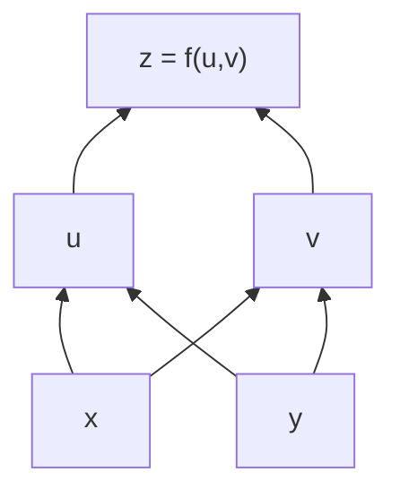
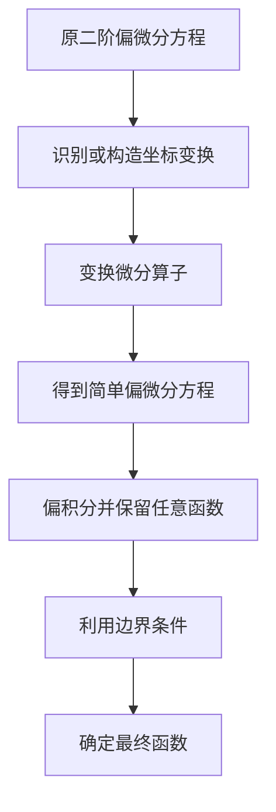
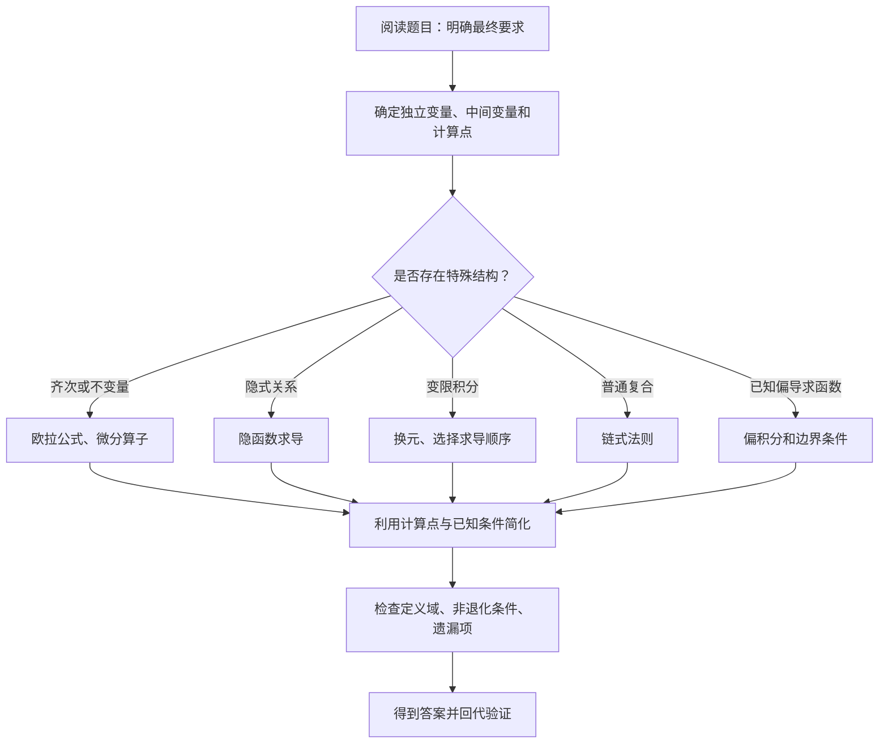

本节是多元函数微分学中计算方法最集中、综合性最强的部分之一。它既可以独立命制选择题、填空题和计算题，也可以与隐函数、微分方程、极限、定积分、二重积分以及多元函数极值相结合，形成综合大题。

与一元函数求导相比，本节真正的难点并不是求导公式本身，而是：

**识别变量之间的依赖关系、确定求导点、选择合适的求导顺序、发现能够消项的结构，以及从偏导数反过来恢复原函数。**

## 二、本节考点总览

| 核心题型        | 必须掌握的方法        | 复习优先级 |
| ----------- | -------------- | ----- |
| 一阶复合函数求导    | 变量依赖关系、链式法则    | ★★★★★ |
| 已知复合关系反求偏导数 | 基点映射、建立方程组     | ★★★★★ |
| 二阶复合函数求导    | 乘积法则、二阶链式法则    | ★★★★★ |
| 隐函数一阶求导     | 全微分、隐函数求导公式    | ★★★★★ |
| 隐函数二阶求导     | 对一阶关系再次求导      | ★★★★★ |
| 含积分的偏导计算    | 变限积分求导、换元      | ★★★★★ |
| 齐次函数与欧拉公式   | 尺度变换、算子消项      | ★★★★★ |
| 偏微分方程的坐标变换  | 微分算子、雅可比       | ★★★★★ |
| 径向函数        | 拉普拉斯算子、降为常微分方程 | ★★★★☆ |
| 已知偏导反求函数    | 偏积分、待定函数       | ★★★★☆ |
| 高阶偏导数       | 部分分式、一般项       | ★★★☆☆ |
| 跨章节综合题      | 结构识别、逆向推理      | ★★★★★ |

这里的星级是根据本节题型的基础性、综合性和迁移价值给出的学习优先级，并非历年真题频率的统计结果。

整节课可以归结为三条主线：

- **正向求导：** 已知函数关系，求一阶、二阶、高阶偏导数。
- **逆向求导：** 已知复合函数、全微分或者偏微分方程，反求偏导数及原函数。
- **结构化求导：** 利用齐次性、变量代换和微分算子，避免不必要的复杂计算。

## 第一部分：基础原理与一阶复合函数求导

### 三、偏导数计算的底层逻辑

**3.1 偏导数究竟在求什么？**

设二元函数

$$
z=f(x,y).
$$

对 $x$ 求偏导，表示保持 $y$ 不变，只研究 $x$ 的变化对 $z$ 的影响：

$$
f_x(x,y)=\lim_{h\to0} \frac{f(x+h,y)-f(x,y)}h.
$$

类似地，

$$
f_y(x,y)=\lim_{h\to0} \frac{f(x,y+h)-f(x,y)}h.
$$

例如，

$$
z=x^2y+e^{xy}+\sin y.
$$

分别求偏导：

$$
z_x=2xy+ye^{xy},
$$

$$
z_y=x^2+xe^{xy}+\cos y.
$$

直接给出具体函数的题目通常并不困难。考研真正关注的是：如果 $x,y,z,u,v$ 之间还存在其他函数关系，应该怎样求导？

**3.2 独立变量与中间变量**

考虑两种情形。

第一种：

$$
z=f(x,y).
$$

这里 $x,y$ 是独立变量，因此

$$
\frac{\partial y}{\partial x}=0.
$$

第二种：

$$
z=f(x,y),\qquad y=y(x).
$$

此时 $y$ 不再独立，而是 $x$ 的函数，因此

$$
\frac{\mathrm dz}{\mathrm dx} =f_x+f_y y'.
$$

两者的区别在于变量的依赖关系，而不在于函数表达式本身。

| 函数关系                        | 求导方式                |
| --------------------------- | ------------------- |
| $z=f(x,y)$，$x,y$ 独立 | $z_x=f_x$       |
| $z=f(x,y(x))$           | $z'=f_x+f_y y'$ |
| $z=f(u(x,y),v(x,y))$    | 多元复合函数链式法则          |
| $F(x,y,z)=0$            | 隐函数求导               |

**做任何一道偏导数题之前，先确定谁是独立变量、谁是中间变量、谁是最终因变量。**

### 四、一阶复合函数链式法则

**4.1 基本模型**

设

$$
z=f(u,v),
$$

其中

$$
u=u(x,y),\qquad v=v(x,y).
$$

变量之间的关系如下：

因此：

$$
\boxed{z_x=f_u u_x+f_v v_x}
$$

$$
\boxed{z_y=f_u u_y+f_v v_y}
$$

直观理解：$x$ 的变化可以通过 $u$ 和 $v$ 两条途径影响最终的 $z$，所以两条路径产生的变化需要相加。

可以记作：**沿路径相乘，不同路径相加。**

如果有三个中间变量，

$$
z=f(u,v,w),
$$

则

$$
z_x=f_u u_x+f_v v_x+f_w w_x.
$$

这一规则可以推广到任意多层、任意多个变量的复合函数。

**4.2 全微分形式**

如果外层函数和中间变量满足相应可微条件，那么

$$
\mathrm dz=f_u\,\mathrm du+f_v\,\mathrm dv.
$$

又因为

$$
\mathrm du=u_x\,\mathrm dx+u_y\,\mathrm dy,
$$

$$
\mathrm dv=v_x\,\mathrm dx+v_y\,\mathrm dy,
$$

所以

$$
\begin{aligned} \mathrm dz ={}&(f_u u_x+f_v v_x)\,\mathrm dx\\ &+(f_u u_y+f_v v_y)\,\mathrm dy. \end{aligned}
$$

这就是链式法则的全微分版本。

**一阶全微分具有形式不变性。** 无论 $u,v$ 是独立变量还是其他变量的可微函数，都可以写成

$$
\mathrm dz=f_u\,\mathrm du+f_v\,\mathrm dv.
$$

但二阶全微分不具有这样的一般形式不变性，这一点后面会重点讲解。

### 五、题型一：多层嵌套复合函数求导

**母题1：2001年考研数学一真题**

已知 $f(x,y)$ 在 $(1,1)$ 处可微，且

$$
f(1,1)=1,
$$

$$
f_x(1,1)=2,\qquad f_y(1,1)=3.
$$

设

$$
\varphi(x)=f(x,f(x,x)).
$$

求

$$
\left.\frac{\mathrm d}{\mathrm dx} \varphi^3(x)\right|_{x=1}.
$$

**解题思路**

这道题有三层复合关系：

$$
h(x)=f(x,x),
$$

$$
\varphi(x)=f(x,h(x)),
$$

$$
G(x)=\varphi^3(x).
$$

应当由内向外依次计算函数值和导数值。

**第一步：处理最内层。**

$$
h(1)=f(1,1)=1.
$$

由链式法则，

$$
h'(1)=f_x(1,1)+f_y(1,1)=5.
$$

**第二步：处理中间层。**

$$
\varphi(1)=f(1,h(1))=1.
$$

$$
\varphi'(x)=f_1(x,h(x)) +f_2(x,h(x))h'(x)
$$

在所求点应用链式法则：

$$
\varphi'(1)=2+3\times5=17.
$$

**第三步：处理最外层。**

$$
G'(1)=3\varphi^2(1)\varphi'(1).
$$

因此

$$
\boxed{G'(1)=51}.
$$

**母题提炼**

遇到多层嵌套函数时，不要试图一步写出最终导数，而应当建立两个同步计算的序列：

| 层次            | 函数值 | 导数值 |
| ------------- | --- | --- |
| $h$       | 1   | 5   |
| $\varphi$ | 1   | 17  |
| $G$       | 1   | 51  |

计算函数值的目的，是为了确定外层偏导数应该在哪个点取值。

计算导数值的目的，是为了传递内层变量的变化率。

**原创迁移变式**

仍使用上述 $f$ 的条件，设

$$
h_0(x)=x,\qquad h_{n+1}(x)=f(x,h_n(x)).
$$

求 $h_n'(1)$。

因为

$$
h_n(1)=1,
$$

令

$$
a_n=h_n'(1),
$$

根据链式法则：

$$
a_{n+1}=2+3a_n,\qquad a_0=1.
$$

于是

$$
a_{n+1}+1=3(a_n+1).
$$

得到

$$
\boxed{h_n'(1)=2\cdot3^n-1}.
$$

这就是复合函数求导与第五模块差分方程的结合。

### 六、题型二：由复合函数关系反求偏导数

这类题近年来的真题和模拟题都值得重点练习。

**6.1 核心思想：把偏导数当作未知数**

假设已知

$$
f(u(t),v(t))=g(t).
$$

根据链式法则：

$$
u'(t)f_u+v'(t)f_v=g'(t).
$$

如果要求 $f$ 在某点的两个偏导数，那么一般需要两条独立的导数信息。

设两条曲线都经过点 $P$，其切向量分别为

$$
(a_1,b_1),\qquad(a_2,b_2).
$$

由链式法则可建立：

$$
\begin{cases} a_1f_x(P)+b_1f_y(P)=c_1,\\ a_2f_x(P)+b_2f_y(P)=c_2. \end{cases}
$$

若

$$
\begin{vmatrix} a_1&b_1\\ a_2&b_2 \end{vmatrix}\ne0,
$$

就能唯一确定两个偏导数。

直观上，相当于知道同一位置沿两个不平行方向的变化率，据此恢复完整的梯度。

**母题2：2021年考研数学一、二、三公共真题**

已知 $f(x,y)$ 可微，且

$$
f(x+1,e^x)=x(x+1)^2,
$$

$$
f(x,x^2)=2x^2\ln x.
$$

求

$$
\mathrm df(1,1).
$$

**第一步：确定参数与目标点的对应关系。**

第一条曲线满足

$$
(x+1,e^x)=(1,1)
$$

时，参数为 $x=0$。

第二条曲线满足

$$
(x,x^2)=(1,1)
$$

时，参数为 $x=1$。

这是整道题最重要的识别环节。

**第二步：对第一条关系求导。**

$$
f_1+e^xf_2=(x+1)^2+2x(x+1).
$$

代入 $x=0$：

$$
f_x(1,1)+f_y(1,1)=1.
$$

**第三步：对第二条关系求导。**

$$
f_1+2xf_2=4x\ln x+2x.
$$

代入 $x=1$：

$$
f_x(1,1)+2f_y(1,1)=2.
$$

**第四步：联立求解。**

$$
\begin{cases} f_x+f_y=1,\\ f_x+2f_y=2. \end{cases}
$$

得到

$$
f_x(1,1)=0,\qquad f_y(1,1)=1.
$$

故

$$
\boxed{\mathrm df(1,1)=\mathrm dy}.
$$

**6.2 最容易出现的错误**

第一条等式和第二条等式虽然使用相同字母 $x$，但是它们的参数没有必须相同的要求。

**能够联立的是同一个空间点处的偏导数，而不是相同参数处的偏导数。**

**母题3：汤家凤2027八套卷，第5套第3题**

这是上一道真题向二元复合关系的推广。

已知

$$
f(x^3+y,xe^y)=e^{-y}\sin(\pi x).
$$

求 $z=f(x,y)$ 在 $(0,-e)$ 处的全微分。

令

$$
u=x^3+y,\qquad v=xe^y.
$$

**第一步：反求参数点。**

$$
\begin{cases} x^3+y=0,\\ xe^y=-e. \end{cases}
$$

得到

$$
x=-1,\qquad y=1.
$$

这里的 $(-1,1)$ 是原复合关系的参数点，而 $(0,-e)$ 是外层函数的计算点。

**第二步：分别对** $x,y$ **求偏导。**

$$
3x^2f_u+e^yf_v =\pi e^{-y}\cos(\pi x),
$$

$$
f_u+xe^yf_v=-e^{-y}\sin(\pi x).
$$

代入 $(-1,1)$：

$$
\begin{cases} 3f_u+ef_v=-\dfrac{\pi}{e},\\[4pt] f_u-ef_v=0. \end{cases}
$$

得到

$$
f_u=-\frac{\pi}{4e}, \qquad f_v=-\frac{\pi}{4e^2}.
$$

所以

$$
\boxed{ \mathrm dz=-\frac{\pi}{4e}\,\mathrm dx -\frac{\pi}{4e^2}\,\mathrm dy }.
$$

这里不仅要掌握链式法则，还要掌握从目标点反求参数点。

**6.3 一般公式：雅可比矩阵法**

已知

$$
f(u(x,y),v(x,y))=G(x,y),
$$

则

$$
\begin{pmatrix} u_x&v_x\\ u_y&v_y \end{pmatrix} \begin{pmatrix} f_u\\ f_v \end{pmatrix} = \begin{pmatrix} G_x\\ G_y \end{pmatrix}.
$$

只要雅可比行列式

$$
J=u_xv_y-u_yv_x\ne0,
$$

就可以通过线性方程组反求 $f_u,f_v$。

对于考研计算题，不需要刻意使用矩阵求逆，直接列两个方程通常更快。但理解这个结构，有助于识别题目是否提供了足够的信息。

## 第二部分：二阶复合函数与高阶偏导数

### 七、二阶链式法则

这是本节最容易因遗漏项而失分的基础公式。

**7.1 一元路径上的二阶复合求导**

设

$$
z=f(u(t),v(t)).
$$

一阶导数为

$$
z'=f_u u'+f_v v'.
$$

继续求导：

$$
\begin{aligned} z''={}&(f_{uu}u'+f_{uv}v')u'+f_u u''\\ &+(f_{vu}u'+f_{vv}v')v'+f_v v''. \end{aligned}
$$

若 $f$ 具有二阶连续偏导数，则

$$
f_{uv}=f_{vu}.
$$

因此

$$
\boxed{ \begin{aligned} z''={}&f_{uu}(u')^2+2f_{uv}u'v'\\ &+f_{vv}(v')^2+f_u u''+f_v v''. \end{aligned} }
$$

必须记住二阶复合求导包含两类项：

| 类型    | 表达式                                            | 来源       |
| ----- | ---------------------------------------------- | -------- |
| 外层二阶项 | $f_{uu}(u')^2+2f_{uv}u'v'+f_{vv}(v')^2$ | 外层函数再次求导 |
| 内层二阶项 | $f_u u''+f_v v''$                          | 内层函数再次求导 |

特别容易漏掉最后两项。

**7.2 矩阵形式及直观理解**

记

$$
\boldsymbol q= \begin{pmatrix}u\\v\end{pmatrix}, \qquad H_f= \begin{pmatrix} f_{uu}&f_{uv}\\ f_{vu}&f_{vv} \end{pmatrix}.
$$

则

$$
\boxed{ z''=\boldsymbol q'^{\,T}H_f\boldsymbol q' +\nabla f\cdot\boldsymbol q'' }.
$$

第一项来自外层函数自身的二阶变化，第二项来自内部路径变化方向的改变。

尤其当

$$
u'(t_0)=v'(t_0)=0
$$

时，有非常重要的简化：

$$
\boxed{ z''(t_0)=f_u u''(t_0)+f_v v''(t_0) }.
$$

即使不知道外层函数的二阶偏导数，也可能求出复合函数的二阶导数。

### 八、题型三：指定点处的二阶复合求导

**母题4：2024年考研数学一真题**

已知 $f(u,v)$ 具有二阶连续偏导数，且

$$
\left.\mathrm df\right|_{(1,1)} =3\,\mathrm du+4\,\mathrm dv.
$$

设

$$
y=f(\cos x,1+x^2).
$$

求 $y''(0)$。

<Tabs items={["解法一：二阶链式法则", "解法二：利用泰勒展开理解"]} defaultIndex={0}>

<Tab value="解法一：二阶链式法则">

令

$$
u=\cos x,\qquad v=1+x^2.
$$

先将所求点处的相关数据全部列出：

| 中间变量    | 函数值 | 一阶导数 | 二阶导数     |
| ------- | --- | ---- | -------- |
| $u$ | 1   | 0    | $-1$ |
| $v$ | 1   | 0    | 2        |

由于

$$
u'(0)=v'(0)=0,
$$

全部含外层二阶偏导数的项自动消失。

又由全微分得到

$$
f_u(1,1)=3,\qquad f_v(1,1)=4.
$$

于是

$$
y''(0)=3\times(-1)+4\times2.
$$

故

$$
\boxed{y''(0)=5}.
$$

</Tab>

<Tab value="解法二：利用泰勒展开理解">

因为 $x\to0$ 时，

$$
\cos x=1-\frac{x^2}{2}+o(x^2),
$$

所以利用 $f$ 在 $(1,1)$ 的可微性：

$$
\begin{aligned} y &=f(1,1)+3(\cos x-1)+4x^2+o(x^2)\\ &=f(1,1)+\frac52x^2+o(x^2). \end{aligned}
$$

结合题目给出的二阶光滑性，

$$
y''(0)=2!\cdot\frac52=5.
$$

</Tab>

</Tabs>

**深层理解**

题目虽然要求二阶导数，却只提供外层函数的一阶信息。这通常意味着：

- 内层函数的一阶导数在计算点为零；
- 外层二阶项将自动消失；
- 应当充分利用计算点，而不是盲目展开全部项。

**母题5：2017年考研数学一、二真题**

设

$$
y=f(e^x,\cos x),
$$

求 $y'(0)$ 和 $y''(0)$。

令

$$
u=e^x,\qquad v=\cos x.
$$

在 $x=0$ 时，

$$
u=v=1,
$$

$$
u'=1,\quad v'=0,\quad u''=1,\quad v''=-1.
$$

代入一阶链式法则：

$$
\boxed{y'(0)=f_u(1,1)}.
$$

代入二阶链式法则：

$$
\boxed{ y''(0)=f_{uu}(1,1)+f_u(1,1)-f_v(1,1) }.
$$

比较这道题与2024年真题：

| 真题    | 内层一阶导数          | 保留的外层二阶项      |
| ----- | --------------- | ------------- |
| 2017年 | $u'=1,v'=0$ | $f_{uu}$ |
| 2024年 | $u'=0,v'=0$ | 全部消失          |

它们本质上考查的是同一条二阶链式法则。

### 九、二元复合函数的二阶偏导数

设

$$
z=f(u(x,y),v(x,y)).
$$

假设相关函数具有二阶连续偏导数。

则

$$
\boxed{ \begin{aligned} z_{xx}={}&f_{uu}u_x^2+2f_{uv}u_xv_x\\ &+f_{vv}v_x^2+f_u u_{xx}+f_v v_{xx}, \end{aligned} }
$$

$$
\boxed{ \begin{aligned} z_{yy}={}&f_{uu}u_y^2+2f_{uv}u_yv_y\\ &+f_{vv}v_y^2+f_u u_{yy}+f_v v_{yy}, \end{aligned} }
$$

混合偏导数为

$$
\boxed{ \begin{aligned} z_{xy}={}&f_{uu}u_xu_y\\ &+f_{uv}(u_xv_y+u_yv_x)\\ &+f_{vv}v_xv_y\\ &+f_u u_{xy}+f_v v_{xy}. \end{aligned} }
$$

这三个公式形式上比较复杂，但底层都是链式法则和乘积求导法则。

**9.1 计算时如何避免遗漏？**

先写

$$
z_x=f_u u_x+f_v v_x,
$$

然后将两项分别求导：

$$
(z_x)_y=(f_u)_y u_x+f_u u_{xy} +(f_v)_y v_x+f_v v_{xy}.
$$

最后再展开 $f_u,f_v$ 的复合求导。

不熟练时，建议按这个步骤推导，而不是直接默写最终公式。

### 十、题型四：混合偏导与极值条件结合

**母题6：2011年考研数学一、二真题**

设

$$
z=f(xy,yg(x)),
$$

其中 $f$ 具有二阶连续偏导数，$g$ 可导，且在 $x=1$ 处取得极值 $g(1)=1$。

求 $z_{xy}(1,1)$。

**第一步：读取极值条件。**

根据费马定理：

$$
g'(1)=0,\qquad g(1)=1.
$$

注意，题目并没有给出 $g''$ 存在，更不能推断 $g''(1)=0$。

**第二步：设置中间变量。**

$$
u=xy,\qquad v=yg(x).
$$

在 $(1,1)$ 处，计算所需的全部数据：

| 导数            | $u$ | $v$ |
| ------------- | ------- | ------- |
| 函数值           | 1       | 1       |
| 对 $x$ 的偏导 | 1       | 0       |
| 对 $y$ 的偏导 | 1       | 1       |
| 混合偏导          | 1       | 0       |

**第三步：代入混合偏导公式。**

$$
\begin{aligned} z_{xy}(1,1) ={}&f_{uu}\cdot1\cdot1\\ &+f_{uv}(1\cdot1+1\cdot0)\\ &+f_{vv}\cdot0\cdot1\\ &+f_u\cdot1+f_v\cdot0. \end{aligned}
$$

所以

$$
\boxed{ z_{xy}(1,1)=f_{uu}(1,1) +f_{uv}(1,1)+f_u(1,1) }.
$$

**题型总结**

看到极值条件时，首先想到一阶导数为零；看到指定点时，首先想到哪些项会消失。

对于这种混合偏导计算题，建立中间变量的导数表，比反复展开冗长表达式更稳妥。

### 十一、题型五：高阶偏导数与一般项

**代表题：李林880**

设

$$
z=\frac{2x}{x^2-y^2}.
$$

求

$$
\left.\frac{\partial^n z}{\partial y^n} \right|_{(2,1)}.
$$

**解题思路**

高阶纯偏导本质上就是固定其余变量后的一元高阶导数。

首先拆分：

$$
\frac{2x}{x^2-y^2} =\frac1{x-y}+\frac1{x+y}.
$$

根据一元高阶导数公式：

$$
\frac{\partial^n}{\partial y^n} \frac1{x-y} =\frac{n!}{(x-y)^{n+1}},
$$

$$
\frac{\partial^n}{\partial y^n} \frac1{x+y} =\frac{(-1)^nn!}{(x+y)^{n+1}}.
$$

于是

$$
\boxed{ \left.\frac{\partial^n z}{\partial y^n} \right|_{(2,1)} =n!\left(1+\frac{(-1)^n}{3^{n+1}}\right) }.
$$

这类题的关键技巧与一元高阶导数完全相通：部分分式拆分、寻找周期规律、利用莱布尼茨公式以及观察一般项。

## 第三部分：隐函数的一阶与二阶偏导数

### 十二、隐函数求导的核心原理

**12.1 什么是隐函数？**

显函数直接给出因变量：

$$
z=x^2+y^2.
$$

隐函数则通过方程建立变量关系：

$$
F(x,y,z)=0.
$$

例如

$$
e^z+xyz+x+\cos x=2.
$$

即使不能显式解出 $z$，仍然可以求 $z_x,z_y$。

**12.2 隐函数存在的常用条件**

假设 $F(x,y,z)$ 在点 $P=(x_0,y_0,z_0)$ 的邻域内具有连续一阶偏导数，且

$$
F(x_0,y_0,z_0)=0,
$$

$$
F_z(x_0,y_0,z_0)\ne0.
$$

则方程在该点附近可以唯一确定一个连续可微函数

$$
z=z(x,y).
$$

这里的 $F_z\ne0$ 是标准隐函数定理的重要充分条件。

注意：$F_z=0$ 并不必然意味着隐函数不存在，只是不能直接使用上述定理及相应的除法公式。

**12.3 一阶隐函数求导公式**

因为

$$
F(x,y,z(x,y))\equiv0,
$$

对 $x$ 求偏导：

$$
F_x+F_z z_x=0.
$$

对 $y$ 求偏导：

$$
F_y+F_z z_y=0.
$$

因此

$$
\boxed{ z_x=-\frac{F_x}{F_z}, \qquad z_y=-\frac{F_y}{F_z} }.
$$

全微分公式为

$$
\boxed{ \mathrm dz=-\frac{F_x\,\mathrm dx+ F_y\,\mathrm dy}{F_z} }.
$$

必须区分两种不同的求导：

| 求导对象                | 对 $x$ 求导时                     |
| ------------------- | --------------------------------- |
| $F(x,y,z)$      | 将 $y,z$ 视为独立变量并固定             |
| $F(x,y,z(x,y))$ | 固定 $y$，但 $z$ 随 $x$ 改变 |

这是隐函数计算中最根本的区别。

### 十三、题型六：隐函数在指定点处的全微分

**母题7：2015年考研数学一、三真题**

设 $z=z(x,y)$ 由方程

$$
e^z+xyz+x+\cos x=2
$$

确定，求

$$
\left.\mathrm dz\right|_{(0,1)}.
$$

**第一步：确定完整的三维计算点。**

令 $x=0,y=1$，原方程变成

$$
e^z+1=2.
$$

因此

$$
z=0.
$$

完整的计算点是

$$
P=(0,1,0).
$$

**第二步：构造辅助函数。**

$$
F=e^z+xyz+x+\cos x-2.
$$

把三个变量看作独立变量：

$$
F_x=yz+1-\sin x,
$$

$$
F_y=xz,
$$

$$
F_z=e^z+xy.
$$

在 $P$ 处：

$$
F_x=1,\quad F_y=0,\quad F_z=1.
$$

**第三步：代入公式。**

$$
z_x=-1,\qquad z_y=0.
$$

故

$$
\boxed{\mathrm dz=-\mathrm dx}.
$$

**标准解题模板**

隐函数在指定点处求值，一律按照以下顺序：

$$
\text{求 }z_0 \longrightarrow \text{写 }F \longrightarrow \text{求独立偏导} \longrightarrow \text{检查 }F_z \longrightarrow \text{代入公式}.
$$

**补充真题：1991年数学一**

由

$$
xyz+\sqrt{x^2+y^2+z^2}=\sqrt2
$$

确定的隐函数，在 $(1,0,-1)$ 处有

$$
F_x=\frac1{\sqrt2},\qquad F_y=-1,\qquad F_z=-\frac1{\sqrt2}.
$$

于是

$$
\boxed{\mathrm dz=\mathrm dx-\sqrt2\,\mathrm dy}.
$$

这道题主要训练根式求导与隐函数公式的熟练运用。

### 十四、二阶隐函数求导公式

**14.1 纯二阶偏导**

已经知道

$$
F_x+F_z z_x=0.
$$

再次对 $x$ 求导。

其中

$$
\frac{\mathrm d}{\mathrm dx}F_x =F_{xx}+F_{xz}z_x
$$

是在固定 $y$、沿隐函数关系求导的意义下书写。

而

$$
\frac{\mathrm d}{\mathrm dx}(F_z z_x) =(F_{zx}+F_{zz}z_x)z_x+F_z z_{xx}.
$$

假设 $F$ 二阶连续可微，则得到

$$
F_{xx}+2F_{xz}z_x+F_{zz}z_x^2 +F_z z_{xx}=0.
$$

因此

$$
\boxed{ z_{xx}=-\frac{ F_{xx}+2F_{xz}z_x+F_{zz}z_x^2 }{F_z} }.
$$

同理：

$$
\boxed{ z_{yy}=-\frac{ F_{yy}+2F_{yz}z_y+F_{zz}z_y^2 }{F_z} }.
$$

**14.2 混合二阶偏导**

对

$$
F_x+F_z z_x=0
$$

关于 $y$ 求偏导：

$$
\begin{aligned} 0={}&F_{xy}+F_{xz}z_y\\ &+F_{zy}z_x+F_{zz}z_xz_y\\ &+F_z z_{xy}. \end{aligned}
$$

故

$$
\boxed{ z_{xy}=-\frac{ F_{xy}+F_{xz}z_y+F_{yz}z_x+ F_{zz}z_xz_y }{F_z} }.
$$

这些公式应当做到能够独立推导，而不是完全依赖记忆。

特别是混合偏导公式，最容易把 $F_{xz}z_y$ 错写成 $F_{xz}z_x$。

### 十五、题型七：二阶隐函数求导

**母题8：2023年考研数学二真题**

该题的全部方法适用于数学一。

已知

$$
e^z+xz=2x-y,
$$

求 $z_{xx}(1,1)$。

**第一步：求计算点。**

当 $x=y=1$ 时，

$$
e^z+z=1.
$$

由于左端严格递增，唯一解为 $z=0$。

**第二步：求一阶偏导数。**

令

$$
F=e^z+xz-2x+y.
$$

则

$$
F_x=z-2,\qquad F_z=e^z+x.
$$

所以

$$
z_x=\frac{2-z}{e^z+x}.
$$

在 $(1,1,0)$ 处：

$$
z_x=1.
$$

**第三步：计算所需的二阶偏导数。**

$$
F_{xx}=0,\quad F_{xz}=1,\quad F_{zz}=e^z.
$$

因此

$$
z_{xx} =-\frac{0+2\times1\times1+1\times1^2}{2}.
$$

最终

$$
\boxed{z_{xx}(1,1)=-\frac32}.
$$

**为什么不直接对商式求导？**

直接对

$$
z_x=\frac{2-z}{e^z+x}
$$

再次求导也完全正确。

但复杂的隐函数题目中，商式求导往往会产生非常庞大的分子和分母。直接对原一阶隐式等式再次求导，更便于在指定点代入简化。

**母题9：张宇1000题，积分隐函数混合偏导**

设

$$
2z-e^z+1+\int_y^{x^2}\sin(t^2)\,\mathrm dt=0
$$

在 $(1,1,0)$ 附近确定隐函数 $z=z(x,y)$。

求 $z_{xy}(1,1)$。

令

$$
F(x,y,z) =2z-e^z+1+\int_y^{x^2}\sin(t^2)\,\mathrm dt.
$$

一阶偏导数：

$$
F_x=2x\sin(x^4),
$$

$$
F_y=-\sin(y^2),
$$

$$
F_z=2-e^z.
$$

在计算点：

$$
z_x=-2\sin1,\qquad z_y=\sin1.
$$

观察原方程的结构：

$$
F=A(x)+B(y)+C(z).
$$

因此

$$
F_{xy}=F_{xz}=F_{yz}=0.
$$

并且

$$
F_{zz}=-e^z=-1.
$$

所以混合偏导公式大幅简化：

$$
z_{xy}=-\frac{F_{zz}z_xz_y}{F_z}.
$$

最终得到

$$
\boxed{z_{xy}(1,1)=-2\sin^21}.
$$

**15.1 重要推广：可分离隐函数**

若隐式方程可以整理成

$$
H(z)=A(x)+B(y),
$$

并且 $H'(z)\ne0$，那么

$$
z_x=\frac{A'(x)}{H'(z)}, \qquad z_y=\frac{B'(y)}{H'(z)}.
$$

进一步：

$$
\boxed{ z_{xy} =-\frac{H''(z)A'(x)B'(y)} {[H'(z)]^3} }.
$$

注意，即使右端关于 $x,y$ 的混合偏导数为零，$z_{xy}$ 也不一定为零，因为外层反函数可能是非线性的。

### 十六、题型八：隐函数与外层复合函数相结合

**代表题：李正元练习题**

设

$$
z=f(x,y,u),
$$

其中 $u=u(x,y)$ 由方程

$$
u^5-5xy+5u=1
$$

确定。求 $z_x,z_{xx}$。

这道题相当于把隐函数求导和二阶复合函数求导串联起来。

**第一步：先求内层隐函数导数。**

对 $x$ 求偏导：

$$
5u^4u_x-5y+5u_x=0.
$$

得到

$$
u_x=\frac{y}{1+u^4}.
$$

再求一次偏导：

$$
u_{xx} =-\frac{4yu^3u_x}{(1+u^4)^2} =-\frac{4y^2u^3}{(1+u^4)^3}.
$$

**第二步：处理外层函数。**

$$
z_x=f_x+f_u u_x.
$$

即

$$
\boxed{ z_x=f_x+\frac{y}{1+u^4}f_u }.
$$

继续求导：

$$
z_{xx} =f_{xx}+2f_{xu}u_x +f_{uu}u_x^2+f_u u_{xx}.
$$

代入可得

$$
\boxed{ \begin{aligned} z_{xx}={}&f_{xx} +\frac{2y}{1+u^4}f_{xu}\\ &+\frac{y^2}{(1+u^4)^2}f_{uu}\\ &-\frac{4y^2u^3}{(1+u^4)^3}f_u. \end{aligned} }
$$

所有外层偏导均在 $(x,y,u(x,y))$ 处取值。

**本题的迁移价值**

无论内层函数是通过代数方程、积分方程还是微分方程确定，只要能够计算它的相关导数，外层函数的求导方法就不会改变。

复杂综合题应该按功能拆解，而不是把整个函数关系一次性展开。

## 第四部分：含变限积分的偏导数计算

### 十七、莱布尼茨积分求导公式

设

$$
I(x,y)=\int_{a(x,y)}^{b(x,y)} G(x,y,t)\,\mathrm dt.
$$

在积分上下限可微、被积函数及所需参数偏导满足相应连续性条件时，

$$
\boxed{ \begin{aligned} I_x={}&G(x,y,b)b_x\\ &-G(x,y,a)a_x\\ &+\int_a^bG_x(x,y,t)\,\mathrm dt. \end{aligned} }
$$

公式包含三个部分：上限变化、下限变化、被积函数自身变化。

类似地：

$$
\begin{aligned} I_y={}&G(x,y,b)b_y\\ &-G(x,y,a)a_y\\ &+\int_a^bG_y(x,y,t)\,\mathrm dt. \end{aligned}
$$

考研题中，经常可以通过选择求导顺序或者换元，避免直接使用完整公式。

### 十八、题型九：通过求导顺序简化计算

**母题10：2020年考研数学一真题**

设

$$
f(x,y)=\int_0^{xy}e^{xt^2}\,\mathrm dt.
$$

求

$$
f_{xy}(1,1).
$$

如果先对 $x$ 求导，需要处理积分上限与被积函数两部分。

但被积函数中不含 $y$，所以优先对 $y$ 求偏导：

$$
f_y=e^{x(xy)^2}\cdot x =xe^{x^3y^2}.
$$

再对 $x$ 求导：

$$
(f_y)_x=e^{x^3y^2} +3x^3y^2e^{x^3y^2}.
$$

因此

$$
\boxed{f_{xy}(1,1)=4e}.
$$

这里被积函数光滑，混合偏导可以交换。

**解题原则**

**混合偏导的两个求导方向，如果一个方向可以消除积分，就优先选择这个方向。**

这比直接套公式更重要。

### 十九、题型十：通过换元简化积分结构

**代表题：李林880**

设 $g$ 连续，且 $g(2)=1$。

$$
f(x,y)= \int_0^{\sqrt{x^2+y^2}} t\,g(x^2+y^2-t^2)\,\mathrm dt.
$$

求 $\mathrm df(1,1)$。

**识别信号**

题目只给出了 $g$ 连续，并没有假设 $g$ 可导。

如果直接对被积函数求偏导，就需要用到 $g'$，而题目并未提供这一条件。

因此应当寻找积分换元。

令

$$
R=x^2+y^2,\qquad s=R-t^2.
$$

则

$$
\mathrm ds=-2t\,\mathrm dt.
$$

原积分化为

$$
f(x,y)=\frac12\int_0^{x^2+y^2}g(s)\,\mathrm ds.
$$

现在只需使用微积分基本定理：

$$
\mathrm df =\frac12g(x^2+y^2)\mathrm d(x^2+y^2).
$$

即

$$
\mathrm df =g(x^2+y^2)(x\,\mathrm dx+y\,\mathrm dy).
$$

代入 $(1,1)$：

$$
\boxed{\mathrm df=\mathrm dx+\mathrm dy}.
$$

**题型识别表**

| 积分结构                | 优先方法             |
| ------------------- | ---------------- |
| $g(t)$，上下限含参数   | 微积分基本定理          |
| $g(x,t)$，要求混合偏导 | 优先对被积函数中未出现的变量求导 |
| $g(R-t^2)t$     | 平方型换元            |
| $g(a+b-t)$      | 上下限反射换元          |
| $g(t-x)$        | 平移换元             |
| $(s-t)g(t)$     | 先拆积分或利用边界项为零     |

### 二十、题型十一：积分隐函数的全微分

**综合母题：汤家凤2027八套卷，第1套第13题**

已知

$$
\int_{1+x}^{2y+z}e^{-(t-x)^2}\,\mathrm dt =xz+\sin(yz).
$$

求 $\mathrm dz(0,0)$。

**第一步：换元消除被积函数中的参数。**

令

$$
s=t-x.
$$

方程变成

$$
\int_1^{2y+z-x}e^{-s^2}\,\mathrm ds =xz+\sin(yz).
$$

**第二步：确定隐函数值。**

当 $x=y=0$ 时，

$$
\int_1^z e^{-s^2}\,\mathrm ds=0.
$$

由于被积函数恒正，因此

$$
z(0,0)=1.
$$

**第三步：构造隐函数。**

令 $w=2y+z-x$，

$$
F=\int_1^w e^{-s^2}\,\mathrm ds -xz-\sin(yz).
$$

求独立偏导：

$$
F_x=-e^{-w^2}-z,
$$

$$
F_y=2e^{-w^2}-z\cos(yz),
$$

$$
F_z=e^{-w^2}-x-y\cos(yz).
$$

代入 $(0,0,1)$：

$$
F_x=-e^{-1}-1,
$$

$$
F_y=2e^{-1}-1,
$$

$$
F_z=e^{-1}.
$$

**第四步：使用隐函数全微分公式。**

$$
\boxed{ \mathrm dz=(e+1)\,\mathrm dx+(e-2)\,\mathrm dy }.
$$

这道题完整串联了积分换元、变限积分求导、隐函数求导以及全微分，是本节非常值得掌握的综合母题。

## 第五部分：齐次函数、欧拉公式与微分算子

这是本节最具有技巧性的一部分。尤其是2022年、2025年、2026年真题所体现的结构化求导思想，值得深入学习。

### 二十一、齐次函数的基本概念

**21.1 什么是齐次函数？**

若对适当的 $t>0$，函数满足

$$
f(tx,ty)=t^k f(x,y),
$$

则称 $f(x,y)$ 为 $k$ 次齐次函数。

这里的 $k$ 不要求必须为正整数。

| 函数                     | 齐次次数     |
| ---------------------- | -------- |
| $x+y$              | 1        |
| $x^2+xy+y^2$       | 2        |
| $\sqrt{x^2+y^2}$   | 1        |
| $\dfrac xy$        | 0        |
| $\dfrac1{x^2+y^2}$ | $-2$ |
| $xyf(y/x)$         | 2        |
| $x^mf(y/x)$，在有定义处  | $m$  |

最重要的识别方法不是观察多项式次数，而是看变量同时放大以后，整个函数产生什么变化。

例如：

$$
z=xyf\left(\frac yx\right).
$$

当 $x,y$ 同时乘以 $t$ 时，

$$
z(tx,ty)=t^2xyf\left(\frac yx\right).
$$

所以 $z$ 是二次齐次函数，无论 $f$ 的具体表达式是什么。

### 二十二、欧拉齐次函数定理

若 $z(x,y)$ 可微，且为 $k$ 次齐次函数，则

$$
\boxed{xz_x+yz_y=kz}.
$$

**推导**

由

$$
z(tx,ty)=t^kz(x,y),
$$

对 $t$ 求导：

$$
xz_x(tx,ty)+yz_y(tx,ty) =kt^{k-1}z(x,y).
$$

令 $t=1$，得到

$$
xz_x+yz_y=kz.
$$

定义欧拉微分算子

$$
D=x\partial_x+y\partial_y.
$$

则欧拉公式可以简洁地写为

$$
\boxed{Dz=kz}.
$$

几何上，这个算子描述沿着从原点出发的径向尺度方向改变变量时，函数怎样变化。

在适当的尺度不变定义域上，逆命题也成立：满足 $Dz=kz$ 的可微函数具有相应的齐次性。

### 二十三、题型十二：隐函数中的齐次结构

**母题11：2010年考研数学一、二真题**

设 $z=z(x,y)$ 由

$$
F\left(\frac yx,\frac zx\right)=0
$$

确定，其中 $F$ 可微，且 $F_2'\ne0$。

求

$$
xz_x+yz_y.
$$

<Tabs items={["解法一：直接识别齐次性", "解法二：使用欧拉算子"]} defaultIndex={0}>

<Tab value="解法一：直接识别齐次性">

由于方程中的两个中间变量

$$
\frac yx,\qquad\frac zx
$$

在 $x,y,z$ 同时按相同比例缩放时保持不变。

在隐函数局部唯一确定的条件下，$z$ 关于 $x,y$ 局部具有一次齐次性质。

于是

$$
\boxed{xz_x+yz_y=z}.
$$

</Tab>

<Tab value="解法二：使用欧拉算子">

令

$$
u=\frac yx,\qquad v=\frac zx.
$$

由于

$$
Du=0,
$$

对原方程使用算子 $D$：

$$
F_uDu+F_vDv=0.
$$

由 $F_v\ne0$，得

$$
Dv=0.
$$

又因为

$$
D\left(\frac zx\right) =\frac{Dz-z}{x},
$$

所以

$$
Dz=z.
$$

这一方法尤其适合题目给出隐含比例关系，但无法直接解出函数表达式的情形。

</Tab>

</Tabs>

**配套模拟题**

李林2027六套卷，第5套第2题：

$$
\frac{x}{z}=f\left(\frac yz\right).
$$

同样是三个变量的比例关系。

在相应的可微隐函数条件下，$z$ 为一次齐次函数，因此

$$
\boxed{xz_x+yz_y=z}.
$$

它和2010年真题并不是两个独立题型，而是同一母题的不同表达。

### 二十四、题型十三：齐次函数反求与极值

**母题12：2022年考研数学一真题**

已知

$$
z=xyf\left(\frac yx\right),
$$

并满足

$$
xz_x+yz_y=y^2(\ln y-\ln x).
$$

判断 $f(1)$ 与 $f'(1)$ 的值。

**第一步：识别齐次次数。**

$z$ 为二次齐次函数，因此

$$
xz_x+yz_y=2z.
$$

于是

$$
2xyf\left(\frac yx\right) =y^2\ln\frac yx.
$$

**第二步：反求** $f$**。**

令

$$
u=\frac yx>0.
$$

得到

$$
2f(u)=u\ln u.
$$

故

$$
\boxed{f(u)=\frac12u\ln u}.
$$

**第三步：计算题目所需的信息。**

$$
f(1)=0,
$$

$$
f'(u)=\frac12(\ln u+1).
$$

所以

$$
\boxed{f'(1)=\frac12}.
$$

**高质量变式：李林2027六套卷，第6套第1题**

这道模拟题使用与上述真题相同的函数关系，改为求 $f(u)$ 的极小值。

前面的推导完全不需要改变：

$$
f(u)=\frac12u\ln u.
$$

令

$$
f'(u)=0,
$$

得到

$$
u=e^{-1}.
$$

因为

$$
f''(u)=\frac1{2u}>0,
$$

所以

$$
\boxed{f_{\min}=-\frac1{2e}}.
$$

这组真题与模拟题非常适合对照学习。命题人可以保持底层关系不变，只改变最终要求，就形成一道新的综合题。

### 二十五、加权齐次函数

普通齐次函数要求 $x,y$ 同时乘以 $t$。

但有些函数在不同变量按照不同指数缩放时，才保持特殊结构。

若

$$
f(t^ax,t^by)=t^kf(x,y),
$$

则在相应可微条件下：

$$
\boxed{axf_x+byf_y=kf}.
$$

**代表真题：2019年考研数学二**

设

$$
z=yf\left(\frac{y^2}{x}\right).
$$

求

$$
2xz_x+yz_y.
$$

观察中间变量：

$$
u=\frac{y^2}{x}.
$$

令

$$
x\mapsto t^2x,\qquad y\mapsto ty.
$$

则

$$
\frac{(ty)^2}{t^2x}=\frac{y^2}{x},
$$

所以

$$
z(t^2x,ty)=tz(x,y).
$$

因此根据加权欧拉公式，

$$
\boxed{2xz_x+yz_y=z}.
$$

更一般地，当题目出现

$$
axz_x+byz_y
$$

时，应优先检查是否为加权齐次结构。

### 二十六、题型十四：二阶欧拉算子

对于

$$
D=x\partial_x+y\partial_y,
$$

需要特别注意：

$$
D^2z=D(Dz).
$$

实际展开为

$$
\begin{aligned} D^2z={}&xz_x+yz_y\\ &+x^2z_{xx}+2xyz_{xy}+y^2z_{yy}. \end{aligned}
$$

因此

$$
\boxed{ x^2z_{xx}+2xyz_{xy}+y^2z_{yy} =D^2z-Dz }.
$$

若 $z$ 是 $k$ 次齐次函数，

$$
Dz=kz,\qquad D^2z=k^2z.
$$

所以

$$
\boxed{ x^2z_{xx}+2xyz_{xy}+y^2z_{yy} =k(k-1)z }.
$$

常见特例：

| 齐次次数       | 二阶组合的值   |
| ---------- | -------- |
| $k=0$  | 0        |
| $k=1$  | 0        |
| $k=2$  | $2z$ |
| $k=-1$ | $2z$ |

**代表题：张宇1000题**

设

$$
g(x,y)=xy-f\left(\frac yx,\frac xy\right).
$$

求

$$
x^2g_{xx}+2xyg_{xy}+y^2g_{yy}.
$$

令

$$
h(x,y)=f\left(\frac yx,\frac xy\right).
$$

显然，$xy$ 是二次齐次函数，$h$ 是零次齐次函数。

于是

$$
(D^2-D)(xy)=2xy,
$$

$$
(D^2-D)h=0.
$$

故

$$
\boxed{x^2g_{xx}+2xyg_{xy}+y^2g_{yy}=2xy}.
$$

原函数的不同部分可以分别具有不同的齐次次数，不必强行认定整个函数是齐次函数。

### 二十七、重点综合母题：2025年考研数学一真题

设

$$
g(x,y)=f\left(\frac xy\right),
$$

其中 $f(u)$ 在 $(0,+\infty)$ 内具有二阶导数。

已知

$$
x^2g_{xx}+xyg_{xy}+y^2g_{yy}=1,
$$

且

$$
g(x,x)=1, \qquad \left.g_x\right|_{(x,x)}=\frac2x.
$$

求 $f(u)$。

这道题同时考查二阶复合求导、齐次函数、欧拉型微分方程和初始条件，是本节最值得深入掌握的真题之一。

<Tabs items={["解法一：标准逐项计算", "解法二：利用零次齐次性质"]} defaultIndex={0}>

<Tab value="解法一：标准逐项计算">

令

$$
u=\frac xy.
$$

则

$$
u_x=\frac1y,\qquad u_y=-\frac uy.
$$

一阶偏导数为

$$
g_x=\frac{f'(u)}y,
$$

$$
g_y=-\frac{u}{y}f'(u).
$$

继续求导：

$$
g_{xx}=\frac{f''(u)}{y^2},
$$

$$
g_{xy}=-\frac{uf''(u)+f'(u)}{y^2},
$$

$$
g_{yy}= \frac{u^2f''(u)+2uf'(u)}{y^2}.
$$

代入题设，注意 $x=uy$：

$$
\begin{aligned} 1={}&u^2f''(u) -u[uf''(u)+f'(u)]\\ &+u^2f''(u)+2uf'(u). \end{aligned}
$$

化简：

$$
\boxed{u^2f''(u)+uf'(u)=1}.
$$

</Tab>

<Tab value="解法二：利用零次齐次性质">

因为

$$
g(x,y)=f(x/y)
$$

为零次齐次函数，因此

$$
Dg=0.
$$

由二阶欧拉公式：

$$
x^2g_{xx}+2xyg_{xy}+y^2g_{yy}=0.
$$

减去题给等式：

$$
xyg_{xy}=-1.
$$

所以只需要求一个混合偏导数：

$$
g_{xy}=-\frac{uf''+f'}{y^2}.
$$

得到

$$
-u(uf''+f')=-1.
$$

仍有

$$
u^2f''+uf'=1.
$$

这个方法显著减少了计算量。

</Tab>

</Tabs>

**求解常微分方程**

注意

$$
u^2f''+uf'=u(uf')'.
$$

于是

$$
(uf')'=\frac1u.
$$

积分得到

$$
uf'=\ln u+C_1.
$$

再次积分：

$$
f(u)=\frac12(\ln u)^2+C_1\ln u+C_2.
$$

利用边界条件。

当 $x=y\ne0$ 时，$u=1$，因此

$$
f(1)=1.
$$

故

$$
C_2=1.
$$

又因为

$$
g_x(x,x)=\frac{f'(1)}x=\frac2x,
$$

所以

$$
f'(1)=2.
$$

得到

$$
C_1=2.
$$

最终

$$
\boxed{ f(u)=\frac12(\ln u)^2+2\ln u+1 },\qquad u>0.
$$

<Callout type="warn" title="本题最重要的陷阱">

二阶欧拉公式中混合偏导项的系数是

$$
2xy,
$$

而题目给出的系数是

$$
xy.
$$

两者并不相同。

真正高效的方法不是看到相似形式就直接套公式，而是先利用标准欧拉公式，再比较两者的差别。

</Callout>

**与第五模块欧拉方程的联系**

令

$$
t=\ln u,\qquad F(t)=f(e^t).
$$

则

$$
F'(t)=uf'(u),
$$

$$
F''(t)=u^2f''(u)+uf'(u).
$$

于是原微分方程直接化为

$$
F''(t)=1.
$$

这个变换正是第五模块第6节欧拉微分方程的基本思想。

### 二十八、题型十五：利用微分算子消去未知函数

这类题比普通齐次函数更加普遍。

设

$$
L=A(x,y)\partial_x+B(x,y)\partial_y.
$$

根据链式法则，

$$
\boxed{L[f(u)]=f'(u)Lu}.
$$

因此，只要能够发现

$$
Lu=0,
$$

就可以立即得到

$$
L[f(u)]=0.
$$

不需要知道 $f$ 的具体形式。

**母题13：2019年考研数学一真题**

设

$$
z=f(\sin y-\sin x)+xy.
$$

求

$$
\frac{z_x}{\cos x}+\frac{z_y}{\cos y}.
$$

令

$$
L=\frac1{\cos x}\partial_x+ \frac1{\cos y}\partial_y,
$$

$$
u=\sin y-\sin x.
$$

则

$$
Lu= \frac{-\cos x}{\cos x} +\frac{\cos y}{\cos y}=0.
$$

所以

$$
L[f(u)]=0.
$$

只需要计算

$$
L(xy)=\frac y{\cos x}+\frac x{\cos y}.
$$

于是

$$
\boxed{ \frac{z_x}{\cos x}+\frac{z_y}{\cos y} =\frac y{\cos x}+\frac x{\cos y} }.
$$

适用范围为 $\cos x\cos y\ne0$。

**母题14：2026年考研数学一、二、三公共真题**

设

$$
x-az=e^{y+az},\qquad a\ne0.
$$

求 $z_x,z_y$ 之间的固定关系。

**常规解法**

令

$$
E=e^{y+az}.
$$

对 $x$ 求导：

$$
1-az_x=aEz_x.
$$

所以

$$
z_x=\frac1{a(1+E)}.
$$

对 $y$ 求导：

$$
-az_y=E(1+az_y).
$$

所以

$$
z_y=-\frac E{a(1+E)}.
$$

两式相减：

$$
\boxed{z_x-z_y=\frac1a}.
$$

**结构化解法**

令

$$
w=y+az.
$$

原方程变为

$$
w+e^w=x+y.
$$

由于 $w+e^w$ 严格递增，$w$ 仅依赖 $x+y$。

所以

$$
w_x=w_y.
$$

而

$$
w_x=az_x,\qquad w_y=1+az_y.
$$

因此

$$
az_x=1+az_y,
$$

立即得到

$$
\boxed{z_x-z_y=\frac1a}.
$$

该解法展示了一个更一般的原则：只要某个中间变量仅依赖 $x+y$，它的两个一阶偏导数必然相同；仅依赖 $x-y$，它的两个一阶偏导数必然互为相反数。

### 二十九、进阶综合题：张宇8套卷的算子与积分隐函数

来源：张宇2027八套卷，第1套第4题。

设

$$
u=f(x^2,y^2,xyz),
$$

其中 $z=z(x,y)$ 由

$$
\int_{e^{xy}}^z \varphi(e^{xy}+z-t)\,\mathrm dt=xyz
$$

确定，且

$$
\varphi(z)-xy\ne0.
$$

求

$$
xu_x-yu_y.
$$

这是本节模拟题中很有代表性的结构型综合题。

<Steps>

<Step>

### 第一步：识别题目要求的算子 [!toc]

设

$$
L=x\partial_x-y\partial_y.
$$

则

$$
L(xy)=xy-yx=0.
$$

所以

$$
L(e^{xy})=0.
$$

这说明题目中大量出现的 $xy$ 和 $e^{xy}$ 很可能会被消去。

</Step>

<Step>

### 第二步：积分换元 [!toc]

作代换

$$
s=e^{xy}+z-t.
$$

原方程化为

$$
\int_{e^{xy}}^z\varphi(s)\,\mathrm ds=xyz.
$$

对整个方程使用 $L$。

左边：

$$
L\left(\int_{e^{xy}}^z\varphi(s)\,\mathrm ds\right) =\varphi(z)Lz.
$$

右边：

$$
L(xyz)=xyLz+zL(xy)=xyLz.
$$

所以

$$
[\varphi(z)-xy]Lz=0.
$$

由题设非退化条件：

$$
\boxed{Lz=0}.
$$

进一步，

$$
L(xyz)=0.
$$

</Step>

<Step>

### 第三步：处理外层复合函数 [!toc]

由链式法则，

$$
Lu=f_1L(x^2)+f_2L(y^2)+f_3L(xyz).
$$

而

$$
L(x^2)=2x^2,
$$

$$
L(y^2)=-2y^2,
$$

$$
L(xyz)=0.
$$

所以

$$
\boxed{ xu_x-yu_y=2x^2f_1-2y^2f_2 }.
$$

</Step>

</Steps>

**母题提炼**

这道题并不需要分别计算 $z_x,z_y,u_x,u_y$。

因为题目只要求某个导数组合，所以可以从一开始就把导数组合作为一个整体进行计算。

这正是从机械计算向结构化解题转变的标志。

## 第六部分：由偏导数、全微分反求函数

### 三十、偏积分的基本思想

一元函数中，如果

$$
f'(x)=g(x),
$$

则

$$
f(x)=\int g(x)\,\mathrm dx+C.
$$

但对于二元函数，若

$$
f_x(x,y)=g(x,y),
$$

那么对 $x$ 积分时，$y$ 是参数。

因此

$$
\boxed{ f(x,y)=\int g(x,y)\,\mathrm dx+\varphi(y) }.
$$

这里的积分常数不是普通常数，而是关于另一个变量的任意函数。

同理：

$$
f_y(x,y)=h(x,y)
$$

意味着

$$
f(x,y)=\int h(x,y)\,\mathrm dy+\psi(x).
$$

**偏积分的自由度是函数，不是常数。**

### 三十一、题型十六：已知全微分反求原函数

**代表题：李林880**

已知

$$
\mathrm dz=(x^2+2xy-y^2)\,\mathrm dx +(x^2-2xy-y^2)\,\mathrm dy.
$$

求 $z(x,y)$。

根据全微分公式：

$$
z_x=x^2+2xy-y^2,
$$

$$
z_y=x^2-2xy-y^2.
$$

**第一步：对** $x$ **积分。**

$$
z=\frac{x^3}{3}+x^2y-xy^2+\varphi(y).
$$

**第二步：再对** $y$ **求偏导。**

$$
z_y=x^2-2xy+\varphi'(y).
$$

与已知条件比较：

$$
\varphi'(y)=-y^2.
$$

**第三步：确定未知函数。**

$$
\varphi(y)=-\frac{y^3}{3}+C.
$$

所以

$$
\boxed{ z=\frac{x^3}{3}+x^2y-xy^2-\frac{y^3}{3}+C }.
$$

**31.1 全微分的相容条件**

对于

$$
\mathrm dz=P(x,y)\,\mathrm dx+Q(x,y)\,\mathrm dy,
$$

如果 $P,Q$ 具有连续一阶偏导数，则成为全微分的必要条件是

$$
\boxed{P_y=Q_x}.
$$

若定义域为单连通区域，这也是充分条件。

在本题中：

$$
P_y=2x-2y=Q_x.
$$

这一结论还会在数学一的第二类曲线积分、路径无关性中再次出现。

### 三十二、题型十七：由二阶偏导与边界条件反求函数

**母题15：李正元练习题**

已知

$$
f_{yy}=2x,
$$

$$
f(x,1)=0,\qquad f_y(x,0)=\sin x.
$$

求 $f(x,y)$。

**第一步：对** $y$ **积分一次。**

$$
f_y=2xy+A(x).
$$

代入 $f_y(x,0)=\sin x$：

$$
A(x)=\sin x.
$$

**第二步：继续对** $y$ **积分。**

$$
f(x,y)=xy^2+y\sin x+B(x).
$$

**第三步：利用第二个边界条件。**

由 $f(x,1)=0$，

$$
x+\sin x+B(x)=0.
$$

所以

$$
B(x)=-x-\sin x.
$$

最终

$$
\boxed{ f(x,y)=x(y^2-1)+(y-1)\sin x }.
$$

**一般模型**

若

$$
f_{yy}=0,
$$

则

$$
\boxed{f(x,y)=A(x)y+B(x)}.
$$

若

$$
f_{yyy}=0,
$$

则

$$
f(x,y)=A(x)y^2+B(x)y+C(x).
$$

本质上，与一元微分方程积分后产生任意常数类似；只是这里常数变成关于其余变量的任意函数。

### 三十三、题型十八：混合偏导积分与边界条件

**母题16：张宇1000题**

已知

$$
f_{xy}=1,
$$

且

$$
f(0,y)=\sin y,\qquad f(x,0)=\sin x.
$$

求

$$
f\left(\frac\pi2,\frac\pi2\right).
$$

<Tabs items={["解法一：两次偏积分", "解法二：矩形区域积分公式"]} defaultIndex={0}>

<Tab value="解法一：两次偏积分">

先对 $y$ 积分：

$$
f_x=y+A(x).
$$

再对 $x$ 积分：

$$
f(x,y)=xy+P(x)+Q(y).
$$

代入边界条件：

$$
P(0)+Q(y)=\sin y,
$$

$$
P(x)+Q(0)=\sin x.
$$

又因为

$$
P(0)+Q(0)=f(0,0)=0,
$$

所以

$$
P(x)+Q(y)=\sin x+\sin y.
$$

最终

$$
f(x,y)=xy+\sin x+\sin y.
$$

因此

$$
\boxed{ f\left(\frac\pi2,\frac\pi2\right) =\frac{\pi^2}{4}+2 }.
$$

</Tab>

<Tab value="解法二：矩形区域积分公式">

若 $f_{xy}$ 连续，则在相应矩形区域内，

$$
\begin{aligned} &\int_0^x\int_0^y f_{xy}(s,t)\,\mathrm dt\,\mathrm ds\\ &=f(x,y)-f(x,0)-f(0,y)+f(0,0). \end{aligned}
$$

因此

$$
\boxed{ \begin{aligned} f(x,y)={}&f(x,0)+f(0,y)-f(0,0)\\ &+\int_0^x\int_0^y f_{xy}(s,t) \,\mathrm dt\,\mathrm ds. \end{aligned} }
$$

这条公式可以直接求出满足两个坐标轴边界条件的原函数。

</Tab>

</Tabs>

**重要特例**

在矩形区域内，

$$
f_{xy}=0
$$

意味着

$$
\boxed{f(x,y)=A(x)+B(y)}.
$$

这一结论将在二阶偏微分方程坐标变换中频繁使用。

## 第七部分：偏微分方程的坐标变换

### 三十四、坐标变换的基本原理

设

$$
z=z(x,y),
$$

进行自变量替换：

$$
u=u(x,y),\qquad v=v(x,y).
$$

将同一个函数在新坐标下记为

$$
w=w(u,v).
$$

于是

$$
z(x,y)=w(u(x,y),v(x,y)).
$$

链式法则给出

$$
z_x=u_xw_u+v_xw_v,
$$

$$
z_y=u_yw_u+v_yw_v.
$$

用算子表示：

$$
\boxed{\partial_x=u_x\partial_u+v_x\partial_v},
$$

$$
\boxed{\partial_y=u_y\partial_u+v_y\partial_v}.
$$

对于线性坐标变换，这种方法尤其简单。

**34.1 线性坐标变换**

若

$$
u=ax+by,\qquad v=cx+dy,
$$

则

$$
\partial_x=a\partial_u+c\partial_v,
$$

$$
\partial_y=b\partial_u+d\partial_v.
$$

由于系数是常数，可以像普通代数式一样展开二阶算子：

$$
\partial_{xx} =a^2\partial_{uu}+2ac\partial_{uv} +c^2\partial_{vv},
$$

$$
\partial_{xy} =ab\partial_{uu}+(ad+bc)\partial_{uv} +cd\partial_{vv},
$$

$$
\partial_{yy} =b^2\partial_{uu}+2bd\partial_{uv} +d^2\partial_{vv}.
$$

前提是函数具有足够的二阶光滑性，使混合偏导可以交换。

**34.2 坐标变换必须可逆**

对于二维坐标变换，应检查

$$
\boxed{ J=\frac{\partial(u,v)}{\partial(x,y)} =u_xv_y-u_yv_x\ne0 }.
$$

在连续可微的条件下，这可以保证局部可逆。

如果 $u,v$ 实际上不是两个独立坐标，那么形式上的方程变换即使算对，也可能没有实际意义。

### 三十五、题型十九：线性坐标变换与待定参数

**母题17：1996年考研数学一真题**

设

$$
u=x-2y,\qquad v=x+ay
$$

能将方程

$$
6z_{xx}+z_{xy}-z_{yy}=0
$$

化为

$$
w_{uv}=0.
$$

求 $a$。

<Tabs items={["解法一：算子展开", "解法二：微分算子因式分解"]} defaultIndex={0}>

<Tab value="解法一：算子展开">

根据链式法则，

$$
\partial_x=\partial_u+\partial_v,
$$

$$
\partial_y=-2\partial_u+a\partial_v.
$$

所以

$$
z_{xx}=w_{uu}+2w_{uv}+w_{vv},
$$

$$
z_{xy}=-2w_{uu}+(a-2)w_{uv}+aw_{vv},
$$

$$
z_{yy}=4w_{uu}-4aw_{uv}+a^2w_{vv}.
$$

代入原方程：

$$
(10+5a)w_{uv}+(6+a-a^2)w_{vv}=0.
$$

为了只保留混合偏导项，应当有

$$
6+a-a^2=0.
$$

得到

$$
a=3\quad\text{或}\quad a=-2.
$$

但雅可比行列式为

$$
J= \begin{vmatrix} 1&-2\\ 1&a \end{vmatrix} =a+2.
$$

当 $a=-2$ 时，

$$
u=v=x-2y,
$$

坐标变换退化。

故只能取

$$
\boxed{a=3}.
$$

此时原方程化为

$$
25w_{uv}=0.
$$

</Tab>

<Tab value="解法二：微分算子因式分解">

原算子为

$$
6\partial_{xx}+\partial_{xy}-\partial_{yy}.
$$

可以分解成

$$
(3\partial_x-\partial_y) (2\partial_x+\partial_y).
$$

代入新坐标：

$$
2\partial_x+\partial_y=(a+2)\partial_v,
$$

$$
3\partial_x-\partial_y =5\partial_u+(3-a)\partial_v.
$$

所以整个算子为

$$
5(a+2)\partial_{uv} +(a+2)(3-a)\partial_{vv}.
$$

要求第二项消失而第一项非零，直接得到

$$
\boxed{a=3}.
$$

这种因式分解法特别适合系数较简单的常系数二阶偏微分算子。

</Tab>

</Tabs>

### 三十六、题型二十：坐标变换后恢复原函数

**母题18：2024年考研数学二真题**

已知

$$
g(x,y)=f(2x+y,3x-y),
$$

且

$$
g_{xx}+g_{xy}-6g_{yy}=1.
$$

求 $f_{uv}$。进一步，若

$$
f_u(u,0)=ue^{-u},
$$

$$
f(0,v)=\frac{v^2}{50}-1,
$$

求 $f(u,v)$。

**第一问：坐标变换**

令

$$
u=2x+y,\qquad v=3x-y.
$$

则

$$
\partial_x=2\partial_u+3\partial_v,
$$

$$
\partial_y=\partial_u-\partial_v.
$$

原算子可以分解为

$$
\partial_{xx}+\partial_{xy}-6\partial_{yy} =(\partial_x+3\partial_y) (\partial_x-2\partial_y).
$$

而

$$
\partial_x+3\partial_y=5\partial_u,
$$

$$
\partial_x-2\partial_y=5\partial_v.
$$

因此

$$
25f_{uv}=1.
$$

得到

$$
\boxed{f_{uv}=\frac1{25}}.
$$

**第二问：通过偏积分恢复函数**

先对 $v$ 积分：

$$
f_u=\frac v{25}+A(u).
$$

利用

$$
f_u(u,0)=ue^{-u},
$$

得

$$
A(u)=ue^{-u}.
$$

再对 $u$ 积分：

$$
f=\frac{uv}{25}-(u+1)e^{-u}+B(v).
$$

利用

$$
f(0,v)=\frac{v^2}{50}-1,
$$

得到

$$
-1+B(v)=\frac{v^2}{50}-1.
$$

所以

$$
\boxed{ f(u,v)=\frac{uv}{25}-(u+1)e^{-u} +\frac{v^2}{50} }.
$$

**解题主线**

如果未来数学一出现需要根据偏微分方程和边界条件反求函数的计算题，这就是一套可以直接迁移的解题模型。

### 三十七、题型二十一：非线性坐标变换

线性坐标变换中，$u_x,u_y,v_x,v_y$ 都是常数。

非线性坐标变换则不然。

例如

$$
u=x^2+y^2,\qquad v=xy.
$$

有

$$
\partial_x=2x\partial_u+y\partial_v.
$$

如果再次对 $x$ 求导，必须同时对系数 $2x$ 求导。

所以

$$
z_{xx} =4x^2w_{uu}+4xyw_{uv}+y^2w_{vv}+2w_u.
$$

最后的 $2w_u$ 正是系数变化产生的一阶偏导项。

**非线性坐标变换产生的一阶项，是计算二阶偏微分方程时最常见的陷阱之一。**

**高难度代表题：李永乐2027六套卷，第6套第18题**

设

$$
u=\frac{x-y}{2},\qquad v=\sqrt{xy}, \qquad x,y>0.
$$

要求将方程

$$
z_{xx}+z_{yy}+\frac{P(x,y)}y z_x +\frac{Q(x,y)}x z_y=0
$$

化为不含一阶偏导数的新方程。

求 $P,Q$，并计算区域

$$
D=\{(x,y):1\le x^2+y^2\le2,\ x,y>0\}
$$

上的积分

$$
\iint_D\min\{P,Q\}\,\mathrm dx\,\mathrm dy.
$$

**第一问：计算一阶项的系数**

中间变量的导数为

$$
u_x=\frac12,\qquad u_y=-\frac12,
$$

$$
v_x=\frac{v}{2x},\qquad v_y=\frac{v}{2y},
$$

$$
u_{xx}+u_{yy}=0,
$$

$$
v_{xx}+v_{yy} =-\frac v4\left(\frac1{x^2}+\frac1{y^2}\right).
$$

由于题目只要求消除一阶偏导项，没有必要完整计算全部二阶偏导项。

根据链式法则，$z_{xx}+z_{yy}$ 中的一阶项为

$$
-\frac v4\left(\frac1{x^2}+\frac1{y^2}\right)w_v.
$$

而

$$
\frac Pyz_x+\frac Qxz_y
$$

中的一阶项为

$$
\left(\frac P{2y}-\frac Q{2x}\right)w_u +\frac{v(P+Q)}{2xy}w_v.
$$

令两项系数分别为零：

$$
\begin{cases} \dfrac Py=\dfrac Qx,\\[6pt] P+Q=\dfrac{x^2+y^2}{2xy}. \end{cases}
$$

解得

$$
\boxed{ P=\frac{x^2+y^2}{2x(x+y)} },
$$

$$
\boxed{ Q=\frac{x^2+y^2}{2y(x+y)} }.
$$

**第二问：利用对称性计算二重积分**

因为

$$
\frac PQ=\frac yx,
$$

所以当 $y\ge x>0$ 时，

$$
\min\{P,Q\}=Q.
$$

区域 $D$ 关于 $y=x$ 对称，且

$$
P(x,y)=Q(y,x).
$$

所以

$$
I=2\iint_{D\cap\{y\ge x\}}Q\,\mathrm dx\,\mathrm dy.
$$

采用极坐标：

$$
x=r\cos\theta,\qquad y=r\sin\theta,
$$

$$
1\le r\le\sqrt2,\qquad \frac\pi4\le\theta\le\frac\pi2.
$$

则

$$
I= 2\int_1^{\sqrt2}r\,\mathrm dr \int_{\pi/4}^{\pi/2} \frac{\mathrm d\theta} {2\sin\theta(\sin\theta+\cos\theta)}.
$$

令 $t=\cot\theta$，化为

$$
I=\frac12\int_0^1\frac{\mathrm dt}{1+t}.
$$

所以

$$
\boxed{I=\frac12\ln2}.
$$

**本题的高级解题思想**

题目要求什么，就计算什么。

如果只要求消除一阶项，则只跟踪一阶项的来源，不必先把所有二阶项展开。

这种针对目标量进行计算的思想，在高难度综合题中能够节省大量时间。

### 三十八、题型二十二：因变量的指数替换

除了改变自变量，还可以改变因变量。

设

$$
z=e^{ax+by}u(x,y).
$$

则

$$
z_x=e^{ax+by}(u_x+au),
$$

$$
z_y=e^{ax+by}(u_y+bu),
$$

$$
z_{xx}=e^{ax+by}(u_{xx}+2au_x+a^2u),
$$

$$
z_{xy}=e^{ax+by}(u_{xy}+bu_x+au_y+abu).
$$

可以记住以下算子规律：

$$
\partial_x\quad\longrightarrow\quad\partial_x+a,
$$

$$
\partial_y\quad\longrightarrow\quad\partial_y+b,
$$

其中等式作用在去除公共指数因子后的新函数上。

**代表题：汤家凤2027八套卷，第4套第12题**

已知

$$
z_{xy}-z_x-z_y+z=0.
$$

令

$$
z=e^{ax+by}u.
$$

要求新方程化为 $u_{xy}=0$。

原算子为

$$
(\partial_x-1)(\partial_y-1).
$$

指数替换后变为

$$
(\partial_x+a-1)(\partial_y+b-1).
$$

所以只需令

$$
a-1=0,\qquad b-1=0.
$$

得到

$$
\boxed{a=b=1}.
$$

**进阶变式：李林2027六套卷，第2套第4题**

已知

$$
u_{xx}-u_{yy}+a(u_x+u_y)=0.
$$

令

$$
u=e^{\alpha x+\beta y}v.
$$

要求化为

$$
v_{xx}-v_{yy}=0.
$$

变换后，一阶项系数分别为

$$
2\alpha+a,\qquad -2\beta+a.
$$

令其为零：

$$
\boxed{ \alpha=-\frac a2,\qquad \beta=\frac a2 }.
$$

还应检查零阶项：

$$
\alpha^2-\beta^2+a(\alpha+\beta)=0.
$$

因此变换成立。

不能只消去一阶项，却忘记检查零阶项是否也满足要求。

## 第八部分：拉普拉斯算子与径向函数

### 三十九、拉普拉斯算子的基本概念

在二维情况下，定义

$$
\boxed{\Delta z=z_{xx}+z_{yy}}.
$$

若

$$
\Delta z=0,
$$

则称 $z$ 为调和函数（在相应二阶光滑的定义域上）。

数学一中不需要系统学习偏微分方程理论，但必须熟练掌握二阶偏导数组合的计算，以及通过变量代换将其化为一元微分方程的方法。

### 四十、题型二十三：复合函数的拉普拉斯算子

设

$$
g(x,y)=f(u(x,y),v(x,y)).
$$

利用二阶链式法则，

$$
\boxed{ \begin{aligned} \Delta g={}&f_{uu}(u_x^2+u_y^2)\\ &+2f_{uv}(u_xv_x+u_yv_y)\\ &+f_{vv}(v_x^2+v_y^2)\\ &+f_u\Delta u+f_v\Delta v. \end{aligned} }
$$

其中非常值得注意的三个条件是：

$$
u_x^2+u_y^2=v_x^2+v_y^2,
$$

$$
u_xv_x+u_yv_y=0,
$$

$$
\Delta u=\Delta v=0.
$$

当这些条件满足时，拉普拉斯算子会产生极为简洁的变换形式。

**母题19：2003年考研数学三真题**

设

$$
f_{uu}+f_{vv}=1,
$$

且

$$
g(x,y)=f\left(xy,\frac{x^2-y^2}{2}\right).
$$

求

$$
g_{xx}+g_{yy}.
$$

令

$$
u=xy,\qquad v=\frac{x^2-y^2}{2}.
$$

计算中间变量的导数：

$$
u_x=y,\qquad u_y=x,
$$

$$
v_x=x,\qquad v_y=-y.
$$

于是

$$
u_x^2+u_y^2=x^2+y^2,
$$

$$
v_x^2+v_y^2=x^2+y^2,
$$

$$
u_xv_x+u_yv_y=xy-xy=0.
$$

又有

$$
\Delta u=0,\qquad \Delta v=1-1=0.
$$

代入拉普拉斯算子的复合公式：

$$
\Delta g=(x^2+y^2)(f_{uu}+f_{vv}).
$$

由已知条件得到

$$
\boxed{g_{xx}+g_{yy}=x^2+y^2}.
$$

这道题的同源变式出现在汤家凤2027八套卷第3套第17题中，将 $f_{uu}+f_{vv}$ 改为2，再要求确定二阶导数组合中的系数。

从命题角度看，变化的是外部设问，不变的是两个中间变量的导数结构。

### 四十一、径向函数的基本概念

若

$$
z=f(r),\qquad r=\sqrt{x^2+y^2},
$$

则称 $z$ 为径向函数。

直观上，函数值只由点到原点的距离决定，与点所处的方向无关。

在同一个以原点为圆心的圆周上，函数值恒定。

**41.1 一阶偏导数**

当 $r>0$ 时，

$$
r_x=\frac xr,\qquad r_y=\frac yr.
$$

因此

$$
\boxed{z_x=f'(r)\frac xr},
$$

$$
\boxed{z_y=f'(r)\frac yr}.
$$

特别地，

$$
\boxed{xz_x+yz_y=rf'(r)}.
$$

以及

$$
\boxed{yz_x-xz_y=0}.
$$

前一个式子表示径向变化，后一个式子表示沿圆周方向没有函数值变化。

**41.2 二阶偏导数**

根据链式法则，

$$
z_{xx} =f''(r)\frac{x^2}{r^2} +f'(r)\left(\frac1r-\frac{x^2}{r^3}\right),
$$

$$
z_{yy} =f''(r)\frac{y^2}{r^2} +f'(r)\left(\frac1r-\frac{y^2}{r^3}\right).
$$

相加，利用 $x^2+y^2=r^2$，得到

$$
\boxed{\Delta z=f''(r)+\frac1rf'(r)}.
$$

这是必须掌握的二维径向函数公式。

若是三维径向函数，令

$$
r=\sqrt{x^2+y^2+z^2},
$$

则相应公式为

$$
\boxed{\Delta f=f''(r)+\frac2rf'(r)}.
$$

一般 $n$ 维形式是

$$
\Delta f=f''(r)+\frac{n-1}{r}f'(r).
$$

考研数学一主要掌握二维、三维情形即可，不需要深入一般维数的理论。

### 四十二、题型二十四：径向函数与常微分方程

**母题20：2006年考研数学一、二真题**

设

$$
z=f\left(\sqrt{x^2+y^2}\right),
$$

满足

$$
z_{xx}+z_{yy}=0.
$$

验证

$$
f''(u)+\frac1uf'(u)=0.
$$

若 $f(1)=0,f'(1)=1$，求 $f(u)$。

**第一问：从偏微分方程降为常微分方程**

令

$$
u=\sqrt{x^2+y^2}>0.
$$

根据径向函数的拉普拉斯公式：

$$
z_{xx}+z_{yy} =f''(u)+\frac1uf'(u).
$$

因此

$$
\boxed{f''(u)+\frac1uf'(u)=0}.
$$

**第二问：求解微分方程**

乘以 $u$：

$$
uf''+f'=0.
$$

观察到

$$
(uf')'=uf''+f'.
$$

所以

$$
uf'=C_1.
$$

积分得到

$$
f(u)=C_1\ln u+C_2.
$$

由初始条件：

$$
f'(1)=1\Longrightarrow C_1=1,
$$

$$
f(1)=0\Longrightarrow C_2=0.
$$

故

$$
\boxed{f(u)=\ln u},\qquad u>0.
$$

**重要推广**

二维径向调和函数的基本形式为

$$
f(r)=C_1\ln r+C_2.
$$

三维径向调和函数的基本形式为

$$
f(r)=\frac{C_1}{r}+C_2.
$$

两者不能混淆。

而且这些公式是在 $r>0$ 的区域内成立的，不能直接代入原点。

### 四十三、径向函数的另一种表示

若函数具有形式

$$
z=f(x^2+y^2),
$$

则令

$$
s=x^2+y^2.
$$

有

$$
z_x=2xf'(s),\qquad z_y=2yf'(s).
$$

继续求导：

$$
z_{xx}=2f'(s)+4x^2f''(s),
$$

$$
z_{yy}=2f'(s)+4y^2f''(s).
$$

因此

$$
\boxed{ \Delta z=4f'(s)+4sf''(s) }.
$$

同时

$$
\boxed{xz_x+yz_y=2sf'(s)}.
$$

两种径向表示必须区分：

| 函数形式                                | 拉普拉斯算子                |
| ----------------------------------- | --------------------- |
| $z=f(r)$，$r=\sqrt{x^2+y^2}$ | $f''(r)+f'(r)/r$  |
| $z=f(s)$，$s=x^2+y^2$        | $4sf''(s)+4f'(s)$ |

### 四十四、进阶题：径向积分函数与一阶线性微分方程

来源：汤家凤2027八套卷，第8套第13题。

设

$$
f(x,y)=\int_0^{\sqrt{x^2+y^2}} e^{\varphi(t)}\,\mathrm dt,
$$

其中 $\varphi(0)=1$，并且在 $r=\sqrt{x^2+y^2}>0$ 时满足

$$
\Delta f+(xf_x+yf_y)\varphi(r) =\left(r+\frac1r\right)e^{\varphi(r)}.
$$

求 $\varphi$ 在非负自变量上的表达式。

令

$$
G(r)=\int_0^r e^{\varphi(t)}\,\mathrm dt.
$$

则

$$
G'(r)=e^{\varphi(r)},
$$

$$
G''(r)=\varphi'(r)e^{\varphi(r)}.
$$

利用径向函数公式，

$$
\Delta f=e^{\varphi(r)} \left(\varphi'(r)+\frac1r\right),
$$

$$
xf_x+yf_y=re^{\varphi(r)}.
$$

代入原方程，约去恒正的 $e^{\varphi(r)}$：

$$
\varphi'(r)+r\varphi(r)=r.
$$

这是标准的一阶线性微分方程。

通解为

$$
\varphi(r)=1+Ce^{-r^2/2}.
$$

由 $\varphi(0)=1$ 及连续性，得 $C=0$。

所以

$$
\boxed{\varphi(r)=1},\qquad r\ge0.
$$

这道题涉及四种方法：变限积分求导、径向拉普拉斯公式、欧拉型算子和一阶线性微分方程。

如果未来真题将它们重新组合，应当先识别径向结构，再分层处理。

## 第九部分：跨章节综合题与创新题

### 四十五、综合题一：从可微定义提取偏导数

来源：汤家凤2027八套卷，第5套第17题。

已知连续函数 $f(x,y)$ 满足

$$
\lim_{(x,y)\to(0,0)} \frac{f(x,y)-2x-3y-2} {\sqrt{x^2+y^2}}=0.
$$

设

$$
z=f(3x,x+y),
$$

其中 $y=y(x)$ 由

$$
(2x+1)y+e^y=4x+1
$$

确定。求 $z'(0)$。

<Steps>

<Step>

### 第一步：识别可微定义 [!toc]

原极限等价于

$$
f(x,y)=2+2x+3y+ o\left(\sqrt{x^2+y^2}\right).
$$

结合连续性，得到

$$
f(0,0)=2,
$$

$$
f_x(0,0)=2,\qquad f_y(0,0)=3.
$$

</Step>

<Step>

### 第二步：求内层隐函数 [!toc]

当 $x=0$ 时，

$$
y+e^y=1.
$$

其唯一解为 $y=0$。

对原方程求导：

$$
2y+(2x+1)y'+e^yy'=4.
$$

代入 $x=y=0$：

$$
2y'(0)=4.
$$

故

$$
y'(0)=2.
$$

</Step>

<Step>

### 第三步：复合函数求导 [!toc]

$$
z'=3f_1+(1+y')f_2.
$$

代入：

$$
z'(0)=3\times2+(1+2)\times3.
$$

所以

$$
\boxed{z'(0)=15}.
$$

本题将第六模块第1节的可微定义，与第2节的链式法则、隐函数求导结合起来。

</Step>

</Steps>

### 四十六、综合题二：复合函数反求偏导与极限

来源：汤家凤2027八套卷，第4套第11题。

已知

$$
f(e^x-1,\sin x)=2xe^x+\sin2x,
$$

$$
f(\ln(1+x),3x)=x\cos2x+xe^x.
$$

求

$$
L=\lim_{x\to0} \frac{\displaystyle\int_0^{(e^x-1)^2} f(t,2t)\,\mathrm dt} {x^2\cos^2x-\sin^2x}.
$$

以下按照 $f$ 在原点可微的条件求解。

<Steps>

<Step>

### 第一步：恢复原点处的函数值与偏导数 [!toc]

令 $x=0$，得到

$$
f(0,0)=0.
$$

对两条关系分别求导并在原点代入：

$$
\begin{cases} f_x+f_y=4,\\ f_x+3f_y=2. \end{cases}
$$

得到

$$
f_x(0,0)=5,\qquad f_y(0,0)=-1.
$$

</Step>

<Step>

### 第二步：利用可微性展开积分函数 [!toc]

根据可微定义，

$$
f(x,y)=5x-y+ o\left(\sqrt{x^2+y^2}\right).
$$

沿着 $y=2x$：

$$
f(t,2t)=3t+o(t).
$$

设

$$
h=(e^x-1)^2\sim x^2.
$$

因此

$$
\begin{aligned} \int_0^h f(t,2t)\,\mathrm dt &=\int_0^h[3t+o(t)]\,\mathrm dt\\ &=\frac32h^2+o(h^2)\\ &=\frac32x^4+o(x^4). \end{aligned}
$$

</Step>

<Step>

### 第三步：利用泰勒展开处理分母 [!toc]

$$
\cos^2x=1-x^2+O(x^4),
$$

$$
\sin^2x=x^2-\frac13x^4+O(x^6).
$$

故

$$
x^2\cos^2x-\sin^2x =-\frac23x^4+O(x^6).
$$

于是

$$
L=\frac{3/2}{-2/3}.
$$

最终

$$
\boxed{L=-\frac94}.
$$

</Step>

</Steps>

<Callout type="warn" title="必须注意的题设条件">

原模拟题使用了“连续可偏导”的表述。如果仅表示函数连续且偏导数存在，并不能保证函数可微，因而上述一阶展开和链式求导不一定成立。

若指连续可偏导数，即一阶偏导数连续，或者明确给出原点可微，则上述解法成立。

考研复习时，不能把“偏导数存在”和“函数可微”混为一谈。

</Callout>

### 四十七、综合题三：二重积分恒等式反求函数

来源：张宇2027八套卷，第7套第19题。

设 $z(x,y)$ 具有连续偏导数，且对任意有界区域 $D$，满足

$$
\iint_D(z_x^2+x^2z^2)\,\mathrm dx\,\mathrm dy =2\iint_Dxz z_x\,\mathrm dx\,\mathrm dy.
$$

又已知

$$
z(0,y)=y^2.
$$

求 $z(x,y)$。

<Steps>

<Step>

### 第一步：配方构造非负函数 [!toc]

将所有项移到等式左边：

$$
\iint_D (z_x^2-2xz z_x+x^2z^2) \,\mathrm dx\,\mathrm dy=0.
$$

配方：

$$
\iint_D(z_x-xz)^2\,\mathrm dx\,\mathrm dy=0.
$$

因为被积函数连续且非负，并且区域 $D$ 任意，所以

$$
\boxed{z_x-xz=0}.
$$

</Step>

<Step>

### 第二步：将偏微分方程视为常微分方程 [!toc]

固定 $y$，把 $z$ 视为 $x$ 的函数。

原方程为

$$
z_x-xz=0.
$$

乘以积分因子

$$
e^{-x^2/2},
$$

得到

$$
\frac{\partial}{\partial x} \left(ze^{-x^2/2}\right)=0.
$$

故

$$
ze^{-x^2/2}=C(y).
$$

即

$$
z=C(y)e^{x^2/2}.
$$

</Step>

<Step>

### 第三步：使用边界条件 [!toc]

由

$$
z(0,y)=y^2,
$$

得

$$
C(y)=y^2.
$$

最终

$$
\boxed{z(x,y)=y^2e^{x^2/2}}.
$$

注意不要直接除以 $z$，因为当 $y=0$ 时解可能为零。利用积分因子可以避免遗漏零解，也不增加计算量。

</Step>

</Steps>

**创新题识别信号**

看到积分恒等式中出现

$$
A^2+B^2=2AB,
$$

应当立即想到

$$
(A-B)^2=0.
$$

如果被积函数连续、非负且积分为零，就可以尝试得到点态关系，然后转化为微分方程。

这是积分性质、偏导数计算与常微分方程的综合应用。

### 四十八、综合题四：原创偏微分方程与边界条件

来源：原创题。

设

$$
2z_{xx}+z_{xy}-z_{yy}=9e^{x+2y},
$$

并满足

$$
z(x,x)=0,
$$

$$
\left.z(x,y)\right|_{x+2y=0}=x-y.
$$

求 $z(x,y)$。

<Steps>

<Step>

### 第一步：分解微分算子 [!toc]

$$
2\partial_{xx}+\partial_{xy}-\partial_{yy} =(\partial_x+\partial_y) (2\partial_x-\partial_y).
$$

观察右端 $e^{x+2y}$ 及两条边界直线，选择

$$
u=x+2y,\qquad v=x-y.
$$

该变换满足

$$
J=-3\ne0.
$$

并且

$$
\partial_x=\partial_u+\partial_v,
$$

$$
\partial_y=2\partial_u-\partial_v.
$$

故

$$
\partial_x+\partial_y=3\partial_u,
$$

$$
2\partial_x-\partial_y=3\partial_v.
$$

所以原方程化为

$$
9w_{uv}=9e^u,
$$

即

$$
w_{uv}=e^u.
$$

</Step>

<Step>

### 第二步：恢复函数 [!toc]

进行两次偏积分：

$$
w(u,v)=ve^u+A(u)+B(v).
$$

</Step>

<Step>

### 第三步：变换边界条件 [!toc]

原边界 $x=y$ 对应 $v=0$，因此

$$
w(u,0)=0.
$$

得到

$$
A(u)+B(0)=0.
$$

另一条边界 $x+2y=0$ 对应 $u=0$，因此

$$
w(0,v)=v.
$$

得到

$$
A(0)+B(v)=0.
$$

于是

$$
A(u)+B(v)=0.
$$

所以

$$
w(u,v)=ve^u.
$$

还原旧变量：

$$
\boxed{z(x,y)=(x-y)e^{x+2y}}.
$$

</Step>

</Steps>

**高级迁移方法**

当题目没有给出坐标变换时，应当从三个角度反推新变量：

1. 二阶偏微分算子能够怎样因式分解？
2. 右端函数依赖哪些线性组合？
3. 原边界条件怎样才能变为新坐标中的坐标轴条件？

本题的三个方面恰好共同指向

$$
u=x+2y,\qquad v=x-y.
$$

能够自行构造变量代换，比仅仅会根据题设的变换进行计算更进一步。

## 第十部分：考场上的题型识别与方法选择

### 四十九、看到什么结构，就想到什么方法

| 题目特征                                   | 首选方法                          |
| -------------------------------------- | ----------------------------- |
| 多层嵌套 $f(x,f(x,x))$                 | 由内向外逐层求导                      |
| 给出两个复合函数恒等式                            | 反求参数点，建立线性方程组                 |
| 只给全微分却要求二阶导数                           | 检查中间变量一阶导是否为零                 |
| 已知函数在某点取得极值                            | 提取一阶导数为零                      |
| $F(x,y,z)=0$                       | 隐函数求导公式                       |
| 隐函数的二阶导数                               | 对一阶隐式关系再次求导                   |
| 含变限积分的混合偏导                             | 优先选择容易消去积分的求导方向               |
| 只给被积函数连续                               | 优先寻找换元，避免引入未知导数               |
| $xz_x+yz_y$                        | 欧拉齐次函数定理                      |
| $axz_x+byz_y$                      | 加权齐次函数                        |
| $xz_x-yz_y$                        | 检查 $xy$ 型不变量              |
| $yz_x-xz_y$                        | 检查 $x^2+y^2$ 型不变量         |
| $x^2z_{xx}+2xyz_{xy}+y^2z_{yy}$ | 二阶欧拉公式                        |
| $z_{xx}+z_{yy}$                  | 拉普拉斯算子、径向结构                   |
| $z_{xy}=0$                        | 两个任意一元函数之和                    |
| $z_{yy}=0$                        | 关于 $y$ 的一次函数，系数依赖 $x$ |
| 常系数二阶偏微分方程                             | 线性坐标变换、算子因式分解                 |
| 指数因变量替换                                | 微分算子平移                        |
| 非负函数积分为零                               | 从积分关系得到点态方程                   |

### 五十、偏导数计算的统一解题流程

这套流程的核心并不是增加步骤，而是避免在尚未理解题目结构时就开始复杂的运算。

### 五十一、十五个最常见的错误

| 错误                              | 正确做法                    |
| ------------------------------- | ----------------------- |
| 将中间变量误当独立变量                     | 先明确依赖关系                 |
| 把不同参数点处的偏导数联立                   | 确保对应同一个外层计算点            |
| 将偏导数存在等同于可微                     | 检查链式法则的适用条件             |
| 二阶复合求导遗漏内层二阶项                   | 保留 $f_u u_{xx}$ 等项 |
| 混合偏导一律交换顺序                      | 检查连续性等充分条件              |
| 认为函数取得极值就有 $g''=0$          | 可导内点极值只保证 $g'=0$    |
| 忘记先求隐函数的 $z_0$              | 确定完整计算点                 |
| 求 $F_x$ 时对独立变量 $z$ 继续求导 | 先计算独立偏导，再进行隐式求导         |
| 不检查分母就使用隐函数公式                   | 确保 $F_z\ne0$        |
| 变限积分只求上限项                       | 检查下限及被积函数参数项            |
| 将积分常数写成普通常数                     | 偏积分应保留任意函数              |
| 二阶欧拉公式遗漏混合项系数2                  | 区分 $xy$ 与 $2xy$ |
| 认为所有坐标变换均可逆                     | 检查雅可比行列式                |
| 非线性坐标变换时把系数当常数                  | 保留系数求导产生的项              |
| 解微分方程时随意除以未知函数                  | 使用积分因子或另行检查零解           |

## 第十一部分：重点题目训练安排

### 五十二、第一轮：基础公式与计算熟练度

建议先独立完成这些题目，要求不看答案即可写出规范步骤。

| 来源       | 训练目标    |
| -------- | ------- |
| 2001数一   | 多层复合求导  |
| 2026数二   | 一阶链式法则  |
| 2017数一、二 | 二阶复合求导  |
| 1991数一   | 隐函数全微分  |
| 2015数一、三 | 隐函数计算点  |
| 2018数二   | 隐函数一阶导  |
| 2021数二   | 隐函数一阶导  |
| 2023数二   | 隐函数二阶导  |
| 李林880    | 全微分反求函数 |
| 李林880    | 高阶偏导    |

### 五十三、第二轮：最重要的母题与真题

| 来源         | 训练目标        |
| ---------- | ----------- |
| 2021数一、二、三 | 反求偏导数       |
| 2024数一     | 二阶求导的零项识别   |
| 2019数一     | 算子消项        |
| 李林880      | 积分换元        |
| 2011数一、二   | 混合偏导与极值     |
| 2020数一     | 求导顺序优化      |
| 2026数一、二、三 | 隐式关系消项      |
| 2010数一、二   | 隐函数齐次性      |
| 2022数一     | 欧拉公式反求函数    |
| 2025数一     | 二阶欧拉算子与微分方程 |
| 1996数一     | 坐标变换        |
| 2006数一、二   | 径向拉普拉斯公式    |
| 2024数二     | 坐标变换与偏积分    |

### 五十四、第三轮：综合与创新题

| 题目来源           | 主要训练内容       |
| -------------- | ------------ |
| 张宇1000题  | 积分隐函数混合偏导    |
| 张宇1000题  | 二阶欧拉算子       |
| 李正元练习题   | 隐函数与二阶复合     |
| 李正元练习题   | 同时改变自变量与因变量  |
| 张宇8套卷，第1套第4题   | 算子与积分隐函数消项   |
| 张宇8套卷，第4套第1题   | 非线性坐标变换      |
| 张宇8套卷，第4套第4题   | 构造未知函数的消项算子  |
| 张宇8套卷，第7套第19题  | 二重积分与微分方程    |
| 李林6套卷，第2套第4题   | 指数替换         |
| 李林6套卷，第6套第1题   | 齐次函数与极值      |
| 李永乐6套卷，第1套第4题  | 混合偏导数反求参数    |
| 李永乐6套卷，第6套第18题 | 非线性坐标变换与二重积分 |
| 汤家凤8套卷，第4套第11题 | 可微性、极限与变限积分  |
| 汤家凤8套卷，第5套第17题 | 可微定义与复合隐函数   |
| 汤家凤8套卷，第8套第13题 | 径向函数与微分方程    |
| 原创题          | 自主构造坐标变换     |

做第三轮题目时，不要只满足于计算正确。还要能够说出为什么选择这种方法、有没有更简洁的解法，以及题目的哪些条件发生变化后，原方法仍然有效。

## 第十二部分：原创迁移训练

以下为原创迁移练习。

### 五十五、基础与强化练习

**练习1：二阶复合求导**

设 $f(u,v)$ 二阶连续可微，且

$$
f_u(1,0)=2,\qquad f_v(1,0)=3.
$$

令

$$
g(x)=f(e^{x^2},\sin x^2).
$$

求 $g''(0)$。

**练习2：隐函数混合偏导数**

设

$$
z+z^3=x+y+xy.
$$

求

$$
z_{xy}(0,0).
$$

**练习3：加权齐次函数**

设

$$
z=x^2f\left(\frac{y^3}{x^2}\right), \qquad x\ne0.
$$

求

$$
3xz_x+2yz_y.
$$

**练习4：二阶欧拉算子**

设

$$
z=(x^2+y^2)^{3/2} +\varphi\left(\frac xy\right).
$$

求

$$
x^2z_{xx}+2xyz_{xy}+y^2z_{yy}.
$$

**练习5：坐标变换**

设

$$
z_{xx}-4z_{yy}=0.
$$

作变换

$$
u=2x+y,\qquad v=2x-y.
$$

求变换后的偏微分方程，并写出原方程的一般解。

**练习6：径向函数**

设

$$
z=f(\sqrt{x^2+y^2}),
$$

满足

$$
z_{xx}+z_{yy}=4.
$$

已知

$$
f(1)=0,\qquad f'(1)=2.
$$

求 $f(r)$。

**练习7：混合偏导积分**

设

$$
f_{xy}=e^{x+y},
$$

且

$$
f(x,0)=x,\qquad f(0,y)=y.
$$

求 $f(x,y)$。

**练习8：算子消项**

设

$$
z=f(x^2+y^2)+xy.
$$

求

$$
yz_x-xz_y.
$$

**练习9：积分与隐函数综合**

设

$$
e^z-1=\int_y^x e^{t^2}\,\mathrm dt.
$$

求 $z_{xy}(0,0)$。

**练习10：二阶欧拉方程与复合函数**

设

$$
g(x,y)=f\left(\frac xy\right), \qquad \frac xy>0,
$$

满足

$$
x^2g_{xx}+xyg_{xy}+y^2g_{yy}=2,
$$

且

$$
f(1)=3,\qquad f'(1)=1.
$$

求 $f(u)$。

### 五十六、参考答案与关键思路

| 题号 | 答案                       | 关键方法          |
| -- | ------------------------ | ------------- |
| 1  | $10$                 | 内层一阶导数全为零     |
| 2  | $1$                  | 二阶隐函数公式       |
| 3  | $6z$                 | 加权欧拉公式        |
| 4  | $6(x^2+y^2)^{3/2}$   | 三次与零次齐次函数分开计算 |
| 5  | $w_{uv}=0$          | 因式分解微分算子      |
| 6  | $r^2-1$              | 径向拉普拉斯公式      |
| 7  | $(e^x-1)(e^y-1)+x+y$ | 两次偏积分         |
| 8  | $y^2-x^2$            | 圆周方向算子消项      |
| 9  | $1$                  | 积分隐函数混合偏导     |
| 10 | $(\ln u)^2+\ln u+3$  | 零次齐次性质与欧拉方程   |

**练习5的完整一般解**

由

$$
\partial_x=2\partial_u+2\partial_v,
$$

$$
\partial_y=\partial_u-\partial_v,
$$

得到

$$
\partial_{xx}-4\partial_{yy}=16\partial_{uv}.
$$

所以

$$
w_{uv}=0,
$$

进而

$$
w(u,v)=A(u)+B(v).
$$

还原旧变量：

$$
\boxed{z(x,y)=A(2x+y)+B(2x-y)}.
$$

**练习9的关键过程**

对原方程求一阶偏导：

$$
e^zz_x=e^{x^2},
$$

$$
e^zz_y=-e^{y^2}.
$$

在原点 $z=0$，因此

$$
z_x=1,\qquad z_y=-1.
$$

对第一条关系关于 $y$ 求偏导：

$$
e^z(z_xz_y+z_{xy})=0.
$$

所以

$$
z_{xy}=-z_xz_y=1.
$$

**练习10的关键过程**

与2025年数学一母题相同，得到

$$
u^2f''+uf'=2.
$$

因此

$$
(uf')'=\frac2u.
$$

积分后：

$$
f(u)=(\ln u)^2+C_1\ln u+C_2.
$$

根据初始条件：

$$
C_1=1,\qquad C_2=3.
$$

这说明，只要掌握了2025年真题的底层模型，这类变式不需要重新学习。

## 第十三部分：考前核心公式速记

### 五十七、本节最重要的公式

**公式1：一阶链式法则**

$$
\boxed{z_x=f_u u_x+f_v v_x}
$$

**公式2：二阶链式法则**

$$
\boxed{ z_{xx}=f_{uu}u_x^2+2f_{uv}u_xv_x +f_{vv}v_x^2+f_u u_{xx}+f_v v_{xx} }
$$

**公式3：混合偏导数**

$$
\boxed{ \begin{aligned} z_{xy}={}&f_{uu}u_xu_y +f_{uv}(u_xv_y+u_yv_x)\\ &+f_{vv}v_xv_y+f_u u_{xy}+f_v v_{xy} \end{aligned} }
$$

**公式4：全微分**

$$
\boxed{\mathrm dz=z_x\,\mathrm dx+z_y\,\mathrm dy}
$$

**公式5：隐函数一阶偏导**

$$
\boxed{z_x=-\frac{F_x}{F_z},\qquad z_y=-\frac{F_y}{F_z}}
$$

**公式6：隐函数二阶偏导**

$$
\boxed{ z_{xx}=-\frac{ F_{xx}+2F_{xz}z_x+F_{zz}z_x^2 }{F_z} }
$$

**公式7：隐函数混合偏导**

$$
\boxed{ z_{xy}=-\frac{ F_{xy}+F_{xz}z_y+F_{yz}z_x+ F_{zz}z_xz_y}{F_z} }
$$

**公式8：变限积分求导**

$$
\boxed{ \frac{\partial}{\partial x}\int_a^bG\,\mathrm dt =G(b)b_x-G(a)a_x+\int_a^bG_x\,\mathrm dt }
$$

**公式9：欧拉齐次函数定理**

$$
\boxed{xz_x+yz_y=kz}
$$

**公式10：二阶欧拉公式**

$$
\boxed{ x^2z_{xx}+2xyz_{xy}+y^2z_{yy} =k(k-1)z }
$$

**公式11：坐标变换微分算子**

$$
\boxed{ \partial_x=u_x\partial_u+v_x\partial_v }
$$

$$
\boxed{ \partial_y=u_y\partial_u+v_y\partial_v }
$$

**公式12：二维径向函数公式**

$$
\boxed{ \Delta f(r)=f''(r)+\frac1rf'(r) }
$$

**公式13：偏积分**

$$
\boxed{ f_x=P(x,y) \Longrightarrow f=\int P(x,y)\,\mathrm dx+A(y) }
$$

**公式14：混合偏导为零**

$$
\boxed{ f_{xy}=0 \Longrightarrow f=A(x)+B(y) }
$$

上述公式均须在对应的定义域、光滑性、齐次性或非退化条件下使用。最后一个公式以矩形区域等适当定义域为背景。

## 第十四部分：掌握标准与复习重点

### 五十八、如何判断自己真正掌握了这一节？

| 能力层次 | 掌握标准                        |
| ---- | --------------------------- |
| 基础层  | 能独立完成常规一阶、二阶偏导计算            |
| 熟练层  | 能处理多层复合、隐函数、变限积分            |
| 强化层  | 能利用计算点、齐次性、算子减少计算量          |
| 综合层  | 能将偏微分方程化为常微分方程或简单偏积分        |
| 创新层  | 能自主寻找不变量、构造坐标变换，并将新题归约到已知母题 |

可以用以下四道题检验自己的水平：

- **2021年真题：** 能否准确反求复合关系中的偏导数？
- **2025年真题：** 能否不盲目展开全部二阶项，而使用齐次结构快速降阶？
- **张宇8套卷，第1套第4题：** 能否利用算子整体消去积分隐函数中的复杂项？
- **原创题：坐标变换：** 能否在没有直接给出坐标变换的情况下，自行构造新变量并恢复原函数？

如果这四道题都能够独立完成，并能够解释方法选择的原因，那么本节的主要思维体系就已经基本建立。

### 六十、本节最终总结

偏导数计算表面上公式众多，实质上可以压缩为六种核心思想：

**第一，依赖关系。** 搞清楚谁依赖谁，沿变量关系使用链式法则。

**第二，基点映射。** 参数点不一定相同，但联立的偏导数必须对应正确的空间点。

**第三，结构消项。** 通过齐次性、不变量、对称性和微分算子，避免无意义的复杂运算。

**第四，变换降维。** 将多元函数关系转化为单变量复合函数，或者将偏微分方程转化为常微分方程。

**第五，逆向恢复。** 根据偏导数进行积分，保留任意函数，再利用边界条件确定原函数。

**第六，条件检查。** 始终注意可微性、混合偏导交换条件、隐函数非退化条件、坐标变换可逆性以及定义域。

真正掌握本节，不是记住几十种特殊题目的解法，而是看到一个从未见过的函数关系时，能够主动判断：

$$
\boxed{ \text{识别结构} \longrightarrow \text{选择方法} \longrightarrow \text{消项降维} \longrightarrow \text{完成计算} \longrightarrow \text{验证结果} }
$$

这套能力不仅适用于第六模块第2节，还会直接服务于后面的多元函数极值、方向导数与梯度、多元函数微分学的几何应用，以及数学一的曲线积分和曲面积分。

---
