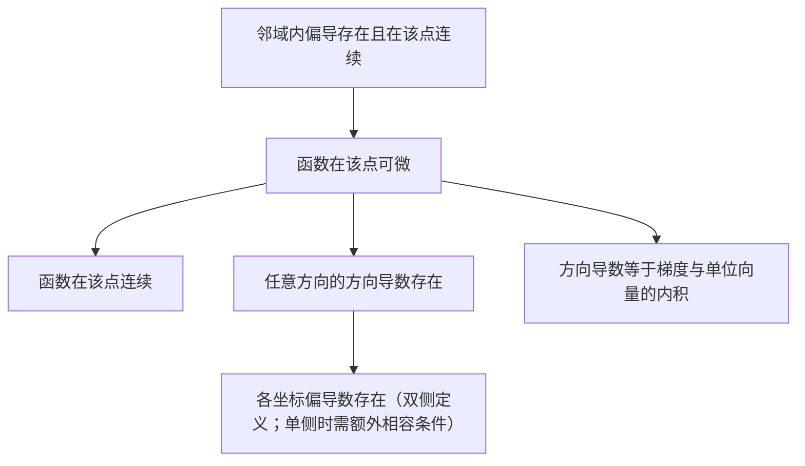
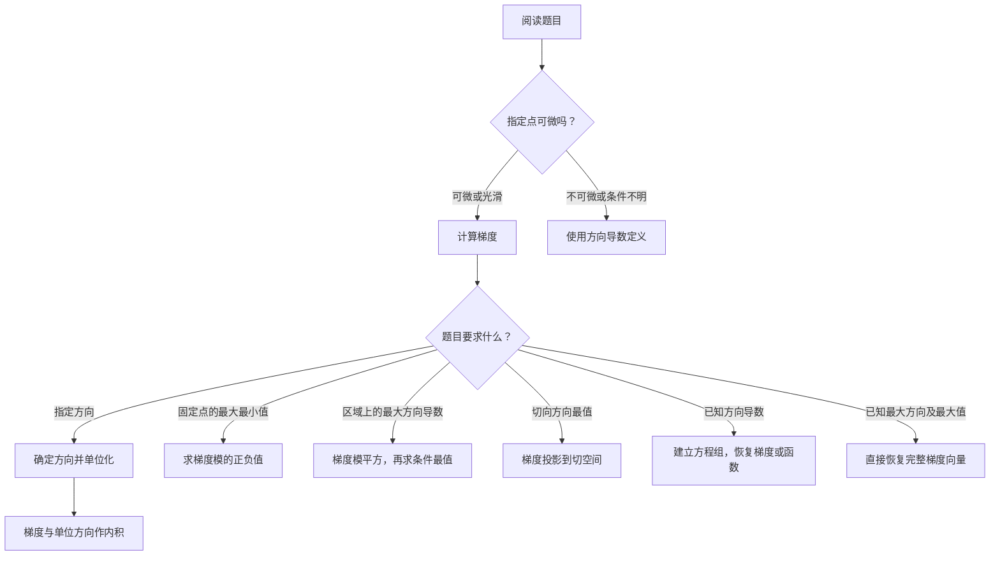

## 一、知识体系与学习目标

方向导数与梯度是多元函数微分学、空间解析几何、条件极值、曲面积分和场论之间的重要连接点。

本节真正需要掌握的是以下知识层次：

| 知识点             | 重要程度  | 掌握要求         |
| --------------- | ----- | ------------ |
| 方向导数的定义         | ★★★★★ | 理解并能利用定义计算   |
| 梯度的定义与计算        | ★★★★★ | 熟练计算二元、三元梯度  |
| 方向向量单位化         | ★★★★★ | 形成条件反射       |
| 最大、最小方向导数       | ★★★★★ | 熟练正向求解与反向求参数 |
| 沿曲线、曲面法线求方向导数   | ★★★★★ | 掌握方向的确定      |
| 方向导数与可微性的关系     | ★★★★★ | 掌握逻辑关系和反例    |
| 由方向导数反求梯度、函数    | ★★★★☆ | 掌握逆向问题       |
| 指定区域上的最大方向导数    | ★★★★★ | 掌握两层最值问题     |
| 受约束的切向方向导数      | ★★★★☆ | 掌握梯度的正交投影    |
| 与微分方程、曲面积分、场论综合 | ★★★★☆ | 掌握跨章节转化      |

本节公式本身并不复杂，真正的难点是：

**题目中的方向及最大值类型往往需要由已知条件确定。**

因此，学习时需要始终区分三个对象：

- 在什么点求导？
- 沿什么方向求导？
- 对哪个函数求导？

后面几乎所有复杂题目，都可以通过这三个问题拆解。

## 二、基础知识：从偏导数到方向导数

### 2.1 为什么需要方向导数？

设二元函数

$$
z=f(x,y).
$$

在点 $P_0(x_0,y_0)$ 处，偏导数

$$
f_x(x_0,y_0),\qquad f_y(x_0,y_0)
$$

分别表示沿 $x$ 轴正方向、$y$ 轴正方向的瞬时变化率。

但现实中，一个点可以沿任意方向运动，而不仅仅是坐标轴方向。

例如，把 $z=f(x,y)$ 理解为一座山的高度：

- 沿正东方向行走，有一个坡度；
- 沿正北方向行走，有一个坡度；
- 沿东北方向行走，也有一个坡度；
- 某个特定方向的上升坡度最大。

于是自然产生两个问题：

1. 如何计算任意方向上的变化率？
2. 如何找到变化最快的方向？

第一个问题由**方向导数**解决，第二个问题由**梯度**解决。

### 2.2 方向导数的定义

设单位方向向量为

$$
\boldsymbol e=(\cos\alpha,\cos\beta),
$$

满足

$$
\|\boldsymbol e\|=1,\qquad \cos^2\alpha+\cos^2\beta=1.
$$

从点 $P_0(x_0,y_0)$ 出发，沿该方向前进距离 $t$，到达

$$
P=(x_0+t\cos\alpha,\, y_0+t\cos\beta).
$$

如果极限

$$
\boxed{ D_{\boldsymbol e}f(P_0) = \lim_{t\to0^+} \frac{ f(x_0+t\cos\alpha,y_0+t\cos\beta) -f(x_0,y_0) }{t} }
$$

存在，则称其为函数在点 $P_0$ 沿方向 $\boldsymbol e$ 的方向导数。

通常也记为

$$
\left.\frac{\partial f}{\partial l}\right|_{P_0}.
$$

考研高等数学教材通常采用上述单侧极限，因为指定的是具有正负朝向的射线；部分数学教材也采用双侧极限定义。函数在该点可微时，两种定义的计算结果相同。

**三元函数的方向导数**

对于

$$
u=f(x,y,z),
$$

单位方向向量为

$$
\boldsymbol e=(\cos\alpha,\cos\beta,\cos\gamma),
$$

则

$$
\boxed{ D_{\boldsymbol e}f(P_0) = \lim_{t\to0^+} \frac{f(P_0+t\boldsymbol e)-f(P_0)}{t} }
$$

其中

$$
\cos^2\alpha+\cos^2\beta+\cos^2\gamma=1.
$$

<Callout type="warn" title="为什么强调单位向量？">

因为方向导数衡量的是**单位距离上的函数变化率**，而不是某个任意参数的变化率。

如果取非单位向量 $\boldsymbol v$，在可微条件下：

$$
\left.\frac{d}{dt}f(P_0+t\boldsymbol v)\right|_{t=0} = \nabla f(P_0)\cdot\boldsymbol v.
$$

它与标准方向导数之间相差一个长度因子：

$$
\boxed{ \left.\frac{d}{dt}f(P_0+t\boldsymbol v)\right|_{t=0} = \|\boldsymbol v\|D_{\boldsymbol e}f(P_0) }
$$

其中

$$
\boldsymbol e=\frac{\boldsymbol v}{\|\boldsymbol v\|}.
$$

这是本节第一个，也是最容易出现的失分点。

</Callout>

### 2.3 梯度的定义

对于二元函数：

$$
\boxed{ \operatorname{grad}f=\nabla f = (f_x,f_y) }
$$

对于三元函数：

$$
\boxed{ \nabla f=(f_x,f_y,f_z) }
$$

也可以写成

$$
\nabla f =f_x\boldsymbol i +f_y\boldsymbol j +f_z\boldsymbol k.
$$

梯度是一个向量，方向导数是一个实数。

| 比较项目     | 梯度             | 方向导数                      |
| -------- | -------------- | ------------------------- |
| 数学类型     | 向量             | 标量                        |
| 表达形式     | $\nabla f$ | $D_{\boldsymbol e}f$ |
| 是否需要指定方向 | 不需要            | 需要                        |
| 几何意义     | 最快增长方向及其速率     | 指定方向的变化率                  |
| 是否可能为负数  | 向量不能直接比较正负     | 可以                        |
| 与偏导数的关系  | 由偏导数组成         | 可微时为偏导数的线性组合              |

梯度具有明确的最陡上升意义，需要函数在该点可微且梯度非零。

### 2.4 方向导数的核心计算公式及其推导

若函数 $f(x,y)$ 在点 $P_0$ 可微，则

$$
\Delta f =f_x(P_0)\Delta x +f_y(P_0)\Delta y+o(\rho),
$$

其中

$$
\rho=\sqrt{(\Delta x)^2+(\Delta y)^2}.
$$

沿单位方向

$$
\boldsymbol e=(a,b),\qquad a^2+b^2=1
$$

运动时，有

$$
\Delta x=ta,\qquad \Delta y=tb, \qquad \rho=t\quad(t>0).
$$

因此

$$
\Delta f =t\bigl(af_x(P_0)+bf_y(P_0)\bigr)+o(t).
$$

两边除以 $t$，令 $t\to0^+$，得到

$$
D_{\boldsymbol e}f(P_0) =af_x(P_0)+bf_y(P_0).
$$

也就是本节最核心的公式：

$$
\boxed{ D_{\boldsymbol e}f(P_0) =\nabla f(P_0)\cdot\boldsymbol e }
$$

若题目给出一般的非零方向向量 $\boldsymbol v$，则直接使用

$$
\boxed{ D_{\boldsymbol v}f(P_0) = \frac{\nabla f(P_0)\cdot\boldsymbol v} {\|\boldsymbol v\|} }
$$

对于三元函数，设方向向量为 $(a,b,c)$，便有

$$
\boxed{ \frac{\partial f}{\partial l} = \frac{af_x+bf_y+cf_z} {\sqrt{a^2+b^2+c^2}} }
$$

其中各偏导数均取在指定点。

**适用条件：函数在该点可微。**

如果题目给出连续偏导数、可微函数，或者指定点位于初等函数的光滑定义域内部，就可以放心使用公式。

如果题目仅仅说明偏导数存在，尤其是分段函数的拼接点、原点，则必须警惕不可微的情况。

## 三、梯度的重要性质与几何意义

### 3.1 最大方向导数与最小方向导数

设梯度与单位方向向量 $\boldsymbol e$ 的夹角为 $\theta$。

由于

$$
D_{\boldsymbol e}f =\nabla f\cdot\boldsymbol e,
$$

根据向量内积公式，

$$
\boxed{ D_{\boldsymbol e}f =\|\nabla f\|\cos\theta }
$$

所以

$$
-\|\nabla f\| \leq D_{\boldsymbol e}f \leq\|\nabla f\|.
$$

当梯度不为零时：

| 方向与梯度的夹角             | 方向导数                           | 几何意义        |
| -------------------- | ------------------------------ | ----------- |
| $0$              | $\\|\nabla f\\|$         | 最陡上升        |
| $\frac{\pi}{3}$  | $\frac12\\|\nabla f\\|$  | 上升速率为最大值的一半 |
| $\frac{\pi}{2}$  | $0$                        | 一阶变化率为零     |
| $\frac{2\pi}{3}$ | $-\frac12\\|\nabla f\\|$ | 沿该方向下降      |
| $\pi$            | $-\\|\nabla f\\|$        | 最陡下降        |

于是得到四个必须熟记的结论：

$$
\boxed{\max D_{\boldsymbol e}f=\|\nabla f\|}
$$

$$
\boxed{\min D_{\boldsymbol e}f=-\|\nabla f\|}
$$

$$
\boxed{ \boldsymbol e_{\max} =\frac{\nabla f}{\|\nabla f\|} }
$$

$$
\boxed{ \boldsymbol e_{\min} =-\frac{\nabla f}{\|\nabla f\|} }
$$

<Callout type="warn" title="梯度为零的特殊情况">

如果

$$
\nabla f(P_0)=\boldsymbol 0,
$$

且函数在该点可微，那么所有方向导数均为零。

此时最大值、最小值都是零，并且任意单位方向都能取得这个值，不存在唯一的最陡上升方向。

但梯度为零不能说明该点一定是极值点。

例如

$$
f(x,y)=x^2-y^2
$$

在原点梯度为零，但原点是鞍点。

</Callout>

### 3.2 梯度垂直于等值线、等值面

设平面等值线为

$$
F(x,y)=C.
$$

沿这条等值线运动，函数值保持不变。

设曲线参数方程为

$$
\boldsymbol r(t)=(x(t),y(t)).
$$

则

$$
F(x(t),y(t))=C.
$$

两边对 $t$ 求导：

$$
F_xx'(t)+F_yy'(t)=0.
$$

即

$$
\nabla F\cdot\boldsymbol r'(t)=0.
$$

因此，在正则点，即 $\nabla F\ne\boldsymbol0$ 处：

$$
\boxed{\nabla F\perp\text{等值线的切线}}
$$

同理，对于空间曲面

$$
F(x,y,z)=C,
$$

有

$$
\boxed{\boldsymbol n=\nabla F}
$$

可以作为曲面的法向量，前提是该点梯度非零。

这就是方向导数与下一节切平面、法线问题之间的连接。

### 3.3 梯度的代数运算性质

在相关函数可微的条件下：

$$
\nabla(af+bg)=a\nabla f+b\nabla g,
$$

$$
\nabla(fg)=g\nabla f+f\nabla g,
$$

$$
\nabla\left(\frac fg\right) =\frac{g\nabla f-f\nabla g}{g^2}, \qquad g\ne0,
$$

$$
\nabla\varphi(f)=\varphi'(f)\nabla f.
$$

最后一个公式尤其有用。

例如，已知

$$
f(x,y)=e^{-(x^2+2y^2)},
$$

不必分别进行复杂的偏导运算，可以先记

$$
F(x,y)=x^2+2y^2,
$$

于是

$$
\nabla f=-e^{-F}\nabla F.
$$

因此，$f$ 的最快增长方向与 $F$ 的最快下降方向相同。

## 四、题型一：直接计算方向导数与梯度

**重要程度：★★★★★**

这是本节最基础的题型，也是所有综合题的计算起点。

### 母题1：2017年数学一第3题

来源：核心题目001，已与公开真题题面交叉核对。

[image](https://www.google.com/s2/favicons?domain=https://github.com\&sz=32)

GitHub

设

$$
f(x,y,z)=x^2y+z^2.
$$

求函数在点 $P(1,2,0)$ 处沿向量

$$
\boldsymbol n=(1,2,2)
$$

的方向导数。

**标准解法**

第一步，求梯度。

$$
f_x=2xy,\qquad f_y=x^2,\qquad f_z=2z.
$$

所以

$$
\nabla f(1,2,0)=(4,1,0).
$$

第二步，方向向量单位化。

$$
\|\boldsymbol n\| =\sqrt{1^2+2^2+2^2}=3.
$$

因此

$$
\boldsymbol e=\frac13(1,2,2).
$$

第三步，计算内积。

$$
\begin{aligned} D_{\boldsymbol e}f &=(4,1,0)\cdot\frac13(1,2,2)\\ &=\frac{4+2}{3}\\ &=\boxed{2}. \end{aligned}
$$

**这道题应该学会什么？**

不要记住答案 $2$，而要记住通用的三步法：

$$
\boxed{ \text{求梯度} \longrightarrow \text{方向单位化} \longrightarrow \text{计算内积} }
$$

直接算出内积 $6$ 是典型的错误答案，因为没有单位化。

### 母题2：2025年数学一第13题

来源：核心题目002，已核对公开真题题面。

[image](https://www.google.com/s2/favicons?domain=https://www.kuaiyizhi.cn\&sz=32)

快易知

已知

$$
u(x,y,z)=xy^2z^3, \qquad \boldsymbol n=(2,2,-1).
$$

求 $u$ 在点 $(1,1,1)$ 沿 $\boldsymbol n$ 的方向导数。

**解答**

$$
\nabla u=(y^2z^3,2xyz^3,3xy^2z^2).
$$

所以

$$
\nabla u(1,1,1)=(1,2,3).
$$

由于

$$
\|\boldsymbol n\|=3,
$$

故

$$
D_{\boldsymbol n}u =\frac{2+4-3}{3} =\boxed{1}.
$$

这道题与2017年真题本质完全相同，说明基础的梯度点积计算即使不做复杂包装，也具有直接的考试价值。

### 母题3：2008年数学一第2题

来源：核心题目011，已核对公开真题题面。

[image](https://www.google.com/s2/favicons?domain=https://www.csgraduates.com\&sz=32)

计算机考研杂货铺+1

设

$$
f(x,y)=\arctan\frac{x}{y}.
$$

求它在 $(0,1)$ 处的梯度。

**解答**

利用复合函数求导：

$$
f_x =\frac{1}{1+(x/y)^2}\frac1y =\frac{y}{x^2+y^2},
$$

$$
f_y =\frac{1}{1+(x/y)^2} \left(-\frac{x}{y^2}\right) =-\frac{x}{x^2+y^2}.
$$

于是

$$
\boxed{\nabla f(0,1)=(1,0)=\boldsymbol i}.
$$

**深层推广**

注意到

$$
\nabla f\cdot(x,y) = \frac{xy-xy}{x^2+y^2}=0.
$$

这说明梯度与径向方向正交。

事实上，函数 $\arctan(x/y)$ 在定义域内沿同一条径向射线保持不变，因此沿径向方向的方向导数为零。

它还可以推广到零次齐次函数：若

$$
f(tx,ty)=f(x,y),\qquad t>0,
$$

且函数可微，则对 $t$ 求导并令 $t=1$，得到

$$
xf_x+yf_y=0.
$$

因此，零次齐次函数的梯度与径向向量正交。

## 五、题型二：间接确定方向向量

**重要程度：★★★★★**

这一题型是基础计算题最常见的升级方式。

目标函数仍然只需要求梯度，难点在于题目没有直接给出方向向量，而是通过两点、角度、切线、法线或者旋度间接给出。

### 5.1 不同方向的统一识别方法

| 题目给出的方向                       | 应取的方向向量                           |
| ----------------------------- | --------------------------------- |
| 从点 $A$ 指向点 $B$        | $B-A$                         |
| 与 $x$ 轴正向夹角为 $\theta$ | $(\cos\theta,\sin\theta)$     |
| 平面曲线 $y=g(x)$ 的切向         | $(1,g'(x))$ 或其反向              |
| 隐式曲线 $F(x,y)=0$ 的切向       | $(F_y,-F_x)$ 或其反向             |
| 隐式曲线的法向                       | $(F_x,F_y)$ 或其反向              |
| 曲面 $F(x,y,z)=0$ 的法向       | $\nabla F$ 或其反向               |
| 两曲面交线的切向                      | $\nabla F\times\nabla G$ 或其反向 |
| 空间参数曲线的切向                     | $\boldsymbol r'(t)$ 或其反向      |
| 沿某向量场的旋度方向                    | $\nabla\times\boldsymbol A$   |
| 某个函数增加最快的方向                   | 该函数的梯度                            |

所有非零方向向量，在求方向导数时最终都必须单位化。

### 母题4：1996年数学一真题——两点确定方向

来源：核心题目004，已与公开真题题面交叉核对。

[image](https://www.google.com/s2/favicons?domain=https://www.csgraduates.com\&sz=32)

计算机考研杂货铺

设

$$
u=\ln\left(x+\sqrt{y^2+z^2}\right).
$$

求 $u$ 在 $A(1,0,1)$ 处沿 $A$ 指向 $B(3,-2,2)$ 的方向导数。

**解答**

方向向量为

$$
\overrightarrow{AB}=(2,-2,1).
$$

其单位向量为

$$
\boldsymbol e=\frac13(2,-2,1).
$$

设

$$
R=\sqrt{y^2+z^2},
$$

则

$$
\nabla u= \left( \frac1{x+R}, \frac{y}{R(x+R)}, \frac{z}{R(x+R)} \right).
$$

在点 $A$ 处，$R=1$，所以

$$
\nabla u(A)= \left(\frac12,0,\frac12\right).
$$

故

$$
D_{\boldsymbol e}u = \frac13+\frac16 =\boxed{\frac12}.
$$

<Callout type="warn" title="易错点">

从 $A$ 指向 $B$ 一定是终点减起点。

若误用 $\overrightarrow{BA}$，答案会变成

$$
-\frac12.
$$

</Callout>

### 母题5：曲面的外法线方向

来源：1991年数学一。

设曲面

$$
2x^2+3y^2+z^2=6,
$$

目标函数为

$$
u=\frac{\sqrt{6x^2+8y^2}}{z}.
$$

求 $u$ 在点 $P(1,1,1)$ 处沿曲面外法线方向的方向导数。

**解题关键：两个函数，两个梯度**

本题中存在两个不同的函数：

$$
F(x,y,z)=2x^2+3y^2+z^2-6
$$

用于确定方向；

$$
u(x,y,z)=\frac{\sqrt{6x^2+8y^2}}{z}
$$

是要求方向导数的目标函数。

千万不能混淆。

第一步，求外法向量。

$$
\nabla F=(4x,6y,2z).
$$

在点 $P$ 处，

$$
\nabla F(P)=(4,6,2).
$$

因为椭球内部满足 $F<0$，外部满足 $F>0$，所以梯度指向外侧。

因此外侧单位法向量为

$$
\boldsymbol e_n =\frac{(2,3,1)}{\sqrt{14}}.
$$

第二步，求目标函数的梯度。

记

$$
R=\sqrt{6x^2+8y^2}.
$$

则

$$
u_x=\frac{6x}{zR},
$$

$$
u_y=\frac{8y}{zR},
$$

$$
u_z=-\frac{R}{z^2}.
$$

从而

$$
\nabla u(P)= \left( \frac6{\sqrt{14}}, \frac8{\sqrt{14}}, -\sqrt{14} \right).
$$

第三步，计算方向导数。

$$
\begin{aligned} D_{\boldsymbol e_n}u &=\frac{12}{14}+\frac{24}{14}-1\\ &=\boxed{\frac{11}{7}}. \end{aligned}
$$

**提炼通用公式**

若曲面由

$$
F(x,y,z)=0
$$

给出，且 $\nabla F\ne\boldsymbol0$，那么目标函数 $u$ 沿 $\nabla F$ 所指法向的方向导数为

$$
\boxed{ \frac{\partial u}{\partial n} = \frac{\nabla u\cdot\nabla F} {\|\nabla F\|} }
$$

如果要求沿相反法向，则整体加负号。

特别注意，$\nabla F$ 指向的是 $F$ 增大的方向，不是任何情况下都指向曲面的外侧。外法向还需要结合曲面方程所确定的内外区域判断。

### 母题6：李正元练习题——内法线方向

来源：第八章，题目ID尾号014。

设

$$
z=1-x^2-2y^2,
$$

椭圆

$$
C:x^2+2y^2=1.
$$

求 $z$ 在

$$
M_0\left(\frac1{\sqrt2},\frac12\right)
$$

处沿椭圆内法线方向的方向导数。

**快速解法**

设

$$
F=x^2+2y^2-1.
$$

由于

$$
z=-F,
$$

所以

$$
\nabla z=-\nabla F.
$$

这意味着 $\nabla z$ 本身就沿椭圆内法线方向。

因此，无须再次进行完整的单位化与点积运算。

$$
\nabla z(M_0)=(-\sqrt2,-2).
$$

所以

$$
D_{\text{内法线}}z =\|\nabla z(M_0)\| =\boxed{\sqrt6}.
$$

<Callout type="idea" title="通用技巧">

如果目标函数具有结构

$$
u=\varphi(F),
$$

那么

$$
\nabla u=\varphi'(F)\nabla F.
$$

这时两个梯度天然平行，方向导数往往可以直接化为梯度模的正负值。

</Callout>

### 母题7：李永乐六套卷第4套第13题——切向与方向选择

已知曲线

$$
C:x^2+xy+y^2=7,
$$

点 $P(1,2)$。

设 $\boldsymbol l$ 是使

$$
h(x,y)=x-y
$$

增大的切向方向，求

$$
f(x,y)=\frac{xy-x^2+2y}{1+x^2+y^2}
$$

在点 $P$ 沿 $\boldsymbol l$ 的方向导数。

<Steps>

<Step>

### 第一步：确定两个可能的切向量 [!toc]

设

$$
F=x^2+xy+y^2-7.
$$

则

$$
\nabla F(P)=(4,5).
$$

与之垂直的向量可以取

$$
\boldsymbol v_1=(5,-4), \qquad \boldsymbol v_2=(-5,4).
$$

</Step>

<Step>

### 第二步：利用附加条件选择朝向 [!toc]

题目要求沿这个切向方向运动时，$h=x-y$ 增大。

由于

$$
\nabla h=(1,-1),
$$

而

$$
\nabla h\cdot(5,-4)=9>0,
$$

所以应选择 $(5,-4)$。

单位化得到

$$
\boldsymbol l=\frac{(5,-4)}{\sqrt{41}}.
$$

</Step>

<Step>

### 第三步：计算真正的目标函数梯度 [!toc]

设

$$
N=xy-x^2+2y,\qquad D=1+x^2+y^2.
$$

在点 $P(1,2)$ 处：

$$
N=5,\quad D=6,\quad N_x=0,\quad N_y=3.
$$

利用商法则，

$$
f_x(P)=\frac{0\cdot6-5\cdot2}{36} =-\frac5{18},
$$

$$
f_y(P)=\frac{3\cdot6-5\cdot4}{36} =-\frac1{18}.
$$

于是

$$
\begin{aligned} D_{\boldsymbol l}f &=\left(-\frac5{18},-\frac1{18}\right) \cdot\frac{(5,-4)}{\sqrt{41}}\\ &=\boxed{-\frac7{6\sqrt{41}}}. \end{aligned}
$$

</Step>

</Steps>

**为什么这道题是高质量模拟题？**

因为它同时使用了三个不同函数：

| 函数      | 作用        |
| ------- | --------- |
| $F$ | 确定切线      |
| $h$ | 确定切线的正负朝向 |
| $f$ | 计算最终方向导数  |

遇到类似创新题时，先把各函数的职责分清楚，题目就不复杂了。

## 六、题型三：最大、最小方向导数及反求参数

**重要程度：★★★★★**

本题型通常有两个方向：已知函数求最大方向导数；已知最大方向导数及其方向，反求函数参数。

### 母题8：张宇8套卷第7套第14题

设

$$
f(x,y,z)=xy+yz+xz.
$$

求 $f$ 在点 $(1,0,-1)$ 处方向导数的最小值。

**解答**

$$
\nabla f=(y+z,x+z,x+y).
$$

所以

$$
\nabla f(1,0,-1)=(-1,0,1).
$$

因此

$$
\boxed{\min D_{\boldsymbol e}f=-\sqrt2}.
$$

如果进一步要求取得最小值的单位方向，则

$$
\boxed{ \boldsymbol e_{\min} =\frac{(1,0,-1)}{\sqrt2} }
$$

注意：最小方向导数不是梯度各分量中的最小值，而是梯度模的相反数。

类似地，核心题目006中

$$
f=x^2+2y^2,\qquad P=(0,1)
$$

的最大方向导数为 $4$，最小方向导数为 $-4$。

### 6.1 反向恢复梯度的核心公式

设已知：

函数在 $P$ 处沿非零向量 $\boldsymbol v$ 的方向导数取得最大值 $M$，且 $M>0$。

那么，不仅可以得到

$$
\|\nabla f(P)\|=M,
$$

还可以直接得到完整的向量等式：

$$
\boxed{ \nabla f(P)=M\frac{\boldsymbol v}{\|\boldsymbol v\|} }
$$

如果沿 $\boldsymbol v$ 取得最小方向导数 $m<0$，则

$$
\boxed{ \nabla f(P)=m\frac{\boldsymbol v}{\|\boldsymbol v\|} }
$$

这比单独列比例式与模长方程更加简洁，而且不容易产生符号错误。

### 母题9：李林六套卷第4套第13题

设

$$
f(x,y,z)=axy^2+byz+cx^3z^2.
$$

函数在 $P_0(1,2,-1)$ 处沿方向

$$
\boldsymbol k=(0,0,1)
$$

取得最大方向导数 $8$。

求 $a+b+c$。

**解答**

因为最大方向导数沿 $\boldsymbol k$ 取得，所以直接得到

$$
\nabla f(P_0)=(0,0,8).
$$

另一方面，

$$
f_x=ay^2+3cx^2z^2,
$$

$$
f_y=2axy+bz,
$$

$$
f_z=by+2cx^3z.
$$

代入点 $P_0$ 得

$$
\nabla f(P_0) =(4a+3c,4a-b,2b-2c).
$$

由向量对应分量相等，

$$
\begin{cases} 4a+3c=0,\\ 4a-b=0,\\ 2b-2c=8. \end{cases}
$$

解得

$$
a=\frac34,\qquad b=3,\qquad c=-1.
$$

因此

$$
\boxed{a+b+c=\frac{11}{4}}.
$$

**方法迁移**

以后遇到“沿某方向变化最快，且最大变化率为多少”，不要优先写平方根方程，应立即尝试恢复梯度向量。

### 母题10：张宇1000题——非单位最大方向

来源：第17章，题目ID尾号011。

设

$$
z=2+ax^2+by^2.
$$

在点 $(1,2)$ 处，沿

$$
\boldsymbol l=(1,2)
$$

的方向导数最大，最大值为 $10$。求 $a,b$。

**解答**

由最大方向导数恢复梯度：

$$
\nabla z(1,2) =10\frac{(1,2)}{\sqrt5} =(2\sqrt5,4\sqrt5).
$$

而

$$
\nabla z(1,2)=(2a,4b).
$$

所以

$$
\boxed{a=b=\sqrt5}.
$$

这类题只要掌握向量等式，通常不需要复杂计算。

## 七、题型四：方向导数与可微性的关系

**重要程度：★★★★★**

这是本节概念题中最容易出现陷阱的部分，也是第六模块第一节与第四节的交叉考点。

### 7.1 必须掌握的逻辑关系

对于多元函数，有以下充分条件关系：

需要特别掌握：

$$
\boxed{ \text{可微}\Longrightarrow \text{任意方向导数存在} }
$$

但反过来不成立。

甚至

$$
\boxed{ \text{连续且任意方向导数存在} \not\Longrightarrow\text{可微} }
$$

其根本原因是：

方向导数存在只说明沿某一条固定射线移动时，差商有极限；可微则要求所有方向上的一阶变化都能够被同一个线性函数统一描述。

### 母题11：原创反例——方向导数存在但不可微

设

$$
f(x,y)= \begin{cases} \dfrac{x^3}{x^2+y^2},&(x,y)\ne(0,0),\\[5pt] 0,&(x,y)=(0,0). \end{cases}
$$

要求：

（1）证明函数在原点连续；

（2）求原点沿任意单位方向的方向导数；

（3）判断函数在原点是否可微。

<Steps>

<Step>

### 第一步：判断连续性 [!toc]

设

$$
r=\sqrt{x^2+y^2}.
$$

因为

$$
|f(x,y)| =\frac{|x|^3}{x^2+y^2} \leq |x|\leq r,
$$

所以根据夹逼定理，

$$
\lim_{(x,y)\to(0,0)}f(x,y)=0=f(0,0).
$$

故函数在原点连续。

</Step>

<Step>

### 第二步：利用定义计算任意方向导数 [!toc]

设

$$
\boldsymbol e=(a,b),\qquad a^2+b^2=1.
$$

沿该方向运动时，

$$
x=ta,\qquad y=tb.
$$

于是

$$
f(ta,tb) =\frac{t^3a^3}{t^2(a^2+b^2)} =ta^3.
$$

所以

$$
\begin{aligned} D_{\boldsymbol e}f(0,0) &=\lim_{t\to0^+}\frac{ta^3}{t}\\ &=\boxed{a^3}. \end{aligned}
$$

可见，任意方向导数均存在。

</Step>

<Step>

### 第三步：计算偏导数 [!toc]

由定义可得

$$
f_x(0,0)=1,\qquad f_y(0,0)=0.
$$

因此由偏导数组成的梯度为

$$
\nabla f(0,0)=(1,0).
$$

假设 $f$ 在原点可微，那么应该有

$$
D_{\boldsymbol e}f(0,0) =\nabla f(0,0)\cdot\boldsymbol e=a.
$$

但实际求得的是 $a^3$。

特别取

$$
a=b=\frac1{\sqrt2},
$$

得到

$$
D_{\boldsymbol e}f(0,0) =\frac1{2\sqrt2},
$$

而

$$
\nabla f(0,0)\cdot\boldsymbol e =\frac1{\sqrt2}.
$$

两者不相等。

因此

$$
\boxed{f\text{ 在原点不可微}}.
$$

</Step>

</Steps>

**另一种证明：直接使用可微定义**

可微要求

$$
\lim_{(x,y)\to(0,0)} \frac{f(x,y)-f(0,0)-x} {\sqrt{x^2+y^2}}=0.
$$

注意

$$
f(x,y)-x =\frac{-xy^2}{x^2+y^2}.
$$

沿 $y=x$、$x\to0^+$ 趋近原点，

$$
\frac{f(x,x)-x}{\sqrt{2x^2}} =-\frac1{2\sqrt2}\ne0.
$$

同样说明不可微。

**母题的解题价值**

以后遇到分段函数的方向导数计算，不要一上来就求两个偏导数再点乘。

正确顺序是：

先判断公式的适用条件；若不确定可微性，就优先使用方向导数定义。

### 7.2 更深层的创新反例

下面是一道用于深化核心题目012的原创变式。

设

$$
g(x,y)= \begin{cases} \dfrac{x^3y}{x^4+y^2},&(x,y)\ne(0,0),\\[5pt] 0,&(x,y)=(0,0). \end{cases}
$$

证明：

- 函数在原点连续；
- 梯度为零；
- 所有方向导数都等于零；
- 但函数在原点不可微。

**解答**

因为

$$
2|x^2y|\leq x^4+y^2,
$$

所以

$$
|g(x,y)| \leq\frac{|x|}{2}\to0.
$$

故原点连续。

沿坐标轴时，函数恒为零，因此

$$
g_x(0,0)=g_y(0,0)=0.
$$

对于任意单位方向 $(a,b)$，当 $b\ne0$ 时，

$$
\frac{g(ta,tb)}{t} =\frac{ta^3b}{t^2a^4+b^2}\to0.
$$

当 $b=0$ 时，方向导数也为零。

因此所有方向导数都等于零，并且恰好都满足

$$
D_{\boldsymbol e}g=\nabla g\cdot\boldsymbol e.
$$

但是沿曲线 $y=x^2$，

$$
g(x,x^2)=\frac{x}{2}.
$$

于是

$$
\frac{g(x,x^2)}{\sqrt{x^2+x^4}} \to\frac12 \qquad(x\to0^+).
$$

所以函数仍然不可微。

**这是比核心题目012更强的反例。**

它说明即使函数连续，并且所有方向导数都与梯度点积一致，也不能单凭这些条件推出可微。因为沿所有固定直线成立，并不意味着沿任意曲线趋近都成立。

### 7.3 概念判断题速查

| 命题                  | 是否必然正确 |
| ------------------- | ------ |
| 可微一定连续              | 正确     |
| 可微时任意方向导数均存在        | 正确     |
| 可微时方向导数等于梯度与单位向量的内积 | 正确     |
| 偏导数存在就一定存在任意方向导数    | 错误     |
| 任意方向导数存在就一定连续       | 错误     |
| 连续且任意方向导数存在就一定可微    | 错误     |
| 所有方向导数都为零就一定可微      | 错误     |
| 可微且梯度为零就一定取得极值      | 错误     |
| 内点可微函数取得极值，则梯度为零    | 正确     |

## 八、题型五：在曲线或曲面上求最大方向导数

**重要程度：★★★★★**

**这是本节最重要的综合解答题类型之一。**

需要分清两个不同层次的最大值：

第一层：固定一个点，在所有单位方向中求最大方向导数。

第二层：允许这个点在某条曲线或者某个区域内变化，再求第一层最大值的最大值。

因此实际要求的是

$$
\boxed{ \max_{P\in C} \left( \max_{\|\boldsymbol e\|=1} D_{\boldsymbol e}f(P) \right) = \max_{P\in C}\|\nabla f(P)\| }
$$

由于梯度模非负，所以可以转化为

$$
\max_{P\in C}\|\nabla f(P)\|^2.
$$

这样通常能够消除根号，简化条件极值计算。

### 母题12：2015年数学一真题——重点掌握

来源：核心题目007，已与多份公开真题题面交叉核对。

[image](https://www.google.com/s2/favicons?domain=https://mtk.mxqe.com\&sz=32)

mtk.mxqe.com+2

设

$$
f(x,y)=x+y+xy,
$$

曲线

$$
C:x^2+y^2+xy=3.
$$

求 $f(x,y)$ 在曲线 $C$ 上的最大方向导数。

**题型识别**

题目同时出现了：

- 最大方向导数；
- 曲线约束；
- 未指定具体点。

因此这是典型的“两层最值”问题。

<Steps>

<Step>

### 第一步：求任意点的最大方向导数 [!toc]

$$
\nabla f=(1+y,1+x).
$$

所以

$$
g(x,y)=\|\nabla f\| =\sqrt{(1+y)^2+(1+x)^2}.
$$

问题转化为在曲线 $C$ 上求 $g$ 的最大值。

进一步令

$$
H=g^2.
$$

则

$$
H=x^2+y^2+2(x+y)+2.
$$

</Step>

<Step>

### 第二步：观察对称结构 [!toc]

约束条件为

$$
x^2+y^2+xy=3.
$$

目标函数与约束都具有关于 $x,y$ 的对称性。

因此优先考虑

$$
s=x+y,\qquad p=xy.
$$

由约束得

$$
s^2-p=3,
$$

即

$$
p=s^2-3.
$$

于是

$$
x^2+y^2=s^2-2p=6-s^2.
$$

代入目标函数：

$$
\begin{aligned} H &=6-s^2+2s+2\\ &=9-(s-1)^2\\ &\leq9. \end{aligned}
$$

</Step>

<Step>

### 第三步：验证等号成立条件 [!toc]

当

$$
s=x+y=1
$$

时，由约束得到

$$
xy=-2.
$$

因此 $x,y$ 是方程

$$
t^2-t-2=0
$$

的两个根。

即

$$
(x,y)=(2,-1),\quad(-1,2).
$$

这两点均满足约束。

所以

$$
\boxed{\max_C D_{\boldsymbol e}f=3}.
$$

如果进一步要求最大方向，则：

在 $(2,-1)$ 处，

$$
\nabla f=(0,3), \qquad \boldsymbol e_{\max}=(0,1).
$$

在 $(-1,2)$ 处，

$$
\nabla f=(3,0), \qquad \boldsymbol e_{\max}=(1,0).
$$

</Step>

</Steps>

**这道真题最值得学习的地方**

不是单纯的拉格朗日乘数法，而是如何把复杂的多元约束最值转化为简单的一元配方。

遇到对称二次式时，应敏感地想到

$$
x+y,\quad xy,\quad (x+y)^2,\quad (x-y)^2.
$$

### 母题13：2002年数学一真题——小山坡度问题

来源：核心题目008，已核对公开历年试题。

[image](https://www.google.com/s2/favicons?domain=https://kmath.cn\&sz=32)

kmath.cn+1

设一座小山的高度函数为

$$
h(x,y)=75-x^2-y^2+xy,
$$

其底部区域为

$$
D=\{(x,y):x^2+y^2-xy\leq75\}.
$$

（1）求任意点处最陡上升方向及最大方向导数 $g(x,y)$；

（2）求山脚上坡度最大的位置。

**第一问：求最陡上升方向**

$$
\nabla h=(-2x+y,x-2y).
$$

因此

$$
g(x,y) =\sqrt{(-2x+y)^2+(x-2y)^2},
$$

即

$$
\boxed{ g(x,y)=\sqrt{5x^2+5y^2-8xy} }
$$

当 $(x,y)\ne(0,0)$ 时，最陡上升的单位方向为

$$
\boxed{ \boldsymbol e_{\max} =\frac{(-2x+y,x-2y)} {\sqrt{5x^2+5y^2-8xy}} }
$$

原点处梯度为零，各方向导数均为零。

**第二问：在山脚边界上求最大坡度**

山脚边界满足

$$
x^2+y^2-xy=75.
$$

要最大化 $g$，等价于最大化

$$
g^2=5x^2+5y^2-8xy.
$$

利用约束消去平方项：

$$
x^2+y^2=75+xy.
$$

所以

$$
g^2=375-3xy.
$$

问题转化为求 $xy$ 的最小值。

由

$$
(x+y)^2\geq0
$$

得

$$
x^2+y^2+2xy\geq0.
$$

结合约束，

$$
75+3xy\geq0,
$$

所以

$$
xy\geq-25.
$$

等号成立当且仅当 $x+y=0$，结合约束得到

$$
x=\pm5,\qquad y=\mp5.
$$

因此坡度最大的位置为

$$
\boxed{(5,-5),\quad(-5,5)}.
$$

最大坡度为

$$
\boxed{ g_{\max}=\sqrt{450}=15\sqrt2 }
$$

**与2015年真题的共同本质**

两道题的背景不同，一道是抽象函数，另一道是登山应用，但方法完全一致：

$$
\boxed{ \text{梯度} \longrightarrow \text{梯度模平方} \longrightarrow \text{条件最值} }
$$

把这两道真题放在一起学习，可以掌握一整类综合题。

### 母题14：张宇1000题——向量几何解法

来源：第17章，题目ID尾号012。

设

$$
f(x,y)=x+2y+xy.
$$

求它在圆

$$
x^2+y^2=5
$$

上的最大方向导数。

<Tabs items={["解法一：柯西不等式", "解法二：三角不等式"]} defaultIndex={0}>

<Tab value="解法一：柯西不等式">

$$
\nabla f=(1+y,2+x).
$$

所以

$$
g^2=(1+y)^2+(2+x)^2.
$$

展开并利用约束，

$$
g^2=10+4x+2y.
$$

根据柯西不等式，

$$
2x+y \leq\sqrt{2^2+1^2}\sqrt{x^2+y^2} =5.
$$

因此

$$
g^2\leq20.
$$

当 $(x,y)=(2,1)$ 时取等，故

$$
\boxed{g_{\max}=2\sqrt5}.
$$

</Tab>

<Tab value="解法二：三角不等式">

观察到

$$
g=\sqrt{(x+2)^2+(y+1)^2} =\|(x,y)+(2,1)\|.
$$

因此

$$
g\leq\sqrt5+\sqrt5=2\sqrt5.
$$

当两个向量同向，即 $(x,y)=(2,1)$ 时取等。

</Tab>

</Tabs>

**解题方法选择**

| 目标函数和约束的特点 | 优先使用的方法   |
| ---------- | --------- |
| 对称二次式      | 和积代换、配方   |
| 圆或球面上的线性式  | 柯西不等式     |
| 圆上的距离最值    | 三角不等式或几何法 |
| 正定二次型      | 特征值法      |
| 约束可方便消元    | 代入消元      |
| 一般光滑约束     | 拉格朗日乘数法   |

## 九、题型六：受约束的切向最大方向导数

**重要程度：★★★★☆**

**这一题型尤其适合作为未来创新题的训练内容。**

### 9.1 必须区分的三类问题

| 题目表述                      | 实际要求            |
| ------------------------- | --------------- |
| 函数在点 $P$ 的最大方向导数      | 所有单位方向中取最大值     |
| 函数在曲线 $C$ 上的最大方向导数    | 点在曲线上变化，方向通常不受限 |
| 函数在点 $P$ 沿曲面切向的最大方向导数 | 固定点，方向必须属于切平面   |

2015年真题属于第二类，而不是第三类。

第三类不能直接使用梯度模。

### 9.2 切向梯度的正交投影公式

设目标函数梯度为

$$
\boldsymbol g=\nabla f(P),
$$

约束曲面的非零法向量为

$$
\boldsymbol n=\nabla F(P).
$$

将 $\boldsymbol g$ 分解为法向分量和切向分量：

$$
\boldsymbol g=\boldsymbol g_N+\boldsymbol g_T.
$$

其中

$$
\boldsymbol g_N = \frac{\boldsymbol g\cdot\boldsymbol n} {\|\boldsymbol n\|^2}\boldsymbol n.
$$

所以

$$
\boxed{ \boldsymbol g_T = \boldsymbol g- \frac{\boldsymbol g\cdot\boldsymbol n} {\|\boldsymbol n\|^2}\boldsymbol n }
$$

对于任意单位切向量 $\boldsymbol e$，都有

$$
\boldsymbol e\cdot\boldsymbol n=0.
$$

因此

$$
D_{\boldsymbol e}f =\boldsymbol g\cdot\boldsymbol e =\boldsymbol g_T\cdot\boldsymbol e.
$$

根据柯西不等式，

$$
\boxed{ \max_{\substack{\|\boldsymbol e\|=1\\ \boldsymbol e\cdot\boldsymbol n=0}} D_{\boldsymbol e}f =\|\boldsymbol g_T\| }
$$

且当 $\boldsymbol g_T\ne\boldsymbol0$ 时，

$$
\boxed{ \boldsymbol e_{\max} =\frac{\boldsymbol g_T}{\|\boldsymbol g_T\|} }
$$

也可以直接求最大值：

$$
\boxed{ \|\boldsymbol g_T\| = \sqrt{ \|\boldsymbol g\|^2- \frac{(\boldsymbol g\cdot\boldsymbol n)^2} {\|\boldsymbol n\|^2} } }
$$

### 母题15：原创题——球面切向优化

设球面

$$
S:x^2+y^2+z^2=3,
$$

目标函数

$$
u=x+2y+3z.
$$

在点 $P(1,1,1)$ 处，求沿球面单位切向量的最大方向导数及其方向。

<Steps>

<Step>

### 第一步：求目标梯度与曲面法向量 [!toc]

$$
\boldsymbol g=\nabla u=(1,2,3).
$$

球面法向量可取

$$
\boldsymbol n=(1,1,1).
$$

</Step>

<Step>

### 第二步：投影到切平面 [!toc]

$$
\begin{aligned} \boldsymbol g_T &=(1,2,3) -\frac{1+2+3}{1+1+1}(1,1,1)\\ &=(1,2,3)-2(1,1,1)\\ &=(-1,0,1). \end{aligned}
$$

</Step>

<Step>

### 第三步：求最大值及方向 [!toc]

$$
\boxed{\max D_{\boldsymbol e}u=\sqrt2}
$$

$$
\boxed{ \boldsymbol e_{\max} =\frac{(-1,0,1)}{\sqrt2} }
$$

</Step>

</Steps>

**对比理解**

如果方向不受限制，答案为

$$
\|\nabla u\|=\sqrt{14}.
$$

但如果限定沿球面切向运动，答案只能是

$$
\sqrt2.
$$

两者不同，是因为全空间中最陡上升方向并不一定是球面允许的运动方向。

### 9.3 与拉格朗日乘数法的内在联系

如果在曲面

$$
F(x,y,z)=0
$$

上求目标函数 $f$ 的条件极值，那么在正则约束极值点，任意允许的切向方向的一阶变化率都应该为零。

于是

$$
\boldsymbol g_T=\boldsymbol0.
$$

也就是说

$$
\nabla f = \frac{\nabla f\cdot\nabla F} {\|\nabla F\|^2}\nabla F.
$$

令比例系数为 $\lambda$，便得到

$$
\boxed{\nabla f=\lambda\nabla F}
$$

这就是拉格朗日乘数法的核心条件。

所以，方向导数、梯度、切平面、条件极值并不是相互独立的公式，而是同一个几何思想的不同表达。

## 十、题型七：已知方向导数，反求梯度或函数

**重要程度：★★★★☆**

前面的题型都是从函数出发，求梯度，再求方向导数。本题型则反过来：根据方向导数提供的信息，恢复梯度甚至整个函数。

### 母题16：张宇1000题——由两个方向导数恢复梯度

来源：第17章，题目ID尾号024。

已知可微函数 $z=f(x,y)$ 在点

$$
P_0(1,2)
$$

处沿 $P_0$ 到 $P_1(2,3)$ 方向的方向导数为 $2\sqrt2$，沿 $P_0$ 到 $P_2(1,0)$ 方向的方向导数为 $-3$。

求 $f$ 在 $P_0$ 处的最大方向导数。

**解答**

设未知梯度为

$$
\nabla f(P_0)=(a,b).
$$

由两点确定第一个单位方向：

$$
\boldsymbol e_1=\frac{(1,1)}{\sqrt2}.
$$

所以

$$
\frac{a+b}{\sqrt2}=2\sqrt2.
$$

即

$$
a+b=4.
$$

第二个单位方向为

$$
\boldsymbol e_2=(0,-1).
$$

因此

$$
-b=-3.
$$

所以

$$
b=3,\qquad a=1.
$$

从而

$$
\nabla f(P_0)=(1,3).
$$

最大方向导数为

$$
\boxed{\sqrt{10}}.
$$

**通用模型**

若已知二元可微函数在两个方向上的方向导数

$$
D_{\boldsymbol e_1}f=m,\qquad D_{\boldsymbol e_2}f=n,
$$

其中

$$
\boldsymbol e_1=(a_1,b_1),\qquad \boldsymbol e_2=(a_2,b_2),
$$

则可以建立线性方程组

$$
\begin{cases} a_1f_x+b_1f_y=m,\\ a_2f_x+b_2f_y=n. \end{cases}
$$

当两个方向线性无关时，可以唯一确定梯度。

同理，三元函数一般需要三个线性无关方向上的方向导数，才能唯一恢复梯度。

### 母题17：李林880题——反求函数与闭区域最值

来源：核心题目013、李林880第五章，题目ID尾号060。

设可微函数 $f(x,y)$ 在任意点沿

$$
\boldsymbol l_1=(-1,0),\qquad \boldsymbol l_2=(0,-1)
$$

的方向导数分别为

$$
x^2-y,\qquad 1-x.
$$

且

$$
f(1,1)=-\frac13.
$$

（1）求 $f(x,y)$；

（2）求 $f$ 在三角形区域

$$
D=\{(x,y):x\geq0,\ y\geq0,\ x+y\leq7\}
$$

上的最大值。

**第一问：由方向导数恢复函数**

由于给出的是两个坐标轴的负方向，

$$
-f_x=x^2-y,
$$

$$
-f_y=1-x.
$$

因此

$$
f_x=y-x^2,\qquad f_y=x-1.
$$

先对 $x$ 积分：

$$
f(x,y)=xy-\frac{x^3}{3}+\varphi(y).
$$

注意：这里的积分常数必须写成关于 $y$ 的函数，不能直接写成常数 $C$。

对 $y$ 求偏导：

$$
f_y=x+\varphi'(y)=x-1.
$$

得到

$$
\varphi'(y)=-1.
$$

所以

$$
\varphi(y)=-y+C.
$$

再代入 $f(1,1)=-1/3$，得到 $C=0$。

最终

$$
\boxed{ f(x,y)=xy-\frac{x^3}{3}-y }
$$

**第二问：闭区域最大值**

先求区域内部驻点：

$$
\begin{cases} y-x^2=0,\\ x-1=0. \end{cases}
$$

解得

$$
(x,y)=(1,1).
$$

对应函数值为

$$
f(1,1)=-\frac13.
$$

再考查三条边界。

当 $y=0$ 时，

$$
f(x,0)=-\frac{x^3}{3}\leq0.
$$

当 $x=0$ 时，

$$
f(0,y)=-y\leq0.
$$

当 $x+y=7$ 时，令 $y=7-x$，得到

$$
\phi(x) =-\frac{x^3}{3}-x^2+8x-7.
$$

其中 $x\in[0,7]$。

求导：

$$
\phi'(x)=-x^2-2x+8 =-(x-2)(x+4).
$$

所以 $\phi$ 在 $[0,2]$ 上递增，在 $[2,7]$ 上递减。

故

$$
\phi_{\max}=\phi(2)=\frac73.
$$

比较内部及各边界的最大值，最终得到

$$
\boxed{\max_D f=\frac73}
$$

在点 $(2,5)$ 处取得。

**本题的综合考点**

它将三个原本相对独立的知识点连接起来：

$$
\text{方向导数} \longrightarrow \text{偏导数反求原函数} \longrightarrow \text{闭区域最值}
$$

### 母题18：张宇1000题——方向导数与微分方程综合

来源：第17章，题目ID尾号013。

设可微函数 $z=z(x,y)$ 在任一点沿 $x$ 轴、$y$ 轴正方向的方向导数分别为

$$
e^{-x}f(x)y,\qquad f(x),
$$

其中 $f'(x)$ 连续，且 $f(0)=1$。

求 $z(x,y)$，并判断其是否存在极值。

<Steps>

<Step>

### 第一步：恢复偏导数 [!toc]

$$
z_x=e^{-x}f(x)y, \qquad z_y=f(x).
$$

</Step>

<Step>

### 第二步：利用混合偏导数相等 [!toc]

根据题设正则性，相关二阶混合偏导连续，因此

$$
z_{xy}=z_{yx}.
$$

即

$$
e^{-x}f(x)=f'(x).
$$

得到一个一阶可分离变量微分方程。

$$
f'(x)=e^{-x}f(x).
$$

结合初值 $f(0)=1$，解得

$$
\boxed{f(x)=e^{1-e^{-x}}}.
$$

</Step>

<Step>

### 第三步：恢复原函数 [!toc]

由

$$
z_y=e^{1-e^{-x}},
$$

得到

$$
z=ye^{1-e^{-x}}+\varphi(x).
$$

再代入 $z_x$ 的表达式，可以得到

$$
\varphi'(x)=0.
$$

所以

$$
\boxed{z=ye^{1-e^{-x}}+C}.
$$

</Step>

<Step>

### 第四步：判断极值 [!toc]

因为

$$
z_y=e^{1-e^{-x}}>0,
$$

所以梯度处处不为零。

由可微函数内点极值的必要条件，函数在整个平面上没有极值。

</Step>

</Steps>

**方法推广**

如果已知

$$
z_x=P(x,y),\qquad z_y=Q(x,y),
$$

且相关偏导具有足够的连续性，则应满足

$$
\boxed{P_y=Q_x}.
$$

这个相容性条件不仅用于反求原函数，也会在第二类曲线积分、全微分方程、保守场等后续章节中反复出现。

## 十一、题型八：方向导数与其他章节的综合

本节非常适合与其他章节结合命题，因为梯度可以同时提供方向、变化率和几何信息。

### 11.1 梯度与复合函数求导综合

### 母题19：张宇1000题

来源：第17章，题目ID尾号022。

设可微函数 $f(u,v)$ 满足

$$
f(x-y,x+e^y)=x^2-y^2.
$$

求 $f(u,v)$ 在点 $(1,2)$ 处最大方向导数。

**解答**

首先确定对应的自变量。

由

$$
\begin{cases} x-y=1,\\ x+e^y=2, \end{cases}
$$

得到

$$
y+e^y=1.
$$

因为 $y+e^y$ 严格递增，所以唯一解为

$$
y=0,\qquad x=1.
$$

对原等式分别关于 $x,y$ 求导：

$$
f_u+f_v=2x,
$$

$$
-f_u+e^yf_v=-2y.
$$

在 $x=1,y=0$ 处，

$$
\begin{cases} f_u(1,2)+f_v(1,2)=2,\\ -f_u(1,2)+f_v(1,2)=0. \end{cases}
$$

所以

$$
f_u(1,2)=f_v(1,2)=1.
$$

最终

$$
\boxed{\max D_{\boldsymbol e}f=\sqrt2}.
$$

**关键：先明确复合函数的外层变量与内层变量的对应点，再求梯度。**

### 11.2 梯度与微分方程的几何综合

### 母题20：张宇1000题

来源：第17章，题目ID尾号015。

设

$$
f(x,y)=e^{-(x^2+2y^2)}.
$$

曲线 $y=y(x)$ 的切线方向始终沿函数 $f$ 增长最快的方向，且

$$
y(1)=2.
$$

求曲线方程。

**解答**

先求梯度：

$$
\nabla f =e^{-(x^2+2y^2)}(-2x,-4y).
$$

曲线切向量可以取

$$
(1,y').
$$

曲线切线与梯度平行，因此在 $x\ne0$ 时，

$$
y'=\frac{f_y}{f_x} =\frac{-4y}{-2x} =\frac{2y}{x}.
$$

这就是一阶可分离变量微分方程。

$$
\frac{dy}{y}=2\frac{dx}{x}.
$$

结合初值条件，在包含 $x=1$ 的正半轴区间上，

$$
y=Cx^2.
$$

代入 $y(1)=2$，得到 $C=2$。

所以所求曲线为

$$
\boxed{y=2x^2}.
$$

若强调运动朝向，则在 $x>0$ 的这条曲线上，应沿 $x$ 减小的方向运动，才与梯度同向。

**通用模型**

如果曲线的切线始终与梯度平行，那么在 $f_x\ne0$ 的地方，

$$
\boxed{ \frac{dy}{dx}=\frac{f_y}{f_x} }
$$

如果曲线的切线始终与梯度垂直，则

$$
\boxed{ \frac{dy}{dx}=-\frac{f_x}{f_y} }
$$

后者实际上就是等值线的微分方程。

### 11.3 梯度与第一类曲面积分综合

### 母题21：张宇8套卷第8套第20题

这是一道值得重点练习的综合模拟大题。

设

$$
z=1+ax^2+by^2
$$

在点 $(1,1)$ 处沿方向

$$
\boldsymbol l=(2,4)
$$

的方向导数最大，且最大值为 $2\sqrt5$。

（1）求 $a,b$；

（2）求该曲面被曲面

$$
z=2(x^2+3y^2)
$$

所截出的有界部分的面积。

**第一问：恢复梯度**

由最大方向导数，

$$
\nabla z(1,1) =2\sqrt5\frac{(2,4)}{2\sqrt5} =(2,4).
$$

另一方面，

$$
\nabla z(1,1)=(2a,2b).
$$

所以

$$
\boxed{a=1,\qquad b=2}.
$$

**第二问：确定投影区域**

曲面为

$$
z=1+x^2+2y^2.
$$

与另一个曲面联立：

$$
1+x^2+2y^2=2x^2+6y^2.
$$

即

$$
x^2+4y^2=1.
$$

所求有界曲面在 $xOy$ 平面上的投影为

$$
D=\{(x,y):x^2+4y^2\leq1\}.
$$

根据曲面面积公式，

$$
S=\iint_D\sqrt{1+z_x^2+z_y^2}\,dxdy.
$$

所以

$$
S=\iint_D\sqrt{1+4x^2+16y^2}\,dxdy.
$$

令

$$
x=r\cos\theta,\qquad y=\frac r2\sin\theta,
$$

则雅可比行列式的绝对值为

$$
J=\frac r2.
$$

于是

$$
\begin{aligned} S &=\int_0^{2\pi}\int_0^1 \sqrt{1+4r^2}\frac r2\,dr\,d\theta\\ &=\pi\int_0^1r\sqrt{1+4r^2}\,dr\\ &=\frac{\pi}{12} \left[(1+4r^2)^{3/2}\right]_0^1. \end{aligned}
$$

因此

$$
\boxed{ S=\frac{\pi}{12}(5\sqrt5-1) }
$$

这道题的第一问考查方向导数，第二问考查椭圆区域变换与曲面积分。

以后遇到类似的综合题，应把每一问拆成独立的数学模型，而不要被整道题的计算长度影响判断。

### 11.4 梯度与线性代数二次型综合

### 母题22：李林880题

来源：核心题目009、李林880第五章，题目ID尾号063。

设

$$
f(x,y)=x^2+axy+by^2
$$

在点 $(2,1)$ 处沿方向 $(0,1)$ 的方向导数取得最大值 $2$。

（1）求 $a,b$；

（2）求原点到曲线 $f(x,y)=1$ 的最短、最长距离。

**第一问**

由条件得到

$$
\nabla f(2,1)=(0,2).
$$

即

$$
\begin{cases} 4+a=0,\\ 2a+2b=2. \end{cases}
$$

所以

$$
\boxed{a=-4,\qquad b=5}.
$$

**第二问**

曲线方程为

$$
x^2-4xy+5y^2=1.
$$

将其写成二次型：

$$
X^TAX=1,
$$

其中

$$
A= \begin{pmatrix} 1&-2\\ -2&5 \end{pmatrix}.
$$

求特征值：

$$
\det(A-\lambda I) =\lambda^2-6\lambda+1.
$$

所以

$$
\lambda_{\min}=3-2\sqrt2,
$$

$$
\lambda_{\max}=3+2\sqrt2.
$$

由于矩阵 $A$ 正定，

$$
\lambda_{\min}\|X\|^2 \leq X^TAX \leq\lambda_{\max}\|X\|^2.
$$

而曲线上 $X^TAX=1$，于是

$$
\frac1{\sqrt{\lambda_{\max}}} \leq\|X\| \leq\frac1{\sqrt{\lambda_{\min}}}.
$$

两个端值均可沿对应特征向量方向取得。

最终

$$
\boxed{d_{\min}=\sqrt2-1}
$$

$$
\boxed{d_{\max}=\sqrt2+1}
$$

这里也可以使用拉格朗日乘数法，但特征值法能更直接揭示二次型与椭圆长短半轴之间的关系。

### 11.5 梯度与场论综合

### 母题23：李林六套卷第2套第14题

设向量场

$$
\boldsymbol A =xy\boldsymbol i-yz\boldsymbol j+zx\boldsymbol k.
$$

已知方向

$$
\boldsymbol l=\operatorname{rot}\boldsymbol A(1,1,1).
$$

求函数

$$
u=xyz
$$

在点 $(1,1,1)$ 处沿 $\boldsymbol l$ 的方向导数。

**解答**

先求旋度：

$$
\nabla\times\boldsymbol A = \begin{vmatrix} \boldsymbol i&\boldsymbol j&\boldsymbol k\\ \partial_x&\partial_y&\partial_z\\ xy&-yz&zx \end{vmatrix}.
$$

计算得

$$
\operatorname{rot}\boldsymbol A=(y,-z,-x).
$$

所以

$$
\boldsymbol l=(1,-1,-1).
$$

其单位方向为

$$
\boldsymbol e=\frac{(1,-1,-1)}{\sqrt3}.
$$

又

$$
\nabla u=(yz,xz,xy).
$$

因此

$$
\nabla u(1,1,1)=(1,1,1).
$$

最终

$$
D_{\boldsymbol e}u =\frac{1-1-1}{\sqrt3} =\boxed{-\frac1{\sqrt3}}.
$$

注意区分场论中的三个基本运算：

| 运算                           | 对象    | 结果  |
| ---------------------------- | ----- | --- |
| 梯度 $\operatorname{grad}$ | 标量场   | 向量场 |
| 散度 $\operatorname{div}$  | 向量场   | 标量场 |
| 旋度 $\operatorname{rot}$  | 三维向量场 | 向量场 |

这类综合题看似跨章节，但旋度仅仅用于提供一个方向。方向确定以后，仍然回到梯度点积的基本模型。

## 十二、进阶：如何识别未来的创新题

### 12.1 固定法向与动点法向的区别

张宇1000题第17章题目ID尾号028提供了一个很有价值的变式。

在曲面

$$
\Sigma:x^2+2y^2+z^2=1
$$

上求一点，使函数

$$
f=2x^2+y^2+z
$$

沿曲面在固定点

$$
P_0\left(\frac12,-\frac12,\frac12\right)
$$

处的外法线方向的方向导数最大。

题目的关键在于：法向量取自固定点 $P_0$，而要求方向导数的点可以在整个曲面上变化。

固定方向为

$$
\boldsymbol n=(1,-2,1),
$$

单位方向为

$$
\boldsymbol e=\frac{(1,-2,1)}{\sqrt6}.
$$

目标函数的梯度为

$$
\nabla f=(4x,2y,1).
$$

于是

$$
D_{\boldsymbol e}f =\frac{4x-4y+1}{\sqrt6}.
$$

问题等价于在椭球面上最大化 $x-y$。

利用柯西不等式，

$$
\begin{aligned} x-y &=(x,\sqrt2y,z) \cdot\left(1,-\frac1{\sqrt2},0\right)\\ &\leq \sqrt{x^2+2y^2+z^2}\sqrt{1+\frac12}\\ &=\sqrt{\frac32}. \end{aligned}
$$

所以

$$
\boxed{ \max_{\Sigma}D_{\boldsymbol e}f =2+\frac1{\sqrt6} }
$$

最大值在

$$
\boxed{ \left(\sqrt{\frac23},-\frac1{\sqrt6},0\right) }
$$

处取得。

这里不能把方向改为每个动点自身的法向量，也不能直接最大化梯度的模。

### 12.2 三类优化模型必须严格区分

设 $P$ 在曲面 $S$ 上变化：

| 模型          | 计算对象                                                             |
| ----------- | ---------------------------------------------------------------- |
| 点变化，方向固定    | $\displaystyle\max_{P\in S}\nabla f(P)\cdot\boldsymbol e_0$ |
| 点变化，方向任意    | $\displaystyle\max_{P\in S}\\|\nabla f(P)\\|$             |
| 点变化，方向限定为切向 | $\displaystyle\max_{P\in S}\\|\boldsymbol g_T(P)\\|$      |

如果方向是动点处的单位法向，则还会产生第四种模型：

$$
\boxed{ \max_{P\in S} \frac{\nabla f(P)\cdot\nabla F(P)} {\|\nabla F(P)\|} }
$$

前提是取 $\nabla F$ 所指法向，且曲面上相关点正则。

真正的创新题经常只是改变这些约束条件，而基础公式并没有发生变化。

## 十三、独立训练：检验是否真正掌握

以下训练包含练习题和原创变式，建议先独立完成再核对答案。

**基础题1：李林880题**

求

$$
u=\ln(x^2+y^2+z^2)
$$

在 $P(1,2,-2)$ 处的梯度。

**基础题2：李林880题**

设

$$
u=xy^2z^3.
$$

求它在 $P(1,2,-1)$ 处沿圆柱面

$$
x^2+y^2=5
$$

外法线方向的方向导数。

**基础题3：李正元练习题**

求

$$
u=xy+yz+zx
$$

在 $M_0(2,1,3)$ 处沿与三个坐标轴正向成相等锐角的方向的方向导数。

**基础题4：张宇1000题**

设

$$
f(x,y,z)=x^2e^{yz^2}.
$$

求它在 $(-1,0,1)$ 处的最小方向导数。

**强化题5：原创变式**

已知可微函数 $f$ 在原点沿单位方向

$$
\boldsymbol e_1=\frac{(3,4)}5
$$

的方向导数为 $2$，沿

$$
\boldsymbol e_2=\frac{(-4,3)}5
$$

的方向导数为 $-1$。

求梯度、最大方向导数及最大方向。

**强化题6：原创变式**

设

$$
f(x,y)=ax^2+bxy.
$$

已知 $f$ 在 $(1,1)$ 处沿 $(3,4)$ 方向取得最小方向导数 $-10$。

求 $a,b$。

**强化题7：原创变式**

设

$$
f(x,y)=x+xy.
$$

求函数在圆

$$
x^2+y^2=4
$$

上的最大方向导数，并指出取到最大值的位置和方向。

**综合题8：原创变式**

设球面

$$
x^2+y^2+z^2=1,
$$

目标函数为

$$
f=x+2y+2z.
$$

求在点 $P(1,0,0)$ 处：

（1）全空间最大方向导数；

（2）外法线方向的方向导数；

（3）切平面内最大方向导数及相应单位方向。

**综合题9：原创变式**

设

$$
f(x,y)= \begin{cases} \dfrac{x^2y}{x^2+y^2},&(x,y)\ne(0,0),\\ 0,&(x,y)=(0,0). \end{cases}
$$

求原点处沿任意单位方向 $(a,b)$ 的方向导数，判断函数在原点是否连续、是否可微。

**综合题10：原创变式**

设

$$
f(x,y)=x^2+3y^2.
$$

曲线 $y=y(x)$ 的切线始终与函数梯度平行，且 $y(1)=2$。求包含初始点的局部曲线方程。

<Accordions>

<Accordion title="参考答案与解题提示">

| 题号 | 参考答案                                                                 | 核心方法        |
| -- | -------------------------------------------------------------------- | ----------- |
| 1  | $\dfrac29(1,2,-2)$                                               | 复合函数求偏导     |
| 2  | $-\dfrac{12}{\sqrt5}$                                            | 外法向单位化      |
| 3  | $4\sqrt3$                                                        | 方向余弦        |
| 4  | $-\sqrt5$                                                        | 梯度模取负       |
| 5  | $\nabla f=(2,1)$，最大值 $\sqrt5$，方向 $\dfrac{(2,1)}{\sqrt5}$ | 建立线性方程组     |
| 6  | $a=1,\ b=-8$                                                     | 最小方向反求梯度    |
| 7  | 最大值 $3$，点 $(0,2)$，方向 $(1,0)$                             | 梯度模平方、约束消元  |
| 8  | $3,\ 1,\ 2\sqrt2$，切向最大方向 $\dfrac{(0,1,1)}{\sqrt2}$           | 区分全空间、法向、切向 |
| 9  | $a^2b$，连续但不可微                                                    | 方向导数定义      |
| 10 | $y=2x^3$                                                         | 梯度确定微分方程    |

其中第9题的偏导数均为零，而沿一般方向的方向导数可以不为零，因此不可微。第10题由 $y'=3y/x$ 解出。

</Accordion>

</Accordions>

## 十四、考场上的统一解题流程

对于任何方向导数与梯度题目，可以使用下面的判断流程。

<Callout type="warn" title="最容易失分的十个陷阱">

| 错误做法                 | 正确做法              |
| -------------------- | ----------------- |
| 直接拿任意方向向量与梯度点乘       | 必须先单位化            |
| 用起点减终点确定运动方向         | 应使用终点减起点          |
| 认为梯度永远指向曲面外侧         | 梯度指向对应函数增大的方向     |
| 把目标函数梯度与约束函数梯度混淆     | 分别计算，明确各自作用       |
| 把最大方向导数当作最大偏导数       | 最大方向导数等于梯度模       |
| 认为最大方向与梯度平行就足够了      | 梯度非零时还必须同向        |
| 对零梯度进行单位化            | 零梯度时所有方向导数均为零     |
| 偏导数存在就直接使用梯度公式       | 必须检查可微条件          |
| 曲线上的最大方向导数直接沿切向求     | 先确认题目是否限制方向       |
| 已知梯度积分时直接写常数 $C$ | 对单个变量积分应保留其他变量的函数 |

</Callout>

## 十五、本节核心公式速记表

| 考点          | 核心公式                                                                                                              |
| ----------- | ----------------------------------------------------------------------------------------------------------------- |
| 方向单位化       | $\boldsymbol e=\dfrac{\boldsymbol v}{\\|\boldsymbol v\\|}$                                                  |
| 二元函数梯度      | $\nabla f=(f_x,f_y)$                                                                                          |
| 三元函数梯度      | $\nabla f=(f_x,f_y,f_z)$                                                                                      |
| 方向导数        | $D_{\boldsymbol e}f=\nabla f\cdot\boldsymbol e$                                                              |
| 夹角关系        | $D_{\boldsymbol e}f=\\|\nabla f\\|\cos\theta$                                                              |
| 最大方向导数      | $D_{\max}=\\|\nabla f\\|$                                                                                  |
| 最小方向导数      | $D_{\min}=-\\|\nabla f\\|$                                                                                 |
| 最大单位方向      | $\boldsymbol e_{\max}=\dfrac{\nabla f}{\\|\nabla f\\|}$                                                    |
| 最小单位方向      | $\boldsymbol e_{\min}=-\dfrac{\nabla f}{\\|\nabla f\\|}$                                                   |
| 由最大值及方向恢复梯度 | $\nabla f=M\boldsymbol e_{\max}$                                                                             |
| 曲面法向量       | $\boldsymbol n=\nabla F$                                                                                      |
| 法向方向导数      | $D_n f=\dfrac{\nabla f\cdot\boldsymbol n}{\\|\boldsymbol n\\|}$                                             |
| 切向梯度        | $\boldsymbol g_T=\boldsymbol g-\dfrac{\boldsymbol g\cdot\boldsymbol n}{\\|\boldsymbol n\\|^2}\boldsymbol n$ |
| 切向最大方向导数    | $D_{T,\max}=\\|\boldsymbol g_T\\|$                                                                         |
| 曲线沿梯度方向的方程  | $\dfrac{dy}{dx}=\dfrac{f_y}{f_x}$                                                                             |

以上方向导数的梯度公式以函数在相应点可微为前提；含有梯度模或法向量模作为分母的公式还要求相应向量非零。

## 十六、分阶段复习

**第一轮：基础计算与真题**

| 资料来源    | 训练目标     |
| ------- | -------- |
| 真题与综合题    | 方向单位化    |
| 真题与综合题    | 梯度计算     |
| 真题与综合题    | 法向、两点定向  |
| 真题与综合题    | 最大方向导数   |
| 李林880   | 梯度与法向    |
| 李正元     | 内法线与方向余弦 |
| 张宇1000题 | 基础计算     |

**第二轮：强化综合能力**

| 资料来源    | 训练目标        |
| ------- | ----------- |
| 真题与综合题    | 2015年条件最值真题 |
| 真题与综合题    | 2002年最大坡度真题 |
| 真题与综合题    | 梯度与二次型      |
| 真题与综合题    | 反求函数与闭区域最值  |
| 张宇1000题 | 反求梯度与位置最值   |
| 李林六套卷   | 反求三元函数参数    |
| 李永乐六套卷  | 切向与朝向选择     |

**第三轮：概念辨析与创新题**

| 资料来源    | 训练目标           |
| ------- | -------------- |
| 真题与综合题    | 切空间正交投影        |
| 真题与综合题    | 方向导数与可微性反例     |
| 张宇1000题 | 微分方程综合         |
| 张宇1000题 | 复合函数求导         |
| 张宇1000题 | 非单位向量内积、固定方向最值 |
| 张宇8套卷   | 曲面积分综合         |
| 李林六套卷   | 旋度综合           |

## 十七、最终总结：本节真正需要形成的数学思维

本节看起来有很多题型，实际上只有三个最核心的思想。

**第一，方向导数是梯度在指定单位方向上的投影。**

$$
\boxed{ D_{\boldsymbol e}f =\nabla f\cdot\boldsymbol e }
$$

这是所有常规计算题的基础。

**第二，最大方向导数问题本质上是向量内积的最值问题。**

$$
\boxed{ \max D_{\boldsymbol e}f=\|\nabla f\| }
$$

如果点也可以变化，就继续进行条件最值；如果方向受到限制，就对梯度进行投影。

**第三，可微意味着所有方向的一阶变化可以由同一个线性函数描述。**

$$
\boxed{ \Delta f=\nabla f\cdot\Delta\boldsymbol r +o(\|\Delta\boldsymbol r\|) }
$$

方向导数、全微分、梯度、切平面和条件极值，都可以从这一思想出发理解。

如果以考研数学一的复习效率为目标，本节最值得反复独立重做的是 **2015年真题、2002年真题、核心题目010与012、李林880反求函数题，以及张宇8套卷第8套第20题**。这些母题基本覆盖了从基础计算到概念辨析、条件最值及跨章节综合的主要能力要求。

---
