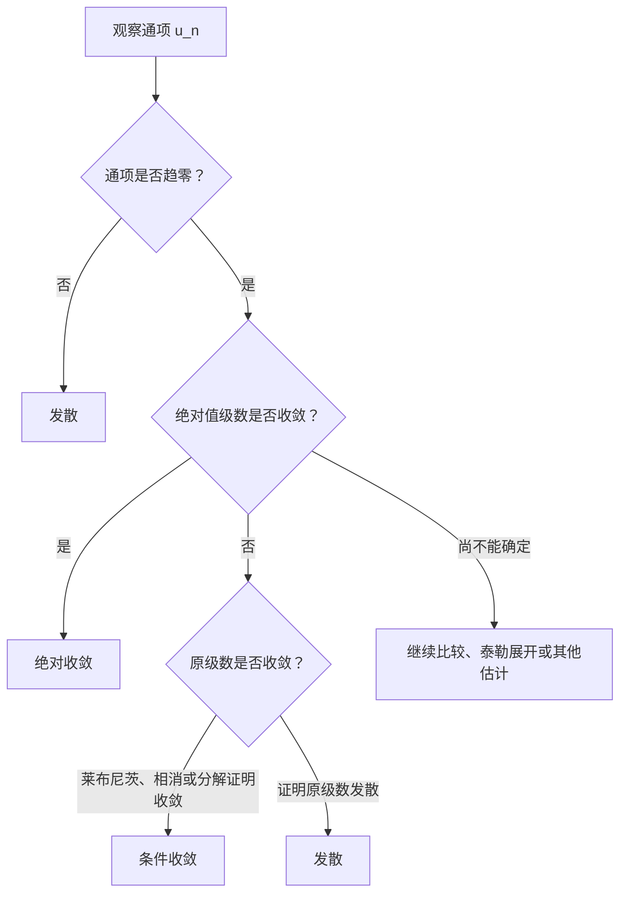
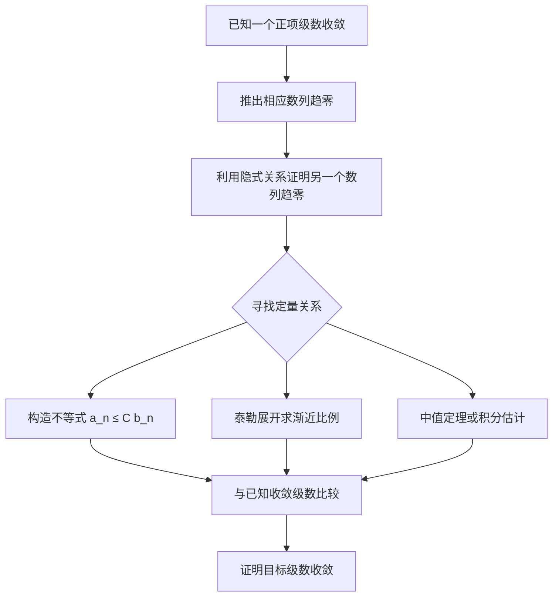
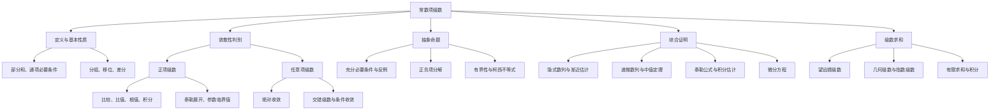

## 一、本节知识体系与考研命题逻辑

常数项级数表面上是在研究无穷多个数相加，实际上研究的是一个特殊的数列极限——**部分和数列的极限**。

本节存在四个层次：

| 层次  | 核心内容                       | 复习优先级 |
| --- | -------------------------- | ----- |
| 第一层 | 部分和、收敛定义、基本性质              | ★★★★★ |
| 第二层 | 正项级数及其审敛法                  | ★★★★★ |
| 第三层 | 交错级数、绝对收敛与条件收敛             | ★★★★★ |
| 第四层 | 抽象级数命题、递推数列、隐式数列、积分与级数综合证明 | ★★★★★ |

常数项级数不仅考查比值判别法、根值判别法等计算技巧，还非常重视以下能力：

- 将级数问题转化为部分和的极限问题。
- 根据通项的渐近阶判断敛散性。
- 准确区分充分条件、必要条件和充要条件。
- 利用反例否定错误的抽象命题。
- 利用泰勒公式处理含参数级数及高阶无穷小。
- 利用单调有界、中值定理、积分估计和递推关系构造收敛性证明。

**贯穿整节的核心思想：已知具体通项时，寻找它的衰减速度和符号规律；已知抽象条件时，寻找控制不等式或部分和结构。**

## 二、基础知识：真正理解级数的收敛

### 2.1 常数项级数与部分和

给定一个数列 $\{u_n\}$，将其各项依次相加，得到常数项级数

$$
\sum_{n=1}^{\infty}u_n =u_1+u_2+u_3+\cdots
$$

定义部分和：

$$
S_n=\sum_{k=1}^{n}u_k.
$$

若存在有限实数 $S$，使得

$$
\lim_{n\to\infty}S_n=S,
$$

则称该级数收敛，其和为 $S$；否则称该级数发散。

因此：

$$
\boxed{ \sum_{n=1}^{\infty}u_n\text{ 收敛} \iff S_n\text{ 收敛} }
$$

一定要区分两个数列：

| 对象             | 含义            |
| -------------- | ------------- |
| $u_n$      | 第 $n$ 项   |
| $S_n$      | 前 $n$ 项之和 |
| $\lim u_n$ | 通项的极限         |
| $\lim S_n$ | 级数的和（若存在）     |

**直观理解**

考虑以下四个级数：

$$
\begin{aligned} &1+\frac12+\frac14+\frac18+\cdots\\ &1+\frac12+\frac13+\frac14+\cdots\\ &1-\frac12+\frac13-\frac14+\cdots\\ &1-1+1-1+\cdots \end{aligned}
$$

| 级数     | 部分和的变化趋势                 | 结论 |
| ------ | ------------------------ | -- |
| 等比级数   | 逐渐逼近 $2$             | 收敛 |
| 调和级数   | 缓慢增长至无穷大                 | 发散 |
| 交错调和级数 | 在极限两侧振荡，逐渐逼近 $\ln 2$ | 收敛 |
| 正负1交替  | 在0与1之间反复振荡               | 发散 |

发散不一定意味着趋于无穷大，也可能意味着振荡、无有限极限。

### 2.2 级数收敛的必要条件

若

$$
\sum_{n=1}^{\infty}u_n
$$

收敛，则

$$
\boxed{\lim_{n\to\infty}u_n=0.}
$$

证明非常简单：

$$
u_n=S_n-S_{n-1}.
$$

由于

$$
S_n\to S,\qquad S_{n-1}\to S,
$$

所以

$$
u_n\to S-S=0.
$$

但是反过来不成立。最典型的反例是调和级数：

$$
\lim_{n\to\infty}\frac1n=0, \qquad \sum_{n=1}^{\infty}\frac1n\text{ 发散}.
$$

考试时应这样使用：

| 通项极限  | 可以得到的结论     |
| ----- | ----------- |
| 极限不为零 | 级数必发散       |
| 极限不存在 | 级数必发散       |
| 极限为零  | 不能直接确定级数敛散性 |

**判断级数敛散性时，第一反应永远是检查通项是否趋于零。**

### 2.3 柯西收敛准则

级数收敛等价于：

对于任意 $\varepsilon>0$，存在正整数 $N$，当 $m>n\ge N$ 时，有

$$
\left|\sum_{k=n+1}^{m}u_k\right| <\varepsilon.
$$

这表明，级数收敛不仅要求单独的一项越来越小，还要求充分靠后的任意一段连续项之和都可以任意小。

例如调和级数虽然每一项趋零，但是

$$
\sum_{k=n+1}^{2n}\frac1k \ge n\cdot\frac1{2n} =\frac12.
$$

无论 $n$ 多大，这一段尾项之和都不能任意小，因此调和级数发散。

柯西准则不是考场常规计算的首选方法，但对于抽象证明、递推数列和级数创新题，它是理解收敛本质的重要工具。

### 2.4 级数的基本运算性质

假设

$$
\sum u_n=A,\qquad \sum v_n=B.
$$

那么对于任意常数 $\alpha,\beta$，有

$$
\sum_{n=1}^{\infty} (\alpha u_n+\beta v_n) =\alpha A+\beta B.
$$

基本结论如下：

| 已知条件          | 和级数的敛散性        |
| ------------- | -------------- |
| 两个级数均收敛       | 必收敛            |
| 一个收敛，一个发散     | 必发散            |
| 两个级数均发散       | 不确定            |
| 两个级数均绝对收敛     | 必绝对收敛          |
| 一个条件收敛，一个绝对收敛 | 必条件收敛          |
| 两个级数均条件收敛     | 不确定是否绝对收敛，但必收敛 |

另外，增加、删除或者改变有限项，不影响级数的敛散性，但是通常会改变级数的和。

这意味着很多判别法只需从充分大的 $n$ 开始成立。

## 三、必须掌握的标准级数

所有复杂的常数项级数，最终通常都要转化为几类简单的标准级数。

### 3.1 等比级数

$$
\sum_{n=0}^{\infty}aq^n.
$$

当 $a\ne0$ 时，其收敛的充要条件为

$$
\boxed{|q|<1.}
$$

收敛时：

$$
\sum_{n=0}^{\infty}aq^n =\frac{a}{1-q}.
$$

特别注意起始下标：

$$
\sum_{n=1}^{\infty}q^n =\frac{q}{1-q}.
$$

### 3.2 $p$ 级数

$$
\sum_{n=1}^{\infty}\frac1{n^p}.
$$

结论为

$$
\boxed{ \begin{cases} p>1,&\text{收敛},\\ p\le1,&\text{发散}. \end{cases}}
$$

其中 $p=1$ 是临界状态，也就是调和级数。

这是正项级数最重要的比较对象。

遇到一个复杂通项，应尝试寻找

$$
u_n\sim \frac{C}{n^p}, \qquad C>0.
$$

只要确定了真正的指数 $p$，通常就可以完成判别。

### 3.3 对数型临界级数

$$
\sum_{n=2}^{\infty} \frac1{n(\ln n)^p}.
$$

结论为

$$
\boxed{ \begin{cases} p>1,&\text{收敛},\\ p\le1,&\text{发散}. \end{cases}}
$$

证明利用反常积分：

$$
\int_2^{+\infty} \frac{dx}{x(\ln x)^p}.
$$

令 $t=\ln x$，则

$$
\frac{dx}{x}=dt,
$$

于是原积分化为

$$
\int_{\ln2}^{+\infty}\frac{dt}{t^p}.
$$

因此临界指数仍然是1。

更一般地：

$$
\sum_{n=2}^{\infty} \frac1{n^\alpha(\ln n)^\beta}
$$

具有以下完整分类：

| 参数条件                       | 敛散性                 |
| -------------------------- | ------------------- |
| $\alpha>1$             | 对任意 $\beta$ 均收敛 |
| $\alpha<1$             | 对任意 $\beta$ 均发散 |
| $\alpha=1,\ \beta>1$   | 收敛                  |
| $\alpha=1,\ \beta\le1$ | 发散                  |

理解原则是：**先比较幂次，幂次处于临界状态时再比较对数因子。**

### 3.4 交错 $p$ 级数

$$
\sum_{n=1}^{\infty} \frac{(-1)^{n-1}}{n^p}.
$$

其完整分类为

$$
\boxed{ \begin{cases} p>1,&\text{绝对收敛},\\ 0<p\le1,&\text{条件收敛},\\ p\le0,&\text{发散}. \end{cases}}
$$

这两个临界值 $0$ 和 $1$ 必须牢记：

- $0$ 是交错级数能否满足通项趋零的临界点。
- $1$ 是绝对值级数是否收敛的临界点。

### 3.5 常用的裂项级数与指数级数

$$
\sum_{n=1}^{\infty} \frac1{n(n+1)}=1.
$$

$$
\sum_{n=1}^{\infty} \frac1{n(n+k)} =\frac1k\sum_{j=1}^{k}\frac1j, \qquad k\in\mathbb N^+.
$$

$$
\sum_{n=0}^{\infty}\frac1{n!}=e.
$$

$$
\sum_{n=1}^{\infty} \frac{(-1)^{n-1}}n=\ln2.
$$

其中前两个适合使用部分和与裂项相消，后两个通常与下一节的幂级数展开相联系。

## 四、题型一：部分和、级数分组与错位求和

这是本节抽象选择题和基础求和题的重要母题。

### 4.1 相邻项分组的本质

假设

$$
S_N=\sum_{n=1}^{N}u_n.
$$

将相邻两项分为一组，得到

$$
\sum_{n=1}^{\infty} (u_{2n-1}+u_{2n}).
$$

新级数的部分和为

$$
T_N=\sum_{n=1}^{N} (u_{2n-1}+u_{2n})=S_{2N}.
$$

因此原级数收敛必然推出分组级数收敛，且两者的和相同。

但是，分组级数收敛只说明偶数项部分和收敛。

还必须检查

$$
S_{2N-1}=S_{2N}-u_{2N}.
$$

因此：

$$
\boxed{ \begin{aligned} &S_{2N}\to S,\\ &u_n\to0 \end{aligned} \quad\Longrightarrow\quad S_N\to S. }
$$

相邻两项分组后的级数收敛，再加上原级数通项趋零，就能推出原级数收敛。

对于每组长度固定的分组，这一思路也同样适用。

### 4.2 母题1：2000年考研数学一

**来源：李林880第004题亦收录同类题。**

已知 $\sum u_n$ 收敛，判断以下哪个级数必收敛：

$$
\begin{aligned} \text{A. }&\sum\frac{(-1)^nu_n}{n}\\ \text{B. }&\sum u_n^2\\ \text{C. }&\sum(u_{2n-1}-u_{2n})\\ \text{D. }&\sum(u_n+u_{n+1}) \end{aligned}
$$

**解题思路**

D具有明显的移位求和结构。

设

$$
S_N=\sum_{n=1}^{N}u_n\to S.
$$

则

$$
\begin{aligned} \sum_{n=1}^{N}(u_n+u_{n+1}) &=S_N+S_{N+1}-u_1\\ &\to2S-u_1. \end{aligned}
$$

所以D必收敛。

**如何统一排除其他选项？**

对B、C，取经典反例

$$
u_n=\frac{(-1)^n}{\sqrt n}.
$$

原级数由莱布尼茨判别法收敛，但

$$
u_n^2=\frac1n,
$$

平方级数发散。

同时

$$
u_{2n-1}-u_{2n} =-\frac1{\sqrt{2n-1}} -\frac1{\sqrt{2n}},
$$

全部变为负项，所得级数发散。

对A，取

$$
u_n=\frac{(-1)^n}{\ln(n+1)}.
$$

原级数收敛，但

$$
\frac{(-1)^nu_n}{n} =\frac1{n\ln(n+1)},
$$

所得级数发散。

故答案为D。

**母题推广**

对于固定常数 $c_0,c_1,\ldots,c_m$，若原级数收敛，则

$$
\sum_{n=1}^{\infty} \left(\sum_{j=0}^{m}c_ju_{n+j}\right)
$$

必收敛，且其和为

$$
\boxed{ \sum_{j=0}^{m}c_j(S-S_j) }
$$

其中约定 $S_0=0$。

也就是说，**有限次移位的线性组合，不会破坏原级数的收敛性。**

### 4.3 母题2：已知部分和求新级数的和

**来源：李正元第008题。**

已知

$$
S_n=\frac n{2n-1},
$$

求

$$
\sum_{n=1}^{\infty} (u_n+u_{n+1}+u_{n+2}).
$$

原级数的和为

$$
S=\lim_{n\to\infty}\frac n{2n-1} =\frac12.
$$

并且

$$
u_1=S_1=1,
$$

$$
u_2=S_2-S_1 =\frac23-1=-\frac13.
$$

所以

$$
\begin{aligned} \sum_{n=1}^{\infty} (u_n+u_{n+1}+u_{n+2}) &=3S-2u_1-u_2\\ &=\frac32-2+\frac13\\ &=-\frac16. \end{aligned}
$$

答案：

$$
\boxed{-\frac16}.
$$

易错点在于忘记不同移位级数缺少的前几项。

### 4.4 母题3：二阶差分与望远镜级数

**来源：李正元第009题。**

求

$$
\sum_{n=1}^{\infty} (\sqrt{n+2}-2\sqrt{n+1}+\sqrt n).
$$

通项表面上是三个根式，实际上是两次差分。

令

$$
b_n=\sqrt{n+1}-\sqrt n.
$$

则

$$
u_n=b_{n+1}-b_n.
$$

因此

$$
\begin{aligned} S_N &=b_{N+1}-b_1\\ &=\sqrt{N+2}-\sqrt{N+1} -\sqrt2+1. \end{aligned}
$$

而

$$
\sqrt{N+2}-\sqrt{N+1} =\frac1{\sqrt{N+2}+\sqrt{N+1}}\to0.
$$

所以

$$
\boxed{S=1-\sqrt2}.
$$

**通用解题模板**

遇到

$$
u_n=f(n+1)-f(n),
$$

或者

$$
u_n=f(n+2)-2f(n+1)+f(n),
$$

优先构造一阶差分，写出有限部分和，然后取极限。

千万不要把两个分别发散的级数直接相减。例如不能直接将本题拆成三个根式级数分别求和。

### 4.5 进阶母题：不要求单调的交错相消

**来源：李林880第030题。**

设 $a_n>0$，且

$$
\lim_{n\to\infty}\frac n{a_n}=1.
$$

判断

$$
\sum_{n=1}^{\infty} (-1)^{n+1} \frac{a_n+a_{n+1}}{a_na_{n+1}}
$$

的敛散性。

首先拆分：

$$
\frac{a_n+a_{n+1}}{a_na_{n+1}} =\frac1{a_n}+\frac1{a_{n+1}}.
$$

注意这里并没有给出 $a_n$ 的单调性，因此不能直接使用莱布尼茨判别法。

但部分和中间项恰好相消：

$$
\begin{aligned} S_N &=\sum_{n=1}^{N}(-1)^{n+1} \left(\frac1{a_n}+\frac1{a_{n+1}}\right)\\ &=\frac1{a_1} +\frac{(-1)^{N+1}}{a_{N+1}}. \end{aligned}
$$

由于 $a_n\sim n$，所以

$$
S_N\to\frac1{a_1}.
$$

原级数收敛。

另一方面，

$$
\frac1{a_n}+\frac1{a_{n+1}} \sim\frac2n.
$$

绝对值级数发散。

因此原级数为条件收敛。

这道题非常有价值：**当交错级数的单调性无法确定时，应主动寻找相邻项相消结构，而不是强行套用莱布尼茨判别法。**

## 五、题型二：正项级数及审敛法的选择

### 5.1 正项级数收敛的本质

设 $u_n\ge0$，则

$$
S_{n+1}-S_n=u_{n+1}\ge0.
$$

所以部分和数列单调增加。

根据单调有界准则：

$$
\boxed{ \sum u_n\text{ 收敛} \iff \{S_n\}\text{ 有上界}. }
$$

这是正项级数所有常见判别方法的基础。

正项级数不可能出现部分和上下振荡的情况。它如果发散，部分和必趋于正无穷大。

### 5.2 五种常用审敛思路

| 判别法     | 适用对象            | 关键操作                   |
| ------- | --------------- | ---------------------- |
| 比较判别法   | 有明显大小关系         | 建立可求和上界或发散下界           |
| 极限比较判别法 | 根式、三角、对数、指数无穷小  | 找等价通项                  |
| 比值判别法   | 阶乘、连乘积、指数幂      | 计算 $u_{n+1}/u_n$  |
| 根值判别法   | 整体具有 $n$ 次幂 | 计算 $\sqrt[n]{u_n}$ |
| 积分判别法   | 对数型、复杂缓慢衰减通项    | 构造对应反常积分               |

其中对于考研数学一，比较判别法和极限比较判别法尤其重要，因为它们可以自然地与前面学过的极限、泰勒公式、不等式和积分相结合。

### 5.3 比较判别法

设从某项开始

$$
0\le u_n\le v_n.
$$

则

$$
\sum v_n\text{ 收敛} \Longrightarrow \sum u_n\text{ 收敛},
$$

以及

$$
\sum u_n\text{ 发散} \Longrightarrow \sum v_n\text{ 发散}.
$$

口诀是：**小于收敛，大于发散。**

其余两个方向均不能直接推出。

例如

$$
0<\frac1{n^2}\le\frac1n.
$$

较小的级数收敛，较大的级数却发散。

### 5.4 极限比较判别法

对于正项数列 $u_n,v_n$，设

$$
\lim_{n\to\infty}\frac{u_n}{v_n}=L.
$$

| 极限                 | 结论                                      |
| ------------------ | --------------------------------------- |
| $0<L<+\infty$ | 两个级数同敛散                                 |
| $L=0$          | 若 $\sum v_n$ 收敛，则 $\sum u_n$ 收敛 |
| $L=+\infty$    | 若 $\sum v_n$ 发散，则 $\sum u_n$ 发散 |

特别地：

$$
u_n\sim v_n,\qquad u_n,v_n>0
$$

则

$$
\sum u_n\text{ 与 }\sum v_n \text{ 同敛散}.
$$

这就是为什么级数判别与极限计算存在非常紧密的联系。

**注意：对任意变号级数，不能无条件使用等价无穷小替换来判断普通收敛性。这个陷阱后面会专门讲解。**

### 5.5 母题4：2004年考研数学一

设 $\sum a_n$ 为正项级数，下列命题正确的是哪个？

A. 若 $a_n\to0$，则级数收敛。

B. 若 $na_n\to\lambda\ne0$，则级数发散。

C. 若级数收敛，则 $n^2a_n\to0$。

D. 若级数发散，则 $a_n$ 必趋于某个非零常数。

正确选项为B。

因为 $a_n>0$，所以 $\lambda>0$。

$$
\frac{a_n}{1/n} =na_n\to\lambda.
$$

由极限比较判别法，$\sum a_n$ 与调和级数同敛散，因此发散。

A、D均可用 $a_n=1/n$ 排除。

对于C，取

$$
a_n=\frac1{n^{3/2}}.
$$

则级数收敛，但

$$
n^2a_n=\sqrt n\to+\infty.
$$

**更深层的结论**

对于一般正项级数：

$$
\sum a_n\text{ 收敛}
$$

不能推出 $na_n\to0$。

例如构造

$$
a_n= \begin{cases} 1/\sqrt n,&n=2^k,\ k\ge1,\\ 1/n^2,&\text{其他情形}. \end{cases}
$$

其中稀疏的尖峰项构成收敛的几何级数，所以 $\sum a_n$ 收敛，但在 $n=2^k$ 时，

$$
na_n=\sqrt n\to+\infty.
$$

这说明，正项级数收敛并不意味着每一项都必须按照固定幂次规律衰减。

若额外给出 $a_n$ 单调递减，则可以推出 $na_n\to0$。这是有无单调性条件的重要区别。

### 5.6 母题5：比值判别法与根值判别法

对于正项级数，若

$$
\lim_{n\to\infty}\frac{u_{n+1}}{u_n} =\rho,
$$

则

$$
\begin{cases} 0\le\rho<1,&\text{收敛},\\ \rho>1,&\text{发散},\\ \rho=1,&\text{不能确定}. \end{cases}
$$

根值判别法将比值替换为

$$
\lim_{n\to\infty}\sqrt[n]{u_n}=\rho,
$$

结论相同。

若通项可能变号，比值法必须考察

$$
\left|\frac{u_{n+1}}{u_n}\right|,
$$

根值法必须考察

$$
\sqrt[n]{|u_n|}.
$$

当极限小于1时，所得结论为绝对收敛。

**代表题：1988年考研数三**

判断

$$
\sum_{n=1}^{\infty} \frac{(n+1)!}{n^{n+1}}
$$

的敛散性。

看到阶乘和变动次数幂，优先使用比值法：

$$
\begin{aligned} \frac{u_{n+1}}{u_n} &=\frac{(n+2)!}{(n+1)^{n+2}} \cdot\frac{n^{n+1}}{(n+1)!}\\ &=\frac{n+2}{n+1} \left(\frac n{n+1}\right)^{n+1}\\ &\to e^{-1}<1. \end{aligned}
$$

因此级数收敛。

**含参推广**

讨论

$$
\sum_{n=1}^{\infty} \frac{a^nn!}{n^n}, \qquad a>0.
$$

比值极限为

$$
\lim_{n\to\infty}\frac{u_{n+1}}{u_n} =\frac ae.
$$

所以：

$$
\begin{cases} a<e,&\text{收敛},\\ a>e,&\text{发散}. \end{cases}
$$

当 $a=e$ 时，不能直接使用比值法下结论。

此时重新考察：

$$
\frac{u_{n+1}}{u_n} =e\left(\frac n{n+1}\right)^n =\frac e{(1+1/n)^n}>1.
$$

因此 $u_n$ 单调增加且为正，通项不趋零，级数发散。

最终：

$$
\boxed{0<a<e\text{ 时收敛，其余发散}.}
$$

这体现了含参比值法的标准步骤：**先确定临界参数，再单独处理临界点。**

### 5.7 母题6：变动指数的临界收敛问题

**来源：张宇1000第020题。**

判断两个级数：

$$
\text{①}\quad \sum_{n=1}^{\infty} \frac1{n^{1+1/n}},
$$

$$
\text{②}\quad \sum_{n=2}^{\infty} \frac1{n^{1+1/\sqrt{\ln n}}}.
$$

两者的幂指数都趋于1，但敛散性不同。

**级数①**

将变动指数化为指数函数：

$$
\frac1{n^{1+1/n}} =\frac1n e^{-\frac{\ln n}{n}}.
$$

因为

$$
\frac{\ln n}{n}\to0,
$$

所以

$$
\frac1{n^{1+1/n}}\sim\frac1n.
$$

故①发散。

**级数②**

同样改写为

$$
\frac1{n^{1+1/\sqrt{\ln n}}} =\frac1{ne^{\sqrt{\ln n}}}.
$$

利用积分判别法，考察

$$
\int_2^{+\infty} \frac{dx}{xe^{\sqrt{\ln x}}}.
$$

令

$$
t=\sqrt{\ln x}, \qquad \frac{dx}{x}=2t\,dt.
$$

于是化为

$$
\int_{\sqrt{\ln2}}^{+\infty} 2te^{-t}\,dt.
$$

该反常积分收敛，因此②收敛。

**母题进一步推广**

对于级数

$$
\sum_{n=2}^{\infty} \frac1{n^{1+\varepsilon_n}}, \qquad \varepsilon_n\to0,
$$

必须考察

$$
\varepsilon_n\ln n,
$$

因为

$$
n^{-1-\varepsilon_n} =\frac1n e^{-\varepsilon_n\ln n}.
$$

如果 $\varepsilon_n\ln n\to L$，且 $L$ 有限，那么原通项与 $1/n$ 同阶，级数发散。

如果 $\varepsilon_n\ln n\to+\infty$，则还不能直接确定，需要进一步判断衰减速度。

例如取

$$
\varepsilon_n =\frac{p\ln\ln n}{\ln n},
$$

则

$$
\frac1{n^{1+\varepsilon_n}} =\frac1{n(\ln n)^p}.
$$

临界条件正好变成 $p>1$。

这是未来含变动指数创新题的重要构造方式。

### 5.8 进阶母题：比值极限等于1的连乘积

**来源：李正元第027题。**

设

$$
a_n= \frac{1\cdot3\cdot5\cdots(2n-1)} {2\cdot4\cdot6\cdots2n},
$$

判断

$$
\sum_{n=1}^{\infty}a_n^p.
$$

容易得到

$$
\frac{a_{n+1}}{a_n} =\frac{2n+1}{2n+2}\to1.
$$

所以直接使用比值法失效。

题目提供的突破口是证明

$$
\frac1{4n}<a_n^2<\frac1{2n+1}, \qquad n\ge2.
$$

利用递推关系

$$
a_{n+1}^2 =a_n^2 \left(\frac{2n+1}{2n+2}\right)^2
$$

以及不等式

$$
\left(\frac{2n+1}{2n+2}\right)^2 >\frac n{n+1},
$$

$$
\frac{2n+1}{4(n+1)^2} <\frac1{2n+3},
$$

结合 $n=2$ 的初值验证，可用数学归纳法建立上述双侧估计。

由此可知 $a_n$ 与 $n^{-1/2}$ 同阶，故当 $p>0$ 时，$a_n^p$ 与 $n^{-p/2}$ 同阶。

因此

$$
\boxed{ \sum a_n^p\text{ 收敛} \iff p>2. }
$$

对于 $p\le0$，通项不趋零，直接判定发散。

**这类题说明：比值法失效后，可以利用递推关系构造上下界，将连乘积转化成标准** $p$ **级数。**

## 六、题型三：利用等价无穷小与泰勒公式判断级数

这一题型是常数项级数中非常重要的计算主线，也是第一模块极限、第三模块泰勒公式的综合应用。

### 6.1 必须熟练掌握的高阶等价关系

当 $x\to0$ 时：

| 表达式                        | 等价无穷小       |
| -------------------------- | ----------- |
| $\sin x$               | $x$     |
| $\tan x$               | $x$     |
| $\ln(1+x)$             | $x$     |
| $e^x-1$                | $x$     |
| $1-\cos x$             | $x^2/2$ |
| $x-\sin x$             | $x^3/6$ |
| $\tan x-x$             | $x^3/3$ |
| $e^x-1-x$              | $x^2/2$ |
| $x-\ln(1+x)$           | $x^2/2$ |
| $\arcsin x-x$          | $x^3/6$ |
| $x-\arctan x$          | $x^3/3$ |
| $\dfrac{x}{\sin x}-1$  | $x^2/6$ |
| $\ln\dfrac{x}{\sin x}$ | $x^2/6$ |
| $\sqrt{1+x}-1$         | $x/2$   |

必须重视含加减法的高阶无穷小，而不仅是最基础的一阶等价无穷小。

因为命题人经常通过两个函数相减，故意消掉一阶项，从而改变级数的敛散性。

### 6.2 母题7：1992年考研数学一

设 $\alpha>0$，判断

$$
\sum_{n=1}^{\infty} (-1)^n\left(1-\cos\frac\alpha n\right)
$$

的敛散性。

首先考察绝对值级数：

$$
\sum_{n=1}^{\infty} \left(1-\cos\frac\alpha n\right).
$$

利用

$$
1-\cos x\sim\frac{x^2}{2},
$$

得到

$$
1-\cos\frac\alpha n \sim\frac{\alpha^2}{2n^2}.
$$

由于 $\sum1/n^2$ 收敛，因此原级数绝对收敛。

**推广为一类含参问题**

设 $\alpha>0$，判断

$$
\sum_{n=1}^{\infty} (-1)^n \left(1-\cos\frac1{n^\alpha}\right).
$$

其绝对值通项满足

$$
1-\cos\frac1{n^\alpha} \sim\frac1{2n^{2\alpha}}.
$$

因此：

$$
2\alpha>1 \iff \alpha>\frac12
$$

时绝对收敛。

又因为对于 $\alpha>0$，通项的绝对值单调递减趋零，故

$$
\boxed{ \begin{cases} \alpha>\frac12,&\text{绝对收敛},\\ 0<\alpha\le\frac12,&\text{条件收敛}. \end{cases}}
$$

一般地，若

$$
f(x)\sim Cx^k, \qquad C\ne0,
$$

那么对于固定的 $\alpha>0$，

$$
f(n^{-\alpha})\sim Cn^{-k\alpha}.
$$

判断其绝对值级数，只需比较 $k\alpha$ 与1的大小。

### 6.3 母题8：模拟卷中的超大指数陷阱

**来源：李永乐六套卷第3套第4题。**

若级数

$$
\sum_{n=1}^{\infty} \left(\frac1n\csc\frac1n-1\right)^{2026p}
$$

收敛，求 $p$ 的范围。

2026这个大数字只是干扰因素。

令 $t=1/n$，则

$$
\begin{aligned} t\csc t-1 &=\frac{t-\sin t}{\sin t}\\ &\sim\frac{t^3/6}{t}\\ &=\frac{t^2}{6}. \end{aligned}
$$

所以

$$
\frac1n\csc\frac1n-1 \sim\frac1{6n^2}.
$$

括号内为正，对固定实数 $p$ 取幂：

$$
\left(\frac1n\csc\frac1n-1\right)^{2026p} \sim \frac{6^{-2026p}}{n^{4052p}}.
$$

因此

$$
4052p>1.
$$

最终得到

$$
\boxed{p>\frac1{4052}.}
$$

这个题目与张宇1000第002题

$$
\sum_{n=1}^{\infty} \left(\ln\frac1n-\ln\sin\frac1n\right)
$$

具有完全相同的核心结构，都是通过三角函数的高阶泰勒展开确定衰减阶数。

### 6.4 母题9：含参数级数的低阶消项

**来源：2017年考研数三。**

若

$$
\sum_{n=2}^{\infty} \left[\sin\frac1n -k\ln\left(1-\frac1n\right)\right]
$$

收敛，求 $k$。

<Steps>

<Step>

### 第一步：展开到可能影响敛散性的阶数 [!toc]

$$
\sin\frac1n =\frac1n-\frac1{6n^3}+O(n^{-5}),
$$

$$
\ln\left(1-\frac1n\right) =-\frac1n-\frac1{2n^2} -\frac1{3n^3}+O(n^{-4}).
$$

因此

$$
u_n =\frac{1+k}{n} +\frac{k}{2n^2} +O(n^{-3}).
$$

</Step>

<Step>

### 第二步：消掉不可求和的低阶项 [!toc]

若 $1+k\ne0$，则

$$
u_n\sim\frac{1+k}{n}.
$$

通项最终同号，级数发散。

因此收敛的必要条件为

$$
1+k=0.
$$

</Step>

<Step>

### 第三步：验证剩余项是否收敛 [!toc]

当 $k=-1$ 时，

$$
u_n=-\frac1{2n^2}+O(n^{-3}).
$$

此时绝对收敛。

故

$$
\boxed{k=-1}.
$$

</Step>

</Steps>

**高阶消项变式**

讨论

$$
\sum_{n=2}^{\infty} \left[ \ln\left(1+\frac1{\sqrt n}\right) -\frac1{\sqrt n} +\frac\lambda n \right].
$$

展开得

$$
\begin{aligned} u_n &=\left(\lambda-\frac12\right)\frac1n\\ &\quad+\frac1{3n^{3/2}} +O(n^{-2}). \end{aligned}
$$

因此：

$$
\boxed{ \begin{cases} \lambda=\frac12,&\text{绝对收敛},\\ \lambda\ne\frac12,&\text{发散}. \end{cases}}
$$

**更一般的消项原则**

设一个通项具有渐近展开

$$
u_n=\frac{A}{n^{1/3}} +\frac{B}{n^{2/3}} +\frac{C}{n} +O(n^{-4/3}).
$$

在这个展开成立的条件下，级数收敛当且仅当

$$
A=B=C=0.
$$

因为前三项都是不可求和的幂次，只有全部消除后，剩余项才可以由收敛级数控制。

遇到含多个参数的级数，必须逐个消掉这些不可求和的低阶项，而不能只消去第一项。

## 七、题型四：交错级数、绝对收敛与条件收敛

### 7.1 三种敛散状态

对于任意实数项级数 $\sum u_n$，有三种互斥的情况。

| 状态   | $\sum u_n$ | $\sum \|u_n\|$ |
| ---- | -------------- | ------------------ |
| 绝对收敛 | 收敛             | 收敛                 |
| 条件收敛 | 收敛             | 发散                 |
| 发散   | 发散             | 发散                 |

核心定理：

$$
\boxed{ \sum|u_n|\text{ 收敛} \Longrightarrow \sum u_n\text{ 收敛}. }
$$

其逆命题不成立。

从直观上看，绝对收敛意味着所有项的大小本身就可以求和，不需要正负项抵消；条件收敛则依靠正负项的抵消才能得到有限结果。

### 7.2 莱布尼茨判别法

设

$$
\sum_{n=1}^{\infty}(-1)^{n-1}a_n, \qquad a_n\ge0.
$$

如果满足

$$
a_{n+1}\le a_n
$$

和

$$
\lim_{n\to\infty}a_n=0,
$$

则该交错级数收敛。

其中单调递减只需从某项开始成立。

此外，若条件成立，则充分大的 $N$ 对应的截断误差满足

$$
\boxed{|S-S_N|\le a_{N+1}.}
$$

要注意：

- 单调性与趋零必须同时验证。
- 莱布尼茨条件是充分条件，不是必要条件。
- 证明交错级数收敛以后，仍需单独判断绝对值级数，才能确定是条件收敛还是绝对收敛。

### 7.3 交错级数的标准判别流程

绝对值级数发散，不代表原级数一定条件收敛，也不代表原级数一定发散。

### 7.4 母题10：2025年考研数学一

判断下列两个级数的敛散性：

$$
\text{①}\quad \sum_{n=1}^{\infty} \sin\frac{n^3\pi}{n^2+1},
$$

$$
\text{②}\quad \sum_{n=1}^{\infty}(-1)^n \left[ \frac1{\sqrt[3]{n^2}} -\tan\frac1{\sqrt[3]{n^2}} \right].
$$

这是非常值得重点掌握的近年真题，它将三角函数变形、交错结构与高阶无穷小结合在一起。

**级数①：寻找隐藏的交错结构**

首先进行多项式除法：

$$
\frac{n^3}{n^2+1} =n-\frac n{n^2+1}.
$$

所以

$$
\begin{aligned} \sin\frac{n^3\pi}{n^2+1} &=\sin\left(n\pi-\frac{n\pi}{n^2+1}\right)\\ &=(-1)^{n+1} \sin\frac{n\pi}{n^2+1}. \end{aligned}
$$

原本没有直接出现 $(-1)^n$，现在转化成了交错级数。

令

$$
b_n=\sin\frac{n\pi}{n^2+1}.
$$

对于充分大的 $n$，有

$$
b_n>0,\qquad b_n\downarrow0.
$$

因此由莱布尼茨判别法，①收敛。

再考察绝对值级数：

$$
b_n\sim\frac{n\pi}{n^2+1} \sim\frac\pi n.
$$

绝对值级数发散，故①条件收敛。

**级数②：判断真正的无穷小阶数**

令

$$
t=n^{-2/3}.
$$

利用

$$
\tan t=t+\frac{t^3}{3}+O(t^5),
$$

可得

$$
t-\tan t =-\frac{t^3}{3}+O(t^5).
$$

因此

$$
\left| n^{-2/3}-\tan n^{-2/3} \right| \sim\frac1{3n^2}.
$$

绝对值级数收敛，所以②绝对收敛。

最终答案：

$$
\boxed{\text{①条件收敛，②绝对收敛}.}
$$

**这道真题的迁移价值**

将第一题中的三角函数推广为

$$
\sin(n\pi+\varepsilon_n) =(-1)^n\sin\varepsilon_n,
$$

$$
\cos(n\pi+\varepsilon_n) =(-1)^n\cos\varepsilon_n.
$$

当 $\varepsilon_n\to0$ 时：

- 正弦型通常能够提取一个小量，再判断交错收敛。
- 余弦型的绝对值通常趋于1，可能直接由通项不趋零判定发散。

遇到含 $n\pi$ 的三角函数，应优先寻找周期性和奇偶性，而不是直接进行泰勒展开。

### 7.5 母题11：1995年考研数学一

设

$$
u_n=(-1)^n \ln\left(1+\frac1{\sqrt n}\right).
$$

判断 $\sum u_n$ 和 $\sum u_n^2$ 的敛散性。

令

$$
a_n=\ln\left(1+\frac1{\sqrt n}\right).
$$

显然 $a_n>0$，且 $a_n$ 单调递减趋零。

因此 $\sum u_n$ 收敛。

但

$$
\ln\left(1+\frac1{\sqrt n}\right) \sim\frac1{\sqrt n},
$$

从而

$$
u_n^2 =\ln^2\left(1+\frac1{\sqrt n}\right) \sim\frac1n.
$$

故平方级数发散。

$$
\boxed{ \sum u_n\text{ 收敛}, \qquad \sum u_n^2\text{ 发散}. }
$$

事实上，原级数是条件收敛。

**通用的幂次变换结论**

若

$$
u_n=\frac{(-1)^n}{n^\alpha}, \qquad \alpha>0,
$$

则

$$
|u_n|^q=\frac1{n^{q\alpha}}.
$$

所以

$$
\boxed{ \sum|u_n|^q\text{ 收敛} \iff q\alpha>1 }
$$

对于 $q>0$ 成立。

平方、立方、开方不只是代数运算，还可能改变通项衰减阶数，甚至改变正负项抵消结构。

### 7.6 最容易失分的陷阱：变号级数不能直接使用等价替换

对于正项级数，

$$
u_n\sim v_n
$$

可以推出同敛散。

但对于变号级数，这一结论一般不成立。

考虑

$$
v_n=\frac{(-1)^n}{\sqrt n},
$$

$$
u_n=\frac{(-1)^n}{\sqrt n}+\frac1n.
$$

因为

$$
\frac{u_n}{v_n} =1+\frac{(-1)^n}{\sqrt n} \to1,
$$

所以

$$
u_n\sim v_n.
$$

然而：

$$
\sum v_n\text{ 收敛},
$$

而

$$
\sum u_n =\sum\frac{(-1)^n}{\sqrt n} +\sum\frac1n
$$

发散。

这就是变号级数中高阶项也可能决定收敛性的原因。

### 7.7 母题12：李林模拟卷的高质量含参综合题

**来源：李林六套卷第4套第4题。**

已知

$$
\text{Ⅰ}\quad \sum_{n=1}^{\infty}(-1)^n \left[ \ln\frac1{n^p} -\ln\left(\sin\frac1{n^p}\right) \right]
$$

绝对收敛，且

$$
\text{Ⅱ}\quad \sum_{n=2}^{\infty} \ln\left(1+\frac{(-1)^n}{n^p}\right)
$$

条件收敛，求 $p$ 的范围。

<Steps>

<Step>

### 第一步：检查定义域 [!toc]

第二个级数中，对数真数必须为正，因此要求 $p>0$。

</Step>

<Step>

### 第二步：判断第一个级数 [!toc]

令 $t=n^{-p}$。

$$
\ln\frac{t}{\sin t} \sim\frac{t^2}{6}.
$$

所以绝对值通项满足

$$
\left|\ln\frac{n^{-p}}{\sin n^{-p}}\right| \sim\frac1{6n^{2p}}.
$$

绝对收敛要求

$$
p>\frac12.
$$

</Step>

<Step>

### 第三步：判断第二个级数的普通收敛性 [!toc]

记

$$
x_n=\frac{(-1)^n}{n^p}.
$$

利用泰勒公式：

$$
\ln(1+x_n) =x_n-\frac{x_n^2}{2}+O(|x_n|^3).
$$

代入得

$$
\ln\left(1+\frac{(-1)^n}{n^p}\right) = \frac{(-1)^n}{n^p} -\frac1{2n^{2p}} +O(n^{-3p}).
$$

由于已经知道 $p>1/2$，第一项构成交错收敛级数，后两项构成绝对收敛级数。

因此原级数收敛。

另一方面：

$$
\left| \ln\left(1+\frac{(-1)^n}{n^p}\right) \right| \sim\frac1{n^p}.
$$

要使绝对值级数发散，必须有 $p\le1$。

最终：

$$
\boxed{\frac12<p\le1}.
$$

</Step>

</Steps>

**更深入的推广：单独讨论第二个级数**

对于

$$
\sum_{n=2}^{\infty} \ln\left(1+\frac{(-1)^n}{n^p}\right), \qquad p>0,
$$

实际上具有以下完整结论：

$$
\boxed{ \begin{cases} p>1,&\text{绝对收敛},\\ \frac12<p\le1,&\text{条件收敛},\\ 0<p\le\frac12,&\text{发散}. \end{cases}}
$$

当 $0<p\le1/2$ 时，利用

$$
\ln(1+x_n)-x_n \sim-\frac1{2n^{2p}},
$$

可知非交错修正项发散，而第一阶交错项收敛，因此原级数发散。

这类题最重要的思想是：

**主项负责正负抵消，二阶修正项可能负责累积发散。必须同时分析两个机制。**

### 7.8 高阶补充：狄利克雷思想

对于不具有严格交错形式的振荡级数，例如

$$
\sum_{n=1}^{\infty}\frac{\sin n}{n},
$$

莱布尼茨判别法不能直接使用。

狄利克雷判别法提供一种补充思路：若 $\sum_{k=1}^{N}a_k$ 一致有界，且 $b_n$ 单调趋零，则

$$
\sum a_nb_n
$$

收敛。

例如 $\sin n$ 的部分和有界，因此

$$
\sum_{n=1}^{\infty}\frac{\sin n}{n}
$$

收敛。

这一内容作为处理非典型振荡级数的拓展即可，不必将其放在常规比较判别法、比值法和莱布尼茨判别法之前复习。

## 八、题型五：抽象级数命题与反例构造

这是本节最容易出现选择题陷阱的部分。

解抽象级数题，不应依赖直觉判断，而应建立一套稳定的推理规则。

### 8.1 收敛级数与有界数列的乘积

**重要结论**

若

$$
\sum|a_n|<+\infty,
$$

且数列 $\{b_n\}$ 有界，则

$$
\boxed{\sum a_nb_n\text{ 绝对收敛}.}
$$

证明：

存在 $M>0$，使得

$$
|b_n|\le M.
$$

因此

$$
|a_nb_n|\le M|a_n|.
$$

由比较判别法即可。

特别地，若两个级数均收敛，其中一个绝对收敛，则它们对应项的乘积所构成的级数必绝对收敛。

但是，若两个级数都只是条件收敛，乘积级数不一定收敛。

例如

$$
a_n=b_n=\frac{(-1)^n}{\sqrt n},
$$

则

$$
a_nb_n=\frac1n,
$$

乘积级数发散。

### 8.2 母题13：2009年考研数学一

**来源：汤家凤八套卷第3套第4题、李林880第036题为相关变式。**

设 $a_n\to0$，判断以下结论哪个正确：

$$
\begin{aligned} \text{A. }& \sum b_n\text{ 收敛} \Rightarrow\sum a_nb_n\text{ 收敛};\\ \text{B. }& \sum b_n\text{ 发散} \Rightarrow\sum a_nb_n\text{ 发散};\\ \text{C. }& \sum|b_n|\text{ 收敛} \Rightarrow\sum a_n^2b_n^2\text{ 收敛};\\ \text{D. }& \sum|b_n|\text{ 发散} \Rightarrow\sum a_n^2b_n^2\text{ 发散}. \end{aligned}
$$

对C：

因为 $a_n\to0$，所以 $\{a_n\}$ 有界。

设

$$
|a_n|\le M.
$$

由 $\sum|b_n|$ 收敛，知道 $b_n\to0$。

充分大时：

$$
|b_n|\le1,
$$

所以

$$
0\le a_n^2b_n^2 \le M^2|b_n|^2 \le M^2|b_n|.
$$

故C正确。

其余选项分别构造：

| 选项 | 反例                           | 核心原因          |
| -- | ---------------------------- | ------------- |
| A  | $a_n=b_n=(-1)^n/\sqrt n$ | 乘积消除交错符号      |
| B  | $a_n=1/n^2,\ b_n=1$      | 小量因子可以让发散变为收敛 |
| D  | $a_n=1/n^2,\ b_n=1$      | 平方后衰减更快       |

**应当掌握的幂次规律**

如果

$$
\sum|u_n|^p<+\infty, \qquad p>0,
$$

那么对任何 $q\ge p$，都有

$$
\boxed{\sum|u_n|^q<+\infty.}
$$

因为 $u_n\to0$，充分大时 $|u_n|\le1$，从而

$$
|u_n|^q\le|u_n|^p.
$$

反过来则一般不成立。

这正是汤家凤第5套第4题中“正项级数收敛必然推出平方级数收敛”的理论基础。

### 8.3 母题14：1994年考研数学一、数三

已知

$$
\sum_{n=1}^{\infty}a_n^2
$$

收敛，判断

$$
\sum_{n=1}^{\infty} (-1)^n\frac{|a_n|}{\sqrt{n^2+\lambda}}, \qquad\lambda>0
$$

的敛散性。

乍看之下，分母近似于 $n$，但是无法直接确定 $a_n$ 的具体衰减阶数。

这时应联想到均值不等式或者柯西不等式。

<Tabs items={["方法一：均值不等式", "方法二：柯西—施瓦茨不等式"]} defaultIndex={0}>

<Tab value="方法一：均值不等式">

$$
\begin{aligned} \frac{|a_n|}{\sqrt{n^2+\lambda}} &\le\frac{|a_n|}{n}\\ &\le\frac12\left(a_n^2+\frac1{n^2}\right). \end{aligned}
$$

由于右侧两个级数均收敛，因此

$$
\sum_{n=1}^{\infty} \frac{|a_n|}{\sqrt{n^2+\lambda}}
$$

收敛。

原级数绝对收敛。

</Tab>

<Tab value="方法二：柯西—施瓦茨不等式">

$$
\begin{aligned} \sum_{n=1}^{N}\frac{|a_n|}{n} &\le \sqrt{\sum_{n=1}^{N}a_n^2} \sqrt{\sum_{n=1}^{N}\frac1{n^2}}\\ &\le \sqrt{\sum_{n=1}^{\infty}a_n^2} \sqrt{\sum_{n=1}^{\infty}\frac1{n^2}}. \end{aligned}
$$

非负部分和有统一上界，因此收敛。

</Tab>

</Tabs>

**母题定理**

如果

$$
\sum a_n^2<+\infty, \qquad \sum b_n^2<+\infty,
$$

则

$$
\boxed{\sum|a_nb_n|<+\infty.}
$$

遇到“已知平方级数收敛，要求证明乘积级数收敛”，第一反应应当是

$$
\boxed{2|ab|\le a^2+b^2}.
$$

### 8.4 母题15：张宇八套卷的柯西不等式变式

**来源：张宇8套卷第8套第3题。**

已知正项级数 $\sum a_n$ 收敛，判断

$$
\sum_{n=1}^{\infty}(-1)^n \frac{\sqrt{a_{n+2}}} {\sqrt{n^2+1+\cos\alpha}}
$$

的敛散性。

首先

$$
1+\cos\alpha\ge0.
$$

所以

$$
\sqrt{n^2+1+\cos\alpha}\ge n.
$$

于是

$$
\begin{aligned} |u_n| &\le\frac{\sqrt{a_{n+2}}}{n}\\ &\le\frac12 \left(a_{n+2}+\frac1{n^2}\right). \end{aligned}
$$

右侧级数收敛，因此原级数绝对收敛。

**与1994年真题的联系**

两道题的结构本质完全相同：

$$
\sum A_n^2\text{ 收敛}, \qquad \sum B_n^2\text{ 收敛},
$$

因此

$$
\sum|A_nB_n|\text{ 收敛}.
$$

本题只是令

$$
A_n=\sqrt{a_{n+2}}, \qquad B_n=\frac1n.
$$

根式、参数和交错符号都是表面包装。

### 8.5 母题16：非线性级数条件转化为平方可和

**来源：李永乐六套卷第5套第3题。**

已知

$$
\sum_{n=1}^{\infty} \ln\left[1+(u_n^2-4)^2\right]
$$

收敛，证明

$$
\sum_{n=1}^{\infty} \frac{|u_n^2-4|}{n}
$$

收敛。

令

$$
a_n=|u_n^2-4|.
$$

由已知级数收敛，

$$
\ln(1+a_n^2)\to0.
$$

从而

$$
a_n\to0.
$$

由于

$$
\ln(1+a_n^2)\sim a_n^2,
$$

可知

$$
\sum a_n^2
$$

收敛。

又由于

$$
\frac{a_n}{n} \le\frac12\left(a_n^2+\frac1{n^2}\right),
$$

所以所求级数收敛。

<Callout type="warn" title="隐藏陷阱">

原条件只能说明

$$
u_n^2\to4,
$$

不能推出 $u_n$ 本身收敛。

例如

$$
u_n=2(-1)^n.
$$

原级数每一项都等于0，但是 $u_n$ 在 $2$ 与 $-2$ 之间振荡。

这种非线性映射可能丢失符号信息，是抽象选择题很常见的陷阱。

</Callout>

### 8.6 正负项分解

对于实数项级数，定义正部、负部的大小：

$$
p_n=\frac{|u_n|+u_n}{2}\ge0,
$$

$$
q_n=\frac{|u_n|-u_n}{2}\ge0.
$$

则

$$
u_n=p_n-q_n,
$$

$$
|u_n|=p_n+q_n.
$$

由此可以得到：

| 原级数状态 | 正部级数    | 负部大小级数  |
| ----- | ------- | ------- |
| 绝对收敛  | 收敛      | 收敛      |
| 条件收敛  | 发散至正无穷大 | 发散至正无穷大 |
| 发散    | 至少一个发散  | 至少一个发散  |

相关真题与练习：2003年数三、张宇1000第024题和李林880第032题。

特别是条件收敛时，正部和负部的大小级数必同时发散。否则，由原级数收敛以及其中一个正部或负部级数收敛，可以推出另一个也收敛，从而原级数绝对收敛，产生矛盾。

注意有的题目将负部定义为

$$
q_n=\frac{u_n-|u_n|}{2}\le0.
$$

这种定义下负部级数发散至负无穷大，结论本质不变，但必须注意符号。

### 8.7 母题17：2023年考研数学一、数三

已知

$$
a_n<b_n
$$

且

$$
\sum a_n,\qquad\sum b_n
$$

均收敛。

判断“$\sum a_n$ 绝对收敛”是“$\sum b_n$ 绝对收敛”的什么条件。

这是近年抽象级数命题中非常重要的一道母题。

<Steps>

<Step>

### 第一步：构造非负差项 [!toc]

令

$$
c_n=b_n-a_n>0.
$$

由于原来两个级数都收敛，因此

$$
\sum c_n =\sum b_n-\sum a_n
$$

收敛。

又因为 $c_n>0$，所以

$$
\sum|c_n| =\sum c_n
$$

收敛。

关键发现：**两个原级数的差必绝对收敛。**

</Step>

<Step>

### 第二步：证明充分性 [!toc]

若 $\sum|a_n|$ 收敛，则

$$
|b_n|=|a_n+c_n| \le|a_n|+c_n.
$$

因此 $\sum|b_n|$ 收敛。

</Step>

<Step>

### 第三步：证明必要性 [!toc]

若 $\sum|b_n|$ 收敛，则

$$
|a_n|=|b_n-c_n| \le|b_n|+c_n.
$$

所以 $\sum|a_n|$ 收敛。

最终结论为充要条件。

</Step>

</Steps>

**可以推广出的重要定理**

如果

$$
\sum|a_n-b_n|<+\infty,
$$

则两个级数具有相同的敛散分类：

$$
\boxed{ \begin{aligned} \sum a_n\text{ 收敛} &\iff\sum b_n\text{ 收敛},\\ \sum a_n\text{ 绝对收敛} &\iff\sum b_n\text{ 绝对收敛},\\ \sum a_n\text{ 条件收敛} &\iff\sum b_n\text{ 条件收敛}. \end{aligned}}
$$

也就是说，给一个级数增加绝对可和的扰动，不会改变原来的敛散分类。

这一结论在泰勒展开、误差估计和变号级数中非常有用。

### 8.8 考研常用反例库

与其背几十道抽象选择题的结论，不如熟练掌握以下十个反例。

| 要否定的错误命题                                  | 典型反例                                  |
| ----------------------------------------- | ------------------------------------- |
| 通项趋零则级数收敛                                 | $u_n=1/n$                         |
| 部分和有界则级数收敛                                | $u_n=(-1)^n$                      |
| 级数收敛则绝对收敛                                 | $u_n=(-1)^n/n$                    |
| 级数收敛则平方级数收敛                               | $u_n=(-1)^n/\sqrt n$              |
| 平方级数收敛则原级数收敛                              | $u_n=1/n$                         |
| 正项级数收敛则开方级数收敛                             | $u_n=1/n^2$                       |
| 正项级数收敛则通项单调递减                             | $u_{2n-1}=1/n^2,\ u_{2n}=2/n^2$ |
| 单调递减则交错级数收敛                               | $u_n=1+1/n$                       |
| 有 $(-1)^n$ 则级数必收敛                     | $u_n=(-1)^n[2+(-1)^n]/n$          |
| 正项级数收敛则存在 $p>1$ 使 $u_n=O(n^{-p})$ | $u_n=1/[n(\ln n)^2]$              |

最后两种尤其重要。

倒数第二个反例可以写成

$$
u_n=\frac{2(-1)^n}{n}+\frac1n.
$$

它确实是符号交替的级数，通项也趋于零，但是由于其中存在发散的正项修正，原级数仍然发散。

所以，交错符号本身并不能保证级数收敛。

## 九、题型六：利用泰勒定理与中值定理证明级数收敛

这一部分开始进入数学一综合解答题的核心区域。

与前面的具体计算不同，这类题通常不会直接给出通项的显式表达式，而是给出函数的导数条件、极限条件或者微分方程，然后要求证明级数收敛。

### 9.1 母题18：1994年考研数学一证明题

设 $f(x)$ 在 $x=0$ 的某邻域内具有二阶连续导数，且

$$
\lim_{x\to0}\frac{f(x)}x=0.
$$

证明级数

$$
\sum_{n=1}^{\infty}f\left(\frac1n\right)
$$

绝对收敛（默认题中各项均有定义）。

**审题思路**

已知的是一个函数极限，而目标是证明级数收敛。

我们需要将函数值

$$
f\left(\frac1n\right)
$$

控制为一个已知收敛级数的通项。

最自然的目标是证明

$$
\left|f\left(\frac1n\right)\right| \le\frac C{n^2}.
$$

<Steps>

<Step>

### 第一步：提取原点信息 [!toc]

由

$$
\lim_{x\to0}\frac{f(x)}x=0
$$

可知

$$
\lim_{x\to0}f(x)=0.
$$

由于 $f$ 在原点连续，故

$$
f(0)=0.
$$

因此

$$
f'(0) =\lim_{x\to0} \frac{f(x)-f(0)}x=0.
$$

</Step>

<Step>

### 第二步：使用二阶泰勒公式 [!toc]

$$
f(x)=f(0)+f'(0)x+\frac12f''(\xi)x^2,
$$

其中 $\xi$ 在0与 $x$ 之间。

代入前面的结论：

$$
f(x)=\frac12f''(\xi)x^2.
$$

由于 $f''$ 连续，在原点附近有界，存在 $M>0$，使得

$$
|f''(\xi)|\le M.
$$

所以

$$
|f(x)|\le\frac M2x^2.
$$

</Step>

<Step>

### 第三步：转化为正项级数比较 [!toc]

令 $x=1/n$，当 $n$ 充分大时，

$$
\left|f\left(\frac1n\right)\right| \le\frac M{2n^2}.
$$

由 $\sum1/n^2$ 收敛，得到

$$
\boxed{ \sum_{n=1}^{\infty} f\left(\frac1n\right) \text{ 绝对收敛}. }
$$

</Step>

</Steps>

**这道题的核心母题**

如果函数满足

$$
f(0)=f'(0)=\cdots=f^{(m-1)}(0)=0,
$$

且 $f^{(m)}$ 在零点附近有界并满足泰勒定理所需条件，那么

$$
f(x)=O(x^m).
$$

因此当 $m\alpha>1$ 时，

$$
\boxed{\sum f(n^{-\alpha})\text{ 绝对收敛}.}
$$

这就是通过函数零点阶数控制级数敛散性的通用方法。

<Callout type="warn" title="重要陷阱">

仅有

$$
f(x)=o(x)
$$

不足以保证

$$
\sum f(1/n)
$$

收敛。

例如令

$$
f(x)= \frac{x}{\ln(1/|x|)}
$$

在 $0<|x|<1$ 内定义，并令 $f(0)=0$。

此时

$$
\frac{f(x)}x\to0,
$$

但是

$$
f\left(\frac1n\right) =\frac1{n\ln n}, \qquad n\ge2,
$$

相应级数发散。

原题的二阶连续可导条件不是多余条件，它帮助我们获得足够强的二阶估计。

</Callout>

### 9.2 母题19：李正元练习题中的积分函数证明

**来源：李正元第024题。**

设 $f(x)$ 在 $[-2,2]$ 上具有连续导数，且 $f(0)=0$。

定义

$$
F(x)=\int_{-x}^{x}f(x+t)\,dt.
$$

证明

$$
\sum_{n=1}^{\infty}F\left(\frac1n\right)
$$

绝对收敛。

<Steps>

<Step>

### 第一步：消除复杂的积分变量 [!toc]

令

$$
u=x+t.
$$

对于 $x\ge0$，有

$$
F(x)=\int_0^{2x}f(u)\,du.
$$

</Step>

<Step>

### 第二步：用中值定理估计被积函数 [!toc]

因为 $f(0)=0$，且 $f'$ 连续有界，所以

$$
f(u)=f'(\xi)u.
$$

存在 $M>0$，使得

$$
|f(u)|\le M|u|.
$$

</Step>

<Step>

### 第三步：通过积分提高无穷小阶数 [!toc]

$$
\begin{aligned} |F(x)| &\le\int_0^{2x}|f(u)|\,du\\ &\le M\int_0^{2x}u\,du\\ &=2Mx^2. \end{aligned}
$$

于是

$$
\left|F\left(\frac1n\right)\right| \le\frac{2M}{n^2}.
$$

所以原级数绝对收敛。

</Step>

</Steps>

**核心思想**

若

$$
f(x)=O(x^p),\qquad p>-1,
$$

则

$$
\int_0^x f(t)\,dt=O(x^{p+1}).
$$

在靠近原点的积分问题中，积分通常可以使无穷小阶数提高一阶。

因此当题目中出现变上限积分函数时，不一定要先计算原函数，往往直接估计阶数就足够了。

### 9.3 母题20：微分方程与级数判别

**来源：李林880第049题。**

已知函数 $y=y(x)$ 满足

$$
y'=x+y,\qquad y(0)=1.
$$

讨论

$$
\sum_{n=1}^{\infty} \left[ y\left(\frac1n\right)-1-\frac1n \right]
$$

的敛散性。

<Tabs items={["方法一：不解微分方程，直接提取泰勒系数", "方法二：解出函数表达式"]} defaultIndex={0}>

<Tab value="方法一：不解微分方程，直接提取泰勒系数">

由

$$
y'=x+y
$$

可得

$$
y'(0)=1.
$$

两边求导：

$$
y''=1+y'.
$$

所以

$$
y''(0)=2.
$$

利用泰勒公式：

$$
\begin{aligned} y(x) &=y(0)+y'(0)x+\frac12y''(0)x^2+o(x^2)\\ &=1+x+x^2+o(x^2). \end{aligned}
$$

因此

$$
y\left(\frac1n\right)-1-\frac1n =\frac1{n^2}+o(n^{-2}).
$$

所以级数绝对收敛。

</Tab>

<Tab value="方法二：解出函数表达式">

由

$$
y'-y=x
$$

可解得

$$
y=Ce^x-x-1.
$$

代入 $y(0)=1$，得到 $C=2$。

因此

$$
y(x)=2e^x-x-1.
$$

原级数通项为

$$
2\left(e^{1/n}-1-\frac1n\right) \sim\frac1{n^2}.
$$

结论相同。

</Tab>

</Tabs>

<Callout type="idea" title="考场策略">

若题目只要求判断某个级数的敛散性，不要求求解微分方程，那么应优先考虑直接利用方程求出低阶导数。

这可以节省大量计算时间。

</Callout>

## 十、题型七：隐式数列与级数综合证明

这类题是常数项级数解答题中最值得重点突破的类型之一。

通常给出关于 $a_n,b_n$ 的隐式关系，以及一个已知收敛级数，要求证明另一个级数收敛。

### 10.1 标准解题框架

其中最容易被忽略的是：**泰勒展开之前必须先证明对应数列确实趋于展开点。**

### 10.2 母题21：2004年考研数学一

设方程

$$
x^n+nx-1=0
$$

有待确定的正实根 $x_n$。

证明它存在唯一正实根，并证明当 $\alpha>1$ 时，

$$
\sum_{n=1}^{\infty}x_n^\alpha
$$

收敛。

**第一问：根的存在性与唯一性**

构造

$$
F_n(x)=x^n+nx-1.
$$

有

$$
F_n(0)=-1,\qquad F_n(1)=n>0.
$$

由零点定理，在 $(0,1)$ 内至少存在一个根。

又因为

$$
F_n'(x)=nx^{n-1}+n>0, \qquad x>0,
$$

所以 $F_n(x)$ 严格递增，正根唯一。

**第二问：从原方程提取上界**

在根处，

$$
x_n^n+nx_n=1.
$$

由于 $x_n^n>0$，因此

$$
nx_n<1.
$$

即

$$
0<x_n<\frac1n.
$$

于是

$$
0<x_n^\alpha<\frac1{n^\alpha}.
$$

当 $\alpha>1$ 时，右侧级数收敛，因此原级数收敛。

**更强的结论**

其实还能确定其收敛的充要条件。

因为

$$
0<x_n^n<\frac1{n^n}\to0,
$$

所以

$$
nx_n=1-x_n^n\to1.
$$

即

$$
x_n\sim\frac1n.
$$

从而对于固定实数 $\alpha$，

$$
x_n^\alpha\sim n^{-\alpha}.
$$

于是

$$
\boxed{\sum x_n^\alpha\text{ 收敛}\iff\alpha>1}.
$$

原题的证明要求与这个进一步推广的区别在于：证明充分性只需要上界，而寻找充要条件通常需要同阶估计或者渐近等价。

### 10.3 母题22：2014年考研数学一

已知

$$
0<a_n<\frac\pi2,\qquad 0<b_n<\frac\pi2,
$$

且

$$
\cos a_n-a_n=\cos b_n.
$$

若 $\sum b_n$ 收敛，证明：

$$
\text{（1）}\quad a_n\to0;
$$

$$
\text{（2）}\quad \sum_{n=1}^{\infty}\frac{a_n}{b_n} \text{ 收敛}.
$$

**第一问：利用单调性和夹逼定理**

原式改写为

$$
a_n=\cos a_n-\cos b_n>0.
$$

于是

$$
\cos a_n>\cos b_n.
$$

由于 $\cos x$ 在 $(0,\pi/2)$ 内严格递减，所以

$$
0<a_n<b_n.
$$

由 $\sum b_n$ 收敛，得到 $b_n\to0$。

再利用夹逼定理，得

$$
a_n\to0.
$$

**第二问：寻找 $a_n$ 与 $b_n$ 的定量关系**

原方程可以改写为

$$
a_n+1-\cos a_n=1-\cos b_n.
$$

由于

$$
1-\cos a_n\ge0,
$$

所以

$$
0<a_n\le1-\cos b_n.
$$

又因为

$$
1-\cos x\le\frac{x^2}{2},
$$

因此

$$
a_n\le\frac{b_n^2}{2}.
$$

两边除以 $b_n>0$，得到

$$
0<\frac{a_n}{b_n}\le\frac{b_n}{2}.
$$

由于 $\sum b_n$ 收敛，所以

$$
\boxed{ \sum_{n=1}^{\infty}\frac{a_n}{b_n} \text{ 收敛}. }
$$

**更深入的渐近分析**

由原式

$$
a_n+(1-\cos a_n)=1-\cos b_n,
$$

并且

$$
1-\cos a_n=O(a_n^2)=o(a_n),
$$

得到

$$
a_n+(1-\cos a_n)\sim a_n.
$$

另一方面，

$$
1-\cos b_n\sim\frac{b_n^2}{2}.
$$

因此

$$
\boxed{a_n\sim\frac12b_n^2}.
$$

也就是

$$
\frac{a_n}{b_n}\sim\frac12b_n.
$$

这样也可以通过极限比较判别法完成证明。

**母题思想**

如果题目给出

$$
F(a_n)=G(b_n),
$$

而在零点附近，

$$
F(x)\sim Ax^p,\qquad G(x)\sim Bx^q,
$$

其中 $A,B,p,q>0$，且 $a_n,b_n\to0^+$，那么

$$
Aa_n^p\sim Bb_n^q.
$$

从而

$$
\boxed{ a_n\sim \left(\frac BA\right)^{1/p} b_n^{q/p}. }
$$

这就是隐式数列渐近阶数法。

### 10.4 母题23：李永乐六套卷综合证明

**来源：李永乐六套卷第2套第20题。**

已知

$$
\ln(1+a_n)=\frac{a_n}{1+b_n}, \qquad 0<a_n,b_n<1.
$$

若 $\sum b_n$ 收敛，证明：

$$
\text{（1）}\quad a_n>b_n;
$$

$$
\text{（2）}\quad \sum(a_n-b_n)\text{ 收敛}.
$$

**第一问：识别中值定理的标准结构**

将已知等式改写为

$$
\frac{\ln(1+a_n)-\ln1}{a_n} =\frac1{1+b_n}.
$$

对 $f(x)=\ln(1+x)$ 在 $[0,a_n]$ 上应用拉格朗日中值定理：

$$
\frac{\ln(1+a_n)-\ln1}{a_n} =\frac1{1+\xi_n}, \qquad 0<\xi_n<a_n.
$$

与已知条件比较：

$$
\frac1{1+\xi_n}=\frac1{1+b_n}.
$$

因此

$$
b_n=\xi_n<a_n.
$$

**第二问：构造一致上界**

由题设，

$$
b_n=\frac{a_n}{\ln(1+a_n)}-1.
$$

于是

$$
\frac{b_n}{a_n} = \frac{a_n-\ln(1+a_n)} {a_n\ln(1+a_n)}.
$$

又因为 $0<a_n<1$，

$$
\begin{aligned} a_n-\ln(1+a_n) &=\int_0^{a_n}\frac{t}{1+t}\,dt\\ &\ge\int_0^{a_n}\frac t2\,dt\\ &=\frac{a_n^2}{4}. \end{aligned}
$$

而

$$
a_n\ln(1+a_n)\le a_n^2.
$$

所以

$$
\frac{b_n}{a_n}\ge\frac14.
$$

即

$$
a_n\le4b_n.
$$

结合第一问：

$$
0<a_n-b_n<a_n\le4b_n.
$$

因此由比较判别法，

$$
\boxed{\sum(a_n-b_n)\text{ 收敛}}.
$$

这道题还可以先由 $b_n\to0$ 证明 $a_n\to0$，再用泰勒公式得到

$$
b_n\sim\frac12a_n,
$$

最终得出

$$
a_n-b_n\sim b_n.
$$

两种方法相比，不等式方法可以避免额外证明 $a_n\to0$，而渐近方法能够揭示更加精确的比例关系。

### 10.5 母题24：张宇1000高阶隐式数列

**来源：张宇1000第026题。**

已知

$$
e^{a_n}-e^{-a_n} =a_n(e^{b_n}+e^{-b_n}),
$$

其中

$$
0<a_n,b_n<1, \qquad \sum b_n\text{ 收敛}.
$$

证明 $a_n>b_n$，并证明

$$
\sum(b_n-a_n)
$$

收敛。

**第一问**

定义

$$
\sinh x=\frac{e^x-e^{-x}}2, \qquad \cosh x=\frac{e^x+e^{-x}}2.
$$

原关系化为

$$
\frac{\sinh a_n}{a_n} =\cosh b_n.
$$

注意

$$
\frac{\sinh a_n}{a_n} =\frac1{a_n}\int_0^{a_n}\cosh t\,dt.
$$

由于 $\cosh t$ 在正半轴严格递增，所以

$$
\frac1{a_n}\int_0^{a_n}\cosh t\,dt <\cosh a_n.
$$

于是

$$
\cosh b_n<\cosh a_n.
$$

因此

$$
b_n<a_n.
$$

**第二问**

由 $\sum b_n$ 收敛，得 $b_n\to0$。

所以

$$
\frac{\sinh a_n}{a_n}\to1.
$$

函数

$$
h(x)=\frac{\sinh x}{x}
$$

在正半轴严格递增，且 $h(0^+)=1$。因此 $a_n\to0$。

利用泰勒展开：

$$
\frac{\sinh a_n}{a_n}-1 \sim\frac{a_n^2}{6},
$$

$$
\cosh b_n-1 \sim\frac{b_n^2}{2}.
$$

由两者相等，得到

$$
\frac{a_n^2}{6} \sim\frac{b_n^2}{2}.
$$

故

$$
\frac{a_n}{b_n}\to\sqrt3.
$$

进一步

$$
a_n-b_n\sim(\sqrt3-1)b_n.
$$

因为 $\sum b_n$ 收敛，所以

$$
\boxed{\sum(b_n-a_n)\text{ 绝对收敛}.}
$$

这道题与2014年真题、李永乐模拟题看起来截然不同，但其证明框架相同：

先建立大小关系，再证明数列趋零，最后利用渐近阶数比较。

## 十一、题型八：递推数列、部分和与级数的综合

这一类型通常与第一模块的数列极限、第三模块的中值定理相结合，是数学一证明题的重要命题方向。

### 11.1 差分级数的核心恒等式

对于任意数列 $\{a_n\}$，都有

$$
\sum_{n=1}^{N} (a_{n+1}-a_n) =a_{N+1}-a_1.
$$

因此

$$
\boxed{ \sum_{n=1}^{\infty}(a_{n+1}-a_n) \text{ 收敛} \iff \{a_n\}\text{ 收敛}. }
$$

并且当 $a_n\to A$ 时，

$$
\sum_{n=1}^{\infty}(a_{n+1}-a_n) =A-a_1.
$$

如果 $\{a_n\}$ 单调收敛，则更进一步：

$$
\boxed{ \sum_{n=1}^{\infty}|a_{n+1}-a_n| =|A-a_1|. }
$$

但是任意收敛数列的差分级数不一定绝对收敛。

例如

$$
a_n=\frac{(-1)^n}{n},
$$

虽然 $a_n\to0$，但

$$
|a_{n+1}-a_n| =\frac1{n+1}+\frac1n,
$$

因此绝对值级数发散。

### 11.2 母题25：1997年考研数学一

设

$$
a_1=2, \qquad a_{n+1}=\frac12 \left(a_n+\frac1{a_n}\right).
$$

证明：

$$
\text{（1）}\quad \lim_{n\to\infty}a_n\text{ 存在};
$$

$$
\text{（2）}\quad \sum_{n=1}^{\infty} \left(\frac{a_n}{a_{n+1}}-1\right) \text{ 收敛}.
$$

**第一问：单调有界**

由

$$
a_{n+1}-1 =\frac{(a_n-1)^2}{2a_n},
$$

以及 $a_1>1$，可知

$$
a_n>1.
$$

同时

$$
a_{n+1}-a_n =\frac{1-a_n^2}{2a_n}<0.
$$

所以数列单调递减且有下界1，因此收敛。

令

$$
\lim a_n=A.
$$

对递推式取极限：

$$
A=\frac12\left(A+\frac1A\right).
$$

得 $A^2=1$。

又 $A\ge1$，故

$$
A=1.
$$

**第二问：将目标级数控制为差分级数**

由于 $a_n>a_{n+1}>1$，

$$
\begin{aligned} 0<\frac{a_n}{a_{n+1}}-1 &=\frac{a_n-a_{n+1}}{a_{n+1}}\\ &\le a_n-a_{n+1}. \end{aligned}
$$

而

$$
\sum_{n=1}^{N}(a_n-a_{n+1}) =a_1-a_{N+1}\to1.
$$

所以由比较判别法，

$$
\boxed{ \sum_{n=1}^{\infty} \left(\frac{a_n}{a_{n+1}}-1\right) \text{ 收敛}. }
$$

**解题本质**

第二问并不需要求 $a_n$ 的通项公式，也不需要确定收敛速度。

只需利用第一问已经建立的单调性与有界性，构造一个必然收敛的差分级数作为上界。

### 11.3 母题26：2016年考研数学一

设函数 $f$ 可导，满足

$$
f(0)=1,\qquad 0<f'(x)<\frac12.
$$

数列由

$$
x_{n+1}=f(x_n)
$$

确定。

证明：

（1）$\sum(x_{n+1}-x_n)$ 绝对收敛；

（2）$\lim x_n$ 存在，且极限属于 $(0,2)$。

这里按照原题通常的理解，函数在证明所涉及的区间上均有定义，并满足给定导数条件。

**第一问：使用拉格朗日中值定理**

$$
\begin{aligned} |x_{n+1}-x_n| &=|f(x_n)-f(x_{n-1})|\\ &=|f'(\xi_n)|\,|x_n-x_{n-1}|\\ &\le\frac12|x_n-x_{n-1}|. \end{aligned}
$$

反复迭代：

$$
|x_{n+1}-x_n| \le\left(\frac12\right)^{n-1} |x_2-x_1|.
$$

由于

$$
\sum_{n=1}^{\infty} \left(\frac12\right)^{n-1}
$$

是收敛的几何级数，因此

$$
\boxed{\sum(x_{n+1}-x_n)\text{ 绝对收敛}}.
$$

**第二问：通过差分级数得到数列收敛**

由

$$
\sum_{n=1}^{N}(x_{n+1}-x_n) =x_{N+1}-x_1
$$

以及差分级数收敛，可知 $x_n$ 收敛。

令其极限为 $L$，对递推式取极限得到

$$
L=f(L).
$$

下面证明 $0<L<2$。

若 $L\le0$，则当 $L<0$ 时，由中值定理，

$$
f(L)-f(0)=f'(\xi)L.
$$

所以

$$
L=1+f'(\xi)L.
$$

即

$$
(1-f'(\xi))L=1,
$$

这与 $L\le0$ 矛盾；而 $L=0$ 也与 $f(0)=1$ 矛盾。

故 $L>0$。

再次使用上述等式，有

$$
L=\frac1{1-f'(\xi)}.
$$

由于

$$
0<f'(\xi)<\frac12,
$$

所以实际上可得到更强的结论

$$
\boxed{1<L<2}.
$$

当然也满足题目要求的 $L\in(0,2)$。

**通用推广：压缩型递推**

若

$$
x_{n+1}=f(x_n),
$$

且在相关区间内

$$
|f'(x)|\le q<1,
$$

则

$$
|x_{n+1}-x_n| \le q^{n-1}|x_2-x_1|.
$$

由此可推出差分级数绝对收敛、数列收敛，以及相应的误差估计：

$$
|L-x_n| \le\frac{q^{n-1}}{1-q}|x_2-x_1|.
$$

也就是说，一旦发现导数绝对值有一个小于1的统一上界，就应当主动联想到几何级数控制。

### 11.4 母题27：李林880的部分和估计

**来源：李林880第052题。**

设

$$
\sum_{n=1}^{\infty}u_n
$$

为发散的正项级数，

$$
S_n=\sum_{k=1}^{n}u_k.
$$

求

$$
\text{（1）}\quad \sum_{n=1}^{\infty} \left(\frac1{S_n}-\frac1{S_{n+1}}\right);
$$

证明

$$
\text{（2）}\quad \sum_{n=1}^{\infty}\frac{u_n}{S_n^2}
$$

收敛。

**第一问**

因为是发散的正项级数，

$$
S_n\to+\infty.
$$

所以

$$
\begin{aligned} \sum_{n=1}^{N} \left(\frac1{S_n}-\frac1{S_{n+1}}\right) &=\frac1{S_1}-\frac1{S_{N+1}}\\ &\to\frac1{u_1}. \end{aligned}
$$

答案为

$$
\boxed{\frac1{u_1}}.
$$

**第二问**

注意

$$
u_n=S_n-S_{n-1}.
$$

对于 $n\ge2$，

$$
\begin{aligned} \frac1{S_{n-1}}-\frac1{S_n} &=\frac{S_n-S_{n-1}}{S_{n-1}S_n}\\ &=\frac{u_n}{S_{n-1}S_n}. \end{aligned}
$$

因为

$$
S_{n-1}\le S_n,
$$

所以

$$
0<\frac{u_n}{S_n^2} \le\frac1{S_{n-1}}-\frac1{S_n}.
$$

右侧构成望远镜级数，因而左侧级数收敛。

**高阶迁移**

对于发散正项级数的部分和 $S_n$，一般还有

$$
\boxed{ \sum_{n=1}^{\infty}\frac{u_n}{S_n^p} \begin{cases} \text{收敛},&p>1,\\ \text{发散},&p\le1. \end{cases}}
$$

当 $p>1$ 时，可利用

$$
\frac{S_n-S_{n-1}}{S_n^p} \le \int_{S_{n-1}}^{S_n}\frac{dx}{x^p}, \qquad n\ge2.
$$

累加后得到收敛的反常积分上界。

当 $p=1$ 时，需要额外证明

$$
\sum\frac{u_n}{S_n}
$$

发散：假设该级数收敛，令 $r_n=u_n/S_n$，则 $r_n\to0$，并且充分大时

$$
-\ln(1-r_n)\le2r_n.
$$

但

$$
-\ln(1-r_n) =\ln S_n-\ln S_{n-1},
$$

其级数的部分和趋于无穷大，产生矛盾。

对于 $p<1$，充分大时 $S_n\ge1$，有

$$
\frac{u_n}{S_n^p}\ge\frac{u_n}{S_n},
$$

所以仍然发散。

这个推广可以应对以“发散级数的部分和”为条件、改变分母幂次的创新题。

### 11.5 母题28：由递推关系判断充要条件

**来源：李林880第037题。**

设 $a_n,b_n>0$，且

$$
b_1=1,\qquad b_{n+1}(b_{n+1}-b_n)=a_n.
$$

证明

$$
\{b_n\}\text{ 收敛} \iff \sum a_n\text{ 收敛}.
$$

由 $a_n>0$，可知

$$
b_{n+1}>b_n\ge1.
$$

若 $\sum a_n$ 收敛，则

$$
0<b_{n+1}-b_n =\frac{a_n}{b_{n+1}}\le a_n.
$$

因此差分级数收敛，进而 $b_n$ 收敛。

反过来，若 $b_n$ 收敛，则存在 $M>0$，使得

$$
b_n\le M.
$$

所以

$$
0<a_n =b_{n+1}(b_{n+1}-b_n) \le M(b_{n+1}-b_n).
$$

由于 $b_n$ 收敛，差分级数收敛，因此 $\sum a_n$ 收敛。

两方向成立，故原命题为充要条件。

本题也可以利用

$$
b_{n+1}^2-b_n^2 =(b_{n+1}+b_n)(b_{n+1}-b_n)
$$

构造更直接的平方差望远镜级数。

## 十二、题型九：积分定义数列与级数的综合

题目如果给出

$$
a_n=\int_a^b f_n(x)\,dx,
$$

然后要求判断级数或者求级数的和，通常存在三种突破口：

一是直接计算积分；二是利用积分不等式建立上界；三是通过相邻项相加、相减，构造便于积分的表达式。

### 12.1 母题29：1999年考研数学一

设

$$
a_n=\int_0^{\pi/4}\tan^n x\,dx.
$$

（1）求

$$
\sum_{n=1}^{\infty} \frac{a_n+a_{n+2}}n;
$$

（2）证明对于任意 $\lambda>0$，级数

$$
\sum_{n=1}^{\infty} \frac{a_n}{n^\lambda}
$$

收敛。

**第一问：不要逐个求 $a_n$**

题目特意给出了

$$
a_n+a_{n+2}.
$$

应联想到

$$
1+\tan^2x=\sec^2x.
$$

因此

$$
\begin{aligned} a_n+a_{n+2} &=\int_0^{\pi/4} \tan^nx(1+\tan^2x)\,dx\\ &=\int_0^{\pi/4} \tan^nx\sec^2x\,dx. \end{aligned}
$$

令 $t=\tan x$，得到

$$
a_n+a_{n+2} =\int_0^1t^n\,dt =\frac1{n+1}.
$$

于是

$$
\begin{aligned} \sum_{n=1}^{\infty} \frac{a_n+a_{n+2}}n &=\sum_{n=1}^{\infty}\frac1{n(n+1)}\\ &=\sum_{n=1}^{\infty} \left(\frac1n-\frac1{n+1}\right)\\ &=1. \end{aligned}
$$

答案为

$$
\boxed{1}.
$$

**第二问：利用第一问得到上界**

由 $a_n,a_{n+2}>0$，可知

$$
0<a_n<a_n+a_{n+2} =\frac1{n+1}.
$$

因此

$$
0<\frac{a_n}{n^\lambda} <\frac1{n^\lambda(n+1)} <\frac1{n^{1+\lambda}}.
$$

因为 $\lambda>0$，所以 $1+\lambda>1$。

由比较判别法，所求级数收敛。

**更进一步：求出 $a_n$ 的渐近阶数**

换元 $t=\tan x$ 得

$$
a_n=\int_0^1\frac{t^n}{1+t^2}\,dt.
$$

由于

$$
\frac12\le\frac1{1+t^2}\le1,
$$

因此

$$
\frac1{2(n+1)} \le a_n\le\frac1{n+1}.
$$

由双侧比较可知，事实上

$$
\sum\frac{a_n}{n^\lambda}
$$

收敛的充要条件是

$$
\boxed{\lambda>0}.
$$

原题只要求证明充分性，但通过双侧估计可以完整确定临界指数。

### 12.2 母题30：张宇模拟卷中的微分方程与积分级数

**来源：张宇8套卷第7套第20题，张宇1000第007题也有同题。**

设函数 $y(x)$ 满足

$$
(1-x)y'+2y=0,\qquad y(0)=1,
$$

并定义

$$
a_n(x)=\int_0^x y(t)\sin^nt\,dt.
$$

求 $y(x)$，并证明

$$
\sum_{n=1}^{\infty}a_n(1)
$$

收敛。

**第一问：解微分方程**

在包含初值点的 $x<1$ 区间内，分离变量：

$$
\frac{dy}{y}=-\frac2{1-x}\,dx.
$$

积分得到

$$
y=C(1-x)^2.
$$

由初值 $y(0)=1$，得 $C=1$。

因此在题目所需的区间 $[0,1]$ 上，

$$
y(x)=(1-x)^2.
$$

**第二问：寻找统一的几何级数上界**

$$
a_n(1)=\int_0^1(1-t)^2\sin^nt\,dt.
$$

因为在 $[0,1]$ 内，

$$
0\le\sin t\le\sin1<1,
$$

所以

$$
\begin{aligned} 0\le a_n(1) &\le(\sin1)^n \int_0^1(1-t)^2\,dt\\ &=\frac13(\sin1)^n. \end{aligned}
$$

由于右侧为收敛的几何级数，因此

$$
\boxed{\sum a_n(1)\text{ 收敛}.}
$$

原解析采用 $\sin t\le t$，得到

$$
\begin{aligned} a_n(1) &\le\int_0^1(1-t)^2t^n\,dt\\ &=\frac2{(n+1)(n+2)(n+3)}. \end{aligned}
$$

同样能够证明收敛。

**为什么两种方法都值得掌握？**

若积分区间为 $[0,\pi/2]$，则 $\sin t$ 的最大值为1，无法再使用公比严格小于1的统一几何级数上界。

这时就需要进一步分析被积函数在最大值附近的衰减情况。

例如：

$$
\int_0^1t^n(1-t)^2\,dt =\frac2{(n+1)(n+2)(n+3)} \sim\frac2{n^3}.
$$

积分核在端点处的消失阶数，也可能决定级数是否收敛。

### 12.3 母题31：通过有限部分和交换求和与积分

**来源：李正元第028题。**

设

$$
a_n=\int_0^1x^2(1-x)^n\,dx.
$$

求

$$
\sum_{n=1}^{\infty}a_n.
$$

利用有限项求和公式：

$$
\begin{aligned} S_N &=\int_0^1x^2 \sum_{n=1}^{N}(1-x)^n\,dx\\ &=\int_0^1x(1-x) [1-(1-x)^N]\,dx. \end{aligned}
$$

因此

$$
S_N=\int_0^1x(1-x)\,dx -\int_0^1x(1-x)^{N+1}\,dx.
$$

第一项为

$$
\int_0^1x(1-x)\,dx=\frac16.
$$

而第二项满足

$$
0\le \int_0^1x(1-x)^{N+1}\,dx \le\frac1{N+2}\to0.
$$

所以

$$
\boxed{\sum_{n=1}^{\infty}a_n=\frac16}.
$$

**通用思想**

先对有限项求和，再使用积分的线性性质，最后估计余项并取极限。

这样可以避免在没有验证条件时直接交换无穷求和与积分。

一般而言，当遇到

$$
\sum_{n=1}^{\infty} \int_a^b f(x)[g(x)]^n\,dx
$$

时，应想到几何级数结构；若 $|g(x)|\le q<1$ 一致成立，而且 $f$ 可积，则可以用几何级数控制余项。若 $g(x)$ 在端点达到1，则需要另外处理余项和可积性问题。

## 十三、题型十：常数项级数求和

常数项级数的敛散性判别与求和是两个不同任务。

绝大多数收敛级数并不能通过简单的初等函数公式求出其和。因此当题目明确要求求和时，首先应识别特殊结构。

### 13.1 常见求和方法

| 通项特征                   | 优先考虑的方法    |
| ---------------------- | ---------- |
| $f(n)-f(n+1)$      | 裂项相消       |
| $aq^n$             | 等比级数求和     |
| $nq^n,\ n^2q^n$    | 错位相减或幂级数求导 |
| $1/n!$ 乘多项式        | 指数级数拆项     |
| 含 $1/n,\ 1/(2n+1)$ | 对数、反正切级数   |
| 积分定义的通项                | 有限求和与积分结合  |
| 递推数列的相邻差               | 部分和与数列极限   |

### 13.2 母题32：阶乘级数求和

**来源：张宇8套卷第3套第19题、李林六套卷第4套第14题。**

模拟题：

$$
\sum_{n=0}^{\infty} \frac{(n+1)^2}{n!}.
$$

看到阶乘分母，应寻找

$$
\sum_{n=0}^{\infty}\frac1{n!}=e.
$$

将分子拆分为

$$
(n+1)^2=n(n-1)+3n+1.
$$

因此

$$
\begin{aligned} \sum_{n=0}^{\infty}\frac{(n+1)^2}{n!} &=\sum_{n=2}^{\infty}\frac1{(n-2)!}\\ &\quad+3\sum_{n=1}^{\infty}\frac1{(n-1)!}\\ &\quad+\sum_{n=0}^{\infty}\frac1{n!}\\ &=e+3e+e\\ &=5e. \end{aligned}
$$

故

$$
\boxed{5e}.
$$

**母题推广**

$$
\sum_{n=0}^{\infty}\frac n{n!}=e,
$$

$$
\sum_{n=0}^{\infty}\frac{n^2}{n!}=2e,
$$

$$
\sum_{n=0}^{\infty}\frac{n^3}{n!}=5e.
$$

其中

$$
n^3=n(n-1)(n-2)+3n(n-1)+n.
$$

因此对于任意固定次数的多项式 $P(n)$，都可以尝试将其分解为若干下降阶乘：

$$
1,\quad n,\quad n(n-1),\quad n(n-1)(n-2),\ldots
$$

然后通过改变求和下标进行计算。

这是阶乘型级数求和的重要通法。

### 13.3 母题33：定积分面积与裂项求和

**来源：李林880第040题。**

设曲线

$$
y=x\sin x
$$

与 $x$ 轴在 $[0,n\pi]$ 上所围成图形的面积为 $a_n$，求

$$
\sum_{n=1}^{\infty} \frac1{\sqrt{a_na_{n+1}}}.
$$

面积应为

$$
a_n=\int_0^{n\pi}x|\sin x|\,dx.
$$

利用区间对称性：

$$
a_n=\int_0^{n\pi} (n\pi-x)|\sin x|\,dx.
$$

两式相加：

$$
2a_n=n\pi\int_0^{n\pi}|\sin x|\,dx.
$$

因为

$$
\int_0^{n\pi}|\sin x|\,dx=2n,
$$

所以

$$
a_n=n^2\pi.
$$

因此

$$
\begin{aligned} \sum_{n=1}^{\infty} \frac1{\sqrt{a_na_{n+1}}} &=\frac1\pi \sum_{n=1}^{\infty}\frac1{n(n+1)}\\ &=\frac1\pi. \end{aligned}
$$

答案：

$$
\boxed{\frac1\pi}.
$$

这道题的难点并不在级数求和，而是通过积分几何应用构造一个具有裂项结构的数列。

## 十四、进阶综合训练：从现有母题迁移到创新题

下面六道题是根据本节真题与配套练习的核心结构重新构造的变式，不是历年真题。建议先独立完成，再阅读解析。

### 综合变式1：双参数与多阶消项

讨论

$$
\sum_{n=1}^{\infty} \left[ e^{n^{-1/3}}-1 -\frac a{n^{1/3}} -\frac b{n^{2/3}} -\frac c n \right]
$$

的收敛条件。

令 $t=n^{-1/3}$。

$$
e^t-1=t+\frac{t^2}{2}+\frac{t^3}{6} +O(t^4).
$$

因此

$$
u_n= \frac{1-a}{n^{1/3}} +\frac{1/2-b}{n^{2/3}} +\frac{1/6-c}{n} +O(n^{-4/3}).
$$

任何一个未消去的最低阶项都会导致级数发散，因此必须有

$$
\boxed{a=1,\quad b=\frac12,\quad c=\frac16}.
$$

此时原级数绝对收敛。

考查的是多阶消项法，而不是简单地要求第一个系数为零。

### 综合变式2：隐藏交错符号与高阶无穷小

判断

$$
\sum_{n=1}^{\infty} \left[ \sin\left(n\pi+\frac1{\sqrt n}\right) -\frac{(-1)^n}{\sqrt n} \right].
$$

利用周期性：

$$
\sin\left(n\pi+\frac1{\sqrt n}\right) =(-1)^n\sin\frac1{\sqrt n}.
$$

所以

$$
u_n=(-1)^n \left(\sin\frac1{\sqrt n}-\frac1{\sqrt n}\right).
$$

又由于

$$
\sin t-t\sim-\frac{t^3}{6},
$$

可得

$$
|u_n|\sim\frac1{6n^{3/2}}.
$$

因此

$$
\boxed{\text{绝对收敛}}.
$$

这是2025年真题两种方法的组合。

### 综合变式3：隐式数列与参数阶数

设 $a_n,b_n>0$，满足

$$
e^{a_n}-1-a_n=b_n, \qquad \sum b_n\text{ 收敛}.
$$

判断对于哪些 $p>0$，可以保证

$$
\sum a_n^p
$$

收敛。

由 $b_n\to0$，以及 $e^x-1-x$ 在正半轴严格递增，可知 $a_n\to0$。

利用

$$
e^{a_n}-1-a_n \sim\frac{a_n^2}{2},
$$

得到

$$
a_n^2\sim2b_n.
$$

因此 $\sum a_n^2$ 收敛。

根据幂次变换性质，当 $p\ge2$ 时，

$$
\sum a_n^p
$$

一定收敛。

对于任意固定的 $0<p<2$，取

$$
a_n=n^{-1/p}, \qquad b_n=e^{a_n}-1-a_n.
$$

则

$$
b_n\sim\frac1{2n^{2/p}}.
$$

由于 $2/p>1$，所以 $\sum b_n$ 收敛，但

$$
a_n^p=\frac1n,
$$

所得级数发散。

因此保证收敛的完整范围是

$$
\boxed{p\ge2}.
$$

注意题目问的是“保证收敛”，不是某个具体数列的充要条件，所以必须对其余参数构造反例。

### 综合变式4：交错级数中的非线性修正

讨论

$$
\sum_{n=1}^{\infty} \left(e^{(-1)^n/n^\alpha}-1\right), \qquad \alpha>0.
$$

展开：

$$
e^{(-1)^n/n^\alpha}-1 = \frac{(-1)^n}{n^\alpha} +\frac1{2n^{2\alpha}} +O(n^{-3\alpha}).
$$

第一阶交错级数收敛。

非交错修正项满足

$$
e^{(-1)^n/n^\alpha}-1 -\frac{(-1)^n}{n^\alpha} \sim\frac1{2n^{2\alpha}}.
$$

所以普通收敛要求

$$
2\alpha>1.
$$

再考察绝对值：

$$
\left|e^{(-1)^n/n^\alpha}-1\right| \sim\frac1{n^\alpha}.
$$

因此

$$
\boxed{ \begin{cases} \alpha>1,&\text{绝对收敛},\\ \frac12<\alpha\le1,&\text{条件收敛},\\ 0<\alpha\le\frac12,&\text{发散}. \end{cases}}
$$

这与李林六套卷第4套第4题中的对数型级数完全同源。

### 综合变式5：递推数列与几何控制

设

$$
x_1\ge0,\qquad x_{n+1}=\sqrt{2+x_n}.
$$

证明

$$
\sum_{n=1}^{\infty} |x_{n+1}-x_n|
$$

收敛，并求

$$
\sum_{n=1}^{\infty} (x_{n+1}-x_n).
$$

令

$$
f(x)=\sqrt{2+x}.
$$

则在 $x\ge0$ 时，

$$
0<f'(x)=\frac1{2\sqrt{2+x}} \le\frac1{2\sqrt2}<1.
$$

由压缩型递推的母题，

$$
|x_{n+1}-x_n| \le \left(\frac1{2\sqrt2}\right)^{n-1} |x_2-x_1|.
$$

所以差分级数绝对收敛，数列也收敛。

令极限为 $L\ge0$，则

$$
L=\sqrt{2+L}.
$$

得到

$$
L^2-L-2=0.
$$

舍去负根，得 $L=2$。

因此

$$
\sum_{n=1}^{\infty} (x_{n+1}-x_n) =\lim_{N\to\infty}(x_{N+1}-x_1).
$$

答案为

$$
\boxed{2-x_1}.
$$

### 综合变式6：积分型参数临界级数

讨论

$$
\sum_{n=1}^{\infty} n^\alpha \int_0^1x^n(1-x)^2\,dx
$$

的敛散性。

首先计算积分：

$$
\begin{aligned} \int_0^1x^n(1-x)^2\,dx &=\frac1{n+1}-\frac2{n+2}+\frac1{n+3}\\ &=\frac2{(n+1)(n+2)(n+3)}\\ &\sim\frac2{n^3}. \end{aligned}
$$

所以

$$
u_n\sim\frac2{n^{3-\alpha}}.
$$

收敛条件为

$$
3-\alpha>1.
$$

即

$$
\boxed{\alpha<2}.
$$

一般地，对于固定的非负整数 $m$，利用分部积分可得

$$
\int_0^1x^n(1-x)^m\,dx =\frac{m!}{(n+1)(n+2)\cdots(n+m+1)}.
$$

因此

$$
\int_0^1x^n(1-x)^m\,dx \sim\frac{m!}{n^{m+1}}.
$$

由此得到一般结论：

$$
\boxed{ \sum_{n=1}^{\infty} n^\alpha\int_0^1x^n(1-x)^m\,dx \text{ 收敛} \iff \alpha<m. }
$$

## 十五、考场上如何快速识别题型

建议把本节所有题目归纳为以下一张决策表。

| 看到的题目特征                        | 第一反应        | 方法失效后的选择         |
| ------------------------------ | ----------- | ---------------- |
| 通项不趋零                          | 直接判发散       | 无须继续             |
| 根式差、三角函数差、对数差                  | 有理化、泰勒展开    | 中值定理             |
| 阶乘、连乘积                         | 比值判别        | 递推估计、双侧比较        |
| 整体为 $n$ 次幂                 | 根值判别        | 取对数研究指数          |
| 幂指数含 $n$                   | 指数化         | 积分判别             |
| $n^{-p}$ 乘对数因子             | 幂次优先        | 对数临界级数           |
| $(-1)^n$                   | 先判断绝对收敛     | 莱布尼茨、部分和相消       |
| $\sin(n\pi+\varepsilon_n)$ | 提取交错符号      | 泰勒展开             |
| $\ln(1+(-1)^na_n)$         | 分离一阶、二阶项    | 判断非交错修正项         |
| 已知某级数收敛                        | 提取通项趋零、有界性  | 比较判别             |
| 已知平方级数收敛                       | 均值不等式、柯西不等式 | 构造可求和上界          |
| $u_n+u_{n+1}$             | 移位求和        | 写出有限部分和          |
| $f(n+1)-f(n)$              | 望远镜相消       | 研究 $f(n)$ 极限 |
| 隐式关系 $F(a_n)=G(b_n)$       | 先证明趋零       | 渐近阶数比较           |
| $x_{n+1}=f(x_n)$          | 单调有界或压缩估计   | 差分级数             |
| 通项含定积分                         | 积分估计        | 有限求和与积分结合        |
| 已知微分方程                         | 提取原点导数      | 泰勒展开或解方程         |
| 求阶乘级数的和                        | 下降阶乘拆分      | 指数幂级数            |

## 十六、本节最重要的易错点汇总

| 错误认识               | 正确理解                  |
| ------------------ | --------------------- |
| 通项趋零就能收敛           | 只是必要条件                |
| 部分和有界就能收敛          | 一般还需要单调性或其他收敛条件       |
| 比值极限等于1则发散         | 无法确定                  |
| 比值极限小于1必收敛         | 任意变号级数应考察绝对值比值        |
| 有交错因子就能收敛          | 莱布尼茨法还要求趋零与单调性        |
| 交错级数收敛就是条件收敛       | 必须检查绝对值级数             |
| 两个等价通项构成的级数必同敛散    | 正项级数可以，变号级数一般不行       |
| 正项级数收敛则通项单调        | 不成立                   |
| 原级数收敛则平方级数收敛       | 只有额外条件时才能保证           |
| 两个收敛级数对应项乘积必收敛     | 条件收敛时可能发散             |
| 分组级数收敛则原级数收敛       | 还需检查遗漏的部分和子列          |
| 两个发散级数可以分别求和再相减    | 可能出现非法的无穷大减无穷大        |
| 含参级数求出临界值就结束       | 临界点必须单独讨论             |
| 隐式数列可直接泰勒展开        | 必须先证明数列趋于展开点          |
| 无穷求和可以任意交换积分       | 应验证条件，或先处理有限部分和       |
| $o(1/n)$ 一定可求和 | $1/(n\ln n)$ 就是反例 |
| 数列收敛则其相邻差的绝对值可求和   | 单调收敛时成立，一般不成立         |

## 十七、分阶段训练

训练顺序：真题母题—同类变式—跨章节综合题。

**第一轮：真题母题**

| 优先级   | 来源         | 训练目标      |
| ----- | ---------- | --------- |
| ★★★★★ | 2000年数一    | 移位、分组、反例  |
| ★★★★★ | 1992年数一    | 高阶等价无穷小   |
| ★★★★★ | 1994年数一、数三 | 柯西不等式     |
| ★★★★★ | 1994年数一    | 泰勒公式证明    |
| ★★★★★ | 2004年数一    | 正项级数命题    |
| ★★★★★ | 2009年数一    | 有界性与乘积    |
| ★★★★★ | 2004年数一    | 隐式根与级数    |
| ★★★★★ | 1999年数一    | 积分与级数综合   |
| ★★★★  | 1987年数一    | 条件收敛      |
| ★★★★★ | 1995年数一    | 交错级数与平方   |
| ★★★★★ | 2023年数一、数三 | 绝对收敛充要条件  |
| ★★★★★ | 2025年数一    | 三角变形与泰勒展开 |
| ★★★★★ | 1997年数一    | 递推数列      |
| ★★★★★ | 2014年数一    | 隐式数列估计    |
| ★★★★★ | 2016年数一    | 中值定理与压缩估计 |

这15道题应优先做到独立完整解答。

尤其是1994、1997、1999、2014、2016年的综合证明题，以及2023、2025年的选择题。

**第二轮：2027年模拟卷分类题**

| 模拟卷来源  | 原卷题号 | 核心考点          |
| ------ | ---- | ------------- |
| 汤家凤第3套 | 第4题  | 收敛命题与反例       |
| 汤家凤第5套 | 第4题  | 审敛法适用条件       |
| 李永乐第3套 | 第4题  | 高阶无穷小、含参幂次    |
| 李永乐第5套 | 第3题  | 对数级数与平方可和     |
| 张宇第8套  | 第3题  | 均值不等式         |
| 李永乐第2套 | 第20题 | 隐式数列与中值定理     |
| 李林第6套  | 第4题  | 多个交错级数分类      |
| 李林第4套  | 第4题  | 非线性变号级数       |
| 张宇第3套  | 第19题 | 阶乘级数求和        |
| 李林第4套  | 第14题 | 阶乘级数求和，与上一题重复 |
| 张宇第7套  | 第20题 | 微分方程与积分级数     |
| 李林第2套  | 第13题 | 反常积分与数项级数求和   |

反常积分求和题可作为数值误差控制的补充训练。

**第三轮：张宇、李林、李正元强化训练**

| 资料     | 训练方向         |
| ------ | ------------ |
| 张宇1000 | 等价无穷小与条件收敛   |
| 张宇1000 | 抽象命题与反例      |
| 张宇1000 | 隐式数列、递推、微分方程 |
| 李林880  | 基础性质与审敛法     |
| 李林880  | 强化选择题、临界指数   |
| 李林880  | 综合证明与微分方程    |
| 李正元    | 基本性质、部分和     |
| 李正元    | 比较、积分及综合证明   |

其中部分题目与核心题目、模拟题重复收录，掌握解题方法后无需机械重复刷题。

## 十八、自测题：检验是否真正掌握

以下为根据本节知识点设计的自测题，建议限时45—60分钟独立完成。不要一边看答案一边做题。

| 编号 | 题目                                                                   | 难度 |
| -- | -------------------------------------------------------------------- | -- |
| 1  | 判断 $\sum_{n=1}^{\infty}(\sqrt{n^2+1}-n)$                        | 基础 |
| 2  | 判断 $\sum_{n=1}^{\infty}(\sqrt{n^2+1}-n)^2$                      | 基础 |
| 3  | 判断 $\sum_{n=1}^{\infty}(-1)^n(\sqrt[n]{2}-1)$                   | 基础 |
| 4  | 讨论 $\sum_{n=1}^{\infty}n^p/3^n$，$p\in\mathbb R$             | 基础 |
| 5  | 讨论 $\sum_{n=2}^{\infty}1/[n(\ln n)^{2p}]$                       | 中等 |
| 6  | 若 $\sum a_n^2$ 收敛，证明 $\sum \|a_n\|/n$ 收敛                     | 中等 |
| 7  | 若 $\sum a_n$ 条件收敛，判断 $\sum \|a_n\|$ 与 $\sum a_n^2$ 的敛散性  | 中等 |
| 8  | 求 $\sum_{n=1}^{\infty}[1/\sqrt n-1/\sqrt{n+1}]$                 | 基础 |
| 9  | 若 $\sum_{n=1}^{\infty}[\sin(1/\sqrt n)-a/\sqrt n]$ 收敛，求 $a$ | 中等 |
| 10 | 讨论 $\sum_{n=2}^{\infty}\ln[1+(-1)^n/\sqrt n]$                   | 较难 |
| 11 | 若 $f(0)=f'(0)=0$，且 $f''$ 连续，证明 $\sum f(1/n^{2/3})$ 绝对收敛  | 较难 |
| 12 | 若 $a_n>0,\ e^{a_n}=1+1/n^2$，判断 $\sum a_n^p$                  | 较难 |

<Accordions>

<Accordion title="参考答案">

| 题号 | 答案及关键依据                                           |
| -- | ------------------------------------------------- |
| 1  | 发散，通项等价于 $1/(2n)$                             |
| 2  | 收敛，通项等价于 $1/(4n^2)$                           |
| 3  | 条件收敛，绝对值通项等价于 $(\ln2)/n$，并且单调趋零               |
| 4  | 对任意实数 $p$ 均收敛，比值极限为 $1/3$                 |
| 5  | $p>1/2$ 时收敛                                   |
| 6  | 利用 $2\|a_n\|/n\le a_n^2+1/n^2$                |
| 7  | 绝对值级数必发散，平方级数敛散性不确定                               |
| 8  | 和为1                                               |
| 9  | $a=1$，此时通项为 $O(n^{-3/2})$                 |
| 10 | 发散，二阶修正项为 $-1/(2n)$，其余高阶余项绝对可和                |
| 11 | 由泰勒公式 $f(x)=O(x^2)$，从而通项为 $O(n^{-4/3})$   |
| 12 | $a_n=\ln(1+1/n^2)\sim1/n^2$，故 $p>1/2$ 时收敛 |

</Accordion>

</Accordions>

## 十九、本节最终知识框架

**最值得牢记的十二个公式和结论**

| 公式或结论                                             | 主要用途      |
| ------------------------------------------------- | --------- |
| $u_n=S_n-S_{n-1}$                            | 级数定义      |
| $\sum u_n$ 收敛 $\Rightarrow u_n\to0$       | 快速排除发散    |
| $\sum n^{-p}$ 收敛 $\iff p>1$               | 标准比较      |
| $\sum[n(\ln n)^p]^{-1}$ 收敛 $\iff p>1$     | 临界级数      |
| $\sum q^n$ 在 $\|q\|<1$ 时收敛                | 指数型上界     |
| $0\le u_n\le v_n$                             | 比较判别      |
| $u_n\sim v_n>0$                               | 极限比较      |
| $a_n\downarrow0$                              | 莱布尼茨判别    |
| $\sum\|u_n\|$ 收敛 $\Rightarrow\sum u_n$ 收敛 | 绝对收敛      |
| $2\|ab\|\le a^2+b^2$                          | 乘积级数证明    |
| $\sum_{n=1}^N(a_{n+1}-a_n)=a_{N+1}-a_1$    | 递推及求和     |
| $\|f'(x)\|\le q<1$                            | 几何级数控制相邻差 |

## 二十、复习建议

**学习本节，最终要形成三个层次的能力。**

第一层是计算能力：能够通过泰勒展开、等价无穷小、比较法、比值法、根值法和莱布尼茨判别法判断具体级数。

第二层是逻辑能力：能够准确识别收敛命题成立的条件，熟练构造反例，区分普通收敛、条件收敛和绝对收敛。

第三层是综合证明能力：面对没有显式通项的数列，能够主动利用隐式关系、递推式、中值定理、泰勒公式、积分不等式和差分结构，构造一个已经知道收敛的控制级数。

其中第三层尤其值得数学一考生投入时间。

真正掌握常数项级数，不是见到熟悉的通项才知道套用哪种公式，而是遇到陌生的通项，也能够回答两个问题：

**它是否依靠正负项抵消实现收敛？它的大小最终可以被哪一种标准级数控制？**

这两个问题构成了本节绝大多数计算题、证明题和创新题的共同解题主线。

---
