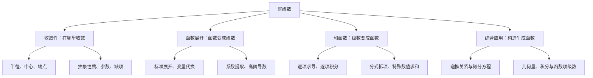
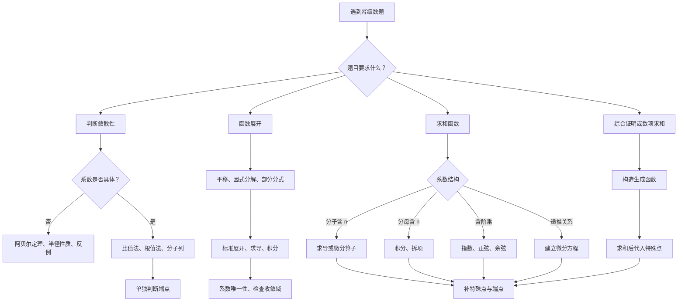

## 一、知识体系

**1. 本节的四条核心主线**

幂级数是考研数学一中综合性很强的一节。它不仅考查级数，还将极限、导数、定积分、泰勒公式、微分方程联系在一起。

这四条主线本质上是在研究三个对象之间的关系：

$$
\boxed{ \text{数列 }a_n \quad\longleftrightarrow\quad \sum_{n=0}^{\infty}a_nx^n \quad\longleftrightarrow\quad \text{函数 }S(x) }
$$

真正掌握幂级数，不是背诵几十个求和公式，而是能够在**系数、级数、函数**三种表达形式之间自由转换。

**2. 代表性真题学习地图**

| 核心考点      | 代表性真题       | 学习优先级 |
| --------- | ----------------- | ----- |
| 阿贝尔定理     | 1988、2011、2015 数一 | 极高    |
| 收敛半径与端点   | 1995、2000、2008 数一 | 极高    |
| 奇偶子级数与缺项  | 2020、2026 数一      | 极高    |
| 复合函数项级数   | 2021、2022 数一      | 高     |
| 函数展开与奇偶筛选 | 1994 数一           | 极高    |
| 和函数计算     | 1987、2010、2012 数一 | 极高    |
| 数项级数求和    | 2001、2024 数一      | 极高    |
| 递推与微分方程   | 2013、2020 数一      | 极高    |
| 高阶导数与重新展开 | 配套模拟题、练习题         | 高     |
| 几何量与生成函数  | 张宇1000题、李林880题    | 高     |

## 第一部分：幂级数的基础理论

### 二、幂级数究竟是什么？

**1. 基本定义**

形如

$$
\sum_{n=0}^{\infty}a_n(x-x_0)^n
$$

的函数项级数称为幂级数。

展开写就是

$$
a_0+a_1(x-x_0)+a_2(x-x_0)^2 +\cdots+a_n(x-x_0)^n+\cdots
$$

其中 $a_n$ 是系数，$x_0$ 是收敛中心，也是展开中心。

当 $x_0=0$ 时，得到最常见的形式：

$$
\sum_{n=0}^{\infty}a_nx^n.
$$

直观上，可以把幂级数理解成一个具有无穷多项的多项式。不过，普通多项式在整个实数轴上都有意义，而幂级数只有在级数收敛的地方才能定义其和函数。

例如：

$$
1+x+x^2+x^3+\cdots
$$

当 $|x|<1$ 时，

$$
1+x+x^2+\cdots=\frac1{1-x}.
$$

但 $x=2$ 时，左侧成为

$$
1+2+4+8+\cdots,
$$

显然发散。

即使右边的函数 $\frac1{1-x}$ 在 $x=2$ 处有定义，也不能说左边的级数收敛。

**必须区分：函数的定义域与其幂级数展开的收敛域。**

### 三、收敛半径、收敛区间与收敛域

**1. 幂级数的收敛结构**

对于幂级数

$$
\sum_{n=0}^{\infty}a_n(x-x_0)^n,
$$

一定存在一个广义收敛半径

$$
R\in[0,+\infty],
$$

使得：

| 位置                 | 敛散性    |
| ------------------ | ------ |
| $\|x-x_0\|<R$ | 绝对收敛   |
| $\|x-x_0\|>R$  | 发散     |
| $\|x-x_0\|=R$  | 必须单独判断 |

当 $0<R<+\infty$ 时，开收敛区间是

$$
(x_0-R,x_0+R).
$$

完整收敛域则可能有四种形式：

$$
\begin{aligned} &(x_0-R,x_0+R),\\ &[x_0-R,x_0+R),\\ &(x_0-R,x_0+R],\\ &[x_0-R,x_0+R]. \end{aligned}
$$

将不含端点的开区间称为收敛区间，将包含所有实际收敛点的集合称为收敛域。

**2. 两种特殊情况**

当 $R=0$ 时，级数仅在展开中心收敛。例如：

$$
\sum_{n=0}^{\infty}n!x^n.
$$

其收敛域是 $\{0\}$。

当 $R=+\infty$ 时，级数在整个实数轴上绝对收敛。例如：

$$
\sum_{n=0}^{\infty}\frac{x^n}{n!}=e^x.
$$

**3. 四个最经典的端点模型**

| 幂级数                                                        | 收敛半径    | 收敛域          |
| ---------------------------------------------------------- | ------- | ------------ |
| $\displaystyle\sum_{n=1}^{\infty}x^n$                 | $1$ | $(-1,1)$ |
| $\displaystyle\sum_{n=1}^{\infty}\frac{x^n}{n}$       | $1$ | $[-1,1)$ |
| $\displaystyle\sum_{n=1}^{\infty}\frac{(-1)^nx^n}{n}$ | $1$ | $(-1,1]$ |
| $\displaystyle\sum_{n=1}^{\infty}\frac{x^n}{n^2}$     | $1$ | $[-1,1]$ |

这四个模型必须熟练掌握。大量复杂的端点问题，最终都会转化为其中某一种。

**4. 一个非常重要的推论**

两个端点处对应的绝对值级数完全相同：

$$
\sum_{n=0}^{\infty}|a_nR^n| = \sum_{n=0}^{\infty}|a_n(-R)^n|.
$$

因此：

**如果一个端点绝对收敛，那么另一个端点也必然绝对收敛。**

如果一个端点条件收敛，则另一个端点可能条件收敛，也可能发散，但不可能绝对收敛。

### 四、阿贝尔定理：抽象幂级数题的根本依据

**1. 定理内容**

对于幂级数

$$
\sum_{n=0}^{\infty}a_n(x-x_0)^n,
$$

若它在 $x=x_1$ 处收敛，则在所有满足

$$
|x-x_0|<|x_1-x_0|
$$

的点处绝对收敛。

若它在 $x=x_2$ 处发散，则在所有满足

$$
|x-x_0|>|x_2-x_0|
$$

的点处发散。

记忆口诀：

**内收外散，内绝对收敛；等距点必须另行判断。**

**2. 为什么成立？**

假设

$$
\sum_{n=0}^{\infty}a_nt_0^n
$$

收敛，其中 $t_0\ne0$。

由级数收敛的必要条件，

$$
a_nt_0^n\to0.
$$

因此数列有界，存在 $M>0$，使得

$$
|a_nt_0^n|\le M.
$$

当 $|t|<|t_0|$ 时，

$$
|a_nt^n| = |a_nt_0^n| \left|\frac{t}{t_0}\right|^n \le M\left|\frac{t}{t_0}\right|^n.
$$

右边是一个收敛的几何级数，因此由比较判别法，原级数绝对收敛。

这个证明非常重要，因为它还能用于解决抽象系数估计、乘除 $n$、阶乘变换等证明题。

### 五、收敛半径的计算方法

<Tabs items={["方法一：比值法", "方法二：根值法", "方法三：直接对整个通项使用比值或根值判别", "方法四：柯西—阿达马公式（强化理解）"]} defaultIndex={0}>

<Tab value="方法一：比值法">

对于标准幂级数

$$
\sum_{n=0}^{\infty}a_n(x-x_0)^n,
$$

若相邻系数从某项起非零，且极限

$$
\rho=\lim_{n\to\infty} \left|\frac{a_{n+1}}{a_n}\right|
$$

存在，则

$$
\boxed{R=\frac1{\rho}}.
$$

特殊地，

$$
\rho=0\Rightarrow R=+\infty,
$$

$$
\rho=+\infty\Rightarrow R=0.
$$

适合处理阶乘、乘积、递推数列等相邻项容易约分的情形。

</Tab>

<Tab value="方法二：根值法">

如果

$$
\rho=\lim_{n\to\infty}\sqrt[n]{|a_n|}
$$

存在，则

$$
\boxed{R=\frac1{\rho}}.
$$

适合处理指数型系数、$n$ 次方、不同底数指数之和。

</Tab>

<Tab value="方法三：直接对整个通项使用比值或根值判别">

这是我更建议你在缺项幂级数、复合变量题中使用的方法。

例如：

$$
\sum_{n=1}^{\infty}a_nx^{2n}
$$

不能直接将 $\sum a_nt^n$ 的收敛半径当成关于 $x$ 的收敛半径。

假设

$$
\lim_{n\to\infty}\sqrt[n]{|a_n|}=\rho,
$$

则对整个通项开 $n$ 次根：

$$
\lim_{n\to\infty} \sqrt[n]{|a_nx^{2n}|} =\rho |x|^2.
$$

令

$$
\rho|x|^2<1,
$$

得到

$$
\boxed{R_x=\frac1{\sqrt{\rho}}}.
$$

直接对通项判别，不容易忘记开平方或者开高次方。

</Tab>

<Tab value="方法四：柯西—阿达马公式（强化理解）">

最一般的收敛半径公式是

$$
\boxed{ \frac1R=\limsup_{n\to\infty}|a_n|^{1/n} }.
$$

这里的 $\limsup$ 是上极限。

考研常规计算一般不必专门使用上极限理论，但必须理解它所反映的事实：

**决定收敛半径的是系数中增长最快的指数型部分，而不是增长较慢的部分。**

因此，即使比值极限不存在，幂级数也一定具有收敛半径。

</Tab>

</Tabs>

### 六、收敛半径的八条重要性质

这些性质是选择题、填空题和抽象证明题的核心。

设

$$
A(x)=\sum_{n=0}^{\infty}a_nx^n
$$

的收敛半径为 $R$。

| 变换后的幂级数                                         | 收敛半径          |
| ----------------------------------------------- | ------------- |
| $\displaystyle\sum a_n(x-b)^n$              | $R$       |
| $\displaystyle\sum a_n(kx)^n,\ k\ne0$       | $R/\|k\|$ |
| $\displaystyle\sum a_nx^{mn},\ m\ge1$       | $R^{1/m}$ |
| $\displaystyle\sum n^pa_nx^n$，从 $n=1$ 起 | $R$       |
| $\displaystyle\sum na_nx^{n-1}$             | $R$       |
| $\displaystyle\sum\frac{a_n}{n+1}x^{n+1}$   | $R$       |
| $\displaystyle\sum a_n^2x^n$（实系数）           | $R^2$     |
| $\displaystyle\sum\frac{a_n}{n!}x^n,\ R>0$  | $+\infty$ |

**1. 为什么乘以 $n^p$ 不改变收敛半径？**

因为对任意固定实数 $p$，

$$
\lim_{n\to\infty}\sqrt[n]{n^p}=1.
$$

所以

$$
\limsup_{n\to\infty} |n^pa_n|^{1/n} = \limsup_{n\to\infty}|a_n|^{1/n}.
$$

事实上，多项式增长、对数增长等通常不改变半径，因为它们的 $n$ 次根趋于 $1$。

但是，它们会改变端点敛散性。

例如：

$$
\sum_{n=1}^{\infty}\frac{x^n}{n^2}
$$

的收敛域为 $[-1,1]$，乘以 $n$ 后变为

$$
\sum_{n=1}^{\infty}\frac{x^n}{n},
$$

收敛域变为 $[-1,1)$。

再乘以 $n$，得到

$$
\sum_{n=1}^{\infty}x^n,
$$

收敛域变为 $(-1,1)$。

三者收敛半径都为 $1$。

**2. 两个幂级数相加的收敛半径**

设

$$
A(x)=\sum a_nx^n,\qquad B(x)=\sum b_nx^n
$$

的收敛半径分别为 $R_1,R_2$。

若和级数

$$
\sum(a_n+b_n)x^n
$$

的收敛半径为 $R$，则必有

$$
\boxed{R\ge\min\{R_1,R_2\}}.
$$

进一步，若 $R_1\ne R_2$，则

$$
\boxed{R=\min\{R_1,R_2\}}.
$$

但是，若 $R_1=R_2$，只能得到不等式，因为系数可能相互抵消。

例如：

$$
a_n=1,\qquad b_n=-1.
$$

原来两个幂级数的半径均为 $1$，但

$$
\sum(a_n+b_n)x^n=0
$$

的收敛半径为 $+\infty$。

**3. 奇偶子级数的半径**

设

$$
A(x)=\sum_{n=0}^{\infty}a_nx^n,
$$

其偶数项、奇数项分别为

$$
E(x)=\sum_{n=0}^{\infty}a_{2n}x^{2n},
$$

$$
O(x)=\sum_{n=0}^{\infty}a_{2n+1}x^{2n+1}.
$$

记其收敛半径分别为 $R,R_E,R_O$，则

$$
\boxed{R=\min\{R_E,R_O\}}.
$$

特别地，

$$
R_E\ge R,\qquad R_O\ge R.
$$

因为原级数在内部绝对收敛，所以抽取任何子级数都仍然绝对收敛。

反过来，只知道偶数项子级数收敛，不能推出原级数收敛。

## 第二部分：收敛半径与收敛域核心题型

### 七、题型一：已知收敛点、发散点，判断其他点

**母题1：1988年考研数学一**

设幂级数

$$
\sum_{n=1}^{\infty}a_n(x-1)^n
$$

在 $x=-1$ 处收敛，判断它在 $x=2$ 处的敛散性。

**识别方法：** 题目没有给出具体的 $a_n$，却给出了收敛点，因此不能直接使用系数比值法，应使用阿贝尔定理。

展开中心为

$$
x_0=1.
$$

已知收敛点到中心的距离为

$$
|-1-1|=2.
$$

待判断点到中心的距离为

$$
|2-1|=1.
$$

所以 $x=2$ 一定处于绝对收敛的内部区域。

$$
\boxed{\text{绝对收敛}}
$$

**方法迁移**

若已知 $x=a$ 收敛，$x=b$ 发散，则

$$
|a-x_0|\le R\le |b-x_0|.
$$

特别地，如果已知收敛点和发散点到中心的距离相同，则可以直接确定 $R$。

**母题2：2008年考研数学一**

已知

$$
\sum_{n=0}^{\infty}a_n(x+2)^n
$$

在 $x=0$ 处收敛，在 $x=-4$ 处发散，求

$$
\sum_{n=0}^{\infty}a_n(x-3)^n
$$

的收敛域。

**第一步：还原标准变量。**

令原级数中的 $t=x+2$，得到

$$
\sum a_nt^n.
$$

题设相当于在 $t=2$ 时收敛，在 $t=-2$ 时发散。

因此

$$
R=2, \qquad t\in(-2,2].
$$

**第二步：代入新变量。**

新级数中

$$
t=x-3.
$$

所以

$$
-2<x-3\le2.
$$

解得

$$
\boxed{x\in(1,5]}.
$$

**通用技巧：** 不要直接在原坐标上做复杂的平移推理。先把所有级数统一还原成 $\sum a_nt^n$，再将新变量代入。

**母题3：2015年考研数学一**

若

$$
\sum_{n=1}^{\infty}a_n
$$

条件收敛，判断

$$
\sum_{n=1}^{\infty}na_n(x-1)^n
$$

在 $x=\sqrt3$ 和 $x=3$ 处的敛散性。

**第一步：由条件收敛锁定半径。**

原标准级数

$$
\sum a_nt^n
$$

在 $t=1$ 处条件收敛。

条件收敛只能发生在端点，所以

$$
R=1.
$$

**第二步：利用半径不变性质。**

乘以 $n$ 不改变收敛半径，因此新级数的半径仍为 $1$。

**第三步：判断位置。**

$$
|\sqrt3-1|<1,
$$

$$
|3-1|=2>1.
$$

因此

$$
\boxed{\text{前者绝对收敛，后者发散}}.
$$

**模拟变式：张宇8套卷第7套第3题**

已知

$$
\sum_{n=0}^{\infty} \frac{(x-a)^n}{\ln(n+2)}
$$

在 $x=-2$ 处条件收敛，判断

$$
\sum_{n=0}^{\infty} \frac{(x-a)^n}{(n+2)^2}
$$

在 $x=\frac12$ 处的敛散性。

两个级数的半径均为 $1$。

第一个级数的系数全部为正，右端点为正项发散级数，左端点才是条件收敛点。

因此

$$
-2-a=-1,
$$

得到

$$
a=-1.
$$

而

$$
\left|\frac12-a\right|=\frac32>1.
$$

故第二个级数在该点发散。

这个变式考查的不只是半径，还要求你根据**端点的符号结构反推出展开中心**。

### 八、题型二：缺项幂级数、奇偶子列与复合变量

**母题4：1995年考研数学一**

求

$$
\sum_{n=1}^{\infty} \frac{n}{2^n+(-3)^n}x^{2n-1}
$$

的收敛半径。

**第一步：提取指数主导项。**

$$
2^n+(-3)^n = (-3)^n \left[1+\left(-\frac23\right)^n\right].
$$

所以

$$
\lim_{n\to\infty} |2^n+(-3)^n|^{1/n}=3.
$$

**第二步：对整个通项使用根值法。**

当 $x\ne0$ 时，

$$
\begin{aligned} \lim_{n\to\infty} \sqrt[n]{\left| \frac{nx^{2n-1}}{2^n+(-3)^n} \right|} &=\frac{|x|^2}{3}. \end{aligned}
$$

因此绝对收敛的内部区域满足

$$
\frac{x^2}{3}<1.
$$

故

$$
\boxed{R=\sqrt3}.
$$

若进一步要求收敛域，在 $x=\pm\sqrt3$ 处，通项的绝对值渐近于

$$
\frac n{\sqrt3},
$$

不趋于零，两个端点均发散。

**一般化结论**

对形如

$$
\sum_{n=1}^{\infty} \frac{n^p}{b^n}x^{kn+m}
$$

的级数，其中 $b>0,k\ge1$，其收敛半径通常为

$$
\boxed{R=b^{1/k}}.
$$

指数中的 $kn+m$ 决定需要开几次方；固定的 $m$ 与多项式因子 $n^p$ 不改变半径。

**母题5：2026年考研数学一**

求下列幂级数的收敛域：

$$
\sum_{n=1}^{\infty} \left[\frac{3+(-1)^n}{4}\right]^n x^{2n}.
$$

**观察：系数随** $n$ **的奇偶发生变化。**

当 $n$ 为偶数时，

$$
\left[\frac{3+(-1)^n}{4}\right]^n=1.
$$

当 $n$ 为奇数时，

$$
\left[\frac{3+(-1)^n}{4}\right]^n =\frac1{2^n}.
$$

所以开根后的表达式

$$
\frac{3+(-1)^n}{4}|x|^2
$$

在奇数项和偶数项上分别具有不同的值，普通根值极限不存在。

应分子列讨论。

偶数项为

$$
\sum_{m=1}^{\infty}x^{4m},
$$

要求

$$
|x|<1.
$$

奇数项对应的收敛条件为

$$
|x|<\sqrt2.
$$

原级数各项非负，两部分均必须收敛，因此取交集。

$$
\boxed{x\in(-1,1)}.
$$

在 $x=\pm1$ 时，偶数下标对应的通项恒为 $1$，立即判定发散。

**本题的创新性在于：** 它把常见的指数增长判别变成了奇偶子列判别。未来遇到模 $3$、模 $4$ 周期变化的系数，同样可以分组，分别计算各子级数的半径。

**母题6：2022年考研数学一**

求级数

$$
\sum_{n=1}^{\infty} \frac{n!}{n^n}e^{-nx}
$$

的收敛域。

设

$$
u_n=\frac{n!}{n^n}e^{-nx}.
$$

由比值法，

$$
\begin{aligned} \frac{u_{n+1}}{u_n} &=\left(\frac n{n+1}\right)^ne^{-x}\\ &\longrightarrow e^{-1-x}. \end{aligned}
$$

收敛的内部区域要求

$$
e^{-1-x}<1.
$$

即

$$
x>-1.
$$

边界 $x=-1$ 时，

$$
\frac{u_{n+1}}{u_n} =\frac e{(1+1/n)^n}>1.
$$

因此 $u_n$ 为严格递增的正数列，不可能趋于零。

故

$$
\boxed{x\in(-1,+\infty)}.
$$

这里不需要使用斯特林公式。

**复合变量通用模型**

若已知

$$
\sum a_nt^n
$$

的收敛域为 $D$，则

$$
\sum a_n[\varphi(x)]^n
$$

的收敛域就是

$$
\boxed{\{x:\varphi(x)\in D\}},
$$

同时要求 $\varphi(x)$ 有定义。

这个模型不仅包括 $t=x^2$，也包括

$$
t=e^{-x},\qquad t=\frac{x}{1-x},\qquad t=\ln x,\qquad t=\sin x.
$$

此时关于 $x$ 的收敛域未必是一个区间，甚至可能由多个互不相连的区间组成。

### 九、题型三：端点敛散性与参数分类

**母题7：2000年考研数学一**

求幂级数

$$
\sum_{n=1}^{\infty} \frac{x^n}{n[3^n+(-2)^n]}
$$

的收敛域。

这是本节端点判断最值得研究的母题之一。

**第一步：求收敛半径。**

由于

$$
3^n+(-2)^n= 3^n\left[1+\left(-\frac23\right)^n\right],
$$

所以

$$
R=3.
$$

**第二步：判断右端点** $x=3$**。**

原级数变为

$$
\sum_{n=1}^{\infty} \frac1{n[1+(-2/3)^n]}.
$$

因为

$$
\frac1{n[1+(-2/3)^n]} \sim\frac1n,
$$

故由正项级数的极限比较判别法，右端点发散。

**第三步：判断左端点** $x=-3$**。**

原级数变为

$$
\sum_{n=1}^{\infty} \frac{(-1)^n}{n[1+(-2/3)^n]}.
$$

这里最容易出现错误：仅由绝对值通项与 $1/n$ 等价，并不能直接推出交错级数收敛。

更稳妥的做法是拆成标准级数与误差项：

$$
\frac{(-1)^n}{n[1+(-2/3)^n]} = \frac{(-1)^n}{n}+r_n.
$$

其中

$$
|r_n| = \frac{(2/3)^n} {n|1+(-2/3)^n|} \le\frac3n\left(\frac23\right)^n.
$$

故

$$
\sum r_n
$$

绝对收敛，而

$$
\sum\frac{(-1)^n}{n}
$$

由莱布尼茨判别法收敛。

因此左端点收敛，但不绝对收敛。

最终得到

$$
\boxed{x\in[-3,3)}.
$$

**从这道题提炼出的高级技巧**

当交错项含有指数衰减修正时，例如

$$
\frac{(-1)^n}{n^p(1+q^n)}, \qquad |q|<1,
$$

优先考虑

$$
\frac1{1+q^n}=1+O(q^n).
$$

从而将原级数分解成

$$
\text{标准交错级数} + \text{绝对收敛的误差级数}.
$$

这样不必费力证明原系数是否单调。

**母题8：李林880题——参数与收敛域**

原练习题 ID：`math-a3380d-042`。

研究

$$
\sum_{n=2}^{\infty} \frac{x^n}{n^p\ln n}
$$

的收敛域与参数 $p$ 的关系。

这是在原选择题基础上进行的完整分类。

对于任意固定实数 $p$，有

$$
\lim_{n\to\infty} \sqrt[n]{\frac1{n^p\ln n}}=1.
$$

所以

$$
R=1.
$$

右端点 $x=1$ 对应

$$
\sum_{n=2}^{\infty}\frac1{n^p\ln n}.
$$

只有 $p>1$ 时收敛。

左端点 $x=-1$ 对应

$$
\sum_{n=2}^{\infty} \frac{(-1)^n}{n^p\ln n}.
$$

当 $p\ge0$ 时，绝对值通项最终单调递减至零，因此由莱布尼茨判别法收敛。

当 $p<0$ 时，

$$
\frac1{n^p\ln n} =\frac{n^{|p|}}{\ln n}\to+\infty,
$$

通项不趋于零。

综上：

| 参数               | 左端点 $-1$ | 右端点 $1$ | 收敛域          |
| ---------------- | ------------ | ----------- | ------------ |
| $p<0$        | 发散           | 发散          | $(-1,1)$ |
| $0\le p\le1$ | 条件收敛         | 发散          | $[-1,1)$ |
| $p>1$        | 绝对收敛         | 绝对收敛        | $[-1,1]$ |

因此原练习题中，若收敛域为 $[-1,1]$，必有

$$
\boxed{p>1}.
$$

**参数题的进一步推广**

对于

$$
\sum_{n=2}^{\infty} \frac{(x-a)^n}{b^n n^p(\ln n)^q}, \qquad b>0,
$$

半径始终为 $b$，参数 $p,q$ 决定端点性质。

正项端点收敛的条件为

$$
\boxed{p>1\quad\text{或}\quad p=1,\ q>1}.
$$

交错端点收敛的条件为

$$
\boxed{p>0\quad\text{或}\quad p=0,\ q>0}.
$$

后者来自绝对值通项最终单调趋于零。

这类题目务必遵循顺序：先确定半径，再确定参数对端点的影响，不能混在一起讨论。

### 十、题型四：抽象性质、反例与证明

**母题9：2020年考研数学一**

设

$$
\sum_{n=1}^{\infty}a_nx^n
$$

的收敛半径为 $R$，判断下列命题是否成立：

若

$$
\sum_{n=1}^{\infty}a_{2n}r^{2n}
$$

发散，则

$$
|r|\ge R.
$$

正确。

因为若 $|r|<R$，则

$$
\sum_{n=1}^{\infty}|a_nr^n|
$$

收敛，抽出偶数项后

$$
\sum_{n=1}^{\infty}|a_{2n}r^{2n}|
$$

仍然收敛。

利用逆否命题即可得到结论。

但若偶数项级数收敛，是否能推出 $|r|\le R$？

不能。

取

$$
a_{2n}=0,\qquad a_{2n-1}=1,
$$

则原级数为

$$
x+x^3+x^5+\cdots,
$$

其半径为 $1$，但偶数项级数恒为零，在整个实数轴上都收敛。

**解题策略：** 抽象选择题中，只要题目使用“必然”“一定”等字眼，就要尝试构造极端例子，尤其是零系数、相反系数、奇偶分拆。

**母题10：张宇1000题——半径相同与系数抵消**

设

$$
\sum a_nx^n,\qquad \sum b_nx^n
$$

的收敛半径都为 $r$，且 $0<r<+\infty$。

考查以下级数中哪个的收敛半径必为 $r$：

| 级数系数                | 半径是否必为 $r$ |
| ------------------- | -------------- |
| $a_n+b_n$       | 否，可能完全抵消       |
| $a_n+nb_n$      | 否，可能完全抵消       |
| $a_n+b_n/2^n$   | 是              |
| $a_n+b_n/(n+1)$ | 否，可能完全抵消       |

关键在于

$$
\sum\frac{b_n}{2^n}x^n
$$

的半径为 $2r$，而

$$
\sum a_nx^n
$$

的半径为 $r$。

两个半径不同，相加取较小者。

因此

$$
\boxed{R=r}.
$$

如果要在证明题中严格证明，假设和级数的半径大于 $r$，再利用

$$
A(x)=\left[A(x)+B\left(\frac x2\right)\right] -B\left(\frac x2\right)
$$

就会推出 $A(x)$ 在某个更大的开区间内绝对收敛，与其半径为 $r$ 矛盾。

**母题11：李正元练习题——除以阶乘后的半径**

李林880题中也有同类题。

已知

$$
\sum_{n=0}^{\infty}a_nx^n
$$

的收敛半径为 $R_0>0$，证明

$$
\sum_{n=0}^{\infty}\frac{a_n}{n!}x^n
$$

在整个实数轴上绝对收敛。

**标准证明：**

任取固定的

$$
r\in(0,R_0).
$$

由于

$$
\sum a_nr^n
$$

收敛，其通项有界，故存在 $M>0$，使得

$$
|a_n|r^n\le M.
$$

于是

$$
|a_n|\le\frac M{r^n}.
$$

对任意固定实数 $x$，

$$
\left|\frac{a_n}{n!}x^n\right| \le M\frac{(|x|/r)^n}{n!}.
$$

又因为

$$
\sum_{n=0}^{\infty} \frac{(|x|/r)^n}{n!} =e^{|x|/r}<+\infty,
$$

所以由比较判别法，新级数在全实轴上绝对收敛。

$$
\boxed{R=+\infty}.
$$

这个证明完全不要求原级数的系数比值极限存在。

## 第三部分：函数的幂级数展开

### 十一、幂级数的运算性质与泰勒公式

设

$$
S(x)=\sum_{n=0}^{\infty}a_nx^n
$$

的收敛半径为 $R>0$。

在 $(-R,R)$ 内，有以下性质。

**1. 连续性**

幂级数的和函数在收敛区间内部连续。

如果端点级数也收敛，则和函数在该端点具有相应的单侧连续性。这是幂级数的阿贝尔连续性定理。

例如：

$$
\sum_{n=1}^{\infty} \frac{(-1)^{n-1}}n x^n=\ln(1+x), \qquad |x|<1.
$$

由于 $x=1$ 时级数收敛，因此可以令 $x\to1^-$，得到

$$
\sum_{n=1}^{\infty} \frac{(-1)^{n-1}}n=\ln2.
$$

**2. 逐项求导**

$$
\boxed{ S'(x)=\sum_{n=1}^{\infty}na_nx^{n-1} }
$$

并且

$$
S''(x)=\sum_{n=2}^{\infty}n(n-1)a_nx^{n-2}.
$$

可以在收敛区间内部进行任意阶逐项求导。

**3. 逐项积分**

$$
\boxed{ \int_0^xS(t)\,\mathrm dt =\sum_{n=0}^{\infty}\frac{a_n}{n+1}x^{n+1} }
$$

使用从 $0$ 到 $x$ 的定积分，能够自动消除积分常数，是考场上非常实用的操作。

逐项求导和逐项积分均不改变收敛半径，但是可能改变端点的敛散性。

**4. 乘法运算**

若

$$
A(x)=\sum_{n=0}^{\infty}a_nx^n,\qquad B(x)=\sum_{n=0}^{\infty}b_nx^n,
$$

则在二者共同的绝对收敛区间内，

$$
A(x)B(x)=\sum_{n=0}^{\infty}c_nx^n,
$$

其中

$$
\boxed{c_n=\sum_{k=0}^na_kb_{n-k}}.
$$

这称为柯西乘积，对将来的系数卷积、递推生成函数综合题非常有帮助。

**5. 幂级数展开的唯一性**

如果

$$
f(x)=\sum_{n=0}^{\infty}a_n(x-x_0)^n,
$$

那么在展开中心处逐项求导可得

$$
f(x_0)=a_0,
$$

$$
f'(x_0)=a_1,
$$

$$
f''(x_0)=2!a_2,
$$

一般地，

$$
\boxed{a_n=\frac{f^{(n)}(x_0)}{n!}}.
$$

于是

$$
\boxed{ f(x)=\sum_{n=0}^{\infty} \frac{f^{(n)}(x_0)}{n!}(x-x_0)^n }
$$

就是泰勒级数。

当 $x_0=0$ 时，称为麦克劳林级数。

但要注意，函数具有任意阶导数，并不必然意味着它等于自己的泰勒级数。还需要泰勒余项趋于零等条件。

### 十二、必须熟练掌握的标准展开式

下面这些公式是后续所有求和、展开和系数识别题的基础。

| 函数                              | 幂级数展开                                                                 | 收敛域                     |
| ------------------------------- | --------------------------------------------------------------------- | ----------------------- |
| $\frac1{1-x}$               | $\displaystyle\sum_{n=0}^{\infty}x^n$                            | $(-1,1)$            |
| $\frac1{1+x}$               | $\displaystyle\sum_{n=0}^{\infty}(-1)^nx^n$                      | $(-1,1)$            |
| $e^x$                       | $\displaystyle\sum_{n=0}^{\infty}\frac{x^n}{n!}$                 | $\mathbb R$         |
| $\sin x$                    | $\displaystyle\sum_{n=0}^{\infty}\frac{(-1)^nx^{2n+1}}{(2n+1)!}$ | $\mathbb R$         |
| $\cos x$                    | $\displaystyle\sum_{n=0}^{\infty}\frac{(-1)^nx^{2n}}{(2n)!}$     | $\mathbb R$         |
| $-\ln(1-x)$                 | $\displaystyle\sum_{n=1}^{\infty}\frac{x^n}{n}$                  | $[-1,1)$            |
| $\ln(1+x)$                  | $\displaystyle\sum_{n=1}^{\infty}\frac{(-1)^{n-1}x^n}{n}$        | $(-1,1]$            |
| $\arctan x$                 | $\displaystyle\sum_{n=0}^{\infty}\frac{(-1)^nx^{2n+1}}{2n+1}$    | $[-1,1]$            |
| $\frac12\ln\frac{1+x}{1-x}$ | $\displaystyle\sum_{n=0}^{\infty}\frac{x^{2n+1}}{2n+1}$          | $(-1,1)$            |
| $(1+x)^\alpha$              | $\displaystyle\sum_{n=0}^{\infty}\binom{\alpha}{n}x^n$           | 一般先取 $\|x\|<1$，端点另判 |

广义二项式系数为

$$
\binom{\alpha}{n} = \frac{\alpha(\alpha-1)\cdots(\alpha-n+1)}{n!}, \qquad \binom{\alpha}{0}=1.
$$

其中如果 $\alpha$ 为非负整数，级数退化为有限多项式。

**这些公式之间其实存在统一关系**

从最基础的几何级数

$$
\frac1{1-x}=\sum_{n=0}^{\infty}x^n
$$

出发，逐项求导可得

$$
\frac1{(1-x)^2} = \sum_{n=0}^{\infty}(n+1)x^n.
$$

再求导可得

$$
\frac1{(1-x)^3} = \sum_{n=0}^{\infty} \frac{(n+1)(n+2)}2x^n.
$$

逐项积分则得到

$$
-\ln(1-x)=\sum_{n=1}^{\infty}\frac{x^n}{n}.
$$

代入 $x^2$ 或 $-x^2$ 后再积分，则分别得到对数奇次幂展开与反正切展开。

**因此，遇到不熟悉的幂级数公式，优先考虑是否能从几何级数推导出来。**

### 十三、题型五：函数展开、平移与部分分式

函数展开通常采用间接法，即将目标函数变形为标准展开式，再借助四则运算、变量代换、求导、积分得到结果。

直接计算 $f^{(n)}(x_0)$ 通常更繁琐。

**母题12：张宇1000题——平移展开与系数极限**

设

$$
f(x)=\frac{x^2-x-1}{x^2(x+1)} =\sum_{n=0}^{\infty}a_n(x-1)^n,
$$

求

$$
\lim_{n\to\infty} \frac{(-1)^na_n}{\sqrt{n^2+1}}.
$$

**第一步：部分分式分解。**

$$
f(x)=\frac1{x+1}-\frac1{x^2}.
$$

**第二步：明确展开中心。**

令

$$
t=x-1.
$$

则

$$
f(x)=\frac1{2+t}-\frac1{(1+t)^2}.
$$

**第三步：套用标准展开。**

$$
\frac1{2+t} =\sum_{n=0}^{\infty} \frac{(-1)^n}{2^{n+1}}t^n,
$$

$$
\frac1{(1+t)^2} =\sum_{n=0}^{\infty}(-1)^n(n+1)t^n.
$$

所以

$$
a_n=(-1)^n \left[\frac1{2^{n+1}}-(n+1)\right].
$$

**第四步：求极限。**

$$
\begin{aligned} \lim_{n\to\infty} \frac{(-1)^na_n}{\sqrt{n^2+1}} &= \lim_{n\to\infty} \frac{2^{-(n+1)}-(n+1)}{\sqrt{n^2+1}}\\ &=\boxed{-1}. \end{aligned}
$$

本题将分式展开、中心平移、系数提取与数列极限联系在一起。

**一般化思路**

对于有理函数的展开，先进行部分分式分解，尤其是将其变成

$$
\frac A{x-b},\qquad \frac B{(x-c)^2}
$$

等形式。

再令 $t=x-x_0$，最后化成

$$
\frac1{1-kt},\qquad \frac1{(1-kt)^2}.
$$

对于已经约分的有理函数，其泰勒展开半径可用展开中心到最近复数极点的距离理解。不过考研常规题中，直接通过标准展开和系数判别通常更稳妥。

**补充母题：李正元练习题——反正弦函数的展开**

求 $\arcsin x$ 的麦克劳林展开。

由

$$
(\arcsin x)'=\frac1{\sqrt{1-x^2}},
$$

使用广义二项式展开：

$$
\frac1{\sqrt{1-x^2}} = \sum_{n=0}^{\infty} \frac{(2n)!}{4^n(n!)^2}x^{2n}, \qquad |x|<1.
$$

两边从 $0$ 到 $x$ 积分：

$$
\boxed{ \arcsin x = \sum_{n=0}^{\infty} \frac{(2n)!}{4^n(n!)^2(2n+1)} x^{2n+1} }.
$$

两个端点都绝对收敛，完整收敛域为 $[-1,1]$。

因此遇到 $\arcsin x$、$\ln(x+\sqrt{1+x^2})$ 等函数时，优先求导，将其转化为广义二项式级数，而不是直接计算高阶导数。

### 十四、题型六：奇偶筛选与系数提取

**母题13：1994年考研数学一**

将

$$
f(x)= \frac14\ln\frac{1+x}{1-x} +\frac12\arctan x-x
$$

展开成 $x$ 的幂级数。

方法一是分别展开，再合并同次项。

但本题还有一种更简洁、更容易迁移的方法。

**第一步：求导，消除对数和反三角函数。**

$$
\begin{aligned} f'(x) &=\frac1{2(1-x^2)} +\frac1{2(1+x^2)}-1\\ &=\frac1{1-x^4}-1\\ &=\frac{x^4}{1-x^4}. \end{aligned}
$$

**第二步：利用几何级数展开。**

$$
f'(x)=\sum_{n=1}^{\infty}x^{4n}, \qquad |x|<1.
$$

**第三步：逐项积分。**

因为 $f(0)=0$，所以

$$
f(x)=\int_0^xf'(t)\,\mathrm dt.
$$

于是

$$
\boxed{ f(x)=\sum_{n=1}^{\infty} \frac{x^{4n+1}}{4n+1}, \quad |x|<1 }.
$$

展开的前几项是

$$
\frac{x^5}5+\frac{x^9}9+\frac{x^{13}}{13}+\cdots.
$$

在两个端点处分别化为正项或负项的发散级数，因此完整收敛域也是 $(-1,1)$。

**解题思想**

遇到若干复杂函数相加、相减时，不一定要分别展开。可以先求导，观察是否出现大规模抵消。

本题就是通过求导将两个超越函数统一为一个有理函数，最终转化为几何级数。

**母题14：2024年考研数学一、数学三**

已知

$$
\sum_{n=0}^{\infty}a_nx^n=\ln(2+x),
$$

求

$$
\sum_{n=0}^{\infty}na_{2n}.
$$

方法一：直接展开并提取系数。

$$
\ln(2+x)=\ln2+ \sum_{n=1}^{\infty} \frac{(-1)^{n-1}}{n2^n}x^n.
$$

所以

$$
a_{2n}=-\frac1{2n4^n}, \qquad n\ge1.
$$

因此

$$
\sum_{n=0}^{\infty}na_{2n} =-\frac12\sum_{n=1}^{\infty}\frac1{4^n} =\boxed{-\frac16}.
$$

**方法二：偶函数筛选法（更具普适性）。**

设

$$
F(x)=\sum_{n=0}^{\infty}a_nx^n.
$$

则

$$
\frac{F(x)+F(-x)}2 =\sum_{n=0}^{\infty}a_{2n}x^{2n}.
$$

记为 $E(x)$。

本题

$$
E(x)=\frac12\ln(4-x^2).
$$

求导：

$$
E'(x)=-\frac{x}{4-x^2}.
$$

又有

$$
E'(1)=\sum_{n=1}^{\infty}2na_{2n}.
$$

所以

$$
\sum_{n=0}^{\infty}na_{2n} =\frac12E'(1) =-\frac16.
$$

**两条必须掌握的筛选公式**

$$
\boxed{ \frac{F(x)+F(-x)}2 =\sum_{n=0}^{\infty}a_{2n}x^{2n} }
$$

$$
\boxed{ \frac{F(x)-F(-x)}2 =\sum_{n=0}^{\infty}a_{2n+1}x^{2n+1} }
$$

第一式提取偶次项，第二式提取奇次项。

如果未来试题不给出具体系数，而只给出和函数 $F(x)$，这种方法往往比直接计算系数更有效。

### 十五、题型七：高阶导数与积分函数展开

**模拟母题：李林六套卷第6套第12题**

设

$$
f(x)=\sum_{k=1}^{\infty} \left(\frac{x}{1-x}\right)^k,
$$

求 $f^{(n)}(0)$。

**第一步：先求和。**

在原点附近，由几何级数公式，

$$
f(x)= \frac{x/(1-x)}{1-x/(1-x)} =\frac{x}{1-2x}.
$$

**第二步：重新展开。**

$$
f(x) =x\sum_{k=0}^{\infty}(2x)^k =\sum_{n=1}^{\infty}2^{n-1}x^n.
$$

**第三步：读取泰勒系数。**

由

$$
a_n=\frac{f^{(n)}(0)}{n!}
$$

得到

$$
\boxed{f^{(n)}(0)=2^{n-1}n!}.
$$

这是高阶导数题的一条捷径：不要求导 $n$ 次，而是先找到泰勒展开。

还要注意，原函数项级数满足

$$
\left|\frac{x}{1-x}\right|<1,
$$

解得 $x<1/2$。而麦克劳林幂级数的收敛域是 $(-1/2,1/2)$。

二者不是同一个概念。

**补充母题：李林880题——无法直接求原函数的积分展开**

设

$$
f(x)=\int_0^xe^{-t^2}\,\mathrm dt,
$$

将 $f(x)$ 展开为幂级数。

由于

$$
e^{-t^2} =\sum_{n=0}^{\infty} \frac{(-1)^n}{n!}t^{2n},
$$

逐项积分得

$$
\boxed{ f(x)=\sum_{n=0}^{\infty} \frac{(-1)^n}{(2n+1)n!}x^{2n+1} }.
$$

在整个实数轴上成立。

虽然 $e^{-t^2}$ 没有初等函数形式的原函数，但这并不影响我们通过幂级数表示积分。

这种思想还可以推广到

$$
\int_0^x\frac{\sin t}{t}\,\mathrm dt, \qquad \int_0^x\frac{e^t-1}{t}\,\mathrm dt,
$$

以及利用级数计算特殊定积分的问题。

## 第四部分：幂级数的和函数与数项级数求和

### 十六、和函数的统一解题方法

求和函数和函数展开，实际上是互为逆过程的两个问题。

函数展开：

$$
f(x)\longrightarrow\sum a_nx^n.
$$

求和函数：

$$
\sum a_nx^n\longrightarrow f(x).
$$

求和的难点在于，如何将复杂的系数 $a_n$ 改造成熟悉的标准级数。

**1. 根据系数结构选择解法**

| 级数中出现的结构               | 优先考虑的操作     |
| ---------------------- | ----------- |
| $n,\ n^2,\ n(n-1)$ | 逐项求导        |
| $1/n,\ 1/(n+1)$    | 逐项积分或对数级数   |
| $1/(2n+1)$         | 反正切或对数奇次幂级数 |
| $1/[n(n+1)]$       | 部分分式或两次积分   |
| $1/[n(2n-1)]$      | 部分分式        |
| $1/n!$             | 指数函数        |
| $1/(2n)!$          | 余弦或指数函数的偶数项 |
| $1/(2n+1)!$        | 正弦或指数函数的奇数项 |
| $1/[(kn+1)(kn+2)]$ | 两次求导消去分母    |
| 系数之间存在递推               | 构造和函数的微分方程  |
| 系数来自面积、弧长、积分           | 先求系数，再构造幂级数 |

**2. 标准解题步骤**

求收敛域及和函数的解答题，一般按照以下顺序：

$$
\boxed{ \begin{gathered} \text{求收敛半径}\\ \downarrow\\ \text{判断端点}\\ \downarrow\\ \text{整理系数、选择标准级数}\\ \downarrow\\ \text{逐项求导或积分}\\ \downarrow\\ \text{确定和函数}\\ \downarrow\\ \text{补充特殊点及端点函数值} \end{gathered}}
$$

最后一步非常关键。如果闭式中出现 $1/x$，必须检查 $x=0$ 是否属于原级数的收敛域。如果端点收敛，还必须给出端点和函数值或说明闭式可以连续延拓至端点。

### 十七、题型八：通过逐项求导和积分求和

**母题16：1987年考研数学一**

求幂级数

$$
S(x)=\sum_{n=1}^{\infty} \frac{x^{n+1}}{n2^n}
$$

的收敛域及和函数。

由比值法知 $R=2$。

在 $x=2$ 时，原级数变为

$$
\sum_{n=1}^{\infty}\frac2n,
$$

发散。

在 $x=-2$ 时，原级数变为

$$
2\sum_{n=1}^{\infty}\frac{(-1)^{n+1}}n,
$$

条件收敛。

所以收敛域为

$$
[-2,2).
$$

然后将级数写成

$$
S(x)=x\sum_{n=1}^{\infty} \frac{(x/2)^n}{n}.
$$

利用

$$
\sum_{n=1}^{\infty}\frac{t^n}n=-\ln(1-t),
$$

得到

$$
\boxed{ S(x)=-x\ln\left(1-\frac x2\right), \qquad -2\le x<2 }.
$$

其中端点 $x=-2$ 由阿贝尔连续性定理得到

$$
S(-2)=2\ln2.
$$

**母题17：2010年考研数学一**

求

$$
S(x)=\sum_{n=1}^{\infty} \frac{(-1)^{n-1}}{2n-1}x^{2n}
$$

的收敛域与和函数。

首先，半径为 $1$。

当 $x=\pm1$ 时，级数均变为

$$
\sum_{n=1}^{\infty} \frac{(-1)^{n-1}}{2n-1},
$$

条件收敛。

因此收敛域为

$$
[-1,1].
$$

注意分母是 $2n-1$，但幂指数是 $2n$。如果直接求导，无法消去分母。

应先整理幂次：

$$
\begin{aligned} S(x) &=x\sum_{n=1}^{\infty} \frac{(-1)^{n-1}}{2n-1}x^{2n-1}\\ &=x\sum_{k=0}^{\infty} \frac{(-1)^k}{2k+1}x^{2k+1}. \end{aligned}
$$

利用反正切展开式，得到

$$
\boxed{ S(x)=x\arctan x, \qquad -1\le x\le1 }.
$$

这道题要提炼出一个重要原则：

**如果分母与幂指数不一致，先通过乘除** $x$ **调整幂次，再考虑求导或积分。**

### 十八、题型九：分式拆项与混合系数求和

**母题18：2012年考研数学一**

求幂级数

$$
S(x)=\sum_{n=0}^{\infty} \frac{4n^2+4n+3}{2n+1}x^{2n}
$$

的收敛域及和函数。

这道题非常典型，因为它并不是单纯的求导题或积分题，而要求先识别系数的代数结构。

**第一步：整理系数。**

观察到

$$
4n^2+4n+3=(2n+1)^2+2,
$$

所以

$$
\frac{4n^2+4n+3}{2n+1} =2n+1+\frac2{2n+1}.
$$

原级数被分解为两部分：

$$
S(x)=S_1(x)+S_2(x),
$$

其中

$$
S_1(x)=\sum_{n=0}^{\infty}(2n+1)x^{2n},
$$

$$
S_2(x)=2\sum_{n=0}^{\infty} \frac{x^{2n}}{2n+1}.
$$

**第二步：第一部分使用逐项求导。**

因为

$$
\frac{x}{1-x^2} =\sum_{n=0}^{\infty}x^{2n+1},
$$

所以

$$
S_1(x) =\left(\frac{x}{1-x^2}\right)' =\frac{1+x^2}{(1-x^2)^2}.
$$

**第三步：第二部分使用逐项积分。**

由

$$
\frac1{1-t^2}=\sum_{n=0}^{\infty}t^{2n},
$$

积分得

$$
\sum_{n=0}^{\infty} \frac{x^{2n+1}}{2n+1} =\frac12\ln\frac{1+x}{1-x}.
$$

所以当 $x\ne0$ 时，

$$
S_2(x)=\frac1x\ln\frac{1+x}{1-x}.
$$

**第四步：确定收敛域及特殊点。**

半径为 $1$，由于系数渐近于 $2n$，两个端点的通项均不趋于零，因此两个端点发散。

当 $x=0$ 时，原级数只有第零项保留下来：

$$
S(0)=3.
$$

最终结果为

$$
\boxed{ S(x)= \begin{cases} \displaystyle \frac{1+x^2}{(1-x^2)^2} +\frac1x\ln\frac{1+x}{1-x}, &0<|x|<1,\\[6pt] 3,&x=0. \end{cases}}
$$

收敛域为 $(-1,1)$。

**模拟强化：汤家凤八套卷第4套第20题**

求

$$
S(x)=\sum_{n=1}^{\infty} \frac{(-1)^n(5n+1)}{n(2n-1)}x^{2n}
$$

的收敛域及和函数。

关键是部分分式分解：

$$
\frac{5n+1}{n(2n-1)} =-\frac1n+\frac7{2n-1}.
$$

因此

$$
\begin{aligned} S(x) &=\sum_{n=1}^{\infty} \frac{(-1)^{n-1}}n x^{2n}\\ &\quad+ 7\sum_{n=1}^{\infty} \frac{(-1)^n}{2n-1}x^{2n}. \end{aligned}
$$

识别出对数级数和反正切级数：

$$
\boxed{S(x)=\ln(1+x^2)-7x\arctan x}.
$$

半径为 $1$，两个端点均条件收敛，因此

$$
\boxed{x\in[-1,1]}.
$$

这说明，只要掌握分式拆项和两个基本展开式，即使分子和分母变得更加复杂，也不需要发明新的求和方法。

### 十九、题型十：多次求导与多项式系数

**模拟母题：李永乐六套卷第6套第20题**

求

$$
S(x)=\sum_{n=0}^{\infty} \frac{x^{4n+2}}{(4n+1)(4n+2)}
$$

的和函数及收敛域。

分母恰好与幂指数的两次求导因子对应。

因此直接使用两次求导。

首先，半径为 $1$，两个端点的绝对值通项均为 $O(n^{-2})$，故收敛域为

$$
[-1,1].
$$

在区间内部，

$$
S'(x)=\sum_{n=0}^{\infty} \frac{x^{4n+1}}{4n+1},
$$

$$
S''(x)=\sum_{n=0}^{\infty}x^{4n} =\frac1{1-x^4}.
$$

同时，

$$
S(0)=S'(0)=0.
$$

对有理函数进行部分分式分解：

$$
\frac1{1-x^4} = \frac1{4(1-x)} +\frac1{4(1+x)} +\frac1{2(1+x^2)}.
$$

积分得

$$
S'(x)= \frac14\ln\frac{1+x}{1-x} +\frac12\arctan x.
$$

再积分得到

$$
\boxed{ \begin{aligned} S(x) ={}&\frac14\big[ (1+x)\ln(1+x)\\ &+(1-x)\ln(1-x)-\ln(1+x^2) \big]\\ &+\frac x2\arctan x, \qquad |x|<1. \end{aligned}}
$$

利用

$$
\lim_{t\to0^+}t\ln t=0
$$

以及端点的阿贝尔连续性，可得

$$
\boxed{S(1)=S(-1)=\frac\pi8+\frac{\ln2}4}.
$$

这道模拟题与前面1994年数学一的奇偶筛选真题实际上是同一知识结构的延伸。

**高阶强化工具：微分算子 $D$**

定义算子

$$
D=x\frac{\mathrm d}{\mathrm dx}.
$$

如果

$$
F(x)=\sum_{n=0}^{\infty}a_nx^n,
$$

那么

$$
DF(x)=xF'(x) =\sum_{n=0}^{\infty}na_nx^n.
$$

再作用一次：

$$
D^2F(x)=\sum_{n=0}^{\infty}n^2a_nx^n.
$$

一般地，对任意多项式 $P(n)$，

$$
\boxed{ P(D)F(x)= \sum_{n=0}^{\infty}P(n)a_nx^n }.
$$

这不是必须使用的考纲术语，但它可以把复杂的多项式系数求和统一为普通求导操作。

例如李林880题中的

$$
\sum_{n=0}^{\infty}\frac{n^2+1}{n!}x^n
$$

由基础级数 $e^x$ 得到

$$
(D^2+1)e^x =x(xe^x)'+e^x.
$$

所以

$$
\boxed{ \sum_{n=0}^{\infty}\frac{n^2+1}{n!}x^n =(x^2+x+1)e^x }.
$$

在整个实数轴上成立。

**强化母题：李永乐六套卷第4套第18题**

设

$$
G(x)=\sum_{n=0}^{\infty} \frac{(-1)^n(2n+1)^2}{(2n+3)!}x^{2n+3}.
$$

求和函数及 $G(\pi/2)$。

首先识别基础级数

$$
H(x)=\sum_{n=0}^{\infty} \frac{(-1)^n}{(2n+3)!}x^{2n+3} =x-\sin x.
$$

由于

$$
(D-2)x^{2n+3}=(2n+1)x^{2n+3},
$$

所以

$$
G=(D-2)^2H.
$$

第一次运算：

$$
(D-2)H=-x-x\cos x+2\sin x.
$$

第二次运算：

$$
\boxed{ G(x)=x^2\sin x+3x\cos x-4\sin x+x }.
$$

阶乘保证其收敛半径为无穷大。

最后

$$
\boxed{ G\left(\frac\pi2\right) =\frac{\pi^2}4+\frac\pi2-4 }.
$$

对于未来可能出现的

$$
(3n+1)^2,\qquad n^3+2n+1
$$

等复杂多项式系数，都可以考虑这种算子思想，而不需要逐个展开分子。

### 二十、题型十一：数项级数求和

**1. 基本思想**

如果要求

$$
\sum_{n=1}^{\infty}b_n
$$

的和，可以先构造幂级数

$$
S(x)=\sum_{n=1}^{\infty}a_nx^n,
$$

使得在某个特殊值 $x=x_*$ 时，

$$
a_nx_*^n=b_n.
$$

于是原数项级数的和就是

$$
S(x_*).
$$

但必须验证 $x_*$ 属于收敛域。

**母题19：2001年考研数学一**

设

$$
f(x)=\frac{1+x^2}{x}\arctan x \quad(x\ne0), \qquad f(0)=1.
$$

将 $f(x)$ 展开为幂级数，并求

$$
\sum_{n=1}^{\infty} \frac{(-1)^n}{1-4n^2}.
$$

首先

$$
f(x)=\frac{\arctan x}{x}+x\arctan x.
$$

分别展开：

$$
\frac{\arctan x}{x} =\sum_{n=0}^{\infty} \frac{(-1)^n}{2n+1}x^{2n},
$$

$$
x\arctan x =\sum_{n=1}^{\infty} \frac{(-1)^{n-1}}{2n-1}x^{2n}.
$$

合并同次项：

$$
\begin{aligned} f(x) &=1+\sum_{n=1}^{\infty} (-1)^n \left(\frac1{2n+1}-\frac1{2n-1}\right)x^{2n}\\ &=1+2\sum_{n=1}^{\infty} \frac{(-1)^n}{1-4n^2}x^{2n}. \end{aligned}
$$

由于系数绝对值为 $O(n^{-2})$，级数在 $x=\pm1$ 均绝对收敛。

令 $x=1$，得到

$$
\frac\pi2 =1+2\sum_{n=1}^{\infty} \frac{(-1)^n}{1-4n^2}.
$$

因此

$$
\boxed{ \sum_{n=1}^{\infty} \frac{(-1)^n}{1-4n^2} =\frac\pi4-\frac12 }.
$$

**模拟强化题**

**李林六套卷第1套第13题：**

$$
\sum_{n=0}^{\infty}\frac{e^{-n}}{n+1}.
$$

利用

$$
\sum_{n=0}^{\infty}\frac{x^n}{n+1} =-\frac{\ln(1-x)}x
$$

取 $x=e^{-1}$，得到

$$
\boxed{e\ln\frac e{e-1}}.
$$

**李永乐六套卷第3套第13题：**

$$
\lim_{n\to\infty} \left(1+\frac1{3\cdot4} +\frac1{5\cdot4^2} +\cdots+\frac1{(2n+1)4^n}\right).
$$

识别为

$$
\sum_{k=0}^{\infty}\frac{(1/2)^{2k}}{2k+1}.
$$

利用

$$
\sum_{k=0}^{\infty}\frac{x^{2k}}{2k+1} =\frac1{2x}\ln\frac{1+x}{1-x},
$$

取 $x=1/2$，得到

$$
\boxed{\ln3}.
$$

**李林880题、张宇1000题中的共同模型：**

$$
\sum_{n=1}^{\infty}\frac n{(n+1)!}.
$$

由于

$$
\frac n{(n+1)!} =\frac1{n!}-\frac1{(n+1)!},
$$

可以直接利用裂项相消：

$$
\boxed{ \sum_{n=1}^{\infty}\frac n{(n+1)!}=1 }.
$$

最后这道题也提醒我们：数项级数求和不一定非要构造幂级数。如果裂项相消更简单，应优先使用更短的方法。

## 第五部分：幂级数与微分方程综合题

### 二十一、题型十二：由递推关系求和函数

这是本节最重要的综合大题类型之一，尤其适合考查数学一的知识迁移能力。

普通数列递推题往往要求求出通项 $a_n$，但幂级数递推题可以不求通项，直接建立关于和函数的微分方程。

**1. 建立系数与微分方程的对应关系**

设

$$
S(x)=\sum_{n=0}^{\infty}a_nx^n.
$$

则有以下对应关系：

| 递推关系中的结构                      | 对应的函数表达式        |
| ----------------------------- | --------------- |
| $a_n$                     | $S(x)$      |
| $na_n$                    | $xS'(x)$    |
| $n(n-1)a_n$               | $x^2S''(x)$ |
| $(n+1)a_{n+1}$           | $S'(x)$     |
| $(n+1)(n+2)a_{n+2}$      | $S''(x)$    |
| $a_{n-1}$，从 $n=1$ 求和 | $xS(x)$     |

表中默认乘以相应的 $x^n$ 后求和。若求和起点不同，必须补上或减去相应的初始项。

同时，初始条件直接来自系数：

$$
\boxed{ S(0)=a_0,\qquad S'(0)=a_1,\qquad S''(0)=2a_2 }.
$$

**母题20：2020年考研数学一**

这道题在张宇1000题中也有收录，原练习题 ID：`math-db1b9e-039`。

设数列满足

$$
a_1=1,
$$

$$
(n+1)a_{n+1} =\left(n+\frac12\right)a_n, \qquad n\ge1.
$$

证明当 $|x|<1$ 时，

$$
\sum_{n=1}^{\infty}a_nx^n
$$

收敛，并求其和函数。

<Steps>

<Step>

### 第一步：先证明收敛性 [!toc]

由递推关系，

$$
\frac{a_{n+1}}{a_n} =\frac{n+\frac12}{n+1}\to1.
$$

所以幂级数的收敛半径为

$$
R=1.
$$

因此在 $|x|<1$ 内绝对收敛，可以逐项求导。

</Step>

<Step>

### 第二步：构造和函数 [!toc]

令

$$
S(x)=\sum_{n=1}^{\infty}a_nx^n.
$$

那么

$$
S'(x)=a_1+\sum_{n=1}^{\infty} (n+1)a_{n+1}x^n.
$$

由于 $a_1=1$，所以

$$
S'(x)-1 =\sum_{n=1}^{\infty} (n+1)a_{n+1}x^n.
$$

</Step>

<Step>

### 第三步：代入递推关系 [!toc]

$$
\begin{aligned} S'(x)-1 &=\sum_{n=1}^{\infty} \left(n+\frac12\right)a_nx^n\\ &=xS'(x)+\frac12S(x). \end{aligned}
$$

整理得

$$
\boxed{ (1-x)S'(x)-\frac12S(x)=1 }.
$$

同时

$$
S(0)=0.
$$

</Step>

<Step>

### 第四步：求解微分方程 [!toc]

将方程改写为

$$
(1-x)S'=\frac12(S+2).
$$

分离变量：

$$
\frac{\mathrm dS}{S+2} =\frac{\mathrm dx}{2(1-x)}.
$$

结合初始条件，得到

$$
S+2=\frac2{\sqrt{1-x}}.
$$

所以

$$
\boxed{ S(x)=\frac2{\sqrt{1-x}}-2, \qquad |x|<1 }.
$$

</Step>

</Steps>

**这道题为什么重要？**

它建立了以下完整的解题链：

$$
\boxed{ \text{数列递推} \longrightarrow \text{幂级数} \longrightarrow \text{微分方程} \longrightarrow \text{和函数} }
$$

考研创新题往往不是创造新的数学知识，而是改变已知条件的表现形式。如果能够熟练完成这种转换，就能将看似陌生的递推问题还原为已经学过的微分方程问题。

**母题21：2013年考研数学一**

设

$$
a_0=3,\qquad a_1=1,
$$

且

$$
a_{n-2}-n(n-1)a_n=0, \qquad n\ge2.
$$

设

$$
S(x)=\sum_{n=0}^{\infty}a_nx^n.
$$

证明 $S''(x)-S(x)=0$，并求 $S(x)$。

<Steps>

<Step>

### 第一步：证明收敛性 [!toc]

由

$$
a_n=\frac{a_{n-2}}{n(n-1)},
$$

按照奇偶下标分别递推：

$$
a_{2k}=\frac3{(2k)!},
$$

$$
a_{2k+1}=\frac1{(2k+1)!}.
$$

因此

$$
|a_n|\le\frac3{n!}.
$$

幂级数在整个实数轴上绝对收敛。

</Step>

<Step>

### 第二步：建立二阶微分方程 [!toc]

$$
\begin{aligned} S''(x) &=\sum_{n=2}^{\infty} n(n-1)a_nx^{n-2}\\ &=\sum_{n=2}^{\infty}a_{n-2}x^{n-2}\\ &=\sum_{k=0}^{\infty}a_kx^k\\ &=S(x). \end{aligned}
$$

所以

$$
\boxed{S''-S=0}.
$$

</Step>

<Step>

### 第三步：求解并确定常数 [!toc]

特征方程为

$$
r^2-1=0.
$$

通解为

$$
S(x)=C_1e^x+C_2e^{-x}.
$$

由原级数可知

$$
S(0)=3,\qquad S'(0)=1.
$$

于是

$$
\begin{cases} C_1+C_2=3,\\ C_1-C_2=1. \end{cases}
$$

解得

$$
C_1=2,\qquad C_2=1.
$$

故

$$
\boxed{S(x)=2e^x+e^{-x}}.
$$

这类二阶递推题中，一旦出现 $n(n-1)a_n$，就应该立即想到二阶导数。

</Step>

</Steps>

**强化母题：李林880题中的三项递推**

与2017年数学三真题密切相关。

设

$$
a_0=1,\qquad a_1=0,
$$

$$
(n+1)a_{n+1}=na_n+a_{n-1}.
$$

求数列极限、幂级数收敛半径及和函数。

这一题比前面的两项递推更加综合。

**第一步：利用差分结构求数列极限。**

由递推式，

$$
a_{n+1}-a_n =-\frac{a_n-a_{n-1}}{n+1}.
$$

令

$$
d_n=a_n-a_{n-1},
$$

则

$$
d_{n+1}=-\frac{d_n}{n+1}.
$$

又 $d_1=-1$，因此

$$
d_n=\frac{(-1)^n}{n!}.
$$

累加得

$$
a_n=\sum_{k=0}^n\frac{(-1)^k}{k!}.
$$

从而

$$
\boxed{\lim_{n\to\infty}a_n=e^{-1}}.
$$

因此幂级数的收敛半径为 $1$，且两个端点的通项均不趋于零，收敛域为 $(-1,1)$。

**第二步：构造微分方程。**

令

$$
S(x)=\sum_{n=0}^{\infty}a_nx^n.
$$

递推两边乘以 $x^n$，从 $n=1$ 求和：

$$
S'(x)-a_1=xS'(x)+xS(x).
$$

利用 $a_1=0$，得到

$$
(1-x)S'=xS.
$$

结合 $S(0)=1$，解得

$$
\boxed{S(x)=\frac{e^{-x}}{1-x}}.
$$

**迁移价值：** 本题同时涉及第五模块的差分方程、一阶微分方程和本节的生成函数。如果一道题同时要求数列极限与和函数，通常应分别利用递推的差分结构和生成函数结构。

### 二十二、题型十三：由积分方程求函数展开

**模拟母题：张宇8套卷第6套第19题**

已知连续函数 $f(x)$ 满足

$$
f(x)=e^x-\int_0^xf(t)\,\mathrm dt,
$$

将 $f(x)$ 展开为 $x$ 的幂级数。

**第一步：求导，将积分方程转化为微分方程。**

由于 $f$ 连续，变上限积分可求导，得到

$$
f'(x)+f(x)=e^x.
$$

**第二步：读取初始条件。**

原方程令 $x=0$，得

$$
f(0)=1.
$$

**第三步：解一阶线性微分方程。**

乘以积分因子 $e^x$：

$$
(e^xf(x))'=e^{2x}.
$$

积分得

$$
f(x)=\frac12e^x+Ce^{-x}.
$$

由 $f(0)=1$，得到 $C=1/2$。

所以

$$
f(x)=\frac{e^x+e^{-x}}2.
$$

**第四步：展开并消去奇次项。**

$$
\begin{aligned} f(x) &=\frac12\sum_{n=0}^{\infty}\frac{x^n}{n!} +\frac12\sum_{n=0}^{\infty}\frac{(-x)^n}{n!}\\ &=\boxed{\sum_{n=0}^{\infty}\frac{x^{2n}}{(2n)!}}. \end{aligned}
$$

该展开在整个实数轴上成立。

**积分方程的两个常见类型**

| 积分形式                                         | 优先处理方法         |
| -------------------------------------------- | -------------- |
| $\displaystyle\int_a^bf(t)\,\mathrm dt$ | 视为未知常数，积分或代入求解 |
| $\displaystyle\int_0^xf(t)\,\mathrm dt$ | 两边求导，建立微分方程    |

例如2026年数学三真题：

$$
f(x)=\frac1{(2-x)^2} -\int_0^1f(t)\,\mathrm dt.
$$

令

$$
C=\int_0^1f(t)\,\mathrm dt.
$$

则

$$
f(x)=\frac1{(2-x)^2}-C.
$$

两边在 $[0,1]$ 上积分：

$$
C=\frac12-C.
$$

得到 $C=1/4$。

因此

$$
f(x)=\frac1{(2-x)^2}-\frac14 =\boxed{ \sum_{n=1}^{\infty}\frac{n+1}{2^{n+2}}x^n }, \qquad |x|<2.
$$

不要把定积分中的未知函数误认为变上限积分来求导。

## 第六部分：综合题与创新题

### 二十三、题型十四：一般函数项级数与收敛域交集

**母题22：2021年考研数学一**

设

$$
u_n(x)=e^{-nx}+\frac{x^{n+1}}{n(n+1)}.
$$

求

$$
\sum_{n=1}^{\infty}u_n(x)
$$

的收敛域及和函数。

这道题的关键是：原级数不是一个标准幂级数，而是两类不同函数项级数的组合。

<Steps>

<Step>

### 第一步：分别判断敛散性 [!toc]

第一部分为

$$
\sum_{n=1}^{\infty}e^{-nx},
$$

这是几何级数，要求

$$
e^{-x}<1,
$$

即

$$
x>0.
$$

第二部分为

$$
\sum_{n=1}^{\infty}\frac{x^{n+1}}{n(n+1)},
$$

其半径为 $1$，两个端点绝对收敛，收敛域为

$$
[-1,1].
$$

两部分的公共收敛范围为

$$
(0,1].
$$

但目前还不能直接断言这就是原级数的全部收敛域。

</Step>

<Step>

### 第二步：排除可能的抵消 [!toc]

当 $x=0$ 时，$u_n(0)=1$，发散。

当 $x>1$ 时，第二项不趋于零，而第一项趋于零，所以发散。

当 $x<0$ 时，令 $a=-x>0$。有

$$
\frac{\left|x^{n+1}/[n(n+1)]\right|}{e^{-nx}} = \frac{a^{n+1}}{n(n+1)e^{an}} \to0,
$$

这是因为 $e^a>a$。

所以

$$
u_n(x)\sim e^{an}\to+\infty.
$$

原级数发散。

最终确认收敛域为

$$
\boxed{(0,1]}.
$$

</Step>

<Step>

### 第三步：求和函数 [!toc]

第一部分的和为

$$
\sum_{n=1}^{\infty}e^{-nx} =\frac1{e^x-1}.
$$

第二部分利用

$$
\frac1{n(n+1)}=\frac1n-\frac1{n+1},
$$

得到

$$
\begin{aligned} \sum_{n=1}^{\infty}\frac{x^{n+1}}{n(n+1)} &=-x\ln(1-x)+\ln(1-x)+x\\ &=x+(1-x)\ln(1-x). \end{aligned}
$$

因此

$$
\boxed{ S(x)= \begin{cases} \displaystyle\frac1{e^x-1} +x+(1-x)\ln(1-x), &0<x<1,\\[6pt] \displaystyle\frac e{e-1}, &x=1. \end{cases}}
$$

</Step>

</Steps>

**本题最重要的推论**

若两个级数分别收敛，则其和必然收敛。

但若两个级数分别发散，其和未必发散，因为可能发生抵消。

例如

$$
\sum x^n,\qquad \sum(-x^n)
$$

分别在 $x=2$ 处发散，但逐项相加后得到零级数。

所以，一般函数项级数的收敛域不能机械地取交集。要进一步检查交集之外的抵消可能性。

### 二十四、题型十五：几何量与幂级数综合

**母题23：张宇1000题——切线、面积与和函数**

设曲线

$$
y=x^{1/n}, \qquad n=2,3,\ldots
$$

与其在 $(1,1)$ 处的切线及 $y$ 轴围成的面积为 $a_n$。

求 $a_n$，并求

$$
S(x)=\sum_{n=2}^{\infty}a_nx^n
$$

的收敛域与和函数。

<Steps>

<Step>

### 第一步：求几何量 [!toc]

由于

$$
y'=\frac1n x^{1/n-1},
$$

曲线在 $(1,1)$ 处的切线为

$$
y=1+\frac{x-1}n =\frac{x+n-1}n.
$$

函数 $x^{1/n}$ 在正半轴上二阶导数为负，因此切线位于曲线的上方。

面积为

$$
\begin{aligned} a_n &=\int_0^1 \left(\frac{x+n-1}{n}-x^{1/n}\right)\mathrm dx\\ &=\frac{2n-1}{2n}-\frac n{n+1}\\ &=\boxed{\frac{n-1}{2n(n+1)}}. \end{aligned}
$$

</Step>

<Step>

### 第二步：求收敛域 [!toc]

由于

$$
a_n\sim\frac1{2n},
$$

所以半径为 $1$。

右端点发散，左端点满足交错级数收敛条件，因此收敛域为

$$
\boxed{[-1,1)}.
$$

</Step>

<Step>

### 第三步：分式拆项求和 [!toc]

$$
a_n=-\frac1{2n}+\frac1{n+1}.
$$

因此

$$
S(x) =-\frac12\sum_{n=2}^{\infty}\frac{x^n}n +\sum_{n=2}^{\infty}\frac{x^n}{n+1}.
$$

整理起始项并利用对数展开：

$$
\boxed{ S(x)= -\left(\frac1x-\frac12\right)\ln(1-x)-1 },
$$

适用于 $x\in[-1,1)$ 且 $x\ne0$。

另外，

$$
S(0)=0.
$$

</Step>

</Steps>

**同类强化：李林880题中的弧长生成函数**

原练习题 ID：`math-a3380d-063`。

设

$$
y=\int_0^{x/n}n\sqrt{\sin t}\,\mathrm dt,
$$

在区间 $[0,n\pi]$ 上的弧长为 $L_n$，求

$$
\sum_{n=1}^{\infty}\frac{x^n}{L_nL_{n+1}}.
$$

由变上限积分求导，

$$
y'=\sqrt{\sin(x/n)}.
$$

因此

$$
\begin{aligned} L_n &=\int_0^{n\pi}\sqrt{1+\sin(x/n)}\,\mathrm dx\\ &=n\int_0^\pi \left(\sin\frac t2+\cos\frac t2\right)\mathrm dt\\ &=4n. \end{aligned}
$$

问题变为

$$
S(x)=\frac1{16} \sum_{n=1}^{\infty}\frac{x^n}{n(n+1)}.
$$

收敛域为 $[-1,1]$。

对于 $0<|x|<1$，

$$
\boxed{ S(x)=\frac1{16} \left[1+\frac{1-x}{x}\ln(1-x)\right] }.
$$

再补充三个特殊点：

$$
S(0)=0,
$$

$$
S(1)=\frac1{16},
$$

$$
S(-1)=\frac{1-2\ln2}{16}.
$$

这类题目的难点通常不在幂级数本身，而在于先利用面积、切线、弧长、积分等知识获得合适的系数表达式。

### 二十五、题型十六：参数积分生成函数

这是应对未来创新题很有价值的一种思想。

**强化母题：原创参数积分变式**

设 $\alpha\ge0$，研究

$$
F_\alpha(x)= \sum_{n=1}^{\infty} \frac{(-1)^{n-1}x^{2n}}{n+\alpha}.
$$

求收敛域，建立积分表示，并计算 $F_1(1)$。

**第一步：判断收敛域。**

由根值法，半径为 $1$。

在 $x=\pm1$ 时，得到交错级数

$$
\sum_{n=1}^{\infty} \frac{(-1)^{n-1}}{n+\alpha}.
$$

它条件收敛，因此收敛域为

$$
[-1,1].
$$

**第二步：将分母变成积分。**

观察到

$$
\frac1{n+\alpha} =\int_0^1t^{n+\alpha-1}\,\mathrm dt.
$$

于是

$$
\begin{aligned} F_\alpha(x) &=x^2\int_0^1 t^\alpha \sum_{n=1}^{\infty} (-x^2t)^{n-1}\,\mathrm dt\\ &=\boxed{ x^2\int_0^1\frac{t^\alpha}{1+x^2t}\,\mathrm dt }. \end{aligned}
$$

在 $|x|<1$ 时，交换求和与积分是合法的，因为相关几何级数在积分区间上一致收敛。

在 $x=\pm1$ 时，原级数已经证明收敛，而右侧积分表达式也连续，故可以通过阿贝尔连续性定理延拓至端点。

**第三步：计算特殊值。**

取 $\alpha=1,x=1$：

$$
F_1(1)=\int_0^1\frac t{1+t}\,\mathrm dt.
$$

所以

$$
\boxed{ F_1(1)=1-\ln2 }.
$$

**更一般的积分构造技巧**

遇到系数

$$
\frac1{n+a},
$$

可以想到

$$
\frac1{n+a}=\int_0^1t^{n+a-1}\,\mathrm dt, \qquad n+a>0.
$$

遇到

$$
\frac1{(n+a)^2},
$$

可以想到

$$
\frac1{(n+a)^2} =\int_0^1t^{n+a-1}(-\ln t)\,\mathrm dt.
$$

遇到

$$
\frac1{n(n+1)},
$$

可以想到

$$
\frac1{n(n+1)} =\int_0^1t^{n-1}(1-t)\,\mathrm dt.
$$

这种方法能把复杂的系数变成积分，再利用几何级数求和。它尤其适用于不能直接写出初等函数和函数的情况。

## 第七部分：考研命题陷阱与方法总结

### 二十六、必须避免的十五个错误

| 常见错误                             | 正确理解                    |
| -------------------------------- | ----------------------- |
| 根据已知收敛点直接确定半径                    | 一般只能得到半径的下界             |
| 比较两个点的绝对值                        | 应比较它们到展开中心的距离           |
| 比值极限不存在就判定无半径                    | 任何幂级数都有广义收敛半径           |
| 将 $x^{2n}$ 按 $x^n$ 套半径公式 | 应令 $t=x^2$ 或直接对通项判别 |
| 半径相同就认定收敛域相同                     | 端点性质可能不同                |
| 已知一个端点条件收敛，另一个也必收敛               | 不一定                     |
| 已知通项趋于零就认为级数收敛                   | 这是必要条件，不是充分条件           |
| 交错项与 $1/n$ 等价就判收敛            | 还须证明单调性或构造可控误差          |
| 两个同半径幂级数相加仍必有原半径                 | 可能发生系数抵消                |
| 逐项求导以后端点一定保持收敛                   | 逐项求导可能破坏端点收敛性           |
| 闭式在某点有定义就认为原级数收敛                 | 函数定义域不等于级数收敛域           |
| 求和公式中出现 $1/x$ 就排除原点          | 原点可能只是闭式的可去奇点           |
| 换下标时忽略起始项                        | 必须重新核对首项、末项和幂指数         |
| 先对未知级数逐项求导，再证明收敛性                | 先保证非空开收敛区间              |
| 构造幂级数求数项级数的和时直接代入端点              | 先确认端点收敛，再利用连续性          |

**如何识别题目本身存在问题？**

以下三个例子说明条件不足、条件矛盾及选项错误的识别方法。

**第一道：原练习题009，条件不足。**

已知

$$
\sum na_n(x+1)^n
$$

在 $x=1$ 处收敛，要求确定

$$
\sum a_n(x-1)^{2n}
$$

的完整收敛域。

事实上，只能保证它至少在

$$
[1-\sqrt2,1+\sqrt2]
$$

上收敛，不能确定精确收敛域。

**第二道：原练习题032，条件矛盾。**

题设称

$$
\sum a_n2^n
$$

发散，而

$$
\sum a_n(-3)^n
$$

收敛。

根据阿贝尔定理，后者收敛必然推出前者绝对收敛。因此不存在满足题设的数列。

**第三道：原练习题040，原选项无正确答案。**

递推关系为

$$
a_n=\frac{a_{n-1}}n+1-\frac1n, \qquad a_1=2.
$$

归纳可得

$$
a_n=1+\frac1{n!}.
$$

正确的和函数应为

$$
\boxed{ S(x)=\frac{x}{1-x}+e^x-1, \qquad |x|<1 }.
$$

原题选项均与此结果不符。

### 二十七、考场上的题型识别决策树

**一句话概括各类题目的突破口**

收敛题找中心、半径和端点；展开题找标准函数；求和题找系数结构；递推题找微分方程；数项求和题找生成函数；综合题先将其他章节的条件转化为系数。

## 第八部分：分层训练与创新变式

下面设计一组原创训练题，主要用于检验你能否真正迁移前面的方法。建议先独立完成，再看答案与提示。

### 二十八、基础巩固题

**练习1：中心与条件收敛**

已知

$$
\sum_{n=1}^{\infty}a_n(x+1)^n
$$

在 $x=2$ 处条件收敛。

求

$$
\sum_{n=1}^{\infty}n^2a_n(x-2)^{2n}
$$

的开收敛区间。

**练习2：缺项与端点**

求

$$
\sum_{n=1}^{\infty} \frac{(-1)^n(x-2)^{3n}}{n4^n}
$$

的收敛域。

**练习3：参数端点**

求参数 $p$ 为何值时，

$$
\sum_{n=1}^{\infty} \frac{(-1)^nx^{2n}}{n^p}
$$

的收敛域为 $[-1,1]$，且两个端点均条件收敛。

**练习4：函数展开**

将

$$
f(x)=\frac1{(x+2)^2}
$$

展开为 $x-1$ 的幂级数，并求 $f^{(n)}(1)$。

### 二十九、真题同类强化题

**练习5：分式拆项求和**

求

$$
\sum_{n=1}^{\infty} \frac{3n+2}{n(n+1)}x^n
$$

的收敛域及和函数。

**练习6：奇偶系数筛选**

已知

$$
\sum_{n=0}^{\infty}a_nx^n=e^{2x},
$$

求

$$
\sum_{n=1}^{\infty}na_{2n}.
$$

**练习7：两次逐项求导**

求

$$
S(x)=\sum_{n=0}^{\infty} \frac{(-1)^nx^{2n+2}}{(2n+1)(2n+2)}
$$

的收敛域及和函数。

**练习8：阶乘型系数**

求

$$
\sum_{n=0}^{\infty} \frac{n^2+2n}{n!}x^n
$$

的和函数。

### 三十、综合创新题

**练习9：递推与微分方程**

设 $a_0=1$，且

$$
(n+1)a_{n+1}=(n+2)a_n, \qquad n\ge0.
$$

不直接求 $a_n$ 的通项，构造微分方程求

$$
S(x)=\sum_{n=0}^{\infty}a_nx^n
$$

的和函数及收敛域。

**练习10：二阶递推**

设

$$
a_0=1,\qquad a_1=2,
$$

$$
(n+2)(n+1)a_{n+2}=-a_n.
$$

求

$$
S(x)=\sum_{n=0}^{\infty}a_nx^n.
$$

**练习11：复合变量与特殊收敛域**

求函数项级数

$$
\sum_{n=1}^{\infty} \frac{(-1)^{n-1}(x^2-2)^n}{n}
$$

的收敛域及和函数。

**练习12：积分生成函数**

求

$$
\sum_{n=1}^{\infty} \frac{x^n}{n(n+2)}
$$

的收敛域，并利用和函数计算

$$
\sum_{n=1}^{\infty}\frac1{n(n+2)2^n}.
$$

### 三十一、训练题答案与关键提示

| 题号 | 答案                                          | 关键方法                                          |
| -- | ------------------------------------------- | --------------------------------------------- |
| 1  | $(2-\sqrt3,2+\sqrt3)$                   | 条件收敛锁定半径，再开平方                                 |
| 2  | $(2-\sqrt[3]4,2+\sqrt[3]4]$             | 令 $t=(x-2)^3/4$                           |
| 3  | $0<p\le1$                              | 两端都是交错 $p$ 级数                             |
| 4  | $a_n=\frac{(-1)^n(n+1)}{3^{n+2}}$       | 令 $t=x-1$，使用几何级数导数                        |
| 5  | $[-1,1)$                                | $\frac{3n+2}{n(n+1)}=\frac2n+\frac1{n+1}$ |
| 6  | $\sinh2=\frac{e^2-e^{-2}}2$             | 偶次项筛选后求导                                      |
| 7  | $[-1,1]$                                | $S''(x)=1/(1+x^2)$                        |
| 8  | $(x^2+3x)e^x$                           | $n^2+2n=n(n-1)+3n$                        |
| 9  | $S(x)=1/(1-x)^2$                        | $(1-x)S'=2S$                              |
| 10 | $S(x)=\cos x+2\sin x$                   | $S''+S=0$                                 |
| 11 | $[-\sqrt3,-1)\cup(1,\sqrt3]$            | $-1<x^2-2\le1$                           |
| 12 | $[-1,1]$；数项和为 $\frac54-\frac32\ln2$ | 部分分式拆项或积分                                     |

**练习4的完整答案**

$$
f(x) =\sum_{n=0}^{\infty} \frac{(-1)^n(n+1)}{3^{n+2}}(x-1)^n,
$$

收敛域为

$$
(-2,4).
$$

高阶导数为

$$
\boxed{ f^{(n)}(1)= \frac{(-1)^n(n+1)!}{3^{n+2}} }.
$$

**练习5的完整和函数**

$$
S(x)= -\left(2+\frac1x\right)\ln(1-x)-1,
$$

其中 $x\in[-1,1)$ 且 $x\ne0$，另有 $S(0)=0$。

**练习7的完整和函数**

由

$$
S''(x)=\frac1{1+x^2}
$$

积分两次，并利用 $S(0)=S'(0)=0$，得到

$$
\boxed{ S(x)=x\arctan x-\frac12\ln(1+x^2) }.
$$

公式在整个收敛域 $[-1,1]$ 内成立。

**练习11的完整和函数**

$$
\boxed{S(x)=\ln(x^2-1)}
$$

其中

$$
x\in[-\sqrt3,-1)\cup(1,\sqrt3].
$$

这道题特别重要，因为它说明复合变量形成的函数项级数，其收敛域不一定是一个连续区间。

**练习12的完整和函数**

令

$$
S(x)=\sum_{n=1}^{\infty}\frac{x^n}{n(n+2)}.
$$

由于

$$
\frac1{n(n+2)} =\frac12\left(\frac1n-\frac1{n+2}\right),
$$

所以

$$
\boxed{ S(x)= \frac{1-x^2}{2x^2}\ln(1-x) +\frac1{2x}+\frac14 }
$$

适用于 $-1\le x<1$ 且 $x\ne0$。

补充

$$
S(0)=0,\qquad S(1)=\frac34.
$$

取 $x=1/2$，得到

$$
\boxed{ \sum_{n=1}^{\infty}\frac1{n(n+2)2^n} =\frac54-\frac32\ln2 }.
$$

## 第九部分：复习安排与必做母题清单

### 三十二、重点母题清单

按知识覆盖范围和迁移价值安排训练。

| 优先级 | 代表题               | 必须掌握的能力         |
| --- | --------------------- | --------------- |
| S   | 1988数一、2008数一         | 阿贝尔定理、中心平移      |
| S   | 1995数一、2000数一         | 缺项、复杂端点         |
| S   | 2015数一、2020数一选择题      | 半径性质、逆否命题       |
| S   | 2026数一                | 奇偶子列            |
| S   | 1994数一                | 求导化简、指数筛选       |
| S   | 2001数一                | 函数展开与特殊数值求和     |
| S   | 2012数一                | 混合系数、拆项求和       |
| S   | 2024数一                | 偶次系数提取          |
| S   | 2020数一解答题             | 一阶递推生成函数        |
| S   | 2013数一                | 二阶微分方程          |
| S   | 2021数一                | 函数项级数、抵消判断      |
| A   | 张宇1000题  | 平移展开、半径性质、面积综合  |
| A   | 李林880题042、062、063、066 | 参数、递推、几何应用      |
| A   | 李正元练习题006、016、019、020 | 概念辨析、反正弦展开、抽象证明 |
| A   | 李永乐第6套第20题            | 两次求导及端点         |
| A   | 李永乐第4套第18题            | 多项式系数与微分算子      |
| A   | 张宇第6套第19题             | 积分方程            |
| A   | 原创参数积分变式                | 参数积分生成函数        |

### 三十三、建议分四轮复习

| 复习轮次 | 学习内容               | 达标要求              |
| ---- | ------------------ | ----------------- |
| 第一轮  | 基础定义、阿贝尔定理、收敛半径、端点 | 能独立完成所有基础敛散性题     |
| 第二轮  | 标准展开、部分分式、求导积分     | 能识别常见和函数而不依赖答案    |
| 第三轮  | 递推、微分方程、几何应用       | 能主动构造生成函数         |
| 第四轮  | 模拟题、原创变式、抽象性质      | 能处理陌生条件、构造反例并补全证明 |

建议每次做错题时，不仅记录正确解法，还记录自己究竟在哪一步没有识别出题型。例如，是忘记平移中心、没有发现分式拆项，还是没有想到通过微分方程解决递推。

这样复习才能将错误归类到方法层面，而不是不断积累孤立的错题。

## 第十部分：本节核心公式速记

### 三十四、考前公式表

**收敛性**

$$
\boxed{ R=\frac1{\displaystyle\lim_{n\to\infty} |a_{n+1}/a_n|} }
$$

适用于相应系数比值极限存在的情况。

$$
\boxed{ R=\frac1{\displaystyle\limsup_{n\to\infty}|a_n|^{1/n}} }
$$

**几何级数及其衍生**

以下公式均先在 $|x|<1$ 内成立：

$$
\sum_{n=0}^{\infty}x^n=\frac1{1-x}
$$

$$
\sum_{n=1}^{\infty}nx^n=\frac{x}{(1-x)^2}
$$

$$
\sum_{n=1}^{\infty}n^2x^n =\frac{x(1+x)}{(1-x)^3}
$$

$$
\sum_{n=0}^{\infty}(n+1)^2x^n =\frac{1+x}{(1-x)^3}
$$

**对数型级数**

$$
\sum_{n=1}^{\infty}\frac{x^n}n=-\ln(1-x)
$$

$$
\sum_{n=0}^{\infty}\frac{x^n}{n+1} =-\frac{\ln(1-x)}x
$$

$$
\sum_{n=1}^{\infty}\frac{x^n}{n(n+1)} = 1+\frac{1-x}{x}\ln(1-x)
$$

**奇偶幂级数**

$$
\sum_{n=0}^{\infty} \frac{x^{2n}}{2n+1} = \frac1{2x}\ln\frac{1+x}{1-x}
$$

$$
\sum_{n=0}^{\infty} \frac{(-1)^nx^{2n}}{2n+1} =\frac{\arctan x}{x}
$$

以上含 $1/x$ 的表达式需要在 $x=0$ 处补充原级数的值；端点是否可代入需要另行判别。

**指数型级数**

以下公式在整个实数轴上成立：

$$
\sum_{n=0}^{\infty}\frac{x^n}{n!}=e^x
$$

$$
\sum_{n=0}^{\infty}\frac{nx^n}{n!}=xe^x
$$

$$
\sum_{n=0}^{\infty}\frac{n^2x^n}{n!} =(x^2+x)e^x
$$

**生成函数与泰勒系数**

$$
a_n=\frac{f^{(n)}(x_0)}{n!}
$$

$$
\sum_{n=0}^{\infty}(n+1)a_{n+1}x^n=S'(x)
$$

$$
\sum_{n=0}^{\infty}na_nx^n=xS'(x)
$$

$$
\sum_{n=0}^{\infty}a_{n+1}x^{n+1}=S(x)-a_0
$$

### 三十五、真正掌握本节的检验标准

学完这一节之后，应该能够在不看参考答案的情况下完成以下自测。

- 知道收敛点、发散点、绝对收敛点和条件收敛点对半径的限制。
- 能处理任意展开中心、缺项、奇偶系数以及复合变量。
- 能独立判断复杂端点的收敛性，而不是只计算半径。
- 能从几何级数推导常见的对数、反正切和有理函数展开。
- 能处理分式系数、阶乘系数、多项式系数的和函数。
- 能利用泰勒系数求高阶导数。
- 能利用奇偶筛选提取特定系数。
- 能构造幂级数求数项级数的和。
- 能从数列递推建立一阶、二阶微分方程。
- 能处理面积、弧长、积分与幂级数的综合问题。
- 能识别条件不足、逻辑错误的抽象命题，并构造反例。
- 能解释每一步求导、积分、换序、端点代入为什么合法。

**本节最值得掌握的数学思想，是把复杂的无穷级数通过求导、积分、变量代换和微分方程，转化为有限形式的熟悉函数。**

当你以后遇到一道从未见过的幂级数题时，不要首先回忆有没有做过完全相同的题目，而应先观察其结构：

$$
\boxed{ \text{收敛性看指数增长，} \quad \text{求和看系数结构，} \quad \text{递推看微分方程。} }
$$

掌握这三条主线，再结合严格的端点判断和熟练的标准展开式，就能覆盖本节绝大多数常规题型，并具备应对综合题和创新题的基础。

---
