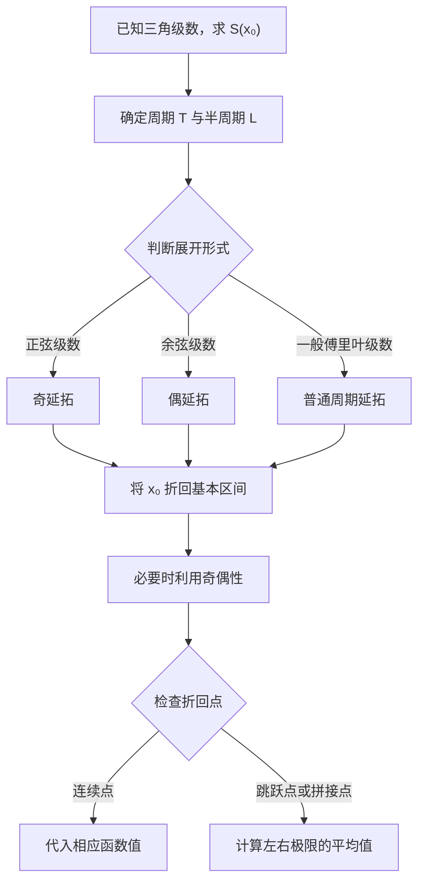
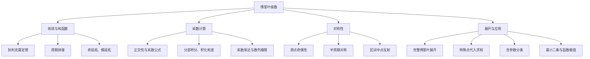

## 一、核心考点与复习重点

傅里叶级数虽然属于无穷级数，但与常数项级数、幂级数的解题思维有明显区别。

| 考点        | 核心题型                 | 复习优先级 |
| --------- | -------------------- | ----- |
| 狄利克雷收敛定理  | 求指定点的级数和             | ★★★★★ |
| 周期延拓      | 周期端点、区间外求值           | ★★★★★ |
| 奇延拓与偶延拓   | 正弦级数、余弦级数的和函数        | ★★★★★ |
| 傅里叶系数     | 计算 $a_n,b_n,a_0$ | ★★★★★ |
| 系数与数列极限   | 等价无穷小、高阶相消           | ★★★★★ |
| 完整傅里叶展开   | 分段函数、半区间展开           | ★★★★  |
| 利用傅里叶级数求和 | 平方倒数和、交错级数和          | ★★★★  |
| 特殊对称性     | 奇偶次系数消项              | ★★★★  |
| 三角函数正交性   | 系数证明、最小二乘综合题         | ★★★   |

2023、2024、2025年数学一真题分别涉及：

- 2023年：余弦系数的偶数下标求和。
- 2024年：傅里叶系数与等价无穷小结合。
- 2025年：正弦级数、周期延拓与跳跃点求值。

因此，本节不能只背傅里叶系数公式，还需要熟练掌握函数延拓、对称性、数列极限和级数求和。

## 第一部分　基础知识与底层原理

### 二、傅里叶级数究竟是什么？

**2.1 从幂级数到傅里叶级数**

幂级数是利用不同次数的幂函数表示一个函数：

$$
f(x)=\sum_{n=0}^{\infty}a_nx^n.
$$

傅里叶级数则是利用不同频率的正弦函数、余弦函数表示函数：

$$
f(x)\sim \frac{a_0}{2} +\sum_{n=1}^{\infty} (a_n\cos nx+b_n\sin nx).
$$

二者的区别在于所使用的基本函数不同。

| 对比项目   | 幂级数                  | 傅里叶级数                   |
| ------ | -------------------- | ----------------------- |
| 基本函数   | $1,x,x^2,\ldots$ | $1,\cos nx,\sin nx$ |
| 系数的确定  | 常用各阶导数               | 积分与正交性                  |
| 主要研究对象 | 局部函数展开               | 周期函数展开                  |
| 主要收敛问题 | 收敛半径、端点              | 连续点、跳跃点、周期端点            |
| 典型应用   | 函数展开、级数求和            | 周期函数表示、级数求和             |

傅里叶级数的基本思想是：

**把复杂的周期函数分解成一个常数项，以及许多频率不同的正弦波和余弦波。**

其中：

- $a_0/2$ 表示函数在一个周期内的平均值。
- $a_n$ 表示第 $n$ 个余弦分量的系数。
- $b_n$ 表示第 $n$ 个正弦分量的系数。

需要特别注意，写成 $f(x)\sim S(x)$ 并不意味着在每一个点都有 $f(x)=S(x)$。二者在间断点可能不同，这是本节最重要的概念之一。

### 三、傅里叶系数的基本公式

**3.1 周期为 $2\pi$ 的情形**

设 $f(x)$ 是周期为 $2\pi$ 的函数，其傅里叶级数为

$$
\boxed{ \frac{a_0}{2}+ \sum_{n=1}^{\infty} (a_n\cos nx+b_n\sin nx) }
$$

其中

$$
\boxed{ a_0=\frac1\pi\int_{-\pi}^{\pi}f(x)\,\mathrm dx }
$$

$$
\boxed{ a_n=\frac1\pi\int_{-\pi}^{\pi}f(x)\cos nx\,\mathrm dx }
$$

$$
\boxed{ b_n=\frac1\pi\int_{-\pi}^{\pi}f(x)\sin nx\,\mathrm dx }
$$

这里 $n=1,2,\ldots$。

**3.2 一般周期为 $2L$ 的情形**

这是最通用、最值得记忆的一组公式。

设函数的周期为

$$
T=2L,
$$

记

$$
k_n=\frac{n\pi}{L}.
$$

则傅里叶级数为

$$
\boxed{ \frac{a_0}{2}+ \sum_{n=1}^{\infty} \left( a_n\cos\frac{n\pi x}{L} +b_n\sin\frac{n\pi x}{L} \right) }
$$

系数为

$$
\boxed{ a_n=\frac1L\int_{-L}^{L} f(x)\cos\frac{n\pi x}{L}\,\mathrm dx }
$$

$$
\boxed{ b_n=\frac1L\int_{-L}^{L} f(x)\sin\frac{n\pi x}{L}\,\mathrm dx }
$$

其中余弦系数公式也适用于 $n=0$。

所以

$$
\frac{a_0}{2} =\frac1{2L}\int_{-L}^{L}f(x)\,\mathrm dx,
$$

恰好是一个周期内的平均值。

**3.3 常见周期与频率的对应**

| 周期 $T$ | 半周期 $L$ | 三角函数                                              |
| ---------- | ----------- | ------------------------------------------------- |
| $2\pi$ | $\pi$   | $\cos nx,\sin nx$                             |
| $2$    | $1$     | $\cos n\pi x,\sin n\pi x$                     |
| $4$    | $2$     | $\cos\frac{n\pi x}{2},\sin\frac{n\pi x}{2}$   |
| $1$    | $1/2$   | $\cos 2n\pi x,\sin 2n\pi x$                   |
| $T$    | $T/2$   | $\cos\frac{2n\pi x}{T},\sin\frac{2n\pi x}{T}$ |

**记忆规律：**

$$
\boxed{\text{三角函数的基本角频率}=\frac{2\pi}{T}}
$$

遇到非标准周期，不要直接套用 $\cos nx$ 和 $\sin nx$。

**3.4 积分区间不一定关于原点对称**

对于已知的 $2L$ 周期函数，系数积分可以在任意一个完整周期内进行：

$$
a_n=\frac1L\int_c^{c+2L} f(x)\cos\frac{n\pi x}{L}\,\mathrm dx.
$$

正弦系数同理。

例如，李林880题中有一道题将函数定义在 $[1,3]$ 上，要求作周期为2的傅里叶展开。

此时完全可以直接在 $[1,3]$ 上积分，不必先把函数平移到 $[-1,1]$。

### 四、三角函数的正交性：系数公式为什么成立？

这是傅里叶级数的数学基础，也是处理创新题的重要工具。

在 $[-\pi,\pi]$ 上，对任意正整数 $m,n$，有

$$
\int_{-\pi}^{\pi}\cos mx\sin nx\,\mathrm dx=0.
$$

$$
\int_{-\pi}^{\pi}\cos mx\cos nx\,\mathrm dx = \begin{cases} 0,&m\ne n,\\ \pi,&m=n. \end{cases}
$$

$$
\int_{-\pi}^{\pi}\sin mx\sin nx\,\mathrm dx = \begin{cases} 0,&m\ne n,\\ \pi,&m=n. \end{cases}
$$

并且

$$
\int_{-\pi}^{\pi}\cos nx\,\mathrm dx =\int_{-\pi}^{\pi}\sin nx\,\mathrm dx=0.
$$

**4.1 直观理解**

在线性代数中，两个向量的内积为零意味着两个向量正交。

这里可以把函数的内积定义为

$$
\langle f,g\rangle =\int_{-\pi}^{\pi}f(x)g(x)\,\mathrm dx.
$$

那么不同频率的正弦、余弦函数就像彼此垂直的坐标轴。

求傅里叶系数，本质上是求函数在相应坐标轴上的分量。

例如，要提取某个余弦分量 $a_m$，可以通过正交积分得到

$$
\int_{-\pi}^{\pi}f(x)\cos mx\,\mathrm dx =\pi a_m.
$$

因此

$$
a_m=\frac1\pi \int_{-\pi}^{\pi}f(x)\cos mx\,\mathrm dx.
$$

其他频率的贡献全部因正交性而消失。

**4.2 模拟母题：张宇8套卷第3套第2题**

设 $f(x)$ 在 $[-\pi,\pi]$ 上连续，求使

$$
F(a)=\int_{-\pi}^{\pi} [f(x)-a\cos nx]^2\,\mathrm dx
$$

取得极小值的 $a$。

这道题表面考查定积分与极值，实质是傅里叶系数的最小二乘意义。

**第一步：展开平方。**

$$
\begin{aligned} F(a) ={}&\int_{-\pi}^{\pi}f^2(x)\,\mathrm dx\\ &-2a\int_{-\pi}^{\pi}f(x)\cos nx\,\mathrm dx\\ &+a^2\int_{-\pi}^{\pi}\cos^2nx\,\mathrm dx. \end{aligned}
$$

利用正交性，

$$
\int_{-\pi}^{\pi}\cos^2nx\,\mathrm dx=\pi.
$$

**第二步：对参数求导。**

$$
F'(a)=-2\int_{-\pi}^{\pi} f(x)\cos nx\,\mathrm dx+2\pi a.
$$

令 $F'(a)=0$，得到

$$
\boxed{ a=\frac1\pi\int_{-\pi}^{\pi}f(x)\cos nx\,\mathrm dx }
$$

因为

$$
F''(a)=2\pi>0,
$$

故该点为唯一的全局最小值点。

**4.3 向未来创新题推广**

对于一般形式

$$
F(a)=\int_\alpha^\beta[f(x)-ag(x)]^2\,\mathrm dx,
$$

若相关积分存在，并且

$$
\int_\alpha^\beta g^2(x)\,\mathrm dx>0,
$$

则使其最小的参数为

$$
\boxed{ a=\frac{\int_\alpha^\beta f(x)g(x)\,\mathrm dx} {\int_\alpha^\beta g^2(x)\,\mathrm dx} }
$$

最优误差还满足

$$
\int_\alpha^\beta[f(x)-ag(x)]g(x)\,\mathrm dx=0.
$$

也就是误差与所选基函数正交。

这个模型可以与定积分、函数极值、多元函数极值、积分不等式等章节结合出题。

### 五、狄利克雷收敛定理——本节最重要的定理

**5.1 定理内容**

设 $f(x)$ 是周期函数，在一个周期内满足通常的狄利克雷充分条件，例如分段光滑，则其傅里叶级数收敛，并且和函数满足

$$
\boxed{ S(x)=\frac{f(x-0)+f(x+0)}2 }
$$

其中

$$
f(x-0)=\lim_{t\to x^-}f(t), \qquad f(x+0)=\lim_{t\to x^+}f(t).
$$

必须注意：这里讨论的是傅里叶级数对应的**完整周期函数**的左右极限。

**5.2 三种基本情况**

| 点的类型  | 傅里叶级数收敛值           |
| ----- | ------------------ |
| 连续点   | $S(x)=f(x)$    |
| 跳跃间断点 | 左右极限的平均值           |
| 可去间断点 | 左右极限的共同值，不一定等于原函数值 |

例如，若某点满足

$$
f(x_0-0)=2,\quad f(x_0+0)=6,\quad f(x_0)=100,
$$

则

$$
S(x_0)=\frac{2+6}{2}=4.
$$

而不是100。

改变函数在有限个点上的赋值，不会改变傅里叶系数中的定积分，因此也不会改变傅里叶级数。

**5.3 周期拼接点的收敛公式**

若函数在 $(-L,L]$ 上给出，并以 $2L$ 为周期延拓，则

$$
\boxed{ S(L)=S(-L) =\frac{f(L^-)+f(-L^+)}2 }
$$

若函数在 $[a,a+T)$ 上给出，则

$$
\boxed{ S(a)=\frac{f(a^+)+f((a+T)^-)}2 }
$$

这两个公式是端点收敛类题目的直接解题模板。

**5.4 定理的适用条件与易错理解**

狄利克雷条件是充分条件，而不是必要条件。不能因为某函数不满足常见的分段光滑条件，就直接断定其傅里叶级数发散。

同时，傅里叶级数在每一点收敛，不代表它一定一致收敛，也不代表它一定绝对收敛。

特别是当周期延拓存在跳跃时，不能未经判断就把原函数与傅里叶级数的和函数完全等同。

### 六、奇延拓、偶延拓与半区间展开

这是本节最容易混淆、同时也最容易通过训练掌握的知识点。

**6.1 原函数为奇函数或偶函数**

若 $f(x)$ 是定义在对称区间上的偶函数，

$$
f(-x)=f(x),
$$

由于偶函数乘以正弦函数得到奇函数，所以

$$
\boxed{b_n=0}.
$$

傅里叶级数只含常数项和余弦项：

$$
\frac{a_0}{2} +\sum_{n=1}^{\infty}a_n\cos\frac{n\pi x}{L},
$$

其中

$$
\boxed{ a_n=\frac2L\int_0^L f(x)\cos\frac{n\pi x}{L}\,\mathrm dx }
$$

若 $f(x)$ 为奇函数，

$$
f(-x)=-f(x),
$$

则

$$
\boxed{a_0=a_n=0}.
$$

其傅里叶级数只含正弦项：

$$
\sum_{n=1}^{\infty}b_n\sin\frac{n\pi x}{L},
$$

其中

$$
\boxed{ b_n=\frac2L\int_0^L f(x)\sin\frac{n\pi x}{L}\,\mathrm dx }
$$

**6.2 只在半区间给出函数怎么办？**

如果题目只给出 $f(x)$ 在 $[0,L]$ 上的表达式，那么它在负半轴上的形式并没有自动确定。

可以采用两种不同的延拓方法。

**偶延拓：**

$$
F_e(x)= \begin{cases} f(-x),&-L<x<0,\\ f(x),&0\leq x<L. \end{cases}
$$

随后以 $2L$ 为周期延拓。

**奇延拓：**

$$
F_o(x)= \begin{cases} -f(-x),&-L<x<0,\\ 0,&x=0,\\ f(x),&0<x<L. \end{cases}
$$

随后以 $2L$ 为周期延拓，并在整数倍 $L$ 的端点赋值为0，以保持奇性和周期性。

举例来说，已知

$$
f(x)=x^2,\qquad 0\leq x\leq1.
$$

如果作偶延拓，则在 $(-1,1)$ 上得到

$$
F_e(x)=x^2.
$$

如果作奇延拓，则在 $(-1,1)$ 上得到

$$
F_o(x)=x|x|= \begin{cases} -x^2,&-1<x<0,\\ x^2,&0\leq x<1. \end{cases}
$$

同一个半区间函数，可以具有完全不同的正弦展开和余弦展开。

**6.3 半区间展开的端点规律**

假设半区间函数分段光滑，端点单侧极限存在。

| 位置                 | 正弦级数的和     | 余弦级数的和       |
| ------------------ | ---------- | ------------ |
| $0<x<L$ 的连续点 | $f(x)$ | $f(x)$   |
| 内部跳跃点              | 左右极限平均值    | 左右极限平均值      |
| $x=0$          | $0$    | $f(0^+)$ |
| $x=L$          | $0$    | $f(L^-)$ |
| $x=-L$         | $0$    | $f(L^-)$ |

其中最重要的是：

$$
\boxed{ S_{\sin}(kL)=0,\qquad k\in\mathbb Z }
$$

因为

$$
\sin\frac{n\pi kL}{L}=\sin nk\pi=0.
$$

无论半区间原函数在端点赋值是多少，正弦级数在这些点的和一定为0。

而偶延拓在端点两侧的极限相同，所以余弦级数取相应的单侧极限。

**6.4 考场上如何快速识别延拓方式？**

| 题目给出的形式                                                         | 应该想到    |
| --------------------------------------------------------------- | ------- |
| 一般正弦与余弦混合                                                       | 普通周期延拓  |
| 只含 $\sin\frac{n\pi x}{L}$ 的半区间傅里叶展开                         | 奇延拓     |
| 只含 $\cos\frac{n\pi x}{L}$ 的半区间傅里叶展开                         | 偶延拓     |
| $b_n=\frac2L\int_0^L f(x)\sin\frac{n\pi x}{L}\,\mathrm dx$ | 半区间正弦展开 |
| $a_n=\frac2L\int_0^L f(x)\cos\frac{n\pi x}{L}\,\mathrm dx$ | 半区间余弦展开 |

核心原则：**由系数定义和展开形式决定延拓方式，而不是根据半区间表达式擅自判断原函数的奇偶性。**

## 第二部分　核心题型与历年真题母题

### 七、题型一：普通周期函数在跳跃点的收敛值

**重要程度：★★★★★**

代表题目：1988年数一、1992年数一、李永乐六套卷第6套第13题、汤家凤八套卷第7套第14题。

**7.1 真题母题：1992年考研数学一**

设

$$
f(x)= \begin{cases} -1,&-\pi<x\leq0,\\ 1+x^2,&0<x\leq\pi. \end{cases}
$$

将其以 $2\pi$ 为周期延拓，求傅里叶级数在 $x=\pi$ 处的收敛值。

**解题思路**

题目只要求一个点的收敛值，并没有要求计算傅里叶系数。

因此直接使用狄利克雷收敛定理。

由周期性，

$$
f(\pi+0)=f(-\pi+0).
$$

又有

$$
f(\pi-0)=1+\pi^2,
$$

$$
f(-\pi+0)=-1.
$$

所以

$$
\begin{aligned} S(\pi) &=\frac{f(\pi-0)+f(-\pi+0)}2\\ &=\frac{1+\pi^2-1}{2}\\ &=\boxed{\frac{\pi^2}{2}}. \end{aligned}
$$

**进一步推广**

这道题还可以要求你写出整个基本周期内的和函数。

在 $x=0$ 处，

$$
S(0)=\frac{-1+1}{2}=0.
$$

因此

$$
\boxed{ S(x)= \begin{cases} -1,&-\pi<x<0,\\ 0,&x=0,\\ 1+x^2,&0<x<\pi,\\ \dfrac{\pi^2}{2},&x=\pm\pi. \end{cases} }
$$

再进行 $2\pi$ 周期延拓即可。

这正是李正元练习题中相应综合题的第一层考查。

**7.2 关联真题：1988年数学一**

已知周期为2的函数

$$
f(x)= \begin{cases} 2,&-1<x\leq0,\\ x^3,&0<x\leq1. \end{cases}
$$

求 $S(1)$。

由周期拼接公式直接得到

$$
S(1)=\frac{f(1^-)+f(-1^+)}2 =\frac{1+2}{2} =\boxed{\frac32}.
$$

这两道真题实际上是同一个母题。

**7.3 高质量综合模拟题：李永乐六套卷第6套第13题**

设 $f(x)$ 为周期为2的函数，在 $[0,2)$ 上满足

$$
f(x)= \begin{cases} 0,&x=0,\\[3pt] \dfrac{\displaystyle\int_0^x(\cos t-1)\,\mathrm dt}{x^3}, &0<x<1,\\[9pt] \dfrac{(3-x)^{\frac1{2-x}}-e}{2-x}, &1\leq x<2. \end{cases}
$$

求其傅里叶级数在 $x=0$ 处的收敛值。

这道题非常值得掌握，因为它把第一模块的极限计算、第四模块的定积分和第七模块的傅里叶级数结合起来。

**第一步：利用周期性确定左右极限。**

$$
S(0)=\frac{f(0^+)+f(2^-)}2.
$$

**第二步：计算右极限。**

$$
\int_0^x(\cos t-1)\,\mathrm dt=\sin x-x.
$$

由泰勒公式，

$$
\sin x=x-\frac{x^3}{6}+o(x^3).
$$

因此

$$
f(0^+) =\lim_{x\to0^+}\frac{\sin x-x}{x^3} =-\frac16.
$$

**第三步：计算周期左极限。**

令

$$
t=2-x\to0^+.
$$

则

$$
3-x=1+t.
$$

所以

$$
f(2^-) =\lim_{t\to0^+} \frac{(1+t)^{1/t}-e}{t}.
$$

对于幂指函数，先取对数分析指数：

$$
\frac{\ln(1+t)}t =1-\frac t2+o(t).
$$

于是

$$
\begin{aligned} (1+t)^{1/t} &=\exp\left(1-\frac t2+o(t)\right)\\ &=e\left(1-\frac t2+o(t)\right). \end{aligned}
$$

故

$$
f(2^-)=-\frac e2.
$$

**第四步：取平均值。**

$$
\boxed{ S(0)=-\frac1{12}-\frac e4 }
$$

**母题迁移**

未来的考研题完全可以把左右极限替换成变上限积分、递推函数、隐函数、泰勒展开或幂指函数极限。

傅里叶级数部分的逻辑并没有改变，难度只是转移到了左右极限的计算上。

### 八、题型二：正弦、余弦级数在区间外的求值

**重要程度：★★★★★**

代表题目：1989年、1999年、2013年、2025年数一真题，以及张宇8套卷第8套第14题。

**8.1 通用解题流程**

整个过程可以概括成四个动作：

**定周期 → 折回区间 → 判断奇偶 → 检查间断。**

**8.2 基础真题：1989年数学一**

设

$$
f(x)=x^2,\qquad 0\leq x<1,
$$

且

$$
S(x)=\sum_{n=1}^{\infty}b_n\sin n\pi x,
$$

其中

$$
b_n=2\int_0^1x^2\sin n\pi x\,\mathrm dx.
$$

求

$$
S\left(-\frac12\right).
$$

由于是正弦级数，所以 $S(x)$ 是奇函数。

在 $0<x<1$ 内，和函数等于 $x^2$。于是

$$
\begin{aligned} S\left(-\frac12\right) &=-S\left(\frac12\right)\\ &=-\left(\frac12\right)^2\\ &=\boxed{-\frac14}. \end{aligned}
$$

**陷阱：** 不能因为 $x^2$ 通常是偶函数，就把这里的和函数也理解为偶函数。正弦展开对应的是半区间函数的奇延拓。

**8.3 核心母题：1999年数学一**

设

$$
f(x)= \begin{cases} x,&0\leq x\leq\frac12,\\ 2-2x,&\frac12<x<1. \end{cases}
$$

其余弦级数为

$$
S(x)=\frac{a_0}{2} +\sum_{n=1}^{\infty}a_n\cos n\pi x,
$$

其中

$$
a_n=2\int_0^1 f(x)\cos n\pi x\,\mathrm dx.
$$

求

$$
S\left(-\frac52\right).
$$

**第一步：确定周期。**

由 $\cos n\pi x$ 可知2为其周期。

**第二步：折回并利用偶性。**

$$
S\left(-\frac52\right) =S\left(-\frac12\right) =S\left(\frac12\right).
$$

**第三步：判断折回点是不是连续点。**

$$
f\left(\frac12-0\right)=\frac12,
$$

而

$$
f\left(\frac12+0\right)=1.
$$

所以 $x=1/2$ 是跳跃间断点。

**第四步：应用收敛定理。**

$$
\boxed{ S\left(-\frac52\right) =\frac{\frac12+1}{2} =\frac34 }
$$

这道题同时出现在提供的张宇8套卷第4套第3题中。

李林880题则将其进一步拓展为：求 $x\in[-3,-5/2]$ 时的整个和函数。

由于

$$
S(x)=S(x+2)=S(-x-2),
$$

当

$$
-3\leq x<-\frac52
$$

时，

$$
\frac12<-x-2\leq1.
$$

因此

$$
S(x)=2-2(-x-2)=2x+6.
$$

在 $x=-5/2$ 处取跳跃点平均值。

最终得到

$$
\boxed{ S(x)= \begin{cases} 2x+6,&-3\leq x<-\frac52,\\[3pt] \dfrac34,&x=-\frac52. \end{cases} }
$$

这就是从单点求值推广到区间和函数的方法。

**8.4 关联真题：2013年数学一**

设

$$
f(x)=\left|x-\frac12\right|, \qquad 0\leq x\leq1,
$$

作周期为2的正弦展开，求 $S(-9/4)$。

先利用周期性：

$$
S\left(-\frac94\right) =S\left(-\frac14\right).
$$

再利用奇性：

$$
S\left(-\frac14\right) =-S\left(\frac14\right).
$$

因为 $1/4$ 为连续点，所以

$$
\boxed{ S\left(-\frac94\right) =-\left|\frac14-\frac12\right| =-\frac14 }
$$

这里的绝对值不会改变正弦级数的奇性。

**8.5 近期真题母题：2025年数学一**

设

$$
f(x)= \begin{cases} 0,&0\leq x<\frac12,\\ x^2,&\frac12\leq x\leq1. \end{cases}
$$

其正弦级数为

$$
S(x)=\sum_{n=1}^{\infty}b_n\sin n\pi x.
$$

求

$$
S\left(-\frac72\right).
$$

**第一步：识别周期。**

$$
T=2.
$$

**第二步：周期折回。**

$$
-\frac72+4=\frac12.
$$

因此

$$
S\left(-\frac72\right)=S\left(\frac12\right).
$$

虽然原自变量为负数，但折回后已经位于正半区间，不需要额外添加负号。

**第三步：计算跳跃点左右极限。**

$$
f\left(\frac12-0\right)=0,
$$

$$
f\left(\frac12+0\right)=\frac14.
$$

故

$$
\boxed{ S\left(-\frac72\right)=\frac18 }
$$

这道题与1999年的真题属于同一个核心题型，只是把偶延拓改为奇延拓，并改变了周期折回的方式。

**8.6 模拟变式：张宇8套卷第8套第14题**

设

$$
S(x)=\sum_{n=1}^{\infty} b_n\sin\frac{n\pi x}{2},
$$

其中

$$
\begin{aligned} b_n={}&\int_0^1x^2\sin\frac{n\pi x}{2}\,\mathrm dx\\ &+\int_1^2e^x\sin\frac{n\pi x}{2}\,\mathrm dx. \end{aligned}
$$

求 $S(-9)$。

这道题的创新点在于不直接给出 $f(x)$，而是让你根据系数反向识别原函数。

由于

$$
\frac{2}{L}=1,
$$

可知 $L=2$，周期为4。

相应的半区间函数为

$$
f(x)= \begin{cases} x^2,&0<x<1,\\ e^x,&1<x<2. \end{cases}
$$

于是

$$
S(-9)=S(-1)=-S(1).
$$

在 $x=1$ 处，

$$
S(1)=\frac{1+e}{2}.
$$

所以

$$
\boxed{S(-9)=-\frac{1+e}{2}}.
$$

**重要技巧：** 即使系数积分非常复杂，只要题目要求的是和函数的某个取值，通常就不需要真正计算这些积分。

### 九、题型三：傅里叶系数的计算

**重要程度：★★★★★**

代表题目：1993年、2003年、2024年数学一真题。

**9.1 先利用奇偶性，再进行积分**

对于定义在对称区间上的任意函数，可以分解为

$$
f(x)=f_e(x)+f_o(x),
$$

其中

$$
\boxed{ f_e(x)=\frac{f(x)+f(-x)}2 }
$$

$$
\boxed{ f_o(x)=\frac{f(x)-f(-x)}2 }
$$

分别为偶部和奇部。

于是

$$
a_n=\frac2L\int_0^L f_e(x)\cos\frac{n\pi x}{L}\,\mathrm dx,
$$

$$
b_n=\frac2L\int_0^L f_o(x)\sin\frac{n\pi x}{L}\,\mathrm dx.
$$

也就是说：

**余弦系数只由偶部决定，正弦系数只由奇部决定。**

**9.2 真题母题：1993年数学一**

设

$$
f(x)=\pi x+x^2, \qquad -\pi<x<\pi.
$$

求其傅里叶展开中的 $b_3$。

由于 $x^2$ 是偶函数，所以它对正弦系数没有贡献。

因此

$$
\begin{aligned} b_n &=\frac1\pi\int_{-\pi}^{\pi} (\pi x+x^2)\sin nx\,\mathrm dx\\ &=2\int_0^\pi x\sin nx\,\mathrm dx. \end{aligned}
$$

分部积分：

$$
\begin{aligned} \int_0^\pi x\sin nx\,\mathrm dx &=\left[-\frac{x\cos nx}{n}\right]_0^\pi\\ &\quad+\frac1n\int_0^\pi\cos nx\,\mathrm dx\\ &=-\frac{\pi(-1)^n}{n}. \end{aligned}
$$

所以

$$
b_n=\frac{2\pi(-1)^{n+1}}n.
$$

令 $n=3$，得到

$$
\boxed{b_3=\frac{2\pi}{3}}.
$$

**9.3 真题母题：2003年数学一**

设

$$
x^2=\sum_{n=0}^{\infty}a_n\cos nx, \qquad -\pi\leq x\leq\pi.
$$

求 $a_2$。

因为 $x^2$ 为偶函数，对 $n\geq1$，

$$
a_n=\frac2\pi\int_0^\pi x^2\cos nx\,\mathrm dx.
$$

分部积分两次：

$$
\begin{aligned} \int_0^\pi x^2\cos nx\,\mathrm dx &=-\frac2n\int_0^\pi x\sin nx\,\mathrm dx\\ &=\frac{2\pi(-1)^n}{n^2}. \end{aligned}
$$

因此

$$
\boxed{ a_n=\frac{4(-1)^n}{n^2} }
$$

从而

$$
\boxed{a_2=1}.
$$

<Callout type="warn" title="特殊提醒：常数项的记号">

题目写的是

$$
\sum_{n=0}^{\infty}a_n\cos nx,
$$

不是通常的

$$
\frac{a_0}{2}+\sum_{n=1}^{\infty}a_n\cos nx.
$$

这只影响 $a_0$ 的定义，不影响 $n\geq1$ 的系数。

如果题目要求前一种写法中的 $a_0$，答案应为

$$
a_0=\frac{\pi^2}{3}.
$$

而通常傅里叶记法中的 $a_0$ 则为

$$
a_0=\frac{2\pi^2}{3}.
$$

</Callout>

**9.4 常用积分公式汇总**

下列公式建议在能够独立推导的基础上熟记。

对正整数 $n$，记

$$
I=\int_0^\pi f(x)\cos nx\,\mathrm dx, \qquad J=\int_0^\pi f(x)\sin nx\,\mathrm dx.
$$

| $f(x)$ | 余弦积分 $I$                 | 正弦积分 $J$                                         |
| ---------- | ---------------------------- | ---------------------------------------------------- |
| $1$    | $0$                      | $\frac{1-(-1)^n}{n}$                             |
| $x$    | $\frac{(-1)^n-1}{n^2}$   | $-\frac{\pi(-1)^n}{n}$                           |
| $x^2$  | $\frac{2\pi(-1)^n}{n^2}$ | $-\frac{\pi^2(-1)^n}{n}+\frac{2[(-1)^n-1]}{n^3}$ |

在本章题库中，绝大多数多项式型傅里叶系数的计算都可以归结为这些积分。

### 十、题型四：傅里叶系数与数列极限

**重要程度：★★★★★**

这是近期真题与模拟题中尤其值得重视的综合方向。

常见形式为

$$
\lim_{n\to\infty}n^p\sin a_{2n},
$$

$$
\lim_{n\to\infty}n^p\ln(1+a_{2n-1}),
$$

或者

$$
\lim_{n\to\infty}n^p(a_{2n}+a_{2n+1}).
$$

这类题目的关键并不是傅里叶级数的收敛值，而是**傅里叶系数的渐近阶数**。

**10.1 近期真题母题：2024年数学一**

已知 $f(x)=x+1$ 在 $[0,\pi]$ 上展开为余弦级数：

$$
f(x)=\frac{a_0}{2} +\sum_{n=1}^{\infty}a_n\cos nx.
$$

求

$$
\lim_{n\to\infty}n^2\sin a_{2n-1}.
$$

**第一步：求余弦系数。**

对 $k\geq1$，

$$
a_k=\frac2\pi\int_0^\pi(x+1)\cos kx\,\mathrm dx.
$$

由于

$$
\int_0^\pi\cos kx\,\mathrm dx=0,
$$

所以常数项1没有贡献。

于是

$$
\begin{aligned} a_k &=\frac2\pi\int_0^\pi x\cos kx\,\mathrm dx\\ &=\frac{2[(-1)^k-1]}{\pi k^2}. \end{aligned}
$$

**第二步：代入奇数下标。**

$$
a_{2n-1}=-\frac4{\pi(2n-1)^2}\to0.
$$

**第三步：利用等价无穷小。**

$$
\sin a_{2n-1}\sim a_{2n-1}.
$$

因此

$$
\begin{aligned} \lim_{n\to\infty}n^2\sin a_{2n-1} &=-\frac4\pi \lim_{n\to\infty}\frac{n^2}{(2n-1)^2}\\ &=\boxed{-\frac1\pi}. \end{aligned}
$$

注意最终的 $1/4$ 来自奇数下标，而不是傅里叶系数公式。

**10.2 张宇1000题变式：三角函数系数与对数极限**

设

$$
f(x)=\sin x,\qquad 0\leq x\leq\pi,
$$

将其展开为余弦级数，求

$$
\lim_{n\to\infty}n^2\ln(1+a_{2n}).
$$

与前一题不同，这里原函数是三角函数，应当优先使用积化和差。

$$
a_{2n}=\frac2\pi \int_0^\pi\sin x\cos2nx\,\mathrm dx.
$$

利用

$$
2\sin x\cos2nx =\sin(2n+1)x+\sin(1-2n)x,
$$

得到

$$
\begin{aligned} a_{2n} &=\frac2\pi \left(\frac1{2n+1}+\frac1{1-2n}\right)\\ &=\frac4{\pi(1-4n^2)}. \end{aligned}
$$

因此

$$
a_{2n}\sim-\frac1{\pi n^2}.
$$

再利用

$$
\ln(1+t)\sim t,
$$

可得

$$
\boxed{ \lim_{n\to\infty}n^2\ln(1+a_{2n}) =-\frac1\pi }
$$

这里不需要求全部余弦系数，只求偶数下标即可。

**10.3 高阶模拟母题：李永乐六套卷第1套第14题**

设

$$
f(x)=x^2,\qquad 0\leq x\leq\pi,
$$

其余弦级数系数为 $a_n$，求

$$
\lim_{n\to\infty}n^3(a_{2n}+a_{2n+1}).
$$

由2003年真题已经知道

$$
a_n=\frac{4(-1)^n}{n^2}.
$$

于是

$$
a_{2n}=\frac1{n^2},
$$

$$
a_{2n+1}=-\frac4{(2n+1)^2}.
$$

这两个数列都为 $n^{-2}$ 量级，但主项相互抵消。

**方法一：通分。**

$$
\begin{aligned} n^3(a_{2n}+a_{2n+1}) &=n^3\left[ \frac1{n^2}-\frac4{(2n+1)^2} \right]\\ &=\frac{n(4n+1)}{(2n+1)^2}. \end{aligned}
$$

因此

$$
\boxed{ \lim_{n\to\infty}n^3(a_{2n}+a_{2n+1})=1 }
$$

**方法二：泰勒展开。**

$$
a_{2n+1} =-\frac1{n^2} \left(1+\frac1{2n}\right)^{-2}.
$$

利用

$$
(1+t)^{-2}=1-2t+O(t^2),
$$

得到

$$
a_{2n+1} =-\frac1{n^2}+\frac1{n^3} +O\left(\frac1{n^4}\right).
$$

所以

$$
a_{2n}+a_{2n+1} =\frac1{n^3}+O\left(\frac1{n^4}\right).
$$

结果同样为1。

**本题的核心迁移价值**

不能分别对两个乘上 $n^3$ 的数列取极限，因为它们分别趋于正、负无穷，属于未定式。

必须遵守第一模块极限计算中的重要原则：

**相加减的主项发生抵消时，应先合并或展开到更高阶，再求极限。**

**10.4 进阶技巧：用端点导数预测系数的衰减阶数**

对于半区间余弦系数

$$
a_n=\frac2L\int_0^L f(x)\cos k_nx\,\mathrm dx, \qquad k_n=\frac{n\pi}{L},
$$

如果 $f\in C^2[0,L]$，连续进行两次分部积分，可以得到

$$
\boxed{ \begin{aligned} a_n ={}&\frac{2[(-1)^nf'(L)-f'(0)]}{Lk_n^2}\\ &-\frac{2}{Lk_n^2} \int_0^L f''(x)\cos k_nx\,\mathrm dx. \end{aligned} }
$$

进一步利用黎曼—勒贝格引理（此处作为拓展知识），可知最后的振荡积分趋于0。

因此

$$
\boxed{ a_n= \frac{2L}{n^2\pi^2} [(-1)^nf'(L)-f'(0)] +o(n^{-2}) }
$$

类似地，对于 $f\in C^1[0,L]$ 的半区间正弦展开，

$$
\boxed{ b_n= \frac{2}{n\pi} [f(0)-(-1)^nf(L)] +o(n^{-1}) }
$$

这个结论揭示出：

余弦系数的主要衰减项与端点导数有关，正弦系数的主要衰减项与端点函数值有关。

若端点贡献抵消，还需要继续考察更高阶项。不能一概认为所有余弦系数都是 $n^{-2}$ 量级，或者所有正弦系数都是 $n^{-1}$ 量级。

这组公式适合用来理解和拓展，不必将黎曼—勒贝格引理作为数学一的核心背诵定理；常规题通过直接分部积分即可解决。

### 十一、题型五：对称性与奇偶下标系数消项

**重要程度：★★★★☆**

此类题特别适合出证明题、选择题和创新填空题。

**11.1 三类不同的对称性**

| 函数性质               | 可以得到的结论            |
| ------------------ | ------------------ |
| $f(-x)=f(x)$   | 所有正弦系数为0           |
| $f(-x)=-f(x)$  | 常数项及所有余弦系数为0       |
| $f(x+L)=f(x)$  | 奇数下标的正弦、余弦系数为0     |
| $f(x+L)=-f(x)$ | 常数项及偶数下标的正弦、余弦系数为0 |

必须区分：

- 关于原点的奇偶性，决定保留正弦还是余弦。
- 关于半周期的对称性，决定保留奇次还是偶次谐波。

两者是不同的概念。

**11.2 张宇1000题母题：半周期反对称**

设 $f(x)$ 是周期为 $2\pi$ 的连续函数，且满足

$$
f(x+\pi)=-f(x).
$$

求 $a_{2n}$。

由系数公式，

$$
a_{2n}=\frac1\pi \int_0^{2\pi}f(x)\cos2nx\,\mathrm dx.
$$

将一个周期拆成两半：

$$
\begin{aligned} \pi a_{2n} ={}&\int_0^\pi f(x)\cos2nx\,\mathrm dx\\ &+\int_\pi^{2\pi}f(x)\cos2nx\,\mathrm dx. \end{aligned}
$$

在后一项中令 $x=t+\pi$。

由于

$$
f(t+\pi)=-f(t),
$$

$$
\cos2n(t+\pi)=\cos2nt,
$$

所以两个积分恰好互为相反数。

故

$$
\boxed{a_{2n}=0}.
$$

同理还可以得到

$$
\boxed{a_0=0,\qquad b_{2n}=0}.
$$

这种函数只可能含奇次谐波，即

$$
\begin{aligned} S(x)=\sum_{n=1}^{\infty}\big[ &a_{2n-1}\cos(2n-1)x\\ &+b_{2n-1}\sin(2n-1)x \big]. \end{aligned}
$$

正确结果为0。

**11.3 李正元练习题母题：关于区间中点的反对称**

设 $f(x)$ 是 $[-\pi,\pi]$ 上的偶函数，且

$$
f\left(\frac\pi2+t\right) =-f\left(\frac\pi2-t\right).
$$

证明

$$
a_{2n}=0.
$$

**解题关键**

看到 $\frac\pi2+t$ 与 $\frac\pi2-t$，就应该联想到积分区间的中点反射。

令

$$
x=\frac\pi2+t,
$$

则题设可以改写为

$$
f(\pi-x)=-f(x).
$$

由偶性，

$$
a_{2n}=\frac2\pi \int_0^\pi f(x)\cos2nx\,\mathrm dx.
$$

记

$$
I=\int_0^\pi f(x)\cos2nx\,\mathrm dx.
$$

令 $x=\pi-t$，得到

$$
\begin{aligned} I &=\int_0^\pi f(\pi-t) \cos[2n(\pi-t)]\,\mathrm dt\\ &=-\int_0^\pi f(t)\cos2nt\,\mathrm dt\\ &=-I. \end{aligned}
$$

因此 $I=0$，从而

$$
\boxed{a_{2n}=0}.
$$

**向一般半区间推广**

在 $[0,L]$ 上，

$$
\cos\frac{n\pi(L-x)}L =(-1)^n\cos\frac{n\pi x}{L},
$$

而

$$
\sin\frac{n\pi(L-x)}L =(-1)^{n+1}\sin\frac{n\pi x}{L}.
$$

所以有以下消项规律：

| 中点对称条件             | 余弦系数                | 正弦系数              |
| ------------------ | ------------------- | ----------------- |
| $f(L-x)=f(x)$  | $a_{2n-1}=0$   | $b_{2n}=0$   |
| $f(L-x)=-f(x)$ | $a_0=a_{2n}=0$ | $b_{2n-1}=0$ |

无需实际计算积分，就能预判哪些系数一定为零。

**11.4 近期真题母题：2023年数学一**

设 $f(x)=1-x$，$x\in[0,1]$，其余弦展开为

$$
f(x)=\frac{a_0}{2} +\sum_{n=1}^{\infty}a_n\cos n\pi x.
$$

求

$$
\sum_{n=1}^{\infty}a_{2n}.
$$

这道题有三种思路，最值得掌握的是利用特殊点筛选下标。

<Tabs items={["方法一：特殊点相加", "方法二：直接计算系数", "方法三：减去平均值，利用反对称"]} defaultIndex={0}>

<Tab value="方法一：特殊点相加">

令 $x=0$，有

$$
1=\frac{a_0}{2}+\sum_{n=1}^{\infty}a_n.
$$

令 $x=1$，有

$$
0=\frac{a_0}{2} +\sum_{n=1}^{\infty}(-1)^na_n.
$$

两式相加，奇数下标项抵消：

$$
1=a_0+2\sum_{n=1}^{\infty}a_{2n}.
$$

而

$$
a_0=2\int_0^1(1-x)\,\mathrm dx=1.
$$

因此

$$
\boxed{ \sum_{n=1}^{\infty}a_{2n}=0 }
$$

</Tab>

<Tab value="方法二：直接计算系数">

$$
a_n=2\int_0^1(1-x)\cos n\pi x\,\mathrm dx =\frac{2[1-(-1)^n]}{n^2\pi^2}.
$$

所以 $a_{2n}=0$，结果立即得到。

</Tab>

<Tab value="方法三：减去平均值，利用反对称">

令

$$
g(x)=f(x)-\frac12=\frac12-x.
$$

则

$$
g(1-x)=-g(x).
$$

因此 $g$ 的偶数下标余弦系数为0。

而减去常数不影响 $n\geq1$ 的余弦系数，故 $a_{2n}=0$。

</Tab>

</Tabs>

**11.5 推广：奇偶下标求和的通用公式**

设 $S(x)$ 为周期 $2L$ 的傅里叶级数和函数。

分别代入 $x=0,L$，正弦项全部为0：

$$
S(0)=\frac{a_0}{2}+\sum_{n=1}^{\infty}a_n,
$$

$$
S(L)=\frac{a_0}{2} +\sum_{n=1}^{\infty}(-1)^na_n.
$$

所以当相应傅里叶级数在两点收敛时，

$$
\boxed{ \sum_{n=1}^{\infty}a_{2n} =\frac{S(0)+S(L)-a_0}{2} }
$$

$$
\boxed{ \sum_{n=1}^{\infty}a_{2n-1} =\frac{S(0)-S(L)}2 }
$$

注意这里使用的是 $S(0),S(L)$，而不是不加判断地使用 $f(0),f(L)$。

这是一组非常有价值的考场速解公式。

例如，若 $f(x)=x^2$ 在 $[0,\pi]$ 上作余弦展开，则

$$
S(0)=0,\quad S(\pi)=\pi^2,\quad a_0=\frac{2\pi^2}{3}.
$$

无需计算任何非零频率的系数，就可以得到

$$
\sum_{n=1}^{\infty}a_{2n} =\boxed{\frac{\pi^2}{6}},
$$

$$
\sum_{n=1}^{\infty}a_{2n-1} =\boxed{-\frac{\pi^2}{2}}.
$$

## 第三部分　完整展开与无穷级数求和

### 十二、题型六：将函数展开为傅里叶级数

**重要程度：★★★★☆**

完整展开题是对前面所有基础知识的综合考查。

**12.1 标准解题步骤**

1. 确定周期 $2L$，写出正确的三角函数形式。
2. 判断原函数的奇偶性或题目要求的延拓方式。
3. 计算常数系数 $a_0$。
4. 计算非零的余弦系数和正弦系数。
5. 写出傅里叶级数的完整表达式。
6. 利用狄利克雷定理，说明级数成立的区间以及间断点的收敛值。

第六步尤其重要。求出了系数，并不意味着完整回答了级数的和函数问题。

**12.2 真题母题：1995年数学一**

将

$$
f(x)=x-1,\qquad 0\leq x\leq2
$$

展开为周期为4的余弦级数。

**第一步：确定展开形式。**

因为 $L=2$，所以

$$
S(x)=\frac{a_0}{2} +\sum_{n=1}^{\infty}a_n\cos\frac{n\pi x}{2}.
$$

**第二步：计算常数项。**

$$
a_0=\frac22\int_0^2(x-1)\,\mathrm dx=0.
$$

也可以根据 $x-1$ 关于区间中点 $x=1$ 反对称，直接判断平均值为0。

**第三步：计算余弦系数。**

设

$$
k_n=\frac{n\pi}{2}.
$$

则

$$
\begin{aligned} a_n &=\int_0^2(x-1)\cos k_nx\,\mathrm dx\\ &=\left[ \frac{(x-1)\sin k_nx}{k_n} +\frac{\cos k_nx}{k_n^2} \right]_0^2\\ &=\frac{(-1)^n-1}{k_n^2}\\ &=\frac{4[(-1)^n-1]}{n^2\pi^2}. \end{aligned}
$$

所以

$$
a_{2n}=0,
$$

$$
a_{2n-1}=-\frac8{(2n-1)^2\pi^2}.
$$

**第四步：写出展开结果。**

偶延拓后的周期函数在拼接点连续，因此

$$
\boxed{ x-1=-\frac8{\pi^2} \sum_{n=1}^{\infty} \frac{\cos\frac{(2n-1)\pi x}{2}} {(2n-1)^2} }
$$

其中 $0\leq x\leq2$。

**12.3 模拟母题：张宇8套卷第5套第19题**

设 $f(x)$ 是周期为 $2\pi$ 的函数，在 $[-\pi,\pi]$ 上有

$$
f(x)= \begin{cases} x+2\pi,&-\pi\leq x<0,\\ 0,&x=0,\\ x,&0<x\leq\pi. \end{cases}
$$

求其傅里叶级数。

这是非常有代表性的分段函数展开题。原模拟卷将其作为12分解答题。

<Tabs items={["方法一：标准积分法", "方法二：利用周期选择更方便的积分区间"]} defaultIndex={0}>

<Tab value="方法一：标准积分法">

常数系数为

$$
\begin{aligned} a_0 &=\frac1\pi \left[ \int_{-\pi}^0(x+2\pi)\,\mathrm dx +\int_0^\pi x\,\mathrm dx \right]\\ &=2\pi. \end{aligned}
$$

余弦系数为

$$
\begin{aligned} a_n &=\frac1\pi\left[ \int_{-\pi}^0(x+2\pi)\cos nx\,\mathrm dx +\int_0^\pi x\cos nx\,\mathrm dx \right]\\ &=0. \end{aligned}
$$

正弦系数为

$$
\begin{aligned} b_n &=\frac1\pi\left[ \int_{-\pi}^0(x+2\pi)\sin nx\,\mathrm dx +\int_0^\pi x\sin nx\,\mathrm dx \right]\\ &=-\frac2n. \end{aligned}
$$

</Tab>

<Tab value="方法二：利用周期选择更方便的积分区间">

这是更值得学习的简化方法。

利用周期性，在 $0<x<2\pi$ 内，原函数实际上可以统一表示为

$$
f(x)=x.
$$

因此直接选择 $[0,2\pi]$ 作为积分区间：

$$
a_0=\frac1\pi\int_0^{2\pi}x\,\mathrm dx =2\pi.
$$

$$
a_n=\frac1\pi\int_0^{2\pi}x\cos nx\,\mathrm dx =0.
$$

$$
\begin{aligned} b_n &=\frac1\pi\int_0^{2\pi}x\sin nx\,\mathrm dx\\ &=\frac1\pi\left[-\frac{x\cos nx}{n}\right]_0^{2\pi}\\ &=-\frac2n. \end{aligned}
$$

所以傅里叶级数为

$$
\boxed{ \pi-2\sum_{n=1}^{\infty}\frac{\sin nx}{n} }
$$

在非跳跃点，它收敛于原函数值。

在 $x=2k\pi$ 处，

$$
S(2k\pi)=\frac{0+2\pi}{2}=\pi.
$$

特别地，

$$
S(0)=\pi\ne f(0).
$$

</Tab>

</Tabs>

**从本题提炼的技巧**

当题目给出复杂的分段周期函数时，先观察能否更换一个完整周期的积分区间，使原函数表达式变得统一。

这一技巧不仅适用于傅里叶级数，也适用于周期函数的定积分计算。

### 十三、题型七：利用傅里叶级数求数项级数的和

**重要程度：★★★★☆**

这类题的基本思想是先得到函数的傅里叶展开，再选取适当的特殊点，把三角函数系数变成所需要的数列。

**13.1 特殊点的选择规律**

对于周期为 $2L$ 的傅里叶级数：

| 代入点          | 余弦项                   | 正弦项                   |
| ------------ | --------------------- | --------------------- |
| $x=0$    | 全部为1                  | 全部为0                  |
| $x=L$    | $(-1)^n$          | 全部为0                  |
| $x=L/2$  | $0,-1,0,1,\ldots$ | $1,0,-1,0,\ldots$ |
| $x=-L/2$ | $0,-1,0,1,\ldots$ | $-1,0,1,0,\ldots$ |

具体选哪个点，由所求数项级数的结构决定。

例如，目标含有

$$
\frac{(-1)^n}{n^2}
$$

时，应当想到利用 $\cos n\pi$。

目标含有

$$
\frac{(-1)^{n-1}}{(2n-1)^p}
$$

时，应当想到利用 $\sin[(2n-1)\pi/2]$。

**13.2 核心真题母题：1991年数学一**

将

$$
f(x)=2+|x|,\qquad -1\leq x\leq1
$$

展开为周期为2的傅里叶级数，并求

$$
\sum_{n=1}^{\infty}\frac1{n^2}.
$$

**第一步：利用偶性。**

因为 $f(x)$ 为偶函数，

$$
b_n=0.
$$

**第二步：计算常数项。**

$$
a_0=2\int_0^1(2+x)\,\mathrm dx=5.
$$

**第三步：计算余弦系数。**

$$
\begin{aligned} a_n &=2\int_0^1(2+x)\cos n\pi x\,\mathrm dx\\ &=2\int_0^1x\cos n\pi x\,\mathrm dx\\ &=\frac{2[(-1)^n-1]}{n^2\pi^2}. \end{aligned}
$$

因此偶数项系数为0，奇数项系数为

$$
a_{2n-1}=-\frac4{(2n-1)^2\pi^2}.
$$

得到完整展开：

$$
\boxed{ 2+|x|=\frac52-\frac4{\pi^2} \sum_{n=1}^{\infty} \frac{\cos(2n-1)\pi x}{(2n-1)^2} }
$$

其中 $-1\leq x\leq1$。

**第四步：代入特殊点** $x=0$**。**

$$
2=\frac52-\frac4{\pi^2} \sum_{n=1}^{\infty}\frac1{(2n-1)^2}.
$$

整理得到

$$
\boxed{ \sum_{n=1}^{\infty}\frac1{(2n-1)^2} =\frac{\pi^2}{8} }
$$

**第五步：由奇数项求全部项。**

设

$$
A=\sum_{n=1}^{\infty}\frac1{n^2}.
$$

因为

$$
\sum_{n=1}^{\infty}\frac1{(2n)^2} =\frac14A,
$$

所以

$$
A=\frac{\pi^2}{8}+\frac14A.
$$

从而

$$
\boxed{ \sum_{n=1}^{\infty}\frac1{n^2} =\frac{\pi^2}{6} }
$$

张宇1000题中关于 $|x|$ 在 $[-\pi,\pi]$ 上的余弦展开，也是这道真题的同类母题。

**13.3 核心真题母题：2008年数学一**

将

$$
f(x)=1-x^2,\qquad 0\leq x\leq\pi
$$

展开为余弦级数，并求

$$
\sum_{n=1}^{\infty}\frac{(-1)^{n-1}}{n^2}.
$$

由前面2003年真题的计算结果可知，$x^2$ 的余弦系数为

$$
\frac{4(-1)^n}{n^2}.
$$

根据系数的线性性质，直接得到

$$
a_n=\frac{4(-1)^{n+1}}{n^2}.
$$

常数项为

$$
\frac{a_0}{2} =\frac1\pi\int_0^\pi(1-x^2)\,\mathrm dx =1-\frac{\pi^2}{3}.
$$

所以

$$
\boxed{ 1-x^2 =1-\frac{\pi^2}{3} +4\sum_{n=1}^{\infty} \frac{(-1)^{n+1}}{n^2}\cos nx }
$$

令 $x=0$，得到

$$
1=1-\frac{\pi^2}{3} +4\sum_{n=1}^{\infty}\frac{(-1)^{n+1}}{n^2}.
$$

从而

$$
\boxed{ \sum_{n=1}^{\infty} \frac{(-1)^{n-1}}{n^2} =\frac{\pi^2}{12} }
$$

这道真题也收录在李林880题中。

**13.4 李林880题母题：正弦展开与莱布尼茨级数**

求形如

$$
\sum_{n=1}^{\infty}b_n\sin nx
$$

的级数，使其在 $(0,\pi)$ 内的和函数为

$$
f(x)=\frac{\pi-x}{2}.
$$

并求 $x=\pi/2$ 时的级数和。

**第一步：计算正弦系数。**

$$
\begin{aligned} b_n &=\frac2\pi\int_0^\pi \frac{\pi-x}{2}\sin nx\,\mathrm dx\\ &=\frac1\pi\int_0^\pi (\pi-x)\sin nx\,\mathrm dx. \end{aligned}
$$

分部积分得

$$
\int_0^\pi(\pi-x)\sin nx\,\mathrm dx =\frac\pi n.
$$

因此

$$
b_n=\frac1n.
$$

得到

$$
\boxed{ \frac{\pi-x}{2} =\sum_{n=1}^{\infty}\frac{\sin nx}{n}, \qquad 0<x<\pi }
$$

**第二步：选择特殊点。**

令 $x=\pi/2$，利用

$$
\sin\frac{n\pi}{2} = \begin{cases} 1,&n=4k+1,\\ 0,&n=4k+2,\\ -1,&n=4k+3,\\ 0,&n=4k+4, \end{cases}
$$

得到

$$
\boxed{ 1-\frac13+\frac15-\frac17+\cdots =\frac\pi4 }
$$

这里也可以和前一节的反正切函数幂级数展开相联系：

$$
\arctan x =\sum_{n=0}^{\infty} \frac{(-1)^nx^{2n+1}}{2n+1}.
$$

令 $x=1$，同样可以得到该结果。

这体现出幂级数与傅里叶级数虽然采用不同的展开方式，却可能导出相同的数项级数求和公式。

**13.5 提高变式：交错奇数立方倒数和**

来源：原创变式。

将

$$
f(x)=x(\pi-x),\qquad 0\leq x\leq\pi
$$

展开为正弦级数，并求

$$
\sum_{n=0}^{\infty} \frac{(-1)^n}{(2n+1)^3}.
$$

注意函数满足

$$
f(0)=f(\pi)=0,
$$

所以第一次分部积分时边界项消失。

同时

$$
f(\pi-x)=f(x),
$$

关于中点对称，因此偶数下标的正弦系数为0。

实际计算：

$$
\begin{aligned} b_n &=\frac2\pi\int_0^\pi x(\pi-x)\sin nx\,\mathrm dx\\ &=\frac{2}{n\pi} \int_0^\pi(\pi-2x)\cos nx\,\mathrm dx\\ &=\frac{4[1-(-1)^n]}{\pi n^3}. \end{aligned}
$$

因此

$$
\boxed{ x(\pi-x)=\frac8\pi \sum_{n=0}^{\infty} \frac{\sin(2n+1)x}{(2n+1)^3} }
$$

令 $x=\pi/2$，得到

$$
\frac{\pi^2}{4} =\frac8\pi\sum_{n=0}^{\infty} \frac{(-1)^n}{(2n+1)^3}.
$$

所以

$$
\boxed{ \sum_{n=0}^{\infty} \frac{(-1)^n}{(2n+1)^3} =\frac{\pi^3}{32} }
$$

本题综合了中点对称性、端点边界项消失、多次分部积分和特殊点求和。

**13.6 常见数项级数求和结果**

建议熟悉以下结果，但必须知道它们的推导过程。

| 级数                                                             | 级数和                    |
| -------------------------------------------------------------- | ---------------------- |
| $\displaystyle\sum_{n=1}^{\infty}\frac1{n^2}$             | $\frac{\pi^2}{6}$  |
| $\displaystyle\sum_{n=1}^{\infty}\frac1{(2n-1)^2}$        | $\frac{\pi^2}{8}$  |
| $\displaystyle\sum_{n=1}^{\infty}\frac1{(2n)^2}$          | $\frac{\pi^2}{24}$ |
| $\displaystyle\sum_{n=1}^{\infty}\frac{(-1)^{n-1}}{n^2}$  | $\frac{\pi^2}{12}$ |
| $\displaystyle\sum_{n=0}^{\infty}\frac{(-1)^n}{2n+1}$     | $\frac\pi4$        |
| $\displaystyle\sum_{n=0}^{\infty}\frac{(-1)^n}{(2n+1)^3}$ | $\frac{\pi^3}{32}$ |

## 第四部分　难题、综合题与创新题

### 十四、题型八：含参数的傅里叶级数

**14.1 李正元练习题母题**

设

$$
f(x)=\sin ax,\qquad -\pi\leq x\leq\pi,\quad a>0.
$$

将其展开为周期为 $2\pi$ 的傅里叶级数。

这道题尤其值得掌握，因为它包含参数分类、三角函数正交性、周期延拓和端点收敛。

**第一种情形：$a$ 不是正整数**

由于 $f(x)$ 为奇函数，

$$
a_0=a_n=0.
$$

只需求正弦系数：

$$
b_n=\frac2\pi\int_0^\pi\sin ax\sin nx\,\mathrm dx.
$$

利用积化和差公式，

$$
2\sin ax\sin nx =\cos(a-n)x-\cos(a+n)x.
$$

于是

$$
\begin{aligned} b_n &=\frac1\pi\int_0^\pi [\cos(a-n)x-\cos(a+n)x]\,\mathrm dx\\ &=\frac1\pi\left[ \frac{\sin(a-n)\pi}{a-n} -\frac{\sin(a+n)\pi}{a+n} \right]. \end{aligned}
$$

因为

$$
\sin(a\pm n)\pi=(-1)^n\sin a\pi,
$$

所以

$$
b_n=\frac{2n(-1)^{n+1}\sin a\pi} {\pi(n^2-a^2)}.
$$

得到

$$
\boxed{ \sin ax=\frac{2\sin a\pi}{\pi} \sum_{n=1}^{\infty} \frac{(-1)^{n+1}n\sin nx}{n^2-a^2} }
$$

其中 $-\pi<x<\pi$。

**第二种情形：$a=m$ 为正整数**

此时不能直接把 $a=m$ 代入前面的结果。

因为当 $n=m$ 时，会出现 $0/0$。

应当回到系数定义，利用正交性：

$$
b_n=\frac2\pi\int_0^\pi\sin mx\sin nx\,\mathrm dx.
$$

因此

$$
b_n= \begin{cases} 1,&n=m,\\ 0,&n\ne m. \end{cases}
$$

傅里叶级数实际上只有一个非零项：

$$
\boxed{S(x)=\sin mx}.
$$

**第三步：讨论端点收敛**

无论 $a$ 是否为正整数，正弦级数在 $x=\pm\pi$ 处的每一项都为0，所以

$$
\boxed{S(\pm\pi)=0}.
$$

也可以通过收敛定理得到

$$
S(\pi)=\frac{\sin a\pi-\sin a\pi}{2}=0.
$$

**这道题的通用方法**

当傅里叶系数的计算结果中出现 $n^2-a^2$、$n-a$ 等分母时，要检查参数是否恰好等于某个整数频率。

若分母为0，应重新计算原积分，而不是认定傅里叶系数不存在。

### 十五、综合母题：周期端点、参数与系数衰减

来源：原创综合变式。

设

$$
f_\lambda(x)=x^2+\lambda x, \qquad -\pi\leq x\leq\pi.
$$

将其进行 $2\pi$ 周期延拓，记傅里叶级数和函数为 $S_\lambda(x)$。

（1）求 $S_\lambda(\pi)$，确定使 $S_\lambda(\pi)=f_\lambda(\pi)$ 的参数。

（2）求其傅里叶系数，并说明参数对系数的影响。

**15.1 求周期端点的和函数值**

$$
f_\lambda(\pi^-)=\pi^2+\lambda\pi,
$$

$$
f_\lambda(-\pi^+)=\pi^2-\lambda\pi.
$$

因此

$$
S_\lambda(\pi) =\frac{\pi^2+\lambda\pi+\pi^2-\lambda\pi}{2}.
$$

即

$$
\boxed{S_\lambda(\pi)=\pi^2}.
$$

要求

$$
S_\lambda(\pi)=f_\lambda(\pi),
$$

则必须满足

$$
\pi^2=\pi^2+\lambda\pi.
$$

所以

$$
\boxed{\lambda=0}.
$$

**15.2 求傅里叶系数**

由于 $x^2$ 是偶部，$\lambda x$ 是奇部，可以直接利用之前的母题计算结果：

$$
\frac{a_0}{2}=\frac{\pi^2}{3},
$$

$$
\boxed{ a_n=\frac{4(-1)^n}{n^2} }
$$

$$
\boxed{ b_n=\frac{2\lambda(-1)^{n+1}}n }
$$

于是

$$
\boxed{ \begin{aligned} x^2+\lambda x ={}&\frac{\pi^2}{3}\\ &+4\sum_{n=1}^{\infty} \frac{(-1)^n}{n^2}\cos nx\\ &+2\lambda\sum_{n=1}^{\infty} \frac{(-1)^{n+1}}n\sin nx \end{aligned} }
$$

其中 $-\pi<x<\pi$。

**15.3 更深层的理解**

当 $\lambda=0$ 时，周期拼接点连续，所有正弦系数消失，余弦系数按 $n^{-2}$ 衰减。

当 $\lambda\ne0$ 时，周期拼接出现跳跃，正弦系数按 $n^{-1}$ 衰减。

由此可以理解一个重要现象：函数的光滑程度、周期拼接方式，会影响傅里叶系数衰减的速度。

不过，具体衰减阶数仍然需要根据函数及其端点条件判断，不能只凭连续或不连续就机械下结论。

### 十六、拓展理解：傅里叶级数的逐项积分与绝对收敛

这一部分属于理解性提高内容，复习优先级低于前面的八类核心题型。

**16.1 如何判断傅里叶级数绝对收敛？**

由于

$$
|\sin nx|\leq1,\qquad|\cos nx|\leq1,
$$

如果

$$
\sum_{n=1}^{\infty}(|a_n|+|b_n|)
$$

收敛，则相应傅里叶级数绝对收敛，并且一致收敛。

例如，

$$
\sum_{n=1}^{\infty} \frac{\cos nx}{n^2}
$$

满足

$$
\left|\frac{\cos nx}{n^2}\right| \leq\frac1{n^2}.
$$

所以绝对且一致收敛。

但是

$$
\sum_{n=1}^{\infty}\frac{\sin nx}{n}
$$

不能通过调和级数的比较判别直接判断为发散。它实际上可以在每一点收敛，但在一些点仅条件收敛，例如 $x=\pi/2$。

**16.2 逐项积分的典型应用**

已知

$$
x^2=\frac{\pi^2}{3} +4\sum_{n=1}^{\infty} \frac{(-1)^n}{n^2}\cos nx, \qquad -\pi\leq x\leq\pi.
$$

由于该级数一致收敛，可以从0到 $x$ 逐项积分：

$$
\frac{x^3}{3} =\frac{\pi^2x}{3} +4\sum_{n=1}^{\infty} \frac{(-1)^n}{n^3}\sin nx.
$$

因此

$$
\boxed{ \sum_{n=1}^{\infty} \frac{(-1)^n}{n^3}\sin nx =\frac{x^3-\pi^2x}{12} }
$$

令 $x=\pi/2$，又能得到

$$
\sum_{n=0}^{\infty} \frac{(-1)^n}{(2n+1)^3} =\frac{\pi^3}{32}.
$$

这与前面的半区间正弦展开结果一致。

**注意：傅里叶级数不像幂级数那样，可以不加判断地在收敛区间内逐项求导。** 逐项积分、逐项求导都需要满足相应条件。

## 第五部分　容易出现的错误与考场决策

### 十七、本节十大高频陷阱

| 常见错误                       | 正确思路               |
| -------------------------- | ------------------ |
| 看到 $S(x_0)$ 就计算全部系数    | 优先考虑收敛定理           |
| 把跳跃点的函数值当成级数和              | 取左右极限的平均值          |
| 周期右端点没有右极限                 | 到下一周期的左端寻找         |
| 正弦展开直接沿用原表达式到负半轴           | 应当作奇延拓             |
| 余弦展开在负半轴添加负号               | 偶延拓不改变符号           |
| 周期为4却使用 $\sin n\pi x$  | 正确频率为 $n\pi/2$ |
| 混淆 $a_0$ 与 $a_0/2$ | 常数项等于周期平均值         |
| 认为偶函数的偶数下标系数必为0            | 偶函数只保证正弦系数为0       |
| 主项相消时直接使用等价无穷小             | 先通分或进行高阶展开         |
| 参数等于整数频率时直接代入公式            | 回到原积分，利用正交性        |

### 十八、常见题型的识别关键词

| 题干关键词                        | 第一反应                |
| ---------------------------- | ------------------- |
| 求 $S(-7/2)$、$S(\pi)$ | 周期折回、收敛定理           |
| 已知 $b_n$ 的积分表达式          | 识别正弦级数对应的奇延拓        |
| 已知 $a_n$ 的半区间积分          | 识别偶延拓               |
| 求 $b_3,a_2$              | 奇偶性筛选、分部积分          |
| $n^2\sin a_{2n-1}$      | 系数计算、等价无穷小          |
| $n^3(a_{2n}+a_{2n+1})$ | 主项抵消、高阶展开           |
| $f(x+\pi)=-f(x)$         | 半周期反对称、偶次谐波消失       |
| $f(L-x)=\pm f(x)$        | 区间中点反射积分            |
| 求 $\sum a_{2n}$         | 代入 $x=0,L$，两式相加 |
| 求交错奇数倒数和                     | 代入正弦级数的半区间中点        |
| 求积分平方误差的最小值                  | 正交性、参数极值            |
| $\sin ax$ 中含待定参数 $a$ | 积化和差、整数参数分类         |

### 十九、考场时间分配建议

以下时间是训练目标，不是固定的考试要求。

| 题型         | 建议训练用时  |
| ---------- | ------- |
| 周期延拓与和函数求值 | 30秒—1分钟 |
| 普通傅里叶系数计算  | 1—3分钟   |
| 系数与数列极限    | 2—4分钟   |
| 对称性与系数消项   | 1—3分钟   |
| 完整傅里叶展开    | 5—8分钟   |
| 展开与级数求和综合题 | 6—10分钟  |

尤其要避免在单纯求和函数值的选择题或填空题上，花费大量时间逐个计算傅里叶系数。

## 第六部分　原创训练题：检验是否真正掌握

以下10道原创训练题适合独立完成后核对答案。

### 二十、基础巩固与综合训练

**第1题：周期端点**

设 $f(x)$ 是周期为4的函数，在 $(-2,2]$ 上有

$$
f(x)= \begin{cases} x^2,&-2<x\leq0,\\ e^x,&0<x\leq2. \end{cases}
$$

求其傅里叶级数的和 $S(6)$。

**第2题：正弦延拓**

设

$$
f(x)=1+x^2,\qquad 0\leq x\leq2,
$$

作周期为4的正弦展开，求

$$
S(-9),\qquad S(6).
$$

**第3题：余弦延拓与跳跃点**

设

$$
f(x)= \begin{cases} x,&0\leq x<1,\\ x^2+1,&1\leq x\leq2. \end{cases}
$$

将其作周期为4的余弦展开，求 $S(-5)$。

**第4题：奇偶性与系数计算**

设

$$
f(x)=x^2+3x+2, \qquad -\pi\leq x\leq\pi.
$$

求其傅里叶级数中的 $a_0,a_2,b_3$。

**第5题：系数与等价无穷小**

设 $f(x)=x$ 在 $[0,\pi]$ 上的余弦系数为 $a_n$，求

$$
\lim_{n\to\infty} n^2\left(e^{a_{2n-1}}-1\right).
$$

**第6题：高阶相消**

设 $f(x)=x^2$ 在 $[0,\pi]$ 上的余弦系数为 $a_n$，求

$$
\lim_{n\to\infty} n^3(a_{2n}+a_{2n-1}).
$$

**第7题：奇偶下标求和**

设 $f(x)=x^2+x$ 在 $[0,1]$ 上作余弦展开，求

$$
\sum_{n=1}^{\infty}a_{2n}, \qquad \sum_{n=1}^{\infty}a_{2n-1}.
$$

要求不计算 $a_n$ 的通项。

**第8题：对称性证明**

设 $f(x)$ 在 $[0,\pi]$ 上连续，且

$$
f(\pi-x)=f(x).
$$

证明其半区间正弦系数满足

$$
b_{2n}=0.
$$

**第9题：完整展开与求和**

将

$$
f(x)=x,\qquad 0<x<\pi
$$

展开为正弦级数，并求

$$
\sum_{n=1}^{\infty} \frac{(-1)^{n-1}\sin(n\pi/2)}n.
$$

**第10题：傅里叶系数与多元函数极值**

设

$$
F(a,b)=\int_{-\pi}^{\pi} [x^2+x-a\cos x-b\sin x]^2\,\mathrm dx.
$$

求使 $F(a,b)$ 取得最小值的 $a,b$。

### 二十一、训练题答案与解题要点

**第1题**

利用周期性，

$$
S(6)=S(2).
$$

因此

$$
S(2)=\frac{f(2^-)+f(-2^+)}2.
$$

答案：

$$
\boxed{S(6)=\frac{e^2+4}{2}}
$$

**第2题**

由周期性和奇性，

$$
S(-9)=S(-1)=-S(1).
$$

所以

$$
\boxed{S(-9)=-2}.
$$

由于6是半周期长度2的整数倍，正弦级数每项为0。

$$
\boxed{S(6)=0}
$$

**第3题**

$$
S(-5)=S(-1)=S(1).
$$

左右极限分别为1和2，所以

$$
\boxed{S(-5)=\frac32}.
$$

**第4题**

常数系数为

$$
a_0=\frac1\pi\int_{-\pi}^{\pi} (x^2+3x+2)\,\mathrm dx =\frac{2\pi^2}{3}+4.
$$

余弦系数只需要考虑 $x^2$，正弦系数只需要考虑 $3x$。

因此

$$
\boxed{ a_0=\frac{2\pi^2}{3}+4,\qquad a_2=1,\qquad b_3=2 }
$$

**第5题**

由余弦系数公式，

$$
a_{2n-1}=-\frac4{\pi(2n-1)^2}.
$$

利用

$$
e^t-1\sim t,
$$

得到

$$
\boxed{-\frac1\pi}.
$$

**第6题**

利用

$$
a_n=\frac{4(-1)^n}{n^2},
$$

则

$$
\begin{aligned} n^3(a_{2n}+a_{2n-1}) &=n^3\left[ \frac1{n^2}-\frac4{(2n-1)^2} \right]\\ &=\frac{n(1-4n)}{(2n-1)^2}. \end{aligned}
$$

所以答案为

$$
\boxed{-1}.
$$

与李永乐模拟题中的 $a_{2n+1}$ 相比，仅改变了一个下标，极限符号就发生了变化。

**第7题**

因为

$$
S(0)=0,\qquad S(1)=2,
$$

并且

$$
a_0=2\int_0^1(x^2+x)\,\mathrm dx =\frac53.
$$

因此

$$
\sum_{n=1}^{\infty}a_{2n} =\frac{0+2-\frac53}{2} =\boxed{\frac16}.
$$

$$
\sum_{n=1}^{\infty}a_{2n-1} =\frac{0-2}{2} =\boxed{-1}.
$$

**第8题**

记

$$
I=\int_0^\pi f(x)\sin2nx\,\mathrm dx.
$$

令 $x=\pi-t$，则

$$
\begin{aligned} I &=\int_0^\pi f(\pi-t) \sin[2n(\pi-t)]\,\mathrm dt\\ &=-\int_0^\pi f(t)\sin2nt\,\mathrm dt\\ &=-I. \end{aligned}
$$

因此 $I=0$，故

$$
\boxed{b_{2n}=0}.
$$

**第9题**

正弦系数为

$$
\begin{aligned} b_n &=\frac2\pi\int_0^\pi x\sin nx\,\mathrm dx\\ &=\frac{2(-1)^{n+1}}n. \end{aligned}
$$

所以

$$
\boxed{ x=2\sum_{n=1}^{\infty} \frac{(-1)^{n+1}\sin nx}{n}, \quad 0<x<\pi }
$$

令 $x=\pi/2$，得到

$$
\boxed{ \sum_{n=1}^{\infty} \frac{(-1)^{n-1}\sin(n\pi/2)}n =\frac\pi4 }
$$

**第10题**

利用三角函数正交性，

$$
\int_{-\pi}^{\pi}\sin x\cos x\,\mathrm dx=0.
$$

因此两个参数的最优化可以分别进行：

$$
a=\frac1\pi\int_{-\pi}^{\pi} (x^2+x)\cos x\,\mathrm dx=-4,
$$

$$
b=\frac1\pi\int_{-\pi}^{\pi} (x^2+x)\sin x\,\mathrm dx=2.
$$

目标函数关于 $a,b$ 的二次项为

$$
\pi a^2+\pi b^2,
$$

其 Hessian 矩阵为

$$
H= \begin{pmatrix} 2\pi&0\\ 0&2\pi \end{pmatrix},
$$

正定，因此该驻点为唯一的全局最小值点。

答案：

$$
\boxed{a=-4,\qquad b=2}
$$

这就是第六模块多元函数极值与第七模块傅里叶级数的综合应用。

## 第七部分　复习安排与知识体系总结

### 二十二、重点训练方向

不建议简单按照题库顺序将所有题目重复做一遍。可以按照下面的母题体系进行训练。

| 学习目标       | 优先完成的原资料题目            |
| ---------- | --------------------- |
| 周期拼接点 | 本节对应母题 |
| 正弦延拓 | 本节对应母题 |
| 余弦延拓与跳跃点   | 李林880对应区间求值题  |
| 系数基本计算 | 本节对应母题 |
| 近期真题综合 | 本节对应母题 |
| 系数与复合极限    | 李永乐六套卷第1套第14题 |
| 对称性与消项 | 本节对应母题 |
| 参数分类 | 本节对应母题 |
| 完整展开 | 本节对应母题 |
| 正弦展开与求和 | 本节对应母题 |
| 傅里叶级数与极限综合 | 李永乐六套卷第6套第13题         |
| 傅里叶系数与极值   | 张宇8套卷第3套第2题           |
| 隐含分段函数识别   | 张宇8套卷第8套第14题          |
| 分段函数完整展开   | 张宇8套卷第5套第19题          |

**正弦延拓易错题**

张宇1000题中，有一道半区间函数为

$$
f(x)=1-x,\qquad x\in[0,1]
$$

的正弦级数选择题，要求 $S(-5/2)$。

严格计算为

$$
S\left(-\frac52\right) =S\left(-\frac12\right) =-S\left(\frac12\right) =-\frac12.
$$

原题选项未包含 $-1/2$。

遇到此类题目，应相信正确的数学推导，不必为了匹配现有选项而改变延拓规则。

### 二十三、本节知识体系总图

### 二十四、考前必背公式

**公式一：一般傅里叶系数**

$$
\boxed{ a_n=\frac1L\int_{-L}^L f(x)\cos\frac{n\pi x}{L}\,\mathrm dx }
$$

$$
\boxed{ b_n=\frac1L\int_{-L}^L f(x)\sin\frac{n\pi x}{L}\,\mathrm dx }
$$

**公式二：收敛定理**

$$
\boxed{ S(x)=\frac{f(x^-)+f(x^+)}2 }
$$

**公式三：周期端点**

$$
\boxed{ S(L)=S(-L) =\frac{f(L^-)+f(-L^+)}2 }
$$

**公式四：半区间余弦展开**

$$
\boxed{ a_n=\frac2L\int_0^L f(x)\cos\frac{n\pi x}{L}\,\mathrm dx }
$$

**公式五：半区间正弦展开**

$$
\boxed{ b_n=\frac2L\int_0^L f(x)\sin\frac{n\pi x}{L}\,\mathrm dx }
$$

**公式六：奇偶下标求和**

$$
\boxed{ \sum_{n=1}^{\infty}a_{2n} =\frac{S(0)+S(L)-a_0}{2} }
$$

$$
\boxed{ \sum_{n=1}^{\infty}a_{2n-1} =\frac{S(0)-S(L)}2 }
$$

**公式七：经典函数展开**

在 $-\pi<x<\pi$ 内，

$$
\boxed{ x=2\sum_{n=1}^{\infty} \frac{(-1)^{n+1}}n\sin nx }
$$

在 $-\pi\leq x\leq\pi$ 内，

$$
\boxed{ x^2=\frac{\pi^2}{3} +4\sum_{n=1}^{\infty} \frac{(-1)^n}{n^2}\cos nx }
$$

$$
\boxed{ |x|=\frac\pi2-\frac4\pi \sum_{n=1}^{\infty} \frac{\cos(2n-1)x}{(2n-1)^2} }
$$

### 二十五、本节的掌握标准

复习完这一节之后，可以通过以下自测判断自己是否真正掌握。

- 能根据三角函数的表达式迅速确定周期。
- 能在不计算系数的情况下求出任意指定点的和函数值。
- 能准确区分奇延拓、偶延拓与普通周期延拓。
- 能处理跳跃点、可去间断点和周期拼接点。
- 能利用奇偶性快速消去不必要的积分。
- 能熟练计算一次、二次多项式的傅里叶系数。
- 能利用半周期对称性、中点反射证明部分系数为0。
- 能处理傅里叶系数与泰勒公式、等价无穷小的综合题。
- 能处理偶数下标与奇数下标系数主项抵消的问题。
- 能完成分段函数的傅里叶展开并正确写出收敛值。
- 能利用特殊点求数项级数的和。
- 能解决参数频率重合、最小二乘等创新综合题。

**本节最终应当形成三种核心解题思维：**

第一，求和函数值时，研究的是延拓后的函数，不是傅里叶系数。

第二，求傅里叶系数时，首先研究奇偶性、正交性、对称性，其次才是积分计算。

第三，遇到综合题时，把傅里叶级数转化为已经掌握的极限、积分、函数极值或常数项级数问题。

掌握这三种思维之后，即使未来考研数学一改变函数形式、周期长度、参数设置或提问方式，本节绝大多数新题仍然可以归结到上述母题体系中。

---
