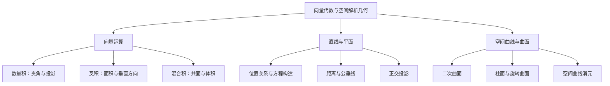
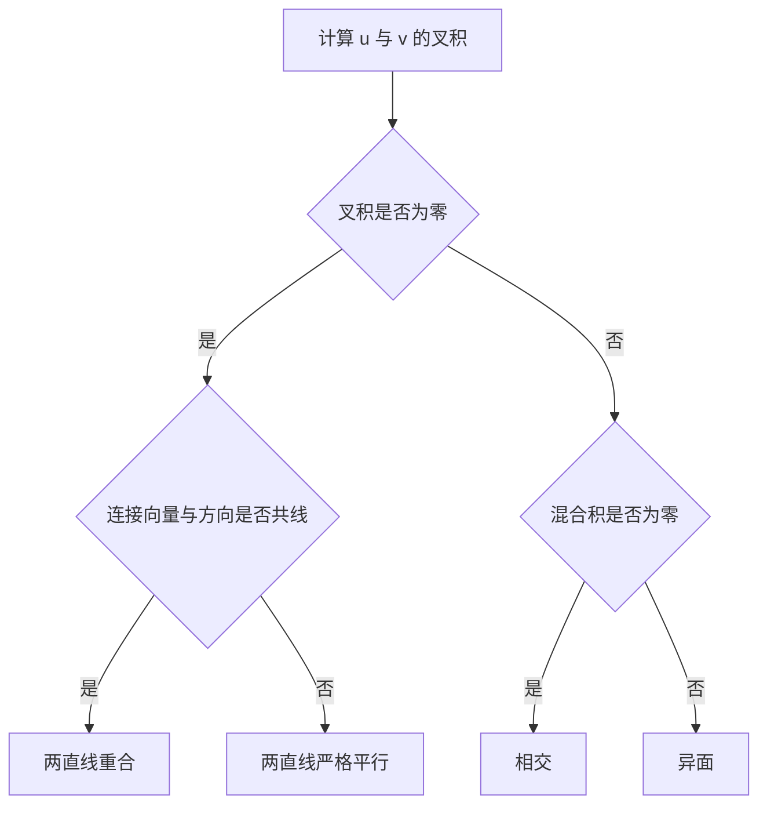

本节与后续的多元函数微分学、二重积分、三重积分、曲线积分和曲面积分都有密切联系。它不仅是一节独立的计算知识，更是整个高等数学空间几何部分的基础。

## 第一部分：建立整体知识体系

### 一、本节究竟在考什么？

空间解析几何看起来公式很多，但实际上绝大多数题目都可以归结为五种基本数学操作。

| 基本操作                                                           | 解决的问题             |
| -------------------------------------------------------------- | ----------------- |
| 数量积 $\boldsymbol a\cdot\boldsymbol b$                      | 垂直、夹角、投影          |
| 向量积 $\boldsymbol a\times\boldsymbol b$                     | 平行、面积、寻找垂直方向      |
| 混合积 $(\boldsymbol a\times\boldsymbol b)\cdot\boldsymbol c$ | 共面、体积、异面直线距离      |
| 向量参数化                                                          | 直线方程、交点、垂足、公垂线    |
| 消元与不变量                                                         | 曲线投影、柱面、旋转曲面、空间轨迹 |

整个章节可以按照以下逻辑理解：

**本节最重要的两条思维主线：**

第一条：把几何关系翻译为向量关系，再把向量关系翻译为代数方程。

第二条：永远区分**方向条件**与**位置条件**。

例如，两条空间直线的方向向量垂直，并不代表两条直线一定相交；直线方向与平面法向量垂直，也不代表直线一定严格平行于平面，它还可能完全位于平面内。

这是本节大量选择题、参数题和创新题的共同命题基础。

### 二、向量代数：三个最核心的运算

**1. 向量的模、单位向量与方向余弦**

设空间向量

$$
\boldsymbol a=(a_1,a_2,a_3).
$$

其模长为

$$
|\boldsymbol a|=\sqrt{a_1^2+a_2^2+a_3^2}.
$$

当 $\boldsymbol a\ne\boldsymbol 0$ 时，与其同方向的单位向量为

$$
\boldsymbol e_a=\frac{\boldsymbol a}{|\boldsymbol a|}.
$$

设向量与三个坐标轴正方向的夹角分别为 $\alpha,\beta,\gamma$，则方向余弦为

$$
\cos\alpha=\frac{a_1}{|\boldsymbol a|},\qquad \cos\beta=\frac{a_2}{|\boldsymbol a|},\qquad \cos\gamma=\frac{a_3}{|\boldsymbol a|}.
$$

因此

$$
\boxed{\cos^2\alpha+\cos^2\beta+\cos^2\gamma=1}.
$$

注意，方向向量不唯一，可以乘以任意非零常数；单位向量则必须保证模长为1。

**2. 数量积（点积、内积）**

定义：

$$
\boxed{\boldsymbol a\cdot\boldsymbol b =|\boldsymbol a||\boldsymbol b|\cos\theta}
$$

坐标形式：

$$
\boldsymbol a\cdot\boldsymbol b =a_1b_1+a_2b_2+a_3b_3.
$$

其中 $\theta\in[0,\pi]$ 为两个非零向量的夹角。

最重要的推论：

$$
\boldsymbol a\perp\boldsymbol b \iff \boldsymbol a\cdot\boldsymbol b=0
$$

$$
\cos\theta= \frac{\boldsymbol a\cdot\boldsymbol b} {|\boldsymbol a||\boldsymbol b|}
$$

$$
|\boldsymbol a+\boldsymbol b|^2 =|\boldsymbol a|^2+2\boldsymbol a\cdot\boldsymbol b +|\boldsymbol b|^2.
$$

以及柯西—施瓦茨不等式：

$$
|\boldsymbol a\cdot\boldsymbol b| \leq |\boldsymbol a||\boldsymbol b|.
$$

等号成立当且仅当两个向量线性相关。

最后一个不等式是向量最值、方向导数最值、投影最值等题目的重要工具。

**3. 向量的数量投影与向量投影**

这两个概念必须彻底区分。

设 $\boldsymbol b\ne\boldsymbol0$，将向量 $\boldsymbol a$ 分解为沿 $\boldsymbol b$ 的分量与垂直于 $\boldsymbol b$ 的分量。

数量投影：

$$
\boxed{ \operatorname{Prj}_{\boldsymbol b}\boldsymbol a =\frac{\boldsymbol a\cdot\boldsymbol b}{|\boldsymbol b|} }
$$

向量投影：

$$
\boxed{ \operatorname{proj}_{\boldsymbol b}\boldsymbol a =\frac{\boldsymbol a\cdot\boldsymbol b} {|\boldsymbol b|^2}\boldsymbol b }
$$

垂直分量：

$$
\boxed{ \boldsymbol a_\perp =\boldsymbol a- \frac{\boldsymbol a\cdot\boldsymbol b} {|\boldsymbol b|^2}\boldsymbol b }
$$

| 概念   | 结果类型 | 是否可能为负 |
| ---- | ---- | ------ |
| 数量投影 | 实数   | 可以     |
| 向量投影 | 向量   | 不适用    |
| 投影长度 | 非负实数 | 不可以    |

**后面所有的垂足、点线距离、点面距离和空间投影题，实际上都是这个正交分解模型。**

**4. 向量积（叉积、外积）**

定义：

$$
\boldsymbol a\times\boldsymbol b = \begin{vmatrix} \boldsymbol i&\boldsymbol j&\boldsymbol k\\ a_1&a_2&a_3\\ b_1&b_2&b_3 \end{vmatrix}
$$

即

$$
\boldsymbol a\times\boldsymbol b= \begin{pmatrix} a_2b_3-a_3b_2\\ a_3b_1-a_1b_3\\ a_1b_2-a_2b_1 \end{pmatrix}.
$$

其几何意义有两个：

**方向意义：** 叉积同时垂直于两个原向量，具体方向由右手定则确定。

**大小意义：**

$$
|\boldsymbol a\times\boldsymbol b| =|\boldsymbol a||\boldsymbol b|\sin\theta.
$$

它等于以两个向量为邻边的平行四边形的面积。

因此

$$
S_{\text{平行四边形}}=|\boldsymbol a\times\boldsymbol b|
$$

$$
S_{\triangle ABC} =\frac12|\overrightarrow{AB}\times\overrightarrow{AC}|.
$$

常用性质：

$$
\boldsymbol a\times\boldsymbol b =-\boldsymbol b\times\boldsymbol a
$$

$$
\boldsymbol a\times\boldsymbol a=\boldsymbol0
$$

$$
\boldsymbol a\times(\boldsymbol b+\boldsymbol c) =\boldsymbol a\times\boldsymbol b+ \boldsymbol a\times\boldsymbol c.
$$

对于两个非零向量：

$$
\boxed{ \boldsymbol a\parallel\boldsymbol b \iff \boldsymbol a\times\boldsymbol b=\boldsymbol0 }
$$

一个非常有用的恒等式是

$$
\boxed{ |\boldsymbol a\times\boldsymbol b|^2 =|\boldsymbol a|^2|\boldsymbol b|^2 -(\boldsymbol a\cdot\boldsymbol b)^2 }
$$

这就是拉格朗日恒等式。它使我们在只知道向量模长和数量积时，也可以直接求叉积模长，而不需要知道具体坐标。

**5. 混合积**

三个向量的混合积定义为

$$
[\boldsymbol a,\boldsymbol b,\boldsymbol c] =(\boldsymbol a\times\boldsymbol b)\cdot\boldsymbol c.
$$

坐标形式：

$$
[\boldsymbol a,\boldsymbol b,\boldsymbol c] = \begin{vmatrix} a_1&a_2&a_3\\ b_1&b_2&b_3\\ c_1&c_2&c_3 \end{vmatrix}.
$$

其绝对值等于三个向量张成的平行六面体的体积。

$$
V=|[\boldsymbol a,\boldsymbol b,\boldsymbol c]|.
$$

四面体体积则为

$$
V_{ABCD} =\frac16 |[\overrightarrow{AB},\overrightarrow{AC}, \overrightarrow{AD}]|.
$$

最重要的性质：

$$
\boxed{ \boldsymbol a,\boldsymbol b,\boldsymbol c\text{共面} \iff [\boldsymbol a,\boldsymbol b,\boldsymbol c]=0 }
$$

混合积的循环置换不改变符号：

$$
[a,b,c]=[b,c,a]=[c,a,b].
$$

交换任意两个向量则变号；如果出现两个相同向量，混合积必为零。

注意区分混合积与向量三重积。后者是向量，而不是实数：

$$
\boldsymbol a\times(\boldsymbol b\times\boldsymbol c) =\boldsymbol b(\boldsymbol a\cdot\boldsymbol c) -\boldsymbol c(\boldsymbol a\cdot\boldsymbol b).
$$

## 第二部分：向量代数的经典题型与真题母题

### 题型一：混合积、共面与组合向量

**母题1：1995年考研数学一**

已知

$$
(\boldsymbol a\times\boldsymbol b)\cdot\boldsymbol c=2,
$$

求

$$
[(\boldsymbol a+\boldsymbol b)\times (\boldsymbol b+\boldsymbol c)] \cdot(\boldsymbol c+\boldsymbol a).
$$

**识别方法：** 题目没有给出向量具体坐标，而只给出混合积，说明必须利用运算性质，而不是假设坐标进行计算。

<Tabs items={["方法一：展开与消项", "方法二：行列式法——适合更加复杂的创新题"]} defaultIndex={0}>

<Tab value="方法一：展开与消项">

首先展开叉积：

$$
\begin{aligned} (\boldsymbol a+\boldsymbol b) \times(\boldsymbol b+\boldsymbol c) ={}&\boldsymbol a\times\boldsymbol b\\ &+\boldsymbol a\times\boldsymbol c\\ &+\boldsymbol b\times\boldsymbol c. \end{aligned}
$$

再与 $\boldsymbol c+\boldsymbol a$ 做数量积。

由于叉积垂直于参与叉积的两个向量，所有包含重复向量的混合积均为零。

于是原式等于

$$
[a,b,c]+[b,c,a].
$$

根据循环置换不变号，

$$
[b,c,a]=[a,b,c]=2.
$$

因此

$$
\boxed{4}.
$$

</Tab>

<Tab value="方法二：行列式法——适合更加复杂的创新题">

三个新向量可以表示为

$$
\begin{pmatrix} a+b\\b+c\\c+a \end{pmatrix} = \begin{pmatrix} 1&1&0\\ 0&1&1\\ 1&0&1 \end{pmatrix} \begin{pmatrix} a\\b\\c \end{pmatrix}.
$$

因此新混合积为

$$
\begin{vmatrix} 1&1&0\\ 0&1&1\\ 1&0&1 \end{vmatrix} [a,b,c] =2\times2=4.
$$

**母题推广：**

如果三个新向量均由原三个向量线性组合得到，那么

$$
\boxed{\text{新混合积} =\text{系数矩阵的行列式}\times\text{原混合积}}
$$

这与线性代数的行列式乘法、向量组线性相关性完全相通。

</Tab>

</Tabs>

**母题2：李林880**

设

$$
\boldsymbol a=(1,2,1),\quad \boldsymbol b=(-1,0,2),\quad \boldsymbol c=(0,k,-3)
$$

共面，求 $k$。

由共面条件，

$$
(\boldsymbol a\times\boldsymbol b)\cdot\boldsymbol c=0.
$$

计算得到

$$
\boldsymbol a\times\boldsymbol b=(4,-3,2).
$$

因此

$$
(4,-3,2)\cdot(0,k,-3)=-3k-6=0.
$$

所以

$$
\boxed{k=-2}.
$$

**迁移技巧：** 如果题目改为四个空间点共面，则选其中一个点作为起点，构造三个向量，再令其混合积为零。

### 题型二：组合向量的夹角与面积

**母题3：李林880**

设 $\alpha,\beta$ 均为单位向量，夹角为 $\pi/6$，求以

$$
\alpha+2\beta,\qquad 3\alpha+\beta
$$

为邻边的平行四边形面积。

直接计算叉积：

$$
\begin{aligned} (\alpha+2\beta)\times(3\alpha+\beta) &=\alpha\times\beta+6\beta\times\alpha\\ &=-5\alpha\times\beta. \end{aligned}
$$

因此

$$
S=5|\alpha\times\beta| =5\sin\frac{\pi}{6}.
$$

答案为

$$
\boxed{\frac52}.
$$

由此可以提炼一个非常实用的通法：

$$
\boxed{ (p\alpha+q\beta)\times(r\alpha+s\beta) =(ps-qr)(\alpha\times\beta) }
$$

如果题目改为求三角形面积，再乘以 $\frac12$。

**强化变式：李正元练习题第1题**

已知 $\alpha,\beta$ 为单位向量，夹角为 $\pi/3$，求

$$
\boldsymbol u=2\alpha+\beta,\qquad \boldsymbol v=-3\alpha+2\beta
$$

的夹角。

由于

$$
\alpha\cdot\beta=\frac12,
$$

得到

$$
\begin{aligned} \boldsymbol u\cdot\boldsymbol v &=-6+4\alpha\cdot\beta -3\alpha\cdot\beta+2\\ &=-\frac72. \end{aligned}
$$

同时

$$
|\boldsymbol u|^2=4+4\times\frac12+1=7,
$$

$$
|\boldsymbol v|^2=9-12\times\frac12+4=7.
$$

所以

$$
\cos\theta=-\frac12
$$

即

$$
\boxed{\theta=\frac{2\pi}{3}}.
$$

特别注意：这里求的是**向量夹角**，所以可以得到钝角，不能擅自给数量积加绝对值。

### 题型三：叉积方程与向量模长最值

**母题4：李林880**

设

$$
\boldsymbol a=(-1,3,0),\qquad \boldsymbol b=(3,1,0),
$$

且

$$
\boldsymbol b\times\boldsymbol c=\boldsymbol a.
$$

求 $|\boldsymbol c|$ 的最小值。

这道题非常值得研究，因为它表面上是向量题，本质上却是线性约束下的最优化问题。

<Tabs items={["方法一：坐标计算", "方法二：几何法"]} defaultIndex={0}>

<Tab value="方法一：坐标计算">

令

$$
\boldsymbol c=(u,v,w).
$$

则

$$
\boldsymbol b\times\boldsymbol c =(w,-3w,3v-u).
$$

与 $\boldsymbol a$ 比较，得

$$
w=-1,\qquad u=3v.
$$

所以

$$
\boldsymbol c=(3v,v,-1).
$$

进而

$$
|\boldsymbol c|^2=10v^2+1\geq1.
$$

当 $v=0$ 时取得最小值。

故

$$
\boxed{|\boldsymbol c|_{\min}=1}.
$$

</Tab>

<Tab value="方法二：几何法">

由叉积的模长公式，

$$
|\boldsymbol a| =|\boldsymbol b||\boldsymbol c|\sin\theta \leq|\boldsymbol b||\boldsymbol c|.
$$

所以

$$
|\boldsymbol c| \geq\frac{|\boldsymbol a|}{|\boldsymbol b|}=1.
$$

再验证 $\boldsymbol c=(0,0,-1)$ 满足原方程，并且等号可以成立。

</Tab>

</Tabs>

**一般模型与创新推广**

对于方程

$$
\boldsymbol b\times\boldsymbol c=\boldsymbol a, \qquad \boldsymbol b\ne\boldsymbol0,
$$

有解的充要条件为

$$
\boxed{\boldsymbol a\cdot\boldsymbol b=0}.
$$

利用向量三重积恒等式，可以得到通解：

$$
\boxed{ \boldsymbol c= \frac{\boldsymbol a\times\boldsymbol b}{|\boldsymbol b|^2} +t\boldsymbol b,\qquad t\in\mathbb R }
$$

前一项与 $\boldsymbol b$ 垂直，因此

$$
|\boldsymbol c|^2= \frac{|\boldsymbol a|^2}{|\boldsymbol b|^2} +t^2|\boldsymbol b|^2.
$$

从而

$$
\boxed{ |\boldsymbol c|_{\min} =\frac{|\boldsymbol a|}{|\boldsymbol b|} }
$$

最短解必与 $\boldsymbol b$ 垂直。

这一模型与线性代数中的非齐次线性方程组、齐次通解、正交分解具有相同的数学结构。

### 题型四：多个垂直条件与数量投影

**母题5：李林880**

已知

$$
a=(2,-3,1),\quad b=(1,-2,3),\quad c=(2,1,2).
$$

向量 $r$ 满足

$$
r\perp a,\qquad r\perp b,\qquad \operatorname{Prj}_{c}r=14.
$$

求 $r$。

第一步，利用两个垂直条件确定方向。

$$
a\times b=(-7,-5,-1).
$$

因此可以设

$$
r=t(-7,-5,-1).
$$

第二步，利用数量投影确定长度与正负方向。

$$
\frac{r\cdot c}{|c|} =\frac{-21t}{3}=14.
$$

解得

$$
t=-2.
$$

所以

$$
\boxed{r=(14,10,2)}.
$$

**一般模型：** 若 $r\perp a,b$，且 $a,b$ 不共线，又有 $r$ 在 $c$ 方向上的数量投影等于 $k$，则当 $(a\times b)\cdot c\ne0$ 时，

$$
\boxed{ r=\frac{k|c|}{(a\times b)\cdot c}(a\times b) }
$$

如果分母为零，则需要单独判断无解或无穷多解，不能机械套公式。

### 题型五：向量模长与极限的综合

**母题6：李林880**

已知 $\alpha,\beta$ 为非零向量，$|\beta|=2$，夹角为 $\pi/3$，求

$$
\lim_{x\to0} \frac{|\alpha+x\beta|-|\alpha|}{x}.
$$

看到两个模长之差，应想到根式有理化：

$$
\begin{aligned} &\frac{|\alpha+x\beta|-|\alpha|}{x}\\ ={}& \frac{|\alpha+x\beta|^2-|\alpha|^2} {x(|\alpha+x\beta|+|\alpha|)}\\ ={}& \frac{2\alpha\cdot\beta+x|\beta|^2} {|\alpha+x\beta|+|\alpha|}. \end{aligned}
$$

令 $x\to0$：

$$
\frac{\alpha\cdot\beta}{|\alpha|} =|\beta|\cos\frac\pi3=1.
$$

因此答案为

$$
\boxed{1}.
$$

由此得到通用公式：

$$
\boxed{ \lim_{t\to0} \frac{|a+tb|-|a|}{t} =\frac{a\cdot b}{|a|} \qquad(a\ne0) }
$$

这就是模长函数沿向量 $b$ 的变化率，实际上等于 $b$ 在 $a$ 方向上的数量投影。

若将方向导数定义为沿单位向量的变化率，则还需要对 $b$ 单位化。

特别注意：如果 $a=0$ 而 $b\ne0$，原极限变为

$$
\lim_{t\to0}\frac{|t||b|}{t},
$$

左右极限不同，因此不存在。

### 题型六：利用叉积性质证明充要条件

**母题7：李正元练习题**

已知 $\alpha,\beta,\gamma$ 不全共线，证明

$$
\alpha+\beta+\gamma=0
$$

的充要条件为

$$
\alpha\times\beta =\beta\times\gamma =\gamma\times\alpha.
$$

**必要性：**

若

$$
\gamma=-\alpha-\beta,
$$

则

$$
\beta\times\gamma =-\beta\times\alpha =\alpha\times\beta.
$$

同理可得其余关系。

**充分性：**

设

$$
s=\alpha+\beta+\gamma.
$$

根据已知的三个叉积相等，有

$$
s\times\alpha=0,\quad s\times\beta=0,\quad s\times\gamma=0.
$$

假设 $s\ne0$，那么 $\alpha,\beta,\gamma$ 都必须是 $s$ 的数量倍数，与不全共线的条件矛盾。

所以

$$
\boxed{s=0}.
$$

本题的关键不是计算，而是利用叉积为零意味着向量线性相关，再利用反证法。

如果去掉不全共线的条件，取三个相同的非零向量，就能构造反例。

## 第三部分：空间直线与平面的方程

### 一、平面的三种常用表示

**1. 点法式**

已知平面经过点

$$
P_0(x_0,y_0,z_0)
$$

且法向量为

$$
\boldsymbol n=(A,B,C)\ne\boldsymbol0,
$$

则平面方程为

$$
\boxed{ A(x-x_0)+B(y-y_0)+C(z-z_0)=0 }
$$

其本质为

$$
\boldsymbol n\cdot\overrightarrow{P_0P}=0.
$$

也就是说，平面上所有点与固定点形成的向量，都与法向量垂直。

**2. 一般式**

$$
\boxed{Ax+By+Cz+D=0}
$$

其中 $A,B,C$ 不全为零。

平面的法向量直接取

$$
\boldsymbol n=(A,B,C).
$$

注意，常数项 $D$ 只决定平面的位置，不决定平面的方向。

**3. 截距式**

若平面与三个坐标轴的交点分别为

$$
(a,0,0),\quad(0,b,0),\quad(0,0,c),
$$

且 $abc\ne0$，则

$$
\boxed{\frac xa+\frac yb+\frac zc=1}.
$$

截距式在求平面与三个坐标面围成的四面体体积，以及三重积分的积分区域时很有用。

### 二、空间直线的三种常用表示

**1. 参数式**

已知直线过点 $P_0(x_0,y_0,z_0)$，方向向量为 $\boldsymbol d=(l,m,n)$，则

$$
\boxed{ \begin{cases} x=x_0+lt,\\ y=y_0+mt,\\ z=z_0+nt, \end{cases} \quad t\in\mathbb R }
$$

也可简写为

$$
\boldsymbol r=\boldsymbol r_0+t\boldsymbol d.
$$

这是最通用的直线表示形式，尤其适合求交点、垂足、距离、投影以及旋转曲面。

**2. 对称式（点向式）**

$$
\boxed{ \frac{x-x_0}{l} =\frac{y-y_0}{m} =\frac{z-z_0}{n} }
$$

当某一个方向分量为零时，不应真的除以零。

例如

$$
\frac{x-1}{0}=\frac{y-2}{3}=\frac{z+1}{2}
$$

应理解为

$$
x=1,\qquad \frac{y-2}{3}=\frac{z+1}{2}.
$$

**3. 一般式（两平面交线）**

$$
L:\begin{cases} A_1x+B_1y+C_1z+D_1=0,\\ A_2x+B_2y+C_2z+D_2=0. \end{cases}
$$

两个平面的法向量为

$$
\boldsymbol n_1=(A_1,B_1,C_1), \qquad \boldsymbol n_2=(A_2,B_2,C_2).
$$

直线方向向量为

$$
\boxed{\boldsymbol d=\boldsymbol n_1\times\boldsymbol n_2}
$$

前提是两平面的法向量不共线。

如果叉积为零，两个平面可能平行或重合，此时方程组不一定表示一条直线。

### 三、直线和平面方程的构造方法

本节应当养成一个固定思维：

**求直线，就是找一点和一个方向；求平面，就是找一点和一个法向量。**

| 题目给出的几何条件             | 转化方法                                                    |
| --------------------- | ------------------------------------------------------- |
| 平面过三个不共线点 $A,B,C$ | 法向量为 $\overrightarrow{AB}\times\overrightarrow{AC}$ |
| 平面平行于两个不共线方向          | 两方向做叉积                                                  |
| 平面垂直于一条直线             | 直线方向即平面法向量                                              |
| 平面经过一条直线和线外一点         | 直线方向与连接向量做叉积                                            |
| 直线垂直于一个平面             | 平面法向量即直线方向                                              |
| 直线平行于两个不平行平面          | 两平面法向量做叉积                                               |
| 直线垂直于两个不平行方向          | 两方向做叉积                                                  |
| 直线是两平面的交线             | 两法向量做叉积                                                 |

这些不是八个相互独立的知识点，而是同一个原理：

$$
\boxed{\text{寻找同时垂直于两个向量的方向，优先使用叉积。}}
$$

当然，若两个已知向量共线，叉积为零，就需要额外条件才能确定唯一方向。

### 题型七：经过定点且平行于两条直线的平面

**母题8：1987年考研数学一**

求经过原点且平行于下列两条直线的平面方程：

$$
L_1:\begin{cases} x=1,\\y=-1+t,\\z=2+t, \end{cases}
$$

$$
L_2: \frac{x+1}{1} =\frac{y+2}{2} =\frac{z-1}{1}.
$$

两条直线的方向向量为

$$
\boldsymbol d_1=(0,1,1), \qquad \boldsymbol d_2=(1,2,1).
$$

因为所求平面与两个直线方向均平行，所以它的法向量同时垂直于这两个方向。

因此

$$
\boldsymbol n=\boldsymbol d_1\times\boldsymbol d_2 =(-1,1,-1).
$$

取其相反向量

$$
\boldsymbol n=(1,-1,1).
$$

平面经过原点，所以

$$
\boxed{x-y+z=0}.
$$

若题目严格要求两直线与平面没有公共点，还需代入两条直线各自的一点进行检验，本题满足这一要求。

**模拟题变式：汤家凤2027八套卷第5套第13题**

过点 $A(3,2,1)$，且平行于两条直线

$$
L_1: \frac{x-1}{1} =\frac{y+2}{-2} =\frac{z-2}{1},
$$

$$
L_2:\begin{cases} x=2t+3,\\y=t-1,\\z=10, \end{cases}
$$

求平面方程。

方向向量为

$$
d_1=(1,-2,1),\qquad d_2=(2,1,0).
$$

于是

$$
n=d_1\times d_2=(-1,2,5).
$$

利用点法式：

$$
-(x-3)+2(y-2)+5(z-1)=0.
$$

整理得

$$
\boxed{x-2y-5z+6=0}.
$$

可以看到，模拟题虽然更换了直线方程的形式和所过的点，但解题结构与1987年真题完全一致。

### 题型八：经过一条直线且平行于另一条直线的平面

**母题9：1991年考研数学一**

已知

$$
L_1:\begin{cases} x=1+t,\\y=2,\\z=3-t, \end{cases}
$$

$$
L_2: \frac{x+2}{2}=\frac{y-1}{1}=\frac z1.
$$

求经过 $L_1$ 且平行于 $L_2$ 的平面方程。

提取

$$
P=(1,2,3)\in L_1,
$$

$$
d_1=(1,0,-1),\qquad d_2=(2,1,1).
$$

平面法向量为

$$
n=d_1\times d_2=(1,-3,1).
$$

故

$$
(x-1)-3(y-2)+(z-3)=0.
$$

即

$$
\boxed{x-3y+z+2=0}.
$$

相比上一题，本题唯一的变化就是：固定点需要从被包含的直线上选取。

**如何判断这种平面是否唯一？**

如果 $d_1,d_2$ 不平行，法向量可以唯一确定到非零倍数，因此平面唯一。

如果 $d_1,d_2$ 平行，则方向条件重复。按照方向平行的要求，通常存在无穷多个过给定直线的平面，不能通过叉积直接得到法向量。

## 第四部分：空间位置关系与夹角

### 一、两直线的位置关系

设

$$
L_1:A+s\boldsymbol u,\qquad L_2:B+t\boldsymbol v.
$$

记

$$
\boldsymbol w=\overrightarrow{AB}=B-A.
$$

两条空间直线有四种基本位置关系：平行、重合、相交、异面。

判断应严格按照以下顺序进行：

其数学条件为：

| 位置关系 | 判定条件                                      |
| ---- | ----------------------------------------- |
| 重合   | $u\times v=0,\ w\times u=0$           |
| 严格平行 | $u\times v=0,\ w\times u\ne0$         |
| 相交   | $u\times v\ne0,\ w\cdot(u\times v)=0$ |
| 异面   | $w\cdot(u\times v)\ne0$               |

相交和异面的关键区别在于是否共面，而不是方向是否平行。

### 二、直线与平面的位置关系

设直线和平面分别为

$$
L:P+t\boldsymbol d,
$$

$$
\Pi:Ax+By+Cz+D=0.
$$

平面法向量为

$$
\boldsymbol n=(A,B,C).
$$

令 $F(P)=Ax_0+By_0+Cz_0+D$。

| 位置关系      | 判定条件                        |
| --------- | --------------------------- |
| 直线严格平行于平面 | $d\cdot n=0,\ F(P)\ne0$ |
| 直线位于平面内   | $d\cdot n=0,\ F(P)=0$   |
| 直线与平面相交   | $d\cdot n\ne0$          |
| 直线垂直于平面   | $d\times n=0$           |

当直线与平面相交时，将参数式代入平面方程可直接得到交点参数：

$$
\boxed{ t=-\frac{F(P)}{\boldsymbol d\cdot\boldsymbol n} }
$$

这比重新联立多个坐标方程更加高效。

### 三、两平面的位置关系

设两个平面的法向量分别为 $n_1,n_2$。

若

$$
n_1\times n_2\ne0,
$$

则两平面相交，交线方向为 $n_1\times n_2$。

若

$$
n_1\times n_2=0,
$$

则两平面平行或重合，需要进一步比较全部方程系数，包括常数项。

两平面垂直的条件为

$$
\boxed{n_1\cdot n_2=0}.
$$

### 四、三类夹角公式

| 夹角类型    | 计算公式                                                                  |
| ------- | --------------------------------------------------------------------- |
| 两直线夹角   | $\displaystyle\cos\theta=\frac{\|d_1\cdot d_2\|}{\|d_1\|\|d_2\|}$ |
| 两平面夹角   | $\displaystyle\cos\theta=\frac{\|n_1\cdot n_2\|}{\|n_1\|\|n_2\|}$ |
| 直线与平面夹角 | $\displaystyle\sin\theta=\frac{\|d\cdot n\|}{\|d\|\|n\|}$         |

三种几何夹角通常取 $[0,\pi/2]$ 范围内的角。

最容易错的是线面夹角：由于平面法向量与平面垂直，直线与法向量的锐角和线面夹角互余，所以这里是正弦，不是余弦。

### 题型九：两直线夹角

**母题10：1993年考研数学一**

设

$$
L_1: \frac{x-1}{1} =\frac{y-5}{-2} =\frac{z+8}{1},
$$

$$
L_2:\begin{cases} x-y=6,\\ 2y+z=3. \end{cases}
$$

求两直线夹角。

首先直接提取

$$
d_1=(1,-2,1).
$$

第二条直线是两平面的交线，其方向向量为

$$
\begin{aligned} d_2&=(1,-1,0)\times(0,2,1)\\ &=(-1,-1,2). \end{aligned}
$$

于是

$$
\cos\theta =\frac{|-1+2+2|}{\sqrt6\sqrt6} =\frac12.
$$

因此

$$
\boxed{\theta=\frac\pi3}.
$$

**解题技巧：** 如果只求夹角，根本不需要求两条直线经过的点，也不用求两条直线是否相交。方向向量已经提供了全部必要信息。

### 题型十：判断直线与平面的位置关系

**母题11：1995年考研数学一**

已知

$$
L:\begin{cases} x+3y+2z+1=0,\\ 2x-y-10z+3=0, \end{cases}
$$

以及平面

$$
\Pi:4x-2y+z-3=0.
$$

判断直线和平面的位置关系。

直线方向向量为

$$
\begin{aligned} d&=(1,3,2)\times(2,-1,-10)\\ &=(-28,14,-7)\\ &=-7(4,-2,1). \end{aligned}
$$

而平面法向量为

$$
n=(4,-2,1).
$$

显然 $d\parallel n$，所以

$$
\boxed{L\perp\Pi}.
$$

张宇1000题第17章第2题也采用了相同的方向结构，只改变了目标平面的常数项。这说明判断线面垂直时，常数项并不起作用。

### 题型十一：含参数的空间位置关系

**母题12：李正元练习题**

设

$$
L_1:\begin{cases} x=1+s,\\ y=1+2s,\\ z=1+\lambda s, \end{cases}
$$

$$
L_2:x+1=y-1=z.
$$

分别求两直线方向垂直、两直线相交时的 $\lambda$。

**第一问：方向垂直**

$$
d_1=(1,2,\lambda),\qquad d_2=(1,1,1).
$$

由

$$
d_1\cdot d_2=0
$$

得到

$$
1+2+\lambda=0.
$$

所以

$$
\boxed{\lambda=-3}.
$$

**第二问：相交**

令第二条直线公共参数为 $t$，联立

$$
\begin{cases} 1+s=-1+t,\\ 1+2s=1+t,\\ 1+\lambda s=t. \end{cases}
$$

前两式给出

$$
t=s+2=2s,
$$

故

$$
s=2,\qquad t=4.
$$

代入第三式，

$$
1+2\lambda=4.
$$

因此

$$
\boxed{\lambda=\frac32}.
$$

交点为

$$
P=(3,5,4).
$$

这道题尤其重要：如果题目要求两条直线**垂直相交**，那么需要同时满足这两个条件，而这两个参数值不同，因此本题不存在这样的 $\lambda$。

方向垂直、相交、垂直相交，是三种不同的条件。

## 第五部分：平面束——空间几何综合题的核心工具

### 一、什么是平面束？

设空间直线为两个不平行平面的交线：

$$
L:\begin{cases} F_1(x,y,z)=0,\\ F_2(x,y,z)=0. \end{cases}
$$

那么所有包含这条直线的平面，可以写成

$$
\boxed{ \alpha F_1+\beta F_2=0, \qquad(\alpha,\beta)\ne(0,0) }
$$

通常为了便于计算，写为

$$
F_1+\lambda F_2=0.
$$

但必须注意：

**单参数形式** $F_1+\lambda F_2=0$ **不包含平面** $F_2=0$**。**

因此，当题目要求求出所有满足条件的平面时，必须额外检验被遗漏的平面 $F_2=0$，或者从一开始就采用双参数形式。

从几何上理解，平面束就是所有经过同一条固定直线的平面。这些平面可以看成绕该直线转动得到。

### 题型十二：经过交线且垂直于指定平面

**母题13：李正元练习题**

求经过

$$
\Pi_1:3x-4y+6=0,
$$

$$
\Pi_2:2y+z-11=0
$$

的交线，并与 $\Pi_1$ 垂直的平面。

设平面束：

$$
(3x-4y+6)+\lambda(2y+z-11)=0.
$$

其法向量为

$$
n=(3,-4+2\lambda,\lambda).
$$

由平面垂直条件，

$$
n\cdot(3,-4,0)=0.
$$

即

$$
9+16-8\lambda=0.
$$

解得

$$
\lambda=\frac{25}{8}.
$$

代入并化简：

$$
\boxed{24x+18y+25z-227=0}.
$$

遗漏的平面 $\Pi_2$ 与 $\Pi_1$ 的法向量内积为 $-8\ne0$，因此没有其他解。

### 题型十三：平面束与距离条件

**母题14：李林880**

求经过直线

$$
L:\begin{cases} 3x-2y+2=0,\\ x-2y-z+6=0, \end{cases}
$$

且与点 $P(1,2,1)$ 的距离为1的所有平面。

**第一步：设平面束**

$$
(3x-2y+2)+\lambda(x-2y-z+6)=0.
$$

整理为

$$
(3+\lambda)x-(2+2\lambda)y-\lambda z +2+6\lambda=0.
$$

**第二步：列点面距离方程**

$$
\frac{|1+2\lambda|} {\sqrt{6\lambda^2+14\lambda+13}}=1.
$$

**第三步：解参数**

两边平方：

$$
(1+2\lambda)^2 =6\lambda^2+14\lambda+13.
$$

化简得

$$
(\lambda+2)(\lambda+3)=0.
$$

因此

$$
\lambda=-2\quad\text{或}\quad\lambda=-3.
$$

分别代回，得到

$$
\boxed{x+2y+2z-10=0}
$$

以及

$$
\boxed{4y+3z-16=0}.
$$

**第四步：检验遗漏平面**

$$
F_2=x-2y-z+6=0.
$$

点 $P$ 到它的距离为

$$
\frac2{\sqrt6}\ne1.
$$

所以恰好只有以上两个平面。

**深度理解：为什么通常会有两个解？**

设给定直线为 $L$，点 $P$ 到直线的距离为 $h$，而题目要求点到经过 $L$ 的平面的距离为 $d$。

当 $P\notin L$ 时，平面绕 $L$ 转动，其与点 $P$ 的距离可以在 $0$ 到 $h$ 之间变化。

因此：

| 给定距离条件        | 平面数量 |
| ------------- | ---- |
| $d>h$     | 0    |
| $0<d<h$ | 2    |
| $d=h$     | 1    |
| $d=0$     | 1    |

若 $P\in L$，则所有经过 $L$ 的平面与 $P$ 的距离均为零，应当单独讨论。

有了这个几何结论，不仅能解常规题，也能直接判断含参数题中的解的数量。

### 题型十四：平面束与夹角条件

**母题15：李林880**

求经过直线

$$
L:\begin{cases} x+5y+z=0,\\ x-z+4=0, \end{cases}
$$

且与平面

$$
x-4y-8z+12=0
$$

夹角为 $45^\circ$ 的平面。

设

$$
(x-z+4)+\lambda(x+5y+z)=0.
$$

对应法向量

$$
n=(1+\lambda,5\lambda,\lambda-1).
$$

目标平面的法向量为

$$
n_0=(1,-4,-8).
$$

由夹角公式，

$$
\frac{|n\cdot n_0|}{|n||n_0|} =\frac{\sqrt2}{2}.
$$

计算得到

$$
\frac{|1-3\lambda|}{\sqrt{27\lambda^2+2}} =\frac{\sqrt2}{2}.
$$

平方化简：

$$
2(1-3\lambda)^2=27\lambda^2+2,
$$

$$
-3\lambda(4+3\lambda)=0.
$$

因此

$$
\lambda=0\quad\text{或}\quad \lambda=-\frac43.
$$

得到两个平面：

$$
\boxed{x-z+4=0}
$$

$$
\boxed{x+20y+7z-12=0}.
$$

再检验遗漏的平面 $x+5y+z=0$，不满足 $45^\circ$ 夹角条件。

**这类题的统一解法：设平面束，提取法向量，列距离或夹角方程，求参数，检查退化与遗漏。**

## 第六部分：空间距离与垂足

距离题是本节最重要的综合考点之一，特别容易与最值、二次曲面、投影以及含参数问题结合。

### 一、四类距离公式及其本质

**1. 两点距离**

$$
\boxed{ d(A,B)=|\overrightarrow{AB}| }
$$

**2. 点到平面的距离**

设点 $P=(x_0,y_0,z_0)$，平面

$$
\Pi:Ax+By+Cz+D=0.
$$

则

$$
\boxed{ d(P,\Pi)= \frac{|Ax_0+By_0+Cz_0+D|} {\sqrt{A^2+B^2+C^2}} }
$$

其本质是连接向量在平面法向量方向上的投影长度。

**3. 点到直线的距离**

设直线经过点 $A$，方向向量为 $v\ne0$。

则

$$
\boxed{ d(P,L)=\frac{|\overrightarrow{AP}\times v|}{|v|} }
$$

原因是：叉积的模等于平行四边形面积，而距离就是该平行四边形以 $|v|$ 为底时的高。

利用正交分解，也可以写成

$$
\boxed{ d^2(P,L)= |\overrightarrow{AP}|^2 -\frac{(\overrightarrow{AP}\cdot v)^2}{|v|^2} }
$$

后一种公式在求垂足、距离最值时特别有用。

**4. 两条异面直线的距离**

设

$$
L_1:A+s u,\qquad L_2:B+t v,
$$

且 $u\times v\ne0$，则两直线之间的最短距离为

$$
\boxed{ d(L_1,L_2)= \frac{|\overrightarrow{AB}\cdot(u\times v)|} {|u\times v|} }
$$

其几何意义为

$$
\text{距离}=\frac{\text{平行六面体体积}}{\text{底面积}}.
$$

如果两直线相交，则上述公式也成立，距离为零。

如果两直线平行，分母为零，必须改用点到直线的距离公式。

### 二、其他距离的快速转化

平行直线的距离等于其中一条直线上任意一点到另一条直线的距离。

直线与平面严格平行时，线面距离等于直线上任意一点到平面的距离；若直线和平面相交，距离为零。

对于两个平行平面

$$
Ax+By+Cz+D_1=0,
$$

$$
Ax+By+Cz+D_2=0,
$$

它们的距离为

$$
\boxed{ d=\frac{|D_1-D_2|}{\sqrt{A^2+B^2+C^2}} }
$$

使用该公式之前，务必把两个平面的前三个系数化成完全相同的形式，而不仅仅是成比例。

### 题型十五：点到平面的距离

**母题16：2006年考研数学一**

求点 $(2,1,0)$ 到平面

$$
3x+4y+5z=0
$$

的距离。

直接代入公式：

$$
d=\frac{|3\times2+4\times1+5\times0|} {\sqrt{3^2+4^2+5^2}} =\frac{10}{\sqrt{50}}.
$$

因此

$$
\boxed{d=\sqrt2}.
$$

这种题属于基础计算，但非常容易作为其他大题的一个步骤出现。

**强化变式：李林880第四章第16题**

求平行于平面

$$
x+y+z=9
$$

且与球面

$$
x^2+y^2+z^2=4
$$

相切的平面。

由平行条件设

$$
x+y+z+D=0.
$$

球心为原点，半径为2。

平面与球面相切，当且仅当球心到平面的距离等于球半径。

于是

$$
\frac{|D|}{\sqrt3}=2.
$$

故

$$
\boxed{x+y+z\pm2\sqrt3=0}.
$$

推广到任意球面：设球心为 $C$、半径为 $R$，则平面与球面的关系由 $d(C,\Pi)$ 和 $R$ 的大小决定。

### 题型十六：点到一般式空间直线的距离

**母题17：汤家凤2027八套卷第6套第4题**

求点 $M(1,0,-1)$ 到直线

$$
L:\begin{cases} x-y-z+1=0,\\ x+y-2z=0 \end{cases}
$$

的距离。

**第一步：求直线方向**

$$
v=(1,-1,-1)\times(1,1,-2) =(3,1,2).
$$

**第二步：选直线上一点**

取 $z=1$，联立两式得到

$$
x=y=1.
$$

因此

$$
A=(1,1,1).
$$

于是

$$
\overrightarrow{AM}=(0,-1,-2).
$$

**第三步：计算叉积**

$$
\overrightarrow{AM}\times v=(0,-6,3).
$$

故

$$
d=\frac{\sqrt{36+9}}{\sqrt{9+1+4}}.
$$

答案为

$$
\boxed{\frac{3\sqrt5}{\sqrt{14}}}.
$$

对于两平面交线形式的直线，不必先完整求出对称式，只要找到一个方向向量和直线上的任意一点即可。

### 题型十七：点到直线的垂足与对称点

这是距离公式的自然推广。

设直线

$$
L:A+t v.
$$

点 $P$ 在该直线上的垂足为 $H$。

因为 $H\in L$，所以

$$
H=A+t_0v.
$$

又因为

$$
(P-H)\cdot v=0,
$$

所以

$$
(P-A-t_0v)\cdot v=0.
$$

从而

$$
t_0=\frac{(P-A)\cdot v}{|v|^2}.
$$

得到通用公式

$$
\boxed{ H=A+\frac{(P-A)\cdot v}{|v|^2}v }
$$

如果还要求点 $P$ 关于直线的对称点 $P'$，则

$$
\boxed{P'=2H-P}.
$$

这一方法同样可以由最值推导得到。考虑

$$
f(t)=|P-A-tv|^2,
$$

令导数为零，就会得到完全相同的 $t_0$。

所以几何中的垂足问题，本质上也是一个一元二次函数最值问题。

### 题型十八：点在平面上的投影与对称点

**母题18：李正元练习题第11题**

求点

$$
P=(2,1,3)
$$

到平面

$$
\Pi:2x-2y+z-3=0
$$

的距离及其投影点。

平面法向量为

$$
n=(2,-2,1).
$$

点面距离为

$$
d=\frac{|4-2+3-3|}{3} =\boxed{\frac23}.
$$

设垂足

$$
H=P-tn.
$$

即

$$
H=(2-2t,1+2t,3-t).
$$

因为 $H$ 位于平面内，代入：

$$
2-9t=0,
$$

得到

$$
t=\frac29.
$$

所以

$$
\boxed{ H=\left(\frac{14}{9},\frac{13}{9},\frac{25}{9}\right) }
$$

**一般公式**

若

$$
F(x,y,z)=Ax+By+Cz+D,\qquad n=(A,B,C),
$$

则点 $P$ 在平面 $F=0$ 上的垂足为

$$
\boxed{H=P-\frac{F(P)}{|n|^2}n}.
$$

点 $P$ 关于该平面的对称点为

$$
\boxed{P'=P-2\frac{F(P)}{|n|^2}n}.
$$

注意垂足公式中没有绝对值。因为计算垂足必须保留方向信息，而距离才需要取绝对值。

### 题型十九：异面直线距离

**母题19：李林880**

求直线

$$
L_1:\begin{cases} x=1,\\y=z, \end{cases} \qquad L_2:\begin{cases} x+2y=0,\\z=-2 \end{cases}
$$

之间的距离。

选取

$$
A=(1,0,0),\qquad u=(0,1,1),
$$

$$
B=(0,0,-2),\qquad v=(-2,1,0).
$$

于是

$$
u\times v=(-1,-2,2).
$$

并且

$$
\overrightarrow{AB}=(-1,0,-2).
$$

混合积为

$$
\overrightarrow{AB}\cdot(u\times v) =1-4=-3.
$$

因此两直线异面，距离为

$$
d=\frac{|-3|}{\sqrt{1+4+4}}.
$$

所以

$$
\boxed{d=1}.
$$

**另一种通法：构造辅助平面**

构造一个包含 $L_2$ 且平行于 $L_1$ 的平面，那么异面直线距离就等于 $L_1$ 上任一点到该平面的距离。

设辅助平面为

$$
x+2y+\lambda(z+2)=0.
$$

平面法向量为

$$
n=(1,2,\lambda).
$$

因为它与 $L_1$ 方向平行，所以

$$
n\cdot(0,1,1)=0,
$$

得到

$$
\lambda=-2.
$$

因此辅助平面为

$$
x+2y-2z-4=0.
$$

点 $A=(1,0,0)$ 到它的距离为

$$
\frac{|1-4|}{3}=1.
$$

这两个方法本质相同，因为辅助平面的法向量正是两直线方向的叉积。

### 题型二十：两异面直线的公垂线

**母题20：李林880**

求与以下两条直线都垂直相交的直线方程：

$$
L_1:x+2=3-y=z+1,
$$

$$
L_2:\frac{x+4}{2}=y=\frac{z-4}{3}.
$$

这是一个非常典型的综合题，必须同时解决方向与位置两个问题。

**第一步：参数化原直线**

设两条直线上的点分别为

$$
P(t)=(-2+t,3-t,-1+t),
$$

$$
Q(u)=(-4+2u,u,4+3u).
$$

方向向量为

$$
a=(1,-1,1),\qquad b=(2,1,3).
$$

因此公垂线方向为

$$
n=a\times b=(-4,-1,3).
$$

但仅有这个方向，并不能确定公垂线的位置。

**第二步：求两个垂足**

$$
\overrightarrow{PQ} =(-2+2u-t,\ u-3+t,\ 5+3u-t).
$$

由于连接向量同时垂直于两条直线，

$$
\begin{cases} \overrightarrow{PQ}\cdot a=0,\\ \overrightarrow{PQ}\cdot b=0. \end{cases}
$$

展开得

$$
\begin{cases} 6+4u-3t=0,\\ 8+14u-4t=0. \end{cases}
$$

解得

$$
t=2,\qquad u=0.
$$

所以

$$
P=(0,1,1),\qquad Q=(-4,0,4).
$$

**第三步：写出公垂线**

$$
\boxed{ \frac{x}{-4} =\frac{y-1}{-1} =\frac{z-1}{3} }
$$

同时还能求出两条原直线的距离：

$$
d=|PQ|=\boxed{\sqrt{26}}.
$$

**公垂线的另一种解法：双平面构造**

先求公垂线方向

$$
n=u\times v.
$$

再构造包含 $L_1$ 且平行于 $n$ 的平面 $\Pi_1$，以及包含 $L_2$ 且平行于 $n$ 的平面 $\Pi_2$。

这两个平面的交线就是所求公垂线。

李林880第四章第22题正是这种方法的代表题。

**方法选择**

如果题目只求异面直线距离，优先使用混合积公式；如果要求公垂线方程、两个垂足或者最短连线，则优先使用双参数正交方程。

## 第七部分：空间投影——由距离知识向曲面问题过渡

### 一、直线在平面上的正交投影

设原直线为

$$
L:P+td,
$$

目标平面为

$$
\Pi:F(x,y,z)=0,
$$

其法向量为 $n$。

投影直线需要确定两个要素。

**投影点：**

$$
\boxed{ P_0=P-\frac{F(P)}{|n|^2}n }
$$

**投影方向：**

$$
\boxed{ d_0=d-\frac{d\cdot n}{|n|^2}n }
$$

所以投影直线为

$$
\boxed{L_0:P_0+td_0}.
$$

注意，若 $d\parallel n$，则 $d_0=0$。此时原直线垂直于平面，投影退化为一个点。

**第二种方法：构造投影面**

如果原直线不垂直于目标平面，可以构造一个经过原直线且垂直于目标平面的辅助平面。

辅助平面的法向量为

$$
n_{\text{辅助}}=d\times n.
$$

那么辅助平面与目标平面的交线，就是原直线的投影。

这对于原直线采用一般式给出的题目尤其方便。

### 题型二十一：直线投影与旋转曲面的综合真题

**母题21：1998年考研数学一**

这是本节最重要的综合真题母题之一。

已知直线

$$
L:\frac{x-1}{1}=\frac y1=\frac{z-1}{-1}
$$

和平面

$$
\Pi:x-y+2z-1=0.
$$

求直线在平面上的投影 $L_0$，并求 $L_0$ 绕 $y$ 轴旋转一周所得曲面的方程。

**第一问：求投影直线**

原直线方向向量为

$$
d=(1,1,-1).
$$

平面法向量为

$$
n=(1,-1,2).
$$

投影方向为

$$
d_0=d-\frac{d\cdot n}{|n|^2}n.
$$

由于

$$
d\cdot n=-2,\qquad |n|^2=6,
$$

所以

$$
\begin{aligned} d_0 &=(1,1,-1)+\frac13(1,-1,2)\\ &=\frac13(4,2,-1). \end{aligned}
$$

取投影直线方向为

$$
(4,2,-1).
$$

接着求投影线上一点。

将原直线参数化：

$$
x=1+t,\quad y=t,\quad z=1-t.
$$

代入平面方程：

$$
1+t-t+2(1-t)-1=0.
$$

得到

$$
t=1.
$$

交点为

$$
P=(2,1,0).
$$

原直线与目标平面的交点一定属于投影直线。因此

$$
\boxed{ L_0:\frac{x-2}{4} =\frac{y-1}{2} =\frac{z}{-1} }
$$

**第二问：绕 $y$ 轴旋转**

将投影直线参数化：

$$
x_0=2+4s,\qquad y_0=1+2s,\qquad z_0=-s.
$$

绕 $y$ 轴旋转时，必须抓住两个不变量：

$$
\boxed{y=y_0}
$$

$$
\boxed{x^2+z^2=x_0^2+z_0^2}
$$

由第一个不变量，

$$
s=\frac{y-1}{2}.
$$

所以

$$
x_0=2+4\cdot\frac{y-1}{2}=2y,
$$

$$
z_0=-\frac{y-1}{2}.
$$

代入轴距关系：

$$
x^2+z^2=4y^2+\frac{(y-1)^2}{4}.
$$

整理得到

$$
\boxed{4x^2+4z^2-17y^2+2y-1=0}.
$$

**为什么这道真题值得重点研究？**

因为它把三个原本分散的知识点串联了起来：直线与平面的交点、向量正交投影、旋转曲面。

更重要的是，它所使用的方法不依赖直线或平面的特殊形式，因此可以迁移到很多未来可能出现的综合题。

例如，若把目标平面改为任意平面，把旋转轴改为一条平行于坐标轴的直线，整个解题思路仍然成立。

### 题型二十二：空间曲线在坐标面上的投影

空间曲线经常表示为两个曲面的交线：

$$
C:\begin{cases} F(x,y,z)=0,\\ G(x,y,z)=0. \end{cases}
$$

若要求其在 $xOy$ 平面上的投影，则需要消去 $z$，得到

$$
H(x,y)=0,
$$

同时补充

$$
z=0.
$$

因此投影曲线通常表示为

$$
\boxed{ \begin{cases} H(x,y)=0,\\ z=0. \end{cases} }
$$

**母题22：李林880**

求曲线

$$
\begin{cases} z=2x^2+3y^2,\\ z=12-x^2-3y^2 \end{cases}
$$

在 $xOy$ 平面上的投影。

消去 $z$：

$$
2x^2+3y^2=12-x^2-3y^2.
$$

所以

$$
3x^2+6y^2=12.
$$

因此投影曲线为

$$
\boxed{ \begin{cases} \dfrac{x^2}{4}+\dfrac{y^2}{2}=1,\\ z=0. \end{cases} }
$$

这里得到一个椭圆。

这类消元在下一模块二重积分中非常重要。例如，当一个立体由两个曲面围成时，先令上下曲面相等，就可能得到积分区域的边界。

**强化变式：李正元练习题**

求曲线

$$
\begin{cases} (x+2)^2-z^2=4,\\ (x-2)^2+y^2=4 \end{cases}
$$

在 $yOz$ 平面上的投影。

由于目标平面为 $x=0$，因此应该消去 $x$。

两方程改写为

$$
(x+2)^2=z^2+4,
$$

$$
(x-2)^2=4-y^2.
$$

相减得到

$$
8x=y^2+z^2.
$$

即

$$
x=\frac{y^2+z^2}{8}.
$$

代入第二式，

$$
\left(\frac{y^2+z^2}{8}-2\right)^2+y^2=4.
$$

展开化简得

$$
(y^2+z^2)^2=32(z^2-y^2).
$$

因此

$$
\boxed{ \begin{cases} (y^2+z^2)^2=32(z^2-y^2),\\ x=0. \end{cases} }
$$

因为可以从最终方程反求 $x=(y^2+z^2)/8$，并满足原方程组，所以本题消元没有引入赝点。

**创新题陷阱：消元后不一定得到完整投影**

例如求空间曲线

$$
\begin{cases} z^2=1-x^2,\\ y=0 \end{cases}
$$

在 $xOy$ 平面上的投影。

如果只是消去 $z$，可能误以为 $y=0$ 就是答案。

但原方程要求

$$
1-x^2\geq0.
$$

因此正确投影为

$$
\boxed{ \begin{cases} y=0,\\z=0,\\-1\leq x\leq1. \end{cases} }
$$

它是一条线段，而非整条 $x$ 轴。

以后遇到空间曲线或立体区域的投影，都需要思考：消元后的每一个点，能否找到一个实数坐标，使原方程或原不等式成立？

## 第八部分：空间曲面、柱面与旋转曲面

### 一、空间方程的几何意义

在平面解析几何中，一个二元方程通常表示曲线；在空间解析几何中，一个三元方程通常表示曲面。

例如

$$
x^2+y^2=1
$$

在平面直角坐标系中表示单位圆，但在三维空间中，由于 $z$ 可以取任意实数，它表示沿 $z$ 轴方向无限延伸的圆柱面。

如果要在空间中表示这个单位圆，则需要写成

$$
\begin{cases} x^2+y^2=1,\\ z=0. \end{cases}
$$

这个区别是理解空间曲线投影、柱面以及三重积分区域的关键。

### 二、常见二次曲面的识别

以下标准形式中，$a,b,c$ 均为正数。

| 曲面    | 标准方程                                                    | 识别特征          |
| ----- | ------------------------------------------------------- | ------------- |
| 球面    | $x^2+y^2+z^2=R^2$                                   | 三项同号，系数相同     |
| 椭球面   | $\frac{x^2}{a^2}+\frac{y^2}{b^2}+\frac{z^2}{c^2}=1$ | 三个平方项均为正      |
| 单叶双曲面 | $\frac{x^2}{a^2}+\frac{y^2}{b^2}-\frac{z^2}{c^2}=1$ | 两正一负          |
| 双叶双曲面 | $\frac{z^2}{c^2}-\frac{x^2}{a^2}-\frac{y^2}{b^2}=1$ | 一正两负          |
| 椭圆锥面  | $\frac{x^2}{a^2}+\frac{y^2}{b^2}=\frac{z^2}{c^2}$   | 齐次二次式         |
| 椭圆抛物面 | $z=\frac{x^2}{a^2}+\frac{y^2}{b^2}$                 | 一个一次项，两个同号平方项 |
| 双曲抛物面 | $z=\frac{x^2}{a^2}-\frac{y^2}{b^2}$                 | 马鞍面           |
| 椭圆柱面  | $\frac{x^2}{a^2}+\frac{y^2}{b^2}=1$                 | 缺少一个变量        |
| 抛物柱面  | $y^2=2px$                                           | 抛物线沿另一方向延伸    |
| 双曲柱面  | $\frac{x^2}{a^2}-\frac{y^2}{b^2}=1$                 | 双曲线沿另一方向延伸    |

这些曲面应当掌握的不只是方程形式，更重要的是截面特征。

例如，对于单叶双曲面

$$
x^2+y^2-z^2=1,
$$

取 $z=k$，得到

$$
x^2+y^2=1+k^2.
$$

无论 $k$ 取什么值，都存在一个圆截面，因此曲面整体连通，且中间较窄、两端较宽。

而对于双叶双曲面

$$
z^2-x^2-y^2=1,
$$

取 $z=k$，得到

$$
x^2+y^2=k^2-1.
$$

只有当 $|k|\geq1$ 时截面才存在，所以曲面分为上下两部分。

这就是**截痕法**：通过取某一坐标为常数，研究平行于坐标面的截线形状，从而判断空间曲面的整体形状。

### 三、旋转曲面的统一方法

绕坐标轴旋转时，应当记住以下两个不变量：

| 旋转轴             | 保持不变的坐标 | 保持不变的轴距平方             |
| --------------- | ------- | --------------------- |
| $x$ 轴       | $x$ | $y^2+z^2$         |
| $y$ 轴       | $y$ | $x^2+z^2$         |
| $z$ 轴       | $z$ | $x^2+y^2$         |
| $x=a,\ y=b$ | $z$ | $(x-a)^2+(y-b)^2$ |

这比简单记忆“将某一个变量替换为根号”更加可靠。

若一条空间曲线的参数方程为

$$
\begin{cases} x=f(t),\\ y=g(t),\\ z=h(t), \end{cases}
$$

则其绕 $z$ 轴旋转所得曲面满足

$$
\begin{cases} x^2+y^2=f^2(t)+g^2(t),\\ z=h(t). \end{cases}
$$

最后消去 $t$，同时保留必要的取值范围即可。

### 题型二十三：空间直线绕坐标轴旋转

**母题23：李正元练习题第12题**

求直线

$$
\frac{x-2}{0}=\frac y2=\frac z3
$$

绕 $z$ 轴旋转所得的曲面。

原直线可以写成

$$
x=2,\qquad y=2t,\qquad z=3t.
$$

到 $z$ 轴的距离平方为

$$
\rho^2=4+4t^2.
$$

旋转过程中，轴距和 $z$ 坐标不变，因此

$$
\begin{cases} x^2+y^2=4+4t^2,\\ z=3t. \end{cases}
$$

消去 $t$，得到

$$
x^2+y^2=4+\frac{4z^2}{9}.
$$

因此

$$
\boxed{\frac{x^2+y^2}{4}-\frac{z^2}{9}=1}
$$

这是一个旋转单叶双曲面。

**直线绕另一条直线旋转的几何规律**

| 原直线与旋转轴的关系 | 旋转所得图形      |
| ---------- | ----------- |
| 平行但不重合     | 圆柱面         |
| 斜交         | 双圆锥面        |
| 异面且方向不正交   | 旋转单叶双曲面     |
| 垂直相交       | 垂直于旋转轴的平面   |
| 异面且方向正交    | 平面内带圆形空洞的区域 |
| 重合         | 原直线         |

上述结论针对完整的无限长直线旋转一周的点集。如果原对象是射线或线段，所得曲面往往只有其中一部分。

因此不能不考虑原直线与旋转轴的位置关系，就一概认为得到圆锥面或双曲面。

### 题型二十四：绕平移后的旋转轴旋转

**母题24：李林880**

求直线

$$
L:\frac{x-1}{3} =\frac{y-2}{4} =\frac{z+1}{1}
$$

绕直线

$$
\begin{cases} x=2,\\ y=3 \end{cases}
$$

旋转一周所成的曲面。

这里旋转轴不是 $z$ 轴，而是与 $z$ 轴平行的直线。

令原直线参数为 $t$：

$$
x_0=1+3t,\quad y_0=2+4t,\quad z_0=-1+t.
$$

保持 $z$ 坐标不变：

$$
t=z+1.
$$

于是

$$
x_0=3z+4,\qquad y_0=4z+6.
$$

到旋转轴的距离平方应当写为

$$
(x_0-2)^2+(y_0-3)^2.
$$

所以

$$
(x-2)^2+(y-3)^2 =(3z+2)^2+(4z+3)^2.
$$

展开化简得到

$$
\boxed{x^2+y^2-25z^2-4x-6y-36z=0}.
$$

还可以通过配方进一步识别曲面：

$$
(x-2)^2+(y-3)^2 =25\left(z+\frac{18}{25}\right)^2+\frac1{25}.
$$

因此它是旋转单叶双曲面，最窄圆截面位于

$$
z=-\frac{18}{25}.
$$

**高阶推广：绕任意空间轴旋转**

设旋转轴经过点 $A$，方向向量为 $u\ne0$。

对于任意点 $P$，定义轴向坐标

$$
h(P)=\frac{(P-A)\cdot u}{|u|}
$$

以及到轴的距离平方

$$
\rho^2(P)=|P-A|^2- \frac{[(P-A)\cdot u]^2}{|u|^2}.
$$

如果母线上的点为 $Q(t)$，那么旋转曲面可以通过

$$
\boxed{ \begin{cases} h(P)=h(Q(t)),\\ \rho^2(P)=\rho^2(Q(t)) \end{cases} }
$$

再消去参数 $t$ 得到。

这不是常规计算题必须记忆的公式，但可以作为应对旋转轴发生改变时的创新题方法。

### 题型二十五：已知准线与母线方向求柱面

**母题25：李正元练习题第13题**

已知准线

$$
\Gamma:\begin{cases} y^2=2px,\\ z=0, \end{cases}
$$

柱面的母线方向为

$$
d=(l,m,n).
$$

求柱面方程。

在准线上任取一点

$$
Q=(x_0,y_0,0),
$$

其中

$$
y_0^2=2px_0.
$$

沿母线方向移动，柱面上的点满足

$$
\begin{cases} x=x_0+lt,\\ y=y_0+mt,\\ z=nt. \end{cases}
$$

当 $n\ne0$ 时，

$$
t=\frac zn.
$$

所以

$$
x_0=x-\frac{lz}{n}, \qquad y_0=y-\frac{mz}{n}.
$$

代入准线方程：

$$
\left(y-\frac{mz}{n}\right)^2 =2p\left(x-\frac{lz}{n}\right).
$$

整理得到

$$
\boxed{(ny-mz)^2=2pn(nx-lz)}.
$$

这里的关键是母线方向不一定平行于坐标轴，因此不能简单地忽略某一个坐标。

若 $n=0$，母线位于 $z=0$ 平面内，必须重新分析，不能使用上述除以 $n$ 的过程。

## 第九部分：空间轨迹与最值综合题

### 题型二十六：由距离条件建立空间曲面方程

**母题26：李林880**

这一组题非常适合检验是否真正掌握了空间距离公式。

设空间动点为 $P(x,y,z)$。

**情形一：到原点的距离等于到平面 $z=4$ 的距离**

列方程：

$$
\sqrt{x^2+y^2+z^2}=|z-4|.
$$

两边平方：

$$
x^2+y^2+z^2=(z-4)^2.
$$

因此

$$
\boxed{x^2+y^2+8z=16}.
$$

即

$$
z=2-\frac{x^2+y^2}{8}.
$$

它表示开口向下的旋转抛物面。

这是平面解析几何中抛物线焦点—准线定义的空间推广。

**情形二：到原点的距离等于到点 $(2,3,4)$ 的距离的一半**

有

$$
4(x^2+y^2+z^2) =(x-2)^2+(y-3)^2+(z-4)^2.
$$

整理并配方：

$$
\boxed{ \left(x+\frac23\right)^2 +(y+1)^2 +\left(z+\frac43\right)^2 =\frac{116}{9} }
$$

这是球面。

球心为

$$
\left(-\frac23,-1,-\frac43\right),
$$

半径为

$$
\frac{2\sqrt{29}}3.
$$

这种到两个定点的距离之比为固定常数的轨迹，称为阿波罗尼奥斯球面模型；当比例为1且两定点不重合时，轨迹则是两点连线的垂直平分面。

**情形三：到点 $(0,0,5)$ 的距离等于到 $x$ 轴的距离**

有

$$
\sqrt{x^2+y^2+(z-5)^2} =\sqrt{y^2+z^2}.
$$

平方化简得

$$
\boxed{x^2+25=10z}.
$$

这是母线平行于 $y$ 轴的抛物柱面。

**情形四：到 $x$ 轴的距离等于到 $yOz$ 平面距离的两倍**

有

$$
\sqrt{y^2+z^2}=2|x|.
$$

故

$$
\boxed{y^2+z^2=4x^2}.
$$

这是以 $x$ 轴为旋转轴的双圆锥面。

**统一解题过程：**

先把几何距离全部写成代数表达式，再利用两边非负的性质进行等价平方，最后配方并识别曲面。

### 题型二十七：曲面上动点到平面的最短距离

**强化母题：张宇1000题第17章第16题**

求曲面

$$
4z=3x^2-2xy+3y^2
$$

上的点到平面

$$
x+y-4z=1
$$

的最短距离。

这道题把空间解析几何与多元函数最值结合起来，是非常值得掌握的综合题。

**第一步：建立距离目标函数**

$$
d=\frac{|x+y-4z-1|}{\sqrt{1+1+16}}.
$$

利用曲面方程消去 $z$：

$$
d= \frac{|x+y-3x^2+2xy-3y^2-1|} {3\sqrt2}.
$$

令

$$
f(x,y)=x+y-3x^2+2xy-3y^2.
$$

于是

$$
d=\frac{|f(x,y)-1|}{3\sqrt2}.
$$

现在问题已经转化为一个二元函数最值问题。

**第二步：确定函数值域的上界**

这里推荐配方法，因为它能够直接保证所得最值是全局最值。

注意

$$
3x^2-2xy+3y^2 =(x+y)^2+2(x-y)^2.
$$

于是

$$
\begin{aligned} f(x,y) &=x+y-(x+y)^2-2(x-y)^2\\ &=\frac14- \left(x+y-\frac12\right)^2 -2(x-y)^2. \end{aligned}
$$

所以

$$
f(x,y)\leq\frac14.
$$

当

$$
x+y=\frac12,\qquad x-y=0
$$

即

$$
x=y=\frac14
$$

时取得最大值。

**第三步：处理绝对值**

由于 $f(x,y)\leq1/4$，所以

$$
|f(x,y)-1|=1-f(x,y)\geq\frac34.
$$

因此

$$
d_{\min}=\frac{3/4}{3\sqrt2}.
$$

得到

$$
\boxed{d_{\min}=\frac{\sqrt2}{8}}.
$$

**如何推广到含参数的创新题？**

将目标平面改成

$$
x+y-4z=k.
$$

则距离为

$$
d=\frac{|f(x,y)-k|}{3\sqrt2}.
$$

上面已经证明

$$
f(x,y)\in\left(-\infty,\frac14\right].
$$

因此

$$
\boxed{ d_{\min}(k)= \begin{cases} 0,&k\leq\frac14,\\[2mm] \dfrac{k-\frac14}{3\sqrt2}, &k>\frac14. \end{cases} }
$$

如果 $k\leq1/4$，平面与曲面存在公共点，因此最短距离是零。

如果 $k>1/4$，平面在曲面的函数值域之外，最短距离在极值点处取得。

这一类题的核心是：

$$
\boxed{\text{距离最值问题}\ \longrightarrow\ \text{目标表达式的值域问题}}
$$

不要在看到绝对值之后就直接求导，因为必须先判断曲面与平面是否相交。

## 第十部分：参数型创新题的完整分析

### 题型二十八：异面直线、参数变化与最小值存在性

**原创参数综合题**

设空间直线族

$$
L_t:\begin{cases} x=1+s,\\ y=s,\\ z=ts, \end{cases}
$$

以及

$$
M:\begin{cases} x=0,\\ y=1+u,\\ z=1+u. \end{cases}
$$

其中 $t\in\mathbb R$。

要求讨论两直线的位置关系，求异面时的距离，并判断最小距离能否取得。

这道题综合了向量代数、空间几何、参数分析以及极限知识。

**第一问：判断位置关系**

取

$$
A=(1,0,0),\quad B=(0,1,1),
$$

$$
a=(1,1,t),\quad b=(0,1,1).
$$

计算叉积：

$$
a\times b=(1-t,-1,1).
$$

对于任意实数 $t$，这个叉积都不为零。

所以两直线永远不平行，也不重合。

接着利用混合积判断共面：

$$
\begin{aligned} \overrightarrow{AB}\cdot(a\times b) &=(-1,1,1)\cdot(1-t,-1,1)\\ &=t-1. \end{aligned}
$$

因此

$$
\boxed{ \begin{cases} t=1,&\text{两直线相交},\\ t\ne1,&\text{两直线异面}. \end{cases} }
$$

当 $t=1$ 时，由 $x=0$ 可知 $s=-1$，从而交点为

$$
\boxed{(0,-1,-1)}.
$$

**第二问：求异面直线距离**

根据距离公式，

$$
\boxed{ d(t)=\frac{|t-1|}{\sqrt{(t-1)^2+2}}, \qquad t\ne1. }
$$

**第三问：最小值能否取得？**

对于任何合法参数 $t\ne1$，

$$
d(t)>0.
$$

但是

$$
\lim_{t\to1}d(t)=0.
$$

因此

$$
\inf_{t\ne1}d(t)=0.
$$

由于 $t=1$ 时两条直线相交，已经不满足异面条件，所以

$$
\boxed{\text{距离没有最小值，但下确界为零。}}
$$

**进一步推广**

令

$$
u=|t-1|>0,
$$

则

$$
d=\frac{u}{\sqrt{u^2+2}}.
$$

求导得到

$$
d'(u)=\frac{2}{(u^2+2)^{3/2}}>0.
$$

因此距离随着 $u$ 增大严格递增。

又因为

$$
\lim_{u\to+\infty}\frac{u}{\sqrt{u^2+2}}=1,
$$

所以异面直线距离的值域为

$$
\boxed{(0,1)}.
$$

它既没有最小值，也没有最大值。

这类创新题真正考查的是：当几何条件发生变化时，参数的可行集合也会变化。不能求出极值点之后就认定其满足题设。

## 第十一部分：如何识别新题并迅速选择方法

### 一、题型识别速查表

考场上遇到空间解析几何题，不要急于展开复杂计算，先识别题目要求的是方向、位置、距离还是轨迹。

| 题干中的关键信息    | 优先想到的工具       |
| ----------- | ------------- |
| 向量共面、四点共面   | 混合积为零         |
| 平行四边形面积     | 叉积的模          |
| 向量夹角        | 数量积           |
| 同时垂直于两个向量   | 叉积            |
| 向量模长之差的极限   | 有理化、内积展开      |
| 向量叉积方程与最小模长 | 正交分解          |
| 求平面方程       | 找点、找法向量       |
| 求空间直线方程     | 找点、找方向向量      |
| 两平面的交线      | 法向量叉积         |
| 经过固定直线的平面   | 平面束           |
| 直线相交        | 联立参数方程或混合积    |
| 直线垂直相交      | 点积为零且存在公共点    |
| 点到直线距离      | 叉积模长除以方向模长    |
| 点到平面距离      | 平面方程代点再除法向量模长 |
| 异面直线距离      | 混合积除以叉积模长     |
| 公垂线         | 双参数正交方程       |
| 垂足、对称点      | 正交投影          |
| 空间曲线投影      | 消去垂直于目标平面的坐标  |
| 旋转曲面        | 轴向坐标和轴距不变     |
| 柱面          | 准线动点加母线参数     |
| 动点轨迹        | 几何距离代数化       |
| 曲面到平面最短距离   | 消元后求值域或最值     |

### 二、遇到综合题的五步解题框架

对于没有见过的空间解析几何题，可以依次回答以下五个问题。

**第一步：几何对象是什么？** 明确给出的是点、直线、平面、曲线还是曲面，并选取适当的表示形式。

**第二步：未知对象需要哪些基本要素？** 直线需要一点和一个方向，平面需要一点和一个法向量，曲面需要刻画其点集的方程。

**第三步：题目条件对应什么向量关系？** 垂直用点积，平行用叉积，共面用混合积，距离用投影。

**第四步：如何进行代数化和消元？** 优先使用参数式、平面束和向量公式，减少不必要的未知量。

**第五步：所得结果是否满足全部原条件？** 检查方向向量是否为零、参数是否合法、是否遗漏特殊平面、消元是否产生赝点，以及最值能否取得。

## 第十二部分：考研数学一最容易出现的陷阱

| 易错知识点  | 错误理解               | 正确理解                |
| ------ | ------------------ | ------------------- |
| 向量夹角   | 一律取锐角              | 可以是钝角               |
| 两直线夹角  | 不取绝对值              | 通常取非钝角              |
| 线面夹角   | 直接使用余弦             | 使用直线方向与法向量内积对应的正弦公式 |
| 方向垂直   | 必然相交               | 还可能是异面直线            |
| 两方向不平行 | 两直线必相交             | 还需判断共面              |
| 线面平行   | 点积为零即可             | 严格平行还需验证线不在面内       |
| 两平面平行  | 法向量共线就结束           | 还需区分是否重合            |
| 叉积     | 可以交换顺序             | 交换顺序需要变号            |
| 叉积为零   | 可以作为法向量            | 零向量不能确定方向           |
| 混合积    | 交换位置不变号            | 只有循环置换不变号           |
| 数量投影   | 必然非负               | 可以为负                |
| 点面距离   | 分子不取绝对值            | 距离必须非负              |
| 垂足计算   | 分子取绝对值             | 必须保留有向偏移            |
| 公垂线    | 求出方向即可             | 还需要确定位置             |
| 平面束    | 单参数式包含所有平面         | 可能遗漏一个原平面           |
| 异面距离公式 | 平行时仍可使用            | 平行时分母为零             |
| 直线投影   | 等同于求线面交点           | 一般得到直线，也可能退化为点      |
| 曲线投影   | 直接令某坐标为零           | 应先消去该坐标             |
| 消元     | 最终方程一定等价           | 需检查实数解与取值范围         |
| 旋转曲面   | 只会替换 $x^2+y^2$ | 取决于旋转轴的位置与方向        |
| 空间方程   | 二元方程必为平面曲线         | 在空间中通常表示柱面          |
| 最值     | 有下界就有最小值           | 必须检查等号是否可达          |

## 第十三部分：自测题——检验是否真正掌握母题

以下10题为原创变式，适合独立完成后核对答案。

### 基础层

**第1题：混合积**

设 $[a,b,c]=3$，求

$$
[2a+b,b+c,c+a].
$$

**第2题：夹角**

求直线

$$
\frac{x-1}{2}=\frac y{-1}=\frac{z+1}{2}
$$

与平面

$$
2x-y+2z-5=0
$$

的夹角。

**第3题：点面投影**

求点 $P(1,2,3)$ 在平面

$$
x+y+z=0
$$

上的投影，以及关于该平面的对称点。

### 强化层

**第4题：平面束与遗漏解**

求经过直线

$$
\begin{cases} x=0,\\y=0 \end{cases}
$$

且与平面 $x=0$ 垂直的所有平面。

**第5题：异面直线距离**

求两直线

$$
L_1:(x,y,z)=(0,0,0)+s(1,0,0),
$$

$$
L_2:(x,y,z)=(0,1,2)+t(0,1,0)
$$

之间的距离与公垂线方程。

**第6题：投影退化**

求直线

$$
(x,y,z)=(1,2,3)+t(1,1,1)
$$

在平面 $x+y+z=0$ 上的投影。

**第7题：旋转曲面**

求直线

$$
x=1,\qquad y=t,\qquad z=2t
$$

绕 $z$ 轴旋转得到的曲面方程。

### 综合创新层

**第8题：向量方程与最小模长**

设

$$
(1,0,0)\times c=(0,3,4).
$$

求 $c$ 的通解及其最小模长。

**第9题：投影范围**

求空间曲线

$$
\begin{cases} x^2+y^2+z^2=4,\\ y=0 \end{cases}
$$

在 $xOy$ 平面上的投影。

**第10题：空间距离最值**

求抛物面

$$
z=x^2+y^2
$$

上的点到平面 $z=k$ 的最短距离，并讨论参数 $k$ 的不同取值。

<Accordions>

<Accordion title="参考答案与关键提示">

| 题号 | 答案                                     | 核心方法         |
| -- | -------------------------------------- | ------------ |
| 1  | $9$                                | 系数矩阵行列式为3    |
| 2  | $\frac{\pi}{2}$                    | 方向向量与法向量平行   |
| 3  | $H=(-1,0,1)$，$P'=(-3,-2,-1)$   | 点面投影公式       |
| 4  | $y=0$                              | 法向量垂直，注意遗漏平面 |
| 5  | $d=2$，公垂线为 $x=y=0$             | 混合积、垂足       |
| 6  | 点 $(-1,0,1)$                       | 投影方向退化为零     |
| 7  | $x^2+y^2-\frac{z^2}{4}=1$          | 轴距不变         |
| 8  | $c=(t,4,-3)$，最小模长5                 | 叉积方程         |
| 9  | $y=z=0,\ -2\leq x\leq2$            | 消元并检查范围      |
| 10 | $k\geq0$ 时为0，$k<0$ 时为 $-k$ | 函数值域         |

其中第4题、第6题、第9题、第10题需要特别关注，因为它们不是单纯的公式计算，而是考查公式的适用条件、特殊情形和参数的可行范围。

</Accordion>

</Accordions>

## 第十四部分：重点训练顺序

按题型覆盖程度和方法迁移价值安排训练。

### 第一优先级：必须独立掌握的真题

| 真题来源   | 核心考点      |
| -------- | --------- |
| 1995年数学一 | 混合积       |
| 1987年数学一 | 两方向确定平面   |
| 1991年数学一 | 过直线的平面    |
| 1993年数学一 | 两直线夹角     |
| 1995年数学一 | 线面位置关系    |
| 2006年数学一 | 点面距离      |
| 1998年数学一 | 投影与旋转曲面综合 |

### 第二优先级：拓展母题

| 资料          | 建议重点完成                            |
| ----------- | --------------------------------- |
| 李林880第四章    | 第4、5、8、9、15、17、18、19、21、22、24、25题 |
| 李正元第七章      | 第4、6、8、9、11、12、13、14题             |
| 张宇1000题第17章 | 基础部分第2、4、16、17、18题                |
| 汤家凤八套卷      | 第5套第13题、第6套第4题                    |
| 原创综合题     | 参数型异面直线                               |

张宇题库中的部分题目涉及曲面的切平面、空间曲线的切线和梯度等多元微分学知识。这些属于跨模块综合题，可以与第六模块第5节结合复习，不必把它们单独当作纯空间解析几何公式记忆。

### 第三优先级：进一步迁移

在完成上述题目后，应重点尝试改变原题条件，例如将给定点改为动点、将固定直线改为含参数直线、将坐标轴改为任意旋转轴，以及将求距离改为求最小距离或距离值域。

如果改变条件之后依然能够独立建立方程，才说明掌握了母题背后的方法。

## 第十五部分：考前核心公式速记

以下公式建议做到不看资料也能准确写出，并能说出适用条件。

**向量代数**

$$
\boldsymbol a\cdot\boldsymbol b =|\boldsymbol a||\boldsymbol b|\cos\theta
$$

$$
|\boldsymbol a\times\boldsymbol b| =|\boldsymbol a||\boldsymbol b|\sin\theta
$$

$$
[a,b,c]=(a\times b)\cdot c
$$

**直线与平面**

$$
L:P+td
$$

$$
\Pi:n\cdot(X-P)=0
$$

$$
d_{\text{交线}}=n_1\times n_2
$$

$$
\Pi_{\text{平面束}}: \alpha F_1+\beta F_2=0
$$

**距离**

$$
d(P,\Pi)=\frac{|F(P)|}{|n|}
$$

$$
d(P,L)=\frac{|(P-A)\times v|}{|v|}
$$

$$
d(L_1,L_2) =\frac{|(B-A)\cdot(u\times v)|} {|u\times v|}
$$

**正交投影**

$$
H_{\text{点投影到直线}} =A+\frac{(P-A)\cdot v}{|v|^2}v
$$

$$
H_{\text{点投影到平面}} =P-\frac{F(P)}{|n|^2}n
$$

$$
d_{\text{直线投影方向}} =d-\frac{d\cdot n}{|n|^2}n
$$

**旋转曲面**

$$
\boxed{\text{轴向坐标不变，轴距不变}}
$$

## 总结：本节真正需要达到的掌握程度

空间解析几何的学习可以分为五个层次。

| 层次         | 掌握程度   | 检验标准                  |
| ---------- | ------ | --------------------- |
| Level 1 基础 | 记住公式   | 能正确计算点积、叉积、混合积        |
| Level 2 熟练 | 识别常规题型 | 能独立求直线、平面、夹角和距离       |
| Level 3 强化 | 掌握综合构造 | 能解决平面束、公垂线、空间投影       |
| Level 4 综合 | 建立统一模型 | 能处理旋转曲面、几何轨迹和距离最值     |
| Level 5 迁移 | 解决创新题  | 能讨论参数、退化情形、解的数量和最值存在性 |

本节最值得反复研究的是**1998年真题的投影与旋转曲面综合题、李林880的平面束与公垂线题、张宇的曲面距离最值题，以及参数型异面直线原创题**。

它们分别代表了空间几何中的投影、构造、优化与参数分析四种重要能力。

**最终需要形成的数学思维，不是看到题目以后努力回忆某一个公式，而是主动把空间中的几何条件转化为向量之间的关系。只要完成了这一步，大部分空间解析几何问题就会转化为熟悉的代数计算、方程组、消元或者最值问题。**

---
