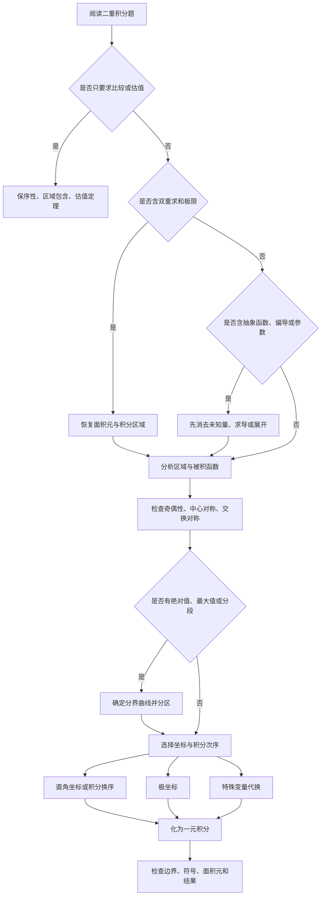

本节的核心并不是单纯学会计算二重积分，而是建立一种**将二维区域、被积函数、坐标变换和一元积分统一起来的解题思维**。

解题时应在动笔之前判断是否适合使用直角坐标、极坐标、对称性、交换积分次序，还是需要进行特殊变量代换。

## 知识体系

| 知识板块       | 核心能力            | 复习优先级 |
| ---------- | --------------- | ----- |
| 二重积分的概念与性质 | 比较大小、估值、积分中值    | ★★★★  |
| 二重积分与黎曼和   | 双重求和极限、识别积分区域   | ★★★★  |
| 直角坐标下的计算   | 划分区域、确定上下限      | ★★★★★ |
| 交换积分次序     | 重新描述区域、降低计算难度   | ★★★★★ |
| 对称性与轮换对称性  | 消项、折半、配对化简      | ★★★★★ |
| 分段函数与绝对值   | 按被积函数的变化划分区域    | ★★★★★ |
| 极坐标变换      | 圆形、扇形、复杂曲线围域    | ★★★★★ |
| 特殊变量代换     | 线性变换、乘积与比值、齐次结构 | ★★★★  |
| 变上限二重积分    | 求导、区域变化、积分换序    | ★★★★  |
| 收缩区域积分极限   | 等价无穷小、泰勒展开、区域矩  | ★★★★  |
| 积分方程与偏导数综合 | 积分常数化、微分方程、分部积分 | ★★★★  |
| 二重积分的应用    | 体积、质量、形心、转动惯量   | ★★★★  |

## 第一部分　二重积分的基础知识

### 一、二重积分的概念与直观理解

**1. 从一元积分推广到二重积分**

一元定积分：

$$
\int_a^b f(x)\,dx
$$

本质上是将区间划分成许多小段，把各小段上的函数值乘以长度，再求和取极限。

二重积分：

$$
\iint_D f(x,y)\,d\sigma
$$

则是将二维区域 $D$ 划分成许多小区域，把各小区域上的函数值乘以面积，再求和取极限。

设第 $i$ 个小区域面积为 $\Delta\sigma_i$，在其中任取一点 $(\xi_i,\eta_i)$，则二重积分定义为

$$
\boxed{ \iint_D f(x,y)\,d\sigma = \lim_{\lambda\to0} \sum_{i=1}^n f(\xi_i,\eta_i)\Delta\sigma_i }
$$

其中 $\lambda$ 为各小区域直径的最大值。

两者之间的对应关系非常重要：

| 一元积分             | 二重积分               |
| ---------------- | ------------------ |
| 积分区间 $[a,b]$ | 积分区域 $D$       |
| 长度微元 $dx$    | 面积微元 $d\sigma$ |
| 区间长度 $b-a$   | 区域面积 $\|D\|$   |
| 曲边梯形的面积          | 曲顶柱体的体积            |
| 单重黎曼和            | 双重黎曼和              |

**2. 几何意义**

当 $f(x,y)\geq 0$ 时，

$$
V=\iint_D f(x,y)\,dx\,dy
$$

表示以 $D$ 为底面、以曲面 $z=f(x,y)$ 为顶面的曲顶柱体体积。

如果 $f(x,y)$ 有正有负，则二重积分表示带符号的体积，即上方体积减去下方体积。

特别地，

$$
\boxed{\iint_D1\,d\sigma=|D|}
$$

因此，任何被积函数能够通过对称性化成常数的二重积分题，最终都可能转化为求面积的问题。

**3. 二重积分存在的充分条件**

考研常用的充分条件是：函数 $f(x,y)$ 在有界闭区域 $D$ 上连续，则其二重积分存在（这里的区域为通常具有分段光滑边界等性质的可积区域）。

需要注意，连续并不是可积的必要条件。

例如：

$$
f(x,y)=\lfloor x+y\rfloor
$$

虽然在若干直线上不连续，但在有界矩形上仍然黎曼可积。

这也是后面李林模拟题中，取整函数可以转化为二重积分的理论依据。

### 二、二重积分的基本性质

**1. 线性性质**

$$
\boxed{ \iint_D(af+bg)\,d\sigma = a\iint_Df\,d\sigma+ b\iint_Dg\,d\sigma }
$$

实际解题中，线性性质最重要的作用是拆分被积函数，将复杂问题拆成能够直接计算的部分和能够利用对称性消去的部分。

例如，在关于原点对称的圆盘上，

$$
\iint_D(x^2+y^2+xy^2)\,d\sigma = \iint_D(x^2+y^2)\,d\sigma
$$

因为 $xy^2$ 关于原点反对称。

**2. 区域可加性**

若 $D=D_1\cup D_2$，且两部分内部不重叠，则

$$
\boxed{ \iint_Df\,d\sigma = \iint_{D_1}f\,d\sigma+ \iint_{D_2}f\,d\sigma }
$$

它是以下所有方法的理论基础：分段积分、绝对值积分、极坐标分段、补形法、挖孔法和对称区域折半积分。

**3. 保序性与积分大小比较**

若在 $D$ 上，

$$
f(x,y)\leq g(x,y),
$$

则

$$
\boxed{ \iint_Df\,d\sigma\leq\iint_Dg\,d\sigma }
$$

若函数连续，且严格不等式在具有正面积的子区域内成立，则积分也是严格不等的。

对于不同区域，如果

$$
D_1\subseteq D_2,\qquad f(x,y)\geq0,
$$

那么

$$
\iint_{D_1}f\,d\sigma \leq \iint_{D_2}f\,d\sigma.
$$

<Callout type="warn" title="陷阱">

如果被积函数存在负值，就不能仅凭区域大小判断积分大小。

</Callout>

**4. 估值定理**

设

$$
m\leq f(x,y)\leq M,
$$

则

$$
\boxed{ m|D|\leq\iint_Df\,d\sigma\leq M|D| }
$$

此外，

$$
\boxed{ \left|\iint_Df\,d\sigma\right| \leq \iint_D|f|\,d\sigma }
$$

这些公式在积分不等式、积分极限和抽象函数题中非常重要。

**5. 二重积分中值定理**

若 $f$ 在有界、闭且连通的通常积分区域 $D$ 上连续，则存在一点 $(\xi,\eta)\in D$，使得

$$
\boxed{ \iint_Df(x,y)\,d\sigma = f(\xi,\eta)|D| }
$$

因此，

$$
\frac1{|D|}\iint_Df(x,y)\,d\sigma
$$

可以理解为函数在区域 $D$ 上的平均值。

当整个区域不断缩向某个点时，这个平均值将趋向该点的函数值。这是收缩区域积分极限最基本的思想。

## 第二部分　积分大小比较与二重黎曼和

### 三、题型一：不计算积分，直接比较积分大小

**母题1：径向函数与积分大小比较**

**来源：2005年考研数学三真题；李林880题中亦有收录。**

设

$$
D=\{(x,y)\mid x^2+y^2\leq1\},
$$

$$
I_1=\iint_D\cos\sqrt{x^2+y^2}\,d\sigma,
$$

$$
I_2=\iint_D\cos(x^2+y^2)\,d\sigma,
$$

$$
I_3=\iint_D\cos((x^2+y^2)^2)\,d\sigma.
$$

比较三个积分的大小。

**第一步：寻找公共变量。**

令

$$
r=\sqrt{x^2+y^2},
$$

则区域条件给出

$$
0\leq r\leq1.
$$

三个被积函数分别为

$$
\cos r,\quad\cos r^2,\quad\cos r^4.
$$

**第二步：比较自变量大小。**

当 $0<r<1$ 时，

$$
r^4<r^2<r.
$$

**第三步：判断外层函数的单调性。**

因为 $\cos t$ 在 $[0,1]$ 上严格递减，所以

$$
\cos r^4>\cos r^2>\cos r.
$$

积分后得到

$$
\boxed{I_3>I_2>I_1}
$$

**同类题迁移：张宇1000题第14章第1、2题**

张宇第1题将公共变量换成 $u=x+y$，并比较对数函数、幂函数与正弦函数；第2题则比较圆盘、正方形以及外接圆盘上的高斯函数积分。

它们对应积分比较的两大基本模型：

| 题目特征       | 优先方法             |
| ---------- | ---------------- |
| 区域相同，函数不同  | 比较被积函数           |
| 函数相同，区域不同  | 比较区域包含关系，同时检查正负性 |
| 函数和区域都不同   | 换元统一区域，或分别估值     |
| 被积函数无法直接比较 | 使用对称性、配对、积分不等式   |

考场上遇到积分比较选择题，应该先尝试比较，而不是把三个积分分别计算出来。

### 四、题型二：双重求和极限转化为二重积分

**1. 基本公式**

单位正方形上的二重黎曼和：

$$
\boxed{ \lim_{n\to\infty} \frac1{n^2} \sum_{i=1}^n\sum_{j=1}^n f\left(\frac in,\frac jn\right) = \int_0^1dx\int_0^1f(x,y)\,dy }
$$

一般矩形上的公式：

$$
\begin{aligned} &\lim_{m,n\to\infty} \frac{(b-a)(d-c)}{mn}\\ &\quad\times\sum_{i=1}^m\sum_{j=1}^n f\left(a+\frac{i(b-a)}m, c+\frac{j(d-c)}n\right)\\ &=\int_a^b dx\int_c^d f(x,y)\,dy. \end{aligned}
$$

最重要的是识别

$$
\boxed{\Delta\sigma=\Delta x\Delta y}
$$

而不是机械地认为所有双重求和前面都必须是 $1/n^2$。

**母题2：标准双重黎曼和**

**来源：2010年考研数学一、数学二真题。**

求

$$
I=\lim_{n\to\infty} \sum_{i=1}^n\sum_{j=1}^n \frac{n}{(n+i)(n^2+j^2)}.
$$

将各项中的 $n$ 提取出来：

$$
\frac{n}{(n+i)(n^2+j^2)} = \frac1{n^2} \frac1{(1+i/n)(1+j^2/n^2)}.
$$

令

$$
x_i=\frac in,\qquad y_j=\frac jn,
$$

则

$$
I=\int_0^1dx\int_0^1 \frac1{(1+x)(1+y^2)}\,dy.
$$

由于区域为矩形，被积函数可以分离，

$$
I= \left(\int_0^1\frac{dx}{1+x}\right) \left(\int_0^1\frac{dy}{1+y^2}\right).
$$

所以

$$
\boxed{I=\frac{\pi\ln2}{4}}
$$

原题只要求选择正确的积分表达式，这里进一步计算出结果，帮助建立完整的解题过程。

**2. 非矩形双重求和**

如果两个求和指标并不独立，积分区域就不一定是矩形。

例如，

$$
\lim_{n\to\infty}\frac1{n^2} \sum_{i=1}^n\sum_{j=1}^i f\left(\frac in,\frac jn\right),
$$

由于

$$
0\leq\frac jn\leq\frac in\leq1,
$$

其对应区域为

$$
D=\{(x,y)\mid0\leq y\leq x\leq1\}.
$$

因此

$$
\boxed{ I=\int_0^1dx\int_0^x f(x,y)\,dy }
$$

同理，看到 $i+j\leq n$，应当联想到 $x+y\leq1$。

**母题3：取整函数与中心对称**

**来源：2027李林六套卷，第5套第14题。**

求

$$
I=\lim_{n\to\infty} \sum_{j=1}^{2n}\sum_{i=1}^n \frac2{n^2} \left\lfloor\frac{2i+j}{n}\right\rfloor.
$$

这是一道很有代表性的创新型模拟题，将双重黎曼和、取整函数、变量代换与中心对称性组合在了一起。

**第一步：恢复积分。**

令

$$
x=\frac in,\qquad y=\frac jn.
$$

注意这里 $j$ 的上限是 $2n$，因此

$$
D=[0,1]\times[0,2].
$$

原式化为

$$
I=2\int_0^1dx\int_0^2 \lfloor2x+y\rfloor\,dy.
$$

**第二步：换元统一为正方形。**

令

$$
u=2x,\qquad v=y.
$$

于是

$$
I=\int_0^2du\int_0^2\lfloor u+v\rfloor\,dv.
$$

**第三步：利用中心对称配对。**

在正方形上使用变换

$$
(u,v)\longmapsto(2-u,2-v).
$$

若记 $s=u+v$，变换后的变量和就是 $4-s$。

除去若干条零面积的整数直线，当 $s\notin\mathbb Z$ 时，

$$
\lfloor s\rfloor+\lfloor4-s\rfloor=3.
$$

所以

$$
2I=\iint_{[0,2]^2}3\,du\,dv=12.
$$

最终

$$
\boxed{I=6}
$$

**这道题真正值得学习的不是取整函数的特殊计算，而是配对思想：如果某个复杂函数经过区域对称变换之后，能够与原函数相加得到简单函数，就应优先利用这种变换。**

## 第三部分　直角坐标下的二重积分与积分换序

### 五、题型三：将二重积分化为累次积分

这是整个多元积分学的计算基础。后面的三重积分、曲面积分、格林公式、高斯公式，都会直接或间接地使用这一能力。

**1. X 型区域：先积 $y$，后积 $x$**

若积分区域可以表示为

$$
D=\{(x,y)\mid a\leq x\leq b,\  \varphi_1(x)\leq y\leq\varphi_2(x)\},
$$

则

$$
\boxed{ \iint_Df(x,y)\,d\sigma = \int_a^b dx \int_{\varphi_1(x)}^{\varphi_2(x)} f(x,y)\,dy }
$$

直观理解：用一条竖直直线从左向右扫描积分区域。

外层积分限是区域在 $x$ 轴上的投影，内层积分限是竖直线进入和离开区域的位置。

记忆方法：**先找左右，再找上下。**

**2. Y 型区域：先积 $x$，后积 $y$**

若

$$
D=\{(x,y)\mid c\leq y\leq d,\  \psi_1(y)\leq x\leq\psi_2(y)\},
$$

则

$$
\boxed{ \iint_Df(x,y)\,d\sigma = \int_c^d dy \int_{\psi_1(y)}^{\psi_2(y)} f(x,y)\,dx }
$$

直观理解：用一条水平直线从下向上扫描积分区域。

记忆方法：**先找上下，再找左右。**

**3. 怎样选择积分次序？**

不能只考虑区域的形状，还要同时考虑被积函数的结构。

| 被积函数特点                                    | 优先选择             |
| ----------------------------------------- | ---------------- |
| 含有 $e^{x^2}$、$\sin x^2$ 等难以直接积分的项 | 尽量把 $x$ 放在外层 |
| 含有 $e^{y^2}$、$\sin y^2$ 等项        | 尽量把 $y$ 放在外层 |
| 关于某个变量是低次多项式                              | 优先对该变量积分         |
| 含有明显的复合函数导数结构                             | 优先消去该变量          |
| 一种积分次序需要分段，另一种不需要                         | 通常选择无需分段的次序      |
| 换序后能够产生换元所需的因子                            | 优先换序             |
| 区域和函数均适合极坐标                               | 直接考虑极坐标          |

注意：二重积分记号

$$
\iint_D f(x,y)\,dx\,dy
$$

本身并不要求必须先对 $x$ 积分。

真正决定次序的是化成累次积分以后的积分限与内外层结构。

### 六、题型四：交换二重积分的积分次序

**1. 标准解题流程**

交换积分次序，本质上是**同一个积分区域的两种不同描述方式**。

考场上按照以下过程进行：

1. 将原累次积分的上下限翻译为不等式组。
2. 画出边界曲线，找出关键交点。
3. 确定新的外层变量的投影区间。
4. 沿新的扫描方向确定进入和离开区域的位置。
5. 如果边界发生切换或一次扫描得到多个区间，就进行分段。
6. 检查交换前后是否表示同一个区域。

如果没有画图习惯，一定要在本节养成。复杂区域仅凭代数变形很容易漏掉分支。

**母题4：一个扫描方向出现两个区间**

**来源：2025年考研数学一、数学二真题。**

交换积分次序：

$$
I=\int_{-2}^2dx \int_{4-x^2}^4f(x,y)\,dy.
$$

原区域为

$$
D=\{(x,y)\mid -2\leq x\leq2,\  4-x^2\leq y\leq4\}.
$$

边界包括开口向下的抛物线 $y=4-x^2$、水平直线 $y=4$，以及两侧的直线 $x=\pm2$。

**第一步：确定新外层变量范围。**

$$
0\leq y\leq4.
$$

**第二步：根据固定的** $y$ **求** $x$ **的取值。**

由

$$
y\geq4-x^2
$$

得到

$$
x^2\geq4-y.
$$

注意这里是不小于，而不是不大于。

所以

$$
|x|\geq\sqrt{4-y},
$$

即

$$
-2\leq x\leq-\sqrt{4-y}
$$

或者

$$
\sqrt{4-y}\leq x\leq2.
$$

因此

$$
\boxed{ \begin{aligned} I={}&\int_0^4dy \int_{-2}^{-\sqrt{4-y}} f(x,y)\,dx\\ &+\int_0^4dy \int_{\sqrt{4-y}}^2 f(x,y)\,dx. \end{aligned} }
$$

这道题的核心是：原区域沿竖直方向扫描时只有一个区间，但沿水平方向扫描时出现两个分离的区间。

**重要陷阱：**

不能把 $x^2\geq4-y$ 错误写成

$$
-\sqrt{4-y}\leq x\leq\sqrt{4-y}.
$$

这样得到的恰好是中间被排除的区域。

**母题5：换序产生凑微分因子**

**来源：2022年考研数学二真题。**

计算

$$
I=\int_0^2dy \int_y^2\frac{y}{\sqrt{1+x^3}}\,dx.
$$

如果按照原积分次序计算，内层积分为

$$
\int\frac{dx}{\sqrt{1+x^3}},
$$

并没有常用的初等原函数表达式。

此时，应立即想到换序。

原区域为

$$
0\leq y\leq x\leq2.
$$

交换积分次序：

$$
\begin{aligned} I &=\int_0^2dx \int_0^x\frac{y}{\sqrt{1+x^3}}\,dy\\ &=\frac12\int_0^2 \frac{x^2}{\sqrt{1+x^3}}\,dx. \end{aligned}
$$

现在出现了 $x^2dx$，可以令

$$
u=1+x^3.
$$

于是

$$
I=\frac16\int_1^9u^{-1/2}\,du =\boxed{\frac23}.
$$

**2. 换序降维的通用公式**

对于连续函数 $f$，有

$$
\boxed{ \int_0^a dy\int_y^a f(x)\,dx =\int_0^a xf(x)\,dx }
$$

进一步推广：

$$
\boxed{ \int_0^a dy\int_y^a g(y)f(x)\,dx = \int_0^a f(x) \left[\int_0^xg(y)\,dy\right]dx }
$$

2017年、2020年及2022年数学二的相关真题，都是这种思想的不同形式。

解题时要观察：**内层积分计算困难，是否可以通过积分换序，让外层变量的积分产生一个需要的导数因子？**

**3. 区域先拆分，再合并**

有时原积分由两个累次积分相加构成，但换序后反而可以合并成一个。

例如2002年考研数学三真题：

$$
\begin{aligned} I={}&\int_0^{1/4}dy \int_y^{\sqrt y}f(x,y)\,dx\\ &+\int_{1/4}^{1/2}dy \int_y^{1/2}f(x,y)\,dx. \end{aligned}
$$

两块区域实际上都是

$$
x^2\leq y\leq x,\qquad 0\leq x\leq\frac12
$$

的一部分，原来的分界线 $y=1/4$ 是水平扫描时上界发生变化所产生的。

合并换序得到

$$
\boxed{ I=\int_0^{1/2}dx \int_{x^2}^x f(x,y)\,dy }
$$

这也是李林880题和分类模拟题中经常出现的区域拼接模型。

## 第四部分　对称性、分段积分与快速计算

### 七、题型五：二重积分的对称性

对称性是本节最重要的计算技巧之一。复杂的二重积分往往不是靠复杂计算解决，而是通过对称性消去大部分无效计算。

**1. 必须掌握的四种对称变换**

| 区域对称方式          | 对应变换                      | 反对称函数积分             |
| --------------- | ------------------------- | ------------------- |
| 关于 $x$ 轴对称  | $(x,y)\mapsto(x,-y)$  | 关于 $y$ 的奇函数积分为零 |
| 关于 $y$ 轴对称  | $(x,y)\mapsto(-x,y)$  | 关于 $x$ 的奇函数积分为零 |
| 关于原点对称          | $(x,y)\mapsto(-x,-y)$ | 中心反对称函数积分为零         |
| 关于 $y=x$ 对称 | $(x,y)\mapsto(y,x)$   | 交换变量后变号的函数积分为零      |

例如，若 $D$ 关于 $y=x$ 对称，则

$$
\boxed{ \iint_Df(x,y)\,d\sigma = \iint_Df(y,x)\,d\sigma }
$$

进一步得到

$$
\boxed{ \iint_Df(x,y)\,d\sigma = \frac12\iint_D [f(x,y)+f(y,x)]\,d\sigma }
$$

这称为对称化或轮换对称法。

**2. 对称性的本质**

设变换 $T$ 将整个积分区域映射回自身，而且保持面积，那么

$$
\iint_Df(x,y)\,d\sigma = \iint_Df(T(x,y))\,d\sigma.
$$

所以

$$
\iint_Df\,d\sigma = \frac12\iint_D(f+f\circ T)\,d\sigma.
$$

这比简单记忆奇函数、偶函数更有推广价值。

**应用对称性的必要检查：区域是否对称？函数经过变换后怎样变化？**

只有被积函数是奇函数，而积分区域不具有相应的对称性，不能直接判断积分为零。

**母题6：对称性与极坐标结合**

**来源：2006年考研数学一、数学二真题。**

设

$$
D=\{(x,y)\mid x^2+y^2\leq1,\ x\geq0\},
$$

计算

$$
I=\iint_D \frac{1+xy}{1+x^2+y^2}\,d\sigma.
$$

拆成两部分：

$$
I=\iint_D\frac1{1+x^2+y^2}\,d\sigma +\iint_D\frac{xy}{1+x^2+y^2}\,d\sigma.
$$

由于 $D$ 是右半圆盘，关于 $x$ 轴对称，而第二项关于 $y$ 为奇函数，因此第二项积分为零。

对第一项使用极坐标：

$$
I=\int_{-\pi/2}^{\pi/2}d\theta \int_0^1\frac{r}{1+r^2}\,dr.
$$

所以

$$
\boxed{I=\frac{\pi}{2}\ln2}.
$$

应形成固定习惯：**先观察对称性，再进行坐标变换。**

**母题7：平移对称与区域矩**

**来源：2027李林六套卷，第3套第3题。**

设

$$
D=\{(x,y)\mid(x-1)^2+(y-1)^2\leq1\},
$$

记

$$
I_k=\iint_D(x+y)^k\,d\sigma, \qquad k=1,2,3.
$$

比较 $I_1,I_2,I_3$ 的大小。

注意该圆盘不是以原点为中心，因此不能直接消去 $x,y$ 的奇次项。

令

$$
u=x-1,\qquad v=y-1.
$$

则区域变为单位圆盘 $B$，且

$$
x+y=2+u+v.
$$

记 $s=u+v$。由中心对称，

$$
\iint_Bs\,d\sigma = \iint_Bs^3\,d\sigma=0.
$$

此外，

$$
\iint_Bs^2\,d\sigma = \iint_B(u^2+v^2)\,d\sigma =\frac{\pi}{2}.
$$

因此

$$
I_1=2\pi,
$$

$$
I_2=4\pi+\frac{\pi}{2} =\frac{9\pi}{2},
$$

$$
I_3=8\pi+6\cdot\frac{\pi}{2} =11\pi.
$$

故

$$
\boxed{I_1<I_2<I_3}.
$$

**3. 必须熟悉的圆盘区域矩**

设

$$
B_R=\{(x,y)\mid x^2+y^2\leq R^2\}.
$$

则

$$
\boxed{\iint_{B_R}1\,d\sigma=\pi R^2}
$$

$$
\boxed{\iint_{B_R}x^2\,d\sigma =\iint_{B_R}y^2\,d\sigma =\frac{\pi R^4}{4}}
$$

$$
\boxed{\iint_{B_R}(x^2+y^2)\,d\sigma =\frac{\pi R^4}{2}}
$$

进一步，

$$
\iint_{B_R}x^4\,d\sigma =\frac{\pi R^6}{8},
$$

$$
\iint_{B_R}x^2y^2\,d\sigma =\frac{\pi R^6}{24}.
$$

这些公式不仅用于快速计算，还广泛应用于泰勒展开、收缩区域积分极限、质心与转动惯量问题。

**母题8：对称配对约去复杂分母**

**来源：2027汤家凤八套卷，第3套第18题。**

计算

$$
I=\iint_D \frac{(1+x^2+x-y)H(x,y)} {2+x^2+y^2}\,d\sigma,
$$

其中

$$
H(x,y)=x^2+y^2-3x-3y+xy+3,
$$

$$
D=\{(x,y)\mid(x-1)^2+(y-1)^2\leq2\}.
$$

直接积分会非常复杂。

但观察到区域关于 $y=x$ 对称，且

$$
H(x,y)=H(y,x).
$$

交换 $x,y$：

$$
I=\iint_D \frac{(1+y^2+y-x)H(x,y)} {2+x^2+y^2}\,d\sigma.
$$

两式相加后，分子中的两部分恰好凑成分母：

$$
2I=\iint_DH(x,y)\,d\sigma.
$$

再令

$$
u=x-1,\quad v=y-1,
$$

则

$$
H=u^2+v^2+uv.
$$

利用圆盘对称性消去 $uv$，得到

$$
2I=\int_0^{2\pi}d\theta \int_0^{\sqrt2}r^3\,dr =2\pi.
$$

所以

$$
\boxed{I=\pi}.
$$

这道模拟题非常值得掌握，它体现了高水平二重积分解题的一条重要原则：

**当被积函数的分母具有交换对称性，而分子不是对称形式时，优先尝试交换变量后相加，检查能否产生约分。**

### 八、题型六：最大值、最小值、绝对值与分段函数

这些题的共同本质是：不仅积分区域可能需要划分，被积函数本身也可能要求划分区域。

**1. 最大值与最小值的处理**

对于

$$
\iint_D\max\{g(x,y),h(x,y)\}\,d\sigma,
$$

分界线为

$$
g(x,y)=h(x,y).
$$

在一侧取 $g$，在另一侧取 $h$。

也可以利用恒等式

$$
\max\{g,h\}=\frac{g+h+|g-h|}{2},
$$

$$
\min\{g,h\}=\frac{g+h-|g-h|}{2}.
$$

**母题9：最大值函数与轮换对称**

**来源：2002年考研数学一真题。**

计算

$$
I=\iint_D e^{\max(x^2,y^2)}\,d\sigma,
$$

其中

$$
D=[0,1]\times[0,1].
$$

因为 $x,y\geq0$，所以

$$
x^2\geq y^2 \iff x\geq y.
$$

沿直线 $y=x$ 将正方形分成两个三角形。

又由于被积函数关于 $y=x$ 对称，只需计算一半再乘2：

$$
\begin{aligned} I&=2\int_0^1dx\int_0^x e^{x^2}\,dy\\ &=2\int_0^1xe^{x^2}\,dx\\ &=\boxed{e-1}. \end{aligned}
$$

这里不仅利用了对称性，还通过内层积分产生了换元所需要的 $x$。

**2. 这一母题可以推广为一整类公式**

对于正方形 $D=[0,a]^2$，

$$
\boxed{ \iint_Df(\max\{x,y\})\,d\sigma = 2\int_0^a tf(t)\,dt }
$$

同理，

$$
\boxed{ \iint_Df(\min\{x,y\})\,d\sigma = 2\int_0^a(a-t)f(t)\,dt }
$$

对于变量差的绝对值，

$$
\boxed{ \iint_{[0,a]^2}f(|x-y|)\,d\sigma = 2\int_0^a(a-t)f(t)\,dt }
$$

2027李永乐六套卷第3套第17题正是双重黎曼和与最大值积分公式的组合。它利用不同的网格间距恢复二重积分，最终转化为

$$
4\int_0^1te^t\cos t\,dt,
$$

答案为

$$
\boxed{2e\cos1}.
$$

**3. 绝对值积分的补偿法**

设

$$
D_-=\{(x,y)\in D\mid g(x,y)<0\},
$$

则

$$
\boxed{ \iint_D|g|\,d\sigma = \iint_Dg\,d\sigma -2\iint_{D_-}g\,d\sigma }
$$

这个公式通常比完整地计算正负两个区域更高效。

**母题10：绝对值与补形法**

**来源：2005年考研数学二、数学三真题。**

计算

$$
I=\iint_{[0,1]^2}|x^2+y^2-1|\,d\sigma.
$$

分界曲线为

$$
x^2+y^2=1.
$$

负值区域是第一象限的四分之一单位圆盘。

首先计算不带绝对值的积分：

$$
\begin{aligned} I_0 &=\int_0^1dx\int_0^1(x^2+y^2-1)\,dy\\ &=\frac13+\frac13-1\\ &=-\frac13. \end{aligned}
$$

再计算负值区域对应的积分：

$$
\begin{aligned} I_- &=\int_0^{\pi/2}d\theta \int_0^1(r^2-1)r\,dr\\ &=-\frac{\pi}{8}. \end{aligned}
$$

所以

$$
I=I_0-2I_-
$$

即

$$
\boxed{I=\frac{\pi}{4}-\frac13}.
$$

**为什么不直接使用极坐标计算整个正方形？**

因为正方形的极坐标径向边界需要分段，而四分之一圆盘的边界不需要分段。

这道题告诉我们：不必强制一个积分中的所有部分使用同一种坐标系。

**母题11：双曲线分区**

**来源：张宇1000题。**

计算

$$
I=\iint_{[0,2]^2}|xy-1|\,d\sigma.
$$

分界线为

$$
xy=1.
$$

仍然采用补偿法。

由于

$$
\iint_{[0,2]^2}(xy-1)\,d\sigma=0,
$$

所以

$$
I=2\iint_{xy\leq1}(1-xy)\,d\sigma.
$$

在 $0\leq x\leq1/2$ 时，整个 $0\leq y\leq2$ 都满足条件；在 $1/2\leq x\leq2$ 时，上界是 $y=1/x$。

因此

$$
\begin{aligned} I=2\bigg[ &\int_0^{1/2}dx\int_0^2(1-xy)\,dy\\ +&\int_{1/2}^2dx \int_0^{1/x}(1-xy)\,dy \bigg]. \end{aligned}
$$

计算得

$$
I=2\left(\frac34+\ln2\right).
$$

最终

$$
\boxed{I=\frac32+2\ln2}.
$$

这类题如果将绝对值换成 $\max\{xy,1\}$、$\min\{xy,1\}$ 或符号函数，分界曲线与区域划分的思路完全一致。

## 第五部分　极坐标下的二重积分

### 九、极坐标变换的原理与公式

**1. 基本变换**

$$
\boxed{ \begin{cases} x=r\cos\theta,\\ y=r\sin\theta \end{cases} }
$$

其中

$$
r=\sqrt{x^2+y^2},\qquad r\geq0.
$$

最重要的是面积微元：

$$
\boxed{dx\,dy=r\,dr\,d\theta}
$$

为什么多出一个 $r$？

因为极坐标下的小面积近似为一个小扇形，其径向长度为 $dr$，切向长度为 $r\,d\theta$，两者相乘得到

$$
d\sigma=r\,dr\,d\theta.
$$

也可以通过雅可比行列式推导：

$$
\begin{aligned} J &=\frac{\partial(x,y)}{\partial(r,\theta)}\\ &= \begin{vmatrix} \cos\theta&-r\sin\theta\\ \sin\theta&r\cos\theta \end{vmatrix}\\ &=r. \end{aligned}
$$

因此，如果区域为

$$
D:\alpha\leq\theta\leq\beta,\qquad r_1(\theta)\leq r\leq r_2(\theta),
$$

则

$$
\boxed{ \begin{aligned} \iint_Df(x,y)\,d\sigma ={}&\int_\alpha^\beta d\theta \int_{r_1(\theta)}^{r_2(\theta)} \\ &f(r\cos\theta,r\sin\theta)r\,dr. \end{aligned} }
$$

**2. 何时优先考虑极坐标？**

| 题目特征                    | 使用极坐标的原因                         |
| ----------------------- | -------------------------------- |
| 圆盘、圆环、扇形区域              | 边界容易确定                           |
| 出现 $x^2+y^2$        | 可以直接化为 $r^2$                 |
| 出现 $\sqrt{x^2+y^2}$ | 可以直接化为 $r$                   |
| 出现 $y/x$            | 可以化为 $\tan\theta$            |
| 出现 $x^2-y^2$        | 可以化为 $r^2\cos2\theta$        |
| 出现 $xy$             | 可以化为 $\frac12r^2\sin2\theta$ |
| 区域由高次齐次式构成              | 往往能够约去公共的 $r$ 幂次             |
| 被积函数是零次齐次函数             | 换元后通常只含极角                        |

但是，看到 $x^2+y^2$ 并不意味着必须采用极坐标。还需要检查区域和积分次序能否进一步简化。

**3. 常见曲线的极坐标方程**

以下是考研数学一必须熟练转换的曲线。

| 直角坐标方程                         | 极坐标方程                             |
| ------------------------------ | --------------------------------- |
| $x^2+y^2=R^2$              | $r=R$                         |
| $x^2+y^2=2ax$              | $r=2a\cos\theta$              |
| $x^2+y^2=2ay$              | $r=2a\sin\theta$              |
| $x^2+y^2=ax+by$            | $r=a\cos\theta+b\sin\theta$   |
| $x=a$                      | $r=a/\cos\theta$              |
| $y=b$                      | $r=b/\sin\theta$              |
| $x+y=a$                    | $r=a/(\cos\theta+\sin\theta)$ |
| $xy=c$                     | $r^2=2c/\sin2\theta$          |
| $(x^2+y^2)^2=a^2(x^2-y^2)$ | $r^2=a^2\cos2\theta$          |
| $(x^2+y^2)^2=2a^2xy$       | $r^2=a^2\sin2\theta$          |

表中涉及除以 $r$ 的转换，针对非原点部分；同时必须根据原区域检查 $r\geq0$、极角范围及分母是否为零。

**4. 极坐标确定区域的真正方法：射线扫描法**

固定一个角度 $\theta$，从原点发出一条射线，观察：

- 射线是否与积分区域相交？
- 射线从哪个位置进入区域？
- 射线从哪个位置离开区域？
- 随着角度变化，内外边界是否发生切换？
- 射线与区域是否存在多个分离的交段？

归纳为一句话：

**角度决定方向，半径决定进入和离开区域的位置。**

### 十、题型七：标准圆形区域与径向积分

**1. 径向函数的一维化公式**

对于以原点为中心的圆盘 $B_R$，若被积函数仅依赖于 $r$，则

$$
\boxed{ \iint_{B_R}g(\sqrt{x^2+y^2})\,d\sigma = 2\pi\int_0^Rrg(r)\,dr }
$$

若被积函数依赖于 $x^2+y^2$，则

$$
\begin{aligned} \iint_{B_R}f(x^2+y^2)\,d\sigma &=2\pi\int_0^Rrf(r^2)\,dr\\ &=\pi\int_0^{R^2}f(u)\,du. \end{aligned}
$$

所以

$$
\boxed{ \iint_{B_R}f(x^2+y^2)\,d\sigma = \pi\int_0^{R^2}f(u)\,du }
$$

对于圆环扇形

$$
a\leq r\leq b,\qquad \alpha\leq\theta\leq\beta,
$$

则有

$$
\boxed{ \iint_Df(x^2+y^2)\,d\sigma = \frac{\beta-\alpha}{2} \int_{a^2}^{b^2}f(u)\,du }
$$

这些公式能够显著提高选择题与填空题的计算速度。

**母题12：圆盘经过原点**

**来源：李正元练习题，第九章第6题。**

设

$$
D=\{(x,y)\mid x^2+y^2\leq x\},
$$

计算

$$
I=\iint_D\sqrt{x^2+y^2}\,d\sigma.
$$

先配方：

$$
\left(x-\frac12\right)^2+y^2 \leq\frac14.
$$

所以这是圆心为 $(1/2,0)$、半径为 $1/2$ 的圆盘。

极坐标下，

$$
r^2\leq r\cos\theta.
$$

对于 $r>0$，

$$
0\leq r\leq\cos\theta.
$$

角度必须满足 $\cos\theta\geq0$，所以

$$
-\frac\pi2\leq\theta\leq\frac\pi2.
$$

因此

$$
\begin{aligned} I &=\int_{-\pi/2}^{\pi/2}d\theta \int_0^{\cos\theta}r^2\,dr\\ &=\frac23\int_0^{\pi/2}\cos^3\theta\,d\theta\\ &=\boxed{\frac49}. \end{aligned}
$$

这里使用平移坐标虽然可以使区域变得简单，但被积函数中的原点距离反而会变得复杂。因此直接用以原点为极点的极坐标更合适。

### 十一、题型八：极坐标下的复杂边界与分段积分

**母题13：双曲线围成的区域**

**来源：2015年考研数学一、数学二真题。**

设第一象限区域 $D$ 由

$$
2xy=1,\qquad4xy=1,
$$

$$
y=x,\qquad y=\sqrt3x
$$

围成，将二重积分

$$
\iint_Df(x,y)\,d\sigma
$$

化为极坐标下的累次积分。

两条直线给出极角范围：

$$
\frac\pi4\leq\theta\leq\frac\pi3.
$$

两条双曲线给出

$$
\frac14\leq xy\leq\frac12.
$$

利用

$$
xy=\frac12r^2\sin2\theta,
$$

得到

$$
\frac1{2\sin2\theta} \leq r^2 \leq\frac1{\sin2\theta}.
$$

因此

$$
\boxed{ \begin{aligned} I={}&\int_{\pi/4}^{\pi/3}d\theta\\ &\int_{1/\sqrt{2\sin2\theta}}^{1/\sqrt{\sin2\theta}} f(r\cos\theta,r\sin\theta)r\,dr. \end{aligned} }
$$

本题常见错误是求出了 $r^2$ 的取值范围，却忘记开平方，直接将其作为 $r$ 的积分上下限。

**母题14：外边界发生切换**

**来源：2022年考研数学一、数学二、数学三真题。**

设

$$
D=\{(x,y)\mid y-2\leq x\leq\sqrt{4-y^2}, \ 0\leq y\leq2\},
$$

求

$$
I=\iint_D \frac{(x-y)^2}{x^2+y^2}\,d\sigma.
$$

这是一道非常重要的极坐标分段母题。

**第一步：识别区域形状。**

右边界为圆弧

$$
x^2+y^2=4,\qquad x\geq0.
$$

左边界为直线

$$
y-x=2.
$$

区域位于上半平面，可以视为第一象限的四分之一圆盘，与第二象限的一个三角形拼接而成。

**第二步：按极角分段。**

第一象限部分：

$$
0\leq\theta\leq\frac\pi2, \qquad0\leq r\leq2.
$$

第二象限部分：

$$
\frac\pi2\leq\theta\leq\pi,
$$

由

$$
r(\sin\theta-\cos\theta)=2
$$

确定径向上界：

$$
0\leq r\leq \frac2{\sin\theta-\cos\theta}.
$$

**第三步：变换被积函数。**

$$
\frac{(x-y)^2}{x^2+y^2} =(\cos\theta-\sin\theta)^2.
$$

因此

$$
\begin{aligned} I_1 &=\int_0^{\pi/2}d\theta \int_0^2 (\cos\theta-\sin\theta)^2r\,dr\\ &=2\int_0^{\pi/2}(1-\sin2\theta)\,d\theta\\ &=\pi-2. \end{aligned}
$$

第二部分：

$$
\begin{aligned} I_2 &=\int_{\pi/2}^{\pi}d\theta \int_0^{2/(\sin\theta-\cos\theta)} (\cos\theta-\sin\theta)^2r\,dr\\ &=\int_{\pi/2}^{\pi}2\,d\theta\\ &=\pi. \end{aligned}
$$

最终

$$
\boxed{I=2\pi-2}.
$$

这道题的重要启发是：题目看起来区域复杂、分母复杂，但极坐标变换后，被积函数的角度因子与径向边界恰好可以抵消。

**母题15：圆外区域与非零径向下限**

**来源：2024年考研数学一真题。**

设

$$
D=\{(x,y)\mid \sqrt{1-y^2}\leq x\leq1, \ -1\leq y\leq1\},
$$

计算

$$
I=\iint_D\frac{x}{\sqrt{x^2+y^2}}\,d\sigma.
$$

本题值得掌握两种解法。

<Tabs items={["方法一：极坐标分段", "方法二：直角坐标直接积分（更简洁）"]} defaultIndex={0}>

<Tab value="方法一：极坐标分段">

区域处于单位圆外部，同时处于

$$
0\leq x\leq1,\qquad |y|\leq1
$$

所确定的矩形内部。

利用关于 $x$ 轴的对称性，只计算上半部分再乘2。

上半部分径向下界始终为

$$
r=1.
$$

但是径向上界分成两段：

$$
\begin{cases} 1\leq r\leq\sec\theta, &0\leq\theta\leq\pi/4,\\[2mm] 1\leq r\leq\csc\theta, &\pi/4\leq\theta\leq\pi/2. \end{cases}
$$

因此

$$
\begin{aligned} I={}&2\int_0^{\pi/4}d\theta \int_1^{\sec\theta}r\cos\theta\,dr\\ &+2\int_{\pi/4}^{\pi/2}d\theta \int_1^{\csc\theta}r\cos\theta\,dr. \end{aligned}
$$

先对 $r$ 积分，得到

$$
\begin{aligned} I={}&\int_0^{\pi/4} (\sec\theta-\cos\theta)\,d\theta\\ &+\int_{\pi/4}^{\pi/2} \left(\frac{\cos\theta}{\sin^2\theta} -\cos\theta\right)d\theta. \end{aligned}
$$

最终

$$
\boxed{ I=\sqrt2+\ln(1+\sqrt2)-2 }.
$$

</Tab>

<Tab value="方法二：直角坐标直接积分（更简洁）">

观察被积函数：

$$
\frac{x}{\sqrt{x^2+y^2}} = \frac{\partial}{\partial x} \sqrt{x^2+y^2}.
$$

而题目所给区域本身就是适合先对 $x$ 积分的形式。

因此

$$
\begin{aligned} I &=\int_{-1}^1dy \int_{\sqrt{1-y^2}}^1 \frac{x}{\sqrt{x^2+y^2}}\,dx\\ &=\int_{-1}^1 (\sqrt{1+y^2}-1)\,dy\\ &=2\int_0^1\sqrt{1+y^2}\,dy-2. \end{aligned}
$$

使用公式

$$
\int\sqrt{1+y^2}\,dy = \frac12\left[ y\sqrt{1+y^2} +\ln(y+\sqrt{1+y^2}) \right]+C,
$$

立即得到

$$
\boxed{ I=\sqrt2+\ln(1+\sqrt2)-2 }.
$$

**这是真正需要掌握的解题能力：不仅会用极坐标，而且知道什么时候不应该用极坐标。**

</Tab>

</Tabs>

### 十二、题型九：高次曲线、双纽线与相交圆域

**1. 高次曲线的统一处理方法**

例如

$$
(x^2+y^2)^2\leq a^2(x^2-y^2).
$$

极坐标下，

$$
r^4\leq a^2r^2\cos2\theta.
$$

对于 $r>0$，

$$
r^2\leq a^2\cos2\theta.
$$

因此

$$
0\leq r\leq a\sqrt{\cos2\theta}.
$$

同时必须满足

$$
\cos2\theta\geq0.
$$

不能仅仅写出半径范围，而忘记根号内部必须非负。

**母题16：高次边界与凑微分**

**来源：2021年考研数学二真题。**

第一象限内，曲线

$$
(x^2+y^2)^2=x^2-y^2
$$

与 $x$ 轴围成区域 $D$，求

$$
I=\iint_Dxy\,d\sigma.
$$

极坐标下，积分区域为

$$
0\leq\theta\leq\frac\pi4, \qquad 0\leq r\leq\sqrt{\cos2\theta}.
$$

又因为

$$
xy=\frac12r^2\sin2\theta,
$$

所以

$$
\begin{aligned} I &=\frac12\int_0^{\pi/4}\sin2\theta\,d\theta \int_0^{\sqrt{\cos2\theta}}r^3\,dr\\ &=\frac18\int_0^{\pi/4} \sin2\theta\cos^22\theta\,d\theta. \end{aligned}
$$

令

$$
u=\cos2\theta,
$$

则

$$
I=\frac1{16}\int_0^1u^2\,du =\boxed{\frac1{48}}.
$$

**2. 强化模拟题迁移**

2027汤家凤八套卷第7套第13题，将上述区域改为

$$
(x^2+y^2)^2\leq4(x^2-y^2),
$$

被积函数改为

$$
y\ln(x+\sqrt{1+x^2})+x^2.
$$

先通过关于 $x$ 轴的对称性消掉第一项，再利用第一象限乘4，最终计算

$$
16\int_0^{\pi/4} \cos^2\theta\cos^22\theta\,d\theta.
$$

答案为

$$
\boxed{\pi+\frac83}.
$$

这道模拟题实际上没有引入新的核心知识，只是在双纽线真题模型上叠加了对称性和三角函数积分。

**母题17：相交圆域与取较小边界**

**来源：2025年考研数学二真题。**

设

$$
D=\{(x,y)\mid x^2+y^2\leq4x,\ x^2+y^2\leq4y\},
$$

求

$$
I=\iint_D(x-y)^2\,d\sigma.
$$

两个不等式同时成立，说明区域是两个圆盘的公共部分。

转化为极坐标：

$$
r\leq4\cos\theta,\qquad r\leq4\sin\theta.
$$

所以

$$
r\leq\min\{4\cos\theta,4\sin\theta\}.
$$

区域关于 $y=x$ 对称，被积函数也关于 $y=x$ 对称，因此只计算

$$
0\leq\theta\leq\frac\pi4
$$

的部分，再乘2。

在该角度范围内，

$$
\sin\theta\leq\cos\theta.
$$

因此

$$
\begin{aligned} I &=2\int_0^{\pi/4}d\theta \int_0^{4\sin\theta} r^3(\cos\theta-\sin\theta)^2\,dr\\ &=128\int_0^{\pi/4} \sin^4\theta(1-2\sin\theta\cos\theta) \,d\theta. \end{aligned}
$$

使用

$$
\int_0^{\pi/4}\sin^4\theta\,d\theta =\frac{3\pi}{32}-\frac14,
$$

$$
\int_0^{\pi/4}\sin^5\theta\cos\theta\,d\theta =\frac1{48},
$$

得到

$$
\boxed{I=12\pi-\frac{112}{3}}.
$$

**3. 多个极坐标约束的处理原则**

若区域要求同时满足

$$
r\leq g_1(\theta),\qquad r\leq g_2(\theta),
$$

则径向上界取

$$
\boxed{r_{\max}=\min\{g_1,g_2\}}.
$$

若同时满足多个径向下限，则取

$$
\boxed{r_{\min}=\max\{h_1,h_2\}}.
$$

再求出这些边界相等时的角度，作为分段点，同时检查

$$
r_{\min}\leq r_{\max}.
$$

如果计算的是两个都从原点出发的径向区间的并集，上界才取较大值；一般区域的并集还可能存在多个不连续的径向区间，不能直接套用最大值公式。

## 第六部分　特殊变量代换与积分降维

### 十三、二重积分的一般换元公式

极坐标实际上只是二重积分换元公式的一种特殊形式。

设

$$
\begin{cases} x=x(u,v),\\ y=y(u,v) \end{cases}
$$

在相关区域内满足适当的光滑性、一一对应等条件，且内部雅可比行列式非零，则

$$
\boxed{ \begin{aligned} \iint_Df(x,y)\,dx\,dy ={}&\iint_{D'} f(x(u,v),y(u,v))\\ &\cdot \left| \frac{\partial(x,y)}{\partial(u,v)} \right|du\,dv. \end{aligned} }
$$

其中

$$
\frac{\partial(x,y)}{\partial(u,v)} = \begin{vmatrix} x_u&x_v\\ y_u&y_v \end{vmatrix}.
$$

如果换元在零面积的边界点失去可逆性，如极坐标中的原点，通常可以通过忽略该点或取极限处理。

一般换元法不宜代替基本的直角坐标和极坐标，但对于一些综合题，它能够显著缩短运算。

**常见特殊代换总结**

| 题目结构                          | 建议代换                    |
| ----------------------------- | ----------------------- |
| $x+y,\ x-y$               | $u=x+y,\ v=x-y$     |
| $xy,\ y/x$                | $u=xy,\ v=y/x$      |
| $x+y,\ x/(x+y)$           | $u=x+y,\ v=x/(x+y)$ |
| $x^2,\ y^2$，且出现 $xy$  | $u=x^2,\ v=y^2$     |
| 椭圆 $x^2/a^2+y^2/b^2\leq1$ | $x=au,\ y=bv$       |
| 圆心不在原点                        | $u=x-a,\ v=y-b$     |

特殊换元的目标不是追求技巧，而是让积分区域或被积函数变得更加简单。

### 十四、题型十：乘积与比值型换元

**母题18：双曲线与直线围成的区域**

**来源：2024年考研数学二、数学三真题。**

第一象限区域 $D$ 由

$$
xy=\frac13,\quad xy=3,
$$

$$
y=\frac13x,\quad y=3x
$$

围成，计算

$$
I=\iint_D(1+x-y)\,d\sigma.
$$

首先，区域关于 $y=x$ 对称。

因此

$$
\iint_D(x-y)\,d\sigma=0,
$$

故

$$
I=\iint_D1\,d\sigma=|D|.
$$

现在只需要求区域面积。

令

$$
u=xy,\qquad v=\frac yx.
$$

新区间恰好是矩形：

$$
\frac13\leq u\leq3,\qquad \frac13\leq v\leq3.
$$

计算正向雅可比：

$$
\begin{aligned} \frac{\partial(u,v)}{\partial(x,y)} &= \begin{vmatrix} y&x\\ -y/x^2&1/x \end{vmatrix}\\ &=\frac{2y}{x}=2v. \end{aligned}
$$

所以

$$
dx\,dy=\frac1{2v}\,du\,dv.
$$

于是

$$
\begin{aligned} I &=\int_{1/3}^3du \int_{1/3}^3\frac1{2v}\,dv\\ &=\frac83\ln3. \end{aligned}
$$

最终

$$
\boxed{I=\frac83\ln3}.
$$

**通用结论**

对于第一象限区域

$$
a\leq xy\leq b,\qquad c\leq\frac yx\leq d
$$

且 $a,c>0$，有

$$
\boxed{ |D|=\frac{b-a}{2}\ln\frac dc }
$$

张宇1000题第14章文档编号063正是这类变式，将被积函数改成 $\ln(xy)$。

变换以后，积分直接变成

$$
\frac12\int_a^b\ln u\,du \int_c^d\frac{dv}{v}.
$$

这就是通过一道母题掌握一整个题型。

### 十五、题型十一：和与比例型换元

当题目同时出现

$$
x+y,\qquad\frac{x}{x+y}
$$

时，应想到

$$
u=x+y,\qquad v=\frac{x}{x+y}.
$$

其反变换为

$$
x=uv,\qquad y=u(1-v).
$$

雅可比行列式：

$$
\left| \frac{\partial(x,y)}{\partial(u,v)} \right| = \left| \begin{vmatrix} v&u\\ 1-v&-u \end{vmatrix} \right| =u
$$

这里假设 $u>0$。

于是

$$
\boxed{dx\,dy=u\,du\,dv}.
$$

**母题19：三角形区域中的比例函数**

**来源：李林880题。**

设

$$
D=\{(x,y)\mid x\geq0,\ y\geq0,\ x+y\leq1\},
$$

计算

$$
I=\iint_De^{x/(x+y)}\,d\sigma.
$$

令

$$
u=x+y,\qquad v=\frac{x}{x+y}.
$$

则

$$
0\leq u\leq1,\qquad0\leq v\leq1.
$$

因此

$$
\begin{aligned} I &=\int_0^1du\int_0^1ue^v\,dv\\ &=\left(\int_0^1u\,du\right) \left(\int_0^1e^v\,dv\right). \end{aligned}
$$

最终

$$
\boxed{I=\frac{e-1}{2}}.
$$

原点处比例无定义，但被积函数在其余区域有界，单点的取值不影响积分结果。

**1. 推广到任意三角形径向比例函数**

设

$$
T_a=\{x\geq0,\ y\geq0,\ x+y\leq a\},
$$

则

$$
\boxed{ \iint_{T_a} g\left(\frac{x}{x+y}\right)d\sigma = \frac{a^2}{2}\int_0^1g(v)\,dv }
$$

进一步，

$$
\boxed{ \iint_{T_a} f(x+y) g\left(\frac{x}{x+y}\right)d\sigma = \left(\int_0^a uf(u)\,du\right) \left(\int_0^1g(v)\,dv\right) }
$$

这是本节非常值得掌握的降维模型。

**2. 李正元练习题的直接应用**

**来源：李正元第九章第15题。**

计算

$$
I=\iint_{T_1} \cos\frac{x-y}{x+y}\,d\sigma.
$$

由于

$$
\frac{x-y}{x+y}=2v-1,
$$

所以

$$
\begin{aligned} I &=\int_0^1u\,du \int_0^1\cos(2v-1)\,dv\\ &=\boxed{\frac12\sin1}. \end{aligned}
$$

**3. 张宇1000题中的可积奇性变式**

**来源：张宇1000题第14章。**

计算

$$
I=\iint_{T_1} \frac{e^{-(x+y)}}{\sqrt{xy}}\,d\sigma.
$$

换元以后

$$
xy=u^2v(1-v).
$$

面积元中的 $u$ 恰好消掉分母中的 $u$，得到

$$
I=\int_0^1e^{-u}\,du \int_0^1\frac{dv}{\sqrt{v(1-v)}}.
$$

第二个积分令

$$
v=\sin^2t,
$$

便得到

$$
\int_0^1\frac{dv}{\sqrt{v(1-v)}}=\pi.
$$

因此

$$
\boxed{I=\pi(1-e^{-1})}.
$$

这道题涉及坐标轴上的无界被积函数，严格来说应按广义积分处理。由于换元后的端点奇性可积，积分有限。

### 十六、必须掌握的常用降维公式

对连续函数 $f$，以下公式可以通过换序或变量代换推导。

**公式一：三角域中的和函数**

$$
\boxed{ \iint_{\substack{x,y\geq0\\x+y\leq a}} f(x+y)\,d\sigma = \int_0^a tf(t)\,dt }
$$

2027张宇8套卷第8套第4题正是考查这一公式。

**公式二：三角域中的差函数**

$$
\boxed{ \int_0^a dx\int_x^a f(y-x)\,dy = \int_0^a(a-t)f(t)\,dt }
$$

**公式三：正方形中的和函数**

$$
\boxed{ \begin{aligned} \iint_{[0,a]^2}f(x+y)\,d\sigma ={}&\int_0^a tf(t)\,dt\\ &+\int_a^{2a}(2a-t)f(t)\,dt. \end{aligned} }
$$

其中 $t$ 与 $2a-t$ 是不同区间上固定变量和所对应的积分权重。

**公式四：菱形区域中的和函数**

**来源：李林880题，第六章文档编号074。**

设

$$
D=\{(x,y)\mid |x|+|y|\leq a\}.
$$

利用恒等式

$$
|x|+|y|=\max\{|x+y|,|x-y|\},
$$

令

$$
u=x+y,\qquad v=x-y,
$$

则新区间为

$$
-a\leq u\leq a,\qquad -a\leq v\leq a.
$$

又有

$$
dx\,dy=\frac12du\,dv.
$$

因此

$$
\boxed{ \iint_Df(x+y)\,d\sigma = a\int_{-a}^af(u)\,du }
$$

这类题表面上是复杂的绝对值区域，经过旋转型线性换元后却变成了标准矩形积分。

## 第七部分　变上限二重积分与积分极限

### 十七、题型十二：变上限二重积分求导

这一类题是二重积分、一元微积分基本定理和复合函数求导的结合。

难点在于：参数不仅可能出现在被积函数中，还可能出现在积分区域的边界中。

**1. 一般处理原则**

看到

$$
F(t)=\iint_{D_t}f(x,y,t)\,d\sigma
$$

首先要区分：

| 参数出现的位置                   | 处理方法         |
| ------------------------- | ------------ |
| 只出现在外层积分限                 | 变上限积分求导      |
| 出现在内层积分限                  | 莱布尼茨公式       |
| 内外层积分限都含参数                | 同时检查两层边界     |
| 出现在被积函数中                  | 在适当条件下积分号下求导 |
| 整个区域按比例变化                 | 固定区域换元       |
| 被积函数含 $x+y$、$x-y$ | 优先降维         |

必须掌握一元含参积分求导公式：

$$
\boxed{ \begin{aligned} \frac{d}{dt} \int_{a(t)}^{b(t)}f(x,t)\,dx ={}&f(b(t),t)b'(t)\\ &-f(a(t),t)a'(t)\\ &+\int_{a(t)}^{b(t)} \frac{\partial f}{\partial t}(x,t)\,dx. \end{aligned} }
$$

使用该公式的常用充分条件是相关函数及其参数偏导数连续，积分上下限可导。

**母题20：交换次序后直接求导**

**来源：2004年考研数学一真题。**

设

$$
F(t)=\int_1^t dy\int_y^tf(x)\,dx,
$$

其中 $f$ 连续，求 $F'(2)$。

在 $t>1$ 时，积分区域为

$$
1\leq y\leq x\leq t.
$$

交换积分次序：

$$
\begin{aligned} F(t) &=\int_1^t dx\int_1^xf(x)\,dy\\ &=\int_1^t(x-1)f(x)\,dx. \end{aligned}
$$

利用微积分基本定理，

$$
F'(t)=(t-1)f(t).
$$

所以

$$
\boxed{F'(2)=f(2)}.
$$

这道题确立了变上限二重积分的一种重要思路：

**先尝试通过换序将二重积分化为一元变上限积分，再求导。**

**母题21：内外层积分限均含参数**

**来源：2021年考研数学二真题。**

设

$$
F(t)=\int_1^{t^2}dx \int_{\sqrt x}^t\sin\frac xy\,dy,
$$

求

$$
F'\left(\frac\pi2\right).
$$

<Tabs items={["方法一：直接使用求导公式", "方法二：先换序"]} defaultIndex={0}>

<Tab value="方法一：直接使用求导公式">

外层积分上限为 $t^2$，求导产生边界项：

$$
2t\int_t^t\sin\frac{t^2}{y}\,dy=0.
$$

内层积分上限为 $t$，产生

$$
F'(t)=\int_1^{t^2}\sin\frac xt\,dx.
$$

于是

$$
\begin{aligned} F'(t) &=\left[-t\cos\frac xt\right]_1^{t^2}\\ &=t\left(\cos\frac1t-\cos t\right). \end{aligned}
$$

所以

$$
\boxed{ F'\left(\frac\pi2\right) = \frac\pi2\cos\frac2\pi }.
$$

</Tab>

<Tab value="方法二：先换序">

在 $t>1$ 时，

$$
D_t=\{(x,y)\mid1\leq y\leq t,\  1\leq x\leq y^2\}.
$$

因此

$$
F(t)=\int_1^t dy \int_1^{y^2}\sin\frac xy\,dx.
$$

现在 $t$ 只出现在外层积分上限中。

立即得到

$$
F'(t)=\int_1^{t^2}\sin\frac xt\,dx.
$$

这比直接套用多层求导公式更加自然。

</Tab>

</Tabs>

**母题22：卷积型积分与二阶导数**

**来源：李林880题。**

设

$$
F(t)=\int_0^t dx \int_x^t e^{-(x-y)^2}\,dy,
$$

求 $F''(1)$。

令

$$
u=y-x.
$$

则

$$
F(t)=\int_0^t dx \int_0^{t-x}e^{-u^2}\,du.
$$

换序后，

$$
F(t)=\int_0^t(t-u)e^{-u^2}\,du.
$$

求导：

$$
F'(t)=\int_0^te^{-u^2}\,du.
$$

再求导：

$$
F''(t)=e^{-t^2}.
$$

所以

$$
\boxed{F''(1)=e^{-1}}.
$$

**2. 卷积型通用结论**

若

$$
F(t)=\int_0^tdx\int_x^tg(y-x)\,dy,
$$

则

$$
F(t)=\int_0^t(t-u)g(u)\,du,
$$

因此

$$
\boxed{ F'(t)=\int_0^tg(u)\,du,\qquad F''(t)=g(t) }
$$

只要 $g$ 连续即可。

这类题未来还可以和积分方程、微分方程、泰勒展开结合起来，构成新的综合题。

### 十八、题型十三：收缩区域上的二重积分极限

这是本节最重要的综合题型之一。

**1. 基本模型：积分平均值**

设 $D_t$ 随 $t\to0^+$ 收缩到原点，且 $f$ 在原点连续，则

$$
\boxed{ \lim_{t\to0^+} \frac1{|D_t|}\iint_{D_t}f(x,y)\,d\sigma =f(0,0) }
$$

也就是

$$
\iint_{D_t}f(x,y)\,d\sigma =f(0,0)|D_t|+o(|D_t|).
$$

如果 $f(0,0)\neq0$，可以写成等价无穷小形式：

$$
\boxed{ \iint_{D_t}f(x,y)\,d\sigma \sim f(0,0)|D_t| }
$$

如果 $f(0,0)=0$，就不能直接使用这个等价关系，而必须进一步寻找首个非零主项。

**母题23：非等比例收缩的积分区域**

**来源：李正元第九章第9题。**

设 $f$ 连续，且

$$
f(0,0)=6,
$$

区域

$$
D_t=\{(x,y)\mid 0\leq x\leq t^2,\  \sqrt x\leq y\leq t\}.
$$

求

$$
I=\lim_{t\to0^+} \frac{\iint_{D_t}f(x,y)\,d\sigma} {\sin t\ln(1+t^2)}.
$$

由于区域不断缩向原点，

$$
\iint_{D_t}f\,d\sigma\sim6|D_t|.
$$

计算面积：

$$
\begin{aligned} |D_t| &=\int_0^{t^2}(t-\sqrt x)\,dx\\ &=t^3-\frac23t^3\\ &=\frac{t^3}{3}. \end{aligned}
$$

因此分子等价于

$$
2t^3.
$$

分母满足

$$
\sin t\ln(1+t^2) \sim t\cdot t^2=t^3.
$$

所以

$$
\boxed{I=2}.
$$

**注意：** 二维区域收缩，并不意味着面积一定是 $t^2$ 阶。本题横向长度为 $t^2$，纵向长度为 $t$，所以面积是 $t^3$ 阶。

**2. 高阶模型：固定区域与齐次主项**

设

$$
D_t=tD,
$$

即把一个固定区域 $D$ 中的坐标同时放大或缩小 $t$ 倍。

令

$$
x=tu,\qquad y=tv.
$$

则

$$
dx\,dy=t^2du\,dv.
$$

所以

$$
\boxed{ \iint_{D_t}f(x,y)\,d\sigma = t^2\iint_Df(tu,tv)\,du\,dv }
$$

如果 $f$ 在原点附近具有展开式

$$
f(x,y)=P_k(x,y)+o(r^k),
$$

其中 $P_k$ 是 $k$ 次齐次多项式，且

$$
r=\sqrt{x^2+y^2},
$$

则

$$
\boxed{ \lim_{t\to0^+} \frac{\iint_{D_t}f(x,y)\,d\sigma} {t^{k+2}} = \iint_DP_k(u,v)\,du\,dv }
$$

这条公式是解决许多创新型积分极限题的核心。

若右侧恰好因为对称性而等于零，还需要继续寻找更高阶的非零积分主项。

**3. 圆盘上的高阶平均值**

如果 $f$ 在原点附近二阶连续可偏导，则

$$
\begin{aligned} f(x,y) ={}&f(0,0)+f_x(0,0)x+f_y(0,0)y\\ &+\frac12f_{xx}(0,0)x^2 +f_{xy}(0,0)xy\\ &+\frac12f_{yy}(0,0)y^2 +o(r^2). \end{aligned}
$$

在半径为 $t$ 的圆盘上，利用对称性：

$$
\iint_{B_t}x\,d\sigma = \iint_{B_t}y\,d\sigma = \iint_{B_t}xy\,d\sigma=0.
$$

从而

$$
\boxed{ \begin{aligned} \iint_{B_t}f(x,y)\,d\sigma ={}&\pi t^2f(0,0)\\ &+\frac{\pi t^4}{8} \bigl[f_{xx}(0,0)+f_{yy}(0,0)\bigr] +o(t^4). \end{aligned} }
$$

等价地，

$$
\boxed{ \begin{aligned} \lim_{t\to0^+}\frac1{t^2} \left[ \frac1{\pi t^2}\iint_{B_t}f\,d\sigma-f(0,0) \right]\\ =\frac18(f_{xx}(0,0)+f_{yy}(0,0)). \end{aligned} }
$$

这里将多元函数的泰勒展开与区域矩结合起来，是一个很有价值的强化结论。

**母题24：混合差分与积分极限**

**来源：原创综合变式。**

设 $f$ 在原点邻域具有连续二阶偏导数，且

$$
D_t=\{(x,y)\mid x,y\geq0,\ x+y\leq t\}.
$$

求

$$
\begin{aligned} I=\lim_{t\to0^+}\frac1{t^4} \iint_{D_t} \bigl[ &f(x,y)-f(x,0)\\ &-f(0,y)+f(0,0) \bigr]d\sigma. \end{aligned}
$$

**第一步：识别混合增量。**

令

$$
G(x,y)=f(x,y)-f(x,0)-f(0,y)+f(0,0).
$$

根据微积分基本定理，

$$
\boxed{ G(x,y)=\int_0^xdu \int_0^yf_{xy}(u,v)\,dv }
$$

因此，

$$
G(x,y) =xyf_{xy}(0,0)+xy\,o(1),
$$

其中误差可以在收缩三角域上一致控制。

**第二步：求区域混合矩。**

$$
\begin{aligned} \iint_{D_t}xy\,d\sigma &=\int_0^t dx\int_0^{t-x}xy\,dy\\ &=\frac12\int_0^t x(t-x)^2\,dx\\ &=\frac{t^4}{24}. \end{aligned}
$$

于是

$$
\boxed{I=\frac{f_{xy}(0,0)}{24}}.
$$

这道原创题将多元偏导数、混合差商、微积分基本定理、收缩区域和区域矩组合起来，非常适合作为考研数学一综合题训练。

**4. 收缩区域积分的阶数判断**

| 被积函数主要项      | 区域尺度                                        | 积分通常阶数                  |
| ------------ | ------------------------------------------- | ----------------------- |
| 非零常数         | $x,y$ 均为 $t$ 阶                      | $t^2$               |
| 一次齐次项        | 同上                                          | $t^3$               |
| 二次齐次项        | 同上                                          | $t^4$               |
| $k$ 次齐次项 | 同上                                          | $t^{k+2}$           |
| $x^my^n$ | $x$ 为 $t^a$ 阶，$y$ 为 $t^b$ 阶 | $t^{a(m+1)+b(n+1)}$ |

这里的阶数表示一般情况下的主项阶数；若区域对称导致该主项积分为零，则实际阶数可能更高。

## 第八部分　积分方程、偏导数与二重积分综合

### 十九、题型十四：含有二重积分的函数方程

**1. 固定区域积分常数化**

若题目给出

$$
f(x,y)=g(x,y)+\lambda\iint_Df(u,v)\,du\,dv,
$$

而 $D$ 为固定区域，则积分项是常数。

令

$$
C=\iint_Df(u,v)\,du\,dv,
$$

于是

$$
f(x,y)=g(x,y)+\lambda C.
$$

代回原积分：

$$
C=\iint_Dg(u,v)\,du\,dv+\lambda C|D|.
$$

因此，当 $1-\lambda|D|\neq0$ 时，

$$
\boxed{ C=\frac{\iint_Dg\,d\sigma}{1-\lambda|D|} }
$$

最终得到

$$
\boxed{ f(x,y)=g(x,y)+ \frac{\lambda\iint_Dg\,d\sigma} {1-\lambda|D|} }
$$

**母题25：固定区域积分方程**

**来源：1999年考研数学三真题。**

设

$$
f(x,y)=xy+\iint_Df(u,v)\,du\,dv,
$$

其中 $D$ 由

$$
y=0,\qquad y=x^2,\qquad x=1
$$

围成，求 $f(x,y)$。

设

$$
C=\iint_Df(u,v)\,du\,dv.
$$

那么

$$
f(x,y)=xy+C.
$$

区域面积为

$$
|D|=\int_0^1x^2\,dx=\frac13.
$$

并且

$$
\begin{aligned} \iint_Dxy\,d\sigma &=\int_0^1dx\int_0^{x^2}xy\,dy\\ &=\frac12\int_0^1x^5\,dx\\ &=\frac1{12}. \end{aligned}
$$

所以

$$
C=\frac1{12}+\frac C3.
$$

解得

$$
C=\frac18.
$$

因此

$$
\boxed{f(x,y)=xy+\frac18}.
$$

**2. 特殊情形：存在性与唯一性**

当

$$
1-\lambda|D|=0
$$

时，不能直接除以这个表达式。

此时：

- 若 $\iint_Dg\,d\sigma\neq0$，则积分方程无解。
- 若 $\iint_Dg\,d\sigma=0$，则常数 $C$ 可以任意取值，得到一族解。

这是积分方程题容易出现的参数陷阱。

对于带权函数的积分方程，

$$
f(x,y)=g(x,y)+ \lambda\iint_Dw(u,v)f(u,v)\,du\,dv,
$$

仍然可以设积分项为常数，基本思路不变，只需要把区域面积替换成权函数的积分。

张宇1000题第14章文档编号058、李林880题第六章文档编号067及069都可以作为这一母题的强化练习。

### 二十、题型十五：混合偏导数与二重分部积分

**1. 混合偏导数积分的基本公式**

若 $f$ 在矩形区域上具有连续二阶偏导数，则

$$
\boxed{ \begin{aligned} \int_a^b dx\int_c^d f_{xy}(x,y)\,dy ={}&f(b,d)-f(a,d)\\ &-f(b,c)+f(a,c). \end{aligned} }
$$

这可以看作一元微积分基本定理在二维矩形上的推广。

当混合偏导数前面还有 $xy$、$x^2y^2$ 等权函数时，则通常需要分部积分。

**母题26：两次分部积分与边界条件**

**来源：2011年考研数学一、数学二真题。**

设 $f$ 具有连续二阶偏导数，且

$$
f(1,y)=0,\qquad f(x,1)=0,
$$

已知

$$
\iint_Df(x,y)\,d\sigma=a,
$$

其中

$$
D=[0,1]\times[0,1].
$$

求

$$
I=\iint_Dxyf_{xy}(x,y)\,d\sigma.
$$

**第一步：理解边界条件。**

因为

$$
f(1,y)\equiv0,
$$

所以沿该边界对 $y$ 求导有

$$
f_y(1,y)=0.
$$

**第二步：先对** $x$ **分部积分。**

$$
\begin{aligned} I &=\int_0^1y\,dy\int_0^1xf_{xy}\,dx\\ &=\int_0^1y \left( [xf_y]_0^1-\int_0^1f_y\,dx \right)dy\\ &=-\int_0^1y\,dy\int_0^1f_y(x,y)\,dx. \end{aligned}
$$

交换积分次序：

$$
I=-\int_0^1dx\int_0^1yf_y(x,y)\,dy.
$$

**第三步：对** $y$ **分部积分。**

$$
\begin{aligned} I &=-\int_0^1 \left( [yf(x,y)]_0^1-\int_0^1f(x,y)\,dy \right)dx\\ &=\iint_Df(x,y)\,d\sigma. \end{aligned}
$$

所以

$$
\boxed{I=a}.
$$

**2. 这类题的统一思想**

题目中出现高阶偏导数，但最终要求的是原函数的积分，应想到：

$$
\text{高阶偏导数} \xrightarrow{\text{分部积分}} \text{低阶偏导数} \xrightarrow{\text{分部积分}} \text{原函数}.
$$

关键是检查每次分部积分产生的边界项能否利用题设消去。

**重要陷阱：**

由 $f(1,y)\equiv0$，可以推出 $f_y(1,y)=0$，但通常不能推出 $f_x(1,y)=0$。

也就是说，沿边界切向求导与沿边界法向求导不是同一个概念。

### 二十一、题型十六：隐函数求导与二重积分综合

**母题27：先消去未知偏导数，再计算积分**

**来源：2027李林六套卷，第5套第19题。**

设 $z=f(x,y)$ 由隐式方程

$$
F(x+z,y+z)=0
$$

确定，计算

$$
I=\iint_D \frac{xy}{y^2-x^2-1}(z_x+z_y)\,d\sigma,
$$

其中

$$
D=\{(x,y)\mid x^2+y^2\leq1,\ 0\leq y\leq x\}.
$$

按照题目隐函数求导所需的常规非退化条件，设

$$
u=x+z,\qquad v=y+z,
$$

并且 $F_u+F_v\neq0$。

分别求偏导：

$$
F_u+(F_u+F_v)z_x=0,
$$

$$
F_v+(F_u+F_v)z_y=0.
$$

两式相加：

$$
(F_u+F_v)(1+z_x+z_y)=0.
$$

所以

$$
\boxed{z_x+z_y=-1}.
$$

原积分化为

$$
I=\iint_D\frac{xy}{1+x^2-y^2}\,d\sigma.
$$

采用快速换元法。

令

$$
u=x^2-y^2,\qquad v=x^2+y^2.
$$

区域条件变为

$$
0\leq u\leq v\leq1.
$$

计算雅可比：

$$
\frac{\partial(u,v)}{\partial(x,y)} = \begin{vmatrix} 2x&-2y\\ 2x&2y \end{vmatrix} =8xy.
$$

于是区域内部有

$$
xy\,dx\,dy=\frac18du\,dv.
$$

所以

$$
\begin{aligned} I &=\frac18\int_0^1du\int_u^1 \frac1{1+u}\,dv\\ &=\frac18\int_0^1\frac{1-u}{1+u}\,du\\ &=\frac18\int_0^1 \left(\frac2{1+u}-1\right)du. \end{aligned}
$$

最终

$$
\boxed{I=\frac{2\ln2-1}{8}}.
$$

这道模拟题非常值得学习，它揭示了综合题的两个层次：

先通过前面章节的知识消去抽象的未知量，再将问题还原为本节熟悉的积分模型。

本题原始文字只明确给出 $F$ 可微及隐式确定关系，没有直接列出 $F_u+F_v\neq0$。上述求解按通常的非退化隐函数条件进行，复习时应该意识到这个条件的重要性。

### 二十二、二重积分与微分方程的结合

例如，2027汤家凤八套卷第4套第2题给出

$$
z_x-\frac2xz=y^2,
$$

以及

$$
f(1,y)=-y^2+2y+1,
$$

要求对圆盘

$$
D:x^2+y^2\leq2y
$$

上的 $f(x,y)$ 进行积分。

这类题不应该一开始就研究积分区域，而应该先求出函数。

把 $y$ 看成参数，方程实际上是一阶线性微分方程：

$$
\frac{d}{dx}(x^{-2}z)=x^{-2}y^2.
$$

积分得到

$$
z=-xy^2+C(y)x^2.
$$

由初始条件，

$$
C(y)=2y+1.
$$

若进一步要求相关二阶偏导数在 $x=0$ 处连续，则统一函数解为：

$$
f(x,y)=-xy^2+(2y+1)x^2.
$$

利用区域关于 $y$ 轴的对称性，第一项积分为零。

再令

$$
u=x,\qquad v=y-1,
$$

区域化为单位圆盘，则

$$
\begin{aligned} I&=\iint_{B_1}(2v+3)u^2\,du\,dv\\ &=3\iint_{B_1}u^2\,du\,dv\\ &=\boxed{\frac{3\pi}{4}}. \end{aligned}
$$

<Callout type="warn" title="奇点与唯一性">

微分方程在 $x=0$ 处存在奇点。仅凭 $x=1$ 的初始条件和一阶可导性，不能唯一确定 $x<0$ 一侧的解；上述结果需要跨越奇点的额外光滑性条件。

</Callout>

## 第九部分　二重积分的几何与物理应用

### 二十三、面积、体积、质量、形心与转动惯量

这些应用题的共同思想都是微元法。

设平面区域为 $D$，面积微元为

$$
d\sigma=dx\,dy.
$$

**1. 必须掌握的应用公式**

| 应用                | 计算公式                                                   |
| ----------------- | ------------------------------------------------------ |
| 平面区域面积            | $S=\iint_Dd\sigma$                                 |
| 两曲面之间的体积          | $V=\iint_D(z_{\text{上}}-z_{\text{下}})\,d\sigma$ |
| 平面薄板质量            | $M=\iint_D\rho(x,y)\,d\sigma$                     |
| 质心横坐标             | $\bar x=\frac1M\iint_Dx\rho\,d\sigma$             |
| 质心纵坐标             | $\bar y=\frac1M\iint_Dy\rho\,d\sigma$             |
| 对 $x$ 轴的转动惯量  | $J_x=\iint_Dy^2\rho\,d\sigma$                     |
| 对 $y$ 轴的转动惯量  | $J_y=\iint_Dx^2\rho\,d\sigma$                     |
| 对垂直于平面且过原点的轴的转动惯量 | $J_z=\iint_D(x^2+y^2)\rho\,d\sigma$               |

对于均匀薄板，质心即形心，密度因子可以在分子、分母中约去。

**2. 对任意直线的转动惯量**

设平面内直线为

$$
l:Ax+By+C=0.
$$

点 $(x,y)$ 到该直线的距离为

$$
d=\frac{|Ax+By+C|}{\sqrt{A^2+B^2}}.
$$

因此转动惯量为

$$
\boxed{ J_l=\iint_D \frac{(Ax+By+C)^2}{A^2+B^2} \rho(x,y)\,d\sigma }
$$

**母题28：平面薄板对非坐标轴的转动惯量**

**来源：2027张宇8套卷，第5套第4题。**

均匀薄板的面密度为1，区域由

$$
y=x^2,\qquad y=1
$$

围成，求其对直线

$$
y=-1
$$

的转动惯量。

点 $(x,y)$ 到直线 $y=-1$ 的距离为

$$
d=|y+1|.
$$

因此

$$
\boxed{ J=\iint_D(y+1)^2\,d\sigma }
$$

原题要求选择正确的积分表达式。

若进一步计算，采用先对 $x$ 积分的次序：

$$
D:\quad 0\leq y\leq1,\qquad -\sqrt y\leq x\leq\sqrt y.
$$

所以

$$
\begin{aligned} J&=\int_0^1dy\int_{-\sqrt y}^{\sqrt y}(y+1)^2\,dx\\ &=2\int_0^1\sqrt y(y+1)^2\,dy\\ &=2\left(\frac27+\frac45+\frac23\right)\\ &=\boxed{\frac{368}{105}}. \end{aligned}
$$

这里真正考查的是转动惯量的定义：质量微元乘以到转轴距离的平方，而不是乘以某个坐标的平方。

## 第十部分　考研数学一二重积分的完整解题决策体系

### 二十四、看到一道新题，应该怎样思考？

这套决策体系适用于本节绝大多数常规题和综合题。

### 二十五、考场上的方法选择优先级

| 优先顺序 | 检查内容          | 目的          |
| ---- | ------------- | ----------- |
| 1    | 能否直接比较或估值     | 避免无效计算      |
| 2    | 能否利用区域与函数的对称性 | 消项、折半       |
| 3    | 能否通过配对化简被积函数  | 将复杂分式变为简单函数 |
| 4    | 是否需要处理绝对值、最大值 | 正确分区        |
| 5    | 是否有明显的内层凑微分结构 | 直接积分        |
| 6    | 是否可以换序降低难度    | 产生需要的积分因子   |
| 7    | 是否适合极坐标       | 简化圆形及齐次结构   |
| 8    | 是否适合特殊变量代换    | 同时简化函数与区域   |

这不是必须机械执行的顺序。例如明显的圆环径向函数积分，观察后即可直接使用极坐标。

### 二十六、本节最常见的失分陷阱

| 陷阱                      | 正确处理方法                              |
| ----------------------- | ----------------------------------- |
| 奇函数积分直接写零               | 必须检查对应的区域对称性                        |
| 将圆盘平移后仍使用原变量的奇偶性        | 应针对平移后的变量判断                         |
| 双重求和直接提取 $1/n^2$    | 检查真实网格面积及指标范围                       |
| 换序时只交换 $dx,dy$      | 必须重新描述积分区域                          |
| 水平扫描出现两个区间却只写一个         | 保留所有分支                              |
| 极坐标漏掉面积元中的 $r$      | 统一使用 $d\sigma=r\,dr\,d\theta$ |
| 所有径向下界都写成0              | 检查是否为圆外区域或圆环                        |
| 极坐标漏掉边界切换               | 求出边界相等的角度                           |
| 两圆交域使用较大径向上界            | 公共区域应取较小上界                          |
| 高次曲线化为极坐标忘记根号非负         | 同时限制极角与半径                           |
| 绝对值积分不分区                | 找到内部函数等于0的曲线                        |
| 普通二重积分认为面积元带方向          | 普通面积元始终非负                           |
| 累次积分上下限颠倒仍按普通区域处理       | 先提取负号，再确定区域                         |
| 一般换元忘记雅可比绝对值            | 使用反变换雅可比的绝对值                        |
| 收缩区域面积一律认为是 $t^2$ 阶 | 检查两个方向的缩放尺度                         |
| 在积分中随意替换等价无穷小           | 检查误差的一致性与主项抵消                       |
| 固定区域的积分项当成未知函数          | 应将其看作常数                             |
| 隐函数求导直接除以可能为0的量         | 检查隐函数的非退化条件                         |
| 变上限积分求导遗漏内层边界           | 分别检查参数出现的位置                         |
| 二重分部积分忽略边界条件            | 写出每次分部积分的边界项                        |

## 第十一部分　重点训练路线

### 二十七、第一轮：优先掌握核心真题

| 题源           | 核心考点      | 优先级   |
| ------------ | --------- | ----- |
| 2010数一、数二    | 双重黎曼和     | ★★★★★ |
| 2004数一       | 变上限二重积分   | ★★★★★ |
| 2025数一、数二    | 换序与分离区域   | ★★★★★ |
| 2022数二       | 换序与凑微分    | ★★★★★ |
| 2002数一       | 最大值与对称性   | ★★★★★ |
| 2025数三       | 交换对称性     | ★★★★  |
| 2005数二、数三    | 绝对值与补偿法   | ★★★★  |
| 2015数一、数二    | 极坐标与双曲线   | ★★★★★ |
| 2024数二、数三    | 特殊换元      | ★★★★★ |
| 2021数三       | 线性组合换元    | ★★★★  |
| 2006数一、数二    | 奇偶性与极坐标   | ★★★★★ |
| 2019数二       | 高次极坐标边界   | ★★★★  |
| 2021数二       | 双纽线       | ★★★★★ |
| 2022数一、数二、数三 | 极坐标分段     | ★★★★★ |
| 2024数一       | 圆外区域、方法选择 | ★★★★★ |
| 2025数二       | 相交圆域      | ★★★★★ |
| 2026数二       | 扇形与分部积分   | ★★★★  |
| 2011数一、数二    | 混合偏导数积分   | ★★★★★ |
| 2026数三       | 积分次序选择    | ★★★★  |

虽然目标是考研数学一，但是数学二、数学三中的二重积分真题同样非常有价值，因为这部分的核心计算方法高度相通。

### 二十八、第二轮：分类模拟题强化

| 模拟题来源  | 重点题号    | 训练价值        |
| ------ | ------- | ----------- |
| 李林六套卷  | 第3套第3题  | 平移对称、区域矩    |
| 李林六套卷  | 第5套第14题 | 取整函数、双重黎曼和  |
| 李林六套卷  | 第5套第19题 | 隐函数偏导与积分综合  |
| 李永乐六套卷 | 第1套第12题 | 换序与凑微分      |
| 李永乐六套卷 | 第3套第17题 | 双重黎曼和与最大值   |
| 李永乐六套卷 | 第4套第4题  | 积分区域分段      |
| 李永乐六套卷 | 第5套第19题 | 积分顺序、复合函数导数 |
| 汤家凤八套卷 | 第2套第17题 | 高次齐次边界      |
| 汤家凤八套卷 | 第3套第18题 | 对称化消去复杂分母   |
| 汤家凤八套卷 | 第6套第12题 | 高阶积分极限      |
| 汤家凤八套卷 | 第7套第13题 | 双纽线与对称性     |
| 张宇8套卷  | 第8套第4题  | 三角域降维公式     |
| 张宇8套卷  | 第5套第4题  | 转动惯量        |

尤其建议独立完成李林第5套第14题、第19题和汤家凤第3套第18题。这三道题分别代表积分定义创新、跨章节综合、复杂函数对称化三个不同方向。

### 二十九、第三轮：专项练习题

专项训练覆盖比较与估值、对称性、换序、极坐标、特殊换元、分段与绝对值、积分极限、积分方程和积分证明。可结合张宇1000题第14章、李林880题第6章和李正元第9章进行练习。

刷题过程中不需要追求将所有题目机械做完。应该确保每一个题型至少有一道题能够完全独立求解，并能说清楚为什么使用该方法。

## 第十二部分　未来考研创新题与综合题训练

以下为原创训练题。

建议先独立完成，再看后面的答案与提示。

### 三十、原创训练题

**训练1：双重黎曼和与三角形区域**

求

$$
\lim_{n\to\infty} \frac1{n^2} \sum_{i=1}^n\sum_{j=1}^i e^{(i/n)^2}.
$$

考查：求和指标与积分区域的对应关系。

**训练2：不直接积分的对称题**

设

$$
D=\{(x,y)\mid x^2+y^2\leq4\},
$$

求

$$
I=\iint_D \frac{e^x}{e^x+e^{-x}}\,d\sigma.
$$

考查：对称配对法。

**训练3：特殊坐标换元**

设

$$
D=\{(x,y)\mid 1\leq x^2+y^2\leq4,\  x,y\geq0\},
$$

求

$$
I=\iint_D \frac{x^3+y^3}{x+y}\,d\sigma.
$$

考查：代数化简、对称性与区域矩。

**训练4：变上限二重积分**

设 $f$ 连续，

$$
F(t)=\int_0^tdx\int_x^t f(y-x)\,dy,
$$

且

$$
F''(t)=2t+1,\qquad t\geq0.
$$

求 $F(t)$。

考查：卷积型积分、变上限求导。

**训练5：高阶收缩区域积分**

求

$$
\lim_{t\to0^+} \frac1{t^4} \iint_{x^2+y^2\leq t^2} \left(e^{x+y}-1\right)d\sigma.
$$

考查：泰勒展开、奇偶消项、区域矩。

**训练6：非等比例收缩区域**

设 $f$ 在原点可微，且

$$
f(0,0)=0,\qquad f_y(0,0)=3.
$$

求

$$
\lim_{t\to0^+} \frac1{t^4} \int_0^{t^2}dx \int_{\sqrt x}^tf(x,y)\,dy.
$$

考查：非等比例缩放、二元可微的定义。

**训练7：混合偏导数与分部积分**

设 $f\in C^2([0,1]^2)$，且

$$
f(1,y)=f(x,1)=0.
$$

证明

$$
\iint_{[0,1]^2} x^2y^2f_{xy}(x,y)\,d\sigma = 4\iint_{[0,1]^2} xyf(x,y)\,d\sigma.
$$

考查：带权混合偏导数积分。

**训练8：积分方程的参数讨论**

设连续函数 $f$ 在单位正方形 $D$ 上满足

$$
f(x,y)=x+y+ \lambda\iint_Df(u,v)\,du\,dv.
$$

讨论不同 $\lambda$ 下函数 $f$ 的存在性与唯一性。

考查：固定区域积分常数化、参数退化。

### 三十一、原创训练题参考答案与提示

| 题目  | 答案                                          | 关键突破口                                  |
| --- | ------------------------------------------- | -------------------------------------- |
| 训练1 | $\frac{e-1}{2}$                         | 还原三角域，先积 $y$                       |
| 训练2 | $2\pi$                                  | 交换 $x$ 与 $-x$，两函数相加为1          |
| 训练3 | $\frac{15(\pi-1)}8$                     | 分式化为 $x^2-xy+y^2$，使用极坐标            |
| 训练4 | $\frac{t^3}{3}+\frac{t^2}{2}$           | $F''(t)=f(t)$，且 $F(0)=F'(0)=0$ |
| 训练5 | $\frac{\pi}{4}$                         | 一次项积分为0，计算二次项                          |
| 训练6 | $\frac34$                               | 令 $x=t^2u,\ y=tv$                  |
| 训练7 | 见下方证明                                       | 先对 $x$、再对 $y$ 分部积分             |
| 训练8 | $\lambda\neq1$ 时唯一解，$\lambda=1$ 时无解 | 将二重积分记作常数                              |

**重点讲解：训练5**

使用泰勒展开：

$$
e^{x+y}-1 =x+y+\frac12(x+y)^2+o(r^2).
$$

由于圆盘关于原点对称，

$$
\iint_{B_t}(x+y)\,d\sigma=0.
$$

又由于

$$
\iint_{B_t}xy\,d\sigma=0,
$$

所以

$$
\begin{aligned} \iint_{B_t}(e^{x+y}-1)\,d\sigma &=\frac12\iint_{B_t}(x^2+y^2)\,d\sigma +o(t^4)\\ &=\frac{\pi t^4}{4}+o(t^4). \end{aligned}
$$

因此极限为

$$
\boxed{\frac\pi4}.
$$

这里最容易犯的错误是只使用

$$
e^{x+y}-1\sim x+y
$$

就判断积分为零。

因为首项积分发生了完全抵消，必须展开到下一阶。

**重点讲解：训练6**

利用可微定义，

$$
f(x,y)=f_x(0,0)x+3y+o(r).
$$

令

$$
x=t^2u,\qquad y=tv.
$$

则

$$
dx\,dy=t^3du\,dv,
$$

而新区间为

$$
0\leq u\leq1,\qquad \sqrt u\leq v\leq1.
$$

所以

$$
f(t^2u,tv)=3tv+o(t),
$$

其中误差在固定的有界区域上一致成立。

因此

$$
\begin{aligned} I &=3\int_0^1du\int_{\sqrt u}^1v\,dv\\ &=\frac32\int_0^1(1-u)\,du\\ &=\boxed{\frac34}. \end{aligned}
$$

虽然没有给出 $f_x(0,0)$，但它并不影响最终答案，因为对应项是更高阶的无穷小。

**重点讲解：训练7**

先对 $x$ 分部积分，由边界条件得

$$
\begin{aligned} \iint_Dx^2y^2f_{xy}\,d\sigma &=-2\iint_Dxy^2f_y\,d\sigma. \end{aligned}
$$

再对 $y$ 分部积分：

$$
-2\iint_Dxy^2f_y\,d\sigma = 4\iint_Dxyf\,d\sigma.
$$

所以结论成立。

这就是2011年数学一真题从一次权函数推广到二次权函数的自然变式。

进一步，对于正整数 $m,n$，在相同边界条件下，

$$
\boxed{ \iint_Dx^my^nf_{xy}\,d\sigma = mn\iint_Dx^{m-1}y^{n-1}f\,d\sigma }
$$

掌握这一推广，就不需要单独记忆各种不同幂次的题目。

**重点讲解：训练8**

设

$$
C=\iint_Df\,d\sigma.
$$

则

$$
f(x,y)=x+y+\lambda C.
$$

两边积分：

$$
C=1+\lambda C.
$$

因此

$$
(1-\lambda)C=1.
$$

当 $\lambda\neq1$ 时，

$$
C=\frac1{1-\lambda},
$$

得到唯一解

$$
\boxed{ f(x,y)=x+y+\frac{\lambda}{1-\lambda} }.
$$

当 $\lambda=1$ 时，方程要求

$$
0=1,
$$

产生矛盾，故无解。

## 第十三部分　本节最终复习与掌握标准

### 三十二、建议背熟的20条核心公式

| 序号 | 公式                                                                       |
| -- | ------------------------------------------------------------------------ |
| 1  | $\iint_D1\,d\sigma=\|D\|$                                           |
| 2  | $m\|D\|\leq\iint_Df\,d\sigma\leq M\|D\|$                            |
| 3  | $\left\|\iint_Df\right\|\leq\iint_D\|f\|$                            |
| 4  | $\iint_Df(x,y)=\iint_Df(y,x)$，区域交换对称                                 |
| 5  | $\iint_Df=\frac12\iint_D(f+f\circ T)$，保面积对称变换                        |
| 6  | $\iint_D\|f\|=\iint_Df-2\iint_{D_-}f$                              |
| 7  | $dx\,dy=r\,dr\,d\theta$                                           |
| 8  | $dx\,dy=\|J\|\,du\,dv$                                            |
| 9  | $\iint_{B_R}f(r)\,d\sigma=2\pi\int_0^Rrf(r)\,dr$                  |
| 10 | $\iint_{B_R}f(r^2)\,d\sigma=\pi\int_0^{R^2}f(u)\,du$              |
| 11 | $\iint_{B_R}x^2\,d\sigma=\frac{\pi R^4}{4}$                        |
| 12 | $\iint_{T_a}f(x+y)\,d\sigma=\int_0^atf(t)\,dt$                    |
| 13 | $\iint_{[0,a]^2}f(\max\{x,y\})\,d\sigma=2\int_0^atf(t)\,dt$     |
| 14 | $\iint_{[0,a]^2}f(\min\{x,y\})\,d\sigma=2\int_0^a(a-t)f(t)\,dt$ |
| 15 | $\iint_{[0,a]^2}f(\|x-y\|)\,d\sigma=2\int_0^a(a-t)f(t)\,dt$       |
| 16 | $\iint_{tD}f(x,y)\,d\sigma=t^2\iint_Df(tu,tv)\,du\,dv$           |
| 17 | $\iint_{D_t}f=f(0,0)\|D_t\|+o(\|D_t\|)$                             |
| 18 | $F(t)=\int_0^t(t-u)g(u)\,du\Rightarrow F''(t)=g(t)$                 |
| 19 | $f_{xy}$ 的矩形积分等于四个顶点函数值的混合差                                         |
| 20 | $J_l=\iint_Dd^2\rho\,d\sigma$                                       |

其中 $B_R$ 表示半径为 $R$ 的原点中心圆盘，$T_a$ 表示第一象限内 $x+y\leq a$ 的三角域。

这些公式都应当能够独立推导，而不是只记住最终形式。

### 三十三、学习成果自检

完成这一节后，可以用下面的标准检查自己是否真正掌握。

- 能够将双重求和极限还原成正确的二重积分。
- 能够独立画出积分区域并交换积分次序。
- 能够处理一次扫描出现多个不连续区间的区域。
- 能够熟练使用四种基本对称变换。
- 能够利用轮换对称性化简复杂分式。
- 能够正确处理最大值、最小值、绝对值和取整函数。
- 能够独立确定复杂极坐标区域的角度及径向上下限。
- 能够处理相交圆域、双纽线、圆外区域。
- 能够判断直角坐标与极坐标哪一种更简便。
- 能够根据变量组合设计特殊换元并计算雅可比。
- 能够计算内外层积分限都含参数的导数。
- 能够处理收缩区域的高阶积分极限。
- 能够将固定区域积分方程转化为代数方程。
- 能够完成混合偏导数与二重分部积分综合题。
- 能够处理多元微分学、微分方程与二重积分的跨章节综合题。

## 总结：二重积分真正需要掌握的五个核心思想

**第一，区域意识。** 积分限不是随意排列的数字，而是积分区域的精确数学描述。换序、分区和坐标变换都必须建立在正确识别区域的基础上。

**第二，对称意识。** 遇到复杂函数，不要立即计算。先检查区域对称性，尝试奇偶消项、轮换配对以及平移对称。

**第三，降维意识。** 二重积分的最终计算仍然依赖一元积分。积分换序、极坐标、特殊变量代换的目的，都是把二维问题转化为更加简单的一维问题。

**第四，结构意识。** 看到 $x+y$、$xy$、$x^2+y^2$、$x-y$、最大值、混合偏导数等结构，就应当联想到对应的解题模型，而不是只记忆某一道具体题目。

**第五，综合意识。** 未来考研数学一的创新题，完全可以将二重积分与极限、泰勒公式、隐函数求导、积分方程、微分方程等知识组合起来。解决这些题的关键，是先识别每一层的数学结构，再把复杂问题逐步还原为已经掌握的母题。

**本节最重要的不是积分算得快，而是在计算之前就能选择正确且高效的方法。**

---
