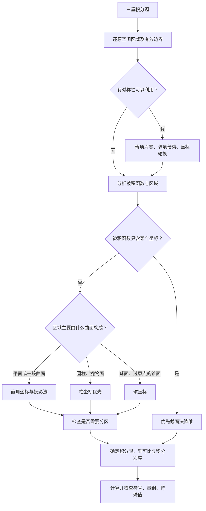

本节的核心不仅是掌握三重积分的计算，更重要的是建立从**空间几何结构到积分区域、从积分区域到积分限、从被积函数到最优积分方法**的一整套思维体系。

三重积分的计算本身通常并不困难，真正拉开分数差距的地方在于空间区域的识别、坐标系的选择、积分顺序的安排，以及能否利用对称性、截面法等技巧主动降低计算难度。

## 第一部分　三重积分的知识体系

### 一、本节整体知识框架

三重积分可以划分为以下几大核心题型。

| 核心考点       | 必须掌握的方法         | 复习优先级 |
| ---------- | --------------- | ----- |
| 三重积分的概念与性质 | 体积、质量、积分估值      | 基础必会  |
| 空间区域与积分限   | 投影法、截面法、换序      | 极高    |
| 空间对称性      | 奇偶性、轮换对称性       | 极高    |
| 直角坐标计算     | 先一后二、先二后一       | 高     |
| 柱坐标计算      | 圆柱、圆锥、旋转抛物面     | 极高    |
| 球坐标计算      | 球体、球锥交域、偏心球     | 极高    |
| 分区积分       | 绝对值、两球交域、多曲面    | 高     |
| 三重积分的应用    | 体积、质心、形心、转动惯量   | 极高    |
| 综合证明与极限    | 径向积分、柯西不等式、渐近展开 | 拔高重点  |

整节课需要建立的核心意识是：

**先分析积分区域，再分析被积函数；先考虑能否化简，再考虑如何计算。**

### 二、三重积分的基本概念与直观理解

**2.1 三重积分究竟在计算什么？**

设空间有界闭区域为 $\Omega$，函数 $f(x,y,z)$ 在 $\Omega$ 上连续。将区域分割成许多小立体，每个小立体的体积为 $\Delta V_i$，则三重积分定义为

$$
\iiint_\Omega f(x,y,z)\,\mathrm dV =\lim_{\lambda\to0} \sum_{i=1}^{n}f(\xi_i,\eta_i,\zeta_i)\Delta V_i.
$$

其中 $\lambda$ 为各小立体直径的最大值。

可以将它理解为：

$$
\boxed{\text{三重积分}=\text{空间中的局部权重}\times\text{微小体积的累加}}
$$

不同的权重对应不同的实际意义。

| 被积函数                      | 积分的意义              |
| ------------------------- | ------------------ |
| $1$                   | 立体体积               |
| $\mu(x,y,z)$          | 体密度对应的质量           |
| $x\mu(x,y,z)$         | 关于 $yOz$ 平面的静矩 |
| $y\mu(x,y,z)$         | 关于 $xOz$ 平面的静矩 |
| $z\mu(x,y,z)$         | 关于 $xOy$ 平面的静矩 |
| $(x^2+y^2)\mu(x,y,z)$ | 关于 $z$ 轴的转动惯量  |

与二重积分不同，三重积分本身的积分区域已经是三维立体，因此

$$
\boxed{V=\iiint_\Omega 1\,\mathrm dV}.
$$

而不是必须先找到两个曲面再相减。

**2.2 三重积分的基本性质**

设相关积分均存在。

**线性性质**

$$
\iiint_\Omega(af+bg)\,\mathrm dV =a\iiint_\Omega f\,\mathrm dV +b\iiint_\Omega g\,\mathrm dV.
$$

**区域可加性**

若 $\Omega=\Omega_1\cup\Omega_2$，两部分内部不重叠，则

$$
\iiint_\Omega f\,\mathrm dV =\iiint_{\Omega_1}f\,\mathrm dV +\iiint_{\Omega_2}f\,\mathrm dV.
$$

这是分区积分、补域法、挖去空洞等方法的理论依据。

**比较性质与估值定理**

若在 $\Omega$ 上有 $f\ge g$，则

$$
\iiint_\Omega f\,\mathrm dV \ge\iiint_\Omega g\,\mathrm dV.
$$

若 $m\le f(x,y,z)\le M$，则

$$
mV\le\iiint_\Omega f\,\mathrm dV\le MV.
$$

**绝对值不等式**

$$
\left|\iiint_\Omega f\,\mathrm dV\right| \le\iiint_\Omega|f|\,\mathrm dV.
$$

**积分中值定理**

若 $f$ 在连通的有界闭区域上连续，且区域体积为正，则存在一点 $P_0\in\Omega$，使得

$$
\iiint_\Omega f\,\mathrm dV=f(P_0)V.
$$

注意：这里的 $P_0$ 一般不一定是形心。

### 三、三重积分的三种坐标系

本节最重要的三组公式必须做到不需要临时回忆就能写出。

**3.1 直角坐标**

$$
\boxed{\mathrm dV=\mathrm dx\,\mathrm dy\,\mathrm dz}
$$

适合平面、四面体、非旋转型区域，或者上下界能够直接用某个变量表示的区域。

例如

$$
\Omega: \begin{cases} 0\le x\le1,\\ 0\le y\le1-x,\\ 0\le z\le1-x-y. \end{cases}
$$

那么

$$
\iiint_\Omega f\,\mathrm dV =\int_0^1\mathrm dx \int_0^{1-x}\mathrm dy \int_0^{1-x-y}f\,\mathrm dz.
$$

**3.2 柱坐标**

以 $z$ 轴为轴线：

$$
\begin{cases} x=r\cos\theta,\\ y=r\sin\theta,\\ z=z. \end{cases}
$$

其中

$$
x^2+y^2=r^2,
$$

体积元为

$$
\boxed{\mathrm dV=r\,\mathrm dr\,\mathrm d\theta\,\mathrm dz}.
$$

直观上，柱坐标就是将水平面内的直角坐标换成极坐标，而保留高度 $z$。

因此当看到圆柱面、旋转抛物面、圆锥面，以及大量的 $x^2+y^2$ 时，应优先想到柱坐标。

**3.3 球坐标**

本文统一采用以下约定：

$$
\begin{cases} x=\rho\sin\varphi\cos\theta,\\ y=\rho\sin\varphi\sin\theta,\\ z=\rho\cos\varphi. \end{cases}
$$

其中：

$\rho$ 是到原点的距离，$\varphi$ 是与正 $z$ 轴的夹角，$\theta$ 是在 $xOy$ 平面内的方位角。

$$
x^2+y^2+z^2=\rho^2.
$$

$$
x^2+y^2=\rho^2\sin^2\varphi.
$$

体积元为

$$
\boxed{ \mathrm dV=\rho^2\sin\varphi \,\mathrm d\rho\,\mathrm d\varphi\,\mathrm d\theta }.
$$

球坐标的雅可比因子可以直观地理解为三个方向的小长度相乘：

$$
\mathrm d\rho\cdot\rho\,\mathrm d\varphi \cdot\rho\sin\varphi\,\mathrm d\theta.
$$

因此绝不能漏掉 $\rho^2\sin\varphi$。

**3.4 常见空间曲面的坐标转换**

| 空间曲面                        | 柱坐标表达式            | 球坐标表达式                                    |
| --------------------------- | ----------------- | ----------------------------------------- |
| 球面 $x^2+y^2+z^2=R^2$    | $r^2+z^2=R^2$ | $\rho=R$                              |
| 圆柱面 $x^2+y^2=R^2$       | $r=R$         | $\rho\sin\varphi=R$                   |
| 平面 $z=h$                | $z=h$         | $\rho\cos\varphi=h$                   |
| 圆锥面 $z=k\sqrt{x^2+y^2}$ | $z=kr$        | $\tan\varphi=1/k$                     |
| 抛物面 $z=x^2+y^2$         | $z=r^2$       | $\rho\cos\varphi=\rho^2\sin^2\varphi$ |
| 偏心球面 $x^2+y^2+z^2=2az$  | $r^2+z^2=2az$ | $\rho=2a\cos\varphi$                  |
| 单叶双曲面 $x^2+y^2-z^2=1$   | $r^2=1+z^2$   | 通常不优先使用                                   |

**3.5 怎样选择最合适的坐标系？**

| 题目特征                 | 优先考虑         |
| -------------------- | ------------ |
| 出现 $x+y+z$ 等平面边界 | 直角坐标         |
| 出现 $x^2+y^2$     | 柱坐标          |
| 出现 $x^2+y^2+z^2$ | 球坐标          |
| 球面与过原点的圆锥面相交         | 球坐标          |
| 球面与抛物面相交             | 柱坐标          |
| 被积函数只含 $z$       | 水平截面法        |
| 球心不在原点               | 平移坐标、球坐标或截面法 |
| 被积函数含绝对值             | 先找变号曲面       |
| 被积函数为线性或二次多项式        | 先考虑对称性与矩积分   |

这不是机械规则。最终应选择**积分限简单、分区少、被积函数容易积分**的坐标系。

尤其要注意：出现球面不一定就用球坐标。

## 第二部分　空间区域与积分限

### 四、投影法与截面法

空间区域的处理能力，是三重积分最基础也最重要的能力。

**4.1 投影法：先一后二**

假设空间区域为

$$
\Omega: \begin{cases} (x,y)\in D,\\ z_1(x,y)\le z\le z_2(x,y). \end{cases}
$$

则

$$
\boxed{ \iiint_\Omega f\,\mathrm dV =\iint_D\mathrm dx\,\mathrm dy \int_{z_1(x,y)}^{z_2(x,y)} f(x,y,z)\,\mathrm dz }.
$$

直观上，相当于从上方观察整个立体，将其投影到 $xOy$ 平面，再沿竖直方向逐根计算细柱。

标准步骤是：

1. 求出下边界曲面 $z=z_1(x,y)$。
2. 求出上边界曲面 $z=z_2(x,y)$。
3. 利用 $z_1\le z_2$ 以及其他限制确定投影区域。
4. 写出累次积分。
5. 判断是否需要将投影区域换成极坐标。

特别地，如果求体积，

$$
\boxed{ V=\iint_D(z_2-z_1)\,\mathrm dx\,\mathrm dy }.
$$

如果被积函数是 $z$，则

$$
\boxed{ \iiint_\Omega z\,\mathrm dV =\frac12\iint_D(z_2^2-z_1^2)\,\mathrm dx\,\mathrm dy }.
$$

更一般地，

$$
\iiint_\Omega z^n\,\mathrm dV =\frac1{n+1}\iint_D (z_2^{n+1}-z_1^{n+1})\,\mathrm dx\,\mathrm dy,
$$

其中 $n$ 为非负整数。

这就是为什么很多球面、圆锥面围成的三重积分，先对 $z$ 积分后会变得非常简单。

**4.2 截面法：先二后一**

如果空间区域在高度 $z$ 处的截面为 $D_z$，则

$$
\boxed{ \iiint_\Omega f\,\mathrm dV =\int_a^b\mathrm dz \iint_{D_z}f(x,y,z)\,\mathrm dx\,\mathrm dy }.
$$

直观上，就是把整个立体切成一片片极薄的水平薄片。

特别地，如果被积函数只与 $z$ 有关，设截面积为 $A(z)$，则

$$
\boxed{ \iiint_\Omega g(z)\,\mathrm dV =\int_a^b g(z)A(z)\,\mathrm dz }.
$$

这是本节最有价值的降维公式之一。

| 水平截面                        | 截面积                      |
| --------------------------- | ------------------------ |
| 半径为 $R(z)$ 的圆盘          | $\pi R(z)^2$         |
| 内外半径分别为 $r(z),R(z)$ 的圆环 | $\pi[R(z)^2-r(z)^2]$ |
| 半轴为 $a(z),b(z)$ 的椭圆域    | $\pi a(z)b(z)$       |
| 边长为 $l(z)$ 的正方形         | $l(z)^2$             |

当被积函数只含 $z$ 时，通常不必把三重积分真正展开成三个一元积分。

### 五、母题1：直角坐标与累次积分换序

**例1　李正元练习题**

计算

$$
I=\iiint_\Omega x^3y^2z\,\mathrm dV,
$$

其中

$$
\Omega: \begin{cases} 1\le x\le2,\\ 0\le y\le x^2,\\ 0\le z\le1/x. \end{cases}
$$

**识别方法**

区域虽然不是长方体，但是固定 $x$ 后，$y,z$ 分别在两个独立的区间内变化，因此每个垂直于 $x$ 轴的截面是矩形。

**解答**

$$
\begin{aligned} I &=\int_1^2x^3\,\mathrm dx \int_0^{x^2}y^2\,\mathrm dy \int_0^{1/x}z\,\mathrm dz\\ &=\int_1^2x^3\cdot \frac{x^6}{3}\cdot\frac1{2x^2}\,\mathrm dx\\ &=\frac16\int_1^2x^7\,\mathrm dx\\ &=\frac{2^8-1}{48}. \end{aligned}
$$

故

$$
\boxed{I=\frac{85}{16}}.
$$

**方法迁移**

若区域满足

$$
a\le x\le b,\quad 0\le y\le g(x),\quad 0\le z\le h(x),
$$

而被积函数是 $x^py^qz^m$，其中 $p,q,m$ 为非负整数，则

$$
\boxed{ I=\frac1{(q+1)(m+1)} \int_a^b x^p g(x)^{q+1}h(x)^{m+1}\,\mathrm dx }.
$$

条件是固定 $x$ 后，$y,z$ 的变化范围相互独立。

**例2　李正元练习题：改变积分次序**

将

$$
\int_0^1\mathrm dx \int_0^1\mathrm dy \int_0^{x^2+y^2} f(x,y,z)\,\mathrm dz
$$

改为先对 $y$ 积分，最后对 $x$ 积分。

**第一步：还原空间区域**

$$
0\le x\le1,\quad 0\le y\le1,\quad 0\le z\le x^2+y^2.
$$

**第二步：固定最外层变量** $x$

由

$$
z\le x^2+y^2
$$

得到

$$
y^2\ge z-x^2.
$$

此时应意识到：右侧可能为正，也可能为负。

当 $0\le z\le x^2$ 时，任意 $0\le y\le1$ 都满足条件。

当 $x^2\le z\le x^2+1$ 时，必须满足

$$
\sqrt{z-x^2}\le y\le1.
$$

所以答案为

$$
\boxed{ \begin{aligned} I={}&\int_0^1\mathrm dx \left[ \int_0^{x^2}\mathrm dz \int_0^1 f\,\mathrm dy\right.\\ &\left.\qquad+ \int_{x^2}^{x^2+1}\mathrm dz \int_{\sqrt{z-x^2}}^1 f\,\mathrm dy \right]. \end{aligned} }
$$

**这一题是换序题的重要母题。**

三重积分换序不是简单地交换三个积分号，而是重新描述同一个空间区域。

尤其当最内层变量变化后，需要重新判断截面的形状、边界是否发生变化、是否需要分段。

## 第三部分　空间对称性与矩积分

### 六、必须掌握的三种对称性

**6.1 关于坐标面的反射对称**

如果区域关于 $yOz$ 平面对称，即

$$
(x,y,z)\in\Omega \Longrightarrow (-x,y,z)\in\Omega,
$$

并且

$$
f(-x,y,z)=-f(x,y,z),
$$

那么

$$
\boxed{\iiint_\Omega f\,\mathrm dV=0}.
$$

若

$$
f(-x,y,z)=f(x,y,z),
$$

则

$$
\iiint_\Omega f\,\mathrm dV =2\iiint_{\Omega\cap\{x\ge0\}}f\,\mathrm dV.
$$

对于 $y,z$ 同理。

**6.2 坐标轮换对称性**

如果交换 $x,y$ 后区域不变，则

$$
\iiint_\Omega f(x,y,z)\,\mathrm dV =\iiint_\Omega f(y,x,z)\,\mathrm dV.
$$

特别地，

$$
\iiint_\Omega x^2\,\mathrm dV =\iiint_\Omega y^2\,\mathrm dV.
$$

如果区域关于三个坐标的相互交换均保持不变，则

$$
\boxed{ \iiint_\Omega x^2\,\mathrm dV =\iiint_\Omega y^2\,\mathrm dV =\iiint_\Omega z^2\,\mathrm dV }.
$$

**6.3 中心对称性**

若区域关于点 $C=(a,b,c)$ 中心对称，则可进行平移：

$$
u=x-a,\quad v=y-b,\quad w=z-c.
$$

此时

$$
\iiint_\Omega(x-a)\,\mathrm dV=0.
$$

所以

$$
\iiint_\Omega x\,\mathrm dV=aV.
$$

类似地，

$$
\iiint_\Omega y\,\mathrm dV=bV,\qquad \iiint_\Omega z\,\mathrm dV=cV.
$$

因此对球体、椭球体等中心对称区域，遇到一次函数积分时，往往可以直接利用其中心求解。

### 七、母题2：奇偶性与区域比例

**例3　1988年考研数学一真题**

设

$$
\Omega_1: x^2+y^2+z^2\le R^2,\quad z\ge0,
$$

$\Omega_2$ 是该球体位于第一卦限的部分。判断关于 $x,y,z,xyz$ 的积分，哪一项满足

$$
\iiint_{\Omega_1}f\,\mathrm dV =4\iiint_{\Omega_2}f\,\mathrm dV.
$$

**分析**

$\Omega_1$ 是上半球，关于 $x=0$ 和 $y=0$ 对称，但不关于 $z=0$ 对称。

| 被积函数      | 对 $x$ 的奇偶性 | 对 $y$ 的奇偶性 | 上半球积分     |
| --------- | -------------- | -------------- | --------- |
| $x$   | 奇              | 偶              | 0         |
| $y$   | 偶              | 奇              | 0         |
| $z$   | 偶              | 偶              | 第一卦限积分的4倍 |
| $xyz$ | 奇              | 奇              | 0         |

因此正确关系为

$$
\boxed{ \iiint_{\Omega_1}z\,\mathrm dV =4\iiint_{\Omega_2}z\,\mathrm dV }.
$$

**本题的核心陷阱**

区域体积是另一部分的4倍，不代表任意函数的积分也是4倍。

必须检查被积函数在区域的对称变换下是否保持不变。

### 八、母题3：球体的平方矩

**例4　2009年考研数学一真题**

设

$$
\Omega:x^2+y^2+z^2\le1,
$$

求

$$
I=\iiint_\Omega z^2\,\mathrm dV.
$$

<Tabs items={["方法一：利用坐标轮换对称性", "方法二：水平截面法"]} defaultIndex={0}>

<Tab value="方法一：利用坐标轮换对称性">

由球体的完全对称性，

$$
\iiint_\Omega x^2\,\mathrm dV =\iiint_\Omega y^2\,\mathrm dV =\iiint_\Omega z^2\,\mathrm dV.
$$

所以

$$
3I=\iiint_\Omega(x^2+y^2+z^2)\,\mathrm dV.
$$

改用球坐标：

$$
\begin{aligned} 3I &=\int_0^{2\pi}\mathrm d\theta \int_0^\pi\sin\varphi\,\mathrm d\varphi \int_0^1\rho^4\,\mathrm d\rho\\ &=2\pi\cdot2\cdot\frac15 =\frac{4\pi}{5}. \end{aligned}
$$

因此

$$
\boxed{I=\frac{4\pi}{15}}.
$$

</Tab>

<Tab value="方法二：水平截面法">

高度 $z$ 处的截面满足

$$
x^2+y^2\le1-z^2.
$$

截面积为

$$
A(z)=\pi(1-z^2).
$$

因此

$$
\begin{aligned} I&=\pi\int_{-1}^1z^2(1-z^2)\,\mathrm dz\\ &=2\pi\left(\frac13-\frac15\right)\\ &=\boxed{\frac{4\pi}{15}}. \end{aligned}
$$

</Tab>

</Tabs>

**从真题提炼通用公式**

半径为 $R$ 的球体满足

$$
\boxed{ \iiint_{\Omega_R}x^2\,\mathrm dV =\iiint_{\Omega_R}y^2\,\mathrm dV =\iiint_{\Omega_R}z^2\,\mathrm dV =\frac{4\pi R^5}{15} }.
$$

这是非常值得记住的公式，尤其在形心、转动惯量及综合证明中有用。

更一般地，利用球对称性可得

$$
\boxed{ \iiint_{\Omega_R} (ax^2+by^2+cz^2)\,\mathrm dV =\frac{4\pi R^5}{15}(a+b+c) }.
$$

对于球体上的混合项，有

$$
\iiint_{\Omega_R}xy\,\mathrm dV =\iiint_{\Omega_R}xz\,\mathrm dV =\iiint_{\Omega_R}yz\,\mathrm dV=0.
$$

**配套变式：张宇1000题**

单位球的第一卦限内，求

$$
\iiint_\Omega(x^2+2y^2+3z^2)\,\mathrm dV.
$$

三个平方项对于所有坐标均为偶函数，因此可以直接取整个球体积分的八分之一。

$$
I=\frac18\cdot\frac{4\pi}{15}(1+2+3) =\boxed{\frac{\pi}{5}}.
$$

**配套变式：李林880题**

在半径为 $R$ 的上半球内，计算

$$
\iiint_\Omega(3x^2+5y^2+7z^2)\,\mathrm dV.
$$

答案直接为

$$
I=\frac12\cdot\frac{4\pi R^5}{15}\cdot15 =\boxed{2\pi R^5}.
$$

这三道题本质上是同一个模型。

### 九、母题4：四面体形心与一次函数积分

**例5　2015年考研数学一真题**

设 $\Omega$ 是由平面 $x+y+z=1$ 与三个坐标平面围成的立体，求

$$
I=\iiint_\Omega(x+2y+3z)\,\mathrm dV.
$$

<Tabs items={["方法一：直接计算", "方法二：利用形心"]} defaultIndex={0}>

<Tab value="方法一：直接计算">

区域为

$$
x,y,z\ge0,\quad x+y+z\le1.
$$

由坐标轮换对称性，

$$
I=6\iiint_\Omega x\,\mathrm dV.
$$

固定 $x$，截面为直角三角形，面积为

$$
A(x)=\frac12(1-x)^2.
$$

因此

$$
\begin{aligned} I&=3\int_0^1x(1-x)^2\,\mathrm dx\\ &=3\left(\frac12-\frac23+\frac14\right)\\ &=\boxed{\frac14}. \end{aligned}
$$

</Tab>

<Tab value="方法二：利用形心">

四面体四个顶点为

$$
(0,0,0),\ (1,0,0),\ (0,1,0),\ (0,0,1).
$$

体积为

$$
V=\frac16.
$$

形心为四个顶点坐标的平均值：

$$
G=\left(\frac14,\frac14,\frac14\right).
$$

故

$$
I=\frac16\left(\frac14+\frac24+\frac34\right) =\boxed{\frac14}.
$$

</Tab>

</Tabs>

**重要推广：仿射函数积分公式**

设任意立体的形心为 $G=(\bar x,\bar y,\bar z)$，仿射函数为

$$
L(x,y,z)=ax+by+cz+d,
$$

那么

$$
\boxed{ \iiint_\Omega L(x,y,z)\,\mathrm dV =V\,L(\bar x,\bar y,\bar z) }.
$$

该公式对任意有正体积且形心存在的有界立体均适用。

但不能推广成

$$
\iiint_\Omega f(x,y,z)\,\mathrm dV =Vf(\bar x,\bar y,\bar z)
$$

对任意函数成立。

例如球体形心是原点，但球体上的 $x^2$ 积分显然不为零。

**推广：一般截距式四面体**

若

$$
\Omega: x,y,z\ge0,\quad \frac xa+\frac yb+\frac zc\le1,
$$

其中 $a,b,c>0$，则

$$
V=\frac{abc}{6},
$$

$$
G=\left(\frac a4,\frac b4,\frac c4\right).
$$

因此

$$
\boxed{ \iiint_\Omega(px+qy+sz)\,\mathrm dV =\frac{abc}{24}(pa+qb+sc) }.
$$

## 第四部分　柱坐标积分

### 十、母题5：圆锥面与球面相交

**例6　1989年考研数学一真题**

计算

$$
I=\iiint_\Omega(x+z)\,\mathrm dV,
$$

其中 $\Omega$ 由曲面

$$
z=\sqrt{x^2+y^2}, \qquad z=\sqrt{1-x^2-y^2}
$$

所围成。

这是三重积分中最典型的球锥交域母题，李林880题和李正元练习题中均有相关变式。

<Tabs items={["方法一：柱坐标", "方法二：球坐标", "方法三：水平截面法"]} defaultIndex={0}>

<Tab value="方法一：柱坐标">

**第一步：识别几何区域**

令

$$
r=\sqrt{x^2+y^2}.
$$

下曲面是圆锥面

$$
z=r,
$$

上曲面是球面

$$
z=\sqrt{1-r^2}.
$$

**第二步：求交线**

$$
r=\sqrt{1-r^2}
$$

得

$$
r=\frac1{\sqrt2}.
$$

因此区域满足

$$
\begin{cases} 0\le\theta\le2\pi,\\ 0\le r\le1/\sqrt2,\\ r\le z\le\sqrt{1-r^2}. \end{cases}
$$

**第三步：对称性消项**

由于区域关于 $x=0$ 对称，

$$
\iiint_\Omega x\,\mathrm dV=0.
$$

所以只需要计算

$$
I=\iiint_\Omega z\,\mathrm dV.
$$

**第四步：逐层积分**

$$
\begin{aligned} I &=2\pi\int_0^{1/\sqrt2}r\,\mathrm dr \int_r^{\sqrt{1-r^2}}z\,\mathrm dz\\ &=\pi\int_0^{1/\sqrt2}r(1-2r^2)\,\mathrm dr\\ &=\pi\left[ \frac{r^2}{2}-\frac{r^4}{2} \right]_0^{1/\sqrt2}. \end{aligned}
$$

所以

$$
\boxed{I=\frac{\pi}{8}}.
$$

</Tab>

<Tab value="方法二：球坐标">

球面给出

$$
0\le\rho\le1.
$$

圆锥面 $z=r$ 给出

$$
\rho\cos\varphi=\rho\sin\varphi.
$$

区域位于锥面上方，因此

$$
0\le\varphi\le\frac{\pi}{4}.
$$

于是

$$
\begin{aligned} I &=2\pi\int_0^{\pi/4} \sin\varphi\cos\varphi\,\mathrm d\varphi \int_0^1\rho^3\,\mathrm d\rho\\ &=2\pi\cdot\frac14\cdot\frac14\\ &=\boxed{\frac{\pi}{8}}. \end{aligned}
$$

相比之下，球坐标甚至不需要求交圈半径。

</Tab>

<Tab value="方法三：水平截面法">

本题也可以写为

$$
r^2\le\min\{z^2,1-z^2\}.
$$

当 $0\le z\le1/\sqrt2$ 时，截面受圆锥限制。

当 $1/\sqrt2\le z\le1$ 时，截面受球面限制。

因此

$$
\begin{aligned} I={}&\pi\int_0^{1/\sqrt2}z^3\,\mathrm dz\\ &+\pi\int_{1/\sqrt2}^1z(1-z^2)\,\mathrm dz\\ ={}&\frac{\pi}{8}. \end{aligned}
$$

三种方法的本质是同一个立体，却采用了三种不同的切割方向。

| 方法     | 切割方式     | 本题难度 |
| ------ | -------- | ---- |
| 直角坐标投影 | 沿竖直方向切割  | 较繁琐  |
| 柱坐标    | 固定径向距离   | 简单   |
| 水平截面法  | 固定高度     | 需要分段 |
| 球坐标    | 从原点沿射线积分 | 最简洁  |

</Tab>

</Tabs>

### 十一、母题6：旋转抛物面与平面围成立体

**例7　1991年考研数学一真题**

由曲线

$$
\begin{cases} y^2=2z,\\ x=0 \end{cases}
$$

绕 $z$ 轴旋转一周所形成的曲面与平面 $z=4$ 围成立体 $\Omega$。

计算

$$
I=\iiint_\Omega(x^2+y^2+z)\,\mathrm dV.
$$

**第一步：建立旋转曲面方程**

原曲线位于 $yOz$ 平面，绕 $z$ 轴旋转后，距离旋转轴的平方由 $y^2$ 变为 $x^2+y^2$。

因此

$$
x^2+y^2=2z.
$$

**第二步：确定内部区域**

抛物面开口向上，高度为 $z$ 时，截面为半径 $\sqrt{2z}$ 的圆盘。

所以

$$
0\le z\le4,\qquad 0\le r\le\sqrt{2z},\qquad 0\le\theta\le2\pi.
$$

**第三步：改用柱坐标**

$$
\begin{aligned} I&=2\pi\int_0^4\mathrm dz \int_0^{\sqrt{2z}}(r^2+z)r\,\mathrm dr\\ &=2\pi\int_0^4 \left[ \frac{r^4}{4}+\frac{zr^2}{2} \right]_0^{\sqrt{2z}}\mathrm dz\\ &=2\pi\int_0^4(2z^2)\,\mathrm dz. \end{aligned}
$$

因此

$$
\boxed{I=\frac{256\pi}{3}}.
$$

**通用模型：圆盘截面的矩积分**

如果高度 $z$ 处的截面是半径为 $R(z)$ 的圆盘，那么

$$
\iint_{D_z}1\,\mathrm dA=\pi R(z)^2,
$$

$$
\iint_{D_z}(x^2+y^2)\,\mathrm dA =\frac{\pi R(z)^4}{2},
$$

$$
\iint_{D_z}x^2\,\mathrm dA =\iint_{D_z}y^2\,\mathrm dA =\frac{\pi R(z)^4}{4}.
$$

更一般地，$m\ge0$ 时，

$$
\boxed{ \iint_{D_z}(x^2+y^2)^m\,\mathrm dA =\frac{\pi R(z)^{2m+2}}{m+1} }.
$$

掌握这个公式，就能将许多三重积分直接降为一重积分。

### 十二、母题7：二次多项式与旋转对称性

**例8　张宇1000题**

设 $\Omega$ 由圆锥面

$$
z=\sqrt{x^2+y^2}
$$

与平面 $z=1$ 围成，计算

$$
I=\iiint_\Omega(x+y+z)^2\,\mathrm dV.
$$

**第一步：不要直接代入柱坐标**

先展开：

$$
(x+y+z)^2 =x^2+y^2+z^2+2xy+2xz+2yz.
$$

由于区域关于 $x=0$、$y=0$ 对称，

$$
\iiint_\Omega xy\,\mathrm dV =\iiint_\Omega xz\,\mathrm dV =\iiint_\Omega yz\,\mathrm dV=0.
$$

所以

$$
I=\iiint_\Omega(x^2+y^2+z^2)\,\mathrm dV.
$$

**第二步：柱坐标积分**

区域为

$$
0\le z\le1,\quad0\le r\le z.
$$

故

$$
\begin{aligned} I &=2\pi\int_0^1\mathrm dz \int_0^z(r^2+z^2)r\,\mathrm dr\\ &=2\pi\int_0^1 \left(\frac{z^4}{4}+\frac{z^4}{2}\right)\mathrm dz\\ &=\boxed{\frac{3\pi}{10}}. \end{aligned}
$$

**高质量变式：李永乐2027六套卷第3套第19题**

区域改为

$$
\Omega:x^2+y^2\le z\le2,
$$

被积函数改为

$$
I=\iiint_\Omega(2x-y+z)^2\,\mathrm dV.
$$

由于对称性，

$$
I=\iiint_\Omega(4x^2+y^2+z^2)\,\mathrm dV.
$$

并且

$$
\iiint_\Omega x^2\,\mathrm dV =\iiint_\Omega y^2\,\mathrm dV.
$$

所以

$$
I=\frac52\iiint_\Omega(x^2+y^2)\,\mathrm dV +\iiint_\Omega z^2\,\mathrm dV.
$$

高度 $z$ 处圆盘半径为 $\sqrt z$，利用前面的截面矩公式：

$$
\begin{aligned} I&=\int_0^2 \left(\frac52\cdot\frac{\pi z^2}{2} +\pi z^3\right)\mathrm dz\\ &=\frac{10\pi}{3}+4\pi\\ &=\boxed{\frac{22\pi}{3}}. \end{aligned}
$$

**从两道题总结一般结论**

若区域关于 $z$ 轴旋转对称，则

$$
\boxed{ \begin{aligned} &\iiint_\Omega(ax+by+cz)^2\,\mathrm dV\\ &=\frac{a^2+b^2}{2} \iiint_\Omega(x^2+y^2)\,\mathrm dV\\ &\quad+c^2\iiint_\Omega z^2\,\mathrm dV. \end{aligned} }
$$

遇到任意复杂系数的线性函数平方，都可以优先使用这个结构。

### 十三、母题8：旋转轴不是 $z$ 轴

**例9　张宇1000题**

平面曲线

$$
z^2=2x
$$

绕 $x$ 轴旋转一周，所得曲面与平面 $x=1,x=2$ 围成立体 $\Omega$。

计算

$$
I=\iiint_\Omega \frac1{x^2+y^2+z^2}\,\mathrm dV.
$$

**识别方法**

旋转轴是 $x$ 轴，而不是 $z$ 轴。

因此径向坐标应该是

$$
r=\sqrt{y^2+z^2}.
$$

旋转曲面为

$$
y^2+z^2=2x.
$$

令

$$
y=r\cos\theta,\qquad z=r\sin\theta.
$$

则

$$
1\le x\le2,\quad 0\le r\le\sqrt{2x},\quad 0\le\theta\le2\pi.
$$

所以

$$
\begin{aligned} I &=2\pi\int_1^2\mathrm dx \int_0^{\sqrt{2x}}\frac{r}{x^2+r^2}\,\mathrm dr\\ &=\pi\int_1^2 \ln\frac{x^2+2x}{x^2}\,\mathrm dx\\ &=\pi\int_1^2[\ln(x+2)-\ln x]\,\mathrm dx\\ &=\boxed{3\pi\ln\frac43}. \end{aligned}
$$

**题型总结**

| 旋转轴       | 应采用的径向距离             |
| --------- | -------------------- |
| $x$ 轴 | $\sqrt{y^2+z^2}$ |
| $y$ 轴 | $\sqrt{x^2+z^2}$ |
| $z$ 轴 | $\sqrt{x^2+y^2}$ |

柱坐标并非只能围绕 $z$ 轴建立，其本质是保留一个轴向变量，将垂直于该轴的平面使用极坐标表示。

### 十四、母题9：含径向分母的积分

**例10　李林880题**

设 $\Omega$ 由

$$
z=\sqrt{x^2+y^2},\quad z=1,\quad z=2
$$

围成，计算

$$
I=\iiint_\Omega \frac{e^z}{\sqrt{x^2+y^2}}\,\mathrm dV.
$$

在柱坐标中，

$$
1\le z\le2,\quad0\le r\le z.
$$

关键是

$$
\frac{e^z}{r}\cdot r=e^z.
$$

因此

$$
\begin{aligned} I&=2\pi\int_1^2\mathrm dz \int_0^z e^z\,\mathrm dr\\ &=2\pi\int_1^2ze^z\,\mathrm dz\\ &=2\pi[(z-1)e^z]_1^2\\ &=\boxed{2\pi e^2}. \end{aligned}
$$

这里轴线上原函数无定义，严格来说可通过广义积分或去掉小圆柱后取极限来处理。

**拔高知识：奇点的可积性**

对于包含一段轴线邻域的三维区域，若被积函数在轴附近表现为

$$
\frac1{(x^2+y^2)^{p/2}}=\frac1{r^p},
$$

柱坐标下的径向部分为

$$
\int_0^a r^{1-p}\,\mathrm dr.
$$

所以在其他因子有界且不引入额外奇性的典型情形下，收敛条件为

$$
\boxed{p<2}.
$$

对于原点附近的径向奇点

$$
\frac1{(x^2+y^2+z^2)^{p/2}} =\frac1{\rho^p},
$$

球坐标下对应

$$
\int_0^a\rho^{2-p}\,\mathrm d\rho,
$$

典型收敛条件为

$$
\boxed{p<3}.
$$

这些结论适合作为广义积分与多元积分综合题的拓展知识，不应替代对具体区域和具体被积函数的分析。

## 第五部分　球坐标积分

### 十五、球坐标中如何判断三个积分限？

球坐标的积分限分别由三个问题确定：

$$
\boxed{ \begin{aligned} \theta &: \text{绕 }z\text{ 轴转过哪些方向？}\\ \varphi &: \text{与正 }z\text{ 轴的夹角有多大？}\\ \rho &: \text{沿该方向从哪里走到哪里？} \end{aligned} }
$$

其中最关键的是第三个问题。

**常见角度范围**

| 区域                       | $\theta$     | $\varphi$      |
| ------------------------ | ---------------- | ------------------ |
| 整个球体                     | $0\sim2\pi$  | $0\sim\pi$     |
| 上半球                      | $0\sim2\pi$  | $0\sim\pi/2$   |
| 下半球                      | $0\sim2\pi$  | $\pi/2\sim\pi$ |
| 第一卦限                     | $0\sim\pi/2$ | $0\sim\pi/2$   |
| 球内且位于 $z=r$ 上方       | $0\sim2\pi$  | $0\sim\pi/4$   |
| 球内且位于 $z=\sqrt3r$ 上方 | $0\sim2\pi$  | $0\sim\pi/6$   |

特别重要的是：

$$
z=k\sqrt{x^2+y^2},\quad k>0
$$

对应

$$
\varphi=\arctan\frac1k.
$$

圆锥的斜率越大，其锥体越窄，球坐标的极角上限越小。

### 十六、母题10：第一卦限内的球坐标积分

**例11　李正元练习题**

计算

$$
I=\iiint_\Omega xyz\,\mathrm dV,
$$

其中 $\Omega$ 为单位球在第一卦限内的部分。

第一卦限内

$$
0\le\theta\le\frac{\pi}{2},\quad 0\le\varphi\le\frac{\pi}{2},\quad 0\le\rho\le1.
$$

又

$$
xyz=\rho^3\sin^2\varphi\cos\varphi \sin\theta\cos\theta.
$$

因此

$$
\begin{aligned} I={}& \left(\int_0^1\rho^5\,\mathrm d\rho\right)\\ &\cdot\left( \int_0^{\pi/2}\sin^3\varphi\cos\varphi\,\mathrm d\varphi \right)\\ &\cdot\left( \int_0^{\pi/2}\sin\theta\cos\theta\,\mathrm d\theta \right). \end{aligned}
$$

所以

$$
I=\frac16\cdot\frac14\cdot\frac12 =\boxed{\frac1{48}}.
$$

**方法迁移**

半径为 $R$ 的球体在第一卦限内，有

$$
\boxed{ \iiint_\Omega xyz\,\mathrm dV=\frac{R^6}{48} }.
$$

为什么是 $R^6$？

因为 $xyz$ 是三次齐次函数，而体积元贡献三次尺度。

这个规律称为尺度变换。

若 $f$ 是 $m$ 次齐次函数，

$$
f(tx,ty,tz)=t^mf(x,y,z),
$$

且 $\Omega_R$ 是将 $\Omega_1$ 整体放大 $R$ 倍所得的区域，则

$$
\boxed{ \iiint_{\Omega_R}f\,\mathrm dV =R^{m+3}\iiint_{\Omega_1}f\,\mathrm dV }.
$$

它非常适合检验含参数答案的幂次是否正确。

### 十七、母题11：偏心球与圆锥面

**例12　李正元练习题**

计算

$$
I=\iiint_\Omega(x+y+z)\,\mathrm dV,
$$

其中

$$
\Omega: \begin{cases} x^2+y^2+z^2\le2az,\\ \sqrt{x^2+y^2}\le z, \end{cases} \qquad a>0.
$$

<Steps>

<Step>

### 第一步：识别偏心球 [!toc]

配方得到

$$
x^2+y^2+(z-a)^2\le a^2.
$$

这是球心位于 $(0,0,a)$、半径为 $a$ 的球体。

但若仍以原点建立球坐标，就有

$$
\rho^2\le2a\rho\cos\varphi,
$$

故

$$
0\le\rho\le2a\cos\varphi.
$$

注意，不能直接写成 $0\le\rho\le a$。

</Step>

<Step>

### 第二步：确定锥角 [!toc]

$$
z\ge\sqrt{x^2+y^2}
$$

等价于

$$
0\le\varphi\le\frac\pi4.
$$

</Step>

<Step>

### 第三步：消去奇函数项 [!toc]

区域关于 $x=0$、$y=0$ 对称，因此

$$
I=\iiint_\Omega z\,\mathrm dV.
$$

</Step>

<Step>

### 第四步：计算 [!toc]

$$
\begin{aligned} I &=2\pi\int_0^{\pi/4} \sin\varphi\cos\varphi\,\mathrm d\varphi \int_0^{2a\cos\varphi}\rho^3\,\mathrm d\rho\\ &=8\pi a^4\int_0^{\pi/4} \cos^5\varphi\sin\varphi\,\mathrm d\varphi\\ &=\frac{8\pi a^4}{6} \left(1-\cos^6\frac{\pi}{4}\right). \end{aligned}
$$

因此

$$
\boxed{I=\frac{7\pi a^4}{6}}.
$$

</Step>

</Steps>

### 十八、母题12：偏心球与平面限制——模拟题拔高

**例13　张宇2027八套卷第4套第14题**

设

$$
\Omega: \begin{cases} x^2+y^2+(z-1)^2\le1,\\ z\ge1,\quad y\ge0. \end{cases}
$$

求

$$
I=\iiint_\Omega \frac4{\sqrt{x^2+y^2+z^2}}\,\mathrm dV.
$$

这道模拟题是前一母题非常有价值的升级。

<Steps>

<Step>

### 第一步：球面给出径向上限 [!toc]

$$
x^2+y^2+z^2\le2z
$$

所以

$$
\rho\le2\cos\varphi.
$$

</Step>

<Step>

### 第二步：平面给出径向下限 [!toc]

由 $z\ge1$ 得

$$
\rho\cos\varphi\ge1,
$$

所以

$$
\rho\ge\frac1{\cos\varphi}.
$$

</Step>

<Step>

### 第三步：由上下限的相容性确定角度 [!toc]

必须满足

$$
\frac1{\cos\varphi}\le2\cos\varphi.
$$

在此区域 $\cos\varphi>0$，所以

$$
\cos^2\varphi\ge\frac12,
$$

即

$$
0\le\varphi\le\frac\pi4.
$$

又因为 $y\ge0$，故

$$
0\le\theta\le\pi.
$$

</Step>

<Step>

### 第四步：计算 [!toc]

$$
\begin{aligned} I &=\pi\int_0^{\pi/4} \sin\varphi\,\mathrm d\varphi \int_{1/\cos\varphi}^{2\cos\varphi}4\rho\,\mathrm d\rho\\ &=\pi\int_0^{\pi/4} \left( 8\cos^2\varphi\sin\varphi -\frac{2\sin\varphi}{\cos^2\varphi} \right)\mathrm d\varphi. \end{aligned}
$$

令 $u=\cos\varphi$，则

$$
\begin{aligned} I &=\pi\int_{1/\sqrt2}^1 \left(8u^2-\frac2{u^2}\right)\mathrm du\\ &=\pi\left[ \frac83u^3+\frac2u \right]_{1/\sqrt2}^1\\ &=\boxed{\frac{2\pi}{3}(7-4\sqrt2)}. \end{aligned}
$$

</Step>

</Steps>

**本题必须掌握的创新思维**

**球坐标中的径向下限不一定是零。**

对于不包含原点的区域，某条射线可能先进入区域，再离开区域，因此应写成

$$
\rho_1(\varphi,\theta) \le\rho\le \rho_2(\varphi,\theta).
$$

再通过

$$
\rho_1\le\rho_2
$$

反过来确定角度范围。

这一思想与投影法中利用“下曲面不高于上曲面”确定平面投影，本质完全相同。

### 十九、母题13：同一区域的三种坐标表达

**李正元练习题**

设

$$
\Omega: \begin{cases} x^2+y^2+z^2\le R^2,\\ x^2+y^2\le z^2,\\ z\ge0. \end{cases}
$$

要求分别使用三种坐标系表示

$$
\iiint_\Omega f(x,y,z)\,\mathrm dV.
$$

这是1989年真题模型的抽象推广。考研选择题特别适合用这一模型考查积分限。

直角坐标形式：

$$
\begin{aligned} I={}&\int_{-R/\sqrt2}^{R/\sqrt2}\mathrm dx\\ &\cdot\int_{-\sqrt{R^2/2-x^2}}^{\sqrt{R^2/2-x^2}} \mathrm dy\\ &\cdot\int_{\sqrt{x^2+y^2}}^{\sqrt{R^2-x^2-y^2}} f(x,y,z)\,\mathrm dz. \end{aligned}
$$

柱坐标形式：

$$
\begin{aligned} I={}&\int_0^{2\pi}\mathrm d\theta \int_0^{R/\sqrt2}r\,\mathrm dr\\ &\cdot\int_r^{\sqrt{R^2-r^2}} f(r\cos\theta,r\sin\theta,z)\,\mathrm dz. \end{aligned}
$$

球坐标形式：

$$
\begin{aligned} I={}&\int_0^{2\pi}\mathrm d\theta \int_0^{\pi/4}\sin\varphi\,\mathrm d\varphi\\ &\cdot\int_0^R f(\rho\sin\varphi\cos\theta, \rho\sin\varphi\sin\theta, \rho\cos\varphi) \rho^2\,\mathrm d\rho. \end{aligned}
$$

令 $f\equiv1$，三个积分都应该得到

$$
\boxed{ V=\frac{2\pi R^3}{3} \left(1-\frac1{\sqrt2}\right) }.
$$

这也提供了一种重要的积分限检验方法。

## 第六部分　分区积分与复杂空间区域

### 二十、母题14：两个球体的公共部分

**例14　李林880题**

设 $\Omega$ 为两个球体

$$
x^2+y^2+z^2\le R^2
$$

与

$$
x^2+y^2+(z-R)^2\le R^2
$$

的公共部分，计算

$$
I=\iiint_\Omega z^2\,\mathrm dV.
$$

<Steps>

<Step>

### 第一步：固定高度 [!toc]

第一个球体的水平截面满足

$$
r^2\le R^2-z^2.
$$

第二个球体的水平截面满足

$$
r^2\le2Rz-z^2.
$$

因为取公共部分，所以

$$
r^2\le \min\{R^2-z^2,2Rz-z^2\}.
$$

公共高度范围为

$$
0\le z\le R.
$$

</Step>

<Step>

### 第二步：求分界高度 [!toc]

令两个截面半径平方相等：

$$
R^2-z^2=2Rz-z^2.
$$

得到

$$
z=\frac R2.
$$

因此截面积为

$$
A(z)= \begin{cases} \pi(2Rz-z^2),&0\le z\le R/2,\\ \pi(R^2-z^2),&R/2\le z\le R. \end{cases}
$$

</Step>

<Step>

### 第三步：降维积分 [!toc]

$$
\begin{aligned} I={}&\pi\int_0^{R/2}z^2(2Rz-z^2)\,\mathrm dz\\ &+\pi\int_{R/2}^Rz^2(R^2-z^2)\,\mathrm dz\\ ={}&\pi\left(\frac{R^5}{40} +\frac{47R^5}{480}\right). \end{aligned}
$$

所以

$$
\boxed{I=\frac{59\pi R^5}{480}}.
$$

</Step>

</Steps>

**通用分区原理**

对于多个曲面共同限制的区域，如果固定某个变量后可以写成

$$
L_1\le r\le U_1,\qquad L_2\le r\le U_2,
$$

那么交集满足

$$
\boxed{ \max(L_1,L_2)\le r\le\min(U_1,U_2) }.
$$

分区点通常来源于不同边界函数相等的位置。

对于并集，只有当截面具有合适的包含关系或重叠结构时，才可直接用最大上界和最小下界表示，否则必须分别处理。

### 二十一、母题15：球面与抛物面相交

**李正元练习题**

设

$$
\Omega: \begin{cases} x^2+y^2+z^2\le2,\\ x^2+y^2\le z. \end{cases}
$$

求

$$
I=\iiint_\Omega z\,\mathrm dV.
$$

令 $r^2=x^2+y^2$，则区域满足

$$
r^2\le z\le\sqrt{2-r^2}.
$$

求交线：

$$
r^2=\sqrt{2-r^2}.
$$

平方得到

$$
r^4+r^2-2=0,
$$

即

$$
(r^2-1)(r^2+2)=0.
$$

故交圈半径为 $1$，高度为 $1$。

使用柱坐标：

$$
\begin{aligned} I &=2\pi\int_0^1r\,\mathrm dr \int_{r^2}^{\sqrt{2-r^2}}z\,\mathrm dz\\ &=\pi\int_0^1r(2-r^2-r^4)\,\mathrm dr\\ &=\pi\left(1-\frac14-\frac16\right). \end{aligned}
$$

因此

$$
\boxed{I=\frac{7\pi}{12}}.
$$

**推广：含参数的球抛交域**

如果区域变为

$$
r^2+z^2\le R^2,\qquad r^2\le az,
$$

其中 $a>0$，那么交圈高度 $z_0$ 由

$$
az_0+z_0^2=R^2
$$

决定，即

$$
\boxed{ z_0=\frac{\sqrt{a^2+4R^2}-a}{2} }.
$$

水平截面积就可以写成

$$
A(z)= \begin{cases} \pi az,&0\le z\le z_0,\\ \pi(R^2-z^2),&z_0\le z\le R. \end{cases}
$$

如果题目要求体积、形心、转动惯量等，都可以在这一几何模型上继续计算。

### 二十二、母题16：绝对值与变号曲面

**例15　李林880题**

设

$$
\Omega: x^2+y^2\le2,\quad0\le z\le1.
$$

计算

$$
I=\iiint_\Omega \left|z-\sqrt{x^2+y^2}\right| \,\mathrm dV.
$$

<Steps>

<Step>

### 第一步：确定变号曲面 [!toc]

柱坐标下

$$
|z-r|.
$$

变号边界为

$$
z=r.
$$

整个区域满足

$$
0\le r\le\sqrt2,\quad0\le z\le1.
$$

如果先固定 $r$，则 $0\le r\le1$ 和 $1\le r\le\sqrt2$ 需要分别处理，最终会产生三块积分。

但如果先固定 $z$，对于每个 $0\le z\le1$，变号点 $r=z$ 始终位于 $0\le r\le\sqrt2$ 内。

因此只需要分成两块。

</Step>

<Step>

### 第二步：选择更优积分次序 [!toc]

$$
\begin{aligned} I=2\pi\int_0^1\left[ \int_0^z(z-r)r\,\mathrm dr +\int_z^{\sqrt2}(r-z)r\,\mathrm dr \right]\mathrm dz. \end{aligned}
$$

第一个内层积分为

$$
\int_0^z(z-r)r\,\mathrm dr =\frac{z^3}{6}.
$$

第二个内层积分为

$$
\begin{aligned} \int_z^{\sqrt2}(r-z)r\,\mathrm dr &=\left[\frac{r^3}{3}-\frac{zr^2}{2}\right]_z^{\sqrt2}\\ &=\frac{2\sqrt2}{3}-z+\frac{z^3}{6}. \end{aligned}
$$

所以

$$
\begin{aligned} I &=2\pi\int_0^1 \left(\frac{z^3}{3}-z+\frac{2\sqrt2}{3}\right)\mathrm dz\\ &=2\pi\left(\frac1{12}-\frac12+\frac{2\sqrt2}{3}\right). \end{aligned}
$$

因此

$$
\boxed{ I=\frac{\pi(8\sqrt2-5)}6 }.
$$

这一解法与核心题目原解析相比，调整了积分顺序，使三个分区减少为两个分区。

**绝对值题的标准思路：确定原积分区域，寻找变号曲面，考察变号曲面与区域边界的相对位置，选择分区最少的积分顺序，最后去掉绝对值计算。**

</Step>

</Steps>

## 第七部分　三重积分的几何与物理应用

### 二十三、质量、形心、质心与转动惯量

设物体占据空间区域 $\Omega$，体密度为 $\mu(x,y,z)$。

**23.1 总质量**

$$
\boxed{ M=\iiint_\Omega\mu(x,y,z)\,\mathrm dV }.
$$

**23.2 质心坐标**

$$
\boxed{ \begin{aligned} \bar x&=\frac{\iiint_\Omega x\mu\,\mathrm dV}{M},\\ \bar y&=\frac{\iiint_\Omega y\mu\,\mathrm dV}{M},\\ \bar z&=\frac{\iiint_\Omega z\mu\,\mathrm dV}{M}. \end{aligned} }
$$

当密度为正常数时，密度可以从分子分母中约去，此时质心就是几何形心。

$$
\boxed{ \begin{aligned} \bar x&=\frac1V\iiint_\Omega x\,\mathrm dV,\\ \bar y&=\frac1V\iiint_\Omega y\,\mathrm dV,\\ \bar z&=\frac1V\iiint_\Omega z\,\mathrm dV. \end{aligned} }
$$

**对称性要求：** 对于均匀物体，仅考虑区域的对称性即可；对于非均匀物体，必须同时考虑密度的对称性。

**23.3 转动惯量**

关于某条轴的转动惯量为

$$
J=\iiint_\Omega d^2\mu\,\mathrm dV,
$$

其中 $d$ 是空间点到旋转轴的距离。

因此

$$
\boxed{ J_x=\iiint_\Omega(y^2+z^2)\mu\,\mathrm dV },
$$

$$
\boxed{ J_y=\iiint_\Omega(x^2+z^2)\mu\,\mathrm dV },
$$

$$
\boxed{ J_z=\iiint_\Omega(x^2+y^2)\mu\,\mathrm dV }.
$$

例如，对半径为 $R$、总质量为 $M$ 的均匀实心球体，利用2009年真题提炼出的球体平方矩公式：

$$
J_z=\mu\cdot\frac{8\pi R^5}{15}.
$$

又

$$
M=\mu\frac{4\pi R^3}{3}.
$$

所以

$$
\boxed{J_z=\frac25MR^2}.
$$

这说明球体的平方矩、对称性、球坐标以及转动惯量，其实属于同一个知识体系。

### 二十四、母题17：水平截面与形心

**例16　2010年考研数学一真题**

设

$$
\Omega:x^2+y^2\le z\le1,
$$

求形心的竖坐标 $\bar z$。

<Steps>

<Step>

### 第一步：求截面积 [!toc]

固定 $z$，有

$$
x^2+y^2\le z.
$$

圆盘半径为 $\sqrt z$，因此

$$
A(z)=\pi z,\qquad0\le z\le1.
$$

</Step>

<Step>

### 第二步：计算体积和静矩 [!toc]

$$
V=\int_0^1\pi z\,\mathrm dz =\frac{\pi}{2}.
$$

$$
M_{xy}=\int_0^1z\cdot\pi z\,\mathrm dz =\frac{\pi}{3}.
$$

所以

$$
\boxed{\bar z=\frac{2}{3}}.
$$

</Step>

</Steps>

**必须掌握的形心降维公式**

对于均匀立体，若高度 $z$ 处的截面积为 $A(z)$，则

$$
\boxed{ \bar z=\frac{\displaystyle\int_a^b zA(z)\,\mathrm dz} {\displaystyle\int_a^b A(z)\,\mathrm dz} }.
$$

这本质上是一个加权平均值。

高度处的截面积越大，该高度对形心的影响就越大。

**推广：幂函数截面积模型**

若

$$
A(z)=Cz^p,\quad0\le z\le h,\quad p>-1,
$$

则

$$
V=\frac{Ch^{p+1}}{p+1},
$$

$$
M_{xy}=\frac{Ch^{p+2}}{p+2}.
$$

因此

$$
\boxed{\bar z=\frac{p+1}{p+2}h}.
$$

| 立体                               | 截面积规律               | 从底部最低点或顶点计的形心高度 |
| -------------------------------- | ------------------- | --------------- |
| 等截面柱体                            | $A(z)=C$        | $h/2$       |
| 顶点在原点、向上扩张的旋转抛物体                 | $A(z)=Cz$       | $2h/3$      |
| 顶点在原点、向上扩张的圆锥体                   | $A(z)=Cz^2$     | $3h/4$      |
| 底面在 $z=0$、顶点在 $z=h$ 的圆锥体 | $A(z)=C(h-z)^2$ | $h/4$       |

注意最后两种圆锥体的形心公式并不矛盾，只是高度的参考点不同。

**模拟题变式：李永乐2027六套卷第6套第14题**

设

$$
\Omega: 0\le z\le4,\quad \frac z2\le\sqrt{x^2+y^2}\le\sqrt{2z}.
$$

求 $\bar z$。

水平截面不再是圆盘，而是圆环。

$$
A(z)=\pi\left(2z-\frac{z^2}{4}\right).
$$

因此

$$
V=\pi\int_0^4\left(2z-\frac{z^2}{4}\right)\mathrm dz =\frac{32\pi}{3},
$$

$$
M_{xy} =\pi\int_0^4\left(2z^2-\frac{z^3}{4}\right)\mathrm dz =\frac{80\pi}{3}.
$$

故

$$
\boxed{\bar z=\frac52}.
$$

这个变式告诉我们，只要正确识别截面，哪怕区域中间存在空洞，形心方法也完全不变。

### 二十五、母题18：空间直线绕轴旋转

**例17　2013年考研数学一真题**

直线 $L$ 经过

$$
A(1,0,0),\qquad B(0,1,1).
$$

将直线绕 $z$ 轴旋转一周得到曲面 $\Sigma$，求曲面方程，以及它与 $z=0,z=2$ 围成立体的形心。

<Steps>

<Step>

### 第一步：参数化空间直线 [!toc]

$$
(x,y,z)=(1-t,t,t).
$$

由于 $z=t$，故

$$
x=1-z,\quad y=z.
$$

</Step>

<Step>

### 第二步：寻找旋转过程中的不变量 [!toc]

绕 $z$ 轴旋转时，高度 $z$ 不变，到 $z$ 轴的距离不变。

原直线上的点距 $z$ 轴的距离平方为

$$
r^2=(1-z)^2+z^2.
$$

所以旋转曲面为

$$
\boxed{ x^2+y^2=(1-z)^2+z^2 }.
$$

整理可得

$$
x^2+y^2-2\left(z-\frac12\right)^2 =\frac12.
$$

因此它是单叶旋转双曲面的一部分，而不是圆锥面。

</Step>

<Step>

### 第三步：根据对称性判断形心 [!toc]

区域绕 $z$ 轴旋转对称，所以

$$
\bar x=\bar y=0.
$$

截面积为

$$
A(z)=\pi(2z^2-2z+1).
$$

于是

$$
V=\pi\int_0^2(2z^2-2z+1)\,\mathrm dz =\frac{10\pi}{3},
$$

$$
M_{xy} =\pi\int_0^2z(2z^2-2z+1)\,\mathrm dz =\frac{14\pi}{3}.
$$

所以

$$
\boxed{ (\bar x,\bar y,\bar z)= \left(0,0,\frac75\right) }.
$$

</Step>

</Steps>

**与1994年考研数学一真题对照**

1994年考研数学一真题中，旋转的是同样两点之间的**线段**，并且只取 $0\le z\le1$。

因此体积为

$$
V=\pi\int_0^1(2z^2-2z+1)\,\mathrm dz =\boxed{\frac{2\pi}{3}}.
$$

两道相隔多年的真题考查的是同一个几何机制。

必须区分整条直线和线段，不能因为给出了两个点，就认为参数只能取 $0\le t\le1$。

### 二十六、母题19：椭球与外切圆锥围成立体

**例18　2009年考研数学一真题**

椭圆

$$
\frac{x^2}{4}+\frac{y^2}{3}=1
$$

绕 $x$ 轴旋转得到椭球面 $S_1$。

过点 $P=(4,0)$ 作该椭圆的切线，再绕 $x$ 轴旋转得到圆锥面 $S_2$。

求曲面方程及两曲面之间封闭立体的体积。

<Steps>

<Step>

### 第一步：旋转椭圆 [!toc]

绕 $x$ 轴旋转，将 $y^2$ 替换成 $y^2+z^2$。

所以

$$
\boxed{ S_1:\frac{x^2}{4}+\frac{y^2+z^2}{3}=1 }.
$$

</Step>

<Step>

### 第二步：确定切线 [!toc]

设切点为 $(x_0,y_0)$，椭圆切线方程为

$$
\frac{xx_0}{4}+\frac{yy_0}{3}=1.
$$

因为切线经过 $(4,0)$，所以

$$
x_0=1.
$$

代回椭圆方程得

$$
y_0=\pm\frac32.
$$

上方切线为

$$
y=\frac{4-x}{2}.
$$

旋转得到圆锥面

$$
\boxed{ S_2:(x-4)^2=4(y^2+z^2) }.
$$

</Step>

<Step>

### 第三步：理解封闭立体 [!toc]

该区域不是整个圆锥，也不是整个椭球，而是从切圆到锥顶所形成的圆锥体，挖去椭球的右端帽体。

圆锥高度为 $3$，底面半径为 $3/2$。

$$
V_1=\frac13\pi\left(\frac32\right)^2\cdot3 =\frac{9\pi}{4}.
$$

椭球右端帽体体积为

$$
\begin{aligned} V_2 &=\pi\int_1^2 3\left(1-\frac{x^2}{4}\right)\mathrm dx\\ &=\frac{5\pi}{4}. \end{aligned}
$$

所以

$$
\boxed{V=V_1-V_2=\pi}.
$$

本题的重点是几何建模而非复杂积分。

对于带有“相切”“旋转”“围成”等关键词的题目，必须先确定母线、切点、旋转轴和最终封闭区域。

</Step>

</Steps>

### 二十七、母题20：斜圆锥与移动截面形心

**例19　2019年考研数学一真题**

设 $\Omega$ 是由锥面

$$
x^2+(y-z)^2=(1-z)^2,\quad0\le z\le1
$$

与平面 $z=0$ 围成的锥体，求形心坐标。

这是一道很能体现考研数学一空间思维要求的真题。

<Steps>

<Step>

### 第一步：识别截面圆心 [!toc]

固定 $z$，截面为

$$
x^2+(y-z)^2\le(1-z)^2.
$$

其圆心为

$$
(0,z),
$$

半径为

$$
1-z.
$$

也就是说，圆盘的中心随着高度变化，整个锥体不是以 $z$ 轴为对称轴的正圆锥。

</Step>

<Step>

### 第二步：求体积 [!toc]

$$
A(z)=\pi(1-z)^2.
$$

因此

$$
V=\pi\int_0^1(1-z)^2\,\mathrm dz =\frac{\pi}{3}.
$$

</Step>

<Step>

### 第三步：求三个坐标 [!toc]

由于关于 $x=0$ 对称，

$$
\bar x=0.
$$

每个水平圆盘的 $y$ 坐标平均值等于其圆心纵坐标 $z$。

所以

$$
\iint_{D_z}y\,\mathrm dx\,\mathrm dy=zA(z).
$$

因此

$$
\iiint_\Omega y\,\mathrm dV =\iiint_\Omega z\,\mathrm dV.
$$

又

$$
\pi\int_0^1z(1-z)^2\,\mathrm dz =\frac{\pi}{12}.
$$

故

$$
\boxed{ (\bar x,\bar y,\bar z)= \left(0,\frac14,\frac14\right) }.
$$

</Step>

</Steps>

**从真题提炼移动截面公式**

设均匀立体在高度 $z$ 处的截面形心为

$$
(c_x(z),c_y(z)),
$$

截面积为 $A(z)$，那么

$$
\boxed{ \begin{aligned} \bar x&=\frac{\int_a^b c_x(z)A(z)\,\mathrm dz} {\int_a^b A(z)\,\mathrm dz},\\ \bar y&=\frac{\int_a^b c_y(z)A(z)\,\mathrm dz} {\int_a^b A(z)\,\mathrm dz},\\ \bar z&=\frac{\int_a^b zA(z)\,\mathrm dz} {\int_a^b A(z)\,\mathrm dz}. \end{aligned} }
$$

这个公式不仅适合圆盘，也适合椭圆、三角形及其他截面形心容易确定的立体。

**张宇1000题的反向变式**

已知锥体顶点为 $A=(0,1,1)$，底面为 $z=0$ 平面上的单位圆盘，求锥面方程及形心。

取底面圆周上一点

$$
B=(u,v,0),\qquad u^2+v^2=1.
$$

母线参数方程可以写为

$$
(x,y,z)=A+t(B-A).
$$

所以

$$
x=tu,\quad y=1+t(v-1),\quad z=1-t.
$$

代入 $t=1-z$，得

$$
x=(1-z)u,\quad y-z=(1-z)v.
$$

平方相加，得到

$$
\boxed{x^2+(y-z)^2=(1-z)^2}.
$$

于是问题完全转化为2019年真题。

进一步地，对于均匀实心锥体，设底面形心为 $B$，顶点为 $A$，则整个锥体的形心为

$$
\boxed{G=\frac{3B+A}{4}}.
$$

这个结论对于斜锥体同样成立。

### 二十八、母题21：非均匀球体的质心

**例20　2000年考研数学一真题**

半径为 $R$ 的球体，其表面上有一个定点 $P_0$。

球体内任一点的密度与该点到 $P_0$ 的距离平方成正比，求球体的质心。

这是本节非常重要的综合真题。

<Steps>

<Step>

### 第一步：巧妙建立坐标系 [!toc]

取球心为原点，令

$$
P_0=(R,0,0).
$$

由于 $P_0$ 位于正 $x$ 轴上，密度为

$$
\begin{aligned} \mu(x,y,z) &=k[(x-R)^2+y^2+z^2]\\ &=k(x^2+y^2+z^2+R^2-2Rx), \end{aligned}
$$

其中 $k>0$。

记

$$
s^2=x^2+y^2+z^2.
$$

则

$$
\mu=k(s^2+R^2-2Rx).
$$

密度关于 $y,z$ 均为偶函数，所以

$$
\bar y=\bar z=0.
$$

</Step>

<Step>

### 第二步：计算总质量 [!toc]

$$
M=k\iiint_\Omega(s^2+R^2-2Rx)\,\mathrm dV.
$$

奇函数项 $x$ 积分为零。

利用此前的球体平方矩，

$$
\iiint_\Omega s^2\,\mathrm dV =\frac{4\pi R^5}{5}.
$$

所以

$$
\begin{aligned} M &=k\left( \frac{4\pi R^5}{5} +\frac{4\pi R^5}{3}\right)\\ &=\frac{32\pi kR^5}{15}. \end{aligned}
$$

</Step>

<Step>

### 第三步：计算关于 $yOz$ 平面的静矩 [!toc]

$$
\begin{aligned} M_{yz} &=\iiint_\Omega x\mu\,\mathrm dV\\ &=k\iiint_\Omega (xs^2+R^2x-2Rx^2)\,\mathrm dV. \end{aligned}
$$

前两项关于 $x$ 为奇函数，积分为零。

因此

$$
\begin{aligned} M_{yz} &=-2kR\iiint_\Omega x^2\,\mathrm dV\\ &=-2kR\cdot\frac{4\pi R^5}{15}\\ &=-\frac{8\pi kR^6}{15}. \end{aligned}
$$

</Step>

<Step>

### 第四步：求质心 [!toc]

$$
\bar x=\frac{M_{yz}}M=-\frac R4.
$$

故

$$
\boxed{ (\bar x,\bar y,\bar z) =\left(-\frac R4,0,0\right) }.
$$

</Step>

</Steps>

**物理直觉检验**

离 $P_0$ 越远，密度越大。因此球体背离 $P_0$ 的一侧更重，质心应向负 $x$ 轴方向偏移。

这个直觉可以帮助发现符号错误。

**推广：密度的奇偶分解**

对于中心对称区域，如果密度可写成

$$
\mu=\mu_{\text{偶}}+\mu_{\text{奇}},
$$

其中奇偶性针对关于原点的反演，那么

$$
M=\iiint_\Omega\mu_{\text{偶}}\,\mathrm dV,
$$

而

$$
\iiint_\Omega x\mu\,\mathrm dV =\iiint_\Omega x\mu_{\text{奇}}\,\mathrm dV.
$$

因为 $x\mu_{\text{偶}}$ 是关于原点反演的奇函数。

**质量主要由密度的偶对称部分决定，而质心偏离原点的方向和程度由奇对称部分决定。**

这是处理非均匀密度、偏心质心问题的重要抽象思想。

### 二十九、母题22：组合立体的质心平衡

**李林880综合题**

某均匀物体由上下两部分组成：上部为半径 $a$ 的半球体，下部为底面半径 $a$、高为3的圆锥体，两者底面重合。

求 $a$，使整个物体的质心恰好在球心。

取公共底面为 $z=0$。

上半球体的体积和形心分别为

$$
V_1=\frac{2\pi a^3}{3}, \qquad \bar z_1=\frac{3a}{8}.
$$

下圆锥的体积和形心分别为

$$
V_2=\pi a^2, \qquad \bar z_2=-\frac34.
$$

要使总形心为原点，必须满足

$$
V_1\bar z_1+V_2\bar z_2=0.
$$

因此

$$
\frac{2\pi a^3}{3}\cdot\frac{3a}{8} -\pi a^2\cdot\frac34=0.
$$

即

$$
\frac{\pi a^2}{4}(a^2-3)=0.
$$

因为 $a>0$，所以

$$
\boxed{a=\sqrt3}.
$$

**通用组合公式**

若一个物体由若干部分组成，各部分质量为 $M_i$，质心为 $G_i$，则

$$
\boxed{ G=\frac{\sum_iM_iG_i}{\sum_iM_i} }.
$$

对于均匀物体，可以将质量替换为体积。

对于挖去某个部分后的剩余立体，也可以将被挖去部分的质量和静矩作为负贡献处理。

## 第八部分　综合证明与创新题

### 三十、最重要的径向积分公式

当球域中的被积函数只与到球心的距离有关时，球坐标可以直接降维。

设

$$
B_R=\{x^2+y^2+z^2\le R^2\}.
$$

那么

$$
\boxed{ \iiint_{B_R}f(x^2+y^2+z^2)\,\mathrm dV =4\pi\int_0^R\rho^2f(\rho^2)\,\mathrm d\rho }.
$$

对于二维圆域，

$$
\boxed{ \iint_{D_R}f(x^2+y^2)\,\mathrm dA =2\pi\int_0^Rrf(r^2)\,\mathrm dr }.
$$

对于一维对称区间，

$$
\boxed{ \int_{-R}^Rf(x^2)\,\mathrm dx =2\int_0^Rf(r^2)\,\mathrm dr }.
$$

三个公式放在一起，就形成了考研综合证明中很有价值的统一结构。

### 三十一、母题23：径向积分、单调性与柯西不等式

**例21　2003年考研数学一真题**

设 $f$ 连续且恒大于零，定义

$$
F(t)= \frac{\iiint_{\Omega(t)} f(x^2+y^2+z^2)\,\mathrm dV} {\iint_{D(t)}f(x^2+y^2)\,\mathrm dA},
$$

$$
G(t)= \frac{\iint_{D(t)}f(x^2+y^2)\,\mathrm dA} {\int_{-t}^tf(x^2)\,\mathrm dx},
$$

其中 $\Omega(t)$ 为半径 $t$ 的球体，$D(t)$ 为半径 $t$ 的圆域。

要求讨论 $F(t)$ 的单调性，并证明

$$
F(t)>\frac2\pi G(t),\qquad t>0.
$$

这道题将三重积分、二重积分、变限积分、函数单调性和柯西不等式结合在了一起，是整节最有价值的综合证明母题之一。

**第一问：讨论单调性**

定义三个辅助函数：

$$
A_0(t)=\int_0^tf(r^2)\,\mathrm dr,
$$

$$
A_1(t)=\int_0^trf(r^2)\,\mathrm dr,
$$

$$
A_2(t)=\int_0^tr^2f(r^2)\,\mathrm dr.
$$

利用球坐标、极坐标和偶函数积分性质，

$$
F(t)=\frac{4\pi A_2}{2\pi A_1} =\frac{2A_2}{A_1}.
$$

同理，

$$
G(t)=\frac{\pi A_1}{A_0}.
$$

由于 $f>0$，各个 $A_i(t)$ 对 $t>0$ 均为正。

利用变限积分求导，

$$
A_1'(t)=tf(t^2), \qquad A_2'(t)=t^2f(t^2).
$$

所以

$$
\begin{aligned} F'(t) &=2\frac{t^2f(t^2)A_1-tf(t^2)A_2}{A_1^2}\\ &=\frac{2tf(t^2)}{A_1^2} (tA_1-A_2). \end{aligned}
$$

关键在于

$$
\begin{aligned} tA_1-A_2 &=\int_0^t(tr-r^2)f(r^2)\,\mathrm dr\\ &=\int_0^tr(t-r)f(r^2)\,\mathrm dr\\ &>0. \end{aligned}
$$

所以

$$
F'(t)>0.
$$

因此

$$
\boxed{F(t)\text{ 在 }(0,+\infty)\text{ 上严格递增}}.
$$

**第二问：证明不等式**

代入 $F,G$ 的表达式：

$$
\frac{2A_2}{A_1}>\frac{2A_1}{A_0}.
$$

由于 $A_0,A_1>0$，等价于

$$
A_0A_2>A_1^2.
$$

这正是积分形式的柯西不等式。

令

$$
u(r)=\sqrt{f(r^2)},\qquad v(r)=r\sqrt{f(r^2)}.
$$

则

$$
\left(\int_0^tuv\,\mathrm dr\right)^2 \le \left(\int_0^tu^2\,\mathrm dr\right) \left(\int_0^tv^2\,\mathrm dr\right).
$$

即

$$
A_1^2\le A_0A_2.
$$

等号要求 $u,v$ 成比例。但 $f>0$，这意味着变量 $r$ 在整个正长度区间内为常数，不可能成立。

因此

$$
A_1^2<A_0A_2.
$$

最终得到

$$
\boxed{F(t)>\frac2\pi G(t)}.
$$

**为什么这道真题尤其值得反复研究？**

它展示了综合题的四个层次：

$$
\text{多维积分} \longrightarrow \text{统一的一维矩积分}
$$

$$
\longrightarrow \text{变限积分求导} \longrightarrow \text{经典积分不等式}.
$$

一旦将复杂空间积分降维，后续的问题实际上回到了此前模块中已经学习过的单变量微积分。

**进一步推广**

若 $w(r)>0$，定义

$$
A_n(t)=\int_0^tr^nw(r)\,\mathrm dr,
$$

对于非负整数 $n$，有

$$
\boxed{ A_n(t)A_{n+2}(t)>A_{n+1}(t)^2 }.
$$

这是积分矩序列的严格对数凸性，可以直接由柯西不等式证明。

同时，

$$
H(t)=\frac{A_{n+1}(t)}{A_n(t)}
$$

满足

$$
\begin{aligned} H'(t) &=\frac{t^nw(t)}{A_n(t)^2} \int_0^t(t-r)r^nw(r)\,\mathrm dr\\ &>0. \end{aligned}
$$

这些都是2003年真题背后的可迁移结构。

### 三十二、母题24：小区域积分与极限

**例22　李林2027六套卷第4套第20题**

设 $f$ 在 $[0,1]$ 上可导，并满足

$$
f(0)=0,\qquad f'_+(0)=1.
$$

设 $\Omega_r$ 为半径 $r$ 的球内、锥面

$$
z=\sqrt{3(x^2+y^2)}
$$

上方的区域。

求

$$
L=\lim_{r\to0^+} \frac1{r^4} \iiint_{\Omega_r} f\left(\sqrt{x^2+y^2+z^2}\right)\,\mathrm dV.
$$

<Steps>

<Step>

### 第一步：球坐标确定区域 [!toc]

圆锥面给出

$$
\cos\varphi=\sqrt3\sin\varphi.
$$

因此

$$
0\le\varphi\le\frac\pi6.
$$

区域满足

$$
0\le\rho\le r,\quad 0\le\theta\le2\pi.
$$

所以

$$
\begin{aligned} I(r) &=2\pi\int_0^{\pi/6}\sin\varphi\,\mathrm d\varphi \int_0^rf(\rho)\rho^2\,\mathrm d\rho\\ &=2\pi\left(1-\frac{\sqrt3}{2}\right) \int_0^rf(\rho)\rho^2\,\mathrm d\rho. \end{aligned}
$$

</Step>

<Step>

### 第二步：利用导数定义 [!toc]

由 $f(0)=0$、$f'_+(0)=1$，得

$$
f(\rho)=\rho+o(\rho).
$$

因此

$$
\int_0^rf(\rho)\rho^2\,\mathrm d\rho =\int_0^r\rho^3\,\mathrm d\rho+o(r^4).
$$

即

$$
=\frac{r^4}{4}+o(r^4).
$$

严格地说，当 $r$ 充分小时，余项在整个 $[0,r]$ 上可以用 $\varepsilon\rho$ 控制，故积分后的余项确实是 $o(r^4)$。

</Step>

<Step>

### 第三步：取极限 [!toc]

$$
\begin{aligned} L &=2\pi\left(1-\frac{\sqrt3}{2}\right) \frac14\\ &=\boxed{\frac{\pi(2-\sqrt3)}4}. \end{aligned}
$$

也可以在降为一元积分后，直接利用洛必达法则：

$$
\begin{aligned} \lim_{r\to0^+} \frac{\int_0^rf(\rho)\rho^2\,\mathrm d\rho}{r^4} &=\lim_{r\to0^+}\frac{f(r)r^2}{4r^3}\\ &=\frac14. \end{aligned}
$$

</Step>

</Steps>

**通用模型：三维小区域积分阶数**

如果球锥区域满足

$$
0\le\rho\le R,\quad 0\le\varphi\le\alpha,\quad 0\le\theta\le2\pi,
$$

且

$$
f(\rho)=c\rho^m+o(\rho^m), \qquad m>-3,
$$

那么

$$
\boxed{ \begin{aligned} \iiint_{\Omega_R}f(\rho)\,\mathrm dV ={}&\frac{2\pi c(1-\cos\alpha)}{m+3}R^{m+3}\\ &+o(R^{m+3}). \end{aligned} }
$$

直观上：

$$
\boxed{ \text{积分的主阶数} =\text{函数的主阶数}+3 }.
$$

其中额外的3来自空间体积的尺度。

这类题是等价无穷小、泰勒展开、变限积分和多元积分的自然交叉，值得作为冲刺阶段的重点训练模型。

### 三十三、母题25：含参数的球锥交域

**原创综合变式**

设

$$
\Omega_k: \begin{cases} x^2+y^2+z^2\le R^2,\\ z\ge k\sqrt{x^2+y^2}, \end{cases}
$$

其中 $R,k>0$，求

$$
I(k,\lambda)= \iiint_{\Omega_k} [z^2+\lambda(x^2+y^2)]\,\mathrm dV.
$$

<Steps>

<Step>

### 第一步：分清参数的作用 [!toc]

$k$ 控制圆锥的开口大小，$\lambda$ 控制被积函数中两个平方项的权重。

令

$$
\alpha=\arctan\frac1k, \qquad c=\cos\alpha=\frac{k}{\sqrt{1+k^2}}.
$$

球坐标区域为

$$
0\le\rho\le R,\quad 0\le\varphi\le\alpha,\quad 0\le\theta\le2\pi.
$$

</Step>

<Step>

### 第二步：积分分离 [!toc]

$$
\begin{aligned} I &=\frac{2\pi R^5}{5} \int_0^\alpha (\cos^2\varphi+\lambda\sin^2\varphi) \sin\varphi\,\mathrm d\varphi. \end{aligned}
$$

又

$$
\int_0^\alpha\cos^2\varphi\sin\varphi\,\mathrm d\varphi =\frac{1-c^3}{3},
$$

$$
\int_0^\alpha\sin^3\varphi\,\mathrm d\varphi =\frac{2-3c+c^3}{3}.
$$

因此

$$
\boxed{ I(k,\lambda)=\frac{2\pi R^5}{15} [1-c^3+\lambda(2-3c+c^3)] }.
$$

</Step>

<Step>

### 第三步：利用特殊值检验公式 [!toc]

当 $\lambda=1$ 时，被积函数变为

$$
x^2+y^2+z^2=\rho^2.
$$

因此直接计算应有

$$
I(k,1)=\frac{2\pi R^5}{5}(1-c).
$$

将 $\lambda=1$ 代回通式，

$$
1-c^3+2-3c+c^3=3(1-c),
$$

完全一致。

当 $k\to+\infty$ 时，圆锥越来越窄，$c\to1$，积分趋于零。

当 $k\to0^+$ 时，区域趋于整个上半球，$c\to0$，通式变为

$$
\frac{2\pi R^5}{15}(1+2\lambda),
$$

与球体平方矩公式的一半一致。

**含参数题一定要学会使用特殊值、几何极限和量纲来交叉检查答案。**

</Step>

</Steps>

## 第九部分　考研选择题、填空题的快速判断技巧

### 三十四、技巧1：积分上下限反向

**张宇2027八套卷第6套第14题**

计算

$$
\int_{-2}^{2}\mathrm dx \int_{-\sqrt{4-x^2}}^{\sqrt{4-x^2}}\mathrm dy \int_{(x^2+y^2)^2}^{0}x^2\,\mathrm dz.
$$

内层积分的上下限是反过来的。

因此

$$
\int_{(x^2+y^2)^2}^{0}x^2\,\mathrm dz =-x^2(x^2+y^2)^2.
$$

换成极坐标：

$$
\begin{aligned} I &=-\int_0^{2\pi}\cos^2\theta\,\mathrm d\theta \int_0^2r^7\,\mathrm dr\\ &=-\pi\cdot\frac{2^8}{8}\\ &=\boxed{-32\pi}. \end{aligned}
$$

<Callout type="warn" title="陷阱">

累次积分即使被积函数非负，也可能因为积分限的方向反转而得到负数。不能未经检查就把它当作普通区域上的非负函数三重积分。

</Callout>

### 三十五、技巧2：不要看到径向函数就盲目使用球坐标

**张宇2027八套卷第7套第4题**

区域为

$$
\Omega: 1\le z\le2,\quad z\ge\sqrt{x^2+y^2}.
$$

要求表示

$$
\iiint_\Omega f(x^2+y^2+z^2)\,\mathrm dV.
$$

虽然被积函数是径向函数，但区域是由两个水平平面截取的圆锥体。

采用柱坐标最为直接：

$$
\boxed{ \int_1^2\mathrm dz \int_0^{2\pi}\mathrm d\theta \int_0^z f(r^2+z^2)r\,\mathrm dr }.
$$

如果改用球坐标，则正确的径向范围是

$$
\frac1{\cos\varphi}\le\rho\le \frac2{\cos\varphi},
$$

而不是

$$
1\le\rho\le2.
$$

所以球坐标形式为

$$
\begin{aligned} I={}&\int_0^{2\pi}\mathrm d\theta \int_0^{\pi/4}\sin\varphi\,\mathrm d\varphi\\ &\cdot\int_{1/\cos\varphi}^{2/\cos\varphi} f(\rho^2)\rho^2\,\mathrm d\rho. \end{aligned}
$$

这道题考查的就是高度 $z$ 与径向距离 $\rho$ 的区别。

### 三十六、技巧3：用形心直接计算一次函数积分

**李林880填空题**

设

$$
\Omega:x^2+y^2+z^2\le2y-2x,
$$

求

$$
I=\iiint_\Omega(x+y+z)\,\mathrm dV.
$$

配方得到

$$
(x+1)^2+(y-1)^2+z^2\le2.
$$

球心为

$$
G=(-1,1,0).
$$

一次函数在形心处的值为

$$
-1+1+0=0.
$$

因此

$$
\boxed{I=0}.
$$

不需要写任何累次积分。

### 三十七、技巧4：快速处理绕轴对称区域的角变量

当积分区域完整绕 $z$ 轴一周，常用角积分如下：

| 角积分                                                                        | 结果           |
| -------------------------------------------------------------------------- | ------------ |
| $\displaystyle\int_0^{2\pi}1\,\mathrm d\theta$                        | $2\pi$   |
| $\displaystyle\int_0^{2\pi}\sin\theta\,\mathrm d\theta$               | $0$      |
| $\displaystyle\int_0^{2\pi}\cos\theta\,\mathrm d\theta$               | $0$      |
| $\displaystyle\int_0^{2\pi}\sin^2\theta\,\mathrm d\theta$             | $\pi$    |
| $\displaystyle\int_0^{2\pi}\cos^2\theta\,\mathrm d\theta$             | $\pi$    |
| $\displaystyle\int_0^{2\pi}\sin\theta\cos\theta\,\mathrm d\theta$     | $0$      |
| $\displaystyle\int_0^{2\pi}\cos^4\theta\,\mathrm d\theta$             | $3\pi/4$ |
| $\displaystyle\int_0^{2\pi}\sin^2\theta\cos^2\theta\,\mathrm d\theta$ | $\pi/4$  |

考场上可以直接使用，避免反复展开三角函数。

## 第十部分　本节所有常见陷阱汇总

| 易错情形             | 错误思路                                                    | 正确思路                               |
| ---------------- | ------------------------------------------------------- | ---------------------------------- |
| 区域对称             | 所有函数积分都可以减半                                             | 必须检验函数的奇偶性                         |
| 上半球              | $z$ 是奇函数，积分为零                                       | 上半球不关于 $z=0$ 对称                |
| 第一卦限             | 任何函数都取全球积分的 $1/8$                                   | 需要对三个坐标的反射均保持不变                    |
| 绕轴旋转             | $x^2,y^2,z^2$ 积分必然相等                                | 绕 $z$ 轴通常只能保证 $x^2,y^2$ 相等 |
| 柱坐标              | 体积元直接写成 $\mathrm dr\,\mathrm d\theta\,\mathrm dz$ | 必须乘 $r$                        |
| 球坐标              | 体积元只乘 $\rho^2$                                      | 还必须乘 $\sin\varphi$             |
| 偏心球              | 径向上限等于球半径                                               | 必须由球面方程重新求径向范围                     |
| 锥面上方             | 取较大的极角                                                  | 应取靠近正 $z$ 轴的较小极角               |
| $r^2\le z^2$ | 直接认定 $r\le z$                                       | 还需确认 $z\ge0$                   |
| 曲面相交             | 直接使用某个曲面的全部范围                                           | 先求有效交线                             |
| 两个球体交集           | 截面积取较大值                                                 | 同轴圆盘截面应取较小半径                       |
| 绝对值              | 直接将整体积分取绝对值                                             | 按变号曲面分区                            |
| 积分换序             | 直接交换积分号                                                 | 重新还原空间区域                           |
| 非均匀密度            | 区域对称就认为质心在中心                                            | 同时检查密度对称性                          |
| 圆环截面             | 面积为外半径减内半径的平方                                           | 面积为两个半径平方之差乘 $\pi$             |
| 斜圆锥              | 认为圆盘中心都位于 $z$ 轴上                                    | 检查截面圆心是否移动                         |
| 仿射函数             | 推广到任何非线性函数                                              | 形心代入公式一般只适用于仿射函数                   |
| 旋转体              | 默认旋转轴为 $z$ 轴                                        | 根据题设寻找正确的轴向和径向变量                   |
| 积分极限             | 等价无穷小随意放入积分号                                            | 需要控制积分余项                           |
| 含参数答案            | 只关注计算结果                                                 | 检查尺度、特殊值和几何极限                      |

## 第十一部分　核心公式速记

以下公式建议做到理解推导，并能够在考场上直接调用。

**1. 三种体积元**

$$
\boxed{\mathrm dV=\mathrm dx\,\mathrm dy\,\mathrm dz}
$$

$$
\boxed{\mathrm dV=r\,\mathrm dr\,\mathrm d\theta\,\mathrm dz}
$$

$$
\boxed{\mathrm dV=\rho^2\sin\varphi\,\mathrm d\rho\,\mathrm d\varphi\,\mathrm d\theta}
$$

**2. 球体径向积分**

$$
\boxed{ \iiint_{B_R}g(\rho)\,\mathrm dV =4\pi\int_0^R g(\rho)\rho^2\,\mathrm d\rho }
$$

**3. 球体平方矩**

$$
\boxed{ \iiint_{B_R}x^2\,\mathrm dV =\frac{4\pi R^5}{15} }
$$

对 $y^2,z^2$ 同理。

**4. 水平截面积分**

$$
\boxed{ \iiint_\Omega g(z)\,\mathrm dV =\int_a^b g(z)A(z)\,\mathrm dz }
$$

**5. 水平截面形心**

$$
\boxed{ \bar z= \frac{\int_a^b zA(z)\,\mathrm dz} {\int_a^b A(z)\,\mathrm dz} }
$$

**6. 圆盘平方矩**

$$
\boxed{ \iint_{D_R}x^2\,\mathrm dA =\iint_{D_R}y^2\,\mathrm dA =\frac{\pi R^4}{4} }
$$

**7. 仿射函数积分**

$$
\boxed{ \iiint_\Omega L\,\mathrm dV=VL(G) }
$$

其中 $G$ 为形心。

**8. 常见均匀立体的形心**

| 立体                  | 形心                  |
| ------------------- | ------------------- |
| 球体                  | 球心                  |
| 椭球体                 | 椭球中心                |
| 半径 $R$ 的均匀实心上半球 | 距球心 $3R/8$      |
| 高为 $h$ 的实心圆锥    | 距底面 $h/4$       |
| 高为 $h$ 的旋转抛物体   | 距顶点 $2h/3$      |
| 四面体                 | 四个顶点坐标的平均值          |
| 斜锥体                 | 底面形心与顶点连线靠近底面的四分之一处 |

## 第十二部分　考研数学一三重积分解题决策流程

遇到一道新的三重积分题，可以依次按照下面的思路处理。

实际解题时，最重要的是前面的分析，而不是最后机械地完成积分。

对于综合题，还要进一步判断能否利用形心公式、积分不等式、泰勒展开、变限积分求导等其他章节的知识。

## 第十三部分　精选自测训练

以下题目包含真题、练习题及原创变式。独立完成后核对答案，重点检验方法选择能力。

### 第一组：基础知识与快速计算

**第1题（原创变式）**

设 $\Omega$ 为半径 $R$ 的上半球，计算

$$
\iiint_\Omega(x^2+2y^2+3z^2+x+y)\,\mathrm dV.
$$

考查：奇偶性与球体平方矩。

**第2题（李正元练习题变式）**

设

$$
\Omega: \frac x2+\frac y3+\frac z4\le1, \quad x,y,z\ge0.
$$

求

$$
\iiint_\Omega(x+y+z)\,\mathrm dV.
$$

考查：四面体形心。

**第3题（李林880题）**

设

$$
\Omega: x^2+y^2\le1+2z^2,\quad1\le z\le2.
$$

求

$$
\iiint_\Omega z\,\mathrm dV.
$$

考查：截面法。

**第4题（原创变式）**

设

$$
\Omega:x^2+y^2\le z\le h,\qquad h>0.
$$

求立体的体积和形心坐标。

考查：旋转抛物面。

### 第二组：典型综合计算

**第5题（李林880题）**

设 $\Omega$ 由

$$
z=\sqrt{1-x^2-y^2}, \qquad z+1=\sqrt{x^2+y^2}
$$

围成，求

$$
\iiint_\Omega z^2\,\mathrm dV.
$$

思考：为什么本题使用柱坐标比球坐标更简单？

**第6题（张宇1000题）**

设 $\Omega$ 由上半球面

$$
z=\sqrt{4-x^2-y^2}
$$

与抛物面

$$
x^2+y^2=3z
$$

围成，求其形心的竖坐标。

考查：球抛交域、静矩、分层积分。

**第7题（李正元练习题）**

计算

$$
I=\int_0^{2\pi}\mathrm d\theta \int_0^{\sqrt2}\mathrm dr \int_r^{\sqrt{4-r^2}}3r\,\mathrm dz.
$$

要求先还原区域，再使用球坐标计算。

**第8题（原创变式）**

设 $\Omega$ 是

$$
x^2+y^2+z^2\le R^2
$$

在第一卦限内的部分，求

$$
\iiint_\Omega(xy+z^2)\,\mathrm dV.
$$

考查：混合项积分、球坐标和对称性的适用条件。

### 第三组：创新题与高分训练

**第9题（汤家凤2027八套卷第1套第12题）**

设物体占据区域

$$
\Omega:x^2+y^2+(z-1)^2\le1,
$$

体密度为

$$
\mu(x,y,z)=z\sqrt{x^2+y^2}.
$$

求其质心。

提示：作平移 $t=z-1$，利用奇偶性消项，并计算

$$
\int_{-1}^1(1-t^2)^{3/2}\,\mathrm dt,
$$

$$
\int_{-1}^1t^2(1-t^2)^{3/2}\,\mathrm dt.
$$

**第10题（原创综合变式）**

设 $\Omega_R$ 为

$$
x^2+y^2+z^2\le R^2,\qquad z\ge\sqrt{x^2+y^2}
$$

所表示的区域，且 $f$ 在原点右侧满足

$$
f(0)=f'_+(0)=0,\quad f''_+(0)=2.
$$

求

$$
\lim_{R\to0^+} \frac1{R^5} \iiint_{\Omega_R} f\left(\sqrt{x^2+y^2+z^2}\right)\,\mathrm dV.
$$

考查：球坐标、二阶泰勒展开、小区域积分。

**第11题（原创综合证明）**

设

$$
A(t)=\int_0^tr^2f(r)\,\mathrm dr,
$$

$$
B(t)=\int_0^tr^3f(r)\,\mathrm dr,
$$

其中 $f$ 连续且恒正。证明

$$
0<\frac{B(t)}{A(t)}<t,
$$

并证明 $B(t)/A(t)$ 严格递增。

考查：2003年真题的核心证明结构。

**第12题（原创参数变式）**

在圆锥体

$$
\Omega:0\le z\le h,\quad x^2+y^2\le z^2
$$

内，设体密度为

$$
\mu=z^p,\qquad p\ge0.
$$

求质心坐标，并讨论 $p$ 对质心位置的影响。

考查：变密度质心、含参数函数的单调性。

<Accordions>

<Accordion title="自测答案与关键思路">

| 题号 | 参考答案                                                   | 核心方法                       |
| -- | ------------------------------------------------------ | -------------------------- |
| 1  | $\displaystyle\frac{4\pi R^5}{5}$                  | 奇项消去，半球平方矩                 |
| 2  | $9$                                                | 体积为4，形心为 $(1/2,3/4,1)$ |
| 3  | $9\pi$                                             | 截面积为 $\pi(1+2z^2)$     |
| 4  | $\displaystyle V=\frac{\pi h^2}{2},\ G=(0,0,2h/3)$ | 截面加权平均                     |
| 5  | $\pi/6$                                            | 柱坐标先积 $z$              |
| 6  | $39/38$                                            | 交圈高度为1                     |
| 7  | $8\pi(2-\sqrt2)$                                   | 球锥交域                       |
| 8  | $\displaystyle\frac{R^5(\pi+2)}{30}$               | $xy$ 在第一卦限不消零          |
| 9  | $(0,0,7/6)$                                        | 平移与密度奇偶性                   |
| 10 | $\displaystyle\frac{\pi(2-\sqrt2)}5$               | $f(\rho)\sim\rho^2$    |
| 11 | 两个结论均成立                                                | 加权平均与变限积分求导                |
| 12 | $\displaystyle(0,0,\frac{p+3}{p+4}h)$              | 截面质量加权平均                   |

第12题中，

$$
\bar z=\frac{p+3}{p+4}h =\left(1-\frac1{p+4}\right)h.
$$

所以随 $p$ 增大，质心逐渐升高，并在 $p\to+\infty$ 时趋近于顶部高度 $h$。这一结论与密度越来越集中于高处的物理直觉一致。

</Accordion>

</Accordions>

## 第十四部分　真题与题库复习安排

### 三十八、优先掌握的历年真题

| 真题年份 | 核心考点      | 学习优先级 |
| ---- | --------- | ----- |
| 1988 | 空间奇偶对称性   | 极高    |
| 1989 | 球锥交域、柱坐标  | 极高    |
| 1991 | 旋转抛物面、柱坐标 | 极高    |
| 1994 | 空间线段旋转、体积 | 高     |
| 2000 | 非均匀球体质心   | 极高    |
| 2003 | 径向积分与综合证明 | 极高    |
| 2009 | 球体平方矩     | 极高    |
| 2009 | 椭球与外切圆锥   | 高     |
| 2010 | 抛物体形心     | 极高    |
| 2013 | 空间直线旋转、形心 | 高     |
| 2015 | 四面体一次函数积分 | 极高    |
| 2019 | 斜圆锥与移动截面  | 极高    |

### 三十九、配套题库的训练价值

| 题库         | 最值得训练的内容                 |
| ---------- | ------------------------ |
| 李正元练习题     | 三种坐标转换、累次积分换序、偏心球、空间区域描述 |
| 李林880题     | 球锥交域、两球交域、绝对值分区、奇点、组合质心  |
| 张宇1000题    | 旋转轴变换、二次函数积分、球抛交域、斜锥体    |
| 张宇2027八套卷  | 积分限陷阱、偏心球、坐标选择           |
| 李永乐2027六套卷 | 二次矩积分、圆环形心、一般投影区域        |
| 李林2027六套卷  | 三重积分与等价无穷小、极限的综合         |
| 汤家凤2027八套卷 | 变密度质心、平移及奇偶性             |

### 四十、建议的三轮复习方式

**第一轮：建立空间几何能力。** 重点学习1989、1991、2009年的基础计算真题，以及李正元关于三种坐标转换的练习。要求自己能够不看答案独立写出积分限。

**第二轮：掌握降维和快速计算。** 重点学习1988、2010、2015年的真题，以及张宇、李林关于平方矩和对称性的练习。要求自己能主动发现简便方法，而不是每道题都展开完整三重积分。

**第三轮：攻克综合创新题。** 重点研究2000、2003、2019年的真题，张宇偏心球模拟题和李林小区域极限模拟题。要求自己能够将三重积分和前面学过的中值定理、积分不等式、泰勒公式、变限积分求导联系起来。

## 第十五部分　最终掌握标准

完成本节后，应当具备以下能力：

- 能够根据空间曲面方程判断立体的形状及内部区域。
- 能够独立确定直角坐标、柱坐标、球坐标的积分限。
- 能够判断三种坐标系中哪一种计算最简单。
- 能够利用反射对称性、中心对称性和坐标轮换消去积分项。
- 能够将仅含单个坐标的三重积分直接降为一元积分。
- 能够处理球锥交域、球抛交域、偏心球、两球交域。
- 能够处理绝对值积分及复杂区域的分段。
- 能够计算体积、质量、静矩、形心、质心与转动惯量。
- 能够处理旋转直线、斜圆锥与移动截面问题。
- 能够处理变密度、含参数积分、积分不等式与积分极限。
- 能够利用符号、尺度、特殊值及几何直觉检查计算结果。

**本节最核心的思想，是将三维问题转化成自己已经熟悉的低维积分问题。**

投影法是在空间中沿直线切割，截面法是在空间中沿平面切割，柱坐标是在轴线周围切割，球坐标则是沿原点发出的射线切割。

真正掌握三重积分，不是记住每一种区域的积分限，而是学会根据区域的几何结构，主动选择最合适的切割方式。这样即使将来考研出现没有见过的空间曲面、含参数区域或综合证明题，你也依然能够从基本原理出发，独立建立积分并完成求解。

---
