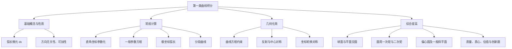
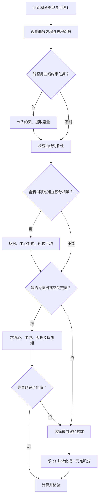

本节的核心不是单纯地把曲线积分转化为定积分，而是掌握三个层次的解题能力：

- **基础层次：** 正确识别曲线，选择参数，计算弧长微元 $\mathrm ds$。
- **强化层次：** 利用曲线方程、几何约束、对称性和轮换对称性，减少甚至完全避免积分运算。
- **综合层次：** 处理空间交圆、偏心圆、混合二次矩、高次多项式以及带参数的综合问题。

尤其是空间球面与平面的交线，是本节非常值得深入掌握的一类母题。掌握其背后的几何结构后，即使出题人改变球半径、平面方程、被积函数，也能够建立统一的解题方法。

## 一、知识体系与复习重点

**2. 考研复习优先级**

以下是根据本节归档题目的知识覆盖和迁移价值给出的复习建议，并非历年考试频率的统计结果。

| 考点         | 重要程度  | 掌握要求     |
| ---------- | ----- | -------- |
| 弧长微元与参数化   | ★★★★★ | 必须熟练     |
| 曲线约束化简     | ★★★★★ | 优先于直接积分  |
| 奇偶对称性      | ★★★★★ | 准确判断对称条件 |
| 空间球面与平面交圆  | ★★★★★ | 重点母题     |
| 坐标轮换对称性    | ★★★★★ | 能独立推导    |
| 圆周一次矩、二次矩  | ★★★★★ | 掌握通式     |
| 分段曲线积分     | ★★★★☆ | 防止漏段     |
| 偏心空间圆      | ★★★★☆ | 掌握统一模型   |
| 极坐标与螺旋线    | ★★★★☆ | 熟悉参数选择   |
| 质量、质心及积分估值 | ★★★☆☆ | 应对综合变式   |

## 二、第一类曲线积分的基础概念

### 2.1 什么是第一类曲线积分？

设空间曲线 $L$ 上定义了函数

$$
f(x,y,z).
$$

将曲线分成许多小段，每一小段的长度为 $\Delta s_i$，在每一段上任取一点

$$
P_i=(\xi_i,\eta_i,\zeta_i).
$$

构造和式

$$
\sum_{i=1}^{n} f(\xi_i,\eta_i,\zeta_i)\Delta s_i.
$$

当所有小弧段的最大长度趋近于零时，如果该和式的极限存在，就称它为函数 $f$ 在曲线 $L$ 上的第一类曲线积分：

$$
\boxed{ \int_L f(x,y,z)\,\mathrm ds = \lim_{\max\Delta s_i\to0} \sum_{i=1}^{n}f(P_i)\Delta s_i }
$$

又称为**对弧长的曲线积分**。

平面曲线的情况为

$$
\int_L f(x,y)\,\mathrm ds.
$$

如果曲线闭合，也可以记为

$$
\oint_L f(x,y)\,\mathrm ds.
$$

### 2.2 如何直观理解第一类曲线积分？

可以将曲线想象成一根弯曲的细铁丝。

假设铁丝在不同位置的线密度为

$$
\rho(x,y,z).
$$

取一段非常短的铁丝，其质量近似为

$$
\mathrm dm=\rho(x,y,z)\,\mathrm ds.
$$

那么整根铁丝的质量就是

$$
\boxed{ M=\int_L\rho(x,y,z)\,\mathrm ds }
$$

这就是第一类曲线积分最自然的物理模型。

它本质上计算的是：

**沿着曲线，将每个位置的函数值按照实际弧长进行加权累加。**

与之前学习的积分对比：

| 积分类型    | 积分形式                                | 累加对象    |
| ------- | ----------------------------------- | ------- |
| 定积分     | $\int_a^b f(x)\,\mathrm dx$    | 区间上的长度  |
| 二重积分    | $\iint_D f(x,y)\,\mathrm dA$   | 平面区域的面积 |
| 三重积分    | $\iiint_\Omega f\,\mathrm dV$ | 空间区域的体积 |
| 第一类曲线积分 | $\int_L f\,\mathrm ds$         | 曲线上的弧长  |
| 第一类曲面积分 | $\iint_\Sigma f\,\mathrm dS$  | 曲面上的面积  |

因此，本节最重要的基础认识是：

$$
\boxed{\mathrm ds\text{ 表示实际弧长，而不是坐标增量}}
$$

### 2.3 第一类与第二类曲线积分的本质区别

这是学习本节时必须建立的概念界限。

| 比较项目    | 第一类曲线积分                     | 第二类曲线积分                                    |
| ------- | --------------------------- | ------------------------------------------ |
| 积分形式    | $\int_L f\,\mathrm ds$ | $\int_L P\,\mathrm dx+Q\,\mathrm dy$ |
| 积分对象    | 标量函数                        | 向量场沿切向的分量                                  |
| 典型物理意义  | 细线质量                        | 变力做功                                       |
| 是否与方向有关 | 无关                          | 有关                                         |
| 反向后的积分  | 不变                          | 变号                                         |
| 基本计算方法  | 函数乘速度模长                     | 向量场与速度作内积                                  |
| 格林公式    | 不能直接使用                      | 满足条件时可以使用                                  |

记反向曲线为 $L^{-}$，则第一类曲线积分满足

$$
\boxed{ \int_{L^-} f\,\mathrm ds = \int_L f\,\mathrm ds }
$$

第二类曲线积分则满足

$$
\int_{L^-}P\,\mathrm dx+Q\,\mathrm dy = -\int_LP\,\mathrm dx+Q\,\mathrm dy.
$$

<Callout type="warn" title="一个非常容易出错的地方">

虽然

$$
\mathrm ds\geq 0,
$$

但第一类曲线积分并不一定非负。

只有当被积函数在曲线上满足

$$
f(P)\geq0
$$

时，才能推出

$$
\int_Lf\,\mathrm ds\geq0.
$$

例如，单位圆下半圆周上的 $y$ 非正，因此

$$
\int_Ly\,\mathrm ds=-2.
$$

弧长微元不带方向，并不意味着被积函数没有正负之分。

</Callout>

## 三、弧长微元的全部核心公式

### 3.1 一般参数方程

设空间曲线 $L$ 的参数方程为

$$
\begin{cases} x=x(t),\\ y=y(t),\\ z=z(t), \end{cases} \qquad \alpha\leq t\leq\beta.
$$

记

$$
\boldsymbol r(t) =(x(t),y(t),z(t)).
$$

因为

$$
\mathrm ds^2=\mathrm dx^2+\mathrm dy^2+\mathrm dz^2,
$$

所以

$$
\boxed{ \mathrm ds= \sqrt{x'^2(t)+y'^2(t)+z'^2(t)}\,\mathrm dt }
$$

这里约定参数 $t$ 从小到大变化。

由此得到本节最一般的计算公式：

$$
\boxed{ \begin{aligned} &\int_L f(x,y,z)\,\mathrm ds\\ &=\int_\alpha^\beta f(x(t),y(t),z(t)) \sqrt{x'^2+y'^2+z'^2}\,\mathrm dt. \end{aligned} }
$$

适用条件通常为曲线分段光滑、被积函数在曲线上连续，并且参数正确覆盖所要求的曲线。

这是其他所有具体公式的来源。

### 3.2 平面显函数

若曲线表示为

$$
y=\varphi(x),\qquad a\leq x\leq b,
$$

则

$$
\boxed{ \mathrm ds=\sqrt{1+[\varphi'(x)]^2}\,\mathrm dx }
$$

从而

$$
\boxed{ \int_L f(x,y)\,\mathrm ds = \int_a^b f(x,\varphi(x)) \sqrt{1+[\varphi'(x)]^2}\,\mathrm dx }
$$

如果曲线更适合写成

$$
x=\psi(y),\qquad c\leq y\leq d,
$$

则

$$
\boxed{ \mathrm ds=\sqrt{1+[\psi'(y)]^2}\,\mathrm dy }
$$

没有必要强行选择 $x$ 作为积分变量。

### 3.3 极坐标曲线

设

$$
r=r(\theta),
$$

则

$$
x=r(\theta)\cos\theta,\qquad y=r(\theta)\sin\theta.
$$

求导得到

$$
\begin{aligned} x'&=r'\cos\theta-r\sin\theta,\\ y'&=r'\sin\theta+r\cos\theta. \end{aligned}
$$

平方相加：

$$
x'^2+y'^2=r'^2+r^2.
$$

因此

$$
\boxed{ \mathrm ds=\sqrt{r^2(\theta)+r'^2(\theta)}\,\mathrm d\theta }
$$

积分公式为

$$
\boxed{ \begin{aligned} \int_L f(x,y)\,\mathrm ds ={}&\int_\alpha^\beta f(r\cos\theta,r\sin\theta)\\ &\quad\cdot\sqrt{r^2+r'^2}\,\mathrm d\theta. \end{aligned} }
$$

<Callout type="warn" title="特别注意">

二重积分的极坐标面积微元是

$$
\mathrm dA=r\,\mathrm dr\,\mathrm d\theta,
$$

而第一类曲线积分的极坐标弧长微元是

$$
\mathrm ds=\sqrt{r^2+r'^2}\,\mathrm d\theta.
$$

两者完全不同。

仅当半径为正常数时，沿圆周才有

$$
\mathrm ds=r\,\mathrm d\theta.
$$

</Callout>

### 3.4 常见曲线公式速查表

| 曲线                       | 推荐参数方程                          | 弧长微元                                            |
| ------------------------ | ------------------------------- | ----------------------------------------------- |
| 直线段 $AB$             | $\boldsymbol r=A+t(B-A)$    | $\lVert B-A\rVert\,\mathrm dt$             |
| 圆周                       | $x=R\cos t,\ y=R\sin t$     | $R\,\mathrm dt$                            |
| 平移圆                      | $x=h+R\cos t,\ y=k+R\sin t$ | $R\,\mathrm dt$                            |
| 椭圆                       | $x=a\cos t,\ y=b\sin t$     | $\sqrt{a^2\sin^2t+b^2\cos^2t}\,\mathrm dt$ |
| 抛物线 $y=x^2$          | $x=t,\ y=t^2$               | $\sqrt{1+4t^2}\,\mathrm dt$                |
| 极坐标曲线                    | $r=r(\theta)$               | $\sqrt{r^2+r'^2}\,\mathrm d\theta$         |
| 空间螺旋线                    | $(a\cos t,a\sin t,bt)$      | $\sqrt{a^2+b^2}\,\mathrm dt$               |
| 空间曲线 $y=y(x),z=z(x)$ | 以 $x$ 为参数                   | $\sqrt{1+y'^2+z'^2}\,\mathrm dx$           |

对于完整直线段，上表参数范围为 $0\leq t\leq1$；对于完整圆周、椭圆，通常取 $0\leq t\leq2\pi$。

## 四、第一类曲线积分的性质与高级解题思想

### 4.1 线性性质

$$
\int_L(af+bg)\,\mathrm ds = a\int_Lf\,\mathrm ds +b\int_Lg\,\mathrm ds.
$$

其意义在于可以将复杂被积函数拆成若干个容易处理的部分。

### 4.2 分段可加性

若曲线由若干不重复的弧段组成：

$$
L=L_1\cup L_2\cup\cdots\cup L_n,
$$

则

$$
\boxed{ \int_Lf\,\mathrm ds = \sum_{i=1}^{n}\int_{L_i}f\,\mathrm ds }
$$

特别适用于三角形、菱形、扇形边界以及分段定义曲线。

### 4.3 常数积分与曲线约束

若被积函数在整条曲线上恒等于常数 $C$，则

$$
\boxed{ \int_Lf\,\mathrm ds=C\ell }
$$

其中

$$
\ell=\int_L1\,\mathrm ds
$$

是曲线长度。

这条性质虽然简单，却是本节最高效的计算技巧之一。

例如，沿圆周

$$
x^2+y^2=R^2
$$

计算

$$
\oint_L(x^2+y^2)^n\,\mathrm ds,
$$

根本不需要参数化。

因为

$$
(x^2+y^2)^n=R^{2n},
$$

所以

$$
\boxed{ \oint_L(x^2+y^2)^n\,\mathrm ds =2\pi R^{2n+1} }
$$

**进一步理解：沿曲线相等即可替换**

如果两个函数在整个平面上并不相等，但是在曲线 $L$ 上满足

$$
f(x,y)=g(x,y),
$$

仍然有

$$
\int_Lf\,\mathrm ds=\int_Lg\,\mathrm ds.
$$

例如

$$
x^2+y^2-1
$$

虽然不是恒等于零的函数，但它在单位圆上恒等于零。

这是使用曲线方程进行化简的理论基础。

### 4.4 比较性质与估值

若曲线 $L$ 上

$$
f(P)\leq g(P),
$$

则

$$
\int_L f\,\mathrm ds \leq \int_L g\,\mathrm ds.
$$

设

$$
m=\min_{P\in L}f(P),\qquad M=\max_{P\in L}f(P),
$$

则

$$
\boxed{ m\ell\leq\int_Lf\,\mathrm ds\leq M\ell }
$$

另外，

$$
\boxed{ \left|\int_Lf\,\mathrm ds\right| \leq\int_L|f|\,\mathrm ds }
$$

可以用来排除选择题选项，或者检查计算结果是否合理。

### 4.5 曲线积分的平均值思想

定义函数在曲线上的弧长平均值：

$$
\boxed{ \overline f =\frac1\ell\int_L f\,\mathrm ds }
$$

于是

$$
\boxed{ \int_Lf\,\mathrm ds=\ell\overline f }
$$

对于连续函数及非零长度的连通曲线，还存在曲线上的一点 $P_0$，使得

$$
\int_Lf\,\mathrm ds=f(P_0)\ell.
$$

平均值思想是后面解决空间交圆综合题的关键。

## 五、题型一：利用曲线方程直接化简

这是本节最基础、同时也最容易被忽视的一类方法。

### 母题1：1989年考研数学一

设 $L$ 为单位圆下半圆周：

$$
y=-\sqrt{1-x^2}.
$$

计算

$$
I=\int_L(x^2+y^2)\,\mathrm ds.
$$

<Tabs items={["方法一：曲线约束法（推荐）", "方法二：参数化法"]} defaultIndex={0}>

<Tab value="方法一：曲线约束法（推荐）">

沿曲线恒有

$$
x^2+y^2=1.
$$

所以

$$
I=\int_L1\,\mathrm ds.
$$

单位圆下半圆周长度为 $\pi$，因此

$$
\boxed{I=\pi}
$$

</Tab>

<Tab value="方法二：参数化法">

令

$$
x=\cos t,\qquad y=-\sin t, \qquad 0\leq t\leq\pi.
$$

则

$$
\mathrm ds =\sqrt{\sin^2t+\cos^2t}\,\mathrm dt =\mathrm dt.
$$

所以

$$
I=\int_0^\pi1\,\mathrm dt=\pi.
$$

</Tab>

</Tabs>

**母题推广**

如果 $L$ 是半径为 $R$、圆心角为 $\alpha$ 的圆弧，那么

$$
\int_L F(x^2+y^2)\,\mathrm ds
$$

在圆心为原点时，可以直接化为

$$
\boxed{ I=R\alpha F(R^2) }
$$

例如，对整个半径为 $2$ 的圆周，

$$
\oint_L e^{x^2+y^2}\,\mathrm ds =4\pi e^4.
$$

这类题的识别信号是：被积函数包含与曲线方程相同的代数组合。

### 母题2：1998年考研数学一

设椭圆

$$
L:\frac{x^2}{4}+\frac{y^2}{3}=1,
$$

其周长记为 $a$，求

$$
I=\oint_L(2xy+3x^2+4y^2)\,\mathrm ds.
$$

这道题是**曲线约束与对称性结合**的经典母题。

<Steps>

<Step>

### 第一步：观察椭圆方程 [!toc]

将椭圆方程乘以12，得到

$$
3x^2+4y^2=12.
$$

因此

$$
I=\oint_L(2xy+12)\,\mathrm ds.
$$

</Step>

<Step>

### 第二步：利用对称性 [!toc]

椭圆关于 $y$ 轴对称。

进行变换

$$
(x,y)\longmapsto(-x,y),
$$

曲线及弧长元不变，而 $xy$ 变号。

因此

$$
\oint_Lxy\,\mathrm ds=0.
$$

</Step>

<Step>

### 第三步：常量乘弧长 [!toc]

$$
I=12\oint_L1\,\mathrm ds=12a.
$$

故

$$
\boxed{I=12a}
$$

</Step>

</Steps>

**为什么这道题很重要？**

因为一般椭圆的周长没有简单的初等函数表达式。

如果盲目令

$$
x=2\cos t,\qquad y=\sqrt3\sin t,
$$

就会得到较复杂的根式积分。

已知周长为 $a$，无需再计算椭圆周长。

**当题目直接给出曲线长度时，应当优先寻找把被积函数化成常数的方法。**

**一般化模型**

设椭圆

$$
L:\frac{x^2}{A^2}+\frac{y^2}{B^2}=1
$$

的周长为 $\ell$，则

$$
\boxed{ \oint_L \left( \frac{x^2}{A^2}+ \frac{y^2}{B^2} \right)\mathrm ds=\ell }
$$

同时

$$
\oint_Lxy\,\mathrm ds =\oint_Lx\,\mathrm ds =\oint_Ly\,\mathrm ds=0.
$$

但一般不能认为

$$
\oint_Lx^2\,\mathrm ds = \oint_Ly^2\,\mathrm ds.
$$

因为一般椭圆并不具有交换 $x,y$ 后保持不变的对称性。

## 六、题型二：常规参数化与一元积分计算

这类题的本质是正确选择参数，将曲线积分转化为熟悉的定积分。

### 母题3：2009年考研数学一

设曲线

$$
L:y=x^2,\qquad 0\leq x\leq\sqrt2.
$$

计算

$$
I=\int_Lx\,\mathrm ds.
$$

<Steps>

<Step>

### 第一步：选择自然参数 [!toc]

已知 $y$ 是 $x$ 的显函数，而且给出了 $x$ 的取值范围，因此直接以 $x$ 为参数。

$$
y'=2x.
$$

所以

$$
\mathrm ds=\sqrt{1+4x^2}\,\mathrm dx.
$$

</Step>

<Step>

### 第二步：转化为定积分 [!toc]

$$
I=\int_0^{\sqrt2}x\sqrt{1+4x^2}\,\mathrm dx.
$$

</Step>

<Step>

### 第三步：凑微分 [!toc]

令

$$
u=1+4x^2, \qquad \mathrm du=8x\,\mathrm dx.
$$

于是

$$
\begin{aligned} I &=\frac18\int_1^9\sqrt u\,\mathrm du\\ &=\frac1{12}[u^{3/2}]_1^9\\ &=\frac{27-1}{12}\\ &=\boxed{\frac{13}{6}}. \end{aligned}
$$

</Step>

</Steps>

**同类题的统一模型**

对于抛物线

$$
y=ax^2,\qquad a\ne0,
$$

有

$$
\mathrm ds=\sqrt{1+4a^2x^2}\,\mathrm dx.
$$

因此

$$
\int x\sqrt{1+4a^2x^2}\,\mathrm dx = \frac{(1+4a^2x^2)^{3/2}}{12a^2}+C.
$$

出题人经常通过改变抛物线系数、积分区间以及被积函数，使弧长微元中的根式恰好可以利用换元法解决。

### 母题4：张宇1000题

设

$$
L:2x=y^2,\qquad 0\leq y\leq1.
$$

求

$$
I=\int_Ly\,\mathrm ds.
$$

**关键判断**

本题应该选择 $y$ 为参数，而不是 $x$。

因为

$$
x=\frac{y^2}{2}, \qquad \frac{\mathrm dx}{\mathrm dy}=y.
$$

于是

$$
\mathrm ds=\sqrt{1+y^2}\,\mathrm dy.
$$

因此

$$
\begin{aligned} I &=\int_0^1y\sqrt{1+y^2}\,\mathrm dy\\ &=\frac13(1+y^2)^{3/2}\bigg|_0^1\\ &=\boxed{\frac{2\sqrt2-1}{3}}. \end{aligned}
$$

这道题与上一道真题本质相同，只是交换了自然参数。

**参数选择的原则**

不要固定认为曲线积分必须化成关于 $x$ 的定积分。

好的参数应当尽可能同时简化三个对象：

$$
\boxed{ \text{被积函数}\quad \text{弧长微元}\quad \text{参数范围} }
$$

### 母题5：李林880题——空间直线段

设 $L$ 是连接

$$
A=(1,-1,2),\qquad B=(2,1,3)
$$

的空间直线段，计算

$$
I=\int_L(x^2+y^2+z^2)\,\mathrm ds.
$$

<Steps>

<Step>

### 第一步：构造直线段参数方程 [!toc]

直线段的通用参数方程是

$$
\boxed{ \boldsymbol r(t)=(1-t)A+tB, \qquad 0\leq t\leq1 }
$$

因此本题有

$$
\begin{cases} x=1+t,\\ y=-1+2t,\\ z=2+t. \end{cases}
$$

</Step>

<Step>

### 第二步：求弧长微元 [!toc]

$$
\mathrm ds=\sqrt{1^2+2^2+1^2}\,\mathrm dt =\sqrt6\,\mathrm dt.
$$

</Step>

<Step>

### 第三步：计算积分 [!toc]

$$
\begin{aligned} x^2+y^2+z^2 &=(1+t)^2+(-1+2t)^2+(2+t)^2\\ &=6+2t+6t^2. \end{aligned}
$$

所以

$$
\begin{aligned} I &=\sqrt6\int_0^1(6+2t+6t^2)\,\mathrm dt\\ &=\sqrt6(6+1+2)\\ &=\boxed{9\sqrt6}. \end{aligned}
$$

</Step>

</Steps>

**进一步推广：直线段的一次函数、二次函数积分**

设 $L$ 为连接 $A,B$ 的直线段，长度为 $\ell$。

对于仿射函数 $f$，例如

$$
f(x,y,z)=ax+by+cz+d,
$$

有

$$
\boxed{ \int_Lf\,\mathrm ds =\frac{\ell}{2}[f(A)+f(B)] }
$$

即端点函数值的平均数乘以线段长度。

如果被积函数是二次多项式，设线段中点为

$$
C=\frac{A+B}{2},
$$

则可以利用辛普森型精确公式：

$$
\boxed{ \int_Lf\,\mathrm ds =\frac{\ell}{6} [f(A)+4f(C)+f(B)] }
$$

该公式对于限制在线段上后次数不超过三次的多项式都是精确的。

对于刚才的题目，

$$
f(A)=6,\qquad f(B)=14,
$$

中点为

$$
C=\left(\frac32,0,\frac52\right),
$$

故

$$
f(C)=\frac{17}{2}.
$$

于是

$$
I=\frac{\sqrt6}{6}(6+34+14) =9\sqrt6.
$$

这属于可以作为提速工具的拓展技巧，不需要死记，掌握直线段参数化是根本。

## 七、题型三：分段曲线积分

### 母题6：李林880题——扇形边界

设 $a>0$，曲线 $L$ 为扇形

$$
0\leq r\leq a,\qquad 0\leq\theta\leq\frac{\pi}{4}
$$

的整个边界。

求

$$
I=\oint_L e^{\sqrt{x^2+y^2}}\,\mathrm ds.
$$

<Steps>

<Step>

### 第一步：识别边界的组成 [!toc]

这里积分对象是扇形的边界，而不是整个扇形区域。

边界由三部分组成：

$$
L=L_1\cup L_2\cup L_3.
$$

两段是径向线段，另一段是半径为 $a$ 的圆弧。

</Step>

<Step>

### 第二步：径向线段积分 [!toc]

沿固定角度的径向线段，

$$
\sqrt{x^2+y^2}=r, \qquad \mathrm ds=\mathrm dr
$$

其中取 $r$ 从0增加至 $a$。

两条径向线段分别贡献

$$
I_1=I_2=\int_0^ae^r\,\mathrm dr=e^a-1.
$$

</Step>

<Step>

### 第三步：圆弧积分 [!toc]

圆弧上

$$
r=a, \qquad \mathrm ds=a\,\mathrm d\theta.
$$

所以

$$
I_3 =\int_0^{\pi/4}e^aa\,\mathrm d\theta =\frac{\pi a}{4}e^a.
$$

</Step>

<Step>

### 第四步：合并 [!toc]

$$
\boxed{ I=2(e^a-1)+\frac{\pi a}{4}e^a }
$$

</Step>

</Steps>

**扇形边界的一般公式**

对于半径 $R$、圆心角 $\alpha$ 的非退化扇形，其中 $0<\alpha<2\pi$，若被积函数仅依赖于极径：

$$
f(x,y)=F(\sqrt{x^2+y^2}),
$$

则

$$
\boxed{ \oint_LF(r)\,\mathrm ds =2\int_0^RF(r)\,\mathrm dr +R\alpha F(R) }
$$

这一公式可以直接覆盖同类型的题目。

当扇形换成环形扇形、三角形、梯形时，基本思想不变：逐段写出对应参数及弧长元，再利用可加性合并。

## 八、题型四：对称性与圆周积分

对称性是第一类曲线积分区别于普通机械积分计算的核心技巧之一。

很多看起来计算量很大的曲线积分，真正需要的只是一次几何判断。

### 8.1 对称性成立的两个必要判断

使用对称性时，必须同时检查：

1. 曲线 $L$ 在所选对称变换下保持不变；
2. 该变换保持弧长，并判断被积函数是变号还是保持不变。

设 $T$ 是保持弧长的对称变换，并且

$$
T(L)=L.
$$

如果

$$
f(TP)=-f(P),
$$

则

$$
\boxed{\int_Lf(P)\,\mathrm ds=0}
$$

如果

$$
f(TP)=f(P),
$$

则对称弧段的积分相等。

**不能只看到被积函数是奇函数，就直接认为积分为零。**

### 8.2 常见对称性汇总

| 曲线的对称性          | 坐标变换                       | 可消去的典型项           |
| --------------- | -------------------------- | ----------------- |
| 关于 $y$ 轴对称  | $(x,y)\to(-x,y)$       | $x,xy,x^3$    |
| 关于 $x$ 轴对称  | $(x,y)\to(x,-y)$       | $y,xy,y^3$    |
| 关于原点对称          | $(x,y)\to(-x,-y)$      | 总次数为奇数的单项式        |
| 关于 $y=x$ 对称 | $(x,y)\to(y,x)$        | $x-y,x^2-y^2$ |
| 空间中心对称          | $(x,y,z)\to(-x,-y,-z)$ | $x,y,z,xyz$   |
| 三坐标轮换对称         | $(x,y,z)\to(y,z,x)$    | 可建立同类积分相等关系       |

例如，单位圆的上半圆周关于 $y$ 轴对称，但不关于 $x$ 轴对称，也不关于原点对称。

因此

$$
\int_Lx\,\mathrm ds=0,
$$

而

$$
\int_Ly\,\mathrm ds =\int_0^\pi\sin t\,\mathrm dt=2.
$$

### 母题7：李林880题——约束与对称性结合

设 $L$ 为单位圆上半圆周

$$
y=\sqrt{1-x^2},
$$

计算

$$
I=\int_L(x-y)^2e^{x^2+y^2}\,\mathrm ds.
$$

<Steps>

<Step>

### 第一步：使用圆周约束 [!toc]

沿曲线

$$
x^2+y^2=1.
$$

因此

$$
e^{x^2+y^2}=e,
$$

并且

$$
(x-y)^2=1-2xy.
$$

于是

$$
I=e\int_L1\,\mathrm ds -2e\int_Lxy\,\mathrm ds.
$$

</Step>

<Step>

### 第二步：寻找真正成立的对称性 [!toc]

上半圆关于 $y$ 轴对称。

而

$$
(-x)y=-xy,
$$

因此

$$
\int_Lxy\,\mathrm ds=0.
$$

</Step>

<Step>

### 第三步：求值 [!toc]

上半圆长度为 $\pi$。

故

$$
\boxed{I=\pi e}
$$

</Step>

</Steps>

**方法迁移**

如果曲线方程能把复杂函数中的径向部分化为常数，并且剩余部分包含交叉项，应该优先采用：

$$
\boxed{ \text{曲线约束} \longrightarrow \text{展开化简} \longrightarrow \text{对称消项} }
$$

### 母题8：李正元练习题——绝对值与菱形边界

设 $a>0$，曲线 $L$ 为

$$
|x|+|y|=a.
$$

计算

$$
I=\oint_Lxy\,\mathrm ds,
$$

以及

$$
J=\oint_L|x|\,\mathrm ds.
$$

**第一问**

菱形关于 $x$ 轴对称，而 $xy$ 在反射后变号，因此

$$
\boxed{I=0}
$$

**第二问**

由于 $|x|$ 在关于两个坐标轴的反射下都保持不变，所以四条边的积分相等。

只需计算第一象限的边：

$$
y=a-x,\qquad 0\leq x\leq a.
$$

此时

$$
\mathrm ds=\sqrt2\,\mathrm dx.
$$

因此

$$
\begin{aligned} J &=4\int_0^ax\sqrt2\,\mathrm dx\\ &=4\sqrt2\frac{a^2}{2}\\ &=\boxed{2\sqrt2a^2}. \end{aligned}
$$

**方法迁移**

遇到绝对值时，不要立即复杂地分段讨论整个积分区间。

先检查曲线的对称性，看看能否只在一个象限中去掉绝对值，再乘相应倍数。

但也不能把

$$
\oint_Lx\,\mathrm ds=0
$$

错误推广为

$$
\oint_L|x|\,\mathrm ds=0.
$$

绝对值会破坏原来的变号关系。

## 九、题型五：圆周的一次矩、二次矩

这是解决空间交圆之前必须掌握的一组基础模型。

### 9.1 什么是弧长矩？

在曲线 $L$ 上，形如

$$
\int_Lx\,\mathrm ds,\qquad \int_Ly\,\mathrm ds
$$

的积分可以称为坐标的一次矩。

形如

$$
\int_Lx^2\,\mathrm ds,\qquad \int_Lxy\,\mathrm ds
$$

的积分可以称为二次矩。

复杂多项式的曲线积分，通常可以通过展开变成若干低阶矩的线性组合。

### 9.2 原点中心圆的基本公式

设

$$
L:x^2+y^2=R^2.
$$

圆周长度为

$$
\ell=2\pi R.
$$

由对称性得到

$$
\boxed{ \oint_Lx\,\mathrm ds =\oint_Ly\,\mathrm ds =\oint_Lxy\,\mathrm ds=0 }
$$

又因为圆周在交换 $x,y$ 后保持不变，

$$
\oint_Lx^2\,\mathrm ds = \oint_Ly^2\,\mathrm ds.
$$

两式相加：

$$
\begin{aligned} \oint_Lx^2\,\mathrm ds+\oint_Ly^2\,\mathrm ds &=\oint_LR^2\,\mathrm ds\\ &=2\pi R^3. \end{aligned}
$$

因此

$$
\boxed{ \oint_Lx^2\,\mathrm ds =\oint_Ly^2\,\mathrm ds=\pi R^3 }
$$

写成平均值形式更加容易记忆：

$$
\boxed{ \overline x=\overline y=\overline{xy}=0, \qquad \overline{x^2}=\overline{y^2}=\frac{R^2}{2} }
$$

平方和固定为 $R^2$，两个方向均分即可。

### 9.3 平移圆的基本公式

设圆周

$$
L:(x-h)^2+(y-k)^2=R^2.
$$

圆心为 $(h,k)$。

令

$$
u=x-h,\qquad v=y-k.
$$

则

$$
u^2+v^2=R^2.
$$

利用原点中心圆的结果，可得到：

| 被积函数      | 弧长平均值           |
| --------- | --------------- |
| $1$   | $1$         |
| $x$   | $h$         |
| $y$   | $k$         |
| $x^2$ | $h^2+R^2/2$ |
| $y^2$ | $k^2+R^2/2$ |
| $xy$  | $hk$        |

使用时将平均值乘以圆周长度 $2\pi R$ 即可。

特别地，

$$
\boxed{ \oint_Lx\,\mathrm ds=2\pi Rh }
$$

$$
\boxed{ \oint_Lx^2\,\mathrm ds =2\pi R\left(h^2+\frac{R^2}{2}\right) }
$$

### 母题9：李林880题

设

$$
L:x^2+y^2=2x.
$$

求

$$
I=\oint_Lx\,\mathrm ds.
$$

配方得到

$$
(x-1)^2+y^2=1.
$$

所以圆心为 $(1,0)$，半径为1。

直接使用一次矩公式：

$$
I=2\pi\cdot1\cdot1.
$$

因此

$$
\boxed{I=2\pi}
$$

本题的陷阱是误以为所有圆周上的 $x$ 积分都为零。

实际上，决定一次矩的是圆心坐标。

### 9.4 二次多项式的通用计算公式

设

$$
f(x,y)=Ax^2+Bxy+Cy^2+Dx+Ey+F.
$$

在圆周

$$
(x-h)^2+(y-k)^2=R^2
$$

上有

$$
\boxed{ \begin{aligned} \oint_Lf\,\mathrm ds =2\pi R\bigg[ &Ah^2+Bhk+Ck^2\\ &+Dh+Ek+F\\ &+\frac{R^2}{2}(A+C) \bigg]. \end{aligned} }
$$

也可以写成更加简洁的形式：

$$
\boxed{ \oint_Lf\,\mathrm ds =2\pi R \left[ f(h,k)+\frac{R^2}{4}\Delta f \right] }
$$

其中

$$
\Delta f=f_{xx}+f_{yy}.
$$

后一公式在这里适用于二次及以下多项式，对三次多项式也成立，因为三次中心偏移项的平均值为零；对于一般函数则不能不加条件地使用这个有限项公式。

### 母题10：李林880题——圆周二次矩综合

设 $L:x^2+y^2=1$，求

$$
I=\oint_L \left[ \left(x+\frac12\right)^2+ \left(\frac y2+1\right)^2 \right]\mathrm ds.
$$

展开：

$$
f=x^2+\frac14y^2+x+y+\frac54.
$$

由于

$$
\oint_Lx\,\mathrm ds =\oint_Ly\,\mathrm ds=0
$$

及

$$
\oint_Lx^2\,\mathrm ds =\oint_Ly^2\,\mathrm ds=\pi,
$$

所以

$$
\begin{aligned} I &=\pi+\frac{\pi}{4} +\frac54\cdot2\pi\\ &=\boxed{\frac{15\pi}{4}}. \end{aligned}
$$

**高次矩拓展**

对于原点中心整圆，还有

$$
\oint_Lx^4\,\mathrm ds =\oint_Ly^4\,\mathrm ds =\frac{3\pi R^5}{4},
$$

以及

$$
\oint_Lx^2y^2\,\mathrm ds =\frac{\pi R^5}{4}.
$$

这些公式可以通过三角参数化及降幂公式推导。

例如，

$$
\begin{aligned} \oint_Lx^2y^2\,\mathrm ds &=R^5\int_0^{2\pi} \cos^2t\sin^2t\,\mathrm dt\\ &=\frac{R^5}{4}\int_0^{2\pi}\sin^22t\,\mathrm dt\\ &=\frac{\pi R^5}{4}. \end{aligned}
$$

对于高次多项式，优先判断奇偶性；剩余的偶次项再通过降幂或者已有约束计算。

## 十、题型六：空间球面与平面的交圆

这是本节最重要的强化内容。从2018年数一真题，到李林、张宇、李正元以及2027年模拟卷，都反复使用了这一模型。

### 10.1 一般交圆的几何模型

设球面

$$
x^2+y^2+z^2=R^2
$$

和平面

$$
Ax+By+Cz=D
$$

相交，其中平面法向量

$$
\boldsymbol n_0=(A,B,C)\ne\boldsymbol0.
$$

定义

$$
N=\sqrt{A^2+B^2+C^2}.
$$

球心到平面的距离为

$$
\boxed{ d=\frac{|D|}{N} }
$$

当 $d<R$ 时，交线为一个圆。

交圆圆心是原点在平面上的垂足：

$$
\boxed{ \boldsymbol c =\frac{D}{A^2+B^2+C^2}(A,B,C) }
$$

交圆半径为

$$
\boxed{ r=\sqrt{R^2-d^2} }
$$

交圆周长为

$$
\boxed{\ell=2\pi r}
$$

这里必须注意区分球半径 $R$ 和交圆半径 $r$。

当平面经过球心，即 $D=0$ 时，交圆是大圆：

$$
r=R.
$$

当 $d=R$ 时，交集退化成一点；当 $d>R$ 时，没有实交线。

### 10.2 交圆几何公式为什么成立？

设 $O$ 为球心，$H$ 为球心到平面的垂足，$P$ 为交圆上任意一点。

因为

$$
OH\perp HP,
$$

根据勾股定理，

$$
OP^2=OH^2+HP^2.
$$

即

$$
R^2=d^2+r^2.
$$

所以

$$
r=\sqrt{R^2-d^2}.
$$

这一知识来自空间解析几何，与第八模块的点到平面距离公式直接相通。

### 母题11：2018年考研数学一

空间曲线 $L$ 由球面

$$
x^2+y^2+z^2=1
$$

与平面

$$
x+y+z=0
$$

相交而成。

求

$$
I=\oint_Lxy\,\mathrm ds.
$$

这是整个第一类曲线积分章节中最值得反复研究的母题之一。

<Steps>

<Step>

### 第一步：确定交圆长度 [!toc]

平面经过球心，因此交圆为半径1的大圆。

所以

$$
\ell=2\pi.
$$

</Step>

<Step>

### 第二步：发现三个坐标的轮换对称性 [!toc]

考虑变换

$$
(x,y,z)\longmapsto(y,z,x).
$$

变换之后，

$$
x^2+y^2+z^2=1
$$

仍然成立，

$$
x+y+z=0
$$

也仍然成立。

因此曲线保持不变，弧长元保持不变。

可以得到

$$
\boxed{ \oint_Lxy\,\mathrm ds = \oint_Lyz\,\mathrm ds = \oint_Lzx\,\mathrm ds }
$$

设这三个积分均为 $J$。

</Step>

<Step>

### 第三步：利用两个曲线约束建立恒等式 [!toc]

由

$$
(x+y+z)^2 =x^2+y^2+z^2+2(xy+yz+zx),
$$

代入曲线方程：

$$
0=1+2(xy+yz+zx).
$$

所以在曲线上，

$$
\boxed{ xy+yz+zx=-\frac12 }
$$

</Step>

<Step>

### 第四步：等式两边进行曲线积分 [!toc]

$$
\begin{aligned} 3J &=\oint_L(xy+yz+zx)\,\mathrm ds\\ &=-\frac12\oint_L1\,\mathrm ds\\ &=-\frac12\cdot2\pi\\ &=-\pi. \end{aligned}
$$

因此

$$
\boxed{I=-\frac{\pi}{3}}
$$

</Step>

</Steps>

**这道题真正考查的是什么？**

它并不是在考查如何进行复杂的空间曲线参数化，而是在考查如何利用两个层次的约束：

$$
\underbrace{ xy+yz+zx=-\frac12 }_{\text{曲线上的逐点恒等式}}
$$

以及

$$
\underbrace{ \int_Lxy\,\mathrm ds =\int_Lyz\,\mathrm ds =\int_Lzx\,\mathrm ds }_{\text{积分后的对称关系}}
$$

两者结合，才能求出单独的混合矩。

<Callout type="warn" title="最危险的错误">

不能因为 $xy$ 关于 $x$ 是奇函数，就认为

$$
\oint_Lxy\,\mathrm ds=0.
$$

因为单独令 $x\to-x$ 后，原来的平面条件变成

$$
-x+y+z=0,
$$

这不一定是原来的平面。

所以本题不具有关于 $yz$ 坐标面的反射对称性。

</Callout>

### 10.3 母题11的完整矩体系

仍然考虑

$$
L: \begin{cases} x^2+y^2+z^2=R^2,\\ x+y+z=0. \end{cases}
$$

由于关于原点中心对称，

$$
\boxed{ \oint_Lx\,\mathrm ds =\oint_Ly\,\mathrm ds =\oint_Lz\,\mathrm ds=0 }
$$

由三坐标轮换对称性，

$$
\oint_Lx^2\,\mathrm ds =\oint_Ly^2\,\mathrm ds =\oint_Lz^2\,\mathrm ds.
$$

利用平方和，

$$
\boxed{ \oint_Lx^2\,\mathrm ds =\oint_Ly^2\,\mathrm ds =\oint_Lz^2\,\mathrm ds =\frac{2\pi R^3}{3} }
$$

同理，

$$
\boxed{ \oint_Lxy\,\mathrm ds =\oint_Lyz\,\mathrm ds =\oint_Lzx\,\mathrm ds =-\frac{\pi R^3}{3} }
$$

记住对应的平均值更加方便：

$$
\boxed{ \overline x=\overline y=\overline z=0 }
$$

$$
\boxed{ \overline{x^2} =\overline{y^2} =\overline{z^2} =\frac{R^2}{3} }
$$

$$
\boxed{ \overline{xy} =\overline{yz} =\overline{zx} =-\frac{R^2}{6} }
$$

**通用二次多项式公式**

若

$$
\begin{aligned} f={}&ax^2+by^2+cz^2\\ &+dxy+eyz+fzx\\ &+gx+hy+iz+j, \end{aligned}
$$

这里等号左侧表示被积函数，右侧字母均为常数，则沿上述大圆有

$$
\boxed{ \begin{aligned} \oint_L f\,\mathrm ds =2\pi R\bigg[ &\frac{R^2}{3}(a+b+c)\\ &-\frac{R^2}{6}(d+e+f)+j \bigg]. \end{aligned} }
$$

换句话说，只需要分别统计平方项的系数和、混合项的系数和以及常数项。

### 母题12：2027年李林六套卷第5套第12题

设曲线 $L$ 为

$$
\begin{cases} x^2+y^2+z^2=1,\\ x+y+z=0. \end{cases}
$$

求

$$
I=\oint_L(xy-2yz+3zx)\,\mathrm ds.
$$

这道模拟题直接继承了2018年数一母题。

由前面的结论，

$$
\oint_Lxy\,\mathrm ds =\oint_Lyz\,\mathrm ds =\oint_Lzx\,\mathrm ds =-\frac\pi3.
$$

因此

$$
\begin{aligned} I &=(1-2+3)\left(-\frac\pi3\right)\\ &=\boxed{-\frac{2\pi}{3}}. \end{aligned}
$$

如果真正掌握了母题，这道模拟题不需要重新计算任何积分。

## 十一、题型七：偏心交圆与轮换平均法

现在对上一类母题进行升级。

如果平面变成

$$
x+y+z=c,
$$

而不是经过球心，那么整条交圆将发生平移。

此时：

- 三个坐标仍然具有轮换对称性；
- 交圆通常不再关于原点中心对称；
- 一次项一般不再自动消失。

这是出题人非常自然的变式方向。

### 11.1 三坐标轮换交圆通式

设

$$
L: \begin{cases} x^2+y^2+z^2=R^2,\\ x+y+z=c, \end{cases}
$$

其中

$$
|c|<\sqrt3R.
$$

**几何量**

交圆圆心为

$$
\boxed{ \boldsymbol c_0= \left(\frac c3,\frac c3,\frac c3\right) }
$$

交圆半径为

$$
\boxed{ r=\sqrt{R^2-\frac{c^2}{3}} }
$$

周长为

$$
\ell=2\pi\sqrt{R^2-\frac{c^2}{3}}.
$$

**一次矩**

由轮换对称性，

$$
\overline x=\overline y=\overline z.
$$

又有

$$
\overline x+\overline y+\overline z=c.
$$

所以

$$
\boxed{ \overline x=\overline y=\overline z=\frac c3 }
$$

**平方矩**

由轮换对称性，

$$
\overline{x^2} =\overline{y^2} =\overline{z^2}.
$$

利用球面方程，

$$
\boxed{ \overline{x^2} =\overline{y^2} =\overline{z^2} =\frac{R^2}{3} }
$$

注意，在固定球半径 $R$ 的情况下，这里的平方平均值竟然与平面常数 $c$ 无关。

**混合二次矩**

根据

$$
(x+y+z)^2=c^2
$$

得到

$$
xy+yz+zx=\frac{c^2-R^2}{2}.
$$

由轮换对称性，

$$
\boxed{ \overline{xy} =\overline{yz} =\overline{zx} =\frac{c^2-R^2}{6} }
$$

**全部结果汇总**

| 积分对象              | 弧长平均值             |
| ----------------- | ----------------- |
| $x,y,z$       | $c/3$         |
| $x^2,y^2,z^2$ | $R^2/3$       |
| $xy,yz,zx$    | $(c^2-R^2)/6$ |
| $1$           | $1$           |

最后统一乘以

$$
2\pi\sqrt{R^2-\frac{c^2}{3}}.
$$

这张表能够解决此类交圆上的任意二次多项式积分。

### 母题13：张宇1000题

设 $\Gamma$ 为

$$
\begin{cases} x^2+y^2+z^2=1,\\ x+y+z=1. \end{cases}
$$

计算

$$
I=\oint_\Gamma(y^2+2x-z)\,\mathrm ds.
$$

<Steps>

<Step>

### 第一步：交圆半径 [!toc]

$$
r=\sqrt{1-\frac13} =\sqrt{\frac23}.
$$

</Step>

<Step>

### 第二步：计算平均值 [!toc]

由于 $R=1,c=1$，有

$$
\overline{x} =\overline{z} =\frac13,
$$

并且

$$
\overline{y^2}=\frac13.
$$

所以

$$
\begin{aligned} \overline{y^2+2x-z} &=\frac13+\frac23-\frac13\\ &=\frac23. \end{aligned}
$$

</Step>

<Step>

### 第三步：乘以弧长 [!toc]

$$
\begin{aligned} I &=2\pi\sqrt{\frac23}\cdot\frac23\\ &=\boxed{\frac{4\pi}{3}\sqrt{\frac23}}. \end{aligned}
$$

利用三坐标轮换对称性，比一般正交基法更简洁。

</Step>

</Steps>

### 母题14：2027年李永乐六套卷第5套第14题

设曲线 $\Gamma$ 为球面

$$
x^2+y^2+z^2=9
$$

与平面

$$
x+y+z=3
$$

的交线。

求

$$
\begin{aligned} I=\oint_\Gamma( &x^2+2y^2+4z^2\\ &+xy+2yz+3zx\\ &+3x-2y+z)\,\mathrm ds. \end{aligned}
$$

这道题表面上包含大量项，实际上是前述通式的直接应用。

<Tabs items={["方法一：弧长矩法", "方法二：轮换平均法（推荐掌握）"]} defaultIndex={0}>

<Tab value="方法一：弧长矩法">

交圆半径为

$$
r=\sqrt{9-\frac{9}{3}}=\sqrt6.
$$

由 $R=3,c=3$ 得

$$
\overline x=\overline y=\overline z=1,
$$

$$
\overline{x^2} =\overline{y^2} =\overline{z^2}=3,
$$

$$
\overline{xy} =\overline{yz} =\overline{zx}=0.
$$

因此被积函数的平均值为

$$
\begin{aligned} \overline f &=(1+2+4)\cdot3\\ &\quad +(1+2+3)\cdot0\\ &\quad +(3-2+1)\cdot1\\ &=23. \end{aligned}
$$

从而

$$
\boxed{I=46\sqrt6\pi}
$$

</Tab>

<Tab value="方法二：轮换平均法（推荐掌握）">

设

$$
f=f(x,y,z).
$$

由于曲线在循环置换下保持不变，

$$
\oint_\Gamma f(x,y,z)\,\mathrm ds =\oint_\Gamma f(y,z,x)\,\mathrm ds =\oint_\Gamma f(z,x,y)\,\mathrm ds.
$$

于是

$$
\boxed{ I=\frac13\oint_\Gamma [f(x,y,z)+f(y,z,x)+f(z,x,y)]\,\mathrm ds }
$$

本题将三个轮换式相加后得到

$$
\begin{aligned} 3I=\oint_\Gamma[ &7(x^2+y^2+z^2)\\ &+6(xy+yz+zx)\\ &+2(x+y+z)]\,\mathrm ds. \end{aligned}
$$

由于

$$
xy+yz+zx=\frac{3^2-9}{2}=0,
$$

所以

$$
3I=\oint_\Gamma(63+6)\,\mathrm ds.
$$

即

$$
I=23\ell=46\sqrt6\pi.
$$

</Tab>

</Tabs>

**为什么轮换平均法值得掌握？**

因为它不仅适用于二次多项式，还可以用于三次、四次甚至更高次函数。

只要能将轮换后的函数之和化成曲线方程所控制的表达式，就能避免求出每一个单项式的积分。

其基本思想是：

$$
\boxed{ \text{原函数} \longrightarrow \text{对称平均函数} \longrightarrow \text{使用曲线约束化简} }
$$

## 十二、题型八：一般斜平面交圆的统一解法

前面的方法建立在平面具有三坐标轮换对称性的基础上。

但是，如果平面变为

$$
x+2y+3z=1,
$$

显然不能再使用

$$
\overline{x^2}=\overline{y^2}=\overline{z^2}.
$$

此时应该怎么办？

下面建立一个能够解决任意空间圆周上二次多项式积分的统一方法。这部分属于强化拓展，虽然不是必须背诵的考研基础公式，但非常有利于解决创新题。

### 12.1 空间圆的正交参数化

设空间圆的圆心为 $\boldsymbol c$，半径为 $r$，所在平面的单位法向量为

$$
\boldsymbol n=(n_1,n_2,n_3).
$$

在圆所在平面内选取两个相互垂直的单位向量

$$
\boldsymbol e_1,\qquad\boldsymbol e_2.
$$

它们满足

$$
\boldsymbol e_1\perp\boldsymbol e_2, \qquad \boldsymbol e_1\perp\boldsymbol n, \qquad \boldsymbol e_2\perp\boldsymbol n.
$$

则整圆可以参数化为

$$
\boxed{ \boldsymbol p(t) =\boldsymbol c+ r(\boldsymbol e_1\cos t+\boldsymbol e_2\sin t) }
$$

其中

$$
0\leq t\leq2\pi.
$$

求导得到

$$
\boldsymbol p'(t) =r(-\boldsymbol e_1\sin t+\boldsymbol e_2\cos t).
$$

因为两个基向量正交且长度为1，

$$
\|\boldsymbol p'(t)\|=r.
$$

因此

$$
\boxed{\mathrm ds=r\,\mathrm dt}
$$

这就是一般空间圆的标准参数化。

### 母题15：李正元练习题

设

$$
L: \begin{cases} x^2+y^2+z^2=a^2,\\ y+z=0, \end{cases} \qquad a>0.
$$

求

$$
I=\oint_L(x^2+3y+3z)\,\mathrm ds.
$$

<Steps>

<Step>

### 第一步：使用平面约束 [!toc]

因为

$$
y+z=0,
$$

所以原积分直接变为

$$
I=\oint_Lx^2\,\mathrm ds.
$$

</Step>

<Step>

### 第二步：判断能否使用三个平方矩相等 [!toc]

不能。

因为平面

$$
y+z=0
$$

并不具有任意交换三个坐标后的不变性。

</Step>

<Step>

### 第三步：构造平面内正交基 [!toc]

取

$$
\boldsymbol e_1=(1,0,0),
$$

$$
\boldsymbol e_2= \left(0,\frac1{\sqrt2},-\frac1{\sqrt2}\right).
$$

因此可以参数化为

$$
\begin{cases} x=a\cos t,\\ y=\dfrac a{\sqrt2}\sin t,\\ z=-\dfrac a{\sqrt2}\sin t, \end{cases} \qquad 0\leq t\leq2\pi.
$$

于是

$$
\mathrm ds=a\,\mathrm dt.
$$

</Step>

<Step>

### 第四步：计算 [!toc]

$$
\begin{aligned} I &=a^3\int_0^{2\pi}\cos^2t\,\mathrm dt\\ &=\boxed{\pi a^3}. \end{aligned}
$$

如果机械套用三坐标平方矩公式，就会错误地得到 $2\pi a^3/3$。

这说明：**公式必须服从几何结构，而不能只服从题目表面的相似性。**

</Step>

</Steps>

### 12.2 任意空间圆的一次矩、二次矩通式

设空间圆的圆心为

$$
\boldsymbol c=(c_1,c_2,c_3),
$$

单位法向量为

$$
\boldsymbol n=(n_1,n_2,n_3),
$$

半径为 $r$。

则其坐标的弧长平均值满足以下公式。

**一次矩公式**

$$
\boxed{ \overline{p_i}=c_i }
$$

即

$$
\overline x=c_1,\qquad \overline y=c_2,\qquad \overline z=c_3.
$$

**平方矩公式**

$$
\boxed{ \overline{p_i^2} =c_i^2+\frac{r^2}{2}(1-n_i^2) }
$$

例如

$$
\overline{x^2} =c_1^2+\frac{r^2}{2}(1-n_1^2).
$$

**混合矩公式**

当 $i\ne j$ 时，

$$
\boxed{ \overline{p_ip_j} =c_ic_j-\frac{r^2}{2}n_in_j }
$$

例如

$$
\overline{xy} =c_1c_2-\frac{r^2}{2}n_1n_2.
$$

将全部公式统一起来，就是

$$
\boxed{ \overline{p_ip_j} =c_ic_j+\frac{r^2}{2} (\delta_{ij}-n_in_j) }
$$

其中 $\delta_{ij}$ 在 $i=j$ 时为1，否则为0。

最后乘以圆周长度 $2\pi r$，即可得到对应的曲线积分。

### 12.3 通式的推导

由正交参数化，

$$
p_i=c_i+r(e_{1i}\cos t+e_{2i}\sin t).
$$

又因为在完整圆周上，

$$
\overline{\cos t} =\overline{\sin t} =\overline{\sin t\cos t}=0,
$$

并且

$$
\overline{\cos^2t} =\overline{\sin^2t}=\frac12,
$$

所以

$$
\overline{p_ip_j} =c_ic_j+\frac{r^2}{2} (e_{1i}e_{1j}+e_{2i}e_{2j}).
$$

而三个向量

$$
\boldsymbol e_1,\boldsymbol e_2,\boldsymbol n
$$

构成一组标准正交基，因此

$$
e_{1i}e_{1j}+e_{2i}e_{2j} =\delta_{ij}-n_in_j.
$$

代入就得到了通式。

这组公式实际上结合了空间解析几何、线性代数中的正交基以及第一类曲线积分。

**适用条件：整圆、正确的圆心、单位法向量以及弧长平均。对于部分圆弧，不能直接套用这些整圆矩公式。**

### 母题16：张宇1000题——高次项与空间交圆综合

设 $m>0$，曲线 $\Gamma$ 为

$$
\begin{cases} x^2+y^2+z^2=m^2,\\ x+z=m. \end{cases}
$$

计算

$$
I=\oint_\Gamma xz(1+yz-xy)\,\mathrm ds.
$$

这是一道非常好的综合训练题，涉及高次多项式、反射对称性、偏心交圆和混合矩。

<Steps>

<Step>

### 第一步：拆解高次项 [!toc]

$$
xz(1+yz-xy)=xz+xyz(z-x).
$$

观察到第二项包含奇因子 $y$。

由于平面方程

$$
x+z=m
$$

不含 $y$，所以曲线关于 $xz$ 平面对称。

在变换

$$
(x,y,z)\longmapsto(x,-y,z)
$$

下，

$$
xyz(z-x)
$$

变号。

因此

$$
\oint_\Gamma xyz(z-x)\,\mathrm ds=0.
$$

原积分化为

$$
I=\oint_\Gamma xz\,\mathrm ds.
$$

</Step>

<Step>

### 第二步：计算交圆几何量 [!toc]

圆心为

$$
\boldsymbol c= \left(\frac m2,0,\frac m2\right).
$$

单位法向量为

$$
\boldsymbol n= \left(\frac1{\sqrt2},0,\frac1{\sqrt2}\right).
$$

交圆半径为

$$
r=\frac m{\sqrt2}.
$$

</Step>

<Step>

### 第三步：使用混合矩公式 [!toc]

$$
\begin{aligned} \overline{xz} &=c_1c_3-\frac{r^2}{2}n_1n_3\\ &=\frac{m^2}{4} -\frac{m^2}{4}\cdot\frac12\\ &=\frac{m^2}{8}. \end{aligned}
$$

所以

$$
\begin{aligned} I &=2\pi\frac m{\sqrt2}\cdot\frac{m^2}{8}\\ &=\boxed{\frac{\sqrt2\pi m^3}{8}}. \end{aligned}
$$

</Step>

</Steps>

**不使用高级公式的常规方法**

由于

$$
x+z=m,
$$

令

$$
u=\frac{x-z}{\sqrt2}.
$$

则

$$
x=\frac m2+\frac u{\sqrt2}, \qquad z=\frac m2-\frac u{\sqrt2}.
$$

从而

$$
xz=\frac{m^2}{4}-\frac{u^2}{2}.
$$

代入球面方程，可以得到

$$
u^2+y^2=\frac{m^2}{2}.
$$

这就把空间圆转化成了平面内的原点中心圆。

于是

$$
\overline{u^2}=\frac{m^2}{4},
$$

所以

$$
\overline{xz} =\frac{m^2}{4}-\frac{m^2}{8} =\frac{m^2}{8}.
$$

得到相同结果。

**综合题的核心套路**

本题体现了一个非常重要的思想：

复杂高次被积函数不一定需要高次积分运算。通过反射对称性消去高次项，剩下的可能只是低阶矩。

## 十三、题型九：特殊参数曲线

这一类题主要考查弧长微元的计算能力，以及能否发现根式中的恒等关系。

### 母题17：空间螺旋线（原创题）

设

$$
L: \begin{cases} x=a\cos t,\\ y=a\sin t,\\ z=bt, \end{cases} \qquad 0\leq t\leq2\pi,
$$

其中 $a>0$。

求

$$
I=\int_L(x^2+y^2+z^2)\,\mathrm ds.
$$

<Steps>

<Step>

### 第一步：计算弧长微元 [!toc]

$$
\begin{aligned} \mathrm ds &=\sqrt{a^2\sin^2t+a^2\cos^2t+b^2}\,\mathrm dt\\ &=\sqrt{a^2+b^2}\,\mathrm dt. \end{aligned}
$$

螺旋线的参数速度大小为常数。

</Step>

<Step>

### 第二步：化简被积函数 [!toc]

$$
x^2+y^2+z^2=a^2+b^2t^2.
$$

因此

$$
\begin{aligned} I &=\sqrt{a^2+b^2} \int_0^{2\pi}(a^2+b^2t^2)\,\mathrm dt\\ &=\boxed{ 2\pi\sqrt{a^2+b^2} \left(a^2+\frac{4\pi^2b^2}{3}\right) }. \end{aligned}
$$

</Step>

</Steps>

**推广**

只要被积函数能够表示成

$$
F(x^2+y^2,z),
$$

沿螺旋线就会化为

$$
F(a^2,bt).
$$

因此

$$
\boxed{ \int_LF(x^2+y^2,z)\,\mathrm ds = \sqrt{a^2+b^2} \int_\alpha^\beta F(a^2,bt)\,\mathrm dt }
$$

看起来是空间曲线，最终仍然是一元积分问题。

### 母题18：阿基米德螺线（原创题）

设平面曲线

$$
r=\theta,\qquad 0\leq\theta\leq2\pi.
$$

求

$$
I=\int_L\sqrt{x^2+y^2}\,\mathrm ds.
$$

这是极坐标弧长的代表题。

<Steps>

<Step>

### 第一步：化简被积函数 [!toc]

由于 $r=\theta\geq0$，

$$
\sqrt{x^2+y^2}=\theta.
$$

</Step>

<Step>

### 第二步：计算弧长元 [!toc]

由极坐标公式，

$$
\mathrm ds=\sqrt{r^2+r'^2}\,\mathrm d\theta.
$$

因为

$$
r=\theta,\qquad r'=1,
$$

所以

$$
\mathrm ds=\sqrt{1+\theta^2}\,\mathrm d\theta.
$$

</Step>

<Step>

### 第三步：换元积分 [!toc]

$$
\begin{aligned} I &=\int_0^{2\pi}\theta\sqrt{1+\theta^2}\,\mathrm d\theta\\ &=\frac13(1+\theta^2)^{3/2}\bigg|_0^{2\pi}\\ &=\boxed{\frac{(1+4\pi^2)^{3/2}-1}{3}}. \end{aligned}
$$

</Step>

</Steps>

<Callout type="warn" title="常见错误">

将

$$
\mathrm ds=r\,\mathrm d\theta
$$

应用于螺线。

这个公式只适用于固定半径的圆弧；当半径随角度变化时，必须考虑径向变化产生的弧长。

</Callout>

## 十四、题型十：几何与物理应用

这部分是为了拓展考研数学一综合题的适应能力而补充的知识。

### 14.1 曲线长度

$$
\boxed{\ell=\int_L1\,\mathrm ds}
$$

所以弧长计算本身就是第一类曲线积分的特例。

### 14.2 细线质量

若线密度为 $\rho(x,y,z)$，则

$$
\boxed{ M=\int_L\rho\,\mathrm ds }
$$

### 14.3 细线质心

当 $M>0$ 时，

$$
\boxed{ \bar x=\frac{\int_Lx\rho\,\mathrm ds}{M} }
$$

$$
\boxed{ \bar y=\frac{\int_Ly\rho\,\mathrm ds}{M} }
$$

$$
\boxed{ \bar z=\frac{\int_Lz\rho\,\mathrm ds}{M} }
$$

特别注意：只有均匀线密度的整圆，其质心才必然位于圆心。密度不均匀时，必须重新进行加权计算。

### 14.4 转动惯量

空间细线关于三个坐标轴的转动惯量分别为

$$
\boxed{ J_x=\int_L(y^2+z^2)\rho\,\mathrm ds }
$$

$$
\boxed{ J_y=\int_L(x^2+z^2)\rho\,\mathrm ds }
$$

$$
\boxed{ J_z=\int_L(x^2+y^2)\rho\,\mathrm ds }
$$

本质都是距离平方乘以质量微元。

### 综合例题：非均匀半圆形细线的质心（原创）

设 $L$ 为半径 $R$ 的上半圆周，线密度为

$$
\rho(x,y)=y.
$$

求细线质量及质心。

取参数

$$
x=R\cos t,\qquad y=R\sin t, \qquad 0\leq t\leq\pi.
$$

则

$$
\mathrm ds=R\,\mathrm dt.
$$

质量为

$$
\begin{aligned} M&=\int_Ly\,\mathrm ds\\ &=R^2\int_0^\pi\sin t\,\mathrm dt\\ &=2R^2. \end{aligned}
$$

由于曲线和密度均关于 $y$ 轴对称，

$$
\bar x=0.
$$

而

$$
\begin{aligned} \bar y &=\frac{\int_Ly^2\,\mathrm ds}{2R^2}\\ &=\frac{R^3\int_0^\pi\sin^2t\,\mathrm dt}{2R^2}\\ &=\frac{\pi R}{4}. \end{aligned}
$$

故

$$
\boxed{ M=2R^2,\qquad (\bar x,\bar y)=\left(0,\frac{\pi R}{4}\right) }
$$

相比之下，均匀上半圆周的质心为

$$
\left(0,\frac{2R}{\pi}\right).
$$

不要把半圆周形细线的质心与半圆形薄板的质心混淆。

## 十五、考场上的统一解题决策体系

面对一道陌生的第一类曲线积分题，不要立即开始求导和参数化。

建议按照以下顺序进行判断。

### 15.1 题型识别信号表

| 题目出现的特征                     | 第一反应          |
| --------------------------- | ------------- |
| $x^2+y^2=R^2$           | 径向部分化成常数      |
| 椭圆且给出周长                     | 约束化简，不求椭圆周长   |
| $y=f(x)$ 且给定 $x$ 范围 | 以 $x$ 为参数 |
| $x=g(y)$ 且给定 $y$ 范围 | 以 $y$ 为参数 |
| 两个端点确定线段                    | 仿射参数化         |
| 扇形、三角形整个边界                  | 分段可加性         |
| $\|x\|,\|y\|$           | 检查能否按象限折叠     |
| 被积函数含 $xy,xyz$          | 检查相应反射对称性     |
| 球面与平面交线                     | 先求交圆半径        |
| $x+y+z=c$               | 三坐标轮换对称性      |
| $xy+yz+zx$              | 使用平方恒等式       |
| 圆心不在原点                      | 先平移，再求矩       |
| 一般斜平面交圆                     | 正交参数化或一般矩公式   |
| $r=r(\theta)$           | 极坐标弧长微元       |
| 密度、质量、质心                    | 物理应用公式        |

### 15.2 标准解题书写步骤

对于普通计算题，应当写清楚参数方程、参数范围、弧长微元、函数代换以及定积分结果。

对于对称性题，应当明确写出曲线在哪个变换下保持不变，被积函数如何变化，以及由此得到什么积分关系。

对于空间交圆题，建议按照

$$
\boxed{ \text{几何量} \rightarrow \text{曲线约束} \rightarrow \text{对称关系} \rightarrow \text{积分结果} }
$$

进行书写。

使用对称性时，应说明曲线与弧长元在相应变换下不变。

## 十六、本节最容易出现的十二个陷阱

| 常见错误                                   | 正确理解          |
| -------------------------------------- | ------------- |
| 反向积分后加负号                               | 第一类曲线积分方向无关   |
| 认为积分一定非负                               | 被积函数也必须非负     |
| 将 $\mathrm ds$ 写成 $\mathrm dx$ | 必须包含曲线斜率      |
| 使用极坐标面积元                               | 曲线积分使用弧长元     |
| 所有极坐标曲线都用 $r\,\mathrm d\theta$    | 仅适用于固定半径圆弧    |
| 奇函数积分一定为零                              | 还需要曲线对称       |
| 上半圆关于原点对称                              | 不成立           |
| 所有空间交圆的平方矩都相等                          | 取决于坐标置换对称性    |
| 所有圆上的一次矩都为零                            | 取决于圆心         |
| 将球半径作为交圆半径                             | 只有过球心的平面截圆才相等 |
| 忽略分段边界                                 | 应将所有边界弧段纳入    |
| 参数化重复覆盖曲线                              | 会导致积分重复计算     |

<Callout type="warn" title="特别强调：三个不同的等式">

下面三个公式形式相近，却对应完全不同的积分对象。

对于半径 $R$ 的整圆周，

$$
\oint_Lx^2\,\mathrm ds=\pi R^3.
$$

对于半径 $R$ 的圆盘，

$$
\iint_Dx^2\,\mathrm dA=\frac{\pi R^4}{4}.
$$

对于半径 $R$ 的球面，

$$
\iint_\Sigma x^2\,\mathrm dS =\frac{4\pi R^4}{3}.
$$

三者分别对应弧长测度、面积测度和曲面面积测度，不能混用。

也可以利用量纲检查结果：弧长积分中，$k$ 次齐次多项式沿整体放大 $\lambda$ 倍的曲线积分，应当放大 $\lambda^{k+1}$ 倍。

</Callout>

## 十七、原创综合训练

以下题目为补充设计的原创训练题，不冒充历年真题或者任何老师的原题。建议先独立完成，再查看解析。

### 基础巩固题

**第1题：曲线约束**

设

$$
L:x^2+y^2=4,
$$

计算

$$
I=\oint_L(x^2+y^2)^3\,\mathrm ds.
$$

**第2题：自然参数**

设

$$
L:y=x^2,\qquad0\leq x\leq1,
$$

计算

$$
I=\int_Lx\,\mathrm ds.
$$

**第3题：半圆周与对称性**

设 $L$ 为半径 $R$ 的上半圆周，圆心为原点，求

$$
I=\int_L(x+y)\,\mathrm ds.
$$

**第4题：平移圆二次矩**

设

$$
L:(x-2)^2+(y+1)^2=9,
$$

求

$$
I=\oint_L(x^2+y^2+2xy)\,\mathrm ds.
$$

### 强化综合题

**第5题：空间交圆**

设

$$
L: \begin{cases} x^2+y^2+z^2=4,\\ x+y+z=2, \end{cases}
$$

计算

$$
I=\oint_L(x^2+2y^2-3xy+z)\,\mathrm ds.
$$

**第6题：一般斜平面交圆**

设

$$
L: \begin{cases} x^2+y^2+z^2=3,\\ x+y=1, \end{cases}
$$

计算

$$
I=\oint_Lxy\,\mathrm ds.
$$

**第7题：轮换平均与三次项**

设

$$
L: \begin{cases} x^2+y^2+z^2=1,\\ x+y+z=0, \end{cases}
$$

求

$$
I=\oint_L(x^3+2y^3+3z^3+x^2-yz)\,\mathrm ds.
$$

**第8题：分段曲线与极径函数**

设 $L$ 为环形扇形

$$
1\leq r\leq2,\qquad 0\leq\theta\leq\frac{\pi}{3}
$$

的整个边界，求

$$
I=\oint_L(x^2+y^2)\,\mathrm ds.
$$

### 创新与迁移题

**第9题：含参交圆与最值**

设 $L_c$ 为

$$
\begin{cases} x^2+y^2+z^2=1,\\ x+y+z=c, \end{cases}
$$

其中

$$
-\sqrt3<c<\sqrt3.
$$

定义

$$
I(c)=\oint_{L_c}(x+y+z)^2\,\mathrm ds.
$$

求 $I(c)$ 的最大值，并求此时 $c$ 的取值。

**第10题：曲线积分不等式证明**

设 $L$ 是长度为 $\ell>0$ 的分段光滑曲线，$f$ 在曲线上连续。

证明

$$
\boxed{ \left(\int_Lf\,\mathrm ds\right)^2 \leq \ell\int_Lf^2\,\mathrm ds }
$$

并讨论取等条件。

## 十八、综合训练答案及关键解析

<Accordions>

<Accordion title="第1—4题">

| 题号 | 答案                          | 核心方法         |
| -- | --------------------------- | ------------ |
| 1  | $256\pi$                | 常量乘弧长        |
| 2  | $\dfrac{5\sqrt5-1}{12}$ | 自然参数、凑微分     |
| 3  | $2R^2$                  | 对称消去 $x$ |
| 4  | $60\pi$                 | 平移圆二次矩       |

第4题中，

$$
x^2+y^2+2xy=(x+y)^2.
$$

令

$$
u=x-2,\qquad v=y+1.
$$

则

$$
x+y=u+v+1.
$$

由于

$$
\overline u=\overline v=\overline{uv}=0,
$$

而

$$
\overline{u^2}=\overline{v^2}=\frac92,
$$

所以

$$
\overline{(x+y)^2}=1+\frac92+\frac92=10.
$$

圆周长度为 $6\pi$，故

$$
I=60\pi.
$$

</Accordion>

<Accordion title="第5题解析">

这里

$$
R=2,\qquad c=2.
$$

交圆半径为

$$
r=\sqrt{4-\frac43} =\sqrt{\frac83}.
$$

由轮换对称性，

$$
\overline{x^2} =\overline{y^2}=\frac43,
$$

$$
\overline{xy}=\frac{4-4}{6}=0,
$$

$$
\overline z=\frac23.
$$

因此

$$
\overline f =\frac43+\frac83+\frac23 =\frac{14}{3}.
$$

所以

$$
\boxed{ I=\frac{56\sqrt6\pi}{9} }
$$

</Accordion>

<Accordion title="第6题解析">

圆心为

$$
\boldsymbol c= \left(\frac12,\frac12,0\right).
$$

单位法向量为

$$
\boldsymbol n= \left(\frac1{\sqrt2},\frac1{\sqrt2},0\right).
$$

交圆半径为

$$
r=\sqrt{3-\frac12} =\sqrt{\frac52}.
$$

于是

$$
\begin{aligned} \overline{xy} &=\frac14-\frac12\cdot\frac52\cdot\frac12\\ &=-\frac38. \end{aligned}
$$

所以

$$
\boxed{ I=-\frac{3\sqrt{10}\pi}{8} }
$$

</Accordion>

<Accordion title="第7题解析">

曲线关于原点中心对称，所以所有三次齐次项的积分均为零。

因此

$$
I=\oint_L(x^2-yz)\,\mathrm ds.
$$

根据空间大圆母题，

$$
\oint_Lx^2\,\mathrm ds=\frac{2\pi}{3},
$$

$$
\oint_Lyz\,\mathrm ds=-\frac{\pi}{3}.
$$

于是

$$
\boxed{I=\pi}
$$

这道题考查的是奇次项整体消去，再计算低阶矩。

</Accordion>

<Accordion title="第8题解析">

环形扇形的边界由两条径向线段、内圆弧、外圆弧组成。

两条径向线段：

$$
I_1=2\int_1^2r^2\,\mathrm dr =\frac{14}{3}.
$$

内圆弧：

$$
I_2=1^2\cdot1\cdot\frac{\pi}{3} =\frac{\pi}{3}.
$$

外圆弧：

$$
I_3=2^2\cdot2\cdot\frac{\pi}{3} =\frac{8\pi}{3}.
$$

所以

$$
\boxed{ I=\frac{14}{3}+3\pi }
$$

</Accordion>

<Accordion title="第9题解析：与一元函数最值综合">

由曲线约束，

$$
(x+y+z)^2=c^2.
$$

而交圆半径为

$$
r=\sqrt{1-\frac{c^2}{3}}.
$$

所以

$$
I(c)=2\pi c^2\sqrt{1-\frac{c^2}{3}}.
$$

令

$$
u=c^2,\qquad0\leq u<3.
$$

因为 $I(c)\geq0$，可以考虑其平方的最大值：

$$
\frac{I^2}{4\pi^2} =u^2\left(1-\frac u3\right).
$$

设

$$
g(u)=u^2-\frac{u^3}{3}.
$$

则

$$
g'(u)=2u-u^2=u(2-u).
$$

可知 $g(u)$ 在 $u=2$ 时取得最大值。

即

$$
c=\pm\sqrt2.
$$

代入得

$$
I_{\max} =2\pi\cdot2\sqrt{1-\frac23}.
$$

所以

$$
\boxed{ I_{\max}=\frac{4\pi}{\sqrt3}, \qquad c=\pm\sqrt2 }
$$

这类题可以将第一类曲线积分与导数应用、含参几何问题结合起来。

</Accordion>

<Accordion title="第10题解析：积分不等式">

利用非负性，

$$
\int_L(f-\lambda)^2\,\mathrm ds\geq0
$$

对任意实数 $\lambda$ 成立。

展开：

$$
\int_Lf^2\,\mathrm ds -2\lambda\int_Lf\,\mathrm ds +\lambda^2\ell\geq0.
$$

关于 $\lambda$ 的二次多项式恒非负，因此判别式不大于零。

即

$$
4\left(\int_Lf\,\mathrm ds\right)^2 -4\ell\int_Lf^2\,\mathrm ds \leq0.
$$

所以

$$
\boxed{ \left(\int_Lf\,\mathrm ds\right)^2 \leq \ell\int_Lf^2\,\mathrm ds }
$$

对于通常的非退化分段光滑曲线及连续函数，等号成立当且仅当 $f$ 沿曲线恒为常数。

这也是柯西–施瓦茨不等式在第一类曲线积分中的表现形式，与前面学习的积分证明题直接相通。

</Accordion>

</Accordions>

## 十九、考前必须掌握的核心公式

如果时间有限，优先掌握以下六组。

**第一组：一般参数化**

$$
\boxed{ \int_L f\,\mathrm ds =\int_\alpha^\beta f(\boldsymbol r(t)) \|\boldsymbol r'(t)\|\,\mathrm dt }
$$

**第二组：常用弧长微元**

$$
\boxed{ \mathrm ds=\sqrt{1+y'^2}\,\mathrm dx }
$$

$$
\boxed{ \mathrm ds=\sqrt{r^2+r'^2}\,\mathrm d\theta }
$$

**第三组：常量与平均值**

$$
\boxed{ \int_LC\,\mathrm ds=C\ell }
$$

$$
\boxed{ \int_L f\,\mathrm ds=\ell\overline f }
$$

**第四组：原点中心整圆的弧长矩**

$$
\boxed{ \overline x=\overline y=\overline{xy}=0 }
$$

$$
\boxed{ \overline{x^2}=\overline{y^2}=\frac{R^2}{2} }
$$

**第五组：球面与平面交圆**

对于

$$
\begin{cases} x^2+y^2+z^2=R^2,\\ Ax+By+Cz=D, \end{cases}
$$

交圆半径为

$$
\boxed{ r=\sqrt{R^2-\frac{D^2}{A^2+B^2+C^2}} }
$$

交圆长度为

$$
\boxed{\ell=2\pi r}
$$

**第六组：三坐标轮换交圆**

对于

$$
\begin{cases} x^2+y^2+z^2=R^2,\\ x+y+z=c, \end{cases}
$$

有

$$
\boxed{ \overline x=\overline y=\overline z=\frac c3 }
$$

$$
\boxed{ \overline{x^2} =\overline{y^2} =\overline{z^2}=\frac{R^2}{3} }
$$

$$
\boxed{ \overline{xy} =\overline{yz} =\overline{zx} =\frac{c^2-R^2}{6} }
$$

## 二十、本节的复习安排与掌握标准

按三轮安排复习。

| 复习阶段   | 重点题目                               | 目标            |
| ------ | ---------------------------------- | ------------- |
| 第一轮：基础 | 1989、2009年标注真题，张宇抛物线题、李林直线段题       | 熟练参数化和弧长微元    |
| 第二轮：强化 | 1998、2018年标注真题，李林圆周题、李正元菱形题        | 掌握约束、对称性、空间交圆 |
| 第三轮：综合 | 张宇偏心交圆与高次项题，2027李林、李永乐模拟题，原创第6—10题 | 掌握方法迁移与创新题    |

完成本节学习后，可以用以下标准检验自己是否真正掌握。

- 能解释第一类曲线积分的定义及物理意义。
- 能独立推导一般参数方程和极坐标弧长公式。
- 能准确区分第一类与第二类曲线积分。
- 能在参数化之前发现可用的曲线约束。
- 能正确判断反射、中心及坐标轮换对称性。
- 能独立求出任意球面与平面交圆的圆心、半径。
- 能推导三坐标轮换交圆的全部一次矩、二次矩。
- 能解决偏心交圆及高次多项式消项问题。
- 能将本节与极值、质心、积分不等式等知识结合。
- 遇到陌生曲线时，能回到一般参数化公式独立计算。

**最后总结：本节最重要的数学思想**

第一类曲线积分真正的难点不在积分运算本身，而在于识别积分对象的几何结构。

初学者往往遵循：

$$
\text{看见曲线积分} \longrightarrow \text{立即参数化} \longrightarrow \text{复杂运算}.
$$

熟练之后，应当建立这样的思维顺序：

$$
\boxed{ \begin{gathered} \text{先观察曲线约束}\\ \downarrow\\ \text{再利用对称性}\\ \downarrow\\ \text{考虑弧长与平均值}\\ \downarrow\\ \text{必要时才进行参数化} \end{gathered} }
$$

尤其要真正吃透1998年椭圆题、2018年空间交圆题，以及2027年李林、李永乐模拟题之间的联系。

它们看起来分别考查不同的曲线、不同的被积函数，但本质都在利用同一个思想：

**将复杂函数在曲线上的加权累加，转化为由几何约束和对称性决定的简单平均值。**

一旦掌握了这个思想，再结合一般参数化这一通用兜底方法，本节绝大多数常规题、综合题和变式题，就不再需要依靠记忆具体题目的解法。

---
