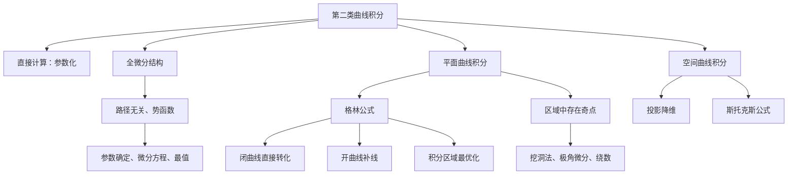
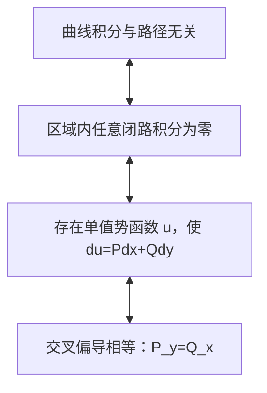
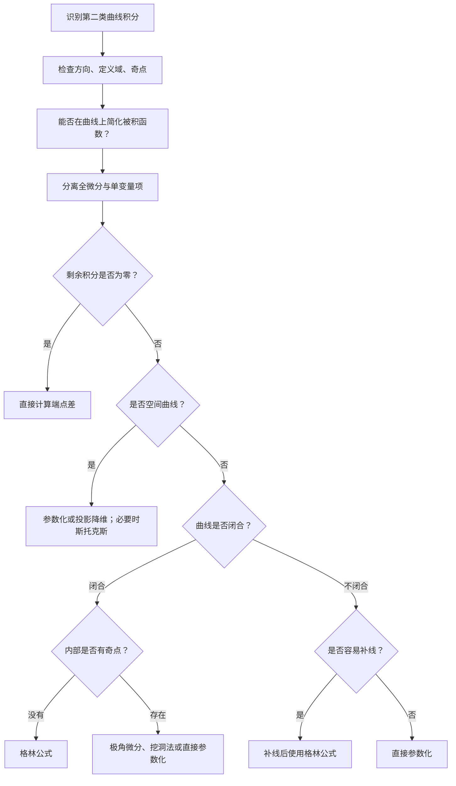

本节是考研数学一多元函数积分学中综合性很强的一节。它不仅考查曲线积分的计算，还能将二重积分、偏导数、全微分、微分方程、多元函数最值、二次型、空间解析几何等知识串联起来。

第二类曲线积分真正的难点，往往不在于积分计算本身，而在于**如何选择正确的计算方法，如何判断公式的适用条件，以及如何识别题目中隐藏的数学结构。**

## 一、本节知识体系与考查重点

第二类曲线积分可以划分为八个核心题型。

| 题型             | 核心方法           | 复习优先级 |
| -------------- | -------------- | ----- |
| 有向曲线积分直接计算     | 参数化、代入法        | ★★★★★ |
| 全微分识别与消项       | 凑微分、牛顿—莱布尼茨型公式 | ★★★★★ |
| 平面闭曲线积分        | 格林公式           | ★★★★★ |
| 平面非闭曲线积分       | 补线、格林公式        | ★★★★★ |
| 路径无关与势函数       | 交叉偏导、构造原函数     | ★★★★★ |
| 奇点与非单连通区域      | 挖洞法、极角微分       | ★★★★★ |
| 最值、微分方程、齐次函数综合 | 格林公式、路径无关判据    | ★★★★★ |
| 空间第二类曲线积分      | 降维、参数化、斯托克斯公式  | ★★★★☆ |

这八种题型并不是彼此独立的。它们的底层联系可以用下面的知识结构表示。

最重要的学习目标是：面对一道新题，能够在动笔计算之前判断出哪条路线最短。

## 二、基础概念：什么是第二类曲线积分？

### 2.1 从变力做功理解定义

假设质点在平面力场

$$
\boldsymbol F(x,y)=(P(x,y),Q(x,y))
$$

的作用下，沿有向曲线 $L$ 运动。

质点发生微小位移：

$$
\mathrm d\boldsymbol r=(\mathrm dx,\mathrm dy).
$$

那么微小功为

$$
\mathrm dW=\boldsymbol F\cdot\mathrm d\boldsymbol r =P\,\mathrm dx+Q\,\mathrm dy.
$$

沿整个运动路径累加，就得到第二类曲线积分：

$$
\boxed{W=\int_LP\,\mathrm dx+Q\,\mathrm dy}
$$

空间情形则是

$$
\boxed{ \int_LP\,\mathrm dx+Q\,\mathrm dy+R\,\mathrm dz }
$$

因此，第二类曲线积分也称为**对坐标的曲线积分**。

直观上，只有力在运动切线方向上的分量才能产生功。

如果力与运动方向一致，做正功；方向相反，做负功；始终垂直于运动方向，则做功为零。

### 2.2 第一类与第二类曲线积分的区别

| 对比     | 第一类曲线积分                     | 第二类曲线积分                                   |
| ------ | --------------------------- | ----------------------------------------- |
| 积分形式   | $\int_L f\,\mathrm ds$ | $\int_LP\,\mathrm dx+Q\,\mathrm dy$ |
| 积分对象   | 标量函数                        | 向量场的切向分量                                  |
| 典型物理意义 | 曲线质量                        | 变力做功                                      |
| 是否依赖方向 | 不依赖                         | 依赖                                        |
| 路径反向   | 积分值不变                       | 积分值变号                                     |
| 被积函数非负 | 积分非负                        | 不一定非负                                     |

若 $\boldsymbol T$ 是沿曲线正向的单位切向量，那么

$$
\mathrm d\boldsymbol r=\boldsymbol T\,\mathrm ds.
$$

所以

$$
\boxed{ \int_L\boldsymbol F\cdot\mathrm d\boldsymbol r = \int_L\boldsymbol F\cdot\boldsymbol T\,\mathrm ds }
$$

对于平面曲线，设切线方向角为 $\alpha$，有

$$
\mathrm dx=\cos\alpha\,\mathrm ds, \qquad \mathrm dy=\sin\alpha\,\mathrm ds.
$$

故

$$
\int_LP\,\mathrm dx+Q\,\mathrm dy = \int_L(P\cos\alpha+Q\sin\alpha)\,\mathrm ds.
$$

**第一类看长度，第二类看有向位移。**

这是本节所有方向问题的根源。

### 2.3 最重要的基本性质

**性质一：反向变号**

记 $-L$ 为曲线 $L$ 的反向曲线，则

$$
\boxed{ \int_{-L}P\,\mathrm dx+Q\,\mathrm dy =-\int_LP\,\mathrm dx+Q\,\mathrm dy }
$$

**性质二：路径可加性**

若有向曲线由首尾相接的 $L_1,L_2$ 构成，则

$$
\int_{L_1+L_2}\omega =\int_{L_1}\omega+\int_{L_2}\omega,
$$

其中简记

$$
\omega=P\,\mathrm dx+Q\,\mathrm dy.
$$

这是分段积分、补线法和挖洞法的基础。

**性质三：常数坐标积分只与端点有关**

设曲线从 $A(x_1,y_1)$ 到 $B(x_2,y_2)$，则

$$
\int_L\mathrm dx=x_2-x_1,
$$

$$
\int_L\mathrm dy=y_2-y_1.
$$

尤其对闭曲线：

$$
\boxed{\oint_L\mathrm dx=\oint_L\mathrm dy=0}
$$

更一般地，

$$
\int_L f(x)\,\mathrm dx=F(x_2)-F(x_1),
$$

其中 $F'=f$。无论曲线如何弯曲、坐标是否单调变化，该式均成立。

**性质四：估值公式**

若曲线长度为 $s_L$，且沿曲线有

$$
\sqrt{P^2+Q^2}\le M,
$$

则

$$
\boxed{ \left|\int_LP\,\mathrm dx+Q\,\mathrm dy\right| \le Ms_L }
$$

因为单位切向量的模为1，所以

$$
|\boldsymbol F\cdot\boldsymbol T| \le|\boldsymbol F|.
$$

此性质可以用于证明曲线积分极限、无穷小阶数和估值不等式。

## 三、题型一：第二类曲线积分的直接计算

### 3.1 参数化的基本公式

设有向曲线 $L$ 的参数方程为

$$
\begin{cases} x=x(t),\\ y=y(t), \end{cases} \qquad a\le t\le b,
$$

且参数 $t$ 增大的方向与题目给定方向一致，则

$$
\boxed{ \int_LP\,\mathrm dx+Q\,\mathrm dy =\int_a^b \left[ P(x(t),y(t))x'(t) +Q(x(t),y(t))y'(t) \right]\mathrm dt }
$$

空间曲线类似：

$$
\boxed{ I=\int_a^b(Px'+Qy'+Rz')\,\mathrm dt }
$$

这是最基础、最通用的方法。只要曲线可以适当地参数化，就可以考虑直接计算。

注意，与第一类曲线积分不同，这里不需要计算

$$
\sqrt{x'^2(t)+y'^2(t)+z'^2(t)}.
$$

### 3.2 常见曲线的参数选择

| 曲线类型             | 参数方程或代入方式                                           |
| ---------------- | --------------------------------------------------- |
| 显函数 $y=f(x)$ | $y=f(x),\ \mathrm dy=f'(x)\mathrm dx$           |
| 显函数 $x=g(y)$ | $x=g(y),\ \mathrm dx=g'(y)\mathrm dy$           |
| 线段 $AB$      | $\boldsymbol r(t)=A+t(B-A),\ t\in[0,1]$         |
| 圆周               | $x=a+R\cos t,\ y=b+R\sin t$                     |
| 椭圆               | $x=a\cos t,\ y=b\sin t$                         |
| 极坐标曲线            | $x=r(\theta)\cos\theta,\ y=r(\theta)\sin\theta$ |
| 折线               | 分段参数化后相加                                            |
| 空间交线             | 先参数化投影，再利用另一方程确定 $z$                            |

对于圆、椭圆，当两个半轴参数均为正时，角参数增大对应逆时针方向。

对于显函数，积分上下限必须对应起点与终点，而不能习惯性地将较小坐标放在下限。

### 母题1：等值线上的方向判断

**来源：2007年考研数学一。**

已知曲线

$$
L:f(x,y)=1
$$

经过第二象限的点 $M$ 和第四象限的点 $N$，$\Gamma$ 为从 $M$ 到 $N$ 的有向弧，判断下列积分的符号：

$$
I_1=\int_\Gamma f(x,y)\,\mathrm dx,
$$

$$
I_2=\int_\Gamma f(x,y)\,\mathrm dy,
$$

$$
I_3=\int_\Gamma f(x,y)\,\mathrm ds,
$$

$$
I_4=\int_\Gamma f_x\,\mathrm dx+f_y\,\mathrm dy.
$$

**解题过程**

因为沿整条曲线都有 $f(x,y)=1$，所以

$$
I_1=x_N-x_M>0.
$$

同理，

$$
I_2=y_N-y_M<escape><</escape>0.
$$

而

$$
I_3=\int_\Gamma1\,\mathrm ds =\operatorname{Length}(\Gamma)>0.
$$

最后，

$$
\begin{aligned} I_4 &=\int_\Gamma\mathrm df\\ &=f(N)-f(M)=0. \end{aligned}
$$

因此四个积分依次为正、负、正、零。

**母题提炼**

遇到曲线本身给出了某个函数的恒等关系，例如

$$
f(x,y)=C,
$$

立即检查以下两点：

$$
\boxed{\int_L f\,\mathrm dx=C(x_B-x_A)}
$$

$$
\boxed{\int_L\mathrm df=0}
$$

根本不需要知道曲线的具体形状。

这类题考查的是对积分定义和全微分的理解，而不是计算能力。

### 母题2：显函数直接代入与分部积分

**来源：2008年考研数学一。**

计算

$$
I=\int_L\sin2x\,\mathrm dx+ 2(x^2-1)y\,\mathrm dy,
$$

其中 $L$ 为曲线 $y=\sin x$ 上从 $(0,0)$ 到 $(\pi,0)$ 的一段弧。

<Steps>

<Step>

### 第一步：消去曲线变量 [!toc]

由

$$
y=\sin x,\qquad \mathrm dy=\cos x\,\mathrm dx,
$$

得

$$
\begin{aligned} I &=\int_0^\pi [\sin2x+2(x^2-1)\sin x\cos x]\mathrm dx\\ &=\int_0^\pi x^2\sin2x\,\mathrm dx. \end{aligned}
$$

</Step>

<Step>

### 第二步：分部积分 [!toc]

$$
\begin{aligned} I &=\left[-\frac{x^2}{2}\cos2x\right]_0^\pi +\int_0^\pi x\cos2x\,\mathrm dx\\ &=-\frac{\pi^2}{2} +\left[\frac{x}{2}\sin2x\right]_0^\pi -\frac12\int_0^\pi\sin2x\,\mathrm dx\\ &=\boxed{-\frac{\pi^2}{2}}. \end{aligned}
$$

</Step>

</Steps>

**解题经验**

显函数形式的开曲线，通常优先考虑直接代入。不要看到第二类曲线积分就条件反射地使用格林公式。

### 3.3 对称性与奇偶性

第二类曲线积分同样可以利用对称性，但必须考虑微分的方向。

设闭曲线 $L$ 关于原点中心对称，取正向，则对

$$
I=\oint_LP(x,y)\,\mathrm dx
$$

如果

$$
P(-x,-y)=P(x,y),
$$

由于中心对称变换下 $\mathrm dx$ 变为 $-\mathrm dx$，故

$$
I=0.
$$

而关于坐标轴的反射会改变闭曲线方向，因此不能直接照搬第一类曲线积分的奇偶性规则。

对于关于两坐标轴对称的正向简单闭曲线，可以使用下表。

| 积分形式                        | 关于 $x$ | 关于 $y$ | 结论 |
| --------------------------- | ---------- | ---------- | -- |
| $\oint_LP\,\mathrm dx$ | 任意         | 偶          | 为零 |
| $\oint_LP\,\mathrm dx$ | 奇          | 任意         | 为零 |
| $\oint_LQ\,\mathrm dy$ | 偶          | 任意         | 为零 |
| $\oint_LQ\,\mathrm dy$ | 任意         | 奇          | 为零 |

理解起来，更稳妥的方法是通过格林公式：

$$
\oint_LP\,\mathrm dx=-\iint_D P_y\,\mathrm dA,
$$

$$
\oint_LQ\,\mathrm dy=\iint_D Q_x\,\mathrm dA.
$$

如果转化后的被积函数为奇函数，就利用二重积分的对称性消项。使用这种推导时，需要满足格林公式的适用条件。

**在考场上，如果无法迅速判断第二类曲线积分的奇偶性，就先参数化或者转化成二重积分，不要凭感觉删项。**

## 四、题型二：全微分识别与积分消项

这是本节最值得强化的解题技巧之一。

很多题目故意把被积函数设计得复杂，但其中的大部分实际上都是可以直接消掉的全微分项。

### 4.1 全微分的基本定理

设 $u(x,y)$ 在相关区域内连续可微，则

$$
\mathrm du=u_x\,\mathrm dx+u_y\,\mathrm dy.
$$

对于从 $A$ 到 $B$ 的任意有向分段光滑曲线 $L$，有

$$
\boxed{\int_L\mathrm du=u(B)-u(A)}
$$

如果 $L$ 为闭曲线，则

$$
\boxed{\oint_L\mathrm du=0}
$$

这里要求 $u$ 在路径所在区域具有单值、连续可微的定义。

### 4.2 必须熟悉的全微分结构

| 微分形式                                                  | 对应函数                      |
| ----------------------------------------------------- | ------------------------- |
| $y\,\mathrm dx+x\,\mathrm dy$                   | $xy$                  |
| $2xy\,\mathrm dx+x^2\,\mathrm dy$               | $x^2y$                |
| $x\,\mathrm dx+y\,\mathrm dy$                   | $\frac12(x^2+y^2)$    |
| $e^x\sin y\,\mathrm dx+e^x\cos y\,\mathrm dy$   | $e^x\sin y$           |
| $f'(x)g(y)\,\mathrm dx+f(x)g'(y)\,\mathrm dy$   | $f(x)g(y)$            |
| $\frac{x\,\mathrm dx+y\,\mathrm dy}{x^2+y^2}$   | $\frac12\ln(x^2+y^2)$ |
| $\frac{y\,\mathrm dx-x\,\mathrm dy}{y^2}$       | $\frac xy$            |
| $yz\,\mathrm dx+xz\,\mathrm dy+xy\,\mathrm dz$ | $xyz$                 |

另一个十分重要的通式是

$$
\boxed{ f(g(x,y))\,\mathrm dg(x,y) =\mathrm dF(g(x,y)) }
$$

其中 $F'=f$。

即使不知道 $f$ 的具体表达式，只要找到复合函数的微分结构，就有可能完成积分。

### 母题3：分段圆弧与全微分消项

**来源：2012年考研数学一。**

曲线 $L$ 由两段圆弧组成：

第一段从原点 $O(0,0)$ 沿第一象限内的圆周

$$
x^2+y^2=2x
$$

到达 $A(2,0)$；

第二段再沿圆周

$$
x^2+y^2=4
$$

到达 $B(0,2)$。

求

$$
I=\int_L3x^2y\,\mathrm dx +(x^3+x-2y)\,\mathrm dy.
$$

**第一种思路：全部参数化**

当然可以分别计算两个圆弧上的积分，但三次幂项会使运算比较繁琐。

更好的办法是先观察分子结构：

$$
3x^2y\,\mathrm dx+x^3\,\mathrm dy =\mathrm d(x^3y).
$$

又有

$$
-2y\,\mathrm dy=-\mathrm d(y^2).
$$

所以

$$
I=[x^3y-y^2]_O^B+\int_Lx\,\mathrm dy.
$$

端点项等于

$$
[x^3y-y^2]_O^B=-4.
$$

于是只需计算

$$
\int_Lx\,\mathrm dy.
$$

第一段为圆心 $(1,0)$、半径1的上半圆，从左向右运动。补上 $x$ 轴线段后为顺时针方向，因此

$$
\int_{L_1}x\,\mathrm dy=-\frac\pi2.
$$

第二段参数化：

$$
x=2\cos t,\qquad y=2\sin t, \quad 0\le t\le\frac\pi2.
$$

故

$$
\begin{aligned} \int_{L_2}x\,\mathrm dy &=4\int_0^{\pi/2}\cos^2t\,\mathrm dt\\ &=\pi. \end{aligned}
$$

综上，

$$
\boxed{I=\frac\pi2-4}.
$$

**母题提炼**

复杂积分应首先尝试写成

$$
\boxed{ I=\int_L\mathrm du+\int_L\omega_1 }
$$

其中第一项直接由端点计算，第二项选择最简单的方法。

**先化简被积式，再选择积分方法。**

而不是先将整条曲线参数化，再对所有复杂函数进行代入。

### 母题4：复杂椭圆积分中的隐藏微分

**来源：2026年考研数学一。**

设 $L$ 为椭圆

$$
x^2+3y^2=1
$$

上沿逆时针方向从

$$
A\left(-\frac12,-\frac12\right)
$$

到

$$
B\left(\frac12,\frac12\right)
$$

的一段弧，求

$$
\begin{aligned} I=\int_L& (e^{x^2}\sin x-2xy)\,\mathrm dx\\ &+(6x-x^2-y\cos^4y)\,\mathrm dy. \end{aligned}
$$

这是非常典型的综合母题。

<Steps>

<Step>

### 第一步：识别看似无法积分的单变量函数 [!toc]

因为 $e^{x^2}\sin x$ 是奇函数，

$$
\int_Le^{x^2}\sin x\,\mathrm dx =\int_{-1/2}^{1/2}e^{x^2}\sin x\,\mathrm dx=0.
$$

同理，$y\cos^4y$ 是奇函数，

$$
\int_Ly\cos^4y\,\mathrm dy=0.
$$

注意，这里的消项依据是单变量原函数和端点的对称性，并不是要求椭圆弧本身关于坐标轴对称。

</Step>

<Step>

### 第二步：拆出混合全微分 [!toc]

$$
-2xy\,\mathrm dx-x^2\,\mathrm dy =-\mathrm d(x^2y).
$$

所以

$$
\begin{aligned} I &=-[x^2y]_A^B+6\int_Lx\,\mathrm dy\\ &=-\frac14+6\int_Lx\,\mathrm dy. \end{aligned}
$$

</Step>

<Step>

### 第三步：确定有向椭圆参数 [!toc]

令

$$
x=\cos t,\qquad y=\frac1{\sqrt3}\sin t.
$$

点 $A$ 对应 $t=4\pi/3$，点 $B$ 对应 $t=\pi/3$。

但题目要求逆时针，因此必须选择

$$
\frac{4\pi}{3}\le t\le\frac{7\pi}{3}.
$$

于是

$$
\begin{aligned} \int_Lx\,\mathrm dy &=\frac1{\sqrt3} \int_{4\pi/3}^{7\pi/3}\cos^2t\,\mathrm dt\\ &=\frac\pi{2\sqrt3}. \end{aligned}
$$

所以

$$
\boxed{I=\sqrt3\pi-\frac14}.
$$

</Step>

</Steps>

**为什么这道题值得重点掌握？**

它将本节的三个核心能力结合起来：单变量奇函数消项、混合全微分识别、有向椭圆参数化。

如果没有识别全微分和奇偶性，直接代入后会产生非常复杂的积分。

**复杂函数不一定意味着复杂运算。考研命题中，复杂函数经常是为了考查能否识别隐藏结构。**

### 母题5：利用曲线方程将分母化为常数

**来源：2027李林六套卷，第3套第19题。**

设 $L$ 为圆

$$
x^2+(y-\pi)^2=\pi^2
$$

的右半圆，从 $O(0,0)$ 到 $A(0,2\pi)$。求

$$
I=\int_L \frac{f'(x)\sin y\,\mathrm dx+ [f(x)\cos y-\pi x]\,\mathrm dy} {x^2+(y-\pi)^2}.
$$

沿曲线，分母恒为 $\pi^2$。

同时，

$$
f'(x)\sin y\,\mathrm dx+ f(x)\cos y\,\mathrm dy =\mathrm d[f(x)\sin y].
$$

因此

$$
I=\frac1{\pi^2}[f(x)\sin y]_O^A -\frac1\pi\int_Lx\,\mathrm dy.
$$

因为两个端点的正弦值均为零，

$$
I=-\frac1\pi\int_Lx\,\mathrm dy.
$$

右半圆从下向上运动，补上 $y$ 轴后为逆时针方向，且补线上的 $x=0$。

所以

$$
\int_Lx\,\mathrm dy=\frac12\pi\cdot\pi^2 =\frac{\pi^3}{2}.
$$

最终

$$
\boxed{I=-\frac{\pi^2}{2}}.
$$

**重要推论**

如果积分形式为

$$
\int_L\frac{\omega}{g(x,y)},
$$

而曲线方程恰好为 $g(x,y)=C\ne0$，则优先将分母提为常数：

$$
\int_L\frac{\omega}{g(x,y)} =\frac1C\int_L\omega.
$$

即使原分母在曲线内部存在零点，只要在曲线上恒为非零常数，也可以先完成这个等价变形。之后若简化出的微分形式满足格林公式条件，就可以对简化后的形式使用格林公式。

这与对原来的奇异被积式强行使用格林公式完全不同。

## 五、题型三：格林公式

格林公式是平面第二类曲线积分的核心，也是本节最重要的积分转换定理。

### 5.1 格林公式的标准形式

设 $D$ 为由分段光滑边界 $L$ 围成的平面有界闭区域，$P,Q$ 在包含 $D$ 的开区域内具有一阶连续偏导数，$L$ 取正向，则

$$
\boxed{ \oint_LP\,\mathrm dx+Q\,\mathrm dy =\iint_D \left( \frac{\partial Q}{\partial x} -\frac{\partial P}{\partial y} \right)\mathrm dx\,\mathrm dy }
$$

简记

$$
\boxed{\oint_LP\,\mathrm dx+Q\,\mathrm dy =\iint_D(Q_x-P_y)\,\mathrm dA}
$$

其中

$$
Q_x-P_y
$$

称为平面向量场的标量旋度。

### 5.2 如何直观理解格林公式？

把整个积分区域分割成大量微小矩形。分别计算每个小矩形边界上的环流积分。

相邻矩形的公共边会被沿相反方向各积分一次，因此内部边界的贡献全部抵消，最终只剩下最外层边界的积分。

而每个微小矩形的环流近似等于

$$
(Q_x-P_y)\Delta x\Delta y.
$$

不断细分后，就得到格林公式。

因此它的本质是：

**整个边界上的环流，等于区域内部局部旋转程度的总和。**

### 5.3 适用条件：三个必须检查的要素

| 条件  | 检查内容                           |
| --- | ------------------------------ |
| 闭合性 | 是否形成闭合边界                       |
| 取向  | 是否为区域的正向边界                     |
| 光滑性 | $P,Q$ 在所围区域及边界附近是否具有连续一阶偏导 |

其中正向的定义是：

沿边界前进时，积分区域始终位于左侧。

对于没有孔洞的普通区域，正向就是逆时针方向。

对于有孔洞的区域：

- 外边界取逆时针方向；
- 内边界取顺时针方向。

需要强调：**格林公式本身并不要求区域一定单连通。** 多连通区域也可以使用，只要把所有边界纳入，并保证边界方向和函数条件正确。

单连通性的重要作用主要体现在后面的路径无关判据。

### 5.4 格林公式的常见推论

令 $P=0,Q=x$，得到

$$
\boxed{\oint_Lx\,\mathrm dy=S_D}
$$

令 $P=-y,Q=0$，得到

$$
\boxed{-\oint_Ly\,\mathrm dx=S_D}
$$

两式相加：

$$
\boxed{ S_D=\frac12\oint_Lx\,\mathrm dy-y\,\mathrm dx }
$$

更一般地，

$$
\boxed{ \oint_Lax\,\mathrm dy-by\,\mathrm dx =(a+b)S_D }
$$

以上均对应逆时针方向的简单闭曲线。如果曲线取顺时针方向，则整体变号。

还有一种重要形式：

$$
\oint_LP\,\mathrm dx+Q\,\mathrm dy =C S_D,
$$

其前提是

$$
Q_x-P_y=C.
$$

### 母题6：旋度为常数的面积模型

**来源：1987年考研数学一。**

设 $L:x^2+y^2=9$，取正向，求

$$
I=\oint_L(2xy-2y)\,\mathrm dx +(x^2-4x)\,\mathrm dy.
$$

令

$$
P=2xy-2y,\qquad Q=x^2-4x.
$$

则

$$
P_y=2x-2,\qquad Q_x=2x-4.
$$

所以

$$
Q_x-P_y=-2.
$$

圆盘面积为 $9\pi$，由格林公式，

$$
I=-2\iint_D\mathrm dA =-2\cdot9\pi.
$$

故

$$
\boxed{I=-18\pi}.
$$

这一类题往往无需进行任何三角函数积分。

**迁移训练：李林880题**

设 $L$ 为逆时针方向的菱形边界

$$
|x|+|y|=1.
$$

求

$$
I=\oint_L \frac{ax\,\mathrm dy-by\,\mathrm dx}{|x|+|y|}.
$$

沿边界，分母恒为1。因此

$$
I=\oint_Lax\,\mathrm dy-by\,\mathrm dx.
$$

菱形面积为2，故

$$
\boxed{I=2(a+b)}.
$$

注意原分母在原点为零，但先在路径上化简后，新的被积式是多项式，可以合法使用格林公式。

## 六、题型四：开曲线补线与格林公式

### 6.1 核心原理

格林公式不能直接用于普通的开曲线。

可以添加一条从终点 $B$ 返回起点 $A$ 的辅助曲线 $S$，使得

$$
L+S=\partial D.
$$

若闭合后的方向为正向，则

$$
\int_L\omega+\int_S\omega =\iint_D(Q_x-P_y)\,\mathrm dA.
$$

从而

$$
\boxed{ \int_L\omega =\iint_D(Q_x-P_y)\,\mathrm dA-\int_S\omega }
$$

若闭合后为顺时针方向，则

$$
\boxed{ \int_L\omega =-\iint_D(Q_x-P_y)\,\mathrm dA-\int_S\omega }
$$

### 6.2 如何选择补线？

优先选择坐标轴、水平线、竖直线或连接起终点的直线。

最理想的情况是补线上的积分为零。例如：

| 补线位置          | 微分条件                     |
| ------------- | ------------------------ |
| $x$ 轴     | $y=0,\ \mathrm dy=0$ |
| $y$ 轴     | $x=0,\ \mathrm dx=0$ |
| 水平线 $y=c$ | $\mathrm dy=0$       |
| 竖直线 $x=c$ | $\mathrm dx=0$       |

需要注意，补线不能只追求计算方便，还必须保证补线后围成的区域满足格林公式的适用条件。

### 母题7：开抛物线与方向反转

**来源：2025年考研数学一。**

设 $L$ 沿抛物线

$$
y=1-x^2
$$

从 $(1,0)$ 到 $(-1,0)$，求

$$
I=\int_L(y+\cos x)\,\mathrm dx +(2x+\cos y)\,\mathrm dy.
$$

<Tabs items={["方法一：全微分加直接参数化", "方法二：全微分加补线"]} defaultIndex={0}>

<Tab value="方法一：全微分加直接参数化">

首先

$$
\cos x\,\mathrm dx+\cos y\,\mathrm dy =\mathrm d(\sin x+\sin y).
$$

所以这部分积分为

$$
[\sin x+\sin y]_{(1,0)}^{(-1,0)} =-2\sin1.
$$

而

$$
y\,\mathrm dx+2x\,\mathrm dy =\mathrm d(xy)+x\,\mathrm dy.
$$

由于两个端点均有 $xy=0$，故

$$
I=-2\sin1+\int_Lx\,\mathrm dy.
$$

由

$$
\mathrm dy=-2x\,\mathrm dx,
$$

得

$$
\int_Lx\,\mathrm dy =-2\int_1^{-1}x^2\,\mathrm dx =\frac43.
$$

最终

$$
\boxed{I=\frac43-2\sin1}.
$$

</Tab>

<Tab value="方法二：全微分加补线">

仍然先拆掉余弦项。

对于剩下的

$$
\int_Ly\,\mathrm dx+2x\,\mathrm dy,
$$

补上从 $(-1,0)$ 到 $(1,0)$ 的 $x$ 轴线段。

补线积分为零，闭合方向为逆时针，且

$$
Q_x-P_y=2-1=1.
$$

所以

$$
\begin{aligned} I &=-2\sin1+\iint_D1\,\mathrm dA\\ &=-2\sin1+\int_{-1}^1(1-x^2)\,\mathrm dx\\ &=\boxed{\frac43-2\sin1}. \end{aligned}
$$

</Tab>

</Tabs>

<Callout type="warn" title="方向陷阱">

对于位于 $x$ 轴上方的弧：

由左向右沿上弧运动，再沿底边返回，构成顺时针方向；

由右向左沿上弧运动，再沿底边返回，构成逆时针方向。

这与积分上下限的增减不是同一个判断标准。

</Callout>

### 母题8：复杂被积式与开曲线补线

**来源：2027李永乐六套卷，第1套第18题。**

设 $L$ 为抛物线 $y=1-x^2$ 上从 $(-1,0)$ 到 $(1,0)$ 的一段弧，求

$$
\begin{aligned} I=\int_L& \left(\frac{x}{1+x^2+y^2}-x^2y\right)\mathrm dx\\ &+\left(\frac{y}{1+x^2+y^2}+xy^2\right)\mathrm dy. \end{aligned}
$$

首先识别

$$
\frac{x\,\mathrm dx+y\,\mathrm dy}{1+x^2+y^2} =\frac12\mathrm d\ln(1+x^2+y^2).
$$

两端点到原点距离相等，因此该部分积分为零。

剩下

$$
I=\int_L-x^2y\,\mathrm dx+xy^2\,\mathrm dy.
$$

补上 $x$ 轴线段，其积分为零。但本题是从左向右沿上弧运动，所以闭合后为顺时针方向。

计算

$$
Q_x-P_y=y^2+x^2.
$$

于是

$$
\begin{aligned} I &=-\iint_D(x^2+y^2)\,\mathrm dA\\ &=-\int_{-1}^1\mathrm dx \int_0^{1-x^2}(x^2+y^2)\,\mathrm dy\\ &=-\int_{-1}^1 \left[x^2(1-x^2)+\frac{(1-x^2)^3}{3}\right]\mathrm dx\\ &=\boxed{-\frac47}. \end{aligned}
$$

这道模拟题与2025年真题的核心结构高度相似，只是增加了对数全微分识别及二重积分计算。

## 七、题型五：格林公式与积分比较、最值问题

这一类题不只是计算曲线积分，还需要利用转化后的二重积分分析区域的几何性质。

### 7.1 椭圆区域的常用二次矩公式

设

$$
D:\frac{x^2}{a^2}+\frac{y^2}{b^2}\le1.
$$

通过椭圆极坐标变换，可以得到

$$
\iint_D1\,\mathrm dA=\pi ab,
$$

$$
\boxed{\iint_Dx^2\,\mathrm dA=\frac{\pi a^3b}{4}}
$$

$$
\boxed{\iint_Dy^2\,\mathrm dA=\frac{\pi ab^3}{4}}
$$

此外，由对称性，

$$
\iint_Dx\,\mathrm dA =\iint_Dy\,\mathrm dA =\iint_Dxy\,\mathrm dA=0.
$$

因此对于二次函数，

$$
\boxed{ \iint_D(c-mx^2-ny^2)\,\mathrm dA =\pi ab\left(c-\frac{ma^2+nb^2}{4}\right) }
$$

这一公式可以大幅减少曲线积分比较题的计算量。

### 母题9：四个椭圆边界积分的大小比较

**来源：2013年考研数学一。**

设四条逆时针曲线分别为

$$
\begin{aligned} L_1&:x^2+y^2=1,\\ L_2&:x^2+y^2=2,\\ L_3&:x^2+2y^2=2,\\ L_4&:2x^2+y^2=2. \end{aligned}
$$

记

$$
I_i=\oint_{L_i} \left(y+\frac{y^3}{6}\right)\mathrm dx +\left(2x-\frac{x^3}{3}\right)\mathrm dy.
$$

问哪个积分最大。

<Steps>

<Step>

### 第一步：使用格林公式 [!toc]

$$
Q_x-P_y =(2-x^2)-\left(1+\frac{y^2}{2}\right).
$$

故

$$
I_i=\iint_{D_i} \left(1-x^2-\frac{y^2}{2}\right)\mathrm dA.
$$

</Step>

<Step>

### 第二步：使用椭圆二次矩 [!toc]

统一记

$$
I(a,b)=\pi ab\left(1-\frac{a^2}{4}-\frac{b^2}{8}\right).
$$

代入四个区域：

| 积分        | 半轴 $a,b$        | 积分值                        |
| --------- | ------------------- | -------------------------- |
| $I_1$ | $1,1$           | $\frac{5\pi}{8}$       |
| $I_2$ | $\sqrt2,\sqrt2$ | $\frac{\pi}{2}$        |
| $I_3$ | $\sqrt2,1$      | $\frac{3\sqrt2\pi}{8}$ |
| $I_4$ | $1,\sqrt2$      | $\frac{\sqrt2\pi}{2}$  |

因此

$$
\boxed{I_4\text{ 最大}}
$$

更进一步有

$$
I_2<I_3<I_1<I_4.
$$

</Step>

</Steps>

**更深层的理解**

被积函数

$$
g(x,y)=1-x^2-\frac{y^2}{2}
$$

为正的区域恰好是

$$
x^2+\frac{y^2}{2}<escape><</escape>1.
$$

而这正是 $D_4$。

也就是说，$D_4$ 恰好包含被积函数为正的部分，同时排除为负的部分。

因此实际上可以不计算任何一个具体积分，直接判断 $I_4$ 最大。

这种解法比椭圆二次矩公式更有普遍性。

### 7.2 任意区域积分最大值的一般原理

设

$$
I(D)=\iint_Dg(x,y)\,\mathrm dA.
$$

假设没有额外面积、形状或位置约束，且正值区域可以作为合法的积分区域，则应当尽可能包含所有 $g>0$ 的点，并排除所有 $g<escape><</escape>0$ 的点。

因此最优区域通常为

$$
\boxed{D_{\max}=\{(x,y):g(x,y)\ge0\}}
$$

对应最小值则考虑负值区域。

但必须注意：如果题目限制积分区域的面积、连通性或边界形状，不能直接套用这一结论。还需要检查正值区域是否符合所有约束，以及最值是否存在。

### 母题10：积分区域优化与奇点积分综合

**来源：2021年考研数学一。**

设 $D$ 为有界单连通闭区域，

$$
I(D)=\iint_D(4-x^2-y^2)\,\mathrm dA
$$

取得最大值时的区域为 $D_1$。

第一问：求最大值。

第二问：计算

$$
J=\oint_{\partial D_1} \frac{(xe^{x^2+4y^2}+y)\,\mathrm dx +(4ye^{x^2+4y^2}-x)\,\mathrm dy} {x^2+4y^2},
$$

其中边界取正向。

**第一问：确定最优区域**

由

$$
4-x^2-y^2\ge0,
$$

得到

$$
\boxed{D_1:x^2+y^2\le4}.
$$

所以

$$
\begin{aligned} I(D_1) &=\int_0^{2\pi}\mathrm d\theta \int_0^2(4-r^2)r\,\mathrm dr\\ &=2\pi\left[2r^2-\frac{r^4}{4}\right]_0^2\\ &=\boxed{8\pi}. \end{aligned}
$$

**第二问：拆分微分形式**

令

$$
s=x^2+4y^2.
$$

则

$$
\mathrm ds=2x\,\mathrm dx+8y\,\mathrm dy.
$$

原积分可写成

$$
J=\frac12\oint_{\partial D_1} \frac{e^s}{s}\,\mathrm ds +\oint_{\partial D_1} \frac{y\,\mathrm dx-x\,\mathrm dy}{x^2+4y^2}.
$$

因为沿边界有 $s>0$，第一项是单值全微分的闭路积分，等于零。

因此

$$
J=\oint_{\partial D_1} \frac{y\,\mathrm dx-x\,\mathrm dy}{x^2+4y^2}.
$$

令

$$
u=x,\qquad v=2y.
$$

则

$$
J=-\frac12\oint_{L'} \frac{u\,\mathrm dv-v\,\mathrm du}{u^2+v^2}.
$$

变换后的椭圆逆时针绕原点一次，极角总增量为 $2\pi$。因此

$$
\boxed{J=-\pi}.
$$

第二问涉及的重要奇点模型将在第九部分详细推导。

**命题规律**

这道真题几乎是本节平面部分的综合母题，串联了：

二重积分最优区域、极坐标计算、复合函数全微分、奇点判断、线性变换及极角积分。

张宇1000题第18章中的第009题和第024题，也分别使用了这道真题的变式结构和第二问结构。

### 母题11：含参数的曲线积分最值

**来源：李林880题，第九章。**

设

$$
L:x^2+y^2=R^2,\qquad R>0,
$$

取逆时针方向，求

$$
I(R)=\oint_Ly^3\,\mathrm dx+(3x-x^3)\,\mathrm dy
$$

的最大值。

由格林公式，

$$
\begin{aligned} I(R) &=\iint_D(3-3x^2-3y^2)\,\mathrm dA\\ &=6\pi\int_0^R(1-r^2)r\,\mathrm dr\\ &=3\pi R^2-\frac{3\pi}{2}R^4. \end{aligned}
$$

所以

$$
I'(R)=6\pi R(1-R^2).
$$

当 $0<R<escape><</escape>1$ 时递增，当 $R>1$ 时递减。

因此

$$
\boxed{R=1,\qquad I_{\max}=\frac{3\pi}{2}}.
$$

**模拟题迁移：李林六套卷第2套第12题**

若改成

$$
I(t)=\oint_L(y^3+3x)\,\mathrm dx+(3x-x^3)\,\mathrm dy,
$$

其中 $L:x^2+y^2=t^2$，则由于

$$
\oint_L3x\,\mathrm dx=0,
$$

仍然得到

$$
I(t)=3\pi t^2-\frac{3\pi}{2}t^4.
$$

但题目不求最大值，而是求拐点。

$$
I''(t)=6\pi-18\pi t^2.
$$

令其为零：

$$
t=\frac1{\sqrt3}.
$$

此处二阶导数发生变号，且

$$
I\left(\frac1{\sqrt3}\right)=\frac{5\pi}{6}.
$$

因此拐点为

$$
\boxed{\left(\frac1{\sqrt3},\frac{5\pi}{6}\right)}.
$$

这说明未来的新题可能不会改变积分的底层结构，只改变最后的研究对象：由最大值改成单调性、拐点、零点或极限。

## 八、题型六：曲线积分与路径无关、势函数

这是本节理论性最强的部分，也是考研证明题、含参计算题、微分方程综合题的重要来源。

### 8.1 什么叫与路径无关？

设 $D$ 是一个连通区域，若对于 $D$ 内任意两点 $A,B$，无论选取哪条从 $A$ 到 $B$ 的有向曲线，积分

$$
I=\int_A^BP\,\mathrm dx+Q\,\mathrm dy
$$

都相同，则称该积分在区域 $D$ 内与路径无关。

注意这里的三个关键词：

**指定区域、任意端点、任意路径。**

只证明某两条曲线积分相等，并不足以证明整个区域内与路径无关。

### 8.2 路径无关的四个重要等价条件

设 $D$ 为平面单连通区域，且 $P,Q\in C^1(D)$，则下列四个条件等价。

用公式表示为

$$
\boxed{ \int_A^B\omega\text{ 与路径无关} }
$$

$$
\Updownarrow
$$

$$
\boxed{\oint_L\omega=0\quad\text{对任意闭路成立}}
$$

$$
\Updownarrow
$$

$$
\boxed{\exists u(x,y),\quad u_x=P,\quad u_y=Q}
$$

$$
\Updownarrow
$$

$$
\boxed{P_y=Q_x}
$$

特别重要的是：

前三个条件在一般连通开区域、$P,Q$ 连续的条件下也可以建立等价关系。

但是，从交叉偏导相等推出路径无关，需要额外的区域条件，单连通性是最常用的充分条件。

### 8.3 什么是单连通区域？

直观上，单连通区域内部没有阻碍闭曲线连续收缩的孔洞。

| 区域                     | 是否单连通 |
| ---------------------- | ----- |
| 整个平面                   | 是     |
| 上半平面 $y>0$         | 是     |
| 右半平面 $x>0$         | 是     |
| 圆盘内部                   | 是     |
| 矩形内部                   | 是     |
| 去掉原点后的整个平面             | 否     |
| 圆环内部                   | 否     |
| 去掉负 $x$ 半轴（含原点）的平面 | 是     |

判断是否与路径无关时，绝不能只看被积函数而忽略定义域。

**同一个微分形式，在不同区域内可能得到完全不同的结论。**

### 8.4 如何求势函数？

<Tabs items={["方法一：偏积分法", "方法二：折线路径法", "方法三：直接凑全微分"]} defaultIndex={0}>

<Tab value="方法一：偏积分法">

已知

$$
u_x=P,\qquad u_y=Q.
$$

先对 $x$ 积分：

$$
u(x,y)=\int P(x,y)\,\mathrm dx+\varphi(y).
$$

然后对 $y$ 求偏导，与 $Q$ 比较，确定 $\varphi(y)$。

注意积分常数不是普通常数，而是关于另一变量的函数。

</Tab>

<Tab value="方法二：折线路径法">

若已经证明积分与路径无关，且所选折线完全位于定义域内，则可以选取

$$
(x_0,y_0)\to(x,y_0)\to(x,y).
$$

由此构造势函数：

$$
\boxed{ u(x,y)= \int_{x_0}^xP(t,y_0)\,\mathrm dt +\int_{y_0}^yQ(x,t)\,\mathrm dt+C }
$$

</Tab>

<Tab value="方法三：直接凑全微分">

例如

$$
P=2xy+e^x,\qquad Q=x^2+2y,
$$

可以直接观察到

$$
P\,\mathrm dx+Q\,\mathrm dy =\mathrm d(x^2y+e^x+y^2).
$$

从而

$$
u=x^2y+e^x+y^2+C.
$$

这通常是最简洁的方法。

</Tab>

</Tabs>

### 母题12：路径无关反求未知函数

**来源：1989年考研数学一。**

设曲线积分

$$
\int_Lxy^2\,\mathrm dx+y\varphi(x)\,\mathrm dy
$$

与路径无关，且

$$
\varphi(0)=0.
$$

求从 $(0,0)$ 到 $(1,1)$ 的积分值。

<Steps>

<Step>

### 第一步：利用路径无关的必要条件 [!toc]

$$
P_y=2xy, \qquad Q_x=y\varphi'(x).
$$

所以

$$
2xy=y\varphi'(x).
$$

该恒等式对区域内所有点成立，选取 $y\ne0$ 可得

$$
\varphi'(x)=2x.
$$

结合初始条件，

$$
\boxed{\varphi(x)=x^2}.
$$

</Step>

<Step>

### 第二步：恢复势函数 [!toc]

$$
\begin{aligned} xy^2\,\mathrm dx+x^2y\,\mathrm dy &=\frac12\mathrm d(x^2y^2). \end{aligned}
$$

于是

$$
\begin{aligned} I &=\left[\frac12x^2y^2\right]_{(0,0)}^{(1,1)}\\ &=\boxed{\frac12}. \end{aligned}
$$

</Step>

</Steps>

**标准解题模板**

凡是已知路径无关，要求参数或未知函数，优先使用

$$
\boxed{ P_y=Q_x \Longrightarrow \text{参数方程或微分方程} \Longrightarrow \text{确定未知量} }
$$

确定未知量后，还应注意题目是否要求证明充分性。若要求证明，需检查区域条件，或者直接构造全局势函数。

### 母题13：含参梯度场与反正切势函数

**来源：1998年考研数学一。**

确定 $\lambda$，使得右半平面 $x>0$ 上的向量场

$$
\boldsymbol A= 2xy(x^4+y^2)^\lambda\boldsymbol i -x^2(x^4+y^2)^\lambda\boldsymbol j
$$

为某个二元函数 $u(x,y)$ 的梯度，并求 $u$。

<Steps>

<Step>

### 第一步：翻译题目 [!toc]

“为某函数的梯度”意味着

$$
u_x=2xy(x^4+y^2)^\lambda,
$$

$$
u_y=-x^2(x^4+y^2)^\lambda.
$$

所以要求

$$
P_y=Q_x.
$$

令 $S=x^4+y^2$，则

$$
P_y=2xS^{\lambda-1} [x^4+(1+2\lambda)y^2],
$$

$$
Q_x=-2xS^{\lambda-1} [(1+2\lambda)x^4+y^2].
$$

两者相等，可得

$$
2(\lambda+1)(x^4+y^2)=0.
$$

由于 $x>0$，有 $x^4+y^2>0$。

因此

$$
\boxed{\lambda=-1}.
$$

</Step>

<Step>

### 第二步：识别复合反正切函数 [!toc]

此时微分形式变为

$$
\omega=\frac{2xy\,\mathrm dx-x^2\,\mathrm dy}{x^4+y^2}.
$$

观察

$$
\mathrm d\left(\frac{y}{x^2}\right) =\frac{x^2\,\mathrm dy-2xy\,\mathrm dx}{x^4}.
$$

所以

$$
\begin{aligned} \omega &=-\frac{1}{1+(y/x^2)^2} \,\mathrm d\left(\frac{y}{x^2}\right)\\ &=-\mathrm d\left(\arctan\frac{y}{x^2}\right). \end{aligned}
$$

最终

$$
\boxed{u(x,y)=-\arctan\frac{y}{x^2}+C}.
$$

</Step>

</Steps>

**重要迁移公式**

$$
\boxed{ \mathrm d\arctan\frac{v}{u} =\frac{u\,\mathrm dv-v\,\mathrm du}{u^2+v^2} }
$$

该公式直接使用时，要求 $u\ne0$，并且在所考虑的连通区域内选择合适的连续角度分支。

这正是后面奇点积分的基本结构。

### 母题14：复合函数全微分与端点条件

**来源：2002年考研数学一。**

设 $f$ 具有一阶连续导数，$L$ 为上半平面 $y>0$ 内从 $(a,b)$ 到 $(c,d)$ 的有向曲线。

记

$$
\begin{aligned} I=\int_L& \frac1y[1+y^2f(xy)]\,\mathrm dx\\ &+\frac{x}{y^2}[y^2f(xy)-1]\,\mathrm dy. \end{aligned}
$$

证明积分与路径无关，并在 $ab=cd$ 时求积分值。

<Steps>

<Step>

### 第一步：展开并重组 [!toc]

$$
\begin{aligned} \omega ={}&\frac1y\,\mathrm dx-\frac{x}{y^2}\,\mathrm dy\\ &+f(xy)(y\,\mathrm dx+x\,\mathrm dy). \end{aligned}
$$

容易识别

$$
\frac1y\,\mathrm dx-\frac{x}{y^2}\,\mathrm dy =\mathrm d\left(\frac xy\right),
$$

以及

$$
y\,\mathrm dx+x\,\mathrm dy=\mathrm d(xy).
$$

设 $F'=f$，则

$$
\omega=\mathrm d\left[\frac xy+F(xy)\right].
$$

由于上半平面 $y>0$，该势函数具有良好的全局定义。

故积分与路径无关。

</Step>

<Step>

### 第二步：计算端点差 [!toc]

$$
I=\frac cd-\frac ab+F(cd)-F(ab).
$$

题设 $ab=cd$，因此未知函数对应的积分项消失。

最终

$$
\boxed{I=\frac cd-\frac ab}.
$$

</Step>

</Steps>

**命题规律**

题目不给出 $f$ 的具体表达式，并不意味着无法计算。

如果题目提供了端点处复合变量相等的条件，例如

$$
g(A)=g(B),
$$

那么

$$
\int_Lf(g)\,\mathrm dg=0.
$$

所以看到形如 $ab=cd$、两个端点到原点距离相等、两个端点位于同一等值线等条件时，应当立即考虑全微分消项。

### 母题15：齐次函数与闭路积分证明

**来源：2006年考研数学一。**

设 $f(x,y)$ 在上半平面具有连续偏导数，且对任意 $t>0$，

$$
f(tx,ty)=t^{-2}f(x,y).
$$

证明任意分段光滑简单闭曲线 $L$ 都满足

$$
\oint_Lyf\,\mathrm dx-xf\,\mathrm dy=0.
$$

<Tabs items={["方法一：欧拉齐次函数公式", "方法二：构造势函数"]} defaultIndex={0}>

<Tab value="方法一：欧拉齐次函数公式">

对恒等式

$$
f(tx,ty)=t^{-2}f(x,y)
$$

关于 $t$ 求导，再令 $t=1$。

得到

$$
xf_x+yf_y=-2f.
$$

设

$$
P=yf,\qquad Q=-xf.
$$

则

$$
\begin{aligned} Q_x-P_y &=(-f-xf_x)-(f+yf_y)\\ &=-2f-xf_x-yf_y\\ &=0. \end{aligned}
$$

上半平面是凸集，简单闭曲线及其有界内部均位于上半平面。

因此由格林公式，

$$
\boxed{\oint_Lyf\,\mathrm dx-xf\,\mathrm dy=0}.
$$

</Tab>

<Tab value="方法二：构造势函数">

利用齐次性，

$$
f(x,y)=\frac1{y^2}f\left(\frac xy,1\right).
$$

令

$$
h(s)=f(s,1),\qquad s=\frac xy.
$$

则

$$
\begin{aligned} yf\,\mathrm dx-xf\,\mathrm dy &=h(s)\left( \frac{\mathrm dx}{y} -\frac{x}{y^2}\mathrm dy \right)\\ &=h(s)\,\mathrm ds\\ &=\mathrm dH(s). \end{aligned}
$$

故闭路积分为零。

</Tab>

</Tabs>

**推广结论**

对于 $m$ 次齐次函数

$$
f(tx,ty)=t^mf(x,y),
$$

有欧拉公式

$$
xf_x+yf_y=mf.
$$

于是对

$$
\omega=yf\,\mathrm dx-xf\,\mathrm dy,
$$

有

$$
\boxed{Q_x-P_y=-(m+2)f}.
$$

当 $m=-2$ 时，旋度恒为零。

李林880题第九章第048题将原题改成了二次齐次函数 $f$ 的倒数：

$$
\oint_L\frac y{f(x,y)}\,\mathrm dx -\frac x{f(x,y)}\,\mathrm dy.
$$

因为 $1/f$ 是负二次齐次函数，所以直接复用上述模型即可。

### 母题16：路径无关与微分方程综合

**来源：李正元练习题，第十章。**

设 $\varphi(x)$ 在 $x>0$ 内具有连续导数，且

$$
\varphi(\pi)=1.
$$

确定 $\varphi(x)$，使得

$$
I=\int_{AB} [\sin x-\varphi(x)]\frac yx\,\mathrm dx +\varphi(x)\,\mathrm dy
$$

在右半平面内与路径无关。

然后计算从 $(1,1)$ 到 $(\pi,\pi)$ 的积分。

由路径无关条件，

$$
P_y=Q_x.
$$

即

$$
\frac{\sin x-\varphi(x)}x=\varphi'(x).
$$

整理得

$$
x\varphi'(x)+\varphi(x)=\sin x.
$$

这恰好是

$$
[x\varphi(x)]'=\sin x.
$$

所以

$$
x\varphi(x)=-\cos x+C.
$$

由 $\varphi(\pi)=1$，得

$$
C=\pi-1.
$$

因此

$$
\boxed{\varphi(x)=\frac{\pi-1-\cos x}{x}}.
$$

利用已求得的微分方程，原式变成

$$
y\varphi'(x)\,\mathrm dx+\varphi(x)\,\mathrm dy =\mathrm d[y\varphi(x)].
$$

故

$$
\begin{aligned} I &=[y\varphi(x)]_{(1,1)}^{(\pi,\pi)}\\ &=\pi-\varphi(1)\\ &=\boxed{1+\cos1}. \end{aligned}
$$

**高阶微分方程变式**

李林880题第九章第041题给出

$$
\begin{aligned} P&=[xe^{2x}-6f(x)]\sin y,\\ Q&=[f'(x)-5f(x)]\cos y. \end{aligned}
$$

若积分与路径无关，则

$$
[xe^{2x}-6f(x)]\cos y =[f''(x)-5f'(x)]\cos y.
$$

比较恒等式中系数，得到

$$
\boxed{f''-5f'+6f=xe^{2x}}.
$$

此时题目就转化成了第五模块的二阶常系数非齐次线性微分方程。

结合原题初始条件

$$
f(0)=0,\qquad f'(0)=1,
$$

可解得

$$
\boxed{ f(x)=2e^{3x} -\left(2+x+\frac{x^2}{2}\right)e^{2x} }
$$

考研数一的综合题经常采用这种结构：曲线积分负责建立方程，微分方程知识负责求解方程。

### 母题17：全微分与多元函数最值

**来源：2027李永乐六套卷，第2套第18题。**

设 $\varphi(0)=0$，且

$$
\begin{aligned} P&=[y-2x\varphi(xy)]e^{-x^2-y^2},\\ Q&=[x-2y\varphi(xy)]e^{-x^2-y^2}. \end{aligned}
$$

已知积分在全平面内与路径无关，求 $\varphi$，以及从原点到任意点 $(a,b)$ 的积分值和最值。

<Steps>

<Step>

### 第一步：利用路径无关 [!toc]

计算交叉偏导后整理得到

$$
P_y-Q_x =2(x^2-y^2)[1-\varphi'(xy)]e^{-x^2-y^2}.
$$

由恒等于零可知

$$
\varphi'(t)=1.
$$

这里不能未经说明直接除以 $x^2-y^2$。严格地说，对任意实数 $t$，都可以选取满足 $xy=t$ 且 $x^2\ne y^2$ 的点。

再利用 $\varphi(0)=0$，得

$$
\boxed{\varphi(t)=t}.
$$

</Step>

<Step>

### 第二步：构造全微分 [!toc]

代入后，

$$
\omega=\mathrm d(xye^{-x^2-y^2}).
$$

故

$$
\boxed{I(a,b)=ab e^{-a^2-b^2}}.
$$

</Step>

<Step>

### 第三步：求全局最值 [!toc]

由基本不等式

$$
2|ab|\le a^2+b^2.
$$

令

$$
s=a^2+b^2,
$$

则

$$
|I|\le\frac12se^{-s}.
$$

因为 $se^{-s}$ 在 $s=1$ 时取得最大值 $1/e$，所以

$$
|I|\le\frac1{2e}.
$$

当 $a^2=b^2=1/2$ 时可以取到等号。

于是

$$
\boxed{ I_{\max}=\frac1{2e},\qquad I_{\min}=-\frac1{2e} }
$$

其中最大值要求 $ab>0$，最小值要求 $ab<escape><</escape>0$。

这道模拟题将第六模块的多元函数最值与本节路径无关问题进行了自然结合。

</Step>

</Steps>

## 九、题型七：奇点、极角微分、挖洞法

这是本节最容易出现原则性错误、同时也最值得掌握的高阶题型。

2000年、2020年、2021年真题以及多套模拟题，都包含这一结构。

### 9.1 为什么交叉偏导相等还不一定与路径无关？

考虑微分形式

$$
\omega=\frac{-y\,\mathrm dx+x\,\mathrm dy}{x^2+y^2}.
$$

令

$$
P=-\frac y{x^2+y^2}, \qquad Q=\frac x{x^2+y^2}.
$$

在原点之外，

$$
P_y=Q_x.
$$

但沿单位圆逆时针积分：

$$
x=\cos t,\quad y=\sin t,\quad 0\le t\le2\pi,
$$

有

$$
x\,\mathrm dy-y\,\mathrm dx=\mathrm dt.
$$

所以

$$
\oint_L\omega =\int_0^{2\pi}\mathrm dt =2\pi\ne0.
$$

为什么会出现这种情况？

因为原点是奇点。去掉原点后的平面不是单连通区域，单位圆无法在不经过奇点的情况下连续收缩成一点。

因此

$$
\boxed{P_y=Q_x\ \not\Rightarrow\ \text{一般区域内路径无关}}
$$

这也是本节最重要的理论反例。

### 9.2 极角微分公式

令

$$
x=r\cos\theta,\qquad y=r\sin\theta.
$$

则

$$
\mathrm dx=\cos\theta\,\mathrm dr-r\sin\theta\,\mathrm d\theta,
$$

$$
\mathrm dy=\sin\theta\,\mathrm dr+r\cos\theta\,\mathrm d\theta.
$$

于是

$$
x\,\mathrm dy-y\,\mathrm dx=r^2\,\mathrm d\theta.
$$

因此

$$
\boxed{ \frac{x\,\mathrm dy-y\,\mathrm dx}{x^2+y^2} =\mathrm d\theta }
$$

同时，

$$
x\,\mathrm dx+y\,\mathrm dy=r\,\mathrm dr,
$$

所以

$$
\boxed{ \frac{x\,\mathrm dx+y\,\mathrm dy}{x^2+y^2} =\mathrm d\ln r }
$$

这两个公式需要形成鲜明的对比。

| 微分形式                                                | 意义      | 闭路积分  |
| --------------------------------------------------- | ------- | ----- |
| $\frac{x\,\mathrm dx+y\,\mathrm dy}{x^2+y^2}$ | 半径的对数微分 | 恒为零   |
| $\frac{x\,\mathrm dy-y\,\mathrm dx}{x^2+y^2}$ | 连续极角的增量 | 不一定为零 |

半径返回原值时，对数必然返回原值；但绕原点一周后，连续极角会增加 $2\pi$。

### 9.3 绕数公式

对于不经过原点的有向闭曲线 $L$，

$$
\boxed{ \oint_L \frac{x\,\mathrm dy-y\,\mathrm dx}{x^2+y^2} =2\pi n }
$$

其中 $n$ 为闭曲线绕原点的绕数。

对于简单闭曲线，只需掌握以下情况：

| 原点位置与曲线方向  | 积分值          |
| ---------- | ------------ |
| 原点在曲线外     | $0$      |
| 原点在曲线内，逆时针 | $2\pi$   |
| 原点在曲线内，顺时针 | $-2\pi$  |
| 原点在曲线上     | 不能直接使用普通绕数公式 |

对于考研计算题，不需要学习复杂的拓扑学理论，只需理解连续极角的总增量，以及学会用挖洞法证明。

### 9.4 挖洞法的标准推导

设 $L$ 是围住原点的逆时针闭曲线。

在原点附近挖去一个半径很小的圆盘，记小圆周为 $C_\varepsilon$，并单独规定它取逆时针方向。

设挖洞后得到的区域为 $D_\varepsilon$。

挖洞后的正向边界为

$$
\partial D_\varepsilon=L-C_\varepsilon.
$$

由于原点已被排除，且在剩余区域内

$$
Q_x-P_y=0,
$$

由格林公式，

$$
\oint_L\omega-\oint_{C_\varepsilon}\omega=0.
$$

所以

$$
\oint_L\omega=\oint_{C_\varepsilon}\omega.
$$

小圆参数化后积分为 $2\pi$，因此

$$
\boxed{\oint_L\omega=2\pi}.
$$

注意：

**挖洞法并不是忽略奇点，而是通过添加内边界，合法地排除奇点。**

### 母题18：椭圆型分母与绕数

**来源：2000年考研数学一。**

计算

$$
I=\oint_L \frac{x\,\mathrm dy-y\,\mathrm dx}{4x^2+y^2},
$$

其中 $L$ 为以 $(1,0)$ 为圆心、$R>1$ 为半径的逆时针圆周。

<Steps>

<Step>

### 第一步：确定奇点位置 [!toc]

分母仅在原点为零。

圆心到原点的距离为1，题设 $R>1$，所以原点位于圆内部。

不能直接对整个圆盘使用格林公式。

</Step>

<Step>

### 第二步：将分母化为标准形式 [!toc]

令

$$
u=2x,\qquad v=y.
$$

则

$$
4x^2+y^2=u^2+v^2,
$$

且

$$
x\,\mathrm dy-y\,\mathrm dx =\frac12(u\,\mathrm dv-v\,\mathrm du).
$$

所以

$$
I=\frac12\oint_{L'} \frac{u\,\mathrm dv-v\,\mathrm du}{u^2+v^2}.
$$

该线性变换的行列式为2，大于零，保持曲线的方向，并保持原点位于边界内部。

故

$$
\boxed{I=\frac12\cdot2\pi=\pi}.
$$

</Step>

</Steps>

**半径改变会怎么样？**

$$
I(R)= \begin{cases} 0,&0<R<1,\\[2mm] \pi,&R>1. \end{cases}
$$

当 $R=1$ 时，路径经过原点，被积形式在该点没有定义，需要另外讨论是否存在可去奇性、广义积分等情形，不能直接套用上述结果。

### 母题19：对数全微分与极角微分的组合

**来源：2020年考研数学一。**

设 $L:x^2+y^2=2$，逆时针方向，求

$$
I=\oint_L \frac{4x-y}{4x^2+y^2}\,\mathrm dx +\frac{x+y}{4x^2+y^2}\,\mathrm dy.
$$

先拆分：

$$
\begin{aligned} I={}&\oint_L \frac{4x\,\mathrm dx+y\,\mathrm dy}{4x^2+y^2}\\ &+\oint_L \frac{x\,\mathrm dy-y\,\mathrm dx}{4x^2+y^2}. \end{aligned}
$$

第一项是

$$
\frac12\oint_L\mathrm d\ln(4x^2+y^2)=0.
$$

第二项正是2000年真题的母题结构。

所以

$$
\boxed{I=\pi}.
$$

由此可以看出，2000年、2020年和2021年三道真题之间存在十分明显的结构联系。

2000年直接考查极角型积分；2020年增加对数全微分消项；2021年继续增加积分区域优化和未知复合原函数。

学习母题的意义，正是能够在不同年份和不同包装形式中识别出这个不变的数学结构。

### 9.5 极角积分的万能二次型推广

考虑正定二次型

$$
q(x,y)=ax^2+2bxy+cy^2,
$$

其中

$$
a>0,\qquad ac-b^2>0.
$$

设 $L$ 不经过原点，逆时针绕原点一次，则有

$$
\boxed{ \oint_L \frac{x\,\mathrm dy-y\,\mathrm dx} {ax^2+2bxy+cy^2} =\frac{2\pi}{\sqrt{ac-b^2}} }
$$

更一般地，若绕数为 $n$，则

$$
\boxed{I=\frac{2\pi n}{\sqrt{ac-b^2}}}
$$

**推导**

通过配方，令

$$
u=\sqrt a\,x+\frac b{\sqrt a}y, \qquad v=\sqrt{\frac{ac-b^2}{a}}y.
$$

则

$$
u^2+v^2=ax^2+2bxy+cy^2.
$$

同时

$$
u\,\mathrm dv-v\,\mathrm du =\sqrt{ac-b^2}(x\,\mathrm dy-y\,\mathrm dx).
$$

因此直接转化为标准极角积分。

<Callout type="warn" title="二次型的系数陷阱">

如果分母写成

$$
Ax^2+Bxy+Cy^2,
$$

注意中间项系数是 $B$，而不是 $2B$。

所以对应公式为

$$
\boxed{ I=\frac{2\pi n}{\sqrt{AC-B^2/4}} }
$$

</Callout>

### 母题20：二次型面积与奇点积分综合

**来源：2027李林六套卷，第4套第19题。**

第一问，求椭圆

$$
x^2-4xy+5y^2=1
$$

所围面积。

第二问，计算

$$
I=\oint_L \frac{x\,\mathrm dy-y\,\mathrm dx} {2(x^2-4xy+5y^2)},
$$

其中 $L:x^2+y^2=9$ 取正向。

**第一问**

配方得

$$
x^2-4xy+5y^2=(x-2y)^2+y^2.
$$

令

$$
u=x-2y,\qquad v=y.
$$

则椭圆变为

$$
u^2+v^2=1.
$$

变换行列式为1，故面积不变。

所以

$$
\boxed{S=\pi}.
$$

**第二问**

二次型中

$$
a=1,\qquad b=-2,\qquad c=5.
$$

所以

$$
ac-b^2=5-4=1.
$$

由上述公式，

$$
I=\frac12\frac{2\pi}{\sqrt1}.
$$

故

$$
\boxed{I=\pi}.
$$

**可直接迁移的模拟题**

李林六套卷第5套第3题给出的分母为

$$
3x^2+4y^2.
$$

无论外边界是哪个包含原点的逆时针椭圆，都有

$$
I=\frac{2\pi}{\sqrt{12}} =\boxed{\frac\pi{\sqrt3}}.
$$

汤家凤八套卷第4套第17题中的分母为

$$
x^2+2xy+2y^2.
$$

由于

$$
ac-b^2=1,
$$

所以

$$
\boxed{I=2\pi}.
$$

这三道模拟题本质上是同一道母题。

### 9.6 非闭合曲线上的极角积分

开曲线的极角积分不一定为整数倍 $2\pi$，而是沿指定路径的连续极角变化量。

**来源：张宇1000题。**

设 $L$ 为从 $A(-1,0)$ 到 $B(3,0)$ 的上半圆

$$
(x-1)^2+y^2=4.
$$

求

$$
I=\int_L \frac{(x-y)\,\mathrm dx+(x+y)\,\mathrm dy}{x^2+y^2}.
$$

拆分为

$$
I=\int_L\mathrm d\ln r+\int_L\mathrm d\theta.
$$

两个端点的半径分别为1和3，因此

$$
\Delta\ln r=\ln3.
$$

沿上半圆从负 $x$ 轴走向正 $x$ 轴，连续极角从 $\pi$ 减少到0。

所以

$$
\Delta\theta=-\pi.
$$

因此

$$
\boxed{I=\ln3-\pi}.
$$

<Callout type="warn" title="常见陷阱">

如果换成下半圆，同样从 $A$ 到 $B$，则连续极角的变化量为 $+\pi$，从而

$$
I=\ln3+\pi.
$$

这再次说明了路径无关不能仅由交叉偏导相等来判断。

</Callout>

### 9.7 奇点不意味着一定与路径有关

**来源：李正元练习题，第十章第018题；张宇8套卷第6套第4题的同型问题。**

选择参数 $a,b$，使

$$
P=\frac{y^2+2xy+ax^2}{(x^2+y^2)^2},
$$

$$
Q=-\frac{x^2+2xy+by^2}{(x^2+y^2)^2}
$$

在去掉原点的平面上构成某个函数的全微分。

计算得

$$
P_y-Q_x= -\frac{4xy[(a+1)x+(b+1)y]} {(x^2+y^2)^3}.
$$

由恒等于零，得到

$$
\boxed{a=b=-1}.
$$

但定义域并非单连通，因此还不能结束证明。

继续观察可得

$$
\boxed{ u(x,y)=\frac{x-y}{x^2+y^2}+C }
$$

直接验证 $u_x=P,u_y=Q$。

该势函数在整个去心平面内单值且连续可微，所以确实与路径无关。

**必须建立的正确逻辑**

单连通是利用交叉偏导判据的一个充分条件，并不是路径无关必须满足的条件。

非单连通区域内，有些微分形式与路径无关，有些则与路径有关。

最终判断标准依然是能否构造全局单值势函数，或者任意闭路积分是否为零。

## 十、空间第二类曲线积分

空间第二类曲线积分是在平面问题基础上的推广。

这部分主要包括空间交线、投影方向、全微分消项和斯托克斯公式。

### 10.1 基本计算公式

若

$$
L: \begin{cases} x=x(t),\\ y=y(t),\\ z=z(t), \end{cases}
$$

则

$$
\boxed{ \int_LP\,\mathrm dx+Q\,\mathrm dy+R\,\mathrm dz =\int_a^b(Px'+Qy'+Rz')\,\mathrm dt }
$$

空间全微分公式为

$$
\mathrm du=u_x\,\mathrm dx+u_y\,\mathrm dy+u_z\,\mathrm dz.
$$

例如

$$
\mathrm d(xyz) =yz\,\mathrm dx+xz\,\mathrm dy+xy\,\mathrm dz.
$$

在合适的单连通区域内，若 $P,Q,R$ 具有连续一阶偏导，则路径无关的判据为

$$
\boxed{ P_y=Q_x,\qquad P_z=R_x,\qquad Q_z=R_y }
$$

也就是

$$
\nabla\times\boldsymbol F=\boldsymbol0.
$$

### 母题21：空间保守力场与约束最值

**来源：1992年考研数学一。**

设变力

$$
\boldsymbol F=(yz,zx,xy).
$$

质点由原点沿直线运动到椭球面

$$
\frac{x^2}{a^2}+\frac{y^2}{b^2}+\frac{z^2}{c^2}=1
$$

上第一卦限的点 $M(\xi,\eta,\zeta)$，求最大功。

注意

$$
yz\,\mathrm dx+zx\,\mathrm dy+xy\,\mathrm dz =\mathrm d(xyz).
$$

因此

$$
W=[xyz]_O^M=\xi\eta\zeta.
$$

原题转化成求

$$
\xi\eta\zeta
$$

在椭球约束下的最大值。

由算术平均数与几何平均数不等式，

$$
\frac{\xi^2}{a^2} +\frac{\eta^2}{b^2} +\frac{\zeta^2}{c^2} \ge 3\sqrt[3]{ \frac{\xi^2\eta^2\zeta^2}{a^2b^2c^2} }.
$$

左边等于1，所以

$$
\xi\eta\zeta\le\frac{abc}{3\sqrt3}.
$$

等号成立时

$$
\frac{\xi^2}{a^2} =\frac{\eta^2}{b^2} =\frac{\zeta^2}{c^2} =\frac13.
$$

因此

$$
\boxed{ (\xi,\eta,\zeta)= \left(\frac a{\sqrt3}, \frac b{\sqrt3}, \frac c{\sqrt3}\right) }
$$

且

$$
\boxed{W_{\max}=\frac{abc}{3\sqrt3}}.
$$

### 10.2 空间曲线的投影降维法

如果空间曲线位于曲面

$$
z=g(x,y)
$$

上，则

$$
\mathrm dz=g_x\,\mathrm dx+g_y\,\mathrm dy.
$$

代入空间积分：

$$
\begin{aligned} I &=\oint_LP\,\mathrm dx+Q\,\mathrm dy+R\,\mathrm dz\\ &=\oint_\Gamma(P+Rg_x)\,\mathrm dx +(Q+Rg_y)\,\mathrm dy, \end{aligned}
$$

其中 $\Gamma$ 是 $L$ 在 $xOy$ 平面上的有向投影，各函数均已代入 $z=g(x,y)$。

于是就变成了平面第二类曲线积分。

如果投影是简单闭曲线，并且转化后的函数满足格林公式的条件，则可以继续应用格林公式。

### 10.3 斯托克斯公式

斯托克斯公式可以看成格林公式在空间中的推广。

设 $\Sigma$ 为分片光滑有向曲面，$L=\partial\Sigma$ 为其边界，边界方向和曲面法向符合右手规则，且向量场在曲面附近满足相应的连续可微条件，则

$$
\boxed{ \oint_L\boldsymbol F\cdot\mathrm d\boldsymbol r =\iint_\Sigma(\nabla\times\boldsymbol F) \cdot\boldsymbol n\,\mathrm dS }
$$

其中

$$
\nabla\times\boldsymbol F= \begin{pmatrix} R_y-Q_z\\ P_z-R_x\\ Q_x-P_y \end{pmatrix}.
$$

如果曲面表示为

$$
z=g(x,y)
$$

并取上侧，则

$$
\boldsymbol n\,\mathrm dS =(-g_x,-g_y,1)\,\mathrm dx\,\mathrm dy.
$$

因此

$$
\boxed{ \begin{aligned} I=\iint_D\big[ &-(R_y-Q_z)g_x\\ &-(P_z-R_x)g_y\\ &+Q_x-P_y \big]\mathrm dx\,\mathrm dy. \end{aligned} }
$$

所有被积函数最后都要代入 $z=g(x,y)$。

斯托克斯公式中的曲面不一定必须是题目原来给出的曲面，可以选择具有相同边界且满足公式条件、计算更简单的辅助曲面。

**关于方向**

如果题目规定“从 $z$ 轴正向向下看为逆时针”，且采用在 $xOy$ 平面上具有简单投影的图形曲面，那么通常对应取上侧法向。

可以记住右手规则：

右手拇指指向曲面的正法向，弯曲的四指表示边界的正向。

### 母题22：空间交线、斯托克斯公式与对称性

**来源：2027张宇8套卷，第5套第20题。**

计算

$$
\begin{aligned} I=\oint_L& (y^2-z^2)\,\mathrm dx +(2z^2-x^2)\,\mathrm dy\\ &+(3x^2-y^2)\,\mathrm dz, \end{aligned}
$$

其中 $L$ 为平面

$$
x+y+z=2
$$

与柱面

$$
|x|+|y|=1
$$

的交线，从 $z$ 轴正向看为逆时针。

<Tabs items={["方法一：斯托克斯公式", "方法二：投影降维法"]} defaultIndex={0}>

<Tab value="方法一：斯托克斯公式">

取平面上由 $L$ 围成的部分，取上侧。

其投影区域为

$$
D:|x|+|y|\le1.
$$

设

$$
P=y^2-z^2,\quad Q=2z^2-x^2,\quad R=3x^2-y^2.
$$

则

$$
\nabla\times\boldsymbol F= \begin{pmatrix} -2y-4z\\ -6x-2z\\ -2x-2y \end{pmatrix}.
$$

因为

$$
z=2-x-y,
$$

所以向上的有向面积元为

$$
\boldsymbol n\,\mathrm dS =(1,1,1)\,\mathrm dx\,\mathrm dy.
$$

从而

$$
\begin{aligned} I &=\iint_D(-8x-4y-6z)\,\mathrm dA\\ &=-2\iint_D(6+x-y)\,\mathrm dA. \end{aligned}
$$

由于菱形关于两个坐标轴均对称，

$$
\iint_Dx\,\mathrm dA =\iint_Dy\,\mathrm dA=0.
$$

而菱形面积为2，因此

$$
\boxed{I=-24}.
$$

</Tab>

<Tab value="方法二：投影降维法">

由

$$
\mathrm dz=-\mathrm dx-\mathrm dy,
$$

原积分变为

$$
I=\oint_\Gamma(P-R)\,\mathrm dx+(Q-R)\,\mathrm dy.
$$

代入 $z=2-x-y$，得到两个关于 $x,y$ 的函数，再使用平面格林公式，同样得到

$$
\boxed{I=-24}.
$$

</Tab>

</Tabs>

**方法选择**

对于考研备考，这里建议优先掌握空间参数化和投影降维。斯托克斯公式作为补充方法学习，因为部分模拟题明显利用了这一公式的计算优势；我未在本次任务中独立核验最新考试大纲对它的具体要求，不将模拟题的覆盖范围直接等同于正式考试要求。

### 母题23：空间交线参数化与奇偶性

**来源：2027李林六套卷，第1套第20题。**

设 $L$ 为球面

$$
x^2+y^2+z^2=4x,\qquad z\ge0
$$

与柱面

$$
x^2+y^2=2x
$$

的交线，从 $z$ 轴正向向下看为逆时针。

求

$$
I=\oint_L(y^2+z^2)\,\mathrm dx +(z^2+x^2)\,\mathrm dy +(x^2+y^2)\,\mathrm dz.
$$

<Steps>

<Step>

### 第一步：参数化投影圆周 [!toc]

柱面方程可以写成

$$
(x-1)^2+y^2=1.
$$

令

$$
x=1+\cos t,\qquad y=\sin t.
$$

取

$$
-\pi\le t\le\pi.
$$

由两个曲面方程相减，

$$
z^2=2x=2(1+\cos t).
$$

结合 $z\ge0$，

$$
z=2\cos\frac t2.
$$

这个参数区间的选择很重要，它避免了

$$
z=2\left|\cos\frac t2\right|
$$

带来的分段讨论。

</Step>

<Step>

### 第二步：利用奇偶性 [!toc]

$$
\mathrm dx=-\sin t\,\mathrm dt,
$$

$$
\mathrm dy=\cos t\,\mathrm dt,
$$

$$
\mathrm dz=-\sin\frac t2\,\mathrm dt.
$$

在对称区间 $[-\pi,\pi]$ 上，第一项和第三项的被积函数为奇函数，积分均为零。

因此

$$
I=\int_{-\pi}^{\pi}(z^2+x^2)\cos t\,\mathrm dt.
$$

而

$$
z^2+x^2=3+4\cos t+\cos^2t.
$$

所以

$$
\begin{aligned} I &=\int_{-\pi}^{\pi} (3\cos t+4\cos^2t+\cos^3t)\,\mathrm dt\\ &=4\int_{-\pi}^{\pi}\cos^2t\,\mathrm dt\\ &=\boxed{4\pi}. \end{aligned}
$$

本题说明，即使空间曲线看起来复杂，也不一定需要进行曲面积分转换。适当的参数区间和奇偶性往往能够使计算非常简单。

</Step>

</Steps>

## 十一、综合创新题的底层解题方法

前面已经建立了基本题型。接下来重点研究模拟题中容易出现的新包装。

### 11.1 格林公式与二重积分变量代换

**来源：2027李林六套卷，第6套第19题。**

已知 $f(4)-f(1)=1$，区域 $D$ 位于第一象限，由

$$
y=x,\qquad y=4x,\qquad xy=1,\qquad xy=4
$$

围成。

求其正向边界上的积分

$$
I=\oint_L\frac{f(xy)}y\,\mathrm dy -\frac{f(xy)}x\,\mathrm dx.
$$

<Tabs items={["方法一：格林公式与雅可比换元", "方法二：直接寻找微分变量"]} defaultIndex={0}>

<Tab value="方法一：格林公式与雅可比换元">

由

$$
P=-\frac{f(xy)}x,\qquad Q=\frac{f(xy)}y,
$$

得到

$$
Q_x-P_y=2f'(xy).
$$

所以

$$
I=2\iint_Df'(xy)\,\mathrm dA.
$$

观察区域边界，令

$$
u=xy,\qquad v=\frac yx.
$$

则区域变为

$$
1\le u\le4,\qquad1\le v\le4.
$$

雅可比行列式为

$$
\left|\frac{\partial(x,y)}{\partial(u,v)}\right| =\frac1{2v}.
$$

故

$$
\begin{aligned} I &=\int_1^4\int_1^4\frac{f'(u)}v\,\mathrm dv\,\mathrm du\\ &=[f(4)-f(1)]\ln4\\ &=\boxed{\ln4}. \end{aligned}
$$

</Tab>

<Tab value="方法二：直接寻找微分变量">

注意

$$
\frac{\mathrm dy}{y}-\frac{\mathrm dx}{x} =\mathrm d\ln\frac yx.
$$

因此原式为

$$
I=\oint_Lf(xy)\,\mathrm d\ln\frac yx.
$$

令

$$
u=xy,\qquad v=\ln\frac yx.
$$

则区域变成矩形

$$
1\le u\le4,\qquad0\le v\le\ln4.
$$

原积分化为

$$
I=\oint_{\partial D'}f(u)\,\mathrm dv.
$$

水平边上 $\mathrm dv=0$，只需要计算两条竖直边的积分。

因此

$$
I=f(4)\ln4-f(1)\ln4=\boxed{\ln4}.
$$

第二种方法直接从微分结构入手，甚至不需要计算雅可比行列式。

</Tab>

</Tabs>

### 11.2 曲线积分与未知函数方程

**来源：2027张宇8套卷，第8套第17题。**

设 $\Gamma$ 为上半圆

$$
x^2+y^2=2x,\qquad y\ge0
$$

上从 $O(0,0)$ 到 $A(2,0)$ 的有向弧。

连续函数 $f$ 满足

$$
f(x)=x^2+ \int_\Gamma y[f(x)+e^x]\,\mathrm dx +(e^x-xy^2)\,\mathrm dy.
$$

求 $f(x)$。

<Steps>

<Step>

### 第一步：区分自由变量与积分哑变量 [!toc]

右侧曲线积分沿一条固定曲线计算，积分完成后是一个常数。

因此可以设

$$
f(x)=x^2+C.
$$

为了避免混淆，原等式左边的自变量也可以改记为 $t$，即 $f(t)=t^2+C$。

</Step>

<Step>

### 第二步：代回积分方程 [!toc]

利用

$$
ye^x\,\mathrm dx+e^x\,\mathrm dy =\mathrm d(ye^x),
$$

且两个端点 $y=0$，该部分积分为零。

所以

$$
C=\int_\Gamma y(x^2+C)\,\mathrm dx-xy^2\,\mathrm dy.
$$

由圆周方程微分得

$$
y\,\mathrm dy=(1-x)\,\mathrm dx.
$$

因此

$$
C=\int_0^2y(2x^2-x+C)\,\mathrm dx.
$$

利用半圆面积及二次矩，可以得到

$$
\int_0^2y\,\mathrm dx=\frac\pi2,
$$

$$
\int_0^2y(2x^2-x)\,\mathrm dx=\frac{3\pi}{4}.
$$

所以

$$
C=\frac{3\pi}{4}+\frac\pi2C.
$$

解得

$$
C=\frac{3\pi}{2(2-\pi)}.
$$

最终

$$
\boxed{ f(x)=x^2+\frac{3\pi}{2(2-\pi)} }
$$

</Step>

</Steps>

**一般化思路**

若题目具有

$$
f(t)=g(t)+C h(t)
$$

的结构，而 $C$ 又由某个固定路径积分确定，那么通常不需要寻找复杂的函数方程解法。

先将未知积分记为待定常数，再将 $f$ 代回，最终归结为一个代数方程。

李永乐六套卷第4套第14题使用的也是这一方法。

### 11.3 曲线积分的极限与无穷小阶数

**来源：李正元练习题，第九章第049题；张宇8套卷第3套第1题的同型结构。**

考虑

$$
I(R)=\oint_{x^2+y^2=R^2} \frac{x\,\mathrm dy-y\,\mathrm dx} {(x^2+xy+y^2)^2},
$$

取逆时针方向，求 $R\to+\infty$ 时的极限。

参数化

$$
x=R\cos t,\qquad y=R\sin t.
$$

则

$$
x\,\mathrm dy-y\,\mathrm dx=R^2\,\mathrm dt,
$$

而

$$
(x^2+xy+y^2)^2 =R^4\left(1+\frac12\sin2t\right)^2.
$$

因此

$$
I(R)=\frac1{R^2} \int_0^{2\pi} \frac{\mathrm dt} {\left(1+\frac12\sin2t\right)^2}.
$$

右侧积分是与 $R$ 无关的正常数。

所以

$$
\boxed{\lim_{R\to+\infty}I(R)=0}.
$$

实际上，它还精确满足

$$
I(R)=CR^{-2},\qquad C>0.
$$

如果把圆的半径改为 $1/R$，并讨论 $R\to0^+$，则积分为 $R$ 的二阶无穷小。

**齐次阶数的通用公式**

若 $P,Q$ 都是 $m$ 次齐次函数，将固定曲线 $L$ 按比例 $R>0$ 放大得到 $L_R$，则

$$
\boxed{ \int_{L_R}P\,\mathrm dx+Q\,\mathrm dy =R^{m+1}\int_LP\,\mathrm dx+Q\,\mathrm dy }
$$

原因是函数本身贡献 $R^m$，坐标微分贡献 $R$。

如果固定曲线上的积分不为零，就可以直接判断准确的无穷小阶数；如果该积分为零，则需要另外分析，不能仅凭齐次次数下结论。

### 11.4 变力做功中的向量构造

**来源：2027汤家凤八套卷，第3套第13题。**

设质点沿上半圆

$$
y=\sqrt{2x-x^2}
$$

从 $O(0,0)$ 运动到 $A(2,0)$。

力的大小为

$$
|\boldsymbol F|=\sqrt{x^2+y^2}(2x+y),
$$

力的方向垂直于 $\overrightarrow{OP}$，并与 $y$ 轴正向成锐角。

求功。

<Steps>

<Step>

### 第一步：从几何条件确定向量 [!toc]

与 $(x,y)$ 垂直的两个候选方向为

$$
(-y,x),\qquad(y,-x).
$$

由于弧内部 $x>0$，与 $y$ 轴正向成锐角的是

$$
(-y,x).
$$

所以力场为

$$
\boldsymbol F=(2x+y)(-y,x).
$$

在原点处可以取其连续延拓值。

</Step>

<Step>

### 第二步：建立功的积分 [!toc]

$$
W=\int_L-(2xy+y^2)\,\mathrm dx +(2x^2+xy)\,\mathrm dy.
$$

补上 $x$ 轴线段后为顺时针方向，且补线上的积分为零。

计算

$$
Q_x-P_y=6x+3y.
$$

所以

$$
W=-\iint_D(6x+3y)\,\mathrm dA.
$$

半圆盘面积为 $\pi/2$，其形心为

$$
\left(1,\frac4{3\pi}\right).
$$

因此

$$
\begin{aligned} W &=-6\cdot\frac\pi2 -3\cdot\frac\pi2\cdot\frac4{3\pi}\\ &=\boxed{-3\pi-2}. \end{aligned}
$$

此类应用题真正的第一步不是积分，而是根据大小、方向和几何关系正确构造力的分量。

</Step>

</Steps>

## 十二、考研考场上的方法选择流程

面对任何第二类曲线积分，建议按照下面的顺序判断。

实际上不需要机械地走完所有分支。熟练之后，看到关键特征就能快速定位方法。

| 题目中的信号                | 优先想到的方法       |
| --------------------- | ------------- |
| 出现复杂 $f(x),f'(x)$ | 凑全微分          |
| 曲线方程与分母相同             | 沿曲线化为常数       |
| 给定正向闭曲线               | 格林公式          |
| 给定开弧，端点在坐标轴           | 补线法           |
| $P_y=Q_x$         | 检查定义域、势函数     |
| 任意闭路积分为零              | 反推交叉偏导恒等式     |
| 未知函数和路径无关             | 微分方程          |
| 分母为 $x^2+y^2$     | 奇点与极角微分       |
| 分母为正定二次型              | 线性变换与绕数       |
| 要求积分最大值               | 转为二重积分，判断正负区域 |
| 空间交线含平面方程             | 消去一个坐标、投影降维   |
| 曲线随参数成比例放缩            | 齐次阶数          |

## 十三、容易失分的十四个陷阱

| 常见错误                 | 正确理解                 |
| -------------------- | -------------------- |
| 第二类曲线积分反向不变          | 反向必须变号               |
| 参数法中乘弧长因子            | 使用坐标导数，不使用弧长因子       |
| 积分下限总取较小坐标           | 必须从起点到终点             |
| 格林公式写成 $P_y-Q_x$ | 正向边界对应 $Q_x-P_y$ |
| 开曲线直接使用格林公式          | 必须补线或选用其他方法          |
| 补线后忘记减去补线积分          | 计算原路径时必须扣除补线         |
| 补线后不检查闭合方向           | 区域位于前进方向左侧才是正向       |
| 只检查边界上的函数连续          | 还需检查内部及相应偏导条件        |
| 有奇点就一定不能计算           | 可以参数化、挖洞或先合法化简       |
| $P_y=Q_x$ 必然路径无关 | 还需区域条件或全局势函数         |
| 非单连通区域必然路径有关         | 全局单值势函数仍可能存在         |
| 一条闭路积分为零就能反推旋度为零     | 应当对任意相应闭路成立          |
| 极角增量直接用两个反正切值相减      | 必须考虑角度分支和实际绕行方向      |
| 求势函数时将积分常数写成普通常数     | 应写成关于另一变量的待定函数       |

此外，还有一个在强化练习中尤其需要注意的逻辑问题。

张宇1000题第18章第033题只给出了右半平面 $x>0$ 上任意闭路积分为零的条件，却进一步要求计算经过左半平面的椭圆积分。原条件只能确定 $x>0$ 时的 $f(x)$，不能自动确定 $x\le0$ 时的表达式，且原题还未明确椭圆取向。

因此，这道题需要补充相应条件后才能获得唯一数值答案。备考时不要因为参考答案给出了一个数，就忽略题目的定义域限制。

## 十四、分层训练题库

按知识依赖关系分阶段训练。

### 第一阶段：基础计算与全微分

| 题源          | 题目    | 训练目标       |
| ----------- | ----- | ---------- |
| 2007数一      | — | 等值线与方向     |
| 2008数一      | — | 直接参数化      |
| 2010数一      | — | 折线与奇偶性     |
| 2012数一      | — | 全微分、分段积分   |
| 2025数一      | — | 补线与端点差     |
| 2026数一      | — | 椭圆、全微分、奇偶性 |
| 张宇1000题第18章 | — | 椭圆开弧计算     |
| 李林六套卷第3套    | 第19题  | 曲线方程化简     |

### 第二阶段：格林公式与区域分析

| 题源          | 题目    | 训练目标    |
| ----------- | ----- | ------- |
| 1987数一      | — | 常数旋度    |
| 2004数一      | — | 圆弧、方向   |
| 2013数一      | — | 二重积分比较  |
| 2021数一      | — | 最优积分区域  |
| 李林880题第九章   | — | 含参积分最值  |
| 张宇1000题第18章 | — | 最优积分边界  |
| 李永乐六套卷第1套   | 第18题  | 全微分与补线  |
| 李林六套卷第6套    | 第19题  | 格林公式与换元 |
| 张宇8套卷第1套    | 第3题   | 积分大小比较  |

### 第三阶段：路径无关与势函数

| 题源          | 题目    | 训练目标   |
| ----------- | ----- | ------ |
| 1989数一      | — | 求未知函数  |
| 1998数一      | — | 反正切势函数 |
| 2002数一      | — | 复合全微分  |
| 2006数一      | — | 齐次函数证明 |
| 2016数一      | — | 势函数与最值 |
| 2017数一      | — | 参数确定   |
| 2019数一      | — | 任意闭路积分 |
| 李正元第十章      | — | 一阶微分方程 |
| 李林880题第九章   | — | 二阶微分方程 |
| 张宇1000题第18章 | — | 联立未知函数 |
| 李永乐六套卷第2套   | 第18题  | 多元函数最值 |

### 第四阶段：奇点与空间综合

| 题源        | 题目          | 训练目标      |
| --------- | ----------- | --------- |
| 2000数一    | — | 极角积分      |
| 2020数一    | — | 对数与极角分离   |
| 李林880题第九章 | — | 奇点位置、线性变换 |
| 李正元第十章    | — | 定义域与路径无关  |
| 李林六套卷第4套  | 第19题        | 二次型与积分    |
| 李林六套卷第5套  | 第3题         | 椭圆型分母     |
| 汤家凤八套卷第4套 | 第17题        | 旋转二次型     |
| 张宇8套卷第3套  | 第1题         | 无穷小阶数     |
| 1992数一    | — | 空间保守力场    |
| 张宇8套卷第5套  | 第20题        | 斯托克斯与投影   |
| 李林六套卷第1套  | 第20题        | 空间曲线参数化   |

## 十五、原创迁移测试

以下为原创变式，独立完成后核对答案。

**测试1：开曲线综合**

设 $L$ 为抛物线

$$
y=4-x^2
$$

上从 $(-2,0)$ 到 $(2,0)$ 的一段弧，求

$$
I=\int_L (e^x\sin y+3y)\,\mathrm dx +(e^x\cos y+x)\,\mathrm dy.
$$

**提示：** 全微分加补线。

<Accordions>

<Accordion title="参考答案与解析">

$$
\boxed{I=\frac{64}{3}}.
$$

其中

$$
Q_x-P_y=1-3=-2,
$$

闭合方向为顺时针，区域面积为 $32/3$，所以积分为 $64/3$。

</Accordion>

</Accordions>

**测试2：最优积分区域**

求使

$$
I=\oint_L(y^3-6y)\,\mathrm dx-x^3\,\mathrm dy
$$

取得最大值的正向边界曲线，并求最大值。

**提示：** 先求旋度，再选取正值区域。

<Accordions>

<Accordion title="参考答案与解析">

因为

$$
Q_x-P_y=6-3x^2-3y^2,
$$

所以最优边界为

$$
\boxed{x^2+y^2=2}.
$$

最大值为

$$
\boxed{I_{\max}=6\pi}.
$$

</Accordion>

</Accordions>

**测试3：非单连通区域的全微分判断**

判断

$$
\omega= \frac{x\,\mathrm dx+y\,\mathrm dy+ \lambda(x\,\mathrm dy-y\,\mathrm dx)} {x^2+y^2}
$$

何时在去心平面内与路径无关。

**提示：** 不要只计算交叉偏导。

<Accordions>

<Accordion title="参考答案与解析">

沿单位圆有

$$
\oint_L\omega=2\pi\lambda.
$$

所以

$$
\boxed{\lambda=0}.
$$

此时势函数为

$$
u(x,y)=\frac12\ln(x^2+y^2)+C.
$$

</Accordion>

</Accordions>

**测试4：多奇点闭路积分**

设 $L$ 为逆时针方向的圆周 $x^2+y^2=4$，求

$$
\begin{aligned} I=\oint_L& \frac{(x-1)\,\mathrm dy-y\,\mathrm dx} {(x-1)^2+y^2}\\ &+3\frac{(x-3)\,\mathrm dy-y\,\mathrm dx} {(x-3)^2+y^2}. \end{aligned}
$$

**提示：** 分别判断两个奇点的位置。

<Accordions>

<Accordion title="参考答案与解析">

第一个奇点 $(1,0)$ 位于圆内，第二个奇点 $(3,0)$ 位于圆外。

因此

$$
\boxed{I=2\pi}.
$$

一般地，多个标准极角型奇点的贡献可以分别计算后相加。

</Accordion>

</Accordions>

**测试5：二次型绕数**

设 $L$ 为包含原点的顺时针简单闭曲线，求

$$
I=\oint_L \frac{2(x\,\mathrm dy-y\,\mathrm dx)} {5x^2+4xy+2y^2}.
$$

<Accordions>

<Accordion title="参考答案与解析">

由

$$
a=5,\quad b=2,\quad c=2,
$$

得

$$
ac-b^2=6.
$$

注意方向是顺时针。

所以

$$
\boxed{I=-\frac{4\pi}{\sqrt6}}.
$$

</Accordion>

</Accordions>

**测试6：空间投影降维**

设 $L$ 为平面 $z=x+2y$ 与柱面

$$
x^2+y^2=1
$$

的交线，从 $z$ 轴正向看为逆时针。

计算

$$
I=\oint_Lz\,\mathrm dx+x\,\mathrm dy+y\,\mathrm dz.
$$

<Accordions>

<Accordion title="参考答案与解析">

由

$$
\mathrm dz=\mathrm dx+2\mathrm dy,
$$

得到

$$
I=\oint_\Gamma(x+3y)\,\mathrm dx+(x+2y)\,\mathrm dy.
$$

所以

$$
I=\iint_D(1-3)\,\mathrm dA.
$$

最终

$$
\boxed{I=-2\pi}.
$$

</Accordion>

</Accordions>

## 十六、考前必须掌握的核心公式

如果最后只剩下很短的复习时间，至少应当确保以下公式能够独立写出。

**1. 参数化公式**

$$
\boxed{ I=\int_a^b(Px'+Qy'+Rz')\,\mathrm dt }
$$

**2. 全微分公式**

$$
\boxed{ \int_A^B\mathrm du=u(B)-u(A) }
$$

**3. 格林公式**

$$
\boxed{ \oint_LP\,\mathrm dx+Q\,\mathrm dy =\iint_D(Q_x-P_y)\,\mathrm dA }
$$

**4. 面积公式**

$$
\boxed{ S=\oint_Lx\,\mathrm dy =-\oint_Ly\,\mathrm dx =\frac12\oint_L(x\,\mathrm dy-y\,\mathrm dx) }
$$

**5. 补线公式**

$$
\boxed{ \int_L\omega =\pm\iint_D(Q_x-P_y)\,\mathrm dA-\int_S\omega }
$$

**6. 路径无关判据**

在单连通区域内，且 $P,Q$ 具有连续一阶偏导时，

$$
\boxed{P_y=Q_x\iff\text{路径无关}}
$$

**7. 极角微分公式**

$$
\boxed{ \mathrm d\theta= \frac{x\,\mathrm dy-y\,\mathrm dx}{x^2+y^2} }
$$

**8. 绕数公式**

$$
\boxed{ \oint_L \frac{x\,\mathrm dy-y\,\mathrm dx}{x^2+y^2} =2\pi n }
$$

**9. 正定二次型极角积分**

$$
\boxed{ \oint_L \frac{x\,\mathrm dy-y\,\mathrm dx}{ax^2+2bxy+cy^2} =\frac{2\pi n}{\sqrt{ac-b^2}} }
$$

**10. 空间投影降维**

$$
\boxed{ I=\int_\Gamma(P+Rg_x)\,\mathrm dx +(Q+Rg_y)\,\mathrm dy }
$$

其中 $z=g(x,y)$。

## 十七、真正掌握本节的标准

判断自己是否已经学会第二类曲线积分，不应只看能不能算出一道熟悉题目的答案，而应当检查自己是否具备以下能力。

- 能准确区分第一类与第二类曲线积分，并判断方向。
- 能对直线、圆、椭圆、抛物线、空间交线正确参数化。
- 能从复杂被积式中迅速拆出全微分项。
- 能在计算之前检查格林公式的所有适用条件。
- 能选择合适的补线，并准确判断闭合方向。
- 能利用格林公式求面积、比较积分和寻找最优区域。
- 能由路径无关反求参数、未知函数和微分方程。
- 能独立构造势函数，并利用端点差求积分。
- 能区分单连通区域、非单连通区域以及奇点的位置。
- 能独立推导挖洞法及二次型极角积分公式。
- 能将空间积分转化为平面问题。
- 能够处理曲线积分与最值、极限、微分方程、二次型的综合题。

**本节总结**

如果将第二类曲线积分压缩成最核心的三条数学思想，就是：

$$
\boxed{\text{全微分}\longrightarrow\text{端点差}}
$$

$$
\boxed{\text{格林公式}\longrightarrow\text{区域内部}}
$$

$$
\boxed{\text{奇点与绕数}\longrightarrow\text{路径的绕行性质}}
$$

第一条用于识别路径无关；第二条用于将边界积分转化为区域积分；第三条揭示局部全微分条件与整体路径依赖的区别。

在这些思想之下，参数化、补线、奇偶性、积分区域优化、变量代换、势函数构造和微分方程，都只是解决问题的具体手段。

**做题时先识别结构，再检查条件，最后才开始计算。** 这是从掌握单道题目走向掌握整个第二类曲线积分知识体系的关键。

---
