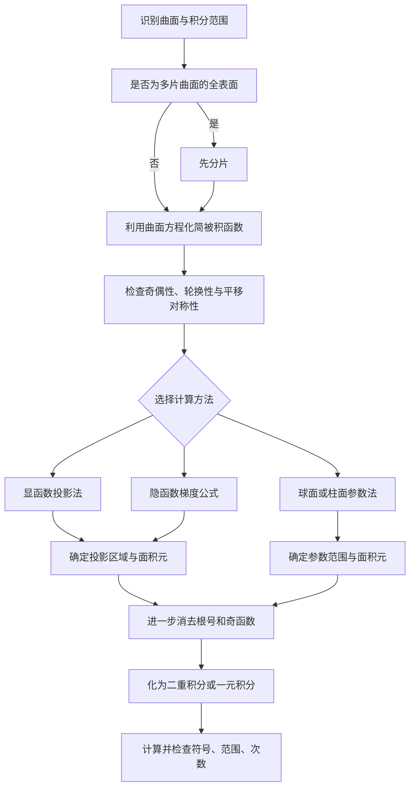

本节的核心不是单纯记住一个曲面积分公式，而是建立一种完整的**空间几何分析、曲面降维、面积元构造、对称性化简、二重积分计算**的解题体系。

第一类曲面积分与前面学习的二重积分、第一类曲线积分、空间解析几何、方向导数与梯度都有非常紧密的联系。尤其是综合大题，经常将空间几何条件隐藏在切平面、法向量、点面距离、曲面交线、质量和质心等问题中。

## 一、真题考点与学习重点

| 真题年份    | 核心考点         | 训练价值   |
| ------- | ------------ | ------ |
| 1989年数一 | 两球相交、球冠面积最值  | 几何综合   |
| 1995年数一 | 锥面投影、极坐标计算   | 基础母题   |
| 1999年数一 | 椭球面、切平面距离    | 重点综合母题 |
| 2000年数一 | 球面对称性、奇偶性    | 概念辨析   |
| 2007年数一 | 八面体、绝对值、分片积分 | 对称性母题  |
| 2010年数一 | 切平面垂直、隐式曲面积分 | 重点综合母题 |
| 2012年数一 | 平面面积元、三角区域   | 基础计算   |
| 2017年数一 | 曲线投影、薄壳质量    | 重点应用母题 |
| 2019年数一 | 梯度、方向导数、曲面面积 | 跨章节综合  |

本节最值得掌握的五种能力是：

- **空间几何能力：** 看清曲面形状、交线、边界及实际积分范围。
- **面积元构造能力：** 熟练使用显函数、隐函数与参数方程三种公式。
- **降维能力：** 将空间曲面积分化成平面二重积分，甚至一元积分。
- **化简能力：** 利用曲面约束、对称性、投影因子消去复杂表达式。
- **综合迁移能力：** 将切平面、梯度、最值、质量、质心等知识转化为曲面积分问题。

## 二、基础知识：第一类曲面积分究竟是什么？

### 2.1 从普通积分到曲面积分

先将已经学过的积分统一起来理解。

| 积分类型    | 积分对象 | 积分微元                       | 当被积函数为1时 |
| ------- | ---- | -------------------------- | -------- |
| 定积分     | 直线区间 | $\mathrm dx$           | 区间长度     |
| 二重积分    | 平面区域 | $\mathrm dx\mathrm dy$ | 平面面积     |
| 三重积分    | 空间立体 | $\mathrm dV$           | 立体体积     |
| 第一类曲线积分 | 曲线   | $\mathrm ds$           | 曲线长度     |
| 第一类曲面积分 | 空间曲面 | $\mathrm dS$           | 曲面面积     |

第一类曲面积分又称**对面积的曲面积分**，记作

$$
I=\iint_\Sigma f(x,y,z)\,\mathrm dS.
$$

其中：

- $\Sigma$ 是空间中的二维曲面；
- $f(x,y,z)$ 是定义在曲面上的函数；
- $\mathrm dS$ 是曲面上的无穷小面积。

将曲面分割成很多小曲面片，每块面积为 $\Delta S_i$，在每片上取一点 $P_i$，则其定义为

$$
\boxed{ \iint_\Sigma f\,\mathrm dS =\lim_{\lambda\to0} \sum_{i=1}^{n}f(P_i)\Delta S_i }
$$

其中 $\lambda$ 为各小曲面片直径的最大值。

直观上，它就是在曲面上的每一小块面积乘以相应的函数值，再将所有贡献相加。

例如，球壳表面的面密度为 $\rho(x,y,z)$，那么每一小片球壳的质量近似为

$$
\Delta m=\rho(x,y,z)\Delta S.
$$

所以球壳总质量为

$$
M=\iint_\Sigma\rho(x,y,z)\,\mathrm dS.
$$

**第一类曲面积分的本质就是带有函数权重的曲面面积。**

### 2.2 第一类与第二类曲面积分的本质区别

这也是下一节学习第二类曲面积分之前必须明确的内容。

| 比较项目   | 第一类曲面积分                            | 第二类曲面积分                                                                                        |
| ------ | ---------------------------------- | ---------------------------------------------------------------------------------------------- |
| 积分形式   | $\iint_\Sigma f\,\mathrm dS$ | $\iint_\Sigma P\,\mathrm dy\mathrm dz+Q\,\mathrm dz\mathrm dx+R\,\mathrm dx\mathrm dy$ |
| 几何意义   | 加权面积                               | 有向通量                                                                                           |
| 面积元    | 无向面积元                              | 有向投影面积元                                                                                        |
| 曲面改变朝向 | 对固定被积函数，积分不变                       | 积分变号                                                                                           |
| 主要方法   | 投影法、参数法                            | 投影法、高斯公式                                                                                       |
| 典型应用   | 面积、质量、质心                           | 流量、通量                                                                                          |

注意：第一类曲面积分虽然与面积元的取向无关，但其积分结果不一定是正数，因为被积函数可能为负。

另外，如果被积函数本身含有单位法向量，那么改变法向量仍可能改变被积函数的值。这一点需要与面积元自身的无向性区分开。

## 三、必须彻底掌握的三套面积元公式

第一类曲面积分最重要的计算环节，就是构造正确的 $\mathrm dS$。

### 3.1 显函数曲面：投影法

若曲面可以写成

$$
\Sigma:z=g(x,y),
$$

在 $xOy$ 平面上的投影区域为 $D_{xy}$，则

$$
\boxed{ \mathrm dS =\sqrt{1+g_x^2+g_y^2}\, \mathrm dx\mathrm dy }
$$

因此

$$
\boxed{ \iint_\Sigma f(x,y,z)\,\mathrm dS = \iint_{D_{xy}} f(x,y,g(x,y)) \sqrt{1+g_x^2+g_y^2}\, \mathrm dx\mathrm dy }
$$

这是本节使用最频繁的公式。

**为什么需要乘根号？**

曲面上的一个小面积块通常是倾斜的，其水平投影比实际面积更小。

令曲面单位法向量与 $z$ 轴的夹角为 $\gamma$，那么

$$
\mathrm dx\mathrm dy =|\cos\gamma|\,\mathrm dS.
$$

而曲面法向量可以取为

$$
\boldsymbol n=(-g_x,-g_y,1).
$$

因此

$$
|\cos\gamma| =\frac1{\sqrt{1+g_x^2+g_y^2}}.
$$

从而得到面积元公式。

这说明

$$
\boxed{ \mathrm dS =\frac{\mathrm dx\mathrm dy}{|\cos\gamma|} }
$$

根号因子的本质是**曲面相对于投影平面的面积伸长倍数**。

**其他两个坐标面的投影**

若

$$
x=g(y,z),
$$

则

$$
\boxed{ \mathrm dS=\sqrt{1+g_y^2+g_z^2}\, \mathrm dy\mathrm dz }
$$

若

$$
y=g(x,z),
$$

则

$$
\boxed{ \mathrm dS=\sqrt{1+g_x^2+g_z^2}\, \mathrm dx\mathrm dz }
$$

三套公式地位完全相同，不必强行投影到 $xOy$ 平面。

### 3.2 隐函数曲面：梯度投影法

若曲面由隐式方程给出：

$$
F(x,y,z)=0,
$$

且在所考虑的曲面片内部有 $F_z\ne0$，可以局部写成 $z=z(x,y)$。

由隐函数求导公式：

$$
z_x=-\frac{F_x}{F_z}, \qquad z_y=-\frac{F_y}{F_z}.
$$

代入面积元得

$$
\begin{aligned} \mathrm dS &=\sqrt{1+\frac{F_x^2}{F_z^2} +\frac{F_y^2}{F_z^2}}\, \mathrm dx\mathrm dy\\ &=\frac{\sqrt{F_x^2+F_y^2+F_z^2}} {|F_z|}\,\mathrm dx\mathrm dy. \end{aligned}
$$

即

$$
\boxed{ \mathrm dS =\frac{|\nabla F|}{|F_z|} \,\mathrm dx\mathrm dy }
$$

同理，

$$
\boxed{ \mathrm dS =\frac{|\nabla F|}{|F_x|} \,\mathrm dy\mathrm dz }
$$

$$
\boxed{ \mathrm dS =\frac{|\nabla F|}{|F_y|} \,\mathrm dx\mathrm dz }
$$

**这套公式对于考研数学一的综合大题尤其重要。**

例如，题目出现以下结构：

$$
\frac{|F_z|}{\sqrt{F_x^2+F_y^2+F_z^2}},
$$

就应立即想到它可能正好是面积元因子的倒数。

于是

$$
\boxed{ \iint_\Sigma g(x,y,z)\frac{|F_z|}{|\nabla F|} \,\mathrm dS = \iint_{D_{xy}}g(x,y,z(x,y)) \,\mathrm dx\mathrm dy }
$$

复杂的空间曲面积分可能瞬间退化为普通二重积分。

特别是当 $g=1$ 时，原积分就是曲面在 $xOy$ 平面上的投影面积（要求所取曲面片为单值图形；多片重叠投影需分别计算）。

### 3.3 参数方程曲面：叉乘法

设曲面参数方程为

$$
\boldsymbol r(u,v) =(x(u,v),y(u,v),z(u,v)),
$$

其中 $(u,v)\in D_{uv}$。

则

$$
\boxed{ \mathrm dS =|\boldsymbol r_u\times\boldsymbol r_v| \,\mathrm du\mathrm dv }
$$

所以

$$
\boxed{ \iint_\Sigma f\,\mathrm dS = \iint_{D_{uv}} f(\boldsymbol r(u,v)) |\boldsymbol r_u\times\boldsymbol r_v| \,\mathrm du\mathrm dv }
$$

其几何意义是：曲面上的两个无穷小切向量分别为

$$
\boldsymbol r_u\,\mathrm du, \qquad \boldsymbol r_v\,\mathrm dv,
$$

它们张成的小平行四边形面积为

$$
|\boldsymbol r_u\times\boldsymbol r_v| \,\mathrm du\mathrm dv.
$$

这是一套更加通用的公式。前面的显函数公式其实就是参数法的特殊情况。

### 3.4 如何选择公式？

| 题目给出的曲面     | 优先选择      |
| ----------- | --------- |
| 平面、抛物面、单叶锥面 | 显函数投影法    |
| 椭球面、复杂二次曲面  | 隐函数公式     |
| 含有法向量模长的权函数 | 隐函数公式     |
| 整个球面、球冠     | 球面参数法或对称性 |
| 圆柱侧面        | 圆周角与高度参数法 |
| 椭圆柱面        | 椭圆参数法     |
| 由多个曲面围成的全表面 | 分片选择公式    |

原则是：**不追求某一种公式的通用性，而追求化简后的积分最简单。**

## 四、常见曲面的标准面积元

以下令

$$
r=\sqrt{x^2+y^2}.
$$

### 4.1 平面

若

$$
Ax+By+Cz=D,\qquad C\ne0,
$$

则

$$
\boxed{ \mathrm dS =\frac{\sqrt{A^2+B^2+C^2}}{|C|} \,\mathrm dx\mathrm dy }
$$

特点：面积元因子是常数。

### 4.2 圆锥面

若

$$
z=k\sqrt{x^2+y^2}=kr,
$$

则在锥顶以外，

$$
z_x^2+z_y^2=k^2.
$$

因此

$$
\boxed{ \mathrm dS=\sqrt{1+k^2}\,\mathrm dx\mathrm dy }
$$

换用极坐标，

$$
\boxed{ \mathrm dS=\sqrt{1+k^2}\,r\,\mathrm dr\mathrm d\theta }
$$

考研最常见的是 $k=1$，此时

$$
\boxed{ \mathrm dS=\sqrt2r\,\mathrm dr\mathrm d\theta }
$$

### 4.3 旋转抛物面

若

$$
z=a+b(x^2+y^2),
$$

则

$$
z_x=2bx,\qquad z_y=2by.
$$

所以

$$
\boxed{ \mathrm dS=\sqrt{1+4b^2r^2}\,r\,\mathrm dr\mathrm d\theta }
$$

### 4.4 球面

设球面为

$$
x^2+y^2+z^2=R^2.
$$

有三种常见的面积元形式。

**形式一：投影到** $xOy$ **平面**

上、下半球分别写成

$$
z=\pm\sqrt{R^2-x^2-y^2}.
$$

所以

$$
\boxed{ \mathrm dS=\frac{R}{|z|} \,\mathrm dx\mathrm dy }
$$

即

$$
\boxed{ \mathrm dS =\frac{Rr}{\sqrt{R^2-r^2}} \,\mathrm dr\mathrm d\theta }
$$

特别适合被积函数中含有 $z$ 或 $|z|$ 的题目。

**形式二：球面参数方程**

令

$$
\begin{cases} x=R\sin\varphi\cos\theta,\\ y=R\sin\varphi\sin\theta,\\ z=R\cos\varphi. \end{cases}
$$

则

$$
\boxed{ \mathrm dS =R^2\sin\varphi\,\mathrm d\varphi\mathrm d\theta }
$$

整个球面：

$$
0\le\varphi\le\pi, \qquad 0\le\theta\le2\pi.
$$

上半球：

$$
0\le\varphi\le\frac\pi2.
$$

第一卦限球面：

$$
0\le\varphi\le\frac\pi2, \qquad 0\le\theta\le\frac\pi2.
$$

**形式三：以高度** $z$ **为参数**

令

$$
\begin{cases} x=\sqrt{R^2-z^2}\cos\theta,\\ y=\sqrt{R^2-z^2}\sin\theta,\\ z=z. \end{cases}
$$

则有非常好用的公式：

$$
\boxed{ \mathrm dS=R\,\mathrm d\theta\mathrm dz }
$$

也可以从球面参数公式直接推出：

$$
\mathrm dz=-R\sin\varphi\,\mathrm d\varphi.
$$

因此，一个完整的球面水平环带的面积为

$$
\boxed{ \mathrm dS_{\text{环带}}=2\pi R\,\mathrm dz }
$$

这一公式能够将大量球面积分直接转化为一元积分。

### 4.5 圆柱侧面

设

$$
(x-a)^2+(y-b)^2=R^2.
$$

令

$$
\begin{cases} x=a+R\cos\theta,\\ y=b+R\sin\theta,\\ z=z. \end{cases}
$$

则

$$
\boxed{ \mathrm dS=R\,\mathrm d\theta\mathrm dz }
$$

若柱面上、下边界分别为

$$
z=z_2(\theta),\qquad z=z_1(\theta),
$$

则侧面积为

$$
\boxed{ S=R\int [z_2(\theta)-z_1(\theta)]\,\mathrm d\theta }
$$

### 4.6 一般旋转曲面

设

$$
z=g(r),\qquad r=\sqrt{x^2+y^2}.
$$

则

$$
\boxed{ \mathrm dS =r\sqrt{1+[g'(r)]^2}\, \mathrm dr\mathrm d\theta }
$$

如果被积函数在曲面上也只依赖于 $r$，而且曲面旋转一周，则

$$
\boxed{ \iint_\Sigma f(r)\,\mathrm dS =2\pi\int_a^b f(r)r\sqrt{1+[g'(r)]^2}\,\mathrm dr }
$$

这个公式统一了锥面、抛物面以及很多球面计算。

## 五、重要性质与常用结论

### 5.1 线性性和可加性

$$
\iint_\Sigma(af+bg)\,\mathrm dS =a\iint_\Sigma f\,\mathrm dS +b\iint_\Sigma g\,\mathrm dS.
$$

若曲面由有限片曲面组成，且它们只在零面积边界上重合，则

$$
\boxed{ \iint_\Sigma f\,\mathrm dS =\sum_{i=1}^n \iint_{\Sigma_i}f\,\mathrm dS }
$$

全表面、八面体、封闭薄壳等问题主要使用这一性质。

### 5.2 保序性与积分估值

若在同一曲面上

$$
f\le g,
$$

则

$$
\iint_\Sigma f\,\mathrm dS \le \iint_\Sigma g\,\mathrm dS.
$$

如果

$$
m\le f\le M,
$$

那么

$$
\boxed{ mS_\Sigma\le \iint_\Sigma f\,\mathrm dS \le MS_\Sigma }
$$

其中 $S_\Sigma$ 为曲面面积。

同时有

$$
\left|\iint_\Sigma f\,\mathrm dS\right| \le\iint_\Sigma|f|\,\mathrm dS.
$$

这些性质常用于积分比较、面积大小判断和答案检验。

### 5.3 对称性

这是本节最重要的化简工具之一。

如果曲面关于 $yOz$ 平面对称，即反射

$$
(x,y,z)\mapsto(-x,y,z)
$$

保持曲面不变，并且

$$
f(-x,y,z)=-f(x,y,z),
$$

则

$$
\boxed{ \iint_\Sigma f\,\mathrm dS=0 }
$$

如果

$$
f(-x,y,z)=f(x,y,z),
$$

则

$$
\boxed{ \iint_\Sigma f\,\mathrm dS =2\iint_{\Sigma\cap\{x\ge0\}}f\,\mathrm dS }
$$

其他坐标平面的反射完全类似。

必须同时检查：

**第一，积分曲面是否对称；第二，被积函数是否具有相应的奇偶性。**

只有曲面对称，不足以说明积分可以倍乘。

### 5.4 轮换对称性

若交换 $x,y$ 后，积分曲面保持不变，则

$$
\iint_\Sigma f(x,y,z)\,\mathrm dS = \iint_\Sigma f(y,x,z)\,\mathrm dS.
$$

例如，对整个球面，

$$
\iint_\Sigma x^2\,\mathrm dS =\iint_\Sigma y^2\,\mathrm dS =\iint_\Sigma z^2\,\mathrm dS.
$$

利用曲面约束

$$
x^2+y^2+z^2=R^2,
$$

立即得到

$$
\boxed{ \iint_\Sigma x^2\,\mathrm dS =\iint_\Sigma y^2\,\mathrm dS =\iint_\Sigma z^2\,\mathrm dS =\frac{4\pi R^4}{3} }
$$

不需要建立球坐标积分。

### 5.5 球面上的常用积分结论

对于以原点为球心、半径为 $R$ 的完整球面：

| 被积函数                       | 曲面积分                       |
| -------------------------- | -------------------------- |
| $1$                    | $4\pi R^2$             |
| $x,y,z$                | $0$                    |
| $xy,yz,zx$             | $0$                    |
| $x^2,y^2,z^2$          | $\dfrac{4\pi R^4}{3}$  |
| $\|x\|,\|y\|,\|z\|$    | $2\pi R^3$             |
| $x^4,y^4,z^4$          | $\dfrac{4\pi R^6}{5}$  |
| $x^2y^2,y^2z^2,z^2x^2$ | $\dfrac{4\pi R^6}{15}$ |

前四项应当熟练掌握，后三项可以由球面环带公式和轮换对称性推出。

### 5.6 球面平移公式

设球心为

$$
\boldsymbol c=(a,b,c),
$$

球面方程为

$$
(x-a)^2+(y-b)^2+(z-c)^2=R^2.
$$

对于仿射函数

$$
f(x,y,z)=Ax+By+Cz+D,
$$

有

$$
\boxed{ \iint_\Sigma f\,\mathrm dS =4\pi R^2f(a,b,c) }
$$

即球面上的仿射函数平均值就是球心处的函数值。

二次矩则为

$$
\boxed{ \iint_\Sigma x^2\,\mathrm dS =4\pi R^2\left(a^2+\frac{R^2}{3}\right) }
$$

其他坐标类似，并且

$$
\boxed{ \iint_\Sigma xy\,\mathrm dS=4\pi R^2ab }
$$

这些结论非常适合处理李林880题以及李林模拟卷中的偏心球面积分。

## 六、真题母题一：显函数曲面与投影区域

### 6.1 2012年数学一：平面上的曲面积分

**题目：**

设

$$
\Sigma: \begin{cases} x+y+z=1,\\ x\ge0,\ y\ge0,\ z\ge0. \end{cases}
$$

求

$$
I=\iint_\Sigma y^2\,\mathrm dS.
$$

<Steps>

<Step>

### 第一步：确定曲面方程 [!toc]

$$
z=1-x-y.
$$

</Step>

<Step>

### 第二步：确定投影区域 [!toc]

由于 $z\ge0$，所以

$$
x+y\le1.
$$

投影区域为

$$
D: \begin{cases} x\ge0,\\ y\ge0,\\ x+y\le1. \end{cases}
$$

这是一个直角三角形，不是整个第一象限。

</Step>

<Step>

### 第三步：构造面积元 [!toc]

$$
z_x=-1,\qquad z_y=-1.
$$

所以

$$
\mathrm dS=\sqrt3\,\mathrm dx\mathrm dy.
$$

</Step>

<Step>

### 第四步：计算二重积分 [!toc]

$$
\begin{aligned} I &=\sqrt3\iint_Dy^2\,\mathrm dx\mathrm dy\\ &=\sqrt3\int_0^1\mathrm dy \int_0^{1-y}y^2\,\mathrm dx\\ &=\sqrt3\int_0^1y^2(1-y)\,\mathrm dy\\ &=\sqrt3\left(\frac13-\frac14\right). \end{aligned}
$$

因此

$$
\boxed{I=\frac{\sqrt3}{12}}
$$

</Step>

</Steps>

**母题推广**

若曲面为

$$
x+y+z=a,\qquad x,y,z\ge0,
$$

则对非负整数 $p,q,s$，有

$$
\boxed{ \iint_\Sigma x^py^qz^s\,\mathrm dS = \sqrt3\, \frac{p!q!s!}{(p+q+s+2)!} a^{p+q+s+2} }
$$

这是三角区域多项式积分的推广结论，不要求专门背诵，但可以用来快速验证答案。

例如令 $p=s=0,q=2,a=1$，就得到原题结果。

### 6.2 李正元练习题：平面截圆柱

设平面

$$
y+z=5
$$

被柱面

$$
x^2+y^2=25
$$

所截，求

$$
I=\iint_\Sigma(x+y+z)\,\mathrm dS.
$$

这里应当先观察曲面约束。

因为

$$
y+z=5,
$$

故

$$
x+y+z=x+5.
$$

又

$$
\mathrm dS=\sqrt2\,\mathrm dx\mathrm dy.
$$

投影区域是半径为5的圆盘，因此利用奇偶性，

$$
\begin{aligned} I &=\sqrt2\iint_D(x+5)\,\mathrm dx\mathrm dy\\ &=5\sqrt2\cdot25\pi. \end{aligned}
$$

所以

$$
\boxed{I=125\sqrt2\pi}
$$

**方法总结：平面曲面积分先利用平面方程化简被积函数，再利用常数面积元和投影区域的对称性。**

## 七、真题母题二：锥面、偏心圆盘与极坐标

### 7.1 1995年数学一

设 $\Sigma$ 为锥面

$$
z=\sqrt{x^2+y^2}
$$

在柱体

$$
x^2+y^2\le2x
$$

内的部分，计算

$$
I=\iint_\Sigma z\,\mathrm dS.
$$

<Steps>

<Step>

### 第一步：识别投影区域 [!toc]

$$
x^2+y^2\le2x
$$

配方得

$$
(x-1)^2+y^2\le1.
$$

这是以 $(1,0)$ 为圆心、半径为1的圆盘。

特别注意：这个圆盘虽然半径为1，但不是单位圆盘。

</Step>

<Step>

### 第二步：选择极坐标 [!toc]

令

$$
x=r\cos\theta,\qquad y=r\sin\theta.
$$

柱体条件变成

$$
r^2\le2r\cos\theta.
$$

因此

$$
\boxed{ -\frac\pi2\le\theta\le\frac\pi2, \qquad 0\le r\le2\cos\theta }
$$

</Step>

<Step>

### 第三步：确定面积元 [!toc]

锥面上

$$
z=r.
$$

并且

$$
z_x=\frac xr,\qquad z_y=\frac yr.
$$

于是

$$
z_x^2+z_y^2=1,
$$

所以

$$
\mathrm dS =\sqrt2\,\mathrm dx\mathrm dy =\sqrt2r\,\mathrm dr\mathrm d\theta.
$$

</Step>

<Step>

### 第四步：完成积分 [!toc]

$$
\begin{aligned} I &=\sqrt2\int_{-\pi/2}^{\pi/2} \int_0^{2\cos\theta}r^2\,\mathrm dr\mathrm d\theta\\ &=\frac{8\sqrt2}{3} \int_{-\pi/2}^{\pi/2}\cos^3\theta\,\mathrm d\theta\\ &=\frac{8\sqrt2}{3}\cdot\frac43. \end{aligned}
$$

因此

$$
\boxed{I=\frac{32\sqrt2}{9}}
$$

</Step>

</Steps>

<Callout type="warn" title="这一题最容易错在哪里？">

这里同时出现了两个不同的面积因子：

$$
\underbrace{\sqrt2}_{\text{曲面面积因子}} \cdot \underbrace{r}_{\text{极坐标雅可比}}
$$

一个来自曲面投影，另一个来自平面坐标变换。两个都不能漏。

</Callout>

### 7.2 2017年数学一：同一母题的综合变式

设薄壳曲面为锥面

$$
z=\sqrt{x^2+y^2}
$$

被柱面

$$
z^2=2x
$$

所割下的有限部分，其面密度为

$$
\mu=9\sqrt{x^2+y^2+z^2}.
$$

求交线在 $xOy$ 平面上的投影方程以及薄壳质量。

**第一问：投影曲线**

锥面满足

$$
z^2=x^2+y^2.
$$

与柱面联立，消去 $z$：

$$
x^2+y^2=2x.
$$

所以空间投影曲线为

$$
\boxed{ \begin{cases} (x-1)^2+y^2=1,\\ z=0. \end{cases} }
$$

**第二问：薄壳质量**

在锥面上，

$$
\mu=9\sqrt{2r^2}=9\sqrt2r.
$$

又有

$$
\mathrm dS=\sqrt2r\,\mathrm dr\mathrm d\theta.
$$

所以

$$
\begin{aligned} M &=\iint_\Sigma\mu\,\mathrm dS\\ &=18\int_{-\pi/2}^{\pi/2} \int_0^{2\cos\theta}r^2\,\mathrm dr\mathrm d\theta\\ &=18\cdot\frac83\cdot\frac43. \end{aligned}
$$

因此

$$
\boxed{M=64}
$$

实际上，因为在同一锥面上

$$
\mu=9\sqrt2z,
$$

本题的质量也可以直接利用1995年真题的积分结果：

$$
M=9\sqrt2\cdot\frac{32\sqrt2}{9}=64.
$$

这两道真题非常适合一起学习：从1995年的直接积分，到2017年的交线投影和物理应用，题目背景变了，但核心积分模型没有改变。

### 7.3 李林880题：高次多项式与对称性

设锥面

$$
z=\sqrt{x^2+y^2}
$$

被柱面

$$
x^2+y^2=2ax,\qquad a>0
$$

截取，求

$$
I=\iint_\Sigma (x^2y+yz^2+z^2x)\,\mathrm dS.
$$

曲面关于 $y=0$ 对称，因此

$$
\iint_\Sigma x^2y\,\mathrm dS=0,
$$

$$
\iint_\Sigma yz^2\,\mathrm dS=0.
$$

只剩

$$
I=\iint_\Sigma xz^2\,\mathrm dS.
$$

代入极坐标，

$$
x=r\cos\theta,\qquad z=r.
$$

于是

$$
I=\sqrt2\int_{-\pi/2}^{\pi/2} \int_0^{2a\cos\theta} r^4\cos\theta\,\mathrm dr\mathrm d\theta.
$$

积分得

$$
I=\frac{32\sqrt2a^5}{5} \int_{-\pi/2}^{\pi/2}\cos^6\theta\,\mathrm d\theta.
$$

利用

$$
\int_{-\pi/2}^{\pi/2}\cos^6\theta\,\mathrm d\theta =\frac{5\pi}{16},
$$

最终

$$
\boxed{I=2\sqrt2\pi a^5}
$$

这类题不要把被积函数的所有项都计算一遍，应先利用对称性消去大部分积分。

### 7.4 偏心圆盘的常用极坐标模型

| 圆盘方程                 | 角度范围                          | 径向范围                        |
| -------------------- | ----------------------------- | --------------------------- |
| $x^2+y^2\le a^2$ | $0\le\theta\le2\pi$       | $0\le r\le a$           |
| $x^2+y^2\le2ax$  | $-\pi/2\le\theta\le\pi/2$ | $0\le r\le2a\cos\theta$ |
| $x^2+y^2\le2ay$  | $0\le\theta\le\pi$        | $0\le r\le2a\sin\theta$ |
| $x^2+y^2\le ax$  | $-\pi/2\le\theta\le\pi/2$ | $0\le r\le a\cos\theta$ |

如果被积函数包含大量 $x^2+y^2$，优先选择以原点为极点的极坐标。

如果被积函数是普通多项式，而圆盘偏离原点，则也可以先平移到圆心，再使用对称性和极坐标。

## 八、真题母题三：隐函数曲面与特殊因子消去

这一类型是本节难度最高、综合性最强、最值得认真研究的部分。

### 8.1 1999年数学一：切平面距离与曲面积分

设 $S$ 为椭球面

$$
\frac{x^2}{2}+\frac{y^2}{2}+z^2=1
$$

的上半部分。

设 $P(x,y,z)\in S$，$\rho(x,y,z)$ 为原点到该点处切平面的距离，计算

$$
I=\iint_S\frac z\rho\,\mathrm dS.
$$

<Steps>

<Step>

### 第一步：写出隐函数及梯度 [!toc]

设

$$
F=\frac{x^2}{2}+\frac{y^2}{2}+z^2-1.
$$

则

$$
\nabla F=(x,y,2z).
$$

</Step>

<Step>

### 第二步：求切平面方程 [!toc]

以 $(X,Y,Z)$ 表示切平面上的任意点，则

$$
x(X-x)+y(Y-y)+2z(Z-z)=0.
$$

整理得

$$
xX+yY+2zZ=x^2+y^2+2z^2.
$$

由椭球约束，

$$
x^2+y^2+2z^2=2.
$$

所以切平面为

$$
xX+yY+2zZ=2.
$$

原点到切平面的距离为

$$
\boxed{ \rho=\frac2{\sqrt{x^2+y^2+4z^2}} }
$$

</Step>

<Step>

### 第三步：构造隐函数面积元 [!toc]

由于 $z\ge0$，在上半面内部 $z>0$，有

$$
\mathrm dS =\frac{|\nabla F|}{|F_z|} \,\mathrm dx\mathrm dy =\frac{\sqrt{x^2+y^2+4z^2}}{2z} \,\mathrm dx\mathrm dy.
$$

</Step>

<Step>

### 第四步：先将被积函数与面积元相乘 [!toc]

不要急于把所有东西换成极坐标。

$$
\begin{aligned} \frac z\rho\,\mathrm dS &=\frac{z\sqrt{x^2+y^2+4z^2}}2 \cdot \frac{\sqrt{x^2+y^2+4z^2}}{2z} \,\mathrm dx\mathrm dy\\ &=\frac{x^2+y^2+4z^2}{4} \,\mathrm dx\mathrm dy. \end{aligned}
$$

两个根号相乘，分母中的 $z$ 被约掉。

再根据椭球方程，

$$
z^2=1-\frac{x^2+y^2}{2}.
$$

所以

$$
\frac{x^2+y^2+4z^2}{4} =1-\frac{x^2+y^2}{4}.
$$

</Step>

<Step>

### 第五步：计算普通二重积分 [!toc]

投影区域为

$$
D:x^2+y^2\le2.
$$

故

$$
\begin{aligned} I &=\iint_D \left(1-\frac{x^2+y^2}{4}\right) \mathrm dx\mathrm dy\\ &=2\pi\int_0^{\sqrt2} \left(1-\frac{r^2}{4}\right)r\,\mathrm dr\\ &=2\pi\left(1-\frac14\right). \end{aligned}
$$

因此

$$
\boxed{I=\frac{3\pi}{2}}
$$

</Step>

</Steps>

**这道真题的关键思想**

切平面距离中出现的根号，并不是孤立的复杂表达式，而是梯度模长：

$$
|\nabla F|.
$$

曲面面积元同样含有梯度模长。

所以题目真正考查的是：

**能否将空间解析几何中的法向量与曲面积分中的面积因子联系起来。**

### 8.2 2010年数学一：切平面垂直与完全消去

设椭球面为

$$
S:x^2+y^2+z^2-yz=1.
$$

若点 $P$ 处的切平面与 $xOy$ 平面垂直，求点 $P$ 的轨迹 $C$。

再求椭球面位于 $C$ 上方的部分 $\Sigma$ 上的积分

$$
I=\iint_\Sigma \frac{(x+\sqrt3)|y-2z|} {\sqrt{4+y^2+z^2-4yz}} \,\mathrm dS.
$$

这是一道非常有代表性的综合母题。

**第一问：确定轨迹**

令

$$
F=x^2+y^2+z^2-yz-1.
$$

则

$$
\nabla F=(2x,2y-z,2z-y).
$$

切平面的法向量为 $\nabla F$，而 $xOy$ 平面的法向量为

$$
(0,0,1).
$$

两平面垂直，意味着两法向量垂直，所以

$$
(2x,2y-z,2z-y)\cdot(0,0,1)=0.
$$

即

$$
2z-y=0.
$$

于是轨迹为

$$
\boxed{ C: \begin{cases} x^2+y^2+z^2-yz=1,\\ 2z-y=0. \end{cases} }
$$

**第二问第一步：判断哪一片曲面是上方**

将曲面方程视为关于 $z$ 的二次方程：

$$
z^2-yz+x^2+y^2-1=0.
$$

解得

$$
z_\pm= \frac{y\pm\sqrt{4-4x^2-3y^2}}2.
$$

所以曲面在水平面上的投影满足

$$
4-4x^2-3y^2\ge0.
$$

即

$$
\boxed{ D:x^2+\frac34y^2\le1 }
$$

上方曲面取 $z_+$。

注意：上方曲面是相对于平面 $2z-y=0$ 而言，并不是简单的 $z\ge0$。

<Steps>

<Step>

### 第二步：识别分母 [!toc]

梯度模长平方为

$$
|\nabla F|^2 =4x^2+(2y-z)^2+(2z-y)^2.
$$

展开：

$$
|\nabla F|^2 =4x^2+5y^2+5z^2-8yz.
$$

利用曲面约束

$$
4x^2=4-4y^2-4z^2+4yz,
$$

得到

$$
\boxed{ |\nabla F|^2 =4+y^2+z^2-4yz }
$$

原被积函数分母正好是梯度模长。

同时

$$
|y-2z|=|F_z|.
$$

所以整个积分可以写成

$$
I=\iint_\Sigma (x+\sqrt3)\frac{|F_z|}{|\nabla F|} \,\mathrm dS.
$$

</Step>

<Step>

### 第三步：完全消去面积因子 [!toc]

因为

$$
\mathrm dS =\frac{|\nabla F|}{|F_z|} \,\mathrm dx\mathrm dy,
$$

所以

$$
I=\iint_D(x+\sqrt3)\,\mathrm dx\mathrm dy.
$$

此时题目已经从复杂椭球面积分变成简单的平面区域积分。

</Step>

<Step>

### 第四步：利用对称性 [!toc]

椭圆盘 $D$ 关于 $y$ 轴对称，所以

$$
\iint_Dx\,\mathrm dx\mathrm dy=0.
$$

椭圆的两个半轴为

$$
a=1,\qquad b=\frac2{\sqrt3}.
$$

故

$$
I=\sqrt3\cdot\pi\cdot1\cdot\frac2{\sqrt3}.
$$

答案为

$$
\boxed{I=2\pi}
$$

</Step>

</Steps>

### 8.3 这一类题的识别信号

以后遇到曲面积分中含有复杂根号、切平面、法向量、方向余弦等信息时，优先尝试以下结构：

| 题目中的结构                                      | 应想到            |
| ------------------------------------------- | -------------- |
| 切平面的法向量                                     | $\nabla F$ |
| 到切平面的距离                                     | 点面距离公式         |
| 切平面与水平面垂直                                   | $F_z=0$    |
| $\sqrt{F_x^2+F_y^2+F_z^2}$              | 梯度模长           |
| $\lvert F_z\rvert/\lvert\nabla F\rvert$ | 面积因子的倒数        |
| 曲面上出现复杂平方和                                  | 用曲面方程消元降阶      |

这就是从一道题迁移到一类题的关键。

### 8.4 原创变式：一般椭球面

设上半椭球面为

$$
\Sigma: \frac{x^2}{a^2}+\frac{y^2}{b^2} +\frac{z^2}{c^2}=1, \qquad z\ge0,
$$

其中 $a,b,c>0$，求

$$
I=\iint_\Sigma \frac{z} {\sqrt{x^2/a^4+y^2/b^4+z^2/c^4}} \,\mathrm dS.
$$

令

$$
F=\frac{x^2}{a^2} +\frac{y^2}{b^2} +\frac{z^2}{c^2}-1.
$$

记

$$
G=\sqrt{\frac{x^2}{a^4} +\frac{y^2}{b^4} +\frac{z^2}{c^4}}.
$$

那么

$$
|\nabla F|=2G,\qquad F_z=\frac{2z}{c^2}.
$$

于是

$$
\mathrm dS=\frac{c^2G}{z} \,\mathrm dx\mathrm dy.
$$

从而

$$
\frac zG\,\mathrm dS =c^2\,\mathrm dx\mathrm dy.
$$

投影区域为

$$
D:\frac{x^2}{a^2}+\frac{y^2}{b^2}\le1.
$$

所以

$$
\boxed{ I=c^2\pi ab=\pi abc^2 }
$$

这种题几乎不需要复杂的积分技巧，真正重要的是识别结构。

## 九、真题母题四：对称性、轮换性与球面平移

### 9.1 2000年数学一：对称性判断

设

$$
S:x^2+y^2+z^2=a^2,\qquad z\ge0,
$$

$S_1$ 为上半球面位于第一卦限的部分，判断下列等式哪个成立：

$$
\begin{aligned} A.\quad&\iint_Sx\,\mathrm dS =4\iint_{S_1}x\,\mathrm dS\\ B.\quad&\iint_Sy\,\mathrm dS =4\iint_{S_1}y\,\mathrm dS\\ C.\quad&\iint_Sz\,\mathrm dS =4\iint_{S_1}z\,\mathrm dS\\ D.\quad&\iint_Sxyz\,\mathrm dS =4\iint_{S_1}xyz\,\mathrm dS \end{aligned}
$$

**分析**

上半球面关于 $x=0$ 和 $y=0$ 对称，但不关于 $z=0$ 对称。

对于 $x$：

$$
\iint_Sx\,\mathrm dS=0.
$$

但是第一卦限内 $x\ge0$，且不恒为零，因此

$$
\iint_{S_1}x\,\mathrm dS>0.
$$

故A错误。

同理，B、D均错误。

而 $z$ 在关于 $x=0$、$y=0$ 的反射中保持不变，所以四块球面上的积分完全相等。

因此答案为

$$
\boxed{C}
$$

**对称倍乘的前提不是四块曲面面积相等，而是四块曲面经过对应变换后，被积函数也保持相等。**

### 9.2 2007年数学一：八面体与轮换对称性

设

$$
\Sigma:|x|+|y|+|z|=1,
$$

求

$$
I=\iint_\Sigma(x+|y|)\,\mathrm dS.
$$

<Tabs items={["常规方法：八块曲面分片", "更高效的方法：轮换对称性"]} defaultIndex={0}>

<Tab value="常规方法：八块曲面分片">

由于整个曲面关于 $x=0$ 对称，

$$
\iint_\Sigma x\,\mathrm dS=0.
$$

所以

$$
I=\iint_\Sigma|y|\,\mathrm dS.
$$

曲面由八个相同的三角形组成，利用绝对值的偶性，

$$
I=8\iint_{\Sigma_1}y\,\mathrm dS.
$$

第一卦限的曲面片为

$$
z=1-x-y.
$$

于是

$$
I=8\sqrt3\int_0^1y(1-y)\,\mathrm dy.
$$

最终

$$
\boxed{I=\frac{4\sqrt3}{3}}
$$

</Tab>

<Tab value="更高效的方法：轮换对称性">

这是李林880题中同类题目提供的特别值得掌握的思路。

由于交换任意两个坐标都不改变八面体，

$$
\iint_\Sigma|x|\,\mathrm dS =\iint_\Sigma|y|\,\mathrm dS =\iint_\Sigma|z|\,\mathrm dS.
$$

因此

$$
\begin{aligned} I &=\frac13\iint_\Sigma (|x|+|y|+|z|)\,\mathrm dS\\ &=\frac13\iint_\Sigma1\,\mathrm dS. \end{aligned}
$$

整个八面体有8个边长为 $\sqrt2$ 的等边三角形面。

总面积为

$$
S_\Sigma=8\cdot\frac{\sqrt3}{4} (\sqrt2)^2=4\sqrt3.
$$

所以

$$
\boxed{I=\frac{4\sqrt3}{3}}
$$

</Tab>

</Tabs>

**这道题体现的高级技巧**

当被积函数是一组对称量中的某一个时，可以主动补出其他对称量，再用曲面方程将它们合并。

即

$$
\boxed{ \text{轮换对称} +\text{主动凑和} +\text{曲面约束} }
$$

这是球面、正多面体以及许多对称积分问题的通用技巧。

### 9.3 李林880题与六套卷：偏心球面的二次矩

李林六套卷第2套第18题给出球面

$$
\Sigma:x^2+y^2+z^2=2x,
$$

求

$$
I=\iint_\Sigma(2x^2+y^2+3z^2)\,\mathrm dS.
$$

**错误思路**

直接认为

$$
\iint_\Sigma x^2\,\mathrm dS =\iint_\Sigma y^2\,\mathrm dS =\iint_\Sigma z^2\,\mathrm dS.
$$

这是错误的，因为球心不在原点。

**正确方法：先配方、再平移**

$$
(x-1)^2+y^2+z^2=1.
$$

令

$$
u=x-1,\qquad v=y,\qquad w=z.
$$

球面化为

$$
u^2+v^2+w^2=1.
$$

被积函数变成

$$
\begin{aligned} 2x^2+y^2+3z^2 &=2(u+1)^2+v^2+3w^2\\ &=2u^2+v^2+3w^2+4u+2. \end{aligned}
$$

利用对称性，

$$
\iint_\Sigma u\,\mathrm dS=0,
$$

并且

$$
\iint_\Sigma u^2\,\mathrm dS =\iint_\Sigma v^2\,\mathrm dS =\iint_\Sigma w^2\,\mathrm dS =\frac{4\pi}{3}.
$$

所以

$$
\begin{aligned} I &=(2+1+3)\frac{4\pi}{3} +2\cdot4\pi\\ &=8\pi+8\pi. \end{aligned}
$$

故

$$
\boxed{I=16\pi}
$$

这与李林880题第九章中球心为 $(0,1,0)$ 的同类题本质完全相同。

**二次型积分的进一步推广**

若

$$
\Sigma:|\boldsymbol x-\boldsymbol c|^2=R^2,
$$

被积函数为

$$
f(\boldsymbol x) =\boldsymbol x^{\mathrm T}A\boldsymbol x +\boldsymbol b^{\mathrm T}\boldsymbol x+d,
$$

其中 $A$ 为常系数对称矩阵，那么

$$
\boxed{ \iint_\Sigma f(\boldsymbol x)\,\mathrm dS =4\pi R^2 \left[ f(\boldsymbol c) +\frac{R^2}{3}\operatorname{tr}(A) \right] }
$$

这是一个补充的迁移结论，可将完整球面上的任意二次多项式积分直接化为代数运算。

### 9.4 李林六套卷第6套：第一卦限轮换对称与投影消去

设 $\Sigma$ 是单位球面位于第一卦限的部分，计算

$$
I=\iint_\Sigma xyz(y^2z^2+z^2x^2+x^2y^2)\,\mathrm dS.
$$

展开可得三个轮换对称的项：

$$
xy^3z^3,\qquad x^3yz^3,\qquad x^3y^3z.
$$

虽然第一卦限球面不具备完整的坐标反射对称性，但它仍具备坐标轮换对称性。

所以

$$
I=3\iint_\Sigma xy^3z^3\,\mathrm dS.
$$

被积函数中含有一次因子 $x$，因此不必按照习惯投影到 $xOy$ 平面，而应当投影到 $yOz$ 平面。

由

$$
x=\sqrt{1-y^2-z^2}
$$

得

$$
\mathrm dS=\frac1x\,\mathrm dy\mathrm dz.
$$

于是

$$
I=3\iint_D y^3z^3\,\mathrm dy\mathrm dz,
$$

其中

$$
D:y^2+z^2\le1,\qquad y,z\ge0.
$$

令

$$
y=r\cos\theta,\qquad z=r\sin\theta.
$$

则

$$
\begin{aligned} I &=3\int_0^{\pi/2} \cos^3\theta\sin^3\theta\,\mathrm d\theta \int_0^1r^7\,\mathrm dr\\ &=3\cdot\frac1{12}\cdot\frac18. \end{aligned}
$$

所以

$$
\boxed{I=\frac1{32}}
$$

**这道模拟题质量很高：它同时考查轮换对称性、投影方向选择、曲面因子抵消和二重积分计算。**

当球面上出现 $x,y,z$ 的一次因子时，可以考虑主动选择相应的投影平面，将该因子约掉。

## 十、真题母题五：球冠、球面环带与几何最值

### 10.1 球冠面积公式的推导

设半径为 $R$ 的球面被水平平面

$$
z=h
$$

截下顶部，且 $-R\le h\le R$。

使用高度参数公式

$$
\mathrm dS=R\,\mathrm d\theta\mathrm dz,
$$

则顶部球冠面积为

$$
\begin{aligned} S &=R\int_0^{2\pi}\mathrm d\theta \int_h^R\mathrm dz\\ &=2\pi R(R-h). \end{aligned}
$$

如果用 $H=R-h$ 表示球冠的高度，那么

$$
\boxed{S_{\text{球冠}}=2\pi RH}
$$

类似地，对于位于两个水平面之间的球面环带，

$$
z_1\le z\le z_2,
$$

有

$$
\boxed{ S_{\text{球面带}} =2\pi R(z_2-z_1) }
$$

只要球面带的高度相同，其面积就相同，与它位于球面的哪个高度无关。

### 10.2 张宇1000题：含有绝对值和分母的球冠积分

来源：张宇1000题，高数第18章。

设球面

$$
x^2+y^2+z^2=m,\qquad m>0
$$

被平面

$$
z=\frac{\sqrt m}{3}
$$

截下顶部，计算

$$
I=\iint_\Sigma \left(|x|y+\frac1z\right)\,\mathrm dS.
$$

<Steps>

<Step>

### 第一步：利用对称性 [!toc]

球冠关于 $y=0$ 对称，且 $|x|y$ 关于 $y$ 为奇函数。

因此

$$
\iint_\Sigma |x|y\,\mathrm dS=0.
$$

原积分变成

$$
I=\iint_\Sigma\frac1z\,\mathrm dS.
$$

</Step>

<Step>

### 第二步：使用高度参数法 [!toc]

令

$$
R=\sqrt m.
$$

则

$$
\frac R3\le z\le R.
$$

由球面环带公式，

$$
\begin{aligned} I &=2\pi R\int_{R/3}^R\frac1z\,\mathrm dz\\ &=2\pi R\ln3. \end{aligned}
$$

所以

$$
\boxed{I=2\pi\sqrt m\ln3}
$$

相比球坐标，这种方法连三角函数积分都省去了。

</Step>

</Steps>

**通用结论**

只要在球面环带上，被积函数仅依赖于高度 $z$，就有

$$
\boxed{ \iint_\Sigma f(z)\,\mathrm dS =2\pi R\int_{z_1}^{z_2}f(z)\,\mathrm dz }
$$

应当将它作为一类球面积分的优先方法。

### 10.3 1989年数学一：两球相交与球冠面积最值

设半径为 $R$ 的动球面的球心位于定球面

$$
x^2+y^2+z^2=a^2,\qquad a>0
$$

上。

求当 $R$ 为何值时，动球面在定球内部的部分面积最大。

<Steps>

<Step>

### 第一步：选择合适的坐标 [!toc]

根据旋转对称性，不妨令动球心为

$$
C=(a,0,0).
$$

动球面方程为

$$
(x-a)^2+y^2+z^2=R^2.
$$

定球面方程为

$$
x^2+y^2+z^2=a^2.
$$

两式相减，

$$
-2ax+a^2=R^2-a^2.
$$

因此交圆所在平面为

$$
\boxed{ x=a-\frac{R^2}{2a} }
$$

</Step>

<Step>

### 第二步：计算球冠高度 [!toc]

动球心到交圆平面的距离为

$$
d=\frac{R^2}{2a}.
$$

所以动球面位于定球内部的球冠高度为

$$
H=R-\frac{R^2}{2a}.
$$

要使球冠具有正面积，必须满足

$$
0<R<2a.
$$

</Step>

<Step>

### 第三步：建立目标函数 [!toc]

由球冠面积公式，

$$
\begin{aligned} S(R) &=2\pi RH\\ &=2\pi R^2-\frac{\pi}{a}R^3. \end{aligned}
$$

</Step>

<Step>

### 第四步：利用导数求最值 [!toc]

$$
S'(R)=4\pi R-\frac{3\pi}{a}R^2.
$$

即

$$
S'(R)=\pi R\left(4-\frac{3R}{a}\right).
$$

令 $S'(R)=0$，得到

$$
R=\frac{4a}{3}.
$$

当 $R$ 在该点左侧时，导数为正；右侧时导数为负。对于 $R\ge2a$，动球面在定球内部的部分面积为零。

所以全局最大值在

$$
\boxed{R=\frac{4a}{3}}
$$

取得，并且

$$
\boxed{ S_{\max}=\frac{32\pi a^2}{27} }
$$

</Step>

</Steps>

**母题迁移**

处理两球相交问题，优先采用以下几何思路：将两个球心放到同一坐标轴上，两球方程相减求交圆平面，计算球冠高度，最后利用面积公式或环带积分。

不要一开始就建立三重积分，也不要将两个球面的公共部分误认为两个球体的公共体积。

## 十一、母题六：球面与柱面的相互截取

这一类题在李林880题和李正元练习题中都出现了，是对空间区域分析能力的重点训练。

### 11.1 李林880题：两种曲面面积之比

设球面

$$
x^2+y^2+z^2=R^2
$$

与柱面

$$
x^2+y^2=Rx.
$$

记球面在柱体内的面积为 $S_1$，柱面在球体内的面积为 $S_2$，求

$$
\frac{S_1}{S_2}.
$$

**第一部分：求球面面积 $S_1$**

上半球面为

$$
z=\sqrt{R^2-x^2-y^2}.
$$

柱体内部条件为

$$
x^2+y^2\le Rx.
$$

换成极坐标，

$$
-\frac\pi2\le\theta\le\frac\pi2, \qquad 0\le r\le R\cos\theta.
$$

面积元为

$$
\mathrm dS= \frac{Rr}{\sqrt{R^2-r^2}} \,\mathrm dr\mathrm d\theta.
$$

上下半球对称，因此

$$
S_1= 2R\int_{-\pi/2}^{\pi/2} \int_0^{R\cos\theta} \frac r{\sqrt{R^2-r^2}} \,\mathrm dr\mathrm d\theta.
$$

先对 $r$ 积分：

$$
\int_0^{R\cos\theta} \frac r{\sqrt{R^2-r^2}}\,\mathrm dr =R-R|\sin\theta|.
$$

这里必须保留绝对值：

$$
\sqrt{1-\cos^2\theta}=|\sin\theta|.
$$

所以

$$
\begin{aligned} S_1 &=2R^2\int_{-\pi/2}^{\pi/2} (1-|\sin\theta|)\,\mathrm d\theta\\ &=\boxed{2R^2(\pi-2)}. \end{aligned}
$$

李正元第九章中题目 `math-01c196-041` 求的是这一模型的上半球部分，因此其答案为

$$
R^2(\pi-2).
$$

**第二部分：求柱面面积 $S_2$**

柱面配方：

$$
\left(x-\frac R2\right)^2+y^2 =\frac{R^2}{4}.
$$

可知柱面的半径是 $R/2$，而不是 $R$。

采用参数方程

$$
\begin{cases} x=\dfrac R2(1+\cos t),\\ y=\dfrac R2\sin t,\\ z=z. \end{cases}
$$

其中

$$
0\le t\le2\pi.
$$

曲面元为

$$
\mathrm dS=\frac R2\,\mathrm dt\mathrm dz.
$$

利用柱面方程，

$$
x^2+y^2=Rx =\frac{R^2}{2}(1+\cos t) =R^2\cos^2\frac t2.
$$

球体内部要求

$$
z^2\le R^2-x^2-y^2,
$$

所以

$$
-R\sin\frac t2 \le z\le R\sin\frac t2.
$$

于是

$$
\begin{aligned} S_2 &=\frac R2\int_0^{2\pi} 2R\sin\frac t2\,\mathrm dt\\ &=4R^2. \end{aligned}
$$

最终

$$
\boxed{ \frac{S_1}{S_2} =\frac{\pi-2}{2} }
$$

**方法总结**

同一条空间交线可以成为不同曲面的边界，但是不同曲面的面积元完全不同。

在本题中：

$$
\begin{array}{c|c} \text{球面片}&\text{投影法}\\ \hline \text{柱面片}&\text{参数法} \end{array}
$$

这种根据曲面类型分别选择最优计算方法的能力，比记住某一道题的积分过程更加重要。

## 十二、真题母题七：曲面面积与多元微分学综合

### 12.1 2019年数学一：最大方向导数与曲面面积

设

$$
z=2+ax^2+by^2,
$$

已知函数在点 $(3,4)$ 处，沿方向

$$
\boldsymbol l=-3\boldsymbol i-4\boldsymbol j
$$

的方向导数最大，最大值为10。

求 $a,b$，以及曲面 $z\ge0$ 部分的面积。

**第一问：利用梯度确定参数**

函数梯度为

$$
\nabla z=(2ax,2by).
$$

在点 $(3,4)$ 处，

$$
\nabla z=(6a,8b).
$$

方向 $\boldsymbol l$ 的单位向量为

$$
\boldsymbol e_l= \left(-\frac35,-\frac45\right).
$$

方向导数在梯度方向上取得最大值，且最大值等于梯度模长。

因此

$$
(6a,8b) =10\left(-\frac35,-\frac45\right).
$$

所以

$$
\boxed{a=b=-1}
$$

**第二问：确定曲面范围**

代回得

$$
z=2-x^2-y^2.
$$

由于 $z\ge0$，所以

$$
D:x^2+y^2\le2.
$$

面积元为

$$
\mathrm dS =\sqrt{1+4x^2+4y^2}\, \mathrm dx\mathrm dy.
$$

于是

$$
\begin{aligned} S &=2\pi\int_0^{\sqrt2} r\sqrt{1+4r^2}\,\mathrm dr\\ &=\frac\pi4\int_1^9u^{1/2}\,\mathrm du\\ &=\frac\pi6(27-1). \end{aligned}
$$

最终

$$
\boxed{S=\frac{13\pi}{3}}
$$

这类综合题可以拆成两个相对独立的知识模块：先用多元函数微分学确定曲面，再用第一类曲面积分求面积。

### 12.2 张宇8套卷第2套第4题：曲面面积大小比较

设三个曲面分别为

$$
\Sigma_1:z=\frac{x^3+y^3}{3},
$$

$$
\Sigma_2:z=\frac{x^2-y^2}{2},
$$

$$
\Sigma_3:z=\frac{x^2y^2}{2}.
$$

它们被柱面

$$
x^2+y^2=1
$$

截出的面积分别记为 $S_1,S_2,S_3$，比较大小。

**关键：不要直接积分**

三者投影区域完全相同，都是单位圆盘 $D$。

因此

$$
S_1=\iint_D \sqrt{1+x^4+y^4}\,\mathrm dx\mathrm dy,
$$

$$
S_2=\iint_D \sqrt{1+x^2+y^2}\,\mathrm dx\mathrm dy,
$$

$$
S_3=\iint_D \sqrt{1+x^2y^4+x^4y^2}\,\mathrm dx\mathrm dy.
$$

在单位圆盘内，

$$
x^2\le1,\qquad y^2\le1.
$$

所以

$$
x^4+y^4\le x^2+y^2.
$$

另一方面，

$$
x^2y^4\le y^4,\qquad x^4y^2\le x^4.
$$

因此

$$
x^2y^4+x^4y^2\le x^4+y^4.
$$

由积分保序性，且严格不等式在正面积的区域内成立，

$$
\boxed{S_2>S_1>S_3}
$$

**一般化结论**

对于定义在同一区域 $D$ 上的两个图形曲面

$$
z=f(x,y),\qquad z=g(x,y),
$$

如果处处有

$$
|\nabla f|\ge|\nabla g|,
$$

则

$$
\boxed{S_f\ge S_g}
$$

曲面高度较高，不代表曲面面积较大；在投影相同的条件下，应该比较其面积伸长因子，也就是梯度模长。

## 十三、母题八：圆柱侧面、全表面与分片积分

### 13.1 李正元练习题：圆柱侧面上的权函数积分

设 $\Sigma$ 为圆柱面

$$
x^2+y^2=R^2
$$

位于 $z=0$ 和 $z=H$ 之间的部分，求

$$
I=\iint_\Sigma \frac{\mathrm dS}{x^2+y^2+z^2}.
$$

由于是竖直圆柱侧面，不宜投影到 $xOy$ 平面，因为该投影只是一条圆周。

取参数

$$
x=R\cos\theta,\qquad y=R\sin\theta.
$$

则

$$
\mathrm dS=R\,\mathrm d\theta\mathrm dz.
$$

又因为

$$
x^2+y^2+z^2=R^2+z^2,
$$

所以

$$
\begin{aligned} I &=2\pi R\int_0^H\frac1{R^2+z^2}\,\mathrm dz\\ &=2\pi\arctan\frac HR. \end{aligned}
$$

因此

$$
\boxed{I=2\pi\arctan\frac HR}
$$

### 13.2 李林880题：完整边界曲面的积分

设 $S$ 为圆柱面

$$
x^2+y^2=R^2,
$$

平面

$$
z=0,\qquad z=R+x
$$

所围立体的完整表面，求

$$
I=\iint_Sz\,\mathrm dS.
$$

<Steps>

<Step>

### 第一步：识别全部曲面片 [!toc]

边界由三部分组成：

$$
S=S_{\text{顶}}+S_{\text{底}}+S_{\text{侧}}.
$$

因此

$$
I=I_{\text{顶}}+I_{\text{底}}+I_{\text{侧}}.
$$

</Step>

<Step>

### 第二步：顶面 [!toc]

顶面为

$$
z=R+x.
$$

有

$$
\mathrm dS=\sqrt2\,\mathrm dx\mathrm dy.
$$

故

$$
\begin{aligned} I_{\text{顶}} &=\sqrt2\iint_D(R+x)\,\mathrm dx\mathrm dy\\ &=\sqrt2\pi R^3. \end{aligned}
$$

</Step>

<Step>

### 第三步：底面 [!toc]

因为底面上 $z=0$，所以

$$
I_{\text{底}}=0.
$$

注意，这是被积函数为零，而不是底面面积为零。

</Step>

<Step>

### 第四步：柱侧面 [!toc]

采用参数方程

$$
x=R\cos\theta,\qquad y=R\sin\theta.
$$

侧面的高度范围为

$$
0\le z\le R(1+\cos\theta).
$$

因此

$$
\begin{aligned} I_{\text{侧}} &=R\int_0^{2\pi} \int_0^{R(1+\cos\theta)} z\,\mathrm dz\mathrm d\theta\\ &=\frac{R^3}{2} \int_0^{2\pi}(1+\cos\theta)^2\,\mathrm d\theta\\ &=\frac{3\pi R^3}{2}. \end{aligned}
$$

所以

$$
\boxed{ I=\pi R^3\left(\sqrt2+\frac32\right) }
$$

</Step>

</Steps>

### 13.3 李林六套卷第4套第12题：锥壳全表面质量

设锥面

$$
z=\sqrt{x^2+y^2}
$$

与平面 $z=1$ 所围立体的全表面面密度为

$$
\mu=x^2+y^2.
$$

求质量。

锥侧面：

$$
M_1 =2\pi\sqrt2\int_0^1r^3\,\mathrm dr =\frac{\sqrt2\pi}{2}.
$$

顶部圆盘：

$$
M_2 =2\pi\int_0^1r^3\,\mathrm dr =\frac\pi2.
$$

所以

$$
\boxed{ M=\frac\pi2(1+\sqrt2) }
$$

只算锥侧面就会遗漏一部分质量。

**第一类曲面积分不能像某些第二类曲面积分那样直接利用高斯公式将封闭曲面整体转化为体积分。通常必须进行分片。**

## 十四、母题九：薄壳质量、质心与转动惯量

### 14.1 物理应用基本公式

设薄壳曲面为 $\Sigma$，面密度为 $\rho(x,y,z)$。

| 物理量              | 计算公式                                                  |
| ---------------- | ----------------------------------------------------- |
| 总质量              | $M=\iint_\Sigma\rho\,\mathrm dS$                |
| 质心横坐标            | $\bar x=\dfrac1M\iint_\Sigma x\rho\,\mathrm dS$ |
| 质心纵坐标            | $\bar y=\dfrac1M\iint_\Sigma y\rho\,\mathrm dS$ |
| 质心竖坐标            | $\bar z=\dfrac1M\iint_\Sigma z\rho\,\mathrm dS$ |
| 对 $x$ 轴的转动惯量 | $J_x=\iint_\Sigma(y^2+z^2)\rho\,\mathrm dS$     |
| 对 $y$ 轴的转动惯量 | $J_y=\iint_\Sigma(x^2+z^2)\rho\,\mathrm dS$     |
| 对 $z$ 轴的转动惯量 | $J_z=\iint_\Sigma(x^2+y^2)\rho\,\mathrm dS$     |
| 对原点的二阶质量矩        | $J_O=\iint_\Sigma(x^2+y^2+z^2)\rho\,\mathrm dS$ |

记忆转动惯量的统一方法：

$$
\boxed{ J=\iint_\Sigma (\text{到指定轴或点的距离})^2 \,\rho\,\mathrm dS }
$$

其中对于点的二阶质量矩，也常在考研教材和练习题中称为对该点的转动惯量。

### 14.2 李林六套卷第3套第14题：上半球壳的质心

设上半单位球面的面密度为

$$
\rho=z.
$$

求质心的竖坐标 $\bar z$。

<Steps>

<Step>

### 第一步：写出质心公式 [!toc]

$$
\bar z =\frac{\iint_\Sigma z\rho\,\mathrm dS} {\iint_\Sigma\rho\,\mathrm dS} =\frac{\iint_\Sigma z^2\,\mathrm dS} {\iint_\Sigma z\,\mathrm dS}.
$$

</Step>

<Step>

### 第二步：计算质量 [!toc]

使用球面环带公式，

$$
M=2\pi\int_0^1z\,\mathrm dz=\pi.
$$

</Step>

<Step>

### 第三步：计算一阶质量矩 [!toc]

$$
M_{xy} =2\pi\int_0^1z^2\,\mathrm dz =\frac{2\pi}{3}.
$$

故

$$
\boxed{ \bar z=\frac23 }
$$

由于面密度和曲面都关于 $x=0,y=0$ 对称，

$$
\bar x=\bar y=0.
$$

因此质心为

$$
\boxed{\left(0,0,\frac23\right)}
$$

</Step>

</Steps>

**推广：面密度为 $\rho=z^p$**

设半径为 $R$ 的上半球面，面密度为

$$
\rho=z^p,\qquad p>-1.
$$

则

$$
M=2\pi R\int_0^Rz^p\,\mathrm dz =\frac{2\pi R^{p+2}}{p+1}.
$$

又

$$
M_{xy} =\frac{2\pi R^{p+3}}{p+2}.
$$

所以

$$
\boxed{ \bar z=\frac{p+1}{p+2}R }
$$

由此得到：

| 面密度            | 质心高度       |
| -------------- | ---------- |
| $\rho=1$   | $R/2$  |
| $\rho=z$   | $2R/3$ |
| $\rho=z^2$ | $3R/4$ |
| $\rho=z^3$ | $4R/5$ |

密度越偏向球顶，质心就越靠近球顶。

特别注意：

$$
\boxed{ \text{均匀上半球壳质心高度}=\frac R2 }
$$

而均匀实心半球的质心高度为

$$
\boxed{ \text{均匀实心半球质心高度}=\frac{3R}{8} }
$$

不要将曲面积分与三重积分的物理应用混淆。

### 14.3 张宇8套卷第1套第14题：球壳对原点的转动惯量

设上半球壳

$$
x^2+y^2+z^2=R^2,\qquad z\ge0
$$

的面密度为

$$
\rho=\sqrt{x^2+y^2+z^2}.
$$

求其对原点的转动惯量。

在球面上，

$$
\rho=R,\qquad x^2+y^2+z^2=R^2.
$$

所以

$$
\begin{aligned} J_O &=\iint_\Sigma (x^2+y^2+z^2)\rho\,\mathrm dS\\ &=R^3\iint_\Sigma\mathrm dS\\ &=R^3\cdot2\pi R^2. \end{aligned}
$$

故

$$
\boxed{J_O=2\pi R^5}
$$

这个题目的计算几乎完全可以依靠曲面约束，甚至不需要建立积分。

## 十五、强化综合题：如何处理陌生的曲面积分

下面从分类模拟题和练习题中进一步挑选四种高质量的综合模型。

### 15.1 汤家凤八套卷第8套第20题：偏心椭球面与根式化简

设椭球面

$$
\Sigma:(x-1)^2+y^2+\frac{z^2}{2}=1,
$$

计算

$$
I=\iint_\Sigma \frac{x^2(x-1)+4y^2+z^3}{\sqrt{4-z^2}} \,\mathrm dS.
$$

<Steps>

<Step>

### 第一步：消去奇函数项 [!toc]

曲面关于 $z=0$ 对称，因此

$$
\iint_\Sigma \frac{z^3}{\sqrt{4-z^2}}\,\mathrm dS=0.
$$

剩余部分关于 $z$ 为偶函数，因此只需计算上半椭球面再乘2。

</Step>

<Step>

### 第二步：平移坐标 [!toc]

令

$$
u=x-1,\qquad v=y.
$$

于是

$$
z=\sqrt{2(1-u^2-v^2)}.
$$

记

$$
r^2=u^2+v^2.
$$

可得

$$
\mathrm dS =\sqrt{\frac{1+r^2}{1-r^2}} \,\mathrm du\mathrm dv.
$$

同时

$$
\sqrt{4-z^2} =\sqrt{2(1+r^2)}.
$$

所以原积分化成

$$
I=\sqrt2\iint_D \frac{(u+1)^2u+4v^2}{\sqrt{1-r^2}} \,\mathrm du\mathrm dv.
$$

</Step>

<Step>

### 第三步：再次利用对称性 [!toc]

展开

$$
(u+1)^2u=u^3+2u^2+u.
$$

其中奇函数项积分为零，于是

$$
I=\sqrt2\iint_D \frac{2u^2+4v^2}{\sqrt{1-r^2}} \,\mathrm du\mathrm dv.
$$

由于圆盘的轮换对称性，

$$
I=3\sqrt2\iint_D \frac{u^2+v^2}{\sqrt{1-r^2}} \,\mathrm du\mathrm dv.
$$

因此

$$
\begin{aligned} I &=6\sqrt2\pi\int_0^1 \frac{r^3}{\sqrt{1-r^2}}\,\mathrm dr\\ &=6\sqrt2\pi\cdot\frac23. \end{aligned}
$$

最终

$$
\boxed{I=4\sqrt2\pi}
$$

这道模拟题值得反复研究，因为它综合了三种不同的对称性：

关于 $z=0$ 的反射对称、关于球心横坐标的平移对称、投影圆盘的坐标轮换对称。

</Step>

</Steps>

### 15.2 李林880题：陌生曲面、形心与面积元抵消

这是李林880题第九章中编号为 `math-b9b797-054` 的综合题。

设立体 $\Omega$ 由曲面

$$
\Sigma:x^2+y^2=2x(1-z), \qquad 0\le z\le1
$$

与平面 $z=0$ 围成，密度为1。

求：

（1）立体的形心横坐标 $\bar x$；

（2）曲面积分

$$
I=\iint_\Sigma \frac{2x^2}{\sqrt{4x^4+(x^2+y^2)^2}} \,\mathrm dS.
$$

**第一问：水平截面分析**

固定 $z$，原方程可以写成

$$
[x-(1-z)]^2+y^2=(1-z)^2.
$$

因此水平截面是圆心为 $(1-z,0)$、半径为 $1-z$ 的圆盘。

体积为

$$
V=\pi\int_0^1(1-z)^2\,\mathrm dz =\frac\pi3.
$$

关于 $yOz$ 平面的一阶矩为

$$
\iiint_\Omega x\,\mathrm dV =\pi\int_0^1(1-z)^3\,\mathrm dz =\frac\pi4.
$$

所以

$$
\boxed{\bar x=\frac34}
$$

**第二问：显函数化**

对于 $x>0$，有

$$
z=1-\frac{x^2+y^2}{2x}.
$$

计算偏导：

$$
z_x=\frac{y^2-x^2}{2x^2}, \qquad z_y=-\frac yx.
$$

于是

$$
\mathrm dS =\frac{\sqrt{4x^4+(x^2+y^2)^2}} {2x^2}\,\mathrm dx\mathrm dy.
$$

正好与原被积函数抵消。

所以

$$
I=\iint_D1\,\mathrm dx\mathrm dy.
$$

由 $z\ge0$ 得

$$
x^2+y^2\le2x.
$$

其投影为半径1的圆盘。

故

$$
\boxed{I=\pi}
$$

曲面还包含 $x=y=0$ 的一条线段，那里不能使用上述显函数表达式，且原权函数未定义。但这条线段的曲面面积为零，可通过排除该线段并取极限处理；化简后积分有限。

**这道题说明：陌生曲面的方程不一定需要知道它叫什么名字。只要能准确分析截面、投影和面积元，仍然能够完成计算。**

### 15.3 张宇8套卷第3套第20题：无穷小阶数与椭圆柱侧面积

已知当 $x\to0$ 时，

$$
x^4(\sqrt{1+x}-1)
$$

和

$$
\int_0^{x^9}(1+t)^{1/t}\,\mathrm dt
$$

关于 $x$ 的阶数分别为 $a,b$。

求椭圆柱面

$$
\frac{x^2}{a}+\frac{y^2}{b}=1
$$

在 $z=0$ 上方、$z=y$ 下方的侧面积。

**第一问：确定参数**

因为

$$
\sqrt{1+x}-1\sim\frac x2,
$$

所以

$$
x^4(\sqrt{1+x}-1)\sim\frac12x^5.
$$

因此

$$
a=5.
$$

又因为

$$
\lim_{t\to0}(1+t)^{1/t}=e,
$$

所以

$$
\int_0^{x^9}(1+t)^{1/t}\,\mathrm dt \sim ex^9.
$$

因此

$$
b=9.
$$

**第二问：选择椭圆柱参数方程**

柱面方程为

$$
\frac{x^2}{5}+\frac{y^2}{9}=1.
$$

由于

$$
0\le z\le y,
$$

所以必须有 $y\ge0$。

令

$$
x=\sqrt5\cos t,\qquad y=3\sin t,
$$

其中

$$
0\le t\le\pi,\qquad 0\le z\le3\sin t.
$$

柱侧面积元为

$$
\mathrm dS =\sqrt{5\sin^2t+9\cos^2t} \,\mathrm dt\mathrm dz.
$$

所以

$$
\begin{aligned} S &=3\int_0^\pi \sin t\sqrt{5+4\cos^2t}\,\mathrm dt\\ &=3\int_{-1}^1\sqrt{5+4u^2}\,\mathrm du\\ &=6\int_0^1\sqrt{5+4u^2}\,\mathrm du. \end{aligned}
$$

最终

$$
\boxed{ S=9+\frac{15}{4}\ln5 }
$$

采用椭圆柱参数法可避免显函数导数中复杂的根号分母。

对于一般椭圆柱面

$$
x=a\cos t,\qquad y=b\sin t,
$$

应掌握面积元

$$
\boxed{ \mathrm dS= \sqrt{a^2\sin^2t+b^2\cos^2t} \,\mathrm dt\mathrm dz }
$$

这是圆柱侧面积元的直接推广。

### 15.4 原创题：含参数的广义曲面积分

设

$$
\Sigma_R:x^2+y^2+z^2=R^2,\qquad z\ge0,
$$

计算

$$
I_p=\iint_{\Sigma_R}z^p\,\mathrm dS
$$

并讨论关于参数 $p$ 的收敛性。

使用球面环带公式，

$$
I_p=2\pi R\int_0^Rz^p\,\mathrm dz.
$$

根据反常积分的 $p$ 型判别法，

$$
\int_0^Rz^p\,\mathrm dz
$$

收敛的充要条件是

$$
p>-1.
$$

因此

$$
\boxed{ I_p= \frac{2\pi R^{p+2}}{p+1}, \qquad p>-1 }
$$

而当

$$
p\le-1
$$

时积分发散。

特别地：

$$
p=-1
$$

对应对数发散；

$$
p<-1
$$

对应幂次发散。

<Callout type="warn" title="重要陷阱">

赤道虽然本身是面积为零的一条曲线，但不能因此忽略赤道附近被积函数的无界性。

必须区分：

- 曲面参数化在边界上退化；
- 被积函数在边界附近存在不可积奇性。

前者不一定影响积分存在，后者必须进行收敛性分析。

此题为曲面积分与广义积分的综合变式。

</Callout>

## 十六、建立考场解题决策体系

### 16.1 拿到第一类曲面积分，应当先做什么？

其中最重要的一点是：

**计算之前先观察结构，而不是拿到曲面积分就立刻求偏导、换坐标。**

许多真题和高质量模拟题的复杂性都可以在建立积分之前消除。

### 16.2 九种题型与识别信号

| 题型      | 识别信号       | 优先方法     | 代表题    |
| ------- | ---------- | -------- | ------ |
| 平面曲面积分  | 一次曲面方程     | 常数面积元    | 2012数一 |
| 锥面积分    | $z=kr$ | 极坐标      | 1995数一 |
| 隐式曲面积分  | 椭球、梯度、复杂根号 | 隐函数投影    | 2010数一 |
| 切平面距离   | 法向量、点面距离   | 梯度与面积元结合 | 1999数一 |
| 对称性积分   | 奇函数、绝对值    | 反射对称     | 2000数一 |
| 轮换对称积分  | 坐标对称多项式    | 凑和与曲面约束  | 2007数一 |
| 球冠及面积最值 | 两球相交、平面截球  | 球冠面积公式   | 1989数一 |
| 物理应用    | 薄壳、密度、质心   | 物理公式与投影  | 2017数一 |
| 微分学综合   | 梯度、方向导数    | 先确定曲面    | 2019数一 |

在此基础上，还应掌握圆柱侧面参数化、多片曲面分片、面积比较、含参数反常积分等补充类型。

### 16.3 大题标准解答格式

考试中可以按照如下逻辑书写。

第一，写出曲面的显式方程或参数方程。

第二，确定曲面在坐标面上的投影区域，或者参数的取值范围。

第三，计算面积元：

$$
\mathrm dS =\sqrt{1+z_x^2+z_y^2} \,\mathrm dx\mathrm dy.
$$

第四，利用对称性和曲面约束化简。

第五，建立准确的积分表达式。

第六，计算并给出最终答案。

如果题目本身涉及切平面、方向导数或交线轨迹，应当先完成相应的空间几何或微分学分析。

## 十七、本节最容易出现的十二种错误

| 错误                                               | 正确处理                    |
| ------------------------------------------------ | ----------------------- |
| 将 $\mathrm dS$ 写成 $\mathrm dx\mathrm dy$ | 必须乘以曲面面积因子              |
| 忘记极坐标雅可比 $r$                                 | 投影和坐标变换是两个环节            |
| 整个球面只积分上半球                                       | 分片计算，符合对称条件时乘2          |
| 上半球面的积分随意乘8                                      | 上半球只有四个卦限               |
| 不管被积函数是否对称就倍乘                                    | 同时检查曲面与被积函数             |
| 偏心球面直接使用原点奇偶性                                    | 先配方，找到真正的对称中心           |
| 将偏心圆盘当成原点圆盘                                      | 重新确定极坐标积分限              |
| 将 $\sqrt{\sin^2\theta}$ 写成 $\sin\theta$  | 应为 $\|\sin\theta\|$ |
| 圆柱侧面投影到水平面                                       | 选择垂直投影面或参数法             |
| 全表面只计算侧面                                         | 检查顶面、底面及所有边界片           |
| 将薄壳质量写成三重积分                                      | 薄壳使用面密度与曲面积分            |
| 忽略奇异边界附近的发散问题                                    | 必要时转化为广义积分判断            |

**一个很有效的答案检验技巧：缩放次数**

如果曲面的所有线性尺寸同时扩大 $a$ 倍，则

$$
\mathrm dS\longmapsto a^2\,\mathrm dS.
$$

如果被积函数是 $k$ 次齐次函数，则整个曲面积分应当扩大

$$
\boxed{a^{k+2}}
$$

倍。

例如李林880题中的锥面积分

$$
\iint_\Sigma xz^2\,\mathrm dS
$$

被积函数为三次齐次函数，所以答案应当含有 $a^5$。

如果计算结果只有 $a^4$，就应检查是否漏掉了极坐标中的雅可比因子。

## 十八、配套练习：检验是否真正掌握母题

以下为配套练习与原创迁移题，独立求解后核对答案。

**练习1：平移与球面约束**

设球壳

$$
x^2+y^2+z^2=2x
$$

的面密度为

$$
\rho=x^2+y^2+z^2.
$$

求球壳质量。

<Accordions>

<Accordion title="参考答案与解析">

$$
\boxed{M=8\pi}
$$

提示：在球面上 $\rho=2x$，直接利用球心对称性。

</Accordion>

</Accordions>

**练习2：半球面的奇偶性**

来源：李正元第九章。

设

$$
\Sigma:x^2+y^2+z^2=R^2,\qquad y\le0.
$$

计算

$$
I=\iint_\Sigma(x+y+z)\,\mathrm dS.
$$

<Accordions>

<Accordion title="参考答案与解析">

$$
\boxed{I=-\pi R^3}
$$

提示：$x,z$ 的积分均为零，剩余积分投影到 $xOz$ 平面。

</Accordion>

</Accordions>

**练习3：锥面、偏心圆盘与对称性**

来源：汤家凤八套卷第4套第13题。

设 $\Sigma$ 为锥面

$$
z=\sqrt{x^2+y^2}
$$

被柱面

$$
x^2+y^2=2y
$$

截得的有限部分，计算

$$
I=\iint_\Sigma (yz+z\sin x+x^3y)\,\mathrm dS.
$$

<Accordions>

<Accordion title="参考答案与解析">

$$
\boxed{I=\frac{64\sqrt2}{15}}
$$

提示：先消去关于 $x$ 的奇函数项，再取 $0\le\theta\le\pi$。

</Accordion>

</Accordions>

**练习4：全微分与曲面积分综合**

来源：汤家凤八套卷第6套第20题。

已知

$$
\mathrm du=2xy\,\mathrm dx+(x^2+2y)\,\mathrm dy, \qquad u(0,0)=1.
$$

设 $\Sigma$ 为锥面

$$
z=\sqrt{x^2+y^2}
$$

在柱体

$$
(x-1)^2+y^2\le1
$$

内的部分，求

$$
I=\iint_\Sigma yu(x,y)\,\mathrm dS.
$$

<Accordions>

<Accordion title="参考答案与解析">

$$
\boxed{I=\frac{7\sqrt2\pi}{24}}
$$

提示：先还原 $u=x^2y+y^2+1$，消去奇函数项，最后平移投影圆盘。

</Accordion>

</Accordions>

**练习5：抛物面与绝对值**

来源：张宇8套卷第7套第13题。

设 $\Sigma$ 为抛物面

$$
z=x^2+y^2
$$

被平面 $z=1$ 截取的有限部分，计算

$$
I=\iint_\Sigma|xyz|\,\mathrm dS.
$$

<Accordions>

<Accordion title="参考答案与解析">

$$
\boxed{ I=\frac{125\sqrt5-1}{420} }
$$

提示：只算 $x,y\ge0$ 的部分再乘4，并使用代换

$$
t=\sqrt{1+4r^2}.
$$

</Accordion>

</Accordions>

**练习6：球面权函数的投影消去**

自主迁移题。

设

$$
\Sigma:x^2+y^2+z^2=R^2,\qquad z\ge0.
$$

求

$$
I=\iint_\Sigma z(x^2+y^2)\,\mathrm dS.
$$

<Accordions>

<Accordion title="参考答案与解析">

因为

$$
\mathrm dS=\frac Rz\,\mathrm dx\mathrm dy,
$$

所以

$$
\begin{aligned} I &=R\iint_D(x^2+y^2)\,\mathrm dx\mathrm dy\\ &=2\pi R\int_0^Rr^3\,\mathrm dr. \end{aligned}
$$

故

$$
\boxed{I=\frac{\pi R^5}{2}}
$$

</Accordion>

</Accordions>

**练习7：梯度因子与投影面积**

自主迁移题。

设 $\Sigma$ 为抛物面

$$
z=4-x^2-y^2
$$

在 $z\ge0$ 的部分，求

$$
I=\iint_\Sigma \frac{z}{\sqrt{1+4x^2+4y^2}} \,\mathrm dS.
$$

<Accordions>

<Accordion title="参考答案与解析">

由于分母正好等于面积伸长因子，

$$
I=\iint_{x^2+y^2\le4} (4-x^2-y^2)\,\mathrm dx\mathrm dy.
$$

因此

$$
\boxed{I=8\pi}
$$

这个积分在几何意义上正好等于抛物面与 $xOy$ 平面围成的立体体积。

</Accordion>

</Accordions>

**练习8：球冠质心的一般化**

自主迁移题。

设均匀球壳为

$$
x^2+y^2+z^2=R^2,\qquad z\ge h,
$$

其中 $-R\le h<R$。求球冠的质心坐标。

<Accordions>

<Accordion title="参考答案与解析">

利用对称性，

$$
\bar x=\bar y=0.
$$

又

$$
\bar z =\frac{2\pi R\int_h^Rz\,\mathrm dz} {2\pi R\int_h^R\mathrm dz}.
$$

化简得

$$
\boxed{ \bar z=\frac{R+h}{2} }
$$

所以质心为

$$
\boxed{ \left(0,0,\frac{R+h}{2}\right) }
$$

这道题将球冠几何、球面环带公式和物理应用进行了统一。

</Accordion>

</Accordions>

## 十九、真题与练习题的推荐学习顺序

不建议简单地按照年份刷题，应该按照知识依赖关系逐步提升。

| 阶段   | 推荐题目              | 掌握目标        |
| ---- | ----------------- | ----------- |
| 基础一  | 2012数一、李正元平面截圆柱题  | 投影与面积元      |
| 基础二  | 1995数一、2017数一     | 锥面、偏心圆盘、质量  |
| 基础三  | 2000数一、2007数一     | 对称性与轮换性     |
| 强化一  | 李林六套卷第2套、第6套相关题   | 球面二次矩与投影消去  |
| 强化二  | 张宇1000题球冠题、1989数一 | 球面环带与几何最值   |
| 强化三  | 1999数一、2010数一     | 隐函数面积元与几何因子 |
| 综合一  | 2019数一、张宇第3套第20题  | 跨章节综合       |
| 综合二  | 李林880题球柱面积比、完整边界题 | 参数法与分片      |
| 综合三  | 汤家凤第8套第20题        | 平移、对称、根式化简  |
| 创新迁移 | 参数敛散性、一般椭球原创题     | 参数敛散性与一般椭球  |

**必须独立重做的六道核心母题**

如果复习时间有限，优先保证以下六道真题能够独立完成，并且能够解释每一步为什么这样做。

| 真题      | 必须掌握的能力      |
| ------- | ------------ |
| 1995年数一 | 锥面面积元与偏心圆盘   |
| 1999年数一 | 切平面距离与面积元结合  |
| 2007年数一 | 轮换对称性与曲面约束   |
| 2010年数一 | 隐函数面积因子的完全消去 |
| 2017年数一 | 交线投影与物理应用    |
| 2019年数一 | 梯度与曲面积分综合    |

这里的优先级是按照母题覆盖能力制定的复习建议，并不是依据历年考试频率进行的统计排名。

## 二十、本节核心公式速记

最后，将整个第一类曲面积分压缩为以下公式体系。

**1. 显函数曲面**

$$
\boxed{ \mathrm dS =\sqrt{1+z_x^2+z_y^2}\, \mathrm dx\mathrm dy }
$$

**2. 隐函数曲面**

$$
\boxed{ \mathrm dS =\frac{|\nabla F|}{|F_z|} \,\mathrm dx\mathrm dy }
$$

**3. 参数曲面**

$$
\boxed{ \mathrm dS =|\boldsymbol r_u\times\boldsymbol r_v| \,\mathrm du\mathrm dv }
$$

**4. 圆锥面**

$$
\boxed{ z=kr \Longrightarrow \mathrm dS=\sqrt{1+k^2}\,r\,\mathrm dr\mathrm d\theta }
$$

**5. 球面**

$$
\boxed{ \mathrm dS=\frac R{|z|}\,\mathrm dx\mathrm dy }
$$

$$
\boxed{ \mathrm dS=R^2\sin\varphi\, \mathrm d\varphi\mathrm d\theta }
$$

$$
\boxed{ \mathrm dS=R\,\mathrm d\theta\mathrm dz }
$$

**6. 圆柱侧面**

$$
\boxed{ \mathrm dS=R\,\mathrm d\theta\mathrm dz }
$$

**7. 球冠面积**

$$
\boxed{S=2\pi RH}
$$

**8. 完整球面的二次矩**

$$
\boxed{ \iint_\Sigma x^2\,\mathrm dS =\frac{4\pi R^4}{3} }
$$

**9. 薄壳质量与质心**

$$
\boxed{ M=\iint_\Sigma\rho\,\mathrm dS }
$$

$$
\boxed{ \bar z=\frac{\iint_\Sigma z\rho\,\mathrm dS} {\iint_\Sigma\rho\,\mathrm dS} }
$$

## 二十一、最终总结：如何达到考研数学一的掌握标准？

真正掌握第一类曲面积分，并不意味着能够计算所有复杂的二重积分，而是能够在陌生题目中迅速回答以下问题：

- 我积分的究竟是哪一块曲面？
- 曲面是单片、上下两片，还是完整边界？
- 应该投影到哪个坐标面？
- 显函数法、隐函数法和参数法，哪一种最方便？
- 曲面方程能否直接化简被积函数？
- 是否存在反射对称性、平移对称性或轮换对称性？
- 被积函数是否包含面积元的抵消因子？
- 能否将二重积分进一步化为一元积分？
- 积分范围、绝对值、雅可比是否正确？
- 能否通过符号、量纲、积分估值检验答案？

本节的最高效解题思想，可以概括为：

$$
\boxed{ \text{先几何，后代数；先化简，后计算。} }
$$

$$
\boxed{ \text{曲面积分} \xrightarrow{\text{投影或参数化}} \text{二重积分} \xrightarrow{\text{对称性与换元}} \text{简单积分} }
$$

尤其值得重点研究1999年和2010年的真题。它们真正体现了考研数学一综合题的命题方式：通过看似复杂的空间几何条件构造特殊的被积函数，最终考查考生能否发现隐藏的数学结构。

---
