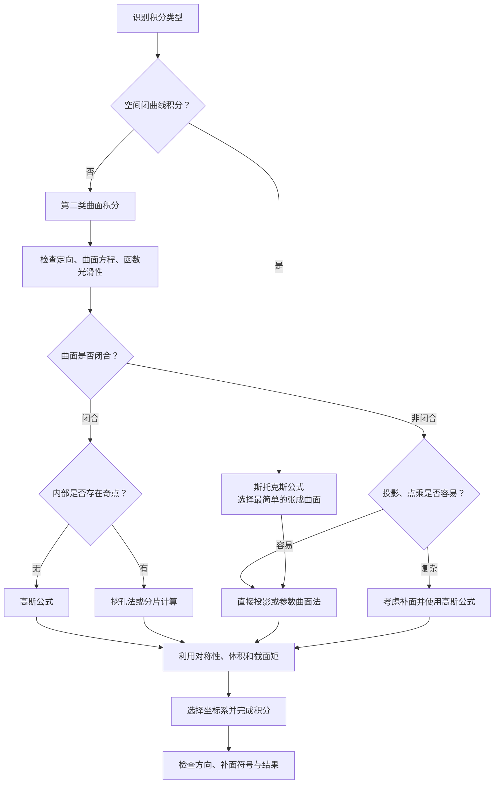

## 一、本节的知识体系与复习目标

这一节不仅考查第二类曲面积分的计算，还会将空间解析几何、三重积分、偏导数、微分方程、积分对称性等知识结合起来，是考研数学一非常值得系统掌握的综合性专题。

**1. 本节的七大核心题型**

| 题型 | 核心方法 | 代表性题源 | 复习优先级 |
|---|---|---|---|---|
| 有向面积元与定向 | 法向量、投影法 | 2024、2006年真题 | ★★★★★ |
| 闭曲面积分 | 高斯公式 | 2005、2016、2021、2023年真题 | ★★★★★ |
| 非闭曲面积分 | 补面法 | 2004、2018年真题 | ★★★★★ |
| 旋转曲面与通量 | 旋转曲面方程、补面 | 1987、2025年真题 | ★★★★★ |
| 未知函数与结构消项 | 直接投影、散度、微分方程 | 2000、2020年真题 | ★★★★★ |
| 奇点与高斯公式 | 挖孔法 | 2009年真题 | ★★★★☆ |
\| 空间闭曲线积分 | 斯托克斯公式 | 2022、2024年真题 | ★★★★★ |

**2. 本节最重要的三条解题主线**

第一条主线：**直接计算。**

$$
\text{确定方向} \longrightarrow \text{有向面积元} \longrightarrow \text{二重积分}
$$

第二条主线：**高斯公式。**

$$
\text{闭曲面积分} \longrightarrow \text{散度} \longrightarrow \text{三重积分}
$$

第三条主线：**斯托克斯公式。**

$$
\text{空间闭曲线积分} \longrightarrow \text{旋度} \longrightarrow \text{第二类曲面积分}
$$

遇到非闭曲面，可以考虑补面；遇到内部奇点，可以考虑挖孔；遇到未知函数，可以考虑利用曲面方程或求导结构将其消去。

本节真正的难点不是积分运算本身，而是如何选择计算方法、如何建立空间区域，以及如何保证曲面方向始终正确。

## 二、基础概念：什么是第二类曲面积分？

### 2.1 从投影面积理解第二类曲面积分

设空间中有一张有向曲面 $\Sigma$，在曲面上任取一个微小的曲面片，其面积为 $\mathrm dS$，单位法向量为

$$
\boldsymbol n=(\cos\alpha,\cos\beta,\cos\gamma).
$$

其中，$\alpha,\beta,\gamma$ 分别是法向量与三个坐标轴正向的夹角。

这个微小曲面片在三个坐标平面上的有向投影面积分别为

$$
\begin{cases} \mathrm dy\,\mathrm dz=\cos\alpha\,\mathrm dS,\\ \mathrm dz\,\mathrm dx=\cos\beta\,\mathrm dS,\\ \mathrm dx\,\mathrm dy=\cos\gamma\,\mathrm dS. \end{cases}
$$

注意，这里的投影面积带有正负号。

例如，当曲面法向量与 $z$ 轴正向的夹角为锐角时，

$$
\cos\gamma>0.
$$

因此 $\mathrm dx\,\mathrm dy$ 取正；若法向量朝下，则取负。

第二类曲面积分的标准形式为

$$
\boxed{ \iint_\Sigma P\,\mathrm dy\,\mathrm dz +Q\,\mathrm dz\,\mathrm dx +R\,\mathrm dx\,\mathrm dy }
$$

其中 $P,Q,R$ 均可以是三元函数。

利用投影面积与曲面面积的关系，有

$$
\boxed{ I=\iint_\Sigma (P\cos\alpha+Q\cos\beta+R\cos\gamma) \,\mathrm dS }
$$

这就是两类曲面积分之间的联系。

### 2.2 从物理意义理解：向量场的通量

设流体的速度场为

$$
\boldsymbol F=(P,Q,R).
$$

在一个微小曲面片上，真正穿过曲面的速度分量为

$$
\boldsymbol F\cdot\boldsymbol n.
$$

因此穿过整个曲面的通量为

$$
\boxed{ I=\iint_\Sigma\boldsymbol F\cdot\boldsymbol n\,\mathrm dS }
$$

也可以记作

$$
I=\iint_\Sigma\boldsymbol F\cdot\mathrm d\boldsymbol S,
$$

其中

$$
\mathrm d\boldsymbol S=\boldsymbol n\,\mathrm dS.
$$

这给出了一个非常重要的直观判断：

| 向量场与曲面的关系        | 通量     |
| ---------------- | ------ |
| 向量场与法向量同向        | 正      |
| 向量场与法向量反向        | 负      |
| 向量场与法向量垂直，即沿曲面切向 | 零      |
| 曲面方向反转           | 通量整体变号 |

尤其需要掌握：

$$
\boxed{ \boldsymbol F\cdot\boldsymbol n=0 \Longrightarrow \boldsymbol F\text{ 在该点的通量密度为零} }
$$

2020年数学一真题中未知函数的消去，本质上就是利用向量场与曲面相切的性质。

### 2.3 两类曲面积分的区别

| 比较项目     | 第一类曲面积分                            | 第二类曲面积分                                                                                                 |
| -------- | ---------------------------------- | ------------------------------------------------------------------------------------------------------- |
| 标准形式     | $\iint_\Sigma f\,\mathrm dS$ | $\iint_\Sigma P\,\mathrm dy\,\mathrm dz+Q\,\mathrm dz\,\mathrm dx+R\,\mathrm dx\,\mathrm dy$ |
| 积分对象     | 标量函数                               | 向量场                                                                                                     |
| 几何、物理意义  | 面积、质量等                             | 通量                                                                                                      |
| 是否依赖方向   | 否                                  | 是                                                                                                       |
| 方向反转     | 不变                                 | 变号                                                                                                      |
| 常用计算方法   | 曲面投影法                              | 有向投影法、高斯公式                                                                                              |
| 投影时的面积因子 | 通常需要根式                             | 有向面积向量中通常没有根式                                                                                           |

**尤其不要把第一类曲面积分的面积因子机械地套用到第二类曲面积分中。**

### 2.4 第二类曲面积分的重要性质

**性质一：线性性**

$$
\iint_\Sigma(a\boldsymbol F+b\boldsymbol G) \cdot\mathrm d\boldsymbol S = a\iint_\Sigma\boldsymbol F\cdot\mathrm d\boldsymbol S +b\iint_\Sigma\boldsymbol G\cdot\mathrm d\boldsymbol S.
$$

复杂向量场可以拆成若干容易计算的部分。

**性质二：可加性**

若曲面由若干定向一致的曲面片组成，

$$
\Sigma=\Sigma_1\cup\Sigma_2,
$$

则

$$
I_\Sigma=I_{\Sigma_1}+I_{\Sigma_2}.
$$

这是补面法、挖孔法和分片积分法的基础。

**性质三：方向反转变号**

$$
\boxed{I_{\Sigma^-}=-I_{\Sigma^+}}
$$

这一性质贯穿整节内容。

**性质四：闭曲面上常向量场的通量为零**

若 $\Sigma$ 是分片光滑的闭曲面，则

$$
\boxed{ \oiint_\Sigma\mathrm dy\,\mathrm dz = \oiint_\Sigma\mathrm dz\,\mathrm dx = \oiint_\Sigma\mathrm dx\,\mathrm dy =0 }
$$

例如，闭曲面积分中出现常数项 $1,2,3$，往往不需要实际计算。

但对于非闭曲面，这个结论不一定成立。

## 三、第二类曲面积分的直接计算法

### 3.1 最重要的公式：曲面投影法

设曲面方程为

$$
z=f(x,y),\qquad (x,y)\in D.
$$

曲面的一个法向量为

$$
\boldsymbol N=(-f_x,-f_y,1).
$$

由于第三个分量为正，因此它对应上侧方向。

单位法向量为

$$
\boldsymbol n= \frac{(-f_x,-f_y,1)} {\sqrt{1+f_x^2+f_y^2}}.
$$

而第一类曲面积分的面积元为

$$
\mathrm dS=\sqrt{1+f_x^2+f_y^2}\, \mathrm dx\,\mathrm dy.
$$

两者相乘，根式恰好抵消：

$$
\boxed{ \boldsymbol n\,\mathrm dS =(-f_x,-f_y,1)\,\mathrm dx\,\mathrm dy }
$$

于是，上侧的第二类曲面积分为

$$
\boxed{ I=\iint_D(-Pf_x-Qf_y+R)\,\mathrm dx\,\mathrm dy }
$$

其中必须将 $P,Q,R$ 中的 $z$ 替换成 $f(x,y)$。

如果取下侧，则

$$
\boxed{ I=\iint_D(Pf_x+Qf_y-R)\,\mathrm dx\,\mathrm dy }
$$

**三种投影公式汇总**

| 曲面方程           | 正向             | 有向面积向量                                     |
| -------------- | -------------- | ------------------------------------------ |
| $z=f(x,y)$ | 上侧，$n_z>0$ | $(-f_x,-f_y,1)\mathrm dx\,\mathrm dy$ |
| $y=f(x,z)$ | 右侧，$n_y>0$ | $(-f_x,1,-f_z)\mathrm dx\,\mathrm dz$ |
| $x=f(y,z)$ | 前侧，$n_x>0$ | $(1,-f_y,-f_z)\mathrm dy\,\mathrm dz$ |

反方向时，整个向量乘以 $-1$。

**记忆技巧：哪个变量是因变量，就将法向量中对应的分量取为** $1$**，其余分量取相应偏导数的负值。**

### 3.2 隐式曲面的统一计算公式

如果曲面由

$$
G(x,y,z)=0
$$

给出，则其法向量可以取为

$$
\nabla G=(G_x,G_y,G_z).
$$

当 $G_z\ne0$，并且曲面局部可以写为 $z=f(x,y)$ 时，有

$$
f_x=-\frac{G_x}{G_z}, \qquad f_y=-\frac{G_y}{G_z}.
$$

因此，上侧的有向面积向量为

$$
\boxed{ \mathrm d\boldsymbol S = \left(\frac{G_x}{G_z},\frac{G_y}{G_z},1\right) \mathrm dx\,\mathrm dy }
$$

这个公式对球面、椭球面等特别方便，不必每次先将 $z$ 解出来再求导。

### 3.3 母题一：根据曲面方向确定投影公式

**来源：2024年考研数学一。**

设 $P,Q$ 连续，曲面 $\Sigma$ 为

$$
z=\sqrt{1-x^2-y^2}, \qquad x\le0,\ y\ge0
$$

的上侧，求下列曲面积分的等价形式：

$$
I=\iint_\Sigma P\,\mathrm dy\,\mathrm dz +Q\,\mathrm dz\,\mathrm dx.
$$

**解题思路**

这是典型的公式、方向和符号辨析题，不需要实际积分。

由

$$
z=\sqrt{1-x^2-y^2}
$$

可得

$$
z_x=-\frac{x}{z}, \qquad z_y=-\frac{y}{z}.
$$

由于取上侧，

$$
\mathrm d\boldsymbol S= \left(\frac{x}{z},\frac{y}{z},1\right) \mathrm dx\,\mathrm dy.
$$

故

$$
\boxed{ I=\iint_D \left(\frac{x}{z}P+\frac{y}{z}Q\right) \mathrm dx\,\mathrm dy }
$$

其中

$$
D=\{(x,y):x^2+y^2\le1,\ x\le0,\ y\ge0\}.
$$

<Callout type="warn" title="容易出现的陷阱">

虽然题目给出 $x\le0$，但公式中的 $x/z$ 不需要额外添加负号。

因为 $x/z$ 本身已经体现了法向量在 $x$ 方向上的符号。

**区域所在象限和曲面定向是两个不同的问题。**

</Callout>

### 3.4 母题二：圆锥面的直接投影

**来源：2006年考研数学一。**

设 $\Sigma$ 为圆锥面

$$
z=\sqrt{x^2+y^2}, \qquad 0\le z\le1
$$

的下侧，计算

$$
I=\iint_\Sigma x\,\mathrm dy\,\mathrm dz +2y\,\mathrm dz\,\mathrm dx +3(z-1)\,\mathrm dx\,\mathrm dy.
$$

<Steps>

<Step>

### 第一步：确定投影区域 [!toc]

令

$$
r=\sqrt{x^2+y^2}.
$$

则 $z=r$，因此

$$
D:x^2+y^2\le1.
$$

</Step>

<Step>

### 第二步：确定下侧有向面积元 [!toc]

$$
z_x=\frac{x}{r}, \qquad z_y=\frac{y}{r}.
$$

下侧对应

$$
\mathrm d\boldsymbol S =\left(\frac{x}{r},\frac{y}{r},-1\right) \mathrm dx\,\mathrm dy.
$$

</Step>

<Step>

### 第三步：代入并化简 [!toc]

$$
\begin{aligned} I &=\iint_D \left[ \frac{x^2}{r}+\frac{2y^2}{r}-3(r-1) \right]\mathrm dx\,\mathrm dy\\ &=\iint_D \left[ \frac{x^2+2y^2}{r}-3r+3 \right]\mathrm dx\,\mathrm dy. \end{aligned}
$$

</Step>

<Step>

### 第四步：利用圆盘对称性 [!toc]

由于 $D$ 关于 $x,y$ 交换对称，

$$
\iint_D\frac{x^2}{r}\,\mathrm dx\,\mathrm dy = \iint_D\frac{y^2}{r}\,\mathrm dx\,\mathrm dy.
$$

所以在积分意义下，

$$
\frac{x^2+2y^2}{r} \longrightarrow \frac32r.
$$

于是

$$
\begin{aligned} I &=\iint_D\left(3-\frac32r\right) \mathrm dx\,\mathrm dy\\ &=2\pi\int_0^1 \left(3-\frac32r\right)r\,\mathrm dr\\ &=\boxed{2\pi}. \end{aligned}
$$

</Step>

</Steps>

**母题推广**

遇到圆锥面

$$
z=k\sqrt{x^2+y^2}=kr, \qquad k>0,
$$

其上侧有向面积向量为

$$
\left(-\frac{kx}{r},-\frac{ky}{r},1\right) \mathrm dx\,\mathrm dy,
$$

下侧则为

$$
\left(\frac{kx}{r},\frac{ky}{r},-1\right) \mathrm dx\,\mathrm dy.
$$

若被积函数较简单、投影为圆盘或圆环，可以优先考虑直接投影，而不必补面使用高斯公式。

### 3.5 母题三：利用曲面方程简化被积函数

**来源：2019年考研数学一。**

设 $\Sigma$ 为

$$
x^2+y^2+4z^2=4,\qquad z>0
$$

的上侧，计算

$$
I=\iint_\Sigma\sqrt{4-x^2-4z^2}\, \mathrm dx\,\mathrm dy.
$$

观察到曲面上恒有

$$
4-x^2-4z^2=y^2.
$$

于是

$$
\sqrt{4-x^2-4z^2}=|y|.
$$

由于积分中只有 $\mathrm dx\,\mathrm dy$，且曲面取上侧，可以直接投影：

$$
I=\iint_{x^2+y^2\le4}|y|\, \mathrm dx\,\mathrm dy.
$$

利用对称性和极坐标，

$$
\begin{aligned} I &=4\int_0^{\pi/2}\sin\theta\,\mathrm d\theta \int_0^2r^2\,\mathrm dr\\ &=\boxed{\frac{32}{3}}. \end{aligned}
$$

**同源模拟题**

张宇8套卷第8套第13题将曲面改为

$$
x^2+y^2+2z^2=1,\qquad z\ge0,
$$

计算

$$
\iint_\Sigma\sqrt{1-x^2-2z^2}\, \mathrm dx\,\mathrm dy.
$$

完全相同的思路，结果为

$$
\boxed{\frac43}.
$$

**应掌握的一般结论**

$$
\boxed{ \iint_{x^2+y^2\le a^2}|y|\,\mathrm dx\,\mathrm dy =\frac{4a^3}{3} }
$$

这类题目的关键是：**先利用曲面约束条件化简，再决定积分方法。**

尤其不能把 $\sqrt{y^2}$ 直接写成 $y$。

### 3.6 参数曲面法：应对不能直接写成显函数的曲面

若曲面由参数方程

$$
\boldsymbol r(u,v) =(x(u,v),y(u,v),z(u,v))
$$

给出，则

$$
\boxed{ I=\iint_D \boldsymbol F(\boldsymbol r(u,v)) \cdot (\boldsymbol r_u\times\boldsymbol r_v) \,\mathrm du\,\mathrm dv }
$$

前提是叉积方向符合题目指定方向，否则整体取负。

**配套母题：张宇1000题第18章第40题**

准线为

$$
x=1,\qquad z=y^2,\qquad |y|\le1,
$$

顶点为原点，构成顶点至准线之间的锥面 $\Sigma$，取上侧。计算

$$
I=\iint_\Sigma 2x^2\,\mathrm dy\,\mathrm dz +xy\,\mathrm dz\,\mathrm dx +(z+1)\,\mathrm dx\,\mathrm dy.
$$

准线上任一点可以写成

$$
(1,t,t^2).
$$

将它与原点连接，得到曲面的参数方程

$$
\boldsymbol r(s,t)=(s,st,st^2),
$$

其中

$$
0\le s\le1,\qquad -1\le t\le1.
$$

消去参数可以得到

$$
xz=y^2.
$$

而

$$
\begin{aligned} \boldsymbol r_s&=(1,t,t^2),\\ \boldsymbol r_t&=(0,s,2st), \end{aligned}
$$

所以

$$
\boldsymbol r_s\times\boldsymbol r_t =s(t^2,-2t,1).
$$

第三分量非负，符合上侧方向。

代入向量场：

$$
\boldsymbol F=(2s^2,s^2t,st^2+1).
$$

点乘后得到

$$
\boldsymbol F\cdot (\boldsymbol r_s\times\boldsymbol r_t) =s^2t^2+s.
$$

因此

$$
\begin{aligned} I&=\int_0^1\int_{-1}^1 (s^2t^2+s)\,\mathrm dt\,\mathrm ds\\ &=\boxed{\frac{11}{9}}. \end{aligned}
$$

这类题目将空间解析几何与曲面积分结合起来。今后如果遇到母线、准线、动点生成曲面等创新题，可以优先考虑参数化。

## 四、高斯公式：本节最重要的计算工具

### 4.1 高斯公式的内容

设闭曲面 $\Sigma=\partial\Omega$ 是有界空间区域 $\Omega$ 的分片光滑边界，取外侧方向，并且 $P,Q,R$ 在包含整个区域及其边界的开区域内具有连续的一阶偏导数，则

$$
\boxed{ \begin{aligned} &\oiint_\Sigma P\,\mathrm dy\,\mathrm dz +Q\,\mathrm dz\,\mathrm dx +R\,\mathrm dx\,\mathrm dy\\ &=\iiint_\Omega \left( \frac{\partial P}{\partial x} +\frac{\partial Q}{\partial y} +\frac{\partial R}{\partial z} \right)\mathrm dV. \end{aligned} }
$$

记

$$
\operatorname{div}\boldsymbol F =\nabla\cdot\boldsymbol F =P_x+Q_y+R_z,
$$

则高斯公式可以写成

$$
\boxed{ \oiint_{\partial\Omega} \boldsymbol F\cdot\mathrm d\boldsymbol S = \iiint_\Omega\operatorname{div}\boldsymbol F\,\mathrm dV }
$$

### 4.2 高斯公式的直观理解

散度描述的是一个向量场在某一点附近向外流出的强度。

$$
\operatorname{div}\boldsymbol F>0
$$

表示局部净流出；

$$
\operatorname{div}\boldsymbol F<0
$$

表示局部净流入。

如果将空间区域分割成大量微小立体，相邻立体公共边界上的通量由于法向相反而相互抵消。最后，只剩下整个立体外部边界上的净通量。

所以，高斯公式的本质就是：

$$
\boxed{ \text{边界净流出量} = \text{内部散度的累积} }
$$

### 4.3 高斯公式的三个适用条件

| 条件          | 不满足时怎么办         |
| ----------- | --------------- |
| 曲面闭合        | 补面              |
| 曲面取外侧       | 内侧时整体变号         |
| 向量场在体域内足够光滑 | 检查奇点，必要时挖孔或直接计算 |

特别注意：**不仅要求曲面上的被积函数有定义，还要检查曲面内部。**

2009年真题正是利用这个条件设置陷阱。

### 4.4 母题四：散度为常数，立即转化为体积

**来源：2005年考研数学一。**

空间区域 $\Omega$ 由圆锥面

$$
z=\sqrt{x^2+y^2}
$$

与上半球面

$$
z=\sqrt{R^2-x^2-y^2}
$$

围成，$\Sigma$ 为整个边界的外侧。求

$$
I=\oiint_\Sigma x\,\mathrm dy\,\mathrm dz +y\,\mathrm dz\,\mathrm dx +z\,\mathrm dx\,\mathrm dy.
$$

由于

$$
P_x+Q_y+R_z=1+1+1=3,
$$

高斯公式给出

$$
I=3V_\Omega.
$$

采用球坐标：

$$
\begin{cases} x=\rho\sin\varphi\cos\theta,\\ y=\rho\sin\varphi\sin\theta,\\ z=\rho\cos\varphi. \end{cases}
$$

积分区域为

$$
0\le\rho\le R, \quad 0\le\varphi\le\frac\pi4, \quad 0\le\theta\le2\pi.
$$

所以

$$
\begin{aligned} I &=3\int_0^{2\pi}\mathrm d\theta \int_0^{\pi/4}\sin\varphi\,\mathrm d\varphi \int_0^R\rho^2\,\mathrm d\rho\\ &=2\pi R^3 \left(1-\frac{\sqrt2}{2}\right)\\ &=\boxed{(2-\sqrt2)\pi R^3}. \end{aligned}
$$

**重要推论**

对任意满足高斯公式条件的闭曲面，

$$
\boxed{ \oiint_{\partial\Omega} x\,\mathrm dy\,\mathrm dz +y\,\mathrm dz\,\mathrm dx +z\,\mathrm dx\,\mathrm dy =3V_\Omega }
$$

更一般地，

$$
\boxed{ \oiint_{\partial\Omega} (ax+b)\,\mathrm dy\,\mathrm dz +(cy+d)\,\mathrm dz\,\mathrm dx +(ez+f)\,\mathrm dx\,\mathrm dy =(a+c+e)V_\Omega }
$$

因此，看到向量场各分量是对应坐标的一次函数，应立即想到散度为常数。

### 4.5 母题五：高斯公式与奇偶对称性

**来源：2021年考研数学一。**

设 $\Sigma$ 是椭圆柱体

$$
\Omega: x^2+4y^2\le4,\qquad0\le z\le2
$$

表面的外侧，求

$$
I=\oiint_\Sigma x^2\,\mathrm dy\,\mathrm dz +y^2\,\mathrm dz\,\mathrm dx +z\,\mathrm dx\,\mathrm dy.
$$

由高斯公式，

$$
I=\iiint_\Omega(2x+2y+1)\,\mathrm dV.
$$

区域关于 $x=0,y=0$ 对称，故

$$
\iiint_\Omega x\,\mathrm dV = \iiint_\Omega y\,\mathrm dV =0.
$$

因此

$$
I=V_\Omega.
$$

椭圆柱的底面半轴分别为 $2,1$，高为 $2$，所以

$$
\boxed{I=4\pi}.
$$

**同源模拟题**

张宇8套卷第3套第14题：

$$
\Sigma:\frac{x^2}{4}+\frac{y^2}{4}+z^2=1
$$

取外侧，求

$$
\oiint_\Sigma x^2\,\mathrm dy\,\mathrm dz +z\,\mathrm dx\,\mathrm dy.
$$

散度为 $2x+1$，故直接得到椭球体积：

$$
\boxed{I=\frac{16\pi}{3}}.
$$

此类题目的最优方法不是写出复杂的三重积分，而是

$$
\text{高斯公式} \longrightarrow \text{奇函数消项} \longrightarrow \text{几何体积}.
$$

### 4.6 母题六：高斯公式与非对称体域

**来源：2023年考研数学一。**

设 $\Omega$ 由柱面

$$
x^2+y^2=1
$$

和平面

$$
z=0,\qquad x+z=1
$$

围成，求其外侧边界上的曲面积分

$$
I=\oiint_\Sigma 2xz\,\mathrm dy\,\mathrm dz +xz\cos y\,\mathrm dz\,\mathrm dx +3yz\sin x\,\mathrm dx\,\mathrm dy.
$$

<Steps>

<Step>

### 第一步：计算散度 [!toc]

$$
\operatorname{div}\boldsymbol F =2z-xz\sin y+3y\sin x.
$$

</Step>

<Step>

### 第二步：正确判断空间区域的对称性 [!toc]

体域为

$$
\Omega: \begin{cases} x^2+y^2\le1,\\ 0\le z\le1-x. \end{cases}
$$

它关于 $y=0$ 对称，但不关于 $x=0$ 对称。

因此

$$
\iiint_\Omega xz\sin y\,\mathrm dV=0,
$$

$$
\iiint_\Omega y\sin x\,\mathrm dV=0.
$$

剩下

$$
I=\iiint_\Omega2z\,\mathrm dV.
$$

</Step>

<Step>

### 第三步：先对 $z$ 积分 [!toc]

$$
\begin{aligned} I &=\iint_{x^2+y^2\le1} \int_0^{1-x}2z\,\mathrm dz\,\mathrm dx\,\mathrm dy\\ &=\iint_D(1-x)^2\,\mathrm dx\,\mathrm dy. \end{aligned}
$$

</Step>

<Step>

### 第四步：再次利用对称性 [!toc]

展开：

$$
(1-x)^2=1-2x+x^2.
$$

这时积分区域已经是关于 $x=0$ 对称的单位圆盘，所以可以消去 $-2x$ 项。

$$
I=\pi+\frac\pi4 =\boxed{\frac{5\pi}{4}}.
$$

</Step>

</Steps>

**本题最值得学习的地方**

三重积分区域不具有某种对称性，不代表降维之后的二重积分区域也不具有这种对称性。

**应当随着积分的降维，重新判断对称性。**

这比机械地看到奇函数就消项要重要得多。

### 4.7 空间积分中常用的几何矩公式

本节真题经常将散度化为低次多项式，因此以下结论很有用。

| 积分区域                          | 常用结果                                                                     |
| ----------------------------- | ------------------------------------------------------------------------ |
| 半径 $a$ 的圆盘 $D$        | $\iint_Dx^2\,\mathrm dA=\iint_Dy^2\,\mathrm dA=\dfrac{\pi a^4}{4}$ |
| 椭圆盘 $x^2/a^2+y^2/b^2\le1$ | $\iint_Dx^2\,\mathrm dA=\dfrac{\pi a^3b}{4}$                        |
| 半径 $a$ 的球体 $B$        | $\iiint_Br^2\,\mathrm dV=\dfrac{4\pi a^5}{5}$                       |
| 半径 $a$ 的球体 $B$        | $\iiint_Bx^2\,\mathrm dV=\dfrac{4\pi a^5}{15}$                      |
| 椭球体                           | $V=\dfrac43\pi abc$                                                  |
| 四面体                           | $\iiint_\Omega x\,\mathrm dV=V\bar x$                              |

其中 $\bar x$ 是均匀四面体形心的横坐标。

例如，2016年数学一真题中，四面体由

$$
2x+y+2z=2
$$

与三个坐标平面围成，体积为 $1/3$，形心横坐标为 $1/4$。

高斯公式将原积分化为

$$
\iiint_\Omega(2x+1)\,\mathrm dV,
$$

于是

$$
I=2\cdot\frac13\cdot\frac14+\frac13 =\boxed{\frac12}.
$$

这可以作为常规累次积分之外的快速解法。

## 五、非闭曲面积分：补面法

这一部分是整个第六节的重点。很多考研大题并没有直接给出闭曲面，而只给出了球面、抛物面、圆锥面或旋转曲面的一部分。

这时需要主动构造闭曲面。

### 5.1 补面法的基本原理

设原曲面为 $\Sigma$，补充曲面为 $\Sigma_0$，使得

$$
\partial\Omega=\Sigma\cup\Sigma_0.
$$

如果原曲面的方向与闭曲面的外侧一致，那么

$$
\boxed{ I_\Sigma =\iiint_\Omega\operatorname{div}\boldsymbol F\,\mathrm dV -I_{\Sigma_0} }
$$

如果原曲面的方向与闭曲面外侧相反，则需要整体变号。

补面法最容易出错的不是高斯公式，而是**补面的方向**。

### 5.2 常见曲面如何补面？

| 原曲面        | 常见补面        | 补面方向     |
| ---------- | ----------- | -------- |
| 上半球面外侧     | 底部圆盘        | 向下       |
| 下半球面外侧     | 顶部圆盘        | 向上       |
| 向上开口的抛物面下侧 | 上方圆盘        | 向上       |
| 向下开口的抛物面上侧 | 下方圆盘        | 向下       |
| 圆柱侧面外侧     | 上下底面        | 上正下负     |
| 圆锥环带外侧     | 上下圆盘        | 上正下负     |
| 第一卦限内的球面片  | 三个坐标平面上的曲面片 | 朝坐标轴负向   |
| 斜截面旋转曲面    | 斜平面截得的区域    | 根据空间区域判断 |

特别注意：

**上侧不一定等于外侧，下侧也不一定等于内侧。**

这取决于立体区域位于曲面的哪一边。

### 5.3 母题七：抛物面补面，补面通量不为零

**来源：2004年考研数学一。**

设 $\Sigma$ 为抛物面

$$
z=1-x^2-y^2,\qquad z\ge0
$$

的上侧，计算

$$
\begin{aligned} I=\iint_\Sigma& 2x^3\,\mathrm dy\,\mathrm dz +2y^3\,\mathrm dz\,\mathrm dx\\ &+3(z^2-1)\,\mathrm dx\,\mathrm dy. \end{aligned}
$$

<Tabs items={["方法一：高斯公式与补面法", "方法二：直接投影法"]} defaultIndex={0}>

<Tab value="方法一：高斯公式与补面法">

第一步，补充底面

$$
\Sigma_0: z=0,\qquad x^2+y^2\le1.
$$

整个立体区域为

$$
\Omega: 0\le z\le1-x^2-y^2.
$$

原抛物面上侧恰好是立体的外侧，底面必须取下侧。

第二步，计算散度：

$$
\begin{aligned} P_x+Q_y+R_z &=6x^2+6y^2+6z\\ &=6(r^2+z). \end{aligned}
$$

第三步，计算闭曲面总通量：

$$
\begin{aligned} I_{\text{闭}} &=6\int_0^{2\pi}\mathrm d\theta \int_0^1r\,\mathrm dr \int_0^{1-r^2}(r^2+z)\,\mathrm dz\\ &=12\pi\int_0^1 \frac{1-r^4}{2}r\,\mathrm dr\\ &=2\pi. \end{aligned}
$$

第四步，计算补面通量。

在 $z=0$ 上，

$$
R=3(z^2-1)=-3.
$$

由于底面向下，

$$
\boldsymbol n=(0,0,-1).
$$

因此

$$
I_{\Sigma_0} =\iint_D(-R)\,\mathrm dx\,\mathrm dy =3\pi.
$$

最后

$$
\boxed{ I=2\pi-3\pi=-\pi }
$$

</Tab>

<Tab value="方法二：直接投影法">

上侧的有向面积向量为

$$
(2x,2y,1)\,\mathrm dx\,\mathrm dy.
$$

于是

$$
I=\iint_D [4x^4+4y^4+3(z^2-1)]\,\mathrm dx\,\mathrm dy.
$$

代入 $z=1-r^2$，可得

$$
I=\iint_D [4x^4+4y^4+3r^4-6r^2]\,\mathrm dx\,\mathrm dy.
$$

利用

$$
\iint_D(x^4+y^4)\,\mathrm dA=\frac\pi4,
$$

$$
\iint_Dr^4\,\mathrm dA=\frac\pi3, \qquad \iint_Dr^2\,\mathrm dA=\frac\pi2,
$$

得到

$$
I=\pi+\pi-3\pi =\boxed{-\pi}.
$$

</Tab>

</Tabs>

**两种方法如何选择？**

本题两种方法均可行，但高斯公式能够降低多项式次数，通常更自然。

直接投影法产生四次项，高斯公式则将其降为二次项。这正是高斯公式在计算方面的优势。

### 5.4 母题八：半椭球面、补面与空间二次矩

**来源：2018年考研数学一。**

设曲面

$$
\Sigma:x=\sqrt{1-3y^2-3z^2}
$$

取前侧，计算

$$
I=\iint_\Sigma x\,\mathrm dy\,\mathrm dz +(y^3+2)\,\mathrm dz\,\mathrm dx +z^3\,\mathrm dx\,\mathrm dy.
$$

<Steps>

<Step>

### 第一步：恢复椭球体 [!toc]

原曲面为

$$
x^2+3y^2+3z^2=1,\qquad x\ge0.
$$

补充 $x=0$ 上的椭圆盘，构成半椭球体。

原曲面取前侧，正好是外侧。

</Step>

<Step>

### 第二步：利用高斯公式 [!toc]

$$
\operatorname{div}\boldsymbol F =1+3y^2+3z^2.
$$

补面上 $x=0$，且其法向量为

$$
(-1,0,0).
$$

由于 $P=x=0$，所以补面通量为零。

于是

$$
I=\iiint_\Omega(1+3y^2+3z^2)\,\mathrm dV.
$$

</Step>

<Step>

### 第三步：线性换元 [!toc]

令

$$
x=u,\qquad y=\frac{v}{\sqrt3},\qquad z=\frac{w}{\sqrt3}.
$$

那么

$$
\mathrm dV=\frac13\,\mathrm du\,\mathrm dv\,\mathrm dw.
$$

区域变成单位半球体

$$
B_+:u^2+v^2+w^2\le1,\qquad u\ge0.
$$

原积分为

$$
I=\frac13\iiint_{B_+}(1+v^2+w^2)\,\mathrm du\,\mathrm dv\,\mathrm dw.
$$

单位半球体积为

$$
V=\frac{2\pi}{3},
$$

并且

$$
\iiint_{B_+}v^2\,\mathrm dV =\iiint_{B_+}w^2\,\mathrm dV =\frac{2\pi}{15}.
$$

因此

$$
I=\frac13 \left(\frac{2\pi}{3}+\frac{4\pi}{15}\right) =\boxed{\frac{14\pi}{45}}.
$$

</Step>

</Steps>

**配套变式：李正元练习题第十章第11题**

设 $\Sigma$ 为上半椭球面

$$
\frac{x^2}{a^2}+\frac{y^2}{b^2}+\frac{z^2}{c^2}=1, \qquad z\ge0,
$$

取上侧，计算

$$
\begin{aligned} I=\iint_\Sigma& (x^2-y^2)\,\mathrm dy\,\mathrm dz\\ &+(y^2-z^2)\,\mathrm dz\,\mathrm dx\\ &+(z^2-x^2)\,\mathrm dx\,\mathrm dy. \end{aligned}
$$

散度为

$$
2x+2y+2z.
$$

利用体域对称性，只剩下

$$
I_{\text{闭}}=2\iiint_\Omega z\,\mathrm dV.
$$

固定 $z$ 时，水平椭圆截面面积为

$$
A(z)=\pi ab\left(1-\frac{z^2}{c^2}\right).
$$

因此

$$
I_{\text{闭}} =2\pi ab\int_0^cz \left(1-\frac{z^2}{c^2}\right)\mathrm dz =\frac{\pi abc^2}{2}.
$$

底面取下侧，故

$$
I_{\Sigma_0} =\iint_Dx^2\,\mathrm dx\,\mathrm dy =\frac{\pi a^3b}{4}.
$$

最终

$$
\boxed{ I=\frac{\pi ab}{4}(2c^2-a^2) }
$$

这里还有一个有意义的推论：

当

$$
a=\sqrt2c
$$

时，原曲面积分恰好等于零。

这类带参数的题目可以进一步考查参数确定、通量符号及最值问题。

### 5.5 母题九：旋转曲面与斜轴圆锥

**来源：2025年考研数学一。**

直线

$$
x=0,\qquad y=0
$$

绕直线

$$
x=y=z
$$

旋转一周得到曲面 $\Sigma$。

设 $\Sigma_1$ 为该曲面介于

$$
x+y+z=0,\qquad x+y+z=1
$$

之间部分的外侧，计算

$$
I=\iint_{\Sigma_1} x\,\mathrm dy\,\mathrm dz +(y+1)\,\mathrm dz\,\mathrm dx +(z+2)\,\mathrm dx\,\mathrm dy.
$$

这是一道很值得精读的综合母题，因为它考查的不仅是高斯公式，还考查空间几何建模能力。

<Steps>

<Step>

### 第一步：确定旋转曲面的几何形状 [!toc]

母线为 $z$ 轴，其方向向量为

$$
\boldsymbol a=(0,0,1).
$$

旋转轴方向向量为

$$
\boldsymbol b=(1,1,1).
$$

两直线的夹角 $\alpha$ 满足

$$
\cos\alpha =\frac{\boldsymbol a\cdot\boldsymbol b} {|\boldsymbol a||\boldsymbol b|} =\frac1{\sqrt3}.
$$

因此

$$
\tan\alpha=\sqrt2.
$$

旋转得到的是以原点为顶点、以 $x=y=z$ 为轴的双圆锥。

其方程也可以利用点到旋转轴的夹角写成

$$
\frac{(x+y+z)^2} {3(x^2+y^2+z^2)} =\frac13.
$$

即

$$
\boxed{ (x+y+z)^2=x^2+y^2+z^2 }
$$

或者

$$
\boxed{xy+yz+zx=0}.
$$

</Step>

<Step>

### 第二步：确定圆锥体的高和底面半径 [!toc]

截面

$$
x+y+z=1
$$

垂直于旋转轴。

原点到该平面的距离为

$$
h=\frac1{\sqrt3}.
$$

因此底面半径为

$$
r=h\tan\alpha =\sqrt{\frac23}.
$$

底面面积为

$$
S_0=\frac{2\pi}{3}.
$$

圆锥体积为

$$
V=\frac13\pi r^2h =\frac{2\pi}{9\sqrt3}.
$$

</Step>

<Step>

### 第三步：补面使用高斯公式 [!toc]

向量场为

$$
\boldsymbol F=(x,y+1,z+2).
$$

散度为

$$
\operatorname{div}\boldsymbol F=3.
$$

闭曲面总通量为

$$
I_{\text{闭}}=3V =\frac{2\pi}{3\sqrt3}.
$$

</Step>

<Step>

### 第四步：计算斜平面补面通量 [!toc]

上方圆盘的单位外法向量为

$$
\boldsymbol n=\frac1{\sqrt3}(1,1,1).
$$

在补面上，

$$
\begin{aligned} \boldsymbol F\cdot\boldsymbol n &=\frac{x+y+z+3}{\sqrt3}\\ &=\frac4{\sqrt3}. \end{aligned}
$$

它是常数！

因此补面通量为

$$
I_{\Sigma_0} =\frac4{\sqrt3}\cdot\frac{2\pi}{3} =\frac{8\pi}{3\sqrt3}.
$$

</Step>

<Step>

### 第五步：求原积分 [!toc]

$$
\begin{aligned} I &=I_{\text{闭}}-I_{\Sigma_0}\\ &=\frac{2\pi}{3\sqrt3} -\frac{8\pi}{3\sqrt3}\\ &=\boxed{-\frac{2\sqrt3\pi}{3}}. \end{aligned}
$$

</Step>

</Steps>

**真正应该掌握的通用模型**

设圆锥的顶点为原点，单位轴向量为 $\boldsymbol u$，半顶角为 $\alpha$，高为 $h$。

若向量场为

$$
\boldsymbol F=\lambda\boldsymbol r+\boldsymbol c, \qquad \boldsymbol r=(x,y,z),
$$

其中 $\boldsymbol c$ 为常向量，则整个圆锥侧面外向通量为

$$
\boxed{ I_{\text{侧}} =-\pi h^2\tan^2\alpha \,(\boldsymbol c\cdot\boldsymbol u) }
$$

推导如下：

圆锥底面积为

$$
A=\pi h^2\tan^2\alpha.
$$

闭曲面总通量为

$$
3\lambda V=\lambda hA.
$$

而底面通量为

$$
I_{\text{底}} =(\lambda h+\boldsymbol c\cdot\boldsymbol u)A.
$$

相减即得结论。

这个结果还有一个直观解释：对于以原点为顶点的圆锥，径向向量 $\boldsymbol r$ 总是沿着圆锥的母线方向，与圆锥法向量垂直，因此径向场对圆锥侧面的通量没有贡献。

2025年真题事实上可以进一步利用这一几何性质快速求解。

## 六、旋转曲面综合题与高质量模拟题

### 6.1 绕坐标轴旋转的通用建模方法

旋转过程中不变的是：

1. 点在旋转轴方向上的坐标。
2. 点到旋转轴的距离。

例如，曲线

$$
x=a(t),\qquad y=b(t),\qquad z=t
$$

绕 $z$ 轴旋转，得到

$$
\boxed{x^2+y^2=a(z)^2+b(z)^2}.
$$

同理，绕 $x$ 轴旋转时使用 $y^2+z^2$，绕 $y$ 轴旋转时使用 $x^2+z^2$。

遇到旋转曲面题目，不要急着积分，先确定轴向坐标与截面半径之间的关系。

### 6.2 综合母题：旋转曲面、补面及二次矩

**来源：汤家凤八套卷第1套第20题。**

直线

$$
\frac{x-1}{2}=y+2=z
$$

绕 $z$ 轴旋转一周得到曲面，取其介于 $z=0$ 与 $z=1$ 之间的外侧，计算

$$
I=\iint_\Sigma (x^3+y)\,\mathrm dy\,\mathrm dz +(y^2+xz)\,\mathrm dz\,\mathrm dx +(z+1)\,\mathrm dx\,\mathrm dy.
$$

**建立旋转曲面方程**

原直线上一点为

$$
(1+2z,-2+z,z).
$$

到 $z$ 轴距离的平方为

$$
(1+2z)^2+(-2+z)^2=5(1+z^2).
$$

所以

$$
\boxed{x^2+y^2=5(1+z^2)}.
$$

固定 $z$ 时的圆形截面半径满足

$$
R(z)^2=5(1+z^2).
$$

**补充上下底面**

散度为

$$
P_x+Q_y+R_z=3x^2+2y+1.
$$

由于关于 $y=0$ 对称，$2y$ 项积分为零。

利用圆盘二次矩公式

$$
\iint_{D_z}x^2\,\mathrm dA =\frac{\pi R(z)^4}{4},
$$

得到

$$
\begin{aligned} I_{\text{闭}} &=\pi\int_0^1 \left[\frac{75}{4}(1+z^2)^2 +5(1+z^2)\right]\mathrm dz\\ &=\frac{125\pi}{3}. \end{aligned}
$$

下底面 $z=0$ 取下侧：

$$
I_0=-5\pi.
$$

上底面 $z=1$ 取上侧：

$$
I_1=20\pi.
$$

所以

$$
\boxed{ I=\frac{125\pi}{3}+5\pi-20\pi =\frac{80\pi}{3} }
$$

本题可以作为绕坐标轴旋转曲面综合题的标准模板。

### 6.3 综合母题：偏移区域与平移极坐标

**来源：张宇8套卷第2套第18题。**

求向量场

$$
\boldsymbol A=(xy+z,zx+y,yz+x)
$$

流出由

$$
z=1-x^2-y^2,\qquad z=2y
$$

围成的立体区域的通量。

首先联立两曲面：

$$
1-x^2-y^2=2y,
$$

即

$$
x^2+(y+1)^2=2.
$$

所以投影区域是偏心圆盘

$$
D:x^2+(y+1)^2\le2.
$$

散度为

$$
\operatorname{div}\boldsymbol A=1+2y.
$$

使用高斯公式：

$$
I=\iint_D(1+2y) (1-x^2-y^2-2y)\,\mathrm dx\,\mathrm dy.
$$

令

$$
u=x,\qquad v=y+1.
$$

则

$$
D:u^2+v^2\le2.
$$

并且

$$
1+2y=2v-1,
$$

$$
1-x^2-y^2-2y=2-u^2-v^2.
$$

因此

$$
I=\iint_D(2v-1)(2-u^2-v^2)\,\mathrm du\,\mathrm dv.
$$

利用关于 $v=0$ 的对称性，

$$
I=-\iint_D(2-u^2-v^2)\,\mathrm du\,\mathrm dv.
$$

改用极坐标：

$$
I=-2\pi\int_0^{\sqrt2}(2-r^2)r\,\mathrm dr =\boxed{-2\pi}.
$$

**命题规律**

积分区域不以原点为中心时，原坐标下可能无法使用奇偶对称性。

经过平移换元后，对称性重新出现，复杂积分就会大幅简化。

同类题还可以练习汤家凤八套卷第5套第20题，其抛物面为

$$
z=(x-1)^2+y^2,\qquad0\le z\le1.
$$

原题通过平移柱坐标与补面法得到

$$
\boxed{I=-\frac{5\pi}{4}}.
$$

## 七、未知函数与结构消项

这是本节中很容易出现综合创新题的一部分。

看到未知函数 $f$ 时，不要立即认为必须先求出 $f$ 的解析式。很多题目只要求计算积分，而未知函数会在求导、点乘或利用对称性时自动消失。

### 7.1 母题十：连续未知函数与切向量消项

**来源：2020年考研数学一。**

设 $\Sigma$ 为

$$
z=\sqrt{x^2+y^2}, \qquad1\le x^2+y^2\le4
$$

的下侧，$f$ 为连续函数，计算

$$
\begin{aligned} I=\iint_\Sigma& [xf(xy)+2x-y]\,\mathrm dy\,\mathrm dz\\ &+[yf(xy)+2y+x]\,\mathrm dz\,\mathrm dx\\ &+[zf(xy)+z]\,\mathrm dx\,\mathrm dy. \end{aligned}
$$

**方法识别**

题目只告诉我们 $f$ 连续，没有保证 $f$ 可导。

因此不能直接对包含 $f$ 的向量场机械地使用高斯公式。

应优先选择直接投影法。

<Steps>

<Step>

### 第一步：写出下侧有向面积元 [!toc]

$$
\mathrm d\boldsymbol S =\left(\frac{x}{r},\frac{y}{r},-1\right) \mathrm dx\,\mathrm dy.
$$

其中

$$
z=r,\qquad 1\le r\le2.
$$

</Step>

<Step>

### 第二步：点乘 [!toc]

$$
\begin{aligned} I=\iint_D\bigg[ &\frac{x}{r}(xf(xy)+2x-y)\\ +&\frac{y}{r}(yf(xy)+2y+x)\\ -&rf(xy)-r \bigg]\mathrm dx\,\mathrm dy. \end{aligned}
$$

将未知函数项合并：

$$
f(xy)\left(\frac{x^2+y^2}{r}-r\right)=0.
$$

交叉项也恰好抵消：

$$
-\frac{xy}{r}+\frac{xy}{r}=0.
$$

于是

$$
I=\iint_D \left(\frac{2(x^2+y^2)}r-r\right) \mathrm dx\,\mathrm dy.
$$

即

$$
I=\iint_Dr\,\mathrm dx\,\mathrm dy.
$$

</Step>

<Step>

### 第三步：极坐标积分 [!toc]

$$
I=2\pi\int_1^2r^2\,\mathrm dr =\boxed{\frac{14\pi}{3}}.
$$

</Step>

</Steps>

**深层理解**

未知函数部分可以写成

$$
f(xy)(x,y,z).
$$

这是沿径向的向量场。

对于以原点为顶点的圆锥面，

$$
(x,y,z)\cdot\boldsymbol n=0.
$$

所以无论乘上什么连续标量函数，通量都为零。

**可推广的结论**

若 $\Sigma$ 是以原点为顶点的锥面，并且 $g(x,y,z)$ 连续，则

$$
\boxed{ \iint_\Sigma g(x,y,z) (x\,\mathrm dy\,\mathrm dz+ y\,\mathrm dz\,\mathrm dx+ z\,\mathrm dx\,\mathrm dy)=0 }
$$

这意味着未来即使将 $f(xy)$ 替换为

$$
f(x^2+y^2+z^2),\qquad f(x,y,z),\qquad \mathrm e^{xyz},
$$

径向场部分仍然可以消去。

这才是2020年真题真正值得掌握的知识迁移能力。

### 7.2 母题十一：高斯公式中的未知函数导数抵消

**来源：李永乐六套卷第4套第20题。**

过两点

$$
A(1,0,0),\qquad B(1,1,1)
$$

的直线绕 $z$ 轴旋转，取 $0\le z\le1$ 部分的外侧。

设 $f$ 具有连续的一阶导数，计算

$$
\begin{aligned} I=\iint_\Sigma& [xf(xy)-2x]\,\mathrm dy\,\mathrm dz\\ &+[y^2-yf(xy)]\,\mathrm dz\,\mathrm dx\\ &+(z+1)^2\,\mathrm dx\,\mathrm dy. \end{aligned}
$$

旋转曲面方程为

$$
x^2+y^2=1+z^2.
$$

补充上下底面，计算散度：

$$
P_x=f(xy)+xyf'(xy)-2,
$$

$$
Q_y=2y-f(xy)-xyf'(xy),
$$

$$
R_z=2(z+1).
$$

相加得到

$$
\boxed{\operatorname{div}\boldsymbol F=2y+2z}.
$$

未知函数及其导数全部消失。

闭曲面总通量为

$$
\begin{aligned} I_{\text{闭}} &=2\iiint_\Omega z\,\mathrm dV\\ &=2\pi\int_0^1z(1+z^2)\,\mathrm dz\\ &=\frac{3\pi}{2}. \end{aligned}
$$

上下底面通量分别为

$$
I_1=8\pi,\qquad I_0=-\pi.
$$

因此

$$
\boxed{ I=\frac{3\pi}{2}-8\pi+\pi =-\frac{11\pi}{2} }
$$

**应识别的典型结构**

如果向量场中出现

$$
P=xf(xy),\qquad Q=-yf(xy),
$$

那么

$$
\frac{\partial P}{\partial x} +\frac{\partial Q}{\partial y}=0.
$$

更一般地，二维散度消项结构可以来自

$$
P=\psi_y,\qquad Q=-\psi_x,
$$

因为在二阶混合偏导数连续时，

$$
P_x+Q_y =\psi_{yx}-\psi_{xy}=0.
$$

理解这一结构以后，遇到复杂未知函数也不必慌张。

### 7.3 配套强化题：李林880中的复合函数消项

**来源：李林880第九章第55题。**

空间区域由球面半径为 $1,2$ 的两个上半球面与圆锥面 $z=\sqrt{x^2+y^2}$ 围成。

向量场的分量为

$$
P=\frac1{y+3} f\left(\frac{x+4}{y+3}\right)+3xy^2,
$$

$$
Q=\frac1{x+4} f\left(\frac{x+4}{y+3}\right)+3x^2y,
$$

$$
R=z^3.
$$

其中 $f$ 具有连续导数，求全表面外向通量。

令

$$
u=\frac{x+4}{y+3}.
$$

求导得到

$$
P_x=\frac{f'(u)}{(y+3)^2}+3y^2,
$$

$$
Q_y=-\frac{f'(u)}{(y+3)^2}+3x^2.
$$

所以

$$
\operatorname{div}\boldsymbol F =3(x^2+y^2+z^2).
$$

区域采用球坐标表示为

$$
1\le\rho\le2,\qquad 0\le\varphi\le\frac\pi4,\qquad 0\le\theta\le2\pi.
$$

于是

$$
\begin{aligned} I &=3\int_0^{2\pi}\mathrm d\theta \int_0^{\pi/4}\sin\varphi\,\mathrm d\varphi \int_1^2\rho^4\,\mathrm d\rho\\ &=\boxed{\frac{93}{5}(2-\sqrt2)\pi}. \end{aligned}
$$

这种题目在形式上复杂，但只要看出复合函数的偏导数抵消，后续就是普通的三重积分。

### 7.4 进阶：未知函数仅连续，也能利用对称性消去

张宇1000题第18章第15题中，未知函数部分为

$$
P=yf(xy),\qquad Q=-xf(xy),
$$

并且只假设 $f$ 连续。

这与前面的 $xf(xy),-yf(xy)$ 型不同。

题设只保证 $f$ 连续，不能直接使用 $f'(xy)$；采用侧面直接积分。

设旋转曲面为

$$
x^2+y^2=1+z^2,\qquad0\le z\le1.
$$

令

$$
\rho(z)=\sqrt{1+z^2},
$$

参数方程为

$$
\boldsymbol r(\theta,z) =(\rho\cos\theta,\rho\sin\theta,z).
$$

外侧有向面积向量为

$$
(\rho\cos\theta,\rho\sin\theta,-\rho\rho') \,\mathrm d\theta\,\mathrm dz.
$$

未知函数部分点乘后，

$$
yf(xy)\,x-xf(xy)\,y=0.
$$

它在曲面上逐点消失，完全不需要 $f$ 可导。

原题完整向量场为

$$
\boldsymbol F= (yf(xy)-2x,\ y^2-xf(xy),\ (z-1)^2).
$$

消去未知函数部分后，再计算剩余光滑向量场的通量，可得

$$
\boxed{I=-\frac{17\pi}{6}}.
$$

## 八、任意闭曲面零通量与微分方程

### 8.1 重要定理：由积分恒等式反推被积函数

设 $g(x,y,z)$ 连续，如果对区域内任意足够小的闭区域 $\Omega$，都有

$$
\iiint_\Omega g(x,y,z)\,\mathrm dV=0,
$$

则

$$
\boxed{g(x,y,z)\equiv0}.
$$

证明采用反证法。

假设存在一点使 $g>0$，由连续性可知，在该点某个充分小的邻域内仍有 $g>0$，于是这个邻域上的积分应当大于零，与条件矛盾。

存在 $g<0$ 的点时同理。

因此

$$
\boxed{ \text{任意闭曲面通量均为零} \Longrightarrow \operatorname{div}\boldsymbol F\equiv0 }
$$

这里默认向量场满足高斯公式所需的光滑性条件。

### 8.2 母题十二：高斯公式与一阶线性微分方程

**来源：2000年考研数学一。**

已知对于半空间 $x>0$ 内任意光滑有向闭曲面 $S$，均有

$$
\oiint_S xf(x)\,\mathrm dy\,\mathrm dz -xyf(x)\,\mathrm dz\,\mathrm dx -\mathrm e^{2x}z\,\mathrm dx\,\mathrm dy =0.
$$

其中 $f$ 具有连续的一阶导数，且

$$
\lim_{x\to0^+}f(x)=1.
$$

求 $f(x)$。

<Steps>

<Step>

### 第一步：高斯公式 [!toc]

$$
\iiint_\Omega [f(x)+xf'(x)-xf(x)-\mathrm e^{2x}] \,\mathrm dV=0.
$$

由于闭曲面的任意性，

$$
f(x)+xf'(x)-xf(x)-\mathrm e^{2x}=0.
$$

即

$$
xf'(x)+(1-x)f(x)=\mathrm e^{2x}.
$$

</Step>

<Step>

### 第二步：转化为一阶线性微分方程 [!toc]

由于 $x>0$，

$$
f'(x)+\left(\frac1x-1\right)f(x) =\frac{\mathrm e^{2x}}x.
$$

积分因子为

$$
\mu(x)=\mathrm e^{\int(1/x-1)\,\mathrm dx} =x\mathrm e^{-x}.
$$

两边乘以积分因子：

$$
\frac{\mathrm d}{\mathrm dx} [x\mathrm e^{-x}f(x)] =\mathrm e^x.
$$

积分得到

$$
x\mathrm e^{-x}f(x)=\mathrm e^x+C.
$$

于是

$$
f(x)=\frac{\mathrm e^x(\mathrm e^x+C)}x.
$$

</Step>

<Step>

### 第三步：利用极限条件确定常数 [!toc]

为了使 $x\to0^+$ 时极限有限，必须有

$$
1+C=0.
$$

因此 $C=-1$。

并且

$$
\lim_{x\to0^+} \frac{\mathrm e^x(\mathrm e^x-1)}x=1.
$$

所以

$$
\boxed{ f(x)=\frac{\mathrm e^x(\mathrm e^x-1)}x }
$$

</Step>

</Steps>

**本题的通用解题流程**

$$
\text{任意闭曲面积分恒等式}
$$

$$
\Downarrow
$$

$$
\text{高斯公式化为任意体域上的积分}
$$

$$
\Downarrow
$$

$$
\text{连续被积函数恒等于零}
$$

$$
\Downarrow
$$

$$
\text{建立并求解微分方程}
$$

### 8.3 同类模拟题：高斯公式与二阶微分方程

**来源：张宇8套卷第1套第20题。**

若第一卦限内任意有向闭曲面 $\Sigma$ 均满足

$$
\begin{aligned} \oiint_\Sigma& x^2z\varphi(y)\,\mathrm dy\,\mathrm dz\\ &+2xz\varphi'(y)\,\mathrm dz\,\mathrm dx\\ &-xz^2\mathrm e^y\,\mathrm dx\,\mathrm dy=0, \end{aligned}
$$

并且

$$
\varphi(\pi)=\varphi'(\pi) =\frac{\mathrm e^\pi-1}{2},
$$

求二阶连续可导函数 $\varphi(y)$。

使用高斯公式，

$$
\iiint_\Omega 2xz[\varphi(y)+\varphi''(y)-\mathrm e^y] \,\mathrm dV=0.
$$

由区域任意性以及第一卦限内 $xz>0$，得到

$$
\varphi''(y)+\varphi(y)=\mathrm e^y.
$$

这是二阶常系数非齐次线性微分方程。

齐次方程通解为

$$
\varphi_h=C_1\cos y+C_2\sin y.
$$

一个特解为

$$
\varphi_p=\frac12\mathrm e^y.
$$

故

$$
\varphi(y) =C_1\cos y+C_2\sin y+\frac12\mathrm e^y.
$$

代入两个初始条件，

$$
C_1=C_2=\frac12.
$$

最终

$$
\boxed{ \varphi(y)=\frac12(\cos y+\sin y+\mathrm e^y) }
$$

这道模拟题可以看作2000年真题的升级版：将一阶微分方程升级为二阶微分方程。

未来也可能出现含参数方程、其他类型微分方程，或者要求证明向量场具有某种性质的变式。

**必须区分：** 对某一个固定闭曲面的通量为零，并不能推出散度处处为零。题目必须提供足够强的任意性条件。

## 九、内部奇点与高斯公式的挖孔法

### 9.1 母题十三：零散度却具有非零通量

**来源：2009年考研数学一。**

设

$$
\Sigma:2x^2+2y^2+z^2=4
$$

取外侧，计算

$$
I=\oiint_\Sigma \frac{x\,\mathrm dy\,\mathrm dz+ y\,\mathrm dz\,\mathrm dx+ z\,\mathrm dx\,\mathrm dy} {(x^2+y^2+z^2)^{3/2}}.
$$

令

$$
r=\sqrt{x^2+y^2+z^2}.
$$

向量场为

$$
\boldsymbol F=\frac{(x,y,z)}{r^3}.
$$

<Steps>

<Step>

### 第一步：计算散度 [!toc]

在 $r>0$ 时，

$$
\frac{\partial}{\partial x} \left(\frac{x}{r^3}\right) =\frac1{r^3}-\frac{3x^2}{r^5}.
$$

三个分量求导后相加：

$$
\begin{aligned} \operatorname{div}\boldsymbol F &=\frac3{r^3} -\frac{3(x^2+y^2+z^2)}{r^5}\\ &=0. \end{aligned}
$$

如果直接使用高斯公式，会错误得到 $I=0$。

为什么错误？

因为原点是向量场的奇点，而原点位于椭球内部。

</Step>

<Step>

### 第二步：挖去包含奇点的小球 [!toc]

在椭球内部取球面

$$
S_\varepsilon: x^2+y^2+z^2=\varepsilon^2,
$$

其中 $\varepsilon>0$ 充分小。

取椭球与小球之间的空间区域

$$
\Omega_\varepsilon.
$$

该区域不包含奇点，因此可以合法使用高斯公式。

注意，挖孔后的区域有两部分边界：

- 外部椭球面，法向朝外。
- 内部小球面，法向朝向球心。

所以

$$
I_\Sigma-I_{S_\varepsilon,\text{球外侧}}=0.
$$

</Step>

<Step>

### 第三步：计算小球面外向通量 [!toc]

在 $S_\varepsilon$ 上，

$$
\boldsymbol n=\frac{(x,y,z)}{\varepsilon}.
$$

因此

$$
\begin{aligned} \boldsymbol F\cdot\boldsymbol n &=\frac{x^2+y^2+z^2}{\varepsilon^4}\\ &=\frac1{\varepsilon^2}. \end{aligned}
$$

小球面积为

$$
4\pi\varepsilon^2.
$$

所以

$$
I_{S_\varepsilon} =\frac1{\varepsilon^2}\cdot4\pi\varepsilon^2 =4\pi.
$$

最终

$$
\boxed{I=4\pi}.
$$

</Step>

</Steps>

### 9.2 极其重要的结论：径向反平方场通量

设

$$
\boldsymbol F= \frac{(x-a,y-b,z-c)} {[(x-a)^2+(y-b)^2+(z-c)^2]^{3/2}}.
$$

记奇点为

$$
A(a,b,c).
$$

对于分片光滑的闭曲面 $\Sigma$，取外侧，且奇点不在曲面上，有

$$
\boxed{ \oiint_\Sigma\boldsymbol F\cdot\mathrm d\boldsymbol S = \begin{cases} 4\pi,&A\text{ 在所围区域内部},\\ 0,&A\text{ 在所围区域外部}. \end{cases} }
$$

若曲面取内侧，则相应变号。

这一结论与闭曲面的具体形状、大小无关，只与奇点是否被包围有关。

若奇点恰好位于曲面上，则必须另外讨论积分是否存在，不能直接套用上述结论。

**配套练习**

李林880第九章第59题将椭球面换成

$$
x^2+2y^2+3z^2=1.
$$

由于仍然包围原点，最终结果同样是

$$
\boxed{4\pi}.
$$

### 9.3 不同奇点的处理方式

并不是所有带分母的曲面积分都应该使用挖孔法。

例如，张宇8套卷第6套第20题中的曲面为

$$
z=\sqrt{x^2+y^2},\qquad0\le z\le1,
$$

取下侧，题面中的第三项为

$$
\frac{c^2}{\sqrt{x^2+y^2}}\, \mathrm dx\,\mathrm dy.
$$

虽然在圆锥顶点存在奇性，但采用极坐标后，

$$
\frac{c^2}{r}\cdot r\,\mathrm dr\,\mathrm d\theta =c^2\,\mathrm dr\,\mathrm d\theta,
$$

积分是收敛的。

其余两项利用对称性积分为零，因此按照题面应得

$$
\boxed{I=-2\pi c^2}.
$$

注意参数为 $c^2$，不可误换为 $\mathrm e^2$。

另外，李正元练习题第十章第9题考查了被积函数在轴线上含有奇性的曲面积分，其处理方式是将曲面分片，分别计算上下底面与侧面。

因此，遇到奇点时的原则是：

| 奇点情况                | 优先考虑             |
| ------------------- | ---------------- |
| 奇点在闭曲面内部，且去掉奇点后散度简单 | 挖孔法              |
| 奇点在曲面上，但投影积分可能收敛    | 直接投影、广义积分        |
| 奇点形成直线或轴线           | 分片积分，或适当挖去管状区域   |
| 分母在曲面上恒为常数          | 先利用曲面方程化简        |
| 奇点位于区域之外            | 满足光滑性条件时正常使用高斯公式 |

## 十、斯托克斯公式：连接第二类曲线积分与第二类曲面积分

斯托克斯公式将空间曲线积分转化为第二类曲面积分。

### 10.1 斯托克斯公式的内容

设 $\Sigma$ 为分片光滑的有向曲面，$L$ 为其有向边界曲线，两者方向符合右手法则，且向量场在曲面及其邻域内具有连续的一阶偏导数，则

$$
\boxed{ \oint_L\boldsymbol F\cdot\mathrm d\boldsymbol r = \iint_\Sigma (\nabla\times\boldsymbol F) \cdot\mathrm d\boldsymbol S }
$$

其中

$$
\boldsymbol F=(P,Q,R),
$$

其旋度为

$$
\boxed{ \nabla\times\boldsymbol F =(R_y-Q_z,\ P_z-R_x,\ Q_x-P_y) }
$$

展开即为

$$
\begin{aligned} \oint_L P\,\mathrm dx+Q\,\mathrm dy+R\,\mathrm dz =\iint_\Sigma& (R_y-Q_z)\,\mathrm dy\,\mathrm dz\\ +&(P_z-R_x)\,\mathrm dz\,\mathrm dx\\ +&(Q_x-P_y)\,\mathrm dx\,\mathrm dy. \end{aligned}
$$

### 10.2 方向如何判断？

右手拇指指向曲面的正法向，四指弯曲的方向就是边界曲线的正向。

例如，从 $z$ 轴正向往负向看，如果曲线为逆时针方向，那么对于能够投影到 $xOy$ 平面的张成曲面，通常应选择上侧方向。

如果观察到的是顺时针方向，则应选择下侧。

### 10.3 格林公式、高斯公式和斯托克斯公式的关系

| 公式     | 原积分     | 转化后的积分  | 核心条件         |
| ------ | ------- | ------- | ------------ |
| 格林公式   | 平面闭曲线积分 | 二重积分    | 曲线正向、区域光滑性   |
| 高斯公式   | 闭曲面积分   | 三重积分    | 闭面、外侧、区域内光滑性 |
| 斯托克斯公式 | 空间闭曲线积分 | 第二类曲面积分 | 右手法则、曲面邻域光滑性 |

格林公式实际上是斯托克斯公式在平面上的特殊情形。

而高斯公式与斯托克斯公式最根本的区别是：

$$
\text{高斯公式使用散度}, \qquad \text{斯托克斯公式使用旋度}.
$$

### 10.4 母题十四：斯托克斯公式与椭球面投影

**来源：2022年考研数学一。**

设 $L$ 为曲面

$$
\Sigma:4x^2+y^2+z^2=1, \qquad x,y,z\ge0
$$

的边界曲线，曲面朝上，曲线方向与曲面方向符合右手法则。

计算

$$
I=\oint_L (yz^2-\cos z)\,\mathrm dx +2xz^2\,\mathrm dy +(2xyz+x\sin z)\,\mathrm dz.
$$

<Steps>

<Step>

### 第一步：使用斯托克斯公式 [!toc]

令

$$
P=yz^2-\cos z,
$$

$$
Q=2xz^2,
$$

$$
R=2xyz+x\sin z.
$$

计算旋度的三个分量：

$$
R_y-Q_z=2xz-4xz=-2xz,
$$

$$
P_z-R_x =2yz+\sin z-(2yz+\sin z)=0,
$$

$$
Q_x-P_y=2z^2-z^2=z^2.
$$

故

$$
\nabla\times\boldsymbol F=(-2xz,0,z^2).
$$

</Step>

<Step>

### 第二步：计算上侧有向面积元 [!toc]

由

$$
z=\sqrt{1-4x^2-y^2},
$$

得到

$$
\mathrm d\boldsymbol S = \left(\frac{4x}{z},\frac{y}{z},1\right) \mathrm dx\,\mathrm dy.
$$

旋度与有向面积向量点乘：

$$
(-2xz,0,z^2) \cdot \left(\frac{4x}{z},\frac{y}{z},1\right) =z^2-8x^2.
$$

所以

$$
I=\iint_D(1-12x^2-y^2)\, \mathrm dx\,\mathrm dy,
$$

其中

$$
D:4x^2+y^2\le1,\qquad x,y\ge0.
$$

</Step>

<Step>

### 第三步：椭圆区域线性换元 [!toc]

令

$$
u=2x,\qquad v=y.
$$

于是

$$
I=\frac12\iint_{D_1} (1-3u^2-v^2)\,\mathrm du\,\mathrm dv,
$$

其中 $D_1$ 是单位圆盘的第一象限部分。

由对称性，

$$
\iint_{D_1}u^2\,\mathrm dA = \iint_{D_1}v^2\,\mathrm dA =\frac\pi{16}.
$$

所以

$$
I=\frac12 \left(\frac\pi4-\frac{3\pi}{16}-\frac\pi{16}\right) =\boxed{0}.
$$

这道题将旋度计算、第二类曲面积分、椭圆投影及二重积分对称性结合在一起，是非常标准的综合母题。

</Step>

</Steps>

### 10.5 母题十五：主动更换积分曲面

**来源：2024年考研数学一。**

设 $L$ 为球面

$$
x^2+y^2+z^2=2x
$$

和平面

$$
2x-z-1=0
$$

的交线。

从 $z$ 轴正向往负向看，$L$ 为逆时针方向。计算

$$
I=\oint_L (6xyz-yz^2)\,\mathrm dx +2x^2z\,\mathrm dy +xyz\,\mathrm dz.
$$

<Steps>

<Step>

### 第一步：选择最简单的张成曲面 [!toc]

虽然题目给出了球面，但完全没有必要选择球面片作为积分曲面。

因为 $L$ 同时位于平面

$$
z=2x-1
$$

上，所以直接选取交圆围成的平面圆盘。

曲面方向取上侧。

这是本题最关键的技巧：**斯托克斯公式允许选择具有同一条定向边界的其他适当曲面。**

</Step>

<Step>

### 第二步：求旋度 [!toc]

$$
\nabla\times\boldsymbol F = \big( x(z-2x),\ 3y(2x-z),\ z(z-2x) \big).
$$

在平面 $z=2x-1$ 上，

$$
z-2x=-1.
$$

故旋度简化为

$$
(-x,3y,-z).
$$

</Step>

<Step>

### 第三步：有向面积元 [!toc]

平面的上侧有向面积向量为

$$
(-2,0,1)\,\mathrm dx\,\mathrm dy.
$$

于是

$$
(-x,3y,-z)\cdot(-2,0,1) =2x-z=1.
$$

原积分因此化为投影区域的面积：

$$
I=\iint_D1\,\mathrm dx\,\mathrm dy.
$$

</Step>

<Step>

### 第四步：求投影椭圆面积 [!toc]

将 $z=2x-1$ 代入球面方程：

$$
x^2+y^2+(2x-1)^2=2x.
$$

整理为

$$
5\left(x-\frac35\right)^2+y^2=\frac45.
$$

椭圆的两个半轴为

$$
a=\frac25, \qquad b=\frac2{\sqrt5}.
$$

因此

$$
\boxed{ I=\pi ab=\frac{4\pi}{5\sqrt5} }
$$

</Step>

</Steps>

**母题总结**

空间曲线由两个曲面相交形成时，不一定要沿着复杂曲面计算。

如果其中一个曲面是平面，优先考虑使用该平面内的区域作为斯托克斯积分曲面。

只要新曲面与原曲线方向匹配，并满足向量场的光滑性条件，就可以这样做。

## 十一、综合创新题：从计算题扩展到极限、最值与积分方程

这一部分是为了避免只会做已经出现过的真题，而无法应对新题。

### 11.1 创新方向一：高斯公式与极限

**来源：李林880第九章第60题。**

设球域

$$
\Omega_t:x^2+(y-t)^2+z^2\le t^2,\qquad t>0.
$$

其边界 $\Sigma_t$ 取外侧，$f(0)=1$，且 $f$ 可导。

记

$$
\begin{aligned} I(t)=\oiint_{\Sigma_t}& xf(z)\,\mathrm dy\,\mathrm dz\\ &+zf(x)\,\mathrm dz\,\mathrm dx\\ &+xf(y)\,\mathrm dx\,\mathrm dy. \end{aligned}
$$

求

$$
\lim_{t\to0^+}\frac{I(t)}{t^3}.
$$

计算散度得到

$$
\operatorname{div}\boldsymbol F=f(z).
$$

从而

$$
I(t)=\iiint_{\Omega_t}f(z)\,\mathrm dV.
$$

严格地说，这里的结论也可通过分片积分或相应弱化条件下的高斯公式得到，不必额外假定 $f'$ 连续。

固定 $z$ 时，截面圆面积为

$$
A(z)=\pi(t^2-z^2).
$$

因此

$$
I(t)=\pi\int_{-t}^tf(z)(t^2-z^2)\,\mathrm dz.
$$

令 $z=tu$，得到

$$
\frac{I(t)}{t^3} =\pi\int_{-1}^1f(tu)(1-u^2)\,\mathrm du.
$$

由于 $f$ 在零点连续，

$$
\lim_{t\to0^+}f(tu)=1
$$

在 $[-1,1]$ 上一致成立，故

$$
\boxed{ \lim_{t\to0^+}\frac{I(t)}{t^3} =\frac{4\pi}{3} }
$$

**一般结论：微小区域上的平均通量密度**

若 $\Omega_t$ 收缩到点 $A$，且向量场在其邻域内连续可微，则

$$
\boxed{ \lim_{t\to0^+} \frac{\displaystyle \oiint_{\partial\Omega_t} \boldsymbol F\cdot\mathrm d\boldsymbol S} {V(\Omega_t)} =\operatorname{div}\boldsymbol F(A) }
$$

这实际上是散度的一个重要局部意义。

将来考研如果把曲面积分与极限结合起来，应优先考虑高斯公式和积分平均值思想。

### 11.2 创新方向二：曲面积分与空间区域最值

**来源：李林880第九章第67题。**

设 $\Sigma$ 为光滑闭曲面，取外侧，求使

$$
\begin{aligned} I=\oiint_\Sigma& (x^3-x)\,\mathrm dy\,\mathrm dz\\ &+(y^3-y)\,\mathrm dz\,\mathrm dx\\ &+(z^3-z)\,\mathrm dx\,\mathrm dy \end{aligned}
$$

最小的曲面，并求最小值。

<Steps>

<Step>

### 第一步：高斯公式 [!toc]

$$
I=3\iiint_\Omega (x^2+y^2+z^2-1)\,\mathrm dV.
$$

记

$$
g(x,y,z)=3(r^2-1).
$$

那么

$$
\begin{cases} g<0,&r<1,\\ g=0,&r=1,\\ g>0,&r>1. \end{cases}
$$

</Step>

<Step>

### 第二步：判断最优空间区域 [!toc]

为了使积分最小，应当包含所有使被积函数为负的区域，并排除使被积函数为正的区域。

因此最优体域为单位球体

$$
B:x^2+y^2+z^2\le1.
$$

可以严格写出：对任意允许的区域 $\Omega$，

$$
\begin{aligned} I(\Omega)-I(B) &=\iiint_{\Omega\setminus B}g\,\mathrm dV\\ &\quad-\iiint_{B\setminus\Omega}g\,\mathrm dV \ge0. \end{aligned}
$$

故单位球面确实能使积分达到全局最小值。

</Step>

<Step>

### 第三步：计算最小值 [!toc]

$$
\begin{aligned} I_{\min} &=12\pi\int_0^1(r^2-1)r^2\,\mathrm dr\\ &=12\pi\left(\frac15-\frac13\right)\\ &=\boxed{-\frac{8\pi}{5}}. \end{aligned}
$$

所以最优曲面为

$$
\boxed{x^2+y^2+z^2=1}.
$$

</Step>

</Steps>

**原题进一步要求**

若上述球面被

$$
z=\sqrt{x^2+y^2}
$$

截出位于锥面上方的部分，求该部分面积。

球面对应的极角范围为

$$
0\le\varphi\le\frac\pi4.
$$

因此面积为

$$
S=2\pi\int_0^{\pi/4}\sin\varphi\,\mathrm d\varphi =\boxed{(2-\sqrt2)\pi}.
$$

这道题将第二类曲面积分、最值理论和第一类曲面积分结合起来，值得作为冲刺阶段的重要训练题。

### 11.3 创新方向三：第二类曲面积分与积分方程

**来源：汤家凤八套卷第7套第20题。**

设 $\Sigma$ 为抛物面

$$
z=\frac12(x^2+y^2), \qquad0\le z\le2
$$

的下侧。

已知函数满足

$$
f(x,y,z) =x^2+2y^2+xz +\iint_\Sigma f\,\mathrm dy\,\mathrm dz.
$$

求第一类曲面积分

$$
I=\iint_\Sigma f\,\mathrm dS.
$$

<Steps>

<Step>

### 第一步：将积分视为未知常数 [!toc]

令

$$
A=\iint_\Sigma f\,\mathrm dy\,\mathrm dz.
$$

由于这是一个积分值，与外部的自由变量无关，因此

$$
f(x,y,z)=x^2+2y^2+xz+A.
$$

这是处理积分方程的常见方法。

</Step>

<Step>

### 第二步：计算第二类曲面积分常数 [!toc]

补充上方圆盘

$$
z=2,\qquad x^2+y^2\le4.
$$

补面的法向没有 $x$ 分量，因此补面对于 $\mathrm dy\,\mathrm dz$ 项的通量为零。

使用高斯公式，

$$
A=\iiint_\Omega f_x\,\mathrm dV =\iiint_\Omega(2x+z)\,\mathrm dV.
$$

由对称性消去 $2x$，固定 $z$ 的截面面积为 $2\pi z$，因此

$$
A=2\pi\int_0^2z^2\,\mathrm dz =\frac{16\pi}{3}.
$$

于是

$$
f=x^2+2y^2+xz+\frac{16\pi}{3}.
$$

</Step>

<Step>

### 第三步：回到第一类曲面积分 [!toc]

由于曲面关于 $x=0$ 对称，$xz$ 的曲面积分为零。

又因为 $x,y$ 对称，

$$
I=\frac32\iint_\Sigma r^2\,\mathrm dS +\frac{16\pi}{3}\iint_\Sigma\mathrm dS.
$$

第一类曲面积分的面积元为

$$
\mathrm dS=\sqrt{1+r^2}\,r\,\mathrm dr\,\mathrm d\theta.
$$

于是

$$
\iint_\Sigma\mathrm dS =2\pi\int_0^2r\sqrt{1+r^2}\,\mathrm dr =\frac{10\sqrt5-2}{3}\pi,
$$

并且

$$
\iint_\Sigma r^2\,\mathrm dS =2\pi\int_0^2r^3\sqrt{1+r^2}\,\mathrm dr =\frac{100\sqrt5+4}{15}\pi.
$$

最终

$$
\boxed{ I= \frac{50\sqrt5+2}{5}\pi +\frac{160\sqrt5-32}{9}\pi^2 }
$$

</Step>

</Steps>

**本题所体现的综合能力**

第二类曲面积分用于确定未知常数，第一类曲面积分用于计算最终结果。

两类曲面积分虽然出现在同一道题中，但各自的定向要求和面积元不能混淆。

### 11.4 创新方向四：含参数通量恒等于零

**来源：原创变式。**

设 $\Sigma$ 为半径 $R>0$ 的上半球面的上侧，计算

$$
I=\iint_\Sigma x\,\mathrm dy\,\mathrm dz +y\,\mathrm dz\,\mathrm dx +(\lambda z+\mu)\,\mathrm dx\,\mathrm dy,
$$

并确定使所有 $R>0$ 均有 $I=0$ 的参数。

向量场的散度为

$$
2+\lambda.
$$

补底面以后，闭曲面通量为

$$
I_{\text{闭}} =(2+\lambda)\frac{2\pi R^3}{3}.
$$

底面向下，因此

$$
I_0=-\mu\pi R^2.
$$

原曲面积分为

$$
\boxed{ I=\frac{2\pi R^3}{3}(2+\lambda) +\mu\pi R^2 }
$$

若要求对任意 $R>0$ 恒为零，则

$$
\frac23(2+\lambda)R+\mu\equiv0.
$$

比较系数得

$$
\boxed{\lambda=-2,\qquad\mu=0}.
$$

**深层命题思想**

空间体积项按照 $R^3$ 的尺度变化，补面面积项按照 $R^2$ 的尺度变化。

当题目要求任意半径、任意高度或任意参数下均成立时，常常可以通过恒等式比较系数确定未知量。

## 十二、本节的统一解题决策流程

考试中拿到一道第二类曲面积分题，不建议直接开始求偏导或写积分上下限。

应该先完成方法选择。

### 12.1 根据题目特征快速选方法

| 题目特征                               | 优先想到的方法      |
| ---------------------------------- | ------------ |
| 整个表面、闭曲面、流出立体                      | 高斯公式         |
| 散度为常数                              | 转化为体积        |
| 上半球、半椭球、抛物面侧面                      | 补面法          |
| 只有 $\mathrm dx\,\mathrm dy$ 项 | 直接投影         |
| 圆锥面含未知连续函数                         | 检查径向场是否与曲面相切 |
| 各分量出现复杂复合函数                        | 检查散度是否抵消     |
| 旋转曲面                               | 建立截面半径函数     |
| 任意闭曲面上的通量为零                        | 散度恒等于零       |
| 分母为距离的三次方                          | 检查奇点，考虑挖孔    |
| 空间闭曲线由球面与平面相交形成                    | 斯托克斯公式，选平面   |
| 通量与参数、极限有关                         | 高斯公式、换元或尺度分析 |
| 寻找使通量最小的区域                         | 判断散度正负       |

## 十三、必须避免的15个常见陷阱

| 易错点                                  | 正确做法                   |
| ------------------------------------ | ---------------------- |
| 上侧公式写成 $(f_x,f_y,1)$             | 应为 $(-f_x,-f_y,1)$ |
| 下侧只改变第三分量                            | 整个有向面积向量反向             |
| 第二类曲面积分额外乘面积根式                       | 使用有向面积向量时不需要           |
| $\mathrm dz\,\mathrm dx$ 对应第三分量 | 实际对应 $y$ 方向        |
| 非闭曲面直接套高斯公式                          | 先补面                    |
| 闭曲面内侧直接套高斯公式                         | 结果应变号                  |
| 补底面默认取上侧                             | 根据所围区域判断外法向            |
| 认为补面上某坐标为零则通量为零                      | 检查对应的向量场分量             |
| 奇点在内部仍使用普通高斯公式                       | 挖孔或另寻合法计算方法            |
| 见到奇函数就消去                             | 检查整个积分区域是否对称           |
| 将 $\sqrt{y^2}$ 写成 $y$        | 必须写成 $\|y\|$       |
| 连续函数直接求导                             | 检查可导性条件                |
| 某个闭曲面零通量推出散度处处为零                     | 必须具有足够的区域任意性           |
| 斜截面圆锥的高度取为平面常数项                      | 使用点到平面的距离              |
| 斯托克斯公式不检查曲线方向                        | 使用右手法则统一方向             |

其中最值得反复训练的是方向、高斯公式条件和补面通量。这三个环节一旦出错，即使后续积分运算完全正确，也可能无法得到正确结果。

## 十四、分阶段练习

以下不是简单按年份排列，而是根据知识依赖关系与题型迁移价值重新组织。

**第一阶段：基础公式与定向**

目标：看到曲面立即写出正确的有向面积向量。

| 题源              | 训练重点             |
| --------------- | ---------------- |
| 2024年真题，核心001   | 球面上侧的投影公式        |
| 2006年真题，核心002   | 圆锥下侧             |
| 1996年真题，核心003   | 抛物面投影与奇偶性        |
| 2019年真题，核心004   | 曲面约束与绝对值         |
| 李林880第27题       | 圆锥环带积分           |
| 张宇1000题第18章第13题 | 绕 $x$ 轴旋转、后侧 |
| 李正元第九章第37、38题   | 圆柱面参数化、斜平面投影     |

**第二阶段：高斯公式与空间积分**

目标：熟练将复杂曲面积分转化为体积和三重积分。

| 题源            | 训练重点      |
| ------------- | --------- |
| 1988年真题，核心005 | 球体径向积分    |
| 2005年真题，核心006 | 球锥交域      |
| 2016年真题，核心007 | 四面体及形心    |
| 2021年真题，核心008 | 椭圆柱体积与对称性 |
| 2023年真题，核心009 | 非对称区域     |
| 张宇8套卷第3套第14题  | 椭球体积      |
| 张宇8套卷第2套第18题  | 平移极坐标     |
| 李林880第63题     | 偏心球面与锥面交域 |

**第三阶段：补面与旋转曲面**

目标：熟练判断外侧、补面的方向以及补面通量。

| 题源                | 训练重点           |
| ----------------- | -------------- |
| 1990年真题，核心011     | 半球补底           |
| 2004年真题，核心012     | 抛物面补面          |
| 2018年真题，核心013     | 半椭球与线性换元       |
| 1987年真题，核心010     | 绕 $y$ 轴旋转  |
| 2025年真题，核心014     | 斜轴旋转圆锥         |
| 李正元第十章第11题        | 半椭球二次矩         |
| 汤家凤八套卷第1套第20题     | 旋转曲面与上下补面      |
| 汤家凤八套卷第2、3、5套第20题 | 椭球、旋转轴变化、偏移抛物面 |

**第四阶段：综合创新与强化**

目标：掌握方法迁移，而不是背诵计算过程。

| 题源            | 训练重点         |
| ------------- | ------------ |
| 2000年真题，核心015 | 任意闭曲面与一阶微分方程 |
| 2009年真题，核心016 | 奇点与挖孔法       |
| 2020年真题，核心017 | 未知函数与切向量     |
| 2022年真题，核心018 | 斯托克斯公式       |
| 2024年真题，核心019 | 更换积分曲面       |
| 张宇8套卷第1套第20题  | 二阶微分方程       |
| 李永乐六套卷第4套第20题 | 未知函数偏导抵消     |
| 李林880第55题     | 复合函数散度消项     |
| 李林880第60题     | 通量极限         |
| 李林880第67题     | 通量最值         |
| 汤家凤八套卷第7套第20题 | 两类曲面积分与积分方程  |
| 原创变式       | 参数恒等式        |

## 十五、原创迁移训练题

以下为原创迁移题，独立完成后核对答案。

**训练题1：定向与直接投影**

设 $\Sigma$ 为

$$
z=2(x^2+y^2),\qquad0\le z\le2
$$

的下侧，计算

$$
I=\iint_\Sigma x\,\mathrm dy\,\mathrm dz +y\,\mathrm dz\,\mathrm dx +z\,\mathrm dx\,\mathrm dy.
$$

<Accordions>

<Accordion title="参考答案与解析">

$$
\boxed{I=\pi}
$$

提示：下侧有向面积向量为 $(4x,4y,-1)\mathrm dx\,\mathrm dy$，原积分化为单位圆盘上的 $2r^2$ 积分。

</Accordion>

</Accordions>

**训练题2：未知连续函数消项**

设 $\Sigma$ 为圆锥面

$$
z=2\sqrt{x^2+y^2}, \qquad0\le z\le2
$$

的下侧，$f$ 为任意连续函数，计算

$$
\begin{aligned} I=\iint_\Sigma& [xf(x+y)+x]\,\mathrm dy\,\mathrm dz\\ &+[yf(x+y)+y]\,\mathrm dz\,\mathrm dx\\ &+[zf(x+y)+1]\,\mathrm dx\,\mathrm dy. \end{aligned}
$$

<Accordions>

<Accordion title="参考答案与解析">

$$
\boxed{I=\frac\pi3}
$$

提示：未知函数部分与锥面法向量垂直；其余部分点乘后为 $2r-1$。

</Accordion>

</Accordions>

**训练题3：补面与参数**

设 $\Sigma$ 为

$$
z=a-x^2-y^2,\qquad z\ge0,\qquad a>0
$$

的上侧，求

$$
I(a)=\iint_\Sigma x\,\mathrm dy\,\mathrm dz +y\,\mathrm dz\,\mathrm dx +(z+1)\,\mathrm dx\,\mathrm dy.
$$

<Accordions>

<Accordion title="参考答案与解析">

$$
\boxed{I(a)=\frac{3\pi a^2}{2}+\pi a}
$$

提示：抛物面所围立体的体积为 $\pi a^2/2$，底面通量为 $-\pi a$。

</Accordion>

</Accordions>

**训练题4：多个奇点的叠加**

设 $\Sigma$ 为球面

$$
x^2+y^2+z^2=4
$$

的外侧，向量场为

$$
\boldsymbol F =\frac{2\boldsymbol r}{|\boldsymbol r|^3} -\frac{3(\boldsymbol r-\boldsymbol a)} {|\boldsymbol r-\boldsymbol a|^3},
$$

其中

$$
\boldsymbol a=(3,0,0).
$$

求总通量。

<Accordions>

<Accordion title="参考答案与解析">

$$
\boxed{I=8\pi}
$$

提示：原点在球内，$\boldsymbol a$ 在球外，分别判断两个奇点的贡献。

</Accordion>

</Accordions>

**训练题5：任意闭曲面与微分方程**

若对于 $x>0$ 内任意光滑闭曲面 $\Sigma$，都有

$$
\oiint_\Sigma xf(x)\,\mathrm dy\,\mathrm dz -2yf(x)\,\mathrm dz\,\mathrm dx -xz\,\mathrm dx\,\mathrm dy=0,
$$

其中 $f$ 连续可导，且 $f(1)=0$，求 $f(x)$。

<Accordions>

<Accordion title="参考答案与解析">

$$
\boxed{f(x)=x\ln x}
$$

提示：

$$
xf'(x)-f(x)-x=0,
$$

进而

$$
\left(\frac{f(x)}x\right)'=\frac1x.
$$

</Accordion>

</Accordions>

**训练题6：高斯公式与最优曲面**

设 $a>0$，求使

$$
I=\oiint_\Sigma (x^3-a^2x)\,\mathrm dy\,\mathrm dz +(y^3-a^2y)\,\mathrm dz\,\mathrm dx +(z^3-a^2z)\,\mathrm dx\,\mathrm dy
$$

最小的光滑闭曲面外侧。

<Accordions>

<Accordion title="参考答案与解析">

$$
\boxed{\Sigma:x^2+y^2+z^2=a^2}
$$

$$
\boxed{I_{\min}=-\frac{8\pi a^5}{5}}
$$

提示：考察散度 $3(r^2-a^2)$ 的正负区域。

</Accordion>

</Accordions>

**训练题7：斯托克斯公式与斜平面**

设 $L$ 为

$$
x^2+y^2+z^2=9
$$

与平面 $z=x$ 的交线，从 $z$ 轴正向看呈逆时针方向。计算

$$
I=\oint_L-y\,\mathrm dx+x\,\mathrm dy.
$$

<Accordions>

<Accordion title="参考答案与解析">

$$
\boxed{I=9\sqrt2\pi}
$$

提示：旋度为 $(0,0,2)$，投影区域为椭圆

$$
2x^2+y^2\le9.
$$

</Accordion>

</Accordions>

**训练题8：斜轴旋转圆锥的通量**

单位向量

$$
\boldsymbol u=\frac{(1,2,2)}3
$$

为圆锥轴向，圆锥顶点为原点、半顶角为 $\pi/4$、高为 $2$。

求向量场

$$
\boldsymbol F=(x+1,y+2,z+3)
$$

穿过圆锥侧面外侧的通量。

<Accordions>

<Accordion title="参考答案与解析">

$$
\boxed{I=-\frac{44\pi}{3}}
$$

提示：利用2025年真题推广得到的圆锥侧面通量公式。径向场没有侧面通量，常向量部分通过补面处理。

</Accordion>

</Accordions>

## 十六、易错公式与勘误

| 题目来源            | 原资料问题                                                | 建议处理                      |
| --------------- | ---------------------------------------------------- | ------------------------- |
| 李林880第九章第33题    | 圆锥下侧的投影公式中，标记为正确的选项存在整体符号问题                          | 按下侧有向面积向量重新判断             |
| 张宇8套卷第6套第20题    | 题面为 $c^2/r$，解析改成了 $\mathrm e^2/r$；第二项也存在抄写差异 | 按题面计算，结果为 $-2\pi c^2$ |
| 张宇1000题第18章第15题 | 题设仅要求 $f$ 连续，解析直接使用 $f'$                     | 采用直接点乘消去未知函数，再处理光滑部分      |

其中李林880第33题，若 $\Sigma$ 为

$$
z=\sqrt{x^2+y^2}
$$

的下侧，则正确的有向投影关系应为

$$
\boxed{ \iint_\Sigma P\,\mathrm dy\,\mathrm dz -Q\,\mathrm dz\,\mathrm dx = \iint_D \left(\frac{x}{z}P-\frac{y}{z}Q\right) \mathrm dx\,\mathrm dy }
$$

## 十七、考前公式速记表

**公式一：向量形式**

$$
\boxed{ I=\iint_\Sigma\boldsymbol F\cdot\boldsymbol n\,\mathrm dS }
$$

**公式二：上侧投影**

$$
\boxed{ I=\iint_D(-Pz_x-Qz_y+R)\,\mathrm dx\,\mathrm dy }
$$

**公式三：下侧投影**

$$
\boxed{ I=\iint_D(Pz_x+Qz_y-R)\,\mathrm dx\,\mathrm dy }
$$

**公式四：参数曲面**

$$
\boxed{ I=\iint_D \boldsymbol F\cdot(\boldsymbol r_u\times\boldsymbol r_v) \,\mathrm du\,\mathrm dv }
$$

叉积必须符合指定方向。

**公式五：高斯公式**

$$
\boxed{ \oiint_{\partial\Omega} \boldsymbol F\cdot\mathrm d\boldsymbol S =\iiint_\Omega(P_x+Q_y+R_z)\,\mathrm dV }
$$

**公式六：补面公式**

原曲面方向与闭面外侧一致时，

$$
\boxed{ I_{\text{原}}=I_{\text{闭}}-I_{\text{补}} }
$$

**公式七：散度**

$$
\boxed{ \operatorname{div}\boldsymbol F=P_x+Q_y+R_z }
$$

**公式八：旋度**

$$
\boxed{ \operatorname{rot}\boldsymbol F =(R_y-Q_z,P_z-R_x,Q_x-P_y) }
$$

**公式九：斯托克斯公式**

$$
\boxed{ \oint_L\boldsymbol F\cdot\mathrm d\boldsymbol r =\iint_\Sigma \operatorname{rot}\boldsymbol F\cdot\mathrm d\boldsymbol S }
$$

**公式十：径向反平方场**

奇点在闭曲面内部，曲面取外侧时，

$$
\boxed{ \oiint_\Sigma \frac{\boldsymbol r}{r^3} \cdot\mathrm d\boldsymbol S=4\pi }
$$

**公式十一：任意闭曲面零通量**

在满足相应光滑性条件时，

$$
\boxed{ \forall\Omega,\quad \oiint_{\partial\Omega} \boldsymbol F\cdot\mathrm d\boldsymbol S=0 \Longrightarrow \operatorname{div}\boldsymbol F=0 }
$$

## 十八、最终掌握标准

学完本节后，应当能够做到以下各项，而不仅仅是记住公式。

- 能解释第二类曲面积分的有向投影意义和通量意义。
- 能根据上侧、下侧、前侧、后侧、内侧、外侧正确确定法向量。
- 能熟练使用显式曲面、隐式曲面和参数曲面三种计算方法。
- 能准确判断高斯公式的三个适用条件。
- 能对各种非闭曲面主动构造补面，并判断补面的方向。
- 能处理绕三个坐标轴及斜轴旋转形成的曲面。
- 能利用体积、奇偶性、轮换对称性和截面矩简化积分。
- 能识别未知函数在点乘、散度及对称变换中的消项结构。
- 能处理任意闭曲面积分恒等式与微分方程综合题。
- 能正确识别奇点并使用挖孔法。
- 能使用斯托克斯公式，并主动选择更简单的积分曲面。
- 能处理通量极限、最值、含参数积分以及积分方程等新题。

**本节的核心思想可以归纳为六句话：**

定向决定符号，投影决定积分形式。

闭面使用高斯，开面考虑补面。

内部存在奇点，检查条件后挖孔。

未知函数复杂，优先寻找结构消项。

空间闭合曲线，考虑斯托克斯公式。

积分计算困难，先寻找几何意义和对称性。

如果复习时间有限，最值得反复独立重做的是 **2004年、2009年、2018年、2020年、2022年、2023年、2024年和2025年真题，以及2000年的微分方程综合题**。

这些母题基本串联了本节最重要的解题方法。掌握它们之后，再完成李林880的极限题、最值题，以及分类模拟题中的旋转曲面和积分方程综合题，就能够建立比较完整的第二类曲面积分解题体系。

---
