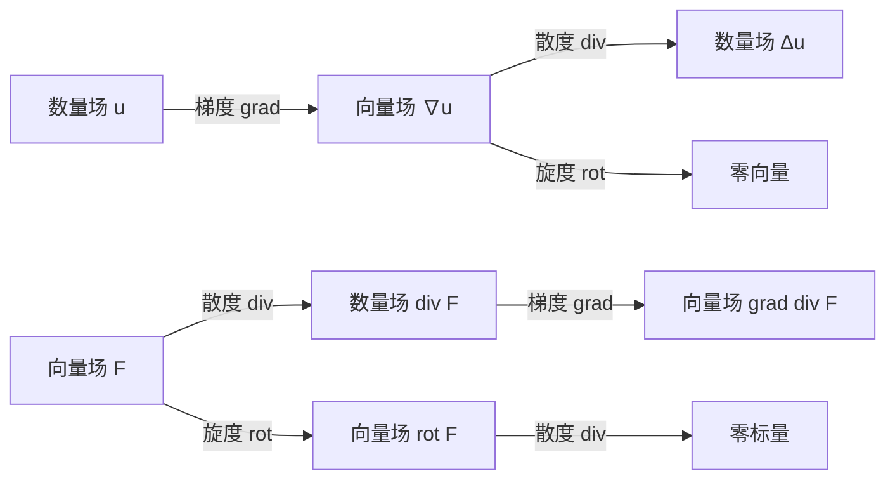
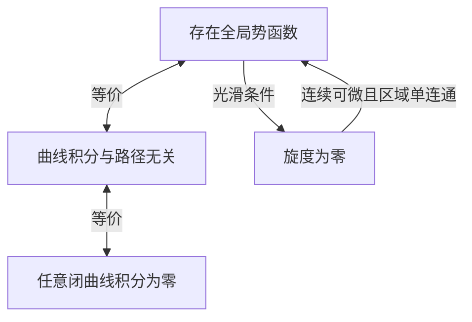
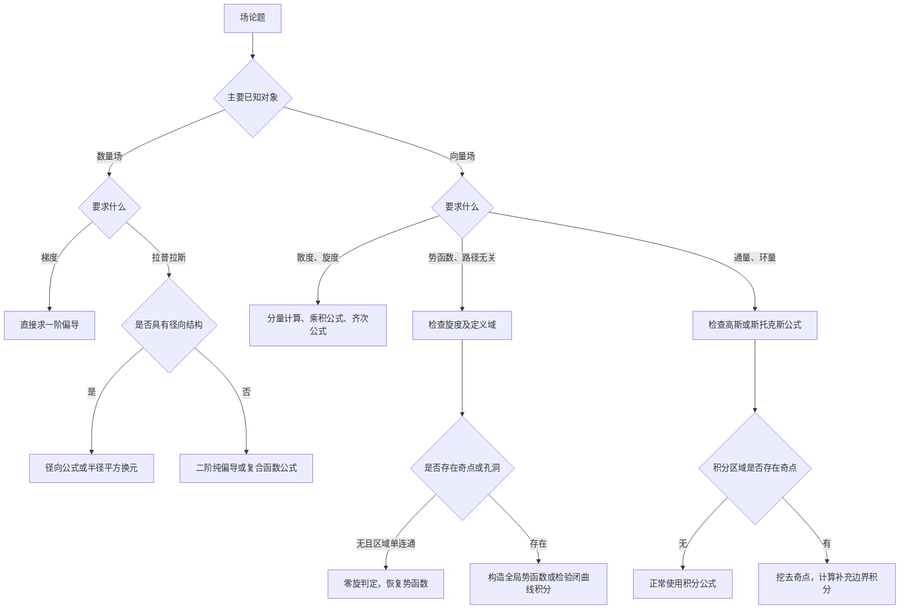

本节是多元函数积分学的收尾，也是将**多元函数微分学、曲线积分、曲面积分、高斯公式、斯托克斯公式和微分方程**联系起来的一节。

场论单独出题时，通常可以通过熟练掌握几个微分算子快速解决；但一旦与奇点、路径无关、调和函数、微分方程、积分证明结合，就能够形成具有相当区分度的综合题。

真正掌握场论，不仅要会计算散度、旋度，还要理解：

- 梯度为什么描述函数变化最快的方向？
- 散度为什么与闭曲面通量有关？
- 旋度为什么与闭曲线环量有关？
- 为什么旋度为零，曲线积分却不一定与路径无关？
- 为什么散度为零，闭曲面通量却不一定为零？
- 如何利用场论条件反求未知函数、参数和势函数？

## 考点分布

**历年真题**

| 年份   | 核心考点           | 复习优先级 |
| -------- | -------------- | ----- |
| 1989年数学一 | 散度的基本计算        | 基础必会  |
| 1993年数学一 | 对数型径向函数的拉普拉斯算子 | 重点    |
| 2001年数学一 | 梯度与散度的复合运算     | 重点    |
| 2016年数学一 | 旋度计算           | 基础必会  |
| 2018年数学一 | 指定点处的旋度        | 基础必会  |
| 2026年数学一 | 向量叉积与散度的组合     | 重点    |

**模拟题**

| 题目来源          | 考查内容           |
| ------------- | -------------- |
| 李永乐六套卷第3套第14题 | 散度的梯度、齐次函数     |
| 张宇8套卷第2套第14题  | 梯度的散度、拉普拉斯算子   |
| 张宇8套卷第5套第14题  | 旋度计算           |
| 李永乐六套卷第1套第17题 | 三元全微分、参数、势函数   |
| 张宇8套卷第8套第19题  | 周期函数、能量积分、积分证明 |
| 汤家凤八套卷第8套第18题 | 拉普拉斯方程、欧拉方程、最值 |

**配套练习重点**

| 题源          | 值得掌握的题型           |
| ----------- | ----------------- |
| 张宇1000题第17章 | 含绝对值的旋度、旋度的模      |
| 张宇1000题第18章 | 路径无关反求函数及极值       |
| 李林880题第9章   | 散度与旋度综合、全微分、含参势函数 |
| 李正元第10章     | 点源场、非单连通区域、全局势函数  |

## 第一部分 基础知识体系

### 二、什么是场？

**1. 数量场（标量场）**

如果空间中的每一点都对应一个数量，则称为数量场。

$$
u=u(x,y,z).
$$

例如温度场：

$$
u(x,y,z)=x^2+y^2+z^2.
$$

每个空间位置对应一个温度值。

数量场的输出是一个数。

**2. 向量场**

如果空间中的每一点都对应一个向量，则称为向量场。

$$
\mathbf F(x,y,z) =P(x,y,z)\mathbf i+ Q(x,y,z)\mathbf j+ R(x,y,z)\mathbf k.
$$

也可写成

$$
\mathbf F=(P,Q,R).
$$

例如流体的速度场：

$$
\mathbf F=(x,y,z).
$$

这个向量场在原点附近指向四面八方，距离原点越远，向量的模越大。

再例如：

$$
\mathbf F=(-y,x,0).
$$

这个向量场的向量始终沿着绕 $z$ 轴的圆周切线方向，表现为旋转运动。

**3. 场论究竟研究什么？**

| 研究对象 | 想解决的问题     | 数学工具   |
| ---- | ---------- | ------ |
| 数量场  | 哪个方向变化最快   | 梯度     |
| 向量场  | 局部是否向外扩散   | 散度     |
| 向量场  | 局部是否发生旋转   | 旋度     |
| 数量场  | 各方向二阶变化的综合 | 拉普拉斯算子 |

这里的关键在于：场论研究的是场在各点附近的局部变化规律，并通过积分公式将这些局部规律与整体性质联系起来。

### 三、梯度、散度、旋度与拉普拉斯算子

**1. 哈密顿算子**

定义微分算子

$$
\boxed{ \nabla= \left( \frac{\partial}{\partial x}, \frac{\partial}{\partial y}, \frac{\partial}{\partial z} \right) }
$$

它不是普通的数值向量，而是由偏导数构成的向量形式的微分算子。

梯度、散度和旋度都可以借助它统一记忆。

**2. 梯度（grad）**

对于数量场 $u(x,y,z)$，其梯度定义为

$$
\boxed{ \operatorname{grad}u =\nabla u =(u_x,u_y,u_z) }
$$

**输入是数量场，输出是向量场。**

若方向单位向量为

$$
\mathbf e=(\cos\alpha,\cos\beta,\cos\gamma),
$$

在 $u$ 可微的条件下，方向导数为

$$
\frac{\partial u}{\partial l} =\nabla u\cdot\mathbf e =|\nabla u|\cos\theta.
$$

因此：

$$
\boxed{ \max_{|\mathbf e|=1} \frac{\partial u}{\partial l} =|\nabla u| }
$$

$$
\boxed{ \min_{|\mathbf e|=1} \frac{\partial u}{\partial l} =-|\nabla u| }
$$

当梯度非零时，梯度方向就是数量场增长最快的方向；负梯度方向就是下降最快的方向。

若

$$
u(x,y,z)=C
$$

表示等值面，则在梯度非零的点处，$\nabla u$ 是等值面的法向量。

这与第六模块第4节方向导数与梯度、第5节多元微分学的几何应用直接联系。

**3. 散度（div）**

对于向量场

$$
\mathbf F=(P,Q,R),
$$

定义其散度为

$$
\boxed{ \operatorname{div}\mathbf F =\nabla\cdot\mathbf F =P_x+Q_y+R_z }
$$

**输入是向量场，输出是数量场。**

散度可以理解为向量场在某点附近的净流出强度。

在向量场连续可微等适当条件下，

$$
\operatorname{div}\mathbf F(M) = \lim_{\varepsilon\to0^+} \frac{ \displaystyle\oiint_{\partial B_\varepsilon(M)} \mathbf F\cdot\mathbf n\,dS }{ \operatorname{Vol}(B_\varepsilon(M)) }.
$$

也就是单位体积的净流出量。

直观上：

- 散度为正：局部具有源的性质，净流出。
- 散度为负：局部具有汇的性质，净流入。
- 散度为零：局部净流出与净流入平衡，称为无源场。

例如

$$
\mathbf F=(x,y,z),
$$

则

$$
\operatorname{div}\mathbf F=1+1+1=3.
$$

若

$$
\mathbf F=(-x,-y,-z),
$$

则

$$
\operatorname{div}\mathbf F=-3.
$$

若

$$
\mathbf F=(-y,x,0),
$$

则

$$
\operatorname{div}\mathbf F=0.
$$

注意，散度为零不代表向量场本身为零，也不代表它没有旋转。

**4. 旋度（rot）**

定义

$$
\boxed{ \operatorname{rot}\mathbf F =\nabla\times\mathbf F }
$$

具体计算公式是

$$
\boxed{ \operatorname{rot}\mathbf F = (R_y-Q_z,\ P_z-R_x,\ Q_x-P_y) }
$$

也可以写成形式行列式：

$$
\operatorname{rot}\mathbf F= \begin{vmatrix} \mathbf i&\mathbf j&\mathbf k\\ \partial_x&\partial_y&\partial_z\\ P&Q&R \end{vmatrix}.
$$

**输入是向量场，输出仍然是向量场。**

旋度描述向量场的局部环流强度，其方向由右手法则决定。

在流体速度场中，旋度与流体微团的局部旋转有关；在适当意义下，局部角速度向量为旋度的一半。

例如

$$
\mathbf F=(-y,x,0),
$$

则

$$
\operatorname{rot}\mathbf F = (0,0,2).
$$

这说明它沿 $z$ 轴正向具有局部旋转。

而

$$
\mathbf F=(x,y,z)
$$

满足

$$
\operatorname{rot}\mathbf F=\mathbf 0.
$$

称为无旋场。

**5. 拉普拉斯算子**

对于具有二阶连续偏导数的数量场 $u$，定义

$$
\boxed{ \Delta u =\operatorname{div}(\operatorname{grad}u) =\nabla\cdot\nabla u }
$$

因此

$$
\boxed{ \Delta u=u_{xx}+u_{yy}+u_{zz} }
$$

在二维平面中，则为

$$
\boxed{ \Delta u=u_{xx}+u_{yy} }
$$

拉普拉斯算子在考研中主要与以下问题结合：

径向函数、二阶复合函数求导、拉普拉斯方程、欧拉微分方程、积分证明和调和函数。

如果

$$
\Delta u=0,
$$

则称 $u$ 为调和函数。

### 四、四种算子的统一理解与辨析

| 算子   | 符号                          | 输入 | 输出 | 阶数 |
| ---- | --------------------------- | -- | -- | -- |
| 梯度   | $\nabla u$              | 标量 | 向量 | 一阶 |
| 散度   | $\nabla\cdot\mathbf F$  | 向量 | 标量 | 一阶 |
| 旋度   | $\nabla\times\mathbf F$ | 向量 | 向量 | 一阶 |
| 拉普拉斯 | $\Delta u$              | 标量 | 标量 | 二阶 |

算子之间的关系可以用下面的结构表示：

对于足够光滑的函数，有三个最重要的算子关系：

$$
\boxed{ \operatorname{rot}(\operatorname{grad}u) =\mathbf 0 }
$$

$$
\boxed{ \operatorname{div}(\operatorname{rot}\mathbf F) =0 }
$$

$$
\boxed{ \operatorname{div}(\operatorname{grad}u) =\Delta u }
$$

前两个恒等式成立的本质是混合偏导数相等。

例如

$$
\begin{aligned} \operatorname{rot}(\nabla u) &=(u_{zy}-u_{yz},\\ &\qquad u_{xz}-u_{zx},\\ &\qquad u_{yx}-u_{xy})\\ &=\mathbf 0. \end{aligned}
$$

这里可以采用二阶偏导数连续作为充分条件。

<Callout type="warn" title="容易混淆的算子顺序">

$$
\operatorname{div}(\operatorname{grad}u)
$$

与

$$
\operatorname{grad}(\operatorname{div}\mathbf F)
$$

完全不同。

前者的结果是标量：

$$
u_{xx}+u_{yy}+u_{zz}.
$$

后者的结果是向量：

$$
\nabla(P_x+Q_y+R_z).
$$

**做任何场论题之前，先判断答案应该是一个数还是一个向量。**

这是非常有效的第一层验算方法。

</Callout>

### 五、常用微分运算性质

设 $f,g$ 为光滑数量场，$\mathbf A,\mathbf B$ 为光滑向量场。

**1. 线性性质**

$$
\nabla(af+bg)=a\nabla f+b\nabla g.
$$

$$
\operatorname{div}(a\mathbf A+b\mathbf B) =a\operatorname{div}\mathbf A+ b\operatorname{div}\mathbf B.
$$

$$
\operatorname{rot}(a\mathbf A+b\mathbf B) =a\operatorname{rot}\mathbf A+ b\operatorname{rot}\mathbf B.
$$

其中 $a,b$ 为常数。

**2. 乘积求导公式**

梯度：

$$
\boxed{ \nabla(fg)=f\nabla g+g\nabla f }
$$

散度：

$$
\boxed{ \nabla\cdot(f\mathbf A) =\nabla f\cdot\mathbf A +f\nabla\cdot\mathbf A }
$$

旋度：

$$
\boxed{ \nabla\times(f\mathbf A) =\nabla f\times\mathbf A +f\nabla\times\mathbf A }
$$

拉普拉斯算子：

$$
\boxed{ \Delta(fg) =f\Delta g+g\Delta f +2\nabla f\cdot\nabla g }
$$

特别地，

$$
\boxed{ \Delta(u^2)=2u\Delta u+2|\nabla u|^2 }
$$

这一公式是后面积分证明的重要工具。

**3. 叉积与散度**

$$
\boxed{ \nabla\cdot(\mathbf A\times\mathbf B) =\mathbf B\cdot(\nabla\times\mathbf A) -\mathbf A\cdot(\nabla\times\mathbf B) }
$$

这是处理向量叉积与散度复合问题的一个工具。

还有一个拓展恒等式：

$$
\boxed{ \nabla\times(\nabla\times\mathbf F) =\nabla(\nabla\cdot\mathbf F)-\Delta\mathbf F }
$$

其中

$$
\Delta\mathbf F=(\Delta P,\Delta Q,\Delta R).
$$

考研中不必对所有复杂向量恒等式进行机械记忆。优先掌握前三种基本算子、三个复合关系以及数量场与向量场的乘积求导公式。

## 第二部分 基础计算型真题

### 六、题型一：直接计算散度

**重要程度：★★★★★**

**母题1：1989年考研数学一**

设向量场

$$
\mathbf u= xy^2\mathbf i+ ye^z\mathbf j+ x\ln(1+z^2)\mathbf k.
$$

求其在点 $M(1,1,0)$ 处的散度。

**解题思路**

出现散度，立即寻找三个分量：

$$
P=xy^2,\quad Q=ye^z,\quad R=x\ln(1+z^2).
$$

分别对对应坐标求偏导：

$$
P_x=y^2,
$$

$$
Q_y=e^z,
$$

$$
R_z=\frac{2xz}{1+z^2}.
$$

因此

$$
\operatorname{div}\mathbf u =y^2+e^z+\frac{2xz}{1+z^2}.
$$

最后代入点 $M(1,1,0)$：

$$
\operatorname{div}\mathbf u(M) =1+1+0.
$$

故

$$
\boxed{2}
$$

**这一类题的标准解题步骤**

1. 写出向量场的三个分量 $P,Q,R$。
2. 分别计算 $P_x,Q_y,R_z$。
3. 将三项相加。
4. 若要求指定点的散度，最后代入坐标。

**最重要的原则：先求导，后代值。**

### 七、题型二：直接计算旋度

**重要程度：★★★★★**

**母题2：2016年考研数学一**

设

$$
\mathbf A=(x+y+z)\mathbf i +xy\mathbf j+z\mathbf k.
$$

求 $\operatorname{rot}\mathbf A$。

**解析**

令

$$
P=x+y+z,\quad Q=xy,\quad R=z.
$$

直接代入旋度公式：

$$
\begin{aligned} R_y-Q_z&=0-0=0,\\ P_z-R_x&=1-0=1,\\ Q_x-P_y&=y-1. \end{aligned}
$$

所以

$$
\boxed{ \operatorname{rot}\mathbf A =\mathbf j+(y-1)\mathbf k }
$$

**李林880题中的同源练习**

李林880题第9章题目 `math-b9b797-039` 使用相同向量场，要求计算在点 $M(1,1,1)$ 处的旋度和散度。

旋度为

$$
\operatorname{rot}\mathbf A(M) =(0,1,0)=\mathbf j.
$$

散度为

$$
\operatorname{div}\mathbf A =1+x+1=x+2.
$$

所以

$$
\boxed{ \operatorname{div}\mathbf A(M)=3 }
$$

这类练习能够同时检验两个算子的区别。

**母题3：2018年考研数学一**

设

$$
\mathbf F=xy\mathbf i-yz\mathbf j+xz\mathbf k.
$$

求

$$
\operatorname{rot}\mathbf F(1,1,0).
$$

计算：

$$
\begin{aligned} \operatorname{rot}\mathbf F &=(0-(-y),0-z,0-x)\\ &=(y,-z,-x). \end{aligned}
$$

代入点值：

$$
\boxed{ \operatorname{rot}\mathbf F(1,1,0) =\mathbf i-\mathbf k }
$$

<Callout type="warn" title="最容易出现的错误">

原式中含有

$$
Q=-yz.
$$

如果一开始代入 $z=0$，就会错误地得到 $Q=0$，进而错误地认为

$$
Q_z=0.
$$

但实际情况是

$$
Q_z=-y,
$$

在指定点处等于 $-1$。

函数在某点的值为零，绝不意味着函数在该点的导数为零。

</Callout>

**如何快速记忆旋度公式？**

记住循环顺序

$$
x\longrightarrow y\longrightarrow z \longrightarrow x.
$$

三个分量分别为

$$
\boxed{ (R_y-Q_z,\ P_z-R_x,\ Q_x-P_y) }
$$

尤其注意第二分量的符号。

如果使用行列式展开，则中间项带负号：

$$
-\mathbf j(R_x-P_z) =\mathbf j(P_z-R_x).
$$

### 八、题型三：旋度的模与特殊函数

**代表题4：张宇1000题第17章**

题目编号：`math-1f97dd-014`。

设

$$
\mathbf F= xy\mathbf i-y\cos z\mathbf j +z\sin x\mathbf k.
$$

求在点 $(1,1,0)$ 处旋度的模。

计算一般位置的旋度：

$$
\operatorname{rot}\mathbf F =(-y\sin z,-z\cos x,-x).
$$

代入点：

$$
\operatorname{rot}\mathbf F(1,1,0) =(0,0,-1).
$$

因此

$$
\boxed{ |\operatorname{rot}\mathbf F(1,1,0)|=1 }
$$

注意题目如果要求旋度，答案是向量；如果要求旋度的模，答案是非负数。

**代表题5：张宇1000题含绝对值变式**

题目编号：`math-1f97dd-029`。

设

$$
\mathbf F= |x|\cos y\mathbf i-y\sin z\mathbf j+z\mathbf k.
$$

求

$$
\operatorname{rot}\mathbf F(1,1,0).
$$

本题的特殊之处在于出现了绝对值。

由于所求点满足 $x=1>0$，所以在该点附近可以写成

$$
|x|=x.
$$

因此

$$
\mathbf F=(x\cos y,-y\sin z,z).
$$

从而

$$
\operatorname{rot}\mathbf F =(y\cos z,0,x\sin y).
$$

最终

$$
\boxed{ \operatorname{rot}\mathbf F(1,1,0) =(1,0,\sin1) }
$$

**题型迁移**

遇到绝对值、分段函数、根式、对数时，先检查所求点是否位于光滑区域。

特别是绝对值的分界点，不能直接套用某一侧的函数表达式，需要检查相关偏导数是否存在。

也要注意：旋度只涉及特定的偏导数，某个向量分量不可微，并不必然意味着旋度的三个分量都无法计算。应具体检查公式所需要的偏导数。

### 九、题型四：向量运算与微分算子的组合

**重要程度：★★★★★**

**母题6：2026年考研数学一**

设

$$
\mathbf v_1=(0,x,z),\qquad \mathbf v_2=(y,0,1).
$$

令

$$
\mathbf F=\mathbf v_1\times\mathbf v_2.
$$

求 $\operatorname{div}\mathbf F$。

<Tabs items={["方法一：先叉积，再散度", "方法二：使用向量恒等式"]} defaultIndex={0}>

<Tab value="方法一：先叉积，再散度">

这是考场上最稳妥的方法。

$$
\begin{aligned} \mathbf F &= \begin{vmatrix} \mathbf i&\mathbf j&\mathbf k\\ 0&x&z\\ y&0&1 \end{vmatrix}\\ &=x\mathbf i+zy\mathbf j-xy\mathbf k. \end{aligned}
$$

即

$$
\mathbf F=(x,zy,-xy).
$$

因此

$$
\operatorname{div}\mathbf F =\frac{\partial x}{\partial x} +\frac{\partial(zy)}{\partial y} +\frac{\partial(-xy)}{\partial z}.
$$

所以

$$
\boxed{ \operatorname{div}\mathbf F=1+z }
$$

</Tab>

<Tab value="方法二：使用向量恒等式">

$$
\operatorname{div}(\mathbf v_1\times\mathbf v_2) =\mathbf v_2\cdot\operatorname{rot}\mathbf v_1 -\mathbf v_1\cdot\operatorname{rot}\mathbf v_2.
$$

计算得

$$
\operatorname{rot}\mathbf v_1=(0,0,1),
$$

$$
\operatorname{rot}\mathbf v_2=(0,0,-1).
$$

因此

$$
\begin{aligned} \operatorname{div}\mathbf F &=(y,0,1)\cdot(0,0,1)\\ &\quad -(0,x,z)\cdot(0,0,-1)\\ &=1+z. \end{aligned}
$$

两种方法一致。

</Tab>

</Tabs>

**本题的命题价值**

这道题将第八模块空间解析几何中的向量叉积，与第九模块场论中的散度结合起来。

这种综合不需要额外的高等理论，但要求准确识别运算层次。

| 题目形式                                                   | 运算顺序        |
| ------------------------------------------------------ | ----------- |
| $\operatorname{div}(\mathbf A\times\mathbf B)$     | 先叉积，再求散度    |
| $\operatorname{rot}(f\mathbf A)$                   | 先构造向量场，再求旋度 |
| $\operatorname{grad}(\operatorname{div}\mathbf A)$ | 先散度，再梯度     |
| $\operatorname{div}(\operatorname{grad}u)$         | 直接转化为拉普拉斯算子 |
| $\operatorname{rot}(\operatorname{grad}u)$         | 光滑条件下直接为零   |

不要因为 $\mathbf A,\mathbf B$ 是向量，就把它们当作不随位置变化的常向量。

### 十、题型五：复合算子与齐次函数

**代表题7：李永乐六套卷第3套第14题**

设

$$
q=x^2+2y^2+3z^2,
$$

$$
\mathbf A=(xq,yq,zq).
$$

求

$$
\left. \operatorname{grad}(\operatorname{div}\mathbf A) \right|_{(1,-1,2)}.
$$

<Tabs items={["方法一：常规计算", "方法二：利用齐次函数欧拉公式"]} defaultIndex={0}>

<Tab value="方法一：常规计算">

$$
\begin{aligned} \operatorname{div}\mathbf A &=(xq)_x+(yq)_y+(zq)_z\\ &=3q+xq_x+yq_y+zq_z. \end{aligned}
$$

由于

$$
q_x=2x,\quad q_y=4y,\quad q_z=6z,
$$

所以

$$
xq_x+yq_y+zq_z=2q.
$$

因此

$$
\operatorname{div}\mathbf A=5q.
$$

进一步求梯度：

$$
\operatorname{grad}(\operatorname{div}\mathbf A) =(10x,20y,30z).
$$

代入指定点：

$$
\boxed{(10,-20,60)}
$$

</Tab>

<Tab value="方法二：利用齐次函数欧拉公式">

若 $q(x,y,z)$ 为 $m$ 次可微齐次函数，即

$$
q(tx,ty,tz)=t^mq(x,y,z), \qquad t>0,
$$

则有

$$
xq_x+yq_y+zq_z=mq.
$$

设位置向量

$$
\mathbf r=(x,y,z).
$$

则

$$
\begin{aligned} \operatorname{div}(q\mathbf r) &=\nabla q\cdot\mathbf r +q\operatorname{div}\mathbf r\\ &=mq+3q. \end{aligned}
$$

于是得到非常有用的结论：

$$
\boxed{ \operatorname{div}(q\mathbf r)=(m+3)q }
$$

本题中 $q$ 是二次齐次函数，因此

$$
\operatorname{div}\mathbf A=5q.
$$

在 $n$ 维空间中，这个结论可推广为

$$
\boxed{ \operatorname{div}(q\mathbf r)=(m+n)q }
$$

</Tab>

</Tabs>

**识别信号**

当向量场三个分量具有相同的公共因子：

$$
\mathbf F=(xf,yf,zf),
$$

而公共因子是齐次函数时，优先考虑欧拉公式。

例如

$$
\mathbf F= \frac{(x,y,z)}{(x^2+y^2+z^2)^{3/2}},
$$

公共因子为 $-3$ 次齐次函数，所以在原点以外，

$$
\operatorname{div}\mathbf F=(-3+3)f=0.
$$

这正是后面点源场母题的快速解法。

## 第三部分 拉普拉斯算子与径向函数

### 十一、题型六：普通函数的拉普拉斯算子

**代表题8：张宇8套卷第2套第14题**

设

$$
u=x^2y+2xy^2-3yz^2.
$$

求

$$
\operatorname{div}(\operatorname{grad}u).
$$

看到这个算子组合，应该立即转化为

$$
\operatorname{div}(\operatorname{grad}u) =\Delta u.
$$

分别求二阶纯偏导：

$$
u_{xx}=2y,
$$

$$
u_{yy}=4x,
$$

$$
u_{zz}=-6y.
$$

相加：

$$
\Delta u=2y+4x-6y.
$$

所以

$$
\boxed{4(x-y)}
$$

注意拉普拉斯算子只涉及二阶纯偏导数，不包含 $u_{xy},u_{xz},u_{yz}$。

### 十二、径向函数的核心公式

**重要程度：★★★★★，属于本节必须真正理解的核心母题。**

设

$$
r=\sqrt{x^2+y^2+z^2}.
$$

如果数量场仅依赖于点到原点的距离，即

$$
u(x,y,z)=g(r),
$$

则称其为径向函数。

**1. 半径函数的梯度**

当 $r>0$ 时，

$$
r_x=\frac{x}{r},\quad r_y=\frac{y}{r},\quad r_z=\frac{z}{r}.
$$

因此

$$
\boxed{ \nabla r=\frac{(x,y,z)}r =\mathbf e_r }
$$

其中 $\mathbf e_r$ 为径向单位向量。

特别地，

$$
\boxed{|\nabla r|^2=1}
$$

于是

$$
\boxed{ \nabla g(r)=g'(r)\mathbf e_r }
$$

这说明径向函数的梯度始终沿径向方向。

**2. 半径函数的拉普拉斯算子**

求二阶纯偏导：

$$
r_{xx}=\frac1r-\frac{x^2}{r^3},
$$

$$
r_{yy}=\frac1r-\frac{y^2}{r^3},
$$

$$
r_{zz}=\frac1r-\frac{z^2}{r^3}.
$$

三项相加：

$$
\begin{aligned} \Delta r &=\frac3r-\frac{x^2+y^2+z^2}{r^3}\\ &=\frac3r-\frac1r. \end{aligned}
$$

所以

$$
\boxed{\Delta r=\frac2r}
$$

**3. 三维径向拉普拉斯公式**

由链式法则，

$$
u_x=g'(r)r_x,
$$

$$
u_{xx} =g''(r)r_x^2+g'(r)r_{xx}.
$$

对三个坐标相加：

$$
\Delta u =g''(r)|\nabla r|^2+g'(r)\Delta r.
$$

代入前面的结论，得到

$$
\boxed{ \Delta g(r)=g''(r)+\frac2r g'(r) }
$$

适用条件是 $r>0$，且 $g$ 具有所需的二阶导数。

这是三维径向函数题最重要的公式。

**4. 二维与三维的区别**

| 空间维数      | 半径                         | 径向拉普拉斯公式                   |
| --------- | -------------------------- | -------------------------- |
| 二维        | $r=\sqrt{x^2+y^2}$     | $g''+\dfrac1r g'$      |
| 三维        | $r=\sqrt{x^2+y^2+z^2}$ | $g''+\dfrac2r g'$      |
| $n$ 维 | $r=\sqrt{\sum x_i^2}$  | $g''+\dfrac{n-1}{r}g'$ |

考研重点是二维、三维。

**不能将二维公式中的系数1与三维公式中的系数2混淆。**

### 十三、历年真题：径向拉普拉斯算子

**母题9：2001年考研数学一**

设

$$
r=\sqrt{x^2+y^2+z^2}.
$$

求

$$
\left. \operatorname{div}(\operatorname{grad}r) \right|_{(1,-2,2)}.
$$

直接使用公式：

$$
\operatorname{div}(\operatorname{grad}r) =\Delta r=\frac2r.
$$

在指定点，

$$
r=\sqrt{1+4+4}=3.
$$

所以

$$
\boxed{\frac23}
$$

这道真题掌握径向公式后，可以迅速得到答案。

**母题10：1993年考研数学一**

设

$$
u=\ln\sqrt{x^2+y^2+z^2}.
$$

求

$$
\operatorname{div}(\operatorname{grad}u).
$$

令

$$
r=\sqrt{x^2+y^2+z^2},
$$

则

$$
u=\ln r.
$$

有

$$
g'(r)=\frac1r,\qquad g''(r)=-\frac1{r^2}.
$$

因此

$$
\begin{aligned} \Delta u &=-\frac1{r^2} +\frac2r\cdot\frac1r\\ &=\frac1{r^2}. \end{aligned}
$$

故

$$
\boxed{ \Delta u=\frac1{x^2+y^2+z^2} }
$$

其中原点不属于定义域。

**深入理解：为什么二维的结果不同？**

如果

$$
u=\ln\sqrt{x^2+y^2},
$$

则

$$
\Delta u =-\frac1{r^2}+\frac1{r^2}=0.
$$

因此

$$
\boxed{ \begin{aligned} \text{二维：}\quad &\Delta\ln r=0,\\ \text{三维：}\quad &\Delta\ln r=\frac1{r^2}. \end{aligned} }
$$

同一个形式的函数，在不同空间维数中具有不同的拉普拉斯算子结果。

### 十四、题型七：幂函数与含参调和函数

**母题11：原创变式**

设

$$
u=r^\alpha,\qquad r=\sqrt{x^2+y^2+z^2}>0.
$$

求 $\Delta u$，并确定参数 $\alpha$，使得

$$
\Delta u=0.
$$

由

$$
g'(r)=\alpha r^{\alpha-1},
$$

$$
g''(r)=\alpha(\alpha-1)r^{\alpha-2},
$$

得到

$$
\begin{aligned} \Delta u &=\alpha(\alpha-1)r^{\alpha-2}\\ &\quad+2\alpha r^{\alpha-2}\\ &=\alpha(\alpha+1)r^{\alpha-2}. \end{aligned}
$$

所以

$$
\boxed{ \Delta r^\alpha =\alpha(\alpha+1)r^{\alpha-2} }
$$

要使其在整个定义域内恒为零，由于 $r>0$，有

$$
\alpha(\alpha+1)=0.
$$

故

$$
\boxed{\alpha=0\quad\text{或}\quad\alpha=-1}
$$

分别对应常数函数和函数 $1/r$。

**常见径向函数速查表**

以下公式均在 $r>0$ 时成立。

| 函数             | 二维拉普拉斯                | 三维拉普拉斯                |
| -------------- | --------------------- | --------------------- |
| $r$        | $\dfrac1r$        | $\dfrac2r$        |
| $r^2$      | $4$               | $6$               |
| $r^m$      | $m^2r^{m-2}$      | $m(m+1)r^{m-2}$   |
| $\ln r$    | $0$               | $\dfrac1{r^2}$    |
| $\dfrac1r$ | $\dfrac1{r^3}$    | $0$               |
| $e^r$      | $e^r(1+\dfrac1r)$ | $e^r(1+\dfrac2r)$ |

其中最值得记忆的是：

$$
\boxed{\Delta_{\mathbb R^2}\ln r=0}
$$

以及

$$
\boxed{ \Delta_{\mathbb R^3}\frac1r=0 }
$$

它们分别是二维、三维非平凡径向调和函数的典型代表。

### 十五、题型八：复合函数以半径平方为自变量

出题人未必直接给出

$$
u=g\left(\sqrt{x^2+y^2+z^2}\right),
$$

还可能给出

$$
u=f(x^2+y^2+z^2).
$$

这时更适合令

$$
s=x^2+y^2+z^2.
$$

由链式法则，

$$
\nabla s=(2x,2y,2z),
$$

$$
|\nabla s|^2=4s,
$$

$$
\Delta s=6.
$$

故

$$
\boxed{ \Delta f(s)=4sf''(s)+6f'(s) }
$$

在二维空间中，

$$
s=x^2+y^2,
$$

则

$$
\boxed{ \Delta f(s)=4sf''(s)+4f'(s) }
$$

**更一般的复合函数公式**

设

$$
u=f(v(x,y,z)).
$$

在相应二阶可微条件下，有

$$
\boxed{ \Delta f(v) =f''(v)|\nabla v|^2+f'(v)\Delta v }
$$

这是所有径向拉普拉斯公式的共同来源。

只要掌握这个公式，即使未来题目将半径平方换成其他二次型，也有办法处理。

**原创变式：椭球型复合函数**

设

$$
u=f(x^2+2y^2+3z^2).
$$

求 $\Delta u$。

令

$$
v=x^2+2y^2+3z^2.
$$

则

$$
|\nabla v|^2=4x^2+16y^2+36z^2,
$$

$$
\Delta v=2+4+6=12.
$$

因此

$$
\boxed{ \begin{aligned} \Delta u &=(4x^2+16y^2+36z^2)f''(v)\\ &\quad+12f'(v). \end{aligned} }
$$

注意此处不能机械套用普通球对称的径向公式，因为

$$
x^2+2y^2+3z^2
$$

不是标准的半径平方。

## 第四部分 场论与微分方程的综合

### 十六、题型九：由拉普拉斯方程反求未知函数

这是场论与第五模块微分方程结合的重要题型。

**1. 三维径向调和函数的一般形式**

设

$$
u=g(r),\qquad r=\sqrt{x^2+y^2+z^2}>0.
$$

已知

$$
\Delta u=0.
$$

则

$$
g''(r)+\frac2r g'(r)=0.
$$

两边乘以 $r^2$：

$$
r^2g''(r)+2rg'(r)=0.
$$

观察到

$$
(r^2g'(r))' =r^2g''(r)+2rg'(r).
$$

因此

$$
(r^2g'(r))'=0.
$$

积分得

$$
r^2g'(r)=C_1.
$$

于是

$$
g'(r)=\frac{C_1}{r^2}.
$$

再次积分：

$$
\boxed{ g(r)=A+\frac Br }
$$

其中 $A,B$ 为任意常数。

这就是三维径向调和函数的一般形式。

**2. 二维径向调和函数的一般形式**

对于二维函数，

$$
g''(r)+\frac1r g'(r)=0.
$$

于是

$$
(rg'(r))'=0.
$$

积分得到

$$
\boxed{g(r)=A+B\ln r}
$$

**3. 如果要求原点处连续怎么办？**

三维情况下，

$$
g(r)=A+\frac Br.
$$

若要求 $r\to0^+$ 时函数保持有限，则必须有

$$
B=0.
$$

二维情况下，

$$
g(r)=A+B\ln r
$$

同理也必须有 $B=0$。

因此，在包含原点的球形或圆形邻域内，连续且调和的径向函数只能是常数函数。

### 十七、高质量综合母题：汤家凤八套卷第8套第18题

设 $f(t)$ 在 $[1,+\infty)$ 上有连续二阶导数，且

$$
f(1)=0,\qquad f'(1)=1.
$$

已知

$$
z=(x^2+y^2)f(x^2+y^2)
$$

在 $x^2+y^2\ge1$ 的相应区域满足

$$
z_{xx}+z_{yy}=0.
$$

求 $f(t)$ 在 $[1,+\infty)$ 上的最大值。

本题综合了四个模块：

| 解题环节     | 对应知识  |
| -------- | ----- |
| 复合函数二阶偏导 | 多元微分学 |
| 拉普拉斯方程   | 场论    |
| 求解未知函数   | 微分方程  |
| 求全局最大值   | 一元微分学 |

<Tabs items={["方法一：整体换元与降阶——推荐", "方法二：转化为欧拉微分方程"]} defaultIndex={0}>

<Tab value="方法一：整体换元与降阶——推荐">

令

$$
s=x^2+y^2,\qquad G(s)=sf(s).
$$

于是

$$
z=G(s).
$$

使用二维半径平方公式：

$$
\Delta z=4G'(s)+4sG''(s).
$$

因为 $\Delta z=0$，所以

$$
G'(s)+sG''(s)=0.
$$

即

$$
(sG'(s))'=0.
$$

积分得

$$
sG'(s)=C_1.
$$

所以

$$
G'(s)=\frac{C_1}{s}.
$$

再次积分：

$$
G(s)=C_1\ln s+C_2.
$$

还原：

$$
sf(s)=C_1\ln s+C_2.
$$

由 $f(1)=0$，得

$$
C_2=0.
$$

又因为

$$
G'(s)=f(s)+sf'(s),
$$

所以

$$
G'(1)=f(1)+f'(1)=1.
$$

因此 $C_1=1$。

故

$$
f(s)=\frac{\ln s}{s}.
$$

最后求导：

$$
f'(s)=\frac{1-\ln s}{s^2}.
$$

由于分母始终为正，导数符号只取决于

$$
1-\ln s.
$$

| 区间              | 导数符号 | 单调性 |
| --------------- | ---- | --- |
| $1\le s<e$ | 正    | 递增  |
| $s=e$       | 零    | 驻点  |
| $s>e$       | 负    | 递减  |

所以在 $s=e$ 处取得全局最大值：

$$
\boxed{ f_{\max}=f(e)=\frac1e }
$$

</Tab>

<Tab value="方法二：转化为欧拉微分方程">

如果没有观察到整体换元，也可以直接展开。

因为

$$
G=sf,\quad G'=f+sf',
$$

$$
G''=2f'+sf'',
$$

所以

$$
G'+sG'' =f+3sf'+s^2f''.
$$

得到欧拉微分方程：

$$
s^2f''+3sf'+f=0.
$$

令

$$
t=\ln s,\qquad F(t)=f(e^t).
$$

则

$$
sf'=F',
$$

$$
s^2f''=F''-F'.
$$

代入：

$$
F''+2F'+F=0.
$$

特征方程为

$$
\lambda^2+2\lambda+1=0.
$$

即

$$
(\lambda+1)^2=0.
$$

因此

$$
F(t)=(C_1+C_2t)e^{-t}.
$$

还原为

$$
f(s)=\frac{C_1+C_2\ln s}{s}.
$$

利用初值条件，仍可得到

$$
f(s)=\frac{\ln s}{s}.
$$

</Tab>

</Tabs>

**这一类题的解题模型**

当看到

$$
\Delta u=0
$$

且 $u$ 是径向复合函数时，不应停留在求偏导的层面，而要主动将偏微分方程转化为常微分方程。

尤其是

$$
u=r^mf(r)
$$

或

$$
u=s^mf(s)
$$

这种形式，优先把乘积整体记为一个新函数。

先求整体函数，再还原未知函数，往往比直接展开求导更加简洁。

## 第五部分 无旋场、势函数与路径无关

### 十八、势函数与保守场

如果存在一个单值可微函数 $u(x,y,z)$，使得

$$
\boxed{ \mathbf F=\nabla u }
$$

则称 $\mathbf F$ 为梯度场，也称有势场或保守场，函数 $u$ 称为其势函数。

也就是说，

$$
P=u_x,\qquad Q=u_y,\qquad R=u_z.
$$

于是

$$
P\,dx+Q\,dy+R\,dz =du.
$$

对于从 $A$ 到 $B$ 的有向曲线 $L$，有

$$
\boxed{ \int_L P\,dx+Q\,dy+R\,dz =u(B)-u(A) }
$$

这是第二类曲线积分中的路径无关问题在场论中的统一表述。

**三个等价条件**

在连通开区域内，对于连续向量场，下列三个性质等价：

$$
\mathbf F=\nabla u
$$

$$
\Updownarrow
$$

曲线积分与路径无关

$$
\Updownarrow
$$

$$
\oint_L\mathbf F\cdot d\mathbf r=0
$$

其中最后一个条件要求对区域内任意分段光滑闭曲线成立。

在一阶偏导数连续的条件下，以上性质还能够推出

$$
\operatorname{rot}\mathbf F=\mathbf0.
$$

如果区域进一步是单连通区域，那么

$$
\operatorname{rot}\mathbf F=\mathbf0
$$

也足以推出存在全局势函数。

因此在单连通区域且场连续可微时，四个条件等价。

**关键：旋度为零是局部微分条件，路径无关是全局积分性质。**

这两者之间的逻辑关系是本节最值得深入理解的地方。

### 十九、题型十：判断三元微分表达式是否为全微分

设

$$
\omega=P\,dx+Q\,dy+R\,dz.
$$

如果存在函数 $u$，使得

$$
du=\omega,
$$

那么在足够光滑的条件下，必须满足

$$
\boxed{ \begin{cases} P_y=Q_x,\\ P_z=R_x,\\ Q_z=R_y. \end{cases} }
$$

实际上，这就是

$$
\operatorname{rot}\mathbf F=\mathbf0
$$

的三个分量条件。

当区域是单连通区域，且 $P,Q,R$ 一阶偏导数连续时，以上条件也是充分条件。

**母题12：李永乐六套卷第1套第17题**

已知

$$
(2xy+e^z)\,dx+(x^2+az^2)\,dy +(xe^z+4yz)\,dz
$$

是某三元函数 $u$ 的全微分，且

$$
u(0,1,1)=-1.
$$

求参数 $a$ 和函数 $u$。

<Steps>

<Step>

### 第一步：利用混合偏导数相等求参数 [!toc]

令

$$
P=2xy+e^z,
$$

$$
Q=x^2+az^2,
$$

$$
R=xe^z+4yz.
$$

比较含有参数的条件：

$$
Q_z=R_y.
$$

即

$$
2az=4z.
$$

要求恒等式成立，因此

$$
\boxed{a=2}
$$

另外两组条件：

$$
P_y=Q_x=2x,
$$

$$
P_z=R_x=e^z.
$$

也均满足。

由于各分量在整个三维空间内光滑，定义域是单连通的，所以势函数存在。

</Step>

<Step>

### 第二步：由一个分量积分 [!toc]

由

$$
u_x=2xy+e^z,
$$

对 $x$ 积分：

$$
u=x^2y+xe^z+\varphi(y,z).
$$

注意这里的积分常数必须写成

$$
\varphi(y,z),
$$

因为对 $x$ 求偏导时，任何只含 $y,z$ 的函数都会消失。

</Step>

<Step>

### 第三步：利用第二个分量确定待定函数 [!toc]

对 $y$ 求偏导：

$$
u_y=x^2+\varphi_y.
$$

另一方面，

$$
u_y=x^2+2z^2.
$$

所以

$$
\varphi_y=2z^2.
$$

积分：

$$
\varphi(y,z)=2yz^2+\psi(z).
$$

于是

$$
u=x^2y+xe^z+2yz^2+\psi(z).
$$

</Step>

<Step>

### 第四步：利用第三个分量 [!toc]

$$
u_z=xe^z+4yz+\psi'(z).
$$

与给定条件

$$
u_z=xe^z+4yz
$$

比较，得

$$
\psi'(z)=0.
$$

所以

$$
\psi(z)=C.
$$

因此

$$
u=x^2y+xe^z+2yz^2+C.
$$

</Step>

<Step>

### 第五步：利用初始条件 [!toc]

$$
u(0,1,1)=2+C=-1.
$$

故

$$
C=-3.
$$

最终

$$
\boxed{ a=2,\qquad u=x^2y+xe^z+2yz^2-3 }
$$

</Step>

</Steps>

**本题的通用模板**

对于

$$
du=P\,dx+Q\,dy+R\,dz,
$$

恢复势函数的基本顺序是

$$
P \xrightarrow{\int dx} u_1+\varphi(y,z)
$$

$$
\xrightarrow{\text{比较 }u_y=Q} u_2+\psi(z)
$$

$$
\xrightarrow{\text{比较 }u_z=R} u_3+C.
$$

这就是逐次积分法。对于全空间或适当简单区域内的题目，通常是最可靠的方法之一。

若区域较复杂，则应注意分段积分所得表达式是否能够在整个定义域上统一为单值函数。

### 二十、题型十一：路径无关、参数与曲线积分

**代表题13：李林880题第9章**

题目编号：`math-b9b797-021`。

设

$$
P=\frac{x(x^2+y^2)^{k/2}}{y},
$$

$$
Q=-\frac{x^2(x^2+y^2)^{k/2}}{y^2},
$$

定义域为

$$
D=\{(x,y):y>0\}.
$$

若曲线积分

$$
I=\int_LP\,dx+Q\,dy
$$

在 $D$ 内与路径无关，求 $k$，并求从 $(1,1)$ 到 $(2,2)$ 的积分。

<Steps>

<Step>

### 第一步：识别区域条件 [!toc]

上半平面 $y>0$ 是单连通区域。

因此路径无关等价于

$$
P_y=Q_x.
$$

令

$$
s=x^2+y^2.
$$

计算：

$$
P_y=kxs^{k/2-1} -\frac{x}{y^2}s^{k/2},
$$

$$
Q_x=-\frac{2x}{y^2}s^{k/2} -\frac{kx^3}{y^2}s^{k/2-1}.
$$

两式作差并整理：

$$
Q_x-P_y =-\frac{(k+1)x}{y^2}s^{k/2}.
$$

要使其恒为零，必须有

$$
\boxed{k=-1}
$$

</Step>

<Step>

### 第二步：求势函数 [!toc]

此时

$$
u_x=\frac{x}{y\sqrt{x^2+y^2}}.
$$

对 $x$ 积分：

$$
u=\frac{\sqrt{x^2+y^2}}y+\varphi(y).
$$

再利用

$$
u_y=-\frac{x^2}{y^2\sqrt{x^2+y^2}},
$$

得到

$$
\varphi'(y)=0.
$$

故

$$
u=\frac{\sqrt{x^2+y^2}}y+C.
$$

</Step>

<Step>

### 第三步：求曲线积分 [!toc]

$$
\begin{aligned} I&=u(2,2)-u(1,1)\\ &=\frac{\sqrt8}{2}-\sqrt2\\ &=0. \end{aligned}
$$

所以

$$
\boxed{I=0}
$$

</Step>

</Steps>

**更快的计算技巧**

如果只要求积分值，而不要求势函数，那么在确认路径无关后，可以直接选择直线路径

$$
x=y=t,\qquad 1\le t\le2.
$$

此时

$$
P+Q=0,
$$

并且 $dx=dy=dt$，因此积分立即为零。

**势函数法适合反求原函数，自选路径法适合只求积分值。**

### 二十一、题型十二：由多个路径无关条件反求函数及极值

**代表题14：张宇1000题第18章**

题目编号：`math-d95a5a-036`。

设

$$
I_1=\int_Lf(x,y)\,dx+(6xy-6x)\,dy,
$$

$$
I_2=\int_L(6x^2y+6xy+x)\,dx+f(x,y)\,dy.
$$

已知两者均在整个平面内与路径无关，且

$$
f(0,0)=0.
$$

求 $f(x,y)$ 的极值。

<Steps>

<Step>

### 第一步：分别利用路径无关条件 [!toc]

由 $I_1$ 得

$$
f_y=\frac{\partial}{\partial x}(6xy-6x) =6y-6.
$$

由 $I_2$ 得

$$
f_x=\frac{\partial}{\partial y} (6x^2y+6xy+x) =6x^2+6x.
$$

这样就得到了未知函数的梯度：

$$
\nabla f=(6x^2+6x,6y-6).
$$

</Step>

<Step>

### 第二步：恢复函数 [!toc]

由 $f_y=6y-6$，积分得

$$
f=3y^2-6y+\varphi(x).
$$

再由

$$
\varphi'(x)=6x^2+6x,
$$

得

$$
\varphi(x)=2x^3+3x^2+C.
$$

利用初始条件，得到

$$
\boxed{ f=2x^3+3x^2+3y^2-6y }
$$

</Step>

<Step>

### 第三步：求驻点 [!toc]

$$
\begin{cases} f_x=6x(x+1)=0,\\ f_y=6(y-1)=0. \end{cases}
$$

驻点为

$$
(0,1),\qquad(-1,1).
$$

二阶偏导数为

$$
f_{xx}=12x+6,\qquad f_{xy}=0,\qquad f_{yy}=6.
$$

在 $(0,1)$ 处，

$$
f_{xx}=6,\qquad f_{xx}f_{yy}-f_{xy}^2=36>0.
$$

所以是极小值点，极小值为

$$
f(0,1)=-3.
$$

在 $(-1,1)$ 处，

$$
f_{xx}=-6,\qquad f_{xx}f_{yy}-f_{xy}^2=-36.
$$

所以为鞍点，不是极值点。

最终结论：

$$
\boxed{ \text{在 }(0,1)\text{ 处取得极小值 }-3 }
$$

没有极大值。

这里的极小值不是全局最小值，因为沿 $y=1$、$x\to-\infty$，函数趋于负无穷。

</Step>

</Steps>

**这道题为什么重要？**

它揭示了一种综合题的构造方式：

$$
\text{路径无关} \Longrightarrow \text{未知函数的偏导数} \Longrightarrow \text{恢复未知函数} \Longrightarrow \text{求极值、最值或其他性质}.
$$

未来题目还可能将最后一问换成方向导数、切平面、条件极值、二重积分等。前两步的解题方法完全相同。

## 第六部分 奇点与定义域：场论的核心难点

### 二十二、无源场、无旋场及其积分意义

对于向量场 $\mathbf F$：

$$
\operatorname{div}\mathbf F=0
$$

称其为无源场。

$$
\operatorname{rot}\mathbf F=\mathbf0
$$

称其为无旋场。

两者并没有必然联系。

| 向量场               | 散度      | 旋度             |
| ----------------- | ------- | -------------- |
| $(x,y,z)$     | $3$ | $\mathbf0$ |
| $(-y,x,0)$    | $0$ | $(0,0,2)$  |
| $(x,-y,0)$    | $0$ | $\mathbf0$ |
| $(x-y,x+y,z)$ | $3$ | $(0,0,2)$  |

通过这几个例子可以看出，无源不一定无旋，无旋也不一定无源。

**散度与高斯公式**

设 $\Omega$ 是有界空间区域，边界为分片光滑闭曲面 $\partial\Omega$，取外侧方向，且向量场在包含闭区域的邻域内连续可微，则

$$
\boxed{ \oiint_{\partial\Omega} \mathbf F\cdot\mathbf n\,dS = \iiint_\Omega\operatorname{div}\mathbf F\,dV }
$$

因此，如果散度在整个区域内恒为零，那么闭曲面通量为零。

**旋度与斯托克斯公式**

设 $S$ 为满足公式条件的有向曲面，边界为 $L$，方向符合右手法则，且向量场在曲面及其邻域内连续可微，则

$$
\boxed{ \oint_L\mathbf F\cdot d\mathbf r = \iint_S \operatorname{rot}\mathbf F\cdot\mathbf n\,dS }
$$

如果旋度在整个曲面上恒为零，则边界曲线的环量为零。

但请注意，两条推论都建立在相应积分公式的适用条件已经满足的基础上。

### 二十三、母题15：李正元点源场经典题

**重要程度：★★★★★**

已知

$$
\mathbf E=\frac{q}{r^3}\mathbf r,
$$

其中

$$
\mathbf r=(x,y,z),\qquad r=\sqrt{x^2+y^2+z^2},
$$

$q$ 为常数。

求

$$
\operatorname{div}\mathbf E,\qquad \operatorname{rot}\mathbf E.
$$

<Tabs items={["方法一：直接分量计算", "方法二：利用势函数——更值得掌握"]} defaultIndex={0}>

<Tab value="方法一：直接分量计算">

写成分量形式：

$$
\mathbf E= \left( \frac{qx}{r^3}, \frac{qy}{r^3}, \frac{qz}{r^3} \right).
$$

由于

$$
\frac{\partial r^{-3}}{\partial x} =-3xr^{-5},
$$

所以

$$
\frac{\partial}{\partial x} \left(\frac{qx}{r^3}\right) =q(r^{-3}-3x^2r^{-5}).
$$

另外两个分量同理。

因此

$$
\begin{aligned} \operatorname{div}\mathbf E &=q\left[ 3r^{-3} -3(x^2+y^2+z^2)r^{-5} \right]\\ &=q(3r^{-3}-3r^{-3})\\ &=0. \end{aligned}
$$

旋度的第一分量为

$$
\begin{aligned} (E_z)_y-(E_y)_z &=-3qzyr^{-5}+3qyzr^{-5}\\ &=0. \end{aligned}
$$

其他两个分量同理。

所以

$$
\boxed{ \operatorname{div}\mathbf E=0,\qquad \operatorname{rot}\mathbf E=\mathbf0 }
$$

上述结论仅在 $r>0$ 时成立。

</Tab>

<Tab value="方法二：利用势函数——更值得掌握">

注意

$$
\nabla\left(\frac1r\right) =-\frac{\mathbf r}{r^3}.
$$

因此

$$
\mathbf E=\nabla\left(-\frac qr\right).
$$

这说明它是梯度场。

立即得到

$$
\operatorname{rot}\mathbf E=\mathbf0.
$$

又因为

$$
\Delta\frac1r=0,
$$

所以

$$
\operatorname{div}\mathbf E =-q\Delta\frac1r=0.
$$

不需要逐项计算六个偏导数。

</Tab>

</Tabs>

### 二十四、深入拓展：为什么散度为零，球面通量却不为零？

这是点源场母题最重要的后续问题。

仍然考虑

$$
\mathbf E=\frac{q\mathbf r}{r^3}.
$$

设球面

$$
S:x^2+y^2+z^2=R^2,
$$

取外侧方向。

球面上有

$$
\mathbf n=\frac{\mathbf r}{R},
$$

并且

$$
\mathbf E=\frac q{R^2}\mathbf n.
$$

因此

$$
\mathbf E\cdot\mathbf n=\frac q{R^2}.
$$

积分得到

$$
\begin{aligned} \oiint_S\mathbf E\cdot\mathbf n\,dS &=\frac q{R^2}\cdot4\pi R^2\\ &=4\pi q. \end{aligned}
$$

即

$$
\boxed{ \oiint_S\mathbf E\cdot\mathbf n\,dS=4\pi q }
$$

然而前面明明得到了

$$
\operatorname{div}\mathbf E=0.
$$

难道与高斯公式矛盾？

**不矛盾，因为原点处向量场没有定义。**

球面包围原点，因此不能直接对整个实心球体应用常规高斯公式。

**正确的方法：挖去奇点**

在球体内部挖去以原点为球心、半径为 $\varepsilon$ 的小球。

得到球壳区域

$$
\Omega_\varepsilon =\{\varepsilon\le r\le R\}.
$$

此时向量场在整个球壳及其边界附近光滑，可以使用高斯公式。

外球面的外法向量沿径向向外。

内球面的外法向量则指向原点，沿径向向内。

所以

$$
\begin{aligned} 0&=\iiint_{\Omega_\varepsilon} \operatorname{div}\mathbf E\,dV\\ &=\oiint_{S_R} \mathbf E\cdot\mathbf n\,dS -\oiint_{S_\varepsilon} \mathbf E\cdot\mathbf e_r\,dS. \end{aligned}
$$

于是

$$
\oiint_{S_R}\mathbf E\cdot\mathbf n\,dS = \oiint_{S_\varepsilon} \mathbf E\cdot\mathbf e_r\,dS =4\pi q.
$$

**可以推广到什么程度？**

对于不经过原点的简单闭曲面 $S$，取外侧方向：

$$
\boxed{ \oiint_S\frac{q\mathbf r}{r^3} \cdot\mathbf n\,dS = \begin{cases} 4\pi q,&\text{原点在内部},\\ 0,&\text{原点在外部}. \end{cases} }
$$

这一结论与曲面的具体形状无关。

球面、椭球面、立方体边界等均可以应用，只要满足相关光滑性与定向条件。

**原创创新变式**

计算

$$
I=\oiint_S \frac{x\,dy\,dz+y\,dz\,dx+z\,dx\,dy} {(x^2+y^2+z^2)^{3/2}},
$$

其中

$$
S:\frac{x^2}{4}+\frac{y^2}{9} +\frac{z^2}{16}=1,
$$

取外侧。

看到被积表达式

$$
\frac{(x,y,z)}{r^3}
$$

应立即识别为单位强度的点源场。

由于椭球面包围原点，

$$
\boxed{I=4\pi}
$$

无需进行复杂的椭球面参数化。

这就是掌握一个母题后，对未来新题的迁移能力。

### 二十五、母题16：为什么旋度为零，路径却可能有关？

**重要程度：★★★★★**

考虑向量场

$$
\mathbf F= \left( -\frac{y}{x^2+y^2}, \frac{x}{x^2+y^2}, 0 \right).
$$

定义域为

$$
D=\{(x,y,z):x^2+y^2>0\}.
$$

也就是三维空间去掉整个 $z$ 轴。

**第一问：证明旋度为零**

记

$$
s=x^2+y^2.
$$

则

$$
P=-\frac ys,\qquad Q=\frac xs,\qquad R=0.
$$

由于 $P,Q$ 不依赖 $z$，旋度前两个分量为零。

第三分量：

$$
Q_x=\frac1s-\frac{2x^2}{s^2} =\frac{y^2-x^2}{s^2},
$$

$$
P_y=-\frac1s+\frac{2y^2}{s^2} =\frac{y^2-x^2}{s^2}.
$$

所以

$$
Q_x-P_y=0.
$$

最终得到

$$
\boxed{\operatorname{rot}\mathbf F=\mathbf0}
$$

**第二问：计算沿单位圆的环量**

令

$$
L:x^2+y^2=1,\quad z=0,
$$

从 $z$ 轴正向看，取逆时针方向。

参数化为

$$
x=\cos t,\qquad y=\sin t,\qquad z=0,
$$

其中

$$
0\le t\le2\pi.
$$

则

$$
dx=-\sin t\,dt,\qquad dy=\cos t\,dt.
$$

于是

$$
\begin{aligned} I&=\oint_L \frac{-y\,dx+x\,dy}{x^2+y^2}\\ &=\int_0^{2\pi} (\sin^2t+\cos^2t)\,dt\\ &=2\pi. \end{aligned}
$$

因此

$$
\boxed{I=2\pi}
$$

**第三问：是否存在全局势函数？**

如果存在全局单值势函数 $u$，则

$$
\mathbf F=\nabla u.
$$

那么对于任意闭曲线，必有

$$
\oint_L\mathbf F\cdot d\mathbf r=0.
$$

但本题已经得到

$$
\oint_L\mathbf F\cdot d\mathbf r=2\pi\ne0.
$$

矛盾。

因此

$$
\boxed{\text{不存在全局单值势函数}}
$$

**问题的本质：定义域不是单连通区域**

所谓单连通，直观地说，就是区域内的任何闭合曲线都能够在不离开区域的情况下连续收缩为一个点。

平面去掉原点后，围绕原点的圆周不能收缩为一个点，因为收缩过程中会碰到被去掉的原点。

三维空间去掉整个 $z$ 轴以后，环绕 $z$ 轴的曲线同样不能在区域内连续收缩为一点。

因此，即使场处处无旋，也不能保证存在全局势函数。

**极坐标下的本质**

令

$$
x=r\cos\theta,\qquad y=r\sin\theta.
$$

可以得到

$$
\boxed{ d\theta=\frac{-y\,dx+x\,dy}{x^2+y^2} }
$$

所以这一向量场本质上是极角函数的局部梯度。

但是极角沿原点逆时针绕一周，会增加 $2\pi$。

它无法在整个去心平面上成为连续、单值的角度函数。

这就解释了为何局部存在势函数，但全局不存在势函数。

### 二十六、题型十三：同一个微分表达式，不同区域得出不同结论

**代表题17：李正元第10章**

题目编号：`math-a06d67-014`。

判断积分

$$
\int_L\frac{-y\,dx+x\,dy}{x^2+y^2}
$$

在平面去掉非正 $x$ 轴后的区域内是否与路径无关。

这里的区域是

$$
D=\mathbb R^2\setminus \{(x,0):x\le0\}.
$$

注意这次不是只删除一个点，而是删除一整条射线。

在该区域内，可以定义连续单值的主辐角：

$$
-\pi<\theta<\pi.
$$

于是

$$
\frac{-y\,dx+x\,dy}{x^2+y^2}=d\theta.
$$

所以积分与路径无关。

$$
\boxed{\text{在该区域内与路径无关}}
$$

对比前一道题，向量场完全相同，但区域改变以后，结论也改变了。

**常见区域的单连通性**

| 区域                 | 是否单连通 |
| ------------------ | ----- |
| 整个平面               | 是     |
| 圆盘内部               | 是     |
| 上半平面               | 是     |
| 平面去掉原点             | 否     |
| 平面圆环区域             | 否     |
| 平面去掉一条从原点延伸至无穷远的射线 | 是     |
| 三维空间去掉原点           | 是     |
| 三维空间去掉整条直线         | 否     |
| 三维球壳内部             | 是     |

最后三类尤其值得注意。

三维空间去掉一个点与二维平面去掉一个点的拓扑性质并不相同。

在三维空间中，曲线可以绕到其他方向，避开单个点并完成收缩。

但这不代表三维去心空间内的所有闭曲面都能够围成完全位于定义域内的实心区域，因此仍须单独检查高斯公式的适用条件。

### 二十七、题型十四：非单连通区域中的含参场

**母题18：李正元第10章经典练习**

题目编号：`math-a06d67-016`。

设

$$
P=\frac{x-y}{(x^2+y^2)^n},
$$

$$
Q=\frac{x+y}{(x^2+y^2)^n}.
$$

问是否存在参数 $n$，使得

$$
\int_LP\,dx+Q\,dy
$$

在整个去心平面内与路径无关。

<Tabs items={["方法一：先检查偏导，再检查区域", "方法二：直接寻找反例——更快"]} defaultIndex={0}>

<Tab value="方法一：先检查偏导，再检查区域">

令

$$
s=x^2+y^2.
$$

则

$$
P=(x-y)s^{-n},
$$

$$
Q=(x+y)s^{-n}.
$$

计算：

$$
P_y=-s^{-n}-2ny(x-y)s^{-n-1},
$$

$$
Q_x=s^{-n}-2nx(x+y)s^{-n-1}.
$$

因此

$$
\begin{aligned} Q_x-P_y &=2s^{-n}-2ns^{-n}\\ &=2(1-n)s^{-n}. \end{aligned}
$$

如果要路径无关，首先必须满足

$$
Q_x-P_y=0.
$$

因此唯一可能的参数为

$$
n=1.
$$

但定义域不是单连通区域，所以还不能下结论。

当 $n=1$ 时，

$$
\begin{aligned} P\,dx+Q\,dy &=\frac{x\,dx+y\,dy}{x^2+y^2}\\ &\quad+\frac{-y\,dx+x\,dy}{x^2+y^2}\\ &=d\ln r+d\theta. \end{aligned}
$$

其中 $d\ln r$ 是全局全微分，而 $d\theta$ 仅局部为全微分。

沿单位圆逆时针积分：

$$
\oint_LP\,dx+Q\,dy=0+2\pi=2\pi.
$$

因此 $n=1$ 也不满足要求。

所以

$$
\boxed{\text{不存在满足条件的 }n}
$$

</Tab>

<Tab value="方法二：直接寻找反例——更快">

本题还有一种可以进一步简化的解法。

取单位圆

$$
x=\cos t,\qquad y=\sin t.
$$

此时无论 $n$ 取何值，

$$
(x^2+y^2)^n=1.
$$

因此

$$
\begin{aligned} P\,dx+Q\,dy &=(\cos t-\sin t)(-\sin t)\,dt\\ &\quad+(\cos t+\sin t)\cos t\,dt\\ &=dt. \end{aligned}
$$

所以

$$
\oint_LP\,dx+Q\,dy=2\pi.
$$

由于对于任意 $n$ 都能找到非零闭曲线积分，立即得到

$$
\boxed{\text{不存在满足条件的 }n}
$$

此法可简化常规偏导判定。

</Tab>

</Tabs>

**解题启发**

判断是否存在某个参数使路径无关时，不一定必须从偏导数条件入手。

如果分母含有 $x^2+y^2$ 的幂，尝试取单位圆，有时可以直接消去参数，构造出一个适用于所有参数的反例。

### 二十八、非单连通不意味着一定没有势函数

这是另一个容易出现的逻辑错误。

**代表题19：李正元第10章**

题目编号：`math-a06d67-018`。

设

$$
P=\frac{y^2+2xy+ax^2}{(x^2+y^2)^2},
$$

$$
Q=-\frac{x^2+2xy+by^2}{(x^2+y^2)^2}.
$$

确定 $a,b$，使得

$$
P\,dx+Q\,dy
$$

在去心平面内是某函数的全微分。

<Steps>

<Step>

### 第一步：检查必要条件 [!toc]

由

$$
P_y=Q_x,
$$

计算整理可得

$$
P_y-Q_x= -\frac{4xy[(a+1)x+(b+1)y]} {(x^2+y^2)^3}.
$$

要使上式恒为零，必须有

$$
a+1=0,\qquad b+1=0.
$$

即

$$
\boxed{a=b=-1}
$$

</Step>

<Step>

### 第二步：直接构造全局势函数 [!toc]

由于区域不是单连通，不能仅凭偏导相等就宣布存在全局势函数。

观察代入参数后的分子结构，猜测

$$
u=\frac{x-y}{x^2+y^2}.
$$

求偏导：

$$
u_x= \frac{(x^2+y^2)-2x(x-y)} {(x^2+y^2)^2}
$$

$$
=\frac{y^2+2xy-x^2}{(x^2+y^2)^2} =P.
$$

同理

$$
u_y= \frac{-x^2-2xy+y^2}{(x^2+y^2)^2} =Q.
$$

因此

$$
\boxed{ P\,dx+Q\,dy =d\left(\frac{x-y}{x^2+y^2}\right) }
$$

由于这个势函数在整个去心平面上单值且光滑，所以全微分确实存在。

</Step>

</Steps>

**总结正确的判断逻辑**

| 条件          | 能否推出路径无关    |
| ----------- | ----------- |
| 旋度不为零       | 不能，并且路径一定有关 |
| 旋度为零且区域单连通  | 能，需满足光滑条件   |
| 旋度为零但区域非单连通 | 不一定         |
| 已找到全局单值势函数  | 一定能         |
| 已找到非零闭曲线积分  | 一定不能        |

不要把“单连通是零旋场具有全局势函数的充分区域条件”，错误理解为“只有单连通区域才允许势函数存在”。

### 二十九、环流型奇点场的快速积分公式

对于常见微分表达式

$$
\frac{-y\,dx+x\,dy}{x^2+y^2},
$$

沿不经过原点的分段光滑简单闭曲线 $L$ 逆时针积分时，

$$
\boxed{ \oint_L\frac{-y\,dx+x\,dy}{x^2+y^2} = \begin{cases} 2\pi,&\text{原点在内部},\\ 0,&\text{原点在外部}. \end{cases} }
$$

若方向改为顺时针，结果变号。

如果曲线不是简单闭曲线，而是绕原点多圈，则更一般地有

$$
\boxed{I=2\pi m}
$$

其中 $m$ 为曲线关于原点的有向绕数，逆时针为正。

**与点源场的统一记忆**

| 类型    | 二维环流型奇点                       | 三维点源型奇点                    |
| ----- | ----------------------------- | -------------------------- |
| 基本场   | $\dfrac{(-y,x)}{x^2+y^2}$ | $\dfrac{(x,y,z)}{r^3}$ |
| 局部性质  | 无旋                            | 无源                         |
| 整体积分  | 闭曲线环量                         | 闭曲面通量                      |
| 包围奇点  | $2\pi$                    | $4\pi$                 |
| 不包围奇点 | $0$                       | $0$                    |
| 处理公式  | 格林公式、斯托克斯公式                   | 高斯公式                       |
| 常用技巧  | 挖去小圆                          | 挖去小球                       |

这是第九模块第4节、第6节、第7节最重要的综合联系之一。

## 第七部分 场论与积分证明的高阶综合

### 三十、题型十五：拉普拉斯算子与能量积分

**重要程度：★★★★☆，适合强化和冲刺阶段。**

**高质量母题20：张宇8套卷第8套第19题**

设 $f(x,y)$ 二阶偏导数连续，满足

$$
f(x+1,y)=f(x,y),
$$

$$
f(x,y+1)=f(x,y).
$$

且

$$
\iint_D (f_x^2+f_y^2)\,d\sigma=a,
$$

其中

$$
D=[-1,1]\times[-1,1].
$$

第一问，计算

$$
I=\iint_D f(f_{xx}+f_{yy})\,d\sigma.
$$

第二问，若 $I\ge0$，证明

$$
df=0.
$$

**方法一：二重积分转累次积分，再分部积分**

将 $I$ 拆分：

$$
I=I_1+I_2,
$$

其中

$$
I_1=\iint_Dff_{xx}\,dx\,dy.
$$

先对 $x$ 积分：

$$
I_1=\int_{-1}^1dy \int_{-1}^1ff_{xx}\,dx.
$$

内层分部积分：

$$
\int_{-1}^1ff_{xx}\,dx =[ff_x]_{-1}^{1} -\int_{-1}^1f_x^2\,dx.
$$

由于 $f$ 关于 $x$ 的周期为1，对周期关系求导可知 $f_x$ 同样关于 $x$ 具有周期1。

因此

$$
f(1,y)=f(-1,y),
$$

$$
f_x(1,y)=f_x(-1,y).
$$

所以边界项为零：

$$
[ff_x]_{-1}^{1}=0.
$$

得到

$$
I_1=-\iint_Df_x^2\,d\sigma.
$$

同理

$$
I_2=-\iint_Df_y^2\,d\sigma.
$$

因此

$$
\begin{aligned} I&=-\iint_D(f_x^2+f_y^2)\,d\sigma\\ &=-a. \end{aligned}
$$

故

$$
\boxed{I=-a}
$$

**第二问：利用非负函数积分为零**

由

$$
I\ge0
$$

及 $I=-a$，得到

$$
a\le0.
$$

另一方面，

$$
f_x^2+f_y^2\ge0.
$$

所以

$$
a=\iint_D(f_x^2+f_y^2)\,d\sigma\ge0.
$$

因此

$$
a=0.
$$

即

$$
\iint_D(f_x^2+f_y^2)\,d\sigma=0.
$$

由于被积函数连续且非负，因此只能有

$$
f_x^2+f_y^2\equiv0
$$

在 $D$ 内成立。

从而

$$
f_x=f_y=0.
$$

所以

$$
\boxed{df=f_x\,dx+f_y\,dy=0}
$$

进一步，由周期性可将结论推广到整个平面。因此 $f$ 为常数函数。

**方法二：利用散度的乘积公式统一处理**

考虑二维向量场

$$
\mathbf F=f\nabla f.
$$

利用乘积求导：

$$
\begin{aligned} \operatorname{div}(f\nabla f) &=\nabla f\cdot\nabla f+ f\operatorname{div}(\nabla f)\\ &=|\nabla f|^2+f\Delta f. \end{aligned}
$$

于是

$$
\boxed{ f\Delta f =\operatorname{div}(f\nabla f)-|\nabla f|^2 }
$$

对整个区域积分，使用格林公式的通量形式：

$$
\iint_Df\Delta f\,d\sigma = \oint_{\partial D} f\frac{\partial f}{\partial n}\,ds -\iint_D|\nabla f|^2\,d\sigma.
$$

由于矩形的相对边法向方向相反，且 $f$ 及相应偏导数具有周期性，边界积分相互抵消。

因此

$$
\boxed{ \iint_Df\Delta f\,d\sigma =-\iint_D|\nabla f|^2\,d\sigma }
$$

这就是方法一的统一场论解释。

### 三十一、一般能量恒等式及其应用

由高斯公式和散度乘积公式可得：

$$
\boxed{ \iiint_\Omega u\Delta u\,dV = \oiint_{\partial\Omega} u\frac{\partial u}{\partial n}\,dS -\iiint_\Omega|\nabla u|^2\,dV }
$$

这属于格林第一恒等式的一种特殊形式。

二维情形完全类似。

其中最重要的解题思想是：

$$
\boxed{ \text{二阶导数积分} \longrightarrow \text{边界项}-\text{一阶导数平方积分} }
$$

当边界项为零时，便能够确定整个积分的符号。

**哪些情况下边界项为零？**

| 条件                                         | 边界项消失的原因 |
| ------------------------------------------ | -------- |
| 边界上 $u=0$                              | 函数因子为零   |
| 边界上 $\dfrac{\partial u}{\partial n}=0$ | 法向导数为零   |
| 矩形或长方体上的相应周期条件                             | 相对边界积分抵消 |

**原创综合变式：证明调和函数为零**

设 $u(x,y)$ 在有界连通区域 $D$ 的闭包上具有适当的连续二阶偏导数，边界分片光滑，满足

$$
\Delta u=0
$$

且边界上

$$
u=0.
$$

证明

$$
u\equiv0.
$$

由能量恒等式，

$$
\iint_Du\Delta u\,d\sigma = \oint_{\partial D} u\frac{\partial u}{\partial n}\,ds -\iint_D|\nabla u|^2\,d\sigma.
$$

左边为零，边界项也为零。

故

$$
\iint_D|\nabla u|^2\,d\sigma=0.
$$

由于被积函数连续且非负，得

$$
|\nabla u|^2\equiv0.
$$

因此

$$
\nabla u=\mathbf0.
$$

区域连通，所以 $u$ 为常数。

又因为边界上 $u=0$，因此

$$
\boxed{u\equiv0}
$$

这个证明将积分证明、场论、高斯或格林公式、非负函数积分性质统一起来，适合作为创新综合题的训练材料。

格林恒等式不必单独作为复杂的背诵任务，可以通过乘积求导和已有的积分公式现场推出。

## 第八部分 未来创新题的识别与求解

### 三十二、常见题型的统一决策体系

面对一道场论题，先识别其运算对象，再判断是否存在特殊结构、奇点和区域限制。

**题型识别速查表**

| 题目信号                                  | 优先考虑的方法       |
| ------------------------------------- | ------------- |
| grad                                  | 梯度            |
| div                                   | 对应分量求偏导       |
| rot                                   | 旋度的三个分量       |
| div grad                              | 拉普拉斯算子        |
| rot grad                              | 在光滑条件下为零      |
| div rot                               | 在光滑条件下为零      |
| $f(x^2+y^2+z^2)$                  | 半径平方换元        |
| $f(\sqrt{x^2+y^2+z^2})$           | 径向拉普拉斯公式      |
| $(xq,yq,zq)$                      | 乘积公式、齐次函数欧拉公式 |
| $\Delta u=0$                      | 转化为微分方程       |
| $P\,dx+Q\,dy+R\,dz=du$         | 混合偏导相等、逐次积分   |
| 路径无关                                  | 检查旋度与定义域      |
| $1/r^3$ 型径向场                      | 点源场、奇点与高斯公式   |
| $\dfrac{-y\,dx+x\,dy}{x^2+y^2}$ | 极角微分、绕数       |
| $u\Delta u$ 的积分                   | 分部积分、能量恒等式    |
| 周期条件与二阶导数积分                           | 消去边界项         |

### 三十三、必须掌握的径向向量场一般公式

这是从李正元点源场、齐次函数模拟题进一步推广得到的高价值结论。

设

$$
\mathbf F=h(r)\mathbf r,
$$

其中

$$
\mathbf r=(x,y,z).
$$

**1. 散度公式**

使用乘积公式：

$$
\operatorname{div}(h(r)\mathbf r) =\nabla h(r)\cdot\mathbf r +h(r)\operatorname{div}\mathbf r.
$$

由于

$$
\nabla h(r)=h'(r)\frac{\mathbf r}{r},
$$

因此

$$
\nabla h(r)\cdot\mathbf r=rh'(r).
$$

所以

$$
\boxed{ \operatorname{div}(h(r)\mathbf r) =rh'(r)+3h(r) }
$$

**2. 旋度公式**

$$
\begin{aligned} \operatorname{rot}(h(r)\mathbf r) &=\nabla h(r)\times\mathbf r\\ &\quad+h(r)\operatorname{rot}\mathbf r. \end{aligned}
$$

由于 $\nabla h(r)$ 与 $\mathbf r$ 平行，并且

$$
\operatorname{rot}\mathbf r=\mathbf0,
$$

因此

$$
\boxed{ \operatorname{rot}(h(r)\mathbf r)=\mathbf0 }
$$

只要 $h$ 在 $r>0$ 的相应区间上连续可微，这类径向场必为无旋场，而且可直接构造径向势函数。

**3. 反求所有无源径向场**

若

$$
\operatorname{div}(h(r)\mathbf r)=0,
$$

则

$$
rh'(r)+3h(r)=0.
$$

即

$$
(r^3h(r))'=0.
$$

因此

$$
h(r)=\frac C{r^3}.
$$

得到

$$
\boxed{ \mathbf F=\frac{C\mathbf r}{r^3} }
$$

这说明三维无源径向场必具有典型点源场的形式。

**4. 另一种常见表示形式**

如果写成

$$
\mathbf F=A(r)\mathbf e_r,
$$

则相应公式是

$$
\boxed{ \operatorname{div}\mathbf F =A'(r)+\frac2rA(r) }
$$

也可以写成

$$
\boxed{ \operatorname{div}\mathbf F =\frac1{r^2}(r^2A(r))' }
$$

注意这里 $A(r)$ 表示径向向量的实际大小系数，而前面 $h(r)$ 乘的是位置向量，二者满足

$$
A(r)=rh(r).
$$

切勿将两个公式混用。

## 第九部分 精选强化训练题

以下为原创强化训练，独立完成后核对答案。

### 三十四、基础计算训练

**第1题：散度与旋度同时计算**

设

$$
\mathbf F=(x^2y,y^2z,z^2x).
$$

求散度与旋度。

<Accordions>

<Accordion title="参考答案与解析">

$$
\boxed{ \operatorname{div}\mathbf F =2xy+2yz+2zx }
$$

$$
\boxed{ \operatorname{rot}\mathbf F =(-y^2,-z^2,-x^2) }
$$

考查：对应偏导数、旋度符号。

</Accordion>

</Accordions>

**第2题：复合算子**

设

$$
u=x^2y^2+y^2z^2+z^2x^2.
$$

求

$$
\operatorname{div}(\operatorname{grad}u)
$$

及

$$
\operatorname{rot}(\operatorname{grad}u).
$$

<Accordions>

<Accordion title="参考答案与解析">

$$
\boxed{ \operatorname{div}(\operatorname{grad}u) =4(x^2+y^2+z^2) }
$$

$$
\boxed{ \operatorname{rot}(\operatorname{grad}u) =\mathbf0 }
$$

</Accordion>

</Accordions>

**第3题：齐次函数与散度**

设

$$
q=x^3+y^3+z^3+xyz,
$$

$$
\mathbf F=q(x,y,z).
$$

求 $\operatorname{div}\mathbf F$。

由于 $q$ 为三次齐次函数，

$$
\operatorname{div}(q\mathbf r) =(3+3)q.
$$

所以

$$
\boxed{ \operatorname{div}\mathbf F =6(x^3+y^3+z^3+xyz) }
$$

### 三十五、径向函数强化训练

**第4题：幂函数调和条件**

设

$$
u=(x^2+y^2+z^2)^m.
$$

求 $\Delta u$，并确定使其在原点以外恒为零的 $m$。

提示：

$$
u=r^{2m}.
$$

<Accordions>

<Accordion title="参考答案与解析">

$$
\boxed{ \Delta u =2m(2m+1)(x^2+y^2+z^2)^{m-1} }
$$

所以

$$
\boxed{ m=0\quad\text{或}\quad m=-\frac12 }
$$

</Accordion>

</Accordions>

**第5题：由拉普拉斯方程反求函数**

设

$$
u=f(x^2+y^2+z^2),
$$

并在 $r>0$ 时满足

$$
\Delta u=0.
$$

已知

$$
f(1)=2,\qquad f(4)=3.
$$

求 $f(s)$。

令

$$
s=x^2+y^2+z^2,
$$

则

$$
4sf''+6f'=0.
$$

求得通解

$$
f(s)=A+\frac B{\sqrt s}.
$$

利用初始条件：

$$
A+B=2,
$$

$$
A+\frac B2=3.
$$

解得

$$
A=4,\qquad B=-2.
$$

因此

$$
\boxed{f(s)=4-\frac2{\sqrt s}}
$$

**第6题：径向场含参问题**

设

$$
\mathbf F= \frac{(x,y,z)} {(x^2+y^2+z^2)^m}.
$$

求散度和旋度，并确定何时为无源场。

因为

$$
\mathbf F=r^{-2m}\mathbf r,
$$

使用径向场公式得到

$$
\boxed{ \operatorname{div}\mathbf F =(3-2m)r^{-2m} }
$$

$$
\boxed{ \operatorname{rot}\mathbf F=\mathbf0 }
$$

因此无源条件为

$$
\boxed{m=\frac32}
$$

以上讨论均在 $r>0$ 上进行。

### 三十六、势函数与定义域强化训练

**第7题：三元全微分反求参数**

设

$$
du=(2xy+az)\,dx +(x^2+2yz)\,dy +(bx+y^2)\,dz.
$$

已知 $u(0,0,0)=0$，求参数关系与势函数。

由

$$
P_z=R_x
$$

得到

$$
\boxed{a=b}
$$

另外两组兼容条件自动成立。

逐次积分可得

$$
\boxed{ u=x^2y+axz+y^2z }
$$

注意参数只能确定关系 $a=b$，不能确定唯一数值。

**第8题：混合径向场与环流场**

设

$$
\omega= \frac{ax\,dx+ay\,dy-b y\,dx+b x\,dy} {x^2+y^2}.
$$

问在整个去心平面内，何时为全微分？

将其分解为

$$
\omega=a\,d\ln r+b\,d\theta.
$$

沿单位圆逆时针积分，

$$
\oint_L\omega=2\pi b.
$$

因此必要条件为

$$
b=0.
$$

当 $b=0$ 时，

$$
\omega=d(a\ln r),
$$

存在全局势函数。

故

$$
\boxed{b=0,\quad a\text{ 任意}}
$$

这道题很好地综合了局部微分与全局积分。

**第9题：非球形闭曲面的通量**

设

$$
S:(x-1)^2+y^2+z^2=4,
$$

取外侧方向。

计算

$$
I=\oiint_S \frac{x\,dy\,dz+y\,dz\,dx+z\,dx\,dy} {(x^2+y^2+z^2)^{3/2}}.
$$

虽然球心不是原点，但由于原点到球心的距离为1，小于球半径2，因此原点被包围。

故

$$
\boxed{I=4\pi}
$$

如果球面改为

$$
(x-3)^2+y^2+z^2=1,
$$

则原点位于球外，积分为零。

### 三十七、综合拔高训练

**第10题：两个调和函数的乘积**

设 $u,v$ 均为具有二阶连续偏导数的调和函数。

求

$$
\Delta(uv),
$$

并确定 $uv$ 仍为调和函数的条件。

由乘积公式：

$$
\Delta(uv) =u\Delta v+v\Delta u +2\nabla u\cdot\nabla v.
$$

由于

$$
\Delta u=\Delta v=0,
$$

因此

$$
\boxed{ \Delta(uv)=2\nabla u\cdot\nabla v }
$$

所以 $uv$ 为调和函数的充要条件为

$$
\boxed{\nabla u\cdot\nabla v=0}
$$

即梯度在每一点的内积都为零。

特别地，令 $v=u$，则

$$
\Delta(u^2)=2|\nabla u|^2.
$$

因此如果 $u$ 与 $u^2$ 同时为调和函数，则

$$
\nabla u=\mathbf0.
$$

在连通区域内，$u$ 必为常数。

这是一类可能以选择题、证明题形式出现的综合结构。

**第11题：周期调和函数**

设 $u(x,y)$ 具有二阶连续偏导数，关于 $x,y$ 分别具有周期1，且

$$
\Delta u=0.
$$

证明 $u$ 为常数。

在一个完整周期矩形

$$
D=[0,1]\times[0,1]
$$

上使用能量恒等式。

由于周期性，边界项相互抵消。

因此

$$
0=\iint_Du\Delta u\,d\sigma =-\iint_D|\nabla u|^2\,d\sigma.
$$

得到

$$
\nabla u=\mathbf0.
$$

再利用周期性可推广到整个平面。

所以

$$
\boxed{u\text{ 为常数函数}}
$$

## 第十部分 易错点与考场策略

### 三十八、本节最容易出现的十六个错误

| 易错点                      | 正确处理             |
| ------------------------ | ---------------- |
| 先代入坐标，再求偏导               | 先求导，后代入          |
| 散度结果写成向量                 | 散度为标量            |
| 旋度结果写成标量                 | 旋度为向量            |
| 旋度第二分量符号错误               | 应为 $P_z-R_x$ |
| 把 grad div 与 div grad 混淆 | 按从内向外的顺序计算       |
| 认为 div grad 恒为零          | 其结果为拉普拉斯算子       |
| 拉普拉斯中加入混合偏导              | 只求二阶纯偏导之和        |
| 二维和三维径向公式混用              | 分别使用系数1、2        |
| 混淆半径与半径平方                | 先明确复合函数自变量       |
| 忽略 $r=0$             | 单独检查原点处的性质       |
| 无旋直接推出路径无关               | 必须检查定义域条件        |
| 非单连通直接推出路径有关             | 应进一步检验或构造势函数     |
| 无源直接推出任意闭曲面通量为零          | 检查曲面包围的区域有无奇点    |
| 求势函数时将积分常数写成常数           | 写成其余变量的函数        |
| 挖去奇点后忽略内边界方向             | 内边界外法向指向被挖去的部分   |
| 非负积分为零直接推出处处为零           | 检查连续性等充分条件       |

其中，前八个主要造成基础计算失分，后八个则容易造成综合题的逻辑错误。

### 三十九、考前必须默写的核心公式

**第一组：基本算子**

$$
\boxed{\nabla u=(u_x,u_y,u_z)}
$$

$$
\boxed{\operatorname{div}\mathbf F=P_x+Q_y+R_z}
$$

$$
\boxed{ \operatorname{rot}\mathbf F =(R_y-Q_z,P_z-R_x,Q_x-P_y) }
$$

$$
\boxed{\Delta u=u_{xx}+u_{yy}+u_{zz}}
$$

**第二组：基本恒等式**

在相应光滑性条件下，

$$
\boxed{\operatorname{rot}(\operatorname{grad}u)=\mathbf0}
$$

$$
\boxed{\operatorname{div}(\operatorname{rot}\mathbf F)=0}
$$

$$
\boxed{\operatorname{div}(\operatorname{grad}u)=\Delta u}
$$

**第三组：径向函数**

当 $r>0$ 时，

$$
\boxed{\nabla r=\frac{\mathbf r}{r}}
$$

$$
\boxed{\Delta_{\mathbb R^3}g(r)=g''+\frac2r g'}
$$

$$
\boxed{\Delta_{\mathbb R^2}g(r)=g''+\frac1r g'}
$$

$$
\boxed{\Delta_{\mathbb R^3}r^m=m(m+1)r^{m-2}}
$$

$$
\boxed{\Delta_{\mathbb R^3}f(r^2)=4r^2f''(r^2)+6f'(r^2)}
$$

**第四组：乘积公式**

$$
\boxed{ \operatorname{div}(f\mathbf F) =\nabla f\cdot\mathbf F+f\operatorname{div}\mathbf F }
$$

$$
\boxed{ \operatorname{rot}(f\mathbf F) =\nabla f\times\mathbf F+f\operatorname{rot}\mathbf F }
$$

$$
\boxed{ \Delta f(u)=f''(u)|\nabla u|^2+f'(u)\Delta u }
$$

**第五组：势函数与积分**

$$
\boxed{ \mathbf F=\nabla u \Rightarrow \int_A^B\mathbf F\cdot d\mathbf r=u(B)-u(A) }
$$

$$
\boxed{ \oiint_{\partial\Omega} \mathbf F\cdot\mathbf n\,dS =\iiint_\Omega\operatorname{div}\mathbf F\,dV }
$$

$$
\boxed{ \oint_{\partial S}\mathbf F\cdot d\mathbf r =\iint_S\operatorname{rot}\mathbf F\cdot\mathbf n\,dS }
$$

后两个公式均须满足相应区域、光滑性与定向条件。

### 四十、复习顺序

按照你的目标，不建议将所有题目平均分配精力。更有效的方法是分层掌握母题。

| 学习层次     | 优先完成的题目                | 目标           |
| -------- | ---------------------- | ------------ |
| 第一层：基础计算 | 1989、2016、2018年真题      | 熟练掌握散度、旋度    |
| 第二层：复合运算 | 1993、2001、2026年真题      | 掌握径向函数与算子组合  |
| 第三层：计算强化 | 张宇1000题第17章、李永乐第3套14题  | 处理绝对值、齐次函数   |
| 第四层：势函数  | 李永乐第1套17题、李林880题第9章含参题 | 参数判定、全微分     |
| 第五层：奇点问题 | 李正元第10章点源场及去心区域题       | 理解局部与全局的区别   |
| 第六层：综合创新 | 汤家凤第8套18题、张宇第8套19题     | 微分方程、极值、积分证明 |

如果复习时间有限，优先完成前三层及李正元的点源场母题。

如果目标是获得较高分数，后面三层也应掌握，尤其是非单连通区域、含奇点的积分以及周期函数积分证明。

### 四十一、本节掌握程度自测

学完本节以后，可以使用以下标准检查自己是否真正掌握了场论。

- 能够不查公式直接计算梯度、散度和旋度。
- 能够判断任意常见复合算子的结果是标量还是向量。
- 能够独立推导二维和三维径向拉普拉斯公式。
- 能够处理 $f(r)$ 与 $f(r^2)$ 两种不同复合结构。
- 能够将径向拉普拉斯方程转化为常微分方程。
- 能够利用全微分条件反求参数及势函数。
- 能够解释零旋场为什么不一定是保守场。
- 能够解释无源场为什么可能具有非零闭曲面通量。
- 能够处理去心区域、割线区域与去轴空间中的积分问题。
- 能够利用分部积分和场论乘积公式完成能量积分证明。
- 能够独立完成2026年真题中的向量叉积与散度复合运算。
- 能够将场论与微分方程、极值、高斯公式、斯托克斯公式综合使用。

## 全节总结

场论的整个知识体系，可以归结为三个层次。

**第一层：局部微分运算。**

掌握梯度、散度、旋度和拉普拉斯算子，解决基本计算及其复合运算问题。

$$
\nabla u,\qquad \nabla\cdot\mathbf F,\qquad \nabla\times\mathbf F,\qquad \Delta u.
$$

**第二层：识别特殊结构。**

遇到径向函数，使用径向公式；遇到齐次函数，考虑欧拉公式；遇到全微分，恢复势函数；遇到拉普拉斯方程，考虑转化为常微分方程。

**第三层：局部性质与整体性质的联系。**

$$
\boxed{ \text{散度} \xleftrightarrow{\text{高斯公式}} \text{通量} }
$$

$$
\boxed{ \text{旋度} \xleftrightarrow{\text{斯托克斯公式}} \text{环量} }
$$

$$
\boxed{ \text{梯度场} \Longleftrightarrow \text{路径无关} }
$$

而定义域、奇点和光滑性，是决定上述关系能否成立的关键。

本节最核心的三类母题是：

| 母题               | 应掌握的本质           |
| ---------------- | ---------------- |
| 1993、2001年径向函数真题 | 从具体偏导计算上升到统一算子公式 |
| 李正元点源场           | 理解散度、奇点与闭曲面通量    |
| 零旋场与全局势函数        | 理解旋度、定义域与路径无关    |

再补充张宇周期能量积分题、汤家凤径向调和函数题，就可以将本节知识延伸到更复杂的综合题。

**场论真正的难点不是求偏导，而是知道什么条件能够推出什么结论，以及在条件不满足时应当如何改变解题方法。** 掌握这一点，才算完成了第九模块多元函数积分学从计算方法到整体理论的统一。

---
