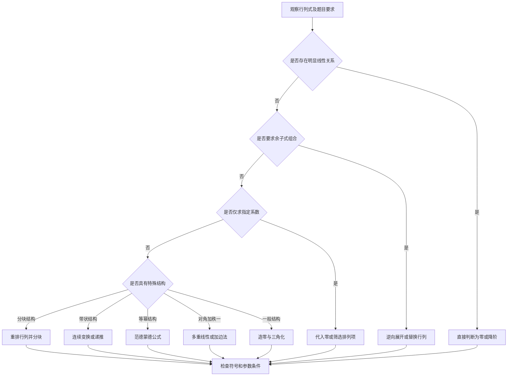

## 一、本节知识体系与学习目标

数值型行列式绝不只是计算一个三阶、四阶行列式的值。

即使行列式中包含未知参数 $x,a,\lambda$，只要具体元素或排列结构已经给出，通常也属于本节研究的范围。

本节可以归纳为以下知识体系：

| 知识模块      | 核心解题方法        | 掌握优先级 |
| --------- | ------------- | ----- |
| 行列式定义与逆序数 | 排列、符号、指定项     | 必须掌握  |
| 行列式基本性质   | 倍加、交换、提取公因子   | 必须掌握  |
| 低阶行列式     | 造零、降阶、三角化     | 必须掌握  |
| 分块行列式     | 行列重排、分块降阶     | 必须掌握  |
| 余子式与代数余子式 | 展开、逆向展开、替换行列  | 必须掌握  |
| 高阶行列式     | 递推、累加、累减      | 必须掌握  |
| 参数型行列式    | 消元、因式分解、系数提取  | 必须掌握  |
| 范德蒙德行列式   | 识别幂次结构、讨论根    | 重点掌握  |
| 对角加秩一结构   | 多重线性、加边法      | 强化重点  |
| 综合创新题     | 行列式与微积分、特征值结合 | 强化拓展  |

这一节最重要的思想是：

**不要看到行列式就立即展开，而要先观察结构，再选择能够最大程度降低计算量的方法。**

真正熟练以后，你应该能够从行列式的外观判断：

- 哪些行列可以相减或累加？
- 是否可以直接判断为零？
- 能否分解成几个低阶行列式？
- 是否存在递推关系？
- 是否只需要计算某个指定系数，而不需要求出整个多项式？

## 二、基础概念：从本质上理解行列式

### 2.1 行列式与矩阵的区别

矩阵是按一定规则排列的数表，而行列式是由方阵计算得到的一个数。

例如：

$$
A=\begin{pmatrix} a&b\\ c&d \end{pmatrix}
$$

是一个二阶矩阵，而

$$
|A|= \begin{vmatrix} a&b\\ c&d \end{vmatrix} =ad-bc
$$

是一个标量。

从几何上理解，二维矩阵的行列式表示线性变换的有向面积伸缩倍数，三维矩阵的行列式表示有向体积伸缩倍数。

若行列式为零，意味着相应的线性变换使空间发生降维。这也解释了为什么：

$$
|A|=0 \iff r(A)<n \iff A\text{ 不可逆}
$$

其中 $A$ 为 $n$ 阶方阵。

行列式不仅是第一章的计算工具，也是后续逆矩阵、线性相关、线性方程组、特征值和二次型的重要基础。

### 2.2 行列式的定义

设 $A=(a_{ij})_{n\times n}$，则

$$
\boxed{ |A|= \sum_{\sigma\in S_n} (-1)^{\tau(\sigma)} a_{1,\sigma(1)} a_{2,\sigma(2)} \cdots a_{n,\sigma(n)} }
$$

其中：

- $S_n$ 表示所有 $n$ 元排列组成的集合；
- $\sigma(i)$ 表示第 $i$ 行所选择的列；
- $\tau(\sigma)$ 表示排列的逆序数。

定义看起来复杂，但实质上只有三条规则：

**每行选一个元素，每列选一个元素，根据列排列的奇偶性确定正负号。**

一个 $n$ 阶行列式理论上共有 $n!$ 个排列项，其中部分项可能为零。

例如四阶行列式有24个排列项，五阶行列式有120个排列项。因此，阶数较高时通常不适合直接按定义展开。

### 2.3 逆序数与排列符号

在一个排列中，如果前面的数大于后面的数，这两个数便构成一个逆序。

例如排列

$$
(3,1,4,2)
$$

的逆序对为

$$
(3,1),\quad(3,2),\quad(4,2)
$$

所以逆序数为3，对应符号为

$$
(-1)^3=-1.
$$

因此四阶行列式中的排列项

$$
a_{13}a_{21}a_{34}a_{42}
$$

前面的符号是负号。

常用特殊排列如下：

| 排列结构                   | 逆序数                  | 对应符号                  |
| ---------------------- | -------------------- | --------------------- |
| $(1,2,\ldots,n)$   | $0$              | $1$               |
| $(n,n-1,\ldots,1)$ | $\frac{n(n-1)}2$ | $(-1)^{n(n-1)/2}$ |
| $(2,3,\ldots,n,1)$ | $n-1$            | $(-1)^{n-1}$      |

逆序数主要用于指定项符号、反对角行列式、循环带状行列式和多项式系数计算，不需要在每一道普通行列式计算题中使用。

### 2.4 二阶与三阶行列式

二阶公式：

$$
\boxed{ \begin{vmatrix}a&b\\c&d\end{vmatrix} =ad-bc }
$$

三阶公式：

$$
\begin{aligned} \begin{vmatrix} a&b&c\\ d&e&f\\ g&h&i \end{vmatrix} ={}&aei+bfg+cdh\\ &-ceg-bdi-afh. \end{aligned}
$$

也可以按第一行展开：

$$
=a(ei-fh)-b(di-fg)+c(dh-eg).
$$

**重要陷阱：** 三阶行列式的对角线法则不能推广到四阶及以上行列式。

## 三、行列式的基本性质与解题思想

### 3.1 必须熟练掌握的性质

设 $R_i$ 表示第 $i$ 行，$C_j$ 表示第 $j$ 列。

| 行列式操作               | 对行列式值的影响        |
| ------------------- | --------------- |
| 转置                  | 不变              |
| 交换两行或两列             | 变号              |
| 某一行或列乘以 $k$     | 变为原来的 $k$ 倍 |
| 某一行加上另一行的 $k$ 倍 | 不变              |
| 某一列加上另一列的 $k$ 倍 | 不变              |
| 存在全零行或全零列           | 等于零             |
| 存在两行或两列成比例          | 等于零             |
| 行向量组或列向量组线性相关       | 等于零             |

其中，最重要、使用频率最高的是倍加变换：

$$
\boxed{R_i\leftarrow R_i+kR_j}
$$

以及

$$
\boxed{C_i\leftarrow C_i+kC_j}.
$$

它们能够改变行列式的结构，却不改变行列式的值。

<Callout type="warn" title="关键区别：一行乘常数与整个矩阵乘常数">

一行乘以 $k$，行列式乘以 $k$。

而整个 $n$ 阶矩阵乘以 $k$，相当于每一行都乘以 $k$，因此

$$
\boxed{|kA|=k^n|A|}.
$$

绝不能误写成

$$
|kA|=k|A|.
$$

</Callout>

### 3.2 行列式的多重线性

行列式对单独一行或一列具有线性性质。

例如固定其余各列，有

$$
\begin{aligned} &|C_1,\ldots,\alpha u+\beta v,\ldots,C_n|\\ &=\alpha|C_1,\ldots,u,\ldots,C_n|\\ &\quad+\beta|C_1,\ldots,v,\ldots,C_n|. \end{aligned}
$$

这条性质是后面许多高级技巧的来源，包括余子式替换法、行列式拆分、秩一扰动和参数系数提取。

但是一般而言：

$$
\boxed{|A+B|\ne |A|+|B|}.
$$

因为行列式只是对单独一行或一列线性，而不是对整个矩阵线性。

### 3.3 造零、降阶与三角化

对于普通数值型行列式，计算目标通常有两个。

第一种是化为三角行列式：

$$
\begin{vmatrix} a_{11}&*&\cdots&*\\ 0&a_{22}&\cdots&*\\ \vdots&\ddots&\ddots&\vdots\\ 0&\cdots&0&a_{nn} \end{vmatrix} =\prod_{i=1}^n a_{ii}.
$$

第二种是将某一行或列化得只剩一个非零元素，然后按该行或列展开，降低阶数。

例如：

$$
\begin{vmatrix} 2&0&0&0\\ 1&a&b&c\\ 3&d&e&f\\ 4&g&h&i \end{vmatrix} =2 \begin{vmatrix} a&b&c\\ d&e&f\\ g&h&i \end{vmatrix}.
$$

**造零只是手段，降低计算复杂度才是目的。**

## 四、题型一：普通行列式的结构化计算

这一类题是整个行列式章节的基础。主要考查能否发现行列之间的重复性、对称性以及特殊的零元素分布。

### 4.1 行和、列和相同：累加法

**母题1：1988年数学三真题**

计算

$$
D= \begin{vmatrix} 1&1&1&0\\ 1&1&0&1\\ 1&0&1&1\\ 0&1&1&1 \end{vmatrix}.
$$

**第一步：观察结构。**

注意每一行元素之和都等于3。

因此，将前三列全部加到第四列：

$$
C_4\leftarrow C_4+C_1+C_2+C_3.
$$

得到

$$
D= 3\begin{vmatrix} 1&1&1&1\\ 1&1&0&1\\ 1&0&1&1\\ 0&1&1&1 \end{vmatrix}.
$$

**第二步：利用全1列造零。**

前三列分别减去第四列：

$$
D=3 \begin{vmatrix} 0&0&0&1\\ 0&0&-1&1\\ 0&-1&0&1\\ -1&0&0&1 \end{vmatrix}.
$$

**第三步：降阶计算。**

沿第一行展开：

$$
\begin{aligned} D &=-3 \begin{vmatrix} 0&0&-1\\ 0&-1&0\\ -1&0&0 \end{vmatrix}\\ &=\boxed{-3}. \end{aligned}
$$

**从这道题提炼一般方法**

假设某个行列式的每一行元素之和都是 $s$，那么将其他各列全部加到某一列，就可以制造出一列相同的元素 $s$。

此时可以提出公因子 $s$，再利用全1列进行消元。

特别地，如果每一行元素之和均为零，那么立即得到

$$
\boxed{D=0}.
$$

不需要再进行任何计算。

### 4.2 对角元素相同、非对角元素相同

**母题2：李林880题，基础解答题**

计算

$$
D_n= \begin{vmatrix} b&a&a&\cdots&a\\ a&b&a&\cdots&a\\ a&a&b&\cdots&a\\ \vdots&\vdots&\vdots&\ddots&\vdots\\ a&a&a&\cdots&b \end{vmatrix}.
$$

这是必须掌握的高阶行列式模型。

**解法一：行和法。**

将其余各行全部加到第一行：

$$
D_n=[b+(n-1)a] \begin{vmatrix} 1&1&\cdots&1\\ a&b&\cdots&a\\ \vdots&\vdots&\ddots&\vdots\\ a&a&\cdots&b \end{vmatrix}.
$$

令

$$
R_i\leftarrow R_i-aR_1, \qquad i=2,\ldots,n.
$$

得到

$$
D_n=[b+(n-1)a] \begin{vmatrix} 1&1&\cdots&1\\ 0&b-a&\cdots&0\\ \vdots&\vdots&\ddots&\vdots\\ 0&0&\cdots&b-a \end{vmatrix}.
$$

因此

$$
\boxed{ D_n=[b+(n-1)a](b-a)^{n-1} }.
$$

**解法二：特征值法（后续章节的综合方法）。**

设 $J$ 为全1矩阵，则原矩阵可以写成

$$
A=(b-a)I_n+aJ.
$$

由于 $J$ 的特征值为

$$
n,\underbrace{0,\ldots,0}_{n-1},
$$

因此 $A$ 的特征值为

$$
b+(n-1)a,\quad \underbrace{b-a,\ldots,b-a}_{n-1}.
$$

行列式等于全部特征值之积，得到相同结果。

现阶段优先掌握第一种解法。

**常见变式**

令主对角元素为 $x$，其余元素全部为1，则

$$
\boxed{D_n=(x+n-1)(x-1)^{n-1}}.
$$

对于 $n\geq 2$，方程 $D_n=0$ 的两个不同实根为

$$
x=1,\qquad x=1-n.
$$

其中 $x=1$ 为 $n-1$ 重根。

这就是行列式与参数方程、特征值问题之间最基本的联系。

## 五、题型二：分块行列式与行列重排

### 5.1 分块三角行列式

设 $A,B$ 分别为 $m,n$ 阶方阵，则

$$
\boxed{ \begin{vmatrix} A&C\\ O&B \end{vmatrix} =|A||B| }
$$

同理，

$$
\boxed{ \begin{vmatrix} A&O\\ C&B \end{vmatrix} =|A||B| }.
$$

特别地，

$$
\begin{vmatrix} A&O\\ O&B \end{vmatrix} =|A||B|.
$$

这里不要求 $A,B$ 可逆。

注意分块矩阵中的零块必须具有相应的维数，并且参与乘积的对角块必须是方阵。

### 5.2 通过重排发现隐藏的分块结构

**母题3：1996年数学一真题**

计算

$$
D= \begin{vmatrix} a_1&0&0&b_1\\ 0&a_2&b_2&0\\ 0&b_3&a_3&0\\ b_4&0&0&a_4 \end{vmatrix}.
$$

**题型识别：** 非零元素集中在主对角线和副对角线附近，并且下标可以分成两个互不干扰的组：

$$
\{1,4\},\qquad \{2,3\}.
$$

对行和列同时按照

$$
(1,4,2,3)
$$

重新排列。

由于行、列使用相同的置换，两个置换符号相乘等于1，因此总行列式不变。

得到

$$
D= \begin{vmatrix} a_1&b_1&0&0\\ b_4&a_4&0&0\\ 0&0&a_2&b_2\\ 0&0&b_3&a_3 \end{vmatrix}.
$$

从而

$$
\begin{aligned} D&= \begin{vmatrix} a_1&b_1\\ b_4&a_4 \end{vmatrix} \begin{vmatrix} a_2&b_2\\ b_3&a_3 \end{vmatrix}\\ &=\boxed{ (a_1a_4-b_1b_4)(a_2a_3-b_2b_3) }. \end{aligned}
$$

**一般化结论：主副对角线型行列式**

对于主对角线和副对角线上有元素、其他位置均为零的行列式，通常可以将首尾下标配对：

$$
(1,n),(2,n-1),(3,n-2),\ldots
$$

随后按照配对顺序同时重排行列，化为若干个二阶分块。

若阶数为奇数，中间还会剩下一个一阶块。

这个方法比直接展开高阶行列式高效得多。

### 5.3 分块过程中符号的处理

**母题4：2014年数学一、二、三真题**

计算

$$
D= \begin{vmatrix} 0&a&b&0\\ a&0&0&b\\ 0&c&d&0\\ c&0&0&d \end{vmatrix}.
$$

这道题与1996年真题的结构非常相似，但是符号不同。

**第一步：交换第二行和第三行。**

$$
D=- \begin{vmatrix} 0&a&b&0\\ 0&c&d&0\\ a&0&0&b\\ c&0&0&d \end{vmatrix}.
$$

**第二步：将列按照** $(2,3,1,4)$ **排列。**

该排列相当于两次列交换，故不改变当前行列式的符号。

$$
D=- \begin{vmatrix} a&b&0&0\\ c&d&0&0\\ 0&0&a&b\\ 0&0&c&d \end{vmatrix}.
$$

所以

$$
\boxed{D=-(ad-bc)^2}.
$$

**1996年与2014年真题的对比**

| 比较内容 | 1996年数学一 | 2014年数学一 |
| ---- | -------- | -------- |
| 核心思想 | 重排后分块    | 重排后分块    |
| 行列置换 | 相同       | 不同       |
| 额外符号 | 无        | 负号       |
| 主要陷阱 | 没有发现分块   | 分块后漏掉负号  |

一般地，行排列为 $\sigma$，列排列为 $\pi$，则

$$
D_{\text{新}} =(-1)^{\tau(\sigma)+\tau(\pi)} D_{\text{原}}.
$$

**行列同时使用相同排列时，符号一定相互抵消；行列使用不同排列时，必须单独判断。**

### 5.4 反对角分块行列式

对于

$$
M= \begin{pmatrix} O&A\\ B&O \end{pmatrix},
$$

其中 $A$ 为 $m$ 阶方阵，$B$ 为 $n$ 阶方阵，各零块维数与之匹配，则交换整组列可以得到分块对角矩阵。

需要交换 $mn$ 次，因此

$$
\boxed{|M|=(-1)^{mn}|A||B|}.
$$

特别地，当 $A,B$ 均为 $n$ 阶矩阵时，

$$
\boxed{ \begin{vmatrix} O&A\\ B&O \end{vmatrix} =(-1)^n|A||B| }.
$$

进一步，

$$
\boxed{ \begin{vmatrix} C&A\\ B&O \end{vmatrix} =(-1)^n|A||B| }
$$

其中三个非零块均为 $n$ 阶矩阵。

注意这里左上角的 $C$ 不影响结果。

### 5.5 对称分块行列式

**母题5：2020年真题整理**

计算

$$
D= \begin{vmatrix} a&0&-1&1\\ 0&a&1&-1\\ -1&1&a&0\\ 1&-1&0&a \end{vmatrix}.
$$

把它看成二阶分块矩阵：

$$
D= \begin{vmatrix} A&B\\ B&A \end{vmatrix},
$$

其中

$$
A=aI_2,\qquad B= \begin{pmatrix} -1&1\\ 1&-1 \end{pmatrix}.
$$

使用直接分块变换。

先将第二组块行加到第一组块行：

$$
D= \begin{vmatrix} A+B&A+B\\ B&A \end{vmatrix}.
$$

再将第二组块列减去第一组块列：

$$
D= \begin{vmatrix} A+B&O\\ B&A-B \end{vmatrix}.
$$

因此

$$
\boxed{ \begin{vmatrix} A&B\\ B&A \end{vmatrix} =|A+B||A-B| }.
$$

代入本题：

$$
\begin{aligned} D &= \begin{vmatrix} a-1&1\\ 1&a-1 \end{vmatrix} \begin{vmatrix} a+1&-1\\ -1&a+1 \end{vmatrix}\\ &=[(a-1)^2-1][(a+1)^2-1]\\ &=a(a-2)\cdot a(a+2). \end{aligned}
$$

最终得到

$$
\boxed{D=a^2(a^2-4)}.
$$

**重要补充：**

对于相同阶数的任意方阵 $A,B$，上述对称分块公式都成立，并不要求 $AB=BA$，也不要求 $A$ 可逆。

但若进一步写成

$$
|A^2-B^2|,
$$

则通常需要 $AB=BA$ 等条件保证相应的矩阵因式分解成立。

这个区别值得特别注意。

## 六、题型三：带状行列式与连续行列变换

### 6.1 带状行列式的识别

当非零元素集中在主对角线附近时，通常称为带状行列式。

最常见的有双对角行列式、三对角行列式，以及带有特殊首行、末行、首列或末列的行列式。

这类题的核心方法有两个：

**能够通过连续行列变换化成三角形的，优先三角化；不能直接三角化但具有重复结构的，优先递推。**

### 6.2 连续累加法

**母题6：李永乐六套卷第1套第15题（分类模拟题）**

设 $a>0$，且

$$
D(x)= \begin{vmatrix} x&-x&0&0\\ 2&3x-2&-3x&0\\ 0&3&4x-3&-4x\\ 0&0&4&5x-4 \end{vmatrix}.
$$

若

$$
D(a)=\frac1{16}D(1),
$$

求 $D(a+1)$。

**解题思维**

观察第二行：

$$
2+(3x-2)=3x.
$$

观察第三行：

$$
3+(4x-3)=4x.
$$

同时，主对角线上方的元素恰好与前面化简得到的元素互为相反数。

这就提示从左向右进行连续列累加。

先作

$$
C_2\leftarrow C_2+C_1,
$$

得到

$$
D(x)= \begin{vmatrix} x&0&0&0\\ 2&3x&-3x&0\\ 0&3&4x-3&-4x\\ 0&0&4&5x-4 \end{vmatrix}.
$$

再作

$$
C_3\leftarrow C_3+C_2,
$$

得到

$$
D(x)= \begin{vmatrix} x&0&0&0\\ 2&3x&0&0\\ 0&3&4x&-4x\\ 0&0&4&5x-4 \end{vmatrix}.
$$

最后

$$
C_4\leftarrow C_4+C_3.
$$

于是

$$
D(x)= \begin{vmatrix} x&0&0&0\\ 2&3x&0&0\\ 0&3&4x&0\\ 0&0&4&5x \end{vmatrix}.
$$

这是下三角行列式，所以

$$
D(x)=60x^4.
$$

根据已知条件，

$$
60a^4=\frac{60}{16},
$$

由 $a>0$ 得

$$
a=\frac12.
$$

故

$$
\boxed{ D(a+1)=60\left(\frac32\right)^4 =\frac{1215}{4} }.
$$

**同类题：张宇1000题**

计算

$$
D_4= \begin{vmatrix} x&x&0&0\\ 1&1+2x&2x&0\\ 0&2&2+3x&3x\\ 0&0&3&3+4x \end{vmatrix}.
$$

这次对应元素不是相反数，而是相同的数。

因此应该使用连续列减法：

$$
\begin{aligned} C_2&\leftarrow C_2-C_1,\\ C_3&\leftarrow C_3-C_2,\\ C_4&\leftarrow C_4-C_3. \end{aligned}
$$

得到

$$
D_4= \begin{vmatrix} x&0&0&0\\ 1&2x&0&0\\ 0&2&3x&0\\ 0&0&3&4x \end{vmatrix} =\boxed{24x^4}.
$$

**两道题背后的共同规律**

若上一列化简后能够消去下一列的关键元素，就可以按照一定方向连续进行倍加变换。

要特别注意：

- 后续操作使用的是已经更新过的列。
- 累加还是累减取决于元素之间的符号关系。
- 从左向右与从右向左可能产生完全不同的效果。
- 能避免除以含参数的表达式，就尽量避免。

最后一点尤其重要，因为列加减法不需要讨论参数是否为零，而除法可能引入额外的适用条件。

## 七、题型四：高阶行列式的递推法

这是数学一中值得重点强化的题型。

### 7.1 递推法的本质

高阶行列式通常很难直接计算。

但是，如果按某一行或列展开后，出现与原行列式具有相同结构的低阶行列式，就可以建立递推关系。

常见形式包括

$$
D_n=aD_{n-1}+b
$$

以及

$$
D_n=aD_{n-1}+bD_{n-2}.
$$

此时问题就从行列式计算转化成了数列问题。

### 7.2 一阶递推型行列式

**母题7：2015年数学一真题**

计算 $n$ 阶行列式

$$
D_n= \begin{vmatrix} 2&0&\cdots&0&2\\ -1&2&\cdots&0&2\\ 0&-1&\ddots&\vdots&\vdots\\ \vdots&\ddots&\ddots&2&2\\ 0&\cdots&0&-1&2 \end{vmatrix}.
$$

<Steps>

<Step>

### 第一步：寻找递推结构 [!toc]

第一行只有两个非零元素：

$$
a_{11}=2,\qquad a_{1n}=2.
$$

沿第一行展开：

$$
D_n=2D_{n-1}+2(-1)^{n+1}M_{1n}.
$$

删除第一行和最后一列后，得到一个三角行列式，其主对角线元素全部为 $-1$。

因此

$$
M_{1n}=(-1)^{n-1}.
$$

于是

$$
2(-1)^{n+1}M_{1n} =2(-1)^{2n}=2.
$$

所以

$$
\boxed{D_n=2D_{n-1}+2}.
$$

</Step>

<Step>

### 第二步：确定初值 [!toc]

$$
D_2= \begin{vmatrix} 2&2\\ -1&2 \end{vmatrix} =6.
$$

</Step>

<Step>

### 第三步：求解递推式 [!toc]

递推关系可改写为

$$
D_n+2=2(D_{n-1}+2).
$$

因此 $\{D_n+2\}$ 为等比数列。

$$
D_n+2=(D_2+2)2^{n-2} =2^{n+1}.
$$

最终

$$
\boxed{D_n=2^{n+1}-2}.
$$

</Step>

</Steps>

**一阶非齐次递推的一般公式**

如果

$$
u_n=au_{n-1}+b,\qquad a\ne1,
$$

则可以构造

$$
u_n+\frac{b}{a-1} =a\left(u_{n-1}+\frac{b}{a-1}\right).
$$

当 $a=1$ 时，则有

$$
u_n=u_{n-1}+b,
$$

直接使用等差数列公式。

但考试中不必死记复杂的通项公式，掌握配凑等比数列的方法即可。

### 7.3 三对角行列式

**母题8：李林880题、张宇1000题共同经典模型**

计算

$$
D_n= \begin{vmatrix} 2&-1&0&\cdots&0\\ -1&2&-1&\ddots&\vdots\\ 0&-1&2&\ddots&0\\ \vdots&\ddots&\ddots&\ddots&-1\\ 0&\cdots&0&-1&2 \end{vmatrix}.
$$

第一行只有两个非零元素。

沿第一行展开：

$$
D_n=2D_{n-1}+M_{12}.
$$

再沿 $M_{12}$ 的第一列展开，得到

$$
M_{12}=-D_{n-2}.
$$

因此

$$
\boxed{D_n=2D_{n-1}-D_{n-2}}.
$$

初值为

$$
D_1=2,\qquad D_2=3.
$$

将递推式变形为

$$
D_n-D_{n-1} =D_{n-1}-D_{n-2}.
$$

说明数列的相邻两项之差恒定。

由于

$$
D_2-D_1=1,
$$

故

$$
\boxed{D_n=n+1}.
$$

张宇1000题中将上下副对角线的 $-1$ 改成 $1$，答案仍然是 $n+1$。

为什么？

因为递推关系取决于上下副对角线元素的乘积，而

$$
1\cdot1=(-1)(-1)=1.
$$

### 7.4 一般三对角行列式公式

设

$$
D_n= \begin{vmatrix} a&b&0&\cdots&0\\ c&a&b&\ddots&\vdots\\ 0&c&a&\ddots&0\\ \vdots&\ddots&\ddots&\ddots&b\\ 0&\cdots&0&c&a \end{vmatrix}.
$$

沿第一行展开：

$$
D_n=aD_{n-1}-bM_{12}.
$$

而

$$
M_{12}=cD_{n-2}.
$$

因此

$$
\boxed{D_n=aD_{n-1}-bcD_{n-2}}.
$$

约定

$$
D_0=1,\qquad D_1=a.
$$

这是三对角行列式最重要的公式。

对应数列递推的特征方程为

$$
r^2-ar+bc=0.
$$

令其两个根为 $r_1,r_2$。

当两根不同时，

$$
\boxed{ D_n=\frac{r_1^{n+1}-r_2^{n+1}}{r_1-r_2} }.
$$

当两根相同，记为 $r$，则

$$
\boxed{D_n=(n+1)r^n}.
$$

李林880题中专门设置了这一一般模型，并给出了 $a^2-4bc\geq0$ 的条件。

实际考试中，若递推关系具有明显的等差、等比结构，应优先采用简单方法，而非机械套用通项公式。

### 7.5 不同元素的三对角行列式

**李正元练习题**

设

$$
D_n= \begin{vmatrix} a_1&1&0&\cdots&0\\ -1&a_2&1&\ddots&\vdots\\ 0&-1&a_3&\ddots&0\\ \vdots&\ddots&\ddots&\ddots&1\\ 0&\cdots&0&-1&a_n \end{vmatrix}.
$$

求递推关系。

注意主对角线元素不再相同。

因此不适合沿第一行展开并直接写成 $a_1D_{n-1}$，因为删除第一行第一列后得到的不是原来的前 $n-1$ 阶行列式。

应沿最后一行展开。

$$
\boxed{D_n=a_nD_{n-1}+D_{n-2}}.
$$

更加一般地，

$$
D_n= \begin{vmatrix} a_1&b_1&0&\cdots&0\\ c_1&a_2&b_2&\ddots&\vdots\\ 0&c_2&a_3&\ddots&0\\ \vdots&\ddots&\ddots&\ddots&b_{n-1}\\ 0&\cdots&0&c_{n-1}&a_n \end{vmatrix}
$$

满足

$$
\boxed{ D_n=a_nD_{n-1} -b_{n-1}c_{n-1}D_{n-2} }.
$$

这比常系数三对角行列式的适用范围更广。

## 八、题型五：稀疏行列式与特殊排列

### 8.1 特殊三角行列式

上三角和下三角行列式等于主对角线元素之积。

对于反对角行列式，

$$
D= \begin{vmatrix} 0&\cdots&0&a_1\\ 0&\cdots&a_2&0\\ \vdots&\iddots&\vdots&\vdots\\ a_n&0&\cdots&0 \end{vmatrix},
$$

其唯一非零排列为

$$
(n,n-1,\ldots,1).
$$

因此

$$
\boxed{ D=(-1)^{\frac{n(n-1)}2} a_1a_2\cdots a_n }.
$$

### 8.2 循环带状行列式

**母题9：李林880题**

计算

$$
D_n= \begin{vmatrix} a_1&b_1&0&\cdots&0\\ 0&a_2&b_2&\cdots&0\\ \vdots&\vdots&\ddots&\ddots&\vdots\\ 0&0&\cdots&a_{n-1}&b_{n-1}\\ b_n&0&\cdots&0&a_n \end{vmatrix}.
$$

根据行列式定义，每行每列必须各选一个元素。

如果第一行选择 $a_1$，那么最后一行不能再选择 $b_n$，于是只能选择 $a_n$。

由此不断向前推，最终必须选择全部主对角线元素。

如果第一行选择 $b_1$，那么第二行不能再选择 $a_2$，必须选择 $b_2$。

以此类推，最终只能选择全部 $b_i$。

所以只有两类可能非零的排列项。

第一类对应排列

$$
(1,2,\ldots,n),
$$

第二类对应排列

$$
(2,3,\ldots,n,1).
$$

因此

$$
\boxed{ D_n=\prod_{i=1}^na_i +(-1)^{n-1}\prod_{i=1}^nb_i }.
$$

原练习题还要求与其转置的行列式相加。

因为

$$
|A^T|=|A|,
$$

故原题答案为

$$
\boxed{ 2\prod_{i=1}^na_i +2(-1)^{n-1}\prod_{i=1}^nb_i }.
$$

**识别技巧：** 当非零元素极少，并且形成一条首尾相连的链时，排列定义可能比高斯消元更简单。

## 九、题型六：余子式与代数余子式

这部分不仅考查行列式计算，还会直接服务于后续的伴随矩阵、逆矩阵和线性方程组。

### 9.1 基本定义

在 $n$ 阶行列式中，删去元素 $a_{ij}$ 所在的第 $i$ 行、第 $j$ 列，剩下的 $n-1$ 阶行列式称为 $a_{ij}$ 的余子式：

$$
M_{ij}.
$$

其代数余子式为

$$
\boxed{A_{ij}=(-1)^{i+j}M_{ij}}.
$$

二者区别仅在于符号。

代数余子式的符号规律如下：

$$
\begin{pmatrix} +&-&+&-&\cdots\\ -&+&-&+&\cdots\\ +&-&+&-&\cdots\\ -&+&-&+&\cdots\\ \vdots&\vdots&\vdots&\vdots&\ddots \end{pmatrix}.
$$

### 9.2 按行、按列展开公式

按第 $i$ 行展开：

$$
\boxed{ D=\sum_{j=1}^na_{ij}A_{ij} }.
$$

按第 $j$ 列展开：

$$
\boxed{ D=\sum_{i=1}^na_{ij}A_{ij} }.
$$

当某一行元素与另一行的对应代数余子式相乘并求和时，

$$
\boxed{ \sum_{j=1}^na_{kj}A_{ij}=0,\qquad k\ne i }.
$$

原因是将第 $i$ 行替换为第 $k$ 行以后，新行列式有两行相同。

统一写成

$$
\sum_{j=1}^na_{kj}A_{ij} = \begin{cases} D,&k=i,\\ 0,&k\ne i. \end{cases}
$$

这个性质就是伴随矩阵公式

$$
AA^*=A^*A=|A|I_n
$$

的基础。

### 9.3 最重要的技巧：逆向展开与替换法

假设题目要求计算

$$
c_1A_{i1}+c_2A_{i2}+\cdots+c_nA_{in}.
$$

这时通常不要逐个计算代数余子式。

只需要将原行列式的第 $i$ 行替换成

$$
(c_1,c_2,\ldots,c_n),
$$

计算新行列式即可。

原因在于：

**第** $i$ **行元素的所有代数余子式，都不包含第** $i$ **行本身的元素。**

这是代数余子式题型中最核心的解题思想。

**母题10：2019年数学二真题**

已知

$$
A= \begin{pmatrix} 1&-1&0&0\\ -2&1&-1&1\\ 3&-2&2&-1\\ 0&0&3&4 \end{pmatrix}.
$$

求

$$
A_{11}-A_{12}.
$$

注意原矩阵第一行恰好为

$$
(1,-1,0,0).
$$

因此

$$
A_{11}-A_{12}=|A|.
$$

接下来只需要计算原行列式。

作

$$
R_2\leftarrow R_2+2R_1,
$$

$$
R_3\leftarrow R_3-3R_1.
$$

于是

$$
\begin{aligned} |A| &= \begin{vmatrix} 1&-1&0&0\\ 0&-1&-1&1\\ 0&1&2&-1\\ 0&0&3&4 \end{vmatrix}\\ &= \begin{vmatrix} -1&-1&1\\ 1&2&-1\\ 0&3&4 \end{vmatrix}\\ &=-11+4+3\\ &=\boxed{-4}. \end{aligned}
$$

这道题表面在考代数余子式，实际只需要识别出行列式展开公式。

### 9.4 普通余子式之和

**母题11：李林880题**

设

$$
D= \begin{vmatrix} 3&0&4&0\\ 2&2&2&2\\ 0&-7&0&0\\ 5&3&-2&2 \end{vmatrix}.
$$

求

$$
M_{41}+M_{42}+M_{43}+M_{44}.
$$

注意题目给的是普通余子式，而不是代数余子式。

由

$$
M_{ij}=(-1)^{i+j}A_{ij}
$$

可得

$$
M_{41}+M_{42}+M_{43}+M_{44} =-A_{41}+A_{42}-A_{43}+A_{44}.
$$

因此将原行列式第四行替换为

$$
(-1,1,-1,1).
$$

于是所求为

$$
\begin{vmatrix} 3&0&4&0\\ 2&2&2&2\\ 0&-7&0&0\\ -1&1&-1&1 \end{vmatrix}.
$$

沿第三行展开：

$$
=7 \begin{vmatrix} 3&4&0\\ 2&2&2\\ -1&-1&1 \end{vmatrix}.
$$

计算得

$$
=7(12-16)=\boxed{-28}.
$$

**必须形成的条件反射**

| 题目要求                        | 替换方法                 |
| --------------------------- | -------------------- |
| $\sum_j A_{ij}$        | 将第 $i$ 行替换为全1行   |
| $\sum_j c_jA_{ij}$     | 将第 $i$ 行替换为系数行   |
| $\sum_j M_{ij}$        | 将第 $i$ 行替换为交替符号行 |
| $\sum_i A_{ij}$        | 将第 $j$ 列替换为全1列   |
| $\sum_j a_{kj}A_{ij}$ | 判断是否为原行展开或异行展开       |

### 9.5 余子式与参数方程综合

**母题12：2024年数学三真题**

设

$$
A= \begin{pmatrix} a+1&b&3\\ a&\frac b2&1\\ 1&1&2 \end{pmatrix},
$$

已知

$$
|A|=-\frac12
$$

以及

$$
-M_{21}+M_{22}-M_{23}=0.
$$

求参数 $a$ 的可能取值。

**第一步：将余子式条件转换为行列式。**

因为

$$
-M_{21}+M_{22}-M_{23} =A_{21}+A_{22}+A_{23},
$$

所以

$$
\begin{vmatrix} a+1&b&3\\ 1&1&1\\ 1&1&2 \end{vmatrix} =0.
$$

第三行减去第二行：

$$
\begin{vmatrix} a+1&b&3\\ 1&1&1\\ 0&0&1 \end{vmatrix} =a+1-b=0.
$$

从而

$$
b=a+1.
$$

**第二步：代回原行列式。**

$$
|A|= \begin{vmatrix} b&b&3\\ b-1&\frac b2&1\\ 1&1&2 \end{vmatrix}.
$$

第一列减去第二列：

$$
|A|= \begin{vmatrix} 0&b&3\\ \frac b2-1&\frac b2&1\\ 0&1&2 \end{vmatrix}.
$$

沿第一列展开：

$$
|A|=\left(\frac b2-1\right)(3-2b).
$$

根据已知条件，

$$
\left(\frac b2-1\right)(3-2b) =-\frac12.
$$

整理得

$$
2b^2-7b+5=0.
$$

即

$$
(2b-5)(b-1)=0.
$$

因此

$$
b=1\quad\text{或}\quad b=\frac52.
$$

最终

$$
\boxed{a=0\quad\text{或}\quad a=\frac32}.
$$

这道题具有很好的迁移价值：当出现代数余子式构成的参数条件时，应优先将其转换成一个新的行列式方程，先求简单关系，再代回原条件。

## 十、题型七：参数行列式与多项式系数

参数行列式是考研数学一非常值得重视的综合方向。

### 10.1 行列式多项式的次数

设

$$
f(x)=|A+xB|,
$$

其中 $A,B$ 均为 $n$ 阶常数矩阵。

因为行列式的每个排列项都是 $n$ 个至多一次的因子的乘积，因此

$$
\boxed{\deg f\leq n}
$$

（当 $f$ 不恒为零时）。

进一步，

$$
\boxed{[x^n]f(x)=|B|}
$$

以及

$$
\boxed{[x^0]f(x)=f(0)=|A|}.
$$

其中 $[x^k]f(x)$ 表示多项式中 $x^k$ 的系数。

如果 $B$ 不可逆，则最高次项系数为零，实际次数就可能小于 $n$。

更一般地，非零多项式 $f$ 还满足

$$
\boxed{\deg f\leq r(B)}.
$$

因为在按列进行多重线性展开时，若选择超过 $r(B)$ 个来自 $B$ 的列，这些列必然线性相关，该项行列式便等于零。

这个结论对于创新题很有价值。

### 10.2 常数项：直接代入零

张宇1000题中有一道基础题，要求计算

$$
f(x)= \begin{vmatrix} x&1&0&1\\ 0&1&x&1\\ 1&x&1&0\\ 1&0&1&x \end{vmatrix}
$$

的常数项。

只需令 $x=0$：

$$
f(0)= \begin{vmatrix} 0&1&0&1\\ 0&1&0&1\\ 1&0&1&0\\ 1&0&1&0 \end{vmatrix}.
$$

出现相同行，所以

$$
\boxed{f(0)=0}.
$$

完全没有必要展开四阶行列式。

### 10.3 指定次项系数

**母题13：2021年数学二、三真题**

设

$$
f(x)= \begin{vmatrix} x&x&1&2x\\ 1&x&2&-1\\ 2&1&x&1\\ 2&-1&1&x \end{vmatrix}.
$$

求 $x^3$ 的系数。

<Tabs items={["方法一：排列筛选法", "方法二：列多重线性"]} defaultIndex={0}>

<Tab value="方法一：排列筛选法">

想要得到 $x^3$，必须选择三个含 $x$ 的元素和一个常数元素，并且满足行列互异。

观察所有可能贡献 $x^3$ 的排列，只有以下两种。

第一种：

$$
a_{12}a_{21}a_{33}a_{44} =x\cdot1\cdot x\cdot x.
$$

对应排列

$$
(2,1,3,4)
$$

逆序数为1，因此贡献

$$
-x^3.
$$

第二种：

$$
a_{14}a_{22}a_{33}a_{41} =2x\cdot x\cdot x\cdot2.
$$

对应排列

$$
(4,2,3,1)
$$

逆序数为5，因此贡献

$$
-4x^3.
$$

所以

$$
\boxed{[x^3]f(x)=-5}.
$$

</Tab>

<Tab value="方法二：列多重线性">

设

$$
f(x)=|A+xB|.
$$

要求 $x^{n-1}$ 的系数，只需要在 $n$ 列中选择一列来自 $A$，其余列来自 $B$，然后将得到的 $n$ 个行列式相加：

$$
[x^{n-1}]f(x) =\sum_{j=1}^n |B_1,\ldots,A_j,\ldots,B_n|.
$$

本题中，如果熟悉排列定义，第一种方法更快。

若每个元素都含有参数，则第二种方法更具有普适性。

</Tab>

</Tabs>

### 10.4 进阶训练：张宇1000题

设

$$
f(x)= \begin{vmatrix} 5x&1&2&3\\ x&x&1&2\\ 1&2&x&3\\ x&1&2&2x \end{vmatrix}.
$$

求 $x^3,x^4$ 的系数。

先观察最高次项。

只有主对角线排列能够产生 $x^4$：

$$
5x\cdot x\cdot x\cdot2x =10x^4.
$$

因此

$$
[x^4]f(x)=10.
$$

对于 $x^3$，先观察主对角线之外的含参数元素：

$$
a_{21}=x,\qquad a_{41}=x.
$$

分别与原来主对角线上的元素形成交换。

选择 $a_{21}$ 时，对应排列为

$$
(2,1,3,4),
$$

贡献

$$
-1\cdot x\cdot x\cdot2x=-2x^3.
$$

选择 $a_{41}$ 时，对应排列为

$$
(4,2,3,1),
$$

贡献

$$
-3\cdot x\cdot x\cdot x=-3x^3.
$$

所以

$$
\boxed{ [x^3]f(x)=-5,\qquad [x^4]f(x)=10 }.
$$

本题无需计算低次项。

### 10.5 行列式与多项式的编码结构

**母题14：2016年数学一、三真题整理**

计算

$$
D= \begin{vmatrix} \lambda&-1&0&0\\ 0&\lambda&-1&0\\ 0&0&\lambda&-1\\ 4&3&2&\lambda+1 \end{vmatrix}.
$$

沿第一列展开：

$$
\begin{aligned} D ={}&\lambda \begin{vmatrix} \lambda&-1&0\\ 0&\lambda&-1\\ 3&2&\lambda+1 \end{vmatrix}\\ &-4 \begin{vmatrix} -1&0&0\\ \lambda&-1&0\\ 0&\lambda&-1 \end{vmatrix}. \end{aligned}
$$

第二个三阶行列式为 $-1$，故

$$
D=\lambda \begin{vmatrix} \lambda&-1&0\\ 0&\lambda&-1\\ 3&2&\lambda+1 \end{vmatrix}+4.
$$

继续递推：

$$
D=\lambda\left[ \lambda \begin{vmatrix} \lambda&-1\\ 2&\lambda+1 \end{vmatrix}+3 \right]+4.
$$

于是

$$
\boxed{ D=\lambda^4+\lambda^3+2\lambda^2+3\lambda+4 }.
$$

**张宇1000题强化题的一般化**

对于

$$
D_n= \begin{vmatrix} x&-1&0&\cdots&0\\ 0&x&-1&\cdots&0\\ \vdots&\vdots&\ddots&\ddots&\vdots\\ 0&0&\cdots&x&-1\\ a_n&a_{n-1}&\cdots&a_2&x+a_1 \end{vmatrix},
$$

有

$$
\boxed{ D_n=x^n+a_1x^{n-1}+\cdots+a_{n-1}x+a_n }.
$$

其本质为一阶递推：

$$
D_n=xD_{n-1}+a_n.
$$

在后续学习特征值时，这种结构还会与伴随型矩阵的特征多项式产生联系。

## 十一、题型八：参数行列式的零点与方程

### 11.1 先降次数，而不是盲目展开

**母题15：张宇1000题**

设

$$
f(x)= \begin{vmatrix} a_1+x&b_1+x&c_1+x\\ a_2+x&b_2+x&c_2+x\\ a_3+x&b_3+x&c_3+x \end{vmatrix},
$$

且 $f(x)$ 不恒为零，判断其零点个数。

表面来看，每个元素都含有 $x$，似乎可能是三次多项式。

然而进行

$$
C_2\leftarrow C_2-C_1,\qquad C_3\leftarrow C_3-C_1.
$$

得到

$$
f(x)= \begin{vmatrix} a_1+x&b_1-a_1&c_1-a_1\\ a_2+x&b_2-a_2&c_2-a_2\\ a_3+x&b_3-a_3&c_3-a_3 \end{vmatrix}.
$$

此时只有第一列含 $x$。

所以 $f(x)$ 至多为一次多项式。

结合不恒为零的条件，得到

$$
\boxed{f(x)\text{ 至多有一个零点}}.
$$

这里不能说恰有一个零点，因为它也可能是非零常数。

### 11.2 利用分块结构进行因式分解

**母题16：1999年数学二真题**

设

$$
f(x)= \begin{vmatrix} x-2&x-1&x-2&x-3\\ 2x-2&2x-1&2x-2&2x-3\\ 3x-3&3x-2&4x-5&3x-5\\ 4x&4x-3&5x-7&4x-3 \end{vmatrix}.
$$

求 $f(x)=0$ 的不同实根个数。

仔细观察各列之间含有相同的一次项。

先作

$$
C_j\leftarrow C_j-C_1,\qquad j=2,3,4.
$$

然后

$$
C_4\leftarrow C_4+C_2.
$$

得到

$$
f(x)= \begin{vmatrix} x-2&1&0&0\\ 2x-2&1&0&0\\ 3x-3&1&x-2&-1\\ 4x&-3&x-7&-6 \end{vmatrix}.
$$

这是分块下三角行列式，所以

$$
\begin{aligned} f(x) &= \begin{vmatrix} x-2&1\\ 2x-2&1 \end{vmatrix} \begin{vmatrix} x-2&-1\\ x-7&-6 \end{vmatrix}\\ &=(-x)(-5x+5)\\ &=5x(x-1). \end{aligned}
$$

所以不同实根为

$$
x=0,\qquad x=1.
$$

答案为

$$
\boxed{2}.
$$

### 11.3 先判断是否恒为零

**母题17：2025年数学三第15题**

设

$$
f(x)= \begin{vmatrix} 2x+1&3&2x+1&1\\ 2x&-3&4x&-2\\ 2x+1&2&2x+1&1\\ 2x&-4&4x&-2 \end{vmatrix},
$$

$$
g(x)= \begin{vmatrix} 2x+1&1&2x+1&3\\ 5x+1&-2&4x&-3\\ 0&1&2x+1&2\\ 2x&-2&4x&-4 \end{vmatrix}.
$$

求方程 $f(x)=g(x)$ 的不同实根个数。

**第一步：不要急于计算两个行列式。**

观察 $f(x)$，发现

$$
R_1-R_3=R_2-R_4=(0,1,0,0).
$$

因此

$$
R_1-R_2-R_3+R_4=0.
$$

行向量线性相关，所以

$$
\boxed{f(x)\equiv0}.
$$

**第二步：计算** $g(x)$**。**

作

$$
R_1\leftarrow R_1-R_3,\qquad R_2\leftarrow R_2-R_4.
$$

再令

$$
R_2\leftarrow R_2-R_1.
$$

得到

$$
g(x)= \begin{vmatrix} 2x+1&0&0&1\\ x&0&0&0\\ 0&1&2x+1&2\\ 2x&-2&4x&-4 \end{vmatrix}.
$$

沿第二行展开：

$$
\begin{aligned} g(x) &=-x \begin{vmatrix} 0&0&1\\ 1&2x+1&2\\ -2&4x&-4 \end{vmatrix}\\ &=-2x(4x+1). \end{aligned}
$$

于是原方程的根为

$$
x=0,\qquad x=-\frac14.
$$

故答案为

$$
\boxed{2}.
$$

**这道题的重要性**

它体现了近年题目中值得关注的综合思路：不只是考查计算能力，还考查发现线性关系、识别结构和主动减少计算量的能力。

遇到两个复杂行列式构成的等式时，应先检查是否存在某个行列式恒为零，或者两个行列式能否利用多重线性直接合并。

## 十二、题型九：范德蒙德行列式

### 12.1 公式及识别特征

范德蒙德行列式为

$$
V_n= \begin{vmatrix} 1&x_1&x_1^2&\cdots&x_1^{n-1}\\ 1&x_2&x_2^2&\cdots&x_2^{n-1}\\ \vdots&\vdots&\vdots&&\vdots\\ 1&x_n&x_n^2&\cdots&x_n^{n-1} \end{vmatrix}.
$$

公式为

$$
\boxed{ V_n=\prod_{1\leq i<j\leq n}(x_j-x_i) }.
$$

例如三阶范德蒙德行列式：

$$
\begin{vmatrix} 1&a&a^2\\ 1&b&b^2\\ 1&c&c^2 \end{vmatrix} =(b-a)(c-a)(c-b).
$$

**为什么一定是这些差的乘积？**

当 $x_i=x_j$ 时，第 $i,j$ 行完全相同，行列式为零。

因此，行列式必然含有因子

$$
x_j-x_i.
$$

所有这样的因子共有

$$
\frac{n(n-1)}2
$$

个，而原行列式的总次数也恰好为

$$
0+1+\cdots+(n-1)=\frac{n(n-1)}2.
$$

因此不可能再有其他非常数因子。比较最高次项的系数，即可确定比例系数为1。

这个推导揭示了更一般的思想：**利用行列式退化为零寻找多项式因子，再比较次数和系数。**

### 12.2 范德蒙德行列式与参数退化

**母题18：原创变式**

设

$$
F(x)= \begin{vmatrix} 1&x&x^2&x^3\\ 1&a&a^2&a^3\\ 1&b&b^2&b^3\\ 1&a+b&(a+b)^2&(a+b)^3 \end{vmatrix}.
$$

求因式分解，并讨论方程 $F(x)=0$ 的实根情况。

直接识别出四个参数：

$$
x_1=x,\quad x_2=a,\quad x_3=b,\quad x_4=a+b.
$$

由范德蒙德公式，

$$
\begin{aligned} F(x) ={}&(a-x)(b-x)(a+b-x)\\ &\cdot(b-a)b a. \end{aligned}
$$

所以

$$
\boxed{ F(x)=ab(b-a)(a-x)(b-x)(a+b-x) }.
$$

现在分两种情况讨论。

当

$$
ab(a-b)\ne0
$$

时，三个根

$$
x=a,\qquad x=b,\qquad x=a+b
$$

两两不同。

因此恰有三个不同实根。

当

$$
ab(a-b)=0
$$

时，固定的三行中至少有两行相同，故

$$
F(x)\equiv0.
$$

此时任意实数都是方程的根。

<Callout type="warn" title="易错点">

参数型行列式因式分解以后，应先检查不含未知数的系数因子是否可能为零。

如果这个系数为零，问题不再是普通的重根问题，而是整个多项式恒等于零的问题。

</Callout>

### 12.3 与高等数学结合：水平切线问题

**母题19：李林880题**

设

$$
f(x)= \begin{vmatrix} 1&x&x^2&x^3\\ 1&2&4&8\\ 1&-1&1&-1\\ 1&1&1&1 \end{vmatrix}.
$$

求曲线 $y=f(x)$ 在区间 $(-1,2)$ 内水平切线的条数。

根据范德蒙德公式，

$$
\begin{aligned} f(x) ={}&(2-x)(-1-x)(1-x)\\ &\cdot(-3)(-1)\cdot2. \end{aligned}
$$

即

$$
f(x)=-6(x-2)(x+1)(x-1).
$$

水平切线的条件是

$$
f'(x)=0.
$$

但完全可以不求导数的具体表达式。

因为

$$
f(-1)=f(1)=f(2)=0,
$$

根据罗尔定理，在

$$
(-1,1),\qquad (1,2)
$$

内各至少存在一个导数为零的点。

又因为 $f(x)$ 是三次多项式，其导数是二次多项式，至多有两个不同实根。

因此恰好有两个点使得

$$
f'(x)=0.
$$

两个驻点之间函数严格单调，函数值不同，所以对应两条不同的水平切线。

答案为

$$
\boxed{2}.
$$

绘图范围内的函数：$y=-6(x-2)(x+1)(x-1)$，其中 $-1.3\le x\le 2.3$。

这是一个很有价值的跨章节母题：范德蒙德行列式负责确定零点，罗尔定理负责确定驻点的存在性，多项式次数负责确定驻点数量的上界。

## 十三、题型十：箭形行列式、加边法与秩一扰动

这一部分属于强化内容，尤其适合应对高阶行列式及新结构题目。

### 13.1 箭形行列式

**母题20：李林880题**

计算

$$
D= \begin{vmatrix} 1&0&0&1\\ 0&2&0&1\\ 0&0&3&1\\ 1&1&1&4 \end{vmatrix}.
$$

观察到左上角为对角矩阵。

因此可以利用前三行消去最后一行的前三个元素：

$$
R_4\leftarrow R_4-R_1-\frac12R_2-\frac13R_3.
$$

于是

$$
D= \begin{vmatrix} 1&0&0&1\\ 0&2&0&1\\ 0&0&3&1\\ 0&0&0&4-1-\frac12-\frac13 \end{vmatrix}.
$$

所以

$$
D=1\cdot2\cdot3\cdot\frac{13}{6} =\boxed{13}.
$$

**一般公式**

设

$$
D= \begin{vmatrix} d_1&0&\cdots&0&u_1\\ 0&d_2&\cdots&0&u_2\\ \vdots&\vdots&\ddots&\vdots&\vdots\\ 0&0&\cdots&d_n&u_n\\ v_1&v_2&\cdots&v_n&c \end{vmatrix}.
$$

当所有 $d_i\ne0$ 时，

$$
\boxed{ D=\left(\prod_{i=1}^nd_i\right) \left(c-\sum_{i=1}^n\frac{u_iv_i}{d_i}\right) }.
$$

如果某些 $d_i=0$，则不可以直接使用含分母的公式。

不过将其展开成无分母形式：

$$
\boxed{ D=c\prod_{i=1}^nd_i -\sum_{i=1}^nu_iv_i \prod_{j\ne i}d_j }
$$

就可以适用于所有参数取值。

### 13.2 对角矩阵加秩一矩阵

设

$$
D=\operatorname{diag}(d_1,\ldots,d_n),
$$

以及两个列向量

$$
u=(u_1,\ldots,u_n)^T, \qquad v=(v_1,\ldots,v_n)^T.
$$

考虑矩阵

$$
D+uv^T.
$$

其中

$$
uv^T= \begin{pmatrix} u_1v_1&\cdots&u_1v_n\\ \vdots&\ddots&\vdots\\ u_nv_1&\cdots&u_nv_n \end{pmatrix}.
$$

其各列均是向量 $u$ 的倍数，所以秩至多为1。

这就是所谓的秩一扰动。

**重要公式**

$$
\boxed{ |D+uv^T| =\prod_{i=1}^nd_i+ \sum_{i=1}^nu_iv_i\prod_{j\ne i}d_j }.
$$

当所有 $d_i\ne0$ 时，也可以写成

$$
\boxed{ |D+uv^T| =\prod_{i=1}^nd_i \left(1+\sum_{i=1}^n\frac{u_iv_i}{d_i}\right) }.
$$

**公式的本质证明**

原矩阵的第 $j$ 列可以表示为

$$
d_je_j+v_ju.
$$

利用行列式的多重线性逐列拆分。

如果选择两列或更多列来自 $uv^T$，那么这些列都是 $u$ 的倍数，对应行列式为零。

因此只剩下两类非零贡献：

一种是所有列均来自对角矩阵；

另一种是恰有一列来自 $uv^T$。

由此得到上述公式。

这个证明不需要逆矩阵、特征值或复杂的矩阵理论，而且允许对角元素为零。

### 13.3 加边法

一种通用的技巧是将原 $n$ 阶行列式增加一行一列，变成更容易处理的 $n+1$ 阶行列式。

例如：

$$
\boxed{ |D+uv^T|= \begin{vmatrix} 1&-v^T\\ u&D \end{vmatrix} }.
$$

因为通过块行倍加消去左下角的 $u$，即可得到

$$
\begin{vmatrix} 1&-v^T\\ 0&D+uv^T \end{vmatrix} =|D+uv^T|.
$$

当原矩阵包含大量相同或成比例的非对角元素时，加边后通常会变成箭形行列式。

这就是加边法的用途：虽然提高了阶数，但降低了结构复杂度。

### 13.4 李林880题秩一行列式

**母题21：李林880题**

计算

$$
D_n= \begin{vmatrix} b-a_1^2&-a_1a_2&\cdots&-a_1a_n\\ -a_2a_1&b-a_2^2&\cdots&-a_2a_n\\ \vdots&\vdots&\ddots&\vdots\\ -a_na_1&-a_na_2&\cdots&b-a_n^2 \end{vmatrix}.
$$

记

$$
u=(a_1,\ldots,a_n)^T.
$$

则

$$
D_n=|bI_n-uu^T|.
$$

利用无分母的秩一公式，

$$
\begin{aligned} D_n &=b^n-\sum_{i=1}^na_i^2b^{n-1}\\ &=\boxed{ b^{n-1}\left(b-\sum_{i=1}^na_i^2\right) }. \end{aligned}
$$

由于使用的是无分母公式，所以 $b=0$ 也包含在结果中（$n\ge2$）。

**常见变式：李林880题**

$$
D_n= \begin{vmatrix} a+b_1&a&\cdots&a\\ a&a+b_2&\cdots&a\\ \vdots&\vdots&\ddots&\vdots\\ a&a&\cdots&a+b_n \end{vmatrix}.
$$

如果所有 $b_i\ne0$，则

$$
\boxed{ D_n= \left(1+a\sum_{i=1}^n\frac1{b_i}\right) \prod_{i=1}^nb_i }.
$$

即使存在零元素，也可用

$$
\boxed{ D_n=\prod_{i=1}^nb_i+ a\sum_{i=1}^n\prod_{j\ne i}b_j }
$$

进行计算。

**张宇1000题强化变式**

$$
D_n= \begin{vmatrix} a_1+x_1&a_2&\cdots&a_n\\ a_1&a_2+x_2&\cdots&a_n\\ \vdots&\vdots&\ddots&\vdots\\ a_1&a_2&\cdots&a_n+x_n \end{vmatrix}.
$$

当所有 $x_i\ne0$ 时，

$$
\boxed{ D_n=x_1x_2\cdots x_n \left(1+\sum_{i=1}^n\frac{a_i}{x_i}\right) }.
$$

看似三道不同的高阶行列式题目，实际上都属于同一个母题：

$$
\boxed{\text{对角矩阵}+\text{秩一矩阵}}.
$$

## 十四、题型十一：行列式变化量与证明题

李正元练习题中安排了三道连续的证明题。这组题非常有价值，可以将代数余子式、多重线性和参数行列式联系起来。

### 14.1 单个元素发生变化

若将 $a_{ij}$ 改成

$$
a_{ij}+t,
$$

其他元素保持不变，则行列式的增量为

$$
\boxed{\Delta D=tA_{ij}}.
$$

证明只需按第 $i$ 行展开：

$$
D=\sum_{k=1}^na_{ik}A_{ik}.
$$

变化后第 $i$ 行对应的所有代数余子式保持不变，所以

$$
D'-D=tA_{ij}.
$$

特别地，当 $t=1$ 时，

$$
D'-D=A_{ij}.
$$

### 14.2 一整列元素发生变化

若第 $j$ 列所有元素都增加 $t$，那么

$$
\boxed{ D'-D=t\sum_{i=1}^nA_{ij} }.
$$

因为改变的是单独一列，所以可以直接利用单列线性性质。

### 14.3 所有元素同时发生变化

**母题22：李正元练习题证明题**

若行列式的每个元素都增加1，证明行列式的增加量等于所有代数余子式之和。

设原矩阵为 $A$，全1矩阵为 $J$。

需要证明

$$
|A+J|-|A| =\sum_{i=1}^n\sum_{j=1}^nA_{ij}.
$$

记

$$
e=(1,1,\ldots,1)^T.
$$

则

$$
A+J=(C_1+e,\ldots,C_n+e).
$$

利用多重线性展开。

其中选择两个或更多 $e$ 的行列式都因含有相同列而等于零。

所以只剩原行列式，以及恰好替换一列的 $n$ 个行列式。

因此

$$
\begin{aligned} |A+J| &=|A|+ \sum_{j=1}^n|C_1,\ldots,e,\ldots,C_n|\\ &=|A|+\sum_{j=1}^n\sum_{i=1}^nA_{ij}. \end{aligned}
$$

命题得证。

**最重要的一般化**

设所有元素都增加 $t$，则

$$
\boxed{ |A+tJ|=|A|+ t\sum_{i=1}^n\sum_{j=1}^nA_{ij} }.
$$

这个结论直接说明 $f(t)=|A+tJ|$ 至多是一次多项式，也解释了之前张宇1000题的零点个数问题。

进一步，对于任意向量 $u,v$，

$$
\boxed{ |A+tuv^T|= |A|+t\,v^TA^*u }.
$$

这里甚至不需要 $A$ 可逆。

只有当 $A$ 可逆时，才能进一步写成

$$
\boxed{ |A+tuv^T| =|A|\left(1+t\,v^TA^{-1}u\right) }.
$$

后一个公式通常称为矩阵行列式引理。

## 十五、综合提升：行列式与微积分的联系

考研数学一允许不同模块知识相互结合，因此行列式还可能与函数的导数、极值、拐点等内容结合。

### 15.1 行列式求导公式

若

$$
f(x)=|C_1(x),C_2(x),\ldots,C_n(x)|,
$$

且各列元素均可导，则

$$
\boxed{ f'(x)= \sum_{j=1}^n |C_1(x),\ldots,C'_j(x),\ldots,C_n(x)| }.
$$

即每一次只对一列求导，其他列保持不变，最后把所有结果相加。

等价地，

$$
\boxed{ f'(x)=\sum_{i=1}^n\sum_{j=1}^n A_{ij}(x)a'_{ij}(x) }.
$$

特别地，对于

$$
f(x)=|A+xI_n|,
$$

只有主对角线元素的导数不为零，因此

$$
\boxed{ f'(x)=\sum_{i=1}^n A_{ii}(x) }.
$$

注意这里的 $A_{ii}(x)$ 是矩阵 $A+xI_n$ 中对应元素的代数余子式。

### 15.2 行列式与拐点

**张宇1000题**

设

$$
f(x)= \begin{vmatrix} 3x+1&x+11&x-2\\ x+1&x+4&-1\\ x&7&x-1 \end{vmatrix}.
$$

求曲线的拐点。

本题行列式化简后为

$$
f(x)=x^3+3x^2+3x.
$$

进一步配凑：

$$
f(x)=(x+1)^3-1.
$$

所以

$$
f''(x)=6(x+1).
$$

当 $x=-1$ 时二阶导数为零，且两侧变号。

因此

$$
\boxed{\text{拐点为 }(-1,-1)}.
$$

y=(x+1)^3-1

这种题的实际难度不一定来自高等数学，而可能来自前面的行列式计算。

## 十六、考场解题方法选择体系

面对一道新的数值型行列式题目，可以按照下面的思路判断。

### 16.1 根据题目特征快速匹配方法

| 看到的题目特征    | 首选方法        |
| ---------- | ----------- |
| 每行元素和相同    | 列累加         |
| 每列元素和相同    | 行累加         |
| 多行、多列高度相似  | 作差消元        |
| 大量零元素      | 稀疏行列展开      |
| 主副对角线有元素   | 首尾配对、分块     |
| 三对角重复结构    | 二阶递推        |
| 首行只有两个非零元  | 按首行展开找递推    |
| 首尾相连的带状结构  | 排列筛选        |
| 余子式的线性组合   | 替换行列        |
| 所有元素都含相同参数 | 作差、秩一扰动     |
| 指定最高次项     | 取参数系数行列式    |
| 指定常数项      | 参数取零        |
| 连续幂次结构     | 范德蒙德公式      |
| 对角线外元素全部相同 | 加边法或秩一法     |
| 求参数方程的根    | 因式分解、检查恒等于零 |
| 给定抽象矩阵的特征值 | 特征值之积       |

### 16.2 标准计算步骤

第一，观察整体结构，不要立即展开。

第二，寻找线性关系、重复部分、共同因子和零元素。

第三，选择最适合的行列变换，目标是造零、三角化或者分块。

第四，若为高阶行列式，检查能否建立递推关系。

第五，完成计算后检查符号、指数、特殊参数和实际所求。

## 十七、必须避免的十大易错点

| 易错点           | 正确理解                     |
| ------------- | ------------------------ |
| 四阶行列式使用对角线法则  | 对角线法则仅适用于二阶、三阶的相应公式      |
| 交换两行忘记变号      | 每次交换乘以 $-1$          |
| 整个矩阵乘常数只提出一个  | $n$ 阶矩阵应提出 $k^n$ |
| 将行列式视为整体线性函数  | 只对单独一行或一列线性              |
| 混淆余子式和代数余子式   | 必须考虑 $(-1)^{i+j}$    |
| 分块后直接相乘       | 必须确认相应零块和块的维数            |
| 递推式正确但初值错误    | 至少核对一阶、二阶情况              |
| 未讨论参数就直接进行除法  | 除数必须非零，特殊值要补充            |
| 多项式次数等于不同实根个数 | 还需考虑重根、复根及恒为零            |
| 求指定系数却展开整个行列式 | 优先用排列筛选、多重线性             |

## 十八、原创综合训练：检验能否真正迁移

以下为原创综合训练。

建议先独立完成，再看解析。

**训练1：基础分块**

计算

$$
D= \begin{vmatrix} 2&0&0&3\\ 0&1&4&0\\ 0&2&5&0\\ 1&0&0&6 \end{vmatrix}.
$$

<Accordions>

<Accordion title="参考答案与解析">

行列同时按照 $(1,4,2,3)$ 重排。

$$
\begin{aligned} D &= \begin{vmatrix} 2&3\\1&6 \end{vmatrix} \begin{vmatrix} 1&4\\2&5 \end{vmatrix}\\ &=9(-3). \end{aligned}
$$

答案：

$$
\boxed{-27}.
$$

</Accordion>

</Accordions>

**训练2：三对角递推**

计算

$$
D_n= \begin{vmatrix} 3&1&0&\cdots&0\\ 2&3&1&\ddots&\vdots\\ 0&2&3&\ddots&0\\ \vdots&\ddots&\ddots&\ddots&1\\ 0&\cdots&0&2&3 \end{vmatrix}.
$$

<Accordions>

<Accordion title="参考答案与解析">

$$
D_n=3D_{n-1}-2D_{n-2}.
$$

特征方程为

$$
r^2-3r+2=0.
$$

两根为 $1,2$。

结合初值

$$
D_0=1,\qquad D_1=3,
$$

得到

$$
\boxed{D_n=2^{n+1}-1}.
$$

</Accordion>

</Accordions>

**训练3：代数余子式逆向展开**

设

$$
A= \begin{pmatrix} 1&2&3\\ 2&1&0\\ 1&0&2 \end{pmatrix}.
$$

求

$$
A_{11}-A_{12}+2A_{13}.
$$

<Accordions>

<Accordion title="参考答案与解析">

将第一行替换为 $(1,-1,2)$：

$$
\begin{aligned} A_{11}-A_{12}+2A_{13} &= \begin{vmatrix} 1&-1&2\\ 2&1&0\\ 1&0&2 \end{vmatrix}\\ &=2+4-2\\ &=\boxed{4}. \end{aligned}
$$

</Accordion>

</Accordions>

**训练4：全体元素增加同一参数**

设 $n\geq2$，且

$$
f(x)= \begin{vmatrix} 2+x&x&\cdots&x\\ x&2+x&\cdots&x\\ \vdots&\vdots&\ddots&\vdots\\ x&x&\cdots&2+x \end{vmatrix}.
$$

求 $f(x)$ 及其零点。

<Accordions>

<Accordion title="参考答案与解析">

原矩阵为

$$
2I_n+xJ.
$$

根据秩一公式，

$$
f(x)=2^{n-1}(2+nx).
$$

故唯一零点为

$$
\boxed{x=-\frac2n}.
$$

这一题同时可以使用行和法求解，建议两种方法都掌握。

</Accordion>

</Accordions>

**训练5：范德蒙德与重根**

设

$$
f(x)= \begin{vmatrix} 1&x^2&x^4\\ 1&1&1\\ 1&4&16 \end{vmatrix}.
$$

求方程 $f(x)=0$ 的不同实根个数。

<Accordions>

<Accordion title="参考答案与解析">

不要被 $x^2,x^4$ 干扰。

令

$$
t=x^2.
$$

原行列式是以 $t,1,4$ 为参数的范德蒙德行列式。

所以

$$
f(x)=3(1-x^2)(4-x^2).
$$

方程的实根为

$$
x=\pm1,\qquad x=\pm2.
$$

答案：

$$
\boxed{4}.
$$

</Accordion>

</Accordions>

**训练6：高阶行列式与参数退化**

设 $n\geq2$，求

$$
D_n= \begin{vmatrix} x+a^2&a^2&\cdots&a^2\\ a^2&x+a^2&\cdots&a^2\\ \vdots&\vdots&\ddots&\vdots\\ a^2&a^2&\cdots&x+a^2 \end{vmatrix}
$$

的不同实零点个数。

<Accordions>

<Accordion title="参考答案与解析">

由秩一结构，

$$
D_n=x^{n-1}(x+na^2).
$$

当 $a\ne0$ 时，

$$
x=0,\qquad x=-na^2
$$

是两个不同实根。

当 $a=0$ 时，

$$
D_n=x^n,
$$

只有一个不同实根。

因此

$$
\boxed{ N= \begin{cases} 2,&a\ne0,\\ 1,&a=0. \end{cases} }
$$

</Accordion>

</Accordions>

**训练7：多项式次数与矩阵秩**

设 $A$ 为 $5$ 阶矩阵，$u,v$ 为5维列向量，

$$
f(x)=|A+xuv^T|.
$$

已知

$$
f(0)=3,\qquad f(1)=5.
$$

求 $f(10)$。

<Accordions>

<Accordion title="参考答案与解析">

根据秩一扰动性质，$f(x)$ 至多为一次多项式。

设

$$
f(x)=ax+b.
$$

由 $f(0)=3$ 得 $b=3$。

由 $f(1)=5$ 得 $a=2$。

所以

$$
f(x)=2x+3.
$$

最终

$$
\boxed{f(10)=23}.
$$

这道题完全不需要知道矩阵的具体元素。它检验的是对行列式多重线性本质的理解。

</Accordion>

</Accordions>

**训练8：综合创新证明**

证明：对于任意 $n$ 阶矩阵 $A,B$，如果

$$
r(B)\leq2,
$$

则函数

$$
f(x)=|A+xB|
$$

在不恒为零时至多有两个不同实根。

<Accordions>

<Accordion title="参考答案与解析">

按列进行多重线性展开。

当某一项含有三个或更多来自 $B$ 的列时，由于

$$
r(B)\leq2,
$$

这些列必然线性相关，因此对应项行列式等于零。

所以三次项及以上的系数全部为零。

从而

$$
f(x)=c_0+c_1x+c_2x^2.
$$

又因为不恒为零，故至多存在两个不同实根。

这道题将行列式、矩阵秩、多项式次数和线性相关联系在一起，是很好的数学一综合思维训练。

</Accordion>

</Accordions>

## 十九、本节必记公式汇总

以下内容建议作为考前复习时的核心公式表。

| 模型                     | 核心公式                                                   |
| ---------------------- | ------------------------------------------------------ |
| 数乘矩阵                   | $\displaystyle \|kA\|=k^n\|A\|$                    |
| 转置                     | $\displaystyle \|A^T\|=\|A\|$                      |
| 矩阵乘积                   | $\displaystyle \|AB\|=\|A\|\|B\|$                  |
| 逆矩阵                    | $\displaystyle \|A^{-1}\|=\|A\|^{-1}$              |
| 伴随矩阵（$n\geq2$）     | $\displaystyle \|A^*\|=\|A\|^{n-1}$               |
| 三角行列式                  | $\displaystyle D=\prod_{i=1}^na_{ii}$            |
| 反对角行列式                 | $\displaystyle D=(-1)^{n(n-1)/2}\prod_{i=1}^na_i$ |
| 代数余子式                  | $\displaystyle A_{ij}=(-1)^{i+j}M_{ij}$          |
| 按行展开                   | $\displaystyle D=\sum_{j=1}^na_{ij}A_{ij}$      |
| 三对角递推                  | $\displaystyle D_n=aD_{n-1}-bcD_{n-2}$           |
| 主对角 $b$，其余 $a$ | $\displaystyle D_n=[b+(n-1)a](b-a)^{n-1}$         |
| 范德蒙德                   | $\displaystyle V_n=\prod_{i<j}(x_j-x_i)$         |
| 循环带状                   | $\displaystyle D_n=\prod a_i+(-1)^{n-1}\prod b_i$  |
| 标量矩阵减秩一矩阵              | $\displaystyle \|bI-uu^T\|=b^{n-1}(b-u^Tu)$        |
| 一般秩一扰动                 | $\displaystyle \|A+tuv^T\|=\|A\|+t\,v^TA^*u$     |
| 特征值与行列式                | $\displaystyle \|A\|=\prod_{i=1}^n\lambda_i$      |

其中涉及逆矩阵的公式要求相应矩阵可逆；特征值按代数重数计入。

## 二十、练习优先级

为了避免只会一道题而不会一类题，建议按照母题分组刷题，而不是单纯按照资料顺序全部做一遍。

| 优先级 | 题目来源               | 建议掌握内容      |
| --- | ------------------ | ----------- |
| S   | 1996年数学一           | 同序重排与分块     |
| S   | 2014年数学一           | 不同置换与符号     |
| S   | 2015年数学一           | 一阶递推        |
| S   | 2016年数学一、三         | 稀疏展开与多项式    |
| S   | 2020年真题整理       | 对称分块        |
| S   | 李林880 | 一般三对角递推     |
| S   | 李林880 | 普通余子式之和     |
| S   | 2021年数学二、三         | 指定次数的系数     |
| S   | 2025年数学三第15题       | 线性相关与零点     |
| A   | 李永乐六套卷第1套第15题      | 连续列累加       |
| A   | 张宇1000 | 参数多项式       |
| A   | 张宇1000 | 递推、连续变换     |
| A   | 李林880 | 箭形、等元素、循环结构 |
| A   | 李林880 | 加边法与秩一结构    |
| A   | 李正元 | 递推、多重线性与证明  |
| A   | 2024年数学三           | 余子式与参数条件    |
| B   | 张宇1000 | 行列式与拐点      |
| B   | 李林880 | 范德蒙德与罗尔定理   |
| B   | 原创变式         | 参数退化与不同实根   |

**补充说明：**&#x2060;对称分块公式不要求矩阵可交换；抽象矩阵、伴随矩阵与特征值性质在后续章节深入学习。

## 二十一、本节最终掌握标准

学完这一节之后，建议用下面的标准检验自己是否真正掌握。

- 能根据排列逆序数独立判断任意行列式项的正负号。
- 能熟练运用行列变换计算普通四阶、五阶行列式。
- 能发现隐藏的分块结构，并正确处理置换符号。
- 能独立推导一般三对角行列式的递推公式。
- 能快速将余子式组合转换成新的行列式。
- 能只计算指定次项系数，而不展开整个行列式。
- 能利用范德蒙德公式处理参数与不同实根问题。
- 能识别箭形行列式及对角矩阵加秩一矩阵。
- 能处理参数等于零、最高次项消失、多项式恒为零等特殊情况。
- 能解决行列式与导数、罗尔定理、矩阵秩结合的综合题。
- 能够独立证明行列式变化量公式。
- 遇到没有见过的新结构时，能够从行列式定义和基本性质推导解法。

**本节最根本的四个思想：**

$$
\boxed{\text{多重线性}}
$$

$$
\boxed{\text{线性相关则为零}}
$$

$$
\boxed{\text{结构化降阶}}
$$

$$
\boxed{\text{利用重复结构建立递推}}
$$

所有复杂的数值型行列式题目，无论是分块、代数余子式、范德蒙德行列式、加边法还是秩一扰动，最终都可以追溯到这些基本思想。

掌握这些思想，比单纯记住几十种特殊行列式的计算公式更重要。

---
