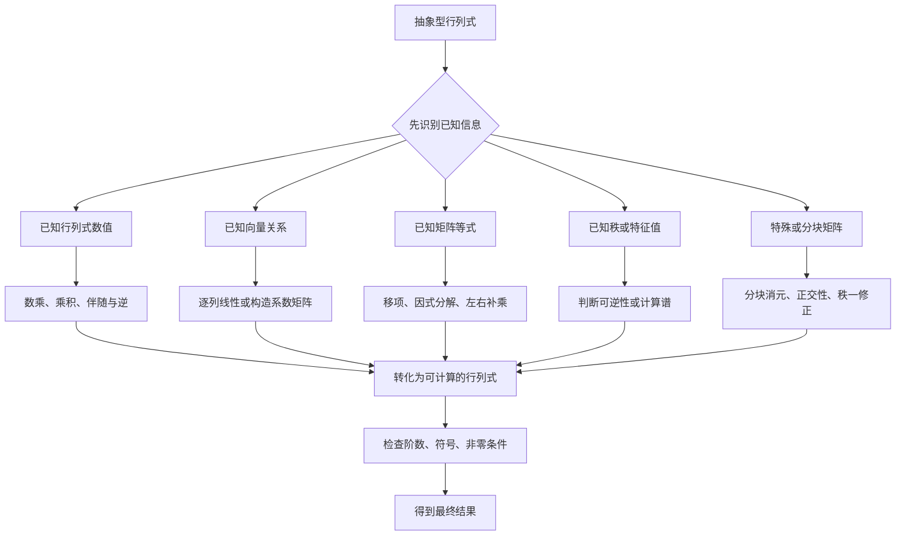

## 一、本节的整体知识体系

### 1. 什么是抽象型行列式？

上一节数值型行列式，通常直接告诉我们矩阵中的元素，要求计算：

$$
\begin{vmatrix} 1&2&3\\ 2&3&4\\ 3&4&6 \end{vmatrix}.
$$

而抽象型行列式通常不告诉我们具体的矩阵元素，只给出矩阵的某些性质、向量关系或者矩阵等式，例如：

$$
|A|=2,\qquad |B|=-3,
$$

要求计算：

$$
|A^{-1}B^*|.
$$

或者给出：

$$
AA^{\mathrm T}=E,\qquad |A|<0,
$$

要求计算：

$$
|A+E|.
$$

还有可能给出：

$$
r(2E-A)=1,\qquad r(E+A)=2,
$$

要求计算伴随矩阵的行列式。

它们看起来是完全不同的题目，实际上都在考查一个核心能力：

**如何将矩阵的结构信息转化为能够计算行列式的信息。**

数值型行列式主要研究怎样计算元素；抽象型行列式主要研究怎样利用结构避免计算元素。

### 2. 本节的八大核心题型

本节可归纳为八类母题。

| 题型         | 核心方法         | 掌握优先级 |
| ---------- | ------------ | ----- |
| 行列式基本运算    | 转置、数乘、乘积、逆矩阵 | ★★★★★ |
| 行列式线性性     | 逐行逐列拆分、提取公因子 | ★★★★★ |
| 向量线性组合     | 构造系数矩阵、矩阵乘积  | ★★★★★ |
| 行列式为零      | 秩、线性相关、非零解   | ★★★★★ |
| 伴随矩阵与代数余子式 | 伴随恒等式、秩、转置   | ★★★★★ |
| 矩阵方程与和差式   | 因式分解、补乘矩阵    | ★★★★★ |
| 分块矩阵行列式    | 分块三角化、换列、降阶  | ★★★★☆ |
| 特征值与特殊矩阵   | 谱映射、正交性、幂等性  | ★★★★★ |

尤其要注意，本节虽然位于线性代数第一章，却已经涉及后续几乎所有章节：

$$
\boxed{ \text{行列式} \longleftrightarrow \text{可逆性} \longleftrightarrow \text{秩} \longleftrightarrow \text{线性相关性} \longleftrightarrow \text{特征值} }
$$

因此，抽象型行列式也是线性代数综合题的重要基础。

## 二、基础知识与核心公式

以下统一用 $E$ 表示单位矩阵，用 $A^*$ 表示伴随矩阵，用 $r(A)$ 表示矩阵的秩。

### 1. 行列式的本质

从几何上理解，行列式可以看作线性变换对有向面积或有向体积的缩放倍数。

对于二阶矩阵：

$$
A=(\alpha_1,\alpha_2),
$$

其行列式的绝对值就是两个列向量张成的平行四边形的面积。

如果两个向量线性相关，平行四边形退化为一条线，面积为零，即：

$$
|A|=0.
$$

对于三阶矩阵，行列式绝对值对应平行六面体的体积；如果三个向量共面，体积也等于零。

这种理解可以自然解释行列式的诸多性质：交换向量改变方向，数乘向量改变体积，线性相关导致体积退化，连续进行两个线性变换则使缩放倍数相乘。

### 2. 必须熟练掌握的基本运算公式

设 $A,B$ 均为 $n$ 阶方阵。

| 运算   | 行列式公式                                        | 条件           |
| ---- | -------------------------------------------- | ------------ |
| 转置   | $\det(A^{\mathrm T})=\det A$             | 任意方阵         |
| 数乘   | $\det(kA)=k^n\det A$                     | 任意标量 $k$ |
| 乘积   | $\det(AB)=\det A\det B$                  | 同阶方阵         |
| 幂运算  | $\det(A^m)=(\det A)^m$                   | 正整数 $m$  |
| 逆矩阵  | $\det(A^{-1})=\dfrac1{\det A}$           | $A$ 可逆   |
| 伴随矩阵 | $\det(A^*)=(\det A)^{n-1}$              | $n\geq2$ |
| 相似变换 | $\det(P^{-1}AP)=\det A$                  | $P$ 可逆   |
| 合同变换 | $\det(P^{\mathrm T}AP)=(\det P)^2\det A$ | 同阶方阵         |

特别注意：**数乘矩阵与数乘行列式是两种不同的运算。**

$$
\boxed{|kA|=k^n|A|}
$$

但是：

$$
k|A|
$$

只是普通的数乘。

例如三阶矩阵满足 $|A|=2$，则：

$$
|3A|=3^3|A|=54,
$$

而不是 $6$。

<Callout type="warn" title="常见错误公式">

下列等式一般不成立：

$$
|A+B|\ne |A|+|B|,
$$

$$
|A-B|\ne |A|-|B|,
$$

$$
|A+E|\ne |A|+1,
$$

$$
|A^{-1}+B^{-1}| \ne \frac1{|A|}+\frac1{|B|}.
$$

考研中，很多看似复杂的抽象型行列式题目，就是围绕如何合法处理矩阵加减法设置的。

</Callout>

### 3. 行列式、秩、可逆性之间的等价关系

对于 $n$ 阶矩阵 $A$，以下命题完全等价：

$$
\boxed{ \begin{aligned} &|A|\ne0\\ \iff{}&A\text{ 可逆}\\ \iff{}&r(A)=n\\ \iff{}&A\text{ 的列向量组线性无关}\\ \iff{}&A\text{ 的行向量组线性无关}\\ \iff{}&Ax=0\text{ 只有零解}\\ \iff{}&0\text{ 不是 }A\text{ 的特征值}. \end{aligned}}
$$

取否定之后：

$$
\boxed{ \begin{aligned} &|A|=0\\ \iff{}&A\text{ 不可逆}\\ \iff{}&r(A)<n\\ \iff{}&A\text{ 的列向量组线性相关}\\ \iff{}&Ax=0\text{ 有非零解}\\ \iff{}&0\text{ 是 }A\text{ 的特征值}. \end{aligned}}
$$

这两组等价关系是整个线性代数的主干，重要程度远高于记住某一道行列式计算题的技巧。

### 4. 行列式的逐行、逐列线性性

这是抽象型行列式中最容易被误用的性质。

记：

$$
D(\alpha_1,\ldots,\alpha_n) =|\alpha_1,\ldots,\alpha_n|.
$$

固定其余 $n-1$ 列，仅改变第 $i$ 列，则：

$$
\begin{aligned} &D(\alpha_1,\ldots,k\beta+l\gamma,\ldots,\alpha_n)\\ ={}&kD(\alpha_1,\ldots,\beta,\ldots,\alpha_n)\\ &+lD(\alpha_1,\ldots,\gamma,\ldots,\alpha_n). \end{aligned}
$$

这叫作行列式的**多重线性性**。

同时，行列式还具有交替性：

- 交换任意两列，行列式变号。
- 有两列相同或者成比例，行列式为零。
- 某列加上其他列的若干倍，行列式不变。
- 某列可以由其他列线性表出，行列式为零。

这些性质对于行也完全成立。

从理论上说，多重线性性、交替性以及 $|E|=1$，是决定行列式的基本性质。

### 5. 伴随矩阵的基本知识

设：

$$
A=(a_{ij})_{n\times n}.
$$

删除第 $i$ 行、第 $j$ 列后，剩余元素构成的 $n-1$ 阶行列式称为余子式：

$$
M_{ij}.
$$

相应的代数余子式为：

$$
A_{ij}=(-1)^{i+j}M_{ij}.
$$

伴随矩阵是代数余子式矩阵的转置：

$$
\boxed{ A^*= \begin{pmatrix} A_{11}&A_{21}&\cdots&A_{n1}\\ A_{12}&A_{22}&\cdots&A_{n2}\\ \vdots&\vdots&\ddots&\vdots\\ A_{1n}&A_{2n}&\cdots&A_{nn} \end{pmatrix} }
$$

特别注意下标关系：

$$
(A^*)_{ij}=A_{ji}.
$$

伴随矩阵最重要的恒等式是：

$$
\boxed{AA^*=A^*A=|A|E}
$$

这个公式无论 $A$ 是否可逆都成立。

当 $|A|\ne0$ 时，才能进一步得到：

$$
\boxed{A^*=|A|A^{-1}}
$$

以及：

$$
\boxed{A^{-1}=\frac{A^*}{|A|}}.
$$

**伴随矩阵的公式体系**

对于 $n\geq2$，有：

$$
\begin{aligned} |A^*|&=|A|^{n-1},\\ (kA)^*&=k^{n-1}A^*,\\ (A^{\mathrm T})^*&=(A^*)^{\mathrm T},\\ (AB)^*&=B^*A^*. \end{aligned}
$$

对于 $n\geq3$，还有：

$$
(A^*)^*=|A|^{n-2}A.
$$

二阶矩阵则直接满足：

$$
(A^*)^*=A.
$$

如果 $A$ 可逆，则：

$$
(A^{-1})^*=(A^*)^{-1} =\frac{A}{|A|}.
$$

要特别区分：

$$
(kA)^*=k^{n-1}A^*
$$

与：

$$
|kA|=k^n|A|.
$$

前者是矩阵等式，后者是标量等式。

## 三、题型一：抽象行列式的基本运算

**核心能力：辨别矩阵阶数、运算层次、标量与矩阵之间的区别。**

### 母题1：伴随矩阵行列式公式的推导

**来源：1987年数学一。**

设 $A$ 为 $n$ 阶方阵，且：

$$
|A|=a\ne0.
$$

求 $|A^*|$。

**标准解法**

由伴随恒等式：

$$
AA^*=aE.
$$

两边取行列式：

$$
|A||A^*|=|aE|.
$$

由于：

$$
|aE|=a^n,
$$

所以：

$$
a|A^*|=a^n.
$$

又因为 $a\ne0$，可以约去 $a$，得到：

$$
\boxed{|A^*|=a^{n-1}}.
$$

**如果 $|A|=0$，这个公式还成立吗？**

对于 $n\geq2$，仍然成立。

当 $A$ 不可逆时，伴随矩阵的秩至多为1，因而 $A^*$ 也不可逆。

于是：

$$
|A^*|=0=|A|^{n-1}.
$$

这里必须区分：公式本身对奇异矩阵成立，不代表推导过程中可以随意除以零。

### 母题2：多层嵌套的行列式运算

**来源：李正元练习题第2题。**

设 $A$ 是 $n$ 阶矩阵，求：

$$
\left|\,|A^*|A\,\right|.
$$

<Steps>

<Step>

### 第一步：判断内外层运算 [!toc]

内层：

$$
|A^*|
$$

是一个标量。设：

$$
c=|A^*|=|A|^{n-1}.
$$

原式就是：

$$
|cA|.
$$

</Step>

<Step>

### 第二步：应用数乘性质 [!toc]

$$
|cA|=c^n|A|.
$$

所以：

$$
\begin{aligned} \left|\,|A^*|A\,\right| &=(|A|^{n-1})^n|A|\\ &=|A|^{n(n-1)+1}. \end{aligned}
$$

最终：

$$
\boxed{|A|^{n^2-n+1}}.
$$

</Step>

</Steps>

**同类变式**

李正元练习题第3题：

$$
|(2A)^*|=?
$$

解：

$$
\begin{aligned} |(2A)^*| &=|2^{n-1}A^*|\\ &=2^{n(n-1)}|A^*|. \end{aligned}
$$

所以：

$$
\boxed{|(2A)^*|=2^{n^2-n}|A^*|}.
$$

这类题不难，但极容易因为指数错误而失分。

### 母题3：伴随矩阵与逆矩阵的混合运算

**来源：1988年数学三。**

设 $A$ 是三阶矩阵，且：

$$
|A|=\frac12.
$$

求：

$$
|(3A)^{-1}-2A^*|.
$$

**题型识别**

当一个矩阵表达式中同时出现 $A^{-1}$ 与 $A^*$，首先考虑：

$$
A^*=|A|A^{-1}.
$$

目的不是分别求出逆矩阵与伴随矩阵，而是把它们统一成同一种矩阵。

**标准解法**

因为：

$$
A^*=\frac12A^{-1},
$$

且：

$$
(3A)^{-1}=\frac13A^{-1},
$$

所以：

$$
\begin{aligned} (3A)^{-1}-2A^* &=\frac13A^{-1}-A^{-1}\\ &=-\frac23A^{-1}. \end{aligned}
$$

故：

$$
\begin{aligned} |(3A)^{-1}-2A^*| &=\left(-\frac23\right)^3|A^{-1}|\\ &=-\frac8{27}\times2\\ &=\boxed{-\frac{16}{27}}. \end{aligned}
$$

**通用母公式**

若 $A$ 可逆，且 $d=|A|$，则：

$$
\boxed{ |kA^{-1}+lA^*| =\frac{(k+ld)^n}{d} }
$$

因为：

$$
kA^{-1}+lA^*=(k+ld)A^{-1}.
$$

题目无论怎样改变系数，都可以用这一思想处理。

**强化例题：两个不同矩阵的伴随运算**

**来源：李林880题，第十章第12题。**

设 $A,B$ 均为 $n$ 阶方阵，且：

$$
|A|=2,\qquad |B|=-2.
$$

求：

$$
|A^{-1}B^*-A^*B^{-1}|.
$$

由：

$$
A^*=2A^{-1},\qquad B^*=-2B^{-1},
$$

可得：

$$
\begin{aligned} A^{-1}B^*-A^*B^{-1} &=-2A^{-1}B^{-1}-2A^{-1}B^{-1}\\ &=-4A^{-1}B^{-1}. \end{aligned}
$$

因此：

$$
\begin{aligned} |A^{-1}B^*-A^*B^{-1}| &=(-4)^n\frac12\left(-\frac12\right)\\ &=\boxed{(-4)^{n-1}}. \end{aligned}
$$

进一步推广，设 $|A|=a\ne0,\ |B|=b\ne0$，则：

$$
\boxed{ |A^{-1}B^*-A^*B^{-1}| =\frac{(b-a)^n}{ab} }
$$

整个过程完全没有使用 $AB=BA$。

## 四、题型二：行列式线性性与特殊结构的加减法

这是本节的基础重点，也是理解后面秩一修正、余子式问题的入口。

### 母题4：两个矩阵仅有一列不同

**来源：1988年数学一。**

设：

$$
A=(\alpha,\gamma_2,\gamma_3,\gamma_4),
$$

$$
B=(\beta,\gamma_2,\gamma_3,\gamma_4),
$$

且：

$$
|A|=4,\qquad |B|=1.
$$

求 $|A+B|$。

<Steps>

<Step>

### 第一步：先进行矩阵相加 [!toc]

$$
A+B=(\alpha+\beta,2\gamma_2,2\gamma_3,2\gamma_4).
$$

</Step>

<Step>

### 第二步：提取相同列的公因子 [!toc]

$$
|A+B| =2^3|\alpha+\beta,\gamma_2,\gamma_3,\gamma_4|.
$$

</Step>

<Step>

### 第三步：仅对第一列使用线性性 [!toc]

$$
\begin{aligned} |A+B| ={}&8|\alpha,\gamma_2,\gamma_3,\gamma_4|\\ &+8|\beta,\gamma_2,\gamma_3,\gamma_4|\\ ={}&8(|A|+|B|)\\ ={}&8(4+1). \end{aligned}
$$

故：

$$
\boxed{|A+B|=40}.
$$

</Step>

</Steps>

**为什么这道题能拆开？**

因为后三列提取公因子之后，只有第一列含有加法。

若两列都含有加法，例如：

$$
|\alpha_1+\beta_1,\alpha_2+\beta_2|,
$$

则正确展开应当是：

$$
\begin{aligned} &|\alpha_1,\alpha_2| +|\alpha_1,\beta_2|\\ &+|\beta_1,\alpha_2| +|\beta_1,\beta_2|. \end{aligned}
$$

除了两个原行列式，还出现了两个混合项。

这就是为什么一般情况下不能写：

$$
|A+B|=|A|+|B|.
$$

**最重要的推广**

如果两个 $n$ 阶矩阵只有一列不同，其余列完全相同，那么：

$$
\boxed{ |sA+tB|=(s+t)^{n-1}(s|A|+t|B|) }
$$

取 $s=t=1$，得到：

$$
\boxed{|A+B|=2^{n-1}(|A|+|B|)}.
$$

这一结论也适用于两个矩阵只有一行不同的情形。

### 母题5：相同列成比例的强化变式

**来源：李林880题，第十章第2题。**

设：

$$
A=(\beta_1,\alpha_1,\alpha_2,\alpha_3),
$$

$$
B=(\beta_2,\alpha_1,3\alpha_2,\alpha_3),
$$

且：

$$
|A|=1,\qquad |B|=3.
$$

求 $|A+B|$。

**解题关键**

虽然后三列并不完全相同，但分别成比例。可以先将它们化成相同的列结构。

$$
A+B=(\beta_1+\beta_2,2\alpha_1,4\alpha_2,2\alpha_3).
$$

因此：

$$
|A+B|=16|\beta_1+\beta_2,\alpha_1,\alpha_2,\alpha_3|.
$$

又：

$$
|\beta_2,\alpha_1,\alpha_2,\alpha_3| =\frac13|B|=1.
$$

所以：

$$
|A+B|=16(1+1)=\boxed{32}.
$$

**李正元练习题第9题**

设：

$$
A=(\alpha,\gamma_1,\gamma_2,\gamma_3),
$$

$$
B=(\beta,2\gamma_1,3\gamma_2,\gamma_3),
$$

且 $|A|=4,\ |B|=21$。

则：

$$
\begin{aligned} |A+B| &=3\times4\times2 |\alpha+\beta,\gamma_1,\gamma_2,\gamma_3|\\ &=24\left(4+\frac{21}{6}\right)\\ &=\boxed{180}. \end{aligned}
$$

这两道练习题本质上都是1988年数学一真题的推广。

**进阶母题：整个行列式加上相同常数**

**来源：李正元练习题第11—13题；张宇1000题第4题。**

设 $A$ 为 $n$ 阶矩阵，如果把 $A$ 中每一个元素都加1，行列式增加多少？

很多人第一反应是所有列都改变了，展开将非常复杂。

实际上，新增的每一列都是同一个向量：

$$
e=(1,1,\ldots,1)^{\mathrm T}.
$$

于是新矩阵可以表示为：

$$
B=A+ee^{\mathrm T}.
$$

设 $A=(\alpha_1,\ldots,\alpha_n)$，则：

$$
|B|=|\alpha_1+e,\ldots,\alpha_n+e|.
$$

利用多重线性性展开，所有含有两个或更多 $e$ 的行列式，都因为有重复列而等于零。

只剩下原行列式和恰好替换一列的项：

$$
\begin{aligned} |B|-|A| &=\sum_{j=1}^n |\alpha_1,\ldots,e,\ldots,\alpha_n|\\ &=\sum_{j=1}^n\sum_{i=1}^n A_{ij}. \end{aligned}
$$

故：

$$
\boxed{ |B|-|A|=\sum_{i=1}^n\sum_{j=1}^n A_{ij} }
$$

同样，如果将每个元素都加上 $x$，则：

$$
\boxed{ |A+xee^{\mathrm T}| =|A|+x\sum_{i,j}A_{ij} }
$$

因此它是关于 $x$ 的至多一次多项式。

**张宇1000题第4题的考查方式**

设非恒零函数：

$$
f(x)= \begin{vmatrix} a_1+x&b_1+x&c_1+x\\ a_2+x&b_2+x&c_2+x\\ a_3+x&b_3+x&c_3+x \end{vmatrix}.
$$

问 $f(x)$ 最多有几个零点？

由上面的结论：

$$
f(x)=kx+b.
$$

由于 $f(x)$ 不恒为零，所以至多有一个零点。

$$
\boxed{\text{至多有一个零点}}
$$

注意：三阶行列式中的元素虽然都含 $x$，但它未必是关于 $x$ 的三次多项式。真正决定最高可能次数的是含 $x$ 部分的线性独立程度。

## 五、题型三：向量线性组合与系数矩阵法

这种题型是连接行列式、矩阵、向量和相似理论的关键。

### 1. 核心原理

设：

$$
A=(\alpha_1,\alpha_2,\ldots,\alpha_n).
$$

若新矩阵 $B$ 的每一列都可以由 $A$ 的列向量线性表出：

$$
\beta_j=\sum_{i=1}^n c_{ij}\alpha_i,
$$

则：

$$
\boxed{B=AC}
$$

其中：

$$
C=(c_{ij})_{n\times n}.
$$

于是：

$$
\boxed{|B|=|A||C|}.
$$

这一公式的价值在于，我们不需要知道任何一个原向量的具体坐标，只需要知道新向量的线性组合系数。

### 母题6：系数矩阵与范德蒙德行列式

**来源：2005年数学一、二。**

设：

$$
A=(\alpha_1,\alpha_2,\alpha_3),
$$

且：

$$
B= \left( \alpha_1+\alpha_2+\alpha_3,\, \alpha_1+2\alpha_2+4\alpha_3,\, \alpha_1+3\alpha_2+9\alpha_3 \right).
$$

已知 $|A|=1$，求 $|B|$。

<Steps>

<Step>

### 第一步：提取系数矩阵 [!toc]

$$
B=AC,
$$

其中：

$$
C= \begin{pmatrix} 1&1&1\\ 1&2&3\\ 1&4&9 \end{pmatrix}.
$$

注意：新矩阵的第一个列向量的系数，放在系数矩阵的第一列，而不是第一行。

</Step>

<Step>

### 第二步：取行列式 [!toc]

$$
|B|=|A||C|=|C|.
$$

</Step>

<Step>

### 第三步：计算低阶行列式 [!toc]

$$
\begin{aligned} |C| &= \begin{vmatrix} 1&1&1\\ 1&2&3\\ 1&4&9 \end{vmatrix}\\ &= \begin{vmatrix} 1&0&0\\ 1&1&2\\ 1&3&8 \end{vmatrix}\\ &=8-6\\ &=\boxed{2}. \end{aligned}
$$

</Step>

</Steps>

**更快的识别方法：范德蒙德结构**

这里的系数矩阵恰好是范德蒙德矩阵，因此：

$$
|C|=(2-1)(3-1)(3-2)=2.
$$

这是上一节数值型行列式与本节抽象型行列式的典型结合。

### 2. 向量系数法的第二种形式：换基与相似变换

如果题目不是直接给出新矩阵，而是告诉你矩阵 $A$ 对某些向量的作用：

$$
A\alpha_j=\sum_{i=1}^n c_{ij}\alpha_i,
$$

并且这些向量线性无关，那么设：

$$
P=(\alpha_1,\ldots,\alpha_n),
$$

就有：

$$
AP=PC.
$$

由于 $P$ 可逆：

$$
\boxed{A=PCP^{-1}}.
$$

这说明 $A$ 与系数矩阵 $C$ 相似。

因此不仅有：

$$
|A|=|C|,
$$

而且还有：

$$
|A-kE|=|C-kE|,
$$

$$
|f(A)|=|f(C)|.
$$

**强化例题：给出矩阵对基向量的作用**

**来源：张宇1000题，第11题。**

设 $\alpha_1,\alpha_2,\alpha_3$ 为三个线性无关的三维列向量，且：

$$
\begin{aligned} A\alpha_1&=\alpha_1+2\alpha_2+\alpha_3,\\ A\alpha_2&=2\alpha_1+\alpha_2+\alpha_3,\\ A\alpha_3&=\alpha_1+\alpha_2+2\alpha_3. \end{aligned}
$$

求 $|A|$。

令：

$$
P=(\alpha_1,\alpha_2,\alpha_3).
$$

由题意：

$$
AP=P \begin{pmatrix} 1&2&1\\ 2&1&1\\ 1&1&2 \end{pmatrix}.
$$

因此：

$$
|A|= \begin{vmatrix} 1&2&1\\ 2&1&1\\ 1&1&2 \end{vmatrix} =\boxed{-4}.
$$

**两类问题的区别**

| 题目条件        | 构造形式              | 核心结论                         |
| ----------- | ----------------- | ---------------------------- |
| 新列是原列的线性组合  | $B=AC$        | $\|B\|=\|A\|\|C\|$       |
| 矩阵作用于一组基向量  | $AP=PC$       | $\|A\|=\|C\|$            |
| 每个基向量都是特征向量 | $AP=P\Lambda$ | $\|A\|=\prod_i\lambda_i$ |

第二、第三种形式必须保证 $P$ 可逆。仅仅给出几个任意向量的作用结果，并不能自动得出相似关系。

## 六、题型四：利用秩、线性相关性判断行列式为零

本类题的核心不是计算行列式，而是证明矩阵不可逆。

### 母题7：线性相关性的量词陷阱

**来源：1989年数学一、三。**

设 $A$ 是 $n$ 阶矩阵，且 $|A|=0$。

下列哪个结论一定成立？

A. 必有一列元素全为零。

B. 必有两列元素对应成比例。

C. 必有一列向量是其余列向量的线性组合。

D. 任意一列向量都是其余列向量的线性组合。

**正确解法**

由：

$$
|A|=0
$$

可知列向量组线性相关。

因此存在不全为零的数 $k_1,\ldots,k_n$，使：

$$
k_1\alpha_1+\cdots+k_n\alpha_n=0.
$$

取某一个非零系数 $k_i$，移项：

$$
\alpha_i=-\sum_{j\ne i}\frac{k_j}{k_i}\alpha_j.
$$

这说明至少存在一列可以由其余列线性表出。

故选：

$$
\boxed{\mathrm C}.
$$

**如何构造反例？**

例如：

$$
\alpha_1= \begin{pmatrix}1\\0\\0\end{pmatrix}, \quad \alpha_2= \begin{pmatrix}0\\1\\0\end{pmatrix}, \quad \alpha_3= \begin{pmatrix}1\\1\\0\end{pmatrix}.
$$

显然：

$$
\alpha_3=\alpha_1+\alpha_2.
$$

三个向量线性相关，但没有零向量，也没有两个向量成比例。

这足以否定A、B。

再令：

$$
A= \begin{pmatrix} 1&0\\ 0&0 \end{pmatrix}.
$$

第二列可以由第一列线性表出，但第一列不能由第二列线性表出，因此D错误。

**考研判断题一定要区分“存在”“任意”“至少”“恰好”等量词。**

### 母题8：非方阵乘积的行列式

**来源：1999年数学一。**

设：

$$
A\in\mathbb R^{m\times n}, \qquad B\in\mathbb R^{n\times m}.
$$

问什么条件下必有：

$$
|AB|=0?
$$

<Steps>

<Step>

### 第一步：判断矩阵维数 [!toc]

$$
AB\in\mathbb R^{m\times m}.
$$

$$
BA\in\mathbb R^{n\times n}.
$$

虽然两个乘积都是方阵，但 $A,B$ 本身不一定是方阵。

所以不能直接使用：

$$
|AB|=|A||B|.
$$

</Step>

<Step>

### 第二步：使用乘积秩不等式 [!toc]

$$
r(AB)\leq\min\{r(A),r(B)\}.
$$

因此：

$$
r(AB)\leq\min\{m,n\}.
$$

若 $m>n$，则：

$$
r(AB)\leq n<m.
$$

故 $AB$ 不满秩：

$$
\boxed{|AB|=0}.
$$

</Step>

</Steps>

**直观理解**

线性变换：

$$
\mathbb R^m\xrightarrow{B}\mathbb R^n \xrightarrow{A}\mathbb R^m.
$$

当 $m>n$ 时，中间空间维数过低。原本的 $m$ 维空间经过降维后，即使再映射回 $m$ 维空间，也无法恢复丢失的全部独立方向。

这就是所谓的**中间维数瓶颈**。

**可迁移结论**

只要一个 $m$ 阶矩阵能写成：

$$
C=UV,
$$

其中：

$$
U\in\mathbb R^{m\times r}, \quad V\in\mathbb R^{r\times m}, \quad r<m,
$$

就必有：

$$
\boxed{|C|=0}.
$$

### 3. 利用矩阵方程证明不可逆

一般地，如果：

$$
AB=O,\qquad B\ne O,
$$

其中 $A$ 是方阵，则：

$$
\boxed{|A|=0}.
$$

证明很简单。如果 $A$ 可逆，两边左乘 $A^{-1}$：

$$
B=O,
$$

与已知矛盾。

**李林880题第10题**

设：

$$
A^2=A,\qquad A\ne E.
$$

求 $|A|$。

由：

$$
A^2-A=O,
$$

得到：

$$
A(A-E)=O.
$$

因为 $A-E\ne O$，所以 $A$ 不可逆。

$$
\boxed{|A|=0}.
$$

同类结论：

$$
A^2=O\Longrightarrow |A|=0,
$$

$$
A^2=E\Longrightarrow |A|=\pm1.
$$

但是：

$$
A^2=E
$$

不能推出 $A=E$ 或 $A=-E$，例如：

$$
A=\operatorname{diag}(1,-1).
$$

## 七、题型五：伴随矩阵、代数余子式与矩阵秩

这是本节最值得深入研究的部分之一。题目经常综合考查伴随矩阵定义、矩阵转置、行列式、秩及可逆性。

### 1. 伴随矩阵的秩定理

设 $A$ 为 $n$ 阶矩阵，$n\geq2$，则：

$$
\boxed{ r(A^*)= \begin{cases} n,&r(A)=n,\\ 1,&r(A)=n-1,\\ 0,&r(A)\leq n-2. \end{cases} }
$$

必须理解这个定理，而不是只背诵结论。

**情形一：$r(A)=n$**

因为 $A$ 可逆：

$$
A^*=|A|A^{-1}.
$$

由于 $|A|\ne0$，且 $A^{-1}$ 满秩，所以：

$$
r(A^*)=n.
$$

**情形二：$r(A)\leq n-2$**

伴随矩阵的每一个元素，都是某个 $n-1$ 阶子式乘以符号因子。

由于 $A$ 的秩小于 $n-1$，所有 $n-1$ 阶子式均为零。

因此：

$$
A^*=O,\qquad r(A^*)=0.
$$

**情形三：$r(A)=n-1$**

此时至少有一个 $n-1$ 阶子式非零，因此：

$$
A^*\ne O.
$$

另一方面，$A$ 不可逆，所以：

$$
AA^*=O.
$$

这意味着 $A^*$ 的每一列都是齐次线性方程组 $Ax=0$ 的解。

而：

$$
\dim\ker A=n-r(A)=1.
$$

所以 $A^*$ 的所有列都位于同一个一维空间中：

$$
r(A^*)\leq1.
$$

结合 $A^*\ne O$，得到：

$$
r(A^*)=1.
$$

**逆向推论**

对于 $n\geq2$：

| 已知条件                                       | 可以推出                 |
| ------------------------------------------ | -------------------- |
| $A^*=O$                               | $r(A)\leq n-2$   |
| $r(A^*)=1$                            | $r(A)=n-1$       |
| $A^*$ 可逆                              | $A$ 可逆           |
| $A$ 非零且不可逆                             | 不一定有 $A^*\ne O$ |
| $r(A^*)=r(A)$，且 $A\ne O,\ n\geq3$ | $A$ 可逆           |

最后一条在2013年真题中有重要应用。

### 母题9：伴随矩阵等于转置矩阵

**来源：1994年数学一。**

设 $A$ 为 $n$ 阶非零实矩阵，满足：

$$
A^*=A^{\mathrm T}.
$$

证明：

$$
|A|\ne0.
$$

**审题关键**

题目只给出了 $A\ne O$，并没有告诉你 $A$ 可逆。

因此不能一开始就写：

$$
A^*=|A|A^{-1}.
$$

因为这条公式已经以 $A$ 可逆为前提。

正确的切入点是无条件成立的伴随恒等式：

$$
AA^*=|A|E.
$$

<Tabs items={["解法一：平方和法", "解法二：代数余子式展开法"]} defaultIndex={0}>

<Tab value="解法一：平方和法">

由题意：

$$
AA^{\mathrm T}=|A|E.
$$

假设：

$$
|A|=0,
$$

则：

$$
AA^{\mathrm T}=O.
$$

取第 $i$ 个对角元：

$$
(AA^{\mathrm T})_{ii} =\sum_{j=1}^n a_{ij}^2=0.
$$

由于 $A$ 是实矩阵，各项均非负，所以：

$$
a_{i1}=a_{i2}=\cdots=a_{in}=0.
$$

对任意 $i$ 都成立，得到：

$$
A=O.
$$

与 $A\ne O$ 矛盾。

故：

$$
\boxed{|A|\ne0}.
$$

</Tab>

<Tab value="解法二：代数余子式展开法">

由：

$$
A^*=A^{\mathrm T}
$$

可知：

$$
A_{ij}=a_{ij}.
$$

因为 $A\ne O$，一定存在一条非零行。

沿该行展开：

$$
\begin{aligned} |A| &=\sum_{j=1}^n a_{ij}A_{ij}\\ &=\sum_{j=1}^n a_{ij}^2\\ &>0. \end{aligned}
$$

因此不仅证明了 $A$ 可逆，还得到：

$$
\boxed{|A|>0}.
$$

这比题目要求的结论更强。

</Tab>

</Tabs>

**深入理解：实数域为什么重要？**

对于实矩阵：

$$
AA^{\mathrm T}=O\Longrightarrow A=O.
$$

但复矩阵不一定如此，因为复数的平方和可以相互抵消。

这也是数学一中实矩阵条件经常被强调的原因。

### 母题10：逐元素条件转化成矩阵等式

**来源：2013年数学一、二、三。**

设 $A=(a_{ij})$ 为三阶非零矩阵，$A_{ij}$ 为对应的代数余子式，且：

$$
A_{ij}+a_{ij}=0.
$$

求 $|A|$。

<Steps>

<Step>

### 第一步：翻译题目条件 [!toc]

$$
A_{ij}=-a_{ij}.
$$

由于伴随矩阵是代数余子式矩阵的转置：

$$
\boxed{A^*=-A^{\mathrm T}}.
$$

这是整道题最重要的转换。

</Step>

<Step>

### 第二步：取行列式 [!toc]

令：

$$
d=|A|.
$$

因为 $A$ 为三阶矩阵：

$$
|A^*|=d^2.
$$

又：

$$
|-A^{\mathrm T}|=(-1)^3d=-d.
$$

因此：

$$
d^2=-d.
$$

即：

$$
d(d+1)=0.
$$

得到两个候选结果：

$$
d=0\quad\text{或}\quad d=-1.
$$

**此时题目还没有解完。**

</Step>

<Step>

### 第三步：利用秩排除零值 [!toc]

假设 $d=0$。

由于 $A$ 为三阶非零矩阵，只有两种情况：

$$
r(A)=1\quad\text{或}\quad r(A)=2.
$$

若：

$$
r(A)=1,
$$

则：

$$
r(A^*)=0.
$$

若：

$$
r(A)=2,
$$

则：

$$
r(A^*)=1.
$$

这两种情况下都有：

$$
r(A^*)\ne r(A).
$$

但根据：

$$
A^*=-A^{\mathrm T},
$$

又必须有：

$$
r(A^*)=r(A^{\mathrm T})=r(A).
$$

矛盾。

因此：

$$
d\ne0.
$$

最终：

$$
\boxed{|A|=-1}.
$$

</Step>

</Steps>

**实矩阵情况下的考场快解**

如果明确 $A$ 是实矩阵，任选一个非零行，直接按行展开：

$$
|A|=\sum_j a_{ij}A_{ij} =-\sum_j a_{ij}^2<0.
$$

再结合：

$$
d(d+1)=0,
$$

立即得到：

$$
d=-1.
$$

这道题真正考查的是：**如何根据附加条件排除行列式方程中的伪解。**

### 母题11：伴随矩阵与转置的比例关系

**来源：李林880题，第32题。**

设 $A$ 为三阶非零实矩阵，且：

$$
A^{\mathrm T}=kA^*,\qquad k\ne0.
$$

要求：

1. 证明 $A$ 可逆。
2. 求 $|A^{-1}|+|(A^*)^{-1}|$。

<Steps>

<Step>

### 第一步：证明可逆 [!toc]

由：

$$
A^{\mathrm T}=kA^*
$$

得：

$$
a_{ij}=kA_{ij}.
$$

选取任意非零行，则：

$$
\begin{aligned} |A| &=\sum_j a_{ij}A_{ij}\\ &=\frac1k\sum_j a_{ij}^2\\ &\ne0. \end{aligned}
$$

故 $A$ 可逆。

</Step>

<Step>

### 第二步：建立关于行列式的方程 [!toc]

设 $d=|A|$，取行列式：

$$
d=k^3d^2.
$$

由于 $d\ne0$，所以：

$$
d=\frac1{k^3}.
$$

于是：

$$
|A^{-1}|=k^3.
$$

并且：

$$
|A^*|=d^2=\frac1{k^6},
$$

因此：

$$
|(A^*)^{-1}|=k^6.
$$

最终：

$$
\boxed{k^3+k^6}.
$$

</Step>

<Step>

### 第三步：进一步发现矩阵的内部结构 [!toc]

由：

$$
A^{\mathrm T}=kA^*,
$$

两边左乘 $A$：

$$
AA^{\mathrm T}=k|A|E.
$$

代入 $d=k^{-3}$：

$$
AA^{\mathrm T}=\frac1{k^2}E.
$$

因此：

$$
(kA)(kA)^{\mathrm T}=E.
$$

这说明 $kA$ 是正交矩阵，而且：

$$
|kA|=k^3|A|=1.
$$

所以原题实际上给出了一类经过整体缩放的正交矩阵。

</Step>

</Steps>

**变式：李林880题第3题**

如果进一步给出：

$$
a_{11}=a_{12}=a_{13}=c>0,\qquad k>0,
$$

则比较 $AA^{\mathrm T}$ 的第一个对角元素：

$$
3c^2=\frac1{k^2}.
$$

故：

$$
\boxed{c=\frac1{\sqrt3k}}.
$$

2005年数学三真题是 $k=1$ 的特殊情况。

### 2. 代数余子式求和类问题

**基础恒等式**

沿第 $i$ 行展开：

$$
\sum_{j=1}^n a_{ij}A_{ij}=|A|.
$$

如果用另一行的元素与第 $i$ 行代数余子式相乘求和：

$$
\sum_{j=1}^n a_{kj}A_{ij}=0,\qquad k\ne i.
$$

可以统一写成：

$$
\boxed{ \sum_{j=1}^n a_{kj}A_{ij} = \begin{cases} |A|,&k=i,\\ 0,&k\ne i. \end{cases} }
$$

列也有完全类似的结论。

### 母题12：行列式给出列和，求代数余子式的行和

**来源：李林880题，第14题。**

设：

$$
|A|=1,
$$

且 $A$ 的每列元素之和均为 $k\ne0$。

求：

$$
A_{11}+A_{12}+\cdots+A_{1n}.
$$

将第2行至第 $n$ 行全部加到第一行，行列式不变。

第一行变为：

$$
(k,k,\ldots,k).
$$

由于第一行的代数余子式不依赖第一行的元素，沿第一行展开：

$$
|A|=kA_{11}+kA_{12}+\cdots+kA_{1n}.
$$

所以：

$$
\boxed{ A_{11}+\cdots+A_{1n}=\frac1k }
$$

**通用推论**

如果每列元素之和均为 $k\ne0$，则对任意第 $i$ 行都有：

$$
\boxed{\sum_{j=1}^n A_{ij}=\frac{|A|}{k}}.
$$

如果每行元素之和均为 $k\ne0$，则对任意第 $j$ 列都有：

$$
\boxed{\sum_{i=1}^n A_{ij}=\frac{|A|}{k}}.
$$

注意：原矩阵的**列和**对应代数余子式的**行和**，原矩阵的**行和**对应代数余子式的**列和**。

### 3. 主对角线代数余子式之和

如果题目要求：

$$
A_{11}+A_{22}+\cdots+A_{nn},
$$

优先考虑：

$$
\boxed{ A_{11}+A_{22}+\cdots+A_{nn} =\operatorname{tr}(A^*) }
$$

其中 $\operatorname{tr}$ 表示矩阵的迹，也就是主对角线元素之和。

当 $A$ 可逆时：

$$
\operatorname{tr}(A^*) =|A|\operatorname{tr}(A^{-1}).
$$

### 母题13：特征值与代数余子式

**来源：李林880题，第18题。**

设 $A$ 为三阶可逆矩阵，$A^{-1}$ 的特征值为：

$$
3,\quad2,\quad1.
$$

求：

$$
A_{11}+A_{22}+A_{33}.
$$

由题意：

$$
|A^{-1}|=3\times2\times1=6,
$$

故：

$$
|A|=\frac16.
$$

且：

$$
\operatorname{tr}(A^{-1})=3+2+1=6.
$$

因此：

$$
\begin{aligned} A_{11}+A_{22}+A_{33} &=\operatorname{tr}(A^*)\\ &=|A|\operatorname{tr}(A^{-1})\\ &=\frac16\times6\\ &=\boxed{1}. \end{aligned}
$$

**高质量模拟题：李林六套卷第六套第5题**

设 $\alpha_1,\alpha_2,\alpha_3$ 线性无关，且：

$$
\begin{aligned} A\alpha_1&=\alpha_1,\\ A\alpha_2&=\alpha_2-\alpha_3,\\ A\alpha_3&=\alpha_3-\alpha_1. \end{aligned}
$$

求：

$$
A_{11}+A_{22}+A_{33}.
$$

由系数矩阵法：

$$
A\sim C= \begin{pmatrix} 1&0&-1\\ 0&1&0\\ 0&-1&1 \end{pmatrix}.
$$

因为 $A,C$ 相似，$A^*,C^*$ 也相似。

因此：

$$
\operatorname{tr}(A^*)=\operatorname{tr}(C^*).
$$

而 $C$ 的三个主对角二阶子式都等于1，所以：

$$
\boxed{A_{11}+A_{22}+A_{33}=3}.
$$

这个模拟题很好地结合了前面的系数矩阵法与本节伴随矩阵的知识。

**更一般的结论**

若 $A$ 的特征值为：

$$
\lambda_1,\ldots,\lambda_n,
$$

则：

$$
\boxed{ \operatorname{tr}(A^*) =\sum_{i=1}^n\prod_{j\ne i}\lambda_j }
$$

此公式即使 $A$ 不可逆也成立。

三阶情况下尤其常用：

$$
\boxed{ A_{11}+A_{22}+A_{33} =\lambda_1\lambda_2+\lambda_1\lambda_3+\lambda_2\lambda_3 }
$$

## 八、题型六：矩阵方程与逆矩阵和差式

这一部分最重要的思想是：

**先将矩阵等式整理成乘积形式，再整体取行列式。**

矩阵乘法通常不可交换，但矩阵行列式的乘积是普通实数的乘积，可以交换。

必须分清这两个层次。

### 母题14：矩阵方程直接取行列式

**来源：2004年数学一、二。**

设：

$$
A= \begin{pmatrix} 2&1&0\\ 1&2&0\\ 0&0&1 \end{pmatrix},
$$

矩阵 $B$ 满足：

$$
ABA^*=2BA^*+E.
$$

求 $|B|$。

**错误方向**

先求 $A^*$，再求矩阵 $B$ 的全部元素，最后计算 $|B|$。

虽然理论上可能做到，但计算量大，而且完全没有必要。

<Steps>

<Step>

### 第一步：移项并提取共同因子 [!toc]

$$
ABA^*-2BA^*=E.
$$

整理：

$$
\boxed{(A-2E)BA^*=E}.
$$

</Step>

<Step>

### 第二步：两边取行列式 [!toc]

$$
|A-2E||B||A^*|=1.
$$

</Step>

<Step>

### 第三步：分别计算已知行列式 [!toc]

$$
|A|=3,
$$

因此：

$$
|A^*|=3^2=9.
$$

又：

$$
A-2E= \begin{pmatrix} 0&1&0\\ 1&0&0\\ 0&0&-1 \end{pmatrix}.
$$

所以：

$$
|A-2E|=1.
$$

代回：

$$
1\times|B|\times9=1.
$$

故：

$$
\boxed{|B|=\frac19}.
$$

</Step>

</Steps>

**母题推广**

只要题目可以整理为：

$$
XBY=Z,
$$

并且 $X,Y$ 可逆，就有：

$$
\boxed{|B|=\frac{|Z|}{|X||Y|}}.
$$

这是非常简单却非常有用的统一模板。

### 母题15：矩阵多项式的因式分解

**来源：2003年数学二，李林880题第22题。**

设：

$$
A= \begin{pmatrix} 1&0&1\\ 0&2&0\\ -2&0&1 \end{pmatrix},
$$

且：

$$
A^2B-A-B=E.
$$

求 $|B|$。

<Steps>

<Step>

### 第一步：把含 $B$ 的项放在一起 [!toc]

$$
(A^2-E)B=A+E.
$$

</Step>

<Step>

### 第二步：利用平方差公式 [!toc]

$$
A^2-E=(A+E)(A-E).
$$

所以：

$$
(A+E)(A-E)B=A+E.
$$

</Step>

<Step>

### 第三步：验证能否约去矩阵 [!toc]

$$
|A+E| = \begin{vmatrix} 2&0&1\\ 0&3&0\\ -2&0&2 \end{vmatrix} =18\ne0.
$$

因此 $A+E$ 可逆，可以在左侧乘其逆矩阵，得到：

$$
(A-E)B=E.
$$

</Step>

<Step>

### 第四步：取行列式 [!toc]

$$
|A-E||B|=1.
$$

而：

$$
|A-E|= \begin{vmatrix} 0&0&1\\ 0&1&0\\ -2&0&0 \end{vmatrix} =2.
$$

故：

$$
\boxed{|B|=\frac12}.
$$

</Step>

</Steps>

<Callout type="warn" title="容易出现的陷阱">

不能看到：

$$
XY=XZ
$$

就直接得到：

$$
Y=Z.
$$

只有 $X$ 可逆时，才能这样消去。

此外，同一个矩阵 $A$ 的多项式可以交换，例如：

$$
(A-E)(A+E)=(A+E)(A-E).
$$

但一般的两个不同矩阵 $A,B$ 未必可以交换。

</Callout>

### 母题16：两个逆矩阵的和

**来源：李林880题第25题。**

设：

$$
A=(\alpha,\alpha_1,\alpha_2,\alpha_3),
$$

$$
B=(\beta,\alpha_1,\alpha_2,\alpha_3),
$$

且：

$$
|A|=2,\qquad |B|=1.
$$

求：

$$
|A^{-1}+B^{-1}|.
$$

这道题将前面1988年数学一真题的逐列线性性，与逆矩阵运算结合起来。

<Steps>

<Step>

### 第一步：构造矩阵乘积 [!toc]

因为 $A,B$ 均可逆：

$$
\begin{aligned} A^{-1}+B^{-1} &=A^{-1}(A+B)B^{-1}. \end{aligned}
$$

验证右边：

$$
A^{-1}AB^{-1}+A^{-1}BB^{-1} =B^{-1}+A^{-1}.
$$

所以：

$$
\boxed{ |A^{-1}+B^{-1}|=\frac{|A+B|}{|A||B|} }
$$

</Step>

<Step>

### 第二步：利用逐列线性性 [!toc]

由于两个四阶矩阵只有第一列不同：

$$
|A+B|=2^3(|A|+|B|).
$$

即：

$$
|A+B|=8(2+1)=24.
$$

最终：

$$
\boxed{ |A^{-1}+B^{-1}|=\frac{24}{2\times1}=12 }
$$

</Step>

</Steps>

**一定要掌握的和差式恒等式**

对于可逆矩阵 $A,B$：

$$
\boxed{ A^{-1}+B^{-1}=A^{-1}(A+B)B^{-1} }
$$

$$
\boxed{ A^{-1}-B^{-1}=A^{-1}(B-A)B^{-1} }
$$

因此：

$$
|A^{-1}-B^{-1}|=\frac{|B-A|}{|A||B|}.
$$

注意第二个公式中是 $B-A$，而不是 $A-B$。

### 母题17：一个逆矩阵与另一个矩阵相加

**来源：2010年数学二、三。**

设三阶矩阵 $A,B$ 满足：

$$
|A|=3,\quad |B|=2,\quad |A^{-1}+B|=2.
$$

求：

$$
|A+B^{-1}|.
$$

**核心观察**

已知式与目标式可以通过左右补乘联系起来：

$$
\begin{aligned} A(A^{-1}+B)B^{-1} &=(E+AB)B^{-1}\\ &=B^{-1}+A. \end{aligned}
$$

所以：

$$
\boxed{ A+B^{-1}=A(A^{-1}+B)B^{-1} }
$$

取行列式：

$$
\begin{aligned} |A+B^{-1}| &=|A||A^{-1}+B||B^{-1}|\\ &=3\times2\times\frac12\\ &=\boxed{3}. \end{aligned}
$$

也就是：

$$
\boxed{ |A+B^{-1}|=\frac{|A|}{|B|}|A^{-1}+B| }
$$

**高质量模拟题：系数矩阵与逆矩阵和的综合**

**来源：李林六套卷第六套第15题。**

设：

$$
A=(\alpha,\beta,\gamma),
$$

$$
B=(\alpha+2\beta,2\beta+\gamma,\beta+3\gamma),
$$

且：

$$
|A|=1.
$$

求：

$$
|A^{-1}+B^{-1}|.
$$

这道题属于典型的两层结构题。

**第一层：系数矩阵法**

$$
B=AM,
$$

其中：

$$
M= \begin{pmatrix} 1&0&0\\ 2&2&1\\ 0&1&3 \end{pmatrix}.
$$

显然：

$$
|M|=5.
$$

因此：

$$
|B|=|A||M|=5.
$$

**第二层：逆矩阵的和式转化**

由：

$$
A+B=A(E+M),
$$

可得：

$$
|A+B|=|A||E+M|.
$$

而：

$$
|E+M|= \begin{vmatrix} 2&0&0\\ 2&3&1\\ 0&1&4 \end{vmatrix} =22.
$$

所以：

$$
\begin{aligned} |A^{-1}+B^{-1}| &=\frac{|A+B|}{|A||B|}\\ &=\frac{22}{1\times5}\\ &=\boxed{\frac{22}{5}}. \end{aligned}
$$

这种综合题不是新知识，而是将两个已经掌握的母题连接在一起。

**进一步归纳**

若 $B=AM$，且 $A,M$ 均可逆，则：

$$
\boxed{ |A^{-1}+B^{-1}| =\frac{|E+M|}{|A||M|} }
$$

有了这一结论，即使把三阶矩阵改为四阶、五阶，或者改成任意的线性组合，解题方法也不会发生本质变化。

## 九、题型七：分块矩阵行列式

分块矩阵是处理高阶抽象型行列式的重要方法。考研中经常将分块行列式与逆矩阵、伴随矩阵、秩、特征值结合考查。

### 1. 分块对角与分块三角行列式

设 $A$ 为 $m$ 阶方阵，$B$ 为 $n$ 阶方阵，其余矩阵块的维数适当，则：

$$
\boxed{ \begin{vmatrix} A&O\\ O&B \end{vmatrix} =|A||B| }
$$

$$
\boxed{ \begin{vmatrix} A&C\\ O&B \end{vmatrix} =|A||B| }
$$

$$
\boxed{ \begin{vmatrix} A&O\\ C&B \end{vmatrix} =|A||B| }
$$

以上公式不要求 $A,B$ 可逆。

### 母题18：反对角分块行列式

**来源：1992年数学三。**

设 $A$ 为 $m$ 阶方阵，$B$ 为 $n$ 阶方阵，且：

$$
|A|=a,\qquad |B|=b.
$$

求：

$$
D= \begin{vmatrix} O&A\\ B&O \end{vmatrix}.
$$

**核心方法：交换整个列块**

把右边的 $m$ 列整体移动到左边。

右边的每一列，都要跨过左边的 $n$ 列。

因此一共相当于：

$$
mn
$$

次普通列交换。

每一次交换使行列式变号，所以：

$$
D=(-1)^{mn} \begin{vmatrix} A&O\\ O&B \end{vmatrix}.
$$

最终：

$$
\boxed{ \begin{vmatrix} O&A\\ B&O \end{vmatrix} =(-1)^{mn}|A||B| }
$$

当 $A,B$ 都为 $n$ 阶矩阵时：

$$
(-1)^{n^2}=(-1)^n.
$$

故：

$$
\boxed{ \begin{vmatrix} O&A\\ B&O \end{vmatrix} =(-1)^n|A||B| }
$$

<Callout type="warn" title="易错点">

交换两个矩阵块，并不一定只相当于一次普通列交换。

例如两个二阶矩阵块交换，实际上对应4次列交换，所以符号不变。

</Callout>

**李正元练习题第4题**

求：

$$
\begin{vmatrix} O&3A\\ -B&O \end{vmatrix}.
$$

由上述公式：

$$
\begin{aligned} D &=(-1)^{mn}|3A||-B|\\ &=(-1)^{mn}3^m a(-1)^n b\\ &=\boxed{(-1)^{(m+1)n}3^mab}. \end{aligned}
$$

此题同时考查块交换符号和数乘矩阵的阶数。

### 母题19：带有非零对角块的反对角结构

**来源：李林880题，第21题。**

设 $A,B$ 均为 $n$ 阶方阵，且：

$$
|A|=6,\qquad |B|=1.
$$

求：

$$
D= \begin{vmatrix} A&3A^*\\ (B/2)^{-1}&O \end{vmatrix}.
$$

<Steps>

<Step>

### 第一步：交换两个块列 [!toc]

$$
D=(-1)^n \begin{vmatrix} 3A^*&A\\ O&(B/2)^{-1} \end{vmatrix}.
$$

变成分块上三角矩阵后：

$$
D=(-1)^n|3A^*||(B/2)^{-1}|.
$$

</Step>

<Step>

### 第二步：分别计算 [!toc]

$$
|3A^*|=3^n6^{n-1},
$$

$$
|(B/2)^{-1}|=|2B^{-1}|=2^n.
$$

所以：

$$
\begin{aligned} D&=(-1)^n3^n6^{n-1}2^n\\ &=\boxed{(-1)^n6^{2n-1}}. \end{aligned}
$$

</Step>

</Steps>

**重要的统一公式**

设 $A,B,C$ 为同阶方阵，则：

$$
\boxed{ \begin{vmatrix} C&A\\ B&O \end{vmatrix} =(-1)^n|A||B| }
$$

也就是说，左上角的 $C$ 不影响这个分块行列式的值。

### 2. 进阶方法：舒尔补与分块消元

对于一般分块矩阵：

$$
M= \begin{pmatrix} A&B\\ C&D \end{pmatrix},
$$

如果 $A$ 可逆，可以左乘分块初等矩阵：

$$
\begin{pmatrix} E&O\\ -CA^{-1}&E \end{pmatrix}.
$$

得到：

$$
\begin{pmatrix} E&O\\ -CA^{-1}&E \end{pmatrix} M = \begin{pmatrix} A&B\\ O&D-CA^{-1}B \end{pmatrix}.
$$

由于左乘矩阵的行列式为1，因此：

$$
\boxed{ |M|=|A||D-CA^{-1}B| }
$$

如果 $D$ 可逆，也可以得到：

$$
\boxed{ |M|=|D||A-BD^{-1}C| }
$$

这称为舒尔补公式。它属于考研中很实用的拓展技巧，可以通过分块初等变换自行推导，无须把它当作必须单独背诵的大纲定理。

<Callout type="warn" title="特别注意矩阵乘法顺序">

不能将：

$$
D-CA^{-1}B
$$

随意写成：

$$
D-A^{-1}BC.
$$

更不能对任意分块矩阵直接套用二阶行列式公式：

$$
\begin{vmatrix} A&B\\ C&D \end{vmatrix} =|AD-BC|.
$$

该等式一般不成立，需要额外的交换性等条件。

</Callout>

### 3. 一个非常有用的补充结论

设：

$$
U\in\mathbb R^{m\times n}, \qquad V\in\mathbb R^{n\times m}.
$$

则：

$$
\boxed{ |E_m+UV|=|E_n+VU| }
$$

称为 Sylvester 行列式恒等式。

证明：对同一个分块矩阵

$$
M= \begin{pmatrix} E_m&U\\ -V&E_n \end{pmatrix}
$$

分别从左上角和右下角进行分块消元，可以得到：

$$
|M|=|E_n+VU|,
$$

以及：

$$
|M|=|E_m+UV|.
$$

因此两者相等。

这个公式能够将高阶行列式转化为低阶行列式。尤其当 $n=1$ 或 $n=2$ 时非常有价值。

## 十、题型八：正交矩阵、特征值与特殊矩阵

这是本节最重要的综合提升方向。

很多新题表面上仍然是在计算抽象行列式，但真正的突破口已经变成了正交性、特征值、幂等性、秩一矩阵或矩阵多项式。

### 1. 正交矩阵的基本性质

设实方阵 $A$ 满足：

$$
AA^{\mathrm T}=E.
$$

那么 $A$ 是正交矩阵，且：

$$
\boxed{A^{-1}=A^{\mathrm T}}.
$$

对等式取行列式：

$$
|A||A^{\mathrm T}|=1.
$$

所以：

$$
|A|^2=1.
$$

因此：

$$
\boxed{|A|=\pm1}.
$$

从几何上看，正交矩阵保持向量的长度与夹角，所以不会改变体积大小，只可能改变空间的方向。

### 母题20：由自身与相反数相等推出零值

**来源：1995年数学一，李林880题第9题。**

设：

$$
AA^{\mathrm T}=E,\qquad |A|<0.
$$

求：

$$
|A+E|.
$$

<Steps>

<Step>

### 第一步：利用正交性确定行列式 [!toc]

由：

$$
|A|^2=1,
$$

结合：

$$
|A|<0,
$$

得到：

$$
|A|=-1.
$$

</Step>

<Step>

### 第二步：利用正交关系构造乘积 [!toc]

$$
\begin{aligned} A+E &=A+AA^{\mathrm T}\\ &=A(E+A^{\mathrm T}). \end{aligned}
$$

取行列式：

$$
|A+E|=|A||E+A^{\mathrm T}|.
$$

又：

$$
|E+A^{\mathrm T}| =|(E+A)^{\mathrm T}| =|E+A|.
$$

因此：

$$
|A+E|=-|A+E|.
$$

故：

$$
\boxed{|A+E|=0}.
$$

</Step>

</Steps>

**特征值角度理解**

实正交矩阵的特征值模长均为1。

非实特征值成共轭对，其乘积为1；实特征值只能是 $1$ 或 $-1$。

因为：

$$
|A|=-1,
$$

所以至少有一个特征值为 $-1$。

于是 $A+E$ 至少有一个零特征值，自然有：

$$
|A+E|=0.
$$

不过在考场上，第一种方法更直接，不需要完整的特征值理论。

**推广公式**

对于任意实正交矩阵：

$$
\boxed{ (1-|A|)|E+A|=0 }
$$

以及：

$$
\boxed{ (1-(-1)^n|A|)|E-A|=0 }
$$

由此可以得到：

| 矩阵条件                       | 必然结论                         |
| -------------------------- | ---------------------------- |
| $\|A\|=-1$             | $\|E+A\|=0$              |
| $n$ 为奇数，$\|A\|=1$  | $\|E-A\|=0$              |
| $n$ 为偶数，$\|A\|=-1$ | $\|E-A\|=\|E+A\|=0$      |
| $n$ 为奇数                | $1$ 或 $-1$ 至少有一个是特征值 |

**高质量模拟题：两个奇数阶正交矩阵**

**来源：汤家凤八套卷第一套第6题。**

设 $A,B$ 为奇数阶正交矩阵，且：

$$
|A-B|=2.
$$

求：

$$
|A||B|.
$$

<Tabs items={["解法一：构造转置恒等式", "解法二：化为一个正交矩阵"]} defaultIndex={0}>

<Tab value="解法一：构造转置恒等式">

由于：

$$
A^{\mathrm T}A=E,\qquad BB^{\mathrm T}=E,
$$

所以：

$$
\begin{aligned} A^{\mathrm T}(A-B)B^{\mathrm T} &=B^{\mathrm T}-A^{\mathrm T}\\ &=-(A-B)^{\mathrm T}. \end{aligned}
$$

取行列式：

$$
|A||A-B||B| =(-1)^n|A-B|.
$$

因为 $n$ 为奇数：

$$
|A||A-B||B|=-|A-B|.
$$

又 $|A-B|=2\ne0$，可以约去。

得到：

$$
\boxed{|A||B|=-1}.
$$

</Tab>

<Tab value="解法二：化为一个正交矩阵">

令：

$$
Q=A^{\mathrm T}B.
$$

则 $Q$ 也是正交矩阵，且：

$$
|Q|=|A||B|.
$$

又：

$$
A-B=A(E-Q).
$$

因为 $|A-B|\ne0$，所以：

$$
|E-Q|\ne0.
$$

而奇数阶正交矩阵若 $|Q|=1$，必有特征值1，这会导致 $|E-Q|=0$。

故：

$$
|Q|=-1.
$$

即：

$$
|A||B|=-1.
$$

</Tab>

</Tabs>

**迁移结论**

对于任意同阶正交矩阵 $A,B$：

$$
\boxed{ |A-B|\ne0\Longrightarrow |A||B|=(-1)^n }
$$

$$
\boxed{ |A+B|\ne0\Longrightarrow |A||B|=1 }
$$

原模拟题的数值2只负责提供非零条件，其具体大小并不重要。

## 十一、特征值法：抽象行列式综合题的核心工具

### 1. 行列式与特征值的关系

设 $A$ 的全部特征值为：

$$
\lambda_1,\lambda_2,\ldots,\lambda_n.
$$

这里每个特征值按照代数重数计入。

则：

$$
\boxed{|A|=\prod_{i=1}^n\lambda_i}
$$

以及：

$$
\boxed{\operatorname{tr}(A)=\sum_{i=1}^n\lambda_i}.
$$

如果 $f(x)$ 是多项式，则 $f(A)$ 的全部特征值为：

$$
f(\lambda_1),\ldots,f(\lambda_n).
$$

因此：

$$
\boxed{|f(A)|=\prod_{i=1}^n f(\lambda_i)}
$$

该公式不要求 $A$ 可以相似对角化。

**常用谱映射公式**

| 矩阵                      | 对应特征值                          |
| ----------------------- | ------------------------------ |
| $kA$                | $k\lambda_i$               |
| $A+kE$              | $\lambda_i+k$              |
| $A^m$               | $\lambda_i^m$              |
| $A^{-1}$            | $\lambda_i^{-1}$           |
| $A^*$，且 $A$ 可逆 | $\dfrac{\|A\|}{\lambda_i}$ |
| $f(A)$              | $f(\lambda_i)$             |

尤其是下列两个公式必须熟练：

$$
|tE-A|=\prod_{i=1}^n(t-\lambda_i),
$$

$$
|A-tE|=\prod_{i=1}^n(\lambda_i-t).
$$

二者相差因子：

$$
(-1)^n.
$$

### 母题21：通过多个行列式为零反推特征值

**来源：李林880题，第23题。**

设 $A$ 为三阶方阵，且：

$$
|A-E|=|A+2E|=|2A+3E|=0.
$$

求：

$$
|2A^*-3E|.
$$

<Steps>

<Step>

### 第一步：从奇异条件读取特征值 [!toc]

由：

$$
|A-E|=0,
$$

得到特征值：

$$
\lambda_1=1.
$$

由：

$$
|A+2E|=0,
$$

得到：

$$
\lambda_2=-2.
$$

由：

$$
|2A+3E|=0
$$

得到：

$$
\left|A+\frac32E\right|=0,
$$

所以：

$$
\lambda_3=-\frac32.
$$

由于 $A$ 为三阶矩阵，且上述三个特征值互不相同，它们就是全部特征值。

</Step>

<Step>

### 第二步：求原矩阵行列式 [!toc]

$$
|A|=1\times(-2)\times\left(-\frac32\right)=3.
$$

故 $A$ 可逆，且：

$$
A^*=3A^{-1}.
$$

</Step>

<Step>

### 第三步：求伴随矩阵特征值 [!toc]

$$
\mu_1=3,\qquad \mu_2=-\frac32,\qquad \mu_3=-2.
$$

</Step>

<Step>

### 第四步：对目标矩阵进行谱映射 [!toc]

$$
\begin{aligned} |2A^*-3E| &=(2\times3-3)\\ &\quad\times\left(2\times\left(-\frac32\right)-3\right)\\ &\quad\times(2\times(-2)-3)\\ &=3\times(-6)\times(-7). \end{aligned}
$$

所以：

$$
\boxed{126}.
$$

</Step>

</Steps>

**通用识别技巧**

看到：

$$
|aA+bE|=0,\qquad a\ne0,
$$

应立即反应出：

$$
\boxed{\lambda=-\frac ba}
$$

是 $A$ 的一个特征值。

不要漏负号，也不要忘记除以 $a$。

### 母题22：由矩阵秩确定特征值及其重数

**来源：2024年数学三。**

设 $A$ 为三阶矩阵，且：

$$
r(2E-A)=1,
$$

$$
r(E+A)=2.
$$

求：

$$
|A^*|.
$$

这是一道综合题。

<Steps>

<Step>

### 第一步：由秩求特征空间维数 [!toc]

根据秩与零空间维数的关系：

$$
\dim\ker(2E-A)=3-1=2.
$$

说明特征值2的几何重数为2。

同理：

$$
\dim\ker(E+A)=3-2=1.
$$

说明特征值 $-1$ 的几何重数为1。

</Step>

<Step>

### 第二步：确定完整特征值 [!toc]

不同特征值对应的特征向量线性无关。

特征值2有两个线性无关的特征向量，特征值 $-1$ 有一个线性无关的特征向量。

合计三个，已经构成三维空间的一组基。

因此：

$$
A\sim \begin{pmatrix} 2&0&0\\ 0&2&0\\ 0&0&-1 \end{pmatrix}.
$$

所以：

$$
|A|=2\times2\times(-1)=-4.
$$

最终：

$$
|A^*|=(-4)^2=\boxed{16}.
$$

</Step>

</Steps>

<Callout type="warn" title="最容易犯的错误">

一般情况下：

$$
r(A-\lambda E)=r
$$

只能说明：

$$
\lambda\text{ 的几何重数}=n-r.
$$

而不能直接说明它的代数重数就是 $n-r$。

例如：

$$
A= \begin{pmatrix} 2&1\\ 0&2 \end{pmatrix}.
$$

有：

$$
r(A-2E)=1.
$$

特征值2的几何重数为1，但代数重数为2。

必须使用：

$$
\boxed{\text{几何重数}\leq\text{代数重数}}
$$

本题能够精确确定全部特征值，是因为两个不同特征空间的维数之和已经达到矩阵阶数。

</Callout>

### 母题23：伴随矩阵、正交矩阵与多项式的综合

**来源：李林880题，第31题。**

设 $A$ 为三阶非零实矩阵，且：

$$
A^{\mathrm T}=A^*,
$$

$$
|E+A|=|E-A|=0.
$$

求：

$$
|A^2-A-3E|.
$$

<Steps>

<Step>

### 第一步：由伴随关系证明可逆 [!toc]

按照1994年数学一的母题：

$$
AA^{\mathrm T}=|A|E.
$$

因为 $A$ 为非零实矩阵，所以：

$$
|A|>0.
$$

</Step>

<Step>

### 第二步：确定行列式 [!toc]

由：

$$
A^{\mathrm T}=A^*
$$

得到：

$$
|A|=|A|^2.
$$

因此：

$$
|A|=1.
$$

</Step>

<Step>

### 第三步：确定特征值 [!toc]

由：

$$
|E+A|=0
$$

可知 $-1$ 为特征值。

由：

$$
|E-A|=0
$$

可知 $1$ 为特征值。

设第三个特征值为 $\lambda$。

因为：

$$
|A|=1,
$$

所以：

$$
1\times(-1)\times\lambda=1.
$$

得到：

$$
\lambda=-1.
$$

因此全部特征值为：

$$
1,-1,-1.
$$

</Step>

<Step>

### 第四步：利用多项式谱映射 [!toc]

令：

$$
f(x)=x^2-x-3.
$$

则：

$$
f(1)=-3,\qquad f(-1)=-1.
$$

所以：

$$
|A^2-A-3E| =(-3)(-1)(-1).
$$

最终：

$$
\boxed{-3}.
$$

这道题将1994年真题的伴随关系、1987年真题的伴随行列式公式，以及特征值法串联起来，是非常典型的综合母题。

</Step>

</Steps>

## 十二、特殊矩阵专题：幂等矩阵、幂零矩阵、秩一矩阵

对于未来数学一可能出现的创新题，这部分尤其值得掌握，因为出题人很容易通过给出一种特殊的矩阵运算关系来隐藏特征值与秩的信息。

### 1. 幂等矩阵

满足：

$$
\boxed{A^2=A}
$$

的矩阵称为幂等矩阵。

**重要性质**

若 $\lambda$ 为 $A$ 的特征值，那么：

$$
\lambda^2=\lambda.
$$

所以：

$$
\lambda(\lambda-1)=0.
$$

即：

$$
\lambda=0\quad\text{或}\quad1.
$$

而且任何幂等矩阵都可以相似对角化，不要求它一定是实对称矩阵。

设：

$$
r(A)=r,
$$

则：

$$
\boxed{ A\sim\operatorname{diag}(E_r,O_{n-r}) }
$$

因此有：

$$
\operatorname{tr}(A)=r(A),
$$

$$
r(E-A)=n-r(A),
$$

以及：

$$
\boxed{|aE+bA|=a^{n-r}(a+b)^r}
$$

对于出现零次幂的边界情形，直接理解为没有相应因子。

**为什么一定可以相似对角化？**

对任意向量 $x$，有：

$$
x=Ax+(E-A)x.
$$

注意：

$$
A(Ax)=A^2x=Ax,
$$

而：

$$
A(E-A)x=(A-A^2)x=0.
$$

所以任意向量都可以分解成属于特征值1和特征值0的向量之和。

因此两个特征空间足以张成整个空间。

**强化例题：幂等矩阵的多项式行列式**

**来源：张宇1000题，第16题。**

设 $A$ 为 $n$ 阶实对称矩阵，满足：

$$
A^2=A,\qquad r(A)=r.
$$

又：

$$
f(x)=x^2-2x-3.
$$

求：

$$
|f(A)-6E|.
$$

由：

$$
f(A)-6E=A^2-2A-9E,
$$

结合：

$$
A^2=A,
$$

得到：

$$
f(A)-6E=-A-9E.
$$

由于 $A$ 的特征值为：

$$
\underbrace{1,\ldots,1}_{r\text{ 个}}, \quad \underbrace{0,\ldots,0}_{n-r\text{ 个}},
$$

因此：

$$
-A-9E
$$

的特征值为：

$$
\underbrace{-10,\ldots,-10}_{r\text{ 个}}, \quad \underbrace{-9,\ldots,-9}_{n-r\text{ 个}}.
$$

所以：

$$
\boxed{|f(A)-6E|=(-10)^r(-9)^{n-r}}
$$

即：

$$
\boxed{(-1)^n10^r9^{n-r}}.
$$

题目虽然给出了实对称条件，但仅凭幂等性就已经足以推出可相似对角化。

### 2. 幂零矩阵

若存在正整数 $m$，使：

$$
A^m=O,
$$

则 $A$ 为幂零矩阵。

由于任意特征值都满足：

$$
\lambda^m=0,
$$

所以全部特征值都是0。

因此：

$$
\boxed{|A|=0}
$$

$$
\boxed{\operatorname{tr}(A)=0}
$$

$$
\boxed{|E+A|=|E-A|=1}
$$

更一般地：

$$
\boxed{|f(A)|=f(0)^n}.
$$

例如，设五阶矩阵 $A$ 满足 $A^3=O$，求：

$$
|2E+A+A^2|.
$$

因为 $A$ 的所有特征值均为0，故：

$$
|2E+A+A^2|=2^5=\boxed{32}.
$$

注意：幂零矩阵不一定为零矩阵，也不一定可以相似对角化。

### 3. 秩一矩阵与向量外积

设 $\alpha,\beta$ 为 $n$ 维列向量，构造：

$$
A=\alpha\beta^{\mathrm T}.
$$

这里要区分两个不同的运算：

$$
\alpha\beta^{\mathrm T}
$$

是 $n$ 阶矩阵，而：

$$
\beta^{\mathrm T}\alpha
$$

是一个标量。

由于：

$$
A=\alpha\beta^{\mathrm T},
$$

所以 $A$ 的每一列都是 $\alpha$ 的倍数。

因此：

$$
r(A)\leq1.
$$

当 $\alpha,\beta$ 均非零时：

$$
r(A)=1.
$$

如果 $n\geq2$，则：

$$
|A|=0.
$$

**秩一矩阵的关键运算**

令：

$$
c=\beta^{\mathrm T}\alpha.
$$

则：

$$
\begin{aligned} A^2 &=\alpha\beta^{\mathrm T}\alpha\beta^{\mathrm T}\\ &=\alpha(\beta^{\mathrm T}\alpha)\beta^{\mathrm T}\\ &=cA. \end{aligned}
$$

故：

$$
\boxed{A^2=cA}
$$

进一步有：

$$
\boxed{A^k=c^{k-1}A,\qquad k\geq1}
$$

其中 $k=1$ 时直接理解为 $A^1=A$。

当 $c\ne0$ 时，$\alpha$ 是特征值 $c$ 对应的特征向量：

$$
A\alpha =\alpha\beta^{\mathrm T}\alpha =c\alpha.
$$

其余 $n-1$ 个特征值为0。

若 $c=0$，则 $A^2=O$，所有特征值为0。

因此统一有：

$$
\boxed{ |tE+s\alpha\beta^{\mathrm T}| =t^{n-1}(t+s\beta^{\mathrm T}\alpha) }
$$

对于一阶矩阵，直接取最后的线性因子即可。

### 母题24：秩一矩阵的平方

**来源：汤家凤八套卷第三套第15题。**

设：

$$
\alpha=(a_1,\ldots,a_n)^{\mathrm T},
$$

$$
\beta=(b_1,\ldots,b_n)^{\mathrm T},
$$

且：

$$
\beta^{\mathrm T}\alpha=2.
$$

令：

$$
A=\alpha\beta^{\mathrm T}.
$$

求：

$$
|A^2+E|.
$$

<Tabs items={["解法一：特征值法", "解法二：秩一行列式公式"]} defaultIndex={0}>

<Tab value="解法一：特征值法">

由：

$$
A^2=\alpha(\beta^{\mathrm T}\alpha)\beta^{\mathrm T}=2A,
$$

可知 $A$ 的特征值为：

$$
2,0,\ldots,0.
$$

所以 $A^2+E$ 的特征值为：

$$
5,1,\ldots,1.
$$

因此：

$$
\boxed{|A^2+E|=5}.
$$

</Tab>

<Tab value="解法二：秩一行列式公式">

利用：

$$
|E+uv^{\mathrm T}|=1+v^{\mathrm T}u,
$$

得到：

$$
\begin{aligned} |A^2+E| &=|E+2\alpha\beta^{\mathrm T}|\\ &=1+2\beta^{\mathrm T}\alpha\\ &=1+4\\ &=\boxed{5}. \end{aligned}
$$

</Tab>

</Tabs>

**命题人的创新空间**

同一个母题可以改成：

$$
|A^3+E|,
$$

$$
|2E-A^2|,
$$

$$
|A^5+A^2+3E|,
$$

或者：

$$
|(E+A)^{-1}|.
$$

你不需要重新学习解题方法，只需要确定 $A$ 的两个可能特征值及其重数。

### 4. 秩一修正行列式公式

设 $A$ 为任意 $n$ 阶矩阵，$u,v$ 为 $n$ 维列向量，则：

$$
\boxed{ |A+uv^{\mathrm T}|=|A|+v^{\mathrm T}A^*u }
$$

这是秩一修正的一般形式，不要求 $A$ 可逆。

如果 $A$ 可逆，利用：

$$
A^*=|A|A^{-1},
$$

便得到：

$$
\boxed{ |A+uv^{\mathrm T}| =|A|(1+v^{\mathrm T}A^{-1}u) }
$$

当 $A=E$ 时：

$$
\boxed{|E+uv^{\mathrm T}|=1+v^{\mathrm T}u}.
$$

**这个公式为什么成立？**

设：

$$
A=(\alpha_1,\ldots,\alpha_n),
$$

且：

$$
v=(v_1,\ldots,v_n)^{\mathrm T}.
$$

则：

$$
A+uv^{\mathrm T} =(\alpha_1+v_1u,\ldots,\alpha_n+v_nu).
$$

利用行列式多重线性性展开。

任意同时选择两个新增向量的项，其两列都与 $u$ 成比例，所以行列式为零。

因此只剩下原行列式和每次改变一列产生的项。把这些项按相应列展开，即得到：

$$
|A|+v^{\mathrm T}A^*u.
$$

可见这一高级公式完全建立在最基础的逐列线性性之上。

**应用一：张宇1000题第12题**

计算：

$$
D_n= \begin{vmatrix} a_1+x_1&a_2&\cdots&a_n\\ a_1&a_2+x_2&\cdots&a_n\\ \vdots&\vdots&\ddots&\vdots\\ a_1&a_2&\cdots&a_n+x_n \end{vmatrix},
$$

其中：

$$
x_i\ne0.
$$

令：

$$
X=\operatorname{diag}(x_1,\ldots,x_n),
$$

$$
e=(1,\ldots,1)^{\mathrm T}, \quad a=(a_1,\ldots,a_n)^{\mathrm T}.
$$

原矩阵可以表示为：

$$
X+ea^{\mathrm T}.
$$

所以：

$$
\begin{aligned} D_n &=|X|(1+a^{\mathrm T}X^{-1}e)\\ &=\boxed{ \left(\prod_{i=1}^nx_i\right) \left(1+\sum_{i=1}^n\frac{a_i}{x_i}\right) }. \end{aligned}
$$

**应用二：李林880题第27题**

计算：

$$
D_n= \begin{vmatrix} b-a_1^2&-a_1a_2&\cdots&-a_1a_n\\ -a_2a_1&b-a_2^2&\cdots&-a_2a_n\\ \vdots&\vdots&\ddots&\vdots\\ -a_na_1&-a_na_2&\cdots&b-a_n^2 \end{vmatrix}.
$$

令：

$$
a=(a_1,\ldots,a_n)^{\mathrm T}.
$$

则原矩阵为：

$$
bE-aa^{\mathrm T}.
$$

由秩一矩阵行列式公式：

$$
\boxed{ D_n=b^{n-1}\left(b-\sum_{i=1}^na_i^2\right) }
$$

这说明，有些看起来非常复杂的高阶数值型行列式，实际上只是在考查抽象矩阵结构。

## 十三、高阶综合母题：特征向量、范德蒙德与矩阵多项式

这一部分适合作为本节的压轴训练。它能够检验你是否真正掌握了行列式、线性相关性、系数矩阵与特征值之间的联系。

### 母题25：张宇1000题强化部分第18题

设 $A$ 为三阶矩阵，具有三个不同的特征值：

$$
\lambda_1,\lambda_2,\lambda_3.
$$

对应的特征向量分别为：

$$
\xi_1,\xi_2,\xi_3.
$$

令：

$$
\alpha=\xi_1+\xi_2+\xi_3,
$$

$$
P=(\alpha,A\alpha,A^2\alpha).
$$

要求：

（1）证明 $P$ 可逆；

（2）若 $(A^3-A)\alpha=0$，求 $|A-3E|$。

<Steps>

<Step>

### 第一步：利用特征向量的定义 [!toc]

由于：

$$
A\xi_i=\lambda_i\xi_i,
$$

所以：

$$
\alpha=\xi_1+\xi_2+\xi_3,
$$

$$
A\alpha=\lambda_1\xi_1+\lambda_2\xi_2+\lambda_3\xi_3,
$$

$$
A^2\alpha=\lambda_1^2\xi_1+\lambda_2^2\xi_2+\lambda_3^2\xi_3.
$$

</Step>

<Step>

### 第二步：构造系数矩阵 [!toc]

由以上三个等式：

$$
P= (\xi_1,\xi_2,\xi_3) \begin{pmatrix} 1&\lambda_1&\lambda_1^2\\ 1&\lambda_2&\lambda_2^2\\ 1&\lambda_3&\lambda_3^2 \end{pmatrix}.
$$

令：

$$
S=(\xi_1,\xi_2,\xi_3).
$$

则：

$$
P=SV.
$$

其中 $V$ 为范德蒙德矩阵。

</Step>

<Step>

### 第三步：证明两个因子都可逆 [!toc]

由于三个特征值互不相同，对应的特征向量线性无关，所以：

$$
|S|\ne0.
$$

又：

$$
|V| =(\lambda_2-\lambda_1) (\lambda_3-\lambda_1) (\lambda_3-\lambda_2) \ne0.
$$

因此：

$$
|P|=|S||V|\ne0.
$$

故：

$$
\boxed{P\text{ 可逆}}.
$$

</Step>

</Steps>

**第二问：利用向量方程确定特征值**

由：

$$
(A^3-A)\alpha=0,
$$

得到：

$$
\begin{aligned} &(\lambda_1^3-\lambda_1)\xi_1\\ +{}&(\lambda_2^3-\lambda_2)\xi_2\\ +{}&(\lambda_3^3-\lambda_3)\xi_3=0. \end{aligned}
$$

因为 $\xi_1,\xi_2,\xi_3$ 线性无关，所以：

$$
\lambda_i^3-\lambda_i=0.
$$

即：

$$
\lambda_i(\lambda_i-1)(\lambda_i+1)=0.
$$

因此：

$$
\lambda_i\in\{-1,0,1\}.
$$

又因为三个特征值互不相同，所以恰好为：

$$
-1,0,1.
$$

故：

$$
\begin{aligned} |A-3E| &=(-1-3)(0-3)(1-3)\\ &=(-4)(-3)(-2)\\ &=\boxed{-24}. \end{aligned}
$$

**推广到任意阶矩阵**

设 $A$ 有 $n$ 个不同特征值 $\lambda_1,\ldots,\lambda_n$，对应特征向量为 $\xi_1,\ldots,\xi_n$。

若：

$$
\alpha=c_1\xi_1+\cdots+c_n\xi_n,
$$

且所有 $c_i\ne0$，则：

$$
P=(\alpha,A\alpha,\ldots,A^{n-1}\alpha).
$$

可以分解为：

$$
P=S\operatorname{diag}(c_1,\ldots,c_n)V.
$$

从而：

$$
\boxed{ |P|=|S|\left(\prod_{i=1}^n c_i\right) \prod_{i<j}(\lambda_j-\lambda_i) }
$$

因此 $P$ 可逆。

进一步，如果：

$$
f(A)\alpha=0,
$$

则：

$$
\boxed{f(\lambda_i)=0,\qquad i=1,\ldots,n}.
$$

这就是未来创新题可能利用的结构：通过一个特殊向量的多次矩阵作用，间接确定矩阵全部特征值。

需要注意，如果某个 $c_i=0$，就不一定能推出对应的 $f(\lambda_i)=0$。

## 十四、初等变换与抽象行列式的综合

**模拟母题：李永乐六套卷第六套第15题**

设将三阶矩阵 $A$ 的第2行加到第1行得到 $B$；将三阶矩阵 $C$ 的第2列的 $-2$ 倍加到第1列得到 $D$。

已知：

$$
BD= \begin{pmatrix} 1&0&0\\ 0&2&0\\ 0&0&3 \end{pmatrix}.
$$

求：

$$
|AC-E|.
$$

这道题不能只凭初等变换不改变行列式，就断定：

$$
|AC-E|=|BD-E|.
$$

因为对矩阵作初等变换虽然可能保持其行列式不变，但是一般不会保持矩阵减去单位矩阵后的行列式不变。

<Steps>

<Step>

### 第一步：利用初等矩阵表达行变换 [!toc]

令：

$$
R= \begin{pmatrix} 1&1&0\\ 0&1&0\\ 0&0&1 \end{pmatrix}.
$$

则：

$$
B=RA.
$$

</Step>

<Step>

### 第二步：利用初等矩阵表达列变换 [!toc]

令：

$$
S= \begin{pmatrix} 1&0&0\\ -2&1&0\\ 0&0&1 \end{pmatrix}.
$$

则：

$$
D=CS.
$$

所以：

$$
BD=RACS.
$$

因此：

$$
AC=R^{-1}(BD)S^{-1}.
$$

</Step>

<Step>

### 第三步：还原目标矩阵 [!toc]

计算得到：

$$
AC= \begin{pmatrix} -3&-2&0\\ 4&2&0\\ 0&0&3 \end{pmatrix}.
$$

所以：

$$
\begin{aligned} |AC-E| &= \begin{vmatrix} -4&-2&0\\ 4&1&0\\ 0&0&2 \end{vmatrix}\\ &=2(-4+8)\\ &=\boxed{8}. \end{aligned}
$$

</Step>

</Steps>

**应当形成的认识**

初等变换、相似变换、合同变换虽然都是矩阵的变换，但保持的性质并不相同。

| 变换         | 表达形式                    | 保持的主要性质    |
| ---------- | ----------------------- | ---------- |
| 等价变换       | $B=PAQ$             | 秩          |
| 相似变换       | $B=P^{-1}AP$        | 行列式、迹、特征值  |
| 合同变换       | $B=P^{\mathrm T}AP$ | 秩；实对称矩阵的惯性 |
| 行列式不变的初等变换 | 某行加另一行若干倍               | 原行列式       |

其中 $P,Q$ 均为可逆矩阵。

**行列式相等，不代表矩阵相似，更不代表两个矩阵的特征值相同。**

## 十五、面对陌生题目时的统一决策体系

下面这套识别体系比单独记忆每一道例题更重要。

| 看到的题目条件                              | 第一反应                                     |
| ------------------------------------ | ---------------------------------------- |
| 已知 $\|A\|,\|B\|$，求乘积行列式          | 直接使用乘积性质                                 |
| 数乘矩阵、逆矩阵                             | 确认阶数和幂次                                  |
| 同时出现 $A^*$ 与 $A^{-1}$       | 统一成逆矩阵                                   |
| 两个矩阵只有一列或一行不同                        | 使用多重线性性                                  |
| 两个矩阵对应列成比例                           | 先提取公因子                                   |
| 新列是原列的线性组合                           | 构造 $B=AC$                            |
| 给出 $A\alpha_i$ 的表达式              | 构造 $AP=PC$                           |
| 非方阵相乘                                | 优先判断秩和中间维数                               |
| 给出 $A_{ij}$ 与 $a_{ij}$ 的关系 | 转化为 $A^*$ 与 $A^{\mathrm T}$ 的关系 |
| 给出代数余子式的行和、列和                        | 替换某一行或列后展开                               |
| 给出主对角线代数余子式之和                        | 转化为 $\operatorname{tr}(A^*)$        |
| 给出矩阵方程                               | 移项并提取因子                                  |
| 出现 $A^{-1}+B^{-1}$               | 补乘化为矩阵乘积                                 |
| 分块矩阵有零块                              | 优先分块三角化                                  |
| 给出 $AA^{\mathrm T}=E$            | 正交矩阵，利用转置                                |
| 给出 $\|A-kE\|=0$                  | $k$ 是特征值                             |
| 给出 $r(A-kE)$                     | 特征空间维数                                   |
| 给出 $A^2=A$                       | 幂等矩阵，特征值0、1                              |
| 给出 $A^m=O$                       | 幂零矩阵，特征值全为0                              |
| 出现 $\alpha\beta^{\mathrm T}$     | 秩一矩阵、内积                                  |
| 出现 $A\alpha,A^2\alpha,\ldots$    | 特征向量展开、范德蒙德                              |

**统一解题流程**

## 十六、本节最容易出现的十五个陷阱

| 常见错误                            | 正确认识                       |
| ------------------------------- | -------------------------- |
| 写成 $\|kA\|=k\|A\|$          | 应为 $k^n\|A\|$          |
| 写成 $\|A+B\|=\|A\|+\|B\|$    | 一般不成立                      |
| 非方阵乘积直接拆行列式                     | 先判断方阵条件                    |
| 将 $A\ne O$ 当作 $A$ 可逆    | 非零矩阵也可能奇异                  |
| 未证明可逆就使用 $A^{-1}$           | 先证明 $\|A\|\ne0$        |
| 伴随矩阵不进行余子式转置                    | $(A^*)_{ij}=A_{ji}$ |
| 写成 $\|A^*\|=\|A\|^n$       | 指数是 $n-1$              |
| 写成 $(AB)^{-1}=A^{-1}B^{-1}$ | 正确顺序是 $B^{-1}A^{-1}$   |
| 将系数矩阵的列写成行                      | 每个新列对应一列系数                 |
| 无条件约去相同矩阵因子                     | 必须满足相应可逆性条件                |
| 任意交换矩阵乘法顺序                      | 矩阵乘法通常不可交换                 |
| 交换两个分块只变一次号                     | 应计算普通行列交换次数                |
| 将特征空间维数当作代数重数                   | 两者一般不相等                    |
| 忽略特征值的重复次数                      | 行列式按代数重数计算                 |
| 直接将矩阵方程的候选根作为最终答案               | 检查并排除不符合条件的根               |

其中最重要的三个检查点是：

$$
\boxed{\text{阶数、乘法顺序、可逆条件}}
$$

抽象型行列式中的大量失分，都来自对这三个条件的疏忽。

## 十七、原创强化训练：检验是否真正掌握母题

以下为原创迁移练习。

建议先独立完成，再对照后面的答案与提示。

### A组：基础公式与结构识别

**第1题**

设 $A$ 为四阶方阵，且 $|A|=-2$，求：

$$
|2A^*-3A^{-1}|.
$$

**第2题**

设 $A$ 为五阶矩阵，且 $|A|=2$，求：

$$
\left|\,|A^*|A^{-1}\right|.
$$

**第3题**

设两个四阶矩阵 $A,B$ 仅第一列不同，其余三列完全相同，且：

$$
|A|=2,\qquad |B|=-1.
$$

求：

$$
|2A+3B|.
$$

**第4题**

设：

$$
A=(\alpha_1,\alpha_2,\alpha_3),\qquad |A|=2.
$$

令：

$$
B=(\alpha_1+\alpha_2,\alpha_2+\alpha_3,\alpha_3+\alpha_1).
$$

求 $|B|$。

**第5题**

设 $A$ 为 $5\times3$ 矩阵，$B$ 为 $3\times5$ 矩阵。

判断：

$$
|AB|\quad\text{与}\quad|BA|
$$

是否必然为零。

### B组：伴随矩阵与矩阵方程

**第6题**

设三阶非零实矩阵 $A$ 满足：

$$
A^{\mathrm T}=2A^*.
$$

求：

$$
|A|,\quad |A^*|,\quad |A^{-1}|.
$$

**第7题**

设四阶矩阵 $A$ 满足：

$$
r(A)=3.
$$

求：

$$
r(A^*),\quad |A^*|,\quad (A^*)^*.
$$

**第8题**

设 $A,B$ 均为三阶矩阵，且：

$$
|A|=2,\qquad |B|=3,\qquad |A+B|=12.
$$

求：

$$
|A^{-1}+B^{-1}|.
$$

**第9题**

设三阶矩阵 $A$ 满足：

$$
|A|=3,\qquad |A-E|=2.
$$

若：

$$
AB-B=A^*,
$$

求 $|B|$。

**第10题**

设三阶矩阵 $A,B$ 满足：

$$
|A|=2,\qquad |B|=-3.
$$

求：

$$
\begin{vmatrix} O&2A\\ 3B&O \end{vmatrix}.
$$

### C组：特征值与综合创新

**第11题**

设四阶矩阵 $A$ 满足：

$$
A^2=A,\qquad r(A)=2.
$$

求：

$$
|A^3+2A-3E|.
$$

**第12题**

设五维列向量 $\alpha,\beta$ 满足：

$$
\beta^{\mathrm T}\alpha=-2,
$$

令：

$$
A=\alpha\beta^{\mathrm T}.
$$

求：

$$
|2E+A^2|.
$$

**第13题**

设三阶矩阵 $A$ 满足：

$$
|A-E|=|A-2E|=|A+3E|=0.
$$

求：

$$
|A^2+A+E|.
$$

**第14题**

设四阶矩阵 $A$ 满足：

$$
r(A-E)=2,
$$

$$
r(A+2E)=2.
$$

求：

$$
|A^*-E|.
$$

**第15题**

设 $A,B$ 为同阶实正交矩阵，且：

$$
|A+B|\ne0,\qquad |A-B|\ne0.
$$

证明矩阵阶数一定为偶数。

<Accordions>

<Accordion title="自测答案与解析">

| 题号 | 答案                                  | 核心提示                              |
| -- | ----------------------------------- | --------------------------------- |
| 1  | $-\dfrac{2401}{2}$              | $A^*=-2A^{-1}$，统一后取四次幂       |
| 2  | $2^{19}$                        | $\|A^*\|=2^4$，数乘逆矩阵产生五次幂     |
| 3  | $125$                           | $5^3(2\times2+3\times(-1))$   |
| 4  | $4$                             | 系数矩阵行列式为2                         |
| 5  | $\|AB\|$ 必为0，$\|BA\|$ 不一定为0 | 中间维数瓶颈                            |
| 6  | $\dfrac18,\dfrac1{64},8$        | 先证明可逆，再解 $d=8d^2$             |
| 7  | $1,0,O$                         | 伴随矩阵的秩定理                          |
| 8  | $2$                             | $\dfrac{\|A+B\|}{\|A\|\|B\|}$ |
| 9  | $\dfrac92$                      | $(A-E)B=A^*$                 |
| 10 | $1296$                          | $(-1)^3\|2A\|\|3B\|$          |
| 11 | $0$                             | $A$ 有特征值1，代入多项式为0             |
| 12 | $96$                            | 特征值为 $-2,0,0,0,0$             |
| 13 | $147$                           | 特征值为 $1,2,-3$                 |
| 14 | $81$                            | 特征值为 $1,1,-2,-2$              |
| 15 | 偶数阶                                 | 两个正交矩阵和差式恒等式                      |

其中第14、15题值得再详细说明。

**第14题解析**

由：

$$
r(A-E)=2,\qquad r(A+2E)=2,
$$

可知两个特征空间分别为二维，故 $A$ 的全部特征值为：

$$
1,1,-2,-2.
$$

所以：

$$
|A|=4.
$$

伴随矩阵：

$$
A^*=4A^{-1},
$$

其特征值为：

$$
4,4,-2,-2.
$$

因此：

$$
\begin{aligned} |A^*-E| &=(4-1)^2(-2-1)^2\\ &=3^2(-3)^2\\ &=\boxed{81}. \end{aligned}
$$

**第15题解析**

因为 $A,B$ 都是正交矩阵：

$$
A^{\mathrm T}(A+B)B^{\mathrm T} =(A+B)^{\mathrm T}.
$$

取行列式，并利用 $|A+B|\ne0$，得到：

$$
|A||B|=1.
$$

另一方面：

$$
A^{\mathrm T}(A-B)B^{\mathrm T} =-(A-B)^{\mathrm T}.
$$

取行列式，并利用 $|A-B|\ne0$，得到：

$$
|A||B|=(-1)^n.
$$

所以：

$$
(-1)^n=1.
$$

因此 $n$ 必为偶数。

</Accordion>

</Accordions>

## 十九、分阶段练习

不建议按照题库顺序机械地把所有题目刷一遍。更好的方法是先通过真题建立母题，再通过模拟题检验能否迁移。

| 学习阶段       | 建议优先练习                                |
| ---------- | ------------------------------------- |
| 第一阶段：基本性质  | 基本运算、线性性与秩 |
| 第二阶段：伴随矩阵  | 伴随恒等式、余子式与秩 |
| 第三阶段：矩阵方程  | 保序因式分解、逆矩阵和差 |
| 第四阶段：分块矩阵  | 反对角分块； 李正元第4题；李林880第21题              |
| 第五阶段：正交矩阵  | 奇数阶正交矩阵； 汤家凤第一套第6题                    |
| 第六阶段：特征值综合 | 特征值与谱映射 |
| 第七阶段：秩一矩阵  | 张宇1000题第4、12题；李林880第27、28题；汤家凤第三套第15题 |
| 第八阶段：综合模拟  | 李林六套卷第六套第5、15题；李永乐六套卷第六套第15题          |

**最值得反复研究的十道母题**

| 来源           | 核心训练价值      |
| ------------ | ----------- |
| 1988年数学一     | 行列式逐列线性性    |
| 1999年数学一     | 非方阵乘积与秩     |
| 2005年数学一、二   | 系数矩阵法       |
| 1994年数学一     | 伴随矩阵与实数平方和  |
| 2013年数学一、二、三 | 伴随关系与排除奇异分支 |
| 2004年数学一、二   | 矩阵方程因式分解    |
| 1995年数学一     | 正交矩阵恒等变换    |
| 2024年数学三     | 秩与特征空间      |
| 张宇1000题第18题  | 特征向量与范德蒙德综合 |
| 李林880题第31题   | 伴随、正交、特征值综合 |

掌握这些题的过程，不仅要能做出原题，还应该能够主动改变它们的阶数、系数、矩阵性质和目标表达式，并尝试重新推导答案。

**矛盾条件的识别**

张宇1000题第一章第9题给出了：

$$
r(AA^{\mathrm T})=3,
$$

其中 $A$ 是四阶矩阵，同时又要求：

$$
|AB|=4.
$$

这些条件存在矛盾。

因为：

$$
|AA^{\mathrm T}|=|A|^2=0,
$$

所以：

$$
|A|=0.
$$

于是必有：

$$
|AB|=|A||B|=0.
$$

与 $|AB|=4$ 矛盾，因此题设条件不能同时成立。

## 二十、考前速记：抽象型行列式核心公式汇总

**第一组：基本运算**

$$
\boxed{ \begin{aligned} |A^{\mathrm T}|&=|A|,\\ |kA|&=k^n|A|,\\ |AB|&=|A||B|,\\ |A^{-1}|&=|A|^{-1},\\ |A^*|&=|A|^{n-1}. \end{aligned} }
$$

**第二组：伴随矩阵**

$$
\boxed{ \begin{aligned} AA^*&=A^*A=|A|E,\\ A^*&=|A|A^{-1},\\ (kA)^*&=k^{n-1}A^*,\\ (AB)^*&=B^*A^*. \end{aligned} }
$$

其中涉及逆矩阵的公式要求相应矩阵可逆。

**第三组：秩与可逆性**

$$
\boxed{|A|\ne0\iff r(A)=n}
$$

$$
\boxed{r(AB)\leq\min\{r(A),r(B)\}}
$$

$$
\boxed{ r(A^*)= \begin{cases} n,&r(A)=n,\\ 1,&r(A)=n-1,\\ 0,&r(A)\leq n-2. \end{cases} }
$$

**第四组：逆矩阵和差式**

$$
\boxed{ |A^{-1}+B^{-1}| =\frac{|A+B|}{|A||B|} }
$$

$$
\boxed{ |A^{-1}-B^{-1}| =\frac{|B-A|}{|A||B|} }
$$

$$
\boxed{ |A+B^{-1}|=\frac{|A|}{|B|}|A^{-1}+B| }
$$

**第五组：分块矩阵**

$$
\boxed{ \begin{vmatrix} A&B\\ O&D \end{vmatrix} =|A||D| }
$$

$$
\boxed{ \begin{vmatrix} O&A\\ B&O \end{vmatrix} =(-1)^{mn}|A||B| }
$$

$$
\boxed{ \begin{vmatrix} A&B\\ C&D \end{vmatrix} =|A||D-CA^{-1}B| }
$$

最后一式要求 $A$ 可逆。

**第六组：特征值**

$$
\boxed{|A|=\prod_{i=1}^n\lambda_i}
$$

$$
\boxed{|f(A)|=\prod_{i=1}^n f(\lambda_i)}
$$

$$
\boxed{|A-\lambda E|=0 \iff\lambda\text{ 是特征值}}
$$

$$
\boxed{\dim\ker(A-\lambda E)=n-r(A-\lambda E)}
$$

**第七组：特殊矩阵**

$$
\boxed{ AA^{\mathrm T}=E\Longrightarrow |A|=\pm1 }
$$

$$
\boxed{ A^2=A\Longrightarrow \lambda_i\in\{0,1\} }
$$

$$
\boxed{ A^m=O\Longrightarrow\lambda_i=0 }
$$

$$
\boxed{ A=\alpha\beta^{\mathrm T} \Longrightarrow A^2=(\beta^{\mathrm T}\alpha)A }
$$

$$
\boxed{ |E+\alpha\beta^{\mathrm T}| =1+\beta^{\mathrm T}\alpha }
$$

## 二十一、本节的真正掌握标准

学完本节以后，你应当能够做到：

- 熟练使用行列式的全部基本运算公式，不混淆阶数和指数。
- 理解逐列线性性，能够判断矩阵加减法什么时候可以拆分。
- 看到向量线性组合时，立即构造相应的系数矩阵。
- 能够使用秩、线性相关性和齐次方程组判断行列式是否为零。
- 熟练推导伴随矩阵公式及秩定理。
- 能够将代数余子式条件转化为矩阵等式。
- 能够通过移项、因式分解和补乘处理矩阵方程。
- 能够计算分块三角型和反对角型行列式。
- 能够从矩阵秩、矩阵多项式和特殊行列式条件中读取特征值。
- 熟练处理正交矩阵、幂等矩阵、幂零矩阵和秩一矩阵。
- 能够独立解决张宇1000题第18题及其一般化变式。
- 面对陌生综合题时，能够主动构造矩阵关系，而不是等待某个熟悉公式出现。

本节最核心的数学思想可以归纳为：

$$
\boxed{ \begin{gathered} \text{能用结构，就不计算元素}\\ \text{能化成乘积，就不直接处理和差}\\ \text{能判断秩，就不盲目展开行列式}\\ \text{能确定特征值，就不计算高次矩阵} \end{gathered} }
$$

抽象型行列式真正考查的不是繁琐的计算能力，而是对矩阵内部结构的识别与转化能力。掌握这一节之后，后续的逆矩阵、初等矩阵、矩阵的秩、向量组、线性方程组和特征值等内容，都将建立在一套相互贯通的知识体系上。

---
