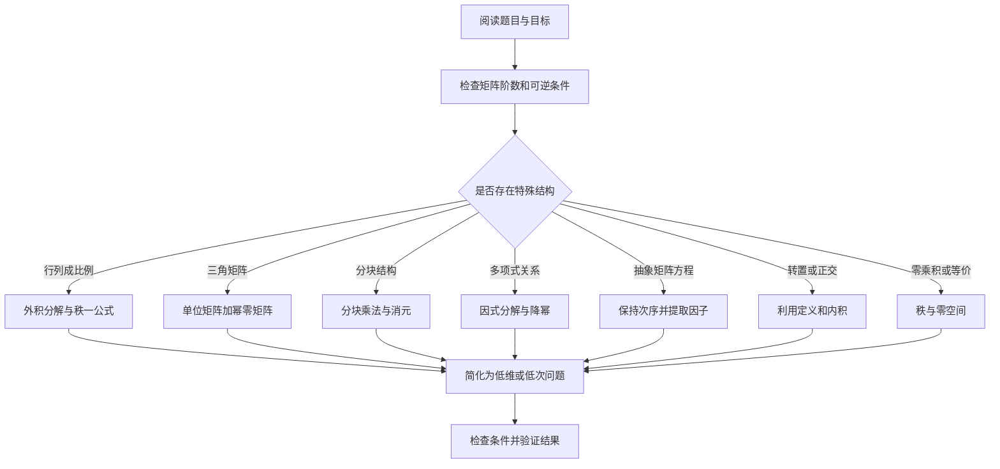

本节是线性代数从行列式过渡到矩阵、向量组、线性方程组、特征值与特征向量、二次型的基础，也是后续各章节综合题的重要组成部分。

这一节真正的难点，不是计算两个矩阵的乘积，而是**如何在矩阵不能任意交换次序的前提下，发现矩阵的内部结构，进行等价变形，将复杂的矩阵问题转化为简单的数量关系。**

## 第一部分 基础知识体系

### 一、本节的核心考点

矩阵性质与运算可归纳为九类题型。

| 核心题型     | 主要考查内容          | 复习优先级 |
| -------- | --------------- | ----- |
| 矩阵基本运算   | 运算顺序、交换性、消去律    | ★★★★★ |
| 矩阵方程     | 移项、提取公因子、左右乘逆矩阵 | ★★★★★ |
| 转置与特殊矩阵  | 对称、反对称、正交       | ★★★★★ |
| 秩一矩阵     | 内积、外积、矩阵高次幂     | ★★★★★ |
| 矩阵多项式    | 降幂、幂零、幂等、对合     | ★★★★★ |
| 伴随矩阵     | 恒等式、数乘、二次伴随、秩   | ★★★★★ |
| 分块矩阵     | 分块乘法、求逆、行列式     | ★★★★★ |
| 矩阵等价与可解性 | 秩、零空间、矩阵方程有解条件  | ★★★★☆ |
| 新型综合问题   | 投影矩阵、双线性型、不等式   | ★★★★☆ |

贯穿全节的是四种思维：

- **顺序意识：** 矩阵乘法不能随意交换。
- **结构意识：** 优先识别对角、分块、秩一、幂零等特殊结构。
- **降维意识：** 把矩阵问题转化为标量、向量、低次多项式问题。
- **条件意识：** 每一次求逆、消去、因式分解，都必须检查适用条件。

### 二、矩阵的本质及乘法的直观理解

**2.1 矩阵不仅是一个数表**

设

$$
A=\begin{pmatrix} a_{11}&a_{12}&\cdots&a_{1n}\\ a_{21}&a_{22}&\cdots&a_{2n}\\ \vdots&\vdots&&\vdots\\ a_{m1}&a_{m2}&\cdots&a_{mn} \end{pmatrix}_{m\times n}.
$$

矩阵可以理解为一个线性变换，它把一个 $n$ 维列向量变为一个 $m$ 维列向量：

$$
x\longmapsto Ax.
$$

例如

$$
A=\begin{pmatrix} 2&0\\ 0&3 \end{pmatrix}
$$

代表将向量的第一个坐标扩大为原来的2倍，第二个坐标扩大为原来的3倍。

而矩阵

$$
B=\begin{pmatrix} 0&1\\ 1&0 \end{pmatrix}
$$

代表交换两个坐标。

因此，$ABx$ 表示先进行 $B$ 变换，再进行 $A$ 变换；$BAx$ 则相反。

两种变换执行的顺序不同，结果通常也不同。

这就是为什么：

$$
\boxed{AB\text{ 一般不等于 }BA}
$$

**2.2 矩阵乘法的四种理解方式**

设

$$
A_{m\times n},\qquad B_{n\times p}.
$$

则

$$
AB=C_{m\times p},
$$

且

$$
c_{ij}=\sum_{k=1}^{n}a_{ik}b_{kj}.
$$

除了常规的行乘列，还有三种更值得掌握的运算视角。

**视角一：按列计算。**

若

$$
B=(\beta_1,\beta_2,\ldots,\beta_p),
$$

则

$$
\boxed{AB=(A\beta_1,A\beta_2,\ldots,A\beta_p)}
$$

这是求解矩阵方程、研究线性相关性、矩阵表示问题的核心。

**视角二：按行计算。**

若

$$
A=\begin{pmatrix} \alpha_1^{\mathrm T}\\ \alpha_2^{\mathrm T}\\ \vdots\\ \alpha_m^{\mathrm T} \end{pmatrix},
$$

则

$$
AB=\begin{pmatrix} \alpha_1^{\mathrm T}B\\ \alpha_2^{\mathrm T}B\\ \vdots\\ \alpha_m^{\mathrm T}B \end{pmatrix}.
$$

因此，右乘同一个矩阵，可以保持原有各行之间的线性关系。

**视角三：列向量与行向量的外积之和。**

设 $A$ 的第 $k$ 列为 $\alpha_k$，$B$ 的第 $k$ 行为 $\beta_k^{\mathrm T}$，则

$$
\boxed{AB=\sum_{k=1}^{n}\alpha_k\beta_k^{\mathrm T}}
$$

这是理解秩一矩阵、满秩分解和分块矩阵的重要基础。

考研遇到矩阵乘法问题时，不要只会逐元素计算。很多综合题只有选择正确的观察视角，才能迅速找到突破口。

### 三、矩阵运算的基本性质

**3.1 必须牢记的运算法则**

| 运算性质  | 正确结论                  |
| ----- | --------------------- |
| 加法交换律 | $A+B=B+A$         |
| 加法结合律 | $(A+B)+C=A+(B+C)$ |
| 乘法结合律 | $(AB)C=A(BC)$     |
| 左分配律  | $A(B+C)=AB+AC$    |
| 右分配律  | $(A+B)C=AC+BC$    |
| 单位矩阵  | $AE=EA=A$         |
| 零矩阵   | $AO=OA=O$         |
| 乘法交换律 | 一般不成立                 |
| 乘法消去律 | 一般不成立                 |

以上等式均要求矩阵尺寸与相应运算匹配。

特别注意：**结合律允许改变括号的位置，但不允许改变矩阵的排列次序。**

$$
ABC=A(BC)=(AB)C
$$

不能由此推出

$$
ABC=ACB.
$$

**3.2 矩阵乘法什么时候可以交换？**

以下情况可以保证 $AB=BA$：

1. 其中一个矩阵是单位矩阵或数量矩阵 $kE$。
2. $A,B$ 是同阶对角矩阵。
3. $B=A^k$。
4. $A,B$ 都是同一个矩阵的多项式。
5. $B=A^{-1}$，且 $A$ 可逆。
6. $B=A^*$，其中 $A^*$ 是伴随矩阵。
7. 题目明确给出 $AB=BA$，或可以由其他条件推出。

其中第4条尤其重要。

若

$$
P=f(A),\qquad Q=g(A),
$$

那么

$$
\boxed{PQ=QP}.
$$

例如

$$
(A+E)(A-2E)=(A-2E)(A+E).
$$

这是因为它们都由同一个矩阵 $A$ 的不同次幂组成。

**3.3 矩阵版乘法公式**

一般情况下：

$$
(A+B)^2=A^2+AB+BA+B^2.
$$

$$
(A-B)^2=A^2-AB-BA+B^2.
$$

$$
(A+B)(A-B)=A^2-AB+BA-B^2.
$$

只有在 $AB=BA$ 时，才能使用熟悉的数量乘法公式：

$$
(A+B)^2=A^2+2AB+B^2,
$$

$$
(A+B)(A-B)=A^2-B^2.
$$

同理，矩阵二项式定理

$$
(A+B)^n=\sum_{k=0}^{n}\binom nk A^{n-k}B^k
$$

通常也需要 $AB=BA$。

特别地，$E$ 与任何同阶矩阵均可交换，因此 $(E+A)^n$ 始终可以使用二项式定理。

**3.4 矩阵乘积为零不代表某个因子为零**

例如

$$
A=\begin{pmatrix}1&0\\0&0\end{pmatrix}, \qquad B=\begin{pmatrix}0&0\\0&1\end{pmatrix}.
$$

显然

$$
AB=BA=O,
$$

但 $A\ne O$，$B\ne O$。

这说明矩阵运算存在零因子。

若

$$
AB=AC,
$$

则

$$
A(B-C)=O.
$$

不能直接得到 $B=C$。

只有当 $A$ 可逆，或者更一般地，$A$ 列满秩时，才能保证

$$
AB=AC\Longrightarrow B=C.
$$

类似地，右消去需要右侧系数矩阵可逆或行满秩。

## 第二部分 矩阵乘法与矩阵方程

### 四、题型一：矩阵运算性质的判断

这是选择题中非常基础、但容易失分的一类题目。

**母题1：矩阵乘法的循环交换**

**来源：1991年数学一真题。**

设 $A,B,C$ 均为 $n$ 阶矩阵，且

$$
ABC=E.
$$

判断下列哪个等式必然成立：

A. $ACB=E$

B. $CBA=E$

C. $BAC=E$

D. $BCA=E$

**第一步：利用行列式判断可逆性。**

$$
|A||B||C|=1.
$$

因此 $A,B,C$ 均可逆。

**第二步：利用逆矩阵进行移项。**

在原等式两边左乘 $A^{-1}$，得到

$$
BC=A^{-1}.
$$

再右乘 $A$，得到

$$
\boxed{BCA=E}.
$$

故选 D。

同理，可以推出 $CAB=E$。

**母题推广**

若同阶方阵满足

$$
A_1A_2\cdots A_k=E,
$$

则可以循环移动因子，但不能任意交换因子。

对于一般情形

$$
ABC=D,
$$

且 $A$ 可逆，则

$$
BCA=A^{-1}DA.
$$

因此，循环移动并不一定保持乘积本身不变，但在可逆条件下可以得到相似关系。

这也解释了为什么：

$$
|ABC|=|BCA|=|ACB|
$$

而矩阵乘积本身未必相等。

<Callout type="warn" title="常见判断题陷阱">

| 条件                  | 结论                     | 正误 |
| ------------------- | ---------------------- | -- |
| $AB=E$，且均为同阶方阵  | $BA=E$             | 正确 |
| $AB=O$          | $BA=O$             | 错误 |
| $AB=AC$         | $B=C$              | 错误 |
| $A^2=B^2$       | $A=B$ 或 $A=-B$ | 错误 |
| $AB\ne BA$      | $\|AB\|\ne\|BA\|$  | 错误 |
| $AB$ 可逆，且均为同阶方阵 | $A,B$ 均可逆          | 正确 |
| $A,B$ 均不可逆      | $A+B$ 不可逆          | 错误 |
| $A,B$ 均不可逆且同阶   | $AB$ 不可逆           | 正确 |

尤其需要注意方阵条件。

若

$$
A=\begin{pmatrix}1&0\end{pmatrix}, \qquad B=\begin{pmatrix}1\\0\end{pmatrix},
$$

则

$$
AB=E_1,
$$

但

$$
BA=\begin{pmatrix}1&0\\0&0\end{pmatrix}\ne E_2.
$$

所以矩形矩阵的单侧逆与方阵的逆不能混淆。

</Callout>

### 五、题型二：矩阵方程的求解

**5.1 三个基本模型**

设 $X$ 为未知矩阵。

| 方程形式        | 可逆条件         | 解                     |
| ----------- | ------------ | --------------------- |
| $AX=B$  | $A$ 可逆   | $X=A^{-1}B$       |
| $XA=B$  | $A$ 可逆   | $X=BA^{-1}$       |
| $AXB=C$ | $A,B$ 可逆 | $X=A^{-1}CB^{-1}$ |

绝对不要将矩阵的移项理解为数量的除法。

矩阵方程的核心原则是：

**未知矩阵左侧的因子，通过左乘逆矩阵消去；右侧的因子，通过右乘逆矩阵消去。**

**5.2 常见矩阵方程的因式分解**

| 原方程或表达式               | 正确变形              |
| --------------------- | ----------------- |
| $AX-BX=C$         | $(A-B)X=C$    |
| $XA-XB=C$         | $X(A-B)=C$    |
| $AX-kX=B$         | $(A-kE)X=B$   |
| $AXA-AXB$         | $AX(A-B)$     |
| $AXA+BXB-AXB-BXA$ | $(A-B)X(A-B)$ |
| $X-AX-XB+AXB$     | $(E-A)X(E-B)$ |

如果出现 $AX+XB=C$，通常不能直接提取 $X$。低阶数值题可以设未知元素，转化为线性方程组求解。

**母题2：提取未知矩阵并降低计算量**

**来源：1987年数学一真题。**

已知

$$
AB=A+2B,
$$

其中

$$
A=\begin{pmatrix} 3&0&1\\ 1&1&0\\ 0&1&4 \end{pmatrix}.
$$

求 $B$。

**第一步：将含有未知矩阵的项集中。**

$$
AB-2B=A.
$$

提取右侧公因子 $B$：

$$
(A-2E)B=A.
$$

**第二步：判断系数矩阵可逆性。**

令

$$
M=A-2E= \begin{pmatrix} 1&0&1\\ 1&-1&0\\ 0&1&2 \end{pmatrix}.
$$

计算可得

$$
|M|=-1\ne0.
$$

因此

$$
B=M^{-1}A.
$$

**第三步：利用结构简化运算。**

由于

$$
A=M+2E,
$$

所以

$$
\begin{aligned} B&=M^{-1}(M+2E)\\ &=E+2M^{-1}. \end{aligned}
$$

通过初等行变换求得

$$
M^{-1}= \begin{pmatrix} 2&-1&-1\\ 2&-2&-1\\ -1&1&1 \end{pmatrix}.
$$

最终

$$
\boxed{ B= \begin{pmatrix} 5&-2&-2\\ 4&-3&-2\\ -2&2&3 \end{pmatrix} }
$$

**真正值得学习的是第三步。**

以后遇到

$$
(A-kE)X=A,
$$

首先考虑

$$
\boxed{X=E+k(A-kE)^{-1}}
$$

而不是机械地求两个矩阵的乘积。

**母题3：含有逆矩阵的抽象矩阵方程**

**来源：2022年数学一真题。**

设 $A,E-A$ 可逆，且

$$
[E-(E-A)^{-1}]B=A.
$$

求 $B-A$。

这道题不涉及具体的矩阵元素，主要考查抽象运算能力。

**方法一：整体乘法消元。**

在等式两边左乘 $E-A$：

$$
[(E-A)-E]B=(E-A)A.
$$

即

$$
-AB=A-A^2.
$$

注意右侧可以提取 $A$：

$$
-AB=A(E-A).
$$

由于 $A$ 可逆，左乘 $A^{-1}$：

$$
-B=E-A.
$$

所以

$$
B=A-E.
$$

答案为

$$
\boxed{B-A=-E}.
$$

**方法二：先化简系数矩阵。**

$$
\begin{aligned} E-(E-A)^{-1} &=(E-A)^{-1}[(E-A)-E]\\ &=-(E-A)^{-1}A. \end{aligned}
$$

原方程变为

$$
-(E-A)^{-1}AB=A.
$$

继续消去可逆因子即可得到相同结论。

**题型总结：** 看见复杂的逆矩阵表达式，不一定要对整个表达式求逆。优先考虑乘上原来的矩阵，消去逆矩阵。

**母题4：利用方程直接证明矩阵可逆**

**来源：2002年数学二真题。**

已知

$$
2A^{-1}B=B-4E.
$$

证明 $A-2E$ 可逆，并求其逆矩阵。

将原式左乘 $A$，得到

$$
2B=AB-4A.
$$

移项：

$$
(A-2E)B=4A.
$$

观察右端的 $A$，将其写成

$$
A=(A-2E)+2E.
$$

于是

$$
(A-2E)B=4(A-2E)+8E.
$$

整理得

$$
\boxed{(A-2E)(B-4E)=8E}.
$$

因此 $A-2E$ 可逆，且

$$
\boxed{(A-2E)^{-1}=\frac18(B-4E)}.
$$

这道题体现了一个非常重要的证明方法：

若能够构造

$$
MN=kE,\qquad k\ne0,
$$

其中 $M,N$ 为同阶方阵，则立刻有

$$
\boxed{M^{-1}=\frac1kN}.
$$

不需要再计算行列式。

## 第三部分 转置、对称矩阵、反对称矩阵与正交矩阵

### 六、矩阵转置

**6.1 基本公式**

$$
(A^{\mathrm T})^{\mathrm T}=A.
$$

$$
(A+B)^{\mathrm T}=A^{\mathrm T}+B^{\mathrm T}.
$$

$$
(kA)^{\mathrm T}=kA^{\mathrm T}.
$$

最重要的是：

$$
\boxed{(AB)^{\mathrm T}=B^{\mathrm T}A^{\mathrm T}}
$$

一般地，

$$
(A_1A_2\cdots A_n)^{\mathrm T} =A_n^{\mathrm T}\cdots A_2^{\mathrm T}A_1^{\mathrm T}.
$$

逆矩阵也有类似规律：

$$
\boxed{(AB)^{-1}=B^{-1}A^{-1}}
$$

并且

$$
(A^{-1})^{\mathrm T}=(A^{\mathrm T})^{-1}.
$$

可以统一记忆为：**乘积取转置、取逆矩阵时，因子顺序反转。**

**6.2 对称矩阵与反对称矩阵**

若

$$
A^{\mathrm T}=A,
$$

称 $A$ 为对称矩阵。

若

$$
A^{\mathrm T}=-A,
$$

称 $A$ 为反对称矩阵。

任何实方阵都可以唯一地分解为

$$
\boxed{ A=\frac{A+A^{\mathrm T}}2+ \frac{A-A^{\mathrm T}}2 }
$$

其中前一部分是对称矩阵，后一部分是反对称矩阵。

反对称矩阵的重要性质是：

$$
a_{ii}=0,
$$

因此

$$
\operatorname{tr}(A)=0.
$$

如果 $A$ 是奇数阶反对称矩阵，则

$$
\begin{aligned} |A|&=|A^{\mathrm T}|\\ &=|-A|\\ &=(-1)^n|A|=-|A|. \end{aligned}
$$

故

$$
\boxed{|A|=0}.
$$

注意：偶数阶反对称矩阵不一定不可逆。

**母题5：特殊矩阵乘积的性质判断**

**来源：李正元计算与证明题第5题。**

设 $A$ 为对称矩阵，$B$ 为反对称矩阵。

证明：$AB$ 为反对称矩阵的充要条件是 $AB=BA$。

由题设

$$
A^{\mathrm T}=A,\qquad B^{\mathrm T}=-B.
$$

计算转置：

$$
(AB)^{\mathrm T} =B^{\mathrm T}A^{\mathrm T} =-BA.
$$

因此

$$
\begin{aligned} AB\text{ 为反对称矩阵} &\iff (AB)^{\mathrm T}=-AB\\ &\iff -BA=-AB\\ &\iff AB=BA. \end{aligned}
$$

证毕。

**一般化结论**

假设

$$
A^{\mathrm T}=\varepsilon_1A,\qquad B^{\mathrm T}=\varepsilon_2B,
$$

其中 $\varepsilon_1,\varepsilon_2\in\{1,-1\}$。

则

$$
(AB)^{\mathrm T}=\varepsilon_1\varepsilon_2BA.
$$

因此下面这些结论不需要分别死记。

| $A,B$ 的性质 | $AB$ 对称的充要条件 | $AB$ 反对称的充要条件 |
| ------------- | ---------------- | ----------------- |
| 都对称           | $AB=BA$      | $AB=-BA$      |
| 都反对称          | $AB=BA$      | $AB=-BA$      |
| 一个对称，一个反对称    | $AB=-BA$     | $AB=BA$       |

另外，无论 $A$ 是不是方阵，

$$
\boxed{A^{\mathrm T}A,\ AA^{\mathrm T}\text{ 均为对称矩阵}}.
$$

而且对任意适当维数的实向量 $x$，

$$
x^{\mathrm T}A^{\mathrm T}Ax =(Ax)^{\mathrm T}(Ax)=\|Ax\|^2\ge0.
$$

因此 $A^{\mathrm T}A$ 是半正定矩阵。

这个结论对后面的秩、正交投影、二次型都非常重要。

**母题6：利用转置逆序合并简化**

**来源：1990年数学一真题。**

矩阵满足

$$
A(E-C^{-1}B)^{\mathrm T}C^{\mathrm T}=E.
$$

其中 $B,C$ 是题给四阶上三角矩阵。

如果按照常规方法，先计算 $C^{-1}$，再计算括号内的矩阵，最后计算逆矩阵，将产生大量运算。

真正的突破口是：

$$
\begin{aligned} (E-C^{-1}B)^{\mathrm T}C^{\mathrm T} &=[C(E-C^{-1}B)]^{\mathrm T}\\ &=(C-B)^{\mathrm T}. \end{aligned}
$$

于是原方程直接化为

$$
A(C-B)^{\mathrm T}=E.
$$

故

$$
\boxed{A=[(C-B)^{-1}]^{\mathrm T}}.
$$

这就是转置公式的逆向应用：不仅会展开，还要会合并。

### 七、正交矩阵

**7.1 定义与重要性质**

实方阵 $Q$ 满足

$$
Q^{\mathrm T}Q=E,
$$

则称 $Q$ 为正交矩阵。

等价条件包括：

$$
Q^{\mathrm T}Q=E \iff QQ^{\mathrm T}=E \iff Q^{-1}=Q^{\mathrm T}.
$$

从向量角度理解，正交矩阵的各列构成标准正交向量组，各行也构成标准正交向量组。

重要性质：

| 性质    | 结论                                        |
| ----- | ----------------------------------------- |
| 行列式   | $\|Q\|=\pm1$                          |
| 逆矩阵   | $Q^{-1}=Q^{\mathrm T}$                |
| 保持长度  | $\Vert Qx\Vert=\Vert x\Vert$                |
| 保持内积  | $(Qx)^{\mathrm T}(Qy)=x^{\mathrm T}y$ |
| 乘法封闭性 | 两个同阶正交矩阵的乘积仍正交                            |
| 高次幂   | $Q^k$ 仍正交                             |

但要注意：

$$
|Q|=\pm1
$$

只是 $Q$ 正交的必要条件，而不是充分条件。

**母题7：反对称矩阵构造正交矩阵**

**来源：李正元计算与证明题第8题。**

设 $A$ 为实反对称矩阵，证明

$$
Q=(E-A)(E+A)^{-1}
$$

是正交矩阵。

这是一道综合性很强的证明母题。

**第一步：证明** $E+A$ **可逆。**

因为

$$
A^{\mathrm T}=-A,
$$

对任意实列向量 $x$，标量 $x^{\mathrm T}Ax$ 满足

$$
\begin{aligned} x^{\mathrm T}Ax &=(x^{\mathrm T}Ax)^{\mathrm T}\\ &=x^{\mathrm T}A^{\mathrm T}x\\ &=-x^{\mathrm T}Ax. \end{aligned}
$$

故

$$
\boxed{x^{\mathrm T}Ax=0}.
$$

若

$$
(E+A)x=0,
$$

左乘 $x^{\mathrm T}$：

$$
x^{\mathrm T}(E+A)x=\|x\|^2=0.
$$

所以 $x=0$，因此 $E+A$ 可逆。

同理 $E-A$ 也可逆。

**第二步：计算** $Q^{\mathrm T}$**。**

$$
\begin{aligned} Q^{\mathrm T} &=[(E+A)^{-1}]^{\mathrm T}(E-A)^{\mathrm T}\\ &=(E-A)^{-1}(E+A). \end{aligned}
$$

**第三步：证明正交。**

因为 $E+A$ 与 $E-A$ 都是 $A$ 的多项式，所以可以交换：

$$
\begin{aligned} Q^{\mathrm T}Q &=(E-A)^{-1}(E+A)(E-A)(E+A)^{-1}\\ &=E. \end{aligned}
$$

所以 $Q$ 为正交矩阵。

这称为 Cayley 变换。考研不要求记住这个名称，但需要掌握其背后的三个方法：

- 利用反对称性推出 $x^{\mathrm T}Ax=0$。
- 利用齐次方程只有零解证明矩阵可逆。
- 利用矩阵多项式可交换简化乘积。

## 第四部分 秩一矩阵与矩阵高次幂

### 八、秩一矩阵：本节最重要的特殊结构之一

**8.1 内积与外积的区别**

设

$$
\alpha=\begin{pmatrix}a_1\\a_2\\\vdots\\a_n\end{pmatrix}, \qquad \beta=\begin{pmatrix}b_1\\b_2\\\vdots\\b_n\end{pmatrix}.
$$

那么

$$
\alpha^{\mathrm T}\beta =\sum_{i=1}^n a_ib_i
$$

是一个数。

而

$$
\alpha\beta^{\mathrm T}= \begin{pmatrix} a_1b_1&a_1b_2&\cdots&a_1b_n\\ a_2b_1&a_2b_2&\cdots&a_2b_n\\ \vdots&\vdots&&\vdots\\ a_nb_1&a_nb_2&\cdots&a_nb_n \end{pmatrix}
$$

是一个 $n$ 阶矩阵。

| 表达式                           | 结果 | 名称 |
| ----------------------------- | -- | -- |
| $\alpha^{\mathrm T}\beta$ | 标量 | 内积 |
| $\alpha\beta^{\mathrm T}$ | 矩阵 | 外积 |

若 $\alpha,\beta$ 均非零，那么

$$
\boxed{r(\alpha\beta^{\mathrm T})=1}.
$$

因为

$$
\alpha\beta^{\mathrm T} =(b_1\alpha,b_2\alpha,\ldots,b_n\alpha),
$$

它的每一列都是 $\alpha$ 的倍数。

反过来，任意秩为1的矩阵都可以表示为两个非零向量的外积。

**8.2 如何识别秩一矩阵？**

当题目中的矩阵具有以下特点时，应优先考虑外积分解：

- 各行成比例。
- 各列成比例。
- 所有元素相同。
- 矩阵元素满足 $a_{ij}=u_iv_j$。
- 题目直接给出 $\alpha\beta^{\mathrm T}$。

例如

$$
A=\begin{pmatrix} 1&2&3\\ 2&4&6\\ 3&6&9 \end{pmatrix}
$$

可以立即写为

$$
A=\begin{pmatrix}1\\2\\3\end{pmatrix} \begin{pmatrix}1&2&3\end{pmatrix}.
$$

不需要先计算行列式或进行初等变换。

**8.3 秩一矩阵的高次幂公式**

设

$$
A=\alpha\beta^{\mathrm T}, \qquad c=\beta^{\mathrm T}\alpha.
$$

利用结合律：

$$
\begin{aligned} A^2 &=(\alpha\beta^{\mathrm T}) (\alpha\beta^{\mathrm T})\\ &=\alpha(\beta^{\mathrm T}\alpha)\beta^{\mathrm T}\\ &=cA. \end{aligned}
$$

进一步得到

$$
A^3=c^2A,\qquad A^4=c^3A.
$$

所以

$$
\boxed{A^n=c^{n-1}A,\qquad n\ge2}.
$$

当 $n=1$ 时直接有 $A^1=A$。特别注意 $c=0$ 的情况，此时 $A^2=O$。

这就是秩一矩阵高次幂的通用公式。

**母题8：秩一矩阵求高次幂**

**来源：1994年数学一真题，李林880基础填空题第1题亦收录。**

已知

$$
\alpha=(1,2,3), \qquad \beta=\left(1,\frac12,\frac13\right),
$$

且

$$
A=\alpha^{\mathrm T}\beta.
$$

求 $A^n$。

这里的 $\alpha,\beta$ 是行向量。

由结合律：

$$
\begin{aligned} A^2 &=\alpha^{\mathrm T}\beta \alpha^{\mathrm T}\beta\\ &=\alpha^{\mathrm T} (\beta\alpha^{\mathrm T})\beta. \end{aligned}
$$

而

$$
\beta\alpha^{\mathrm T} =1+2\times\frac12+3\times\frac13 =3.
$$

所以

$$
A^2=3A.
$$

继而得到

$$
A^n=3^{n-1}A.
$$

即

$$
\boxed{ A^n=3^{n-1} \begin{pmatrix} 1&\frac12&\frac13\\ 2&1&\frac23\\ 3&\frac32&1 \end{pmatrix} }
$$

以后遇到类似题目，最重要的不是原矩阵有多少个元素，而是能否把两个向量中间的乘积结合成一个数。

**8.4 秩一矩阵的迹、特征值与行列式**

设 $A=\alpha\beta^{\mathrm T}$，则

$$
\boxed{\operatorname{tr}(A)=\beta^{\mathrm T}\alpha}.
$$

而且

$$
A\alpha=\alpha(\beta^{\mathrm T}\alpha).
$$

所以当 $\alpha\ne0$ 时，$\alpha$ 是 $A$ 对应于特征值 $c=\beta^{\mathrm T}\alpha$ 的特征向量。

当 $A$ 为非零的 $n$ 阶秩一矩阵时，其特征多项式为

$$
\det(\lambda E-A) =\lambda^{n-1}(\lambda-c).
$$

这意味着秩一矩阵的很多运算，都可以归结为对一个标量 $c$ 的研究。

特别地，当 $c=0$ 且 $A\ne O$ 时，$A$ 的特征值全部为零，但它不是零矩阵，也不可相似对角化。

### 九、秩一扰动矩阵的逆

**母题9：秩一矩阵加上单位矩阵**

**来源：李林880。**

设 $\alpha,\beta$ 是 $n$ 维列向量，且

$$
\alpha^{\mathrm T}\beta=2.
$$

证明

$$
A=E+\alpha\beta^{\mathrm T}
$$

可逆，并求 $A^{-1}$。

令

$$
U=\alpha\beta^{\mathrm T}.
$$

由于

$$
\beta^{\mathrm T}\alpha=2,
$$

故

$$
U^2=2U.
$$

我们希望寻找一个形如

$$
A^{-1}=E+kU
$$

的矩阵。

计算

$$
\begin{aligned} (E+U)(E+kU) &=E+(1+k)U+kU^2\\ &=E+(1+3k)U. \end{aligned}
$$

要使乘积等于 $E$，只需令

$$
1+3k=0.
$$

故

$$
k=-\frac13.
$$

所以

$$
\boxed{A^{-1}=E-\frac13\alpha\beta^{\mathrm T}}.
$$

又由于 $U=A-E$，也可以写为

$$
\boxed{A^{-1}=\frac{4E-A}{3}}.
$$

**一般化公式**

设

$$
U=\alpha\beta^{\mathrm T}, \qquad c=\beta^{\mathrm T}\alpha.
$$

则

$$
\boxed{ E+U\text{ 可逆} \iff 1+c\ne0 }
$$

且

$$
\boxed{ (E+\alpha\beta^{\mathrm T})^{-1} =E-\frac{\alpha\beta^{\mathrm T}} {1+\beta^{\mathrm T}\alpha} }
$$

这就是秩一更新求逆公式。

更一般地，当 $a\ne0$ 且 $a+bc\ne0$ 时，

$$
\boxed{ (aE+bU)^{-1} =\frac1aE-\frac{b}{a(a+bc)}U }
$$

此外，还可以推出

$$
\boxed{|E+\alpha\beta^{\mathrm T}|=1+\beta^{\mathrm T}\alpha}.
$$

这些公式特别适合处理元素很多，但各行、各列具有比例关系的矩阵。

### 十、矩阵高次幂的六种常用方法

矩阵高次幂题的本质是：**不允许真的乘几十次、几百次，而是寻找低次关系或可分解结构。**

| 矩阵特征                        | 优先使用的方法             |
| --------------------------- | ------------------- |
| 对角矩阵                        | 对角元分别乘方             |
| 分块对角矩阵                      | 各对角块分别乘方            |
| 行列成比例                       | 秩一矩阵公式              |
| 对角元相同的三角矩阵                  | 拆成 $aE+N$，使用二项式 |
| 满足低次多项式关系                   | 递推、降幂               |
| 给出 $AP=PB$ 且 $P$ 可逆 | 相似变换                |

**10.1 幂等矩阵**

若

$$
A^2=A,
$$

则称 $A$ 为幂等矩阵。

其重要性质为

$$
\boxed{A^n=A,\qquad n\ge1}.
$$

并且

$$
(E-A)^2=E-A,
$$

$$
A(E-A)=(E-A)A=O.
$$

还有

$$
\boxed{r(A)+r(E-A)=n}.
$$

幂等矩阵的特征值只能是0或1，而且可以相似对角化。

如果幂等矩阵可逆，则必有

$$
A=E.
$$

**张宇1000基础题变式：**

已知 $A^2=A$，求

$$
(A-2E)^3-3A.
$$

因为 $A$ 与 $E$ 可交换，所以

$$
\begin{aligned} (A-2E)^3-3A &=A^3-6A^2+12A-8E-3A\\ &=A-6A+12A-3A-8E\\ &=\boxed{4A-8E}. \end{aligned}
$$

**10.2 幂零矩阵**

若存在正整数 $m$，使得

$$
A^m=O,
$$

则称 $A$ 为幂零矩阵。

其特征值全部为0，因而

$$
|A|=0,\qquad \operatorname{tr}(A)=0.
$$

最重要的公式是

$$
\boxed{(E-A)^{-1}=E+A+A^2+\cdots+A^{m-1}}.
$$

因为

$$
(E-A)(E+A+\cdots+A^{m-1}) =E-A^m=E.
$$

类似地，

$$
\boxed{(E+A)^{-1}=E-A+A^2-\cdots+(-1)^{m-1}A^{m-1}}.
$$

这里不涉及无穷级数收敛问题，因为幂零性质使表达式在有限项后终止。

**10.3 对合矩阵**

若

$$
A^2=E,
$$

则称 $A$ 为对合矩阵。

有

$$
A^{-1}=A,
$$

以及

$$
\boxed{ A^n= \begin{cases} E,&n\text{ 为偶数},\\ A,&n\text{ 为奇数}. \end{cases} }
$$

其特征值只能是 $1,-1$，并且

$$
\boxed{r(E+A)+r(E-A)=n}.
$$

证明这个秩公式的方法十分值得掌握。

由

$$
(E+A)(E-A)=O,
$$

得到

$$
r(E+A)+r(E-A)\le n.
$$

又因为

$$
(E+A)+(E-A)=2E,
$$

所以

$$
r(E+A)+r(E-A)\ge r(2E)=n.
$$

综合即得秩和等于 $n$。

这个方法在李林880综合填空题第5题、核心题目第25题中都有体现。

**10.4 常见特殊矩阵性质汇总**

| 类型   | 定义关系                            | 特征值          | 高次幂特点                          |
| ---- | ------------------------------- | ------------ | ------------------------------ |
| 幂等矩阵 | $A^2=A$                     | 0、1          | $A^n=A$                    |
| 幂零矩阵 | $A^m=O$                     | 0            | 足够高次幂为零                        |
| 对合矩阵 | $A^2=E$                     | 1、-1         | 奇偶循环                           |
| 秩一矩阵 | $A=\alpha\beta^{\mathrm T}$ | 0、$c$    | $A^n=c^{n-1}A$，$n\ge2$ |
| 周期矩阵 | $A^m=E$                     | $m$ 次单位根 | 按指数余数求幂                        |

**母题10：三角矩阵的高次幂**

**来源：张宇1000强化部分矩阵运算填空题。**

设

$$
A=\begin{pmatrix} 1&1&-1\\ 0&1&1\\ 0&0&1 \end{pmatrix}.
$$

求 $A^{10}$。

观察到主对角线元素都是1，故拆为

$$
A=E+N,
$$

其中

$$
N=\begin{pmatrix} 0&1&-1\\ 0&0&1\\ 0&0&0 \end{pmatrix}.
$$

计算

$$
N^2=\begin{pmatrix} 0&0&1\\ 0&0&0\\ 0&0&0 \end{pmatrix}, \qquad N^3=O.
$$

由于单位矩阵与任何矩阵可交换，可以使用二项式定理：

$$
\begin{aligned} A^{10} &=(E+N)^{10}\\ &=E+10N+\binom{10}{2}N^2\\ &=E+10N+45N^2. \end{aligned}
$$

所以

$$
\boxed{ A^{10}= \begin{pmatrix} 1&10&35\\ 0&1&10\\ 0&0&1 \end{pmatrix} }
$$

**通用模型**

如果 $A=aE+N$，且 $N^m=O$，那么对整数 $n\ge m-1$，

$$
\boxed{ A^n=\sum_{k=0}^{m-1} \binom nk a^{n-k}N^k }
$$

这里约定 $a^0=1$，包括 $a=0$ 时的零次幂项。

这种方法特别适合同一对角元素的上三角矩阵或下三角矩阵。

**母题11：利用相似关系求高次幂**

**来源：1988年数学一真题。**

已知

$$
AP=PB,
$$

其中

$$
B=\begin{pmatrix} 1&0&0\\ 0&0&0\\ 0&0&-1 \end{pmatrix}, \quad P=\begin{pmatrix} 1&0&0\\ 2&-1&0\\ 2&1&1 \end{pmatrix}.
$$

求 $A$ 和 $A^5$。

因为 $P$ 可逆，

$$
A=PBP^{-1}.
$$

计算可得

$$
A=\begin{pmatrix} 1&0&0\\ 2&0&0\\ 6&-1&-1 \end{pmatrix}.
$$

现在求 $A^5$，不需要再计算五次矩阵乘积。

$$
\begin{aligned} A^5 &=(PBP^{-1})^5\\ &=PB^5P^{-1}. \end{aligned}
$$

而 $B^5=B$，所以

$$
\boxed{A^5=A}.
$$

记住一般结论：

$$
\boxed{A=PBP^{-1}\Longrightarrow A^n=PB^nP^{-1}}.
$$

进一步，对于任意矩阵多项式 $f$，

$$
\boxed{f(A)=Pf(B)P^{-1}}.
$$

这正是后面学习相似对角化的意义：寻找一种更加简单的矩阵表示，从而大幅降低计算难度。

### 十一、矩阵多项式与降幂

这是最具有迁移价值的知识点之一。

**11.1 基本思想**

若矩阵满足

$$
A^2=pA+qE,
$$

那么

$$
\begin{aligned} A^3&=A(pA+qE)\\ &=pA^2+qA\\ &=(p^2+q)A+pqE. \end{aligned}
$$

所有更高次的幂都可以化为

$$
\boxed{A^n=u_nA+v_nE}.
$$

因此，如果题目给出了矩阵的二次关系，就不要继续求三次、四次矩阵乘积，而应使用代数降幂。

类似地，若

$$
A^3=pA^2+qA+rE,
$$

则任意矩阵多项式都可以化简为

$$
uA^2+vA+wE.
$$

**11.2 利用多项式关系求逆**

若

$$
A^2+pA+qE=O,\qquad q\ne0,
$$

则

$$
A(A+pE)=-qE.
$$

因此

$$
\boxed{A^{-1}=-\frac1q(A+pE)}.
$$

更一般地，只要矩阵满足一个常数项不为零的多项式关系，就可以证明该矩阵可逆，并把逆矩阵表示为它的多项式。

**母题12：幂零矩阵与双边矩阵方程**

**来源：2015年数学二、数学三真题。**

已知

$$
A=\begin{pmatrix} a&1&0\\ 1&a&-1\\ 0&1&a \end{pmatrix}, \qquad A^3=O.
$$

求 $a$，并求满足下式的 $X$：

$$
X-XA^2-AX+AXA^2=E.
$$

**第一步：利用幂零性质求参数。**

因为 $A^3=O$，所以

$$
|A|=0.
$$

计算得

$$
|A|=a(a^2+1)-a=a^3.
$$

因此

$$
a=0.
$$

此时

$$
A=\begin{pmatrix} 0&1&0\\ 1&0&-1\\ 0&1&0 \end{pmatrix},
$$

且

$$
A^2=\begin{pmatrix} 1&0&-1\\ 0&0&0\\ 1&0&-1 \end{pmatrix}.
$$

代入可以验证 $A^3=O$。

**第二步：识别四项式的因式分解。**

$$
X-XA^2-AX+AXA^2 =(E-A)X(E-A^2).
$$

于是

$$
(E-A)X(E-A^2)=E.
$$

**第三步：利用幂零条件直接求逆。**

$$
(E-A)^{-1}=E+A+A^2,
$$

$$
(E-A^2)^{-1}=E+A^2.
$$

**第四步：左右消去因子。**

$$
\begin{aligned} X&=(E-A)^{-1}(E-A^2)^{-1}\\ &=(E+A+A^2)(E+A^2)\\ &=E+A+2A^2. \end{aligned}
$$

最后得到

$$
\boxed{ X=\begin{pmatrix} 3&1&-2\\ 1&1&-1\\ 2&1&-1 \end{pmatrix} }
$$

这道题值得反复练习，因为它综合了参数求解、幂零矩阵性质、双边因式分解、逆矩阵和降幂五个知识点。

**母题13：利用对称性排除矩阵零因子**

**来源：张宇1000强化矩阵运算题。**

设 $A$ 是实对称矩阵，满足

$$
E-2A+A^2-2A^3=O.
$$

求 $A$。

首先进行因式分解：

$$
(E-2A)(E+A^2)=O.
$$

一般不能由两个矩阵相乘为零，推出某一个因子为零。

但本题给出了实对称条件。

对于任意非零实向量 $x$，

$$
\begin{aligned} x^{\mathrm T}(E+A^2)x &=x^{\mathrm T}x+x^{\mathrm T}A^{\mathrm T}Ax\\ &=\|x\|^2+\|Ax\|^2\\ &>0. \end{aligned}
$$

所以 $E+A^2$ 正定，必可逆。

因此

$$
E-2A=O,
$$

即

$$
\boxed{A=\frac12E}.
$$

**为什么不能删除实对称条件？**

取

$$
A=\begin{pmatrix} 0&-1\\ 1&0 \end{pmatrix},
$$

则

$$
A^2=-E.
$$

于是

$$
(E-2A)(E+A^2)=O,
$$

但显然

$$
A\ne\frac12E.
$$

在考研综合题中，题目特意给出的矩阵性质往往是为某一次关键消去或推导服务的。不能忽略这些条件。

## 第五部分 伴随矩阵与分块矩阵

### 十二、伴随矩阵的知识体系

伴随矩阵是行列式与矩阵之间的重要桥梁，也是考研数学一非常适合出综合题的知识点。

**12.1 伴随矩阵的定义**

设 $A_{ij}$ 是矩阵 $A$ 中元素 $a_{ij}$ 的代数余子式，则

$$
A^*= \begin{pmatrix} A_{11}&A_{21}&\cdots&A_{n1}\\ A_{12}&A_{22}&\cdots&A_{n2}\\ \vdots&\vdots&&\vdots\\ A_{1n}&A_{2n}&\cdots&A_{nn} \end{pmatrix}.
$$

注意：代数余子式需要转置后才能构成伴随矩阵。

对于二阶矩阵，

$$
A=\begin{pmatrix}a&b\\c&d\end{pmatrix},
$$

有

$$
\boxed{ A^*=\begin{pmatrix} d&-b\\ -c&a \end{pmatrix} }.
$$

记忆方法：主对角线交换，副对角线变号。

**12.2 最重要的伴随矩阵恒等式**

$$
\boxed{AA^*=A^*A=|A|E}.
$$

这个公式对任意方阵成立，**不要求矩阵可逆**。

当 $|A|\ne0$ 时，还可以写为

$$
\boxed{A^*=|A|A^{-1}}, \qquad \boxed{A^{-1}=\frac1{|A|}A^*}.
$$

注意这两个公式的适用条件是 $A$ 可逆。

**12.3 伴随矩阵的公式汇总**

| 公式                                          | 适用条件              |
| ------------------------------------------- | ----------------- |
| $AA^*=A^*A=\|A\|E$                    | 任意方阵              |
| $\|A^*\|=\|A\|^{n-1}$                  | $n\ge2$       |
| $(kA)^*=k^{n-1}A^*$                   | $n\ge2$       |
| $(A^{\mathrm T})^*=(A^*)^{\mathrm T}$ | 任意方阵              |
| $(AB)^*=B^*A^*$                      | 同阶方阵              |
| $(A^*)^{-1}=(A^{-1})^*$               | $A$ 可逆        |
| $(A^*)^{-1}=\dfrac{A}{\|A\|}$          | $A$ 可逆        |
| $(A^*)^*=\|A\|^{n-2}A$                | $n\ge3$ 时任意方阵 |
| $(A^*)^*=A$                           | 二阶方阵              |

其中乘积取伴随矩阵也具有逆序性质：

$$
\boxed{(AB)^*=B^*A^*}.
$$

对于可逆矩阵，可以利用

$$
\begin{aligned} (AB)^* &=|AB|(AB)^{-1}\\ &=|A||B|B^{-1}A^{-1}\\ &=B^*A^*. \end{aligned}
$$

对于奇异矩阵，该公式同样成立，可利用多项式恒等性或连续性推广，但不能直接使用不存在的逆矩阵。

**12.4 行列式、逆矩阵、伴随矩阵的指数区别**

$$
|kA|=k^n|A|,
$$

$$
(kA)^*=k^{n-1}A^*,
$$

$$
(kA)^{-1}=k^{-1}A^{-1}.
$$

最后一个公式要求 $k\ne0$ 且 $A$ 可逆。

特别容易混淆的是 $n$、$n-1$、$n-2$ 三个指数。

**母题14：二次伴随矩阵**

**来源：1996年数学三真题、1998年数学二真题，李林880基础选择题第2题。**

设 $A$ 为 $n$ 阶可逆矩阵，求

$$
(A^*)^*.
$$

由

$$
A^*=|A|A^{-1},
$$

有

$$
|A^*| =|A|^n|A^{-1}| =|A|^{n-1}.
$$

同时

$$
(A^*)^{-1}=\frac1{|A|}A.
$$

因此

$$
\begin{aligned} (A^*)^* &=|A^*|(A^*)^{-1}\\ &=|A|^{n-1}\frac1{|A|}A\\ &=\boxed{|A|^{n-2}A}. \end{aligned}
$$

这类题不要只记结果，要熟练掌握在 $A^*$、$A^{-1}$、$|A|$ 之间进行转换。

**12.5 伴随矩阵的秩**

这是后续秩章节的重要基础。

对于 $n\ge2$ 阶矩阵 $A$，

$$
\boxed{ r(A^*)= \begin{cases} n,&r(A)=n,\\ 1,&r(A)=n-1,\\ 0,&r(A)\le n-2. \end{cases} }
$$

其原因是：

当 $r(A)=n$ 时，$A$ 可逆，$A^*$ 也可逆。

当 $r(A)\le n-2$ 时，所有 $n-1$ 阶子式都为零，因此 $A^*=O$。

当 $r(A)=n-1$ 时，至少存在一个非零的 $n-1$ 阶子式，故 $A^*\ne O$。

同时

$$
AA^*=O,
$$

所以

$$
r(A)+r(A^*)\le n.
$$

从而

$$
r(A^*)\le1.
$$

结合 $A^*\ne O$，得到 $r(A^*)=1$。

**综合变式：伴随矩阵与秩联合推导**

**来源：李林880综合填空题第6题。**

设 $A$ 为三阶非零矩阵，且

$$
A^*+2A=O.
$$

求

$$
\operatorname{tr}[(A^2)^{-1}].
$$

由题设

$$
A^*=-2A,
$$

故

$$
r(A^*)=r(A).
$$

若 $r(A)=1$，则 $r(A^*)=0$，矛盾。

若 $r(A)=2$，则 $r(A^*)=1$，矛盾。

因此 $r(A)=3$，即 $A$ 可逆。

由

$$
A^*=-2A
$$

两端取行列式：

$$
|A|^2=(-2)^3|A|.
$$

因为 $|A|\ne0$，故

$$
|A|=-8.
$$

再利用

$$
AA^*=|A|E,
$$

有

$$
-2A^2=-8E.
$$

所以

$$
A^2=4E, \qquad (A^2)^{-1}=\frac14E.
$$

因此

$$
\boxed{\operatorname{tr}[(A^2)^{-1}]=\frac34}.
$$

这里最容易犯的错误，是解出 $|A|=-8$ 之前，没有排除 $|A|=0$。

### 十三、含伴随矩阵的矩阵方程

**母题15：消去伴随矩阵**

**来源：1999年数学二真题，李正元填空题第12题亦收录。**

已知

$$
A=\begin{pmatrix} 1&1&-1\\ -1&1&1\\ 1&-1&1 \end{pmatrix},
$$

且

$$
A^*X=A^{-1}+2X.
$$

求 $X$。

看到 $A^*X$ 和 $A^{-1}$ 同时出现，应立即考虑左乘 $A$。

$$
AA^*X=E+2AX.
$$

利用

$$
AA^*=|A|E,
$$

得到

$$
(|A|E-2A)X=E.
$$

计算行列式可得

$$
|A|=4.
$$

因此

$$
X=(4E-2A)^{-1}.
$$

计算或通过初等行变换求得

$$
\boxed{ X=\frac14 \begin{pmatrix} 1&1&0\\ 0&1&1\\ 1&0&1 \end{pmatrix} }.
$$

这里不需要单独求 $A^*$，也不需要求 $A^{-1}$。

**母题16：只给伴随矩阵，不给原矩阵**

**来源：2000年数学一真题。**

已知四阶矩阵 $A$ 的伴随矩阵为

$$
A^*= \begin{pmatrix} 1&0&0&0\\ 0&1&0&0\\ 1&0&1&0\\ 0&-3&0&8 \end{pmatrix},
$$

且

$$
ABA^{-1}=BA^{-1}+3E.
$$

求 $B$。

**第一步：确定** $|A|$**。**

由伴随矩阵的行列式公式：

$$
|A^*|=|A|^3=8.
$$

因此

$$
|A|=2.
$$

故

$$
AA^*=A^*A=2E.
$$

**第二步：消去原式中的逆矩阵。**

右乘 $A$ 得

$$
AB=B+3A.
$$

即

$$
(A-E)B=3A.
$$

**第三步：用已知的伴随矩阵消去未知的** $A$**。**

左乘 $A^*$：

$$
(A^*A-A^*)B=3A^*A.
$$

于是

$$
(2E-A^*)B=6E.
$$

这时只含有已知矩阵 $A^*$，所以

$$
B=6(2E-A^*)^{-1}.
$$

最终

$$
\boxed{ B= \begin{pmatrix} 6&0&0&0\\ 0&6&0&0\\ 6&0&6&0\\ 0&3&0&-1 \end{pmatrix} }
$$

**解题思想总结：** 只给出伴随矩阵时，不一定需要把原矩阵完整求出来。优先使用 $|A^*|=|A|^{n-1}$ 和 $A^*A=|A|E$ 将未知矩阵消去。

另外，如果 $n-1$ 是偶数，仅凭 $|A^*|$ 一般无法唯一确定 $|A|$ 的正负号，必要时需要结合其他条件判断。

### 十四、分块矩阵

**14.1 分块矩阵的基本思想**

一个大矩阵可以按照某种结构分成几个小矩阵，例如

$$
M=\begin{pmatrix} A&B\\ C&D \end{pmatrix}.
$$

只要各分块尺寸匹配，便可以像普通二阶矩阵一样计算乘积：

$$
\begin{aligned} &\begin{pmatrix} A&B\\ C&D \end{pmatrix} \begin{pmatrix} X&Y\\ Z&W \end{pmatrix}\\ &= \begin{pmatrix} AX+BZ&AY+BW\\ CX+DZ&CY+DW \end{pmatrix}. \end{aligned}
$$

但是每一个分块本身是矩阵，仍然必须严格保留乘法顺序。

**14.2 常见分块结构的运算公式**

**分块对角矩阵：**

$$
M=\begin{pmatrix}A&O\\O&B\end{pmatrix}.
$$

有

$$
|M|=|A||B|,
$$

$$
M^k=\begin{pmatrix}A^k&O\\O&B^k\end{pmatrix}.
$$

若 $A,B$ 均可逆，则

$$
M^{-1}= \begin{pmatrix}A^{-1}&O\\O&B^{-1}\end{pmatrix}.
$$

**分块上三角矩阵：**

$$
M=\begin{pmatrix}A&C\\O&B\end{pmatrix}.
$$

有

$$
|M|=|A||B|.
$$

若两个对角块均可逆，则

$$
\boxed{ M^{-1}= \begin{pmatrix} A^{-1}&-A^{-1}CB^{-1}\\ O&B^{-1} \end{pmatrix} }.
$$

**分块反对角矩阵：**

设 $A,B$ 均为 $n$ 阶矩阵，

$$
M=\begin{pmatrix}O&A\\B&O\end{pmatrix}.
$$

则

$$
\boxed{|M|=(-1)^n|A||B|}.
$$

当 $A,B$ 均可逆时，

$$
\boxed{ M^{-1}= \begin{pmatrix} O&B^{-1}\\ A^{-1}&O \end{pmatrix} }.
$$

最容易出现的错误是求逆以后忘记交换反对角块的位置。

**母题17：分块矩阵与伴随矩阵**

**来源：2009年数学一、二、三真题。**

设 $A,B$ 为二阶矩阵，且

$$
|A|=2,\qquad |B|=3.
$$

求

$$
M=\begin{pmatrix} O&A\\ B&O \end{pmatrix}
$$

的伴随矩阵。

由题设

$$
|M|=(-1)^2|A||B|=6.
$$

因此 $M$ 可逆，且

$$
M^{-1}= \begin{pmatrix} O&B^{-1}\\ A^{-1}&O \end{pmatrix}.
$$

所以

$$
\begin{aligned} M^* &=6M^{-1}\\ &=\begin{pmatrix} O&6B^{-1}\\ 6A^{-1}&O \end{pmatrix}. \end{aligned}
$$

又因为

$$
A^*=2A^{-1},\qquad B^*=3B^{-1},
$$

故

$$
\boxed{ M^*= \begin{pmatrix} O&2B^*\\ 3A^*&O \end{pmatrix} }.
$$

**母题推广：2023年数学二真题**

核心题目第30题考查

$$
M=\begin{pmatrix} A&E\\ O&B \end{pmatrix}
$$

的伴随矩阵，其中 $A,B$ 都可逆。

利用分块求逆公式：

$$
M^{-1}= \begin{pmatrix} A^{-1}&-A^{-1}B^{-1}\\ O&B^{-1} \end{pmatrix}.
$$

因此

$$
\boxed{ M^*= \begin{pmatrix} |B|A^*&-A^*B^*\\ O&|A|B^* \end{pmatrix} }.
$$

特别注意右上角是

$$
-A^*B^*
$$

而不是

$$
-B^*A^*.
$$

**14.3 一般分块矩阵的消元：Schur 补**

对于

$$
M=\begin{pmatrix} A&B\\ C&D \end{pmatrix},
$$

若 $A$ 是可逆方阵，则左乘可逆矩阵

$$
P=\begin{pmatrix} E&O\\ -CA^{-1}&E \end{pmatrix},
$$

得到

$$
PM= \begin{pmatrix} A&B\\ O&D-CA^{-1}B \end{pmatrix}.
$$

因此，在 $D$ 也是方阵时，

$$
\boxed{|M|=|A|\cdot|D-CA^{-1}B|}.
$$

并且

$$
\boxed{r(M)=r(A)+r(D-CA^{-1}B)}.
$$

其中

$$
D-CA^{-1}B
$$

称为 Schur 补。

考研中不一定需要知道这个名称，但必须会利用可逆的分块行、列变换，将复杂矩阵化为三角形或对角形。

**经典练习题：张宇1000、李正元共同母题**

设 $A$ 为 $n$ 阶可逆矩阵，

$$
Q=\begin{pmatrix} A&\alpha\\ \alpha^{\mathrm T}&b \end{pmatrix}.
$$

证明 $Q$ 可逆的充要条件是

$$
b\ne\alpha^{\mathrm T}A^{-1}\alpha.
$$

直接进行分块消元：

$$
\begin{pmatrix} E&O\\ -\alpha^{\mathrm T}A^{-1}&1 \end{pmatrix} Q = \begin{pmatrix} A&\alpha\\ O&b-\alpha^{\mathrm T}A^{-1}\alpha \end{pmatrix}.
$$

于是

$$
|Q|=|A|(b-\alpha^{\mathrm T}A^{-1}\alpha).
$$

因为 $|A|\ne0$，故

$$
\boxed{ Q\text{ 可逆} \iff b-\alpha^{\mathrm T}A^{-1}\alpha\ne0 }.
$$

这是分块矩阵可逆性判断非常典型的母题。

## 第六部分 矩阵等价、乘积秩及矩阵方程的可解性

### 十五、矩阵等价、相似与合同的区别

本节已经出现等价、相似和合同的判断题，尽管后续章节会更深入地讲解，但现在就需要建立正确的区别。

| 关系 | 定义                      | 主要不变量            |
| -- | ----------------------- | ---------------- |
| 等价 | $B=PAQ$             | 秩                |
| 相似 | $B=P^{-1}AP$        | 秩、迹、行列式、特征值      |
| 合同 | $B=P^{\mathrm T}AP$ | 秩；实对称情形下的正、负惯性指数 |

上述 $P,Q$ 均要求为相应阶数的可逆矩阵。

其中，同型矩阵等价的充要条件为

$$
\boxed{A\cong B\iff r(A)=r(B)}.
$$

这里用 $A\cong B$ 表示矩阵等价。

相似必等价，合同也必等价，但反过来不一定成立。

**真题：1997年数学三**

设 $A,B$ 是同阶可逆矩阵，问二者是否必然等价、相似或者合同。

因为

$$
r(A)=r(B)=n,
$$

所以一定等价。

也可以直接构造

$$
P=BA^{-1},\qquad Q=E.
$$

则

$$
PAQ=B.
$$

但 $A=E,B=2E$ 并不相似。

若取

$$
A=E,\qquad B=-E,
$$

它们也不合同，因为对于任意实可逆矩阵 $P$，$P^{\mathrm T}P$ 是正定矩阵，不可能等于 $-E$。

因此，两个同阶可逆矩阵必然等价，但未必相似或合同。

**母题18：等价矩阵求参数**

**来源：2016年数学二真题。**

已知

$$
A=\begin{pmatrix} a&-1&-1\\ -1&a&-1\\ -1&-1&a \end{pmatrix},
$$

$$
B=\begin{pmatrix} 1&1&0\\ 0&-1&1\\ 1&0&1 \end{pmatrix}.
$$

若 $A,B$ 等价，求 $a$。

观察 $B$ 的第三行等于前两行之和，前两行又线性无关，因此

$$
r(B)=2.
$$

所以必须有

$$
r(A)=2.
$$

**第一步：利用行列式筛选参数。**

$$
|A|=(a-2)(a+1)^2.
$$

由于 $r(A)=2$，有

$$
|A|=0.
$$

因此

$$
a=2\quad\text{或}\quad a=-1.
$$

**第二步：验证准确的秩。**

当 $a=-1$ 时，所有元素均为 $-1$，因此

$$
r(A)=1.
$$

不满足条件。

当 $a=2$ 时，矩阵行列式为零，但左上角的二阶子式为

$$
\begin{vmatrix} 2&-1\\ -1&2 \end{vmatrix}=3\ne0.
$$

故 $r(A)=2$。

所以

$$
\boxed{a=2}.
$$

典型陷阱：如果只计算行列式，不验证准确的秩，就会错误地保留 $a=-1$。

### 十六、矩阵乘积的秩与零因子

**16.1 基本秩不等式**

若 $A$ 为 $m\times n$ 矩阵，$B$ 为 $n\times p$ 矩阵，则

$$
\boxed{r(AB)\le\min\{r(A),r(B)\}}.
$$

Sylvester 秩不等式为

$$
\boxed{r(A)+r(B)-n\le r(AB)}.
$$

因此，如果

$$
AB=O,
$$

那么

$$
\boxed{r(A)+r(B)\le n}.
$$

从几何上理解，$B$ 的每个列向量都被 $A$ 映射为零向量。

也就是

$$
\operatorname{Im}(B)\subseteq\ker(A).
$$

所以

$$
r(B)\le\dim\ker(A)=n-r(A).
$$

这是许多矩阵秩综合题的核心。

**母题19：两个不同矩阵乘积相等的条件**

**来源：张宇8套卷第6套第7题。**

已知

$$
A= \begin{pmatrix} 2&a-6&-2\\ a+3&1&-4\\ 4&2&-4 \end{pmatrix}.
$$

判断 $a=1$ 是存在两个不同的三阶矩阵 $B,C$，使得

$$
AB=AC
$$

成立的什么条件。

由于

$$
AB=AC,\qquad B\ne C,
$$

可得

$$
A(B-C)=O.
$$

而 $B-C\ne O$，所以齐次线性方程组

$$
Ax=0
$$

存在非零解，即

$$
|A|=0.
$$

反过来，若 $|A|=0$，则可以取非零向量 $x\in\ker(A)$，令

$$
B=(x,0,0),\qquad C=O,
$$

显然 $B\ne C$，且 $AB=AC$。

因此，存在两个不同矩阵使乘积相同的充要条件是

$$
|A|=0.
$$

计算

$$
|A|=4(a-1)(a-7).
$$

所以

$$
a=1\quad\text{或}\quad a=7.
$$

因此 $a=1$ 是

$$
\boxed{\text{充分非必要条件}}.
$$

**一般化结论**

对于方阵 $A$，以下命题等价：

$$
A\text{ 不可逆}
$$

$$
\Updownarrow
$$

$$
Ax=0\text{ 有非零解}
$$

$$
\Updownarrow
$$

$$
\exists B\ne O,\ AB=O
$$

$$
\Updownarrow
$$

$$
\exists B\ne C,\ AB=AC.
$$

只要掌握这个等价关系，就可以处理大量变式题。

**母题20：非交换展开与幂零矩阵**

**来源：张宇8套卷第1套第7题。**

设三阶矩阵 $A,B$ 满足

$$
A^2+B^2=AB+BA,
$$

且 $A\ne B$。

研究 $A-B$ 的秩、迹、特征值和相似对角化性质。

首先识别

$$
(A-B)^2=A^2-AB-BA+B^2=O.
$$

令

$$
C=A-B.
$$

则

$$
C^2=O,\qquad C\ne O.
$$

根据乘积秩不等式，

$$
2r(C)\le3.
$$

所以

$$
r(C)\le1.
$$

又因为 $C\ne O$，故

$$
\boxed{r(C)=1}.
$$

同时，$C^2=O$ 说明全部特征值均为零，因此

$$
\operatorname{tr}(C)=0.
$$

若 $C$ 可相似对角化，则其对角矩阵只能是零矩阵，从而 $C=O$，与条件矛盾。

因此，$C$ 不可相似对角化。

**推广**

若 $A$ 是 $n$ 阶矩阵，且

$$
A^2=O,
$$

则

$$
\boxed{r(A)\le\left\lfloor\frac n2\right\rfloor}.
$$

这比单纯知道 $|A|=0$ 强得多。

例如四阶矩阵满足 $A^2=O$，便有 $r(A)\le2$，进一步推出

$$
\boxed{A^*=O}.
$$

这正是张宇1000基础题第19题的核心思路。

### 十七、矩阵方程有解的充要条件

前面讨论 $AX=B$ 时，主要假设 $A$ 可逆。但考研综合题中也会给出不可逆矩阵，甚至矩形矩阵。

这时不能求逆，必须转换视角。

设

$$
AX=C,
$$

其中

$$
X=(x_1,x_2,\ldots,x_p), \quad C=(c_1,c_2,\ldots,c_p).
$$

则矩阵方程等价于多个线性方程组：

$$
Ax_i=c_i,\qquad i=1,2,\ldots,p.
$$

因此

$$
\boxed{AX=C\text{ 有解}\iff r(A)=r(A,C)}.
$$

若有解，且 $A$ 列满秩，则 $X$ 唯一。

若 $A$ 不列满秩，则有解时存在无穷多个解，其一般形式为

$$
\boxed{X=X_0+Y,\qquad AY=O}.
$$

其中 $X_0$ 是任意一个特解。

**母题21：从矩阵行之间的关系判断可解性**

**来源：2026年数学二第9题。**

已知

$$
A=\begin{pmatrix} 1&0&1\\ 0&0&1\\ 1&1&3\\ 1&1&1 \end{pmatrix}, \qquad C=\begin{pmatrix} 2&0\\ 1&1\\ 1&1\\ a&b \end{pmatrix}.
$$

若存在矩阵 $B$，使得

$$
AB=C,
$$

求 $a,b$。

**方法一：观察行之间的线性关系。**

设 $A$ 的四行分别为 $r_1,r_2,r_3,r_4$。

显然

$$
r_4=r_3-2r_2.
$$

等式两边右乘 $B$，得到

$$
r_4B=r_3B-2r_2B.
$$

因此 $C$ 的对应行必然满足

$$
C_{4,*}=C_{3,*}-2C_{2,*}.
$$

即

$$
(a,b)=(1,1)-2(1,1).
$$

所以

$$
\boxed{a=b=-1}.
$$

**方法二：构造左零向量。**

取

$$
u=\begin{pmatrix}0\\2\\-1\\1\end{pmatrix}.
$$

可以验证

$$
u^{\mathrm T}A=0.
$$

于是

$$
u^{\mathrm T}AB=0,
$$

即

$$
u^{\mathrm T}C=0.
$$

计算

$$
u^{\mathrm T}C=(a+1,b+1).
$$

同样得到

$$
a=b=-1.
$$

**第三步：验证充分性。**

$A$ 的前三行组成的三阶矩阵可逆，所以 $r(A)=3$，第四行是唯一独立的行约束所涉及的冗余行。

也可以直接构造

$$
B=\begin{pmatrix} 1&-1\\ -3&-1\\ 1&1 \end{pmatrix}.
$$

相乘可得

$$
AB=\begin{pmatrix} 2&0\\ 1&1\\ 1&1\\ -1&-1 \end{pmatrix}.
$$

故所得参数充分且必要。

**这道题的深层价值**

对于任意矩阵方程

$$
AX=C,
$$

如果找到一个向量 $u$，满足

$$
u^{\mathrm T}A=0,
$$

那么必然有

$$
u^{\mathrm T}C=0.
$$

更一般地，若 $A$ 的每个左零向量都满足上述条件，那么矩阵方程有解。

因此

$$
\boxed{ AX=C\text{ 有解} \iff \forall u\in\ker(A^{\mathrm T}),\  u^{\mathrm T}C=0 }.
$$

未来遇到大型矩形矩阵、含参矩阵方程的选择题，不要一上来就进行完整的增广矩阵消元。先观察系数矩阵的行依赖关系，往往可以快速得到答案。

## 第七部分 高质量综合题与创新题

下面选择配套模拟题和近年真题中最有迁移价值的题目。这些题目往往不是单独考查某个公式，而是要求你主动识别公式之间的联系。

### 十八、综合题一：正交投影矩阵

**来源：张宇8套卷第2套第5题。**

设 $A$ 是 $3\times2$ 矩阵，且

$$
A^{\mathrm T}A=E_2.
$$

设 $\alpha$ 是三维非零列向量，定义

$$
\beta=AA^{\mathrm T}\alpha.
$$

判断：

① $A$ 的列向量正交。

② $Ax=\beta$ 无解。

③ $A^{\mathrm T}\alpha=A^{\mathrm T}\beta$。

④ $\beta$ 与 $\alpha-\beta$ 正交。

<Steps>

<Step>

### 第一步：理解 $A^{\mathrm T}A=E_2$ [!toc]

将 $A$ 写成

$$
A=(a_1,a_2).
$$

则

$$
A^{\mathrm T}A= \begin{pmatrix} a_1^{\mathrm T}a_1&a_1^{\mathrm T}a_2\\ a_2^{\mathrm T}a_1&a_2^{\mathrm T}a_2 \end{pmatrix} =E_2.
$$

所以

$$
\|a_1\|=\|a_2\|=1,\qquad a_1^{\mathrm T}a_2=0.
$$

因此①正确。

</Step>

<Step>

### 第二步：判断方程是否有解 [!toc]

$$
\beta=AA^{\mathrm T}\alpha =A(A^{\mathrm T}\alpha).
$$

直接取

$$
x=A^{\mathrm T}\alpha
$$

即可满足方程。

因此②错误。

</Step>

<Step>

### 第三步：利用乘法结合律 [!toc]

$$
\begin{aligned} A^{\mathrm T}\beta &=A^{\mathrm T}AA^{\mathrm T}\alpha\\ &=(A^{\mathrm T}A)A^{\mathrm T}\alpha\\ &=A^{\mathrm T}\alpha. \end{aligned}
$$

所以③正确。

</Step>

<Step>

### 第四步：判断向量是否正交 [!toc]

令

$$
P=AA^{\mathrm T}.
$$

则

$$
P^{\mathrm T}=P,
$$

并且

$$
P^2=AA^{\mathrm T}AA^{\mathrm T} =A(A^{\mathrm T}A)A^{\mathrm T} =P.
$$

因此

$$
P(E-P)=O.
$$

又有

$$
\beta=P\alpha, \qquad \alpha-\beta=(E-P)\alpha.
$$

所以

$$
\begin{aligned} \beta^{\mathrm T}(\alpha-\beta) &=\alpha^{\mathrm T}P^{\mathrm T}(E-P)\alpha\\ &=\alpha^{\mathrm T}P(E-P)\alpha\\ &=0. \end{aligned}
$$

故④正确。

答案为

$$
\boxed{\text{①③④}}.
$$

</Step>

</Steps>

**高阶理解：什么是正交投影矩阵？**

对于满足 $A^{\mathrm T}A=E$ 的列满秩矩阵，

$$
\boxed{P=AA^{\mathrm T}}
$$

是到 $A$ 的列空间上的正交投影矩阵。

$P\alpha$ 是向量 $\alpha$ 在该子空间中的投影；而 $(E-P)\alpha$ 是垂直于该子空间的剩余部分。

因此任意向量都可以分解为

$$
\boxed{\alpha=P\alpha+(E-P)\alpha}.
$$

当 $A$ 的列向量不一定标准正交，但仍然列满秩时，一般的正交投影矩阵为

$$
\boxed{P=A(A^{\mathrm T}A)^{-1}A^{\mathrm T}}.
$$

它仍然满足

$$
P^{\mathrm T}=P,\qquad P^2=P.
$$

这是可能出现在考研新型综合题中的一个重要结构。

### 十九、综合题二：矩阵与柯西不等式

**来源：2024年数学一真题。**

设

$$
A=\begin{pmatrix} a+1&a\\ a&a \end{pmatrix}.
$$

对于任意二维实列向量 $\alpha,\beta$，均有

$$
(\alpha^{\mathrm T}A\beta)^2 \le (\alpha^{\mathrm T}A\alpha) (\beta^{\mathrm T}A\beta).
$$

求 $a$ 的取值范围。

这道题体现了现代考研数学的综合命题方式：用一个看似陌生的矩阵不等式考查行列式、矩阵乘法与二次型。

<Tabs items={["解法一：构造行列式恒等式", "解法二：化为普通柯西不等式"]} defaultIndex={0}>

<Tab value="解法一：构造行列式恒等式">

设

$$
P=(\alpha,\beta).
$$

因为 $A$ 为对称矩阵，所以

$$
P^{\mathrm T}AP= \begin{pmatrix} \alpha^{\mathrm T}A\alpha& \alpha^{\mathrm T}A\beta\\ \alpha^{\mathrm T}A\beta& \beta^{\mathrm T}A\beta \end{pmatrix}.
$$

取行列式：

$$
\begin{aligned} |P^{\mathrm T}AP| ={}&(\alpha^{\mathrm T}A\alpha) (\beta^{\mathrm T}A\beta)\\ &-(\alpha^{\mathrm T}A\beta)^2. \end{aligned}
$$

另一方面，

$$
|P^{\mathrm T}AP|=|P|^2|A|.
$$

而

$$
|A|=a(a+1)-a^2=a.
$$

因此，题目中的不等式等价于

$$
a|P|^2\ge0
$$

对任意二阶矩阵 $P$ 成立。

显然 $a\ge0$ 时成立；取 $P=E_2$ 又可知 $a\ge0$ 是必要条件。

所以

$$
\boxed{a\in[0,+\infty)}.
$$

</Tab>

<Tab value="解法二：化为普通柯西不等式">

设

$$
\alpha=\begin{pmatrix}x_1\\x_2\end{pmatrix}, \qquad \beta=\begin{pmatrix}y_1\\y_2\end{pmatrix}.
$$

则

$$
\alpha^{\mathrm T}A\alpha =x_1^2+a(x_1+x_2)^2,
$$

$$
\beta^{\mathrm T}A\beta =y_1^2+a(y_1+y_2)^2,
$$

$$
\alpha^{\mathrm T}A\beta =x_1y_1+a(x_1+x_2)(y_1+y_2).
$$

当 $a\ge0$ 时，定义

$$
u=\begin{pmatrix} x_1\\ \sqrt a(x_1+x_2) \end{pmatrix}, \qquad v=\begin{pmatrix} y_1\\ \sqrt a(y_1+y_2) \end{pmatrix}.
$$

则原不等式转化为

$$
(u^{\mathrm T}v)^2 \le (u^{\mathrm T}u)(v^{\mathrm T}v).
$$

这正是普通柯西不等式，因此充分性成立。

必要性可以取

$$
\alpha=\begin{pmatrix}1\\0\end{pmatrix}, \qquad \beta=\begin{pmatrix}0\\1\end{pmatrix}.
$$

代入得到

$$
a^2\le a(a+1),
$$

即

$$
a\ge0.
$$

</Tab>

</Tabs>

**这道真题应该学会什么？**

最重要的结论是：对任意二阶实对称矩阵 $A$，都有

$$
\boxed{ \begin{aligned} &(\alpha^{\mathrm T}A\alpha)(\beta^{\mathrm T}A\beta) -(\alpha^{\mathrm T}A\beta)^2\\ &\qquad=|A|(x_1y_2-x_2y_1)^2. \end{aligned} }
$$

但不能将本题误解为“行列式非负就能判定矩阵半正定”。

对于二阶实对称矩阵，上述不等式成立的充要条件是 $|A|\ge0$，其中也包括负半定矩阵。例如 $A=-E$ 同样满足这个不等式。

而一般高阶实对称矩阵的正定性、半正定性需要结合更多条件判断。

### 二十、综合题三：矩阵高次幂、递推与零因子

**来源：张宇8套卷第3套第21题。**

设

$$
A=\begin{pmatrix} 1&0&0\\ 1&0&1\\ 0&1&0 \end{pmatrix}.
$$

要求证明高次幂递推公式、计算 $A^{99}$ 和 $A^{100}$，并研究 $A^2-E$ 与 $A^{100}-E$ 是否为零因子。

这道题有很强的综合训练价值。

**第一问：建立低次关系**

计算得

$$
A^2=\begin{pmatrix} 1&0&0\\ 1&1&0\\ 1&0&1 \end{pmatrix}.
$$

令

$$
N=A^2-E =\begin{pmatrix} 0&0&0\\ 1&0&0\\ 1&0&0 \end{pmatrix}.
$$

观察得到

$$
N^2=O,\qquad AN=NA=N.
$$

由于 $N=A^2-E$，所以

$$
A^n-A^{n-2}=A^{n-2}N.
$$

当 $n\ge3$ 时，

$$
A^{n-2}N=N.
$$

故

$$
\boxed{A^n=A^{n-2}+A^2-E}.
$$

这就完成了原题要求的证明。

**第二问：计算高次幂**

利用

$$
A^2=E+N, \qquad N^2=O,
$$

可得

$$
A^{2k}=(E+N)^k=E+kN.
$$

同时

$$
A^{2k+1}=A(E+kN)=A+kN.
$$

所以

$$
\boxed{ A^{100}=E+50N= \begin{pmatrix} 1&0&0\\ 50&1&0\\ 50&0&1 \end{pmatrix} }.
$$

以及

$$
\boxed{ A^{99}=A+49N= \begin{pmatrix} 1&0&0\\ 50&0&1\\ 49&1&0 \end{pmatrix} }.
$$

使用幂零矩阵结构可减少递推计算量。

**第三问：研究零因子**

$$
A^2-E=N,
$$

$$
A^{100}-E=50N.
$$

显然二者均非零，并且

$$
(A^2-E)(A^{100}-E) =50N^2=O.
$$

所以二者互为零因子。

**迁移总结**

以后遇到矩阵高次幂问题，如果发现

$$
A^k=E+N
$$

且 $N^m=O$，那么即使 $A$ 本身并不是典型的幂零矩阵，也可以先对 $A^k$ 进行二项式展开。

这是一种比直接寻找 $A^2=cA$ 更一般的结构识别方法。

### 二十一、综合题四：分块矩阵与秩不等式

**来源：李永乐六套卷第6套第7题。**

已知

$$
M=\begin{pmatrix} A&B\\ O&E \end{pmatrix}, \qquad M^2=E_{2n}.
$$

判断以下结论中哪一个不一定成立：

A. $A^{-1}=A$

B. $AB=-B$

C. $r(A+E)+r(B)\le n$

D. $BA=-B$

计算

$$
M^2= \begin{pmatrix} A^2&AB+B\\ O&E \end{pmatrix}.
$$

比较对应分块：

$$
A^2=E,
$$

$$
AB+B=O.
$$

因此

$$
A^{-1}=A,\qquad AB=-B.
$$

故 A、B 正确。

又因为

$$
(A+E)B=O,
$$

所以

$$
r(A+E)+r(B)\le n.
$$

故 C 正确。

至于 D，可取反例

$$
A=\begin{pmatrix} -1&0\\ 0&1 \end{pmatrix}, \qquad B=\begin{pmatrix} 0&1\\ 0&0 \end{pmatrix}.
$$

此时

$$
AB=-B,\qquad BA=B.
$$

故 D 不一定成立。

答案为

$$
\boxed{\mathrm D}.
$$

这道题综合了分块矩阵、对合矩阵、乘积秩不等式、非交换性及反例构造五个考点，值得作为本节最后的综合训练题。

## 第八部分 容易被忽略的高价值解题技巧

### 二十二、求与给定矩阵可交换的全部矩阵

**来源：张宇1000强化矩阵运算题。**

已知

$$
A=\begin{pmatrix} 1&1\\ 0&1 \end{pmatrix}.
$$

求所有满足 $AX=XA$ 的二阶矩阵 $X$。

设

$$
X=\begin{pmatrix} a&b\\ c&d \end{pmatrix}.
$$

则

$$
AX=\begin{pmatrix} a+c&b+d\\ c&d \end{pmatrix},
$$

$$
XA=\begin{pmatrix} a&a+b\\ c&c+d \end{pmatrix}.
$$

比较对应元素得到

$$
c=0,\qquad d=a.
$$

因此

$$
\boxed{ X=\begin{pmatrix} a&b\\ 0&a \end{pmatrix}, \quad a,b\in\mathbb R }.
$$

从结构上看，

$$
X=aE+b(A-E).
$$

所以本题中所有与 $A$ 可交换的矩阵都可以写成 $A$ 的多项式。

但是，不能将这个结论推广到任意矩阵。例如与单位矩阵可交换的矩阵有无穷多种，并不全是单位矩阵的多项式。

### 二十三、矩阵 $AB$ 与 $BA$ 的联系

虽然

$$
AB\ne BA
$$

通常成立，但二者存在很多重要联系。

当 $A,B$ 为同阶方阵时，

$$
|AB|=|BA|,
$$

$$
\operatorname{tr}(AB)=\operatorname{tr}(BA),
$$

$$
|\lambda E-AB|=|\lambda E-BA|.
$$

因此 $AB$ 与 $BA$ 有相同的特征多项式。

如果 $A$ 可逆，则

$$
BA=A^{-1}(AB)A.
$$

所以 $AB$ 与 $BA$ 相似。

但是，如果 $A,B$ 均不可逆，$AB$ 与 $BA$ 不一定相似，甚至秩都可能不同。

例如取

$$
A=\begin{pmatrix}1&0\\0&0\end{pmatrix}, \qquad B=\begin{pmatrix}0&1\\0&0\end{pmatrix}.
$$

则

$$
AB=B,\qquad BA=O.
$$

所以

$$
r(AB)=1,\qquad r(BA)=0.
$$

**李正元经典证明题：矩阵逆的转换**

设 $E+AB$ 可逆，证明 $E+BA$ 也可逆，并求逆矩阵。

观察到

$$
(E+BA)B=B(E+AB).
$$

于是

$$
\begin{aligned} &(E+BA)[E-B(E+AB)^{-1}A]\\ &=E+BA-B(E+AB)(E+AB)^{-1}A\\ &=E. \end{aligned}
$$

因此

$$
\boxed{ (E+BA)^{-1} =E-B(E+AB)^{-1}A }.
$$

这里不要求 $A,B$ 单独可逆。

此外，还可以推出

$$
\boxed{ (E+AB)^{-1}A=A(E+BA)^{-1} }.
$$

这类恒等式非常适合用于抽象矩阵证明题。

### 二十四、矩阵表示问题：按列观察，不要逐元素计算

**来源：张宇1000强化题。**

设 $A$ 为二阶矩阵，$\alpha\ne0$，且 $\alpha$ 不是 $A$ 的特征向量。

令

$$
P=(\alpha,A\alpha),
$$

已知

$$
A^2\alpha+A\alpha-2\alpha=0.
$$

若

$$
AP=PB,
$$

求 $B$。

首先，因为 $\alpha$ 不是 $A$ 的特征向量，所以 $\alpha,A\alpha$ 线性无关，故 $P$ 可逆。

计算

$$
AP=(A\alpha,A^2\alpha).
$$

由题设

$$
A^2\alpha=2\alpha-A\alpha.
$$

因此

$$
AP=(A\alpha,2\alpha-A\alpha).
$$

分别考察这两列在 $(\alpha,A\alpha)$ 下的表示系数。

第一列：

$$
A\alpha=0\alpha+1A\alpha.
$$

第二列：

$$
2\alpha-A\alpha=2\alpha-1A\alpha.
$$

因此

$$
\boxed{ B=\begin{pmatrix} 0&2\\ 1&-1 \end{pmatrix} }.
$$

这道题的核心是：**右乘矩阵的每一列，代表原矩阵各列向量的线性组合系数。**

张宇8套卷第8套第5题使用的也是这一思想，即通过观察列向量的表示关系，直接确定系数矩阵。

### 二十五、全1矩阵及其推广

设

$$
J=\begin{pmatrix} 1&1&\cdots&1\\ 1&1&\cdots&1\\ \vdots&\vdots&&\vdots\\ 1&1&\cdots&1 \end{pmatrix}_{n\times n}.
$$

因为

$$
J=\alpha\alpha^{\mathrm T}, \qquad \alpha=(1,1,\ldots,1)^{\mathrm T},
$$

所以

$$
\boxed{J^2=nJ},
$$

$$
\boxed{J^k=n^{k-1}J,\qquad k\ge1}.
$$

对于主对角线元素均为 $a$，其余元素均为 $b$ 的矩阵，

$$
A= \begin{pmatrix} a&b&\cdots&b\\ b&a&\cdots&b\\ \vdots&\vdots&&\vdots\\ b&b&\cdots&a \end{pmatrix},
$$

应立即想到

$$
A=(a-b)E+bJ.
$$

令

$$
P=\frac1nJ.
$$

则 $P^2=P$，于是

$$
A=(a-b)(E-P)+[a+(n-1)b]P.
$$

由于 $P$ 与 $E-P$ 的乘积为零，可以直接得到

$$
\boxed{ A^k=(a-b)^k(E-P)+[a+(n-1)b]^kP }.
$$

而且

$$
\boxed{|A|=(a-b)^{n-1}[a+(n-1)b]}.
$$

这一模型可以统一处理行列式、矩阵高次幂、逆矩阵、秩、特征值等多种题型。

它在本节核心题目第32题、李林880综合填空题第3题等题目中均有体现。

## 第九部分 考场解题决策体系

### 二十六、拿到一道矩阵题，首先应该想什么？

建议形成下面这套固定的思考程序。

**题目特征与条件反射**

| 看到的条件或关键词                       | 应立即联想到                  |
| ------------------------------- | ----------------------- |
| $ABC=E$                     | 各因子可逆、循环移动              |
| $AB=AC$                     | $A(B-C)=O$          |
| $AB=O$                      | $r(A)+r(B)\le n$    |
| $A^2=A$                     | 幂等、投影、特征值0和1            |
| $A^2=E$                     | 对合、奇偶次幂、互补秩             |
| $A^m=O$                     | 幂零、有限几何级数               |
| $A=\alpha\beta^{\mathrm T}$ | 外积、秩一、标量化               |
| $AA^*$                     | $\|A\|E$            |
| $A^{\mathrm T}A$            | 平方和、半正定、秩               |
| $A^{\mathrm T}=-A$          | $x^{\mathrm T}Ax=0$ |
| $A^{\mathrm T}A=E$          | 标准正交列向量                 |
| $AP=PB$                     | 相似或列向量表示                |
| $AX=C$                      | 按列拆分、增广矩阵               |
| $PAQ=B$                     | 矩阵等价、秩相等                |
| $E\pm AB$                   | 与 $E\pm BA$ 的联系     |
| $\alpha^{\mathrm T}A\beta$  | 标量、内积、二次型               |
| $AX-XB$                     | 不可随意提取公因子               |
| $AXA+BXB-AXB-BXA$           | 双边因式分解                  |

### 二十七、本节必须掌握的12个易错点

| 常见错误                                                                  | 正确处理                |
| --------------------------------------------------------------------- | ------------------- |
| 1. 将 $AB$ 写成 $BA$                                             | 先证明可以交换             |
| 2. 将 $(A+B)^2$ 写成 $A^2+2AB+B^2$                               | 应包含 $AB+BA$     |
| 3. 由 $AB=AC$ 推出 $B=C$                                         | 检查 $A$ 是否可逆或列满秩 |
| 4. 由 $AB=O$ 推出 $A=O$ 或 $B=O$                              | 矩阵存在零因子             |
| 5. 将 $(AB)^{\mathrm T}$ 写成 $A^{\mathrm T}B^{\mathrm T}$       | 必须逆序                |
| 6. 将 $(AB)^{-1}$ 写成 $A^{-1}B^{-1}$                            | 必须逆序                |
| 7. 将 $\alpha^{\mathrm T}\beta$ 与 $\alpha\beta^{\mathrm T}$ 混淆 | 先判断结果的阶数            |
| 8. 任意使用 $A^*=\|A\|A^{-1}$                                        | 必须保证 $A$ 可逆     |
| 9. 将 $(kA)^*$ 写成 $k^nA^*$                                   | 指数为 $n-1$       |
| 10. 由 $\|A\|=0$ 直接确定 $r(A)=n-1$                               | 还需检验准确的秩            |
| 11. 由 $A^{\mathrm T}A=E$ 得 $AA^{\mathrm T}=E$                 | 需要方阵条件              |
| 12. 认为等价、相似、合同是同一种关系                                                  | 分别使用对应定义和不变量        |

选择题中，经常只需要一个二阶矩阵反例就能推翻错误命题。建议熟练掌握以下四个反例矩阵：

$$
E_2,\quad \begin{pmatrix}1&0\\0&0\end{pmatrix}, \quad \begin{pmatrix}0&1\\0&0\end{pmatrix}, \quad \begin{pmatrix}0&-1\\1&0\end{pmatrix}.
$$

它们分别体现单位矩阵、奇异幂等矩阵、非零幂零矩阵以及平方为负单位矩阵的特殊性质，组合起来可以反驳大量错误命题。

## 第十部分 原创强化训练题

以下为原创迁移练习，独立完成后核对解析。

**第1题：矩阵交换性 ★★**

设 $A,B$ 为同阶方阵，且

$$
(A+B)^2=A^2+B^2.
$$

若 $A$ 可逆，证明 $B$ 与 $-B$ 相似，并求 $\operatorname{tr}(B)$。

**第2题：抽象矩阵方程 ★★★**

设 $A,E-A$ 均可逆，且

$$
[(E-A)^{-1}-E]X=A.
$$

求 $X$。

**第3题：秩一矩阵 ★★★**

设 $\alpha,\beta$ 为非零实列向量，且

$$
\beta^{\mathrm T}\alpha=-2.
$$

令

$$
A=E+\alpha\beta^{\mathrm T}.
$$

求 $A^{2027}$ 和 $A^{-1}$。

**第4题：矩阵多项式 ★★★**

设 $A$ 满足

$$
A^2-3A+2E=O.
$$

求 $A^{-1}$ 和 $A^n$。

**第5题：幂零矩阵与伴随矩阵 ★★★**

设 $A$ 为五阶非零矩阵，且

$$
A^2=O.
$$

求 $r(A)$ 的所有可能值，并求 $A^*$。

**第6题：分块矩阵 ★★★★**

设 $A,B$ 为 $n$ 阶矩阵，

$$
M=\begin{pmatrix} E&A\\ B&E \end{pmatrix}.
$$

若 $E-BA$ 可逆，证明 $M$ 可逆，并求 $|M|$。

**第7题：对称矩阵与正交矩阵 ★★★★**

设实对称矩阵 $A$ 满足

$$
A^2=E.
$$

令

$$
P=\frac12(E+A),\qquad Q=\frac12(E-A).
$$

证明 $P,Q$ 均为对称幂等矩阵，且

$$
PQ=O,\qquad r(P)+r(Q)=n.
$$

**第8题：矩阵方程可解性 ★★★★**

设

$$
A=\begin{pmatrix} 1&2\\ 2&3\\ 3&5 \end{pmatrix}, \quad C=\begin{pmatrix} 1&2\\ 3&4\\ a&b \end{pmatrix}.
$$

若 $AX=C$ 有解，求 $a,b$ 和 $X$。

**第9题：分块矩阵与高次幂 ★★★★**

设

$$
M=\begin{pmatrix} O&\alpha\\ \beta^{\mathrm T}&0 \end{pmatrix},
$$

其中 $\alpha,\beta$ 是 $n$ 维实列向量，且

$$
\beta^{\mathrm T}\alpha=3.
$$

求 $M^{2k}$ 和 $M^{2k+1}$，其中 $k\ge1$。

**第10题：新型综合证明 ★★★★★**

设实矩阵 $P$ 满足

$$
P^2=P,\qquad P^{\mathrm T}=P.
$$

证明对任意实向量 $x,y$，有

$$
(x^{\mathrm T}Py)^2 \le (x^{\mathrm T}Px)(y^{\mathrm T}Py).
$$

进一步证明 $x^{\mathrm T}Px=0$ 的充要条件是 $Px=0$。

<Accordions>

<Accordion title="第1题解析">

展开得到

$$
AB+BA=O.
$$

所以

$$
ABA^{-1}=-B.
$$

因此 $B$ 与 $-B$ 相似。

由迹的相似不变性，

$$
\operatorname{tr}(B) =\operatorname{tr}(-B) =-\operatorname{tr}(B).
$$

故

$$
\boxed{\operatorname{tr}(B)=0}.
$$

</Accordion>

<Accordion title="第2题解析">

左乘 $E-A$，得到

$$
AX=(E-A)A=A(E-A).
$$

因为 $A$ 可逆，

$$
\boxed{X=E-A}.
$$

</Accordion>

<Accordion title="第3题解析">

令 $U=\alpha\beta^{\mathrm T}$，则

$$
U^2=-2U.
$$

因此

$$
A^2=(E+U)^2=E+2U+U^2=E.
$$

所以 $A$ 是对合矩阵。

$$
\boxed{A^{2027}=A^{-1}=A}.
$$

</Accordion>

<Accordion title="第4题解析">

因为

$$
A(3E-A)=2E,
$$

所以

$$
\boxed{A^{-1}=\frac12(3E-A)}.
$$

另一方面，

$$
(A-E)(A-2E)=O.
$$

令

$$
P=A-E,\qquad Q=2E-A.
$$

则

$$
P^2=P,\quad Q^2=Q,\quad PQ=QP=O,
$$

且

$$
A=2P+Q.
$$

因此

$$
A^n=2^nP+Q.
$$

即

$$
\boxed{ A^n=(2^n-1)A+(2-2^n)E }.
$$

这是利用互补幂等矩阵进行高次幂计算的典型方法。

</Accordion>

<Accordion title="第5题解析">

由

$$
A^2=O,
$$

可得

$$
2r(A)\le5.
$$

因为 $A\ne O$，所以

$$
\boxed{r(A)\in\{1,2\}}.
$$

这两个秩均能通过适当的非零二阶幂零块构造出来。

由于 $r(A)\le2$，根据伴随矩阵秩的公式，

$$
\boxed{A^*=O}.
$$

</Accordion>

<Accordion title="第6题解析">

分块消元：

$$
\begin{pmatrix} E&O\\ -B&E \end{pmatrix} M = \begin{pmatrix} E&A\\ O&E-BA \end{pmatrix}.
$$

因此

$$
\boxed{|M|=|E-BA|}.
$$

由于 $E-BA$ 可逆，故 $|M|\ne0$，从而 $M$ 可逆。

</Accordion>

<Accordion title="第7题解析">

利用 $A^{\mathrm T}=A$、$A^2=E$，直接得到

$$
P^{\mathrm T}=P,\qquad Q^{\mathrm T}=Q,
$$

$$
P^2=P,\qquad Q^2=Q.
$$

并且

$$
PQ=\frac14(E-A^2)=O.
$$

所以

$$
r(P)+r(Q)\le n.
$$

又因为

$$
P+Q=E,
$$

故

$$
r(P)+r(Q)\ge n.
$$

综合得到

$$
\boxed{r(P)+r(Q)=n}.
$$

</Accordion>

<Accordion title="第8题解析">

观察到 $A$ 的第三行等于前两行之和。

因此

$$
(a,b)=(1,2)+(3,4).
$$

故

$$
\boxed{a=4,\quad b=6}.
$$

前两行构成可逆的二阶系数矩阵，因此解唯一：

$$
\begin{pmatrix}1&2\\2&3\end{pmatrix}X = \begin{pmatrix}1&2\\3&4\end{pmatrix}.
$$

求得

$$
\boxed{ X=\begin{pmatrix} 3&2\\ -1&0 \end{pmatrix} }.
$$

</Accordion>

<Accordion title="第9题解析">

分块乘法得到

$$
M^2= \begin{pmatrix} \alpha\beta^{\mathrm T}&O\\ O&3 \end{pmatrix}.
$$

又有

$$
M^3=3M.
$$

因此

$$
\boxed{ M^{2k}= \begin{pmatrix} 3^{k-1}\alpha\beta^{\mathrm T}&O\\ O&3^k \end{pmatrix} }
$$

以及

$$
\boxed{M^{2k+1}=3^kM}.
$$

这与李林880综合解答题第1题的模型完全一致，只是改变了内积参数。

</Accordion>

<Accordion title="第10题解析">

因为 $P$ 对称且幂等，

$$
P^{\mathrm T}P=P^2=P.
$$

所以

$$
x^{\mathrm T}Py=(Px)^{\mathrm T}(Py),
$$

$$
x^{\mathrm T}Px=\|Px\|^2, \qquad y^{\mathrm T}Py=\|Py\|^2.
$$

由柯西不等式，

$$
[(Px)^{\mathrm T}(Py)]^2 \le\|Px\|^2\|Py\|^2.
$$

这就证明了原不等式。

同时，

$$
x^{\mathrm T}Px=0 \iff \|Px\|^2=0 \iff Px=0.
$$

本题将2024年数学一的矩阵型不等式与模拟题中的正交投影结构结合起来，是一种值得训练的综合变式。

</Accordion>

</Accordions>

## 第十一部分 分阶段练习

### 二十九、练习安排

不建议直接按照所有题目的原始顺序从头刷到尾。更有效的方式是先掌握母题，再通过不同资料进行同类题型的交叉训练。

**第一轮：考研核心题目**

| 训练目标 |
| --- |
| 运算性质与矩阵关系判断 |
| 转置、对称性、交换性 |
| 矩阵方程与抽象消元 |
| 伴随矩阵方程 |
| 因式分解与可逆性证明 |
| 高次幂、秩一结构 |
| 幂零、对合、正交及综合证明 |
| 伴随矩阵与分块运算 |
| 近年数学一综合创新题 |
| 等价、秩、矩阵方程可解性 |

**第二轮：张宇1000、李林880、李正元**

| 教辅 | 主要目的 |
| --- | --- |
| 张宇1000 | 特殊矩阵、高次幂、伴随矩阵 |
| 张宇1000 | 高次幂、矩阵方程、结构证明 |
| 张宇1000 | 幂等、幂零、秩综合 |
| 李林880 | 伴随公式、秩一矩阵 |
| 李林880 | 双边运算、性质判断 |
| 李林880 | 矩阵幂、分块、迹、秩与综合证明 |
| 李正元 | 基本运算与特殊结构 |
| 李正元 | 矩阵方程、伴随、抽象证明 |

部分题目与核心题目存在重复收录，可以作为二次独立作答训练，不应视为新的知识点。

**第三轮：分类模拟题**

本节对应的7道分类模拟题都值得完成。

| 模拟题来源        | 核心训练目标       |
| ------------ | ------------ |
| 张宇8套卷第8套第5题  | 按列理解矩阵乘法     |
| 张宇8套卷第6套第7题  | 可逆性、充分必要条件   |
| 张宇8套卷第2套第5题  | 正交投影矩阵       |
| 张宇8套卷第1套第7题  | 幂零矩阵、秩、特征值   |
| 张宇8套卷第3套第21题 | 高次幂、递推、零因子   |
| 李永乐六套卷第4套第6题 | 正交矩阵、相似、对合矩阵 |
| 李永乐六套卷第6套第7题 | 分块矩阵、秩不等式    |

尤其推荐把张宇第3套第21题、张宇第2套第5题与2024年数学一真题放在一起复习，它们能够帮助你把矩阵运算能力提升到结构分析能力。

## 第十二部分 考前核心公式速记

### 三十、本节最重要的公式

| 知识点    | 核心公式                                                                                                |
| ------ | --------------------------------------------------------------------------------------------------- |
| 乘积转置   | $(AB)^{\mathrm T}=B^{\mathrm T}A^{\mathrm T}$                                                   |
| 乘积求逆   | $(AB)^{-1}=B^{-1}A^{-1}$                                                                        |
| 乘积伴随   | $(AB)^*=B^*A^*$                                                                              |
| 伴随恒等式  | $AA^*=A^*A=\|A\|E$                                                                            |
| 伴随行列式  | $\|A^*\|=\|A\|^{n-1}$                                                                          |
| 数乘伴随   | $(kA)^*=k^{n-1}A^*$                                                                           |
| 秩一矩阵   | $(\alpha\beta^{\mathrm T})^2=(\beta^{\mathrm T}\alpha)\alpha\beta^{\mathrm T}$                  |
| 秩一扰动   | $(E+\alpha\beta^{\mathrm T})^{-1}=E-\dfrac{\alpha\beta^{\mathrm T}}{1+\beta^{\mathrm T}\alpha}$ |
| 幂等矩阵   | $A^2=A\Rightarrow A^n=A$                                                                        |
| 幂零矩阵求逆 | $A^m=O\Rightarrow(E-A)^{-1}=\sum_{k=0}^{m-1}A^k$                                               |
| 对合矩阵   | $A^2=E\Rightarrow A^{-1}=A$                                                                     |
| 对合矩阵秩  | $r(E+A)+r(E-A)=n$                                                                               |
| 乘积秩    | $r(AB)\le\min\{r(A),r(B)\}$                                                                   |
| 零乘积    | $AB=O\Rightarrow r(A)+r(B)\le n$                                                                |
| 相似矩阵求幂 | $(PAP^{-1})^n=PA^nP^{-1}$                                                                       |
| 矩阵方程有解 | $AX=B\iff r(A)=r(A,B)$，指方程存在解的判定                                                                |
| 正交矩阵   | $Q^{\mathrm T}Q=E\iff Q^{-1}=Q^{\mathrm T}$                                                     |
| 正交投影   | $P=A(A^{\mathrm T}A)^{-1}A^{\mathrm T}$                                                         |

上述公式均默认矩阵尺寸匹配，并满足相应的可逆、满秩、实矩阵等适用条件。

### 三十一、本节掌握程度自检

完成复习后，可以使用以下标准判断自己是否真正掌握了这一节。

- 能够判断矩阵运算命题的正误，并熟练构造低阶反例。
- 能够对含转置、逆矩阵、伴随矩阵的抽象方程正确移项。
- 能够识别秩一矩阵，并求其高次幂与扰动矩阵的逆。
- 能够区分幂零、幂等、对合矩阵的性质。
- 能够利用低次多项式关系计算高次幂。
- 能够直接写出常见分块矩阵的逆矩阵和行列式。
- 能够利用 $AB=O$ 推导秩不等式。
- 能够在不可逆或非方阵条件下判断矩阵方程是否有解。
- 能够理解正交投影矩阵的性质并完成证明。
- 能够独立解决2024年数学一的矩阵不等式真题。
- 面对没有见过的矩阵综合题，能够主动识别结构，而不是只能逐元素计算。

**全节总结**

矩阵性质与运算这一节，看起来公式繁多，但真正的核心可以归结为以下五种基本能力。

**第一，保持运算次序。** 矩阵运算与数量运算最重要的区别是不具有一般的乘法交换律。

**第二，寻找低次关系。** 看到矩阵高次幂、矩阵多项式、幂零条件，优先寻找 $A^2$、$A^3$ 与低次幂的联系。

**第三，识别特殊结构。** 秩一、三角、分块、对称、反对称、幂等、对合等结构，都是降低计算量的突破口。

**第四，在矩阵、向量与标量之间转换。** 外积转内积、矩阵方程转线性方程组、转置转内积、伴随矩阵转行列式，都是这一节非常重要的思维方法。

**第五，严格检验条件。** 尤其是可逆性、线性相关性、矩阵阶数、准确的秩以及充要条件的两个方向。

重点掌握三条综合解题链：

$$
\boxed{ \text{特殊结构} \longrightarrow \text{低次矩阵关系} \longrightarrow \text{高次幂或逆矩阵} }
$$

$$
\boxed{ \text{复杂矩阵方程} \longrightarrow \text{因式分解} \longrightarrow \text{可逆性判断与消元} }
$$

$$
\boxed{ \text{矩阵乘积为零} \longrightarrow \text{零空间} \longrightarrow \text{秩与线性方程组} }
$$

这三条链不仅能够解决本节的大部分题型，也将贯穿后续的逆矩阵、矩阵的秩、向量组、线性方程组、特征值与二次型。

---
