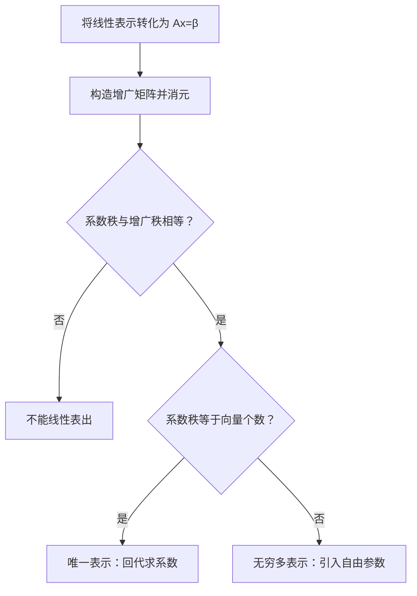
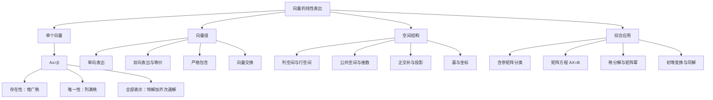

## 一、本节知识体系与考研命题结构

| 知识模块           | 代表性题目            | 掌握优先级 |
| -------------- | ---------------- | ----- |
| 线性表出的基本概念与抽象证明 | 1992年数一、1999年数三  | ★★★★★ |
| 向量组的相互表出与等价    | 2013年数一、李林880    | ★★★★★ |
| 含参向量的表出与唯一性    | 1991年数一、李正元      | ★★★★★ |
| 向量组的严格包含       | 2011年真题、张宇8套卷    | ★★★★★ |
| 含参向量组等价        | 2022年真题、2019年数二三 | ★★★★★ |
| 公共线性表出与交空间     | 2023年真题、汤家凤8套卷   | ★★★★★ |
| 正交向量组与正交投影     | 2023年数一          | ★★★★★ |
| 线性表出与矩阵方程      | 张宇1000题、李林880    | ★★★★  |
| 秩分解与矩阵幂        | 李林880            | ★★★★  |
| 基与坐标、抽象向量变换    | 张宇1000题、李正元      | ★★★★  |

**这一节最重要的不是如何计算线性组合的系数，而是如何在向量、矩阵、秩、方程组和空间这五种语言之间自由转换。**

本节实际上是整部线性代数的一个枢纽。后面的线性相关性、极大线性无关组、基础解系、非齐次方程组、相似对角化，都建立在本节的思想之上。

## 第一部分 基础概念与核心知识体系

### 二、如何真正理解向量的线性表出

**2.1 线性表出的定义**

设有 $n$ 维向量组

$$
\alpha_1,\alpha_2,\ldots,\alpha_s
$$

以及一个 $n$ 维向量 $\beta$。

若存在一组实数 $k_1,k_2,\ldots,k_s$，使得

$$
\boxed{ \beta=k_1\alpha_1+k_2\alpha_2+\cdots+k_s\alpha_s }
$$

则称向量 $\beta$ 可以由向量组 $\alpha_1,\ldots,\alpha_s$ 线性表出，也称线性表示。

注意三个基本问题：

- 是否存在这样的系数？
- 如果存在，系数是否唯一？
- 如果不唯一，如何求出全部系数？

这三个问题几乎涵盖了所有具体向量的线性表出计算题。

**2.2 几何直观：向量组能够到达什么地方**

考虑二维向量

$$
\alpha_1=\begin{pmatrix}1\\1\end{pmatrix}.
$$

它的所有线性组合为

$$
k\alpha_1=\begin{pmatrix}k\\k\end{pmatrix}.
$$

因此，它所能表出的向量全部位于直线 $y=x$ 上。

若再加入

$$
\alpha_2=\begin{pmatrix}1\\-1\end{pmatrix},
$$

那么

$$
k_1\alpha_1+k_2\alpha_2 =\begin{pmatrix}k_1+k_2\\k_1-k_2\end{pmatrix}.
$$

对任意二维向量 $(x,y)^{\mathrm T}$，均可令

$$
k_1=\frac{x+y}{2},\qquad k_2=\frac{x-y}{2}.
$$

于是这两个向量可以表出整个二维平面。

由此产生一个极其重要的概念：张成空间。

**2.3 张成空间**

定义

$$
\operatorname{span}(\alpha_1,\ldots,\alpha_s) = \left\{ \sum_{i=1}^{s}k_i\alpha_i \;\middle|\;k_i\in\mathbb R \right\}.
$$

它就是这些向量能够线性表出的全体向量的集合。

设

$$
U=\operatorname{span}(\alpha_1,\ldots,\alpha_s),
$$

那么

$$
\boxed{ \beta\text{ 可由 }\alpha_1,\ldots,\alpha_s \text{ 线性表出} \iff \beta\in U }
$$

在三维空间中，可以这样理解：

| 向量组的秩 | 张成空间   | 可以表出的向量  |
| ----- | ------ | -------- |
| 0     | 原点     | 只有零向量    |
| 1     | 过原点的直线 | 直线上的任意向量 |
| 2     | 过原点的平面 | 平面内的任意向量 |
| 3     | 整个三维空间 | 任意三维向量   |

向量组中有几个向量，与其真正能够覆盖多少维空间，是两个不同的问题。

例如，三个三维向量也可能只张成一条直线。

### 三、线性表出的核心：转化为线性方程组

记

$$
A=(\alpha_1,\alpha_2,\ldots,\alpha_s) \in\mathbb R^{n\times s},
$$

令

$$
x=\begin{pmatrix}k_1\\k_2\\\vdots\\k_s\end{pmatrix}.
$$

则

$$
Ax=k_1\alpha_1+\cdots+k_s\alpha_s.
$$

因此，得到本节最根本的等价关系：

$$
\boxed{ \beta\text{ 可由 }\alpha_1,\ldots,\alpha_s \text{ 线性表出} \iff Ax=\beta\text{ 有解} }
$$

再利用线性方程组的秩判据，得到

$$
\boxed{ \beta\in\operatorname{Col}(A) \iff r(A)=r(A,\beta) }
$$

其中 $\operatorname{Col}(A)$ 表示矩阵 $A$ 的列空间。

**3.1 存在性与唯一性的完整判定**

设原向量组有 $s$ 个向量。

| 表示情况    | 线性方程组情况 | 充要条件                     |
| ------- | ------- | ------------------------ |
| 不能表出    | 无解      | $r(A)\ne r(A,\beta)$ |
| 能表出且唯一  | 唯一解     | $r(A)=r(A,\beta)=s$  |
| 能表出但不唯一 | 无穷多解    | $r(A)=r(A,\beta)<s$ |

尤其要记住：

$$
\boxed{\text{唯一性看列数}}
$$

$$
\boxed{\text{任意向量均可表出看行数}}
$$

因为：

- $r(A)=s$ 表示列满秩，只要有解，表示就是唯一的。
- $r(A)=n$ 表示行满秩，任意 $n$ 维向量均可由其列向量表出。
- 只有当 $n=s=r(A)$ 时，任意向量才均具有唯一表示。

**3.2 三种矩阵结构的区别**

例如

$$
A=\begin{pmatrix} 1&0\\ 0&1\\ 0&0 \end{pmatrix}.
$$

虽然 $A$ 的两列线性无关，但是它不能表出任意三维向量，只能表出

$$
\beta=(a,b,0)^{\mathrm T}.
$$

而且只要能够表出，表示就一定唯一。

反过来，考虑

$$
B=\begin{pmatrix} 1&0&1\\ 0&1&1 \end{pmatrix}.
$$

它可以表出任意二维向量，但由于有三个列向量而秩为2，所以每个二维向量都具有无穷多种表示。

这说明：

**可以表出任意向量，与线性表出唯一，既不等价，也不能相互直接推出。**

**3.3 全部线性表示式如何求**

若已知一个特解 $x_0$，满足

$$
Ax_0=\beta,
$$

那么全部系数解为

$$
\boxed{x=x_0+\eta,\qquad A\eta=0.}
$$

进一步，若齐次方程组 $Ax=0$ 的基础解系为

$$
\eta_1,\ldots,\eta_{s-r(A)},
$$

则全部线性表示系数为

$$
\boxed{ x=x_0+c_1\eta_1+\cdots+c_{s-r(A)}\eta_{s-r(A)} }
$$

其中各个 $c_i$ 为任意实数。

其本质是：在一个正确的线性组合中，加入任何等于零的线性组合，都不会改变原向量。

### 四、线性表出与线性相关、线性无关的关系

虽然线性相关性是下一节的重点，但在本节必须先掌握其与线性表出的关系。

**4.1 线性相关的本质**

向量组 $\alpha_1,\ldots,\alpha_s$ 线性相关，当且仅当存在不全为零的系数，使得

$$
k_1\alpha_1+\cdots+k_s\alpha_s=0.
$$

若其中 $k_j\ne0$，则可移项得到

$$
\boxed{ \alpha_j=-\sum_{i\ne j}\frac{k_i}{k_j}\alpha_i }
$$

因此，含至少两个向量的向量组线性相关，等价于至少有一个向量能够由其余向量线性表出。

**4.2 最常用的增补定理**

若

$$
\alpha_1,\ldots,\alpha_s
$$

线性无关，那么

$$
\boxed{ \alpha_1,\ldots,\alpha_s,\beta \text{ 线性相关} \iff \beta\text{ 可由 }\alpha_1,\ldots,\alpha_s \text{ 线性表出} }
$$

对应的另一面为

$$
\boxed{ \alpha_1,\ldots,\alpha_s,\beta \text{ 线性无关} \iff \beta\text{ 不能由 }\alpha_1,\ldots,\alpha_s \text{ 线性表出} }
$$

这里的关键前提是：**原向量组必须线性无关。**

如果原向量组已经线性相关，那么无论加入什么向量，整个向量组都会线性相关，不能据此判断新向量能否被原向量组表出。

**4.3 加入一个向量后，秩如何变化**

这一结论不需要原向量组线性无关：

$$
r(A,\beta)= \begin{cases} r(A),&\beta\in\operatorname{Col}(A),\\ r(A)+1,&\beta\notin\operatorname{Col}(A). \end{cases}
$$

这是解决抽象秩问题、极大线性无关组问题的重要工具。

### 五、向量组的线性表出与等价

设

$$
A=(\alpha_1,\ldots,\alpha_s),\qquad B=(\beta_1,\ldots,\beta_t).
$$

**5.1 一个向量组可由另一个向量组表出**

如果每一个 $\beta_j$ 都可由 $\alpha_1,\ldots,\alpha_s$ 线性表出，则称 $B$ 的列向量组可以由 $A$ 的列向量组线性表出。

以下条件完全等价：

$$
\boxed{ \begin{aligned} &B\text{ 的列向量组可由 }A\text{ 的列向量组表出}\\ \iff{}&\operatorname{Col}(B)\subseteq\operatorname{Col}(A)\\ \iff{}&\exists X,\ AX=B\\ \iff{}&r(A,B)=r(A). \end{aligned} }
$$

其中

$$
A\in\mathbb R^{n\times s},\quad B\in\mathbb R^{n\times t},\quad X\in\mathbb R^{s\times t}.
$$

一定有

$$
r(B)\le r(A).
$$

但其逆命题不成立。

**5.2 向量组等价**

如果两个向量组能够相互线性表出，则称两个向量组等价。

记作

$$
(\alpha_1,\ldots,\alpha_s) \sim (\beta_1,\ldots,\beta_t).
$$

以下条件完全等价：

$$
\boxed{ \begin{aligned} &A\text{ 与 }B\text{ 的列向量组等价}\\ \iff{}&\operatorname{Col}(A)=\operatorname{Col}(B)\\ \iff{}&r(A)=r(B)=r(A,B)\\ \iff{}&\exists X,Y,\ B=AX,\ A=BY. \end{aligned} }
$$

这组等价条件是本节需要熟练掌握的核心公式。

**5.3 单向表出加同秩，等价**

如果已知

$$
\operatorname{Col}(B)\subseteq\operatorname{Col}(A),
$$

并且

$$
r(B)=r(A),
$$

那么一定有

$$
\operatorname{Col}(B)=\operatorname{Col}(A).
$$

因为两个有限维空间之间已有包含关系，并且维数相同，所以必然相等。

因此，证明向量组等价有两种基本方法：

方法一：直接证明双方可以相互线性表出。

方法二：证明其中一方可以由另一方表出，再证明二者的秩相等。

第二种方法通常更适合含参计算题。

**5.4 必须区分的四个概念**

| 概念         | 本质          | 能否推出向量组等价 |
| ---------- | ----------- | --------- |
| 向量个数相等     | 数量相同        | 不能        |
| 向量组的秩相等    | 空间维数相同      | 不能        |
| 向量组等价      | 张成空间相同      | 能         |
| 两组都是同一空间的基 | 张成空间相同且各自无关 | 能         |

例如

$$
A=\begin{pmatrix}1\\0\end{pmatrix}, \qquad B=\begin{pmatrix}0\\1\end{pmatrix}.
$$

虽然

$$
r(A)=r(B)=1,
$$

但是一个张成横轴，另一个张成纵轴，因此不等价。

## 第二部分 抽象线性表出与向量交换

### 六、题型一：利用线性相关性证明某向量能否被表出

**母题1：1992年数学一真题**

设向量组 $\alpha_1,\alpha_2,\alpha_3$ 线性相关，而向量组 $\alpha_2,\alpha_3,\alpha_4$ 线性无关。

试证明：

（1）$\alpha_1$ 能否由 $\alpha_2,\alpha_3$ 线性表出？

（2）$\alpha_4$ 能否由 $\alpha_1,\alpha_2,\alpha_3$ 线性表出？

**第（1）问：锁定非零系数**

由线性相关性，存在不全为零的 $k_1,k_2,k_3$，使得

$$
k_1\alpha_1+k_2\alpha_2+k_3\alpha_3=0.
$$

由于 $\alpha_2,\alpha_3,\alpha_4$ 线性无关，其子组 $\alpha_2,\alpha_3$ 也线性无关。

假设 $k_1=0$，则

$$
k_2\alpha_2+k_3\alpha_3=0.
$$

由线性无关性得到

$$
k_2=k_3=0.
$$

这与 $k_1,k_2,k_3$ 不全为零矛盾。

因此 $k_1\ne0$，从而

$$
\boxed{ \alpha_1=-\frac{k_2}{k_1}\alpha_2 -\frac{k_3}{k_1}\alpha_3 }
$$

所以能够线性表出。

**第（2）问：利用张成空间不变**

由第（1）问可知

$$
\operatorname{span}(\alpha_1,\alpha_2,\alpha_3) = \operatorname{span}(\alpha_2,\alpha_3).
$$

而 $\alpha_2,\alpha_3,\alpha_4$ 线性无关，说明

$$
\alpha_4\notin \operatorname{span}(\alpha_2,\alpha_3).
$$

于是

$$
\alpha_4\notin \operatorname{span}(\alpha_1,\alpha_2,\alpha_3).
$$

因此不能线性表出。

**母题提炼**

当题目同时给出一个相关组和一个无关组时，重点寻找它们的公共子组。

本题实际上是：

$$
\underbrace{\alpha_2,\alpha_3}_{\text{公共无关组}}
$$

加入 $\alpha_1$ 后秩不变，加入 $\alpha_4$ 后秩增加。

因此还可以立即推出：

$$
r(\alpha_1,\alpha_2,\alpha_3)=2,
$$

$$
r(\alpha_1,\alpha_2,\alpha_3,\alpha_4)=3.
$$

而且 $\alpha_1$ 由 $\alpha_2,\alpha_3$ 表出的系数一定唯一。

### 七、题型二：向量交换与非零系数问题

**母题2：1999年数学三真题**

设 $\beta$ 可以由

$$
\alpha_1,\ldots,\alpha_m
$$

线性表出，却不能由

$$
\alpha_1,\ldots,\alpha_{m-1}
$$

线性表出。

判断 $\alpha_m$ 能否由原来的前 $m-1$ 个向量表出，以及能否由

$$
\alpha_1,\ldots,\alpha_{m-1},\beta
$$

表出。

**解题过程**

由题意，

$$
\beta=k_1\alpha_1+\cdots+k_m\alpha_m.
$$

因为 $\beta$ 不能由前 $m-1$ 个向量表出，因此任何有效表示中的 $k_m$ 都不可能为零。

于是可以解出

$$
\boxed{ \alpha_m= \frac{1}{k_m} \left(\beta-\sum_{i=1}^{m-1}k_i\alpha_i\right). }
$$

所以 $\alpha_m$ 能由新向量组表出。

另一方面，如果 $\alpha_m$ 能由前 $m-1$ 个向量表出，那么将其代回 $\beta$ 的表示式，就会导致 $\beta$ 也能由前 $m-1$ 个向量表出，矛盾。

因此 $\alpha_m$ 不能由前 $m-1$ 个向量表出。

**一般化：向量交换原理**

若

$$
\beta=\sum_{i=1}^m k_i\alpha_i,\qquad k_j\ne0,
$$

那么

$$
\boxed{ (\alpha_1,\ldots,\alpha_j,\ldots,\alpha_m) \sim (\alpha_1,\ldots,\beta,\ldots,\alpha_m) }
$$

也就是可以用 $\beta$ 替换 $\alpha_j$，并保持张成空间不变。

注意：这个结论不要求原向量组线性无关。

如果原组线性无关，那么交换后的向量组也线性无关。

**变式：张宇1000题基础部分第3、10题**

设 $\alpha_1,\ldots,\alpha_n$ 线性无关，且

$$
\beta=k_1\alpha_1+\cdots+k_n\alpha_n,
$$

其中所有 $k_i\ne0$。

那么原组中任意一个向量都可以用 $\beta$ 替换，替换后的向量组仍线性无关。

为什么？

交换后，向量个数仍为 $n$，张成空间不变，秩仍为 $n$，故一定线性无关。

更进一步，如果加入 $\beta$ 得到 $n+1$ 个向量，那么整个向量组相关，但任意删去一个向量后，剩余 $n$ 个向量均无关。

这是后续线性相关性中非常重要的一类结构。

**模拟题迁移：李永乐六套卷第5套第5题**

已知

$$
k\alpha+l\beta+m\gamma=0,\qquad km\ne0.
$$

由于 $k,m$ 非零，可以分别解出

$$
\alpha=-\frac lk\beta-\frac mk\gamma,
$$

$$
\gamma=-\frac km\alpha-\frac lm\beta.
$$

所以

$$
\boxed{(\alpha,\beta)\sim(\beta,\gamma).}
$$

但不能保证 $(\alpha,\gamma)$ 与其他两组等价，因为 $l$ 可能为零。

**抽象题的关键习惯：看到一个线性关系，首先检查题目保证哪些系数非零，再确定哪些向量可以被移项替换。**

### 八、题型三：矩阵乘法与向量组等价

**母题3：2013年数学一真题**

设 $A,B,C$ 均为 $n$ 阶矩阵，满足

$$
AB=C,
$$

其中 $B$ 可逆。

问哪两个行向量组或列向量组一定等价？

**解法**

设

$$
A=(\alpha_1,\ldots,\alpha_n),
$$

$$
B=(b_{ij})_{n\times n}.
$$

则 $C=AB$ 的第 $j$ 列为

$$
\gamma_j= b_{1j}\alpha_1+\cdots+b_{nj}\alpha_n.
$$

因此 $C$ 的每一列都可由 $A$ 的列向量表出，即

$$
\operatorname{Col}(C)\subseteq\operatorname{Col}(A).
$$

又因为 $B$ 可逆，

$$
A=CB^{-1}.
$$

同理可得

$$
\operatorname{Col}(A)\subseteq\operatorname{Col}(C).
$$

故

$$
\boxed{\operatorname{Col}(A)=\operatorname{Col}(C).}
$$

答案为 $A,C$ 的列向量组等价。

**8.1 左乘和右乘的完整知识体系**

设 $P,Q$ 为尺寸适配的可逆矩阵。

| 运算        | 保持列空间 | 保持行空间 | 保持秩 |
| --------- | ----- | ----- | --- |
| $PA$  | 不一定   | 一定    | 一定  |
| $AQ$  | 一定    | 不一定   | 一定  |
| $PAQ$ | 不一定   | 不一定   | 一定  |

记忆方法：

$$
\boxed{\text{左乘是行变换，右乘是列变换}}
$$

右乘相当于对原来的列向量重新进行可逆线性组合，所以列空间不变。

左乘相当于对原来的行向量重新进行可逆线性组合，所以行空间不变。

对于一般的矩阵乘法，即使不要求可逆，也有

$$
\operatorname{Col}(AB)\subseteq\operatorname{Col}(A),
$$

$$
\operatorname{Row}(AB)\subseteq\operatorname{Row}(B).
$$

由此可直接得到

$$
\boxed{r(AB)\le\min\{r(A),r(B)\}.}
$$

**8.2 更深层的充要条件**

对于同型矩阵 $A,B\in\mathbb R^{n\times s}$，有

$$
\boxed{ \operatorname{Col}(A)=\operatorname{Col}(B) \iff \exists\text{ 可逆矩阵 }Q,\ B=AQ }
$$

因此：

$$
\boxed{\text{同型矩阵列向量组等价}\iff\text{列等价}}
$$

同理：

$$
\boxed{\text{同型矩阵行向量组等价}\iff\text{行等价}}
$$

但一般的矩阵等价指

$$
B=PAQ,
$$

其充要条件只是

$$
r(A)=r(B).
$$

**矩阵等价与向量组等价，不能混淆。**

**8.3 与齐次线性方程组同解的联系**

如果 $A,B$ 列空间相同，那么

$$
\boxed{A^{\mathrm T}x=0,\quad B^{\mathrm T}x=0\text{ 同解}.}
$$

因为

$$
A^{\mathrm T}x=0
$$

意味着 $x$ 与 $A$ 的每一个列向量都正交，也就与整个列空间正交。

类似地，对于列数相同的矩阵，

$$
\boxed{ Ax=0,\ Bx=0\text{ 同解} \iff \operatorname{Row}(A)=\operatorname{Row}(B). }
$$

这是本节与后续公共解、同解问题之间的重要连接。

## 第三部分 含参向量的线性表出

### 九、题型四：含参向量的存在性、唯一性与一般表达式

这一类题是本节最重要的计算题型之一。

**9.1 标准解题流程**

当题目出现“参数为何值时能表示、不能表示、唯一表示或不唯一表示”等字眼，首先应构造

$$
(A\mid\beta).
$$

对增广矩阵进行初等行变换，化为阶梯形。

如果 $A$ 是方阵，也可以先通过

$$
|A|=0
$$

筛选可能降秩的参数值。

注意：不能直接除以含有未知参数的表达式，除非已经明确讨论该表达式不为零的情形。

**母题4：1991年数学一真题**

已知

$$
\begin{aligned} \alpha_1&=(1,0,2,3)^{\mathrm T},\\ \alpha_2&=(1,1,3,5)^{\mathrm T},\\ \alpha_3&=(1,-1,a+2,1)^{\mathrm T},\\ \alpha_4&=(1,2,4,a+8)^{\mathrm T},\\ \beta&=(1,1,b+3,5)^{\mathrm T}. \end{aligned}
$$

讨论 $\beta$ 不能由四个 $\alpha_i$ 表出的条件，以及唯一表出的条件和表示式。

<Steps>

<Step>

### 第一步：构造增广矩阵 [!toc]

$$
(A\mid\beta)= \left( \begin{array}{cccc|c} 1&1&1&1&1\\ 0&1&-1&2&1\\ 2&3&a+2&4&b+3\\ 3&5&1&a+8&5 \end{array} \right).
$$

进行行变换：

$$
R_3\leftarrow R_3-2R_1-R_2,
$$

$$
R_4\leftarrow R_4-3R_1-2R_2.
$$

得到

$$
\left( \begin{array}{cccc|c} 1&1&1&1&1\\ 0&1&-1&2&1\\ 0&0&a+1&0&b\\ 0&0&0&a+1&0 \end{array} \right).
$$

因此关键参数为 $a=-1$。

</Step>

<Step>

### 第二步：讨论 $a\ne-1$ [!toc]

此时

$$
r(A)=r(A,\beta)=4.
$$

所以 $\beta$ 对任意 $b$ 均有唯一表示。

由最后两行得到

$$
x_4=0,\qquad x_3=\frac b{a+1}.
$$

第二行给出

$$
x_2=1+\frac b{a+1}.
$$

第一行给出

$$
x_1=-\frac{2b}{a+1}.
$$

故唯一表示式为

$$
\boxed{ \beta=-\frac{2b}{a+1}\alpha_1 +\frac{a+b+1}{a+1}\alpha_2 +\frac b{a+1}\alpha_3 }
$$

</Step>

<Step>

### 第三步：讨论 $a=-1$ [!toc]

增广矩阵变成

$$
\left( \begin{array}{cccc|c} 1&1&1&1&1\\ 0&1&-1&2&1\\ 0&0&0&0&b\\ 0&0&0&0&0 \end{array} \right).
$$

若 $b\ne0$，第三行代表

$$
0=b,
$$

出现矛盾，因此无解。

若 $b=0$，则有

$$
r(A)=r(A,\beta)=2<4.
$$

此时有无穷多种表示。

虽然原真题未要求这一情况下的全部表示式，但作为知识拓展，可以令

$$
x_3=s,\qquad x_4=t.
$$

回代得到

$$
x_2=1+s-2t,\qquad x_1=t-2s.
$$

于是

$$
\boxed{ \beta=(t-2s)\alpha_1 +(1+s-2t)\alpha_2+s\alpha_3+t\alpha_4 }
$$

其中 $s,t\in\mathbb R$。

</Step>

</Steps>

**最终分类**

| 参数条件                    | 表示情况   |
| ----------------------- | ------ |
| $a\ne-1$，$b$ 任意 | 唯一表示   |
| $a=-1,\ b\ne0$      | 不能表示   |
| $a=-1,\ b=0$        | 无穷多种表示 |

**母题价值：** 一道题将线性表出的三种情况完整串联起来。尤其要理解，同一个奇异系数矩阵，右端向量不同，可能对应无解，也可能对应无穷多解。

### 十、题型五：多个奇异参数与相容性条件

**母题5：李正元第三章计算证明题第1题**

已知

$$
\begin{aligned} \alpha_1&=(1,1,0,2)^{\mathrm T},\\ \alpha_2&=(-1,1,2,4)^{\mathrm T},\\ \alpha_3&=(2,3,a,7)^{\mathrm T},\\ \alpha_4&=(-1,5,-3,a+6)^{\mathrm T},\\ \beta&=(1,0,2,b)^{\mathrm T}. \end{aligned}
$$

讨论不同参数下 $\beta$ 的线性表示情况。

这道题比1991年真题更进一步：存在两个不同的奇异参数值，而且它们对应的相容条件不同。

<Steps>

<Step>

### 第一步：筛选奇异参数 [!toc]

设

$$
A=(\alpha_1,\alpha_2,\alpha_3,\alpha_4).
$$

计算得

$$
|A|=2(a-1)(a-10).
$$

因此只需要重点讨论

$$
a=1,\qquad a=10.
$$

当 $a\ne1,10$ 时，对任意 $b$ 均有唯一线性表示。

</Step>

<Step>

### 第二步：研究 $a=1$ [!toc]

此时 $r(A)=3$，并且系数矩阵各行满足

$$
-2R_2-R_3+R_4=0.
$$

如果方程组有解，那么增广列也必须满足相同的关系：

$$
-2\cdot0-2+b=0.
$$

故

$$
b=2.
$$

当 $a=1,b=2$ 时，令第三个表示系数为 $t$，可求得

$$
x= \begin{pmatrix} \frac76-\frac52t\\ \frac12-\frac12t\\ t\\ -\frac13 \end{pmatrix}.
$$

</Step>

<Step>

### 第三步：研究 $a=10$ [!toc]

此时同样有 $r(A)=3$，但行关系发生变化：

$$
R_1-3R_2+R_4=0.
$$

对增广列施加相同的约束：

$$
1-3\cdot0+b=0.
$$

故

$$
b=-1.
$$

当 $a=10,b=-1$ 时，全部系数可写成

$$
x= \begin{pmatrix} -\frac13-\frac92t\\ -\frac23-\frac72t\\ \frac13+t\\ t \end{pmatrix}.
$$

其中 $t\in\mathbb R$。

</Step>

</Steps>

**最终结论**

| 条件                  | 结论    |
| ------------------- | ----- |
| $a\ne1,10$      | 唯一表示  |
| $a=1,\ b=2$     | 表示不唯一 |
| $a=10,\ b=-1$   | 表示不唯一 |
| $a=1,\ b\ne2$   | 不能表示  |
| $a=10,\ b\ne-1$ | 不能表示  |

**10.1 高级技巧：利用左零空间判断能否表出**

上述解法可以推广。

若存在非零向量 $u$，使得

$$
u^{\mathrm T}A=0,
$$

那么只要 $Ax=\beta$ 有解，就必然有

$$
u^{\mathrm T}\beta =u^{\mathrm T}Ax=0.
$$

因此

$$
\boxed{ \beta\in\operatorname{Col}(A) \iff \forall u\in\ker(A^{\mathrm T}),\ u^{\mathrm T}\beta=0. }
$$

换句话说：

**目标向量必须满足原向量组所有的线性坐标约束。**

当 $A$ 是 $n$ 阶矩阵，且秩为 $n-1$ 时，其左零空间只有一维，这时找到一个非零的左零向量，就足以建立可解的充要条件。

### 十一、题型六：系数矩阵恒奇异的线性表出

**母题6：李林880基础解答题第1题**

原题给出

$$
\begin{aligned} \alpha_1&=(1,1,1,2)^{\mathrm T},\\ \alpha_2&=(3,a+4,2a+5,a+7)^{\mathrm T},\\ \alpha_3&=(4,6,8,10)^{\mathrm T},\\ \alpha_4&=(2,3,2a+3,5)^{\mathrm T},\\ \beta&=(0,1,3,b)^{\mathrm T}. \end{aligned}
$$

要求求秩、极大线性无关组，并讨论不可表出的参数条件。

构造增广矩阵并消元，得到

$$
\left( \begin{array}{cccc|c} 1&3&4&2&0\\ 0&a+1&2&1&1\\ 0&0&0&2a-1&1\\ 0&0&0&0&b-1 \end{array} \right).
$$

**关键观察**

系数矩阵最后一行恒为零，因此

$$
|A|\equiv0.
$$

也就是说，对任何 $a$，原向量组都不可能具有四阶满秩。

这类题如果只会计算行列式，就无法继续。

前两行始终独立，因此：

$$
r(A)= \begin{cases} 3,&a\ne\frac12,\\ 2,&a=\frac12. \end{cases}
$$

当 $a\ne\frac12$ 时，可取极大线性无关组

$$
\alpha_1,\alpha_3,\alpha_4.
$$

当 $a=\frac12$ 时，可取

$$
\alpha_1,\alpha_2.
$$

再看增广列：

当 $a=\frac12$ 时，第三行成为

$$
0=1.
$$

因此无论 $b$ 取什么值，都不能线性表出。

当 $a\ne\frac12$ 时，第三行可以求解，最后一行要求

$$
b=1.
$$

综上，能线性表出的条件是

$$
\boxed{a\ne\frac12\quad\text{且}\quad b=1.}
$$

不能线性表出的条件是

$$
\boxed{a=\frac12\quad\text{或}\quad b\ne1.}
$$

<Callout type="warn" title="易错陷阱">

多个相容条件必须同时满足，而无解只需要其中任何一个条件失败。

因此不能把最后的“或”错误地写成“且”。

</Callout>

### 十二、模拟题强化：李林六套卷第2套第5题

已知

$$
\beta=(a,1,1)^{\mathrm T},
$$

$$
\begin{aligned} \alpha_1&=(b,0,1)^{\mathrm T},\\ \alpha_2&=(1,b,-1)^{\mathrm T},\\ \alpha_3&=(1,0,b)^{\mathrm T}. \end{aligned}
$$

若 $\beta$ 可以由这三个向量表出，且表示法不唯一，求 $a,b$。

<Steps>

<Step>

### 第一步：不唯一意味着系数矩阵降秩 [!toc]

$$
A=\begin{pmatrix} b&1&1\\ 0&b&0\\ 1&-1&b \end{pmatrix}.
$$

由

$$
|A|=b(b^2-1)=0
$$

得到

$$
b=0,\quad b=1,\quad b=-1.
$$

</Step>

<Step>

### 第二步：检查是否真正有解 [!toc]

当 $b=0$ 时，三个向量的第二分量都是零，而 $\beta$ 的第二分量为1，因此无解。

当 $b=1$ 时，

$$
\alpha_1=\alpha_3=(1,0,1)^{\mathrm T}.
$$

由第二、第三分量可知

$$
\beta=2\alpha_1+\alpha_2,
$$

故

$$
a=3.
$$

当 $b=-1$ 时，

$$
\alpha_3=-\alpha_1.
$$

由第二、第三分量可知

$$
\beta=-\alpha_2,
$$

故

$$
a=-1.
$$

最终结果为

$$
\boxed{(a,b)=(3,1)\quad\text{或}\quad(-1,-1).}
$$

**选项勘误：** 原四个选项均不符合计算结果，上述两个参数组合为正确答案。

</Step>

</Steps>

## 第四部分 向量组等价与含参综合问题

### 十三、题型七：求参数使两个向量组等价

**13.1 三种常用解法**

对于

$$
A=(\alpha_1,\ldots,\alpha_s), \qquad B=(\beta_1,\ldots,\beta_t),
$$

要求向量组等价时，可以选择以下方法。

**方法一：合并矩阵秩判定。**

$$
r(A)=r(B)=r(A,B).
$$

适用范围最广，尤其适合两个向量组都含有未知参数的情况。

**方法二：先证明单向表出，再证明秩相等。**

$$
r(A,B)=r(A),\qquad r(A)=r(B).
$$

适合其中一组向量结构比较简单的题目。

**方法三：直接利用空间方程。**

若已知原向量组张成某个平面，例如

$$
U=\{(x,y,z)^{\mathrm T}:ax+by+cz=0\},
$$

那么只需令新向量组中的所有向量满足平面方程，再检查其秩是否为2。

这种方法通常最适合三维向量组的快速计算。

**母题7：李林880基础解答题第5题**

设

$$
\begin{aligned} \alpha_1&=(1,3,0,5)^{\mathrm T},\\ \alpha_2&=(1,2,1,4)^{\mathrm T},\\ \alpha_3&=(1,1,2,3)^{\mathrm T}, \end{aligned}
$$

以及

$$
\beta_1=(1,-3,6,-1)^{\mathrm T}, \qquad \beta_2=(a,0,b,2)^{\mathrm T}.
$$

若两个向量组等价，求 $a,b$。

<Steps>

<Step>

### 第一步：寻找原组的极大线性无关组 [!toc]

观察得

$$
\alpha_3=2\alpha_2-\alpha_1.
$$

而 $\alpha_1,\alpha_2$ 不成比例，所以

$$
r(A)=2.
$$

从而

$$
\operatorname{Col}(A) =\operatorname{span}(\alpha_1,\alpha_2).
$$

原问题由三个向量简化为两个向量。

</Step>

<Step>

### 第二步：求单向表出的必要条件 [!toc]

验证可知

$$
\beta_1=-5\alpha_1+6\alpha_2.
$$

再令

$$
\beta_2=x\alpha_1+y\alpha_2.
$$

比较坐标：

$$
\begin{cases} x+y=a,\\ 3x+2y=0,\\ y=b,\\ 5x+4y=2. \end{cases}
$$

由第二、第四个方程得

$$
x=-2,\qquad y=3.
$$

所以

$$
\boxed{a=1,\qquad b=3.}
$$

</Step>

<Step>

### 第三步：检验是否真正等价 [!toc]

目前只证明了

$$
\operatorname{Col}(B)\subseteq\operatorname{Col}(A).
$$

还需要证明两个向量组的秩相等。

由于

$$
(\beta_1,\beta_2) =(\alpha_1,\alpha_2) \begin{pmatrix} -5&-2\\ 6&3 \end{pmatrix},
$$

而

$$
\begin{vmatrix} -5&-2\\ 6&3 \end{vmatrix}=-3\ne0,
$$

所以

$$
r(B)=2=r(A).
$$

故两组等价，所求参数成立。

</Step>

</Steps>

**关键总结**

这道题的标准套路是：

$$
\boxed{ \text{原组降维} \longrightarrow \text{新组逐个表出} \longrightarrow \text{检验新组是否张满原空间} }
$$

最后一步不能省略。

### 十四、题型八：利用法向量快速判定向量组等价

**母题8：张宇1000题强化解答题**

已知

$$
\begin{aligned} \alpha_1&=(1,-1,1)^{\mathrm T},\\ \alpha_2&=(1,1,0)^{\mathrm T},\\ \alpha_3&=(2,0,1)^{\mathrm T}, \end{aligned}
$$

以及

$$
\begin{aligned} \beta_1&=(a,-1,1)^{\mathrm T},\\ \beta_2&=(4,0,b)^{\mathrm T},\\ \beta_3&=(0,c,1)^{\mathrm T}. \end{aligned}
$$

求两组等价的参数，并写出双向线性表示。

<Steps>

<Step>

### 第一步：确定张成空间 [!toc]

显然

$$
\alpha_3=\alpha_1+\alpha_2.
$$

所以原组张成一个二维平面。

求法向量：

$$
n=\alpha_1\times\alpha_2 =\begin{pmatrix}-1\\1\\2\end{pmatrix}.
$$

因此原组所能表出的任意向量，均满足

$$
\boxed{-x+y+2z=0.}
$$

</Step>

<Step>

### 第二步：直接将新向量代入平面方程 [!toc]

$$
\begin{cases} -a-1+2=0,\\ -4+2b=0,\\ c+2=0. \end{cases}
$$

立刻得到

$$
\boxed{a=1,\qquad b=2,\qquad c=-2.}
$$

这种方法不需要对每一个向量单独列三个未知系数的方程组，因此比常规消元更快。

</Step>

<Step>

### 第三步：检验新组的秩 [!toc]

代入参数后，

$$
\begin{aligned} \beta_1&=\alpha_1,\\ \beta_2&=2\alpha_1+2\alpha_2,\\ \beta_3&=\alpha_1-\alpha_2. \end{aligned}
$$

由于 $\beta_1,\beta_2$ 线性无关，所以

$$
r(B)=r(A)=2.
$$

两组确实等价。

如果题目仅要求给出一种表示，那么直接写

$$
\beta_1=\alpha_1,\qquad \alpha_1=\beta_1
$$

即可。

如果进一步要求所有表示式，则需要利用零线性组合。

由

$$
\alpha_1+\alpha_2-\alpha_3=0
$$

可得

$$
\boxed{ \beta_1=(1+t)\alpha_1+t\alpha_2-t\alpha_3 }
$$

其中 $t\in\mathbb R$。

同理，由

$$
4\beta_1-\beta_2-2\beta_3=0
$$

可得

$$
\boxed{ \alpha_1=(1+4s)\beta_1-s\beta_2-2s\beta_3 }
$$

其中 $s\in\mathbb R$。

</Step>

</Steps>

**法向量法的适用条件**

三维空间中，若原向量组的秩为2，则一个非零法向量足以确定其张成平面。

在更高维空间，或者三维向量组秩为1时，仅找到一个法向量通常不够。需要找到完整的正交补约束。

### 十五、题型九：含参向量组等价的奇异值分类

**母题9：2022年数学一、二、三真题**

设

$$
\alpha_1=\begin{pmatrix}\lambda\\1\\1\end{pmatrix}, \quad \alpha_2=\begin{pmatrix}1\\\lambda\\1\end{pmatrix},
$$

$$
\alpha_3=\begin{pmatrix}1\\1\\\lambda\end{pmatrix}, \quad \alpha_4=\begin{pmatrix}1\\\lambda\\\lambda^2\end{pmatrix}.
$$

若

$$
(\alpha_1,\alpha_2,\alpha_3) \sim (\alpha_1,\alpha_2,\alpha_4),
$$

求 $\lambda$ 的取值范围。

这是本节极具代表性的一道新时期真题。

<Steps>

<Step>

### 第一步：分别构造矩阵 [!toc]

$$
A=\begin{pmatrix} \lambda&1&1\\ 1&\lambda&1\\ 1&1&\lambda \end{pmatrix},
$$

$$
B=\begin{pmatrix} \lambda&1&1\\ 1&\lambda&\lambda\\ 1&1&\lambda^2 \end{pmatrix}.
$$

分别计算行列式：

$$
|A|=(\lambda-1)^2(\lambda+2),
$$

$$
|B|=(\lambda-1)^2(\lambda+1)^2.
$$

</Step>

<Step>

### 第二步：处理一般参数 [!toc]

当

$$
\lambda\ne1,-1,-2
$$

时，两个矩阵均可逆，因此

$$
\operatorname{Col}(A) =\operatorname{Col}(B)=\mathbb R^3.
$$

所以一定等价。

</Step>

<Step>

### 第三步：讨论特殊参数 [!toc]

当 $\lambda=1$ 时，

$$
\alpha_1=\alpha_2=\alpha_3=\alpha_4 =(1,1,1)^{\mathrm T}.
$$

两组都只张成同一条直线，因此仍然等价。

当 $\lambda=-1$ 时，

$$
r(A)=3,\qquad r(B)=2.
$$

秩不相等，不能等价。

当 $\lambda=-2$ 时，

$$
r(A)=2,\qquad r(B)=3.
$$

同样不能等价。

因此

$$
\boxed{\lambda\in\mathbb R\setminus\{-1,-2\}.}
$$

</Step>

</Steps>

**分类总表**

| 参数                      | $r(A)$ | $r(B)$ | 是否等价 |
| ----------------------- | ---------- | ---------- | ---- |
| $\lambda\ne1,-1,-2$ | 3          | 3          | 是    |
| $\lambda=1$         | 1          | 1          | 是    |
| $\lambda=-1$        | 3          | 2          | 否    |
| $\lambda=-2$        | 2          | 3          | 否    |

**15.1 为什么这道题非常重要**

它考查了三个不同层次的判断。

第一层：满秩向量组必然张成整个空间。

第二层：两组秩不同，必然不等价。

第三层：两组共同降秩时，不能只看秩，还要判断具体张成空间是否相同。

只掌握第一层的考生，很容易错误地排除 $\lambda=1$。

**15.2 含参等价题的万能分类框架**

对于两个 $n$ 阶矩阵 $A,B$：

| 行列式情况                       | 判定          |
| --------------------------- | ----------- |
| $\|A\|\ne0,\ \|B\|\ne0$ | 一定等价        |
| $\|A\|\ne0,\ \|B\|=0$   | 一定不等价       |
| $\|A\|=0,\ \|B\|\ne0$   | 一定不等价       |
| $\|A\|=\|B\|=0$         | 进一步比较秩和张成空间 |

最后一类正是考研最容易设置陷阱的地方。

### 十六、题型十：两组同时降秩，但张成空间可能不同

**母题10：2019年数学二、三真题**

设

$$
\begin{aligned} \alpha_1&=(1,1,4)^{\mathrm T},\\ \alpha_2&=(1,0,4)^{\mathrm T},\\ \alpha_3&=(1,2,a^2+3)^{\mathrm T}, \end{aligned}
$$

$$
\begin{aligned} \beta_1&=(1,1,a+3)^{\mathrm T},\\ \beta_2&=(0,2,1-a)^{\mathrm T},\\ \beta_3&=(1,3,a^2+3)^{\mathrm T}. \end{aligned}
$$

若两组等价，求 $a$，并将 $\beta_3$ 用三个 $\alpha_i$ 表出。

计算得

$$
|A|=1-a^2,\qquad |B|=2(a^2-1).
$$

当 $a\ne\pm1$ 时，两组均满秩，因此等价。

当 $a=1$ 时，

$$
\alpha_3=2\alpha_1-\alpha_2,
$$

$$
\beta_1=\alpha_1,\qquad \beta_2=2(\alpha_1-\alpha_2).
$$

两组张成同一个二维平面，因此等价。

当 $a=-1$ 时，所有 $\alpha_i$ 均满足

$$
z=4x.
$$

但是

$$
\beta_2=(0,2,2)^{\mathrm T}
$$

不满足这个约束。

所以两组不等价。

事实上，此时两组的秩都为2，却张成不同的平面。

最终得到

$$
\boxed{a\ne-1.}
$$

**求表示式**

直接观察可以发现，无论 $a$ 取何值，都有

$$
\beta_3=\alpha_1-\alpha_2+\alpha_3.
$$

因此当 $a\ne\pm1$ 时，这就是唯一表示。

当 $a=1$ 时，

$$
\alpha_3=2\alpha_1-\alpha_2,
$$

从而全部表示为

$$
\boxed{ \beta_3=(3-2t)\alpha_1+(t-2)\alpha_2+t\alpha_3, \qquad t\in\mathbb R. }
$$

这道题与2022年真题互相补充：

2022年真题展示两组共同降秩后仍然等价的情况；2019年真题进一步展示共同降秩、同秩，却仍不等价的情况。

### 十七、题型十一：向量组的严格包含

**母题11：2005年数学二真题及张宇8套卷第3套第7题**

张宇模拟卷与2005年真题题干一致。

设

$$
\begin{aligned} \alpha_1&=(1,1,a)^{\mathrm T},\\ \alpha_2&=(1,a,1)^{\mathrm T},\\ \alpha_3&=(a,1,1)^{\mathrm T}, \end{aligned}
$$

以及

$$
\begin{aligned} \beta_1&=(1,1,a)^{\mathrm T},\\ \beta_2&=(-2,a,4)^{\mathrm T},\\ \beta_3&=(-2,a,a)^{\mathrm T}. \end{aligned}
$$

已知 $\alpha$ 组可以由 $\beta$ 组表出，但反过来不能表出，求 $a$。

<Steps>

<Step>

### 第一步：翻译题意 [!toc]

题目要求的不是空间相等，而是严格包含：

$$
\operatorname{Col}(A)\subsetneq\operatorname{Col}(B).
$$

因此

$$
r(A)<r(B)\le3.
$$

于是 $r(A)<3$，必有

$$
|A|=0.
$$

计算得

$$
|A|=-(a-1)^2(a+2).
$$

因此

$$
a=1\quad\text{或}\quad a=-2.
$$

</Step>

<Step>

### 第二步：检验 $a=1$ [!toc]

此时

$$
\alpha_1=\alpha_2=\alpha_3 =\beta_1=(1,1,1)^{\mathrm T}.
$$

所以正向表出显然成立。

而

$$
\beta_2=(-2,1,4)^{\mathrm T}
$$

不是 $(1,1,1)^{\mathrm T}$ 的倍数，所以反向不能表出。

满足条件。

</Step>

<Step>

### 第三步：检验 $a=-2$ [!toc]

此时 $\beta$ 组的每个向量前两个分量都相等，所以它们的任意线性组合均满足

$$
x=y.
$$

但是

$$
\alpha_2=(1,-2,1)^{\mathrm T}
$$

不满足这个条件。

因此连正向表出也不成立。

最终

$$
\boxed{a=1.}
$$

</Step>

</Steps>

**17.1 严格包含的秩判据**

如果已知

$$
\operatorname{Col}(A)\subsetneq\operatorname{Col}(B),
$$

则一定有

$$
r(A)<r(B).
$$

但是仅有 $r(A)<r(B)$ 并不能保证空间包含。

严格包含的完整充要条件为

$$
\boxed{ r(A,B)=r(B)>r(A). }
$$

这个公式非常适合选择题和抽象证明题。

**17.2 另一道重要真题：2011年数学一、二、三**

核心文档第13题给出的两个向量组为

$$
\begin{aligned} \alpha_1&=(1,0,1)^{\mathrm T},\\ \alpha_2&=(0,1,1)^{\mathrm T},\\ \alpha_3&=(1,3,5)^{\mathrm T}, \end{aligned}
$$

$$
\begin{aligned} \beta_1&=(1,1,1)^{\mathrm T},\\ \beta_2&=(1,2,3)^{\mathrm T},\\ \beta_3&=(3,4,a)^{\mathrm T}. \end{aligned}
$$

已知 $\alpha$ 组不能由 $\beta$ 组表出。

如果 $B$ 可逆，则任何三维向量都可由其列向量表出，与题设矛盾。

于是

$$
|B|=a-5=0.
$$

得到

$$
\boxed{a=5.}
$$

又因为 $|A|=1$，所以可以统一通过

$$
AX=B
$$

求三个表示式：

$$
X=A^{-1}B =\begin{pmatrix} 2&1&5\\ 4&2&10\\ -1&0&-2 \end{pmatrix}.
$$

逐列读取：

$$
\boxed{ \begin{aligned} \beta_1&=2\alpha_1+4\alpha_2-\alpha_3,\\ \beta_2&=\alpha_1+2\alpha_2,\\ \beta_3&=5\alpha_1+10\alpha_2-2\alpha_3. \end{aligned} }
$$

这类“不能表出”的题目，可利用不能表出反推出系数矩阵必须降秩，从而迅速确定参数。

## 第五部分 公共线性表出与空间交集

### 十八、题型十二：寻找能被两个向量组同时表出的向量

这类题目是近年来值得重点掌握的综合题型。

设

$$
U=\operatorname{Col}(A),\qquad V=\operatorname{Col}(B).
$$

要求向量 $\gamma$ 既能由 $A$ 的列向量组表出，又能由 $B$ 的列向量组表出，本质上就是求

$$
\boxed{\gamma\in U\cap V.}
$$

**18.1 代数通法**

设

$$
\gamma=Ax=By,
$$

于是

$$
Ax-By=0.
$$

写成分块矩阵形式：

$$
\boxed{ (A,-B) \begin{pmatrix}x\\y\end{pmatrix}=0. }
$$

解出全部系数，再代回

$$
\gamma=Ax
$$

即可得到全部公共向量。

这是任意维数下都可以使用的通法。

**18.2 维数公式**

两个子空间满足

$$
\dim(U+V)=\dim U+\dim V-\dim(U\cap V).
$$

由于

$$
U+V=\operatorname{Col}(A,B),
$$

得到本节非常重要的公式：

$$
\boxed{ \dim(U\cap V)=r(A)+r(B)-r(A,B). }
$$

于是存在非零公共向量的充要条件为

$$
\boxed{ r(A,B)<r(A)+r(B). }
$$

此外，因为 $U,V\subseteq\mathbb R^n$，必有

$$
\boxed{ \dim(U\cap V)\ge r(A)+r(B)-n. }
$$

例如两个三维空间中的过原点平面，各自维数均为2，那么它们至少有一维公共空间。

也就是说，它们一定相交于一条过原点的直线，或者两个平面完全重合。

### 十九、母题12：2023年数学一、二、三真题

已知

$$
\alpha_1=\begin{pmatrix}1\\2\\3\end{pmatrix}, \qquad \alpha_2=\begin{pmatrix}2\\1\\1\end{pmatrix},
$$

$$
\beta_1=\begin{pmatrix}2\\5\\9\end{pmatrix}, \qquad \beta_2=\begin{pmatrix}1\\0\\1\end{pmatrix}.
$$

若 $\gamma$ 既能由两个 $\alpha$ 向量线性表出，又能由两个 $\beta$ 向量线性表出，求 $\gamma$。

<Tabs items={["方法一：平面交线法", "方法二：寻找公共线性组合", "方法三：齐次方程组法"]} defaultIndex={0}>

<Tab value="方法一：平面交线法">

由于两组向量各自线性无关，因此分别张成一个过原点的平面。

第一个平面的法向量为

$$
n_1=\alpha_1\times\alpha_2 =\begin{pmatrix}-1\\5\\-3\end{pmatrix}.
$$

第二个平面的法向量为

$$
n_2=\beta_1\times\beta_2 =\begin{pmatrix}5\\7\\-5\end{pmatrix}.
$$

因此 $\gamma=(x,y,z)^{\mathrm T}$ 同时满足

$$
\begin{cases} -x+5y-3z=0,\\ 5x+7y-5z=0. \end{cases}
$$

消元得

$$
y=5x,\qquad z=8x.
$$

故

$$
\boxed{ \gamma=k\begin{pmatrix}1\\5\\8\end{pmatrix}, \qquad k\in\mathbb R. }
$$

</Tab>

<Tab value="方法二：寻找公共线性组合">

观察可得

$$
3\alpha_1-\alpha_2 =\begin{pmatrix}1\\5\\8\end{pmatrix},
$$

同时

$$
\beta_1-\beta_2 =\begin{pmatrix}1\\5\\8\end{pmatrix}.
$$

所以

$$
3\alpha_1-\alpha_2=\beta_1-\beta_2.
$$

已经找到一个非零公共向量。

又因为两个平面的法向量不成比例，所以两个平面不重合，公共空间恰好为一维。

因此只需将这个公共向量乘以任意实数，即可得到全部公共向量。

</Tab>

<Tab value="方法三：齐次方程组法">

设

$$
x_1\alpha_1+x_2\alpha_2 =y_1\beta_1+y_2\beta_2.
$$

得到

$$
\begin{pmatrix} 1&2&-2&-1\\ 2&1&-5&0\\ 3&1&-9&-1 \end{pmatrix} \begin{pmatrix} x_1\\x_2\\y_1\\y_2 \end{pmatrix} =0.
$$

消元得到

$$
\begin{pmatrix} x_1\\x_2\\y_1\\y_2 \end{pmatrix} =k\begin{pmatrix}3\\-1\\1\\-1\end{pmatrix}.
$$

所以

$$
\gamma=k(3\alpha_1-\alpha_2) =k(1,5,8)^{\mathrm T}.
$$

</Tab>

</Tabs>

**三种方法如何选择**

| 题目特点         | 优先方法     |
| ------------ | -------- |
| 三维空间中的两个二维平面 | 法向量法     |
| 选择题、向量关系明显   | 直接寻找公共组合 |
| 高维向量组或需要完整系数 | 齐次方程组法   |
| 只问是否存在、维数是多少 | 秩与维数公式   |

### 二十、证明题强化：张宇1000题

已知三维向量 $\alpha_1,\alpha_2$ 线性无关，$\beta_1,\beta_2$ 也线性无关。

证明存在非零向量 $\xi$，既能由前一组线性表出，又能由后一组线性表出。

<Tabs items={["证明方法一：利用维数公式", "证明方法二：利用线性相关性"]} defaultIndex={0}>

<Tab value="证明方法一：利用维数公式">

设

$$
U=\operatorname{span}(\alpha_1,\alpha_2),
$$

$$
V=\operatorname{span}(\beta_1,\beta_2).
$$

则

$$
\dim U=\dim V=2.
$$

又因为 $U+V\subseteq\mathbb R^3$，所以

$$
\dim(U+V)\le3.
$$

于是

$$
\dim(U\cap V) =2+2-\dim(U+V)\ge1.
$$

故一定存在非零公共向量。

</Tab>

<Tab value="证明方法二：利用线性相关性">

由于四个三维向量必然线性相关，所以存在不全为零的 $k_1,k_2,k_3,k_4$，使得

$$
k_1\alpha_1+k_2\alpha_2 +k_3\beta_1+k_4\beta_2=0.
$$

移项：

$$
k_1\alpha_1+k_2\alpha_2 =-k_3\beta_1-k_4\beta_2.
$$

记共同的向量为 $\xi$。

下面必须证明 $\xi\ne0$。

假设 $\xi=0$，则由两组向量各自线性无关可得

$$
k_1=k_2=0, \qquad k_3=k_4=0.
$$

这与系数不全为零矛盾。

所以 $\xi\ne0$。

这个证明比直接套维数公式更基础，也能够用于不熟悉子空间维数理论的情况下。

</Tab>

</Tabs>

<Callout type="warn" title="一个非常容易忽视的陷阱">

如果两组向量并不各自线性无关，那么分块齐次方程

$$
Ax=By
$$

具有非零系数解，不代表一定存在非零公共向量。

例如取

$$
A=\begin{pmatrix}1&1\\0&0\end{pmatrix}, \qquad B=\begin{pmatrix}0&0\\1&1\end{pmatrix}.
$$

取

$$
x=(1,-1)^{\mathrm T},\qquad y=(1,-1)^{\mathrm T},
$$

虽然 $x,y$ 都不是零向量，但

$$
Ax=By=0.
$$

而这两个矩阵的列空间交集实际上只有零向量。

因此，最稳妥的一般判据始终是

$$
\boxed{r(A,B)<r(A)+r(B).}
$$

</Callout>

### 二十一、模拟题强化：汤家凤八套卷第2套第6题

已知

$$
\begin{aligned} \alpha_1&=(1,2,0,5)^{\mathrm T},\\ \alpha_2&=(-1,1,3,1)^{\mathrm T},\\ \beta_1&=(2,2,a,6)^{\mathrm T},\\ \beta_2&=(3,1,-5,b)^{\mathrm T}. \end{aligned}
$$

若存在无数个非零向量，可以同时由两个向量组线性表出，求参数条件。

<Steps>

<Step>

### 第一步：确定各自秩 [!toc]

两组向量各自线性无关，因此

$$
r(A)=r(B)=2.
$$

存在非零公共向量，等价于

$$
\dim(U\cap V)>0.
$$

即

$$
4-r(A,B)>0.
$$

由于合并矩阵为四阶方阵，所以

$$
|A,B|=0.
$$

</Step>

<Step>

### 第二步：构造合并矩阵 [!toc]

$$
M=\begin{pmatrix} 1&-1&2&3\\ 2&1&2&1\\ 0&3&a&-5\\ 5&1&6&b \end{pmatrix}.
$$

经过初等行变换，得到

$$
M\sim \begin{pmatrix} 1&-1&2&3\\ 0&3&-2&-5\\ 0&0&a+2&0\\ 0&0&0&b-5 \end{pmatrix}.
$$

因此

$$
|M|=3(a+2)(b-5).
$$

令其为零：

$$
\boxed{a=-2\quad\text{或}\quad b=5.}
$$

</Step>

<Step>

### 第三步：进一步挖掘可能的创新考法 [!toc]

原题只问存在非零公共向量，但我们还可以求公共空间的维数。

| 参数条件                 | $r(A,B)$ | 公共空间维数 |
| -------------------- | ------------ | ------ |
| $a\ne-2,\ b\ne5$ | 4            | 0      |
| $a=-2,\ b\ne5$   | 3            | 1      |
| $a\ne-2,\ b=5$   | 3            | 1      |
| $a=-2,\ b=5$     | 2            | 2      |

最后一种情况意味着

$$
\dim(U\cap V)=\dim U=\dim V=2.
$$

所以两个向量组等价。

如果未来真题将问题改成“何时有一维公共空间”“何时有二维公共空间”“何时两组等价”，都可以通过同一套方法解决。

</Step>

</Steps>

## 第六部分 正交向量组与正交投影

### 二十二、题型十三：利用正交性直接求线性表示系数

假设

$$
\alpha_1,\ldots,\alpha_s
$$

是两两正交的非零向量，即

$$
\alpha_i^{\mathrm T}\alpha_j=0 \qquad(i\ne j).
$$

若

$$
\beta=k_1\alpha_1+\cdots+k_s\alpha_s,
$$

两边与 $\alpha_i$ 作内积：

$$
\alpha_i^{\mathrm T}\beta =k_i\alpha_i^{\mathrm T}\alpha_i.
$$

于是

$$
\boxed{ k_i=\frac{\alpha_i^{\mathrm T}\beta} {\alpha_i^{\mathrm T}\alpha_i} =\frac{\langle\beta,\alpha_i\rangle} {\|\alpha_i\|^2}. }
$$

这意味着，正交向量组的表示系数可以逐个求出，而不需要解联立方程组。

如果向量组还是单位正交向量组，那么

$$
\|\alpha_i\|=1,
$$

公式进一步简化为

$$
\boxed{k_i=\alpha_i^{\mathrm T}\beta.}
$$

<Callout type="warn" title="注意适用条件">

原向量组必须两两正交且每个向量非零。

如果原向量组仅仅线性无关，而不正交，通常不能使用逐项内积公式。

</Callout>

### 二十三、母题13：2023年数学一真题

已知

$$
\begin{aligned} \alpha_1&=(1,0,1,1)^{\mathrm T},\\ \alpha_2&=(-1,-1,0,1)^{\mathrm T},\\ \alpha_3&=(0,1,-1,1)^{\mathrm T},\\ \beta&=(1,1,1,-1)^{\mathrm T}. \end{aligned}
$$

设

$$
\gamma=k_1\alpha_1+k_2\alpha_2+k_3\alpha_3,
$$

且

$$
\gamma^{\mathrm T}\alpha_i =\beta^{\mathrm T}\alpha_i \qquad(i=1,2,3).
$$

求

$$
k_1^2+k_2^2+k_3^2.
$$

<Steps>

<Step>

### 第一步：识别正交结构 [!toc]

计算得

$$
\alpha_1^{\mathrm T}\alpha_2 =\alpha_1^{\mathrm T}\alpha_3 =\alpha_2^{\mathrm T}\alpha_3=0.
$$

而

$$
\|\alpha_1\|^2 =\|\alpha_2\|^2 =\|\alpha_3\|^2=3.
$$

因此三者为模长相等的正交向量组。

</Step>

<Step>

### 第二步：逐项确定系数 [!toc]

由题设，

$$
3k_i=\beta^{\mathrm T}\alpha_i.
$$

计算

$$
\beta^{\mathrm T}\alpha_1=1,
$$

$$
\beta^{\mathrm T}\alpha_2=-3,
$$

$$
\beta^{\mathrm T}\alpha_3=-1.
$$

所以

$$
k_1=\frac13,\qquad k_2=-1,\qquad k_3=-\frac13.
$$

故

$$
\boxed{ k_1^2+k_2^2+k_3^2=\frac{11}{9}. }
$$

</Step>

<Step>

### 第三步：理解这道题真正考查的内容 [!toc]

题目中的条件

$$
\gamma^{\mathrm T}\alpha_i =\beta^{\mathrm T}\alpha_i
$$

可以改写为

$$
(\beta-\gamma)^{\mathrm T}\alpha_i=0.
$$

也就是 $\beta-\gamma$ 与整个张成空间正交。

因此，$\gamma$ 实际上是 $\beta$ 在

$$
U=\operatorname{span}(\alpha_1,\alpha_2,\alpha_3)
$$

上的正交投影。

注意：题目并没有说

$$
\beta=\gamma.
$$

这与一般的精确线性表出有所区别。

</Step>

</Steps>

### 二十四、正交投影的矩阵形式及创新题推广

记

$$
A=(\alpha_1,\ldots,\alpha_s),\qquad \gamma=Ak.
$$

题目条件可以统一写为

$$
A^{\mathrm T}(\beta-Ak)=0.
$$

即

$$
\boxed{A^{\mathrm T}Ak=A^{\mathrm T}\beta.}
$$

这称为正规方程。

若 $A$ 列满秩，则 $A^{\mathrm T}A$ 可逆，因此

$$
\boxed{ k=(A^{\mathrm T}A)^{-1}A^{\mathrm T}\beta. }
$$

于是正交投影为

$$
\boxed{ \gamma=A(A^{\mathrm T}A)^{-1}A^{\mathrm T}\beta. }
$$

可以记投影矩阵

$$
P=A(A^{\mathrm T}A)^{-1}A^{\mathrm T}.
$$

它满足

$$
P^2=P,\qquad P^{\mathrm T}=P.
$$

这是本节与幂等矩阵、实对称矩阵、特征值等后续章节的一个综合连接。投影矩阵公式可作为进阶工具，不必为了本节而额外背诵复杂的最小二乘理论。

**24.1 常见创新方向：求投影向量的模长**

若 $\alpha_i$ 两两正交，则

$$
\left\|\sum_{i=1}^s k_i\alpha_i\right\|^2 =\sum_{i=1}^s k_i^2\|\alpha_i\|^2.
$$

因此2023年真题还可以进一步问：

$$
\|\gamma\|^2=3\cdot\frac{11}{9} =\boxed{\frac{11}{3}}.
$$

由于

$$
\beta=\gamma+(\beta-\gamma)
$$

是正交分解，所以

$$
\|\beta-\gamma\|^2 =\|\beta\|^2-\|\gamma\|^2 =4-\frac{11}{3} =\frac13.
$$

故 $\beta$ 到该张成空间的距离为

$$
\boxed{\frac1{\sqrt3}}.
$$

注意只有当 $\alpha_i$ 都是单位向量时，才有

$$
\|\gamma\|^2=\sum k_i^2.
$$

## 第七部分 线性表出与矩阵综合计算

### 二十五、题型十四：多个向量同时表出与矩阵方程

这是张宇1000题和李林880中共同出现的综合题型。

若

$$
\begin{aligned} \beta_1&=x_{11}\alpha_1+\cdots+x_{s1}\alpha_s,\\ \beta_2&=x_{12}\alpha_1+\cdots+x_{s2}\alpha_s,\\ &\vdots\\ \beta_t&=x_{1t}\alpha_1+\cdots+x_{st}\alpha_s, \end{aligned}
$$

则可以将所有表示式合并为

$$
\boxed{AX=B.}
$$

其中

$$
X=\begin{pmatrix} x_{11}&\cdots&x_{1t}\\ \vdots&&\vdots\\ x_{s1}&\cdots&x_{st} \end{pmatrix}.
$$

矩阵 $X$ 的第 $j$ 列就是 $\beta_j$ 的线性表示系数。

**母题14：张宇1000题强化部分、李林880综合解答题**

已知

$$
\begin{aligned} \alpha_1&=(1,0,1)^{\mathrm T},\\ \alpha_2&=(1,1,2)^{\mathrm T},\\ \alpha_3&=(1,2,a)^{\mathrm T},\\ \beta_1&=(-1,2,1)^{\mathrm T},\\ \beta_2&=(1,0,b)^{\mathrm T}. \end{aligned}
$$

记

$$
A=(\alpha_1,\alpha_2,\alpha_3), \quad B=(\beta_1,\beta_2).
$$

讨论两个 $\beta$ 向量何时能够同时由 $A$ 的列向量表出，并求矩阵方程 $AX=B$ 的全部解。

**情况一：$a\ne3$**

计算

$$
|A|=a-3.
$$

当 $a\ne3$ 时，$A$ 可逆，所以 $b$ 任意。

得到

$$
\boxed{ X= \begin{pmatrix} -3&\dfrac{a+b-4}{a-3}\\[4pt] 2&\dfrac{2(1-b)}{a-3}\\[4pt] 0&\dfrac{b-1}{a-3} \end{pmatrix}. }
$$

**情况二：$a=3$**

此时

$$
\alpha_3=2\alpha_2-\alpha_1.
$$

所以 $A$ 的秩为2，且所有可表出的向量满足

$$
z=x+y.
$$

$\beta_1=(-1,2,1)^{\mathrm T}$ 恒满足该条件。

而 $\beta_2=(1,0,b)^{\mathrm T}$ 必须满足

$$
b=1.
$$

当 $a=3,b=1$ 时，可以取一个矩阵特解

$$
X_0= \begin{pmatrix} -3&1\\ 2&0\\ 0&0 \end{pmatrix}.
$$

齐次方程的基础解系为

$$
\eta=(1,-2,1)^{\mathrm T}.
$$

因此矩阵方程全部解为

$$
X=X_0+\eta\begin{pmatrix}s&t\end{pmatrix}.
$$

即

$$
\boxed{ X= \begin{pmatrix} -3+s&1+t\\ 2-2s&-2t\\ s&t \end{pmatrix}, \quad s,t\in\mathbb R. }
$$

**一般结论**

若

$$
AX=B,
$$

且 $A$ 为 $m\times n$ 矩阵，$B$ 有 $t$ 列，那么：

有解的充要条件是

$$
r(A)=r(A,B).
$$

如果有解，则全部解中独立自由参数的个数为

$$
\boxed{t[n-r(A)].}
$$

### 二十六、题型十五：利用线性表出进行矩阵秩分解与求幂

**母题15：李林880综合解答题**

设

$$
A=(\alpha_1,\alpha_2,\alpha_3,\alpha_4),
$$

其中

$$
\begin{aligned} \alpha_1&=(1,0,0,0)^{\mathrm T},\\ \alpha_2&=(1,1,1,1)^{\mathrm T},\\ \alpha_3&=(0,1,1,1)^{\mathrm T},\\ \alpha_4&=(0,-1,-1,-1)^{\mathrm T}. \end{aligned}
$$

要求证明 $\alpha_1,\alpha_2$ 构成极大线性无关组，并令

$$
G=(\alpha_1,\alpha_2),
$$

求 $H$，使

$$
A=GH,
$$

进而求 $A^8$。

<Steps>

<Step>

### 第一步：寻找列向量之间的关系 [!toc]

显然

$$
\alpha_3=\alpha_2-\alpha_1,
$$

$$
\alpha_4=\alpha_1-\alpha_2.
$$

由于 $\alpha_1,\alpha_2$ 线性无关，所以它们构成极大线性无关组。

故

$$
r(A)=2.
$$

</Step>

<Step>

### 第二步：构造表示系数矩阵 [!toc]

$$
G= \begin{pmatrix} 1&1\\ 0&1\\ 0&1\\ 0&1 \end{pmatrix}.
$$

每一列的表示系数组成矩阵

$$
\boxed{ H=\begin{pmatrix} 1&0&-1&1\\ 0&1&1&-1 \end{pmatrix}. }
$$

于是 $A=GH$。

</Step>

<Step>

### 第三步：利用结合律降维 [!toc]

$$
A^2=GHGH=G(HG)H.
$$

同理

$$
\boxed{A^m=G(HG)^{m-1}H,\qquad m\ge1.}
$$

原来需要计算四阶矩阵的高次幂，现在只需要计算二阶矩阵的高次幂。

计算

$$
HG=\begin{pmatrix}1&1\\0&1\end{pmatrix} =E_2+N,
$$

其中

$$
N=\begin{pmatrix}0&1\\0&0\end{pmatrix}, \qquad N^2=O.
$$

于是

$$
(HG)^7=(E_2+N)^7 =E_2+7N =\begin{pmatrix}1&7\\0&1\end{pmatrix}.
$$

因此

$$
A^8=G \begin{pmatrix}1&7\\0&1\end{pmatrix}H.
$$

最终得到

$$
\boxed{ A^8= \begin{pmatrix} 1&8&7&-7\\ 0&1&1&-1\\ 0&1&1&-1\\ 0&1&1&-1 \end{pmatrix}. }
$$

</Step>

</Steps>

**26.1 一般化：矩阵秩分解**

对于秩为 $r$ 的矩阵

$$
A\in\mathbb R^{m\times n},
$$

可以选取 $r$ 个极大线性无关列组成矩阵 $G$，再令其余列由这 $r$ 个向量表出。

因此可以分解为

$$
\boxed{ A=GH,\quad G\in\mathbb R^{m\times r}, \quad H\in\mathbb R^{r\times n}. }
$$

其中 $G$ 列满秩，$H$ 行满秩。

秩分解是向量线性表出思想非常重要的综合应用。

当 $A$ 为方阵且秩很低时，往往能够用它简化矩阵高次幂的计算。

## 第八部分 抽象变换、基与坐标的进阶应用

### 二十七、题型十六：抽象向量组的线性变换

设

$$
\alpha_1,\ldots,\alpha_s
$$

线性无关，并且另一组向量满足

$$
(\beta_1,\ldots,\beta_t) =(\alpha_1,\ldots,\alpha_s)C.
$$

由于 $(\alpha_1,\ldots,\alpha_s)$ 列满秩，所以

$$
\boxed{ r(\beta_1,\ldots,\beta_t)=r(C). }
$$

这是抽象向量组计算中极其重要的简化技巧。

它意味着：**当原向量组线性无关时，可以把抽象向量当作一组坐标基，只计算组合系数矩阵。**

**代表性例题：李正元填空题第3题**

已知 $\alpha_1,\alpha_2,\alpha_3$ 线性无关。

如果

$$
\alpha_1+\alpha_2,\quad a\alpha_2-\alpha_3,\quad \alpha_1-\alpha_2+\alpha_3
$$

线性相关，求 $a$。

写成矩阵形式：

$$
(\beta_1,\beta_2,\beta_3) =(\alpha_1,\alpha_2,\alpha_3) \begin{pmatrix} 1&0&1\\ 1&a&-1\\ 0&-1&1 \end{pmatrix}.
$$

因为原向量组线性无关，所以新组线性相关，当且仅当系数矩阵奇异。

令

$$
\begin{vmatrix} 1&0&1\\ 1&a&-1\\ 0&-1&1 \end{vmatrix} =a-2=0.
$$

得到

$$
\boxed{a=2.}
$$

**27.1 一般线性映射保持哪些关系**

对于任意矩阵 $M$，若

$$
\beta=k_1\alpha_1+\cdots+k_s\alpha_s,
$$

则一定有

$$
M\beta=k_1M\alpha_1+\cdots+k_sM\alpha_s.
$$

因此，线性表出关系在任意线性映射下都可以正向传递。

进一步有

$$
r(M\alpha_1,\ldots,M\alpha_s) \le r(\alpha_1,\ldots,\alpha_s).
$$

但反向不一定成立。

若 $M$ 可逆，或者更一般地 $M$ 列满秩，那么原来的线性关系可以逆向恢复。

### 二十八、题型十七：基、坐标与过渡矩阵

这是与第三章后续内容关联的进阶考点。

设 $\alpha_1,\ldots,\alpha_n$ 构成 $\mathbb R^n$ 的一组基。

任何向量 $\gamma$ 均可唯一表示为

$$
\gamma=x_1\alpha_1+\cdots+x_n\alpha_n.
$$

称

$$
x=(x_1,\ldots,x_n)^{\mathrm T}
$$

为 $\gamma$ 在这组基下的坐标。

设有另一组基

$$
\beta_1,\ldots,\beta_n,
$$

满足

$$
(\beta_1,\ldots,\beta_n) =(\alpha_1,\ldots,\alpha_n)P.
$$

则 $P$ 是由 $\alpha$ 基到 $\beta$ 基的过渡矩阵。

若同一个向量满足

$$
\gamma=Ax=By,
$$

由于 $B=AP$，所以

$$
Ax=APy.
$$

从而

$$
\boxed{x=Py,\qquad y=P^{-1}x.}
$$

这里最容易混淆的地方是：

**基的转换方向与坐标的转换方向不能直接混为一谈。**

**代表性例题：李林880拓展题**

已知 $\alpha_1,\ldots,\alpha_n$ 为一组基，并令

$$
\beta_i=\alpha_1+\cdots+\alpha_i, \qquad i=1,\ldots,n.
$$

那么

$$
B=AP,
$$

其中

$$
P= \begin{pmatrix} 1&1&\cdots&1\\ 0&1&\cdots&1\\ \vdots&\ddots&\ddots&\vdots\\ 0&\cdots&0&1 \end{pmatrix}.
$$

因为

$$
|P|=1,
$$

所以新向量组也是一组基。

若某向量在 $\alpha$ 基下的坐标为

$$
x=(n,n-1,\ldots,2,1)^{\mathrm T},
$$

则观察到

$$
P\begin{pmatrix}1\\1\\\vdots\\1\end{pmatrix} =\begin{pmatrix}n\\n-1\\\vdots\\1\end{pmatrix}.
$$

因此它在 $\beta$ 基下的坐标为

$$
\boxed{y=(1,1,\ldots,1)^{\mathrm T}.}
$$

## 第九部分 综合模拟题与创新思维

### 二十九、模拟综合题：等价向量组与分块矩阵

来源：汤家凤八套卷第3套第7题。

已知矩阵 $A,B$ 的列向量组等价，考查以下几种结论：

$$
\text{①}\quad Ax=0,\ Bx=0\text{ 同解};
$$

$$
\text{②}\quad r\begin{pmatrix}A&B\\O&A\end{pmatrix}=2r(A);
$$

$$
\text{③}\quad A^{\mathrm T}x=0,\ B^{\mathrm T}x=0\text{ 同解};
$$

$$
\text{④}\quad r\begin{pmatrix}A&B^{\mathrm T}\\O&A\end{pmatrix}=2r(A).
$$

在按原题意补充适当的矩阵尺寸条件、使相关式子都有定义后，原卷预期答案为②③。

**判断①**

错误。

列空间相同，不意味着行空间相同。

例如

$$
A=(1,0),\qquad B=(1,1).
$$

两组列向量张成都为 $\mathbb R$，但

$$
Ax=0\iff x_1=0,
$$

而

$$
Bx=0\iff x_1+x_2=0.
$$

显然不同解。

**判断②**

在 $A,B$ 同型的条件下，正确。

由于列向量组等价，所以存在 $Q$，使

$$
B=AQ.
$$

于是

$$
\begin{pmatrix}A&B\\O&A\end{pmatrix} = \begin{pmatrix}A&AQ\\O&A\end{pmatrix}.
$$

右乘可逆分块矩阵：

$$
\begin{pmatrix}A&AQ\\O&A\end{pmatrix} \begin{pmatrix}E&-Q\\O&E\end{pmatrix} = \begin{pmatrix}A&O\\O&A\end{pmatrix}.
$$

所以秩为

$$
2r(A).
$$

**判断③**

正确。

由 $B=AQ$ 可得

$$
B^{\mathrm T}=Q^{\mathrm T}A^{\mathrm T}.
$$

所以

$$
A^{\mathrm T}x=0 \Longrightarrow B^{\mathrm T}x=0.
$$

又由向量组等价可以反向证明，所以二者同解。

**判断④**

即使 $A,B$ 都是同阶方阵，也不一定正确。

例如取

$$
A=B=\begin{pmatrix}1&1\\0&0\end{pmatrix}.
$$

显然其列向量组等价，且 $r(A)=1$。

但是

$$
\begin{pmatrix}A&B^{\mathrm T}\\O&A\end{pmatrix} = \begin{pmatrix} 1&1&1&0\\ 0&0&1&0\\ 0&0&1&1\\ 0&0&0&0 \end{pmatrix}.
$$

该矩阵的秩为3，而

$$
2r(A)=2.
$$

所以④错误。

**分块矩阵的维数限制**

原题缺少必要的维数条件。反例必须满足题设中两个矩阵列空间相同的要求。

更准确地说，原题如果没有规定两个矩阵的列数相等，则②中的分块矩阵一般无法按所写形式拼接；④还需要额外检查矩阵的行列尺寸。

因此，不能无条件地将原题答案②③作为一般定理记忆。

### 三十、另一种高频创新结构：全一矩阵与线性表出

来源：1991年数学三真题。

设

$$
A=\begin{pmatrix} 1+\lambda&1&1\\ 1&1+\lambda&1\\ 1&1&1+\lambda \end{pmatrix},
$$

$$
\beta=(0,\lambda,\lambda^2)^{\mathrm T}.
$$

讨论 $\beta$ 由 $A$ 的列向量组表出的情况。

观察到

$$
A=\lambda E+uu^{\mathrm T}, \qquad u=(1,1,1)^{\mathrm T}.
$$

对于 $u$ 方向，

$$
Au=(\lambda+3)u.
$$

而对于任意满足 $u^{\mathrm T}v=0$ 的向量，

$$
Av=\lambda v.
$$

因此

$$
|A|=\lambda^2(\lambda+3).
$$

当 $\lambda\ne0,-3$ 时，矩阵可逆，表示唯一。

当 $\lambda=0$ 时，$\beta=0$，而 $A$ 的秩为1，表示不唯一。

当 $\lambda=-3$ 时，$A$ 的每列分量之和均为零，但

$$
0-3+9=6\ne0.
$$

所以 $\beta$ 不能线性表出。

**一般化公式**

记 $J_n$ 为 $n$ 阶全一矩阵，则

$$
J_n^2=nJ_n,
$$

并且

$$
\boxed{ |\lambda E_n+J_n| =\lambda^{n-1}(\lambda+n). }
$$

当 $n\ge2$ 时，

$$
r(\lambda E_n+J_n)= \begin{cases} n,&\lambda\ne0,-n,\\ 1,&\lambda=0,\\ n-1,&\lambda=-n. \end{cases}
$$

特别地，当 $\lambda=-n$ 时，列空间是

$$
\boxed{ \left\{x\in\mathbb R^n: x_1+\cdots+x_n=0 \right\}. }
$$

这类矩阵容易与矩阵秩、行列式、特征值、向量组等价等知识综合命题。

## 第十部分 考研解题方法总汇

### 三十一、读完题目后，如何迅速识别题型

| 题目关键词              | 立即想到的工具                  |
| ------------------ | ------------------------ |
| 某向量能否由另一组表出        | $Ax=\beta$           |
| 线性表示存在             | $r(A)=r(A,\beta)$    |
| 线性表示唯一             | $r(A)=r(A,\beta)=s$  |
| 表示存在但不唯一           | $r(A)=r(A,\beta)<s$ |
| 任意 $n$ 维向量均可表出 | $r(A)=n$             |
| 一个向量组可由另一组表出       | $AX=B$               |
| 两个向量组等价            | $r(A)=r(B)=r(A,B)$   |
| 一个组可表出另一个组，反之不行    | 严格包含                     |
| 相关组中求某向量的表示        | 寻找非零系数                   |
| 加入某个向量后秩不变         | 新向量可以被表出                 |
| 加入某个向量后秩增加         | 新向量不能被表出                 |
| 既能由甲组，又能由乙组表出      | $Ax=By$              |
| 非零公共向量             | $r(A)+r(B)>r(A,B)$   |
| 公共空间维数             | $r(A)+r(B)-r(A,B)$   |
| 两两正交               | 内积求表示系数                  |
| 两组基与坐标             | $B=AP,\ x=Py$        |
| 低秩矩阵高次幂            | $A=GH$ 降维            |

### 三十二、必须彻底弄懂的核心公式

**第一组：单个向量的线性表出**

$$
\boxed{\beta\in\operatorname{Col}(A) \iff r(A,\beta)=r(A)}
$$

**第二组：向量组的单向表出**

$$
\boxed{ B=AX \iff \operatorname{Col}(B)\subseteq\operatorname{Col}(A) }
$$

这里左边指存在满足等式的矩阵 $X$。

**第三组：向量组等价**

$$
\boxed{ \operatorname{Col}(A)=\operatorname{Col}(B) \iff r(A)=r(B)=r(A,B) }
$$

**第四组：公共线性表出**

$$
\boxed{ \dim[\operatorname{Col}(A)\cap\operatorname{Col}(B)] =r(A)+r(B)-r(A,B) }
$$

**第五组：左零空间判定**

$$
\boxed{ \operatorname{Col}(A) =\ker(A^{\mathrm T})^\perp }
$$

**第六组：正交表出系数**

$$
\boxed{ k_i=\frac{\alpha_i^{\mathrm T}\beta} {\alpha_i^{\mathrm T}\alpha_i} }
$$

**第七组：低秩矩阵求幂**

$$
\boxed{ A=GH \Longrightarrow A^m=G(HG)^{m-1}H,\quad m\ge1 }
$$

这些公式并不是彼此孤立的。它们共同研究的是一个问题：一个向量组究竟生成了怎样的空间，以及如何在这个空间中表示向量。

### 三十三、本节最常见的十五个陷阱

| 错误认识              | 正确理解          |
| ----------------- | ------------- |
| 行列式为零就一定不能表出      | 也可能有无穷多种表示    |
| 线性无关就能表出任意向量      | 还需要张满整个目标空间   |
| 能表出任意向量就一定无关      | 向量个数可能大于空间维数  |
| 两组秩相等就等价          | 还需要张成空间相同     |
| 向量组等价则向量个数相等      | 向量个数可以不同      |
| 单向表出就代表两组等价       | 还要反向表出或秩相等    |
| 两个矩阵同秩就具有同一列空间    | 同秩只能保证矩阵等价    |
| 右乘可逆矩阵保持行空间       | 保持的是列空间       |
| 左乘可逆矩阵保持列空间       | 保持的是行空间       |
| 增广矩阵可随意作列变换求原系数   | 列变换可能改变未知系数含义 |
| 两组共同降秩就不等价        | 仍可能张成同一个低维空间  |
| 含参消元时可直接除以参数      | 必须先排除参数为零的情形  |
| 非零公共系数解必产生非零公共向量  | 当原组相关时不一定成立   |
| 线性无关组可直接用内积求系数    | 还必须满足正交条件     |
| 只要找到一种表示，就得到了全部表示 | 不唯一时必须加入齐次通解  |

其中最值得反复警惕的是：

$$
\boxed{ \text{同秩}\ne\text{同空间} }
$$

$$
\boxed{ \text{表示存在}\ne\text{表示唯一} }
$$

$$
\boxed{ \text{系数矩阵奇异}\ne\text{方程组无解} }
$$

## 第十一部分 分阶段练习

**三十四、推荐练习顺序**

按能力递进安排练习。

**第一阶段：掌握基本线性表出**

目标是能熟练转换向量表达式、矩阵方程和秩判据。

| 推荐题目 | 训练目标 |
| --- | --- |
| 1992年数一 | 抽象证明 |
| 1999年数三 | 向量交换 |
| 2013年数一 | 矩阵乘法与列空间 |
| 李林880基础选择第4题：向量组单向表出 | 秩与向量个数 |
| 李正元选择第5题：两组向量的表出 | 必要条件判断 |
| 李正元填空第4、5题：能否表出与任意表出 | 方阵满秩 |
| 李正元填空第7题：增添向量后的秩 | 抽象秩推理 |

**第二阶段：掌握参数分类**

| 推荐题目 | 训练目标 |
| --- | --- |
| 1991年数一 | 存在性、唯一性 |
| 1991年数三 | 特殊矩阵结构 |
| 2000年数三 | 增广矩阵相容性 |
| 2004年数三 | 两参数退化分类 |
| 李林880 | 恒奇异矩阵 |
| 李正元 | 多个奇异参数 |
| 李林六套卷第2套第5题：模拟题 | 不唯一与选项辨析 |

**第三阶段：掌握向量组等价**

| 推荐题目 | 训练目标 |
| --- | --- |
| 李林880 | 单向表出加同秩 |
| 张宇1000题 | 法向量法 |
| 2005年数二 | 严格包含 |
| 2011年真题 | 不可表出反推降秩 |
| 2019年数二三 | 同秩不等价 |
| 2022年真题 | 共同降秩 |
| 李林六套卷第4套第6题：模拟题 | 一组恒满秩 |

**第四阶段：掌握综合与创新题**

| 推荐题目 | 训练目标 |
| --- | --- |
| 2023年真题 | 公共线性表出 |
| 张宇1000题 | 公共空间证明 |
| 2023年数一 | 正交投影 |
| 李林880 | 秩分解与矩阵幂 |
| 汤家凤八套卷第2套第6题：模拟题 | 含参交空间 |
| 汤家凤八套卷第3套第7题：模拟题 | 分块矩阵与空间 |
| 张宇1000题强化第6题：矩阵方程 | 多个向量同时表出 |
| 李正元计算证明第2题：同秩与局部表出 | 综合参数辨析 |

## 第十二部分 原创迁移训练题

以下为原创变式，先独立完成，再核对解析。

### 三十五、训练1：多维向量的表示存在性

设

$$
\alpha_1=(1,0,1)^{\mathrm T}, \qquad \alpha_2=(0,1,1)^{\mathrm T},
$$

$$
\beta=(a,b,c)^{\mathrm T}.
$$

求 $\beta$ 能够由 $\alpha_1,\alpha_2$ 表出的条件，并判断表示是否唯一。

<Accordions>

<Accordion title="参考解析">

令

$$
\beta=x\alpha_1+y\alpha_2.
$$

则

$$
\begin{cases} x=a,\\ y=b,\\ x+y=c. \end{cases}
$$

所以

$$
\boxed{c=a+b.}
$$

由于 $\alpha_1,\alpha_2$ 线性无关，因此一旦能够表出，表示一定唯一。

表示式为

$$
\boxed{\beta=a\alpha_1+b\alpha_2.}
$$

</Accordion>

</Accordions>

### 三十六、训练2：含参矩阵的三种表示情况

设

$$
A=\begin{pmatrix} 1&1&1\\ 0&a&1\\ 0&0&a-1 \end{pmatrix}, \qquad \beta=\begin{pmatrix}1\\b\\0\end{pmatrix}.
$$

讨论 $\beta$ 由 $A$ 的列向量组表出的情况。

<Accordions>

<Accordion title="参考解析">

首先

$$
|A|=a(a-1).
$$

当 $a\ne0,1$ 时，表示唯一。

当 $a=0$ 时，第三个方程给出

$$
x_3=0.
$$

第二个方程要求

$$
b=0.
$$

因此：

$$
a=0,b=0
$$

时表示不唯一；

$$
a=0,b\ne0
$$

时不能表示。

当 $a=1$ 时，第三个方程恒成立，剩余方程为

$$
\begin{cases} x_1+x_2+x_3=1,\\ x_2+x_3=b. \end{cases}
$$

所以无论 $b$ 为何值都有无穷多解。

令 $x_3=t$，得到

$$
x=(1-b,b-t,t)^{\mathrm T}.
$$

最终分类为：

| 条件                   | 结论    |
| -------------------- | ----- |
| $a\ne0,1$        | 唯一表示  |
| $a=0,b\ne0$      | 不能表示  |
| $a=0,b=0$        | 表示不唯一 |
| $a=1$，$b$ 任意 | 表示不唯一 |

</Accordion>

</Accordions>

### 三十七、训练3：同秩、等价与严格包含

设

$$
A=\begin{pmatrix} 1&0\\ 0&1\\ 0&0 \end{pmatrix}, \qquad B=\begin{pmatrix} 1&1\\ 0&1\\ a&b \end{pmatrix}.
$$

求两个矩阵列向量组等价的充要条件。

<Accordions>

<Accordion title="参考解析">

由于两组前两行均构成可逆矩阵，因此恒有

$$
r(A)=r(B)=2.
$$

但同秩不能直接推出等价。

$A$ 的列空间为

$$
z=0.
$$

所以 $B$ 的每一列都必须满足第三分量为零。

故

$$
\boxed{a=b=0.}
$$

这道题刻意使两个向量组始终同秩，以检验是否真正理解向量组等价。

</Accordion>

</Accordions>

### 三十八、训练4：抽象秩与新增向量

设

$$
r(A,\alpha)=r(A)=r,
$$

而

$$
r(A,\beta)=r+1.
$$

求

$$
r(A,\alpha+\beta).
$$

<Accordions>

<Accordion title="参考解析">

由题意，

$$
\alpha\in\operatorname{Col}(A), \qquad \beta\notin\operatorname{Col}(A).
$$

假设

$$
\alpha+\beta\in\operatorname{Col}(A).
$$

则

$$
\beta=(\alpha+\beta)-\alpha \in\operatorname{Col}(A),
$$

矛盾。

所以

$$
\alpha+\beta\notin\operatorname{Col}(A).
$$

故

$$
\boxed{r(A,\alpha+\beta)=r+1.}
$$

这是李林880基础解答题中类似抽象秩问题的简化变式。

</Accordion>

</Accordions>

### 三十九、训练5：公共空间的维数

设 $A,B$ 均为四行矩阵，满足

$$
r(A)=3,\qquad r(B)=2,\qquad r(A,B)=4.
$$

问两个向量组的公共空间维数，以及是否存在无数个非零公共向量。

<Accordions>

<Accordion title="参考解析">

直接使用

$$
\dim(U\cap V)=r(A)+r(B)-r(A,B).
$$

得到

$$
\dim(U\cap V)=3+2-4=1.
$$

因此公共空间为一维，存在无穷多个非零公共向量。

$$
\boxed{\dim(U\cap V)=1.}
$$

</Accordion>

</Accordions>

### 四十、训练6：综合创新题——低秩矩阵与可表出性

设

$$
u=(1,2,1)^{\mathrm T}, \qquad v=(1,0,1)^{\mathrm T},
$$

且

$$
A=uv^{\mathrm T}.
$$

求 $A^n$，并讨论

$$
\beta=(a,b,c)^{\mathrm T}
$$

能否由 $A$ 的列向量组表出。

<Accordions>

<Accordion title="参考解析">

先计算

$$
v^{\mathrm T}u=2.
$$

所以

$$
A^2=uv^{\mathrm T}uv^{\mathrm T}=2A.
$$

由归纳法，

$$
\boxed{A^n=2^{n-1}A,\qquad n\ge1.}
$$

另一方面，$A$ 的每个列向量都是 $u$ 的倍数，因此

$$
\operatorname{Col}(A)=\operatorname{span}(u).
$$

所以 $\beta$ 能被表出，当且仅当存在 $k$，使

$$
(a,b,c)^{\mathrm T}=k(1,2,1)^{\mathrm T}.
$$

即

$$
\boxed{a=c,\qquad b=2a.}
$$

由于 $r(A)=1<3$，所以一旦能够表出，系数表示一定不唯一。

这道题把矩阵乘法、低秩矩阵、向量组等价、线性表出和唯一性判断结合在了一起。

</Accordion>

</Accordions>

## 第十三部分 本节最终知识框架

### 四十一、完整知识思维导图

### 四十二、最终掌握标准

掌握标准如下：

| 能力   | 掌握标准               |
| ---- | ------------------ |
| 基础概念 | 区分线性表出、相关、无关、等价    |
| 计算能力 | 独立完成含参增广矩阵的分类消元    |
| 抽象证明 | 根据相关性确定非零系数并进行向量交换 |
| 空间思维 | 将向量组表出翻译为空间包含      |
| 等价判断 | 不被同秩、共同降秩等陷阱干扰     |
| 综合计算 | 将多个表示式统一写成矩阵方程     |
| 交空间  | 求公共向量并判断交空间维数      |
| 正交结构 | 识别正交性并快速确定表示系数     |
| 创新迁移 | 使用秩分解、左零空间等方法处理新题  |

**建议优先反复研究的八道核心母题**

| 优先顺序 | 母题         | 主要价值         |
| ---- | ---------- | ------------ |
| 1    | 1991年数学一   | 存在性与唯一性的完整分类 |
| 2    | 2022年数学一二三 | 含参向量组等价      |
| 3    | 1992年数学一   | 抽象表出证明       |
| 4    | 2013年数学一   | 左右乘与行列空间     |
| 5    | 2023年数学一二三 | 公共线性表出       |
| 6    | 2023年数学一   | 正交投影与表示系数    |
| 7    | 2019年数学二三  | 同秩但可能不等价     |
| 8    | 李林880秩分解题  | 向量表出与矩阵综合计算  |

### 四十三、本节的核心思想总结

整节内容可以压缩为五句话。

**第一，线性表出就是寻找系数。**

$$
\beta=Ax.
$$

**第二，能否表出就是判断目标向量是否属于原列空间。**

$$
\beta\in\operatorname{Col}(A).
$$

**第三，是否唯一取决于原向量组有没有冗余。**

$$
r(A)=s.
$$

这里默认表示已经存在。

**第四，两个向量组等价就是它们能够表出的全部向量完全相同。**

$$
\operatorname{Col}(A)=\operatorname{Col}(B).
$$

**第五，公共线性表出就是寻找两个空间的交集。**

$$
\gamma\in\operatorname{Col}(A)\cap\operatorname{Col}(B).
$$

真正掌握这五句话以后，题目无论包装成向量组、行列式、矩阵乘法、参数讨论、线性方程组还是空间几何问题，都可以迅速识别其底层结构。

尤其要培养一种习惯：**先判断空间结构，再决定是否需要计算。** 很多考研线性代数题目，并不需要从头到尾做大量消元，而是通过满秩、空间包含、非零系数或者维数关系，就能够迅速找到突破口。
