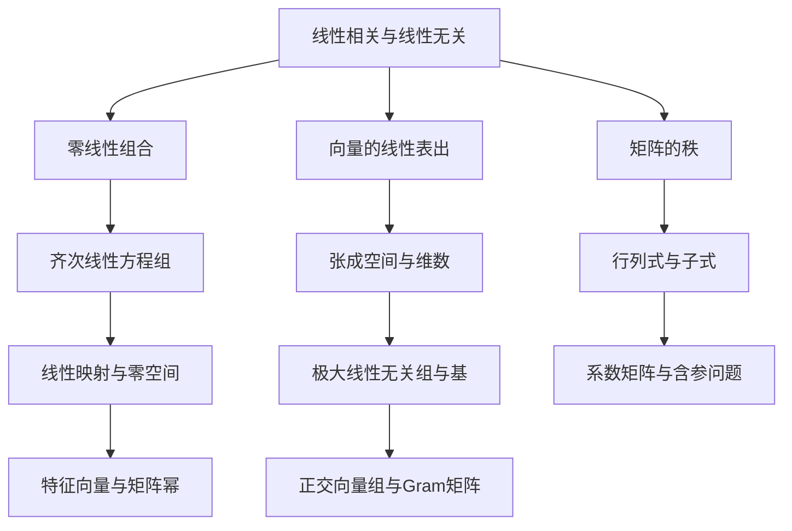
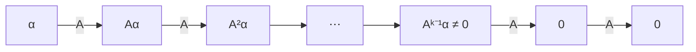
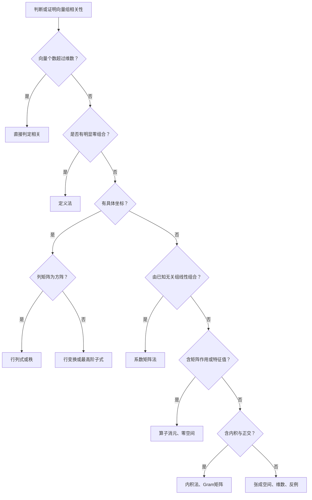

## 一、本节的考查定位与学习目标

**1. 本节在整个线性代数中的地位**

线性相关与线性无关，是线性代数中最重要的底层概念之一。

前面学习的矩阵、行列式、秩，以及后面即将学习的极大线性无关组、线性方程组、特征向量、相似对角化、二次型，都与本节直接相关。

本节最核心的问题是：

**一组向量究竟提供了多少个独立的方向？其中是否存在可以被其他向量替代的冗余向量？**

整个知识体系可以归纳为：

**2. 核心题型及复习优先级**

| 核心题型       | 主要解题工具    | 复习优先级 |
| ---------- | --------- | ----- |
| 线性相关性的基本判断 | 定义、秩、维数   | ★★★★★ |
| 部分相关、部分无关  | 线性表出、子向量组 | ★★★★★ |
| 含参数向量组     | 初等行变换、子式  | ★★★★★ |
| 抽象向量的线性组合  | 系数矩阵      | ★★★★★ |
| 矩阵作用后的相关性  | 秩、零空间     | ★★★★★ |
| 充分必要条件判断   | 等价条件、反例   | ★★★★★ |
| 向量替换与线性扩充  | 非零系数、张成空间 | ★★★★  |
| 循环型向量组     | 系数递推、行列式  | ★★★★  |
| 矩阵幂与特征向量   | 算子消元      | ★★★★★ |
| Gram矩阵与正交性 | 内积、平方范数   | ★★★★  |
| 外积矩阵综合问题   | 矩阵分解、秩    | ★★★★  |

优先级是根据知识的通用性和综合解题价值划分的，并非历年考频统计。

## 二、基础知识：真正理解线性相关与线性无关

### 2.1 线性相关与线性无关的定义

设有 $s$ 个 $n$ 维实向量：

$$
\alpha_1,\alpha_2,\ldots,\alpha_s.
$$

考虑它们的零线性组合：

$$
k_1\alpha_1+k_2\alpha_2+\cdots+k_s\alpha_s =\boldsymbol 0.
$$

**线性相关**

如果存在一组**不全为零**的实数 $k_1,k_2,\ldots,k_s$，使上式成立，则称该向量组线性相关。

$$
\boxed{ \exists (k_1,\ldots,k_s)\ne\boldsymbol 0, \quad \sum_{i=1}^{s}k_i\alpha_i=\boldsymbol 0 }
$$

**线性无关**

如果上式成立时，必有

$$
k_1=k_2=\cdots=k_s=0,
$$

则称该向量组线性无关。

$$
\boxed{ \sum_{i=1}^{s}k_i\alpha_i=\boldsymbol 0 \Longrightarrow k_1=\cdots=k_s=0 }
$$

**定义中最容易忽略的三个细节**

第一，零线性组合一定存在，因为全部系数为零时恒成立。真正需要判断的是是否存在非平凡零线性组合。

第二，线性相关只要求系数不全为零，并不要求每一个系数都非零。

第三，线性相关是对整个向量组的描述，不是对某个单独向量之间关系的简单描述。

例如：

$$
\alpha_1=\begin{pmatrix}1\\0\\0\end{pmatrix}, \quad \alpha_2=\begin{pmatrix}0\\1\\0\end{pmatrix}, \quad \alpha_3=\begin{pmatrix}1\\1\\0\end{pmatrix}.
$$

因为

$$
\alpha_1+\alpha_2-\alpha_3=0,
$$

所以三个向量线性相关，但其中任意两个向量均线性无关。

### 2.2 几何直观：独立方向与冗余方向

**一个向量**

非零向量能够提供一个独立方向，因此单个非零向量线性无关。

零向量不提供任何方向，因此单个零向量线性相关。

**两个向量**

两个向量线性无关，意味着它们提供两个独立方向，可以张成一个二维平面。

两个向量线性相关，意味着它们所张成的空间至多是一条过原点的直线。

y=0,y=x

例如，分别沿着横轴和直线 $y=x$ 的两个非零向量线性无关；如果两个非零向量都沿着横轴，则它们线性相关。

**三个向量**

在三维空间中，三个向量线性无关，意味着它们不全部位于同一个过原点的平面内，可以张成整个三维空间。

如果三个向量共面，则线性相关。

**一般情况**

$n$ 维空间中最多存在 $n$ 个线性无关的向量。

因此：

$$
\boxed{s>n\Longrightarrow \alpha_1,\ldots,\alpha_s\text{ 线性相关}}
$$

例如，任意四个三维向量必然线性相关。

反过来，$s\leq n$ 只能说明这组向量有可能线性无关，并不能保证它们一定无关。

### 2.3 线性相关与线性表出的关系

这是上一节「向量的线性表出」与本节之间最重要的桥梁。

**定理一：线性相关的等价表述**

对于至少含两个向量的向量组：

$$
\boxed{ \text{向量组线性相关} \iff \text{至少有一个向量可由其余向量线性表出} }
$$

**证明：**

若向量组线性相关，则存在不全为零的系数，使得

$$
k_1\alpha_1+\cdots+k_s\alpha_s=0.
$$

不妨设 $k_i\ne0$，则

$$
\alpha_i =-\sum_{j\ne i}\frac{k_j}{k_i}\alpha_j.
$$

说明至少存在一个向量，可以由其余向量线性表出。

反过来，如果

$$
\alpha_i=\sum_{j\ne i}c_j\alpha_j,
$$

移项得

$$
-\alpha_i+\sum_{j\ne i}c_j\alpha_j=0.
$$

由于 $\alpha_i$ 的系数为 $-1$，所以这是一组非平凡零线性组合，原向量组线性相关。

**定理二：线性无关的等价表述**

$$
\boxed{ \text{向量组线性无关} \iff \text{任意一个向量都不能由其余向量表出} }
$$

注意两个量词的区别：

| 线性相关         | 线性无关         |
| ------------ | ------------ |
| 至少有一个向量可以被表出 | 任意一个向量都不能被表出 |
| 存在非平凡零线性组合   | 只有平凡零线性组合    |
| 存在冗余方向       | 所有方向均独立      |

这正是张宇1000题第3章基础部分第1题，以及李正元第三章选择题第2题所考查的核心概念。

**一个重要反例**

设

$$
\alpha_1=e_1,\quad \alpha_2=e_1,\quad \alpha_3=e_2.
$$

由于

$$
\alpha_1-\alpha_2=0,
$$

三个向量线性相关。

但是，$\alpha_3=e_2$ 不能由 $\alpha_1,\alpha_2$ 线性表出。

因此：

**向量组线性相关，不意味着其中每一个向量都可以由其余向量表出。**

只有当某条线性关系中对应向量的系数非零时，才能根据这条关系将它单独解出。

### 2.4 线性相关性与矩阵、秩、方程组的统一

设

$$
M=(\alpha_1,\alpha_2,\ldots,\alpha_s) \in\mathbb R^{n\times s},
$$

以及

$$
x=(x_1,x_2,\ldots,x_s)^{\mathrm T}.
$$

那么

$$
Mx=x_1\alpha_1+\cdots+x_s\alpha_s.
$$

于是得到本节最重要的等价条件体系。

**线性无关的等价条件**

$$
\boxed{ \begin{aligned} &\alpha_1,\ldots,\alpha_s\text{ 线性无关}\\ \iff{}&Mx=0\text{ 只有零解}\\ \iff{}&r(M)=s\\ \iff{}&M\text{ 满列秩}\\ \iff{}&\dim\ker M=0. \end{aligned} }
$$

当 $s\leq n$ 时，还等价于 $M$ 至少存在一个非零的 $s$ 阶子式。

**线性相关的等价条件**

$$
\boxed{ \begin{aligned} &\alpha_1,\ldots,\alpha_s\text{ 线性相关}\\ \iff{}&Mx=0\text{ 存在非零解}\\ \iff{}&r(M)<s\\ \iff{}&M\text{ 不满列秩}\\ \iff{}&\dim\ker M>0. \end{aligned} }
$$

当 $s\leq n$ 时，还等价于 $M$ 的全部 $s$ 阶子式均为零。

这里有一个必须牢牢记住的公式：

$$
\boxed{\dim\ker M=s-r(M)}
$$

其中 $s$ 是矩阵的列数，也就是未知数个数，而不是行数。

**特殊情况：向量个数等于向量维数**

当 $s=n$ 时，$M$ 为方阵，可以直接使用行列式判断：

$$
\boxed{ \alpha_1,\ldots,\alpha_n\text{ 无关} \iff |M|\ne0 }
$$

$$
\boxed{ \alpha_1,\ldots,\alpha_n\text{ 相关} \iff |M|=0 }
$$

**根据矩阵形状选择方法**

| 向量组情况       | 首选判断方法      |
| ----------- | ----------- |
| $s>n$   | 直接判定相关      |
| $s=n$   | 行列式、秩       |
| $s<n$  | 初等行变换、满列秩子式 |
| 两个非零向量      | 判断是否成比例     |
| 抽象向量，没有具体分量 | 定义法、系数矩阵    |
| 存在明显零线性组合   | 直接构造线性关系    |

尤其要注意：非方阵没有通常意义下的行列式，不能对一个 $4\times3$ 矩阵直接求行列式。

### 2.5 张成空间与维数

定义

$$
U=\operatorname{span}(\alpha_1,\ldots,\alpha_s),
$$

表示由这些向量的所有线性组合构成的空间，即

$$
U= \left\{ \sum_{i=1}^{s}k_i\alpha_i: k_i\in\mathbb R \right\}.
$$

则有

$$
\boxed{ \dim U=r(\alpha_1,\ldots,\alpha_s) }
$$

向量组的秩，本质上就是独立方向的个数。

例如：

$$
e_1,e_2,e_1+e_2,e_1-e_2
$$

虽然一共有四个向量，但它们都在同一个二维空间内，因此秩为2。

若向量组Ⅰ可以由向量组Ⅱ线性表出，则

$$
\operatorname{span}(\mathrm I) \subseteq \operatorname{span}(\mathrm {II}),
$$

于是

$$
\boxed{r(\mathrm I)\leq r(\mathrm {II})}
$$

这是向量组秩比较、线性扩充和极大线性无关组问题的基础。

## 三、必须掌握的基本性质与重要推论

**3.1 子向量组和扩充向量组的相关性**

| 已知条件       | 必然结论         |
| ---------- | ------------ |
| 整个向量组线性无关  | 任意非空子向量组线性无关 |
| 某个子向量组线性相关 | 整个向量组线性相关    |
| 整个向量组线性相关  | 子向量组不一定相关    |
| 某个子向量组线性无关 | 整个向量组不一定无关   |

记忆方法：

$$
\boxed{\text{无关组去掉向量，仍然无关}}
$$

$$
\boxed{\text{相关组增加向量，仍然相关}}
$$

前者对应独立方向的减少，后者对应已有线性关系不会消失。

这两条性质互为逆否命题。

**3.2 特殊向量组的快速判断**

以下情形一定线性相关：含零向量；含两个相同向量；含两个成比例的非零向量；向量个数超过维数；其中某个向量可以由其余向量线性表出。

以下情形一定线性无关：单个非零向量；两个不成比例的非零向量；两两正交的非零向量组；列满秩矩阵的列向量组；不同特征值对应的特征向量组。

特别注意，两两无关不等于整体无关，而两两正交且均非零能够保证整体无关。

### 3.3 向量组增加一个向量时的秩变化

设

$$
U=\operatorname{span}(\alpha_1,\ldots,\alpha_s).
$$

则

$$
\boxed{ r(\alpha_1,\ldots,\alpha_s,\beta) = \begin{cases} r(\alpha_1,\ldots,\alpha_s),&\beta\in U,\\ r(\alpha_1,\ldots,\alpha_s)+1,&\beta\notin U. \end{cases} }
$$

若原来的向量组线性无关，则

$$
\boxed{ \alpha_1,\ldots,\alpha_s,\beta\text{ 无关} \iff \beta\notin U }
$$

这称为线性扩充判据。

必须注意，若原组已经线性相关，那么无论新增向量能否被原组表出，扩充后的整个向量组都仍然线性相关。

**3.4 表出唯一性与线性无关**

若向量组 $\alpha_1,\ldots,\alpha_s$ 线性无关，那么任何能由它们线性表出的向量，其表出方式必然唯一。

原因是，若

$$
\beta=\sum_{i=1}^{s}a_i\alpha_i =\sum_{i=1}^{s}b_i\alpha_i,
$$

两式相减得

$$
\sum_{i=1}^{s}(a_i-b_i)\alpha_i=0.
$$

由无关性可知

$$
a_i=b_i,\qquad i=1,\ldots,s.
$$

反过来，如果某个可表出的向量有唯一的线性表示，则原向量组必然无关。

因此：

$$
\boxed{ \text{线性无关} \iff \text{张成空间中的每个向量都能唯一表出} }
$$

这也是后续学习基坐标以及非齐次线性方程组解的唯一性的理论基础。

## 四、题型一：抽象向量组的相关性与线性表出

这一类题通常不提供向量的具体分量，而是直接告诉你某些向量相关、某些向量无关、某些向量能够线性表出。

**识别特征：** 没有具体坐标，却给出了多个相互重叠的向量组。

**首选方法：** 张成空间、线性扩充、非零系数，而不是盲目构造行列式。

### 母题1：相关组与无关组的交叉判断

**来源：李林880题，第十二章基础选择题第1题；李正元第三章选择题第1题具有相同结构。**

已知

$$
\alpha_1,\alpha_2,\alpha_3
$$

线性相关，而

$$
\alpha_2,\alpha_3,\alpha_4
$$

线性无关。

判断 $\alpha_1,\alpha_4$ 能否由其余有关向量线性表出。

<Steps>

<Step>

### 第一步：找出共同的无关部分 [!toc]

由于

$$
\alpha_2,\alpha_3,\alpha_4
$$

无关，因此其子向量组

$$
\alpha_2,\alpha_3
$$

必然无关。

令

$$
U=\operatorname{span}(\alpha_2,\alpha_3).
$$

</Step>

<Step>

### 第二步：利用相关组判断谁属于原空间 [!toc]

由于

$$
\alpha_1,\alpha_2,\alpha_3
$$

相关，而 $\alpha_2,\alpha_3$ 无关，因此必有

$$
\boxed{\alpha_1\in U}
$$

即存在 $a,b$，使得

$$
\alpha_1=a\alpha_2+b\alpha_3.
$$

注意：这里能够确定被表出的向量是 $\alpha_1$，不是随便一个向量。

</Step>

<Step>

### 第三步：利用无关组判断谁在空间外 [!toc]

由于

$$
\alpha_2,\alpha_3,\alpha_4
$$

无关，所以

$$
\boxed{\alpha_4\notin U}.
$$

又因为

$$
\operatorname{span}(\alpha_1,\alpha_2,\alpha_3) =U,
$$

故 $\alpha_4$ 不能由 $\alpha_1,\alpha_2,\alpha_3$ 线性表出。

进一步得到

$$
r(\alpha_1,\alpha_2,\alpha_3)=2,
$$

$$
r(\alpha_1,\alpha_2,\alpha_3,\alpha_4)=3.
$$

</Step>

</Steps>

**母题推广**

设向量组 $\alpha_1,\ldots,\alpha_s$ 无关，并且

$$
\alpha_1,\ldots,\alpha_s,\beta
$$

相关，而

$$
\alpha_1,\ldots,\alpha_s,\gamma
$$

无关。

则必有

$$
\beta\in U,\qquad \gamma\notin U,
$$

其中

$$
U=\operatorname{span}(\alpha_1,\ldots,\alpha_s).
$$

无论题目怎样改变向量名称和排列顺序，都先寻找共同的无关子向量组，再判断新向量在原空间内部还是外部。

### 母题2：线性扩充与任意参数

**来源：2002年数学二真题；张宇1000题第3章也收录了对应题目。**

设 $\alpha_1,\alpha_2,\alpha_3$ 线性无关，$\beta_1$ 可以由它们线性表出，而 $\beta_2$ 不可以由它们线性表出。

讨论下列两个向量组的相关性：

$$
\alpha_1,\alpha_2,\alpha_3,k\beta_1+\beta_2;
$$

$$
\alpha_1,\alpha_2,\alpha_3,\beta_1+k\beta_2.
$$

其中 $k$ 为任意实数。

**解题思路**

设

$$
U=\operatorname{span}(\alpha_1,\alpha_2,\alpha_3).
$$

则

$$
\beta_1\in U,\qquad \beta_2\notin U.
$$

对于第一组，假设存在某个 $k$，使得

$$
k\beta_1+\beta_2\in U.
$$

由于 $k\beta_1\in U$，于是

$$
\beta_2=(k\beta_1+\beta_2)-k\beta_1\in U,
$$

矛盾。

因此对任意 $k$，都有

$$
k\beta_1+\beta_2\notin U.
$$

故第一组始终线性无关。

对于第二组，需要分情况：

当 $k=0$ 时，

$$
\beta_1+k\beta_2=\beta_1\in U,
$$

所以相关。

当 $k\ne0$ 时，

$$
\beta_1+k\beta_2\notin U,
$$

所以无关。

**最值得掌握的一般结论**

若

$$
u\in U,\qquad v\notin U,
$$

则

$$
\boxed{au+bv\in U\iff b=0}
$$

与 $a$ 取什么值无关。

直观上，$u$ 是沿原空间内部的方向移动，而 $v$ 提供了一个超出原空间的方向。只要空间外分量的系数不为零，就不可能回到原空间。

**创新题如何拓展？**

如果 $u\in U$，而 $v,w\notin U$，那么 $v+w$ 是否一定不属于 $U$？

不一定。

例如

$$
U=\operatorname{span}(e_1),\quad v=e_2,\quad w=e_1-e_2.
$$

虽然 $v,w$ 都在 $U$ 外面，但

$$
v+w=e_1\in U.
$$

两个空间外方向可能相互抵消。因此扩充多个向量时，不仅要判断它们分别是否属于原空间，还要判断它们在原空间之外是否提供相互独立的新方向。

### 母题3：向量个数、维数与矩阵等价

**来源：2000年数学一真题。**

设 $m$ 个 $n$ 维向量

$$
\alpha_1,\ldots,\alpha_m,\qquad m<n
$$

线性无关。

问：另外 $m$ 个 $n$ 维向量

$$
\beta_1,\ldots,\beta_m
$$

线性无关的充分必要条件是什么？

原题比较了四种条件：第一组能由第二组表出、第二组能由第一组表出、两个向量组等价，以及两个列矩阵等价。

**核心分析**

记

$$
A=(\alpha_1,\ldots,\alpha_m),
$$

$$
B=(\beta_1,\ldots,\beta_m).
$$

由已知条件，

$$
r(A)=m.
$$

因此

$$
\begin{aligned} \beta_1,\ldots,\beta_m\text{ 无关} &\iff r(B)=m\\ &\iff r(B)=r(A)\\ &\iff A\text{ 与 }B\text{ 矩阵等价}. \end{aligned}
$$

答案为D。

**必须区分：向量组等价与矩阵等价**

| 对比          | 矩阵等价            | 向量组等价                  |
| ----------- | --------------- | ---------------------- |
| 本质          | 同型矩阵的秩相等        | 两个向量组可以相互表出            |
| 几何意义        | 张成空间的维数相同       | 张成的是同一个空间              |
| 判定方法        | $r(A)=r(B)$ | $r(A)=r(B)=r(A,B)$ |
| 是否要求同一个张成空间 | 不要求             | 要求                     |

例如

$$
A=(e_1,e_2),\qquad B=(e_1,e_3).
$$

两个矩阵均为 $3\times2$ 矩阵，秩均为2，因此矩阵等价。

但两个向量组张成的是不同平面，因此向量组不等价。

**关联真题：2010年数学二、三**

若含 $r$ 个向量的组Ⅰ可由含 $s$ 个向量的组Ⅱ线性表出，则

$$
r(\mathrm I)\leq r(\mathrm {II})\leq s.
$$

若组Ⅰ无关，则

$$
r(\mathrm I)=r,
$$

故必有

$$
\boxed{r\leq s}.
$$

注意：这里的 $r,s$ 是向量个数，不一定是向量组的秩。

## 五、题型二：具体向量与含参数向量组

这一题型通常是选择题、填空题，也可能作为线性方程组大题的第一问出现。

### 5.1 标准解题流程

对于含参数的向量组

$$
\alpha_1(t),\ldots,\alpha_s(t),
$$

首先按列构造矩阵：

$$
M(t)=(\alpha_1(t),\ldots,\alpha_s(t)).
$$

然后根据题目要求进行转化：

| 题目条件         | 数学转化                                     |
| ------------ | ---------------------------------------- |
| 整组线性无关       | $r(M)=s$                             |
| 整组线性相关       | $r(M)<s$                            |
| 秩恰好为 $k$ | 存在非零 $k$ 阶子式，所有 $k+1$ 阶子式为零（若存在） |
| 任意两个向量无关     | 任意两列组成的矩阵秩均为2                            |
| 任意参数下无关      | 证明不存在导致列降秩的参数                            |
| 整体相关但任意真子组无关 | 整组秩为 $s-1$，且唯一依赖关系的各个系数均非零           |

求解参数时，先通过必要条件筛出候选值，再代回验证全部条件。

这是本题型最重要的考试习惯。

### 母题4：整体相关，但任意两个向量均无关

**来源：2024年数学一真题。**

这是本节尤其值得掌握的一道真题。

设

$$
\alpha_1= \begin{pmatrix} a\\1\\-1\\1 \end{pmatrix}, \qquad \alpha_2= \begin{pmatrix} 1\\1\\b\\a \end{pmatrix}, \qquad \alpha_3= \begin{pmatrix} 1\\a\\-1\\1 \end{pmatrix}.
$$

若三个向量线性相关，且其中任意两个均线性无关，求 $a,b$。

**解法一：子式法**

将三个向量作为列构造矩阵：

$$
M= \begin{pmatrix} a&1&1\\ 1&1&a\\ -1&b&-1\\ 1&a&1 \end{pmatrix}.
$$

三个向量相关，说明所有三阶子式均为零。

观察到第3行含有参数 $b$，其余三行只含参数 $a$。因此优先选取第1、2、4行构成子式。

$$
D_1= \begin{vmatrix} a&1&1\\ 1&1&a\\ 1&a&1 \end{vmatrix}.
$$

计算得

$$
D_1=-(a-1)^2(a+2).
$$

令 $D_1=0$，得到

$$
a=1\quad\text{或}\quad a=-2.
$$

当 $a=1$ 时，

$$
\alpha_1=\alpha_3,
$$

违反任意两个向量均无关的条件。

故

$$
a=-2.
$$

再取第1、2、3行构成的三阶子式：

$$
D_2= \begin{vmatrix} -2&1&1\\ 1&1&-2\\ -1&b&-1 \end{vmatrix} =3(2-b).
$$

由 $D_2=0$，得

$$
b=2.
$$

**验证**

代入后，

$$
\alpha_1= \begin{pmatrix}-2\\1\\-1\\1\end{pmatrix}, \quad \alpha_2= \begin{pmatrix}1\\1\\2\\-2\end{pmatrix}, \quad \alpha_3= \begin{pmatrix}1\\-2\\-1\\1\end{pmatrix}.
$$

可以直接观察到

$$
\alpha_1+\alpha_2+\alpha_3=0.
$$

因此整体相关。

而 $\alpha_1,\alpha_3$ 的前两个分量构成的二阶子式为

$$
\begin{vmatrix} -2&1\\ 1&-2 \end{vmatrix} =3\ne0.
$$

所以二者无关。

又因为

$$
\alpha_2=-\alpha_1-\alpha_3
$$

中的两个系数均非零，故 $\alpha_2$ 与另外两个向量分别无关。

最终答案：

$$
\boxed{a=-2,\quad b=2}
$$

**解法二：直接利用非零依赖系数**

整体相关且任意两个无关，意味着可以设

$$
x\alpha_1+y\alpha_2+z\alpha_3=0,
$$

其中

$$
xyz\ne0.
$$

按分量展开：

$$
\begin{cases} ax+y+z=0,\\ x+y+az=0,\\ -x+by-z=0,\\ x+ay+z=0. \end{cases}
$$

第一式减第二式：

$$
(a-1)(x-z)=0.
$$

由于 $a=1$ 时 $\alpha_1=\alpha_3$，已被排除，因此

$$
x=z.
$$

第一式减第四式：

$$
(a-1)(x-y)=0,
$$

因此

$$
x=y.
$$

于是

$$
x=y=z\ne0.
$$

代入第一式：

$$
(a+2)x=0,
$$

故

$$
a=-2.
$$

代入第三式：

$$
(b-2)x=0,
$$

故

$$
b=2.
$$

这种解法直接利用了参数的对称结构，甚至不需要计算三阶行列式。

**本题的真正母题价值**

三个向量整体相关、任意两个无关，不仅意味着

$$
r(M)=2,
$$

还意味着其非平凡线性关系中的三个系数全部非零。

一般地，若 $s$ 个向量线性相关，而任意 $s-1$ 个向量线性无关，则

$$
\boxed{r(M)=s-1}
$$

且任何非平凡关系

$$
k_1\alpha_1+\cdots+k_s\alpha_s=0
$$

都满足

$$
\boxed{k_1k_2\cdots k_s\ne0}.
$$

证明非常简单：如果其中一个系数为零，就会得到其余 $s-1$ 个向量的非平凡线性关系，与任意 $s-1$ 个向量无关矛盾。

反过来，若矩阵秩为 $s-1$，并且存在一条所有系数都非零的线性关系，那么任何 $s-1$ 个向量都无关。因为此时零空间只有一维，所有非平凡关系都必须是这条关系的非零倍数。

这就是该题可以向高维综合题推广的关键。

### 母题5：非方阵的多个最高阶子式

**来源：张宇1000题，第3章基础部分第6题。**

设

$$
x_1=(1,2,2,-4)^{\mathrm T},
$$

$$
x_2=(1,k,-1,-4)^{\mathrm T},
$$

$$
x_3=(-1,-3,1,k+6)^{\mathrm T}.
$$

讨论三个向量的线性相关性。

构造矩阵

$$
M= \begin{pmatrix} 1&1&-1\\ 2&k&-3\\ 2&-1&1\\ -4&-4&k+6 \end{pmatrix}.
$$

如果三个向量相关，则所有三阶子式均为零。

选取第1、2、3行：

$$
D_1= \begin{vmatrix} 1&1&-1\\ 2&k&-3\\ 2&-1&1 \end{vmatrix} =3(k-3).
$$

因此相关的必要条件是

$$
k=3.
$$

再选取第1、3、4行：

$$
D_2= \begin{vmatrix} 1&1&-1\\ 2&-1&1\\ -4&-4&k+6 \end{vmatrix} =-3(k+2).
$$

所以相关还必须满足

$$
k=-2.
$$

两个条件无法同时成立。

因此：

$$
\boxed{\forall k\in\mathbb R,\quad r(M)=3}
$$

三个向量恒线性无关。

<Callout type="warn" title="极其重要的陷阱：一个子式为零不能判定相关">

| 子式情况           | 能否确定相关性 |
| -------------- | ------- |
| 存在一个非零最高阶列满秩子式 | 一定无关    |
| 存在一个为零的最高阶子式   | 无法确定    |
| 全部最高阶列满秩子式均为零  | 一定相关    |
| 两个最高阶子式不可能同时为零 | 一定无关    |

这也是张宇1000题连续设置相似练习题的原因。

</Callout>

### 母题6：寻找恒不为零的子式

**来源：张宇1000题，第3章基础部分第7题。**

设

$$
\alpha_1=(1,1,0,-2)^{\mathrm T},
$$

$$
\alpha_2=(1,k,-2,0)^{\mathrm T},
$$

$$
\alpha_3=(-1,-3,2,k+4)^{\mathrm T}.
$$

讨论相关性。

取第1、2、4行组成三阶子式：

$$
D= \begin{vmatrix} 1&1&-1\\ 1&k&-3\\ -2&0&k+4 \end{vmatrix} =k^2+k+2.
$$

配方得

$$
D= \left(k+\frac12\right)^2+\frac74>0.
$$

y=x^2+x+2

无论实数 $k$ 取何值，该三阶子式都不为零。

所以三个向量恒线性无关。

与上一题相比，本题甚至不需要考虑多个子式，因为已经找到一个对所有实参数均非零的最高阶子式。

**含参题的三种提速策略**

第一，优先选择不含某个参数的子式，将多参数问题拆成单参数问题。

第二，优先选择容易因式分解、含零元素较多的子式。

第三，如果找到恒不为零的子式，就立即结束，不必继续计算其他子式。

### 母题7：利用结构判断必然相关

**来源：2012年数学一、二、三真题。**

设

$$
\alpha_1=\begin{pmatrix}0\\0\\c_1\end{pmatrix}, \quad \alpha_2=\begin{pmatrix}0\\1\\c_2\end{pmatrix},
$$

$$
\alpha_3=\begin{pmatrix}1\\-1\\c_3\end{pmatrix}, \quad \alpha_4=\begin{pmatrix}-1\\1\\c_4\end{pmatrix},
$$

其中 $c_1,c_2,c_3,c_4$ 为任意常数。

问：哪个三向量组一定线性相关？

<Tabs items={["方法一：观察行结构", "方法二：寻找共同约束", "方法三：直接寻找线性组合"]} defaultIndex={0}>

<Tab value="方法一：观察行结构">

考虑

$$
M=(\alpha_1,\alpha_3,\alpha_4) = \begin{pmatrix} 0&1&-1\\ 0&-1&1\\ c_1&c_3&c_4 \end{pmatrix}.
$$

第一行与第二行互为相反数，因此

$$
|M|=0.
$$

所以

$$
\boxed{\alpha_1,\alpha_3,\alpha_4\text{ 恒线性相关}}
$$

对应原题C选项。

</Tab>

<Tab value="方法二：寻找共同约束">

三个向量均满足

$$
x+y=0.
$$

也就是说，它们全部位于二维平面

$$
U=\{(x,y,z)^{\mathrm T}:x+y=0\}
$$

中。

二维空间内的三个向量必然相关。

</Tab>

<Tab value="方法三：直接寻找线性组合">

注意

$$
\alpha_3+\alpha_4 = \begin{pmatrix} 0\\0\\c_3+c_4 \end{pmatrix}.
$$

这与 $\alpha_1$ 均位于第三坐标轴上。

若 $c_1\ne0$，显然可以建立非平凡关系：

$$
(c_3+c_4)\alpha_1 -c_1\alpha_3-c_1\alpha_4=0.
$$

若 $c_1=0$，则 $\alpha_1=0$，原组同样相关。

</Tab>

</Tabs>

**创新题迁移**

若 $s$ 个 $n$ 维向量全部满足同一个非零齐次线性约束

$$
a_1x_1+\cdots+a_nx_n=0,
$$

则它们最多只能张成 $n-1$ 维空间。

更一般地，若全部向量均满足

$$
Ax=0,\qquad r(A)=r,
$$

则

$$
\boxed{ r(\alpha_1,\ldots,\alpha_s)\leq n-r }
$$

若

$$
s>n-r,
$$

便可直接判定向量组相关。

这是数一中向量组、正交性、齐次方程组之间的重要综合考点。

## 六、题型三：抽象向量的线性组合与系数矩阵

这是本节最重要的通用解题方法之一。

如果原向量组已经线性无关，而新向量都是由原向量线性组合得到的，那么原向量的具体分量通常不重要。

只需要研究组合系数。

**6.1 系数矩阵法的基本定理**

设

$$
\alpha_1,\ldots,\alpha_s
$$

线性无关，记

$$
U=(\alpha_1,\ldots,\alpha_s).
$$

若新向量组满足

$$
\begin{aligned} \beta_1&=p_{11}\alpha_1+\cdots+p_{s1}\alpha_s,\\ \beta_2&=p_{12}\alpha_1+\cdots+p_{s2}\alpha_s,\\ &\ \vdots\\ \beta_t&=p_{1t}\alpha_1+\cdots+p_{st}\alpha_s, \end{aligned}
$$

则可以写成

$$
(\beta_1,\ldots,\beta_t)=UP,
$$

其中

$$
P= \begin{pmatrix} p_{11}&\cdots&p_{1t}\\ \vdots&&\vdots\\ p_{s1}&\cdots&p_{st} \end{pmatrix}.
$$

由于 $U$ 列满秩，

$$
Ux=0\iff x=0.
$$

因此

$$
UPx=0\iff Px=0.
$$

由此得到：

$$
\boxed{r(UP)=r(P)}
$$

以及

$$
\boxed{ \beta_1,\ldots,\beta_t\text{ 无关} \iff r(P)=t }
$$

特别地，若 $s=t$，则

$$
\boxed{ \beta_1,\ldots,\beta_s\text{ 无关} \iff |P|\ne0 }
$$

**直观理解**

原向量组无关，相当于建立了一套新的坐标系统。

在这个坐标系统中，可以暂时将

$$
\alpha_1,\ldots,\alpha_s
$$

视为形式上的单位基向量

$$
e_1,\ldots,e_s.
$$

例如：

$$
\beta_1=2\alpha_1-\alpha_3
$$

可以直接对应为坐标列向量

$$
\begin{pmatrix}2\\0\\-1\end{pmatrix}.
$$

这样，就把抽象向量问题转换成了普通矩阵计算问题。

**适用前提：原向量组必须线性无关。**

### 母题8：抽象含参向量组

**来源：李正元第三章填空题。**

设 $\alpha_1,\alpha_2,\alpha_3$ 线性无关，若

$$
\beta_1=\alpha_1+\alpha_2,
$$

$$
\beta_2=a\alpha_2-\alpha_3,
$$

$$
\beta_3=\alpha_1-\alpha_2+\alpha_3
$$

线性相关，求 $a$。

<Steps>

<Step>

### 第一步：按照原向量收集系数 [!toc]

$$
(\beta_1,\beta_2,\beta_3) =(\alpha_1,\alpha_2,\alpha_3)P,
$$

其中

$$
P= \begin{pmatrix} 1&0&1\\ 1&a&-1\\ 0&-1&1 \end{pmatrix}.
$$

注意，每一列对应一个新的向量。

</Step>

<Step>

### 第二步：判断系数矩阵是否可逆 [!toc]

由于原向量组线性无关，新组相关等价于

$$
|P|=0.
$$

计算：

$$
|P|= \begin{vmatrix} 1&0&1\\ 1&a&-1\\ 0&-1&1 \end{vmatrix} =a-2.
$$

所以

$$
\boxed{a=2}
$$

</Step>

<Step>

### 第三步：进一步找到依赖关系 [!toc]

代入 $a=2$：

$$
\beta_2=2\alpha_2-\alpha_3.
$$

观察可得

$$
\beta_1-\beta_2-\beta_3=0.
$$

这也是对计算结果的验证。

</Step>

</Steps>

**考场标准步骤**

遇到原组无关、新组由其组合的题目：

$$
\boxed{ \text{写系数矩阵} \longrightarrow \text{判断满列秩} \longrightarrow \text{求参数或依赖关系} }
$$

没有必要反复展开抽象向量的具体分量。

### 母题9：原向量组的替换与交换

**来源：张宇1000题，第3章基础部分第3题、第10题。**

设

$$
\alpha_1,\ldots,\alpha_n
$$

线性无关，并且

$$
\beta=k_1\alpha_1+\cdots+k_n\alpha_n.
$$

问：用 $\beta$ 替换 $\alpha_i$ 后，新向量组什么时候仍然无关？

**核心定理**

$$
\boxed{ \begin{aligned} &\alpha_1,\ldots,\alpha_{i-1}, \beta,\alpha_{i+1},\ldots,\alpha_n \text{ 无关}\\ &\iff k_i\ne0. \end{aligned} }
$$

**为什么？**

如果 $k_i=0$，那么

$$
\beta=\sum_{j\ne i}k_j\alpha_j,
$$

因此 $\beta$ 可以由替换后的其他向量表出，新组相关。

如果 $k_i\ne0$，则

$$
\alpha_i= \frac{1}{k_i} \left(\beta-\sum_{j\ne i}k_j\alpha_j\right).
$$

新组可以表出原来的 $\alpha_i$，因此新旧向量组等价。

原组无关且新旧向量个数相同，所以新组也无关。

**系数矩阵法**

如果用 $\beta$ 替换第 $i$ 个向量，那么系数矩阵就是将单位矩阵的第 $i$ 列替换为

$$
(k_1,\ldots,k_n)^{\mathrm T}.
$$

这个矩阵的行列式恰好为

$$
|P|=k_i.
$$

因此同样得到 $k_i\ne0$ 的判据。

**原题结论**

若

$$
k_1k_2\cdots k_n\ne0,
$$

则用 $\beta$ 替换原组中的任何一个向量，所得 $n$ 个向量均无关。

但将 $\beta$ 直接加入原组，得到的 $n+1$ 个向量一定相关。

**综合推广：同时替换多个向量**

设原组

$$
\alpha_1,\alpha_2,\alpha_3,\alpha_4
$$

线性无关，保留 $\alpha_1,\alpha_2$，并加入

$$
\beta_1=\alpha_1+a\alpha_3+b\alpha_4,
$$

$$
\beta_2=\alpha_2+c\alpha_3+d\alpha_4.
$$

新向量组的系数矩阵为

$$
P= \begin{pmatrix} 1&0&1&0\\ 0&1&0&1\\ 0&0&a&c\\ 0&0&b&d \end{pmatrix}.
$$

因此

$$
|P|= \begin{vmatrix} a&c\\ b&d \end{vmatrix} =ad-bc.
$$

新组无关当且仅当

$$
\boxed{ad-bc\ne0}
$$

这说明替换一个向量看一个对应系数，同时替换多个向量则看相应的系数子矩阵是否可逆。

## 七、题型四：循环型向量组

循环型向量组是抽象向量线性组合的经典结构，尤其适合训练从具体母题向一般结论的迁移能力。

### 母题10：循环和的奇偶性

**来源：1988年数学三真题。**

设 $\alpha_1,\ldots,\alpha_s$ 线性无关，且 $s\geq2$。

令

$$
\begin{aligned} \beta_1&=\alpha_1+\alpha_2,\\ \beta_2&=\alpha_2+\alpha_3,\\ &\ \vdots\\ \beta_s&=\alpha_s+\alpha_1. \end{aligned}
$$

讨论 $\beta_1,\ldots,\beta_s$ 的线性相关性。

<Tabs items={["解法一：零线性组合与递推", "解法二：系数矩阵"]} defaultIndex={0}>

<Tab value="解法一：零线性组合与递推">

设

$$
c_1\beta_1+\cdots+c_s\beta_s=0.
$$

代入各个 $\beta_i$，并按原向量收集系数。

由原组无关：

$$
\begin{cases} c_1+c_s=0,\\ c_1+c_2=0,\\ c_2+c_3=0,\\ \quad\vdots\\ c_{s-1}+c_s=0. \end{cases}
$$

由后面的递推关系：

$$
c_2=-c_1,\quad c_3=c_1,\quad c_4=-c_1.
$$

一般地，

$$
c_i=(-1)^{i-1}c_1.
$$

代入首式：

$$
\left[1+(-1)^{s-1}\right]c_1=0.
$$

当 $s$ 为奇数时：

$$
2c_1=0,
$$

所以所有系数均为零，新组无关。

当 $s$ 为偶数时，首式恒成立，可以取 $c_1=1$，于是

$$
\beta_1-\beta_2+\beta_3-\cdots-\beta_s=0.
$$

新组相关。

最终得到：

$$
\boxed{ \begin{cases} s\text{ 为奇数：线性无关},\\ s\text{ 为偶数：线性相关}. \end{cases} }
$$

</Tab>

<Tab value="解法二：系数矩阵">

循环和对应的系数矩阵为

$$
P= \begin{pmatrix} 1&0&\cdots&0&1\\ 1&1&\cdots&0&0\\ 0&1&\ddots&0&0\\ \vdots&&\ddots&1&0\\ 0&0&\cdots&1&1 \end{pmatrix}.
$$

当 $s=2$ 时，直接写为两行两列的全1矩阵。

其行列式满足

$$
|P|=1-(-1)^s.
$$

因此同样得到奇数无关、偶数相关的结论。

</Tab>

</Tabs>

### 母题11：循环向量中改变符号

**来源：1994年数学一真题。**

设 $\alpha_1,\alpha_2,\alpha_3,\alpha_4$ 线性无关，判断下列向量组哪一组线性无关。

| 选项 | 向量组结构                                                                         |
| -- | ----------------------------------------------------------------------------- |
| A  | $\alpha_1+\alpha_2,\alpha_2+\alpha_3,\alpha_3+\alpha_4,\alpha_4+\alpha_1$ |
| B  | $\alpha_1-\alpha_2,\alpha_2-\alpha_3,\alpha_3-\alpha_4,\alpha_4-\alpha_1$ |
| C  | $\alpha_1+\alpha_2,\alpha_2+\alpha_3,\alpha_3+\alpha_4,\alpha_4-\alpha_1$ |
| D  | $\alpha_1+\alpha_2,\alpha_2+\alpha_3,\alpha_3-\alpha_4,\alpha_4-\alpha_1$ |

设每个选项中的新向量依次为 $v_1,v_2,v_3,v_4$。

A存在关系

$$
v_1-v_2+v_3-v_4=0.
$$

B存在关系

$$
v_1+v_2+v_3+v_4=0.
$$

D存在关系

$$
v_1-v_2+v_3+v_4=0.
$$

因此A、B、D均相关。

对于C，设

$$
x_1v_1+x_2v_2+x_3v_3+x_4v_4=0.
$$

收集原向量系数，得到

$$
\begin{cases} x_1-x_4=0,\\ x_1+x_2=0,\\ x_2+x_3=0,\\ x_3+x_4=0. \end{cases}
$$

由前三式，

$$
x_4=x_1,\quad x_2=-x_1,\quad x_3=x_1.
$$

最后一式变为

$$
2x_1=0.
$$

因此四个系数只能全部为零。

故选

$$
\boxed{\mathrm C}
$$

**7.1 循环型问题的终极推广**

不再局限于加减号，而令

$$
\beta_i=\alpha_i+t_i\alpha_{i+1}, \qquad i=1,\ldots,s,
$$

并规定

$$
\alpha_{s+1}=\alpha_1.
$$

已知原组线性无关。

对应的系数矩阵行列式为

$$
\boxed{ |P|=1-(-1)^s t_1t_2\cdots t_s }
$$

因此

$$
\boxed{ \beta_1,\ldots,\beta_s\text{ 相关} \iff t_1t_2\cdots t_s=(-1)^s }
$$

这条公式可以通过循环系数矩阵的行列式展开得到，也可以从零线性组合的递推方程得到。

特别地，若

$$
t_1=t_2=\cdots=t_s=t,
$$

则

$$
|P|=1-(-t)^s.
$$

对于实数 $t$：

| 向量个数        | 线性相关的条件                |
| ----------- | ---------------------- |
| $s$ 为奇数 | $t=-1$             |
| $s$ 为偶数 | $t=1$ 或 $t=-1$ |

1994年数学一的循环加减题，也可以直接利用这个推广公式判断。

但考试中如果结构不规则，优先使用系数递推或系数矩阵，不要生搬硬套循环行列式公式。

## 八、题型五：充分必要条件与反例构造

这类题容易失分，不是因为计算复杂，而是因为逻辑方向容易混淆。

**8.1 充分条件与必要条件的判断**

设题目问：条件 $Q$ 是结论 $P$ 的什么条件？

| 类型    | 逻辑关系                        |
| ----- | --------------------------- |
| 充分条件  | $Q\Rightarrow P$        |
| 必要条件  | $P\Rightarrow Q$        |
| 充要条件  | $Q\Leftrightarrow P$    |
| 充分非必要 | $Q\Rightarrow P$，但反向不成立 |
| 必要非充分 | $P\Rightarrow Q$，但反向不成立 |

考场上不要只记口诀，最好直接在草稿上写出两个命题的箭头方向。

### 母题12：带有全称量词的充分必要条件

**来源：2014年数学一、二、三真题。**

设 $\alpha_1,\alpha_2,\alpha_3$ 为三维向量。

问：对任意常数 $k,l$，向量组

$$
\alpha_1+k\alpha_3,\quad \alpha_2+l\alpha_3
$$

线性无关，是

$$
\alpha_1,\alpha_2,\alpha_3
$$

线性无关的什么条件？

记

$$
P:\alpha_1,\alpha_2,\alpha_3\text{ 无关},
$$

$$
Q:\forall k,l,\  \alpha_1+k\alpha_3,\alpha_2+l\alpha_3 \text{ 无关}.
$$

<Steps>

<Step>

### 第一步：证明 $P\Rightarrow Q$ [!toc]

假设原组线性无关。

任取 $k,l$，设

$$
a(\alpha_1+k\alpha_3) +b(\alpha_2+l\alpha_3)=0.
$$

整理：

$$
a\alpha_1+b\alpha_2 +(ak+bl)\alpha_3=0.
$$

由于原组无关，

$$
a=b=ak+bl=0.
$$

特别有

$$
a=b=0.
$$

因此新组对于任意 $k,l$ 都无关。

所以 $Q$ 是 $P$ 的必要条件。

</Step>

<Step>

### 第二步：判断 $Q\Rightarrow P$ 是否成立 [!toc]

构造反例：

$$
\alpha_1=e_1,\quad \alpha_2=e_2,\quad \alpha_3=0.
$$

此时对任意 $k,l$，

$$
\alpha_1+k\alpha_3=e_1,
$$

$$
\alpha_2+l\alpha_3=e_2.
$$

新组始终无关。

但原组含零向量，因此相关。

所以

$$
Q\not\Rightarrow P.
$$

最终：

$$
\boxed{\text{必要非充分条件}}
$$

</Step>

</Steps>

**更深层的思考：如果额外规定 $\alpha_3\ne0$ 呢？**

这是一个值得掌握的原创变式。

如果原组相关，则存在不全为零的 $a,b,c$，使得

$$
a\alpha_1+b\alpha_2+c\alpha_3=0.
$$

由于 $\alpha_3\ne0$，$a,b$ 不可能同时为零。

因此总可以找到 $k,l$，使得

$$
ak+bl=c.
$$

于是

$$
a(\alpha_1+k\alpha_3) +b(\alpha_2+l\alpha_3)=0.
$$

且 $a,b$ 不全为零，因此相应的新组相关，与 $Q$ 矛盾。

所以在新增条件 $\alpha_3\ne0$ 后，

$$
\boxed{P\iff Q}
$$

原来的必要非充分条件变成了充要条件。

这就是创新题常见的出题方式：只改变一个看似不起眼的条件，就改变整道题的逻辑结论。

### 母题13：先求真正的充要条件

**来源：张宇1000题，第3章基础部分第8题。**

已知 $\alpha,\beta,\gamma$ 线性无关。

问：$k\ne1$ 是下列向量组线性无关的什么条件？

$$
\alpha+k\beta,\quad \beta+k\gamma,\quad \alpha-\gamma.
$$

不要急着判断充分必要性。

先写系数矩阵：

$$
P= \begin{pmatrix} 1&0&1\\ k&1&0\\ 0&k&-1 \end{pmatrix}.
$$

计算：

$$
|P|=k^2-1=(k-1)(k+1).
$$

所以真正的充要条件为

$$
\boxed{k\ne1\text{ 且 }k\ne-1}
$$

若新组无关，必有 $k\ne1$，因此它是必要条件。

但取 $k=-1$，虽然满足 $k\ne1$，新组却相关。

所以

$$
\boxed{k\ne1\text{ 是必要非充分条件}}
$$

**本类题通用策略**

当题目包含参数和充分必要条件时，优先求出完整的充要条件，再比较题目给出的条件是否过强或者过弱。

往往比直接分别证明两个方向简单得多。

### 8.2 必须熟练掌握的反例库

选择题中若要求判断某个命题是否必然成立，可以优先考虑以下反例。

| 错误命题             | 简单反例                                       |
| ---------------- | ------------------------------------------ |
| 非零向量组必然无关        | $e_1,e_1$                              |
| 两两无关就整体无关        | $e_1,e_2,e_1+e_2$                      |
| 整组相关，每个向量都可由其余表出 | $e_1,e_1,e_2$                          |
| 秩相同的向量组一定等价      | $(e_1,e_2)$ 与 $(e_1,e_3)$          |
| 两组分别无关，合并后仍无关    | $(e_1,e_2)$ 与 $(e_2,e_3)$          |
| 无关向量组经任意矩阵作用仍无关  | 矩阵 $A=0$                               |
| 无关向量分别加上同一向量仍无关  | $e_1,e_2$ 同时加上 $-\frac12(e_1+e_2)$ |
| 无关向量必然两两正交       | $e_1,e_1+e_2$                          |

这些反例并不是孤立知识。大部分错误命题都可以用零向量、重复向量、单位向量和低维子空间构造出来。

## 九、题型六：矩阵作用前后的线性相关性

这是本节与第二章矩阵及秩的核心综合考点。

题目通常给出向量组

$$
\alpha_1,\ldots,\alpha_s
$$

以及矩阵 $A$，然后讨论

$$
A\alpha_1,\ldots,A\alpha_s
$$

的线性相关性。

**9.1 矩阵作用能够保留什么？**

设

$$
\sum_{i=1}^{s}k_i\alpha_i=0.
$$

两边左乘矩阵 $A$，得到

$$
\sum_{i=1}^{s}k_iA\alpha_i=0.
$$

所以原有的线性关系在矩阵作用后仍然成立。

因此对于任意适当维数的矩阵 $A$：

$$
\boxed{\text{原组相关}\Longrightarrow\text{像组相关}}
$$

取逆否命题：

$$
\boxed{\text{像组无关}\Longrightarrow\text{原组无关}}
$$

但是，原组无关不能保证像组无关。

**几何理解**

例如，取矩阵

$$
A= \begin{pmatrix} 1&0\\ 0&0 \end{pmatrix}.
$$

它将平面中的向量投影到横轴上。

原本

$$
e_1=\begin{pmatrix}1\\0\end{pmatrix}, \qquad e_2=\begin{pmatrix}0\\1\end{pmatrix}
$$

线性无关。

经过变换后，

$$
Ae_1=e_1,\qquad Ae_2=0.
$$

新向量组线性相关。

矩阵作用可能压缩空间的维数，但不会增加原向量组的秩。

记

$$
U=(\alpha_1,\ldots,\alpha_s),
$$

则

$$
\boxed{r(AU)\leq r(U)}
$$

### 母题14：矩阵变换后的相关性判断

**来源：2006年数学一、二、三真题；李林880提高部分也有对应题。**

设 $A$ 为 $m\times n$ 矩阵，$\alpha_1,\ldots,\alpha_s$ 为 $n$ 维列向量。

原题考查原向量组与变换后向量组之间的必然关系。

根据上述定理，可以得到完整判断表：

| 原向量组 | 像向量组 | 是否必然成立 |
| ---- | ---- | ------ |
| 相关   | 相关   | 成立     |
| 相关   | 无关   | 不可能    |
| 无关   | 无关   | 不一定    |
| 无关   | 相关   | 不一定    |
| 像组无关 | 原组无关 | 成立     |
| 像组相关 | 原组相关 | 不一定    |

**如何补充条件使原组与像组具有相同的相关性？**

如果 $A$ 满列秩，即

$$
r(A)=n,
$$

则

$$
Ax=0\iff x=0.
$$

于是

$$
A\left(\sum_{i=1}^{s}k_i\alpha_i\right)=0 \iff \sum_{i=1}^{s}k_i\alpha_i=0.
$$

因此两组向量具有完全相同的线性关系。

$$
\boxed{ r(A)=n \Longrightarrow r(AU)=r(U) }
$$

特别是当 $A$ 为可逆方阵时，这个结论一定成立。

注意：**保持相关性和无关性并不要求** $A$ **一定是方阵，只要求它满列秩即可。**

李正元第三章证明题第29题，就是对这一结论的专门训练。

### 母题15：左逆矩阵与列向量无关

**来源：1993年数学一真题。**

设

$$
A\in\mathbb R^{n\times m}, \qquad B\in\mathbb R^{m\times n}, \qquad n<m.
$$

已知

$$
AB=E_n.
$$

证明 $B$ 的列向量组线性无关。

<Tabs items={["解法一：定义与方程组", "解法二：秩不等式"]} defaultIndex={0}>

<Tab value="解法一：定义与方程组">

设

$$
B=(\beta_1,\ldots,\beta_n),
$$

且

$$
k_1\beta_1+\cdots+k_n\beta_n=0.
$$

记

$$
k=(k_1,\ldots,k_n)^{\mathrm T}.
$$

则

$$
Bk=0.
$$

左乘 $A$：

$$
ABk=0.
$$

由于 $AB=E_n$，所以

$$
k=0.
$$

故 $B$ 的列向量组线性无关。

</Tab>

<Tab value="解法二：秩不等式">

由

$$
AB=E_n
$$

可得

$$
n=r(AB)\leq r(B)\leq n.
$$

因此

$$
r(B)=n.
$$

而 $B$ 恰有 $n$ 列，所以满列秩，列向量组无关。

</Tab>

</Tabs>

**更完整的结论**

同时还有

$$
n=r(AB)\leq r(A)\leq n,
$$

所以

$$
\boxed{r(A)=r(B)=n}
$$

即 $A$ 满行秩，$B$ 满列秩。

但因为 $n<m$，

$$
r(BA)\leq n<m,
$$

所以

$$
BA\ne E_m.
$$

不能把非方阵的左逆和右逆混为一谈。

**原创综合变式**

已知

$$
AB=E_n,
$$

再令

$$
P=BA.
$$

则

$$
P^2=BABA=B(AB)A=BA=P.
$$

所以 $P$ 是幂等矩阵。

进一步，

$$
PB=BAB=B.
$$

于是

$$
r(B)\leq r(P).
$$

结合

$$
r(P)\leq r(B)=n,
$$

得到

$$
\boxed{r(P)=n}
$$

由此还能得到

$$
\operatorname{Im}P=\operatorname{Im}B,
$$

$$
\ker P=\ker A.
$$

这类变式能够将矩阵秩、线性相关性、幂等矩阵、特征值和线性方程组结合起来。

**9.2 更精确的条件：只需在原张成空间上保持单射**

前面已经知道，$A$ 满列秩可以保证所有向量组的相关性不变。

但是，对于一个特定的向量组，条件可以更弱。

假设 $\alpha_1,\ldots,\alpha_s$ 无关，令

$$
U=\operatorname{span}(\alpha_1,\ldots,\alpha_s).
$$

则

$$
\boxed{ A\alpha_1,\ldots,A\alpha_s\text{ 无关} \iff U\cap\ker A=\{0\} }
$$

意思是：$A$ 不需要在整个空间中都可逆，只要不把 $U$ 中的非零向量变成零向量即可。

事实上，有更一般的秩公式：

$$
\boxed{ r(AM)=r(M)-\dim(\operatorname{Im}M\cap\ker A) }
$$

其中 $M$ 是原向量组构成的列矩阵。

这个公式来自将映射 $A$ 限制在 $\operatorname{Im}M$ 上，再使用秩—零度定理。

它能够解释所有矩阵作用导致降秩的问题。

例如

$$
A=\operatorname{diag}(1,1,0), \qquad M=(e_1,e_2).
$$

虽然 $A$ 不可逆，但

$$
\ker A=\operatorname{span}(e_3),
$$

而

$$
\operatorname{Im}M=\operatorname{span}(e_1,e_2).
$$

二者交集只有零向量，因此 $AM$ 的列向量仍然无关。

## 十、题型七：利用矩阵方程与算子消元证明无关

这是本节证明题中最值得深入掌握的题型。

基本套路不再是求行列式，而是：

先假设存在零线性组合，再利用题目给出的矩阵作用关系，对该组合施加适当的矩阵，使某些项消失，最终逐个证明系数为零。

### 母题16：齐次解空间之外的向量

**来源：1996年数学三真题。**

设

$$
\alpha_1,\ldots,\alpha_t
$$

是齐次线性方程组 $Ax=0$ 的一个基础解系，并且

$$
A\beta\ne0.
$$

证明向量组

$$
\beta,\quad \beta+\alpha_1,\quad \ldots,\quad \beta+\alpha_t
$$

线性无关。

<Steps>

<Step>

### 第一步：假设零线性组合 [!toc]

设

$$
c_0\beta+ \sum_{i=1}^{t}c_i(\beta+\alpha_i)=0.
$$

整理为

$$
\left(c_0+\sum_{i=1}^{t}c_i\right)\beta +\sum_{i=1}^{t}c_i\alpha_i=0.
$$

</Step>

<Step>

### 第二步：左乘 $A$ [!toc]

由于

$$
A\alpha_i=0,\qquad i=1,\ldots,t,
$$

因此

$$
\left(c_0+\sum_{i=1}^{t}c_i\right)A\beta=0.
$$

又 $A\beta\ne0$，故

$$
c_0+\sum_{i=1}^{t}c_i=0.
$$

</Step>

<Step>

### 第三步：代回原式 [!toc]

得到

$$
\sum_{i=1}^{t}c_i\alpha_i=0.
$$

由于基础解系线性无关，

$$
c_1=\cdots=c_t=0.
$$

进而 $c_0=0$。

因此所给向量组线性无关。

</Step>

</Steps>

**本质理解**

设

$$
U=\ker A.
$$

所有 $\alpha_i$ 都在 $U$ 中，而 $\beta$ 在 $U$ 外面。

所以

$$
\beta,\alpha_1,\ldots,\alpha_t
$$

线性无关。

又因为

$$
\beta+\alpha_i
$$

只是对原无关组作可逆的列变换，因此新组仍然无关。

**延伸**

这道题实际上不要求 $\alpha_1,\ldots,\alpha_t$ 是完整的基础解系。只要它们线性无关且均属于 $\ker A$，证明就成立。

这体现了识别题目真正起作用的条件的重要性。

### 母题17：矩阵幂构造的幂零链

**来源：1998年数学一真题。**

设 $A$ 是 $n$ 阶矩阵，存在向量 $\alpha$ 和正整数 $k$，满足

$$
A^k\alpha=0,
$$

$$
A^{k-1}\alpha\ne0.
$$

证明：

$$
\alpha,A\alpha,A^2\alpha,\ldots,A^{k-1}\alpha
$$

线性无关。

这是本节必须熟练掌握的一道经典证明母题。

<Steps>

<Step>

### 第一步：充分理解两个条件 [!toc]

由

$$
A^k\alpha=0,
$$

可以进一步得到

$$
A^{k+1}\alpha=A^{k+2}\alpha=\cdots=0.
$$

但

$$
A^{k-1}\alpha\ne0.
$$

即 $k$ 是使 $\alpha$ 被 $A$ 的幂变成零向量的最小正整数。

整个作用过程可以表示为：

</Step>

<Step>

### 第二步：假设零线性组合 [!toc]

设

$$
c_0\alpha+c_1A\alpha+\cdots+ c_{k-1}A^{k-1}\alpha=0.
$$

目标是证明

$$
c_0=c_1=\cdots=c_{k-1}=0.
$$

</Step>

<Step>

### 第三步：左乘最高有用的矩阵幂 [!toc]

两边左乘 $A^{k-1}$，得到

$$
c_0A^{k-1}\alpha+ c_1A^k\alpha+\cdots+ c_{k-1}A^{2k-2}\alpha=0.
$$

因为后面的向量全部为零，所以

$$
c_0A^{k-1}\alpha=0.
$$

又 $A^{k-1}\alpha\ne0$，因此

$$
c_0=0.
$$

</Step>

<Step>

### 第四步：逐步降低矩阵幂 [!toc]

将 $c_0=0$ 代回原式：

$$
c_1A\alpha+\cdots+ c_{k-1}A^{k-1}\alpha=0.
$$

两边左乘 $A^{k-2}$：

$$
c_1A^{k-1}\alpha=0.
$$

故

$$
c_1=0.
$$

依次进行：

$$
c_2=0,\quad c_3=0,\quad\ldots,\quad c_{k-1}=0.
$$

所以原向量组线性无关。

</Step>

</Steps>

**更精炼的证明技巧：第一个非零系数**

还可以利用反证法。

假设存在非平凡关系，令 $j$ 为最小的满足 $c_j\ne0$ 的下标。

则

$$
c_jA^j\alpha+\cdots+ c_{k-1}A^{k-1}\alpha=0.
$$

左乘

$$
A^{k-1-j},
$$

得到

$$
c_jA^{k-1}\alpha=0.
$$

因为 $c_j\ne0$，且 $A^{k-1}\alpha\ne0$，矛盾。

因此所有系数只能为零。

这个证明更简洁，也适合推广到高阶抽象问题。

**重要推论**

因为已经构造出 $k$ 个 $n$ 维线性无关向量，所以

$$
\boxed{k\leq n}
$$

进一步，如果一个 $n$ 阶矩阵满足

$$
A^k=0,\qquad A^{k-1}\ne0,
$$

则可以找到某个 $\alpha$，使得

$$
A^{k-1}\alpha\ne0.
$$

应用上述定理即可推出

$$
\boxed{k\leq n}
$$

这就是幂零矩阵的幂零指数不会超过矩阵阶数的原因。

**10.1 幂零链的推广：平移算子**

原题中使用的是 $A$，但实际上还可以使用

$$
T=A-\lambda E.
$$

如果

$$
(A-\lambda E)^k\alpha=0,
$$

而

$$
(A-\lambda E)^{k-1}\alpha\ne0,
$$

则同理有

$$
\boxed{ \alpha,(A-\lambda E)\alpha,\ldots, (A-\lambda E)^{k-1}\alpha \text{ 线性无关} }
$$

而且由于二项式展开，这组向量与

$$
\alpha,A\alpha,\ldots,A^{k-1}\alpha
$$

之间存在对角元全部为1的三角系数变换矩阵。

因此后面这组向量同样线性无关。

这里虽然涉及广义特征向量链的思想，但考研解题并不需要额外学习Jordan标准形，只需要掌握矩阵运算、二项式展开和线性相关性的定义。

## 十一、题型八：特征值、特征向量与线性无关

这部分与第四章交叉，核心目标是证明向量的线性无关性。

**11.1 不同特征值对应的特征向量线性无关**

设

$$
A\alpha_i=\lambda_i\alpha_i,
$$

其中

$$
\alpha_i\ne0,
$$

并且 $\lambda_1,\ldots,\lambda_s$ 两两不同。

则

$$
\boxed{\alpha_1,\ldots,\alpha_s\text{ 线性无关}}
$$

**证明思想**

以两个特征向量为例。

设

$$
c_1\alpha_1+c_2\alpha_2=0.
$$

左乘 $A-\lambda_2E$，得到

$$
c_1(\lambda_1-\lambda_2)\alpha_1=0.
$$

因为

$$
\lambda_1\ne\lambda_2,\qquad\alpha_1\ne0,
$$

所以 $c_1=0$。

再代回原式得 $c_2=0$。

对于更多的特征向量，可以使用数学归纳法，也可以构造适当的矩阵多项式消掉其他特征向量。

例如为了保留第 $i$ 个特征向量，可以使用

$$
\prod_{j\ne i}(A-\lambda_jE).
$$

作用于 $\alpha_i$ 后保留非零倍数，作用于其余特征向量后得到零向量。

<Callout type="warn" title="重要易错点">

同一个特征值对应的多个特征向量，不一定线性相关，也不一定线性无关。

例如 $A=E_3$，其任意非零向量都是特征值1对应的特征向量。

$$
e_1,e_2,e_3
$$

无关，而

$$
e_1,2e_1
$$

相关。

</Callout>

### 母题18：特征向量线性组合的相关性

**来源：2005年数学一、二、三真题。**

设 $\lambda_1,\lambda_2$ 是矩阵 $A$ 的两个不同的特征值，对应特征向量分别为 $\alpha_1,\alpha_2$。

问：

$$
\alpha_1,\quad A(\alpha_1+\alpha_2)
$$

线性无关的充分必要条件是什么？

由于

$$
A\alpha_1=\lambda_1\alpha_1, \qquad A\alpha_2=\lambda_2\alpha_2,
$$

所以

$$
A(\alpha_1+\alpha_2) =\lambda_1\alpha_1+\lambda_2\alpha_2.
$$

又因为 $\alpha_1,\alpha_2$ 无关，写出系数矩阵：

$$
P= \begin{pmatrix} 1&\lambda_1\\ 0&\lambda_2 \end{pmatrix}.
$$

于是

$$
|P|=\lambda_2.
$$

故真正的充要条件为

$$
\boxed{\lambda_2\ne0}
$$

对应原题B选项。

**深层理解**

第一个向量已经提供了 $\alpha_1$ 方向。

所以第二个向量中沿 $\alpha_1$ 的分量不影响整体无关性。

真正需要的是它在 $\alpha_2$ 方向上的分量不消失。

因此只需要判断 $\lambda_2$，不需要要求 $\lambda_1\ne0$。

**通用推广**

若 $f$ 是多项式，则

$$
f(A)\alpha_i=f(\lambda_i)\alpha_i.
$$

因此

$$
\alpha_1,\quad f(A)(\alpha_1+\alpha_2)
$$

线性无关的充要条件为

$$
\boxed{f(\lambda_2)\ne0}
$$

这类推广经常可以直接处理含矩阵高次幂的抽象向量题。

### 母题19：混合特征向量与算子消元

**来源：李林880题。**

设 $A$ 是三阶方阵，$\alpha_1,\alpha_2$ 分别是属于特征值 $-2,1$ 的特征向量，并且

$$
A\alpha_3=\alpha_2+\alpha_3.
$$

证明

$$
\alpha_1,\alpha_2,\alpha_3
$$

线性无关。

<Steps>

<Step>

### 第一步：观察最有用的算子 [!toc]

题设给出

$$
A\alpha_1=-2\alpha_1,
$$

$$
A\alpha_2=\alpha_2,
$$

$$
A\alpha_3=\alpha_2+\alpha_3.
$$

构造

$$
T=A-E.
$$

则

$$
T\alpha_1=-3\alpha_1,
$$

$$
T\alpha_2=0,
$$

$$
T\alpha_3=\alpha_2.
$$

这个算子可以同时消去 $\alpha_2$，并将 $\alpha_3$ 转换成 $\alpha_2$。

</Step>

<Step>

### 第二步：设零线性组合 [!toc]

$$
c_1\alpha_1+c_2\alpha_2+c_3\alpha_3=0.
$$

左乘 $A-E$：

$$
-3c_1\alpha_1+c_3\alpha_2=0.
$$

由于 $\alpha_1,\alpha_2$ 对应不同特征值，因此无关。

故

$$
c_1=c_3=0.
$$

代回原式：

$$
c_2\alpha_2=0.
$$

又 $\alpha_2\ne0$，故 $c_2=0$。

证毕。

</Step>

</Steps>

**识别技巧**

遇到

$$
A\alpha_i=\lambda\alpha_i+\text{其他向量}
$$

这样的条件时，优先考虑

$$
(A-\lambda E)\alpha_i.
$$

它通常可以消掉原向量自身的分量，将复杂问题变成逐步消元问题。

### 母题20：矩阵幂与范德蒙德行列式

**来源：李林880题，第十二章第31题；李正元第三章第25题也考查了范德蒙德结构。**

设

$$
A\alpha_i=i\alpha_i,\qquad i=1,2,3,
$$

且三个 $\alpha_i$ 均非零。

令

$$
\alpha=\alpha_1+\alpha_2+\alpha_3.
$$

证明

$$
\alpha,A\alpha,A^2\alpha
$$

线性无关。

<Steps>

<Step>

### 第一步：展开矩阵幂 [!toc]

$$
\alpha=\alpha_1+\alpha_2+\alpha_3,
$$

$$
A\alpha=\alpha_1+2\alpha_2+3\alpha_3,
$$

$$
A^2\alpha=\alpha_1+4\alpha_2+9\alpha_3.
$$

因此

$$
(\alpha,A\alpha,A^2\alpha) =(\alpha_1,\alpha_2,\alpha_3)P,
$$

其中

$$
P= \begin{pmatrix} 1&1&1\\ 1&2&4\\ 1&3&9 \end{pmatrix}.
$$

</Step>

<Step>

### 第二步：判断系数矩阵 [!toc]

这是一个范德蒙德行列式：

$$
|P|=(2-1)(3-1)(3-2)=2\ne0.
$$

原向量组是不同特征值对应的特征向量组，因此无关。

又 $P$ 可逆，故

$$
\boxed{\alpha,A\alpha,A^2\alpha\text{ 线性无关}}
$$

</Step>

</Steps>

**一般推广**

若 $\alpha_1,\ldots,\alpha_s$ 对应两两不同的特征值 $\lambda_1,\ldots,\lambda_s$，并且

$$
v=c_1\alpha_1+\cdots+c_s\alpha_s,
$$

则

$$
(v,Av,\ldots,A^{s-1}v) =(\alpha_1,\ldots,\alpha_s)P,
$$

其中

$$
P= \begin{pmatrix} c_1&c_1\lambda_1&\cdots&c_1\lambda_1^{s-1}\\ c_2&c_2\lambda_2&\cdots&c_2\lambda_2^{s-1}\\ \vdots&\vdots&&\vdots\\ c_s&c_s\lambda_s&\cdots&c_s\lambda_s^{s-1} \end{pmatrix}.
$$

故

$$
|P|= \left(\prod_{i=1}^{s}c_i\right) \prod_{1\leq i<j\leq s}(\lambda_j-\lambda_i).
$$

由于特征值两两不同，因此

$$
\boxed{ v,Av,\ldots,A^{s-1}v\text{ 无关} \iff c_1c_2\cdots c_s\ne0 }
$$

再进一步，若只有 $q$ 个系数非零，那么

$$
\boxed{r(v,Av,\ldots,A^{s-1}v)=q}
$$

这类题是行列式、矩阵运算、向量组的秩和特征值的典型跨章节综合。

## 十二、题型九：正交性、内积与Gram矩阵

这是数一尤其值得掌握的一类综合题。分类模拟题中李永乐六套卷的对应题目，正是利用正交性和正定内积来判断向量组无关。

**12.1 两两正交的非零向量组必然无关**

设

$$
\alpha_i\ne0,\qquad i=1,\ldots,s,
$$

且对于 $i\ne j$，均有

$$
\alpha_i^{\mathrm T}\alpha_j=0.
$$

证明 $\alpha_1,\ldots,\alpha_s$ 线性无关。

设

$$
k_1\alpha_1+\cdots+k_s\alpha_s=0.
$$

两边左乘 $\alpha_i^{\mathrm T}$，得到

$$
\sum_{j=1}^{s}k_j\alpha_i^{\mathrm T}\alpha_j=0.
$$

由正交性，所有 $j\ne i$ 的项都等于零。

因此

$$
k_i\alpha_i^{\mathrm T}\alpha_i=0.
$$

而

$$
\alpha_i^{\mathrm T}\alpha_i=\|\alpha_i\|^2>0,
$$

所以

$$
k_i=0.
$$

对任意 $i$ 均成立。

故

$$
\boxed{\text{两两正交的非零向量组必线性无关}}
$$

这里的非零条件不可省略。

### 母题21：正定内积下的线性无关

**来源：资料中的李永乐2027六套卷，第3套第5题。**

设 $A$ 是 $n$ 阶可逆矩阵，$\alpha_1,\ldots,\alpha_s$ 是非零的 $n$ 维列向量，其中 $2\leq s\leq n$。

问：条件

$$
\alpha_i^{\mathrm T}A^{\mathrm T}A\alpha_j=0, \qquad i\ne j,
$$

是原向量组线性无关的什么条件？

<Tabs items={["解法一：识别隐藏的正交向量组", "解法二：直接利用平方范数"]} defaultIndex={0}>

<Tab value="解法一：识别隐藏的正交向量组">

注意

$$
\alpha_i^{\mathrm T}A^{\mathrm T}A\alpha_j =(A\alpha_i)^{\mathrm T}(A\alpha_j).
$$

令

$$
\beta_i=A\alpha_i.
$$

则题目条件变成

$$
\beta_i^{\mathrm T}\beta_j=0,\qquad i\ne j.
$$

又由于 $A$ 可逆，$\alpha_i\ne0$，因此

$$
\beta_i\ne0.
$$

于是 $\beta_1,\ldots,\beta_s$ 是两两正交的非零向量组，必然无关。

像组无关必然推出原组无关。

因此充分性成立。

</Tab>

<Tab value="解法二：直接利用平方范数">

设

$$
\sum_{j=1}^{s}k_j\alpha_j=0.
$$

两边左乘

$$
\alpha_i^{\mathrm T}A^{\mathrm T}A,
$$

得到

$$
k_i\alpha_i^{\mathrm T}A^{\mathrm T}A\alpha_i=0.
$$

即

$$
k_i\|A\alpha_i\|^2=0.
$$

因为 $A\alpha_i\ne0$，所以 $k_i=0$。

原向量组无关。

</Tab>

</Tabs>

**判断必要性**

取

$$
A=E_2,\quad \alpha_1=\begin{pmatrix}1\\1\end{pmatrix}, \quad \alpha_2=\begin{pmatrix}0\\1\end{pmatrix}.
$$

两个向量无关，但

$$
\alpha_1^{\mathrm T}A^{\mathrm T}A\alpha_2=1\ne0.
$$

因此必要性不成立。

最终答案为B：

$$
\boxed{\text{充分非必要条件}}
$$

**推广到正定矩阵**

若 $H$ 是实对称正定矩阵，并且非零向量 $\alpha_1,\ldots,\alpha_s$ 满足

$$
\alpha_i^{\mathrm T}H\alpha_j=0,\qquad i\ne j,
$$

那么它们一定线性无关。

因为在零线性组合两边左乘 $\alpha_i^{\mathrm T}H$，可得

$$
k_i\alpha_i^{\mathrm T}H\alpha_i=0.
$$

正定性保证

$$
\alpha_i^{\mathrm T}H\alpha_i>0,
$$

故 $k_i=0$。

原模拟题中的

$$
H=A^{\mathrm T}A
$$

正是一个实对称正定矩阵。

这种题型还可以与第五章正定二次型结合起来。

### 母题22：Gram矩阵判定线性无关

**来源：1991年数学三真题。**

设 $\alpha_1,\ldots,\alpha_n$ 为 $n$ 维实列向量。

证明它们线性无关的充分必要条件是

$$
\begin{vmatrix} \alpha_1^{\mathrm T}\alpha_1& \cdots& \alpha_1^{\mathrm T}\alpha_n\\ \vdots&&\vdots\\ \alpha_n^{\mathrm T}\alpha_1& \cdots& \alpha_n^{\mathrm T}\alpha_n \end{vmatrix} \ne0.
$$

<Steps>

<Step>

### 第一步：识别矩阵结构 [!toc]

令

$$
M=(\alpha_1,\ldots,\alpha_n).
$$

题目中的矩阵恰好是

$$
G=M^{\mathrm T}M.
$$

该矩阵称为Gram矩阵（格拉姆矩阵）。

</Step>

<Step>

### 第二步：利用行列式乘法公式 [!toc]

$$
|G| =|M^{\mathrm T}M| =|M^{\mathrm T}||M| =|M|^2.
$$

于是

$$
|G|\ne0 \iff |M|\ne0 \iff \alpha_1,\ldots,\alpha_n\text{ 无关}.
$$

证毕。

</Step>

</Steps>

**更一般的结论**

如果不是 $n$ 个 $n$ 维向量，而是 $s$ 个 $n$ 维向量，则 $M$ 不一定是方阵。

此时不能使用 $|M|^2$，但可以利用平方范数。

对于任意 $s$ 维实向量 $x$，

$$
x^{\mathrm T}M^{\mathrm T}Mx =(Mx)^{\mathrm T}(Mx) =\|Mx\|^2.
$$

因此：

$$
Mx=0\iff M^{\mathrm T}Mx=0.
$$

证明反向时，若

$$
M^{\mathrm T}Mx=0,
$$

左乘 $x^{\mathrm T}$，得到

$$
\|Mx\|^2=0,
$$

从而 $Mx=0$。

所以

$$
\boxed{\ker(M^{\mathrm T}M)=\ker M}
$$

进一步得到极其重要的秩公式：

$$
\boxed{r(M^{\mathrm T}M)=r(M)}
$$

同理：

$$
\boxed{r(MM^{\mathrm T})=r(M)}
$$

**Gram矩阵与正定性的统一结论**

对于任意实矩阵 $M\in\mathbb R^{n\times s}$，有

$$
\boxed{ \begin{aligned} &M\text{ 的列向量组线性无关}\\ \iff{}&r(M)=s\\ \iff{}&M^{\mathrm T}M\text{ 可逆}\\ \iff{}&M^{\mathrm T}M\text{ 正定}\\ \iff{}&|M^{\mathrm T}M|>0. \end{aligned} }
$$

这是连接向量组、矩阵秩、实对称矩阵和正定二次型的重要定理。

注意，平方范数证明针对实矩阵；复矩阵情形应使用共轭转置。

## 十三、题型十：外积矩阵与向量相关性的综合

### 母题23：两个秩一矩阵相加

**来源：2008年数学一真题。**

设

$$
A=\alpha\alpha^{\mathrm T}+\beta\beta^{\mathrm T},
$$

其中 $\alpha,\beta$ 为三维实列向量。

证明：

（1）$r(A)\leq2$。

（2）若 $\alpha,\beta$ 线性相关，则 $r(A)<2$。

<Tabs items={["解法一：矩阵秩不等式", "解法二：合并外积矩阵"]} defaultIndex={0}>

<Tab value="解法一：矩阵秩不等式">

根据秩的性质，

$$
r(\alpha\alpha^{\mathrm T})\leq1,
$$

$$
r(\beta\beta^{\mathrm T})\leq1.
$$

于是

$$
r(A)\leq r(\alpha\alpha^{\mathrm T}) +r(\beta\beta^{\mathrm T}) \leq2.
$$

第一问得证。

若 $\alpha,\beta$ 相关，且 $\alpha\ne0$，则存在 $k$，使

$$
\beta=k\alpha.
$$

所以

$$
\begin{aligned} A &=\alpha\alpha^{\mathrm T} +k^2\alpha\alpha^{\mathrm T}\\ &=(1+k^2)\alpha\alpha^{\mathrm T}. \end{aligned}
$$

因此

$$
r(A)=1<2.
$$

若 $\alpha=0$，则

$$
A=\beta\beta^{\mathrm T},
$$

其秩也不超过1。

第二问得证。

</Tab>

<Tab value="解法二：合并外积矩阵">

令

$$
U=(\alpha,\beta).
$$

则

$$
A=UU^{\mathrm T}.
$$

因此

$$
r(A)=r(UU^{\mathrm T}) \leq r(U)\leq2.
$$

若 $\alpha,\beta$ 相关，则

$$
r(U)<2.
$$

所以

$$
r(A)<2.
$$

这种解法更统一，尤其适合推广到多个外积矩阵相加的情形。

</Tab>

</Tabs>

**比真题更强的结论**

由Gram型矩阵的秩性质，

$$
r(UU^{\mathrm T})=r(U).
$$

因此实际上有

$$
\boxed{ r(A)=r(\alpha,\beta) }
$$

所以：

| 原向量组情况        | $r(A)$ |
| ------------- | ---------- |
| 两个向量均为零       | 0          |
| 两个向量相关，至少一个非零 | 1          |
| 两个向量无关        | 2          |

**一般推广**

设

$$
A=\sum_{i=1}^{s}\alpha_i\alpha_i^{\mathrm T}.
$$

令

$$
U=(\alpha_1,\ldots,\alpha_s).
$$

则

$$
A=UU^{\mathrm T}.
$$

所以

$$
\boxed{ r(A)=r(\alpha_1,\ldots,\alpha_s) }
$$

特别地：

$$
\boxed{ r(A)=s \iff \alpha_1,\ldots,\alpha_s\text{ 线性无关} }
$$

**有权重的综合变式**

若

$$
A=\sum_{i=1}^{s}c_i\alpha_i\alpha_i^{\mathrm T}, \qquad c_i>0,
$$

令

$$
V= (\sqrt{c_1}\alpha_1,\ldots,\sqrt{c_s}\alpha_s).
$$

则

$$
A=VV^{\mathrm T}.
$$

由于非零数乘不改变向量组的秩，

$$
\boxed{ r(A)=r(\alpha_1,\ldots,\alpha_s) }
$$

但如果允许负系数，必须谨慎。

例如 $\alpha=\beta\ne0$，有

$$
\alpha\alpha^{\mathrm T} -\beta\beta^{\mathrm T}=0.
$$

原向量组的秩为1，而相应外积之差的秩为0。

所以不能在任意符号的权重下直接套用平方范数结论。

## 十四、遇到陌生题目时，怎样快速识别题型？

本节真正需要建立的不是23道例题的记忆，而是一套选择解题工具的机制。

**14.1 解题方法决策流程**

**14.2 根据题目关键词选择方法**

| 看到的条件或结构                                         | 应立即联想到                    |
| ------------------------------------------------ | ------------------------- |
| $n+1$ 个 $n$ 维向量                          | 维数限制                      |
| 整组相关但部分无关                                        | 线性表出与扩充                   |
| 原组无关，新组为其组合                                      | 系数矩阵                      |
| 任意两个无关，三个相关                                      | 依赖关系所有系数非零                |
| 任意参数下无关                                          | 恒非零子式或子式无公共零点             |
| $AB=E$                                       | 满行秩、满列秩、左逆                |
| $A\alpha_i=0$                                | 齐次解空间                     |
| $A\beta\ne0$                                 | 解空间外的向量                   |
| $A^k\alpha=0$                                | 幂零链与乘高次幂                  |
| $A\alpha=\lambda\alpha+\beta$                | $A-\lambda E$         |
| 不同特征值                                            | 特征向量无关                    |
| $A^j\alpha$ 与多个特征值                           | 范德蒙德矩阵                    |
| $\alpha_i^{\mathrm T}\alpha_j=0$             | 正交向量组                     |
| $\alpha_i^{\mathrm T}A^{\mathrm T}A\alpha_j$ | 变换后的内积                    |
| $M^{\mathrm T}M$、$MM^{\mathrm T}$        | 平方范数、秩相等                  |
| $\sum\alpha_i\alpha_i^{\mathrm T}$           | 外积分解 $UU^{\mathrm T}$ |

**模板一：定义法**

设

$$
k_1\alpha_1+\cdots+k_s\alpha_s=0.
$$

利用题设证明

$$
k_1=\cdots=k_s=0.
$$

故原组线性无关。

**模板二：秩法**

构造

$$
M=(\alpha_1,\ldots,\alpha_s).
$$

证明

$$
r(M)=s.
$$

故列向量组无关。

**模板三：系数矩阵法**

若原组 $U$ 无关，新组

$$
V=UP,
$$

证明

$$
r(P)=t,
$$

其中 $t$ 是新向量个数。

则

$$
r(V)=r(P)=t.
$$

故新组无关。

**模板四：线性扩充法**

若原向量组无关，并且新向量 $\beta$ 无法由原组表出，则扩充后的向量组无关。

**模板五：算子消元法**

设零线性组合，根据题设选择

$$
A,\quad A^k,\quad A-\lambda E
$$

等矩阵作用于等式两边，使部分项消失，逐个确定系数为零。

**模板六：正交内积法**

设

$$
\sum_{i=1}^{s}k_i\alpha_i=0.
$$

左乘相应的行向量，使其他项消失，得到

$$
k_i\|\alpha_i\|^2=0
$$

或其他正定形式，从而确定所有系数为零。

## 十五、综合提升：原创创新题

以下题目是基于上述真题与练习题的结构进行的原创变式，并非标注年份的历年真题。建议先尝试独立求解，再看解析。

### 综合题1：矩阵作用与参数向量

设 $\alpha_1,\alpha_2,\alpha_3$ 线性无关，并满足

$$
A\alpha_1=\alpha_1,\quad A\alpha_2=2\alpha_2,\quad A\alpha_3=0.
$$

令

$$
\beta_1=\alpha_1+t\alpha_2,
$$

$$
\beta_2=\alpha_2+t\alpha_3,
$$

$$
\beta_3=\alpha_3+t\alpha_1.
$$

求：

（1）$\beta_1,\beta_2,\beta_3$ 无关的条件。

（2）$A\beta_1,A\beta_2,A\beta_3$ 的秩。

（3）当 $t=-1$ 时，两组向量分别有什么线性依赖关系？

**第一问**

系数矩阵为

$$
P= \begin{pmatrix} 1&0&t\\ t&1&0\\ 0&t&1 \end{pmatrix}.
$$

计算：

$$
|P|=1+t^3.
$$

所以对实数 $t$，

$$
\boxed{t\ne-1}
$$

是三个向量无关的充要条件。

**第二问**

根据题设，

$$
A\beta_1=\alpha_1+2t\alpha_2,
$$

$$
A\beta_2=2\alpha_2,
$$

$$
A\beta_3=t\alpha_1.
$$

所以像组的系数矩阵为

$$
Q= \begin{pmatrix} 1&0&t\\ 2t&2&0\\ 0&0&0 \end{pmatrix}.
$$

显然

$$
r(Q)\leq2.
$$

又因为

$$
\begin{vmatrix} 1&0\\ 2t&2 \end{vmatrix}=2\ne0,
$$

故

$$
r(Q)\geq2.
$$

因此

$$
\boxed{r(A\beta_1,A\beta_2,A\beta_3)=2}
$$

对任意实数 $t$ 成立。

**第三问**

当 $t=-1$ 时，

$$
\beta_1=\alpha_1-\alpha_2,
$$

$$
\beta_2=\alpha_2-\alpha_3,
$$

$$
\beta_3=\alpha_3-\alpha_1.
$$

因此

$$
\beta_1+\beta_2+\beta_3=0.
$$

左乘 $A$，得到

$$
A\beta_1+A\beta_2+A\beta_3=0.
$$

两组的秩均为2，因此两组的所有线性依赖关系分别都是上述关系的倍数。

**综合考点：** 循环系数矩阵、特征向量、矩阵作用保相关性、满秩子式。

### 综合题2：幂零链与外积矩阵

设 $A$ 为四阶实矩阵，存在四维向量 $\alpha$，使得

$$
A^3\alpha=0,\qquad A^2\alpha\ne0.
$$

定义

$$
B=\alpha\alpha^{\mathrm T} +(A\alpha)(A\alpha)^{\mathrm T} +(A^2\alpha)(A^2\alpha)^{\mathrm T}.
$$

求 $r(B)$ 以及齐次方程组 $Bx=0$ 的解空间维数。

**解析**

根据1998年数学一的幂零链母题，

$$
\alpha,A\alpha,A^2\alpha
$$

线性无关。

令

$$
U=(\alpha,A\alpha,A^2\alpha).
$$

则

$$
r(U)=3.
$$

由外积结构，

$$
B=UU^{\mathrm T}.
$$

因此

$$
\boxed{r(B)=r(U)=3}
$$

又 $B$ 为四阶矩阵，所以

$$
\dim\ker B=4-r(B)=1.
$$

即

$$
\boxed{\dim\ker B=1}
$$

进一步，

$$
Bx=0\iff U^{\mathrm T}x=0.
$$

所以 $Bx=0$ 的解空间，正是与

$$
\alpha,A\alpha,A^2\alpha
$$

均正交的向量所构成的一维空间。

这道题实际上将1998年数学一真题、2008年数学一真题和Gram矩阵问题串联在了一起。

### 综合题3：秩恰好为2不代表任意两列无关

设

$$
\alpha_1,\alpha_2,\alpha_3
$$

线性无关，且

$$
\beta_1=\alpha_1+a\alpha_2,
$$

$$
\beta_2=\alpha_2+b\alpha_3,
$$

$$
\beta_3=\alpha_1+c\alpha_3.
$$

求 $\beta_1,\beta_2,\beta_3$ 整体相关且任意两个均无关的充要条件。

<Steps>

<Step>

### 第一步：整体相关条件 [!toc]

系数矩阵为

$$
P= \begin{pmatrix} 1&0&1\\ a&1&0\\ 0&b&c \end{pmatrix}.
$$

所以

$$
|P|=c+ab.
$$

整体相关等价于

$$
c=-ab.
$$

</Step>

<Step>

### 第二步：检查任意两列无关 [!toc]

前两列由于

$$
\begin{vmatrix} 1&0\\ a&1 \end{vmatrix}=1\ne0,
$$

始终无关。

在整体相关的条件下，

$$
\beta_3=\beta_1-a\beta_2.
$$

若 $a=0$，则

$$
\beta_3=\beta_1,
$$

这两个向量相关。

若 $a\ne0$，上述关系中的三个系数都非零，且前两个向量无关，因此任意两个均无关。

最终得到：

$$
\boxed{ c=-ab,\qquad a\ne0 }
$$

注意这里并不要求 $b\ne0$。

</Step>

</Steps>

## 十六、本节精选自测题

建议按照实际考试要求独立完成。前八题用于基础及强化训练，最后四题用于综合能力检验。

### 16.1 题目

**第1题**

若 $\alpha_1,\alpha_2,\alpha_3$ 线性相关，且 $\alpha_1,\alpha_2$ 线性无关，是否必有 $\alpha_3$ 可以由前两个向量线性表出？

**第2题**

四个五维向量中任意三个均无关，能否推出四个向量无关？

**第3题**

已知

$$
\alpha_1=(1,0,2,a)^{\mathrm T},
$$

$$
\alpha_2=(2,1,a,4)^{\mathrm T},
$$

$$
\alpha_3=(0,a,5,-6)^{\mathrm T}.
$$

若三个向量线性相关，求 $a$。

来源：张宇1000题第3章基础部分第9题。

**第4题**

设

$$
\alpha_1=(1,k+2,3)^{\mathrm T},
$$

$$
\alpha_2=(2,-1,1)^{\mathrm T},
$$

$$
\alpha_3=(k-1,1,-1)^{\mathrm T}.
$$

若三个向量整体相关，但任意两个向量均无关，求 $k$。

来源：李林880题第十二章第26题。

**第5题**

设 $\alpha_1,\alpha_2,\alpha_3$ 无关，则

$$
\alpha_1+t\alpha_2,\quad \alpha_2+t\alpha_3,\quad \alpha_3+t\alpha_1
$$

何时线性相关？

**第6题**

已知 $A$ 是 $3\times5$ 矩阵，且

$$
r(A)=3.
$$

若 $\alpha_1,\alpha_2,\alpha_3$ 均为 $Ax=0$ 的非零解，证明三个向量线性相关。

**第7题**

已知

$$
r(A)=n,\qquad A\in\mathbb R^{m\times n},
$$

证明对任意适当维数的矩阵 $B$，都有

$$
r(AB)=r(B).
$$

来源：李正元第三章第29题。

**第8题**

设 $\alpha_1,\alpha_2,\alpha_3$ 为四维线性无关向量。又有四个非零向量 $\beta_1,\ldots,\beta_4$，且每个 $\beta_i$ 都与三个 $\alpha_j$ 正交，求

$$
r(\beta_1,\beta_2,\beta_3,\beta_4).
$$

来源：李林880题第十二章第22题。

**第9题**

若

$$
A^4\alpha=0,\qquad A^3\alpha\ne0,
$$

求

$$
r(\alpha,A\alpha,A^2\alpha,A^3\alpha).
$$

**第10题**

设

$$
A\alpha_1=\alpha_1,\quad A\alpha_2=2\alpha_2,\quad A\alpha_3=3\alpha_3,
$$

其中 $\alpha_i\ne0$。令

$$
v=\alpha_1+t\alpha_2+\alpha_3.
$$

讨论

$$
v,Av,A^2v
$$

的秩。

**第11题**

设

$$
B=\alpha_1\alpha_1^{\mathrm T} +2\alpha_2\alpha_2^{\mathrm T} +3\alpha_3\alpha_3^{\mathrm T},
$$

其中三个 $\alpha_i$ 为五维线性无关向量。

求 $r(B)$ 与 $\dim\ker B$。

**第12题**

设 $A$ 是 $4\times3$ 实矩阵，并且对任意非零三维向量 $x$，均有

$$
x^{\mathrm T}A^{\mathrm T}Ax>0.
$$

证明 $A$ 的列向量组线性无关。

<Accordions>

<Accordion title="参考答案与关键突破口">

| 题号 | 答案                        | 核心方法                            |
| -- | ------------------------- | ------------------------------- |
| 1  | 能                         | 无关组扩充后相关                        |
| 2  | 不能                        | 取 $e_1,e_2,e_3,e_1+e_2+e_3$ |
| 3  | $a=-1$                | 最高阶子式、回代                        |
| 4  | $k=-5$                | 行列式、排除成比例                       |
| 5  | $t=-1$                | 循环系数矩阵                          |
| 6  | 必然相关                      | 解空间维数为2                         |
| 7  | $r(AB)=r(B)$          | 满列秩、零空间相同                       |
| 8  | 秩为1                       | 正交补空间维数                         |
| 9  | 秩为4                       | 幂零链证明                           |
| 10 | $t=0$ 时秩为2，否则为3       | 范德蒙德矩阵                          |
| 11 | $r(B)=3,\dim\ker B=2$ | 正权重外积分解                         |
| 12 | 列向量组无关                    | 正定性与平方范数                        |

**第3题补充说明**

构造列矩阵

$$
M= \begin{pmatrix} 1&2&0\\ 0&1&a\\ 2&a&5\\ a&4&-6 \end{pmatrix}.
$$

取第1、3、4行：

$$
D= \begin{vmatrix} 1&2&0\\ 2&a&5\\ a&4&-6 \end{vmatrix} =4(a+1).
$$

故必须有

$$
a=-1.
$$

代回后可以验证

$$
\alpha_3=2\alpha_1-\alpha_2,
$$

所以确实相关。

**第4题补充说明**

行列式为

$$
|M|=(k+1)(k+5).
$$

所以

$$
k=-1\quad\text{或}\quad k=-5.
$$

当 $k=-1$ 时，

$$
\alpha_3=-\alpha_2,
$$

违反两两无关的条件。

当 $k=-5$ 时，

$$
\alpha_3=2\alpha_1-4\alpha_2,
$$

且 $\alpha_1,\alpha_2$ 无关，两个组合系数均非零。

因此

$$
k=-5
$$

满足全部条件。

**第12题补充说明**

由题设，

$$
x^{\mathrm T}A^{\mathrm T}Ax =\|Ax\|^2>0
$$

对任意非零 $x$ 成立。

假设 $Ax=0$ 有非零解，则

$$
\|Ax\|^2=0,
$$

与已知条件矛盾。

所以 $Ax=0$ 只有零解，故 $A$ 的三列线性无关。

</Accordion>

</Accordions>

## 十七、本节最容易出现的错误总结

| 易错点                         | 正确理解            |
| --------------------------- | --------------- |
| 线性相关要求所有系数均非零               | 只要求不全为零         |
| 线性相关意味着所有向量均可被其余表出          | 只能保证至少有一个       |
| 两两无关意味着整体无关                 | 对三个及以上向量不成立     |
| 向量个数不超过维数就一定无关              | 仅是必要条件          |
| 一个最高阶子式为零就说明相关              | 必须全部为零          |
| 直接计算非方阵的行列式                 | 非方阵应计算子式或秩      |
| 任意两个无关、三个相关等价于秩为2           | 还需额外保证任意两列满秩    |
| 原向量组相关也能直接用系数矩阵判断新组         | 秩等式需要原组满列秩      |
| 任意矩阵作用都保无关性                 | 任意矩阵只保证已有相关关系保留 |
| 不可逆矩阵一定会使无关组相关              | 取决于原空间与零空间的交集   |
| $AB=E$ 必然意味着 $BA=E$ | 非方阵不能这样推断       |
| 向量组等价只要求秩相等                 | 还要求张成空间相同       |
| 同一特征值对应的特征向量必然相关            | 不一定             |
| 含零向量的正交组必然无关                | 正交向量必须非零        |
| $\ker A$ 的维数等于行数减秩      | 应为列数减秩          |
| 由一个必要条件求出参数便结束              | 必须回代验证全部条件      |

## 十八、真题与配套练习的复习路线

按基础概念、计算与结构识别、跨章节综合的顺序练习。

**第一轮：基础概念和选择题**

| 推荐题目 | 训练目的 |
| --- | --- |
| 2000年数学一 | 矩阵等价与向量组等价 |
| 2002年数学二 | 空间内外与线性扩充 |
| 2010年数学二、三 | 线性表出与维数 |
| 2014年数学一、二、三 | 充分必要条件 |
| 张宇1000题·第3章第1、3、10题 | 定义与向量替换 |
| 李林880题·第12章第1、20、21题 | 抽象向量关系 |
| 李正元·第3章第1、2、3、27题 | 基础定理与证明 |

**第二轮：计算与结构识别**

| 推荐题目 | 训练目的 |
| --- | --- |
| 1988年数学三 | 循环和、奇偶性 |
| 1994年数学一 | 循环加减 |
| 2012年数学一、二、三 | 恒定结构退化 |
| 2024年数学一 | 含参向量组、两两无关 |
| 张宇1000题·第3章第6、7、8、9题 | 参数、子式、充要条件 |
| 李林880题·第12章第26题 | 整体相关与局部无关 |
| 李正元·第3章第9、10、11题 | 具体与抽象含参问题 |

**第三轮：证明题与跨章节综合**

| 推荐题目 | 训练目的 |
| --- | --- |
| 1993年数学一 | 左逆与满列秩 |
| 1998年数学一 | 幂零链 |
| 2005年数学一、二、三 | 特征向量组合 |
| 2006年数学一、二、三 | 矩阵变换保相关性 |
| 2008年数学一 | 外积与秩 |
| 1996年数学三 | 齐次解空间 |
| 1991年数学三 | Gram矩阵 |
| 李林880题·向量章第31题 | 算子消元与范德蒙德 |
| 李正元·第3章第25、28、29题 | 行列式、矩阵乘积与秩 |
| 李永乐六套卷·第3套第5题 | 正定内积综合 |

其中，**2024、2014、2008、2006、2005、2000、1998、1994、1993年数学一真题**尤其值得反复研究。不要只记住最后答案，要能够独立重建完整推导。

## 十九、考前核心公式速记

以下内容可以作为本节的最终复习提纲。

**1. 线性无关的核心等价式**

$$
\boxed{ \alpha_1,\ldots,\alpha_s\text{ 无关} \iff Mx=0\text{ 只有零解} \iff r(M)=s }
$$

**2. 向量组的秩**

$$
\boxed{ r(M)=\dim\operatorname{span}(\alpha_1,\ldots,\alpha_s) }
$$

**3. 零空间维数**

$$
\boxed{\dim\ker M=s-r(M)}
$$

**4. 向量组线性表出**

$$
\boxed{ \mathrm I\text{ 可由 }\mathrm {II}\text{ 表出} \Longrightarrow r(\mathrm I)\leq r(\mathrm {II}) }
$$

**5. 线性扩充**

原组无关时：

$$
\boxed{ (\alpha_1,\ldots,\alpha_s,\beta)\text{ 无关} \iff \beta\notin\operatorname{span}(\alpha_1,\ldots,\alpha_s) }
$$

**6. 系数矩阵**

原组 $U$ 列满秩时：

$$
\boxed{r(UP)=r(P)}
$$

**7. 向量替换**

若原组无关且

$$
\beta=\sum_{i=1}^{s}k_i\alpha_i,
$$

则替换第 $j$ 个向量后仍无关的充要条件为

$$
\boxed{k_j\ne0}
$$

**8. 矩阵作用**

$$
\boxed{ \text{原组相关}\Rightarrow\text{像组相关} }
$$

$$
\boxed{ \text{像组无关}\Rightarrow\text{原组无关} }
$$

若 $A$ 满列秩，则

$$
\boxed{r(AM)=r(M)}
$$

**9. 循环组合**

若原组无关，

$$
\beta_i=\alpha_i+t_i\alpha_{i+1},
$$

采用循环下标，则

$$
\boxed{ \beta_1,\ldots,\beta_s\text{ 无关} \iff 1-(-1)^s\prod_{i=1}^{s}t_i\ne0 }
$$

**10. 幂零链**

$$
\boxed{ \begin{aligned} &A^k\alpha=0,\quad A^{k-1}\alpha\ne0\\ &\Rightarrow \alpha,A\alpha,\ldots,A^{k-1}\alpha \text{ 无关}. \end{aligned} }
$$

**11. Gram矩阵**

$$
\boxed{ r(M^{\mathrm T}M)=r(MM^{\mathrm T})=r(M) }
$$

**12. 外积矩阵**

对于实向量，

$$
\boxed{ r\left(\sum_{i=1}^{s}\alpha_i\alpha_i^{\mathrm T}\right) =r(\alpha_1,\ldots,\alpha_s) }
$$

## 二十、本节的真正掌握标准

掌握标准如下：

- 为什么线性相关等价于齐次方程组存在非零解？
- 为什么整体相关不代表每个子向量组都相关？
- 为什么原组无关时，可以只研究新组的系数矩阵？
- 为什么一个最高阶子式为零不能说明向量组相关？
- 为什么矩阵作用能够保留原有依赖关系，却可能破坏无关性？
- 如何利用矩阵幂逐个消去零线性组合中的未知系数？
- 如何将正交性、特征值、Gram矩阵与线性相关性联系起来？
- 面对从未见过的向量组综合题，如何选择最合适的判别工具？

**本节最重要的不是掌握大量孤立技巧，而是建立三个统一视角。**

$$
\boxed{\text{代数视角：零线性组合}}
$$

$$
\boxed{\text{矩阵视角：列满秩与零空间}}
$$

$$
\boxed{\text{几何视角：独立方向与空间维数}}
$$

同一道题往往可以在这三个视角之间自由转换。

当题目没有具体坐标时，使用定义、张成空间或系数矩阵；当题目给出具体参数时，使用秩与子式；当题目涉及矩阵方程时，使用零空间和算子消元；当题目涉及内积时，使用正交性和平方范数。

能够根据题目的结构主动切换这些方法，就真正掌握了本节，而不只是记住了某些真题的答案。
