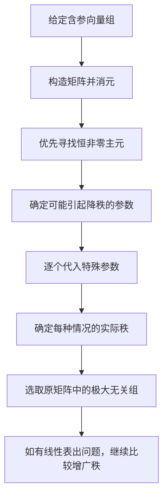
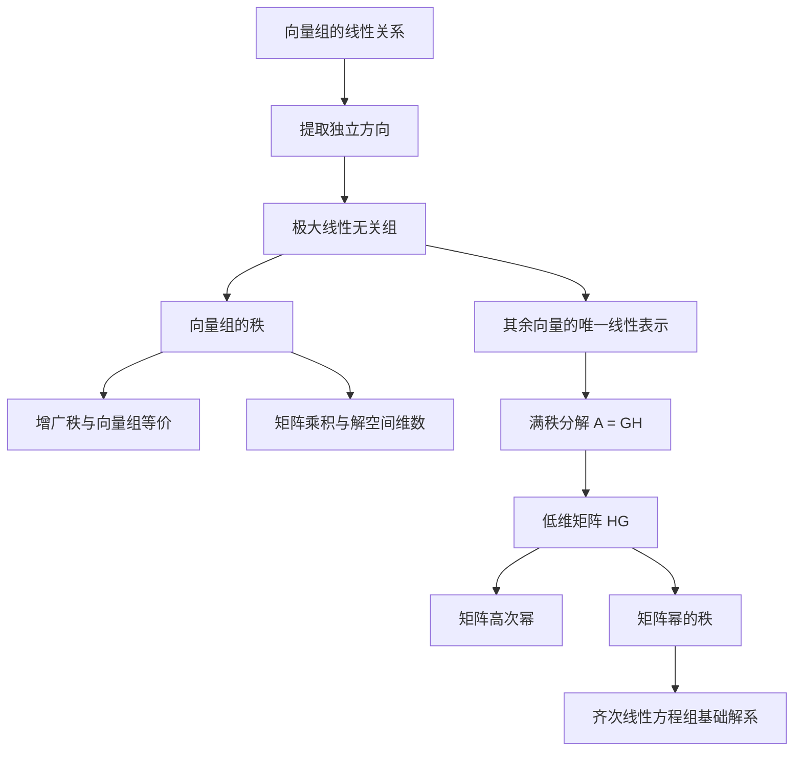

## 一、本节的知识体系与考查重点

前两节主要解决两个问题：

- 第一节：一个向量能否由其他向量线性表示？
- 第二节：一组向量是否线性相关？

第三节则进一步解决：**一组向量中究竟有多少个本质上独立的方向？如何提取这些方向，并用它们表示整个向量组？**

这也是后面学习基础解系、矩阵的秩分解、向量空间、相似对角化的重要基础。

| 核心考点          | 重要程度  | 主要考查方式   |
| ------------- | ----- | -------- |
| 极大线性无关组的概念与性质 | ★★★★★ | 概念辨析、选择题 |
| 向量组的秩与矩阵的秩    | ★★★★★ | 选择、填空、计算 |
| 极大线性无关组的求法    | ★★★★★ | 计算题      |
| 向量组等价与秩的关系    | ★★★★★ | 抽象判断、含参题 |
| 含参数向量组的秩      | ★★★★★ | 填空、综合大题  |
| 非零子式与线性无关     | ★★★★  | 选择、证明    |
| 向量组的秩与矩阵乘法    | ★★★★★ | 抽象综合题    |
| 矩阵的秩分解        | ★★★★★ | 综合大题     |
| 低秩矩阵的高次幂      | ★★★★★ | 综合大题     |
| 正交向量组与秩       | ★★★★  | 数一综合题    |

本节需要建立的核心思维是：

$$
\boxed{ \text{线性表出} \longleftrightarrow \text{张成空间} \longleftrightarrow \text{极大线性无关组} \longleftrightarrow \text{秩} }
$$

然后进一步将其转化成矩阵语言：

$$
\boxed{ \text{向量组的线性关系} \longleftrightarrow \text{矩阵初等行变换} \longleftrightarrow \text{线性方程组的解} }
$$

真正掌握这一节，不是记住几十条关于秩的公式，而是能够在这些语言之间自由切换。

## 二、基础概念：从直观理解到严格定义

### 2.1 向量组的张成空间

给定向量组

$$
\alpha_1,\alpha_2,\ldots,\alpha_s,
$$

它们所有可能的线性组合构成的集合，称为该向量组的张成空间，记为

$$
U=\operatorname{span}\{\alpha_1,\ldots,\alpha_s\}.
$$

即

$$
U=\left\{ \sum_{i=1}^{s}k_i\alpha_i: k_i\in\mathbb R \right\}.
$$

直观上，在三维空间中：

| 向量组的秩 | 张成空间的几何意义 |
| ----- | --------- |
| 0     | 原点        |
| 1     | 经过原点的一条直线 |
| 2     | 经过原点的一个平面 |
| 3     | 整个三维空间    |

例如，

$$
\alpha_1=\begin{pmatrix}1\\0\\0\end{pmatrix}, \quad \alpha_2=\begin{pmatrix}0\\1\\0\end{pmatrix}, \quad \alpha_3=\begin{pmatrix}1\\1\\0\end{pmatrix}.
$$

虽然有三个向量，但是

$$
\alpha_3=\alpha_1+\alpha_2.
$$

因此第三个向量没有提供新的独立方向，三个向量共同张成的仍然是二维平面。

这组向量的秩就是2。

### 2.2 极大线性无关组的定义

在向量组

$$
\alpha_1,\alpha_2,\ldots,\alpha_s
$$

中选取部分向量

$$
\alpha_{i_1},\alpha_{i_2},\ldots,\alpha_{i_r}.
$$

如果满足以下两个条件：

1. 选出的向量线性无关；
2. 原向量组中的每个向量都可以由选出的向量线性表示。

则称选出的向量组为原向量组的一个**极大线性无关组**，简称极大无关组。

第二个条件也可以表述为：再加入原向量组中任何一个尚未选入的向量，新向量组都将线性相关。

所以，“极大”的本质是：

**所有独立方向都已经被选出来了，剩余向量没有提供新的独立方向。**

**极大无关组的四条重要性质**

第一，极大无关组不一定唯一。

第二，同一个向量组的所有极大无关组包含的向量个数一定相同。

第三，原向量组与它的任意一个极大无关组等价。

第四，原向量组中的每个向量，都可以由一个指定的极大无关组唯一地线性表示。

注意最后一条中的“指定”二字。不同极大无关组下的表示系数可以不同。

**例：极大无关组为什么不唯一？**

设

$$
\alpha_1=(1,0,0)^{\mathrm T},
$$

$$
\alpha_2=(0,1,0)^{\mathrm T},
$$

$$
\alpha_3=(1,1,0)^{\mathrm T}.
$$

那么

$$
\{\alpha_1,\alpha_2\}, \quad \{\alpha_1,\alpha_3\}, \quad \{\alpha_2,\alpha_3\}
$$

都是极大无关组。

但是单独的 $\{\alpha_1\}$ 虽然线性无关，却不是极大无关组，因为还可以加入 $\alpha_2$。

**线性无关组不一定是极大线性无关组。**

### 2.3 向量组的秩

极大线性无关组中所含向量的个数，称为原向量组的秩。

记为

$$
r(\alpha_1,\alpha_2,\ldots,\alpha_s).
$$

从空间角度看，

$$
\boxed{ r(\alpha_1,\ldots,\alpha_s) = \dim\operatorname{span}\{\alpha_1,\ldots,\alpha_s\} }
$$

因此，秩不是向量的数量，而是独立方向的数量。

若有 $s$ 个 $n$ 维向量，则

$$
\boxed{ 0\leq r(\alpha_1,\ldots,\alpha_s) \leq\min\{n,s\} }
$$

特别地，

$$
\alpha_1,\ldots,\alpha_s \text{线性无关} \iff r(\alpha_1,\ldots,\alpha_s)=s.
$$

$$
\alpha_1,\ldots,\alpha_s \text{线性相关} \iff r(\alpha_1,\ldots,\alpha_s)<s.
$$

当 $s>n$ 时，该向量组必然线性相关。

### 2.4 向量组的秩与矩阵的秩

将向量组按列排列成矩阵：

$$
A=(\alpha_1,\alpha_2,\ldots,\alpha_s).
$$

则

$$
\boxed{ r(\alpha_1,\alpha_2,\ldots,\alpha_s)=r(A) }
$$

同时，矩阵的行秩等于列秩：

$$
\boxed{ r(\text{行向量组}) =r(\text{列向量组}) =r(A) }
$$

这是本节最重要的计算桥梁。

虽然向量组的秩与矩阵的秩在数值上统一，但在实际题目中仍有不同侧重点：

| 所求目标        | 应当关注什么            |
| ----------- | ----------------- |
| 求矩阵的秩       | 独立行或独立列的个数        |
| 求列向量组的极大无关组 | 原矩阵中哪些列线性无关       |
| 求行向量组的极大无关组 | 原矩阵中哪些行线性无关       |
| 求线性表示式      | 非主元向量与主元向量之间的系数关系 |
| 求秩分解        | 极大无关组及所有列的表示系数    |

## 三、必须掌握的核心定理与公式

### 3.1 线性表出的增广秩判别法

设

$$
A=(\alpha_1,\ldots,\alpha_s).
$$

则

$$
\boxed{ \beta\text{可由 }\alpha_1,\ldots,\alpha_s \text{线性表示} \iff r(A)=r(A,\beta) }
$$

因为线性表示问题本质上就是方程组

$$
Ax=\beta
$$

是否有解的问题。

进一步，

$$
\beta\notin\operatorname{span}(A) \iff r(A,\beta)=r(A)+1.
$$

因此，增加一个向量，秩至多增加1：

$$
\boxed{ r(A)\leq r(A,\beta)\leq r(A)+1 }
$$

增加 $k$ 个向量，则秩至多增加 $k$。

删除一个向量，秩至多减少1。

这类结论特别适合解决不提供具体坐标的抽象题。

### 3.2 极大无关组的等价判别条件

设从原向量组 $A$ 中选取 $r$ 个向量组成向量组 $B$。

那么 $B$ 是 $A$ 的极大无关组，当且仅当

$$
\boxed{ r(B)=r(A)=r }
$$

也就是说，必须同时证明：

$$
\underbrace{r(B)=r}_{\text{选出的向量线性无关}}
$$

和

$$
\underbrace{r(A)=r(B)}_{\text{没有遗漏独立方向}}.
$$

做证明题时，经常将其写成：

先证明选出的向量线性无关，再证明其余向量均可由它们线性表示。

### 3.3 向量组等价的核心定理

设两个向量组分别为

$$
A=(\alpha_1,\ldots,\alpha_s),
$$

$$
B=(\beta_1,\ldots,\beta_t).
$$

如果 $A$ 可由 $B$ 线性表示，同时 $B$ 可由 $A$ 线性表示，则称两个向量组等价。

记作

$$
A\sim B.
$$

以下三个条件等价：

$$
\boxed{ A\sim B }
$$

$$
\boxed{ \operatorname{span}(A)=\operatorname{span}(B) }
$$

$$
\boxed{ r(A)=r(B)=r(A,B) }
$$

第三个结论是考研计算题中最常用的公式。

**单向线性表出与秩的大小关系**

若 $A$ 可由 $B$ 线性表示，则

$$
\operatorname{span}(A) \subseteq\operatorname{span}(B),
$$

从而

$$
\boxed{r(A)\leq r(B)}
$$

如果再有

$$
r(A)=r(B),
$$

则必有

$$
A\sim B.
$$

记忆方式是：

**单向表出给出空间包含关系，相同的维数使包含关系变成相等关系。**

<Callout type="warn" title="易错点：秩相同不代表向量组等价">

例如

$$
\alpha=(1,0)^{\mathrm T}, \qquad \beta=(0,1)^{\mathrm T}.
$$

二者的秩都是1，但分别张成不同的直线。

所以

$$
r(A)=r(B) \not\Rightarrow A\sim B.
$$

而两个向量组如果等价，则秩一定相同。

</Callout>

**3.4 初等变换对向量关系的影响**

这是本节极其重要、又特别容易混淆的知识点。

设 $P,Q$ 为适当阶数的可逆矩阵。

| 变换                     | 矩阵的秩 | 行向量组的张成空间 | 列向量组的张成空间 |
| ---------------------- | ---- | --------- | --------- |
| $A\rightarrow PA$  | 不变   | 不变        | 不一定不变     |
| $A\rightarrow AQ$  | 不变   | 不一定不变     | 不变        |
| $A\rightarrow PAQ$ | 不变   | 不一定不变     | 不一定不变     |

但是，初等行变换有一个更强的性质：

**它保持各列之间原有的线性关系及其系数。**

证明：

$$
k_1\alpha_1+\cdots+k_s\alpha_s=0
$$

当且仅当

$$
k_1P\alpha_1+\cdots+k_sP\alpha_s=0.
$$

这是因为 $P$ 可逆。

所以，如果消元之后发现

$$
P\alpha_3=2P\alpha_1-P\alpha_2,
$$

那么在原矩阵中也必有

$$
\alpha_3=2\alpha_1-\alpha_2.
$$

这正是使用初等行变换求列向量组的极大无关组和线性表示式的理论依据。

**考试中的操作原则**

求列向量组的极大无关组，优先作初等行变换。

求行向量组的极大无关组，可以转置后作初等行变换，或者直接作初等列变换。

如果只是求秩，则行、列初等变换均可使用。

## 四、题型一：求极大线性无关组及线性表示式

这是本节最基础、最重要的计算母题。后面所有秩分解题都建立在它的基础上。

### 4.1 标准解题算法

对于具体向量组，统一采用以下方法：

第一步，将所有向量按列排列成矩阵。

第二步，只作初等行变换，将矩阵化成行阶梯形。

第三步，找到主元所在列，记录对应的列序号。

第四步，回到原向量组，选择这些列对应的原向量。

第五步，如果还要求线性表示式，则继续化成行最简形，从非主元列中读取表示系数。

注意：

$$
\boxed{ \text{主元列的位置在消元后确定，极大无关组从原矩阵中选取。} }
$$

### 4.2 母题1：李林880·向量章

设

$$
\alpha_1=\begin{pmatrix}0\\4\\2\end{pmatrix}, \quad \alpha_2=\begin{pmatrix}1\\1\\0\end{pmatrix},
$$

$$
\alpha_3=\begin{pmatrix}-2\\4\\3\end{pmatrix}, \quad \alpha_4=\begin{pmatrix}-1\\1\\1\end{pmatrix}.
$$

求该向量组的一个极大线性无关组，并将其余向量用极大无关组线性表示。

**解法：行最简形直接读取法**

构造矩阵

$$
A= \begin{pmatrix} 0&1&-2&-1\\ 4&1&4&1\\ 2&0&3&1 \end{pmatrix}.
$$

交换第一行与第三行：

$$
\longrightarrow \begin{pmatrix} 2&0&3&1\\ 4&1&4&1\\ 0&1&-2&-1 \end{pmatrix}.
$$

第二行减去第一行的2倍：

$$
\longrightarrow \begin{pmatrix} 2&0&3&1\\ 0&1&-2&-1\\ 0&1&-2&-1 \end{pmatrix}.
$$

继续消元：

$$
\longrightarrow \begin{pmatrix} 1&0&\frac32&\frac12\\ 0&1&-2&-1\\ 0&0&0&0 \end{pmatrix}.
$$

由非零行的个数可知

$$
\boxed{r(A)=2}.
$$

主元在第一、二列，因此原向量组的一个极大无关组是

$$
\boxed{\alpha_1,\alpha_2}.
$$

观察第三、四列，直接得到

$$
\boxed{ \alpha_3=\frac32\alpha_1-2\alpha_2 }
$$

$$
\boxed{ \alpha_4=\frac12\alpha_1-\alpha_2 }
$$

**为什么可以直接读取系数？**

因为消元后的主元列为

$$
\widetilde\alpha_1= \begin{pmatrix}1\\0\\0\end{pmatrix}, \qquad \widetilde\alpha_2= \begin{pmatrix}0\\1\\0\end{pmatrix}.
$$

第三列恰好为

$$
\widetilde\alpha_3= \frac32\widetilde\alpha_1 -2\widetilde\alpha_2.
$$

而行变换保持列向量之间的线性关系，所以原向量满足完全相同的表示式。

<Callout type="warn" title="常见陷阱">

如果只消元到

$$
\begin{pmatrix} 2&0&3&1\\ 0&1&-2&-1\\ 0&0&0&0 \end{pmatrix},
$$

不能直接把第三列的前两个数字 $3,-2$ 当作表示系数。

因为第一主元还没有化为1。

因此，考试中要求线性表示式时，最好直接化成行最简形。

</Callout>

**4.3 本题的进一步推广**

如果一个矩阵化成

$$
\begin{pmatrix} 1&0&a&0&b\\ 0&1&c&0&d\\ 0&0&0&1&e\\ 0&0&0&0&0 \end{pmatrix},
$$

则秩为3，主元列为第一、二、四列。

极大无关组是

$$
\alpha_1,\alpha_2,\alpha_4.
$$

其余向量满足

$$
\alpha_3=a\alpha_1+c\alpha_2,
$$

$$
\alpha_5=b\alpha_1+d\alpha_2+e\alpha_4.
$$

所以主元列不一定是前 $r$ 列，要根据实际消元结果选择。

## 五、题型二：非零子式与向量组秩的结构判别

这类题经常以选择题出现，主要考查秩的上下界以及矩阵局部信息与整体信息的关系。

### 5.1 必须掌握的判别公式

矩阵中存在一个非零 $k$ 阶子式，则

$$
\boxed{r(A)\geq k}.
$$

矩阵的所有 $k+1$ 阶子式均为零，则

$$
\boxed{r(A)\leq k}.
$$

如果两个条件同时满足，则

$$
\boxed{r(A)=k}.
$$

注意“一个”和“所有”的区别。

此外，如果某个非零 $k$ 阶子式位于第 $i_1,\ldots,i_k$ 行和第 $j_1,\ldots,j_k$ 列，那么原矩阵中对应的这 $k$ 个行向量、这 $k$ 个列向量都分别线性无关。

### 5.2 母题2：张宇1000题

设

$$
A= \begin{pmatrix} a_{11}&a_{12}&a_{13}&a_{14}\\ a_{21}&a_{22}&a_{23}&a_{24}\\ a_{31}&a_{32}&a_{33}&a_{34} \end{pmatrix},
$$

其列向量为 $\alpha_1,\ldots,\alpha_4$，行向量为 $\beta_1,\beta_2,\beta_3$。

已知

$$
\begin{vmatrix} a_{12}&a_{14}\\ a_{32}&a_{34} \end{vmatrix}\neq0
$$

以及

$$
\begin{vmatrix} a_{11}&a_{12}&a_{13}\\ a_{21}&a_{22}&a_{23}\\ a_{31}&a_{32}&a_{33} \end{vmatrix}=0.
$$

判断：

① $r(A)=2$；

② $\alpha_2,\alpha_4$ 线性无关；

③ $\beta_1,\beta_2,\beta_3$ 线性相关；

④ $\alpha_1,\alpha_2,\alpha_3$ 线性相关。

**分析**

第一个条件给出了一个非零二阶子式。

因此

$$
r(A)\geq2,
$$

而且它来自第二、四列，所以

$$
\alpha_2,\alpha_4
$$

线性无关。②正确。

第二个条件说明前三列组成的三阶方阵行列式为零，所以前三个列向量线性相关。④正确。

但是，这并不意味着整个矩阵的秩为2。

因为其他三阶子式仍然可能非零。

例如构造

$$
A= \begin{pmatrix} 0&1&0&0\\ 1&0&0&0\\ 0&0&0&1 \end{pmatrix}.
$$

这个矩阵满足题目的两个条件，但

$$
r(A)=3.
$$

因此①、③都不一定正确。

最终答案为

$$
\boxed{\text{②④}}
$$

**母题提炼**

| 已知信息     | 能够推出     | 不能直接推出    |
| -------- | -------- | --------- |
| 存在非零二阶子式 | 秩至少为2    | 秩恰好为2     |
| 某个三阶子式为零 | 对应局部方阵奇异 | 整个矩阵秩小于3  |
| 所有三阶子式为零 | 秩至多为2    | 秩一定为2     |
| 矩阵秩为2    | 存在非零二阶子式 | 任意二阶子式都非零 |

考研选择题非常喜欢利用这些量词上的差异设置陷阱。

### 5.3 母题3：李正元·范德蒙德型向量组

已知 $a_1,\ldots,a_s$ 两两不同，设

$$
\alpha_i=(1,a_i,a_i^2,\ldots,a_i^{n-1})^{\mathrm T}.
$$

求

$$
r(\alpha_1,\ldots,\alpha_s).
$$

**解法**

构造矩阵

$$
A= \begin{pmatrix} 1&1&\cdots&1\\ a_1&a_2&\cdots&a_s\\ a_1^2&a_2^2&\cdots&a_s^2\\ \vdots&\vdots&&\vdots\\ a_1^{n-1}&a_2^{n-1}&\cdots&a_s^{n-1} \end{pmatrix}.
$$

显然

$$
r(A)\leq\min\{n,s\}.
$$

令

$$
k=\min\{n,s\}.
$$

取前 $k$ 行、前 $k$ 列，得到范德蒙德行列式

$$
D=\prod_{1\leq i<j\leq k}(a_j-a_i).
$$

因为各个 $a_i$ 两两不同，所以

$$
D\neq0.
$$

于是

$$
r(A)\geq k.
$$

结合上下界，

$$
\boxed{ r(\alpha_1,\ldots,\alpha_s)=\min\{n,s\} }
$$

**创新题推广**

若 $a_1,\ldots,a_s$ 不一定两两不同，其中只有 $t$ 个不同的数，则

$$
\boxed{r(A)=\min\{n,t\}}.
$$

因为重复参数对应完全相同的列向量，不会增加秩。

这种题型体现的是特殊行列式与向量组秩之间的联系。

## 六、题型三：含参数向量组的秩与极大无关组

含参题是本节最主要的计算难点。

它与普通求秩题的区别在于：参数取不同数值时，独立方向的数量可能发生变化，极大无关组的选择也可能发生变化。

**6.1 三种常用解题方法**

| 方法     | 适用情况     | 核心操作           |
| ------ | -------- | -------------- |
| 初等行变换法 | 一般矩阵、非方阵 | 找到含参数的主元       |
| 行列式法   | 方阵       | 先确定降秩的候选参数     |
| 线性表出法  | 已知部分向量无关 | 要求其余向量属于已知张成空间 |

如果题目要求

$$
r(A)=r,
$$

必须同时保证

$$
r(A)\geq r,\qquad r(A)\leq r.
$$

绝不能只找到使矩阵降秩的参数，就认为已经完成求解。

### 6.2 母题4：1997年数学二真题

设

$$
\alpha_1=(1,2,-1,1),
$$

$$
\alpha_2=(2,0,t,0),
$$

$$
\alpha_3=(0,-4,5,-2).
$$

若

$$
r(\alpha_1,\alpha_2,\alpha_3)=2,
$$

求 $t$。

<Tabs items={["解法一：阶梯形矩阵", "解法二：利用极大无关组"]} defaultIndex={0}>

<Tab value="解法一：阶梯形矩阵">

本题只要求秩，所以可以直接按行排列：

$$
A= \begin{pmatrix} 1&2&-1&1\\ 2&0&t&0\\ 0&-4&5&-2 \end{pmatrix}.
$$

第二行减去第一行的2倍：

$$
\longrightarrow \begin{pmatrix} 1&2&-1&1\\ 0&-4&t+2&-2\\ 0&-4&5&-2 \end{pmatrix}.
$$

第三行减去第二行：

$$
\longrightarrow \begin{pmatrix} 1&2&-1&1\\ 0&-4&t+2&-2\\ 0&0&3-t&0 \end{pmatrix}.
$$

前两个主元恒不为零，所以

$$
r(A)\geq2.
$$

题目要求秩恰好为2，因此第三行必须为零：

$$
3-t=0.
$$

所以

$$
\boxed{t=3}.
$$

</Tab>

<Tab value="解法二：利用极大无关组">

观察可知 $\alpha_1,\alpha_2$ 对任意 $t$ 都线性无关。

若秩为2，则必有

$$
\alpha_3=x\alpha_1+y\alpha_2.
$$

比较第一、二个分量：

$$
\begin{cases} x+2y=0,\\ 2x=-4. \end{cases}
$$

得到

$$
x=-2,\qquad y=1.
$$

再比较第三个分量：

$$
2+t=5,
$$

所以

$$
\boxed{t=3}.
$$

此时

$$
\alpha_3=-2\alpha_1+\alpha_2.
$$

两种方法都很好。对于已经存在明显独立向量的题目，第二种方法往往更快。

</Tab>

</Tabs>

### 6.3 母题5：2006年数学三真题——特殊结构与多种降秩情况

设

$$
\alpha_1=(1+a,1,1,1)^{\mathrm T},
$$

$$
\alpha_2=(2,2+a,2,2)^{\mathrm T},
$$

$$
\alpha_3=(3,3,3+a,3)^{\mathrm T},
$$

$$
\alpha_4=(4,4,4,4+a)^{\mathrm T}.
$$

问 $a$ 为何值时向量组线性相关？当线性相关时，求一个极大无关组，并将剩余向量线性表示。

<Steps>

<Step>

### 第一步：识别矩阵的特殊结构 [!toc]

$$
A= \begin{pmatrix} a+1&2&3&4\\ 1&a+2&3&4\\ 1&2&a+3&4\\ 1&2&3&a+4 \end{pmatrix}.
$$

这是一个数量矩阵与秩一矩阵的和。

令

$$
u=\begin{pmatrix}1\\1\\1\\1\end{pmatrix}, \qquad v=\begin{pmatrix}1\\2\\3\\4\end{pmatrix}.
$$

则

$$
A=aE+uv^{\mathrm T}.
$$

其中

$$
v^{\mathrm T}u=10.
$$

利用特殊矩阵行列式公式，

$$
\boxed{ |aE+uv^{\mathrm T}| =a^{n-1}(a+v^{\mathrm T}u) }
$$

得到

$$
|A|=a^3(a+10).
$$

因此线性相关的充要条件为

$$
\boxed{a=0\quad\text{或}\quad a=-10}.
$$

</Step>

<Step>

### 第二步：分别讨论每个参数 [!toc]

**情况一：**$a=0$**。**

此时

$$
A=uv^{\mathrm T},
$$

各列为

$$
u,2u,3u,4u.
$$

显然

$$
r(A)=1.
$$

可取 $\alpha_1$ 为极大无关组，并且

$$
\boxed{ \alpha_2=2\alpha_1,\quad \alpha_3=3\alpha_1,\quad \alpha_4=4\alpha_1 }
$$

**情况二：**$a=-10$**。**

因为

$$
Au=-10u+uv^{\mathrm T}u=0,
$$

所以

$$
\alpha_1+\alpha_2+\alpha_3+\alpha_4=0.
$$

从而

$$
r(A)\leq3.
$$

另一方面，后三列的前三个分量组成的三阶子式为

$$
\begin{vmatrix} 2&3&4\\ -8&3&4\\ 2&-7&4 \end{vmatrix} =400\neq0.
$$

因此

$$
r(A)\geq3.
$$

综上

$$
\boxed{r(A)=3}.
$$

可取

$$
\boxed{\alpha_2,\alpha_3,\alpha_4}
$$

为极大无关组，并且

$$
\boxed{\alpha_1=-\alpha_2-\alpha_3-\alpha_4}.
$$

</Step>

</Steps>

**本题的重要推广：秩一扰动矩阵**

对于

$$
A=aE_n+uv^{\mathrm T},
$$

其中 $u,v$ 都是非零 $n$ 维列向量，记

$$
c=v^{\mathrm T}u.
$$

有

$$
|A|=a^{n-1}(a+c).
$$

当 $n\geq2$ 时，

$$
\boxed{ r(A)= \begin{cases} 1,&a=0,\\ n-1,&a=-c\neq0,\\ n,&a\neq0,\ a+c\neq0. \end{cases} }
$$

为什么当 $a=-c\neq0$ 时恰好为 $n-1$？

由秩的不等式，

$$
r(aE+uv^{\mathrm T}) \geq r(aE)-r(uv^{\mathrm T}) =n-1.
$$

再结合行列式为零，即

$$
r(A)\leq n-1,
$$

立即得到结论。

注意若 $c=0$，两个候选参数会重合，此时 $a=0$ 应按秩一矩阵处理。

这是非常有价值的综合题模型，可以与行列式、矩阵的秩、特征值、矩阵高次幂等知识点结合。

### 6.4 母题6：李林880——含参秩与增广矩阵综合题

设

$$
\alpha_1=(1,1,1,2)^{\mathrm T},
$$

$$
\alpha_2=(3,a+4,2a+5,a+7)^{\mathrm T},
$$

$$
\alpha_3=(4,6,8,10)^{\mathrm T},
$$

$$
\alpha_4=(2,3,2a+3,5)^{\mathrm T},
$$

以及

$$
\alpha=(0,1,3,b)^{\mathrm T}.
$$

（1）求前四个向量的秩及一个极大无关组。

（2）若 $\alpha$ 不能由前四个向量线性表示，求 $a,b$ 的取值。

<Steps>

<Step>

### 第一步：两问合并计算 [!toc]

不必先求一次系数矩阵的秩，再重新计算增广矩阵。

直接构造

$$
(A\mid\alpha)= \left( \begin{array}{cccc|c} 1&3&4&2&0\\ 1&a+4&6&3&1\\ 1&2a+5&8&2a+3&3\\ 2&a+7&10&5&b \end{array} \right).
$$

作初等行变换：

$$
\longrightarrow \left( \begin{array}{cccc|c} 1&3&4&2&0\\ 0&a+1&2&1&1\\ 0&2a+2&4&2a+1&3\\ 0&a+1&2&1&b \end{array} \right).
$$

继续消元：

$$
\longrightarrow \left( \begin{array}{cccc|c} 1&3&4&2&0\\ 0&a+1&2&1&1\\ 0&0&0&2a-1&1\\ 0&0&0&0&b-1 \end{array} \right).
$$

这是整道题的关键。

</Step>

<Step>

### 第二步：讨论系数矩阵的秩 [!toc]

注意第二行中的 $a+1$ 虽然可能为零，但该行第三列恒为2，所以第二行永远不是零行。

当

$$
a\neq\frac12
$$

时，第三行系数部分非零，因此

$$
\boxed{r(A)=3}.
$$

可取

$$
\boxed{\alpha_1,\alpha_3,\alpha_4}
$$

作为极大无关组。其对应的三阶子式为 $2(2a-1)\neq0$。

当

$$
a=\frac12
$$

时，第三行系数部分为零，因此

$$
\boxed{r(A)=2}.
$$

第一、二列在前两行的子式为

$$
\begin{vmatrix} 1&3\\ 1&a+4 \end{vmatrix} =a+1=\frac32\neq0.
$$

可取

$$
\boxed{\alpha_1,\alpha_2}
$$

为极大无关组。

</Step>

<Step>

### 第三步：讨论线性表出 [!toc]

$\alpha$ 能够由前四个向量线性表示，等价于

$$
r(A)=r(A,\alpha).
$$

根据消元结果：

当 $a=\frac12$ 时，第三行对应方程为

$$
0=1,
$$

因此不论 $b$ 取什么值，都不能线性表示。

当 $a\neq\frac12$ 时，第三行可以确定相应未知数，但最后一行要求

$$
b-1=0.
$$

所以能够线性表示的充要条件为

$$
\boxed{a\neq\frac12,\quad b=1}.
$$

取其否定，不能线性表示的充要条件为

$$
\boxed{ a=\frac12\quad\text{或}\quad b\neq1 }.
$$

</Step>

</Steps>

**本题的考研价值**

这道题同时考查了参数讨论、极大无关组、系数矩阵秩、增广矩阵秩以及逻辑条件的否定，是非常典型的综合母题。

尤其要注意：

$$
\neg(P\land Q)=(\neg P)\lor(\neg Q).
$$

这里应当是“或”，而不是“且”。

**6.5 含参题的通用解题流程**

最重要的操作习惯是：**不要在未讨论参数是否为零的情况下，直接除以含参数的表达式。**

例如，不能未经讨论就将某行除以 $a-1$，否则会丢失 $a=1$ 的特殊情况。

## 七、题型四：向量组等价、增加向量与抽象秩

**7.1 先掌握四种基本逻辑关系**

| 已知条件                          | 正确结论                |
| ----------------------------- | ------------------- |
| $A$ 可由 $B$ 表示         | $r(A)\leq r(B)$ |
| $A$ 可由 $B$ 表示且二者秩相同   | $A\sim B$       |
| $A\sim B$                 | 二者秩相同               |
| $A$ 是 $B$ 的子向量组且二者秩相同 | $A\sim B$       |

最后一个结论非常重要，因为当两个向量组存在天然的包含关系时，不需要分别证明双向表出。

### 7.2 母题7：1995年数学三真题——抽象空间证明

已知

$$
\begin{aligned} (\mathrm I)&:\alpha_1,\alpha_2,\alpha_3,\\ (\mathrm {II})&:\alpha_1,\alpha_2,\alpha_3,\alpha_4,\\ (\mathrm {III})&:\alpha_1,\alpha_2,\alpha_3,\alpha_5. \end{aligned}
$$

且

$$
r(\mathrm I)=r(\mathrm {II})=3,
$$

$$
r(\mathrm {III})=4.
$$

证明

$$
r(\alpha_1,\alpha_2,\alpha_3,\alpha_5-\alpha_4)=4.
$$

<Tabs items={["解法一：张成空间法", "解法二：齐次线性组合"]} defaultIndex={0}>

<Tab value="解法一：张成空间法">

设

$$
U=\operatorname{span}\{\alpha_1,\alpha_2,\alpha_3\}.
$$

由

$$
r(\mathrm I)=r(\mathrm {II}),
$$

知

$$
\alpha_4\in U.
$$

由

$$
r(\mathrm {III})=4>r(\mathrm I),
$$

知

$$
\alpha_5\notin U.
$$

假设

$$
\alpha_5-\alpha_4\in U,
$$

则由子空间对加法封闭，

$$
\alpha_5=(\alpha_5-\alpha_4)+\alpha_4\in U.
$$

矛盾。

所以

$$
\alpha_5-\alpha_4\notin U.
$$

加入该向量后秩增加1，因此

$$
\boxed{ r(\alpha_1,\alpha_2,\alpha_3,\alpha_5-\alpha_4)=4 }.
$$

</Tab>

<Tab value="解法二：齐次线性组合">

由 $\alpha_4\in U$，可设

$$
\alpha_4=c_1\alpha_1+c_2\alpha_2+c_3\alpha_3.
$$

令

$$
k_1\alpha_1+k_2\alpha_2+k_3\alpha_3 +k_4(\alpha_5-\alpha_4)=0.
$$

代入得到

$$
\begin{aligned} &(k_1-k_4c_1)\alpha_1\\ +{}&(k_2-k_4c_2)\alpha_2\\ +{}&(k_3-k_4c_3)\alpha_3+k_4\alpha_5=0. \end{aligned}
$$

由于

$$
\alpha_1,\alpha_2,\alpha_3,\alpha_5
$$

线性无关，所以

$$
k_4=0,
$$

进而

$$
k_1=k_2=k_3=0.
$$

故目标向量组线性无关，秩为4。

</Tab>

</Tabs>

**母题推广**

对于任意子空间 $U$，若

$$
u\in U,\quad v\notin U,
$$

则

$$
\boxed{ av+bu\notin U\qquad(a\neq0) }
$$

也就是说，已有空间中的任何向量，都无法抵消外部向量所提供的新独立方向。

**7.3 模拟题：李永乐六套卷·第6套第5题**

已知 $\alpha_1,\alpha_2$ 线性无关，

$$
\alpha_3=\alpha_1+\alpha_2,
$$

且 $\alpha_4$ 不能由 $\alpha_1,\alpha_2$ 线性表示。

令

$$
u=\alpha_3+t\alpha_4,
$$

$$
v=\alpha_3+s\alpha_4.
$$

判断加入 $u,v$ 后秩的变化。

**解法**

原空间为

$$
U=\operatorname{span}\{\alpha_1,\alpha_2\}.
$$

因为

$$
\alpha_3\in U,\qquad \alpha_4\notin U,
$$

所以

$$
r(\alpha_1,\alpha_2,u) = \begin{cases} 2,&t=0,\\ 3,&t\neq0. \end{cases}
$$

进一步，

$$
\boxed{ r(\alpha_1,\alpha_2,u,v)= \begin{cases} 2,&s=t=0,\\ 3,&(s,t)\neq(0,0). \end{cases} }
$$

这就是原模拟题选项B的结论。

<Callout type="warn" title="易错点">

容易认为当 $s=t$ 时，$u=v$，所以秩一定为2。

但当

$$
s=t\neq0
$$

时，尽管 $u=v$，这个向量仍提供了一个新的独立方向，所以秩仍为3。

**重复向量不额外增加秩，并不代表这个方向原本就存在。**

</Callout>

### 7.4 母题8：张宇1000题——向量组不等价的参数问题

设

$$
\alpha_1=(1,1,2)^{\mathrm T},
$$

$$
\alpha_2=(2,a,4)^{\mathrm T},
$$

$$
\alpha_3=(a,3,6)^{\mathrm T},
$$

$$
\alpha_4=(0,2,2a)^{\mathrm T}.
$$

如果

$$
\alpha_1,\alpha_2,\alpha_3,\alpha_4
$$

与

$$
\alpha_1,\alpha_2,\alpha_3
$$

不等价，求 $a$。

<Steps>

<Step>

### 第一步：识别天然包含关系 [!toc]

设

$$
A=(\alpha_1,\alpha_2,\alpha_3).
$$

原向量组与扩充向量组不等价，当且仅当

$$
r(A,\alpha_4)>r(A).
$$

由于所有向量都是三维的，因此若 $r(A)=3$，则加入任何向量都不会增加秩。

所以必须有

$$
|A|=0.
$$

计算得到

$$
|A|= \begin{vmatrix} 1&2&a\\ 1&a&3\\ 2&4&6 \end{vmatrix} =-2(a-2)(a-3).
$$

故候选参数为

$$
a=2\quad\text{或}\quad a=3.
$$

</Step>

<Step>

### 第二步：检查候选参数 [!toc]

当 $a=2$ 时，

$$
\alpha_2=2\alpha_1,
$$

且

$$
\alpha_4=2\alpha_3-4\alpha_1.
$$

所以加入 $\alpha_4$ 后秩不变，两组仍然等价。

当 $a=3$ 时，

$$
\alpha_3=3\alpha_1.
$$

而

$$
\alpha_1=(1,1,2)^{\mathrm T}, \quad \alpha_2=(2,3,4)^{\mathrm T}.
$$

这两个向量的任意线性组合都满足

$$
z=2x.
$$

然而

$$
\alpha_4=(0,2,6)^{\mathrm T}
$$

不满足这个条件。

所以 $\alpha_4$ 无法由原向量组线性表示，秩由2增加至3。

因此

$$
\boxed{a=3}.
$$

</Step>

</Steps>

**解题策略总结**

行列式为零只是找到了可能发生秩变化的位置，不是最终答案。

真正需要检验的是

$$
r(A,\alpha_4)>r(A).
$$

## 八、题型五：两个含参向量组的等价与秩比较

**8.1 三维向量组的平面法**

如果两个三维向量组的秩均为2，那么它们各自张成一个过原点的平面。

此时判断等价，不一定需要进行复杂的增广矩阵消元，也可以直接比较平面。

设

$$
U=\operatorname{span}\{\alpha_1,\alpha_2\},
$$

其中两向量线性无关。

求出一个非零法向量 $n$，则

$$
\beta\in U \iff n^{\mathrm T}\beta=0.
$$

这样，判断某个向量能否被表示，就变成了一个简单的线性方程。

### 8.2 母题9：张宇1000题·向量组等价

设

$$
\alpha_1=(1,2,-3)^{\mathrm T},
$$

$$
\alpha_2=(3,0,-3)^{\mathrm T},
$$

$$
\alpha_3=(9,6,-15)^{\mathrm T},
$$

以及

$$
\beta_1=(0,1,-1)^{\mathrm T},
$$

$$
\beta_2=(3,a,1)^{\mathrm T},
$$

$$
\beta_3=(1,1,b)^{\mathrm T}.
$$

若两个向量组等价，求 $a,b$。

**解法**

首先，

$$
\alpha_3=3\alpha_1+2\alpha_2.
$$

由于前两个向量线性无关，所以

$$
r(\alpha_1,\alpha_2,\alpha_3)=2.
$$

观察各个向量的分量，可以发现它们都满足

$$
x+y+z=0.
$$

因此其张成空间恰好为

$$
U=\{(x,y,z)^{\mathrm T}:x+y+z=0\}.
$$

如果两个向量组等价，则所有 $\beta_i$ 必须属于 $U$。

对于 $\beta_2$：

$$
3+a+1=0,
$$

得到

$$
a=-4.
$$

对于 $\beta_3$：

$$
1+1+b=0,
$$

得到

$$
b=-2.
$$

最后必须验证充分性。

当

$$
a=-4,\quad b=-2
$$

时，所有 $\beta_i$ 都在平面 $U$ 内，而且

$$
\beta_1=(0,1,-1)^{\mathrm T}, \qquad \beta_2=(3,-4,1)^{\mathrm T}
$$

线性无关。

因此第二个向量组也张成 $U$。

所以

$$
\boxed{a=-4,\quad b=-2}.
$$

<Callout type="warn" title="特别注意">

仅仅证明所有 $\beta_i$ 都在 $U$ 内，还不足以证明两组等价。

还必须确认它们确实张成整个平面，而不只是在平面内的一条直线上。

即必须确认

$$
r(B)=2.
$$

</Callout>

**8.3 模拟题：张宇8套卷·第5套第5题**

设

$$
\beta_1=(0,1,-1)^{\mathrm T},
$$

$$
\beta_2=(a,2,1)^{\mathrm T},
$$

$$
\beta_3=(b,1,0)^{\mathrm T},
$$

以及

$$
\alpha_1=(1,2,-3)^{\mathrm T},
$$

$$
\alpha_2=(3,0,1)^{\mathrm T},
$$

$$
\alpha_3=(9,6,-7)^{\mathrm T}.
$$

已知两个向量组具有相同的秩，且 $\beta_3$ 可由 $\alpha$ 向量组线性表示，求 $a,b$。

<Steps>

<Step>

### 第一步：求已知向量组的秩 [!toc]

因为

$$
\alpha_3=3\alpha_1+2\alpha_2,
$$

所以

$$
r(\alpha_1,\alpha_2,\alpha_3)=2.
$$

求 $\alpha_1,\alpha_2$ 张成平面的法向量。

可取

$$
n=(1,-5,-3)^{\mathrm T}.
$$

因此平面方程为

$$
x-5y-3z=0.
$$

</Step>

<Step>

### 第二步：利用指定向量的表出条件 [!toc]

由于

$$
\beta_3=(b,1,0)^{\mathrm T}
$$

在该平面内，所以

$$
b-5=0.
$$

故

$$
b=5.
$$

</Step>

<Step>

### 第三步：利用秩相同 [!toc]

$\beta$ 向量组的秩必须等于2，所以

$$
\begin{vmatrix} 0&a&b\\ 1&2&1\\ -1&1&0 \end{vmatrix} =3b-a=0.
$$

因此

$$
a=3b=15.
$$

又因为此时 $\beta_1,\beta_3$ 不成比例，所以第二个向量组秩至少为2，充分性成立。

最终

$$
\boxed{(a,b)=(15,5)}.
$$

</Step>

</Steps>

**与上一道题的关键区别**

上一道题要求两个向量组等价，所以所有 $\beta_i$ 都必须位于同一张成空间中。

本题只要求两个向量组的秩相同，并要求 $\beta_3$ 可以被表示。

因此不能擅自增加条件，要求 $\beta_1,\beta_2$ 也必须位于 $\alpha$ 向量组的张成空间中。

这正是综合选择题中非常重要的审题能力。

## 九、题型六：矩阵乘法与向量组的秩

这是将第二章矩阵的秩和第三章向量组理论结合起来的主要题型。

**9.1 统一矩阵化思想**

设

$$
B=(\alpha_1,\alpha_2,\ldots,\alpha_s).
$$

那么

$$
(A\alpha_1,A\alpha_2,\ldots,A\alpha_s)=AB.
$$

因此，求经过矩阵作用后的向量组的秩，本质上是求矩阵乘积的秩。

必须掌握两个基本不等式：

$$
\boxed{r(AB)\leq\min\{r(A),r(B)\}}
$$

若 $A$ 有 $n$ 列，$B$ 有 $n$ 行，则

$$
\boxed{ r(AB)\geq r(A)+r(B)-n }
$$

第二个不等式又称为Sylvester秩不等式。

**常见推论**

如果 $A$ 列满秩，即

$$
r(A)=n,
$$

则

$$
\boxed{r(AB)=r(B)}.
$$

如果 $B$ 行满秩，即

$$
r(B)=n,
$$

则

$$
\boxed{r(AB)=r(A)}.
$$

这两个结论并不要求矩阵一定是方阵。

| 已知条件          | 可以推出               |
| ------------- | ------------------ |
| $A$ 是可逆矩阵 | $r(AB)=r(B)$   |
| $B$ 是可逆矩阵 | $r(AB)=r(A)$   |
| $A$ 列满秩   | $r(AB)=r(B)$   |
| $B$ 行满秩   | $r(AB)=r(A)$   |
| $A,B$ 都非零 | 不能保证 $AB\neq0$ |

### 9.2 母题10：2017年数学一第3题

设

$$
A= \begin{pmatrix} 1&0&1\\ 1&1&2\\ 0&1&1 \end{pmatrix}.
$$

$\alpha_1,\alpha_2,\alpha_3$ 为线性无关的三维向量。

求

$$
r(A\alpha_1,A\alpha_2,A\alpha_3).
$$

**解法**

令

$$
P=(\alpha_1,\alpha_2,\alpha_3).
$$

因为三个三维向量线性无关，所以 $P$ 是三阶可逆矩阵。

于是

$$
\begin{aligned} &r(A\alpha_1,A\alpha_2,A\alpha_3)\\ &=r(AP)\\ &=r(A). \end{aligned}
$$

观察 $A$ 的行关系：

$$
R_2=R_1+R_3,
$$

因此

$$
r(A)\leq2.
$$

又因为

$$
\begin{vmatrix} 1&0\\ 1&1 \end{vmatrix} =1\neq0,
$$

所以

$$
r(A)\geq2.
$$

最终

$$
\boxed{r(A\alpha_1,A\alpha_2,A\alpha_3)=2}.
$$

**更深层的理解**

$\alpha_1,\alpha_2,\alpha_3$ 构成三维空间的一组基。

因此经过 $A$ 作用之后，这些向量的所有线性组合恰好构成 $A$ 的像空间：

$$
\operatorname{span}\{A\alpha_1,A\alpha_2,A\alpha_3\} =\operatorname{Im}A.
$$

其维数自然就是 $r(A)$。

**陷阱：向量线性无关不一定足够**

如果题目改成只有两个线性无关的三维向量

$$
\alpha_1,\alpha_2,
$$

那么矩阵

$$
P=(\alpha_1,\alpha_2)
$$

是 $3\times2$ 矩阵，不是可逆矩阵。

此时不能直接得到

$$
r(AP)=r(A).
$$

根据秩不等式，只能确定

$$
r(A)+2-3\leq r(AP)\leq\min\{r(A),2\}.
$$

本题中 $r(A)=2$，所以

$$
\boxed{1\leq r(AP)\leq2}.
$$

**9.3 李林880：列满秩与行向量组等价**

设

$$
A_{m\times n},\qquad B_{n\times s},
$$

且

$$
r(A)=n.
$$

判断 $AB$ 与 $B$ 的行向量组是否等价。

**分析**

矩阵乘法

$$
AB
$$

中的每个行向量，都是 $B$ 的各个行向量的线性组合。

因此

$$
\operatorname{Row}(AB)\subseteq\operatorname{Row}(B).
$$

由于 $A$ 列满秩，

$$
r(AB)=r(B).
$$

包含关系加维数相等，得到

$$
\boxed{\operatorname{Row}(AB)=\operatorname{Row}(B)}.
$$

所以 $AB$ 与 $B$ 的行向量组等价。

**统一记忆规律**

对于一般矩阵乘积 $AB$，永远有

$$
\boxed{ \operatorname{Col}(AB)\subseteq\operatorname{Col}(A) }
$$

以及

$$
\boxed{ \operatorname{Row}(AB)\subseteq\operatorname{Row}(B) }
$$

如果进一步知道

$$
r(AB)=r(A),
$$

则 $AB$ 与 $A$ 的列向量组等价。

如果进一步知道

$$
r(AB)=r(B),
$$

则 $AB$ 与 $B$ 的行向量组等价。

**9.4 线性变换究竟会怎样影响相关性？**

设原向量组为

$$
\alpha_1,\ldots,\alpha_s.
$$

对于任意适当阶数的矩阵 $A$，有如下结论：

| 原向量组与变换条件   | 像向量组的结论       |
| ----------- | ------------- |
| 原向量组线性相关    | 一定线性相关        |
| 原向量组线性无关    | 不一定线性无关       |
| 像向量组线性无关    | 原向量组一定线性无关    |
| $A$ 列满秩 | 前后相关性完全一致     |
| $A$ 可逆  | 前后线性关系及系数完全一致 |

理解起来非常简单。

若

$$
k_1\alpha_1+\cdots+k_s\alpha_s=0,
$$

其中 $k_i$ 不全为零，那么左乘 $A$，得到

$$
k_1A\alpha_1+\cdots+k_sA\alpha_s=0.
$$

原有的线性相关关系不会凭空消失。

但原来独立的向量经过不可逆变换后，可能被压缩到更低维的空间中，因此可能变得相关。

## 十、题型七：矩阵的秩分解

这一部分应当作为本节强化复习的重点。因为它能够将极大无关组、线性表出、矩阵乘法和后续的矩阵高次幂连接成一道完整的考研大题。

**10.1 什么是矩阵的秩分解？**

设

$$
A=(\alpha_1,\ldots,\alpha_n)_{m\times n},
$$

且

$$
r(A)=r\geq1.
$$

从原矩阵中选取一个极大无关组

$$
\alpha_{i_1},\ldots,\alpha_{i_r},
$$

组成矩阵

$$
G=(\alpha_{i_1},\ldots,\alpha_{i_r})_{m\times r}.
$$

由于每个原列向量都可以由这 $r$ 个向量线性表示，所以对任意 $j$，都有

$$
\alpha_j=h_{1j}\alpha_{i_1} +\cdots+h_{rj}\alpha_{i_r}.
$$

将所有表示系数排列成矩阵

$$
H= \begin{pmatrix} h_{11}&\cdots&h_{1n}\\ \vdots&&\vdots\\ h_{r1}&\cdots&h_{rn} \end{pmatrix}_{r\times n}.
$$

于是

$$
\boxed{A=GH}.
$$

并且

$$
\boxed{r(G)=r(H)=r(A)=r}.
$$

其中 $G$ 列满秩，$H$ 行满秩。

这种分解称为矩阵的满秩分解，也称秩分解。

**10.2 直观理解：将高维矩阵压缩到独立方向**

如果

$$
A_{4\times4}
$$

的秩只有2，那么它本质上只有两个独立列方向。

可以把它写成

$$
\underbrace{A}_{4\times4} = \underbrace{G}_{4\times2} \underbrace{H}_{2\times4}.
$$

其中：

- $G$ 保存两个独立的原列向量；
- $H$ 保存所有原列在这两个独立方向下的坐标。

因此，求 $A=GH$ 不是一种孤立的新技巧，而是求极大无关组及线性表示式的矩阵化。

### 10.3 母题11：2025年数学三第21题

设

$$
A= \begin{pmatrix} 1&-1&3&0&-1\\ -1&0&-2&-a&-1\\ 1&1&a&2&3 \end{pmatrix},
$$

已知

$$
r(A)=2.
$$

（1）求 $a$。

（2）求列向量组的一个极大无关组 $\alpha,\beta$，并求矩阵 $H$，使得

$$
A=GH,\qquad G=(\alpha,\beta).
$$

<Steps>

<Step>

### 第一步：先找确定无关的两列 [!toc]

取

$$
\alpha= \begin{pmatrix}1\\-1\\1\end{pmatrix}, \qquad \beta= \begin{pmatrix}-1\\0\\1\end{pmatrix}.
$$

因为

$$
\begin{vmatrix} 1&-1\\ -1&0 \end{vmatrix} =-1\neq0,
$$

所以两向量线性无关。

结合已知 $r(A)=2$，它们必然构成极大无关组。

</Step>

<Step>

### 第二步：利用第三列的表示条件求参数 [!toc]

第三列为

$$
\gamma_3= \begin{pmatrix}3\\-2\\a\end{pmatrix}.
$$

设

$$
\gamma_3=x\alpha+y\beta.
$$

比较前两个分量：

$$
\begin{cases} x-y=3,\\ -x=-2. \end{cases}
$$

解得

$$
x=2,\qquad y=-1.
$$

再比较第三个分量：

$$
x+y=a.
$$

所以

$$
\boxed{a=1}.
$$

</Step>

<Step>

### 第三步：求剩余各列的表示系数 [!toc]

代入 $a=1$，得到

$$
\gamma_3=2\alpha-\beta,
$$

$$
\gamma_4=\alpha+\beta,
$$

$$
\gamma_5=\alpha+2\beta.
$$

因此

$$
\begin{aligned} A ={}&(\alpha,\beta,2\alpha-\beta,\\ &\qquad\alpha+\beta,\alpha+2\beta). \end{aligned}
$$

提取公共矩阵 $(\alpha,\beta)$，得到

$$
A= (\alpha,\beta) \begin{pmatrix} 1&0&2&1&1\\ 0&1&-1&1&2 \end{pmatrix}.
$$

所以

$$
\boxed{ G= \begin{pmatrix} 1&-1\\ -1&0\\ 1&1 \end{pmatrix} }
$$

以及

$$
\boxed{ H= \begin{pmatrix} 1&0&2&1&1\\ 0&1&-1&1&2 \end{pmatrix} }.
$$

同时，这些线性表示关系也证明了 $a=1$ 确实满足题设秩为2的条件。

</Step>

</Steps>

**解题方法提炼**

如果已知

$$
r(A)=r,
$$

而且能够找到 $r$ 个确定线性无关的列，那么剩余的所有列都必须可以由它们唯一线性表示。

含参题中，这些线性表示关系就会自动产生关于参数的方程。

这种方法比计算所有高阶子式往往更高效。

**10.4 利用行最简形直接构造秩分解**

假设某个矩阵经过初等行变换后变成

$$
R= \begin{pmatrix} 1&0&2&1&1\\ 0&1&-1&1&2\\ 0&0&0&0&0 \end{pmatrix}.
$$

第一、二列是主元列，因此：

取原矩阵第一、二列作为 $G$。

取行最简形的两个非零行作为 $H$：

$$
H= \begin{pmatrix} 1&0&2&1&1\\ 0&1&-1&1&2 \end{pmatrix}.
$$

于是自动满足

$$
A=GH.
$$

一般而言，若

$$
PA= \begin{pmatrix} H\\ O \end{pmatrix},
$$

且右端是行最简形，那么由主元列对应的原列向量组成 $G$，就得到

$$
\boxed{A=GH}.
$$

这就是求一般矩阵秩分解的标准算法。

<Callout type="warn" title="常见错误">

不能把消元后矩阵中的主元列直接作为 $G$。

也不能随意交换 $H$ 的各列，因为每一列都必须对应原矩阵同一位置的列向量。

例如原矩阵第三列为

$$
2\alpha_1-\alpha_2,
$$

那么 $H$ 的第三列必须是

$$
\begin{pmatrix}2\\-1\end{pmatrix}.
$$

</Callout>

## 十一、题型八：利用秩分解求矩阵高次幂

2026年真题、张宇模拟题和李林强化题均涉及这一综合模型。

### 11.1 核心公式

设 $A$ 为 $n$ 阶矩阵，并且

$$
A=GH,
$$

其中

$$
G_{n\times r},\qquad H_{r\times n}.
$$

则

$$
A^2=GHGH=G(HG)H,
$$

$$
A^3=G(HG)^2H.
$$

一般地，

$$
\boxed{ A^k=G(HG)^{k-1}H,\qquad k\geq1 }
$$

这是利用矩阵乘法结合律得到的结果。

注意

$$
GH
$$

是 $n$ 阶矩阵，而

$$
HG
$$

只是 $r$ 阶矩阵。

当 $r$ 远小于 $n$ 时，就实现了矩阵高次幂的降维计算。

### 11.2 母题12：2026年数学一、二、三综合题

已知

$$
\alpha_1= \begin{pmatrix}1\\0\\-1\\-1\end{pmatrix}, \quad \alpha_2= \begin{pmatrix}1\\-1\\0\\-2\end{pmatrix},
$$

$$
\alpha_3= \begin{pmatrix}0\\-1\\1\\-1\end{pmatrix}, \quad \alpha_4= \begin{pmatrix}0\\1\\-1\\1\end{pmatrix}.
$$

记

$$
A=(\alpha_1,\alpha_2,\alpha_3,\alpha_4),
$$

$$
G=(\alpha_1,\alpha_2).
$$

（1）证明 $\alpha_1,\alpha_2$ 是该向量组的一个极大无关组。

（2）求矩阵 $H$，使 $A=GH$，并求 $A^{10}$。

**第一问：证明极大无关组**

首先，

$$
\begin{vmatrix} 1&1\\ 0&-1 \end{vmatrix} =-1\neq0,
$$

所以 $\alpha_1,\alpha_2$ 线性无关。

观察其余两个向量：

$$
\alpha_3=-\alpha_1+\alpha_2,
$$

$$
\alpha_4=\alpha_1-\alpha_2.
$$

因此

$$
r(\alpha_1,\alpha_2,\alpha_3,\alpha_4)=2.
$$

所以

$$
\boxed{\alpha_1,\alpha_2}
$$

是一个极大线性无关组。

**第二问：构造矩阵 $H$**

由线性表示关系，

$$
\begin{aligned} A={}&(\alpha_1,\alpha_2,-\alpha_1+\alpha_2,\\ &\qquad\alpha_1-\alpha_2). \end{aligned}
$$

于是

$$
A=GH,
$$

其中

$$
G= \begin{pmatrix} 1&1\\ 0&-1\\ -1&0\\ -1&-2 \end{pmatrix},
$$

$$
\boxed{ H= \begin{pmatrix} 1&0&-1&1\\ 0&1&1&-1 \end{pmatrix} }.
$$

**第三步：利用低秩分解降低矩阵阶数**

根据核心公式，

$$
A^{10}=G(HG)^9H.
$$

先求小矩阵

$$
HG= \begin{pmatrix} 1&0&-1&1\\ 0&1&1&-1 \end{pmatrix} \begin{pmatrix} 1&1\\ 0&-1\\ -1&0\\ -1&-2 \end{pmatrix}.
$$

计算得到

$$
HG= \begin{pmatrix} 1&-1\\ 0&1 \end{pmatrix}.
$$

令

$$
N= \begin{pmatrix} 0&-1\\ 0&0 \end{pmatrix},
$$

则

$$
HG=E+N, \qquad N^2=O.
$$

所以利用二项式展开，

$$
(E+N)^9=E+9N.
$$

即

$$
(HG)^9= \begin{pmatrix} 1&-9\\ 0&1 \end{pmatrix}.
$$

最后

$$
\begin{aligned} A^{10} &=G \begin{pmatrix} 1&-9\\ 0&1 \end{pmatrix}H\\[2mm] &= \boxed{ \begin{pmatrix} 1&-8&-9&9\\ 0&-1&-1&1\\ -1&9&10&-10\\ -1&7&8&-8 \end{pmatrix} }. \end{aligned}
$$

**本题为什么重要？**

普通方法要处理一个四阶矩阵的十次幂，计算量很大。

利用极大无关组分解之后，问题变成求一个二阶上三角矩阵的九次幂。

这正是考研综合题常见的设计思想：前一问提供的结论不是孤立的，而是在为后一问创造条件。

### 11.3 模拟母题：张宇8套卷·第1套第21题

设

$$
A= \begin{pmatrix} 2&-1&0\\ 2&-3&-4\\ -1&2&3 \end{pmatrix} =(\alpha_1,\alpha_2,\alpha_3).
$$

（1）求一个极大线性无关组。

（2）求 $A^n$，其中 $n>2$。

**第一问**

观察可知

$$
\alpha_3=\alpha_1+2\alpha_2.
$$

同时，

$$
\begin{vmatrix} 2&-1\\ 2&-3 \end{vmatrix} =-4\neq0.
$$

所以

$$
r(A)=2,
$$

极大无关组可取

$$
\boxed{\alpha_1,\alpha_2}.
$$

**第二问**

令

$$
G= \begin{pmatrix} 2&-1\\ 2&-3\\ -1&2 \end{pmatrix}, \quad H= \begin{pmatrix} 1&0&1\\ 0&1&2 \end{pmatrix}.
$$

则

$$
A=GH.
$$

计算

$$
HG= \begin{pmatrix} 1&1\\ 0&1 \end{pmatrix}.
$$

因此

$$
(HG)^{n-1} = \begin{pmatrix} 1&n-1\\ 0&1 \end{pmatrix}.
$$

于是

$$
\begin{aligned} A^n &=G(HG)^{n-1}H\\[2mm] &= \boxed{ \begin{pmatrix} 2&2n-3&4n-4\\ 2&2n-5&4n-8\\ -1&3-n&5-2n \end{pmatrix} }. \end{aligned}
$$

事实上，该公式对所有正整数 $n$ 都成立。

**比较近年真题与模拟题**

| 比较项目   | 2026年真题   | 张宇8套卷模拟题      |
| ------ | ------------ | ------------- |
| 原矩阵    | 四阶           | 三阶            |
| 矩阵的秩   | 2            | 2             |
| 分解形式   | $A=GH$   | $A=GH$    |
| 降维后的矩阵 | 二阶           | 二阶            |
| 求幂的结构  | $E+N$    | $E+N$     |
| 最终目标   | $A^{10}$ | 一般的 $A^n$ |

题目中的矩阵不同，但解题方法几乎完全一致。

李林880向量章中要求计算 $A^8$ 的题目也属于同一模型。因此掌握一套母题方法，就可以解决这三道题。

**11.4 二阶矩阵求高次幂的常见模型**

令

$$
B=HG.
$$

完成降维后，通常还要识别 $B$ 的结构。

| 矩阵结构                | 求幂方法                            |
| ------------------- | ------------------------------- |
| $B=E$           | $B^k=E$                     |
| $B=cE$          | $B^k=c^kE$                  |
| $B^2=B$         | $B^k=B$，$k\geq1$        |
| $B^2=O$         | $B^k=O$，$k\geq2$        |
| $B^2=cB$        | $B^k=c^{k-1}B$，$k\geq2$ |
| $B=E+N,\ N^2=O$ | $B^k=E+kN$                  |
| $B$ 为对角矩阵       | 对角元素分别取幂                        |
| $B$ 可相似对角化      | 利用 $B=PDP^{-1}$             |

其中还有一个很常见的推广：

若

$$
B= \begin{pmatrix} a&b\\ 0&a \end{pmatrix},
$$

则对正整数 $k$，

$$
\boxed{ B^k= \begin{pmatrix} a^k&kba^{k-1}\\ 0&a^k \end{pmatrix} }.
$$

当 $a=0,k=1$ 时，直接取 $B^1=B$。

证明只需要将 $B$ 写成

$$
B=aE+N, \qquad N^2=O.
$$

二项式展开后，二次及以上含 $N$ 的项全部消失。

**11.5 进一步创新：如果降维矩阵不容易求幂怎么办？**

对于任意二阶矩阵 $B$，有Cayley–Hamilton公式：

$$
B^2-\operatorname{tr}(B)B+|B|E=O.
$$

所以

$$
B^2=\operatorname{tr}(B)B-|B|E.
$$

由此可以将任意高次幂化为

$$
B^k=p_kB+q_kE.
$$

其中递推关系为

$$
p_{k+1}=\operatorname{tr}(B)p_k+q_k,
$$

$$
q_{k+1}=-|B|p_k.
$$

这属于补充的进阶工具，并不是所有题目都需要使用。对于二阶矩阵，也可以直接验证该矩阵恒等式，不必额外依赖一般形式的Cayley–Hamilton定理。

考试时若遇到低秩分解之后 $HG$ 既不是三角矩阵，也不是简单幂零结构，可以考虑这一方法。

## 十二、题型九：秩分解的进一步应用与创新题

这一部分在现有母题的基础上进行推广，帮助你应对未来可能出现的综合题。

以下推广是根据已读真题和模拟题的共同结构整理的，不代表已经出现过的真题。

**12.1 利用秩分解求矩阵高次幂的秩**

设

$$
A=GH,
$$

其中

$$
G_{n\times r},\quad H_{r\times n},
$$

满足

$$
r(G)=r(H)=r.
$$

根据

$$
A^k=G(HG)^{k-1}H,
$$

由于 $G$ 列满秩，$H$ 行满秩，所以

$$
\begin{aligned} r(A^k) &=r\left(G(HG)^{k-1}H\right)\\ &=r\left((HG)^{k-1}\right). \end{aligned}
$$

因此

$$
\boxed{ r(A^k)=r\left((HG)^{k-1}\right) }
$$

这是低秩矩阵高次幂的重要进阶结论。

**典型推论**

如果 $HG$ 可逆，那么

$$
\boxed{ r(A^k)=r(A),\qquad k\geq1 }.
$$

如果 $HG=O$，那么

$$
A^2=G(HG)H=O.
$$

如果 $HG$ 是幂零矩阵，并满足

$$
(HG)^p=O,
$$

则

$$
A^{p+1}=O.
$$

这些结论可以直接用于判断矩阵的秩、幂零性以及相关齐次线性方程组解空间的维数。

**12.2 一个值得掌握的等价定理**

在上述满秩分解条件下，

$$
\boxed{ r(A^2)=r(A) \iff HG\text{可逆} }
$$

证明：

$$
r(A^2)=r(HG).
$$

而 $HG$ 是 $r$ 阶矩阵，所以

$$
r(A^2)=r(A)=r
$$

当且仅当

$$
r(HG)=r,
$$

即 $HG$ 可逆。

进一步可以得到

$$
\boxed{ r(A^2)=r(A) \iff r(A^k)=r(A)\quad(k\geq1) }
$$

这是矩阵幂的秩稳定问题。

### 12.3 自编创新题：不用计算高次幂，直接判断秩

设 $A$ 为五阶矩阵，且

$$
r(A)=2.
$$

已知其满秩分解为

$$
A=GH,
$$

并且

$$
HG= \begin{pmatrix} 2&1\\ 0&0 \end{pmatrix}.
$$

求

$$
r(A^{2027}).
$$

**解答**

令

$$
B= \begin{pmatrix} 2&1\\ 0&0 \end{pmatrix}.
$$

直接计算可得

$$
B^2=2B.
$$

所以

$$
B^k=2^{k-1}B,\qquad k\geq1.
$$

因此

$$
r(B^k)=r(B)=1.
$$

利用低秩分解的秩公式，

$$
r(A^{2027}) =r(B^{2026}) =1.
$$

最终

$$
\boxed{r(A^{2027})=1}.
$$

如果继续要求方程组

$$
A^{2027}x=0
$$

的基础解系所含向量的个数，则答案为

$$
5-r(A^{2027})=4.
$$

这样，一道题便可以同时考查本节、矩阵的秩和下一节的齐次线性方程组。

**12.4 秩一矩阵高次幂模型**

如果非零方阵 $A$ 满足

$$
r(A)=1,
$$

则一定可以分解为

$$
A=uv^{\mathrm T},
$$

其中 $u,v$ 都是非零列向量。

于是

$$
A^2=uv^{\mathrm T}uv^{\mathrm T} =(v^{\mathrm T}u)A.
$$

所以对正整数 $k\geq2$，

$$
\boxed{ A^k=(v^{\mathrm T}u)^{k-1}A }
$$

又由于

$$
\operatorname{tr}(A)=v^{\mathrm T}u,
$$

因此

$$
\boxed{ A^k=[\operatorname{tr}(A)]^{k-1}A }
$$

特别地：

| 条件                              | 结论           |
| ------------------------------- | ------------ |
| $\operatorname{tr}(A)=0$    | $A^2=O$  |
| $\operatorname{tr}(A)=1$    | $A^2=A$  |
| $\operatorname{tr}(A)=-1$   | $A^2=-A$ |
| $\operatorname{tr}(A)\neq0$ | 所有正整数次幂的秩均为1 |

这类公式是矩阵低秩分解最简单、最常用的特例。

## 十三、题型十：正交条件与向量组的秩

这一模型连接向量空间、正交关系和齐次线性方程组。

### 13.1 核心定理

设两个 $n$ 维向量组分别为

$$
\alpha_1,\ldots,\alpha_s,
$$

$$
\beta_1,\ldots,\beta_t.
$$

如果

$$
\alpha_i^{\mathrm T}\beta_j=0
$$

对任意 $i,j$ 均成立，那么两个向量组的张成空间相互正交。

设

$$
U=\operatorname{span}\{\alpha_1,\ldots,\alpha_s\},
$$

$$
V=\operatorname{span}\{\beta_1,\ldots,\beta_t\}.
$$

则

$$
V\subseteq U^\perp.
$$

因此

$$
\boxed{ r(\alpha_1,\ldots,\alpha_s) +r(\beta_1,\ldots,\beta_t) \leq n }
$$

这是正交型秩问题最核心的公式。

同时，由于

$$
U\cap V=\{0\},
$$

有

$$
\boxed{ r(\alpha_1,\ldots,\alpha_s,\beta_1,\ldots,\beta_t) =r(\alpha_1,\ldots,\alpha_s) +r(\beta_1,\ldots,\beta_t) }
$$

### 13.2 模拟母题：汤家凤八套卷·第4套第5题

设五维列向量

$$
\alpha_1,\alpha_2,\alpha_3
$$

线性无关。

另有四个向量

$$
\beta_1,\beta_2,\beta_3,\beta_4
$$

两两不成比例，且每个 $\beta_j$ 都与每个 $\alpha_i$ 正交。

求 $\beta$ 向量组的秩。

<Tabs items={["解法一：正交补空间法", "解法二：齐次线性方程组法"]} defaultIndex={0}>

<Tab value="解法一：正交补空间法">

因为

$$
r(\alpha_1,\alpha_2,\alpha_3)=3,
$$

而所有 $\beta_j$ 都属于其正交补空间，所以

$$
r(\beta_1,\beta_2,\beta_3,\beta_4) \leq5-3=2.
$$

另一方面，$\beta_j$ 两两不成比例，意味着至少可以取出两个线性无关的向量。

因此

$$
r(\beta_1,\beta_2,\beta_3,\beta_4)\geq2.
$$

上下界结合得到

$$
\boxed{ r(\beta_1,\beta_2,\beta_3,\beta_4)=2 }.
$$

</Tab>

<Tab value="解法二：齐次线性方程组法">

构造矩阵

$$
A= \begin{pmatrix} \alpha_1^{\mathrm T}\\ \alpha_2^{\mathrm T}\\ \alpha_3^{\mathrm T} \end{pmatrix}_{3\times5}.
$$

由题意，

$$
r(A)=3.
$$

正交条件等价于

$$
A\beta_j=0.
$$

因此每一个 $\beta_j$ 都是齐次方程组

$$
Ax=0
$$

的解向量。

而该齐次方程组解空间的维数为

$$
5-r(A)=2.
$$

因此四个解向量的秩不超过2，再由两两不成比例得到秩至少为2。

最终答案仍为2。

</Tab>

</Tabs>

**13.3 容易出现的三个陷阱**

“两两不成比例”不代表整个向量组线性无关。

例如

$$
e_1,\quad e_2,\quad e_1+e_2
$$

两两不成比例，但三个向量线性相关。

“两两正交”也需要注意零向量。如果一组向量两两正交，并且每个向量都非零，才可以断定它们线性无关。

两个向量组的秩之和不超过空间维数，需要它们的张成空间相互正交，或者具有其他能够保证交空间为零的条件。不能对任意两个向量组直接使用。

## 十四、综合辨析：向量组等价、矩阵等价、相似与同解

这是李林880中多道概念选择题共同考查的内容。

尤其需要区分“向量组等价”与“矩阵等价”，它们虽然都使用“等价”一词，但数学含义不同。

**14.1 四个重要概念对比**

| 概念     | 核心条件                                              | 主要含义           |
| ------ | ------------------------------------------------- | -------------- |
| 列向量组等价 | $\operatorname{Col}(A)=\operatorname{Col}(B)$ | 张成相同列空间        |
| 行向量组等价 | $\operatorname{Row}(A)=\operatorname{Row}(B)$ | 张成相同行空间        |
| 矩阵等价   | $B=PAQ$，$P,Q$ 可逆                          | 同型矩阵的秩相同       |
| 矩阵相似   | $B=P^{-1}AP$，$P$ 可逆                       | 同一线性变换在不同基下的矩阵 |

对于具有相同未知数个数的齐次方程组，还有

$$
\boxed{ Ax=0\text{ 与 }Bx=0\text{ 同解} \iff \operatorname{Row}(A)=\operatorname{Row}(B) }
$$

注意这里是行向量组等价，不是列向量组等价。

**14.2 李林880典型概念题**

设两个同型矩阵 $A,B$ 满足

$$
A=PBQ,
$$

其中 $P,Q$ 可逆。

能否断定两个矩阵的列向量组等价？

答案：不能。

只能必然得到

$$
r(A)=r(B).
$$

反例：

$$
B= \begin{pmatrix} 1&0\\ 0&0 \end{pmatrix}, \qquad P= \begin{pmatrix} 0&1\\ 1&0 \end{pmatrix}, \qquad Q=E.
$$

则

$$
A=PBQ= \begin{pmatrix} 0&0\\ 1&0 \end{pmatrix}.
$$

两个矩阵的秩均为1，但

$$
\operatorname{Col}(B) =\operatorname{span}\left\{ \begin{pmatrix}1\\0\end{pmatrix} \right\},
$$

而

$$
\operatorname{Col}(A) =\operatorname{span}\left\{ \begin{pmatrix}0\\1\end{pmatrix} \right\}.
$$

所以两个列向量组不等价。

**14.3 李正元概念题：等价向量组的相关性是否相同？**

如果一个向量组线性无关，那么与它等价的向量组是否也线性无关？

不一定。

例如

$$
A=(e_1,e_2)
$$

与

$$
B=(e_1,e_2,e_1+e_2)
$$

等价。

它们的秩都是2。

但是 $A$ 线性无关，$B$ 线性相关。

所以等价向量组保证的是**秩相同**，而不是所含向量个数相同，也不是线性相关性相同。

不过，如果两个等价向量组所含向量个数也相同，则它们的相关性一定相同。

## 十五、考场上如何快速识别题型？

看到题目中的关键条件，就要立即想到相应的数学工具。

| 题目中的关键词或结构                   | 首选解题方法                 |
| ---------------------------- | ---------------------- |
| 求极大线性无关组                     | 按列构造矩阵，找主元列            |
| 将剩余向量线性表示                    | 化成行最简形，读取系数            |
| 已知某阶子式非零                     | 建立秩的下界                 |
| 已知所有某阶子式为零                   | 建立秩的上界                 |
| 含参矩阵的秩恰为 $r$             | 消元、参数分段、上下界            |
| 方阵含参且线性相关                    | 先令行列式为零                |
| 新增向量后秩不变                     | 新向量可由原向量组表示            |
| 新增向量后秩增加                     | 新向量提供独立方向              |
| 两个向量组等价                      | 比较三个秩                  |
| 两个三维秩二向量组等价                  | 平面方程或增广秩               |
| 所有向量同时左乘矩阵                   | 构造成矩阵乘积                |
| 已知 $r(A)=r$，求 $A=GH$ | 极大无关组与坐标矩阵             |
| 低秩矩阵求高次幂                     | $A^k=G(HG)^{k-1}H$ |
| 两组向量相互正交                     | 正交补、齐次方程组              |
| 抽象向量组增减或组合                   | 张成空间、独立方向分析            |

**15.1 不会做抽象题时：使用系数矩阵法**

设

$$
\alpha_1,\alpha_2,\alpha_3
$$

线性无关，并且

$$
\beta_1=\alpha_1+\alpha_2,
$$

$$
\beta_2=\alpha_2+\alpha_3,
$$

$$
\beta_3=\alpha_3+t\alpha_1.
$$

要求 $\beta$ 向量组何时线性无关。

构造

$$
(\beta_1,\beta_2,\beta_3) = (\alpha_1,\alpha_2,\alpha_3) \begin{pmatrix} 1&0&t\\ 1&1&0\\ 0&1&1 \end{pmatrix}.
$$

因为原向量组线性无关，所以左侧的基向量矩阵列满秩。

因此

$$
r(\beta_1,\beta_2,\beta_3) = r\begin{pmatrix} 1&0&t\\ 1&1&0\\ 0&1&1 \end{pmatrix}.
$$

计算系数矩阵的行列式：

$$
D=1+t.
$$

于是

$$
\boxed{ \beta_1,\beta_2,\beta_3 \text{线性无关}\iff t\neq-1 }
$$

当 $t=-1$ 时，秩为2。

这就是抽象向量题中的重要技巧：**将未知的独立向量看作一组基，只研究它们前面的系数。**

## 十六、十二个必须避免的易错点

| 错误认识                            | 正确结论              |
| ------------------------------- | ----------------- |
| 任意线性无关组都是极大无关组                  | 还必须能够表示整个原向量组     |
| 极大无关组唯一                         | 不唯一，但向量个数固定       |
| 极大无关组可由消元后的列直接选取                | 应当选取对应的原列         |
| 两个向量组秩相同就等价                     | 还需要张成空间相同         |
| 等价向量组的相关性一定相同                   | 还要比较向量的个数         |
| 一个三阶子式为零，则秩至多为2                 | 必须所有三阶子式均为零       |
| 一个二阶子式非零，则秩一定为2                 | 只能保证秩至少为2         |
| 方阵行列式为零，则秩为 $n-1$           | 秩可能更低             |
| 含参消元时可以直接除以 $a-1$           | 必须讨论 $a=1$    |
| 初等行变换不改变原列空间                    | 保持列间线性关系，但列空间未必相同 |
| $A=GH$，则 $A^k=G(HG)^kH$ | 正确指数是 $k-1$   |
| 向量两两不成比例，则全部线性无关                | 只保证任意两个线性无关       |

其中第3、4、8、9、11条尤其值得反复检查。

## 十七、精选强化训练

以下包含经典练习与原创迁移题，先独立完成，再核对答案。

### 练习1：参数秩基础题

**来源：李正元·第三章向量组的线性关系与秩。**

设

$$
\alpha_1=(1,-1,3,0)^{\mathrm T},
$$

$$
\alpha_2=(-2,1,a,1)^{\mathrm T},
$$

$$
\alpha_3=(1,1,-5,-2)^{\mathrm T}.
$$

若向量组的秩为2，求 $a$。

<Accordions>

<Accordion title="参考解析">

$$
\boxed{a=-2}.
$$

提示：先证明 $\alpha_1,\alpha_2$ 恒线性无关，再令 $\alpha_3$ 可由前两个向量线性表示。

此时

$$
\alpha_3=-3\alpha_1-2\alpha_2.
$$

</Accordion>

</Accordions>

### 练习2：含参极大无关组与唯一线性表示

**来源：1999年数学二真题。**

设

$$
\alpha_1=(1,1,1,3)^{\mathrm T},
$$

$$
\alpha_2=(-1,-3,5,1)^{\mathrm T},
$$

$$
\alpha_3=(3,2,-1,p+2)^{\mathrm T},
$$

$$
\alpha_4=(-2,-6,10,p)^{\mathrm T}.
$$

（1）求向量组线性无关的条件，并在此条件下将

$$
\alpha=(4,1,6,10)^{\mathrm T}
$$

用四个向量线性表示。

（2）当向量组线性相关时，求秩和一个极大无关组。

<Accordions>

<Accordion title="参考解析">

因为

$$
|A|=14(p-2),
$$

所以线性无关当且仅当

$$
\boxed{p\neq2}.
$$

此时

$$
\boxed{ \alpha=2\alpha_1 +\frac{3p-4}{p-2}\alpha_2 +\alpha_3 +\frac{1-p}{p-2}\alpha_4 }
$$

当 $p=2$ 时，

$$
\alpha_4=2\alpha_2,
$$

且前三个向量线性无关。

因此

$$
\boxed{r(A)=3},
$$

极大无关组可取

$$
\boxed{\alpha_1,\alpha_2,\alpha_3}.
$$

进一步思考：当 $p=2$ 时，目标向量 $\alpha$ 是否还能够被表示？

答案是不能。可以通过增广矩阵，或者检验所有原列都满足的线性方程来证明。

</Accordion>

</Accordions>

### 练习3：矩阵等价综合题

**来源：李林880。**

设

$$
A= \begin{pmatrix} 1&0&0&0\\ 1&2&0&0\\ 2&4&3&-3 \end{pmatrix} =(\alpha_1,\alpha_2,\alpha_3,\alpha_4),
$$

$$
B= \begin{pmatrix} 1&0&0&0\\ 0&2&0&0\\ 0&0&3&0 \end{pmatrix}.
$$

（1）求列向量组的一个极大无关组。

（2）求可逆矩阵 $P,Q$，使得

$$
PAQ=B.
$$

<Accordions>

<Accordion title="参考解析">

极大无关组可取

$$
\boxed{\alpha_1,\alpha_2,\alpha_3}.
$$

且

$$
P= \begin{pmatrix} 1&0&0\\ -1&1&0\\ 0&-2&1 \end{pmatrix},
$$

$$
Q= \begin{pmatrix} 1&0&0&0\\ 0&1&0&0\\ 0&0&1&1\\ 0&0&0&1 \end{pmatrix}.
$$

本题考查极大无关组与第二章初等矩阵的结合。

</Accordion>

</Accordions>

### 练习4：抽象秩迁移题

**自编迁移题。**

设

$$
r(\alpha_1,\alpha_2,\alpha_3)=3,
$$

$$
r(\alpha_1,\alpha_2,\alpha_3,\beta)=3,
$$

$$
r(\alpha_1,\alpha_2,\alpha_3,\gamma)=4.
$$

求

$$
r(\alpha_1,\alpha_2,\alpha_3,a\beta+b\gamma).
$$

<Accordions>

<Accordion title="参考解析">

$$
\boxed{ r= \begin{cases} 3,&b=0,\\ 4,&b\neq0. \end{cases} }
$$

关键在于 $\beta$ 不提供新方向，而 $\gamma$ 提供新方向。

</Accordion>

</Accordions>

### 练习5：两个向量组等价

**来源：李林880。**

设

$$
\alpha_1=(1,3,0,5)^{\mathrm T},
$$

$$
\alpha_2=(1,2,1,4)^{\mathrm T},
$$

$$
\alpha_3=(1,1,2,3)^{\mathrm T},
$$

$$
\beta_1=(1,-3,6,-1)^{\mathrm T},
$$

$$
\beta_2=(a,0,b,2)^{\mathrm T}.
$$

若 $\alpha$ 向量组与 $\beta$ 向量组等价，求 $a,b$。

<Accordions>

<Accordion title="参考解析">

$$
\boxed{a=1,\quad b=3}.
$$

提示：对

$$
(\alpha_1,\alpha_2,\alpha_3,\beta_1,\beta_2)
$$

统一作初等行变换，要求三个相关矩阵的秩均为2。

</Accordion>

</Accordions>

### 练习6：满秩分解与高次幂

**来源：李林880。**

设

$$
A= \begin{pmatrix} 1&1&0&0\\ 0&1&1&-1\\ 0&1&1&-1\\ 0&1&1&-1 \end{pmatrix}.
$$

（1）求一个极大无关组。

（2）求 $A=GH$ 的一个满秩分解。

（3）求 $A^8$。

<Accordions>

<Accordion title="参考解析">

极大无关组可取原矩阵第一、二列。

$$
G= \begin{pmatrix} 1&1\\ 0&1\\ 0&1\\ 0&1 \end{pmatrix}, \quad H= \begin{pmatrix} 1&0&-1&1\\ 0&1&1&-1 \end{pmatrix}.
$$

并且

$$
HG= \begin{pmatrix} 1&1\\ 0&1 \end{pmatrix}.
$$

所以

$$
\boxed{ A^8= \begin{pmatrix} 1&8&7&-7\\ 0&1&1&-1\\ 0&1&1&-1\\ 0&1&1&-1 \end{pmatrix} }
$$

</Accordion>

</Accordions>

### 练习7：正交空间综合题

**自编迁移题。**

设六维向量组

$$
\alpha_1,\ldots,\alpha_5
$$

的秩为4。

另一个向量组

$$
\beta_1,\beta_2,\beta_3
$$

中任意两个向量均线性无关，并且每个 $\beta_j$ 都与每个 $\alpha_i$ 正交。

求：

$$
r(\beta_1,\beta_2,\beta_3)
$$

及

$$
r(\alpha_1,\ldots,\alpha_5,\beta_1,\beta_2,\beta_3).
$$

<Accordions>

<Accordion title="参考解析">

$$
\boxed{r(\beta_1,\beta_2,\beta_3)=2}
$$

以及

$$
\boxed{ r(\alpha_1,\ldots,\alpha_5,\beta_1,\beta_2,\beta_3)=6 }.
$$

因为两个张成空间相互正交，所以合并后的秩等于两者的秩之和。

</Accordion>

</Accordions>

### 练习8：低秩矩阵的幂与基础解系

**自编综合创新题。**

设六阶矩阵 $A$ 的秩为2，且有满秩分解

$$
A=GH,
$$

满足

$$
HG= \begin{pmatrix} 0&1\\ 0&0 \end{pmatrix}.
$$

求

$$
r(A),\quad r(A^2),\quad r(A^3),
$$

以及齐次线性方程组

$$
A^2x=0
$$

的基础解系所含向量的个数。

<Accordions>

<Accordion title="参考解析">

$$
\boxed{r(A)=2}
$$

因为

$$
r(A^2)=r(HG)=1,
$$

所以

$$
\boxed{r(A^2)=1}.
$$

又因为

$$
(HG)^2=O,
$$

所以

$$
A^3=G(HG)^2H=O.
$$

即

$$
\boxed{r(A^3)=0}.
$$

基础解系所含向量个数为

$$
\boxed{6-1=5}.
$$

</Accordion>

</Accordions>

## 十八、考前核心公式速记

下面这些公式是本节最需要达到熟练运用程度的内容。

**1. 向量组秩**

$$
\boxed{ r(\alpha_1,\ldots,\alpha_s) =r(\alpha_1,\ldots,\alpha_s)_{\text{对应矩阵}} }
$$

**2. 线性无关**

$$
\boxed{ \alpha_1,\ldots,\alpha_s\text{线性无关} \iff r(A)=s }
$$

**3. 线性表出**

$$
\boxed{ \beta\in\operatorname{span}(A) \iff r(A,\beta)=r(A) }
$$

**4. 向量组等价**

$$
\boxed{ A\sim B \iff r(A)=r(B)=r(A,B) }
$$

**5. 极大无关组**

若 $B$ 是由原向量组中 $r$ 个向量组成的子组，则

$$
\boxed{ B\text{为极大无关组} \iff r(B)=r(A)=r }
$$

**6. 增加向量**

$$
\boxed{ r(A)\leq r(A,\beta)\leq r(A)+1 }
$$

**7. 矩阵乘积秩**

$$
\boxed{ r(A)+r(B)-n \leq r(AB) \leq\min\{r(A),r(B)\} }
$$

其中 $n$ 为两个矩阵乘法的公共维数。

**8. 满秩分解**

$$
\boxed{ A=GH,\qquad r(G)=r(H)=r(A) }
$$

**9. 低秩矩阵求幂**

$$
\boxed{ A^k=G(HG)^{k-1}H }
$$

**10. 矩阵幂的秩**

在满秩分解条件下，

$$
\boxed{ r(A^k)=r((HG)^{k-1}) }
$$

**11. 正交空间**

当两组 $n$ 维向量的张成空间相互正交时，

$$
\boxed{ r(A)+r(B)\leq n }
$$

**12. 秩一矩阵的幂**

当 $r(A)=1$ 时，对 $k\geq2$，

$$
\boxed{ A^k=[\operatorname{tr}(A)]^{k-1}A }
$$

## 十九、重点题目与复习顺序

按知识依赖关系安排复习顺序。

| 优先级   | 题目来源                  | 主要掌握内容       |
| ----- | --------------------- | ------------ |
| ★★★★★ | 李林880·极大无关组与线性表示      | 行最简形算法       |
| ★★★★★ | 1997年数学二              | 含参消元判秩       |
| ★★★★★ | 李林880·含 $a,b$ 综合题 | 参数秩与增广矩阵     |
| ★★★★★ | 2025年数学三第21题          | 极大无关组与秩分解    |
| ★★★★★ | 2026年数学一二三收录题         | 低秩分解与高次幂     |
| ★★★★★ | 张宇8套卷第1套第21题          | 一般形式的矩阵高次幂   |
| ★★★★★ | 2017年数学一           | 矩阵乘法与向量组秩    |
| ★★★★★ | 1995年数学三              | 抽象空间证明       |
| ★★★★  | 张宇1000题·非零子式          | 秩的上下界        |
| ★★★★  | 2006年数学三              | 秩一扰动与参数讨论    |
| ★★★★  | 1999年数学二              | 线性表示与极大无关组综合 |
| ★★★★  | 张宇1000题·向量组不等价        | 增加向量后的秩变化    |
| ★★★★  | 张宇8套卷第5套第5题           | 秩相同与等价的区别    |
| ★★★★  | 李永乐六套卷第6套第5题          | 独立方向与参数      |
| ★★★★  | 汤家凤八套卷第4套第5题          | 正交补空间        |
| ★★★★  | 李正元·范德蒙德型向量组          | 特殊结构与秩       |

## 二十、本节最终需要建立的解题思维

本节可以用六句话概括：

**第一，秩就是独立方向的数量。**

**第二，极大无关组就是提取原向量组的全部独立方向。**

**第三，增加一个向量是否增加秩，取决于它能否由原向量组线性表示。**

**第四，两个向量组是否等价，取决于它们是否张成同一个空间，而不只是秩是否相同。**

**第五，求极大无关组和线性表示式，优先使用初等行变换与行最简形。**

**第六，极大无关组与表示系数矩阵能够构造满秩分解，从而将高维矩阵问题转化为低维矩阵问题。**

真正掌握本节的标志，是看到一道陌生综合题时，能够主动考虑：

$$
\text{这个向量是否提供新的独立方向？}
$$

$$
\text{这些向量的张成空间是否相同？}
$$

$$
\text{能否先提取极大无关组，再将问题降维？}
$$

如果能够熟练回答这三个问题，即使未来考研题目更换矩阵形式、参数设置或最终求解目标，绝大多数相关创新题也能够转化为已经掌握的基本模型。
