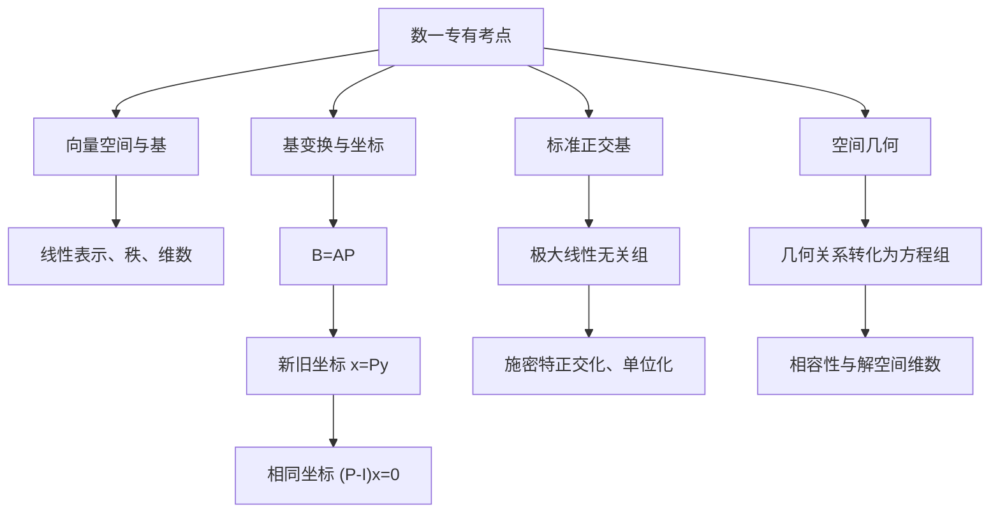
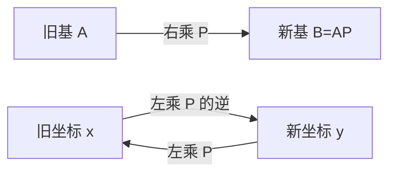

## 一、本节整体知识体系与考研定位

本节虽然被称为“数一专有考点”，但绝不是若干零散知识点的简单集合。它实际上是对本章前六节内容的进一步抽象、综合与应用，并且是后续特征值、相似矩阵、实对称矩阵和二次型的重要基础。

**1. 本节知识框架**

| 知识模块   | 核心内容           | 复习优先级 |
| ------ | -------------- | ----- |
| 向量空间   | 子空间、生成空间、基、维数  | 高     |
| 基与坐标   | 坐标的唯一性、坐标计算    | 极高    |
| 基变换    | 过渡矩阵、新旧坐标变换    | 极高    |
| 相同坐标向量 | 齐次方程组、特征值1     | 极高    |
| 向量的内积  | 长度、夹角、正交、投影    | 高     |
| 标准正交基  | 施密特正交化、单位化     | 极高    |
| 正交补空间  | 约束方程、解空间、维数    | 高     |
| 空间几何   | 平面交线、直线相交、矩阵的秩 | 极高    |

**2. 本节最重要的四条解题主线**

贯穿本节的四组核心公式是：

$$
\boxed{\dim\operatorname{span}\{\alpha_1,\ldots,\alpha_m\}
=r(\alpha_1,\ldots,\alpha_m)}
$$

$$
\boxed{B=AP,\qquad x=Py}
$$

$$
\boxed{(P-I)x=0}
$$

$$
\boxed{\dim\ker A=n-r(A)}
$$

真正理解这四组公式以后，大部分新题都可以转化为已经学过的线性表示、矩阵运算、秩与线性方程组问题。

## 二、向量空间、子空间、基与维数

**2.1 向量空间的直观理解**

在考研数学一中，我们主要研究实数域上的有限维向量空间。

例如，三维向量空间为

$$
\mathbb R^3=
\left\{
\begin{pmatrix}x\\y\\z\end{pmatrix}
:x,y,z\in\mathbb R
\right\}.
$$

如果从中选取一些向量组成集合 $V$，并且这个非空集合对向量的加法和数乘均封闭，那么 $V$ 就是 $\mathbb R^3$ 的一个子空间。

所谓封闭，就是对任意 $\alpha,\beta\in V$ 和任意实数 $k,l$，都有

$$
k\alpha+l\beta\in V.
$$

可以把子空间理解为：**选定若干独立方向后，沿这些方向进行任意线性组合所能到达的全部位置。**

例如：

$$
V_1={(x,y,z)^T:x+y+z=0}
$$

是一个经过原点的平面，因此是二维子空间。

而

$$
V_2={(x,y,z)^T:x+y+z=1}
$$

虽然也是平面，但不经过原点，不是向量子空间。

**2.2 判断子空间的标准方法**

要证明非空集合 $V$ 是向量子空间，只需验证：

$$
\forall\alpha,\beta\in V,\quad
\forall k,l\in\mathbb R,\quad
k\alpha+l\beta\in V.
$$

对于选择题，可以优先使用必要条件快速排除。

| 集合                   | 是否为子空间 | 原因       |
| -------------------- | ------ | -------- |
| $Ax=0$ 的解集           | 是      | 对线性组合封闭  |
| $Ax=b,\ b\ne0$ 的非空解集 | 否      | 不含零向量    |
| 过原点的直线               | 是      | 一维子空间    |
| 过原点的平面               | 是      | 二维子空间    |
| 单位球面                 | 否      | 不含零向量    |
| 所有分量非负的向量            | 否      | 对负数数乘不封闭 |
| 零向量组成的集合             | 是      | 零维子空间    |

注意：含有零向量只是必要条件，不是充分条件。

例如

$$
V=\{(x,y)^T:xy=0\}
$$

包含两条坐标轴上的全部向量，也包含零向量，但

$$
(1,0)^T+(0,1)^T=(1,1)^T\notin V,
$$

因此不是子空间。

**2.3 生成空间（张成空间）**

设有向量组

$$
\alpha_1,\alpha_2,\ldots,\alpha_m.
$$

由它们的所有线性组合构成的集合称为生成空间：

$$
V=\operatorname{span}\{\alpha_1,\ldots,\alpha_m\}.
$$

即

$$
V=\left\{
\sum_{i=1}^{m}k_i\alpha_i:
k_i\in\mathbb R
\right\}.
$$

令

$$
A=(\alpha_1,\ldots,\alpha_m),
$$

则

$$
V=\{Ax:x\in\mathbb R^m\}.
$$

这就是矩阵 $A$ 的列空间。

因此以下三个问题本质相同：

- 向量组的秩是多少？
- 向量组的极大线性无关组包含几个向量？
- 该向量组生成的空间维数是多少？

统一答案是

$$
\boxed{\dim V=r(A)}.
$$

**2.4 基与维数**

如果向量组

$$
\alpha_1,\ldots,\alpha_r
$$

满足以下两个条件：

1. 向量组线性无关；
2. 空间 $V$ 中的任意向量均可由它们线性表示；

那么称它们为 $V$ 的一组基，称 $r$ 为 $V$ 的维数。

**基就是能够生成整个空间的、没有任何冗余的一组向量。**

同一个空间可以有无穷多组不同的基，但任何一组基包含的向量个数都相同。

若已知 $\dim V=r$，则要证明某 $r$ 个向量是 $V$ 的一组基，只需证明它们都属于 $V$，并且线性无关。

特别地，在 $\mathbb R^n$ 中，$n$ 个 $n$ 维向量构成一组基的充要条件是

$$
\boxed{
\begin{aligned}
&\alpha_1,\ldots,\alpha_n\text{ 线性无关}\\
\Longleftrightarrow;&r(\alpha_1,\ldots,\alpha_n)=n\\
\Longleftrightarrow;&|\alpha_1,\ldots,\alpha_n|\ne0.
\end{aligned}
}
$$

如果研究的是 $\mathbb R^n$ 的某个低维子空间，基矩阵可能不是方阵，这时应使用秩与线性无关性，而不是行列式。

**2.5 两种最重要的空间给法**

| 空间给法                              | 维数公式                          | 求基方法     |
| --------------------------------- | ----------------------------- | -------- |
| $V=\operatorname{span}\{\alpha_i\}$ | $r(\alpha_1,\ldots,\alpha_m)$ | 求极大线性无关组 |
| $V=\{x:Ax=0\}$                      | $n-r(A)$                      | 求基础解系    |

前者是给出生成空间的方向，后者是给出空间必须满足的约束。

例如一个三维空间中的平面，可以写成

$$
V=\operatorname{span}
{(1,-1,0)^T,(1,0,-1)^T},
$$

也可以写成

$$
V=\{(x,y,z)^T:x+y+z=0\}.
$$

它们是同一个二维向量空间的两种不同表达方式。

## 三、题型一：向量空间的维数与基

### 母题1：2010年数学一真题

设

$$
\begin{aligned}
\alpha_1&=(1,2,-1,0)^T,\\
\alpha_2&=(1,1,0,2)^T,\\
\alpha_3&=(2,1,1,a)^T.
\end{aligned}
$$

若这三个向量生成的向量空间维数为2，求 $a$。

<Steps>

<Step>

### 第一步：翻译题目条件 [!toc]

“生成空间维数为2”等价于

$$
r(\alpha_1,\alpha_2,\alpha_3)=2.
$$

题目已经转化为熟悉的含参矩阵秩问题。

</Step>

<Step>

### 第二步：找出两个确定的独立方向 [!toc]

因为

$$
\begin{vmatrix}
1&1\\
2&1
\end{vmatrix}=-1\ne0,
$$

所以 $\alpha_1,\alpha_2$ 线性无关。

这保证了原向量组的秩至少为2。

</Step>

<Step>

### 第三步：让剩余向量可以线性表出 [!toc]

设

$$
\alpha_3=s\alpha_1+t\alpha_2.
$$

比较分量得到

$$
\begin{cases}
s+t=2,\\
2s+t=1,\\
-s=1,\\
2t=a.
\end{cases}
$$

由前两式得到

$$
s=-1,\qquad t=3.
$$

第三式成立，第四式给出

$$
\boxed{a=6}.
$$

当 $a=6$ 时，确实有

$$
\alpha_3=-\alpha_1+3\alpha_2,
$$

因此向量组的秩恰好为2。

</Step>

</Steps>

**母题提炼**

当题目要求生成空间的维数恰好为 $r$ 时，需要同时保证

$$
\boxed{
\begin{cases}
\text{至少有 }r\text{ 个线性无关向量},\\
\text{其余向量均可由这 }r\text{ 个向量表出}.
\end{cases}
}
$$

如果已经找到 $r$ 个确定线性无关的向量，通常不需要计算所有高阶子式，直接采用线性表示法即可。

### 母题2：张宇1000题——由约束方程求空间的基

设

$$
V={(x_1,x_2,x_3)^T:
x_1+x_2+x_3=0}.
$$

求 $V$ 的一组基及维数。

由约束方程可令

$$
x_2=s,\qquad x_3=t,
$$

得到

$$
x_1=-s-t.
$$

所以

$$
\begin{pmatrix}
x_1\\x_2\\x_3
\end{pmatrix}
=s
\begin{pmatrix}-1\\1\\0\end{pmatrix}
+t
\begin{pmatrix}-1\\0\\1\end{pmatrix}.
$$

这两个向量显然线性无关，因此

$$
\boxed{
\mathcal B=
\left\{
\begin{pmatrix}-1\\1\\0\end{pmatrix},
\begin{pmatrix}-1\\0\\1\end{pmatrix}
\right\}
}
$$

且

$$
\boxed{\dim V=2}.
$$

**推广：任意齐次约束构成的空间**

若

$$
V=\{x\in\mathbb R^n:Ax=0\},
$$

那么 $V$ 的任何一组基都是齐次方程组 $Ax=0$ 的一个基础解系。

$$
\boxed{\dim V=n-r(A)}.
$$

这也解释了为什么第三章第四节的基础解系实际上就是向量空间中的基。

<Callout type="warn" title="本题型的常见陷阱">

- 向量的分量个数不等于生成空间的维数。
- 向量组的向量个数不一定等于生成空间的维数。
- 求生成空间的基时，应选择原矩阵的主元列对应的原始向量，而不是行变换后矩阵的列向量。
- 证明低维子空间的基时，不能只证明线性无关，还必须保证向量属于该空间且数量足够。

</Callout>

## 四、基与坐标：本节最核心的基础概念

**4.1 什么是向量在某组基下的坐标？**

设

$$
\alpha_1,\alpha_2,\ldots,\alpha_n
$$

是向量空间 $V$ 的一组基。

那么对任意向量 $\gamma\in V$，都存在唯一一组实数

$$
x_1,x_2,\ldots,x_n
$$

使得

$$
\gamma=x_1\alpha_1+x_2\alpha_2+\cdots+x_n\alpha_n.
$$

称

$$
[\gamma]_\alpha=
\begin{pmatrix}
x_1\\x_2\\\vdots\\x_n
\end{pmatrix}
$$

为向量 $\gamma$ 在基 $\alpha$ 下的坐标。

**坐标就是一个向量用指定基进行线性表示时的系数。**

**4.2 坐标的直观理解**

例如在二维空间中，取一组非标准基

$$
\alpha_1=(1,1)^T,\qquad
\alpha_2=(1,-1)^T.
$$

向量

$$
\gamma=(3,1)^T
$$

满足

$$
\gamma=2\alpha_1+\alpha_2.
$$

因此

$$
[\gamma]_\alpha=(2,1)^T.
$$

从原点沿 $\alpha_1$ 方向走两倍长度，再沿 $\alpha_2$ 方向走一倍长度，就到达向量 $\gamma$ 的终点。

同一个向量，在不同的基下，可以具有不同的坐标：

$$
[\gamma]_{\text{标准基}}=(3,1)^T,
$$

$$
[\gamma]_\alpha=(2,1)^T.
$$

向量本身没有发生任何改变，改变的是描述该向量的方式。

**4.3 为什么基下的坐标一定唯一？**

假设存在两组坐标 $x_i,y_i$，满足

$$
\gamma=\sum_{i=1}^n x_i\alpha_i
=\sum_{i=1}^n y_i\alpha_i.
$$

两式相减得到

$$
\sum_{i=1}^n(x_i-y_i)\alpha_i=0.
$$

由于基向量线性无关，因此

$$
x_i-y_i=0,\qquad i=1,\ldots,n.
$$

即两组坐标完全相同。

所以坐标的存在性来自基能够生成整个空间，坐标的唯一性来自基的线性无关性。

**4.4 基矩阵公式**

将各基向量按列排列：

$$
A=(\alpha_1,\ldots,\alpha_n).
$$

记坐标列向量为 $x$，则

$$
\boxed{\gamma=Ax}.
$$

当 $A$ 是 $\mathbb R^n$ 的一组基构成的方阵时，它一定可逆，因此

$$
\boxed{x=A^{-1}\gamma}.
$$

考试时一般不需要专门求出 $A^{-1}$，直接解方程组

$$
Ax=\gamma
$$

更快。

若是低维子空间的基，$A$ 可能为长方形矩阵，此时仍可通过 $Ax=\gamma$ 求唯一坐标，但不能直接写 $A^{-1}\gamma$。

## 五、题型二：求指定基下的坐标

### 母题3：1987年数学一真题

已知 $\mathbb R^3$ 的一组基为

$$
\begin{aligned}
\alpha_1&=(1,1,0)^T,\\
\alpha_2&=(1,0,1)^T,\\
\alpha_3&=(0,1,1)^T.
\end{aligned}
$$

求向量

$$
\beta=(2,0,0)^T
$$

在这组基下的坐标。

设

$$
\beta=x_1\alpha_1+x_2\alpha_2+x_3\alpha_3.
$$

比较分量：

$$
\begin{cases}
x_1+x_2=2,\\
x_1+x_3=0,\\
x_2+x_3=0.
\end{cases}
$$

由后两式可得

$$
x_1=x_2=-x_3.
$$

代入第一式得到

$$
x_1=x_2=1,\qquad x_3=-1.
$$

因此

$$
\boxed{[\beta]_\alpha=(1,1,-1)^T}.
$$

检验：

$$
\alpha_1+\alpha_2-\alpha_3
=(2,0,0)^T.
$$

### 补充题：李正元练习题

已知

$$
\begin{aligned}
\alpha_1&=(1,0,1)^T,\\
\alpha_2&=(1,-1,0)^T,\\
\alpha_3&=(2,1,1)^T.
\end{aligned}
$$

求 $\beta=(3,2,1)^T$ 在该基下的坐标。

由

$$
\beta=x_1\alpha_1+x_2\alpha_2+x_3\alpha_3
$$

得到

$$
\begin{cases}
x_1+x_2+2x_3=3,\\
-x_2+x_3=2,\\
x_1+x_3=1.
\end{cases}
$$

解得

$$
x_1=-1,\quad x_2=0,\quad x_3=2.
$$

因此

$$
\boxed{[\beta]_\alpha=(-1,0,2)^T}.
$$

本题和1987年真题属于完全相同的母题模型，区别仅在于基向量和具体数字。

## 六、基变换与过渡矩阵

这是本节最重要、也最容易因方向错误而丢分的考点。

**6.1 过渡矩阵的定义**

设

$$
\alpha_1,\ldots,\alpha_n
$$

和

$$
\beta_1,\ldots,\beta_n
$$

是同一个 $n$ 维向量空间的两组基。

记

$$
A=(\alpha_1,\ldots,\alpha_n),
$$

$$
B=(\beta_1,\ldots,\beta_n).
$$

按照考研教材中常用的约定，由基 $\alpha$ 到基 $\beta$ 的过渡矩阵 $P$ 定义为

$$
\boxed{B=AP}.
$$

如果基向量属于 $\mathbb R^n$，基矩阵均为可逆方阵，那么

$$
\boxed{P=A^{-1}B}.
$$

**6.2 过渡矩阵中每一个元素的含义**

如果

$$
P=
\begin{pmatrix}
p_{11}&p_{12}&\cdots&p_{1n}\\
p_{21}&p_{22}&\cdots&p_{2n}\\
\vdots&\vdots&&\vdots\\
p_{n1}&p_{n2}&\cdots&p_{nn}
\end{pmatrix},
$$

那么

$$
\begin{aligned}
\beta_1&=p_{11}\alpha_1+\cdots+p_{n1}\alpha_n,\\
\beta_2&=p_{12}\alpha_1+\cdots+p_{n2}\alpha_n,\\
&\ \vdots\\
\beta_n&=p_{1n}\alpha_1+\cdots+p_{nn}\alpha_n.
\end{aligned}
$$

所以：

**过渡矩阵的第** $j$ **列，是第** $j$ **个新基向量在旧基下的坐标。**

$$
\boxed{
P=([\beta_1]*\alpha,\ldots,[\beta_n]*\alpha)
}
$$

这句话比单独记忆 $P=A^{-1}B$ 更重要。

**6.3 新旧基下坐标的变换公式**

设同一个向量 $\gamma$ 在旧基和新基下的坐标分别是

$$
x=[\gamma]*\alpha,\qquad*
*y=[\gamma]*\beta.
$$

那么

$$
\gamma=Ax=By.
$$

由于

$$
B=AP,
$$

所以

$$
Ax=APy.
$$

利用旧基的线性无关性得到

$$
\boxed{x=Py}.
$$

等价地，

$$
\boxed{y=P^{-1}x}.
$$

即使基矩阵不是方阵，只要其列向量构成一组基，仍可利用列向量线性无关推出这两个公式。

**6.4 基变换与坐标变换的方向**

| 要求          | 对应公式             |
| ----------- | ---------------- |
| 旧基变成新基      | $B=AP$           |
| 新基变成旧基      | $A=BP^{-1}$      |
| 已知新坐标求旧坐标   | $x=Py$           |
| 已知旧坐标求新坐标   | $y=P^{-1}x$      |
| 求旧基到新基的过渡矩阵 | $P=A^{-1}B$      |
| 求反方向的过渡矩阵   | $P^{-1}=B^{-1}A$ |

记忆方法：

> 基向一个方向变化，描述同一个向量的坐标就向相反的方向变化。

考试中最好不要只靠记忆方向，而是先写

$$
\boxed{\gamma=Ax=By=APy}.
$$

所有方向关系都会自然推导出来。

**6.5 过渡矩阵的重要性质**

两组基之间的过渡矩阵必可逆：

$$
\boxed{|P|\ne0}.
$$

反过来，若 $A$ 是一组基，且

$$
B=AP,
$$

那么

$$
\boxed{B\text{ 是一组基}\iff P\text{ 可逆}}.
$$

若三组基满足

$$
B=AP,\qquad C=BQ,
$$

则

$$
C=APQ.
$$

因此从 $A$ 到 $C$ 的过渡矩阵为

$$
\boxed{PQ}.
$$

注意乘法顺序不能随意交换。

另外，任意可逆的 $n$ 阶矩阵都可以作为某个 $n$ 维向量空间中两组基之间的过渡矩阵。

## 七、题型三：求两组基之间的过渡矩阵

### 母题4：2003年数学一真题

已知旧基为

$$
\alpha_1=(1,0)^T,\qquad
\alpha_2=(1,-1)^T,
$$

新基为

$$
\beta_1=(1,1)^T,\qquad
\beta_2=(1,2)^T.
$$

求由基 $\alpha$ 到基 $\beta$ 的过渡矩阵。

<Tabs items={["方法一：逐列线性表示法", "方法二：矩阵公式法", "方法三：增广矩阵法"]} defaultIndex={0}>

<Tab value="方法一：逐列线性表示法">

分别将新基向量用旧基表示：

$$
\beta_1=2\alpha_1-\alpha_2,
$$

$$
\beta_2=3\alpha_1-2\alpha_2.
$$

把系数按列排列，得到

$$
\boxed{
P=
\begin{pmatrix}
2&3\\
-1&-2
\end{pmatrix}
}.
$$

</Tab>

<Tab value="方法二：矩阵公式法">

$$
A=
\begin{pmatrix}
1&1\\
0&-1
\end{pmatrix},
\qquad
B=
\begin{pmatrix}
1&1\\
1&2
\end{pmatrix}.
$$

于是

$$
P=A^{-1}B=\begin{pmatrix}1&1\\0&-1\end{pmatrix}\begin{pmatrix}1&1\\1&2\end{pmatrix}=\begin{pmatrix}2&3\\-1&-2\end{pmatrix}.
$$

</Tab>

<Tab value="方法三：增广矩阵法">

对于数字比较复杂的题目，可以利用初等行变换：

$$
(A\mid B)
\xrightarrow{\text{初等行变换}}
(I\mid A^{-1}B).
$$

右侧矩阵就是 $P$。

这种方法相当于同时求解

$$
Ap_j=\beta_j,\qquad j=1,\ldots,n,
$$

通常比单独求逆再乘法更方便。

</Tab>

</Tabs>

### 母题5：2009年数学一真题——抽象基与比例缩放

设 $\alpha_1,\alpha_2,\alpha_3$ 是 $\mathbb R^3$ 的一组基，求由基

$$
\alpha_1,\quad
\frac12\alpha_2,\quad
\frac13\alpha_3
$$

到基

$$
\alpha_1+\alpha_2,\quad
\alpha_2+\alpha_3,\quad
\alpha_3+\alpha_1
$$

的过渡矩阵。

<Steps>

<Step>

### 第一步：重新命名旧基 [!toc]

令

$$
e_1=\alpha_1,\qquad
e_2=\frac12\alpha_2,\qquad
e_3=\frac13\alpha_3.
$$

因此

$$
\alpha_1=e_1,\qquad
\alpha_2=2e_2,\qquad
\alpha_3=3e_3.
$$

</Step>

<Step>

### 第二步：用真正的旧基表示新基 [!toc]

$$
\begin{aligned}
f_1&=e_1+2e_2,\\
f_2&=2e_2+3e_3,\\
f_3&=e_1+3e_3.
\end{aligned}
$$

</Step>

<Step>

### 第三步：按列排列系数 [!toc]

$$
\boxed{
P=
\begin{pmatrix}
1&0&1\\
2&2&0\\
0&3&3
\end{pmatrix}
}.
$$

这道题的主要陷阱是旧基中的比例系数：

$$
e_2=\frac12\alpha_2
$$

意味着

$$
\alpha_2=2e_2,
$$

因此新基中出现 $\alpha_2$ 时，应该填写系数2，而不是 $\frac12$。

</Step>

</Steps>

### 补充题：张宇1000题——反向缩放变式

已知旧基为

$$
\beta_1,\quad2\beta_2,\quad3\beta_3,
$$

新基为

$$
\beta_1-\beta_2,\quad
\beta_2+\beta_3,\quad
\beta_3-\beta_1.
$$

令旧基为 $e_1,e_2,e_3$，则

$$
\begin{aligned}
f_1&=e_1-\frac12e_2,\\
f_2&=\frac12e_2+\frac13e_3,\\
f_3&=-e_1+\frac13e_3.
\end{aligned}
$$

于是

$$
\boxed{
P=
\begin{pmatrix}
1&0&-1\\
-\frac12&\frac12&0\\
0&\frac13&\frac13
\end{pmatrix}
}.
$$

两道题共同说明：不能机械地记住应该乘还是除，必须先建立新旧基向量之间的关系。

**7.1 更一般的母题：两组基都是由第三组基生成的**

设有一组参考基

$$
G=(\gamma_1,\ldots,\gamma_n),
$$

并且

$$
A=GM,\qquad B=GN,
$$

其中 $M,N$ 可逆。

要求由 $A$ 到 $B$ 的过渡矩阵，设

$$
B=AP.
$$

则

$$
GN=GMP.
$$

利用 $G$ 的列向量线性无关性，有

$$
N=MP.
$$

因此

$$
\boxed{P=M^{-1}N}.
$$

这就是2009年真题和张宇1000题背后的统一模型。

即使不知道参考基的具体分量，也不影响计算过渡矩阵，只需要知道线性组合的系数矩阵。

## 八、题型四：已知坐标关系，反求基、参数和过渡矩阵

### 母题6：2019年数学一真题——本节重点综合大题

设

$$
\begin{aligned}
\alpha_1&=(1,2,1)^T,\\
\alpha_2&=(1,3,2)^T,\\
\alpha_3&=(1,a,3)^T
\end{aligned}
$$

是 $\mathbb R^3$ 的一组基。

向量

$$
\beta=(1,1,1)^T
$$

在该基下的坐标为

$$
(b,c,1)^T.
$$

求：

（1）参数 $a,b,c$；

（2）证明 $\alpha_2,\alpha_3,\beta$ 为一组基，并求由这组基到原基 $\alpha_1,\alpha_2,\alpha_3$ 的过渡矩阵。

**第一问：利用坐标的定义求参数**

根据坐标含义，

$$
\beta=b\alpha_1+c\alpha_2+\alpha_3.
$$

代入分量：

$$
\begin{cases}
b+c+1=1,\\
2b+3c+a=1,\\
b+2c+3=1.
\end{cases}
$$

即

$$
\begin{cases}
b+c=0,\\
2b+3c+a=1,\\
b+2c=-2.
\end{cases}
$$

由第一式和第三式得到

$$
b=2,\qquad c=-2.
$$

代入第二式：

$$
4-6+a=1.
$$

所以

$$
\boxed{a=3,\quad b=2,\quad c=-2}.
$$

此时得到最关键的向量关系：

$$
\boxed{\beta=2\alpha_1-2\alpha_2+\alpha_3}.
$$

<Tabs items={["方法一：过渡矩阵判定法", "方法二：利用替换原理"]} defaultIndex={0}>

<Tab value="方法一：过渡矩阵判定法">

令

$$
A=(\alpha_1,\alpha_2,\alpha_3),
$$

$$
U=(\alpha_2,\alpha_3,\beta).
$$

由上面的向量关系，

$$
U=A
\begin{pmatrix}
0&0&2\\
1&0&-2\\
0&1&1
\end{pmatrix}.
$$

记右侧矩阵为 $M$，则

$$
|M|=2\ne0.
$$

由于 $A$ 可逆，$M$ 可逆，所以 $U=AM$ 可逆。

因此 $\alpha_2,\alpha_3,\beta$ 构成一组基。

</Tab>

<Tab value="方法二：利用替换原理">

由于

$$
\beta=2\alpha_1-2\alpha_2+\alpha_3,
$$

其中 $\alpha_1$ 的系数不为零，故可以反解出

$$
\alpha_1=\alpha_2-\frac12\alpha_3+\frac12\beta.
$$

所以新向量组能够表示原来的一组基。

新向量组有三个向量，因此它也是 $\mathbb R^3$ 的一组基。

</Tab>

</Tabs>

**第三步：求指定方向的过渡矩阵**

题目要求从

$$
(\alpha_2,\alpha_3,\beta)
$$

到

$$
(\alpha_1,\alpha_2,\alpha_3).
$$

因此要写出

$$
(\alpha_1,\alpha_2,\alpha_3)
=(\alpha_2,\alpha_3,\beta)P.
$$

根据

$$
\begin{aligned}
\alpha_1&=\alpha_2-\frac12\alpha_3+\frac12\beta,\\
\alpha_2&=1\alpha_2,\\
\alpha_3&=1\alpha_3,
\end{aligned}
$$

得到

$$
\boxed{
P=
\begin{pmatrix}
1&1&0\\
-\frac12&0&1\\
\frac12&0&0
\end{pmatrix}
}.
$$

**8.1 这道真题应掌握的通用定理：基向量替换**

设

$$
\alpha_1,\ldots,\alpha_n
$$

是一组基，并且

$$
\beta=c_1\alpha_1+\cdots+c_n\alpha_n.
$$

用 $\beta$ 替换第 $j$ 个基向量 $\alpha_j$，则替换后的向量组仍是一组基的充要条件为

$$
\boxed{c_j\ne0}.
$$

原因是对应的过渡矩阵为单位矩阵 $I$ 的第 $j$ 列替换为 $c$，其行列式恰好为 $c_j$。

这是2019年真题最值得记住的推广结论。

例如

$$
\beta=2\alpha_1-\alpha_2,
$$

那么它可以替换 $\alpha_1$，也可以替换 $\alpha_2$，但是不能替换 $\alpha_3$。

因为它不包含第三个独立方向。

**8.2 多个基向量同时替换**

进一步地，设

$$
\beta_1=\sum_{i=1}^na_i\alpha_i,\qquad
\beta_2=\sum_{i=1}^nb_i\alpha_i.
$$

若分别用 $\beta_1,\beta_2$ 替换 $\alpha_1,\alpha_2$，其他基向量不变，那么新向量组构成一组基的充要条件为

$$
\boxed{
\begin{vmatrix}
a_1&b_1\\
a_2&b_2
\end{vmatrix}\ne0
}.
$$

这种推广很适合用来处理未来可能出现的基替换综合题。

### 母题7：李林880题——由坐标之间的关系求过渡矩阵

已知同一个向量 $\gamma$ 在两组基 $\alpha,\beta$ 下的坐标分别为 $x,y$，并且

$$
\begin{cases}
x_1=y_1,\\
x_2=-y_1+y_2,\\
x_3=-y_2+y_3.
\end{cases}
$$

求从基 $\alpha$ 到基 $\beta$ 的过渡矩阵。

直接将坐标关系写成矩阵形式：

$$
x=
\begin{pmatrix}
1&0&0\\
-1&1&0\\
0&-1&1
\end{pmatrix}y.
$$

根据

$$
x=Py,
$$

立刻得到

$$
\boxed{
P=
\begin{pmatrix}
1&0&0\\
-1&1&0\\
0&-1&1
\end{pmatrix}
}.
$$

若进一步给出

$$
\begin{aligned}
\alpha_1&=(1,2,3)^T,\\
\alpha_2&=(2,3,1)^T,\\
\alpha_3&=(3,1,2)^T,
\end{aligned}
$$

则由 $B=AP$ 得到

$$
\begin{aligned}
\beta_1&=\alpha_1-\alpha_2=(-1,-1,2)^T,\\
\beta_2&=\alpha_2-\alpha_3=(-1,2,-1)^T,\\
\beta_3&=\alpha_3=(3,1,2)^T.
\end{aligned}
$$

这里必须注意，题给的坐标关系应当理解为对任意向量均成立的统一坐标变换关系。若只知道某一个固定向量的一对坐标，通常不能唯一确定整个过渡矩阵。

### 母题8：李永乐六套卷·第4套第5题

这道分类模拟题综合了2019年真题的含参坐标模型与基下坐标计算模型。

已知基（I）为

$$
\begin{aligned}
\beta_1&=(1,0,0)^T,\\
\beta_2&=(1,1,0)^T,\\
\beta_3&=(1,1,1)^T,
\end{aligned}
$$

基（II）为

$$
\begin{aligned}
\alpha_1&=(1,a,0)^T,\\
\alpha_2&=(0,1,b)^T,\\
\alpha_3&=(1,0,1)^T.
\end{aligned}
$$

已知 $\alpha_1+\alpha_2$ 在基（I）下的坐标为

$$
(-1,0,2)^T.
$$

求 $a,b$，并求

$$
\xi=\beta_1-\beta_2+2\beta_3
$$

在基（II）下的坐标。

<Steps>

<Step>

### 第一步：把已知坐标还原成向量关系 [!toc]

$$
\alpha_1+\alpha_2=-\beta_1+2\beta_3.
$$

因此

$$
(1,a+1,b)^T=(1,2,2)^T.
$$

所以

$$
\boxed{a=1,\quad b=2}.
$$

</Step>

<Step>

### 第二步：求向量本身 [!toc]

$$
\xi=\beta_1-\beta_2+2\beta_3
=(2,1,2)^T.
$$

</Step>

<Step>

### 第三步：解新基下的坐标 [!toc]

设

$$
\xi=x_1\alpha_1+x_2\alpha_2+x_3\alpha_3.
$$

得到

$$
\begin{cases}
x_1+x_3=2,\\
x_1+x_2=1,\\
2x_2+x_3=2.
\end{cases}
$$

解得

$$
\boxed{
[\xi]_\alpha=
\begin{pmatrix}
\frac23\\
\frac13\\
\frac43
\end{pmatrix}
}.
$$

**技巧：** 题目只要求一个向量的新坐标时，直接还原向量，再解方程组即可，通常没有必要先求整个过渡矩阵。

</Step>

</Steps>

## 九、题型五：通过多个向量的坐标矩阵求过渡矩阵

### 母题9：李永乐六套卷·第5套第15题

已知三个向量 $\gamma_1,\gamma_2,\gamma_3$ 在基 $\alpha$ 和基 $\beta$ 下的坐标按列排列分别为

$$
C_\alpha=
\begin{pmatrix}
1&0&1\\
0&1&0\\
0&0&1
\end{pmatrix},
$$

$$
C_\beta=
\begin{pmatrix}
1&1&1\\
0&1&1\\
1&0&2
\end{pmatrix}.
$$

求由基 $\beta$ 到基 $\alpha$ 的过渡矩阵。

**核心思路：实际向量相同，坐标矩阵不同**

记

$$
\Gamma=(\gamma_1,\gamma_2,\gamma_3),
$$

则

$$
\Gamma=AC_\alpha=BC_\beta.
$$

因为题目要求由 $\beta$ 到 $\alpha$，所以设

$$
A=BP.
$$

代入得

$$
BPC_\alpha=BC_\beta.
$$

消去 $B$，得到

$$
PC_\alpha=C_\beta.
$$

于是

$$
\boxed{P=C_\beta C_\alpha^{-1}}.
$$

计算

$$
C_\alpha^{-1}=
\begin{pmatrix}
1&0&-1\\
0&1&0\\
0&0&1
\end{pmatrix}.
$$

最终得到

$$
\boxed{
P=
\begin{pmatrix}
1&1&0\\
0&1&1\\
1&0&1
\end{pmatrix}
}.
$$

**9.1 推广：中间向量组不一定是一组基**

如果题目提供 $m$ 个向量在两组基下的坐标，构成两个 $n\times m$ 矩阵 $X,Y$，那么由

$$
B=AP
$$

可以得到

$$
\boxed{X=PY}.
$$

若 $Y$ 的秩为 $n$，则这些坐标提供了足够的信息，过渡矩阵可以唯一确定。

若 $r(Y)$ 小于 $n$，在没有额外条件时，通常无法唯一确定整个过渡矩阵。

这种题目实际考查的是矩阵方程与线性表示，而不只是普通的基变换公式。

## 十、题型六：特殊结构的过渡矩阵

### 母题10：李林880拓展题——累加型基变换

设 $\alpha_1,\ldots,\alpha_n$ 是 $\mathbb R^n$ 的一组基，并且

$$
\begin{aligned}
\beta_1&=\alpha_1,\\
\beta_2&=\alpha_1+\alpha_2,\\
\beta_3&=\alpha_1+\alpha_2+\alpha_3,\\
&\ \vdots\\
\beta_n&=\alpha_1+\cdots+\alpha_n.
\end{aligned}
$$

证明新向量组是一组基，并求当

$$
[\gamma]_\alpha=(n,n-1,\ldots,1)^T
$$

时，$\gamma$ 在新基下的坐标。

**第一问：利用三角矩阵证明基**

由定义可以直接写出

$$
B=AP,
$$

其中

$$
P=
\begin{pmatrix}
1&1&1&\cdots&1\\
0&1&1&\cdots&1\\
0&0&1&\cdots&1\\
\vdots&\vdots&\vdots&\ddots&\vdots\\
0&0&0&\cdots&1
\end{pmatrix}.
$$

因为 $P$ 是上三角矩阵，且对角线元素均为1，所以

$$
|P|=1\ne0.
$$

因此 $B$ 是一组基。

**第二问：累加变换的逆是差分变换**

设新坐标为 $y$，旧坐标为 $x$，则

$$
x=Py.
$$

即

$$
\begin{cases}
x_1=y_1+y_2+\cdots+y_n,\\
x_2=y_2+\cdots+y_n,\\
\quad\vdots\\
x_n=y_n.
\end{cases}
$$

相邻两式相减，得到

$$
\boxed{
\begin{cases}
y_i=x_i-x_{i+1},&1\le i\le n-1,\\
y_n=x_n.
\end{cases}
}
$$

由题意，

$$
x_i=n-i+1.
$$

因此

$$
y_i=1,\qquad i=1,\ldots,n.
$$

最终

$$
\boxed{[\gamma]_\beta=(1,1,\ldots,1)^T}.
$$

**10.1 特殊矩阵结构的识别**

| 新基的构造方式       | 常见过渡矩阵结构 |
| ------------- | -------- |
| 对各基向量进行非零数乘   | 对角矩阵     |
| 调换基向量顺序       | 置换矩阵     |
| 前缀累加          | 上三角矩阵    |
| 后缀累加          | 下三角矩阵    |
| 相邻向量作差        | 双对角矩阵    |
| 用一个新向量替换某个基向量 | 单位矩阵替换一列 |

这一类题目的重点不是暴力求逆，而是利用矩阵结构减少运算。

## 十一、题型七：在两组基下具有相同坐标的向量

这是本节最值得深入理解的综合考点之一。

它把基与坐标、过渡矩阵、齐次线性方程组、秩以及特征值联系在了一起。

**11.1 相同坐标的本质**

设 $A,B$ 为两组基，满足

$$
B=AP.
$$

同一个向量 $\xi$ 在两组基下的坐标分别为 $x,y$，则

$$
Ax=By.
$$

现在题目要求两组坐标相同，即

$$
x=y.
$$

因此

$$
Ax=Bx,
$$

即

$$
\boxed{(A-B)x=0}.
$$

如果利用过渡矩阵，则

$$
Ax=APx,
$$

从而

$$
\boxed{(P-I)x=0}.
$$

这两个模型完全等价。

因为

$$
A-B=A(I-P),
$$

而 $A$ 的列向量线性无关，所以

$$
\ker(A-B)=\ker(P-I).
$$

**11.2 如何判断存在非零的相同坐标向量？**

由于两组基下的共同坐标 $x$ 满足

$$
(P-I)x=0,
$$

存在非零的相同坐标向量，等价于这个齐次方程组存在非零解。

因此

$$
\boxed{
\begin{aligned}
&\exists,\xi\ne0\text{ 在两组基下坐标相同}\\
\Longleftrightarrow;&(P-I)x=0\text{ 有非零解}\\
\Longleftrightarrow;&r(P-I)<n\\
\Longleftrightarrow;&|P-I|=0\\
\Longleftrightarrow;&1\text{ 是 }P\text{ 的特征值}.
\end{aligned}
}
$$

这里最后一个条件涉及下一章的特征值知识。如果你还没有学习特征值，完全可以使用齐次方程组的非零解判定方法解决。

**11.3 相同坐标向量空间的维数**

所有相同坐标的向量组成一个向量空间，记为 $W$。

由于

$$
W={Ax:(P-I)x=0},
$$

而 $x\mapsto Ax$ 是从坐标空间到实际向量空间的线性同构，所以

$$
\boxed{\dim W=n-r(P-I)}.
$$

也可以写成

$$
\boxed{\dim W=n-r(A-B)}.
$$

这意味着未来考试如果询问“在两组基下具有相同坐标的向量生成的空间维数”，依然使用秩—零度定理。

## 十二、2015年数学一真题：相同坐标向量的核心母题

### 母题11

设 $\alpha_1,\alpha_2,\alpha_3$ 是 $\mathbb R^3$ 的一组基，且

$$
\begin{aligned}
\beta_1&=2\alpha_1+2k\alpha_3,\\
\beta_2&=2\alpha_2,\\
\beta_3&=\alpha_1+(k+1)\alpha_3.
\end{aligned}
$$

求：

（1）证明 $\beta_1,\beta_2,\beta_3$ 是一组基；

（2）求使得存在非零向量在两组基下坐标相同的全部参数 $k$，以及所有满足条件的非零向量。

**第一问：证明新基成立**

设

$$
A=(\alpha_1,\alpha_2,\alpha_3),
$$

$$
B=(\beta_1,\beta_2,\beta_3).
$$

根据题意，

$$
B=AP,
$$

其中

$$
P=
\begin{pmatrix}
2&0&1\\
0&2&0\\
2k&0&k+1
\end{pmatrix}.
$$

计算行列式：

$$
\begin{aligned}
|P|
&=2
\begin{vmatrix}
2&1\\
2k&k+1
\end{vmatrix}\\
&=2[2(k+1)-2k]\\
&=4.
\end{aligned}
$$

对任意实数 $k$，都有

$$
|P|=4\ne0.
$$

因此新向量组始终构成一组基。

**第二问：建立相同坐标方程组**

设共同坐标为

$$
x=(x_1,x_2,x_3)^T.
$$

那么

$$
Ax=Bx=APx.
$$

故

$$
(P-I)x=0.
$$

其中

$$
P-I=
\begin{pmatrix}
1&0&1\\
0&1&0\\
2k&0&k
\end{pmatrix}.
$$

要存在非零解，必须有

$$
|P-I|=0.
$$

计算得

$$
|P-I|=\begin{vmatrix}1&1\\2k&k\end{vmatrix}=-k.
$$

所以

$$
\boxed{k=0}.
$$

<Steps>

<Step>

### 第三步：求共同坐标 [!toc]

当 $k=0$ 时，

$$
\begin{pmatrix}
1&0&1\\
0&1&0\\
0&0&0
\end{pmatrix}
\begin{pmatrix}
x_1\\x_2\\x_3
\end{pmatrix}=0.
$$

因此

$$
\begin{cases}
x_1+x_3=0,\\
x_2=0.
\end{cases}
$$

所以

$$
x=t(1,0,-1)^T.
$$

由于题目要求非零向量，故

$$
t\ne0.
$$

</Step>

<Step>

### 第四步：将坐标还原为实际向量 [!toc]

$$
\xi=Ax.
$$

因此

$$
\xi=t\alpha_1-t\alpha_3.
$$

最终答案是

$$
\boxed{
k=0,\qquad
\xi=t(\alpha_1-\alpha_3),\quad t\ne0
}.
$$

</Step>

</Steps>

**12.1 这道题最容易犯的三个错误**

**错误一：令** $|P|=0$**。**

实际上 $P$ 是过渡矩阵，必须可逆。

要存在非零相同坐标向量，应当令

$$
|P-I|=0,
$$

而不是令 $|P|=0$。

**错误二：把共同坐标当作所求实际向量。**

$$
t(1,0,-1)^T
$$

是共同坐标，而实际向量是

$$
t(\alpha_1-\alpha_3).
$$

除非旧基恰好是标准基，否则二者不能混淆。

**错误三：漏掉非零条件。**

如果题目问所有相同坐标的向量，必须包含零向量；如果题目明确问非零向量，则参数 $t$ 必须不为零。

**12.2 分类模拟题中的直接复现**

李林六套卷·第1套第15题，使用了与2015年真题相同的向量关系，只是将参数记为 $a$，并改为填空题。

因此，这道模拟题不是一个独立的新模型，而是对2015年真题母题的直接强化。

答案仍为

$$
a=0,\qquad
\gamma=t(\alpha_1-\alpha_3),\quad t\ne0.
$$

复习时，这类重复题目做熟一次即可，重点应转向维数、比例坐标及多个约束等变式。

## 十三、相同坐标问题的进阶变式

### 母题12：李林880题——直接使用基矩阵之差

已知两组基分别为

$$
\begin{aligned}
\alpha_1&=(1,1,1)^T,\\
\alpha_2&=(1,0,-1)^T,\\
\alpha_3&=(1,0,1)^T,
\end{aligned}
$$

以及

$$
\begin{aligned}
\beta_1&=(1,2,1)^T,\\
\beta_2&=(3,3,3)^T,\\
\beta_3&=(2,4,3)^T.
\end{aligned}
$$

求在两组基下具有相同坐标的全部向量。

**方法选择**

本题给出了基向量的具体分量，因此不必先求过渡矩阵 $P$。

直接建立

$$
(A-B)x=0.
$$

其中

$$
A-B=
\begin{pmatrix}
0&-2&-1\\
-1&-3&-4\\
0&-4&-2
\end{pmatrix}.
$$

方程组为

$$
\begin{cases}
-2x_2-x_3=0,\\
-x_1-3x_2-4x_3=0,\\
-4x_2-2x_3=0.
\end{cases}
$$

由第一式得到

$$
x_3=-2x_2.
$$

代入第二式：

$$
x_1=5x_2.
$$

令 $x_2=t$，则

$$
x=t(5,1,-2)^T.
$$

还原实际向量：

$$
\begin{aligned}
\gamma
&=t(5\alpha_1+\alpha_2-2\alpha_3)\\
&=t(4,5,2)^T.
\end{aligned}
$$

所以

$$
\boxed{\gamma=t(4,5,2)^T,\quad t\in\mathbb R}.
$$

注意这道题没有要求非零，因此 $t=0$ 是允许的。

**13.1 相同坐标问题的方法选择**

| 题目给法           | 最优先考虑的模型     |
| -------------- | ------------ |
| 给出两组基的具体分量     | $(A-B)x=0$   |
| 给出新基由旧基线性表示的关系 | $(P-I)x=0$   |
| 给出过渡矩阵         | $(P-I)x=0$   |
| 只问是否存在非零相同坐标向量 | 判断 $\|P-I\|$ |
| 问所有相同坐标向量的维数   | $n-r(P-I)$   |
| 问所有满足条件的实际向量   | 求共同坐标后乘基矩阵   |

**13.2 创新变式一：相同坐标向量有几个独立方向？**

以下为根据2015年真题设计的原创变式，并非原题库真题。

设从基 $\alpha$ 到基 $\beta$ 的过渡矩阵为

$$
P=
\begin{pmatrix}
1&a&0\\
0&1&b\\
0&0&1
\end{pmatrix}.
$$

若所有相同坐标向量构成的空间维数为2，求参数 $a,b$ 的条件。

由于

$$
\dim W=3-r(P-I),
$$

所以要求

$$
r(P-I)=1.
$$

而

$$
P-I=
\begin{pmatrix}
0&a&0\\
0&0&b\\
0&0&0
\end{pmatrix}.
$$

因此：

| 参数条件      | $r(P-I)$ | 相同坐标空间维数 |
| --------- | -------- | -------- |
| $a=b=0$   | 0        | 3        |
| 恰有一个参数非零  | 1        | 2        |
| $a,b$ 均非零 | 2        | 1        |

所以

$$
\boxed{ab=0,\qquad a^2+b^2\ne0}.
$$

本题的关键在于：题目不再问“是否存在非零向量”，而是精确要求解空间维数，因此不能只令行列式为零，还要精确控制秩。

**13.3 创新变式二：两组基下的坐标成比例**

设

$$
x=[\gamma]*\alpha,\qquad y=[\gamma]*\beta,
$$

且要求

$$
x=\lambda y.
$$

由坐标变换公式

$$
x=Py
$$

可得

$$
Py=\lambda y.
$$

因此

$$
\boxed{(P-\lambda I)y=0}.
$$

存在非零向量满足此条件的充要条件为

$$
\boxed{|P-\lambda I|=0}.
$$

这就是矩阵特征值问题。

相同坐标问题其实是比例系数取

$$
\lambda=1
$$

时的特殊情形。

如果题目写的是 $y=\lambda x$，则必须重新根据 $x=Py$ 推导，不能照搬上述公式，否则会出现 $\lambda$ 和 $\lambda^{-1}$ 的混淆。

**13.4 创新变式三：任意向量坐标都相同**

下列三个命题的强弱关系需要区分：

存在一个非零向量在两组基下坐标相同：

$$
|P-I|=0.
$$

存在 $r$ 个线性无关的向量在两组基下坐标相同：

$$
\dim\ker(P-I)\ge r.
$$

任意向量在两组基下坐标都相同：

$$
\boxed{P=I}.
$$

最后一个条件意味着两组有序基完全相同。

例如

$$
P=
\begin{pmatrix}
1&0\\
0&2
\end{pmatrix}
$$

虽然不等于单位矩阵，但仍然存在一维的相同坐标向量空间。

## 十四、向量内积、长度、夹角与正交

**14.1 内积**

设

$$
\alpha=(a_1,\ldots,a_n)^T,\qquad
\beta=(b_1,\ldots,b_n)^T.
$$

定义欧氏内积

$$
\boxed{
(\alpha,\beta)=\alpha^T\beta
=\sum_{i=1}^na_ib_i
}.
$$

重要性质包括

$$
(\alpha,\beta)=(\beta,\alpha),
$$

$$
(k\alpha,\beta)=k(\alpha,\beta),
$$

$$
(\alpha+\beta,\gamma)
=(\alpha,\gamma)+(\beta,\gamma),
$$

以及

$$
(\alpha,\alpha)\ge0.
$$

并且

$$
(\alpha,\alpha)=0
\iff \alpha=0.
$$

**14.2 向量长度**

$$
\boxed{
|\alpha|=\sqrt{\alpha^T\alpha}
=\sqrt{\sum_{i=1}^na_i^2}
}.
$$

将非零向量单位化：

$$
\boxed{e=\frac{\alpha}{|\alpha|}}.
$$

单位化不改变向量所张成的一维空间。

**14.3 向量夹角**

对两个非零向量，

$$
\boxed{
\cos\theta=
\frac{\alpha^T\beta}
{|\alpha||\beta|}
}.
$$

当

$$
\alpha^T\beta=0
$$

时，称它们正交。

零向量与任意向量的内积都是零，因此在代数意义上与任意向量正交，但零向量没有确定的几何夹角，也不能作为基向量。

**14.4 柯西—施瓦茨不等式**

$$
\boxed{
|\alpha^T\beta|
\le|\alpha||\beta|
}.
$$

等号成立的充要条件是两个向量线性相关。

它既是向量夹角公式成立的基础，也是向量长度、投影及最值问题的重要工具。

**14.5 正交向量组的关键性质**

若

$$
\alpha_1,\ldots,\alpha_r
$$

均非零且两两正交，那么它们一定线性无关。

证明如下。

设

$$
k_1\alpha_1+\cdots+k_r\alpha_r=0.
$$

等式两侧同时与 $\alpha_i$ 作内积，得到

$$
k_i|\alpha_i|^2=0.
$$

由于 $\alpha_i\ne0$，因此

$$
k_i=0.
$$

所以所有系数均为零，即向量组线性无关。

这是为什么构造标准正交基时，只要得到数量足够的非零正交向量，就已经保证了线性无关性。

## 十五、正交基与标准正交基

**15.1 两者的区别**

若一组基向量两两正交，则称其为正交基。

若进一步每个向量的长度均为1，则称其为标准正交基，也称规范正交基。

设标准正交基为

$$
e_1,\ldots,e_r,
$$

则

$$
\boxed{
e_i^Te_j=
\begin{cases}
1,&i=j,\\
0,&i\ne j.
\end{cases}
}
$$

记

$$
Q=(e_1,\ldots,e_r),
$$

则

$$
\boxed{Q^TQ=I_r}.
$$

当 $r=n$ 时，$Q$ 是方阵，因此

$$
\boxed{Q^{-1}=Q^T}.
$$

这就是正交矩阵。

但当 $r$ 小于 $n$ 时，$Q$ 不是方阵，虽然仍有

$$
Q^TQ=I_r,
$$

却一般没有

$$
QQ^T=I_n.
$$

**15.2 正交基下坐标的特殊求法**

若

$$
\gamma=x_1e_1+\cdots+x_re_r,
$$

其中 $e_1,\ldots,e_r$ 是标准正交基，那么两边与 $e_i$ 作内积：

$$
e_i^T\gamma=x_i.
$$

所以

$$
\boxed{x_i=e_i^T\gamma}.
$$

矩阵形式为

$$
\boxed{x=Q^T\gamma}.
$$

因此，标准正交基下的坐标不必通过解一般线性方程组获得，可以直接计算内积。

如果只有正交性而没有单位化，则

$$
\boxed{x_i=\frac{\alpha_i^T\gamma}{\alpha_i^T\alpha_i}}.
$$

注意这个公式要求 $\gamma$ 属于这些基向量张成的空间；若不属于，得到的是其正交投影的坐标。

**15.3 两组标准正交基之间的过渡矩阵**

若 $A,B$ 是同一个 $r$ 维子空间的两组标准正交基，则

$$
B=AP.
$$

由于

$$
A^TA=I_r,\qquad B^TB=I_r,
$$

所以

$$
B^TB=P^TA^TAP=P^TP=I_r.
$$

因此

$$
\boxed{P^TP=I_r}.
$$

也就是说，两组标准正交基之间的过渡矩阵一定是正交矩阵，并且

$$
\boxed{P=A^TB}.
$$

这是本节与后续实对称矩阵正交对角化之间的重要联系。

## 十六、施密特正交化：必须掌握的计算方法

**16.1 投影是正交化的核心**

设 $u\ne0$。

向量 $\alpha$ 在 $u$ 方向上的正交投影为

$$
\boxed{
\operatorname{proj}_u\alpha
=\frac{\alpha^Tu}{u^Tu}u
}.
$$

如果从 $\alpha$ 中减去这部分投影，就得到与 $u$ 正交的向量：

$$
v=\alpha-\frac{\alpha^Tu}{u^Tu}u.
$$

验证：

$$
u^Tv
=u^T\alpha-\frac{\alpha^Tu}{u^Tu}u^Tu=0.
$$

所以施密特正交化的本质就是：**逐个减去新向量在已有正交方向上的投影，只保留新增的独立方向。**

**16.2 两个向量的施密特公式**

设 $\alpha_1,\alpha_2$ 线性无关。

第一步，令

$$
u_1=\alpha_1.
$$

第二步，令

$$
\boxed{
u_2=\alpha_2-
\frac{\alpha_2^Tu_1}{u_1^Tu_1}u_1
}.
$$

第三步，单位化：

$$
e_1=\frac{u_1}{|u_1|},\qquad
e_2=\frac{u_2}{|u_2|}.
$$

这样就得到原空间的一组标准正交基。

**16.3 三个向量的施密特公式**

设 $\alpha_1,\alpha_2,\alpha_3$ 线性无关，则

$$
u_1=\alpha_1,
$$

$$
u_2=\alpha_2-
\frac{\alpha_2^Tu_1}{u_1^Tu_1}u_1,
$$

$$
\boxed{
u_3=\alpha_3-
\frac{\alpha_3^Tu_1}{u_1^Tu_1}u_1
-\frac{\alpha_3^Tu_2}{u_2^Tu_2}u_2
}.
$$

最后分别单位化：

$$
e_i=\frac{u_i}{|u_i|}.
$$

**16.4 一般公式**

$$
\boxed{
u_k=\alpha_k-
\sum_{j=1}^{k-1}
\frac{\alpha_k^Tu_j}{u_j^Tu_j}u_j
}.
$$

如果前面的向量已经单位化为 $e_j$，也可以写成

$$
u_k=\alpha_k-
\sum_{j=1}^{k-1}
(\alpha_k^Te_j)e_j.
$$

**16.5 施密特正交化为什么不改变生成空间？**

对于每一个 $k$，有

$$
\boxed{\operatorname{span}\{\alpha_1,\ldots,\alpha_k\}=\operatorname{span}\{u_1,\ldots,u_k\}}.
$$

因为每一个 $u_k$ 都是原向量的线性组合，同时原向量也能由正交化后的向量反向线性表示。

因此施密特正交化只是更换同一空间中的基，并没有改变空间本身。

**16.6 考试计算技巧**

实际计算时，不必每得到一个正交向量就立刻单位化。

推荐流程：

$$
\boxed{
\text{选取无关组}
\longrightarrow
\text{逐个正交化}
\longrightarrow
\text{消除分母}
\longrightarrow
\text{最后统一单位化}
}
$$

因为正交向量乘任意非零常数，仍然保持其方向与正交性，所以中途可以将分数向量整体倍乘化成整数向量，以减少运算量。

## 十七、题型八：求解空间的一组标准正交基

### 母题13：1997年数学一真题

已知 $B$ 是秩为2的 $5\times4$ 矩阵，且

$$
\begin{aligned}
\alpha_1&=(1,1,2,3)^T,\\
\alpha_2&=(-1,1,4,-1)^T,\\
\alpha_3&=(5,-1,-8,9)^T
\end{aligned}
$$

均为齐次线性方程组 $Bx=0$ 的解。

求该方程组解空间的一组标准正交基。

<Steps>

<Step>

### 第一步：确定解空间维数 [!toc]

因为未知数共有4个，

$$
r(B)=2,
$$

所以

$$
\dim\ker B=4-2=2.
$$

注意，是矩阵的列数4，而不是行数5。

因此我们只需要找出两个线性无关的解向量。

</Step>

<Step>

### 第二步：选择基础解系 [!toc]

$\alpha_1,\alpha_2$ 显然不成比例，因而线性无关。

它们都是 $Bx=0$ 的解，且数量等于解空间的维数，所以它们已经构成一组基础解系。

事实上，

$$
\alpha_3=2\alpha_1-3\alpha_2.
$$

第三个向量是冗余向量，不必参加后续正交化。

</Step>

<Step>

### 第三步：施密特正交化 [!toc]

令

$$
u_1=\alpha_1.
$$

计算：

$$
u_1^Tu_1=1+1+4+9=15,
$$

$$
\alpha_2^Tu_1=-1+1+8-3=5.
$$

因此

$$
\begin{aligned}
u_2
&=\alpha_2-\frac5{15}\alpha_1\\
&=\alpha_2-\frac13\alpha_1\\
&=\frac23(-2,1,5,-3)^T.
\end{aligned}
$$

为了方便计算，可以直接选取

$$
v_2=(-2,1,5,-3)^T.
$$

验证正交性：

$$
u_1^Tv_2=-2+1+10-9=0.
$$

</Step>

<Step>

### 第四步：单位化 [!toc]

$$
|u_1|=\sqrt{15},
$$

$$
|v_2|=\sqrt{4+1+25+9}=\sqrt{39}.
$$

所以所求的一组标准正交基为

$$
\boxed{
e_1=\frac1{\sqrt{15}}
\begin{pmatrix}
1\\1\\2\\3
\end{pmatrix}
}
$$

和

$$
\boxed{
e_2=\frac1{\sqrt{39}}
\begin{pmatrix}
-2\\1\\5\\-3
\end{pmatrix}
}.
$$

</Step>

</Steps>

**17.1 本题的真正难点**

这道真题最重要的不是施密特公式本身，而是知道何时开始正交化，以及应该正交化几个向量。

如果把三个已知向量全部代入施密特过程，第三个正交化向量必然为零向量。

零向量既不能单位化，也不能作为基向量。

因此：

$$
\boxed{\text{先确定空间维数，再选择无关组，最后正交化。}}
$$

### 母题14：张宇1000题——生成空间的标准正交基

设

$$
\begin{aligned}
\alpha_1&=(1,0,1)^T,\\
\alpha_2&=(1,2,3)^T,\\
\alpha_3&=(2,2,4)^T.
\end{aligned}
$$

求

$$
V=\operatorname{span}\{\alpha_1,\alpha_2,\alpha_3\}
$$

的一组标准正交基。

由于

$$
\alpha_3=\alpha_1+\alpha_2,
$$

且前两个向量线性无关，所以

$$
\dim V=2.
$$

取

$$
u_1=(1,0,1)^T.
$$

因为

$$
\alpha_2^Tu_1=4,\qquad
u_1^Tu_1=2,
$$

故

$$
u_2=\alpha_2-2u_1=(-1,2,1)^T.
$$

单位化：

$$
\boxed{
e_1=\frac{(1,0,1)^T}{\sqrt2},\qquad
e_2=\frac{(-1,2,1)^T}{\sqrt6}
}.
$$

这道题和1997年真题的共同本质是：

先由秩确定空间维数，再选取极大线性无关组，最后进行施密特正交化。

**补充变式：真正的三向量正交化**

这是为补充三维计算训练而设计的原创例题。

设

$$
\alpha_1=(1,1,0)^T,\qquad
\alpha_2=(1,0,1)^T,\qquad
\alpha_3=(0,1,1)^T.
$$

求一组标准正交基。

首先

$$
u_1=(1,1,0)^T.
$$

其次

$$
\begin{aligned}
u_2
&=\alpha_2-\frac12u_1\\
&=\left(\frac12,-\frac12,1\right)^T.
\end{aligned}
$$

为了简化运算，取

$$
v_2=(1,-1,2)^T.
$$

第三个正交向量为

$$
u_3=\alpha_3-
\frac{\alpha_3^Tu_1}{u_1^Tu_1}u_1
-\frac{\alpha_3^Tv_2}{v_2^Tv_2}v_2.
$$

计算得

$$
u_3=\alpha_3-\frac12u_1-\frac16v_2
=\frac23(-1,1,1)^T.
$$

因此单位化后得到

$$
\boxed{
\begin{aligned}
e_1&=\frac{(1,1,0)^T}{\sqrt2},\\
e_2&=\frac{(1,-1,2)^T}{\sqrt6},\\
e_3&=\frac{(-1,1,1)^T}{\sqrt3}.
\end{aligned}
}
$$

最终检验三个向量两两正交、长度为1。

## 十八、正交补空间与线性约束

**18.1 正交补的定义**

设 $V$ 是 $\mathbb R^n$ 的一个子空间。

定义其正交补为

$$
V^\perp=
{x\in\mathbb R^n:
x^Tv=0,\ \forall v\in V}.
$$

直观上，正交补包含所有与 $V$ 中每个方向都垂直的向量。

在三维空间中，一个过原点平面的正交补，就是该平面法向量生成的一维直线。

**18.2 正交补的重要性质**

$$
\boxed{\dim V+\dim V^\perp=n}.
$$

$$
\boxed{V\cap V^\perp={0}}.
$$

$$
\boxed{(V^\perp)^\perp=V}.
$$

如果

$$
V=\operatorname{span}\{\alpha_1,\ldots,\alpha_r\},
$$

那么

$$
x\in V^\perp
$$

等价于

$$
\begin{cases}
\alpha_1^Tx=0,\\
\alpha_2^Tx=0,\\
\quad\vdots\\
\alpha_r^Tx=0.
\end{cases}
$$

所以令

$$
A=(\alpha_1,\ldots,\alpha_r),
$$

就得到

$$
\boxed{V^\perp=\ker A^T}.
$$

更一般地，对于任意实矩阵 $A$，

$$
\boxed{(\ker A)^\perp=\operatorname{Im}A^T}.
$$

这意味着齐次方程组的解空间，与系数矩阵的行向量生成的空间互为正交补。

这部分是用于理解题型的拓展知识，不要求额外掌握超出考研范围的抽象证明体系。

## 十九、题型九：求正交补空间的标准正交基

### 母题15：李正元练习题

设 $n\ge3$，且

$$
W={(x_1,\ldots,x_n)^T:
x_1-2x_2+x_3=0}.
$$

求 $W$ 的维数和一组标准正交基。

<Steps>

<Step>

### 第一步：确定空间维数 [!toc]

约束条件可以写成

$$
v^Tx=0,
$$

其中

$$
v=(1,-2,1,0,\ldots,0)^T.
$$

所以

$$
W=v^\perp.
$$

由于 $v\ne0$，系数矩阵的秩为1，因此

$$
\boxed{\dim W=n-1}.
$$

</Step>

<Step>

### 第二步：观察约束只涉及前三个坐标 [!toc]

对于前三个坐标，需要满足

$$
x_1-2x_2+x_3=0.
$$

可以直接构造两个简单的正交向量：

$$
u_1=(1,0,-1)^T,
$$

$$
u_2=(1,1,1)^T.
$$

它们均满足约束，并且

$$
u_1^Tu_2=1-1=0.
$$

因此前三维部分的标准正交基为

$$
\frac{(1,0,-1)^T}{\sqrt2},
\qquad
\frac{(1,1,1)^T}{\sqrt3}.
$$

</Step>

<Step>

### 第三步：补充其余坐标轴方向 [!toc]

由于约束条件与第4至第 $n$ 个坐标无关，因此标准单位向量

$$
e_4,\ldots,e_n
$$

全部属于 $W$，而且与前两个向量正交。

所以最终可取

$$
\boxed{
\left\{
\frac{(1,0,-1,0,\ldots,0)^T}{\sqrt2},
\frac{(1,1,1,0,\ldots,0)^T}{\sqrt3},
e_4,\ldots,e_n
\right\}
}.
$$

共有

$$
2+(n-3)=n-1
$$

个标准正交向量，正好等于空间维数。

</Step>

</Steps>

**19.1 解题技巧：不一定必须施密特正交化**

如果约束方程具有明显的对称性、零分量结构，或者可以直接看出两个正交解向量，就可以直接构造标准正交基。

证明构造正确只需要验证：

$$
\boxed{
\begin{cases}
\text{每个向量均满足原约束},\\
\text{所有向量两两正交},\\
\text{每个向量的长度均为1},\\
\text{向量个数等于空间维数}.
\end{cases}
}
$$

这四个条件成立，就无需再进行一般的施密特计算。

**19.2 拓展：正交投影矩阵**

这一知识点有助于识别未来关于矩阵、向量长度、正交空间的综合题。

如果

$$
Q=(e_1,\ldots,e_r)
$$

由子空间 $V$ 的一组标准正交基按列构成，那么任意向量 $x$ 在 $V$ 上的正交投影为

$$
\boxed{\operatorname{proj}_Vx=QQ^Tx}.
$$

其中

$$
H=QQ^T
$$

称为正交投影矩阵，它满足

$$
\boxed{
H^T=H,\qquad H^2=H,\qquad r(H)=r.
}
$$

相应地，

$$
I-H
$$

是到正交补空间上的投影矩阵。

特别地，若

$$
V=\{x:v^Tx=0\},\qquad v\ne0,
$$

则

$$
\boxed{
H=I-\frac{vv^T}{v^Tv}
}.
$$

这些性质能将正交空间与后续章节中的幂等矩阵、特征值、实对称矩阵联系起来。

## 二十、空间几何与线性代数的结合

空间几何类题目是数学一专有考点中非常值得重视的一部分。

它们通常不会要求复杂的空间解析几何计算，而是通过几何条件考查：

- 向量的线性表示与线性相关性；
- 矩阵的秩；
- 线性方程组解的存在性；
- 线性方程组解的自由参数个数。

核心思想是：**把几何关系翻译成线性代数条件。**

**20.1 平面方程的线性代数形式**

空间平面

$$
\pi:ax+by+cz=d
$$

可以写成

$$
\alpha^TX=d,
$$

其中

$$
\alpha=(a,b,c)^T
$$

是非零法向量，

$$
X=(x,y,z)^T.
$$

对三个平面，

$$
\begin{cases}
a_1x+b_1y+c_1z=d_1,\\
a_2x+b_2y+c_2z=d_2,\\
a_3x+b_3y+c_3z=d_3,
\end{cases}
$$

记

$$
A=
\begin{pmatrix}
a_1&b_1&c_1\\
a_2&b_2&c_2\\
a_3&b_3&c_3
\end{pmatrix},
\qquad
d=
\begin{pmatrix}
d_1\\d_2\\d_3
\end{pmatrix}.
$$

那么三个平面的公共部分，就是方程组

$$
AX=d
$$

的解集。

**20.2 两个秩分别控制什么？**

系数矩阵的秩 $r(A)$ 决定独立约束的数量。

增广矩阵的秩 $r(A\mid d)$ 与系数矩阵的秩是否相等，决定这些约束是否矛盾。

首先判断

$$
\boxed{r(A)=r(A\mid d)}
$$

是否成立。

若成立，则方程组有解，解集可写成

$$
X=X_0+\ker A.
$$

自由参数个数为

$$
\boxed{3-r(A)}.
$$

所以三维空间中：

| $r(A)$ | $r(A\mid d)$ | 公共部分  |
| ------ | ------------ | ----- |
| 3      | 3            | 一个点   |
| 2      | 2            | 一条直线  |
| 1      | 1            | 一个平面  |
| 2      | 3            | 无公共部分 |
| 1      | 2            | 无公共部分 |

其中 $r(A)=1,\ r(A\mid d)=1$ 对应各平面重合的情形。如果题目明确说明三个平面互不重合，这一情况便可以排除。

**20.3 为什么自由参数决定几何维数？**

假设方程组有一个特解 $X_0$。

若基础解系有一个向量 $\eta_1$，则通解为

$$
X=X_0+t\eta_1.
$$

这就是直线。

若基础解系有两个向量 $\eta_1,\eta_2$，则

$$
X=X_0+s\eta_1+t\eta_2.
$$

这就是平面。

若基础解系不含任何非零方向，则只有唯一解 $X_0$，对应一个点。

严格来说，非齐次线性方程组的非空解集通常是仿射空间，而不是向量空间；其方向空间才是对应齐次方程组的解空间。

## 二十一、题型十：三平面公共部分与矩阵秩

### 母题16：2002年数学一真题

已知三个互不相同的平面组成一个线性方程组，其系数矩阵与增广矩阵满足

$$
r(A)=r(\bar A)=2.
$$

求三个平面的公共部分。

**解：**

由于

$$
r(A)=r(\bar A),
$$

因此方程组有解。

又因为未知数有3个，

$$
3-r(A)=1.
$$

所以通解含有一个自由参数，公共部分为

$$
\boxed{\text{一条直线}}.
$$

### 母题17：2024年数学一真题

已知三个互不重合的平面共同相交于一条直线。

设法向量组成的矩阵秩为 $m$，增广矩阵的秩为 $n$，求 $m,n$。

由三个平面存在公共直线，可知方程组有解：

$$
m=n.
$$

又因为公共部分是一条直线，通解具有一个自由参数，所以

$$
3-m=1.
$$

因此

$$
\boxed{m=n=2}.
$$

2002年真题和2024年真题实际上是同一个定理的正向与反向考查：

$$
\boxed{
\text{三平面共有一条直线}
\iff
r(A)=r(\bar A)=2
}.
$$

这就是需要记住的母题，而不是分别记住两道题的答案。

### 母题18：2019年数学一真题——三条平行交线

空间中有三个不同的平面，两两相交，三条交线互不重合且相互平行。

求对应的系数矩阵和增广矩阵的秩。

<Steps>

<Step>

### 第一步：判断方程组是否有解 [!toc]

如果三个平面具有公共点，那么该点一定同时位于三条两两相交得到的交线上。

但三条不同的平行直线没有公共点。

所以三个平面不存在公共点，即

$$
r(A)<r(\bar A).
$$

</Step>

<Step>

### 第二步：确定系数矩阵的秩 [!toc]

任意两个平面相交，说明其法向量不成比例。

因此

$$
r(A)\ge2.
$$

如果

$$
r(A)=3,
$$

则 $A$ 可逆，三元线性方程组必定有唯一解。

这与三个平面没有公共点矛盾。

故

$$
r(A)=2.
$$

又因为增广矩阵只有3行，并且

$$
r(A)<r(\bar A),
$$

所以

$$
\boxed{r(A)=2,\qquad r(\bar A)=3}.
$$

</Step>

</Steps>

**21.1 直观例子：相同系数矩阵，不同几何关系**

考虑三个平面：

$$
\pi_1:x=0,\qquad
\pi_2:y=0,\qquad
\pi_3:x+y=0.
$$

它们具有公共直线

$$
x=y=0.
$$

对应的两个秩为

$$
r(A)=r(\bar A)=2.
$$

现在仅将第三个平面改为

$$
\pi_3:x+y=1.
$$

三个平面的两两交线分别为

$$
\begin{cases}
x=0,\\y=0,
\end{cases}
\qquad
\begin{cases}
x=0,\\y=1,
\end{cases}
\qquad
\begin{cases}
x=1,\\y=0.
\end{cases}
$$

它们均平行于 $z$ 轴，但不重合，因此不存在公共点。

此时

$$
r(A)=2,\qquad r(\bar A)=3.
$$

观察这两种情形可知：系数矩阵完全相同，但是增广列不同，导致公共部分发生变化。

所以只看法向量之间的线性关系，并不能完全确定三个平面的公共部分。

**21.2 三平面几何关系的完整归纳**

| 几何关系                | 系数秩 | 增广秩 |
| ------------------- | --- | --- |
| 三平面共有唯一交点           | 3   | 3   |
| 三平面共有一条交线           | 2   | 2   |
| 三平面完全重合             | 1   | 1   |
| 两两相交，三条交线不同且平行      | 2   | 3   |
| 三个不同平面相互平行          | 1   | 2   |
| 有两个不同平面平行，第三个平面与其相交 | 2   | 3   |

注意，最后两种系数秩、增广秩为 $2,3$ 的几何情形并不完全一样。所以通过两个秩可以确定公共解集是否为空，却不一定能唯一确定所有平面的相互位置。

## 二十二、题型十一：空间直线相交与向量的线性表示

**22.1 直线参数方程**

设直线经过点 $p$，方向向量为非零向量 $u$，则其参数方程为

$$
\boxed{X=p+tu}.
$$

若两条直线分别为

$$
l_1:X=p+tu,
$$

$$
l_2:X=q+sv,
$$

那么它们有公共点的充要条件是存在 $t,s$，使得

$$
p+tu=q+sv.
$$

移项得到

$$
tu-sv=q-p.
$$

因此

$$
\boxed{
l_1,l_2\text{ 有公共点}
\iff q-p\in\operatorname{span}\{u,v\}.
}
$$

矩阵形式为

$$
\boxed{
r(u,v)=r(u,v,q-p)
}.
$$

这里的“有公共点”包括两条直线重合的情形，而“相交于唯一一点”还要求两个方向向量线性无关。

### 母题19：2020年数学一真题

已知直线

$$
l_1:
\frac{x-a_2}{a_1}
=\frac{y-b_2}{b_1}
=\frac{z-c_2}{c_1},
$$

$$
l_2:
\frac{x-a_3}{a_2}
=\frac{y-b_3}{b_2}
=\frac{z-c_3}{c_2}
$$

相交于一点。

记

$$
\alpha_i=(a_i,b_i,c_i)^T,\qquad i=1,2,3.
$$

判断三个向量之间的线性表示关系。

<Steps>

<Step>

### 第一步：改写为向量参数式 [!toc]

第一条直线经过点 $\alpha_2$，方向向量为 $\alpha_1$：

$$
l_1:X=\alpha_2+t\alpha_1.
$$

第二条直线经过点 $\alpha_3$，方向向量为 $\alpha_2$：

$$
l_2:X=\alpha_3+s\alpha_2.
$$

</Step>

<Step>

### 第二步：利用交点条件 [!toc]

因为两条直线相交，所以存在 $t,s$，使得

$$
\alpha_2+t\alpha_1
=\alpha_3+s\alpha_2.
$$

移项：

$$
\boxed{\alpha_3=t\alpha_1+(1-s)\alpha_2}.
$$

因此必然可以得到：

$$
\boxed{\alpha_3\text{ 可由 }\alpha_1,\alpha_2\text{ 线性表示}}.
$$

</Step>

<Step>

### 第三步：为什么不能反过来随意表出？ [!toc]

如果要证明 $\alpha_1$ 可由 $\alpha_2,\alpha_3$ 表示，就需要

$$
t\ne0.
$$

如果要证明 $\alpha_2$ 可由 $\alpha_1,\alpha_3$ 表示，就需要

$$
1-s\ne0.
$$

但是题目并没有保证这两个条件。

因此只能确定 $\alpha_3$ 可以被另外两个向量表示。

这道题同时考查了第三章第一节、第二节的线性表示与线性相关知识。

</Step>

</Steps>

## 二十三、空间直线位置关系的综合推广

给定两条直线：

$$
l_1:X=p+tu,
$$

$$
l_2:X=q+sv.
$$

令

$$
A=(u,v),
$$

$$
B=(u,v,q-p).
$$

则可以利用两个向量组的秩，统一判断两条直线的空间位置关系。

| $r(A)$ | $r(B)$ | 直线位置关系  |
| ------ | ------ | ------- |
| 1      | 1      | 重合      |
| 1      | 2      | 平行但不重合  |
| 2      | 2      | 相交于唯一一点 |
| 2      | 3      | 异面      |

这里假定 $u,v$ 都是非零方向向量。

### 原创创新题

设

$$
\begin{aligned}
l_1:&\quad X=(1,0,0)^T+t(1,1,0)^T,\\
l_2:&\quad X=(0,1,a)^T+s(0,1,1)^T.
\end{aligned}
$$

求两条直线相交时的参数 $a$。

令

$$
u=(1,1,0)^T,\qquad
v=(0,1,1)^T,
$$

$$
q-p=(-1,1,a)^T.
$$

因为 $u,v$ 线性无关，所以相交的充要条件是

$$
r(u,v,q-p)=2.
$$

即

$$
\begin{vmatrix}
1&0&-1\\
1&1&1\\
0&1&a
\end{vmatrix}=0.
$$

计算得到

$$
a-2=0.
$$

所以

$$
\boxed{a=2}.
$$

若 $a\ne2$，则三个向量线性无关，两条直线异面。

若 $a=2$，解参数方程得

$$
t=-1,\qquad s=-2,
$$

交点为

$$
\boxed{(0,-1,0)^T}.
$$

这是2020年真题自然推广出来的含参几何综合题。

## 二十四、高数与线性代数综合题

### 母题20：李林880题——中值定理与三平面相交

本题综合空间几何、矩阵秩与拉格朗日中值定理。

设 $f(x)$ 在包含 $a,b,c$ 的区间上二阶可导，并且 $f''(x)$ 处处不为零。

已知曲线 $y=f(x)$ 上三个不同的点

$$
(a,f(a)),\quad(b,f(b)),\quad(c,f(c)).
$$

三个平面分别为

$$
\begin{aligned}
\Pi_1:&\quad x+ay+f(a)z=f(b),\\
\Pi_2:&\quad x+by+f(b)z=f(c),\\
\Pi_3:&\quad x+cy+f(c)z=f(a).
\end{aligned}
$$

判断三个平面的位置关系。

<Steps>

<Step>

### 第一步：将问题转化为系数矩阵是否可逆 [!toc]

三个平面的系数矩阵为

$$
A=
\begin{pmatrix}
1&a&f(a)\\
1&b&f(b)\\
1&c&f(c)
\end{pmatrix}.
$$

只要证明

$$
|A|\ne0,
$$

就能说明三个平面交于唯一一点。

</Step>

<Step>

### 第二步：利用行列式变形 [!toc]

不妨按自变量从小到大重新排列各行，使得

$$
a<b<c.
$$

行列式化简为

$$
\begin{aligned}
|A|
={}&(b-a)[f(c)-f(b)]\\
&-(c-b)[f(b)-f(a)].
\end{aligned}
$$

整理：

$$
\begin{aligned}
|A|={}&(b-a)(c-b)\\
&\cdot
\left[
\frac{f(c)-f(b)}{c-b}
-\frac{f(b)-f(a)}{b-a}
\right].
\end{aligned}
$$

</Step>

<Step>

### 第三步：使用拉格朗日中值定理 [!toc]

存在

$$
\xi_1\in(a,b),\qquad
\xi_2\in(b,c),
$$

使得

$$
\frac{f(b)-f(a)}{b-a}=f'(\xi_1),
$$

$$
\frac{f(c)-f(b)}{c-b}=f'(\xi_2).
$$

所以

$$
|A|=(b-a)(c-b)
[f'(\xi_2)-f'(\xi_1)].
$$

由于 $\xi_1<\xi_2$，再次使用拉格朗日中值定理，有某个

$$
\eta\in(\xi_1,\xi_2)
$$

使得

$$
f'(\xi_2)-f'(\xi_1)
=f''(\eta)(\xi_2-\xi_1).
$$

由题意，

$$
f''(\eta)\ne0,
$$

故

$$
f'(\xi_2)-f'(\xi_1)\ne0.
$$

最终

$$
|A|\ne0.
$$

所以

$$
\boxed{\text{三个平面交于唯一一点}}.
$$

</Step>

</Steps>

**24.1 这道题背后的几何本质**

矩阵

$$
\begin{pmatrix}
1&a&f(a)\\
1&b&f(b)\\
1&c&f(c)
\end{pmatrix}
$$

的行列式是否为零，实际上与平面上三个点

$$
(a,f(a)),\quad(b,f(b)),\quad(c,f(c))
$$

是否共线有关。

三个点共线当且仅当相邻割线的斜率相同。

而二阶导数处处不为零，可以保证这三个不同点不共线。

这个问题将高数中的曲线性质转化为线代中的行列式非零，又将行列式非零转化为三维空间中的唯一公共交点。

这种跨章节的转换方式，是应对数学一创新题的重要能力。

## 二十五、本节所有核心题型的识别方法

复习到这里，应该逐渐形成看到关键词就能识别相应数学模型的能力。

| 题干关键词         | 应立即联想到的模型              |
| ------------- | ---------------------- |
| 向量生成空间的维数     | 向量组的秩                  |
| 由若干齐次约束定义的空间  | 齐次方程组的解空间              |
| 求向量空间的一组基     | 极大无关组或基础解系             |
| 向量在指定基下的坐标    | $Ax=\gamma$            |
| 从某基到另一组基      | $B=AP$                 |
| 已知旧坐标求新坐标     | $Py=x$                 |
| 通过坐标关系求过渡矩阵   | $x=Py$                 |
| 判断变换后的向量组是不是基 | $\|P\|\ne0$            |
| 替换一个基向量       | 对应系数是否非零               |
| 存在非零向量坐标相同    | $\|P-I\|=0$            |
| 求所有相同坐标的向量    | $(P-I)x=0$，再还原         |
| 相同坐标向量空间维数    | $n-r(P-I)$             |
| 两组坐标成比例       | 特征值方程                  |
| 求规范正交基        | 选无关组、正交化、单位化           |
| 已知标准正交基求坐标    | 计算内积                   |
| 向量与整个空间正交     | 正交补、齐次方程组              |
| 三平面交于一点       | $r(A)=3$               |
| 三平面共有一条直线     | $r(A)=r(\bar A)=2$     |
| 三条两两交线不同且平行   | $r(A)=2,\ r(\bar A)=3$ |
| 空间两直线相交       | 方向向量与位置差向量的线性表示        |
| 多个平面是否有公共点    | 比较系数秩与增广秩              |

## 二十六、考试中最容易出现的陷阱

<Callout type="warn" title="陷阱1：向量组的数量等于空间维数">

错误。

真正决定生成空间维数的是向量组的秩：

$$
\dim\operatorname{span}\{\alpha_1,\ldots,\alpha_m\}
=r(\alpha_1,\ldots,\alpha_m).
$$

</Callout>

<Callout type="warn" title="陷阱2：坐标就是向量的原始分量">

错误。

只有在标准基下，坐标才与通常书写的分量一致。

一般情况下：

$$
\gamma=Ax.
$$

</Callout>

<Callout type="warn" title="陷阱3：过渡矩阵按行排列系数">

错误。

新基向量在旧基下的坐标，应该按列排列。

$$
P=([\beta_1]*\alpha,\ldots,[\beta_n]*\alpha).
$$

</Callout>

**陷阱4：从旧基到新基，所以新坐标等于 $P$ 乘旧坐标**

错误。

若

$$
B=AP,
$$

则

$$
x=Py,\qquad y=P^{-1}x.
$$

<Callout type="warn" title="陷阱5：存在相同坐标非零向量，就令过渡矩阵行列式为零">

错误。

过渡矩阵必须可逆，真正需要奇异的是

$$
P-I.
$$

</Callout>

<Callout type="warn" title="陷阱6：共同坐标的解就是所求实际向量">

错误。

共同坐标为 $x$，实际向量为

$$
\gamma=Ax.
$$

</Callout>

<Callout type="warn" title="陷阱7：三个解向量都已知，就直接对三个向量进行施密特正交化">

错误。

如果解空间只有二维，那么最多只能选取两个线性无关向量。

</Callout>

<Callout type="warn" title="陷阱8：正交基就是标准正交基">

错误。

正交基只要求两两正交，标准正交基还要求每个向量的长度均为1。

</Callout>

<Callout type="warn" title="陷阱9：只看系数矩阵的秩就判断三平面有公共直线">

错误。

即使

$$
r(A)=2,
$$

仍可能有

$$
r(\bar A)=3,
$$

此时没有公共点。

</Callout>

<Callout type="warn" title="陷阱10：两条直线方向向量不成比例，就一定相交">

错误。

在三维空间中，还可能是异面直线。

必须验证

$$
q-p\in\operatorname{span}\{u,v\}.
$$

</Callout>

<Callout type="warn" title="陷阱11：非齐次线性方程组的解集一定是向量空间">

错误。

当 $b\ne0$ 且方程组相容时，解集通常不包含零向量，它是仿射空间。

</Callout>

**陷阱12：标准正交列向量矩阵一定满足 $QQ^T=I$**

错误。

只有当 $Q$ 为方阵时，才可以由 $Q^TQ=I$ 推出 $QQ^T=I$。

## 二十七、本节综合训练题

以下为8道原创迁移题，建议独立完成后再查看解析。

### 训练1：子空间判断

下列集合中，哪些是 $\mathbb R^3$ 的子空间？

A.

$$
V=\{(x,y,z)^T:x+y-z=0\}
$$

B.

$$
V=\{(x,y,z)^T:x+y-z=1\}
$$

C.

$$
V=\{(x,y,z)^T:xy=0\}
$$

D.

$$
V=\{(x,y,z)^T:x=y=z\}
$$

<Accordions>

<Accordion title="参考解析">

**答案：A、D。**

A、D都是齐次线性约束所确定的空间。

B不包含零向量，C不满足加法封闭性。

</Accordion>

</Accordions>

### 训练2：两组抽象基之间的过渡矩阵

设 $\alpha_1,\alpha_2,\alpha_3$ 为一组基，且

$$
\begin{aligned}
\beta_1&=\alpha_1+\alpha_2,\\
\beta_2&=\alpha_2+\alpha_3,\\
\beta_3&=\alpha_3.
\end{aligned}
$$

求由 $\beta$ 基到 $\alpha$ 基的过渡矩阵。

<Accordions>

<Accordion title="参考解析">

由

$$
B=AM,
$$

得到

$$
M=
\begin{pmatrix}
1&0&0\\
1&1&0\\
0&1&1
\end{pmatrix}.
$$

题目要求相反方向，因此

$$
\boxed{
P=M^{-1}=
\begin{pmatrix}
1&0&0\\
-1&1&0\\
1&-1&1
\end{pmatrix}
}.
$$

</Accordion>

</Accordions>

### 训练3：基向量替换

已知 $\alpha_1,\alpha_2,\alpha_3$ 是一组基，并且

$$
\beta=a\alpha_1+(a-1)\alpha_2+2\alpha_3.
$$

求使得 $\alpha_1,\beta,\alpha_3$ 构成一组基的参数条件。

<Accordions>

<Accordion title="参考解析">

题目用 $\beta$ 替换 $\alpha_2$，因此需要 $\alpha_2$ 的对应系数不为零。

$$
a-1\ne0.
$$

所以

$$
\boxed{a\ne1}.
$$

</Accordion>

</Accordions>

### 训练4：相同坐标空间的维数

设过渡矩阵为

$$
P=
\begin{pmatrix}
2&0&0\\
0&1&a\\
0&0&1
\end{pmatrix}.
$$

讨论所有相同坐标向量构成的空间维数。

<Accordions>

<Accordion title="参考解析">

$$
P-I=
\begin{pmatrix}
1&0&0\\
0&0&a\\
0&0&0
\end{pmatrix}.
$$

所以

$$
\boxed{
\dim W=
\begin{cases}
2,&a=0,\\
1,&a\ne0.
\end{cases}
}
$$

若要求实际向量，则：

当 $a=0$ 时，

$$
\gamma=s\alpha_2+t\alpha_3.
$$

当 $a\ne0$ 时，

$$
\gamma=s\alpha_2.
$$

</Accordion>

</Accordions>

### 训练5：标准正交基

求空间

$$
V=\{(x,y,z)^T:x+y+z=0\}
$$

的一组标准正交基。

<Accordions>

<Accordion title="参考解析">

先构造两个正交向量

$$
u_1=(1,-1,0)^T,
$$

$$
u_2=(1,1,-2)^T.
$$

它们均属于 $V$，并且

$$
u_1^Tu_2=0.
$$

因此

$$
\boxed{
e_1=\frac{(1,-1,0)^T}{\sqrt2},\qquad
e_2=\frac{(1,1,-2)^T}{\sqrt6}
}.
$$

</Accordion>

</Accordions>

### 训练6：正交矩阵与基下坐标

设

$$
e_1=\frac{(1,1)^T}{\sqrt2},
\qquad
e_2=\frac{(1,-1)^T}{\sqrt2}.
$$

求向量 $\gamma=(3,1)^T$ 在这组基下的坐标。

<Accordions>

<Accordion title="参考解析">

由于是标准正交基，可以直接计算内积。

$$
x_1=e_1^T\gamma=\frac4{\sqrt2}=2\sqrt2,
$$

$$
x_2=e_2^T\gamma=\frac2{\sqrt2}=\sqrt2.
$$

因此

$$
\boxed{
[\gamma]_e=(2\sqrt2,\sqrt2)^T
}.
$$

</Accordion>

</Accordions>

### 训练7：含参三平面位置关系

已知三个平面：

$$
\begin{cases}
x+y=1,\\
y+z=2,\\
x+2y+z=a.
\end{cases}
$$

讨论参数 $a$ 对三个平面公共部分的影响。

<Accordions>

<Accordion title="参考解析">

第三个方程的左侧恰好等于前两个方程左侧相加。

所以要有公共解，必须满足

$$
a=1+2=3.
$$

同时，前两个方程线性无关，因此系数矩阵的秩始终为2。

故

$$
\boxed{
\begin{cases}
a=3:&\text{公共部分为一条直线},\\
a\ne3:&\text{不存在公共点}.
\end{cases}
}
$$

</Accordion>

</Accordions>

### 训练8：基变换与特征值综合

设 $\alpha_1,\alpha_2,\alpha_3$ 是一组基，新基定义为

$$
\begin{aligned}
\beta_1&=\alpha_1,\\
\beta_2&=\alpha_1+\alpha_2,\\
\beta_3&=\alpha_2+a\alpha_3.
\end{aligned}
$$

求：

（1）新向量组构成一组基的参数条件；

（2）所有相同坐标向量的维数。

<Accordions>

<Accordion title="参考解析">

过渡矩阵为

$$
P=
\begin{pmatrix}
1&1&0\\
0&1&1\\
0&0&a
\end{pmatrix}.
$$

由于

$$
|P|=a,
$$

所以新向量组构成一组基的充要条件为

$$
\boxed{a\ne0}.
$$

其次，

$$
P-I=
\begin{pmatrix}
0&1&0\\
0&0&1\\
0&0&a-1
\end{pmatrix}.
$$

无论允许范围内的参数 $a$ 如何变化，

$$
r(P-I)=2.
$$

所以相同坐标空间的维数恒为

$$
\boxed{\dim W=1}.
$$

进一步，由

$$
(P-I)x=0
$$

得到

$$
x_2=x_3=0.
$$

因此所有相同坐标向量为

$$
\boxed{\gamma=t\alpha_1,\quad t\in\mathbb R}.
$$

注意：即使 $a=1$，特征值1的代数重数增加，解空间维数也不一定增加。这正是后续特征值与特征向量章节中的一个重要考点。

</Accordion>

</Accordions>

## 二十八、重点题目复习顺序

优先掌握以下母题。

| 优先级 | 题目出处     | 需要掌握的能力          |
| --- | ------------- | ---------------- |
| S   | 2019年数学一  | 坐标、含参计算、基替换、过渡矩阵 |
| S   | 2015年数学一  | 相同坐标、齐次方程组、特征值1  |
| S   | 1997年数学一 | 解空间维数、基础解系、正交化   |
| S   | 2019年数学一 | 几何相交关系与两个秩       |
| S   | 2020年数学一 | 空间直线与向量线性表示      |
| S   | 2024年数学一 | 公共交线与解空间维数       |
| A   | 2009年数学一  | 抽象基与比例缩放         |
| A   | 2010年数学一  | 含参生成空间维数         |
| A   | 李林880     | 累加型过渡矩阵及差分       |
| A   | 李林880    | 直接求解基矩阵之差        |
| A   | 李正元      | 正交补与标准正交基        |
| A   | 李永乐六套卷第5套第15题 | 多个向量的坐标矩阵        |
| A   | 李林880高数线代综合题  | 中值定理与三平面唯一交点     |
| B   | 1987年数学一  | 基下坐标基础计算         |
| B   | 2003年数学一  | 普通过渡矩阵计算         |
| B   | 张宇1000题向量组专题  | 子空间、基、缩放、正交化     |

其中，李林六套卷第1套第15题与2015年真题重复度很高，可以作为限时复习题。汤家凤八套卷第2套第15题则可以用来巩固“先还原向量，再求目标基下坐标”的计算流程。

**建议重点进行三轮复习**

| 阶段     | 学习内容            | 达标要求           |
| ------ | --------------- | -------------- |
| 第一轮：基础 | 向量空间、基、维数、坐标    | 能够独立推导基本公式     |
| 第二轮：强化 | 过渡矩阵、相同坐标、标准正交基 | 不依赖答案完成真题母题    |
| 第三轮：综合 | 含参问题、正交空间、空间几何  | 能够识别新题并转化为熟悉模型 |

## 二十九、本节核心公式速记表

| 考点        | 必须掌握的公式                                                      |
| --------- | ------------------------------------------------------------ |
| 生成空间维数    | $\dim V=r(A)$                                                |
| 齐次解空间维数   | $\dim\ker A=n-r(A)$                                          |
| 基下坐标      | $\gamma=Ax$                                                  |
| 过渡矩阵      | $B=AP$                                                       |
| 方阵基的过渡矩阵  | $P=A^{-1}B$                                                  |
| 新旧坐标关系    | $x=Py$                                                       |
| 反向过渡矩阵    | $P^{-1}$                                                     |
| 多次基变换     | $P_{AC}=P_{AB}P_{BC}$                                     |
| 相同坐标      | $(P-I)x=0$                                                   |
| 相同坐标的维数   | $n-r(P-I)$                                                   |
| 内积        | $\alpha^T\beta$                                              |
| 向量长度      | $\|\alpha\|=\sqrt{\alpha^T\alpha}$                           |
| 正交条件      | $\alpha^T\beta=0$                                            |
| 单位化       | $e=\alpha/\|\alpha\|$                                        |
| 正交投影      | $\operatorname{proj}_u\alpha=\frac{\alpha^Tu}{u^Tu}u$       |
| 施密特正交化    | $u_k=\alpha_k-\sum_{j<k}\frac{\alpha_k^Tu_j}{u_j^Tu_j}u_j$ |
| 标准正交基下的坐标 | $x=Q^T\gamma$                                                |
| 正交矩阵      | $Q^{-1}=Q^T$                                                 |
| 正交补维数     | $\dim V^\perp=n-\dim V$                                      |
| 非齐次方程组有解  | $r(A)=r(A\mid b)$                                            |
| 非空仿射解集维数  | $n-r(A)$                                                     |
| 两直线有公共点   | $r(u,v)=r(u,v,q-p)$                                          |

## 三十一、本节最终总结

第三章第七节看起来考点繁多，但最终可以归纳为五个核心数学模型。

**模型一：空间维数就是独立方向的数量。**

$$
\dim\operatorname{Im}A=r(A),
\qquad
\dim\ker A=n-r(A).
$$

**模型二：基和坐标是描述向量的两种组成部分。**

$$
\gamma=Ax=By,
$$

$$
B=AP,\qquad x=Py.
$$

**模型三：相同坐标问题就是特殊的齐次方程组。**

$$
(P-I)x=0.
$$

**模型四：正交化就是保持原空间不变，同时消除不同基向量之间的投影。**

$$
u_k=\alpha_k-
\sum_{j=1}^{k-1}
\frac{\alpha_k^Tu_j}{u_j^Tu_j}u_j.
$$

**模型五：空间几何关系就是方程组的相容性和自由度。**

$$
r(A)=r(\bar A)
$$

决定公共部分是否存在；

$$
n-r(A)
$$

决定非空公共部分的维数。

如果你能够不依赖答案，独立推导这五个模型，并熟练解决2019年基变换真题、2015年相同坐标真题、1997年标准正交基真题以及2019年、2020年、2024年的空间几何真题，那么你就基本建立了这一节的完整知识体系。

面对未来的考研创新题，最重要的不是判断它与哪一道旧题长得相似，而是识别它最终可以转化为**线性表示、矩阵秩、齐次方程组、基变换还是正交化**。掌握这种转换能力，才是真正掌握了第三章第七节。
